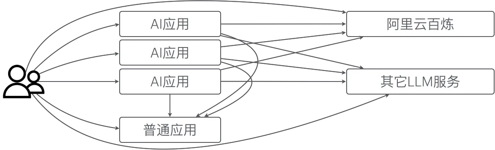
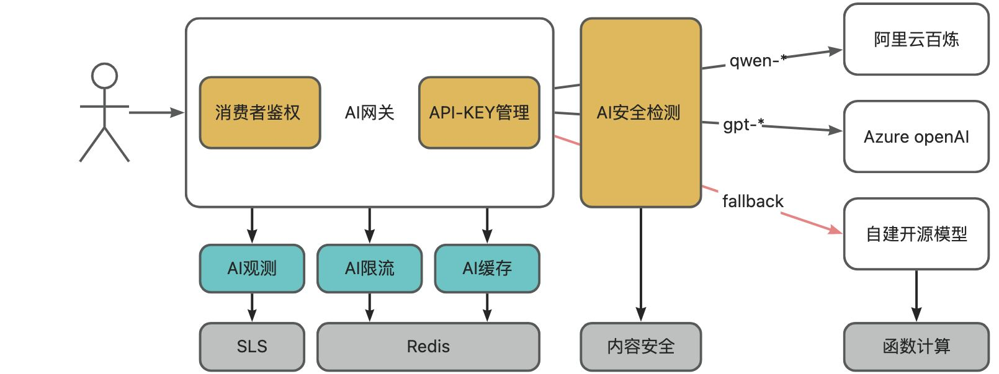
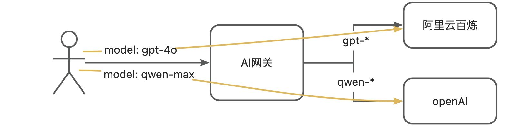
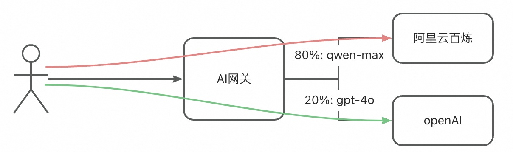
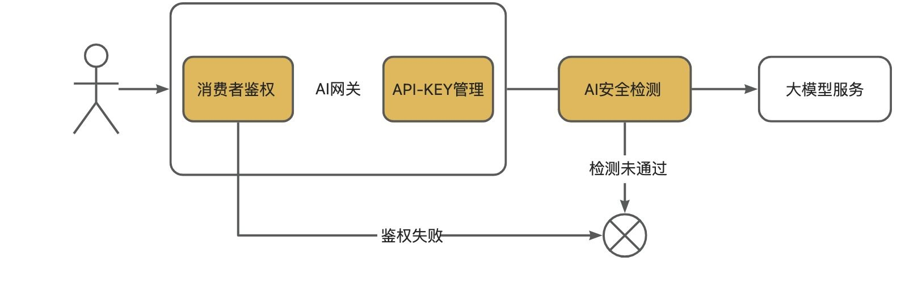
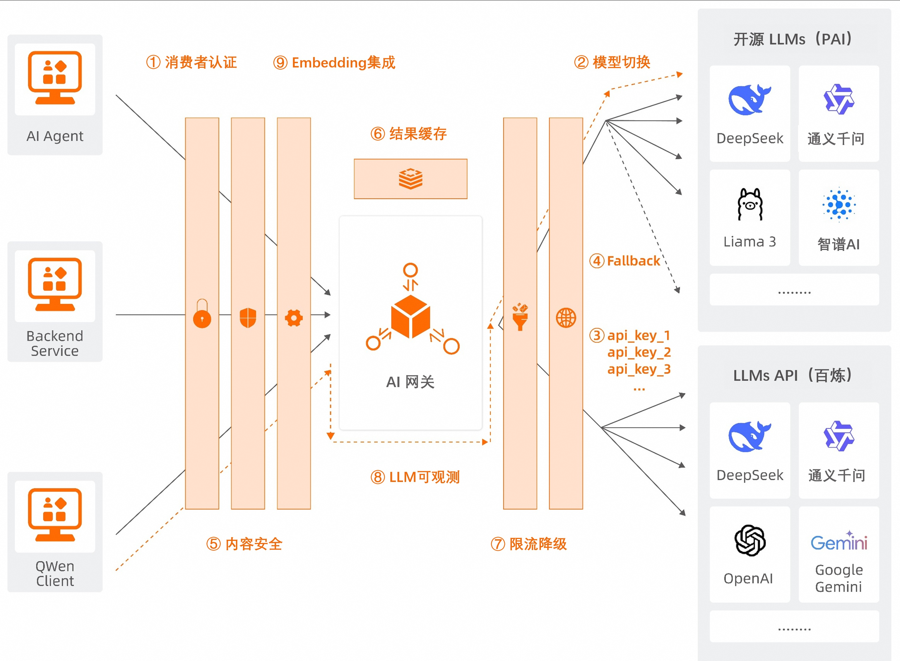
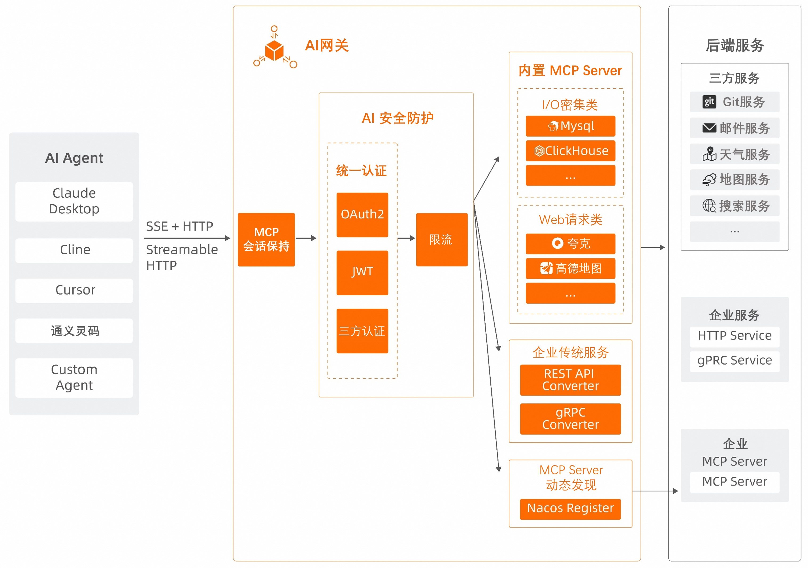

阿里云  
专有云  
AI 网关 产品简介  
产品版本：V3.18.6  
文档版本：20260108

**目录**

- [1.什么是AI网关](#section-1)
- [2.产品详情](#section-2)
- [3.产品价值](#section-3)
- [4.功能特性](#section-4)
- [5.应用场景](#section-5)

# 1.什么是AI网关

AI网关是企业连接AI应用与大语言模型（LLM）服务的核心工具，旨在解决大模型集成、管理、安全与稳定性等关键挑战。

随着大模型在企业中的广泛应用，传统调用方式面临多供应商接口不兼容、资源管理复杂、数据泄露风险及服务稳定性差等问题。AI网关通过统一治理能力，提供标准化入口，实现高效、安全的大模型服务调用。

其核心功能包括：

- 统一调用方式：支持商业模型（如阿里云百炼、OpenAI）与自建模型（如Llama3.x）的集成，兼容OpenAI API标准，并通过按模型名称或比例分配请求的策略，灵活切换多模型服务。

- AI调用可观测性：提供实时监控QPS、Token消耗、响应时间等关键指标，结合日志与追踪功能，提升调用透明度。

- 安全防护：通过API密钥轮转、消费者鉴权（JWT/API Key）及内容安全审核，保障数据合规与敏感信息防护。

- 智能治理：内置限流、缓存、多级服务降级（Fallback）机制，优化资源分配并提升调用成功率。

# 2.产品详情

本文介绍AI网关的概述，企业应用AI场景所面临的挑战，以及AI网关所具备的核心能力。

**产品概述**

在现代企业的业务创新中，人工智能（AI）逐渐扮演着不可或缺的角色。随着大语言模型的兴起，AI的应用场景不断扩大，各种商业和自建的模型正促进着不同领域的业务发展。然而，企业在应用AI时，面临着集成、稳定性、安全性和管理复杂性等诸多挑战。为了应对这些挑战，我们推出了AI 网关产品，其作为连接企业AI应用和大语言模型服务的桥梁，能够显著提升企业应用大模型服务的集成效率和治理能力。

**企业应用AI场景所面临的挑战**

大语言模型正被广泛应用于企业的AI场景，包括以下三种典型的调用场景：

1. **开发者直接使用大模型服务：** 开发人员直接对接不同供应商的大语言模型API，以满足业务需求。

2. **AI应用调用大模型服务：** 企业内部的AI应用通过调用大模型服务来处理复杂任务。

3. **AI应用调用普通应用（作为工具）：** AI应用通过调用普通应用的API接口来扩展功能。

在实际应用中，企业往往需要在多个模型之间进行选择和切换。当某个模型因稳定性或效果不佳而需要更换时，企业希望能够快速切换到另一个模型，同时对新推出的模型进行灰度测试以便评估效果。与个人应用不同，企业在采用AI技术时，还面临着以下四大挑战：

1. **与不同的大模型服务的集成和切换成本高**：不同模型供应商的LLM API接口标准不同，访问方式不同，LLM API的调用方无法平滑地在不同供应商之间切换，无法同时使用不同供应商提供的模型。

2. **对企业内大模型服务使用者的管理难度大**：LLM API 作为企业内的共享和稀缺资源，需要避免因为部分调用者使用不当导致被限流等问题，且不同的模型成本差异较大，企业需要保证高成本的模型能被用在高价值的业务场景上，但仅靠管理手段，很难做到对使用者的精细化的权限管理和资源管控，也难以针对不同的业务场景采用不同的模型和策略。

3. **数据安全和合规风险高**：大模型服务受限于背后的硬件等因素，一般均为 SaaS 服务的形式，企业在调用大模型服务接口时，其内部数据存在泄露风险，同时，调用大模型服务，尤其是开源或外部大模型服务时，数据的合规也是不可忽视的问题。

4. **大模型服务自身的稳定性差**：大模型服务受到硬件限制，其接口限流阈值较低，且自身稳定性也低于一般API 服务，接口的RT和成功率均不够稳定，进而影响AI应用的整体可用性。

**AI网关的场景示例**

某企业计划建设 AI 应用，提升企业的经营效率，探索新的业务机会，为此，该企业采购了阿里云百炼、Azure OpenAI 等大模型服务，并在阿里云FC上部署了自建的开源模型（llama3.x）。为了让企业内各个AI 应用可以高效且安全地使用大模型服务，该企业配置了AI网关，将治理能力集成到网关上，对各个 AI 应用提供统一的访问入口。

具体的使用方式见下图：

网关管理员为每一个 AI 应用分配一个消费者身份（以API Key的方式鉴权），该应用请求AI网关时，根据所带的 model 参数，网关会自动路由到阿里云百炼和Azure的模型服务上，如果模型服务因为限流或其它原因不可用，网关会自动将该请求fallback到自建的开源模型上。为了保证数据安全合规，所有的AI请求都需要通过内容安全的审核，对于不合规的请求，网关会直接拦截。网关管理员开启了限流和缓存，避免某个应用请求太多导致模型服务被打挂。同时，网关管理员会持续关注AI API的观测大盘，查看模型调用情况，并针对性地作出调整。

**AI网关的核心能力**

使用AI网关，用户可以形成以API形态对外透出和管理AI应用的完整方案。即：

1. 所有对大模型服务的调用都走 AI 网关，在 AI 网关上解决模型的稳定性、鉴权、安全合规、观测治理等问题。

2. 所有 AI 应用对外透出的 API 调用都走 AI 网关，在 AI 网关上解决协议接入、认证鉴权、限流、降级等诉求。

为解决这些问题，AI网关提供了如下核心能力：

**统一调用方式**

AI网关可快速集成各类大模型服务，包括商业大模型服务和用户自建的大模型服务，并统一对外暴露的API（兼容OpenAI）。AI网关已支持包括阿里云百炼、OpenAI在内十几家国内外大模型供应商和自建大模型服务（如ollama）。

AI网关提供AIAPI这种针对AI场景优化的API类型，AIAPI提供3种集成大模型服务的方式，分别是：

- 单模型服务：可指定唯一一个大模型服务，支持透传模型名称，也可指定模型名称，当指定模型名称时，用户请求传入的模型名称将被忽略。

  

- 多模型服务（按模型名称）：可指定一到多个大模型服务，并为每个大模型服务配置模型名称的匹配规则，比如可配置模型名称符合 gpt-\* 的模式，则调用openAI大模型服务，模型名称符合qwen-\*的模式，则调用阿里云百炼大模型服务。

  

- 多模型服务（按比例）：可指定一到多个大模型服务，并为每个大模型服务指定请求的模型名称和百分比，这种模式非常适合对新模型进行灰度的场景。

  

**AI调用可观测**

AI网关集成AI调用的可观测能力，包括AI请求的Metrics、Logging和Tracing能力，与一般的API观测不同，AI观测支持按Token维度对AI调用进行统计，支持API、模型、消费者等观测维度，AI请求和响应的日志也会被记录下来，用于后续的追踪与审计。

AI观测的关键指标包括：

- QPS：每秒AI请求和响应的数量统计，分为AI请求的QPS、流式响应的QPS和非流式响应的QPS。

- 请求成功率：即AI请求的成功率，可按秒、15 秒、分钟进行统计。

- token消耗数/s：每秒消耗的token数量，分为输入token、输出token和总计token。

- 请求平均RT：一段时间内（秒、15 秒、分钟） AI请求的平均响应时间（ms），分为非流式RT、流式RT（流式响应的整体时间）、流式首包RT（流式响应的首包时间）。

- 缓存的命中数：一段时间内缓存的命中数和miss数统计。

- 限流统计：一段时间内被限流的请求和正常请求的统计。

- 按模型的token统计：一段时间内不同模型的token消耗统计。

- 按消费者的token统计：一段时间内不同消费者的token消耗统计。

- 风险统计：被内容安全检测出来的风险，按照风险类型、消费者等维度的统计。

**内置安全防护**

AI网关在安全方面建设了3个核心能力：

- API-KEY统一管理和轮转：将大模型服务的API-KEY保存在网关层面，对调用方屏蔽，并可配置多个API-KEY自动轮转。

- 统一鉴权：内置消费者鉴权能力，可对不同的调用方分别授权，支持JWT和API Key等鉴权方式，并可按照消费者观测器调用情况和配置限流。

- 内容审核：与阿里云内容安全服务深度集成，对AI请求和响应的内容进行安全审核和防护，可按需配置审核策略和敏感词，一方面保证请求内容的合规，另一方面避免企业敏感信息的外泄。

**AI调用可治理、可加速**

AI网关为企业AI应用提供了统一的治理中心，可通过限流、缓存、fallback等能力，有效提升模型调用的成功率，具体包括以下几方面：

- 按Token限流：AI网关内置Token限流策略，可根据请求特征（如header ），限制单位时间消费的Token数。

- 多API-KEY自动轮转：AI网关支持为模型服务配置多个API-KEY，在处理 AI请求时，多个KEY会自动轮转，避免某个KEY的问题影响全部请求。

- AI缓存：AI网关集成AI缓存策略，可对重复出现的请求进行响应缓存，提升响应效率并降低大模型服务成本。

- 模型服务fallback：AI网关支持模型服务不可用时fallback到备用模型，且支持多级fallback，可有效提升AI请求的成功率。

综上所述，AI网关有望成为企业提升AI应用效率的关键工具。通过简化集成、统一治理、强化安全和加速响应，企业在利用AI技术创新过程中将更加高效、安全和可控。

# 3.产品价值

AI网关具备高并发架构、毫秒级无中断配置、WASM热插件与全场景插件生态，支持SSE流式协议及资源优化，实现AI服务的稳定性、扩展性与易用性。

**企业级可靠性保障**

- **高并发场景的坚实底座**

  基于阿里巴巴沉淀多年的网关技术经验，打造支持每秒数十万级请求的高并发架构，适配大规模分布式系统与AI业务的稳定运行需求。

- **零中断的智能配置更新** 彻底解决传统Nginx Reload导致的流量抖动问题，配置变更实现毫秒级生效且业务无感知，专为长连接场景（如AI服务）优化，保障服务连续性。

**灵活扩展能力**

- **覆盖全场景的插件生态**

  提供涵盖AI推理、流量管理、安全防护等核心功能的官方插件库，满足90%以上的业务场景需求，快速响应复杂业务挑战。

- **WASM热插件架构革新**

  通过WASM沙箱实现插件隔离，支持多语言开发（Rust/Go/Python等），插件版本可独立升级，实现网关逻辑的流量无损热更新，降低维护复杂度。

**开箱即用的安全与易用性**

- **标准化控制台与白屏化配置** 提供产品标准控制台，支持配置白屏化操作，内容安全防护等功能的一键启用，降低运维门槛。

- **极简部署与自动化能力** 兼容Ingress API和Gateway API标准，支持对接Let's Encrypt自动签发与续签免费证书，无需依赖K8s环境——一行Docker命令即可快速部署，开发者友好度行业领先。

**高效流式处理引擎**

- **全链路流式协议支持** 原生支持SSE（Server-Sent Events）等流式协议，允许WASM插件自定义处理流式报文逻辑，灵活适配AI流式推理、实时数据推送等场景。

- **资源优化与性能突破** 在大带宽、高吞吐场景下（如AI模型服务），通过流式处理显著降低内存占用，提升资源利用率，降低基础设施成本。

# 4.功能特性

AI网关作为连接企业AI应用和大语言模型服务的桥梁，主要提供了以下功能：

**实例管理**

| 功能点 | 详细说明 |
| --- | --- |
| 实例生命周期管理 | 支持AI网关实例的全生命周期管理，包括网关实例的创建、启动、停止、删除、升级、扩缩容等操作。 |
| 弹性伸缩 | 支持根据业务负载自动调整网关实例的数量，以应对流量峰谷变化。 |
| 实例引擎参数 | 支持设置实例引擎参数。 |

**路由管理**

<table>
  <tr>
    <th width="200">功能点</th>
    <th>详细说明</th>
  </tr>
  <tr>
    <td>创建LLM API并添加接口</td>
    <td>支持创建LLM API，包含关联的大模型服务（单模型、多模型），兼容OpenAI协议，默认包含三条路由：文本补全接口、对话式AI接口、将文本内容向量化接口。</td>
  </tr>
  <tr>
    <td>预制策略与插件</td>
    <td>默认提供四个插件：内容安全防护、限流、缓存、联网搜索。 说明需要配置插件入参后方可使用。</td>
  </tr>
  <tr>
    <td>消费者认证</td>
    <td>认证方式支持API Key或JWT方式，提供对API消费者进行身份验证和权限校验的功能。</td>
  </tr>
  <tr>
    <td>API调试</td>
    <td>提供使用示例，方便API服务的调试与测试。</td>
  </tr>
  <tr>
    <td>路由列表</td>
    <td>支持查看当前API具备的路由列表。</td>
  </tr>
</table>

**MCP服务管理**

<table>
  <tr>
    <th width="145">功能点</th>
    <th>详细说明</th>
  </tr>
  <tr>
    <td>Tools管理</td>
    <td>提供MCP服务相关的工具链管理功能，包括配置工具、监控工具、调试工具等，支持服务生命周期的全链路管理。</td>
  </tr>
  <tr>
    <td>OpenAPI转MCP</td>
    <td>支持将标准OpenAPI定义自动转换为MCP服务规范，实现接口定义、鉴权、路由规则的快速迁移和适配。</td>
  </tr>
  <tr>
    <td>DB转MCP</td>
    <td>提供从数据库（如MySQL、PostgreSQL）到MCP服务的自动化迁移能力，包括数据模型转换、SQL逻辑适配及性能优化。</td>
  </tr>
  <tr>
    <td>MCP直接路由</td>
    <td>实现基于MCP协议的直接路由能力，支持跨数据中心、跨云环境的请求路由优化，减少中间层转发延迟。</td>
  </tr>
</table>

**服务与来源管理**

| 功能点 | 详细说明 |
| --- | --- |
| 服务管理 | 支持对服务进行创建、查看、编辑和删除操作。 |
| 来源 | 支持AI服务、DNS域名以及固定地址方式。 |

**域名管理**

| 功能点 | 详细说明 |
| --- | --- |
| 域名操作 | 支持用户添加/删除自定义域名到API网关，实现通过域名访问API。 |

**证书管理**

<table>
  <tr>
    <th width="90">功能点</th>
    <th>详细说明</th>
  </tr>
  <tr>
    <td>证书操作</td>
    <td>允许更新域名的SSL/TLS证书或协议配置，确保安全通信。提供配置HTTPS传输使用的加密算法和套件，优化安全性。</td>
  </tr>
</table>

**消费者管理**

| 功能点 | 详细说明 |
| --- | --- |
| 消费者生命周期 | 支持注册/停用/删除 API的调用方或用户，为其分配访问权限。 |
| 消费者授权 | 支持为消费者分配API访问权限和控制其可调用的API。 |

**策略管理**

<table>
  <tr>
    <th width="139">功能点</th>
    <th>详细说明</th>
  </tr>
  <tr>
    <td>多模型支持</td>
    <td>支持主流AI模型（如大语言模型、图像生成模型等）的统一接入与策略适配，提供模型级别的资源调度、权限控制及性能监控能力。</td>
  </tr>
  <tr>
    <td>Token配额策略</td>
    <td>通过预设的token额度（如每日/每小时/每分钟）限制API调用的token消耗总量，保障系统资源合理分配，避免资源滥用。</td>
  </tr>
  <tr>
    <td>Token统计策略</td>
    <td>实时统计并记录每个用户、模型或API接口的token使用量，生成可视化报表，支持按时间维度（如分钟/小时/日）进行精细化分析。</td>
  </tr>
  <tr>
    <td>鉴权策略</td>
    <td>• <strong>API Key：</strong>基于API密钥的请求验证机制，为每个用户或服务分配唯一密钥，确保调用来源的合法性，支持密钥生命周期管理（如生成、禁用、过期）。 • <strong>JWT：</strong>集成JSON Web Token（JWT）验证流程，通过签名验证用户身份，支持自定义claims字段及多签发方（Issuer）兼容，满足复杂场景下的身份认证需求。 • <strong>OAuth2：</strong>支持OAuth 2.0协议标准，实现第三方授权登录及令牌刷新机制，兼容Client Credentials、Authorization Code等常见授权模式，保障API访问的安全性。 • <strong>Token限流：</strong>基于令牌桶算法（Token Bucket）动态控制请求流量，允许突发流量缓冲，适用于对延迟敏感的场景（如实时语音/视频处理）。 • <strong>QPS限流：</strong>通过限制每秒请求数（Queries Per Second）实现流量削峰，支持按用户、接口或集群维度配置限流规则，防止系统因过载崩溃。</td>
  </tr>
</table>

**API调试**

<table>
  <tr>
    <th width="84">功能点</th>
    <th>详细说明</th>
  </tr>
  <tr>
    <td>API调试</td>
    <td>提供API在线测试功能，方便用户验证API的可用性和正确性，简化开发和调试流程。</td>
  </tr>
</table>

**观测分析**

| 功能点 | 详细说明 |
| --- | --- |
| 监控与指标 | 支持实时查看API网关的性能指标、健康状态和请求量等监控数据。 |
| 日志管理 | 支持将API网关的访问日志、错误日志等信息投递到指定存储或分析服务。 |
| 链路追踪 | 支持启用分布式追踪功能，分析请求在整个系统中的流转过程。 |
| API级别监控 | 支持查看特定REST API，及其接口的性能指标和访问统计数据。 |

# 5.应用场景

本文介绍AI网关的核心应用场景。

**AI应用访问大模型的统一入口**

<strong>AI应用流量入口与集成：</strong>面向大型语言模型（LLM），统一代理各主流大模型和自建大模型服务，提供与OpenAI兼容的访问方式，并提供二次API KEY签发、流量限制、安全防护、观测等治理能力。

- 高可用：支持多模型灰度、多模型间Failover、Token额度管理和流控。

- 高安全：提供大模型内容安全检测，并支持路由配置认证和消费者鉴权，实现对API访问的控制、安全性和策略管理。

- 降低模型幻觉：提供联网搜索、搜索结果自动融合、问题意图识别。

- 企业级可观测：在应用、网关、后端LLM服务上开启OT服务来进行全链路的跟踪，通过TraceId串联各个地方的日志、请求参数等信息。

**MCP Server统一管理和访问**

<strong>MCP Server统一管理和访问：</strong>面向MCP Server，提供MCP Server代理、安全认证，以及统一观测、限流等治理能力。

- API-to-MCP：支持将REST API直接转化成MCP Server，避免重新构建和维护MCP Server等重复性劳动。

- 协议卸载：无缝支持MCP官方最新版协议，降低升级成本，例如支持将SSE转换为Streamable HTTP，避免无状态应用也要使用SSE。

- MCP 市场：提供官方维护的MCP市场，确保MCP服务端可用性、易用性和安全性。

