阿里云  
专有云  
AI Studio 用户指南  
产品版本：V3.18.6  
文档版本：20251028

**目录**

- [1.概述](#section-1)
- [2.快速入门](#section-2)
    - [2.1. 使用须知](#section-2-1)
    - [2.2. 登录AI Studio控制台](#section-2-2)
    - [2.3. 角色和权限说明](#section-2-3)
- [3.概览](#section-3)
- [4.数据管理](#section-4)
    - [4.1. 功能概述](#section-4-1)
    - [4.2. 数据集](#section-4-2)
        - [4.2.1. 创建数据集](#section-4-2-1)
        - [4.2.2. 管理数据集](#section-4-2-2)
    - [4.3. 数据标注](#section-4-3)
        - [4.3.1. 创建标注任务](#section-4-3-1)
        - [4.3.2. 任务管理](#section-4-3-2)
        - [4.3.3. 标注任务](#section-4-3-3)
        - [4.3.4. 验收任务](#section-4-3-4)
    - [4.4. 数据生成](#section-4-4)
        - [4.4.1. 创建数据生成任务](#section-4-4-1)
        - [4.4.2. 管理数据生成任务](#section-4-4-2)
- [5.模型训练](#section-5)
    - [5.1. 功能概述](#section-5-1)
    - [5.2. Notebook建模](#section-5-2)
        - [5.2.1. 创建实例](#section-5-2-1)
        - [5.2.2. 管理实例](#section-5-2-2)
        - [5.2.3. 查看监控](#section-5-2-3)
    - [5.3. 任务建模](#section-5-3)
        - [5.3.1. 创建任务](#section-5-3-1)
        - [5.3.2. 管理任务](#section-5-3-2)
        - [5.3.3. 查看监控](#section-5-3-3)
        - [5.3.4. Tensorboard](#section-5-3-4)
            - [5.3.4.1. 开发代码引入](#section-5-3-4-1)
            - [5.3.4.2. 创建实例](#section-5-3-4-2)
            - [5.3.4.3. 管理实例](#section-5-3-4-3)
    - [5.4. 可视化建模](#section-5-4)
        - [5.4.1. 创建工作流](#section-5-4-1)
        - [5.4.2. 管理工作流](#section-5-4-2)
        - [5.4.3. 预置模板](#section-5-4-3)
            - [5.4.3.1. 二分类](#section-5-4-3-1)
            - [5.4.3.2. 线性回归](#section-5-4-3-2)
            - [5.4.3.3. 文本分类](#section-5-4-3-3)
            - [5.4.3.4. 文本聚类](#section-5-4-3-4)
            - [5.4.3.5. 图片分类](#section-5-4-3-5)
            - [5.4.3.6. 图片目标检测](#section-5-4-3-6)
- [6.模型服务](#section-6)
    - [6.1. 功能概述](#section-6-1)
    - [6.2. 在线服务](#section-6-2)
        - [6.2.1. 部署服务](#section-6-2-1)
        - [6.2.2. 管理服务](#section-6-2-2)
        - [6.2.3. 查看监控](#section-6-2-3)
    - [6.3. 灰度群组](#section-6-3)
        - [6.3.1. 创建灰度群组](#section-6-3-1)
        - [6.3.2. 管理灰度群组](#section-6-3-2)
        - [6.3.3. 访问灰度群组](#section-6-3-3)
    - [6.4. 批量推理](#section-6-4)
        - [6.4.1. 创建任务](#section-6-4-1)
        - [6.4.2. 管理任务](#section-6-4-2)
- [7.模型管理](#section-7)
    - [7.1. AI Studio产品使用须知](#section-7-1)
    - [7.2. 功能概述](#section-7-2)
    - [7.3. 模型广场](#section-7-3)
        - [7.3.1. 系统模型](#section-7-3-1)
        - [7.3.2. 自定义模型](#section-7-3-2)
            - [7.3.2.1. 导入模型](#section-7-3-2-1)
            - [7.3.2.2. 管理模型及版本](#section-7-3-2-2)
        - [7.3.3. MaaS市场](#section-7-3-3)
    - [7.4. 模型调优](#section-7-4)
        - [7.4.1. 创建模型调优任务](#section-7-4-1)
        - [7.4.2. 管理模型调优任务](#section-7-4-2)
    - [7.5. 模型评测](#section-7-5)
        - [7.5.1. 创建评测任务](#section-7-5-1)
        - [7.5.2. 管理评测任务](#section-7-5-2)
        - [7.5.3. 查看监控](#section-7-5-3)
    - [7.6. 模型转换](#section-7-6)
        - [7.6.1. 创建模型转换任务](#section-7-6-1)
        - [7.6.2. 管理模型转换任务](#section-7-6-2)
- [8.AI资源管理](#section-8)
    - [8.1. AI资源池](#section-8-1)
        - [8.1.1. 创建资源池](#section-8-1-1)
        - [8.1.2. 管理资源池](#section-8-1-2)
    - [8.2. 功能概述](#section-8-2)
    - [8.3. 资源配额](#section-8-3)
        - [8.3.1. 创建资源配额](#section-8-3-1)
        - [8.3.2. 管理资源配额](#section-8-3-2)
- [9.Agent开发平台](#section-9)
    - [9.1. 功能概述](#section-9-1)
    - [9.2. Dify开源版](#section-9-2)
        - [9.2.1. 创建Dify](#section-9-2-1)
        - [9.2.2. 管理Dify](#section-9-2-2)
- [10.AI资产管理](#section-10)
    - [10.1. 功能概述](#section-10-1)
    - [10.2. 镜像库](#section-10-2)
        - [10.2.1. 公共镜像](#section-10-2-1)
        - [10.2.2. 创建自定义镜像](#section-10-2-2)
        - [10.2.3. 管理自定义镜像及版本](#section-10-2-3)
        - [10.2.4. 转换加速镜像](#section-10-2-4)
    - [10.3. 代码集](#section-10-3)
        - [10.3.1. 创建代码集](#section-10-3-1)
        - [10.3.2. 管理代码集](#section-10-3-2)
    - [10.4. 数据加速器](#section-10-4)
        - [10.4.1. 创建数据加速器](#section-10-4-1)
        - [10.4.2. 管理数据加速器](#section-10-4-2)
    - [10.5. 软件源](#section-10-5)
        - [10.5.1. 使用软件源](#section-10-5-1)
        - [10.5.2. 管理软件源](#section-10-5-2)
- [11.系统配置](#section-11)
    - [11.1. 资源同步](#section-11-1)
- [12.附录](#section-12)
    - [12.1. 使用免密组件拉取私有容器镜像](#section-12-1)
    - [12.2. 弹性容错最佳实践](#section-12-2)
    - [12.3. 开源Dify参数配置说明](#section-12-3)
    - [12.4. 可视化建模预置组件列表](#section-12-4)
    - [12.5. 系统模型列表](#section-12-5)
    - [12.6. 公共镜像列表](#section-12-6)
    - [12.7. 自定义模型支持列表](#section-12-7)
    - [12.8. 在线服务支持的模型列表](#section-12-8)

<a id="section-1"></a>

# 1.概述

AI Studio定位为飞天企业版全栈AI PaaS服务平台，面向AI开发者提供包含数据集管理、模型开发、模型训练、模型推理等在内的AI工程化平台。

**功能概述**

AI Studio在功能架构上从下至上分为资源、模型开发训练、模型服务、及运营四层：

1. <strong>AI资源层：</strong>支持裸金属及 EGS 形态计算资源，并可基于海光、昇腾等多种国产化算力资源类型，满足不同客户对于算力场景需求。

2. <strong>模型开发训练层：</strong>为用户提供可视化建模、Notebook建模、任务建模三种模型训练方式，支持OSS对象存储、CPFS文件系统等不同存储类型的数据集，支持TensorFlow、PyTorch、DeepSpeed、Megatron等主流模型训练框架。通过单机及分布式训练场景为用户提供一体化模型开发、训练监控、训练结果记录、训练模型上架等全流程模型训练体系能力。

3. <strong>模型服务层：</strong>支持模型在线服务和批量推理，同时支持对模型服务性能的实时监控，利用资源伸缩配置来及时保障对外服务稳定性。

4. <strong>AI运营：</strong>支持用户进行资源、训练任务不同层级的资源管理以及计量、配额控制，满足用户智算运营场景需求。

<a id="section-2"></a>

# 2.快速入门

<a id="section-2-1"></a>

## 2.1. 使用须知

本文介绍在使用AI Studio前，您需要了解的内容。

**使用说明**

1. AI Studio的Notebook建模、在线服务功能对外提供服务时，对外服务的IP为VPC的内网地址，需要完成访问源到VPC网络的打通。具体操作请参见相应产品文档。

2. Notebook建模使用的自定义镜像在启动的时候，会自动执行jupyter lab启动命令，请确保Notebook中配置的镜像中已正确安装jupyer软件，保证JupyterLab的版本必须大于等于3.0.0。

3. 存储在OSS上的数据集/代码集/模型对象挂载到容器中时，作为本地路径访问，与本地存储和相比有一定限制。

   - 随机或者追加写文件实际为在本地生成新文件重新上传至OSS服务端。

   - 因为需要远程访问OSS服务器，list directory等元数据操作的性能较差。

   - 文件、文件夹的rename操作不是原子的。

   - 多个客户端挂载同一个OSS Bucket时，依赖用户自行协调各个客户端的行为，例如，避免多个客户端写入同一个文件等。

   - 不支持硬链接（Hard Link）。

4. 创建云存储类型为OSS的数据集、模型、代码集之后，需要手工进入AI资源池对应的ACK集群，创建对应OSS存储目录下的存储声明。AI Studio的Notebook、任务建模、在线服务、模型评测需要引用存储声明。

<a id="section-2-2"></a>

## 2.2. 登录AI Studio控制台

本文主要向您介绍如何登录AI Studio控制台。

**前提条件**

- 登录Apsara Uni-manager运营控制台前，确认您已从部署人员处获取Apsara Uni-manager运营控制台的服务域名地址。

- 推荐使用Chrome浏览器。

**操作步骤**

1. 在浏览器地址栏中，输入Apsara Uni-manager运营控制台的服务域名地址，按回车键。

2. 输入正确的用户名及密码。

   请向运营管理员获取登录控制台的用户名和密码。

   > **说明**
   >
   > - **首次登录**
   >
   >   首次Apsara Uni-manager运营控制台时，需要修改登录用户名的密码，请按照提示完成密码修改。为提高安全性，密码长度必须为10~32位，且包含英文字母大小写、阿拉伯数字和特殊符号（感叹号（!）、at（@）、井号（#）、美元符号（$）、百分号（%）等）。
   >
   > - **忘记密码**
   >
   >   用户忘记登录密码时，单击忘记密码，输入账户名（当前账号的用户名）、邮箱（当前用户创建时所录入的邮箱）和验证码后，重置密码的链接将发至邮箱，进入链接后用户可输入新密码。

3. 单击**账号登录**。

4. 如果账号已激活MFA多因素认证，请根据以下两种情况进行操作：

   - 管理员强制开启MFA后的首次登录：

     <ol type="a">

     <li>

     在绑定虚拟MFA设备页面中，按页面提示步骤绑定MFA设备。

     </li>

     <li>

     按照步骤2重新输入账号和密码，单击**账号登录**。

     </li>

     </ol>

     <ol type="i" start="100">

     <li>

     输入6位MFA码后单击**认证**。

     </li>

     </ol>

   - 您已开启并绑定MFA：

     输入6位MFA码后单击**认证**。

5. 在顶部菜单栏单击**产品**，选择**人工智能与机器学习 > AI Studio**。

<a id="section-2-3"></a>

## 2.3. 角色和权限说明

本文介绍AI Studio产品预置角色和对应的权限说明。

<table>
  <tr>
    <th width="138">角色</th>
    <th>权限说明</th>
  </tr>
  <tr>
    <td>运营管理员</td>
    <td>负责整个专有云管控台的组织创建及管理、资源集创建及管理、人员添加及管理、角色分配及管理、AI Studio资源开通及管理等相关工作。</td>
  </tr>
  <tr>
    <td>资源使用人</td>
    <td>使用运营管理员创建好并分配的AI Studio资源。</td>
  </tr>
  <tr>
    <td>组织管理员</td>
    <td>负责本组织的管理以及下级组织的创建及管理、资源集创建及管理、人员添加及管理、角色分配及管理、AI Studio资源开通及管理，以及指派下级组织、资源集管理员和配额，并且可以根据服务流程的设置审批资源的申请。</td>
  </tr>
  <tr>
    <td>资源集管理员</td>
    <td>负责本资源集的管理、人员添加及管理、AI Studio资源开通及管理，并且可以根据服务流程的设置审批资源的申请。</td>
  </tr>
  <tr>
    <td>资源监察员</td>
    <td>拥有云平台所有AI Studio资源的查看（只读）权限。</td>
  </tr>
  <tr>
    <td>组织资源检察员</td>
    <td>具有所在的组织的AI Studio资源的查看权限。</td>
  </tr>
</table>

<a id="section-3"></a>

# 3.概览

概览页面会把AI Studio中任务建模、在线服务、数据集等统计并展示出来，使用户能直观并准确的了解系统中的情况。

**操作步骤**

1. 登录AI Studio控制台。

2. 在顶部菜单栏处，选择组织、资源集和地域。

3. 在左侧导航栏中，单击**概览**。

   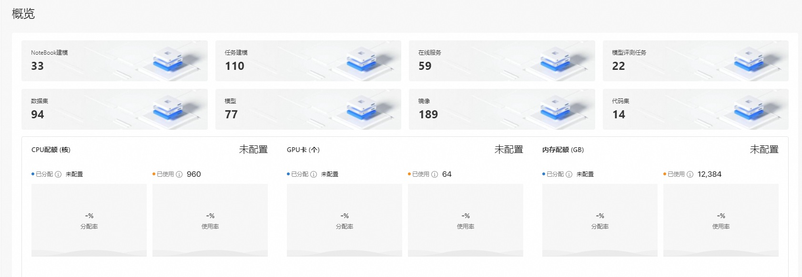

   <table>
     <tr>
       <th width="192">区域</th>
       <th>说明</th>
     </tr>
     <tr>
       <td>概览页上方</td>
       <td>展示AI Studio系统中NoteBook建模、任务建模、在线服务、模型评测任务、数据集、模型、镜像和代码集的数量。</td>
     </tr>
     <tr>
       <td>CPU配额（核）</td>
       <td>展示AI Studio系统中CPU的分配率和使用率。</td>
     </tr>
     <tr>
       <td>GPU卡（个）</td>
       <td>展示AI Studio系统中GPU的分配率和使用率。</td>
     </tr>
     <tr>
       <td>内存配额（GB）</td>
       <td>展示AI Studio系统中内存的分配率和使用率。</td>
     </tr>
     <tr>
       <td>组织配额使用率Top10</td>
       <td>• 支持以CPU使用率、内存使用率或GPU使用率的维度展示使用率Top10。<br>• 支持以折线图形式展示近7天、近15天或近30天的资源使用趋势。</td>
     </tr>
     <tr>
       <td>任务资源消耗统计</td>
       <td>• 以换装图形式展示任务建模、在线服务、NoteBook建模和模型评测任务总数。<br>• 以柱状图形式展示任务建模、在线服务、NoteBook建模和模型评测任务的内存、CPU、GPU的消耗总量。</td>
     </tr>
     <tr>
       <td>任务资源消耗Top20</td>
       <td>以列表形式展示任务的资源消耗Top20，并支持以CPU、内存或GPU排序。</td>
     </tr>
   </table>

<a id="section-4"></a>

# 4.数据管理

数据管理提供数据集管理能力。对训练数据、评测数据进行数据集管理，便于用户在模型训练及优化任务中集中管理相关数据，直观进行数据路径配置。

<a id="section-4-1"></a>

## 4.1. 功能概述

AI Studio提供数据集、数据标注和数据生成的相关功能来管理数据。

**数据集**

在模型的训练与评测任务中，可以直接指定数据集。用户可上传线下处理好的训练及评测数据，便于在平台中直接白屏化将数据集添加到训练任务中，帮助用户高效管理和共享数据集，提升模型训练效率，同时保证数据的安全性和可追溯性。用户可以执行数据集的查看、创建、删除和共享操作。

**数据标注**

数据标注为企业及团队提供高效、灵活的数据标注全流程管理工具，支持管理员、标注员、验收员协同完成标注任务。核心功能包括任务配置与分配、角色协作和结果应用。平台通过标准化模板、智能分配、多层级质检及角色权限分离，显著提升标注效率与数据质量，助力AI训练数据高效产出。

**数据生成**

当数据集数量级不足时，可以通过数据生成对数据集进行扩充，生成更多样化和高质量的数据，提高训练结果的泛化能力。用户可以创建数据生成任务，保存数据生成结果。

**应用场景**

- 用户需要创建数据集，选择OSS对象存储或CPFS文件系统。

- 用户需要使用数据集，在Notebook建模、任务建模、模型评测中添加数据集。

- 用户需要对数据进行标注处理，为模型训练进行前置数据操作。

- 用户的数据集不足，需要生成数据。

**使用限制**

- 目前只支持OSS对象存储和CPFS文件系统两类数据存储源。

- OSS对象存储使用前，需要提前在容器集群对应的命名空间下创建持久化存储。

- CPFS文件系统需要提前挂载到对应的ACK集群上。

- 数据标注和数据生成使用的数据集存储方式需为OSS对象存储。

<a id="section-4-2"></a>

## 4.2. 数据集

<a id="section-4-2-1"></a>

### 4.2.1. 创建数据集

数据集功能将已经处理好训练或评测数据上传到数据集，在模型建模及模型评测中直接关联，实现数据的集中管理。本文介绍了创建数据集的操作。创建数据集主要包含设置基本信息和数据配置两个环节。

**前提条件**

数据已上传至云存储（OSS对象存储/CPFS文件存储）。具体操作，请参见对应存储产品文档。

**操作步骤**

1. 登录AI Studio控制台。

2. 在顶部菜单栏处，选择组织、资源集和地域。

3. 在左侧导航栏中，单击**数据管理** > **数据集**。

4. 在数据集列表界面，单击**创建数据集**。

5. 在**创建数据集**页面，设置相关配置项参数。

   数据集创建包括创建数据集的基本信息（组织、资源集、地域、数据集名称、描述等）以及数据具体的配置（数据类型、数据来源等）。

   <ol type="i">

   <li>

   配置数据集的基本信息

   | 配置项 | 是否必选 | 说明 |
   | --- | --- | --- |
   | 组织/资源集/地域 | 是 | 数据集所属的组织、资源集和地域。 |
   | 基于现有数据集创建 | 是 | • 是<br>• 否 |
   | 选择数据集 | 否 | 可选，当<strong>基于现有数据集创建</strong>选择<strong>是</strong>时，需要配置。请您选择希望基于的特定数据集进行创建。 |
   | 数据集版本 | 是 | 当<strong>基于现有数据集创建</strong>选择<strong>是</strong>时，基于现有数据集依次递增。当<strong>基于现有数据集创建</strong>选择<strong>否</strong>时，系统会自动填充为v1。 |
   | 数据集名称 | 否 | 可选，当<strong>基于现有数据集创建</strong>选择<strong>否</strong>时，请用户自定义的数据集名称。 |
   | 描述 | 否 | 用户撰写的数据集的描述。 |
   | 共享范围 | 是 | 共享范围，有以下三种：<br>• <strong>本组织及下级组织</strong>：在本组织和下级组织内共享。<br>• <strong>本资源集共享</strong>：在本资源集内共享。<br>• <strong>本组织共享</strong>：在本组织内共享。 |
   | 存储类型 | 是 | • OSS对象存储<br>• CPFS文件系统 |
   | 数据集类型 | 是 | 数据集的类型，有以下三种：<br>• <strong>训练集</strong>：将此数据集作为训练集使用。<br>• <strong>评测集</strong>：将此数据集作为评测集使用。<br>• <strong>训练集&amp;评测集</strong>：将此数据集同时作为训练集和评测集使用。 |

   </li>

   <li>

   进行数据配置

   | 配置项 | 是否必选 | 说明 |
   | --- | --- | --- |
   | 数据格式 | 是 | 数据的类型，按数据集含有的数据类型，分为<strong>图片</strong>、<strong>文</strong><strong>本</strong>、<strong>音频</strong>、<strong>表格</strong>和<strong>视频</strong>五种，用户根据实际情况进行选择。 |
   | 是否需要标注 | 否 | 可选，当<strong>存储类型</strong>选择<strong>OSS对象存储</strong>时，支持配置。目前支持图片和文本标注，如果选择需要标注，需要标注的数据集会给定标注数据格式模板供参考。 |
   | 数据来源 | 否 | • 云存储<br>• 本地上传：当<strong>存储类型</strong>选择<strong>OSS对象存储</strong>时，支持配置。 |
   | 导入格式 | 是 | 支持选择文件和文件夹。 |
   | 数据保存路径 | 否 | 可选，当<strong>数据来源</strong>选择<strong>本地上传</strong>时，需要配置。 |
   | 上传数据 | 否 | 可选，当<strong>数据来源</strong>选择<strong>本地上传</strong>时，需要配置。请下载示例文件，根据示例文件的格式上传文件。 |
   | 选择数据文件 | 是 | 单击图标选择云存储中的类型和目录。 |

   </li>

   </ol>

6. 单击**提交**。

**执行结果**

数据集列表中出现您创建的数据集。

<a id="section-4-2-2"></a>

### 4.2.2. 管理数据集

本文介绍了数据集管理的常用操作。主要包括对数据集名称、描述、数据集类型进行编辑，以及删除数据集。

**前提条件**

数据集所关联任务不能处于运行中状态。

**编辑数据集**

**操作步骤**

1. 登录AI Studio控制台。

2. 在顶部菜单栏处，选择组织、资源集和地域。

3. 在左侧导航栏中，单击**数据管理** > **数据集**。

4. 在数据集列表界面，单击对应数据集的**编辑**按钮。

5. 在**编辑数据集**页面，编辑**数据集名称**、**描述**、**数据集类型**参数。

6. 单击**确定**。

**执行结果**

弹窗提示**修改成功**，且数据集相应信息已更新。

**添加版本**

1. 登录AI Studio控制台。

2. 在顶部菜单栏处，选择组织、资源集和地域。

3. 在左侧导航栏中，单击**数据管理** > **数据集**。

4. 在数据集列表界面，单击对应数据集操作列的**新增版本**。

5. 会跳转至新建数据集页面，将原有数据集的参数值填充，版本升至V2，依次递增。

6. 可根据实际修改或直接单击**提交**。提交成功后可返回至列表页查看。

7. 单击相应数据集**操作**列**详情**，可看到有多个版本的数据集。

   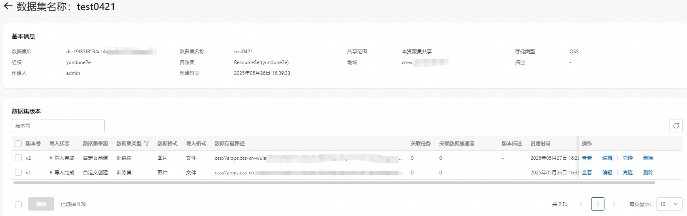

8. 支持查看、编辑和删除。

**克隆数据集**

1. 登录AI Studio控制台。

2. 在顶部菜单栏处，选择组织、资源集和地域。

3. 在左侧导航栏中，单击**数据管理** > **数据集**。

4. 单击相应数据集**操作**列**详情**，可看到有多个版本的数据集。

   

5. 选择一条版本单击操作列**克隆**，系统会自动填充当前数据集的配置，参考创建数据集配置参数后，单击**提交**。

**修改共享范围**

1. 登录AI Studio控制台。

2. 在顶部菜单栏处，选择组织、资源集和地域。

3. 在左侧导航栏中，单击**数据管理** > **数据集**。

4. 在数据集列表界面，单击对应数据集的操作列  ，选择**共享设置**。

5. 重新选择共享范围后，单击**确定**。在列表页可看到修改后的内容。

**查看数据集内容**

1. 登录AI Studio控制台。

2. 在顶部菜单栏处，选择组织、资源集和地域。

3. 在左侧导航栏中，单击**数据管理** > **数据集**。

4. 在数据集列表界面，单击对应数据集的操作列**详情**。

5. 在数据集版本列表中单击**操作**列**查看**。

6. 系统会展示并下载各种格式的数据集内容，包括但不限于txt、xls、xlsx、pdf、md、html、PNG、JPEG、JPG、BMP、MP3、WAV和FLAC。

7. 选择对应文件，直接单击卡片可直接预览。

删除数据集

> **说明**
>
> 若存在关联任务则无法删除数据集，请先删除对应关联任务再删除数据集。

**操作步骤**

1. 登录AI Studio控制台。

2. 在顶部菜单栏处，选择组织、资源集和地域。

3. 在左侧导航栏中，单击**数据管理** > **数据集**。

4. 在数据集列表界面，单击对应数据集的**删除**按钮。

5. 在确认页面，单击**删除**。

> **说明**
>
> 在删除中，对于云存储逻辑关联的数据集，仅解绑与云存储数据的关联关系，不做数据文件删除。

**执行结果**

弹窗提示**删除成功**，数据集列表中不存在被删除的数据集。

<a id="section-4-3"></a>

## 4.3. 数据标注

为模型训练提供前置的数据标注处理能力，并支持按照标注员、验收员、管理员3种角色对标注任务进行细化分配和协作。

<a id="section-4-3-1"></a>

### 4.3.1. 创建标注任务

本文介绍创建标注任务的操作步骤。

**前提条件**

已有创建好的待标注的数据集，且待标注的文件格式和系统提供的参考模板格式一致，系统会根据给到的参考格式模板进行格式校验，通过校验的数据集才可构建标注任务。

**操作步骤**

1. 登录AI Studio控制台。

2. 在顶部菜单栏处，选择组织、资源集和地域。

3. 在左侧导航栏中，单击**数据标注** > **任务管理**。

4. 在任务管理界面，单击**创建标注任务**。

5. 在**创建标注任务**页面，配置相关参数后，单击**提交**。

   <ol type="i">

   <li>

   配置标注的基本信息。

   | 配置项 | 是否必选 | 说明 |
   | --- | --- | --- |
   | 组织/资源集/地域 | 是 | 数据集所属的组织、资源集和地域。 |
   | 任务名称 | 是 | 用户自定义的任务名称。长度为2～128个字符，必须以字母或中文开头，可包含数字、半角句号（.）、下划线（_）和短划线（-） |
   | 描述 | 否 | 描述长度为2~256个字符，不能以http://和https://开头。 |

   </li>

   <li>

   配置任务的基本信息。

   | 配置项 | 是否必选 | 说明 |
   | --- | --- | --- |
   | 任务类型 | 是 | • 手动标注<br>• 自动标注 |
   | 数据集 | 是 | 选择需要标注的数据集。<br>说明需要确保待标注的文件格式和系统提供的参考模板格式一致，系统会根据给到的参考格式模板进行格式校验，通过校验的数据集才可构建标注任务。 |
   | 标注模板 | 是 | 支持选择图像类和文本类的标注类型， 目前支持7种类型：文本分类、文本实体标注、文本QA、图片分类、图片描述、图片QA、图片目标检测。<br>说明自动标注仅支持文本分类、文本实体识别和文本QA。 |

   <table>
     <tr>
       <td>修改Prompt配置</td>
       <td>否</td>
       <td>当<strong>任务类型</strong>选择<strong>自动标注</strong>时，才显示该参数。<br>• 开启：开启后，支持修改Prompt。<br>• 关闭：关闭后，使用系统默认模板内容。</td>
     </tr>
     <tr>
       <td>Prompt配置</td>
       <td>否</td>
       <td>当<strong>任务类型</strong>选择<strong>自动标注</strong>时，系统会根据选择的标注模板自动填充Prompt；如果需要修改请打开<strong>修改Prompt配</strong><strong>置</strong>开关后编辑。</td>
     </tr>
     <tr>
       <td>标签配置</td>
       <td>是</td>
       <td>• 单选<br>• 多选输入标签后，单击回车键即可添加成功。</td>
     </tr>
     <tr>
       <td>在线服务</td>
       <td>否</td>
       <td>• 当<strong>任务类型</strong>选择<strong>自动标注</strong>时，需要配置。<br>• 选择在线服务后，请单击<strong>连通性测试</strong>，测试连通性正常后才能使用；否则请单击<strong>重新选择</strong>，选择其他可用在线服务。如果没有在线服务时，单击创建在线服务进行创建，请参见部署服务。</td>
     </tr>
     <tr>
       <td>任务流程</td>
       <td>是</td>
       <td>可以选择<strong>仅标注</strong>或<strong>标注-验收</strong>流程，仅标注时只有标注分配，标注-验收流程中包含验收环节设置。<br>说明当<strong>任务类型</strong>选择<strong>自动标注</strong>时，仅支持<strong>标注-验收</strong>流程。</td>
     </tr>
   </table>

   </li>

   <li>

   配置任务分配的信息。

   | 配置项 | 是否必选 | 说明 |
   | --- | --- | --- |
   | 数据拆分 | 否 | 支持自行配置组成一个子任务包的数据条数。 |
   | 分配规则 | 否 | 默认选择平均分配，不可取消。 |
   | 人员设置 | 是 | • <strong>仅标注</strong>流程需要配置标注人员和任务管理员。<br>• <strong>标注-验收</strong>流程需要配置标注人员、验收人员和任务管理员。<br>说明当<strong>任务类型</strong>选择<strong>自动标注</strong>时，人员设置只需要配置验收人员和任务管理员。 |
   | 子任务包最大跳过数 | 否 | 支持自行配置子任务包最大跳过数，可选范围0-子任务总数据量减1. |
   | 任务说明 | 否 | 可自行配置任务说明，支持选择强制阅读任务说明。 |

   </li>

   <li>

   配置验收信息。

   | 配置项 | 是否必选 | 说明 |
   | --- | --- | --- |
   | 抽样方式 | 是 | • 子任务包中抽检数据<br>• 抽检子任务包 |
   | 抽样比例 | 是 | 请输入抽样的比例值，单位：%。 |

   </li>

   </ol>

<a id="section-4-3-2"></a>

### 4.3.2. 任务管理

**前提条件**

- 任务已创建：管理员已提前在系统中创建好标注任务。

- 拥有任务管理员身份，且已有被分配的任务。

**查看任务列表**

**操作步骤**

1. 登录AI Studio控制台。

2. 在顶部菜单栏处，选择组织、资源集和地域。

3. 在左侧导航栏中，单击**数据标注** > **任务管理**。

**进入到任务列表**

可以查看自己被分配了管理员的任务列表。

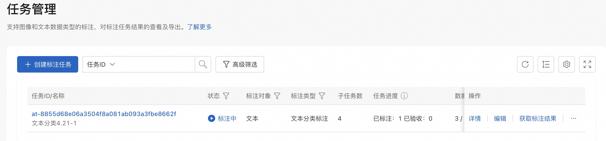

**任务详情**

**操作步骤**

1. 登录AI Studio控制台。

2. 在顶部菜单栏处，选择组织、资源集和地域。

3. 在左侧导航栏中，单击**数据标注** > **任务管理**。

4. 选择一条任务，点击**详情**。

**进入任务详情**

在任务详情中可以查看任务的基本信息和各子任务的进度信息。

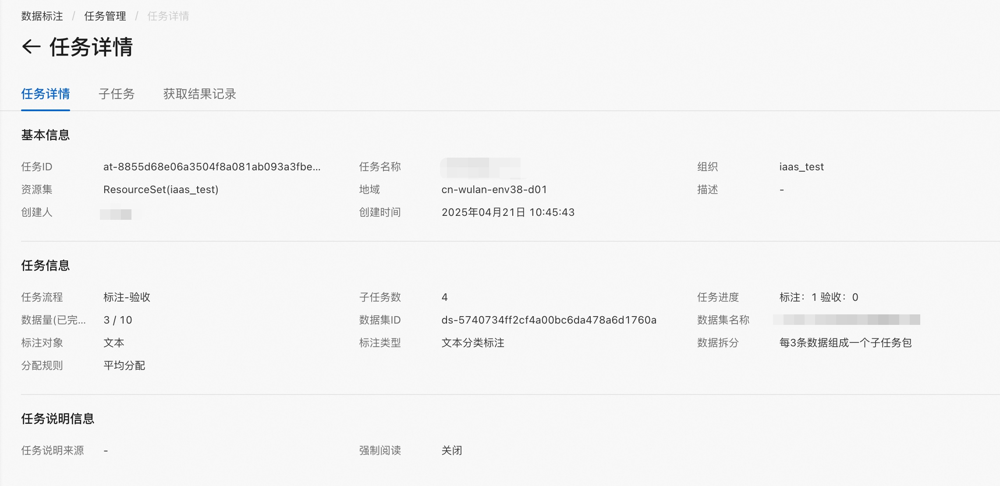

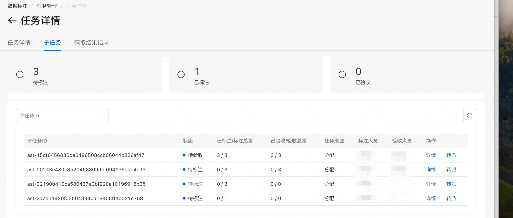

**任务转派**

**操作步骤**

1. 登录AI Studio控制台。

2. 在顶部菜单栏处，选择组织、资源集和地域。

3. 在左侧导航栏中，单击**数据标注** > **任务管理**。

4. 选择一条任务，点击**详情**。

5. 在任务详情界面，单击**子任务**页签。

6. 选择一个子任务，点击**转派**。

> **说明**
>
> 当**任务类型**是**自动标注**时，只能转派验收人员。

**进入转派页面**

在任务转派页可以选择要转派到的标注员和验收员。

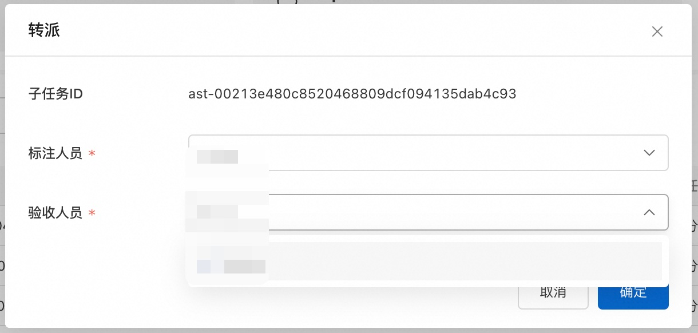

**人员设置**

**操作步骤**

1. 登录AI Studio控制台。

2. 在顶部菜单栏处，选择组织、资源集和地域。

3. 在左侧导航栏中，单击**数据标注** > **任务管理**。

4. 选择一条任务，点击**人员设置**。

**进入人员设置页面**

在人员设置页可以对当前任务进行标注员、验收员、管理员的设置

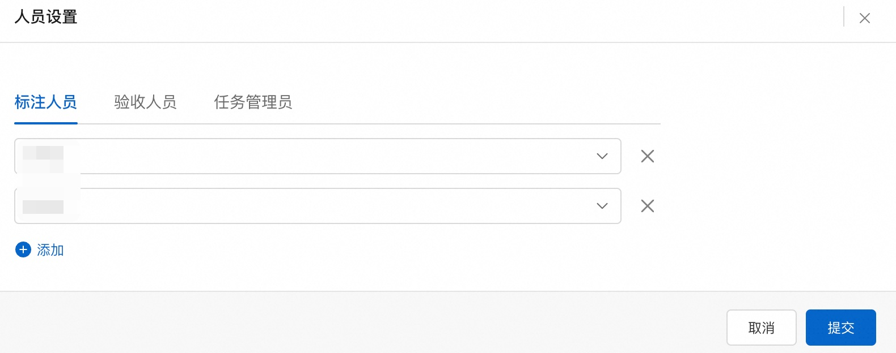

**获取标注结果**

**操作步骤**

1. 登录AI Studio控制台。

2. 在顶部菜单栏处，选择组织、资源集和地域。

3. 在左侧导航栏中，单击**数据标注** > **任务管理**。

4. 选择一条任务，点击**获取标注结果**。

**进入获取标注结果页面**

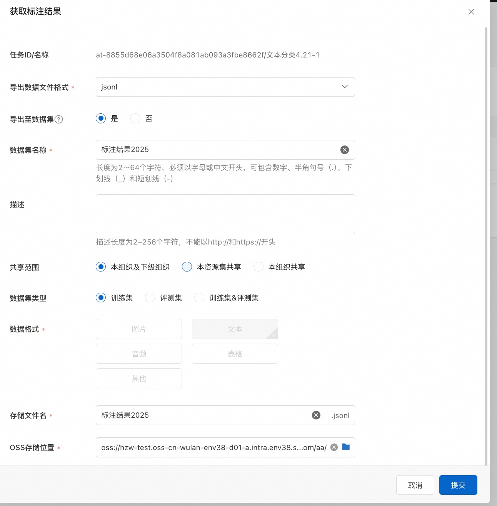

参考下表设置参数，不在表中的参数请保持系统填充值。

<table>
  <tr>
    <th width="168">参数名称</th>
    <th>参数说明</th>
  </tr>
  <tr>
    <td>导出数据文件格式</td>
    <td>默认导出为jsonl格式文件，且不支持进行修改。</td>
  </tr>
  <tr>
    <td>导出至数据集</td>
    <td>• <strong>是</strong>：导出至数据集，稍后可以在数据集管理页查看数据集产出状态及内容。<br>• <strong>否</strong>：直接导出至OSS。</td>
  </tr>
  <tr>
    <td>基于现有数据集创建</td>
    <td>可选，当<strong>导出至数据集</strong>选择<strong>是</strong>时，需要配置该参数。<br>• <strong>是</strong>：在现有数据集创建该任务，会直接把现有数据集的数据填充至当前页面供选择。<br>• <strong>否</strong>：重新创建数据集供导出结果。</td>
  </tr>
  <tr>
    <td>数据集名称</td>
    <td>• 可选，当<strong>基于现有数据集创建</strong>选择<strong>否</strong>时，需要配置该参数。<br>• 请自定义数据集名称，长度为2～64个字符，必须以字母或中文开头，可包含数字、半角句号（.）、下划线（_）和短划线（-）。</td>
  </tr>
  <tr>
    <td>描述</td>
    <td>• 可选，当<strong>基于现有数据集创建</strong>选择<strong>否</strong>时，需要配置该参数。<br>• 请输入该数据集的其他信息。</td>
  </tr>
  <tr>
    <td>共享范围</td>
    <td>可选，当<strong>基于现有数据集创建</strong>选择<strong>否</strong>时，需要配置该参数。共享范围，有以下三种：<br>• <strong>本组织及下级组织</strong>：在本组织和下级组织内共享。<br>• <strong>本资源集共享</strong>：在本资源集内共享。<br>• <strong>本组织共享</strong>：在本组织内共享。</td>
  </tr>
  <tr>
    <td>选择数据集</td>
    <td>• 可选，当<strong>导出至数据集</strong>选择<strong>是</strong>时，需要配置该参数。<br>• 请选择导出结果的数据集。</td>
  </tr>
  <tr>
    <td>数据集类型</td>
    <td>可选，当<strong>导出至数据集</strong>选择<strong>是</strong>时，需要配置该参数。<br>• <strong>训练集</strong>：将此数据集作为训练集使用。<br>• <strong>评测集</strong>：将此数据集作为评测集使用。</td>
  </tr>
  <tr>
    <td>存储文件名</td>
    <td>请设置保存结果文件的名称。</td>
  </tr>
  <tr>
    <td>OSS存储位置</td>
    <td>请选择在OSS上存储的位置，会在目录下生成jsonl文件，文件名命名规则<strong>: {任</strong>务id}_result_{时间戳}.jsonl。</td>
  </tr>
</table>

<a id="section-4-3-3"></a>

### 4.3.3. 标注任务

**前提条件**

- 任务已创建：管理员已提前在系统中创建好标注任务。

- 拥有标注员身份，且已有被分配的任务。

  > **说明**
  >
  > 当**任务类型**是**自动标注**时，无法通过标注人员的身份查看任务。

**标注数据操作步骤**

1. 登录AI Studio控制台。

2. 在顶部菜单栏处，选择组织、资源集和地域。

3. 在左侧导航栏中，单击**数据标注** > **任务标注**。

4. 在任务标注界面，单击**标注任务**页签。

5. 选择**待标注**页签。

6. 选择列表中一条子任务，单击**标注**。

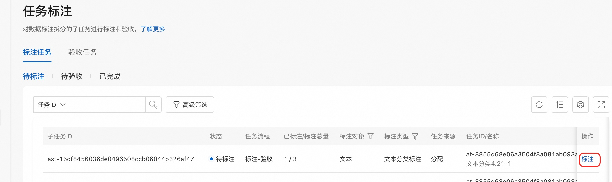

**进入到数据标注页**

可以对每条数据进行标注，根据选择的标注模板不同，标注形式会略有差异。将一个子任务的数据标注完毕后，单击**提交任务**，则流程进入到验收环节。

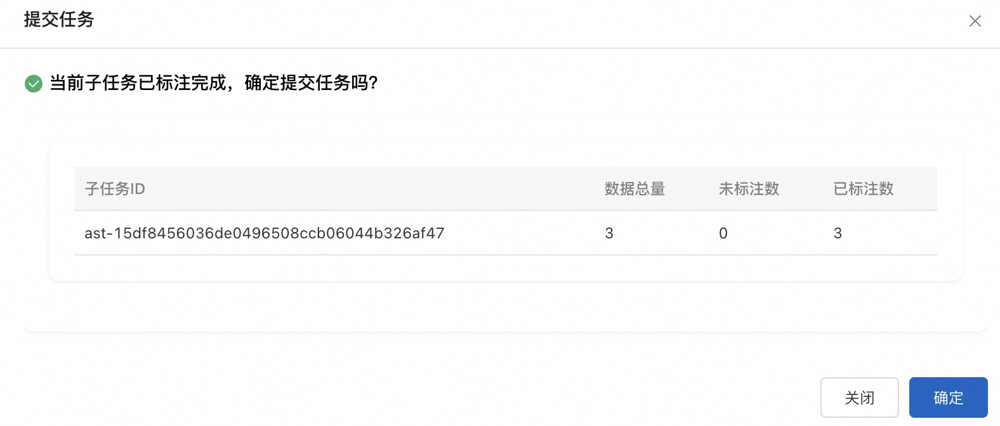

<a id="section-4-3-4"></a>

### 4.3.4. 验收任务

**前提条件**

- 任务已创建：管理员已提前在系统中创建好标注任务；

- 拥有验收员身份，且已有被分配的任务，且被分配到的子任务已完成标注。

**验收标注结果**

**操作步骤**

1. 登录AI Studio控制台。

2. 在顶部菜单栏处，选择组织、资源集和地域。

3. 在左侧导航栏中，单击**数据标注** > **任务标注**。

4. 在任务标注界面，单击**验收任务**页签。

5. 单击**待验收**页签。

6. 选择列表中一条子任务，单击**验收**。

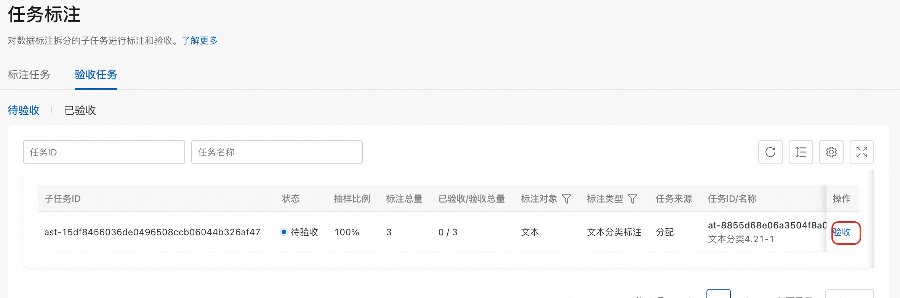

**进入到数据标注验收页**

可以对每条标注后被抽检到的数据进行验收。将一个子任务抽检的数据验收完毕后，单击**驳回**或<strong>验收通过；</strong>单击**驳回**后该子任务进入到标注中状态<strong>，</strong>单击**验收通过**，则子任务进入到已完成状态。

> **说明**
>
> 当**任务类型**是**自动标注**时，**驳回**按钮隐藏，无法操作。

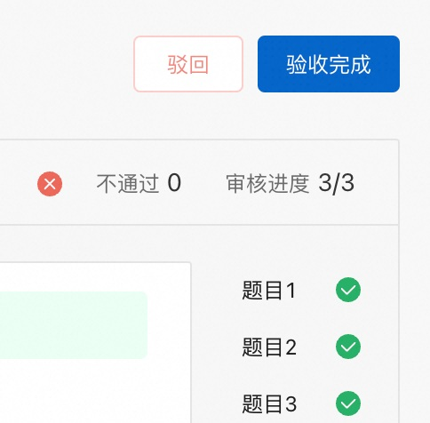

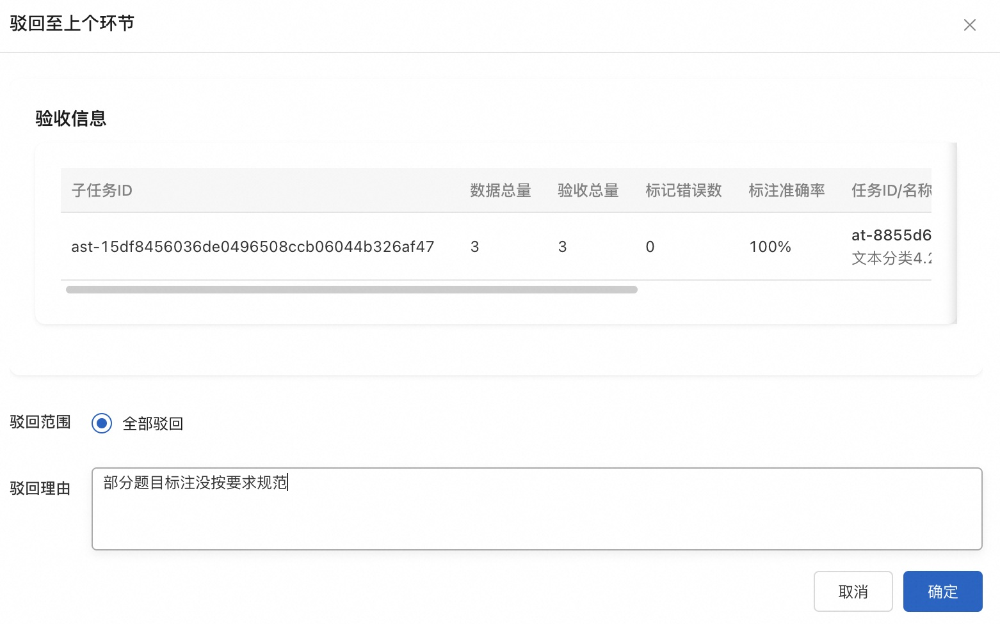

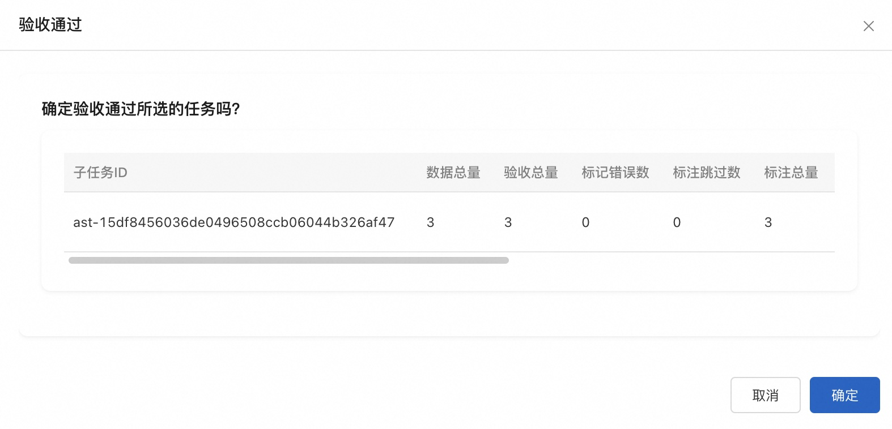

<a id="section-4-4"></a>

## 4.4. 数据生成

<a id="section-4-4-1"></a>

### 4.4.1. 创建数据生成任务

当数据集的数据量达不到一定数量级时，通过数据生成对数据集进行扩充。

**操作步骤**

1. 登录AI Studio控制台。

2. 在顶部菜单栏处，选择组织、资源集和地域。

3. 在左侧导航栏中，单击**数据管理** > **数据生成**。

4. 单击**创建任务**，参考下表填写参数。

   <table>
     <tr>
       <th>区域</th>
       <th>参数名称</th>
       <th>参数说明</th>
     </tr>
     <tr>
       <td rowspan="3">基本信息</td>
       <td>组织/资源集/地域</td>
       <td>数据集所属的组织、资源集和地域。</td>
     </tr>
     <tr>
       <td>任务名称</td>
       <td>自定义任务名称。长度为2～128个字符，必须以字母或中文开头，可包含数字、半角句号（.）、下划线（_）和短划线（-）。</td>
     </tr>
     <tr>
       <td>描述</td>
       <td>用户撰写的数据集的描述。</td>
     </tr>
     <tr>
       <td rowspan="6">任务配置</td>
       <td>选择数据集</td>
       <td>请选择需要扩充的数据集。请单击<strong>下载数据集示例模板</strong>，按模板格式准备数据。</td>
     </tr>
     <tr>
       <td>数据集版本</td>
       <td>请选择正确的数据集版本。仅支持SFT格式的文本数据集。</td>
     </tr>
     <tr>
       <td>生成数据量</td>
       <td>请输入需要生成的数据量，请填写1~1000的整数。</td>
     </tr>
     <tr>
       <td>在线服务</td>
       <td>单击<strong>选择在线服务</strong>，勾选运行中的在线服务，单击<strong>确定</strong>。</td>
     </tr>
     <tr>
       <td>修改Prompt配置</td>
       <td>• 开启：开启后，支持修改Prompt。<br>• 关闭：关闭后，使用系统默认模板内容。</td>
     </tr>
     <tr>
       <td>Prompt配置</td>
       <td>系统会自动填充Prompt；如果需要修改请打开<strong>修改Prompt</strong><strong>配置</strong>开关后编辑。</td>
     </tr>
   </table>

5. 单击**提交**，提交成功的任务会在列表中展示。

<a id="section-4-4-2"></a>

### 4.4.2. 管理数据生成任务

本章节介绍如何管理数据生成任务，包括查看详情、保存结果，删除任务等。

**操作步骤**

1. 登录AI Studio控制台。

2. 在顶部菜单栏处，选择组织、资源集和地域。

3. 在左侧导航栏中，单击**数据管理** > **数据生成**。

4. 在数据生成页面支持查看详情、保存结果，删除操作。

   - 查看详情。

     <ol type="a">

     <li>

     单击**操作**列**详情**。

     </li>

     <li>

     可以看到基本信息和生成结果。

     </li>

     </ol>

   - 保存结果。

     > **说明**
     >
     > 状态是**生成中**的任务不支持保存结果。

     <ol type="a">

     <li>

     单击**操作**列**保存结果**。

     </li>

     <li>

     参考下表设置参数，不在表中的参数请保持系统填充值。

     <table>
       <tr>
         <th width="168">参数名称</th>
         <th>参数说明</th>
       </tr>
       <tr>
         <td>导出数据文件格式</td>
         <td>请选择导出文件的格式。<br>• jsonl<br>• CSV<br>• manifest</td>
       </tr>
       <tr>
         <td>导出至数据集</td>
         <td>• <strong>是</strong>：导出至数据集，稍后可以在数据集管理页查看数据集产出状态及内容。<br>• <strong>否</strong>：直接导出至OSS。</td>
       </tr>
       <tr>
         <td>基于现有数据集创建</td>
         <td>可选，当<strong>导出至数据集</strong>选择<strong>是</strong>时，需要配置该参数。<br>• <strong>是</strong>：在现有数据集创建该任务，会直接把现有数据集的数据填充至当前页面供选择。<br>• <strong>否</strong>：重新创建数据集供导出结果。</td>
       </tr>
       <tr>
         <td>数据集名称</td>
         <td>• 可选，当<strong>基于现有数据集创建</strong>选择<strong>否</strong>时，需要配置该参数。<br>• 请自定义数据集名称，长度为2～64个字符，必须以字母或中文开头，可包含数字、半角句号（.）、下划线（_）和短划线（-）。</td>
       </tr>
       <tr>
         <td>描述</td>
         <td>• 可选，当<strong>基于现有数据集创建</strong>选择<strong>否</strong>时，需要配置该参数。<br>• 请输入该数据集的其他信息。</td>
       </tr>
       <tr>
         <td>共享范围</td>
         <td>可选，当<strong>基于现有数据集创建</strong>选择<strong>否</strong>时，需要配置该参数。共享范围，有以下三种：<br>• <strong>本组织及下级组织</strong>：在本组织和下级组织内共享。<br>• <strong>本资源集共享</strong>：在本资源集内共享。<br>• <strong>本组织共享</strong>：在本组织内共享。</td>
       </tr>
       <tr>
         <td>选择数据集</td>
         <td>• 可选，当<strong>导出至数据集</strong>选择<strong>是</strong>时，需要配置该参数。<br>• 请选择导出结果的数据集。</td>
       </tr>
       <tr>
         <td>数据集类型</td>
         <td>可选，当<strong>导出至数据集</strong>选择<strong>是</strong>时，需要配置该参数。<br>• <strong>训练集</strong>：将此数据集作为训练集使用。<br>• <strong>评测集</strong>：将此数据集作为评测集使用。</td>
       </tr>
       <tr>
         <td>存储文件名</td>
         <td>请设置保存结果文件的名称。</td>
       </tr>
       <tr>
         <td>OSS存储位置</td>
         <td>请选择在OSS上存储的位置。</td>
       </tr>
     </table>

     </li>

     </ol>

     <ol type="i" start="100">

     <li>

     单击**提交**。

     </li>

     </ol>

   - 删除数据生成任务。

     <ol type="a">

     <li>

     单击**操作**列**删除**。

     </li>

     <li>

     在弹出的提示框上单击**删除**。

     </li>

     </ol>

<a id="section-5"></a>

# 5.模型训练

模型训练为用户提供使用Jupyter Notebook进行在线交互式开发与建模，以及任务形式建模进行训练的能力

<a id="section-5-1"></a>

## 5.1. 功能概述

AI Studio提供Notebook建模、任务建模和可视化建模的方式来训练模型。

**Notebook建模**

通过Notebook的方式构建模型训练任务。用户可完全按照代码自主构建模型训练方式。提供算力资源隔离能力，用户可以实现实例创建、删除等生命周期管理，以及任务的启停管理。

**任务建模**

构建单机或者分布式模型训练任务。提供预置机器学习主流算法框架，支持大规模分布式训练任务模型。提供算力资源隔离能力，实现任务的扩缩容、弹性伸缩、以及容错等提升稳定性的调度机制。用户可以执行训练任务的管理和监控等操作。

**可视化建模**

通过模板或自定义编排，将所需机器学习算法等进行工作流编排，实现机器学习全链路开发环境搭建。支持创建、查看、修改、克隆和运行工作流，支持通过预置模板和自定义模板方式创建工作流。

**应用场景**

- 通过任务建模、Notebook建模和可视化建模进行模型训练。

**使用限制**

- 持久化存储只支持OSS对象存储。

- OSS对象存储使用前，需要提前在容器集群对应的命名空间下创建持久化存储。

- 打开Notebook实例，默认提供VPC私网的VIP，需要租户办公网和VPC并网才能访问。

<a id="section-5-2"></a>

## 5.2. Notebook建模

本文介绍如何以Jupyter Notebook形式使用AI Studio平台进行建模，即在自定义镜像与模型基础上执行Notebook形式AI训练、管理时的操作指南。

<a id="section-5-2-1"></a>

### 5.2.1. 创建实例

本文介绍创建Notebook建模实例的操作指南，便于后续基于实例进行训练与管理

**前提条件**

- 已创建**资源配额**。具体操作，请参见创建资源配额章节。

- 已创建**镜像**。具体操作，请参见镜像库章节。

**操作步骤**

> **重要**
>
> - Notebook建模使用的自定义镜像在启动的时候，如果编辑环境选择了JupyterLab会自动执行jupyter lab启动命令，请确保自定义镜像中已正确安装jupyer软件，保证JupyterLab的版本必须大于等于3.0.0。
>
> - Notebook建模使用的自定义镜像在启动的时候，如果编辑环境选择了VS Code会自动执行VS Code的启动命令，请确保自定义镜像中已正确安装VS Code软件，推荐的VS Code的版本为4.90.0。

1. 登录AI Studio控制台。

2. 左侧导航栏选择**模型训练**，单击**Notebook建模**进入界面。

3. 点击页面左上角<strong>+创建实例</strong>。

4. 在**Notebook实例建模**界面，完成实例的相关配置。

   > **说明**
   >
   > Notebook实例配置包括创建实例的基本信息（组织、资源集、地域、实例名称、描述）以及一个实例所需的全部资源（资源配额、数据集、镜像、模型、存储）。

   <ol type="a">

   <li>

   配置实例的基本信息

   </li>

   </ol>

   | 配置项 | 是否必选 | 说明 |
   | --- | --- | --- |
   | 组织 | 是 | 选择Notebook实例所属的组织。 |
   | 资源集 | 是 | 选择Notebook实例所属的资源集。 |
   | 地域 | 是 | 选择Notebook实例所属的地域。 |
   | 实例名称 | 是 | 输入当前Notebook实例的名称。 |
   | 描述 | 否 | 输入当前Notebook实例的描述。 |

   <ol type="a" start="2">

   <li>

   配置实例所使用的资源

   </li>

   </ol>

   | 配置项 | 是否必选 | 说明 |
   | --- | --- | --- |
   | 资源配额 | 是 | 选择当前Notebook实例所使用的资源配额，同时配置所需的<strong>CPU(核)</strong>，<strong>内存(GB)</strong>，<strong>GPU(卡)</strong>/<strong>GPU显存</strong><strong>（GB）</strong>数额。<br>说明如果打开GPU共享虚拟化，请配置<strong>GPU显存</strong><strong>（GB）</strong>，AI Studio会根据GPU实际切分粒度，自动适配并申请所需的GPU显存资源。 |

   <ol type="i" start="100">

   <li>

   数据集配置

   </li>

   </ol>

   | 配置项 | 是否必选 | 说明 |
   | --- | --- | --- |
   | 选择数据集 | 否 | 选择当前实例所采用的数据集类型，数据集名称，随后手动填写<strong>挂载路径</strong>，选择数据集对应的<strong>数据加速器</strong>（数据集最多可添加20条）。 |

   <ol type="i" start="500">

   <li>

   环境配置

   </li>

   </ol>

   | 配置项 | 是否必选 | 说明 |
   | --- | --- | --- |
   | 选择镜像 | 是 | 选择适用于当前Notebook实例的镜像环境，当前版本支持<strong>自定义镜像</strong>和<strong>公共镜像</strong> |
   | 编辑环境 | 是 | 请选择<strong>Jupyter</strong>或者<strong>VS Code</strong>编辑环境。 |
   | 账号 | 是 | 设置用于登录所创建Notebook实例的账号，当前版本支持单账号系统，请用户记住该账号，丢失则无法登录已创建实例 |
   | 密码 | 是 | 设置用于登录所创建Notebook实例的密码，请用户记住该密码，丢失则无法登录已创建实例。若密码存在泄漏风险，该密码也用于更改密码 |
   | 确认密码 | 是 | 重复输入设置的Notebook实例登录密码 |
   | 基于现有模型训练/选择模型 | 否 | 单击开关按钮，选择适用于当前Notebook实例的<strong>模型类</strong><strong>型</strong>（当前版本仅支持自定义模型），<strong>模型名称/ID</strong>，手动填写<strong>存储挂载路径</strong>（挂载在Notebook容器的路径），选择模型对应的<strong>数据加速器</strong> |
   | 持久化存储设置 | 否 | 选择当前Notebook实例持久化存储路径（用于存储训练的输出结果），选择OSS存储<strong>文件路径</strong>，手动填写<strong>存储挂</strong><strong>载路径</strong>（挂载在Notebook容器的路径） |
   | 三方存储 | 否 | 当<strong>资源配额</strong>选择<strong>智算纳管型实例</strong>时，会展示该参数。开启三方存储后，会自动获取在AI资源池配置的三方存储，并手动填写挂载路径。 |
   | 启用SSH | 否 | 是否启用SSH远程连接 |
   | SSH公钥 | 否 | SSH公钥，可使用本地命令ssh-keygen -t rsa来生成SSH密钥对，默认生成的密钥文件路径如下：<br>• 私钥：<code> ~/.ssh/id_rsa </code><br>• 公钥：<code> ~/.ssh/id_rsa.pub </code> |
   | 网络连接 | 否 | 是否启用经典网络连接 |

   > **重要**
   >
   > 选择完资源配额和镜像系统后，系统会协助您进行资源配额-镜像-模型三者之间厂商和框架一致性的校验：资源配额和镜像的芯片厂商需保持一致、镜像和模型的框架需保持一致。若不满足，将在**选择镜像**之后会显示如下提示。您依然可以下发相应的任务，但可能无法正常运行。
   >
   > 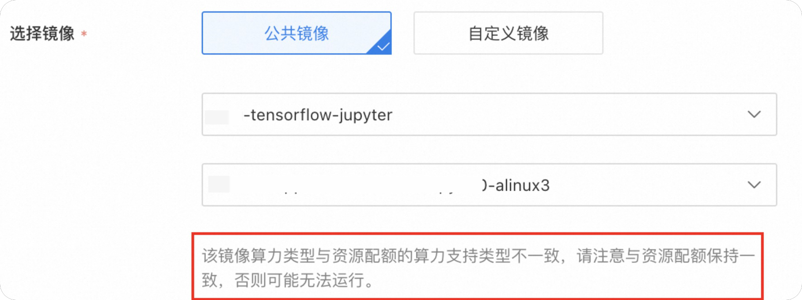

5. 单击**提交**。

**执行结果**


Notebook列表中出现已创建的实例，则实例创建成功。

<a id="section-5-2-2"></a>

### 5.2.2. 管理实例

本文介绍如何管理Notebook实例，包括查看详情、编辑、打开等操作。

**查看实例**

**操作步骤**

1. 登录AI Studio控制台。

2. 在顶部菜单栏选择自己的组织名称、资源集以及地域。

3. 在左侧菜单栏点击选择**模型训练** > **Notebook建模**。

4. 在实例列表界面，点击对应Notebook实例的**详情**按钮。

5. 在详情页面，可查看对应实例的**实例详情**、**监控**、**访问信息**、**训练结果**、**日志**、**事件**以及**操作记录**。

   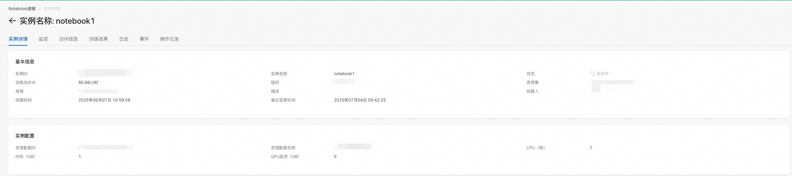

**打开实例**

**操作步骤**

1. 进入**Notebook实例列表**界面。

2. 在实例列表界面，点击对应Notebook实例的**打开**按钮。

3. 在打开后的Notebook建模页面，可以Jupyter或者VS Code形式进行交互式编程。

**执行结果**

Jupyter弹出如下界面：

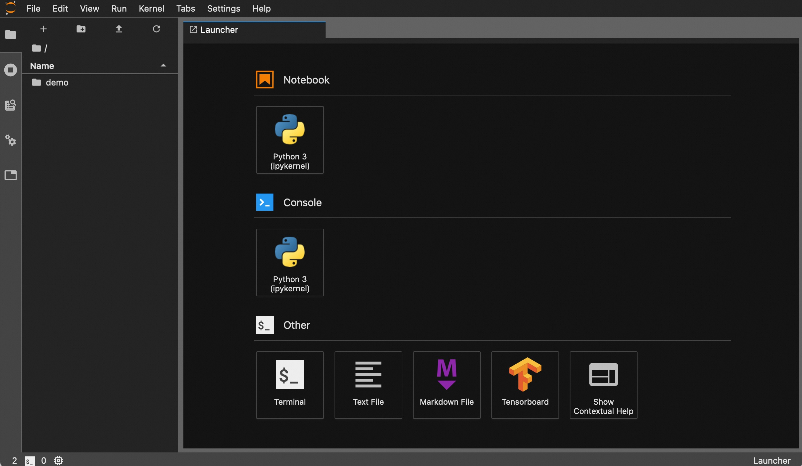

VS Code弹出如下界面：

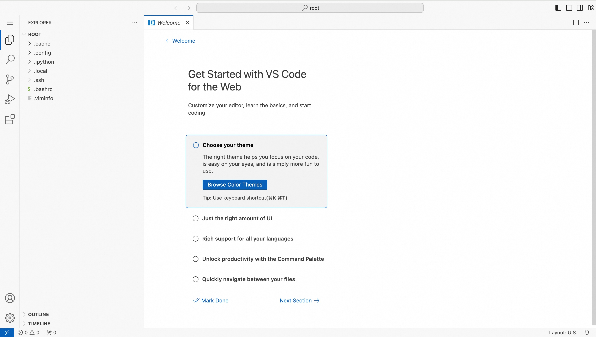

**停止或启动Notebook实例**

**操作步骤**

1. 在左侧菜单栏进入 **Notebook建模**。

2. 在实例列表界面，点击对应Notebook实例后的“**···**”按钮，并选择**停止/启动**。

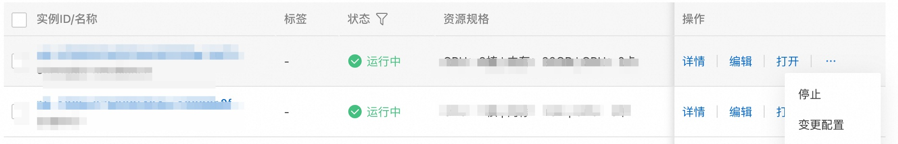

**执行结果**

提示操作成功，Notebook实例的状态已更新。

**编辑实例**

**操作步骤**

1. 进入**Notebook建模**界面。

2. 在实例列表界面，点击对应Notebook实例的**编辑**按钮。

3. 在编辑页面，可修改**实例名称**以及**描述文本**。

**执行结果**

界面顶部弹出修改成功提示框：


列表中可以看到实例相关信息已更新。

**变更Notebook实例配置操作步骤**

1. 在左侧菜单栏进入 **Notebook建模**。

2. 在实例列表界面，点击对应Notebook实例后的“**···**”按钮，并选择**变更配置**即可改变设定的CPU、GPU等资源数额。


**执行结果**

在列表界面查看到Notebook的资源规格已更新。

**删除Notebook**

**操作步骤**

1. 在左侧菜单栏进入 **Notebook建模**。

2. 在实例列表界面，点击对应Notebook实例的“**···**”按钮，并选择**删除**按钮。

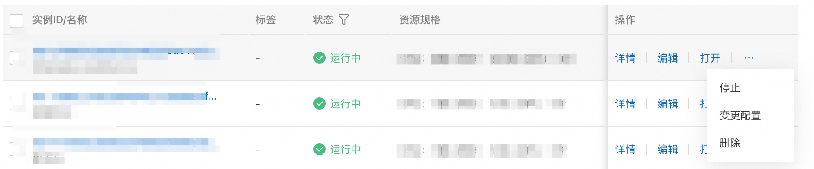

**执行结果**

在列表界面会发现当前Notebook实例已删除。

**修改Notebook实例密码**

**操作步骤**

1. 在左侧菜单栏进入 **Notebook建模**。

2. 在实例列表界面，点击对应Notebook实例的“**···**”按钮，并选择**修改密码**选项。

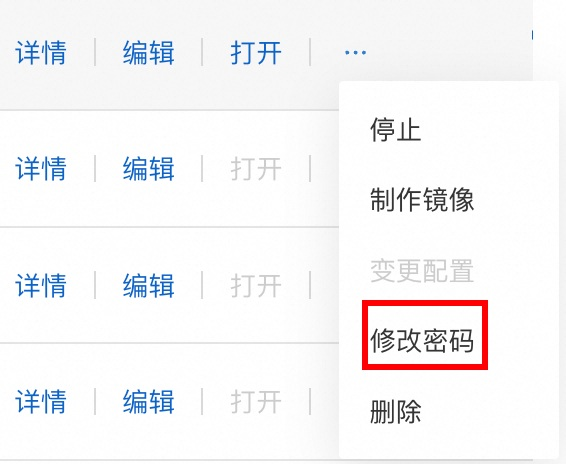

3. 在弹出提示框中输入账户、原密码以及新密码，并选择确定按钮。

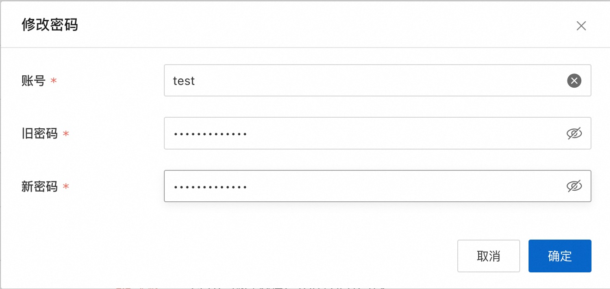

**执行结果**

提示修改成功。

**保存为模型**

在**训练结果**页面，用户可以将训练得到的模型文件导出至**模型广场**并保存。

1. 在**存储路径**栏目下，勾选需要保存至**模型广场**的模型文件。

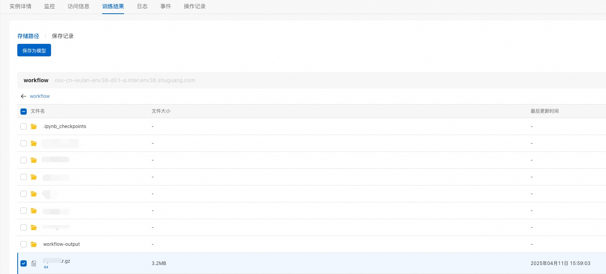

2. 点击**保存为模型**，输入**模型名称**、**描述**、**版本号**、**框架**、**存储路径**等信息，同时按需配置**Readme文档**，点击**提交**后成功会得到如下提示。

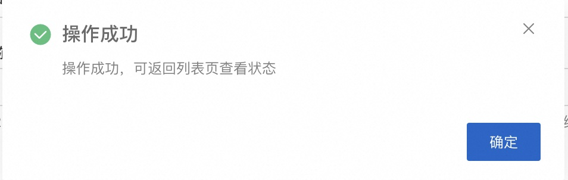

3. 发起**保存为模型**后，在**保存记录**界面即可看到发起的保存任务，其中包含**任务ID**、**任务状态**、**进度**、**保存为模型名称**、**保存为模型版本**、**创建时间**、**结束时间**等信息。

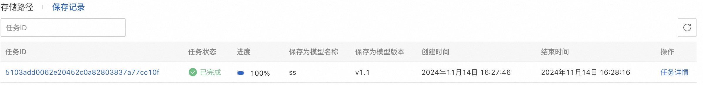

4. 在**操作**条目下，点击**任务详情**，界面中会出现每一个需保存模型文件的文件名称、文件大小、状态信息，其中状态提示保存进度以及是否成功。

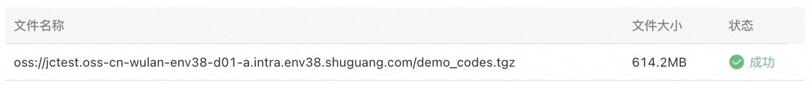

5. **保存为模型**任务完成后，在**模型广场**即可查询到相应记录。


**Notebook导出镜像**

**操作步骤**

1. 在左侧菜单栏进入 **Notebook建模**。

2. 在实例列表界面，点击对应Notebook实例的“**···**”按钮，并选择**制作镜像**选项。

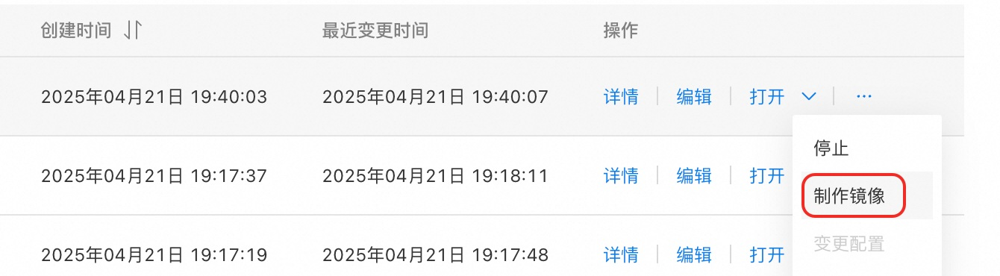

3. 在弹出提示框中选择目标ACR镜像仓库、基本信息、镜像配置之后，点击确定按钮。

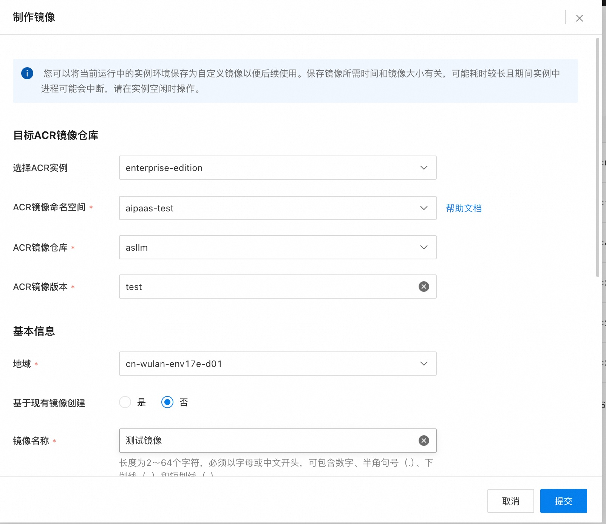

4. 点击Notebook详情，查看制作镜像信息，当镜像状态变由**导出中**变为**正常**时，镜像可以正常使用。

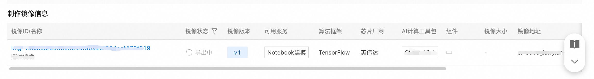


**执行结果**

提示操作成功。

**启用/禁用SSH网络连接**

**操作步骤**

1. 进入Notebook**实例详情**的**访问信息**页面，支持用户动态的启用/禁用SSH的经典网络连接。

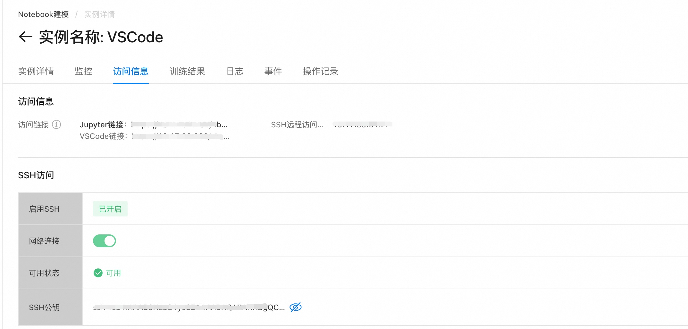

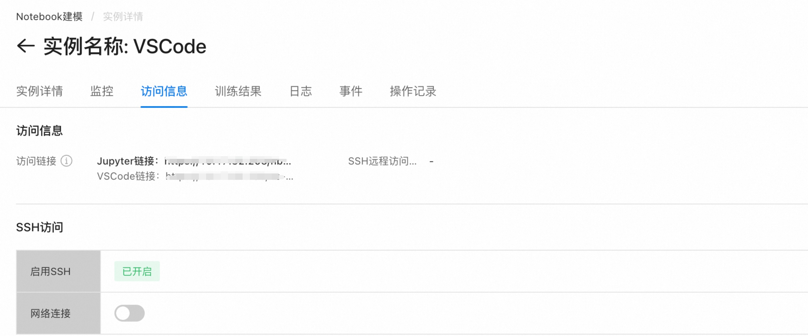

**执行结果**

提示操作成功。

> **说明**
>
> 如何通过SSH远程连接Notebook实例请参见通过SSH远程连接Notebook建模实例。

<a id="section-5-2-3"></a>

### 5.2.3. 查看监控

本文介绍查看Notebook建模实例监控的步骤。

**前提条件**

- 已创建Notebook建模实例。

- 已部署Prometheus和CMS产品。

**操作步骤**

1. 登录AI Studio控制台。

2. 在顶部菜单栏选择自己的组织名称、资源集以及地域。

3. 在左侧菜单栏点击选择**模型训练** > **Notebook建模**。

4. 在实例列表单击  图标查看Notebook建模实例的监控详情。

5. 在监控详情页查看**任务cpu使用量 (core)**、**任务cpu使用率 (%)**、**任务工作内存使用量 (Byte)**、**任务网络接受速率 (B/s)**、**任务网络发送速率 (B/s)**、<strong>任务GPU显存使用量 (MiB)</strong>和<strong>任务GPU显存使用率(%)</strong>等信息。

> **说明**
>
> - 监控的数据源和信息来自于云监控CMS平台。
>
> - 单击  图标即可创建告警规则，详细步骤请参考《云监控CMS 用户指南》中创建报警规则章
>
>   节。

<a id="section-5-3"></a>

## 5.3. 任务建模

本文为用户提供了以任务形式使用AI Studio平台进行建模，并执行实际AI训练、管理时的操作指引。

<a id="section-5-3-1"></a>

### 5.3.1. 创建任务

本文介绍创建任务的操作步骤，便于后续基于任务进行训练并管理。

**前提条件**

- 已创建**资源配额**。具体操作，请参见创建资源配额章节。

- 已创建**镜像**。具体操作，请参见镜像库章节。

- 已创建数据集和代码集。

**操作步骤**

1. 登录AI Studio控制台。

2. 左侧导航栏选择**模型训练**，单击**任务建模**进入界面。

3. 点击左上角<strong>+创建任务</strong>。

4. 在**任务建模**界面，完成任务的相关配置。

   > **说明**
   >
   > 任务建模配置包括创建任务的基本信息（组织、资源集、地域、任务名称、描述）以及一个任务所需的全部资源（资源配额、数据集、镜像、模型、存储）。

   <ol type="a">

   <li>

   配置实例的基本信息

   </li>

   </ol>

   | 配置项 | 是否必选 | 说明 |
   | --- | --- | --- |
   | 组织 | 是 | 选择任务所属的组织。 |
   | 资源集 | 是 | 选择任务所属的资源集。 |
   | 地域 | 是 | 选择任务所属的地域。 |
   | 任务名称 | 是 | 输入当前任务的名称。 |
   | 描述 | 否 | 输入当前任务的描述。 |

   <ol type="a" start="2">

   <li>

   配置任务所使用的资源

   </li>

   </ol>

   | 配置项 | 是否必选 | 说明 |
   | --- | --- | --- |
   | 资源配额 | 是 | 选择当前任务所使用的资源配额。 |
   | 任务类型 | 是 | 选择当前任务的类型（<strong>单机训练</strong>或<strong>分布式训练</strong>）。 |
   | 框架 | 是 | 选择当前任务所依赖的框架。<br>• Tensorflow<br>• PyTorch<br>• DeepSpeed<br>• Megatron<br>• MindSpore<br>• PaddlePaddle |
   | 任务资源 | 是 | 选择当前任务下节点所需的CPU(核)、GPU(卡)/GPU显存（GB）、内存(GB)数额。<br>说明如果打开GPU共享虚拟化，请配置<strong>GPU显存（GB）</strong>，AI Studio会根据GPU实际切分粒度，自动适配并申请所需的GPU显存资源。 |
   | 启动命令 | 是 | 输入当前任务的启动命令。 |
   | 环境变量 | 是 | 设置训练环境变量。 |

   <ol type="i" start="100">

   <li>

   数据集配置

   </li>

   </ol>

   | 配置项 | 是否必选 | 说明 |
   | --- | --- | --- |
   | 选择数据集 | 否 | 选择当前任务所采用的数据集类型，数据集名称，随后手动填写<strong>挂载路径</strong>（数据集最多可添加20条）。 |

   <ol type="i" start="500">

   <li>

   环境配置

   </li>

   </ol>

   | 配置项 | 是否必选 | 说明 |
   | --- | --- | --- |
   | 选择镜像 | 是 | 选择适用于当前任务的镜像环境，当前版本支持<strong>自定义镜像</strong>和<strong>公</strong><strong>共镜像</strong>。<br>说明请选择正确的镜像，例如框架是MindSpore，选择的镜像名称必须包含MindSpore，例如可以选择镜像为<em>\*\*\*\*</em>-MindSpore。 |
   | 基于现有模型训练/选择模型 | 否 | 单击开关按钮，选择适用于当前任务的<strong>模型类型</strong>（当前版本支持<strong>系统模型</strong>、<strong>自定义模型</strong>和<strong>Maas市场模型</strong>），<strong>模型名称/ID</strong>，手动填写<strong>存储挂载路径</strong>（挂载在模型训练容器上的路径）。 |
   | 代码集 | 否 | 选择当前任务适用的代码集，手动填写<strong>存储挂载路径</strong>（挂载在模型训练容器上的路径）。 |
   | 持久化存储设置 | 否 | 选择当前任务持久化存储路径（用于存储训练结果输出），选择OSS存储<strong>文件路径</strong>，手动填写<strong>存储挂载路径</strong>（挂载在模型训练容器上的路径）。 |
   | 三方存储 | 否 | 当<strong>资源配额</strong>选择<strong>智算纳管型实例</strong>时，会展示该参数。开启三方存储后，会自动获取在AI资源池配置的三方存储，并手动填写挂载路径。 |

   <ol type="a" start="5">

   <li>

   **容错&弹性配置**

   </li>

   </ol>

   > **说明**
   >
   > - 若要使用CheckPoint能力，需要在训练代码中引入KEA组件。
   >
   > - CheckPoint可提供秒级恢复能力，必须配置CPFS存储。
   >
   > - 如果检测到选择的镜像不支持容错&弹性功能的话，请关闭自动容错的开关。

   | 配置项 | 是否必选 | 说明 |
   | --- | --- | --- |
   | 自动容错 | 否 | 在训练任务中通过自动容错可重启故障Worker实例，降低任务故障时间。 |
   | 容错策略 | 否 | 当前仅支持OnFailure策略，即在Worker实例故障时重启实例。 |
   | 单实例最大重启次数 | 否 | 配置单个Worker实例上同一错误允许出现的最大次数，当错误出现次数超过该值时，直接将任务标记为失败。 |
   | CheckPoint恢复 | 否 | 是否启用CheckPoint恢复能力。 |

   > **重要**
   >
   > 选择完资源配额和镜像系统后，系统会协助您进行资源配额-镜像-模型三者之间厂商和框架一致性的校验：资源配额和镜像的芯片厂商需保持一致、镜像和模型的框架需保持一致。若不满足，将在**选择镜像**之后会显示如下提示。您依然可以下发相应的任务，但可能无法正常运行。
   >
   > 

5. 单击**提交**。

**执行结果**


任务建模列表中出现已创建的任务，任务创建成功。

<a id="section-5-3-2"></a>

### 5.3.2. 管理任务

本文介绍管理任务实例的操作步骤，便于查看详情、编辑等操作。

**查看任务**

**操作步骤**

1. 登录AI Studio控制台。

2. 在顶部菜单栏选择自己的组织名称、资源集以及地域。

3. 在左侧菜单栏点击选择**模型训练** > **任务建模**。

4. 在任务列表界面，点击对应任务的**详情**按钮。

5. 在详情页面，可查看对应实例的**任务详情**、**资源实例**、**训练结果**、**日志**、**事件、容错**以及**操作记录**。

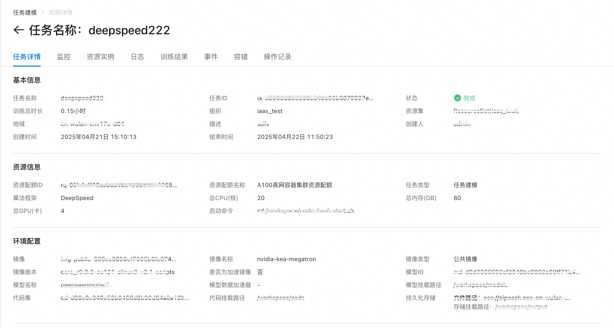

6. 在**训练结果**页面，用户可以将训练得到的模型文件导出至模型广场并保存。

**保存为模型**

在**训练结果**页面，用户可以将训练得到的模型文件导出至**模型广场**并保存。

1. 在**存储路径**栏目下，勾选需要保存至**模型广场**的模型文件。

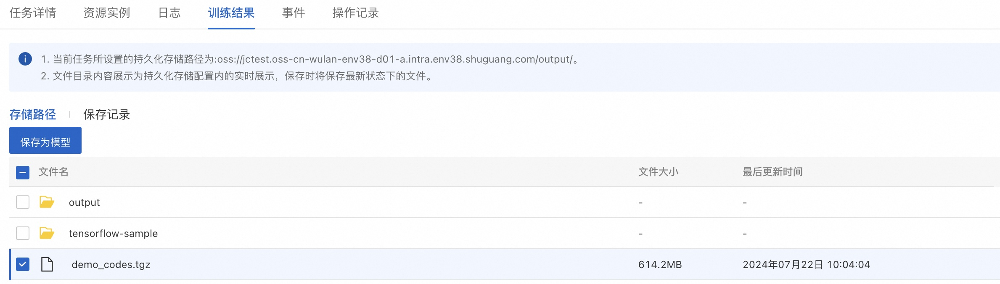

2. 点击**保存为模型**，输入**模型名称**、**描述**、**版本号**、**框架**、**存储路径**等信息，同时按需配置**Readme文档**，点击**提交**后成功会得到如下提示。


3. 发起**保存为模型**后，在**保存记录**界面即可看到发起的保存任务，其中包含**任务ID**、**任务状态**、**进度**、**保存为模型名称**、**保存为模型版本**、**创建时间**、**结束时间**等信息。


4. 在**操作**条目下，点击**任务详情**，界面中会出现每一个需保存模型文件的文件名称、文件大小、状态信息，其中状态提示保存进度以及是否成功。


5. **保存为模型**任务完成后，在**模型广场**即可查询到相应记录。


**编辑实例**

**操作步骤**

1. 进入**任务建模**界面。

2. 在任务列表界面，点击对应任务的**编辑**按钮。

3. 在编辑页面，可修改**任务名称**以及**描述文本**。

**执行结果**

界面顶部弹出修改成功提示框：


列表中可以看到模型相关信息已更新。

**停止或启动任务**

**操作步骤**

1. 在左侧菜单栏进入**任务建模**。

2. 在任务列表界面，点击对应任务的“**···**”按钮，并选择**停止/启动**。

**执行结果**

在列表界面即可查看到任务状态已更新。

**进入任务建模终端**

**操作步骤**

1. 在左侧菜单栏进入**任务建模**

2. 在任务列表界面，点击对应任务的名称进入**任务详情**

3. 点击**资源实例**

4. 点击状态为“**运行中**”的实例右侧的“**终端**”下拉框

   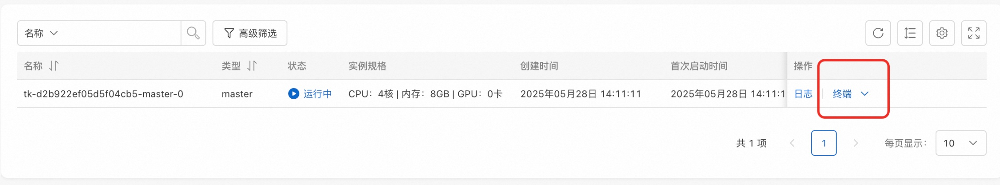

5. 点击下拉框中的实例启动终端

   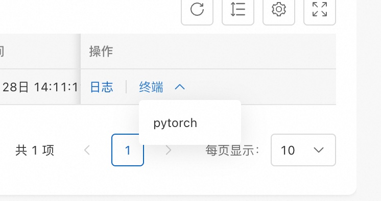

**执行结果**

成功进入运行中容器内部

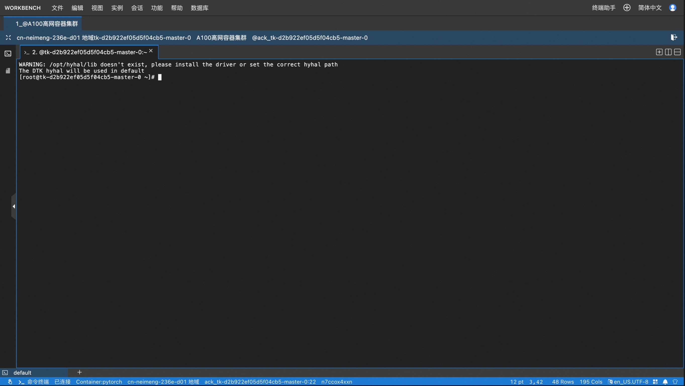

**删除任务**

**操作步骤**

1. 在左侧菜单栏进入**任务建模**。

2. 在任务列表界面，点击对应任务的“**···**”按钮，并选择**删除**按钮。

**执行结果**

在列表界面即查看到任务已删除。

**进入Tensorboard实例界面操作步骤**

1. 在左侧菜单栏进入**任务建模**。

2. 在任务列表界面，点击对应任务的“**···**”按钮，并选择**Tensorboard**按钮。

**执行结果**

成功进入Tensorboard实例查看界面，界面示例如下所示。

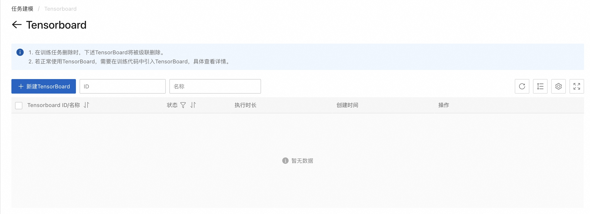

**查看容错信息**

**操作步骤**

1. 在任务列表界面，点击对应任务的**详情**按钮。

2. 点击实例详情页面的**容错**标签。

**执行结果**

成功进入容错展示页面，显示容错信息、任务事件、CheckPoint列表。

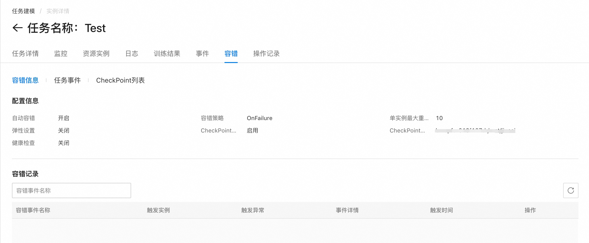

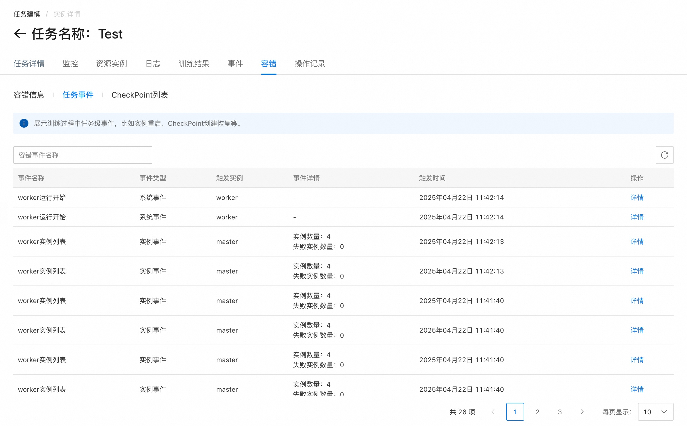

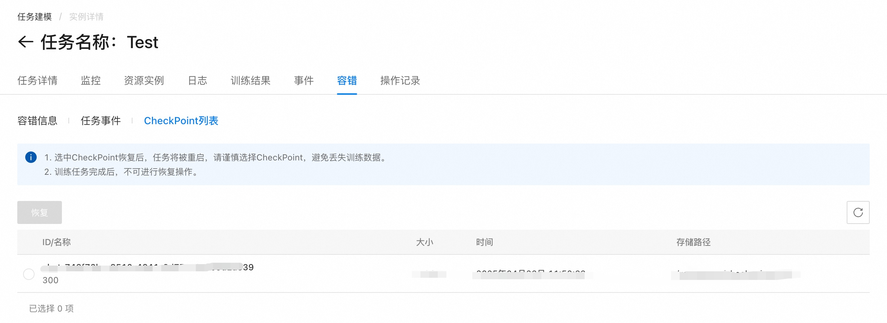

<a id="section-5-3-3"></a>

### 5.3.3. 查看监控

本文介绍查看任务建模实例监控的步骤。

**前提条件**

- 已创建任务建模实例。

**操作步骤**

1. 登录AI Studio控制台。

2. 在顶部菜单栏选择自己的组织名称、资源集以及地域。

3. 在左侧菜单栏点击选择**模型训练** > **任务建模**。

4. 在实例列表单击  图标查看任务建模实例的监控详情。

5. 在监控详情页查看**任务监控**和**容器组监控**对应的指标详情。

> **说明**

<a id="section-5-3-4"></a>

### 5.3.4. Tensorboard

本文为用户提供了以Tensorboard形式使用AI Studio平台进行训练可视化的操作指引。

<a id="section-5-3-4-1"></a>

#### 5.3.4.1. 开发代码引入

本文档帮助用户在个人代码中引入Tensorboard相关内容，从而便于用户使用Tensorboard工具进行训练可视化。

**前提条件**

- 已创建**任务建模**。具体操作，请参见创建任务章节。

- 用户希望使用**Tensorboard**功能进行训练可视化。

**代码引入操作步骤（以Python为例）**

1. 在Python代码脚本的算法库部分引入新增Tensorboard的相关开源算法库。

```python
# 引入tensorboard所需
from torch.utils.tensorboard import SummaryWriter
```

2. 在训练代码前，引入Tensorboard记录器。

```text
# 引入TensorBoard记录器
writer = SummaryWriter('xxxxxx')
```

3. 在训练代码中，依据用户需求引入Tensorboard功能组件，比如计算图 / 数值记录。

```text
# 引入Tensorboard计算图
writer.add_graph(model, example_input)
# 引入Tensorboard数值记录
writer.add_scalar('training loss', avg_loss, epoch * len(train_loader) + i)
writer.add_scalar('accuracy', accuracy, epoch * len(train_loader) + i)
```

4. 在训练代码后，关闭Tensorboard记录器。

```text
# 关闭Tensorboard记录器
writer.close()
```

<a id="section-5-3-4-2"></a>

#### 5.3.4.2. 创建实例

本文介绍创建Tensorboard实例的操作步骤，便于后续基于Tensorboard功能对训练过程进行可视化展示。

**前提条件**

- 已创建**任务建模**。具体操作，请参见创建任务章节。

**操作步骤**

1. 登录AI Studio控制台。

2. 左侧导航栏选择**任务建模**，单击**任务建模**进入界面。

3. 界面中选择需要进行训练可视化的任务条目ID，单击所选择任务条目右侧的<strong>···</strong>按钮后点击**TensorBoard**进入界面。

4. 点击左上角<strong>+新建Tensorboard</strong>。

5. 在**新建TensorBoard**界面，完成Tensorboard的相关配置。

   > **说明**
   >
   > Tensorboard配置包括创建Tensorboard的基本信息（Tensorboard名称）以及一个Tensorboard实例所需的全部资源（资源量、数据配置）。

   <ol type="a">

   <li>

   配置实例的基本信息

   </li>

   </ol>

   | 配置项 | 是否必选 | 说明 |
   | --- | --- | --- |
   | Tensorboard名称 | 是 | 输入当前Tensorboard实例的名称。 |

   <ol type="a" start="2">

   <li>

   配置实例所使用的资源，若需多数据配置则点击<strong>+添加</strong>

   </li>

   </ol>

   | 配置项 | 是否必选 | 说明 |
   | --- | --- | --- |
   | 资源量 | 是 | 选择当前Tensorboard实例所使用的资源量，当events文件总量小于100MB时建议选用【CPU 1核 ｜ 内存 2GB】资源规格。 |
   | 数据配置-挂载类型 | 是 | 选择当前Tensorboard实例所需数据配置对应的文件挂载类型。 |
   | 数据配置-持久化存储路径 | 是 | 选择当前Tensorboard实例所需数据配置对应的持久化存储路径。 |
   | 数据配置-Logdir目录 | 是 | 输入当前Tensorboard实例所需数据配置对应的Logdir目录，即挂载路径。 |

6. 单击**提交**。

**执行结果**


Tensorboard实例列表中出现已创建的任务，任务创建成功。

<a id="section-5-3-4-3"></a>

#### 5.3.4.3. 管理实例

本文介绍管理Tensorboard实例的操作步骤，便于打开Tensorboard看板、查看数据详情、编辑等操作。

**打开Tensorboard看板**

**操作步骤**

1. 登录AI Studio控制台。

2. 在左侧菜单栏点击选择对应的**模型训练** > **任务建模**。

3. 在任务列表界面，点击对应任务的<strong>···</strong>按钮，点击**TensorBoard**。

4. 在Tensorboard列表界面，点击指定Tensorboard实例条目中右侧的**Tensorboard看板**。

5. 打开Tensorboard看板页面，可查看用户在对应实例中配置的训练情况可视化界面。

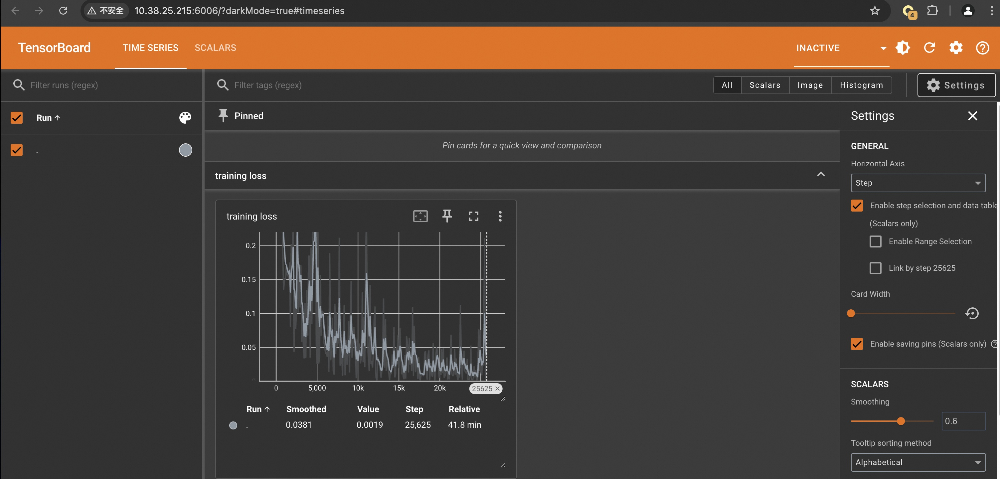

**查看Tensorboard实例详情**

**操作步骤**

1. 进入**任务建模**界面。

2. 在任务列表界面，点击对应任务的**Tensorboard**按钮。

3. 在**Tensorboard**列表界面，点击对应Tensorboard实例的**详情**按钮。

4. 在详情页面，可查看对应实例的**名称**、**基本信息**、**访问信息**以及**数据配置**。

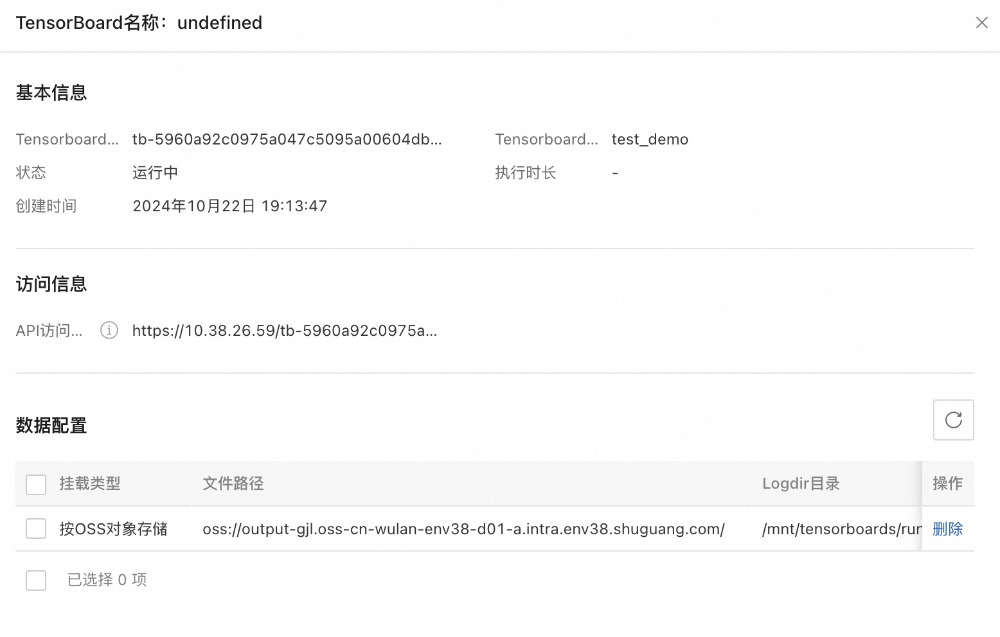

**停止或启动Tensorboard实例**

**操作步骤**

1. 在左侧菜单栏进入**任务建模**。

2. 在任务列表界面，点击对应任务的“**···**”按钮，点击**TensorBoard**。

3. 在Tensorboard列表界面，点击对应实例的“**···**”按钮，点击**停止或重启**。

**执行结果**

在列表界面即可查看到Tensorboard实例状态已更新。

**删除Tensorboard实例**

**操作步骤**

1. 在左侧菜单栏进入**任务建模**。

2. 在任务列表界面，点击对应任务的“**···**”按钮，点击**TensorBoard**。

3. 在Tensorboard列表界面，点击对应实例的“**···**”按钮，点击**删除**。

**执行结果**

在列表界面即可查看到Tensorboard实例已删除。

<a id="section-5-4"></a>

## 5.4. 可视化建模

本文介绍如何使用AI Studio平台的可视化建模功能，即使用预置组件以工作流的形式进行建模。

<a id="section-5-4-1"></a>

### 5.4.1. 创建工作流

本文介绍可视化建模工作流的操作步骤，便于后续基于工作流进行任务编排。

**前提条件**

已创建**资源配额**。具体操作，请参见创建资源配额章节。

> **说明**
>
> 如果打开GPU共享虚拟化，AI Studio会根据GPU实际切分粒度，自动适配并申请所需的GPU显存资源。

**操作步骤**

1. 登录AI Studio控制台。

2. 左侧导航栏选择**模型训练**，单击**可视化建模**进入界面。

3. 点击左上角<strong>+创建工作流</strong>。

4. 在**创建工作流**界面，完成任务的相关配置。

   <ol type="a">

   <li>

   配置工作流的基本信息。

   </li>

   </ol>

   | 配置项 | 是否必选 | 说明 |
   | --- | --- | --- |
   | 组织 | 是 | 选择任务所属的组织。 |
   | 资源集 | 是 | 选择任务所属的资源集。 |
   | 地域 | 是 | 选择任务所属的地域。 |
   | 工作流名称 | 是 | 输入当前工作流的名称。 |
   | 描述 | 否 | 输入当前工作流的描述。 |

   <ol type="a" start="2">

   <li>

   配置工作流设置。

   </li>

   </ol>

   | 配置项 | 是否必选 | 说明 |
   | --- | --- | --- |
   | 创建方式 | 是 | 选择是否基于模板创建工作流。 |
   | 选择模板 | 否 | 选择工作流模板。 |
   | 资源配额 | 是 | 选择当前工作流所使用的资源配额。 |
   | 持久化存储设置 | 是 | 选择工作流持久化存储的OSS路径。 |

5. 单击**提交**。

**执行结果**


在工作流列表中出现已创建的工作流，工作流创建成功。

<a id="section-5-4-2"></a>

### 5.4.2. 管理工作流

本文介绍如何管理可视化建模工作流，包括查看工作流、编辑工作流、执行工作流、停止工作流和另存为模型。

**查看工作流**

**操作步骤**

1. 登录AI Studio控制台。

2. 在顶部菜单栏选择自己的组织名称、资源集以及地域。

3. 在左侧菜单栏点击选择**模型训练** > **可视化建模**。

4. 在工作流列表界面，点击对应工作流的**详情**按钮。

5. 在详情页面，可查看对应实例的**工作流详情**、**监控**、**任务记录、训练结果**、以及**操作记录**。

   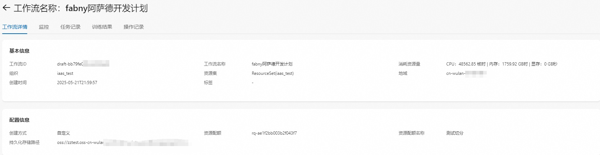

**编辑工作流**

**操作步骤**

1. 进入**可视化建模**界面。

2. 在实例列表界面，点击对应工作流的**进入工作流**按钮。

3. 进入工作编辑页面，左侧为组件区、中间为画布区、右侧为属性区。

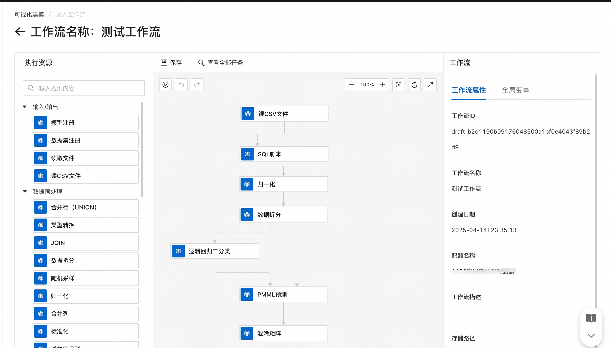

<ol type="a">

<li>

单击左侧组件，按住鼠标左键将组件托入中间画布区。

</li>

</ol>

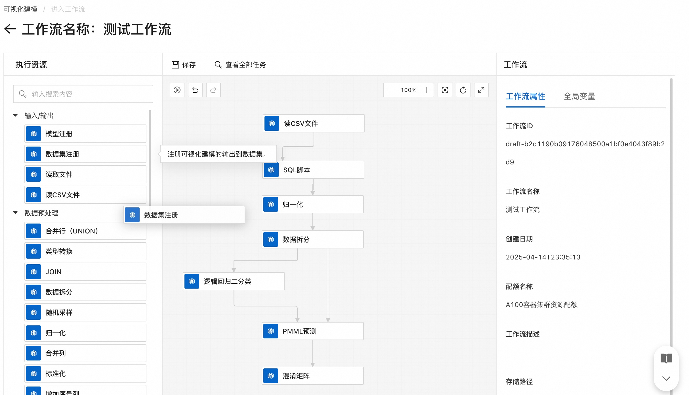

<ol type="a" start="2">

<li>

单击画布区的组件，修改组件的参数和资源。

</li>

</ol>

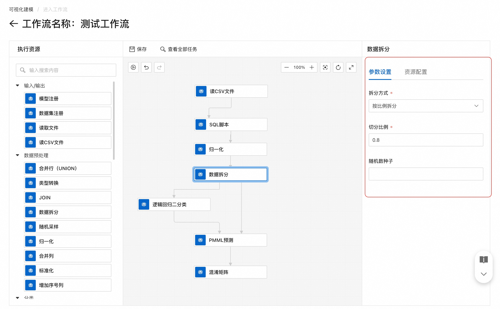

<ol type="i" start="100">

<li>

单击组件输出的锚点，按住鼠标，连接到另外一个组件的输入锚点，完成组件输入输出的设置。

</li>

</ol>

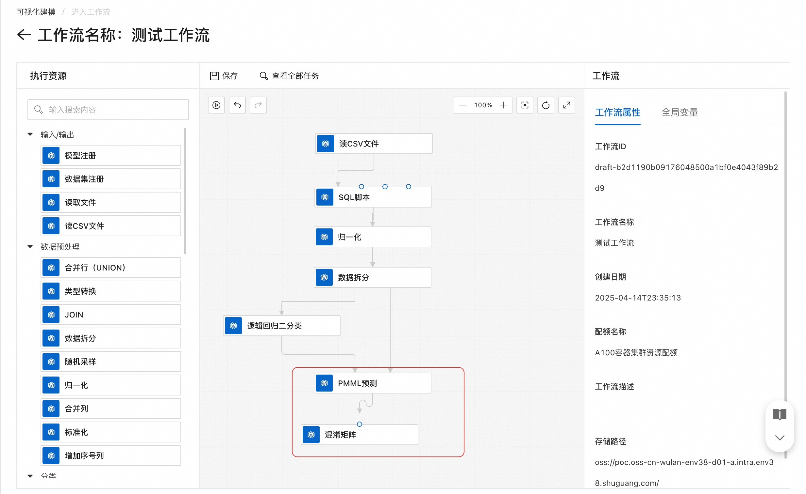

> **说明**
>
> AI Studio支持的预置组件请参见可视化建模预置组件列表。

**执行工作流操作步骤**

1. 在左侧菜单栏进入 **可视化建模**，点击**进入工作流**，进入工作流的编辑页面。

2. 单击  按钮，执行工作流。

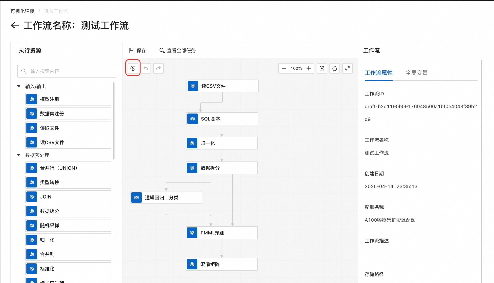

**查看组件输出数据**

在已经运行的组件上单击右键 ，选择**查看数据**，查看组件的输出数据。

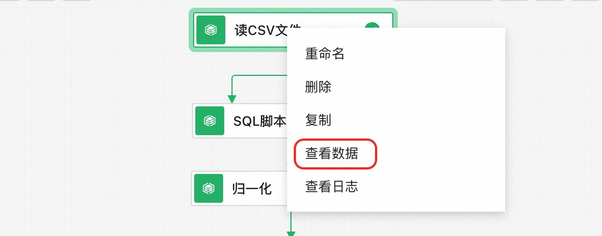

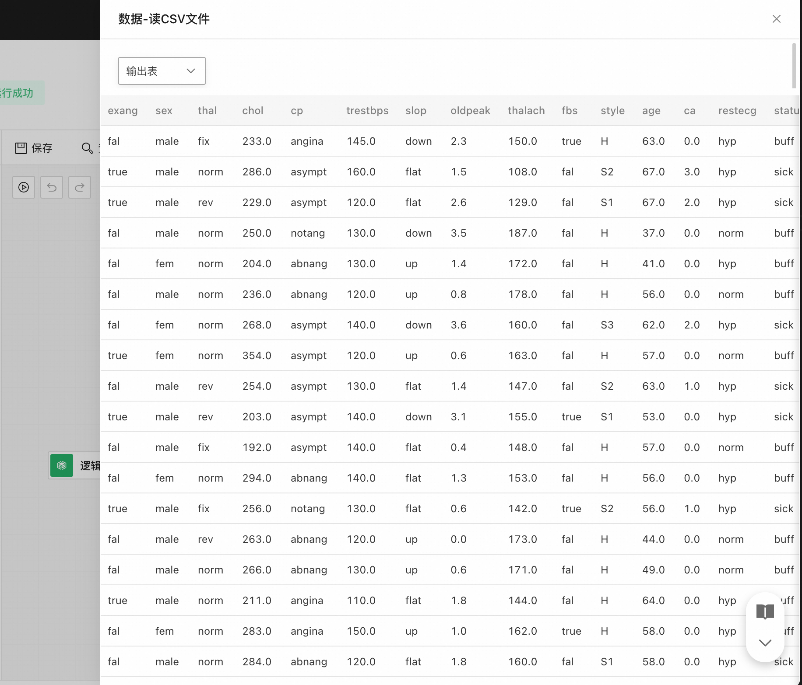

**查看组件日志**

在已经运行的组件上单击右键，选择 **查看日志**，即可查看组件的运行日志信息


**停止工作流**

**操作步骤**

1. 在左侧菜单栏进入 **可视化建模**，单击**进入工作流**，进入工作流的编辑页面。

2. 点击  按钮，停止工作流。


**执行结果**

在列表界面会发现当前工作流已停止运行。

**保存为模型**

在**训练结果**页面，用户可以将训练得到的模型文件导出至**模型广场**并保存。

1. 在**存储路径**栏目下，勾选需要保存至**模型广场**的模型文件。


2. 点击**保存为模型**，输入**模型名称**、**描述**、**版本号**、**框架**、**存储路径**等信息，同时按需配置**Readme文档**，点击**提交**后成功会得到如下提示。


3. 发起**保存为模型**后，在**保存记录**界面即可看到发起的保存任务，其中包含**任务ID**、**任务状态**、**进度**、**保存为模型名称**、**保存为模型版本**、**创建时间**、**结束时间**等信息。


4. 在**操作**条目下，点击**任务详情**，界面中会出现每一个需保存模型文件的文件名称、文件大小、状态信息，其中状态提示保存进度以及是否成功。


5. **保存为模型**任务完成后，在**模型广场**即可查询到相应记录。


<a id="section-5-4-3"></a>

### 5.4.3. 预置模板

本文介绍AI Studio可视化建模的预置模板，包括二分类、线性回归、文本分类、文本聚类、图像分类、图像目标检测预置模板。

<a id="section-5-4-3-1"></a>

#### 5.4.3.1. 二分类

二分类模板通过数据挖掘算法构建心脏病预测模型，通过人员的性别、年龄、血压、血糖等参数预测是否患有心脏病，用户可以通过此预置模板熟悉可视化建模的二分类算法。

**模板介绍**


<table>
  <tr>
    <th width="137">组件</th>
    <th>说明</th>
  </tr>
  <tr>
    <td>读CSV文件</td>
    <td>读CSV文件组件，读取CSV格式的原始数据集，数据集中包括性别、年龄、血压、血糖等数据。</td>
  </tr>
  <tr>
    <td>SQL脚本</td>
    <td>SQL脚本组件把输入数据以SQL脚本的形式进行预处理，将数据集中的字符串数据类型转化为数字类型。</td>
  </tr>
  <tr>
    <td>归一化</td>
    <td>归一化（Normalization）是一种数据预处理技术，用于将数据转换到一个 [0, 1] 的范围，归一化组件将数据集中的数值转化为0到1的范围。</td>
  </tr>
  <tr>
    <td>数据拆分</td>
    <td>数据拆分把数据进行拆分成两份，将数据集拆分成训练集和测试集。</td>
  </tr>
  <tr>
    <td>逻辑回归二分类</td>
    <td>回归二分类算法组件对输入的数据进行经典的逻辑回归二分类模型的训练，组件输出的PMML格式的心脏病预测模型。</td>
  </tr>
  <tr>
    <td>PMML预测</td>
    <td>PMML预测组件输入测试集和PMML格式的模型，使用PMML模型对输入的测试集进行预测。</td>
  </tr>
  <tr>
    <td>混淆矩阵</td>
    <td>混淆矩阵组件在心脏病预测模型在测试集上输出：<br>• 真阳性 (TP)：模型正确预测某人患病。<br>• 假阳性 (FP)：模型错误地预测某人患病（实际上健康）。<br>• 假阴性 (FN)：模型错误地预测某人健康（实际上患病）。<br>• 真阴性 (TN)：模型正确预测某人健康。混淆矩阵组件清晰展示心脏病预测模型在测试数据集上的准确率、召回率等算法指标。</td>
  </tr>
</table>

<a id="section-5-4-3-2"></a>

#### 5.4.3.2. 线性回归

线性回归模板通过发电场的温度、压力、湿度、压强等数据预测发电厂的输出电力，用户可以通过此预置模板熟悉可视化建模的线性回归算法。

**模板介绍**


<table>
  <tr>
    <th width="121">组件</th>
    <th>说明</th>
  </tr>
  <tr>
    <td>读CSV文件</td>
    <td>读CSV文件组件，读取CSV格式的原始数据集，数据集中包括温度、压力、湿度、压强、发电量数据。</td>
  </tr>
  <tr>
    <td>相关系数矩阵</td>
    <td>相关系数算法用于计算一个矩阵中每列之间的相关系数，取值范围为[-1,1]，通过相关矩阵可以分析出数据集中不同列的关联关系。</td>
  </tr>
  <tr>
    <td>数据拆分</td>
    <td>数据拆分把数据进行拆分成两份，将数据集拆分成训练集和测试集。</td>
  </tr>
  <tr>
    <td>线性回归</td>
    <td>线性回归算法组件对输入的数据进行线性回归模型的训练，组件输出的PMML格式的回归模型。</td>
  </tr>
  <tr>
    <td>PMML预测</td>
    <td>PMML预测组件输入测试集和PMML格式的模型，使用PMML模型对输入的测试集进行预测。</td>
  </tr>
  <tr>
    <td>回归模型评估</td>
    <td>回归模型评估组件对回归模型进行评估，输出如下算法指标：<br>• SST（总平方和，Total Sum of Squares）<br>• SSE（残差平方和，Sum of Squared Errors）<br>• SSR（回归平方和，Sum of Squares due to Regression）<br>• R²（决定系数，Coefficient of Determination）<br>• R（相关系数，Correlation Coefficient）<br>• MSE（均方误差，Mean Squared Error）<br>• RMSE（均方根误差，Root Mean Squared Error）<br>• MAE（平均绝对误差，Mean Absolute Error）<br>• MAD（中位数绝对偏差，Median Absolute Deviation）<br>• MAPE（平均绝对百分比误差，Mean Absolute Percentage Error）<br>• count（样本数量，Number of Observations）<br>• yMean（目标值均值，Mean of Target Values<br>• predictionMean（预测值均值，Mean of Predicted Values）</td>
  </tr>
</table>

<a id="section-5-4-3-3"></a>

#### 5.4.3.3. 文本分类

文本分类模板通过评论内容预测用户评论内容是好评还是差评，用户可以通过此预置模板熟悉可视化建模的文本分类算法。

**模板介绍**


<table>
  <tr>
    <th width="137">组件</th>
    <th>说明</th>
  </tr>
  <tr>
    <td>读CSV文件</td>
    <td>读CSV文件组件，读取CSV格式的原始数据集，数据集中评论内容和评论是好评还是差评的标签。</td>
  </tr>
  <tr>
    <td>分词</td>
    <td>分词组件将连续的文本分割成一个个独立的词语或子词单元，例如，中文句子“我爱自然语言处理”会被分词为：["我", "爱", "自然语言", "处理"]，NLP 算法通常以词语为基本单位进行后续处理，如果没有分词，模型无法有效理解文本的结构和语义。</td>
  </tr>
  <tr>
    <td>读取停用词</td>
    <td>在自然语言处理（NLP）中，停用词（Stop Words） 是指那些在文本中频繁出现但对语义贡献较小的词汇。这些词汇通常包括功能词（如介词、连词、助词等）以及一些常见的无实际意义的词。读取停用词组件读取停用词列表。</td>
  </tr>
  <tr>
    <td>停用词过滤</td>
    <td>停用词过滤组件的作用是移除或过滤掉对语义贡献较小的高频词汇（即停用词），从而优化文本处理的效果和效率。</td>
  </tr>
  <tr>
    <td>增加序列号</td>
    <td>增加序列号组件的作用是为每个输入单元分配一个唯一的编号，从而方便后续操作和处理。</td>
  </tr>
  <tr>
    <td>文档向量化</td>
    <td>文档向量化组件的作用是将非结构化的文本数据转换为结构化的高维向量。这种转换使得文本可以被计算机理解和处理，并用于各种下游任务。</td>
  </tr>
  <tr>
    <td>数据拆分</td>
    <td>数据拆分把数据进行拆分成两份，将数据集拆分成训练集和测试集。</td>
  </tr>
  <tr>
    <td>逻辑回归二分类</td>
    <td>逻辑回归二分类算法组件对输入的数据进行经典的逻辑回归二分类模型的训练，组件输出的PMML格式的预测模型。</td>
  </tr>
  <tr>
    <td>混淆矩阵</td>
    <td>混淆矩阵组件清晰展示评论预测模型在测试数据集上的准确率、召回率、精确率等算法指标。</td>
  </tr>
</table>

<a id="section-5-4-3-4"></a>

#### 5.4.3.4. 文本聚类

文本聚类模板针对文本数据集中的内容进行聚类，用户可以通过此预置模板熟悉可视化建模的文本聚类算法。

**模板介绍**


<table>
  <tr>
    <th width="125">组件</th>
    <th>说明</th>
  </tr>
  <tr>
    <td>读CSV文件</td>
    <td>读CSV文件组件，读取CSV格式的原始数据集，数据集中包括新闻内容和新闻分类的标签。</td>
  </tr>
  <tr>
    <td>增加序列号</td>
    <td>增加序列号组件的作用是为每个输入单元分配一个唯一的编号，从而方便后续操作和处理。</td>
  </tr>
  <tr>
    <td>分词</td>
    <td>分词组件将连续的文本分割成一个个独立的词语或子词单元，例如，中文句子“我爱自然语言处理”会被分词为：["我", "爱", "自然语言", "处理"]，NLP 算法通常以词语为基本单位进行后续处理，如果没有分词，模型无法有效理解文本的结构和语义。</td>
  </tr>
  <tr>
    <td>读取停用词</td>
    <td>在自然语言处理（NLP）中，停用词（Stop Words） 是指那些在文本中频繁出现但对语义贡献较小的词汇。这些词汇通常包括功能词（如介词、连词、助词等）以及一些常见的无实际意义的词。读取停用词组件读取停用词列表。</td>
  </tr>
  <tr>
    <td>停用词过滤</td>
    <td>停用词过滤组件的作用是移除或过滤掉对语义贡献较小的高频词汇（即停用词），从而优化文本处理的效果和效率。</td>
  </tr>
  <tr>
    <td>LDA主题模型</td>
    <td>LDA是一种广泛应用于文本挖掘和自然语言处理领域的生成式概率模型，用于从文档集合中发现潜在的主题结构。LDA的核心思想是将文档视为多个主题的混合分布，而每个主题又是由词汇的概率分布构成的。通过LDA主题模型，将文本内容抽取出若干关键词。</td>
  </tr>
  <tr>
    <td>K均值聚类</td>
    <td>K均值聚类（K-Means Clustering）将数据划分为若干个簇（cluster），使得同一簇内的数据点尽可能相似，而不同簇之间的数据点尽可能不同，使用K均值聚类将新闻内容聚类成不同的分类。</td>
  </tr>
</table>

<a id="section-5-4-3-5"></a>

#### 5.4.3.5. 图片分类

图片分类算法的任务是根据图像的内容判断它属于哪个类别。此模板中提供了一种构建猫、狗图片分类的模板，用户可以通过此预置模板熟悉可视化建模的图片分类问题。

**模板介绍**


<table>
  <tr>
    <th width="121">组件</th>
    <th>说明</th>
  </tr>
  <tr>
    <td>读取训练文件</td>
    <td>读取训练文件，训练文件为AI Studio数据标注模块导出的jsonl格式的标注数据，每行一条数据。</td>
  </tr>
  <tr>
    <td>读取验证文件</td>
    <td>读取验证文件，验证文件为AI Studio数据标注模块导出的jsonl格式的标注数据，每行一条数据。</td>
  </tr>
  <tr>
    <td>图片分类</td>
    <td>图片分类其目标是根据输入图像的视觉内容，将其归类到预定义的类别标签中，图片分类组件的输出为torchvison格式的模型，模型输出模型具备预测图片分类为猫或狗的能力。</td>
  </tr>
  <tr>
    <td>读取测试文件</td>
    <td>读取测试文件，测试文件为AI Studio数据标注模块导出的jsonl格式的标注数据，每行一条数据。</td>
  </tr>
  <tr>
    <td>图像预测</td>
    <td>图像预测组件利用输入的torchvison格式的模型对测试文件进行预测，预测测试文件中的图片分类为猫或狗。</td>
  </tr>
</table>

<a id="section-5-4-3-6"></a>

#### 5.4.3.6. 图片目标检测

图片目标检测算法的目的识别和定位图像中特定类别的物体，此模板提供了一种猫、狗图片目标检测的能力，用户可以通过此预置模板熟悉可视化建模的图片目标检测算法。

**模板介绍**


<table>
  <tr>
    <th width="121">组件</th>
    <th>说明</th>
  </tr>
  <tr>
    <td>读取训练文件</td>
    <td>读取训练文件，训练文件为AI Studio数据标注模块导出的jsonl格式的标注数据，每行一条数据。</td>
  </tr>
  <tr>
    <td>读取验证文件</td>
    <td>读取验证文件，验证文件为AI Studio数据标注模块导出的jsonl格式的标注数据，每行一条数据。</td>
  </tr>
  <tr>
    <td>图片目标检测</td>
    <td>图片目标检测组件是一种基于深度学习的计算机视觉算法，其核心目标是识别和定位图像中的特定物体。图片分类组件的输出为torchvison格式的模型，本模板中输出的模型具备检测出图片中猫、狗目标的能力。</td>
  </tr>
</table>

<a id="section-6"></a>

# 6.模型服务

通过模型服务，您可将AI模型部署成在线服务，实现模型对外服务。该功能还支持对模型服务性能的实时监控，利用资源伸缩配置、流量管理来及时保障对外服务稳定性。

<a id="section-6-1"></a>

## 6.1. 功能概述

AI Studio提供在线服务、灰度群组和批量推理的方式来提供模型服务。

**在线服务**

在线服务提供模型部署及在线推理服务。构建模型服务化能力，基于此用户可内部实现模型统一服务。实现模型服务的扩缩容、流量切换等模型服务。

**灰度群组**

灰度群组支持为多个在线服务提供统一的访问入口，并通过流量分配实现服务的平滑上线与下线。

**批量推理**

批量推理可以通过创建一个任务对批量数据进行推理，并输出推理结果。

**应用场景**

- 用户需要通过部署模型对外提供模型API服务，便于AI应用开发及使用。

- 用户需要使在线服务在版本升级过程中能够平滑使用，通过创建灰度群组，可以使用AI网关为多个在线服务提供统一的访问入口。

- 用户需要使用指定模型对批量数据进行推理，便于测试模型效果或获取批量推理结果。

**使用限制**

- 模型推理拉起的在线服务默认提供VPC私网的VIP，需要租户办公网和VPC并网才能访问。

- 一个在线服务只能加入一个灰度群组。

<a id="section-6-2"></a>

## 6.2. 在线服务

本文介绍了在线服务的创建方法，以及对在线管理进行变更配置、停止/重启、删除等的操作方法。

<a id="section-6-2-1"></a>

### 6.2.1. 部署服务

本问介绍了部署模型在线服务的操作过程。通过部署模型，可对外提供模型API服务，便于AI应用开发及使用。

**前提条件**

- 已创建**资源配额**。具体操作，请参见创建资源配额章节。

- 已创建**镜像**。具体操作，请参见创建自定义镜像章节。

- **模型广场**中有已启用的模型。具体操作，请参见模型广场章节。

- （可选）如果需要使用AI智能网关功能，请提前创建API网关。请在<strong>产品 > 中间件 > 应用集成 > API网关（新）</strong>中创建。

- （可选）如果需要使用异步推理功能，请提前创建Kafka实例。请在**产品 > 中间件 > 云消息队列 > 云消息队列Kafka版**中创建。

**操作步骤**

1. 登录AI Studio控制台。

2. 在顶部菜单栏处，选择组织、资源集和地域。

3. 在左侧导航栏中，单击**模型服务** > **在线服务**。

4. 在**在线服务**列表界面，单击**部署服务**。

5. 在**新建在线服务**页面，设置相关配置项参数。

   <ol type="i">

   <li>

   基本配置

   | 配置项 | 是否必选 | 说明 |
   | --- | --- | --- |
   | 组织/资源集/地域 | 是 | 在线服务所属的组织、资源集和地域。 |
   | 高可用类型 | 是 | 当前仅支持单可用区。 |
   | 服务名称 | 是 | 服务名称。长度为2～128个字符，必须以字母或中文开头，可包含数字、半角句号（.）、下划线（_）和短划线（-）。 |
   | 描述 | 否 | 在线服务的描述。描述长度为2~256个字符，不能以http://和https://开头。 |
   | 部署方式 | 否 | • <strong>自定义部署</strong>：可根据业务场景，自定义选择资源类型、镜像等资源，并可按需配置相关并行参数。<br>• <strong>A-Speed高性能部署</strong>：基于飞天企业版自研A-Speed加速套件进行最佳实践部署， 提供P/D分离、EP并行等能力，提供高吞吐低延迟推理体验。 |

   </li>

   <li>

   资源配置

   | 配置项 | 是否必选 | 说明 |
   | --- | --- | --- |
   | 资源配额 | 是 | 选择当前服务实例所使用的资源配额，同时配置所需的<strong>实</strong><strong>例数</strong>、<strong>单节点CPU（核）</strong>、<strong>单节点内存（GB）</strong>、<strong>单节点</strong><strong>GPU（卡）</strong>、<strong>共享内存（GB）</strong>。<br>说明如果打开GPU共享虚拟化，请配置<strong>GPU显存</strong><strong>（GB）</strong>，AI Studio会根据GPU实际切分粒度，自动适配并申请所需的GPU显存资源。A-Speed高性能部署模式下，仅支持选择智算训推优化集群。<strong>共享内存</strong>应小于<strong>单节点内存</strong>。 |
   | 选择镜像 | 是 | 列表来自<strong>AI资产管理</strong>-<strong>镜像库</strong>，当前版本支持<strong>公共镜</strong><strong>像</strong>和<strong>自定义镜像</strong>。请注意镜像支持的算力类型与资源配额保持一致，否则可能无法运行。<br>说明A-Speed高性能部署模式下，仅支持选择A-Speed镜像。 |
   | 选择模型 | 是 | 待部署的<strong>模型类型</strong>、<strong>模型</strong>、<strong>模型版本</strong>、<strong>挂载路径</strong>、<strong>数据加</strong><strong>速器</strong>。 |
   | 持久化存储设置 | 否 | 可用于持久化存储的<strong>文件路径</strong>、<strong>挂载路径</strong>。 |
   | 三方存储 | 否 | 当<strong>资源配额</strong>选择<strong>智算纳管型实例</strong>时，会展示该参数。开启三方存储后，会自动获取在AI资源池配置的三方存储，并手动填写挂载路径。 |

   </li>

   <li>

   **A-Speed高性能配置**

   | 配置项 | 是否必选 | 说明 |
   | --- | --- | --- |
   | Prefill-Decode分离 | 否 | 将推理服务分为Prefill 阶段和Decode 阶段，并根据所需设置不同的部署实例数。<br>说明需要保证Prefill和Decode实例数大于0，且<strong>实例总</strong><strong>数</strong>等于<strong>资源配额</strong>的<strong>实例数</strong>。 |
   | EP部署 | 否 | 针对MOE模型进行专家并行部署，A-Speed将根据实例配置采用最佳部署，无需手动配置部署参数。 |

   > **说明**
   >
   > 仅在**A-Speed高性能部署模式**下需要配置上述配置项，且必须打开**Prefill-Decode分离**和**EP部署**中的一种。

   </li>

   <li>

   服务配置

   | 配置项 | 是否必选 | 说明 |
   | --- | --- | --- |
   | AI智能网关 | 否 | • 如果需要使用流量控制与监控、异步推理能力，请先开启AI智能网关。<br>• 请下拉选择提前创建成功的API实例。如果没有对应的API实例，则无法使用该功能。 |
   | 分布式推理 | 否 | • 当<strong>资源配额</strong>配置的实例数大于一时，可以开启该参数。<br>• 当<strong>资源配额</strong>配置的实例数等于一时，无法使用该功能。<br>说明仅在<strong>自定义部署</strong>模式下可配置此配置项。 |
   | 经典网络访问 | 是 | 开启/关闭在线服务经典网络访问。 |
   | Service端口 | 否 | 配置模型服务Service的访问端口，端口可配置范围：80-9000，默认端口80。 |
   | 容器端口 | 是 | 配置模型服务所在POD的API访问端口，可通过API访问该模型在线服务，端口可配置范围建议再：1000-9000。 |
   | 启动命令 | 是 | 所部署的在线服务对应的自定义镜像的启动命令。<br>• 启动的服务需要监听外部访问源的地址。例如 <code> --</code><code>host=0.0.0.0 </code>接受任意IP请求，<code> --</code><code>host=192.168.1.0/24 </code>接受该网段的请求。<br>• API访问端口需要和启动命令中端口保持一致。<br>• 当<strong>分布式推理</strong>开启同时镜像选择<em>\*\*\*\*</em>-lws，系统会自动填充启动命令。<br>说明仅在<strong>自定义部署</strong>模式下可配置此配置项。 |
   | 环境变量 | 否 | • 开启分布式推理：开启RDMA开关后，需要配置相关的环境变量才能使用RDMA功能，该功能仅适用于高网类型的集群。<br>• 关闭分布式推理：配置环境变量，作用于在线服务，根据用户的在线服务可以设置相关的环境变量，用来实现相关的服务拦截、计量等功能。 |

   </li>

   <li>

   高级配置

   | 配置项 | 是否必选 | 说明 |
   | --- | --- | --- |
   | 内容安全 | 否 | • 系统会校验AI资源池是否有内容安全访问权限，如果未开通需要去AI资源池进行授权。<br>• 只有开启经典网络访问或者开启AI智能网关才能开启内容安全。 |
   | 流量控制 | 否 | 限流策略：在经典网络访问和 VPC 访问会同时生效，如若QPS限流设为100，则经典网络访问和VPC访问QPS限流均为100（经典网络访问供模型体验使用）。<br>• <strong>服务QPS</strong>：一个在线服务每秒钟处理的请求数量。<br>• <strong>TPM</strong>：每分钟内允许的请求Token数量（输入+输出）。<br>说明<br>• 如果不开启AI智能网关，则不支持开启流量控制开关。<br>• 服务的QPS与TPM不可同时启用，请根据实际需求选择其中一种策略进行配置。 |
   | 异步推理 | 否 | • 通过Kafka组件，将请求的数据缓存起来，按照异步推理的方式分析数据并给出推理结果。<br>• <strong>队列服务规格</strong>：请选择2核/4GB/2副本。<br>• <strong>选择Kafka实例</strong>：请选择队列服务关联的Kafka实例，如果没有请单击新建，重新创建。<br>• <strong>输入Topic</strong>：请选择缓存异步推理请求的Topic。<br>• <strong>Kafka User</strong>：请选择具备消费Topic能力的User。<br>• <strong>推理结果存储</strong>：异步推理的结果存储路径。<br>说明<br>• 没有可选Kafka User：请在<strong>产品 &gt; 中</strong>间件 &gt; 云消息队列 &gt; 云消息队列<strong>Kafka版 &gt; 实例详情 &gt; 接入点信息</strong>创建接入点，接入点的类型选择SingleTunnel。<br>• 配置Kafka User权限：请在<strong>产品 &gt; 中</strong>间件 &gt; 云消息队列 &gt; 云消息队列<strong>Kafka版 &gt; 实例详情 &gt; SASL权限</strong>创建ACL，授予Kafka User对特定Topic的读写权限和Group的读权限。 |

   > **重要**
   >
   > 选择完资源配额和镜像系统后，系统会协助您进行资源配额-镜像-模型三者之间厂商和框架一致性的校验：资源配额和镜像的芯片厂商需保持一致、镜像和模型的框架需保持一致。若不满足，将在**选择镜像**之后会显示如下提示。您依然可以下发相应的任务，但可能无法正常运行。
   >
   > 

   </li>

   </ol>

6. 单击**提交**。

**执行结果**

在线服务列表中出现您部署的在线服务，服务状态为**启动中**，启动完成后状态变为**运行中**。


**访问服务**

> **说明**
>
> 推理对外服务的IP为VPC的内网地址，需要完成访问源到VPC网络的打通。具体操作请参见相应产品文档。

单击在线服务实例列表的**详情**，查看实例详细页面的访问信息中的API访问地址，获取API的访问地址。

<a id="section-6-2-2"></a>

### 6.2.2. 管理服务

本文介绍了对已部署的模型服务进行管理的常用操作。主要包括对服务名称、描述进行编辑，停止/重启服务，变更配置和删除服务。

查看服务

**操作步骤**

1. 登录AI Studio控制台。

2. 在顶部菜单栏处，选择组织、资源集和地域。

3. 在左侧导航栏中，单击**模型服务** > **在线服务**。

4. 在**在线服务**列表界面，单击对应服务的**详情**按钮。

5. 在详情页面，可查看对应服务的**服务详情**、**资源实例**、**服务观测**、**访问设置**、**伸缩配置**、**事件&日志**、**内容安全**（仅在开启内容安全后可查看该页面）。

6. 

   

**查看调用信息**

1. 登录AI Studio控制台。

2. 在顶部菜单栏处，选择组织、资源集和地域。

3. 在左侧导航栏中，单击**模型服务** > **在线服务**。

4. 在**在线服务**列表界面，单击对应服务的**查看**按钮。

5. 在**同步调用**页签可查看同步调用信息，在**异步调用**页签可查看异步调用信息。

   

   > **说明**
   >
   > 调用信息还支持在**详情 > 访问设置**中查看。

6. 在**详情 > 访问设置**中，单击**创建API Key**，域名会通过该Key值调用在线服务。

   > **说明**
   >
   > 只有开启AI智能网关的在线服务，才支持创建API Key。

**查看内容安全日志**

1. 登录AI Studio控制台。

2. 在顶部菜单栏处，选择组织、资源集和地域。

3. 在左侧导航栏中，单击**模型服务** > **在线服务**。

4. 在**在线服务**列表界面，单击对应服务的**详情**按钮。

5. 在**详情 > 内容安全**中，可查看相关日志。

   > **说明**
   >
   > 要访问网关拦截日志，需要在创建网关时，勾选打开日志选项。

编辑服务

**操作步骤**

1. 登录AI Studio控制台。

2. 在顶部菜单栏处，选择组织、资源集和地域。

3. 在左侧导航栏中，单击**模型服务** > **在线服务**。

4. 在**在线服务**列表界面，单击对应服务的**编辑**按钮。

5. 在**编辑服务**页面，编辑服务名称或描述。

6. 单击**确定**。

**执行结果**

弹窗提示**编辑成功**，且在线服务的相应信息已更新。

停止/重启服务

**操作步骤**

1. 登录AI Studio控制台。

2. 在顶部菜单栏处，选择组织、资源集和地域。

3. 在左侧导航栏中，单击**模型服务** > **在线服务**。

4. 在**在线服务**列表界面，单击运行中的服务的**停止**按钮。

5. 在确认操作的弹窗中，单击**确定**。

> **说明**
>
> 停止后该在线服务对外服务将会停止，算力资源将被回收，模型服务配置保留，可通过“**重启**”重新启动该在线服务。

**执行结果**

顶部弹窗提示**修改成功**，服务的状态变为**已停止**，**停止**按钮对应的位置变为**重启**。


**Readme文档**

**操作步骤**

1. 登录AI Studio控制台。

2. 在顶部菜单栏处，选择组织、资源集和地域。

3. 在左侧导航栏中，单击**模型服务** > **在线服务**。

4. 在**在线服务**列表界面，单击对应服务的<strong>···</strong> >**Readme文档**。

5. 在**Readme文档**页面，设置文档的**说明标题**/**版本**/**存储路径**/**上传文件**。

6. 单击**确定**。

| 配置项 | 是否必选 | 说明 |
| --- | --- | --- |
| 说明标题 | 是 | 长度为2～64个字符，必须以字母或中文开头，可包含数字、半角句号（.）、下划线（_）和短划线（-）。 |
| 版本 | 是 | 版本号支持：vx.x格式（例如v1.0）。 |
| 存储路径 | 是 | 选择指定的OSS对象存储Bucket. |
| 上传文件 | 是 | 单击上传文件，或将文件拖拽到上传框处，支持.pdf、.doc、.docx格式的文件 |

> **说明**
>
> - 为保证内容质量，建议Readme文档中，包含在线服务概述，在线服务介绍等常用内容。
>
> - 上传文件将保存在在线服务文件所在的Bucket中。
>
> - 上传新文档后，将覆盖现有Readme内容，您可以选择是否删除旧Readme文档。如果您想要删除旧的Readme文档，可以在配置对话框最下方勾选**删除旧README文件**。

**弹性伸缩**

**手动调节扩缩容**

**操作步骤**

1. 登录AI Studio控制台。

2. 在顶部菜单栏处，选择组织、资源集和地域。

3. 在左侧导航栏中，单击**模型服务** > **在线服务**。

4. 在**在线服务**列表界面，单击已停止的服务的<strong>···</strong> > **弹性伸缩**。

5. 在**扩缩容设置**页面，设置**手动调节**，手动调节当前服务的实例数。

   

6. 单击**确定**。

> **说明**
>
> 手动调节当前服务的实例数，会按照当前的资源配置逻辑进行伸缩，且服务状态必须是已停止。

**执行结果**

弹窗提示**保存成功**，且**扩缩容配置**的相应信息已保存。

**自动调节扩缩容**

**操作步骤**

1. 登录AI Studio控制台。

2. 在顶部菜单栏处，选择组织、资源集和地域。

3. 在左侧导航栏中，单击**模型服务** > **在线服务**。

4. 在**在线服务**列表界面，单击对应服务的<strong>···</strong> > **弹性伸缩**。

5. 在**扩缩容配置**页面，打开**自动调节**开关，设置**最小实例数**、**最大实例数**、**扩缩容指标**、**扩容生效时长**、**缩容生效时长**。

   

   | 配置项 | 是否必选 | 说明 |
   | --- | --- | --- |
   | 最小实例数 | 是 | Pod 的最小副本数。 |
   | 最大实例数 | 是 | Pod 的最大副本数。 |
   | 扩缩容指标 | 是 | 触发扩缩容的条件：包括CPU利用率阈值和GPU利用率阈值。当CPU或GPU的平均利用率持续超过设定的上阈值（例如70%）时，系统会自动增加实例数量，避免资源瓶颈影响性能。当利用率持续低于下阈值（例如30%）时，系统会自动减少实例数量，节省资源成本。 |
   | 扩容生效时长 | 否 | 持续高于扩容阈值的时长，超过这个时间就触发扩容。 |
   | 缩容生效时长 | 否 | 持续低于缩容阈值的时长，超过这个时间就触发缩容。 |

6. 单击**确定**。

> **说明**
>
> 1. **扩缩容**原则：在进行弹性伸缩的时候，所有的**实例数**都是按照**扩缩容指标**的计算的**最大实例数**进行弹性的伸缩。
>
>    例如：**扩容**的时候，两个**扩缩容指标**计算出的实例数分别为5个实例和6个实例，那么扩容的目标实例数是6。**缩容**的时候，两个**扩缩容指标**计算出的实例数分别为2个实例和3个实例，那么缩容的目标实例数是3。
>
> 2. **扩缩容目标实例数**计算公式：
>
>    
>
>    例如：当前实例数为1，当前指标为50，指标阈值为15，由计算公式得到目标实例数为4。所以，在下一个窗口期（60s）再次检查之后，以步长为1进行扩展，实例数逐步变为4。

**执行结果**

弹窗提示**保存成功**，且**扩缩容配置**的相应信息已保存。

**查看监控**

1. 登录AI Studio控制台。

2. 在顶部菜单栏处，选择组织、资源集和地域。

3. 在左侧导航栏中，单击**模型服务** > **在线服务**。

4. 在**在线服务**列表界面，单击对应服务的**详情**按钮。

5. 在详情页面，选择**服务观测**页签。

6. 支持查看服务资源、容器资源和服务性能。

   - 服务资源监控又包括任务监控、容器组监控和网关监控。

   - 容器资源监控

   - 服务性能监控

     

**查看资源实例**

**操作步骤**

1. 登录AI Studio控制台。

2. 在顶部菜单栏处，选择组织、资源集和地域。

3. 在左侧导航栏中，单击**模型服务** > **在线服务**。

4. 在**在线服务**列表界面，单击对应服务的**详情**按钮。

5. 在详情页面，点击**资源实例**页面。

   

> **说明**
>
> 资源实例状态为准备中表示正在水平扩容1个副本。

**查看伸缩配置**

**操作步骤**

1. 登录AI Studio控制台。

2. 在顶部菜单栏处，选择组织、资源集和地域。

3. 在左侧导航栏中，单击**模型服务** > **在线服务**。

4. 在**在线服务**列表界面，单击对应服务的**详情**按钮。

5. 在详情页面，点击**伸缩配置**页面。

6. 在**伸缩配置**页面，查看**配置信息**和**伸缩记录**。

   

**扩缩容案例**

**案例：GPU弹性扩缩容**

本案例阐述了GPU弹性扩缩容功能，涵盖了从在线服务创建与弹性扩缩容配置到查看监控及弹性伸缩记录的完整流程。

**创建在线服务**

具体操作，请参见部署服务章节。

- 镜像选择：与资源配额算力支持类型一致的vllm镜像。

- 资源选择：4C，16G，1卡。(注意这里GPU数量必须大于0，否则无法成功启动)

- 模型选择：Qwen2.5-7B-Instruct模型，模型挂载路径选择/model/。

- 启动命令：

  ```text
  python3 -m vllm.entrypoints.openai.api_server --model /model --served-model-name qwen2-7b-instruct --host 0.0.0.0 --port 8000
  ```

- API访问端口填写8000。（需要和启动命令中的port保持一致）

- Service端口配置8000。（也可以随意配置其他值）

- 打开经典网络访问开关。


**GPU弹性扩缩容配置**

- 在在线服务列表界面，单击对应服务的··· > 扩缩容。

- 打开自动调节开关。

- 设置最小实例数为1，最大实例数为5，gpu利用率阈值为10%。


**对服务进行GPU压测**

当服务状态变为运行中，对服务进行GPU压测。


可以通过提高推理请求QPS的方法，使得GPU负载升高，触发GPU利用率阈值弹性伸缩。

**查看弹性扩缩容结果**

**查看监控**

在**详情 > 服务观测**，在服务资源监控查看任务GPU利用率。


**查看弹性伸缩配置**

在**详情 > 伸缩配置**，查看伸缩记录。


服务配置

**操作步骤**

- **资源变更**

  <ol type="i">

  <li>

  登录AI Studio控制台。

  </li>

  <li>

  在顶部菜单栏处，选择组织、资源集和地域。

  </li>

  <li>

  在左侧导航栏中，单击**模型服务** > **在线服务**。

  </li>

  <li>

  在**在线服务**列表界面，单击对应服务的  ，选择**服务配置 > 资源变更**。

  </li>

  <li>

  在资源变更页面输入变更后的实例数、CPU、内存和GPU，单击**确定**。

  > **说明**
  >
  > - 对实例进行扩缩容可能会影响模型推理的速度和稳定性，请谨慎操作！
  >
  > - 当**服务状态**为“**停止**”时，才支持进行变更配置操作。

  </li>

  </ol>

- **AI网关配置**

  <ol type="i">

  <li>

  登录AI Studio控制台。

  </li>

  <li>

  在顶部菜单栏处，选择组织、资源集和地域。

  </li>

  <li>

  在左侧导航栏中，单击**模型服务** > **在线服务**。

  </li>

  <li>

  在**在线服务**列表界面，单击对应服务的  ，选择**服务配置 > AI网关配置**。

  </li>

  <li>

  关闭AI智能网关开关后，单击**确定**。

  </li>

  </ol>

- **限流设置**

  <ol type="i">

  <li>

  登录AI Studio控制台。

  </li>

  <li>

  在顶部菜单栏处，选择组织、资源集和地域。

  </li>

  <li>

  在左侧导航栏中，单击**模型服务** > **在线服务**。

  </li>

  <li>

  在**在线服务**列表界面，单击对应服务的  ，选择**服务配置 > 限流设置**。

  </li>

  <li>

  在**限流设置**页面，打开**请求限流**开关。

  </li>

  <li>

  设置限流策略，单击确定。

  

  </li>

  </ol>

- **异步推理**

  <ol type="i">

  <li>

  登录AI Studio控制台。

  </li>

  <li>

  在顶部菜单栏处，选择组织、资源集和地域。

  </li>

  <li>

  在左侧导航栏中，单击**模型服务** > **在线服务**。

  </li>

  <li>

  在**在线服务**列表界面，单击对应服务的  ，选择**服务配置 > 异步推理**。

  </li>

  <li>

  在异步推理页面设置参数后，单击**确定**。

  | 参数名称 | 参数说明 |
  | --- | --- |
  | 队列服务规格 | 请选择2核/4GB/2副本。 |
  | 选择Kafka实例 | 请选择队列服务关联的Kafka实例。 |
  | 输入Topic | 请选择缓存异步推理请求的Topic。 |
  | Kafka User | 请选择具备消费Topic能力的User。 |
  | 持久化存储 | 异步推理的结果存储路径。 |

  > **说明**
  >
  > - 没有可选Kafka User：请在**产品 > 中间件 > 云消息队列 > 云消息队列Kafka版 > 实例详情 > 接入点信息**创建接入点，接入点的类型选择SingleTunnel。
  >
  > - 配置Kafka User权限：请在**产品 > 中间件 > 云消息队列 > 云消息队列Kafka版 > 实例详情 > SASL权限**创建ACL，授予Kafka User对特定Topic的读写权限和Group的读权限。

  </li>

  </ol>

- **内容安全**

  <ol type="i">

  <li>

  登录AI Studio控制台。

  </li>

  <li>

  在顶部菜单栏处，选择组织、资源集和地域。

  </li>

  <li>

  在左侧导航栏中，单击**模型服务** > **在线服务**。

  </li>

  <li>

  在**在线服务**列表界面，单击对应服务的  ，选择**服务配置 > 内容安全**。

  </li>

  <li>

  在内容安全页面选择是否开启**输入/输出检测**，单击**确定**。

  > **说明**
  >
  > 系统会校验AI资源池是否有内容安全访问权限，如果未开通需要去AI资源池进行授权。
  >
  > 只有开启经典网络访问或者开启AI智能网关才能开启内容安全。

  </li>

  </ol>

删除服务

**操作步骤**

1. 登录AI Studio控制台。

2. 在顶部菜单栏处，选择组织、资源集和地域。

3. 在左侧导航栏中，单击**模型服务** > **在线服务**。

4. 在**在线服务**列表界面，单击对应服务的<strong>···</strong> > **删除**。

5. 在确认操作的弹窗中，单击**确定**。

**执行结果**

弹窗提示**删除成功**，列表中不存在被删除的服务。

<a id="section-6-2-3"></a>

### 6.2.3. 查看监控

本文介绍查看在线服务监控的步骤。

**前提条件**

- 已部署模型在线服务。

- 已部署Prometheus和CMS产品。

**操作步骤**

1. 登录AI Studio控制台。

2. 在顶部菜单栏选择自己的组织名称、资源集以及地域。

3. 在左侧菜单栏点击选择**模型服务**> **在线服务**。

4. 在服务列表单击  图标查看在线服务的监控详情。

5. 在监控详情页查看**任务监控**、**容器组监控**和**网关监控**对应的指标详情。

> **说明**
>
> - 监控的数据源和信息来自于云监控CMS平台。
>
> - 单击  图标即可创建告警规则，详细步骤请参考《云监控CMS 用户指南》中创建报警规则章
>
>   节。

<a id="section-6-3"></a>

## 6.3. 灰度群组

本文介绍了灰度群组的创建、删除方法，以及对灰度群组中的在线服务进行添加、移除、分配流量等的操作方法。

<a id="section-6-3-1"></a>

### 6.3.1. 创建灰度群组

本章节介绍创建灰度服务群组，通过将在线服务关联值灰度服务群组，从而实现服务流量平滑升级的过程。

**前提条件**

- （可选）请提前创建支持异步推理的Kafka实例。请在**产品 > 中间件 > 云消息队列 > 消息队列Kafka版**中创建。

- 请提前创建API网关。请在<strong>产品 > 中间件 > 应用集成 > API网关（新）</strong>中创建。

> **说明**
>
> 已经加入灰度群组的在线服务不能选择，会被置灰。

**操作步骤**

1. 登录AI Studio控制台。

2. 在顶部菜单栏处，选择组织、资源集和地域。

3. 在左侧导航栏中，单击**模型服务** > **在线服务**。

4. 在模型在线服务页面，选择**灰度群组**页签。

5. 单击**新建灰度群组**，参考下表填写参数值。

   **区域**

   **参数名称**

   **参数说明**

   请选择在线服务所属的组织。

   **组织**

   请选择在线服务所属的资源集。

   **资源集**

   请选择在线服务所属地域。

   **地域**

   请自定义灰度群组名称，长度为2～128个字符，必须以字母或中文开头，可包含数字、半

   **灰度群组名称**

   角句号（.）、下划线（_）和短划线（-)。

   **基本配置**

   可填写其他信息。

   **描述**

   - 灰度群组拥有统一的流量入口，适用于灰度

   **选择服务**

   发布、异步推理等场景。

   **选择在线服务**

   > 
   >
   > **说**

   - 建议选择打开AI智能网关的在线服务。

   > **明**
   >
   > 灰度群组默认会继承所选在线服务访问链接、限流策略、异

   **新建在线服务**

   > 步推理配置信息，之

   > **说明**

   > 后可在

   单击**配置服务**，参考部署服务配置后单击**提**

   > 当可选择的在线服务为空

   > 服务组

   **交**。

   > 时，请选择新建在线服

   > 列表进

   > 务；建议单击页面右上

   > 行管

   > 角**如何新建在线服务**，按

   > 理。

   > 照指导操作。

   - 如需使用流量控制与监控、异步推理能力，需要先开启AI智能网关。

   **灰度群组AI智能网关**

   - 请下拉选择提前创建成功的API实例。如果没有对应的API实例，单击**新建**进行创建。

   - 系统会校验AI资源池是否有内容安全访问权限，如果未开通需要去AI资源池进行授权。

   **内容安全**

   - 只有开启经典网络访问或者开启AI智能网关才能开启内容安全。

   **灰度群组**

   开启流量控制开关后，可以对服务处理的流量

   **配置**

   **灰度群组流量控制**

   进行限制。

   限流策略：会同时在经典网络访问和VPC访问生效，如若QPS限流设为100，则经典网络访问和VPC访问QPS限流均为100（经典网络访问供模型体验使用）。

   **限流策略**

   - 服务QPS：每秒钟处理的请求数量。

   - TPM：每分钟内允许的请求Token数量（输入+输出）。

   开启后会通过Kafka组件，将请求的数据缓存

   **灰度群组异步推理**

   起来，按照异步推理的方式分析数据并给出推理结果。

   请选择2核/4GB/2副本。

   **队列服务规格**

   - 请选择队列服务关联的Kafka实例，所选实例必须是Singletunnel实例，且和AI资源池在同一个VSwitch内。

   **选择Kafka实例**

   - 如果没有对应的Kafka实例，单击**新建**进行创建。

   -

   **输入Topic**

   请选择缓存异步推理请求的Topic。

   请选择处理异步推理请求的Topic。

   **输出Topic**

   请选择具备消费Topic能力的User。

   **Kafka User**

   请选择异步推理的结果存储路径，选择正确路

   **推理结果存储**

   径后单击**确定**。

6. 单击**提交**。提交成功后会在灰度群组列表展示。

<a id="section-6-3-2"></a>

### 6.3.2. 管理灰度群组

本章节介绍如何查看灰度群组详情，编辑、添加在线服务等操作。

**前提条件**

已成功创建灰度群组。

**约束限制**

- 一个灰度群组最多可添加5个在线服务。

- 模型服务名称相同，才能加入同一个灰度群组。

- 在线服务所属资源池相同，才能加入一个灰度群组。

> **说明**
>
> 在线服务加入灰度群组后，原有访问连接会被删除。
>
> 添加到服务组内的服务，只有灰度流量为0才能停止。

**操作步骤**

1. 登录AI Studio控制台。

2. 在顶部菜单栏处，选择组织、资源集和地域。

3. 在左侧导航栏中，单击**模型服务** > **在线服务**。

4. 在模型在线服务页面，选择**灰度群组**页签。支持查看、编辑、重启、停止灰度群组。

   - 查看灰度群组详情。

     <ol type="a">

     <li>

     在灰度群组列表单击**操作**列**详情**。

     </li>

     <li>

     在灰度群组详情页签显示灰度群组详情，包括**灰度群组详情**、**资源实例**、**服务观测**、**访问设置**、**操作记录**和**内容安全**（仅在开启内容安全后可查看该页面）。

     

     </li>

     </ol>

     <ol type="i" start="100">

     <li>

     单击**分配流量**可以给该灰度群组下的在线服务重新分配流量。

     

     </li>

     <li value="500">

     填写流量权重后单击**保存**。

     > **说明**
     >
     > - 流量全为0或者流量相加等于100。
     >
     > - 分配流量时，只有服务在线，才能分配超过0的流量。

     </li>

     </ol>

     <ol type="a" start="5">

     <li>

     单击**操作**列**移除**，在弹出提示框上单击**移除**。

     > **说明**
     >
     > - 在灰度群组内，在线服务灰度流量为0，才支持移除。
     >
     > - 在灰度群组内，必须至少保留一个在线服务，且该服务不得被移除。
     >
     > - 在灰度群组内移除出去的服务，会没有访问入口，如果需要访问，需要重新打开AI智能网关。

     </li>

     </ol>

   - 编辑灰度群组。

     <ol type="a">

     <li>

     在灰度群组列表单击**操作**列**编辑**。

     </li>

     <li>

     修改灰度群组名称和描述后单击**确定**。

     </li>

     </ol>

   - 添加服务。

     <ol type="a">

     <li>

     在灰度群组列表单击**操作**列**添加服务**。

     </li>

     <li>

     在添加服务弹框上选择服务后，单击**确定**。

     </li>

     </ol>

   - 限流设置。

     <ol type="a">

     <li>

     在灰度群组列表单击**操作**列  ，选择**限流设置**。

     </li>

     <li>

     重新设置服务QPS或TPM后，单击**确定**。

     </li>

     </ol>

   - 设置异步推理。

     <ol type="a">

     <li>

     在灰度群组列表单击**操作**列  ，选择**异步推理**。

     </li>

     <li>

     打开异步推理开关，参考创建灰度群组设置参数后单击**确定**。

     </li>

     </ol>

   - 设置内容安全。

     <ol type="a">

     <li>

     在灰度群组列表单击**操作**列  ，选择**内容安全**。

     </li>

     <li>

     在内容安全页面选择是否开启**输入/输出检测**，单击**确定**。

     </li>

     </ol>

5. 删除灰度群组。

   <ol type="i">

   <li>

   在灰度群组列表单击**操作**列  ，选择**删除**。

   </li>

   <li>

   在弹出的提示框上单击**删除**。

   > **说明**
   >
   > - 删除灰度群组时会校验灰度群组内的在线服务数量，当在线服务数量等于1时，才支持删除灰度群组。
   >
   > - 服务组删除后，原来灰度群组的网关信息，将继承给最后一个在线服务。

   </li>

   </ol>

**相关操作**

在灰度群组详情页，您还可以执行以下操作。

<table>
  <tr>
    <th width="202">任务名称</th>
    <th>操作步骤</th>
  </tr>
  <tr>
    <td>查看资源实例和实例日志</td>
    <td>1. 在灰度群组列表单击<strong>操作</strong>列<strong>详情</strong>。<br>2. 选择<strong>资源实例</strong>页签。<br>3. 可查看运行实例、CPU、内存和GPU。<br>4. 单击<strong>操作</strong>列<strong>日志</strong>，可查看日志信息。</td>
  </tr>
  <tr>
    <td>服务观测</td>
    <td>1. 在灰度群组列表单击<strong>操作</strong>列<strong>详情</strong>。<br>2. 选择<strong>服务观测</strong>页签。<br>3. 可查看服务资源监控、容器资源监控和服务性能监控。</td>
  </tr>
  <tr>
    <td>查看访问设置</td>
    <td>1. 在灰度群组列表单击<strong>操作</strong>列<strong>详情</strong>。<br>2. 选择<strong>访问设置</strong>页签。<br>3. 可查看调用信息、设置限流和创建API Key等。</td>
  </tr>
  <tr>
    <td>查看伸缩配置</td>
    <td>1. 在灰度群组列表单击<strong>操作</strong>列<strong>详情</strong>。<br>2. 选择<strong>伸缩配置</strong>页签。<br>3. 可查看扩缩容信息。</td>
  </tr>
  <tr>
    <td>查看操作记录</td>
    <td>1. 在灰度群组列表单击<strong>操作</strong>列<strong>详情</strong>。<br>2. 选择<strong>操作记录</strong>页签。<br>3. 可查看操作记录。</td>
  </tr>
  <tr>
    <td>查看内容安全</td>
    <td>1. 在灰度群组列表单击<strong>操作</strong>列<strong>详情</strong>。<br>2. 选择<strong>内容安全</strong>页签。<br>3. 可查看相关日志。<br>说明要访问网关拦截日志，需要在创建网关时，勾选打开日志选项。</td>
  </tr>
</table>

<a id="section-6-3-3"></a>

### 6.3.3. 访问灰度群组

本章节介绍如何访问链接访问灰度群组。

**操作步骤**

1. 登录AI Studio控制台。

2. 在顶部菜单栏处，选择组织、资源集和地域。

3. 在左侧导航栏中，单击**模型服务** > **在线服务**。

4. 在模型在线服务页面，选择**灰度群组**页签。

5. 在灰度群组列表单击**操作**列**详情**。

6. 选择**访问设置**页签。

7. 在访问信息区域可获取访问链接，在灰度群组API Key区域可获取Key值。

   

<a id="section-6-4"></a>

## 6.4. 批量推理

本文介绍了批量推理任务的创建方法，以及对推理任务进行变更配置、启动、删除等的操作方法。

<a id="section-6-4-1"></a>

### 6.4.1. 创建任务

本文介绍了创建批量推理任务的操作过程。

**前提条件**

- 已创建**资源配额**。具体操作，请参见创建资源配额章节。

- 已创建**数据集**。具体操作，请参见创建数据集章节。

- 已创建**镜像**。具体操作，请参见创建自定义镜像章节。

- **模型广场**中有已启用的模型。具体操作，请参见自定义模型章节。

**操作步骤**

1. 登录AI Studio控制台。

2. 在顶部菜单栏处，选择组织、资源集和地域。

3. 在左侧导航栏中，单击**模型服务** > **批量推理**。

4. 在批量推理列表界面，单击**创建任务**。

5. 在**创建批量推理**页面，设置相关配置项参数。

   <ol type="i">

   <li>

   基本配置

   | 配置项 | 是否必选 | 说明 |
   | --- | --- | --- |
   | 组织/资源集/地域 | 是 | 批量推理任务所属的组织、资源集和地域。 |
   | 任务名称 | 是 | 批量推理任务名称。长度为2～64个字符，必须以字母或中文开头，可包含数字、半角句号（.）、下划线（_）和短划线（-）。 |
   | 描述 | 否 | 批量推理任务的描述。描述长度为2~256个字符，不能以http://和https://开头。 |

   </li>

   <li>

   资源配置

   | 配置项 | 是否必选 | 说明 |
   | --- | --- | --- |
   | 资源配额 | 是 | 选择当前推理实例所使用的资源配额，同时配置所需的<strong>CPU(核)</strong>，<strong>内存(GB)</strong>，<strong>GPU(卡)</strong>/<strong>GPU显存</strong><strong>（GB）</strong>数额。<br>说明如果打开GPU共享虚拟化，请配置<strong>GPU显存</strong><strong>（GB）</strong>，AIStudio会根据GPU实际切分粒度，自动适配并申请所需的GPU显存资源。 |

   </li>

   <li>

   数据配置

   | 配置项 | 是否必选 | 说明 |
   | --- | --- | --- |
   | 选择数据集 | 是 | 选择当前任务所采用的<strong>数据集类型</strong>、<strong>数据集</strong>、<strong>挂载路径</strong>、<strong>数据加</strong><strong>速器</strong>（数据集最多可添加20条）。 |

   </li>

   <li>

   任务配置

   | 配置项 | 是否必选 | 说明 |
   | --- | --- | --- |
   | 选择镜像 | 是 | 列表来自<strong>AI资产管理</strong>-<strong>镜像库</strong>，当前版本支持<strong>自定义镜像</strong>和<strong>公共</strong><strong>镜像</strong>。请注意镜像支持的算力类型与资源配额保持一致，否则可能无法运行。 |
   | 选择模型 | 否 | 待创建的<strong>模型类型</strong>、<strong>模型</strong>、<strong>挂载路径</strong>、<strong>数据加速器</strong>。 |
   | 启动命令 | 是 | 所创建的批量推理任务对应的自定义镜像的启动命令。 |
   | 持久化存储设置 | 否 | 可用于持久化存储的<strong>文件路径</strong>、<strong>挂载路径</strong>。 |
   | 三方存储 | 否 | 当<strong>资源配额</strong>选择<strong>智算纳管型实例</strong>时，会展示该参数。开启三方存储后，会自动获取在AI资源池配置的三方存储，并手动填写挂载路径。 |
   | 定时运行 | 否 | 设置后将在指定时间启动批量推理任务，若启动时所选的资源配额资源余量不足，则无法启动。 |

   > **重要**
   >
   > 选择完资源配额和镜像系统后，系统会协助您进行资源配额-镜像-模型三者之间厂商和框架一致性的校验：资源配额和镜像的芯片厂商需保持一致、镜像和模型的框架需保持一致。若不满足，将在**选择镜像**之后会显示如下提示。您依然可以下发相应的任务，但可能无法正常运行。
   >
   > 

   </li>

   </ol>

6. 单击**提交**。

**执行结果**

弹窗提示操作成功：


返回批量推理列表可以查看到任务执行状态。

**任务案例**

**案例：qwen2-7b**

**模型及代码准备**

**模型**：qwen2-7b-instruct

**代码**：qwen2_batch.py

该脚本通过vllm库对输入文件中的每条提示（prompt）进行批量推理，输出结果到指定文件。

核心步骤如下：

1. 加载模型和 tokenizer。

2. 读取输入文件，逐行处理。

3. 构造对话模板（system + user prompt）。

4. 生成文本并写入输出文件。

5. 可选：通过 sleepTime控制请求间隔。

```python
import argparse
import time
from transformers import AutoTokenizer
from vllm import LLM, SamplingParams


def batchRun(modelFullPath, inputFile, outputFile, sleepTime):
    tokenizer = AutoTokenizer.from_pretrained(modelFullPath)
    sampling_params = SamplingParams(temperature=0.7, top_p=0.8, 
repetition_penalty=1.05, max_tokens=512)
    llm = LLM(model=modelFullPath)
    
    with open(inputFile, 'r', encoding='utf-8') as in_file:
        with open(outputFile, 'w', encoding='utf-8') as out_file:
            for line in in_file:
                time.sleep(sleepTime)
               
                local_time = time.localtime()
                formatted_time = time.strftime("%Y-%m-%d %H:%M:%S", local_time)
                
                line = line.strip()
                if not line: 
                    continue
                prompt = line
                messages = [
                    {"role": "system", "content": "You are a helpful assistant."},
                    {"role": "user", "content": prompt}
                ]
                text = tokenizer.apply_chat_template(
                    messages,
                    tokenize=False,
                    add_generation_prompt=True
                )
                outputs = llm.generate([text], sampling_params)
                
                for output in outputs:
                    prompt = output.prompt
                    generated_text = output.outputs[0].text
                    out_file.write("process time: [%s], input prompt: [%s], output gener
ated test: [%s]\n" % (formatted_time, prompt, generated_text))


if __name__ == '__main__':
    parser = argparse.ArgumentParser(description='Model Training and Inference Batch')
    parser.add_argument('--modelFullPath', type=str, default='/qwen2-7b-instruct', help='modelFullPath in str')
    parser.add_argument('--inputFile', type=str, default='inputFile.txt', help='input data file path')
    parser.add_argument('--outputFile', type=str, default='outputFile.txt', 
help='output data file path')
    parser.add_argument('--sleepTime', type=int, default=0, help='sleep time in 
seconds')
    args = parser.parse_args()
    print(args.modelFullPath)
    print(args.inputFile)
    print(args.outputFile)
    print(args.sleepTime)
    batchRun(modelFullPath=args.modelFullPath, inputFile=args.inputFile, 
outputFile=args.outputFile, sleepTime=args.sleepTime)
```

**模型结构**：

```text
├── model/
│ └── qwen2_batch.py
├──── qwen2-7b-instruct/
│ ├──── .mdl
│ ├──── .msc
│ ├──── .mv
│ ├──── config.json
│ ├──── configuration.json
│ ├──── generation_config.json
│ ├──── LICENSE
│ ├──── merges.txt
│ ├──── model-00001-of-00004.safetensors
│ ├──── model-00002-of-00004.safetensors
│ ├──── model-00003-of-00004.safetensors
│ ├──── model-00004-of-00004.safetensors
│ ├──── model.safetensors.index.json
│ ├──── README.md
│ ├──── tokenizer.json
│ ├──── tokenizer_config.json
│ └──── vocab.json
```

> **说明**
>
> 此模型结构只是一个示例，可以为其他结构，只要能够把qwen2_batch.py和qwen2-7b-instruct模型都挂载即可。

**数据集准备**

文件有多行，每一行表示一个输入prompt,可以准备很多行。

```text
Tell me something about large language models.
Tell me something about JAVA.
Tell me something about mySQL.
Tell me something about Oracle.
What is the importance of health check-ups?
How do we choose an appropriate type of exercise?
important?
How do we build good relationships at work?
......
```

**镜像**

选择使用带vllm的镜像，镜像支持的算力类型应与资源配额保持一致。

**启动命令**

```text
python3 ${模型路径}/qwen2_batch.py --modelFullPath='${模型⽂件夹路径}' --inputFile='${挂载输
入路径}/inputFile1.txt' --outputFile='${挂载输出路径}/outputFile1.txt' --sleepTime=5
```

| 参数 | 说明 |
| --- | --- |
| modelFullPath | qwen2-7b模型的路径(全路径，到模型文件夹)。 |
| inputFile | 输入prompt文件名称(数据集)。 |
| outputFile | 输出文件名称。 |
| sleepTime | 每行数据计算的时间间隔，单位为秒<strong>。</strong> |

> **说明**
>
> **启动命令**中的 '${模型路径}' 是指存放批量推理脚本 qwen2_batch.py 的位置。**启动命令**参数modelFullPath才是qwen2-7b-instruct的路径(全路径，到模型文件夹)。

**输出结果**


> **说明**
>
> **输出结果**在**启动命令**中设置的${挂载输出路径}中查看。

<a id="section-6-4-2"></a>

### 6.4.2. 管理任务

本文介绍了对已创建的批量推理任务进行管理的常用操作。主要包括对任务名称、描述进行编辑，启动/停止任务，变更配置和删除任务。

**查看任务**

**操作步骤**

1. 登录AI Studio控制台。

2. 在顶部菜单栏处，选择组织、资源集和地域。

3. 在左侧导航栏中，单击**模型服务** > **批量推理**。

4. 在**批量推理**列表界面，单击对应任务的**详情**按钮。

5. 在详情页面，可查看对应任务的**任务详情**、**监控**、**资源实例**、**推理结果**、**事件**以及**操作记录**。

   

   - 在**监控**页签，可以查看推理任务的指标数据。

   - 在**资源实例**页签，可以查看该推理任务的实例和资源详情。

   - 在**推理结果页签**，用户可以将批量推理任务得到的推理结果保存。

   - 在**事件**页签，可以查看推理任务中运行POD实例的事件。

   - 在**操作记录**页签，可以查看针对该推理任务操作的信息。

**保存推理结果**

在推理结果页面，用户可以将批量推理任务得到的推理结果保存。

**操作步骤**

1. 登录AI Studio控制台。

2. 在顶部菜单栏处，选择组织、资源集和地域。

3. 在左侧导航栏中，单击**模型服务** > **批量推理**。

4. 在**批量推理**列表界面，单击对应任务的**详情**按钮。

5. 在**批量推理详情**页面，单击**推理结果**。

6. 在**推理结果**的**存储路径**页面，勾选需要保存的文件夹/文件。

   

7. 单击**保存结果**按钮，在**保存结果**弹窗填写**任务名称**、**描述**和**存储路径**。

   

   | 配置项 | 是否必选 | 说明 |
   | --- | --- | --- |
   | 任务名称 | 是 | 推理结果保存的任务名称，长度为2～64个字符，必须以字母或中文开头，可包含数字、半角句号（.）、下划线（_）和短划线（-)。 |
   | 描述 | 否 | 推理结果描述，长度为2~256个字符，不能以http://和https://开头。 |
   | 存储路径 | 是 | 推理结果的持久化存储路径（OSS存储<strong>文件路径</strong>）。 |

8. 单击**提交**。

**执行结果**

1. 弹窗提示**操作成功**。

   

2. 在**保存记录**界面可看到发起的保存任务，其中包含**任务ID**、**任务名称**、**保存状态**、**进度**、**存储路径**、**描述**、**创建时间**、**操作**等信息。

   

**编辑任务**

**操作步骤**

1. 登录AI Studio控制台。

2. 在顶部菜单栏处，选择组织、资源集和地域。

3. 在左侧导航栏中，单击**模型服务** > **批量推理**。

4. 在**批量推理**列表界面，单击对应任务的**编辑**按钮。

5. 在**编辑**页面，编辑任务名称或描述。

6. 单击**确定**。

**执行结果**

弹窗提示**修改成功**，且批量推理任务的相应信息已更新。

**启动/停止任务**

**操作步骤**

1. 登录AI Studio控制台。

2. 在顶部菜单栏处，选择组织、资源集和地域。

3. 在左侧导航栏中，单击**模型服务** > **批量推理**。

4. 在**批量推理**列表界面，单击启动中/运行中/排队中/定时等待的任务的**停止**按钮。

5. 在确认操作的弹窗中，单击**停止**。

> **说明**
>
> - 停止后将停止推理，推理结果数据可能不完整，算力资源将被回收，任务配置保留，可通过“启动”重新启动该任务。下次启动将重新开始推理，若启动时所选的资源配额资源余量不足，则无法启动。
>
> - 当**任务状态**为已停止/失败时，可以进行开启操作；当**任务状态**为启动中/运行中/排队中/定时等待时，可以进行停止操作。

**执行结果**

顶部弹窗提示**停止成功**，任务的状态变为**停止中**。

**变更配置**

**操作步骤**

1. 登录AI Studio控制台。

2. 在顶部菜单栏处，选择组织、资源集和地域。

3. 在左侧导航栏中，单击**模型服务** > **批量推理**。

4. 在**批量推理**列表界面，单击对应任务的<strong>···</strong> > **变更配置**。

5. 在**变更配置**页面，设置变更后的**CPU**/**内存**/**GPU**。

6. 单击**确定**。

> **重要**
>
> - 对实例进行扩缩容会影响批量推理速度，请谨慎操作！
>
> - 只有当**任务状态**为“已停止”和“失败”时，可以进行变更配置操作。

**执行结果**

弹窗提示**更新成功**，且**资源规格**的相应信息已更新。

**删除任务**

**操作步骤**

1. 登录AI Studio控制台。

2. 在顶部菜单栏处，选择组织、资源集和地域。

3. 在左侧导航栏中，单击**模型服务** > **批量推理**。

4. 在**批量推理**列表界面，单击对应服务的<strong>···</strong> > **删除**。

5. 在确认操作的弹窗中，单击**删除**。

**执行结果**

弹窗提示**删除成功**，列表中不存在被删除的任务。

<a id="section-7"></a>

# 7.模型管理

通过模型管理功能，您不仅可以在模型广场中对模型进行注册以及生命周期管理，还可对导入模型广场的特定模型创建评测任务。

<a id="section-7-1"></a>

## 7.1. AI Studio产品使用须知

本章节将介绍在使用AI Studio时需要注意及遵守的事项，请您务必仔细阅读，同意后开始使用。

1. **适用范围及定义**

   <ol type="i">

   <li>

   您在使用阿里云飞天（杭州）云计算技术有限公司（“我们”）提供的、或通过我们的合作伙伴提供的AI Studio产品，应当仔细阅读并遵守本条款。**请您务必审慎阅读、充分理解各条款的内容，特别是免除或者限制责任的条款、法律适用和争议解决条款以及其他涉及您重大权益影响的条款，这些条款将以粗体、下划线标识，您应重点阅读。如您对本条款有任何疑问，可以通过我们提供的联系方式与我们沟通咨询。**

   </li>

   <li>

   **“AI Studio”**：指为您提供模型优化、训练、调优及定制等功能的软件。

   <ol type="i" start="3">

   <li>

   “**三方模型**”：是指AI Studio内置的，或由您自行下载和部署的由第三方服务商开发并提供的模型或技

   </li>

   </ol>

   术服务。

   </li>

   </ol>

2. **知识产权**

   <ol type="i">

   <li>

   如果您通过AI Studio对三方模型进行优化、调试、训练和其他精调（统称“精调”）的，精调模型的知识产权归属以您选取的三方模型服务商提供的许可协议或其他类似约束类协议约定为准。

   </li>

   <li>

   **如您或者您的用户使用三方模型生成内容的，前述合成内容是否具有知识产权、以及知识产权的归属，应由您或您的用户自行判断及处理。您应当知悉并理解，三方模型生成的内容无法完全避免知识产权等侵权险，特别是在您及您的下游客户（如有）输入涉及未授权文本、知名IP等内容，侵权风险也会随之增加。您需仔细评估后再进行对外商业化使用，您需确保您及您的下游用户（如有）合法合理进行输入、输出行为，并自行承担一切后果。**

   </li>

   </ol>

3. **监管合规**

   <ol type="i">

   <li>

   对于三方模型，您需确认其是否已履行监管备案义务。如未完成，您调用该模型能力仅可用于内部研究及测试目的；如已完成，您基于该三方模型能力进一步开发应用并向公众提供服务时，需根据法律法规的要求履行相应的监管备案义务（如涉及）。

   </li>

   <li>

   **如您利用本产品自行开发模型/模型应用、对外提供服务等，作为技术支持者或服务提供者，您应自行遵守《互联网信息服务管理办法》《互联网信息服务深度合成管理规定》《生成式人工智能服务管理暂行办法》等法律、行政法规及规章制度。若您所提供的服务具有舆论属性或社会动员能力，您将依法开展安全评估/备案和算法备案。**

   </li>

   </ol>

4. **内容安全**

   <ol type="i">

   <li>

   您理解并知悉，AI Studio允许您上传由第三方服务商开发并提供的三方模型。针对任何三方模型，您应在正式使用之前仔细阅读由三方模型服务商提供的《服务协议》《开源许可协议》《开源许可证》或其他约束性协议，并审慎评估相关风险。在同意上述条款的前提下，方可开始使用相应服务。您在使用三方模型过程中产生的任何争议或责任，与我们无关；若因您违反上述条款而导致我们承担任何侵权诉讼或其他责任，您应对此承担赔偿责任。

   </li>

   <li>

   **您理解并同意我们既不构成现行法律法规下的深度合成服务提供者/生成式人工智能服务提供者，也不构成深度合成技术支持者。您理解当前与三方模型相关的技术无法百分之百保证模型训练服务及涉及模型的安全性、可靠性、可用性、持续稳定性等，同时我们也无法保证其生成内容的准确性、可靠性、无错误性等，您应当自行判断并承担因使用三方模型引起的风险**。

   </li>

   <li>

   您理解并同意，三方模型可能无法真正理解您上传的数据或相关内容，因此也无法判断或识别潜在的风险和伦理问题。因此，AI Studio预置或您通过其下载的三方模型输出的任何内容均不可视为对您提供的建议。您需根据自身实际情况作出独立判断，特别是在专业领域（如医疗、金融、法律等）方面，我们不对由此产生的任何直接或间接损失承担责任。

   </li>

   </ol>

5. 产品生命周期**您应不定期，或在收到阿里云通知后及时查看阿里云官网（或其他阿里云的通知方式），获知关于产品生命周期的公告信息，了解对应产品的状态，及时做好业务规划。您应根据公告或阿里云通知落实替代方案（包括但不限于将软件更新到指定版本、更换替代软件/硬件）**。如有更新版本或替代软件/硬件的附随协议，该等附随协议将作为本协议的有效组成部分。此类替代方案可能会增加必要的成本，包括但不限于为实施替代方案而更换或增加所需的配套软/硬件，以及阿里云在协议约定之外额外提供的技术服务费用，相关费用由您承担。

6. 数据安全

   <ol type="i">

   <li>

   您通过我们提供的产品上传、存储、加工、下载、分发以及以其他方式处理的数据，均为您的业务数据（以下简称“客户业务数据”），您对此数据拥有完全的控制权。

   </li>

   <li>

   <strong>您应当基于数据的级别和类别选择合适的数据安全策略和采取必要的数据安全措施。</strong>本项目的数据安全义务包括数据传输安全、数据存储安全、数据迁移安全及数据安全管理等。其中，数据迁移安全指的是在本项目中数据迁入与迁出的安全保障；数据安全管理则是指对上云业务数据及个人信息采取加密存储、备份等数据保护措施，并对能够接触到业务数据和个人信息的系统建设或运维人员实施严格的审批等安全措施。在现有技术条件下，阿里云将尽最大合理商业努力对产品功能进行完整且准确的描述，并基于产品文档所说明的功能为运营方提供数据处理工具。如阿里云基于实际合作需要与您另行签署数据处理协议，则双方责任应以该数据处理协议为准。

   </li>

   </ol>

7. 特殊声明

   <ol type="i">

   <li>

   运行安全。 **本产品以支持您在由您掌握完整控制权的物理、网络环境下，快速部署、调用大模型推理能力为目的提供，且不同版本可能具备不同的运行安全产品能力，您有义务仔细阅读本协议以及阿里云产品及服务文档的说明文件（如用户手册），根据运行环境和业务安全需求采取必要安全措施，履行安全保护义务，保障产品免受干扰、破坏或者未经授权的访问，防止产品发生数据泄露或者被窃取、篡改。**

   </li>

   <li>

   维护管理与应急响应。若您购买了阿里云提供的运维服务或安全服务，阿里云将根据协议约定，在您授权的范围内提供维护管理和应急响应支持。若您未购买阿里云提供的运维服务或安全服务，阿里云将不负责提供上述支持服务。

   </li>

   <li>

   产品完整性。除另有约定外，针对本协议项下的“AI Studio产品”，在适用法律允许的最大范围内，在阿里云与您之间，阿里云不做任何形式的保证，无论是明示的、暗示的、法定的还是其他形式的，并且特别排除所有暗示保证，包括但不限于适销性、适用于特定目的或非侵权的任何暗示保证。阿里云产品是“按现状”和“可获得”的形式提供的，且完全排除任何形式的保证。

   </li>

   </ol>

<a id="section-7-2"></a>

## 7.2. 功能概述

**模型广场**

- 系统模型：系统预置DeepSeek、Qwen、Llama和ChatGLM的开源模型供用户使用。

- 自定义模型：对用户模型进行集中化管理，支持用户上传线下生成的模型文件以及管理训练所得的训练结果模型，支持共享等生命周期管理，对模型实现集中化管理。打通训练结果模型管理链路，支持用户自定义上传等自定义操作。

- Maas市场：在MaaS市场中，展示外部第三方MaaS平台对接的模型。支持下载部署和使用。

**模型调优**

为了满足用户基于大模型进行自身领域的微调以及强化学习场景要求，需要具备微调以及强化学习能力。

**模型评测**

模型评测提供模型效果评测和评测任务管理功能。支持用户对导入模型广场的特定模型创建评测任务，评测算法及评测结果输出需要用户在评测代码中设定。

**模型转换**

模型转换功能提供了常用于大模型训练的Megatron格式和常用于大模型推理的HuggingFace与ModelScope格式之间的相互转换。支持用户对导入模型广场的特定模型或OSS云存储中的模型创建转换任务，转换结果支持用户导出至模型广场。

**应用场景**

- 导入模型到模型广场，选择OSS对象存储上传好的模型文件。

- 使用模型，在Notebook建模、任务建模、模型评测中按需选择基于现有模型训练。

- 在线服务中选择模型广场中模型部署服务。

- 导入模型广场的特定模型创建模型评测任务。

- 导入模型广场的特定模型或OSS云存储模型创建模型转换任务。

**使用限制**

- 模型广场只支持OSS对象存储，模型文件需要提前上传到OSS对象存储中。

- OSS对象存储使用前，需要提前在容器集群对应的名字空间下创建持久化存储。

- 使用MaaS市场中的模型时，需要提前连通能够访问魔搭社区的网络。

<a id="section-7-3"></a>

## 7.3. 模型广场

本文介绍了在模型广场中对模型进行使用以及生命周期管理的操作方法。模型广场提供三种来源的模型，包括系统模型、自定义模型以及MaaS广场模型。

<a id="section-7-3-1"></a>

### 7.3.1. 系统模型

AI Studio系统会预置一些DeepSeek、Qwen、Llama和ChatGLM系列开源模型，本章节介绍如何部署系统模型并进行对话体验。

**前提条件**

系统模型需要在全新创建的资源池中使用，请提前创建全新资源池。请参见创建资源池。

**操作步骤**

1. 登录AI Studio控制台。

2. 在顶部菜单栏选择自己的组织名称、资源集以及地域。

3. 在左侧菜单栏点击选择**模型管理** > **模型广场**。

4. 选择**系统模型**页签，可以看到系统预置的模型。

   

   > **重要**
   >
   > 模型开源声明：本产品预置了部分开源模型，请您确保在遵守对应开源协议的前提下再开始使用相应的模型。
   >
   > AI Studio支持的系统模型请参见系统模型列表。

5. 单击对应模型卡片上的**部署模型**，填写参数后单击**确定**。

   > **说明**
   >
   > 单击右上角的**自定义部署**后，请参考部署服务填写参数单击**提交**。

   **区域**

   **参数名称**

   **参数说明**

   保持默认即可。

   **资源所属**

   请填写该模型的挂载路径。

   **已选模型**

   **基础配置**

   请自定义服务名称，长度为2～128个字符，必须以字母或中文开

   **服务名称**

   头，可包含数字、半角句号（.）、下划线（_）和短划线（-）。

   请输入其他信息。

   **描述**

   选择当前集群实例所使用的资源配额，同时配置所需的**节点数**

   **资源配置**

   **资源配额**

   **量**、**CPU(核)**，**内存(GB)**，<strong>GPU(卡)</strong>数额。

   - 列表来自**AI资产管理**-**镜像库**，当前版本支持**自定义镜像**和**公共镜像**。请注意镜像支持的算力类型与资源配额保持一致，否则可

   **选择镜像**

   能无法运行。

   - 建议选择支持OpenAI格式的镜像。

   所部署的在线服务对应的自定义镜像的启动命令。

   - 启动的服务需要监听外部访问源的地址。例如  `--host=0.0.0.0` 接受任意IP请求， `--`

   **启动命令**

   `host=192.168.1.0/24` 接受该网段的请求。

   - API访问端口需要和启动命令中端口保持一致。

   配置模型服务Service的访问端口，端口可配置范围：80-9000，

   **Service端口**

   默认端口80。

   **高级配置**

   开启/关闭在线服务经典网络访问。

   **经典网络访问**

   配置模型服务所在POD的API访问端口，可通过API访问该模型在线

   **容器端口**

   服务，端口可配置范围建议再：1000-9000。

   - 如果需要使用流量控制、异步推理能力，请先开启AI智能网关。

   - 请下拉选择提前创建成功的API实例。如果没有对应的API实例，则无法使用该功能。

   **AI智能网关**

   > **说明**
   >
   > 请与在线服务的配置保持一致。

6. 部署成功后，单击模型卡片上的**立即体验**，进入模型体验页面。

7. 选择页面中某个运行中的在线服务，单击**确定**，即可跟模型进行对话。

   > **说明**
   >
   > - 单击页面右上角**选择在线服务**，支持选择其他模型进行对话。最多支持选择三个模型。
   >
   > - AI Studio平台当前仅支持OpenAI格式的镜像与模型拉起在线服务进行对话，例如基于vLLM与Qwen系列大模型进行对话。

<a id="section-7-3-2"></a>

### 7.3.2. 自定义模型

本文介绍了在模型广场中对模型进行注册以及生命周期管理的操作方法。

<a id="section-7-3-2-1"></a>

#### 7.3.2.1. 导入模型

本文介绍了在模型广场中对模型及相应的模型版本进行注册的操作方法。

**前提条件**

模型文件已上传至云存储或存在本地计算机，上传至云存储的具体操作请参见对应存储产品文档。

**操作步骤**

1. 登录AI Studio控制台。

2. 在顶部菜单栏选择自己的组织名称、资源集以及地域。

3. 在左侧菜单栏点击选择**模型管理** > **模型广场**。

4. 点击**自定义镜像**选项卡下的**导入模型**，进入导入模型配置界面。

   <ol type="i">

   <li>

   导入模型的基本配置

   | 配置项 | 是否必选 | 说明 |
   | --- | --- | --- |
   | 组织 | 是 | 模型所属组织 |
   | 资源集 | 是 | 模型所属资源集 |
   | 地域 | 是 | 模型所属地域 |
   | 基于现有模型导入 | 是 | 是否基于现有模型导入新的模型版本，或创建新模型 |
   | <strong>模型名称</strong> / <strong>选择模型</strong> | 是 | 用户自定义的模型名称 / 用户选择已有模型 |
   | 模型版本 | 是 | 用户自定义的模型版本号 |
   | 描述 | 否 | 用户自定义的模型描述 |
   | 共享范围 | 是 | 模型的共享范围，有以下三种：<br>• <strong>本组织及下级组织</strong>：镜像在本组织或者下级组织内共享。<br>• <strong>本资源集共享</strong>：资源在本资源集内共享。<br>• <strong>本组织共享</strong>：镜像在本组织内共享。 |

   </li>

   <li>

   导入模型的模型信息

   | 配置项 | 是否必选 | 说明 |
   | --- | --- | --- |
   | 导入方式 | 是 | 模型的导入方式，目前支持从<strong>云存储</strong>，或<strong>本地上传</strong>导入。 |
   | 选择文件 | 是 | 指定OSS的<strong>Bucket</strong> &gt; <strong>目录或文件</strong>，选择模型文件，或从本地计算机中选择<strong>目录或文件</strong>。 |
   | 框架 | 是 | 目前支持TensorFlow和PyTorch，需要与<strong>Notebook建模</strong>、<strong>任务训练</strong>以及<strong>在线服务</strong>所选镜像支持框架一致。 |
   | 模型启用状态 | 是 | 启用或禁用模型。 |

   </li>

   </ol>

**执行结果**

弹窗显示操作成功：


返回列表可以看到已导入模型。

<a id="section-7-3-2-2"></a>

#### 7.3.2.2. 管理模型及版本

本文介绍了在模型广场中对模型及相应的模型版本进行生命周期管理的操作方法。

**查看模型详情及模型版本**

**操作步骤**

1. 登录AI Studio控制台。

2. 在顶部菜单栏选择自己的组织名称、资源集以及地域。

3. 在左侧菜单栏点击选择**模型管理 > 模型广场 > 自定义模型**。

4. 在模型列表界面，点击对应模型的**详情**按钮。

5. 在详情页面上部，可查看对应模型的基本信息，如**模型ID**、**模型名称**、**版本数**、**共享范围**等。

6. 在详情页面下部，可查看对应模型的模型版本情况列表，如**版本号**、**启动状态**、**算法框架**、**模型地址**等。其中支持基于**版本号**、**启动状态**与**算法框架**做筛选。

**编辑模型**

**操作步骤**

1. 登录AI Studio控制台。

2. 在顶部菜单栏选择自己的组织名称、资源集以及地域。

3. 在左侧菜单栏点击选择**模型管理** > **模型广场**。

4. 在模型列表界面，点击对应模型的**编辑**按钮。

5. 在编辑页面，可编辑对应模型的**模型名称**以及**描述**。

6. 编辑完成后单击**确定**按钮提交更改。

**执行结果**

界面顶部弹出修改成功提示框：


列表中可以看到模型相关信息已更新。

**查看模型版本并下载文件**

**操作步骤**

1. 登录AI Studio控制台。

2. 在顶部菜单栏选择自己的组织名称、资源集以及地域。

3. 在左侧菜单栏点击选择**模型管理** > **模型广场**。

4. 在模型列表界面，点击对应模型的**详情**按钮。

5. 在详情页面下部，可查看模型对应的版本，点击右侧的**查看**按钮，可查看对应模型版本在OSS中的具体文件内容。

6. 选中某个文件并点击左下角的**下载**按钮，即可在浏览器中对模型文件进行下载

**执行结果**

浏览器顶部弹出下载中提示

**删除模型**

> **说明**
>
> 若存在关联任务则无法删除模型，请先删除对应关联任务再删除模型。

**操作步骤**

1. 进入**模型广场**界面。

2. 在模型列表界面，鼠标在对应模型的<strong>“...”</strong>按钮上停留，之后单击**删除**按钮。

3. 在确认界面，单击**删除**按钮。

> **说明**
>
> 在删除中，对于云存储逻辑关联的模型，仅解绑与云存储数据的关联关系，不做数据文件删除。

**执行结果**

界面顶部弹出修改成功提示框：


列表中对应模型项已删除。

**删除模型版本**

> **说明**
>
> 若存在关联任务则无法删除模型版本，请先删除对应关联任务再删除模型版本。

**操作步骤**

1. 进入**模型广场**界面。

2. 在模型列表界面，点击**详情**按钮。

3. 在详情界面下部，鼠标悬浮于<strong>···</strong>按钮上停留，之后点击**删除**按钮。

4. 在确认界面，单击**删除**按钮。

> **说明**
>
> 只做模型版本记录的逻辑删除，不做实际的物理删除。

**执行结果**

界面顶部弹出修改成功提示框：


列表中对应模型项已删除。

**部署模型版本**

**操作步骤**

1. 进入**模型广场**界面。

2. 在模型列表界面，单击对应模型的**详情**按钮。

3. 在详情界面下部，单击对应模型版本的**部署**按钮。

4. 跳转到**新建服务**页面，**选择模型**配置项将只能选择对应模型，其他操作请参见**部署服务**章节。

**评测模型版本**

**操作步骤**

1. 进入**模型广场**界面。

2. 在模型列表界面，单击对应模型的**详情**按钮。

3. 在详情界面下部，单击对应模型版本的**评测**按钮。

4. 跳转到**创建模型评测任务**界面，**选择模型**配置项将只能选择对应模型，其他操作请参见创建评测任务章节。

**模型版本来源（血缘关系）**

**操作步骤**

1. 进入**模型广场**界面。

2. 在模型列表界面，单击对应模型的**详情**按钮。

3. 在详情界面下部，单击对应模型版本的**来源**按钮。模型版本来源（用户自定义导入、Notebook建模导出、任务建模导出或模型调优导出）信息会显示在界面右侧的弹出提示框中。

**新增模型版本**

**操作步骤**

1. 进入**模型广场**界面。

2. 在模型列表界面，单击对应模型的**新增版本**按钮。

3. 跳转到**导入模型**界面，**基于现有模型导入**配置项将只能选择是，**选择模型**配置项只能选择当前模型，其他操作请参见导入模型章节。

**Readme文档**

1. 进入**模型广场**界面。

2. 在模型列表界面，鼠标在对应模型的<strong>“...”</strong>按钮上停留，之后单击**Readme文档**按钮。

3. 单击**上传文档**，填写下方参数。

| 配置项 | 是否必选 | 说明 |
| --- | --- | --- |
| 说明标题 | 是 | 长度为2～64个字符，必须以字母或中文开头，可包含数字、半角句号（.）、下划线（_）和短划线（-）。 |
| 版本 | 是 | 版本号支持：vx.x格式（例如v1.0）。 |
| 存储路径 | 是 | 选择指定的OSS对象存储Bucket。 |
| 上传文件 | 是 | 单击上传文件，或将文件拖拽到上传框处，支持.pdf、.doc、.docx格式的文件。 |

> **说明**
>
> 1. 为保证内容质量，建议Readme文档中，包含模型概述，模型介绍，模型训练，模型推理，模型效
>
> 果等常用内容。
>
> 2. 上传文件将保存在模型文件所在的Bucket中。
>
> 3. 上传新文档后，将覆盖现有Readme内容，您可以选择是否删除旧Readme文档。如果您想要删除
>
> 旧的Readme文档，可以在配置对话框最下方勾选**删除旧README文件**。

<a id="section-7-3-3"></a>

### 7.3.3. MaaS市场

本章介绍如何从AI Studio平台MaaS市场界面获取来源为魔搭社区的模型，已下载的模型支持部署与立即体验

> **重要**
>
> Maas市场模型从三方MaaS市场同步下载，在使用时请您遵守MaaS市场使用协议及模型对应开源协议要求。

**前提条件**

已成功建立可连接至魔搭社区的网络。

**操作步骤**

1. 登录AI Studio控制台。

2. 在顶部菜单栏选择自己的组织名称、资源集以及地域。

3. 在左侧菜单栏点击选择**模型管理** > **模型广场**。

4. 选择**MaaS市场**页签，可以看到目前支持下载的全部模型。

   > **说明**
   >
   > - 页面左上角开关打开网页可达的状态是终态，初始态时开关置灰，显示<strong>下载连接已断开；</strong>打开开关后，会变成**下载连接创建中**；成功连通公网会显示**网页可达**。
   >
   > - MaaS市场模型会自动与魔搭社区模型进行同步，界面中会展示当前的网络连接状态，若连接状态未打通，请联系运维同学处理。

   

5. 单击模型卡片，可以查看模型详情。包括模型介绍和模型文件。

   

6. 单击模型卡片上的  下载模型。下载成功后可以在**已同步**页签下展示。

7. 在**已同步**页签下，单击模型卡片上的**部署模型**。填写参数后单击**确定**。

8. 

9.

<a id="section-7-4"></a>

## 7.4. 模型调优

本文介绍了对大模型进行调优并对调优任务进行管理的操作方法。用户按照子章节中的步骤关联调优数据集与模型并设置相关运行环境后，即可对模型广场内的特定模型创建调优任务，调优算法与相关超参数用户可根据自身需求于界面中配置，调优结果输出路径用户可在界面中进行选择。

<a id="section-7-4-1"></a>

### 7.4.1. 创建模型调优任务

支持对模型进行优化训练，本章节介绍如何创建模型调优任务。

**前提条件**

- 已提前创建集群资源配额。

- 已提前创建相应的数据集和模型。

**操作步骤**

1. 登录AI Studio控制台。

2. 在顶部菜单栏选择自己的组织名称、资源集以及地域。

3. 在左侧菜单栏点击选择**模型管理** > **模型调优**。

4. 在**模型调优**页面，单击**创建模型调优任务**。

5. 配置调优策略。

   **区域**

   **参数名称**

   **参数说明**

   模型调优任务所属的组织。

   **组织**

   模型调优任务所属的资源集。

   **资源集**

   模型调优任务所属的地域。

   **地域**

   自定义调优任务名称，长度为2～64个字符，必须以字母或中文开头，可包含数字、半角句号（.）、下划线（_）和短划线

   **任务名称**

   （-）。

   请输入调优任务的其他信息。

   **描述**

   - **系统模型**

   **选择模型**

   - **自定义模型**

   - **MaaS市场模型**

   - **SFT微调训练**：SFT监督微调（Supervised Fine-

   -

   Tuning）通过指定大模型的输入输出对大模型的参数进行监督微调。

   - **RL强化学习（DPO）**：DPO直接偏好优化（Direct Preference Optimization）直接优化语言模型以符合人类接受与拒绝的偏好，隐含了与RL算法相同的优化目标。

   **调优方式**

   - **RL强化学习（GRPO）**：GRPO群组相对策略优化（Group Relative Policy Optimization）是一种在强化学习和大语言模型（LLM）训练中使用的算法，旨在通过优化模型在一组候选答案中的相对偏好，而不是依赖于单一正确答案进行学习，从而提升模型的性能。GRPO尤其在数学推理等复杂任务上表现出色。

   - **部分参数微调（LoRA微调）**：LoRA微调属于高效训练的一种，会在固定模型本身参数的基础上，仅对自注意力权重矩阵进行低秩分解，并更新低秩矩阵参数。该微调方法微调

   **微调参数范围**

   时间短，但效果可能会略差于全参微调。

   - **全量参数微调**：全量参数微调会在模型微调中更新模型的全量参数，一般效果较好，但模型微调时间较长。

   代表每次更新数据的增量参数权重，学习率数值越大参数变化

   **学习率**

   越大，对模型影响越大。

   代表模型调优过程中模型学习数据集的次数。 推荐范围：

   **训练轮数**

   [1,3]。

   代表单样本的tokens最大长度。推荐范围：[500, 8192]。

   **最大输入/输出长度**

   **单设备训练/评估批大**

   代表单个设备上调优的批次大小。

   **小**

   代表调优过程中梯度累加的步数。

   **梯度累加步数**

   - 可选，当**调优方式**选择为<strong>RL强化学习（GRPO）</strong>时，需要配置。

   **温度**

   - 用于控制模型执行GRPO任务时输出的随机性，推荐范围[0.1,2.0]，默认值为0.9。

   **参数配置**

   - 可选，当**微调参数范围**选择为<strong>部分参数微调（LoRA微调）</strong>时，需要配置。

   **LoRA秩值**

   - 代表LoRA调优中的秩大小，影响LoRA训练中自身数据对模型作用程度，秩越大作用越大。

   - 可选，当**微调参数范围**选择为<strong>部分参数微调（LoRA微调）</strong>时，需要配置。

   **LoRA阿尔法**

   - 代表LoRA调优中的缩放系数，用于调整初始化训练权重，使其与预训练权重接近或保持一致。

   - 可选，当**微调参数范围**选择为<strong>部分参数微调（LoRA微调）</strong>时，需要配置。

   **LoRA丢弃率**

   - 代表LoRA调优过程中随机丢弃或忽略神经元的比率，防止过拟合，提高模型泛化能力。推荐范围：[0, 0.2)。

   - 可选，当**微调参数范围**选择为<strong>部分参数微调（LoRA微调）</strong>时，需要配置。

   **LoRA+学习率**

   - 代表是否使用LoRA+进行调优。

6. 单击**下一步**，配置资源。

   <table>
     <tr>
       <th width="137">参数名称</th>
       <th>参数说明</th>
     </tr>
     <tr>
       <td>资源配额</td>
       <td>请下拉选择资源配额。</td>
     </tr>
     <tr>
       <td>任务资源</td>
       <td>配置所需的<strong>CPU(核)</strong>，<strong>内存(GB)</strong>，<strong>GPU(卡)</strong>/<strong>GPU显</strong><strong>存(GB)</strong>数额。<br>说明如果打开GPU共享虚拟化，请配置<strong>GPU显存</strong><strong>（GB）</strong>，AI Studio会根据GPU实际切分粒度，自动适配并申请所需的GPU显存资源。</td>
     </tr>
     <tr>
       <td>选择数据集</td>
       <td>单击新增一项，选择正确的数据集。如果没有请单击<strong>创</strong><strong>建数据</strong>集进行创建。</td>
     </tr>
     <tr>
       <td>持久化存储设置</td>
       <td>可用于存储调优过程中过程文件以及调优结果文件的路径。</td>
     </tr>
   </table>

7. 单击**下一步**，确认配置信息。

8. 单击**提交**。提交成功后会在列表页显示。

<a id="section-7-4-2"></a>

### 7.4.2. 管理模型调优任务

本章节介绍针对调优任务的编辑、停止、启动等操作。

**操作步骤**

1. 登录AI Studio控制台。

2. 在顶部菜单栏选择自己的组织名称、资源集以及地域。

3. 在左侧菜单栏点击选择**模型管理** > **模型调优**。

4. 在**模型调优**页面，支持对调优任务进行查看、编辑、停止、启动、删除等操作。

   - 查看调优任务详情。

     <ol type="a">

     <li>

     在**模型调优**页面，单击调优任务**操作**列**详情**。

     </li>

     <li>

     可查看任务详情、监控、资源实例、日志、调优结果、事件和操作记录。

     

     </li>

     </ol>

   - 编辑调优任务。

     <ol type="a">

     <li>

     在**模型调优**页面，单击调优任务**操作**列**编辑**。

     </li>

     <li>

     修改任务名称和描述后，单击**确定**。

     </li>

     </ol>

   - 查看调优结果。

     <ol type="a">

     <li>

     在**模型调优**页面，单击调优任务**操作**列**调优结果**。

     </li>

     <li>

     可查看本次调优任务的存储路径和保存记录。

     </li>

     </ol>

     <ol type="i" start="100">

     <li>

     在保持记录中单击操作列任务详情，可以查看详情。

     

     </li>

     </ol>

   - 停止/启动

     > **说明**
     >
     > 调优中的任务支持停止，已停止的任务支持启动。

     <ol type="a">

     <li>

     在**模型调优**页面，单击调优任务**操作**列**启动**/**停止**。

     </li>

     <li>

     在弹出的提示框上单击**重启**/**停止**。

     </li>

     </ol>

   - 删除调优任务

     - 在**模型调优**页面，单击调优任务**操作**列**删除**。

     - 在弹出的提示框上单击**删除**。

<a id="section-7-5"></a>

## 7.5. 模型评测

本文介绍了对模型效果进行评测并对评测任务进行管理的操作方法。用户按照子章节中的步骤关联评测数据集并设置相关运行环境后，即可对导入**模型广场**的特定模型创建评测任务，评测算法及评测结果输出需要用户在评测代码中设定。

<a id="section-7-5-1"></a>

### 7.5.1. 创建评测任务

本文介绍关联评测数据集并设置相关运行环境后创建评测任务，对模型效果进行评测的操作方法。

**前提条件**

- 已创建**资源配额**，具体操作请参见创建资源配额章节。

- 已创建**镜像**，具体操作请参见创建自定义镜像章节。

- 已导入**模型**，具体操作请参见导入模型章节。

**操作步骤**

1. 登录AI Studio控制台。

2. 在顶部菜单栏选择自己的组织名称、资源集以及地域。

3. 在左侧菜单栏点击选择**模型管理** > **模型评测**。

4. 点击**创建评测任务**按钮，进入**创建模型评测任务**配置界面。

5. i. 基本配置

   | 配置项 | 是否必选 | 说明 |
   | --- | --- | --- |
   | 组织 | 是 | 模型所属组织 |
   | 资源集 | 是 | 模型所属资源集 |
   | 地域 | 是 | 模型所属地域 |
   | 任务名称 | 是 | 用户自定义的任务名称 |
   | 描述 | 否 | 用户自定义的任务描述 |
   | 评测方式 | 是 | • <strong>自动评测</strong>：通过AI评测器或自动化指标自动完成评分，自动生成评测报告。<br>• <strong>基准评测</strong>：通过预置基准评测集，评测模型基本能力，自动生成评测报告。<br>• <strong>自定义评测</strong>：通过自定义评测集，评测模型在该数据集表现，自动生成评测结果。<br>说明不建议使用自定义评测，该功能将在3186 SP2510版本及后续版本下架。当前版本若有使用需求请后台开启。具体开启方式请参见运维指南&gt;模型评测常见问题排查。 |

   <ol type="i" start="2">

   <li>

   资源配置

   | 配置项 | 是否必选 | 说明 |
   | --- | --- | --- |
   | 资源配额 | 是 | 为任务分配的资源配额。同时配置所需的<strong>CPU(核)</strong>，<strong>内存</strong><strong>(GB)</strong>，<strong>GPU(卡)</strong>/<strong>GPU显存</strong><strong>（GB）</strong>数额。<br>说明如果打开GPU共享虚拟化，请配置<strong>GPU显存（GB）</strong>，AI Studio会根据GPU实际切分粒度，自动适配并申请所需的GPU显存资源。 |
   | 持久化存储设置 | 是 | 用于持久化存储的<strong>文件路径</strong>、<strong>挂载</strong><strong>路径</strong>。 |
   | 框架 | 是 | 当<strong>评测方式</strong>选择<strong>自定义评测</strong>时，会展示该参数。执行评测任务所使用的AI训练框架，可选择TensorFlow或PyTorch。 |

   </li>

   <li>

   评测对象配置

   | 配置项 | 是否必选 | 说明 |
   | --- | --- | --- |
   | 待评测模型 | 是 | 选择服务状态为<strong>运行中</strong>的在线服务。 |
   | 评测数据集 | 是 | 当<strong>评测方式</strong>选择<strong>自动评测</strong>或<strong>自定义评</strong><strong>测</strong>时，会展示该参数。选择当前任务所采用的<strong>数据集名称</strong>、<strong>数</strong><strong>据集版本</strong>、选择是否<strong>启用加速</strong>，如果是，<strong>请选择数据加速器</strong>。在自定义评测中，可配置数据集的<strong>挂载路径</strong>，且最多可添加20条数据集。 |
   | 评分方式 | 是 | 当<strong>评测方式</strong>选择<strong>自动评测</strong>时，会展示该参数。<br>• <strong>规则评分</strong>：计算模型预测结果与真实标注的文本相似度指标（例如ROUGE、BLEU等），适合标准选择题或简单问答场景。<br>• <strong>裁判员评分</strong>：使用能力更强的大模型作为裁判员，对被评估模型的生成结果进行自动化打分，适用于开放性或复杂问答场景。 |
   | 基准评测数据集 | 是 | 当<strong>评测方式</strong>选择<strong>基准评测</strong>时，会展示该参数。<br>• <strong>知识问答</strong>：知识问答评估维度主要侧重于模型的阅读理解和知识储备能力。通过设定知识问答题目，观察模型是否能够准确理解用户的问题，并运用模型知识进行正确的回答。<br>• <strong>逻辑推理</strong>：逻辑推理评估维度将检验大模型的逻辑推理能力。包括对模型的推理深度、逻辑连贯性进行评估，考核模型在面对复杂问题时的解决策略和能力。<br>• <strong>指令遵循</strong>：指令遵循评估维度将考察模型的指令理解和执行能力。包括对模型的指令解析准确性、执行效果进行评估，评测模型在接收到不同类型指令时的反应和服从能力。 |

   </li>

   <li>

   任务配置（仅自定义评测需要配置以下参数）

   | 配置项 | 是否必选 | 说明 |
   | --- | --- | --- |
   | 选择镜像 | 是 | 执行评测任务启动容器所使用的镜像。 |
   | 选择模型 | 是 | 待评测的模型及其在容器中的挂载路径、数据加速器。 |
   | 启动命令 | 是 | 评测任务的启动命令。 |
   | 三方存储 | 否 | 当<strong>资源配额</strong>选择<strong>智算纳管型实例</strong>时，会展示该参数。开启三方存储后，会自动获取在AI资源池配置的三方存储，并手动填写挂载路径。 |
   | 定时运行 | 否 | 设置后将在启动时间启动评测任务，若启动时所选的资源配额资源余量不足，则无法启动。 |

   </li>

   </ol>

6. 单击**提交**

**执行结果**

弹窗提示操作成功：


返回评测任务列表可以查看到任务执行状态。

<a id="section-7-5-2"></a>

### 7.5.2. 管理评测任务

本文介绍对创建的评测任务进行管理的操作方法。

**前提条件**

- 已创建**模型评测任务**，具体操作请参见创建评测任务章节。

**编辑评测任务**

**操作步骤**

1. 登录AI Studio控制台。

2. 在顶部菜单栏选择自己的组织名称、资源集以及地域。

3. 在左侧菜单栏点击选择**模型管理** > **模型评测**。

4. 在模型列表界面，点击对应任务的**编辑**按钮。

5. 在编辑页面，可编辑对应模型的**任务名称**和**描述**。

6. 编辑完成后点击**确定**按钮提交更改。

**执行结果**

界面顶部弹出修改成功提示框：


列表中可以看到评测任务相关信息已更新。

**停止/重启评测任务**

**操作步骤**

1. 进入**模型评测**界面。

2. 在评测任务列表界面，点击对应任务的**停止/重启**（任务执行中为**停止**，任务成功或失败后为**重启**）按钮。

**执行结果**

界面顶部弹出成功提示框，列表中可以看到任务状态信息已更新。

**删除评测**

**操作步骤**

1. 进入**模型评测**界面。

2. 在评测任务列表界面，鼠标在对应模型的<strong>“...”</strong>按钮上停留，之后点击**删除**按钮。

3. 在确认界面，点击**删除**按钮。

**执行结果**

界面顶部弹出删除成功提示框：


列表中指定评测任务数据项已删除。

**查看评测结果**

**操作步骤**

1. 进入**模型评测**界面。

2. 在评测任务列表界面，鼠标在对应任务的<strong>“...”</strong>按钮上停留，之后点击**评测结果**按钮。

3. 跳转到**模型评测详情** > **评测结果**页面。

自动评测的结果：


基准评测的结果：


自定义评测的结果：页面展示指定文件目录内容，为用户在创建评测任务时**持久化存储配置**内的实时展示，保存时将保存最新状态下的文件。


**任务对比**

**操作步骤**

1. 进入**模型评测**界面。

2. 在评测任务列表界面，勾选需要对比的评测任务。

3. 单击**任务对比**，可查看对比结果。

   

<a id="section-7-5-3"></a>

### 7.5.3. 查看监控

本文介绍查看模型评测任务监控的步骤。

**前提条件**

- 已创建模型评测任务。

- 已部署Prometheus和CMS产品。

**操作步骤**

1. 登录AI Studio控制台。

2. 在顶部菜单栏选择自己的组织名称、资源集以及地域。

3. 在左侧菜单栏点击选择**模型管理** > **模型评测**。

4. 在实例列表单击  图标查看模型评测任务的监控详情。

5. 在监控详情页查看**任务cpu使用量 (core)**、**任务cpu使用率 (%)**、**任务工作内存使用量 (Byte)**、**任务网络接受速率 (B/s)**、**任务网络发送速率 (B/s)**、<strong>任务GPU显存使用量 (MiB)</strong>和<strong>任务GPU显存使用率(%)</strong>等信息。

   > **说明**
   >
   > - 监控的数据源和信息来自于云监控CMS平台。
   >
   > - 单击  图标即可创建告警规则，详细步骤请参考《云监控CMS 用户指南》中创建报警规则
   >
   >   章节。

<a id="section-7-6"></a>

## 7.6. 模型转换

本文介绍了针对HuggingFace/ModelScope格式的大语言模型与Megatron格式的大语言模型之间进行模型转换的操作方法。

<a id="section-7-6-1"></a>

### 7.6.1. 创建模型转换任务

本文介绍关联待转换模型并设置相关运行环境后创建模型转换任务，对HuggingFace与ModelScope、Megatron格式的大语言模型进行转换的操作方法。

**前提条件**

- 已创建**资源配额**，具体操作请参见创建资源配额章节。

- 已导入**模型**，具体操作请参见导入模型章节。

**操作步骤**

1. 登录AI Studio控制台。

2. 在顶部菜单栏选择自己的组织名称、资源集以及地域。

3. 在左侧菜单栏点击选择**模型管理** > **模型转换**。

4. 点击界面左侧方框中的**选择模型**按钮，进入**选择待转换模型**配置界面。

   <ol type="i">

   <li>

   基本配置

   | 配置项 | 是否必选 | 说明 |
   | --- | --- | --- |
   | 组织 | 是 | 模型所属组织 |
   | 资源集 | 是 | 模型所属资源集 |

   </li>

   <li>

   待转换模型配置

   | 配置项 | 是否必选 | 说明 |
   | --- | --- | --- |
   | 模型来源 | 是 | 用户待转换的模型来源，支持从模型广场或OSS云存储导入。 |
   | 选择模型 | 否 | 若用户选择模型来源为模型广场，则需指定模型广场中待转换模型的具体名称与版本。 |
   | 模型类型 | 是 | 用户所选择待转换模型的类型。 |
   | 挂载路径 | 是 | 用户所选择待转换模型在容器中的挂载点，平台默认，无需用户手动配置。 |

   </li>

   </ol>

5. 点击界面中心方框中的**开始转换**按钮，进入模型转换参数配置。

   <ol type="i">

   <li>

   资源配置

   | 配置项 | 是否必选 | 说明 |
   | --- | --- | --- |
   | 资源配额 | 是 | 为任务分配的资源配额 |
   | 资源规格 | 是 | 为任务分配的资源量 |

   </li>

   <li>

   模型转换参数配置

   | 配置项 | 是否必选 | 说明 |
   | --- | --- | --- |
   | 张量并行 | 是 | 转换完成后得到模型的张量切片数量，通过在多GPU间拆分单个层中的张量计算任务实现并行计算。 |
   | 流水并行 | 是 | 转换完成后得到模型的流水切片数量，通过在不同GPU上将模型划分为多个阶段实现不同数据批次的并行处理 |
   | 模型输出路径 | 是 | 转换完成模型后的保存路径 |

   </li>

   </ol>

**执行结果**

弹窗提示操作成功：


返回模型转换任务列表可以查看到任务执行状态，在模型转换界面同样可查看到任务状态。

<a id="section-7-6-2"></a>

### 7.6.2. 管理模型转换任务

本文介绍对创建的模型转换任务进行管理的操作方法。

**前提条件**

- 已创建**模型转换任务**，具体操作请参见创建模型转换任务章节。

**将转换后模型保存至模型广场**

**操作步骤**

1. 进入**模型转换**界面。

2. 在模型转换任务列表界面，状态为**转换成功**的任务记录后可点击**保存至模型广场**按钮。

3. 进入**保存至模型广场**配置界面。

   <ol type="i">

   <li>

   基本配置

   | 配置项 | 是否必选 | 说明 |
   | --- | --- | --- |
   | 组织 | 是 | 模型所属组织 |
   | 资源集 | 是 | 模型所属资源集 |
   | 地域 | 是 | 模型所属地域 |

   </li>

   <li>

   模型信息配置

   | 配置项 | 是否必选 | 说明 |
   | --- | --- | --- |
   | 基于现有模型保存 | 是 | 用户可选择是否基于现有模型保存从而只创建新的模型版本 |
   | 模型名称 | 否 | 用户选择基于现有模型保存后，选择的基础模型名称 |
   | 模型版本 | 是 | 模型的版本信息 |
   | 描述 | 否 | 模型的描述信息 |
   | 框架 | 是 | 模型对应的框架类型，支持Tensorflow与Pytorch |
   | 存储路径 | 是 | 用户保存模型的OSS地址，平台已默认，无需用户手动配置 |
   | 模型启用状态 | 是 | 模型是否启用的相关配置 |

   </li>

   </ol>

**执行结果**

弹窗提示操作成功：


模型广场列表即创建成功一条模型记录

**删除模型转换任务**

**操作步骤**

1. 进入**模型转换**界面。

2. 在模型转换任务列表界面，点击每条任务后对应的**删除**按钮。

**执行结果**

界面顶部弹出修改成功提示框：


列表中指定模型转换任务数据项已删除。

<a id="section-8"></a>

# 8.AI资源管理

通过AI资源管理功能，您可以对AI资源池和资源配额进行灵活创建和管理。

<a id="section-8-1"></a>

## 8.1. AI资源池

本文介绍AI资源池的创建、查看和管理方法，AI资源池允许用户对AI管理平台中所需物理算力进行集中管理，为模型开发、训练、调优等任务提供底层算力支持。

<a id="section-8-1-1"></a>

### 8.1.1. 创建资源池

本文介绍AI资源池的创建方法，AI资源池创建完成后，能够对AI管理平台中所需物理算力进行集中管理，为模型开发、训练、调优等任务提供底层算力支持。

**前提条件**

- （可选）已通过裸金属算力平台BMCP创建容器智算算力集群，具体操作请参见对应产品文档。

- （可选）已通过容器服务 Kubernets 版创建Worker节点为EGS规格类型的容器集群，具体操作请参见对应产品文档。

- AI资源池使用的容器集群的版本要求1.30及以上版本。

- 开通日志服务需要提前在Kubernetes集群中安装Logtail组件，详情请参考日志服务用户指南>数据采集>Logtail采集>安装Logtail组件（Kubernetes集群）章节。

> **重要**
>
> 当资源池类型包含的集群实例是智算纳管型实例时，支持使用已被挂载至集群节点的第三方存储。

**创建资源池操作步骤**

1. 登录AI Studio控制台。

2. 在顶部菜单栏选择自己的组织名称、资源集以及地域。

3. 在左侧菜单栏点击选择**AI资源管理** -> **AI资源池**。

4. 单击**创建资源池**按钮，进入资源池的配置填写界面。

   | 配置项 | 是否必选 | 说明 |
   | --- | --- | --- |
   | 组织 | 是 | 模型所属组织。 |
   | 资源集 | 是 | 模型所属资源集。 |
   | 地域 | 是 | 模型所属地域。 |
   | 资源池名称 | 是 | 用户自定义的资源池名称。 |
   | 描述 | 否 | 用户自定义的资源池描述。 |
   | 资源类型 | 是 | • <strong>裸金属</strong>：支持在裸金属算力平台BMCP中创建智算高网型实例、智算纳管型实例和智算基础型实例规格集群，以创建AI资源池。基于裸金属算力平台BMCP中容器智算算力集群创建AI资源池，需要先完成容器智算算力集群的创建。<br>• <strong>EGS集群</strong>：支持在容器服务Kubernets版中创建Worker节点为EGS规格类型的容器集群，以创建AI资源池。 |
   | 芯片厂商 | 否 | 请选择正确的芯片厂商。 |
   | 芯片类型 | 否 | 请选择正确的芯片类型。 |
   | GPU分类 | 是 | 请选择对应厂商的GPU。<br>说明目前支持部分国产厂商GPU芯片，支持Nvidia的A100和海光的K100_AI。具体信息请参考控制台的支持列表。 |
   | 集群选择 | 是 | 选择要创建AI资源池的裸金属智算算力集群。 |
   | 日志服务 | 否 | 如果不开通日志服务，那么任务运行的日志将不会采集；如果需要采集，需要开通日志服务。<br>说明开通日志服务需要提前在Kubernetes集群中安装Logtail组件，具体参考日志服务用户指南&gt;数据采集&gt;Logtail采集&gt;安装Logtail组件（Kubernetes集群）章节。 |
   | 三方存储 | 否 | 当选择的集群为智算纳管型实例类型时，才会展示该参数。单击<strong>添加</strong>，添加对应的参数至即可。 |
   | 经典网络访问 | 否 | 开启后会打开Nginx Ingress Controller的经典网络访问通道。 |
   | RRSA OIDC状态 | 是 | 为保障训推任务正常访问对象存储OSS中的资源（模型、数据集等），以及正常使用数据加速能力，需要为容器集群打开RRSA OIDC设置，每个AI资源池只需配置一次。 |
   | RAM角色授权 |  | • 为保障AI资源池正常使用，需您在AI资源池创建成功后在AI资源池详情页进行RAM角色授权。<br>• 登录用户的角色权限点需要包含“管理权限-企业-角色管理-创建/删除角色“权限。 |
   | 特性信息 |  |  |

5. 等待新创建的AI资源池的资源池状态变为可用状态。

6. 在**AI资源池**列表界面，点击对应数据项的**详情**按钮。

7. 单击**OSS访问授权**下面的**RAM角色授权**的**点击授权**。

8. 确认**RAM角色**和**权限策略**的配置正确，允选**我已知晓，并确认授权**，单击确认按钮。

**执行结果**

- 提示创建成功，AI资源池列表中出现已创建的资源池，创建成功。

- 进入AI资源池详情页面，**RAM角色授权**变为**已授权**状态。

<a id="section-8-1-2"></a>

### 8.1.2. 管理资源池

本文介绍了在AI资源池中对已有资源池进行查看、编辑和删除的方法。

**编辑资源池**

**操作步骤**

1. 登录AI Studio控制台。

2. 在顶部菜单栏选择自己的组织名称、资源集以及地域。

3. 在左侧菜单栏点击选择**AI资源管理** -> **AI资源池**。

4. 在资源池列表界面，点击对应资源池的**编辑**按钮。

5. 在编辑页面，可编辑对应资源池的**资源池名称**和**描述**。

6. 编辑完成后点击**确定**按钮提交更改。

**执行结果**

界面顶部弹出修改成功提示框：


列表中可以看到资源池相关信息已更新。

**查看资源池详情**

**操作步骤**

1. 进入**AI资源池**界面。

2. 在**AI资源池**列表界面，点击对应数据项的**详情**按钮。

3. 单击**AI资源池详情**页签，可查看**基本信息**、**三方存储信息**和**特性信息**，可进行**RAM角色授权**。

   

4. 单击**资源概览**页签，可查看节点、资源利用率等相关信息。

   

5. 单击**节点信息**页签，可查看资源池中节点的**ID/名称**、**节点规格**和**状态**等相关信息。

   

**经典网络访问**

**操作步骤**

1. 进入**AI资源池**界面。

2. 在**AI资源池**列表界面，单击对应资源池的**经典网络访问**按钮。

3. 在**经典网络访问**界面，选择**开启或关闭经典网络访问**。

4. 在确认界面，点击**确认**按钮。

**执行结果**

界面顶部弹出配置成功提示框：


列表中对应AI资源池项的经典网络访问是否开启已修改。

**删除资源池**

**操作步骤**

1. 进入**AI资源池**界面。

2. 在**AI资源池**列表界面，单击对应资源池的**删除**按钮。

3. 在确认界面，点击**删除**按钮（删除后，在裸金属算力平台BMCP中依然存在，如需彻底删除，需要在裸金属算力平台中删除）。

**执行结果**

界面顶部弹出删除成功提示框：


列表中对应AI资源池项已删除。

**配置三方存储**

> **说明**
>
> 该操作仅支持在智算纳管型资源池中执行。

**操作步骤**

1. 进入**AI资源池**界面。

2. 在**AI资源池**列表界面，单击对应资源池的<strong>···</strong> >**配置三方存储**按钮。

3. 在**三方存储配置**界面，单击**添加（\*/5）**，在新增的条目上输入正确的配置信息后，单击**提交**。

   | 参数名称 | 参数说明 |
   | --- | --- |
   | 云存储厂商 | 请自定义存储厂商的名称。 |
   | 存储集群名称 | 请自定义存储集群的名称。 |
   | 文件存储路径 | 请输入三方的存储路径。 |

   如果需要删除三方存储，参考该方式在对应的条目后单击  ，在弹出提示框上单击**确认**即可。

   > **说明**
   >
   > 删除前请确认无任何关联任务，否则不允许删除。

<a id="section-8-2"></a>

## 8.2. 功能概述

**AI资源池**

对训练资源进行集中化管理，对资源实现分配、使用量限制控制。用户可以执行AI资源池的查看、创建、删除和扩缩容等操作。

**资源配额**

为用户提供资源配额分配能力，实现训练及推理任务的资源消耗资源配额管理，提高资源使用效率。

**应用场景**

- 资源池创建、资源配额创建。

- Notebook建模、任务建模、模型评测、在线服务使用资源配额。

**使用限制**

- 一个资源池只能对应一个容器集群，集群内裸金属节点型号一致。

<a id="section-8-3"></a>

## 8.3. 资源配额

本文介绍了如何通过资源配额界面从资源池中分配资源。资源配额对算力资源进行分配及管理，供训练以及推理等任务调度使用。

<a id="section-8-3-1"></a>

### 8.3.1. 创建资源配额

本文介绍在资源配额界面创建资源配额的操作步骤。

**前提条件**

- 已创建**AI资源池**。具体操作，请参见创建创建资源池章节。

- （可选）如果需要使用GPU共享功能的话，请提前打开GPU虚拟化开关。请在**产品 > 计算 > 云服务器> 裸金属算力平台 BMCP**，选择**集群与节点 > 集群管理 > 容器-智算算力集群**，进入集群详情，选择**集群节点**，单击**操作**列**GPU虚拟化**，开启虚拟化策略。

**操作步骤**

1. 登录AI Studio控制台。

2. 在顶部菜单栏选择自己的组织名称、资源集以及地域。

3. 在左侧菜单栏点击选择**AI资源管理** -> **资源配额**。

4. 单击**创建资源配额**按钮，进入配置界面。

   <ol type="i">

   <li>

   基本配置

   | 配置项 | 是否必选 | 说明 |
   | --- | --- | --- |
   | 组织 | 是 | 资源配额所属组织。 |
   | 资源集 | 是 | 资源配额所属资源集。 |
   | 地域 | 是 | 资源配额所属地域。 |
   | 资源配额类型 | 是 | 从模型训练和模型推理中二者选一。 |
   | 资源配额名称 | 是 | 用户自定义的资源配额名称。 |
   | 描述 | 否 | 用户自定义的资源配额描述。 |
   | 共享范围 | 是 | 共享范围，有以下三种：<br>• <strong>本组织及下级组织</strong>：在本组织和下级组织内享。<br>• <strong>本资源集共享</strong>：在本资源集内共享。<br>• <strong>本组织共享</strong>：在本组织内共享。 |

   </li>

   <li>

   配额设置

   | 配置项 | 是否必选 | 说明 |
   | --- | --- | --- |
   | AI资源池资源 | 是 | 当前仅支持裸金属。 |
   | 选择AI资源池 | 是 | 选择资源配额所属的<strong>AI资源池</strong>。 |
   | GPU共享 | 否 | 可选，只有选择的资源池支持GPU共享时，才支持启动该功能。 |
   | 选择节点 | 是 | 选择给资源配额分配的节点。 |
   | 调度策略 | 是 | • <strong>时序</strong>：按照任务提交时间顺序进行排序出列。<br>• <strong>遍历</strong>：对排队任务进行轮询，满足下发条件的任务优先出列。<br>• <strong>优先级</strong>：默认按照时序排序，管理员可对队列重新排序，根据最终排序出列。 |

   </li>

   </ol>

**执行结果**

提示创建成功，资源配额列表中出现已创建的资源配额，创建成功。

<a id="section-8-3-2"></a>

### 8.3.2. 管理资源配额

本文介绍了在资源配额中对已有资源配额进行查看、编辑的方法。

**编辑资源配额**

**操作步骤**

1. 登录AI Studio控制台。

2. 在顶部菜单栏选择自己的组织名称、资源集以及地域。

3. 在左侧菜单栏点击选择**AI资源管理** -> **资源配额**。

4. 在资源配额列表界面，点击对应资源配额的**编辑**按钮。

5. 在编辑页面，可编辑对应资源配额的**资源配额名称**和**描述**。

6. 编辑完成后点击**确定**按钮提交更改。

**执行结果**

界面顶部弹出修改成功提示框：


列表中可以看到资源配额相关信息已更新。

**查看资源配额详情**

**操作步骤**

1. 进入**资源配额**界面。

2. 在**资源配额**列表界面，点击对应数据项的**详情**按钮。

3. 单击**资源配额详情**页签，可查看**基本信息**和**特性信息**。

   

4. 单击**资源概览**页签，可查看节点、资源使用率等相关信息。

   

5. 单击**节点信息**页签，可查看当前资源配额中节点的**ID/名称**、**节点规格**和**状态**等相关信息。

   

6. 单击**任务队列**页签，可查看使用当前资源配额的任务相关信息，当资源配额调度策略是优先级时，可在此页面**调整任务优先级**。

   

**变更配置**

**操作步骤**

1. 进入**资源配额**界面。

2. 在**资源配额**列表界面，点击对应数据项的**变更配置**按钮。

3. 在变更界面，可配置**AI资源池资源**、**选择AI资源池**、**节点选择**，可查看变更前后**资源总览**。

**删除资源配额**

**操作步骤**

1. 进入**资源配额**界面。

2. 在**资源配额**列表界面，点击对应数据项的**删除**按钮。

3. 在确认界面，点击**删除**按钮。

**执行结果**

界面顶部弹出删除成功提示框：


列表中对应资源配额项已删除。

<a id="section-9"></a>

# 9.Agent开发平台

通过Agent开发平台，您可以对Dify开源版进行创建和管理。

<a id="section-9-1"></a>

## 9.1. 功能概述

**Dify开源版**

用户可以根据个人的使用习惯，完成对Dify开源版的实例化部署，从而实现从模型训推到AI Agent开发和调试的一站式能力，加速模型服务面向客户业务场景的落地。

**应用场景**

Agent开发平台提供Dify开源版（非商业版）的托管服务，支持Dify开源版的部署、升级，以及用户的同步和访问授权，并可设置AI Studio模型服务。AI Studio提供了Dify开源版的可视化部署、参数配置及环境升级功能。用户可管理Dify实例的模型服务和用户信息，更加便捷地进行智能体的开发。

**使用限制**

- 用户可以选择使用AI Studio的资源配额以部署Dify开源版环境实例，每个资源配额中仅可部署一套Dify实例。

- 仅支持Dify开源版本的托管，所有镜像均来源自开源社区，不支持用户自定义Dify镜像和版本的托管及部署。

- 部署的Dify环境实例为Dify开源版，默认不具备高可用，容灾，多租隔离等企业级特性，具体区别参见Dify官方的版本区别说明。

- 不支持Dify企业版的托管。

<a id="section-9-2"></a>

## 9.2. Dify开源版

本文介绍了Dify的创建和管理方法。

<a id="section-9-2-1"></a>

### 9.2.1. 创建Dify

本文介绍Dify的创建方法。

**前提条件**

- 已通过在线服务模块发布大语言模型服务、向量模型服务（可选）、重排序模型服务（可选）。

- 已创建Dify产品运行过程中需要的中间件（PostgreSQL、Redis、AnalyticDB PostgreSQL或PG Vector)，在生产环境中推荐使用云产品中间件。

- 已创建Dify运行需要的ECS Worker节点的资源配额。

**操作步骤**

1. 登录AI Studio控制台。

2. 在顶部菜单栏处，选择组织、资源集和地域。

3. 在左侧导航栏中，单击**Agent开发平台 -> Dify开源版。**

4. 单击**创建Dify**，设置相关配置项参数。

   <ol type="i">

   <li>

   基本配置

   | 配置项 | 是否必选 | 说明 |
   | --- | --- | --- |
   | 环境名称 | 是 | 用户自定义的Dify环境名称。 |
   | 环境描述 | 是 | 用户自定义的Dify环境的描述信息。 |
   | 组织/资源集/地域 | 是 | Dify所属的组织、资源集和地域。 |

   </li>

   <li>

   资源配额

   | 配置项 | 是否必选 | 说明 |
   | --- | --- | --- |
   | 资源配额名称 | 是 | 选择当前Dify实例使用的资源配额。 |

   </li>

   <li>

   管理员信息

   | 配置项 | 是否必选 | 说明 |
   | --- | --- | --- |
   | 账户 | 是 | 用户的账户名称。 |
   | 密码 | 是 | 用户自定义的密码。不少于8位字母加数字的组合。 |

   </li>

   </ol>

5. 单击**下一步**，配置参数。

   | 配置项 | 是否必选 | 说明 |
   | --- | --- | --- |
   | Dify版本 | 是 | 用户可选择Dify版本。 |
   | 参数 | 是 | Dify Helm Charts安装参数。具体请参见开源Dify参数配置说明。 |

6. 单击**下一步**，配置需要安装的插件。

   | 插件 | 是否必选 | 说明 |
   | --- | --- | --- |
   | OpenAI-API-compatible | 是 | 兼容OpenAI API的模型供应商，例如 LM Studio。 |
   | MCP SSE/StreamableHT TP： | 否 | 通过HTTP with SSE或Streamable HTTP传输方式使用MCP协议来发现和调用工具。 |

7. 单击**下一步**，确认信息。

8. 单击**提交**，提交成功后会在列表页显示。

**使用Dify**

点击列表中Dify实例的<strong>-></strong>按钮，即可使用。

<a id="section-9-2-2"></a>

### 9.2.2. 管理Dify

本文介绍了对已有Dify进行用户管理、模型服务管理、查看详情、编辑环境、停止/启用和删除的方法。

**操作步骤**

1. 登录AI Studio控制台。

2. 在顶部菜单栏选择自己的组织名称、资源集以及地域。

3. 在左侧菜单栏点击选择**Agent开发平台 > Dify开源版**。

4. 在**Dify**页面，可查看Dify实例的相关信息，支持对Dify进行用户管理、模型服务管理、详情查看、编辑、更新、删除等操作。

   - 用户管理

     <ol type="a">

     <li>

     在**Dify**页面，单击对应Dify的**用户管理**。

     </li>

     <li>

     在**用户管理**页面，可查看当前Dify所有用户的**用户名**、**组织**、**角色**、**邮箱**等信息。

     </li>

     </ol>

     <ol type="i" start="100">

     <li>

     单击**修改密码**可修改该用户的密码。

     </li>

     <li value="500">

     单击**移除**可移除该用户。

     </li>

     </ol>

     <ol type="a" start="5">

     <li>

     单击**添加用户**，配置**关联用户**、**用户名**、**密码**和**角色**。角色可指定成员、编辑或者管理员。

     </li>

     </ol>

   - 模型服务管理

     <ol type="a">

     <li>

     在**Dify**页面，单击对应Dify的**模型服务管理**。

     </li>

     <li>

     在**模型管理**页面，可查看当前Dify所有模型的**服务ID**、**模型服务类型**、**模型名称**、**模型显示名称**等信息。

     </li>

     </ol>

     <ol type="i" start="100">

     <li>

     单击**添加模型**，选择**模型服务类型**，可选大语言模型、重排序模型或向量模型，配置**模型服务**、**模型名称**、**模型显示名称**、**模型地址**、**API Key**。

     </li>

     <li value="500">

     单击模型列表的操作项，可对模型进行编辑和删除操作，可编辑模型的名称，Endpoint和API Key。

     </li>

     </ol>

   - 查看详情

     <ol type="a">

     <li>

     在**Dify**页面，单击对应Dify的**详情**。

     </li>

     <li>

     在详情页面可查看对应Dify的**基本信息**、**参数配置**、**资源实例**、**日志**、**事件**、**操作记录**。

     </li>

     </ol>

   - 编辑环境

     <ol type="a">

     <li>

     在**Dify**页面，单击对应Dify的<strong>...</strong>>编辑。

     </li>

     <li>

     在编辑弹窗内可编辑对应Dify的**环境名称**和**环境描述**。

     </li>

     </ol>

   - 停止/启用

     <ol type="a">

     <li>

     在**Dify**页面，单击对应Dify的<strong>...</strong>>停止/启用。

     </li>

     </ol>

   - 删除

     <ol type="a">

     <li>

     在**Dify**页面，单击对应Dify的<strong>...</strong>>删除。

     </li>

     <li>

     在弹出的确认框中单击**删除**。

     </li>

     </ol>

<a id="section-10"></a>

# 10.AI资产管理

通过AI资产管理功能，您可以对镜像库和代码集进行创建和管理。

<a id="section-10-1"></a>

## 10.1. 功能概述

**镜像库**

提供预置主流算法框架镜像，及用户自定义镜像导入和删除。支持对于ACR容器镜像管理中进行导入关联，并设置镜像内组件的名称及版本以及运行该镜像的资源类型（CPU/GPU）。

**应用场景**

- 导入自定义镜像，选择ACR上传好的镜像。

- 使用镜像，在Notebook建模、任务建模、模型评测、在线服务中，选择镜像库中导入的镜像。

**使用限制**

- ACR可以使用企业版，也可以使用个人版，建议使用企业版。

- 镜像仓库如果是私有仓库，需要提前安装免密组件以拉取私有镜像。

**代码集**

为用户提供代码集管理能力，支持代码集设置，与训练场景打通，可供用户在训练任务中手动选择指定代码集。

**应用场景**

- 创建代码集，选择OSS对象存储上传好的代码文件。

- 在任务建模中选择代码集中创建的代码。

**使用限制**

- 代码集只支持OSS对象存储，代码需要提前上传到OSS对象存储中。

- OSS对象存储使用前，需要提前在容器集群对应的名字空间下创建持久化存储。

**数据加速器**

使用内存缓存的方式加快数据集、模型的访问速度，提升用户模型训练和推理过程中访问数据集和模型的速度。

**应用场景**

- 模型训练场景中，使用数据加速器提升读取数据集的速度，缩短模型训练的耗时。

- 模型推理场景中，使用数据加速器提升模型的读取速度，减少推理服务启动的时间。

**使用限制**

- 数据加速器仅支持加速OSS类型的数据集和模型的访问。

- 一个数据加速器只能绑定一个数据集或者模型的关联对象。

**软件源**

在公网连通的前提下，可以从公网获取PyPI、YUM、Debian和Conda等类别的软件包并缓存在本地形成离线源。本地离线源在公网不连通的情况下也可以提供服务，支持对其中已缓存的软件包的请求。

**应用场景**

- Notebook建模、任务建模等训练过程中，需要从公网获取训练相关的软件包的场景。

- 软件源功能提供了公网代理、转发的能力。随着使用，请求过的软件包会形成缓存存储在OSS中。在公网不连通的情况下也可以请求这部分已缓存的软件包。

**使用限制**

需要环境有连通公网的能力。

<a id="section-10-2"></a>

## 10.2. 镜像库

本文介绍了为模型训练、评测、推理提供相应的开发及运行环境镜像并进行管理的操作方法。

<a id="section-10-2-1"></a>

### 10.2.1. 公共镜像

介绍公共镜像页面。

**查看公共镜像**

**操作步骤**

1. 登录AI Studio控制台。

2. 在顶部菜单栏选择自己的组织名称、资源集以及地域。

3. 在左侧菜单栏点击选择**AI资产管理** > **镜像库** > **公共镜像**。

4. 界面将显示平台提供的用于模型训练、模型服务的公共镜像。

   界面展示的具体信息包括各镜像的名称、包含的版本数、支持的平台应用服务、支持的深度学习框架和芯片厂商。

   > **说明**
   >
   > AI Studio支持的公共镜像请参见公共镜像列表。

5. 用户可根据镜像名称、算法框架、可用服务以及芯片厂商过滤显示所需镜像。

**转换加速镜像**

点击**详情**进入公共镜像的详情页面后，可以查看公共镜像的基本信息和镜像所包含的版本。可转换原始版本得到对应的加速镜像版本。使用加速镜像版本，可以更快启动训练/推理任务。

公共镜像的原始版本不可删除，加速版本可以删除。

**操作步骤**

1. 登录AI Studio控制台。

2. 在顶部菜单栏选择自己的组织名称、资源集以及地域。

3. 在左侧菜单栏点击选择**AI资产管理** > **镜像库** > **公共镜像**。

4. 点击镜像的**详情**。

5. 在详情页面点击**转换加速镜像**。

<a id="section-10-2-2"></a>

### 10.2.2. 创建自定义镜像

本文介绍在镜像库中创建镜像的操作方法。

**前提条件**

- 镜像文件已上传至ACR**容器镜像服务**，具体操作请参见对应产品文档。

- 私有镜像仓库已提前安装免密组件来支持私有容器镜像的拉取，具体操作请参见使用免密组件拉取私有容器镜像。

- 如果存储镜像的ACR仓库类型为私有，使用镜像的AI资源池对应的裸金属智算算力集群中的ECS Worker的数量必须大于零。

**操作步骤**

1. 登录AI Studio控制台。

2. 在顶部菜单栏选择自己的组织名称、资源集以及地域。

3. 在左侧菜单栏点击选择**AI资产管理** > **镜像库** > **自定义镜像**。

4. 点击**创建镜像**按钮，进入**创建镜像**配置界面。

   <ol type="i">

   <li>

   基本配置

   | 配置项 | 是否必选 | 说明 |
   | --- | --- | --- |
   | 组织 | 是 | 模型所属组织。 |
   | 资源集 | 是 | 模型所属资源集。 |
   | 地域 | 是 | 模型所属地域。 |
   | 基于现有镜像创建 | 是 | 用户需选择“<strong>是</strong>”或“<strong>否</strong>”。若选择“<strong>是</strong>”，需要在表单中填写基于哪个现有镜像创建（相当于为这个镜像增添一个新的版本，其功能等同于在镜像列表页面点击<strong>新增版本</strong>）；若选择“<strong>否</strong>”，需要填写<strong>描</strong><strong>述</strong>和<strong>共享范围</strong>。不论选择“<strong>是</strong>”还是“<strong>否</strong>”，都需要填写<strong>镜像版本</strong>。 |
   | 选择镜像 | 否 | 当<strong>基于现有镜像创建</strong>选择“是”时，需要填写此字段。 |
   | 镜像名称 | 是 | 用户自定义的镜像名称。 |
   | 镜像版本 | 是 | 用户自定义的镜像版本。 |
   | 描述 | 否 | 用户自定义的镜像描述。 |
   | 共享范围 | 是 | 镜像的共享范围，有以下三种：<br>• <strong>本组织及下级组织</strong>：镜像在本组织或者下级组织内共享。<br>• <strong>本资源集共享</strong>：资源在本资源集内共享。<br>• <strong>本组织共享</strong>：镜像在本组织内共享。 |

   </li>

   <li>

   镜像源配置

   <table>
     <tr>
       <th width="157">参数名称</th>
       <th>参数说明</th>
     </tr>
     <tr>
       <td>镜像来源类型</td>
       <td>• ACR镜像<br>• 本地上传<br>• DockerFile构建</td>
     </tr>
     <tr>
       <td>镜像存储路径</td>
       <td>• 可选，当<strong>镜像来源类型</strong>选择<strong>本地上传</strong>时，需要配置。<br>• 请输入镜像在本地存储的路径。</td>
     </tr>
     <tr>
       <td>资源配额</td>
       <td>• 可选，当<strong>镜像来源类型</strong>选择<strong>DockerFile构建</strong>时，需要配置。<br>• 选择当前镜像所使用的资源配额，同时配置所需的<strong>CPU(核)</strong>，<strong>内存</strong><strong>(GB)</strong>，<strong>GPU(卡)</strong>数额。</td>
     </tr>
     <tr>
       <td>DockerFile内容</td>
       <td>• 可选，当<strong>镜像来源类型</strong>选择<strong>DockerFile构建</strong>时，需要配置。<br>• 输入用于构建容器镜像的Dockerfile的内容</td>
     </tr>
     <tr>
       <td>Docker工作路径</td>
       <td>请选择Docker在OSS上运行的工作路径。</td>
     </tr>
     <tr>
       <td>选择ACR实例类型</td>
       <td>可选项：<strong>容器镜像服务高级版</strong>、<strong>容器镜像服务标准版</strong>。若需使用镜像加速功能，请选择容器镜像服务高级版。</td>
     </tr>
     <tr>
       <td>选择ACR实例</td>
       <td>选择需导入镜像所在的<strong>ACR实例</strong>。当<strong>选择ACR实例类型</strong>为<strong>容器镜像服务高级版</strong>时需填写此项。根据容器镜像服务产品的特性，对于<strong>容器镜像服务高级版</strong>类型，实例仅有<strong>enterprise-edition</strong>。</td>
     </tr>
     <tr>
       <td>ACR镜像空间</td>
       <td>选择需导入镜像所在的ACR<strong>命名空间</strong>。</td>
     </tr>
     <tr>
       <td>镜像仓库类型</td>
       <td>选择需导入镜像所在的ACR<strong>镜像仓库类型</strong>。</td>
     </tr>
     <tr>
       <td>镜像仓库</td>
       <td>选择需导入镜像所在的ACR<strong>镜像仓库</strong>。</td>
     </tr>
     <tr>
       <td>镜像版本Tag</td>
       <td>选择需导入镜像的<strong>镜像版本</strong>。</td>
     </tr>
     <tr>
       <td>是否为加速镜像</td>
       <td>当<strong>选择ACR实例类型</strong>为<strong>容器镜像服务高级版</strong>时会展示此项。由平台判断所选镜像的加速类型。</td>
     </tr>
     <tr>
       <td>镜像地址路径</td>
       <td>需导入镜像的完整地址。由平台自动填充。</td>
     </tr>
   </table>

   </li>

   <li>

   镜像配置

   | 配置项 | 是否必选 | 说明 |
   | --- | --- | --- |
   | 可用服务 | 是 | 自定义镜像的可用服务（可多选），可选项包括<strong>Notebook建模</strong>、<strong>任务建模</strong>、<strong>在线服</strong><strong>务</strong>。 |
   | 算法框架 | 是 | 目前支持Tensorflow和PyTorch，请准确选择框架信息，在创建NoteBook建模、任务训练及在线服务时，需要与所选镜像支持的框架保持一致，否则无法成功部署或训练。 |
   | 芯片厂商 | 是 | 自定义镜像可以运行在哪些芯片厂商的硬件/驱动上，可选项包括<strong>英伟达</strong>、<strong>海光</strong>、<strong>华为昇</strong><strong>腾</strong>、<strong>APG</strong>。在您后续下发训练/推理任务时，平台将根据算力资源、模型、镜像的这些约束信息为您校验一致性并提示不一致的搭配。 |
   | AI计算工具包 | 否 | 自定义镜像的计算架构，可选项包括<strong>CUDA</strong>、<strong>CANN</strong>、<strong>DTK</strong>，同时需要用户填写计算工具包的版本，供镜像内容对外透出，方便后续使用。 |
   | 组件信息 | 否 | 标记镜像中所含组件（如算法框架、AI计算库、操作系统等）的名称及对应版本信息，参考示例：PyTorch：2.3.0。 |

   </li>

   </ol>

5. 单击**提交**。

**执行结果**

弹窗提示操作成功：


返回自定义镜像的版本列表可以查看新增的镜像版本。

<a id="section-10-2-3"></a>

### 10.2.3. 管理自定义镜像及版本

本文介绍管理用户创建的自定义镜像及对应版本的操作方法，包括编辑、删除有关信息。

**前提条件**

- 已在镜像库中创建镜像，具体操作请参见创建自定义镜像章节。

**编辑镜像**

**操作步骤**

1. 登录AI Studio控制台。

2. 在顶部菜单栏选择自己的组织名称、资源集以及地域。

3. 在左侧菜单栏点击选择**AI资产管理** > **镜像库** > **自定义镜像**。

4. 在镜像列表界面，点击对应镜像的**编辑**按钮。

5. 在编辑页面，可编辑对应镜像的**镜像名称**和**描述**。

6. 编辑完成后点击**确定**按钮提交更改。

**执行结果**

界面顶部弹出修改成功提示框：


列表中可以看到镜像相关信息已更新。

**编辑镜像版本**

**操作步骤**

1. 登录AI Studio控制台。

2. 在顶部菜单栏选择自己的组织名称、资源集以及地域。

3. 在左侧菜单栏点击选择**AI资产管理** > **镜像库** > **自定义镜像**。

4. 在镜像列表界面，点击对应镜像的**详情**按钮，跳转至镜像详情页，可在页面下方看到镜像包含的各个版本。

5. 点击对应版本的**编辑**按钮。

6. 在编辑页面，可编辑对应镜像版本的**版本号**。

7. 编辑完成后点击**确定**按钮提交更改。

**执行结果**

界面顶部弹出修改成功提示框：


列表中可以看到镜像版本号已更新。

**镜像共享设置**

**操作步骤**

1. 进入**镜像库**界面。

2. 在**自定义镜像**列表界面，点击对应镜像数据项的**共享设置**按钮。

3. 在编辑页面，可编辑对应镜像的**共享范围**。

4. 编辑完成后点击**确定**按钮提交更改。

**执行结果**

界面顶部弹出修改成功提示框：


列表中可以看到对应镜像的共享范围已更新。

**删除镜像**

> **说明**
>
> 若镜像的至少一个版本存在关联任务，则无法删除镜像，请先删除对应关联任务再删除镜像。

**操作步骤**

1. 进入**镜像库**界面。

2. 在**自定义镜像**列表界面，点击对应镜像的**删除**按钮。

3. 在确认界面，点击**删除**按钮（若存在关联任务则无法删除）。

**执行结果**

界面顶部弹出修改成功提示框：


列表中对应镜像已删除。

**删除镜像版本**

> **说明**
>
> 若镜像的至少一个版本存在关联任务，则无法删除镜像，请先删除对应关联任务再删除镜像。

**操作步骤**

1. 进入**镜像库**界面。

2. 在**自定义镜像**列表界面，点击对应镜像的**详情**按钮，跳转至镜像详情页面。

3. 点击对应镜像版本的**删除**按钮。

4. 在确认界面，点击**删除**按钮（若存在关联任务则无法删除）。

**执行结果**

界面顶部弹出修改成功提示框：


列表中对应镜像版本已删除。

**新增版本**

用户可对已有镜像新增版本。

**操作步骤**

1. 进入**镜像库**界面。

2. 在**自定义镜像**列表界面，点击对应镜像的**新增版本**按钮，跳转至**创建镜像**页面。

3. 页面上将固定**基于现有镜像创建**为“**是**”，以及**选择镜像**为要为其新增版本的镜像。

4. 表单参数可以参考创建自定义镜像。


**执行结果**

界面弹出操作成功提示框：


对应镜像新增了版本。

<a id="section-10-2-4"></a>

### 10.2.4. 转换加速镜像

本文介绍基于自定义容器镜像转换加速镜像的相关操作。

**前提条件**

- 待转换的镜像版本来自ACR容器镜像服务企业版。（ACR个人版实例不支持转换加速镜像）

**操作步骤**

1. 登录AI Studio控制台。

2. 在顶部菜单栏处，选择组织、资源集和地域。

3. 在左侧导航栏中，单击**AI资产管理** > **镜像库**。

4. 点击对应镜像的**详情**，**镜像版本**列表界面待转换镜像的操作栏中，单击**转换加速镜像**。

   

5. 单击**确定**。

目前支持对公共镜像和自定义镜像进行加速版本的转换，加速版本不可再次转换。

**执行结果**

**镜像版本**列表中展示所转换的加速镜像，**镜像版本状态**为**转换中**，与此同时，原始版本的操作中的**转换加速镜像**按钮变为**已有加速镜像**。一段时间后，加速镜像的状态流转为**正常**。


<a id="section-10-3"></a>

## 10.3. 代码集

本文介绍了将训练所需的代码集进行集中化管理的操作方法。

<a id="section-10-3-1"></a>

### 10.3.1. 创建代码集

本文介绍了创建代码集的操作方法，可以将训练所需要代码进行集中化管理。

**前提条件**

- 代码文件已上传至云存储（OSS对象存储），具体操作请参见对应存储产品文档。

**操作步骤**

1. 登录AI Studio控制台。

2. 在顶部菜单栏选择自己的组织名称、资源集以及地域。

3. 在左侧菜单栏点击选择**AI资产管理** > **代码集**。

4. 点击**创建代码集**按钮，进入**创建代码集**配置界面。

   | 配置项 | 是否必选 | 说明 |
   | --- | --- | --- |
   | 组织 | 是 | 模型所属组织 |
   | 资源集 | 是 | 模型所属资源集 |
   | 地域 | 是 | 模型所属地域 |
   | 代码集名称 | 是 | 用户自定义的任务名称 |
   | 描述 | 否 | 用户自定义的任务描述 |
   | 共享范围 | 是 | 镜像的共享范围，有以下三种：<br>• <strong>本组织及下级组织</strong>：镜像在本组织或者下级组织内共享。<br>• <strong>本资源集共享</strong>：资源在本资源集内共享。<br>• <strong>本组织共享</strong>：镜像在本组织内共享。 |
   | 代码文件 | 是 | 选择OSS对象存储中的代码文件 |

**执行结果**

> **说明**
>
> 代码集创建之后，还需要创建对应的AI存储声明，才能被Notebook、任务建模等模块引用，具体参考容器服务产品文档存储声明章节。

弹窗提示操作成功：


返回代码集列表可以查看到新增的代码集。

<a id="section-10-3-2"></a>

### 10.3.2. 管理代码集

本文介绍了代码集的操作方法，包括编辑、删除和修改共享设置。

**编辑代码集**

**操作步骤**

1. 登录AI Studio控制台。

2. 在顶部菜单栏选择自己的组织名称、资源集以及地域。

3. 在左侧菜单栏点击选择**AI资产管理** > **代码集**。

4. 在代码集列表界面，点击对应代码集的**编辑**按钮。

5. 在编辑页面，可编辑对应代码集的**名称**和**描述**。

6. 编辑完成后点击**确定**按钮提交更改。

**执行结果**

界面顶部弹出修改成功提示框：


列表中可以看到代码集的有关信息已更新。

**代码集共享设置**

**操作步骤**

1. 进入**代码集**界面。

2. 在代码集列表界面，点击对应代码集数据项的**共享设置**按钮。

3. 在编辑页面，可编辑对应代码集的**共享范围**。

4. 编辑完成后点击**确定**按钮提交更改。

**执行结果**

界面顶部弹出修改成功提示框：


列表中可以看到代码集共享范围已更新。

**删除代码集**

**操作步骤**

> **说明**
>
> 若存在关联任务则无法删除代码集，请先删除对应关联任务再删除代码集。

1. 进入**代码集**界面。

2. 在代码集列表界面，点击对应代码集数据项的**删除**按钮。

3. 在确认界面，点击**删除**按钮。

**执行结果**

界面顶部弹出修改成功提示框：


列表中对应代码集数据项已删除。

<a id="section-10-4"></a>

## 10.4. 数据加速器

通过数据加速器绑定要加速的数据集及模型，可在模型训练及推理中加速数据集及模型加载速度，提高训推效率，本文介绍了数据加速器的配置方法。

<a id="section-10-4-1"></a>

### 10.4.1. 创建数据加速器

本文介绍创建数据加速器的操作指南，便于后续基于数据加速器来加速数据集和模型的访问。

**前提条件**

已创建**资源配额**。具体操作，请参见创建资源配额章节。

**操作步骤**

> **说明**
>
> 数据加速器仅支持数据来源为OSS类型的数据集和模型的加速功能。

1. 登录AI Studio控制台。

2. 左侧导航栏选择**AI资产管理**，单击**数据加速器**进入界面。

3. 点击页面左上角<strong>+创建数据加速器</strong>。

4. 在**创建数据加速器**界面，完成数据加速器的相关配置。

   <ol type="a">

   <li>

   配置基本信息

   </li>

   </ol>

   | 配置项 | 是否必选 | 说明 |
   | --- | --- | --- |
   | 组织 | 是 | 选择数据加速器所属的组织 |
   | 资源集 | 是 | 选择数据加速器所属的资源集 |
   | 地域 | 是 | 选择数据加速器所属的地域 |
   | 实例名称 | 是 | 输入当前数据加速器的名称 |
   | 描述 | 否 | 输入当前数据加速器的描述 |

   <ol type="a" start="2">

   <li>

   配置加速配置

   </li>

   </ol>

   > **重要**
   >
   > 为了达到最优访问性能，**加速器缓存容量**应设置为能覆盖**关联对象大小（推荐设置缓存容量大于关联对象大小的1.2倍）。**

   <table>
     <tr>
       <td>配置项</td>
       <td>是否必选</td>
       <td>说明</td>
     </tr>
     <tr>
       <td>资源配额</td>
       <td>是</td>
       <td>选择数据加速器所使用的资源配额</td>
     </tr>
     <tr>
       <td>加速器缓存容量</td>
       <td>是</td>
       <td>输入数据加速器的实例个数和每实例的内存大小（单位为GB）</td>
     </tr>
     <tr>
       <td>关联对象类型</td>
       <td>是</td>
       <td>选择数据加速器加速的对象类型，有如下两种：<br>• <strong>数据集 </strong>：数据加速器用于加速数据集的访问<br>• <strong>模型</strong>：数据加速器用于加速模型的访问</td>
     </tr>
     <tr>
       <td>关联对象</td>
       <td>是</td>
       <td>选择被数据加速器加速的数据集或者模型名称及版本</td>
     </tr>
   </table>

5. 单击**提交**。

**执行结果**


数据加速器列表中出现已创建的数据加速器，则数据加速器创建成功。

> **说明**
>
> 数据加速器创建完成之后，需要在创建Notebook建模、任务建模、在线服务、模型评测、批量推理、模型调优时引用对应的数据加速器才能生效。

> **警告**
>
> 在Notebook建模、任务建模、在线服务、模型评测、批量推理、模型调优等任务挂载使用数据加速器的情况下，请避免在任务中向数据加速器绑定的关联对象发生写入操作。

<a id="section-10-4-2"></a>

### 10.4.2. 管理数据加速器

本文介绍了数据加速器的操作方法，包括查看、编辑、扩缩容、启停、解绑、绑定、删除。

**查看数据加速器**

**操作步骤**

1. 登录AI Studio控制台。

2. 在顶部菜单栏选择自己的组织名称、资源集以及地域。

3. 在左侧菜单栏点击选择**AI资产管理** > **数据加速器**。

4. 在数据加速器列表界面，点击对应数据加速器后面的**详情**按钮。

5. 在详情页面，可查看对应数据加速器的**基本信息、加速配置、关联对象**。

   

**编辑数据加速器**

**操作步骤**

1. 进入**数据加速器**界面。

2. 在实例列表界面，点击**数据加速器**的**编辑**按钮。

3. 在编辑页面，可修改**数据加速器名称**以及**描述**。

**执行结果**

界面顶部弹出修改成功提示框：


列表界面显示数据加速器名称和描述已更新。

**扩缩容**

> **说明**
>
> 数据加速器在运行状态只允许修改实例个数，不允许修改内存大小。

**操作步骤**

1. 进入**数据加速器**界面。

2. 在实例列表界面，点击对应数据加速器的“**···**”按钮，并选择扩缩容按钮。

3. 在弹出的扩缩容对话框中，修改**实例个数**以及**内存大小**。

执行结果界面顶部弹出修改成功提示框：


在数据加速器详情页中显示实例个数和单实例内存容量已更新。

**停止或启动数据加速器**

> **说明**
>
> 如果数据加速器被运行中的Notebook建模、任务建模、在线服务、模型评测任务引用，不允许停止数据加速器。

**操作步骤**

1. 进入**数据加速器**界面。

2. 在数据加速器列表界面，点击对应数据加速器后的“**···**”按钮，并选择**停止/启动**。

**执行结果**

提示操作成功，列表中数据加速器状态已更新。

**解绑关联对象**

> **说明**
>
> - 只有在停止状态的数据加速器允许执行解绑操作。
>
> - 解绑数据加速器会自动解除数据加速器与任务的关系，再次启动任务时，不再使用数据加速器加速数据集/模型的访问。

**操作步骤**

1. 在左侧菜单栏进入**数据加速器**。

2. 在数据加速器列表界面，点击对应数据加速器后面的**详情**按钮。

3. 点击关联对象操作栏的**解绑**按钮，确认解绑之后，完成数据加速器与关联对象的解绑。

**执行结果**

在列表界面显示当前数据加速器关联对象信息已更新。

**绑定关联对象**

**操作步骤**

1. 在左侧菜单栏进入**数据加速器**。

2. 在数据加速器列表界面，点击对应数据加速器后面的**详情**按钮。

3. 点击关联对象的**添加**按钮。

4. 选择关联对象的**对象类型**和对象名称之后，点击确定按钮，完成数据加速器的绑定操作。

**执行结果**

在列表界面会显示当前数据加速器关联对象信息已更新。

**删除数据加速器**

> **说明**
>
> - 如果数据加速器被运行中的Notebook建模、任务建模、在线服务、模型评测任务引用，不允许删除数据加速器。
>
> - 如果数据加速器被停止或已完成的Notebook建模、任务建模、在线服务、模型评测任务引用，会自动解除数据加速器与任务的关系，再次启动任务时，不再使用数据加速器加速OSS访问。

**操作步骤**

1. 在左侧菜单栏进入**数据加速器**。

2. 在实例列表界面，点击对应数据加速器的“**···**”按钮，并选择**删除**按钮。


**执行结果**

在列表界面会显示当前数据加速器已删除。

<a id="section-10-5"></a>

## 10.5. 软件源

本文介绍了管理软件源及其具体使用方法。需要注意的是，软件源的功能要求您的环境能够连接到公网，因此请务必关注安全性与合规性。

<a id="section-10-5-1"></a>

### 10.5.1. 使用软件源

本文介绍了实际使用软件源的具体方法。主要涉及命令和配置文件当中对源地址的重新指定。

**使用PyPI源**

在使用pip（或pip3）命令时，使用-i参数指定获取PyPI源的地址。获取地址的方式有两种：

- 方式一：

  <ol type="i">

  <li>

  登录AI Studio控制台。

  </li>

  <li>

  在顶部菜单栏处，选择组织、资源集和地域。

  </li>

  <li>

  左侧导航栏选择**模型训练**，单击**Notebook建模**进入界面。

  </li>

  <li>

  在Notebook建模页面，单击操作列**详情**。

  </li>

  <li>

  在环境配置区域单击**软件源访问地址**的**查看**。

  

  </li>

  <li>

  获取PyPI源的IP地址和端口。

  

  </li>

  </ol>

- 方式二：

  <ol type="i">

  <li>

  登录AI Studio控制台。

  </li>

  <li>

  在顶部菜单栏处，选择组织、资源集和地域。

  </li>

  <li>

  在左侧导航栏中选择**AI资产管理 > 软件源**。

  </li>

  <li>

  单击PyPI源**操作**列**详情**。

  </li>

  <li>

  在对应类型源的**详情**中，请查找您正在使用的训练实例与资源池的关联。

  

  </li>

  </ol>

获取PyPI源下载的地址后，使用类似如下的命令进行请求：

```bash
pip3 install -i http://17x.xx.xx.xx:xx00/pypi/simple [PyPI的包名]
```

**使用YUM/Debian/Conda源**

这几种源在使用时都要修改对应的配置文件，这里以YUM源为例，展示修改配置文件的通用方法。

1. 通常，YUM的配置文件的路径为 `/etc/yum.repos.d/` ，该路径下通常包含以下内容：

   

2. 每一份 `.repo` 文件记录了使用YUM源时要访问的地址，内容通常如下：

   

3. 在AI Studio产品内使用软件源功能，需要更换此地址。根据最佳实践，可以使用如下命令替换所有 `.repo` 文件当中的地址字段。其中替换的目标地址也可以通过上述两种方法查询得到。

   ```text
   sed -i 's/mirrors.aliyun.com/17x.xx.x.xx:xx01/g' /etc/yum.repos.d/*.repo
   ```

4. 替换后，后续使用YUM命令时，会默认向新配置的地址发起请求。

<a id="section-10-5-2"></a>

### 10.5.2. 管理软件源

本章节介绍如何在AI Studio中启用/禁用软件源。

**背景信息**

在公网连通的前提下，可以从公网获取PyPI、YUM、Debian和Conda等软件包并缓存在本地形成离线源。本地离线源在公网不连通的情况下也可以提供服务，支持对其中已缓存的软件包的请求。

**前提条件**

已成功配置公网链接，并且已经连通所配置的公网。

**操作步骤**

1. 登录AI Studio控制台。

2. 在顶部菜单栏处，选择组织、资源集和地域。

3. 在左侧导航栏中，单击**AI资产管理 > 软件源**。系统内置四种软件源，分别是PyPI源、YUM源、Debian源、Conda源；支持启用和禁用操作。

   - 启用软件源。

     <ol type="a">

     <li>

     单击软件源**操作**列**启用**。

     </li>

     <li>

     在弹出的提示框上配置代理地址和缓存过期时间。

     | 参数名称 | 参数说明 |
     | --- | --- |
     | 源名称 | 无需配置，保持默认即可。 |
     | 代理地址 | 请配置支持下载对应类型软件包的公网网站访问地址。 |
     | 缓存过期时间 | • 7天<br>• 30天<br>• 180天<br>• 永不超时 |

     </li>

     </ol>

     <ol type="i" start="100">

     <li>

     配置完成后单击**确定**。

     </li>

     </ol>

   - 禁用软件源。

     <ol type="a">

     <li>

     单击软件源**操作**列**禁用**。

     </li>

     <li>

     在弹出的提示框上单击**禁用**。禁用后的软件源状态为**已禁用**。

     </li>

     </ol>

**相关操作**

在软件源页面，您还可以查看软件源详情。

1. 单击软件源**操作**列**详情**。

2. 在右侧会展示资源池ID/名称、IP地址和端口信息。

   > **说明**
   >
   > 软件源功能的IP地址和端口是根据资源池进行配置的。换言之，在同一资源池下，Notebook建模实例或任务建模实例均通过同一组IP地址和端口进行软件包的下载。

<a id="section-11"></a>

# 11.系统配置

通过系统配置，您可以对来自裸金属算力平台BMCP的镜像中心中的推理镜像进行同步。

<a id="section-11-1"></a>

## 11.1. 资源同步

本文介绍了镜像同步功能模块的操作和相关信息的展示。

**前提条件**

已部署裸金属算力平台BMCP产品。

**功能说明**

裸金属算力平台BMCP的镜像中心提供了数款vLLM框架的推理镜像，通过镜像同步，可以将这些推理镜像同步到AI Studio的公共镜像库中，供创建AI Studio**在线服务**和**评测任务**使用。

**操作步骤**

1. 登录AI Studio控制台。

2. 在顶部菜单栏选择自己的组织名称、资源集以及地域。

3. 在左侧菜单栏点击选择**系统配置** > **资源同步**。

4. 点击**同步镜像**按钮，进行二次确认。

**执行结果**

弹窗显示同步结果：


返回**资源同步**页面可以查看同步操作的历史记录。鼠标悬浮在同步结果栏中时，将显示本次操作中同步成功/失败的镜像。


特别地，如果裸金属算力平台BMCP的推理镜像已经全部同步，上图**同步结果**弹窗将显示：“**同步完成，本次同步0个镜像。**”同时历史记录列表也不会新增记录。

<a id="section-12"></a>

# 12.附录

<a id="section-12-1"></a>

## 12.1. 使用免密组件拉取私有容器镜像

本文介绍如何通过容器服务的免密组件拉取私有容器镜像。

**背景信息**

容器服务提供一款组件：aliyun-acr-credential-helper（下文简称免密组件），其支持在多种ACK集群中免密拉取容器镜像，您无需配置Secret，只需配置ACR实例相关信息和在集群中的作用范围即可生效，但是进入集群使用者仍然有获取和操作ACR等由您授予RAM角色的权限。

**前提条件**

- 开通了ACR标准版或高级版实例，并有私有版的镜像仓库。

- 已将需要给AI Studio使用的镜像上传到私有镜像仓库。

- 已为集群Worker节点绑定的RAM角色配置权限，操作步骤请参见《容器服务Kubernetes版用户指南》>授权管理>为集群Worker节点绑定的RAM角色配置权限章节。

  > **说明**
  >
  > - 为集群Worker节点绑定的RAM角色配置权限时PolicyDocument内容需要做如下修改：
  >
  > ```json
  > {
  >     "Version": "1",
  >     "Statement": [
  >         {
  >             "Action": [
  >              "cr:GetAuthorizationToken"
  >             ],
  >             "Effect": "Allow",
  >             "Resource": "*"
  >         },
  >         {
  >             "Effect": "Allow",
  >             "Action": [
  >           "cr:ListInstanceEndpoint"
  >             ],
  >             "Resource": [
  >               "acs:cr:*:*:instance/$instanceid"
  >             ]
  >         },
  >         {
  >             "Action": [
  >               "cr:PullRepository"
  >             ],
  >             "Effect": "Allow",
  >             "Resource": [
  >               "acs:cr:*:*:repository/$instanceid/$namespace/$repositoryname"
  >             ]
  >         }
  >     ]
  > }
  > ```
  >
  > - GetAuthorizationToken接口获取用于登录实例的临时账号和临时密码，授权后将能访问到整个组织使用的所有镜像仓库。
  >
  > - ListInstanceEndpoint接口的Resource需要配置对应的容器镜像服务实例ID，可到ACR控制台容器镜像服务的概览页获取。
  >
  > - PullRepository接口的Resource需要配置镜像所在的镜像仓库，镜像仓库可到ACR控制台的仓库管理-镜像仓库-基本信息获取。
  >
  > - “$”符号后内容需要根据业务情况进行替换。

**注意事项**

- 在Kubernetes资源（例如无状态应用Deployment）模板中配置拉取凭证（imagePullSecret）会导致免密组件失效，如果需使用免密组件，请避免手工配置拉取凭证（imagePullSecret）。

- 确认Kubernetes集群所属地域与要拉取的镜像所在的地域是否一致，默认配置只可以拉取本地域的镜像。

**安装免密组件**

**操作步骤**

1. 登录**Apsara Uni-manager运营控制台**。

2. 上方导航栏选择**产品**，单击**容器服务Kubernetes版**。

3. 进入集群控制台。

4. 左侧导航栏单击**运维管理-组件管理**。

5. 选择aliyun-acr-credential-helper，单击安装。

**升级并配置免密组件**

在使用免密组件拉取镜像前，您可能需要升级组件并对组件进行配置，操作步骤如下。

设置acr-configuration配置项。

1. 登录容器服务控制台。具体操作，请参见<strong>《容器服务Kubernetes版用户指南》</strong>的<strong>《登录容器服务控制台》</strong>章节。

2. 在控制台左侧导航栏中，单击**集群**。

3. 在**集群列表**页面，单击目标集群下的名称。

4. 在**集群信息**页面左侧导航栏，选择**配置管理 > 配置项**。

5. 在**配置项**页面的上方命名空间下拉框中，选择**kube-system**，然后找到配置项**acr-configuration**，然后通过以下两种方式配置acr-configuration。

   - 方式一：单击其右侧的**编辑**，设置**配置项**的名称和值。

   - 方式二：单击其右侧的**YAML编辑**，设置**配置项**的名称和值。

   acr-configuration配置项的名称和值说明如下。

   | 配置项的名称 | 配置项的名称说明 | 配置项值 |
   | --- | --- | --- |
   | service-account | 使免密组件作用于指定的服务账号。 | 使用默认<strong>default</strong>配置。 |
   | acr-registry-info | 容器镜像的实例信息数组，YAML多行字符串格式，每个实例以三元组方式配置。<br>说明关键要配置实例ID（instanceId），企业版实例必须配置具体的ID值，标准版实例配空。 | 默认值为空，表示免密拉取本地地域的默认容器镜像实例仓库。针对高级版容器镜像实例，配置示例如下：<br><code>- instanceId: "cri-xxx"</code><br><code>domains: "xxx.com,yyy.com"</code><br>针对标准版容器镜像实例，配置示例如下：<br><code>- instanceId:""</code><br><code>domains: "xxx.com,yyy.com"</code> |
   | watch-namespace | 期望能免密拉取镜像的Namespace。 | 填写AI Studio的名字空间 “ai-studio”。 |
   | expiring-threshold | 本地Cache Token过期阈值。 | 默认值为<strong>15m</strong>（建议使用15 min）。 |

   配置同时拉取标准版和高级版的私有镜像实例，示例如下：

   YAML

   ```text
   data:
       service-account: "default"
       watch-namespace: "ai-studio"
       expiring-threshold: "15m"
       notify-email: "cs@aliyuncs.com"
       acr-registry-info: |
         - instanceId: ""
         - instanceId: "cri-xxxx"
   ```

<a id="section-12-2"></a>

## 12.2. 弹性容错最佳实践

本文阐述了AIStudio弹性容错功能的最佳实践，涵盖了从数据集与代码准备到训练任务配置及弹性容错触发的完整流程。

本文以pytorch mnist demo作为案例，演示训练任务的创建与管理过程。

**前提条件**

- ACK集群已成功创建，并已将BMCP节点纳入管理。

- ACK集群的弹性容错组件已安装完毕。

- CPFS文件系统已成功挂载。

**限制约束**

硬件兼容：目前仅支持NVIDIA GPU、APG两种硬件资源，下表中是两种硬件的适配信息。

| 硬件类型 | 弹性组件版本 | PyTorch版本 | 其他版本信息 |
| --- | --- | --- | --- |
| NVIDIA GPU<br>(A100、A800) | v2.1.1 | 2.2.0 | • CUDA: 12.1<br>• Megatron: core_r0.9.0<br>• Deepspeed: 0.14.5<br>• Pytorch: 2.2.0<br>• Python: 3.10<br>• BaseOS: Alinux 3.2304 |
| APG | v2.1.1 | 2.3.0 | • APG_SDK: 1.3.2_cu12.3.0<br>• Megatron: core_r0.9.0<br>• Deepspeed: 0.15.4<br>• Pytorch: 2.3.0<br>• Python: 3.10.13<br>• BaseOS: Alinux 3.2304 |

**操作步骤**

1. 创建数据集。

   <ol type="i">

   <li>

   下载公开mnist数据集，文件结构如下

   ```text
   [root@localhost datasets]# tree
   .
   └── mnist
       └── MNIST
           └── raw
               ├── t10k-images-idx3-ubyte
               ├── t10k-labels-idx1-ubyte
               ├── train-images-idx3-ubyte
               └── train-labels-idx1-ubyte
   ```

   </li>

   <li>

   上传数据集到OSS目录： `/kea/training/datasets/mnist/MNIST/raw` 。

   

   </li>

   <li>

   在统一运营平台顶部菜单选择**产品 > 人工智能与机器学习 > 人工智能平台 > AI Studio**。

   </li>

   <li>

   在左侧菜单栏中选择**数据管理 > 数据集**。

   </li>

   <li>

   单击**创建数据集**。

   

   </li>

   <li>

   在**选择数据文件**输入框选择准备好的数据目录，在**选择目录**弹框上单击**确定**，然后单击**提交**。

   </li>

   <li>

   上传数据集到OSS目录： `/kea/training/datasets/mnist/MNIST/raw` 。

   

   </li>

   <li>

   在统一运营平台顶部菜单选择**产品 > 人工智能与机器学习 > 人工智能平台 > AI Studio**。

   </li>

   <li>

   在左侧菜单栏中选择**数据管理 > 数据集**。

   </li>

   <li>

   单击**创建数据集**。

   

   </li>

   <li>

   在**选择数据文件**输入框选择准备好的数据目录，在**选择目录**弹框上单击**确定**，然后单击**提交**。

   </li>

   </ol>

2. 创建代码集。

   <ol type="i">

   <li>

   准备训练代码，参考以下部分代码，引入弹性容错SDK，支持训练过程中的弹性容错。

   ```python
   # 移除原torch包
   # from torch.utils.data import DataLoader
   # from torch.utils.data import DistributedSampler

   # 导入kea弹性训练包
   from kea.trainer.torch.elastic.dataloader import ElasticDataLoader as DataLoader
   from kea.trainer.torch.elastic.sampler import ElasticDistributedSampler as DistributedSampler
   from kea.trainer.torch.elastic.trainer import ElasticTrainer
   from kea.trainer.torch.flash_checkpoint.ddp import DdpCheckpointer as Checkpointer
   from kea.python.common.storage import  KeepLatestStepStrategy

   # 初始化训练器、优化器和调度器
   def init_trainer(model, train_loader, args):
       optimizer = optim.SGD(
           model.parameters(), lr=args.learning_rate, momentum=args.momentum
       )
       scheduler = StepLR(optimizer, step_size=1, gamma=0.5)
       # 创建弹性训练器
       elastic_trainer = ElasticTrainer(model, dataloader=train_loader)
       # 准备优化器和调度器
       optimizer, scheduler = elastic_trainer.prepare(optimizer, scheduler)
       return optimizer, scheduler, elastic_trainer

   # 训练主体代码        
   @record
   def train(args):  
       //省略部分初始化代码....
       
       # 初始化训练器 
       optimizer, scheduler, elastic_trainer = init_trainer(model, train_loader, args)
       # 初始化 checkpointer
       checkpointer = 
   Checkpointer(CKPT_DIR,deletion_strategy=KeepLatestStepStrategy(5, CKPT_DIR))
       # 加载 checkpoint
       state_dict = checkpointer.load_checkpoint()
       if "model" in state_dict:
           model.load_state_dict(state_dict["model"])
       if "optimizer" in state_dict:
           optimizer.load_state_dict(state_dict["optimizer"])
       if "sampler" in state_dict:
           train_loader.sampler.load_state_dict(state_dict["sampler"])
       step = state_dict.get("step", 0)
       print("load checkpoint from step: ",step)
       # 发起训练
       for epoch in range(num_epochs):
           #重置elastic_trainer状态
           elastic_trainer.reset()  
           dataloader.sampler.set_epoch(epoch)
           for batch_idx, (data, target) in enumerate(dataloader):
               # 使⽤ elastic_trainer.step() 上下⽂管理器
               with elastic_trainer.step(fix_total_batch_size=True):
                   # 常规训练步骤
                   optimizer.zero_grad()
                   output = model(data)
                   loss = criterion(output, target)
                   loss.backward()
                   optimizer.step()
                   scheduler.step()
        //省略部分训练代码 ....         
   ```

   </li>

   <li>

   将修改后的代码上传至OSS目录： `/kea/training/code/` 。

   

   </li>

   <li>

   在左侧菜单栏中选择**AI资产管理 > 代码集**。

   </li>

   <li>

   单击**创建代码集**。

   

   </li>

   <li>

   在**选择文件**输入框选择准备好的数据目录，在**选择目录或文件**弹框上单击**确定**，然后单击**提交**。

   </li>

   </ol>

   ```text
   [root@localhost datasets]# tar -zxvf mnist.tgz
   [root@localhost datasets]# tree
   .
   └── mnist
       └── MNIST
           └── raw
               ├── t10k-images-idx3-ubyte
               ├── t10k-labels-idx1-ubyte
               ├── train-images-idx3-ubyte
               └── train-labels-idx1-ubyte
   ```

   上传数据集到

   <ol type="i">

   <li>

   上传数据集到OSS目录： `/kea/training/datasets/mnist/MNIST/raw` 。

   

   </li>

   <li>

   在统一运营平台顶部菜单选择**产品 > 人工智能与机器学习 > 人工智能平台 > AI Studio**。

   </li>

   <li>

   在左侧菜单栏中选择**数据管理 > 数据集**。

   </li>

   <li>

   单击**创建数据集**。

   

   </li>

   <li>

   在**选择数据文件**输入框选择准备好的数据目录，在**选择目录**弹框上单击**确定**，然后单击**提交**。

   </li>

   </ol>

3. 创建训练任务代码集。

   <ol type="i">

   <li>

   在左侧菜单栏中选择**模型训练 > 任务建模**，进入任务建模列表页面。

   </li>

   <li>

   单击**创建任务**，参考下表填写任务参数。

   <table>
     <tr>
       <th>区域</th>
       <th>参数名称</th>
       <th>参数配置</th>
     </tr>
     <tr>
       <td rowspan="5">基本信息</td>
       <td>组织</td>
       <td>表示该训练任务所属组织，系统会自动填充，请保持默认。</td>
     </tr>
     <tr>
       <td>资源集</td>
       <td>表示该训练任务所属资源集，系统会自动填充，请保持默认。</td>
     </tr>
     <tr>
       <td>地域</td>
       <td>表示该训练任务所属地域，系统会自动填充，请保持默认。</td>
     </tr>
     <tr>
       <td>任务名称</td>
       <td>用户自定义，长度为2～64个字符，必须以字母或中文开头，可包含数字、半角句号（.）、下划线（_）和短划线（-）。</td>
     </tr>
     <tr>
       <td>描述</td>
       <td>任务的描述信息，长度为2~256个字符，非必填。</td>
     </tr>
     <tr>
       <td rowspan="5">资源配置</td>
       <td>资源配额</td>
       <td>表示该训练任务总运行资源配置，请根据训练任务规模，选择合理的资源配额。</td>
     </tr>
     <tr>
       <td>任务类型</td>
       <td>• 单机训练：训练任务只能选择1个worker实例。<br>• 分布式训练：训练任务可以选择多个worker实例，提高训练效率。</td>
     </tr>
     <tr>
       <td>算法框架</td>
       <td>表示弹性容错训练任务所使用的算法，目前支持Pytorch、DeepSpeed、Megatron框架。<br>• 普通训练任务，建议选择Pytorch框架。<br>• 大模型训练任务，建议选择Deepspeed或Megatron框架。</td>
     </tr>
     <tr>
       <td>任务资源</td>
       <td>表示该训练任务实例资源配置，可以为每个训练实例，配置所需的CPU、内存、GPU资源。当代码中开启了flash-checkpoint，请给每个训练实例分配更多的内存，避免出现训练过程中的内存溢出。</td>
     </tr>
     <tr>
       <td>启动命令</td>
       <td>表示该训练任务启动执行的脚本，开启训练的入口。请根据实际情况配置。</td>
     </tr>
     <tr>
       <td>数据集配置</td>
       <td>选择数据集</td>
       <td>表示该训练任务运行时所需的数据，可以选择上述步骤配置好数据集资源，训练任务启动时，会将数据集挂载到容器内指定目录。</td>
     </tr>
     <tr>
       <td rowspan="4">环境配置</td>
       <td>选择镜像</td>
       <td>表示该训练任务运行所依赖的镜像，可以根据资源配额所属集群类型，选择系统内置的公共训练镜像nvidia-kea-training 或 ppu-kea-training。<br>• <strong>公共镜像</strong>：阿里云官方提供的公共镜像，支持几乎所有Windows和Linux的主流镜像版本。<br>• <strong>自定义镜像</strong>：用户使用实例或快照创建的镜像，或是从本地导入的自定义镜像。</td>
     </tr>
     <tr>
       <td>基于现有模型训练</td>
       <td>请保持默认。</td>
     </tr>
     <tr>
       <td>代码集</td>
       <td>表示该训练任务运行时所需的代码，可以选择上述步骤配置好代码集，训练任务启动时，代码集会自动挂载到容器内。</td>
     </tr>
     <tr>
       <td>持久化存储设置</td>
       <td>表示该训练任务运行时所需的持久化存储，训练任务启动时，持久化存储会自动挂载到容器内。</td>
     </tr>
   </table>

   </li>

   <li>

   在左侧菜单栏中选择**AI资产管理 > 代码集**。

   </li>

   <li>

   单击**创建代码集**。

   

   </li>

   <li>

   在**选择文件**输入框选择准备好的数据目录，在**选择目录或文件**弹框上单击**确定**，然后单击**提交**。

   </li>

   </ol>

4. 查看训练结果创建训练任务。

   训练完成后，对应的最终模型文件保存到持久化目录，可以在训练结果页面，查看到生成的训练模型。

5. 单击**创建任务**，参考下表填写任务参数。

   **区域**

   **参数名称**

   **参数配置**

   表示该训练任务所属组织，系统会自动填充，请保持默

   **组织**

   认。

   表示该训练任务所属资源集，系统会自动填充，请保持

   **资源集**

   默认。

   表示该训练任务所属地域，系统会自动填充，请保持默

   **基本信息**

   **地域**

   认。

   用户自定义，长度为2～64个字符，必须以字母或中文开头，可包含数字、半角句号（.）、下划线（_）和短

   **任务名称**

   划线（-）。

   任务的描述信息，长度为2~256个字符，非必填。

   **描述**

   表示该训练任务总运行资源配置，请根据训练任务规

   **资源配额**

   模，选择合理的资源配额。

   - 单机训练

   **任务类型**

   - 分布式训练（建议）

   表示弹性容错训练任务所使用的算法，目前支持Pytorch、DeepSpeed、Megatron框架。

   - 普通训练任务，建议选择Pytorch框架。

   **算法框架**

   - 大模型训练任务，建议选择Deepspeed或Megatron框架。

   **资源配置**

   表示该训练任务实例资源配置，可以为每个训练实例，配置所需的CPU、内存、GPU资源。

   **任务资源**

   当代码中开启了flash-checkpoint，请给每个训练实例分配更多的内存，避免出现训练过程中的内存溢出。

   表示该训练任务启动执行的脚本，开启训练的入口。请

   **启动命令**

   根据实际情况配置。

   <table>
     <tr>
       <td>数据集配置</td>
       <td>选择数据集</td>
       <td>表示该训练任务运行时所需的数据，可以选择上述步骤配置好数据集资源，训练任务启动时，会将数据集挂载到容器内指定目录。</td>
     </tr>
     <tr>
       <td rowspan="4">环境配置</td>
       <td>选择镜像</td>
       <td>表示该训练任务运行所依赖的镜像，可以根据资源配额所属集群类型，选择系统内置的公共训练镜像nvidia-kea-training 或 ppu-kea-training。<br>• <strong>公共镜像</strong>：阿里云官方提供的公共镜像，支持几乎所有Windows和Linux的主流镜像版本。<br>• <strong>自定义镜像</strong>：用户使用实例或快照创建的镜像，或是从本地导入的自定义镜像。</td>
     </tr>
     <tr>
       <td>基于现有模型训练</td>
       <td>请保持默认。</td>
     </tr>
     <tr>
       <td>代码集</td>
       <td>表示该训练任务运行时所需的代码，可以选择上述步骤配置好代码集，训练任务启动时，代码集会自动挂载到容器内。</td>
     </tr>
     <tr>
       <td>持久化存储设置</td>
       <td>表示该训练任务运行时所需的持久化存储，训练任务启动时，持久化存储会自动挂载到容器内。</td>
     </tr>
   </table>

6. i. 在左侧菜单栏中选择**模型训练 > 任务建模**。

   <ol type="i" start="2">

   <li>

   单击目标任务名称进入任务详情页面。

   </li>

   <li>

   选择**训练结果**页签，查看训练结果。

   

   </li>

   </ol>

7. 触发弹性容错。

   <ol type="i">

   <li>

   在任务详情页面，选择**资源实例**页签，可以查看训练任务实例信息。当训练实例出现故障自动恢复后，这里会展示所有的训练实例信息。

   

   </li>

   <li>

   在任务详情页面，选择**容错**页签。可以查看到详细的容错记录和任务事件相关信息，帮助定位容错出现的具体原因。

   

   </li>

   <li>

   当弹性容错任务训练失败后，可以通过重启训练任务，再选择合适的Checkpoint恢复训练，从而减少重新训练所需的时间。

   </li>

   <li>

   在左侧菜单栏中选择**模型训练 > 任务建模**。

   </li>

   <li>

   单击失败训练任务**操作**列**重启**。

   </li>

   <li>

   选择中间生成的Checkpoint文件，单击**确定**进行恢复训练。

   

   </li>

   </ol>

8. 触发弹性容错。

   <ol type="i">

   <li>

   在任务详情页面，选择**资源实例**页签，可以查看训练任务实例信息。当训练实例出现故障自动恢复后，这里会展示所有的训练实例信息。

   

   </li>

   <li>

   在任务详情页面，选择**容错**页签。可以查看到详细的容错记录和任务事件相关信息，帮助定位容错出现的具体原因。

   

   </li>

   <li>

   当弹性容错任务训练失败后，可以通过重启训练任务，再选择合适的Checkpoint恢复训练，从而减少重新训练所需的时间。

   </li>

   <li>

   在左侧菜单栏中选择**模型训练 > 任务建模**。

   </li>

   <li>

   单击失败训练任务**操作**列**重启**。

   </li>

   <li>

   选择中间生成的Checkpoint文件，单击**确定**进行恢复训练。

   

   </li>

   </ol>

<a id="section-12-3"></a>

## 12.3. 开源Dify参数配置说明

本文介绍如何设置AI Studio部署开源Dify时的参数。


**Dify组件列表**

<table>
  <tr>
    <td>组件名称</td>
    <td>描述</td>
  </tr>
  <tr>
    <td>dify-api</td>
    <td>处理用户请求并与其它组件，如（插件、工作流、LLM等）进行交互</td>
  </tr>
  <tr>
    <td>dify-plugin-deamon</td>
    <td>Dify插件的生命周期管理</td>
  </tr>
  <tr>
    <td>dify-proxy</td>
    <td>应用访问入口，负责转发请求到其它组件</td>
  </tr>
  <tr>
    <td>dify-sandbox</td>
    <td>轻量级的代码运行沙箱</td>
  </tr>
  <tr>
    <td>dify-web</td>
    <td>开源Dify应用的Web前端界面</td>
  </tr>
  <tr>
    <td>dify-worker</td>
    <td>处理异步任务与后台任务</td>
  </tr>
</table>

**Dify依赖的中间件**

<table>
  <tr>
    <td>名称</td>
    <td>用途</td>
    <td>可选类型</td>
  </tr>
  <tr>
    <td>关系型数据库</td>
    <td>Dify运行的业务数据的存储</td>
    <td>PosgresSQL</td>
  </tr>
  <tr>
    <td>缓存</td>
    <td>应用运行过程中的缓存信息</td>
    <td>Redis</td>
  </tr>
  <tr>
    <td>向量数据库</td>
    <td>RAG应用时，存储向量信息</td>
    <td>• Weaviate<br>• AnalyticDB PostgreSQL版<br>• pgvector</td>
  </tr>
  <tr>
    <td>对象存储</td>
    <td>存储知识库文件及用户的密钥信息</td>
    <td>OSS对象存储</td>
  </tr>
</table>

在部署Dify的过程中，推荐使用采用云产品中间件，云产品中间件提供了更高的可靠性、扩展性与性能。中间件与云产品的适配关系如下：

<table>
  <tr>
    <td>Dify依赖的中间件</td>
    <td>适配的云产品</td>
  </tr>
  <tr>
    <td>关系型数据库</td>
    <td>• 云原生数据库PolarDB<br>• 云数据库RDS版</td>
  </tr>
  <tr>
    <td>缓存</td>
    <td>云数据库 Tair（兼容 Redis）</td>
  </tr>
  <tr>
    <td>向量数据库</td>
    <td>• 云原生数据库PolarDB<br>• 云原生数据仓库AnalyticDB PostgreSQL版</td>
  </tr>
  <tr>
    <td>非结构化存储</td>
    <td>对象存储OSS</td>
  </tr>
</table>

**前期准备工作**

确认要使用的中间件类型，提前创建Dify部署需要的关系型数据库、缓存、向量数据库、非结构化存储云产品实例。

**配置对象存储**

1、参考下图，配置OSS的bucketName、accessKey、secretKey、endpoint、region等信息。

```text
###################################
# External Alibaba Cloud OSS Storage
# - these configs are only used when `externalS3.enabled` is false and 
`externalAzureBlobStorage.enabled` is true
###################################
externalAliyunOSS:
  enabled: true
  bucketName: '********'
  accessKey: ': '********''
  secretKey: ': '********''
  endpoint: 'http://**********'
  region: '*******'
  authVersion: 'v3'
  # Don't start with '/'. OSS doesn't support leading slash in object names.
  path: "******"
```

**配置关系型数据库**

1. 将Helm Charts默认的postgresql设置为false。

   ```text
   postgresql:
     enabled: false
     name: postgres
     global:
       storageClass: ""
       postgresql:
   ```

2. 配置PosgresSQL的访问信息。

   ```text
   ###################################
   # External postgres
   # - these configs are only used when `externalPostgres.enabled` is true
   ###################################
   externalPostgres:
     enabled: true
     username: "****"
     password: "***"
     address: rm-****
     port: ****
     dbName: dify
     database:
       api: "dify"
       pluginDaemon: "dify_plugin"
     maxOpenConns: 20
     maxIdleConns: 5
   ```

**配置缓存**

1. 将Helm Charts默认的redis.enabled设置为false。

   ```text
   redis:
     enabled: false
     ## "Redis database number to use (0-15)"
     dbNumber: "0"
     ## @section Global parameters
     ## Global Docker image parameters
     ## Please, note that this will override the image parameters, including dependencies, configured to use the global value
     ## Current available global Docker image parameters: imageRegistry, 
   imagePullSecrets and storageClass
     ##
   ```

2. 配置Redis信息的host、port、username、password信息。

   ```text
   ###################################
   # External Redis
   # - these configs are only used when `externalRedis.enabled` is true
   ###################################
   externalRedis:
     enabled: true
     host: "r-*******************"
     port: ***
     username: "*******************"
     password: "*******************"
     useSSL: false
     dbNumber: "0"
   ```

**配置向量数据库**

1. 将Helm Charts默认的weaviate.enabled设置为false。

   ```text
   weaviate:
     enabled: false
     image:
       # registry where weaviate image is stored
       registry: *repo
       # Tag of weaviate image to deploy
       # Note: We strongly recommend you overwrite this value in your own values.yaml.
       # Otherwise a mere upgrade of the chart could lead to an unexpected upgrade
       # of weaviate. In accordance with Infra-as-code, you should pin this value
       # down and only change it if you explicitly want to upgrade the Weaviate
       # version.
   ```

2. 支持的向量数据库为AnalyticDB PostgreSQL版或者pgvector。

   如果使用的向量库是AnalyticDB PostgreSQL版，配置PostgreSQL的访问信息。

   ```text
   ###################################
   # External AnalyticDB
   # - these configs take effect when `externalAnalyticDB.enabled` is true
   ###################################
   externalAnalyticDB:
     enabled: true
     account: "*****"
     accountPassword: "*****"
     namespace: "*****"
     ## AnalyticDB vector can be accessed via two ways: openAPI and SQL.
     ## Only one of them can be enable at the same time.

     mode: "sql"
     #mode: "openapi"
     ## AnalyticDB vector store supports invocation via openAPI.
     #accessKey: "your-ak"
     #secretKey: "your-sk"
     #region: "cn-hongkong"
     #instanceId: "gp-*************"
     #namespacePassword: "difypassword"
     # AnalyticDB vector store supports invocation via SQL.
     host: "****************************"
     port: ****
     minConn: 1
     maxConn: 5
   ```

   如果使用的向量库是pgvector，配置pgvector的访问信息。

   ```text
   ###################################
   # External pgvector
   # - these configs take effect when `externalPgvector.enabled` is true
   ###################################
   externalPgvector:
     enabled: true
     host: "**********"
     port: **********
     user: "**********"
     password: "**********"
     dbName: dify
   ```

<a id="section-12-4"></a>

## 12.4. 可视化建模预置组件列表

本文介绍了AI Studio支持的可视化建模预置组件列表。

| 名称 | 分类 | 描述 |
| --- | --- | --- |
| 相关系数矩阵 | 统计分析 | 相关系数算法用于计算一个矩阵中每列之间的相关系数，取值范围为\[-1,1\]。 |
| 回归模型评估 | 回归 | 回归模型评估是指基于预测结果和原始结果，评估回归算法模型的优劣性。 |
| 线性回归 | 回归 | 线性回归（Linear Regression）是分析因变量和多个自变量之间的线性关系模型。 |
| 合并行（UNION） | 数据预处理 | 将两张表的数据行合并，两张表选择输出的字段个数以及类型应保持一致。 |
| 类型转换 | 数据预处理 | 类型转换组件可以将任意类型特征转成STRING、FLOAT和INT特征，并支持转换异常时的缺失值填充。 |
| JOIN | 数据预处理 | 两张表通过关联信息，合成一张表，并确定输出的字段，与SQL的JOIN语句功能类似。 |
| 数据拆分 | 数据预处理 | 拆分是对数据进行拆分，用于生成训练和测试集。 |
| 随机采样 | 数据预处理 | 随机采样算法组件按照给定的比例或者数目，对输入进行随机采样，每次采样是各自独立的。 |
| 归一化 | 数据预处理 | 归一化（Normalization）是一种数据预处理技术，用于将数据转换到一个 \[0, 1\] 的范围。 |
| SQL脚本 | 自定义脚本 | 该组件支持自定义SQL脚本并执行。 |
| 合并列 | 数据预处理 | 将两个输入表的指定列合并到一个输出表中。注意：两个输入表的行数必须一致。 |
| 标准化 | 数据预处理 | 数据标准化（也称为Z-Score标准化），使得数据的均值为0，标准差为1。 |
| 增加序号列 | 数据预处理 | 增加序号列支持在数据表的第一列追加序号。 |
| 模型注册 | 输入/输出 | 注册模型到模型仓库。 |
| 数据集注册 | 输入/输出 | 注册可视化建模的输出到数据集。 |
| 读取文件 | 输入/输出 | 读取文件组件支持从对象存储服务（OSS）和HTTP数据源读取文件。 |
| 读CSV文件 | 输入/输出 | 读CSV文件支持从OSS、HTTP读取CSV类型的文件数据。 |
| 图像预测(Torch) | 预测 | 通用图像预测组件适用于图像分类训练、图像检测模型的预测。 |
| PMML预测 | 预测 | PMML预测组件输入数据集和PMML格式的模型，使用PMML模型对输入的数据集进行预测。 |
| K均值聚类 | 聚类 | K均值聚类（KMeans Clustering）是将数据划分为指定数量的簇的无监督学习算法。 |
| 逻辑回归二分类 | 分类 | 经典逻辑回归二分类算法。 |
| 混淆矩阵 | 模型评估 | 混淆矩阵（Confusion Matrix）适用于监督学习，与无监督学习中的匹配矩阵对应。在精确度评价中，混淆矩阵主要用于比较算法的分类结果和实际标签值，分类结果的精确度将显示在一个矩阵中。 |
| 图片目标检测 | 计算机视觉 | 图像检测算法常用来定位图像中用户指定类别物体的位置，返回物体的坐标信息。 |
| 图片分类 | 计算机视觉 | 图像分类组件用于分析输入图像，自动识别并将其分配到对应的类别中。 |

<a id="section-12-5"></a>

## 12.5. 系统模型列表

本文介绍了AI Studio支持的系统模型列表。

> **重要**
>
> 模型开源声明：本产品预置了部分开源模型，预置模型的版本如下，请您确保在遵守对应开源协议的前提下再开始使用相应的模型。

<table>
  <tr>
    <th width="140">镜像系列</th>
    <th>具体模型</th>
  </tr>
  <tr>
    <td>DeepSeek系列</td>
    <td>• DeepSeek-R1-0528<br>• DeepSeek-R1-Distill-Qwen-7B<br>• DeepSeek-R1-Distill-Qwen-32B</td>
  </tr>
  <tr>
    <td>Qwen系列</td>
    <td>• Qwen3-8B<br>• Qwen3-32B<br>• Qwen3-235B-A22B<br>• QWQ-32B<br>• Qwen2.5-7B-Instruct<br>• Qwen2.5-32B-Instruct<br>• Qwen2.5-72B-Instruct</td>
  </tr>
  <tr>
    <td>Llama系列</td>
    <td>• Meta-Llama-3-8B-Instruct</td>
  </tr>
  <tr>
    <td>ChatGLM系列</td>
    <td>• ChatGLM-6B</td>
  </tr>
</table>

<a id="section-12-6"></a>

## 12.6. 公共镜像列表

本文介绍了AI Studio支持的公共镜像列表。

<table>
  <tr>
    <th width="90">镜像类别</th>
    <th>镜像名称</th>
  </tr>
  <tr>
    <td>训练镜像</td>
    <td>• nvidia-pytorch-jupyter<br>• nvidia-tensorflow-jupyter<br>• dcu-pytorch-jupyter<br>• dcu-tensorflow-jupyter<br>• ascend-pytorch-jupyter<br>• ascend-tensorflow-jupyter<br>• ppu-pytorch-jupyter<br>• ppu-tensorflow-jupyter<br>• nvidia-kea-training<br>• ppu-kea-training<br>• nvidia-kea-megatron<br>• ppu-kea-megatron<br>• nvidia-paddlepaddle<br>• nvidia-mindspore</td>
  </tr>
  <tr>
    <td>推理镜像</td>
    <td>• ppu-vllm-lws<br>• nvidia-vllm-lws (vllm0.9.1和vllm0.7.3)<br>说明ppu-vllm-lws和nvidia-vllm-lws由AI Studio提供。除以上推理镜像外，还可以通过AI Studio的系统配置-资源同步功能将裸金属算力平台BMCP镜像中心中的推理镜像同步到AI Studio公共镜像库中。具体镜像列表请以同步结果为准。</td>
  </tr>
</table>

<a id="section-12-7"></a>

## 12.7. 自定义模型支持列表

本章节介绍在模型调优模块支持的自定义模型。

<table>
  <tr>
    <th width="153">模型系列（key）</th>
    <th>模型类型（value）</th>
  </tr>
  <tr>
    <td>Qwen</td>
    <td>Qwen</td>
  </tr>
  <tr>
    <td>Qwen</td>
    <td>Qwen1.5 &amp; Qwen2</td>
  </tr>
  <tr>
    <td>Qwen</td>
    <td>Qwen2.5</td>
  </tr>
  <tr>
    <td>Qwen</td>
    <td>Qwen2.5-Math</td>
  </tr>
  <tr>
    <td>Qwen</td>
    <td>QwQ</td>
  </tr>
  <tr>
    <td>DeepSeek</td>
    <td>DeepSeek-LLM &amp; DeepSeek-Math &amp; DeepSeek-Coder</td>
  </tr>
  <tr>
    <td>DeepSeek</td>
    <td>DeepSeek-MOE</td>
  </tr>
  <tr>
    <td>DeepSeek</td>
    <td>DeepSeek-V2</td>
  </tr>
  <tr>
    <td>DeepSeek</td>
    <td>DeepSeek-V2.5 &amp; DeepSeek-V3</td>
  </tr>
  <tr>
    <td>DeepSeek</td>
    <td>DeepSeek-R1</td>
  </tr>
  <tr>
    <td>DeepSeek</td>
    <td>DeepSeek-R1-Distill</td>
  </tr>
  <tr>
    <td>Llama</td>
    <td>Llama2</td>
  </tr>
  <tr>
    <td>Llama</td>
    <td>Llama3</td>
  </tr>
  <tr>
    <td>Llama</td>
    <td>Llama3.1</td>
  </tr>
  <tr>
    <td>Llama</td>
    <td>Llama3.2&amp;Llama3.3</td>
  </tr>
  <tr>
    <td>Yi</td>
    <td>Yi &amp; Yi-1.5</td>
  </tr>
  <tr>
    <td>ChatGLM</td>
    <td>ChatGLM2</td>
  </tr>
  <tr>
    <td>ChatGLM</td>
    <td>ChatGLM3</td>
  </tr>
  <tr>
    <td>ChatGLM</td>
    <td>ChatGLM4</td>
  </tr>
  <tr>
    <td>InternLM</td>
    <td>InternLM</td>
  </tr>
  <tr>
    <td>InternLM</td>
    <td>InternLM2&amp;InternLM2.5</td>
  </tr>
  <tr>
    <td>InternLM</td>
    <td>InternLM3</td>
  </tr>
  <tr>
    <td>Baichuan</td>
    <td>Baichuan</td>
  </tr>
  <tr>
    <td>Baichuan</td>
    <td>Baichuan2</td>
  </tr>
  <tr>
    <td>Baichuan</td>
    <td>Baichuan-M1</td>
  </tr>
  <tr>
    <td>Phi</td>
    <td>Phi-2</td>
  </tr>
  <tr>
    <td>Phi</td>
    <td>Phi-3-small</td>
  </tr>
  <tr>
    <td>Phi</td>
    <td>Phi-3-mini &amp; Phi-3-medium &amp; Phi-3.5-mini &amp; Phi-4-mini</td>
  </tr>
  <tr>
    <td>Phi</td>
    <td>Phi-4</td>
  </tr>
  <tr>
    <td>Gemma</td>
    <td>Gemma</td>
  </tr>
  <tr>
    <td>Gemma</td>
    <td>Gemma-2</td>
  </tr>
  <tr>
    <td>Gemma</td>
    <td>Gemma-3</td>
  </tr>
  <tr>
    <td>Yuan</td>
    <td>Yuan2 &amp; Yuan2.0</td>
  </tr>
</table>

<a id="section-12-8"></a>

## 12.8. 在线服务支持的模型列表

**A-Speed支持模型**

适配硬件：APG（PG1）

<table>
  <tr>
    <td>架构</td>
    <td>模型</td>
  </tr>
  <tr>
    <td>Qwen2ForCausalLM</td>
    <td>DeepSeek-R1-Distill-Qwen-32B,<br>Qwen2.5-32B, Qwen2.5-72B<br>QwQ-32B</td>
  </tr>
  <tr>
    <td>DeepseekV3ForCausalLM</td>
    <td>DeepSeek-R1, DeepSeek-V3, Deepseek-R1-INT8</td>
  </tr>
  <tr>
    <td>Owen3MoeForCausaILM</td>
    <td>Qwen3-235B-A22B</td>
  </tr>
  <tr>
    <td>Qwen3ForCausaILM</td>
    <td>Qwen3-32B</td>
  </tr>
</table>

**AIStudio支持模型**

适配硬件

- NVIDIA：A100、H20、A800

- APG：PG1、PG2

支持模型：

<table>
  <tr>
    <td>架构</td>
    <td>模型</td>
  </tr>
  <tr>
    <td>Qwen2ForCausalLM</td>
    <td>DeepSeek-R1-Distill-Qwen-32B, Qwen2.5-32B, Qwen2.5-72B, QwQ-32B</td>
  </tr>
  <tr>
    <td>DeepseekV3ForCausalLM</td>
    <td>DeepSeek-R1, DeepSeek-V3, Deepseek-R1-INT8</td>
  </tr>
  <tr>
    <td>Owen3MoeForCausaILM</td>
    <td>Qwen3-235B-A22B</td>
  </tr>
  <tr>
    <td>Qwen3ForCausaILM</td>
    <td>Qwen3-32B</td>
  </tr>
</table>
