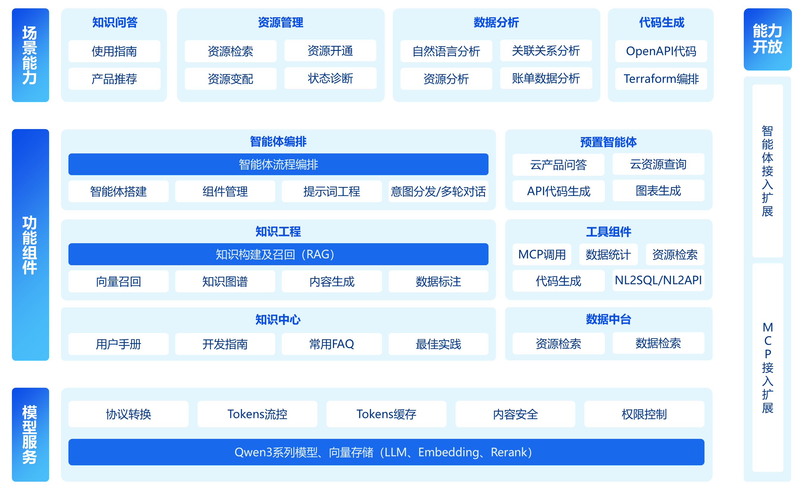

阿里云  
专有云  
飞天助理 产品简介  
产品版本：V3.18.6  
文档版本：20251205

**目录**

- [1.产品详情](#section-1)
- [2.产品价值](#section-2)
- [3.应用场景](#section-3)
- [4.功能特性](#section-4)

# 1.产品详情

本文对飞天助理进行整体介绍。

飞天助理是一款基于大模型和智能体等AI技术的智能化云上服务助手，旨在通过自然语言交互方式，帮助用户简单、高效地使用云产品与服务。将用户管理专有云的方式从基于方法论的人工管理方式，进化到基于人工智能的AI管理模式。

- 统一AI助理：租户侧控制台对外只透出一个AI助理入口，树立客户心智，默认名称统一为“飞天助理（Apsara Copilot）”。

- 多智能体协同：采用多Agent架构，通过意图识别调用最合适的Agent，并支持云产品可按需插件化扩展接入专用的Agent或工具能力，支持解耦升级。

- 全产品线覆盖：支撑企业版核心云产品实现产品控制台的AI能力落地。

# 2.产品价值

本文为您介绍飞天助理的产品价值。

**降低云使用门槛**

面向非专业用户或新手开发者，通过自然语言交互，自动解析意图并生成相关操作说明，减少对复杂控制台操作和API文档的依赖性，提升易用性。

**提升运营效率**

快速理解用户问题，从海量文档、知识库或系统中提取准确信息，减少人工查找时间。飞天助理具有自然语言理解和上下文记忆能力，能够提供连贯、个性化的服务。

**推动人工智能的管理模式**

打造“对话即服务”的交互模式，让云平台更像一个智能伙伴而非工具系统，为未来的自主智能管理打下基础。

# 3.应用场景

本文为您介绍飞天助理的典型使用场景。

**产品知识问答**

对于云产品推荐、功能操作、限制说明及最佳实践等使用类问题，可以通过飞天助理给出准确的回答和指导。

- **使用帮助**：基于专有云用户手册和最佳实践指南，针对用户的使用问题，生成产品使用的操作说明。

- **产品帮助**：针对用户的业务场景诉求，自动给出所需要的云产品以及相关实例规格推荐，并可以直达相关产品控制台页面。

**运营数据分析**

对于运营数据支持通过用户输入的自然语言，自动生成查询的SQL语言，并将返回的查询信息，动态生成图表展示，并在此基础上完成针对资源利用率，健康度和账单费用的分析和优化建议。

- **图表式问答**：支持通过用户输入的自然语言，做意图识别，自动生成SQL语言，并将返回的查询信息，动态生成图表和列表展示。

- **自定义报表**：在数据分析界面支持自然语言输入，帮助数据分析师创建交互式可视化图表，通过自然语言对话进行多维度统计与汇总分析，并自动生成对应报表和图表。

**辅助资源管理**

支持对资源及其关联资源的智能化检索，根据场景给出资源规格的建议，并可以辅助进行资源的开通。

- **资源检索**：通过提问或页面划选的方式，快速查询相关云资源的信息，并支持对其关联资源的拓扑分析。

- **规格选择**：根据用户输入的应用需求，智能分析自动推荐最优ECS实例规避，平衡性能与成本，并支持联动开通创建页面。

**OpenAPI代码生成**

针对开发者的开发场景诉求，自动生成云产品OpenAPI的接口调用样例代码，以及Terraform代码，供参考使用。

**接口代码生成**：可以针对开发者的开发场景诉求，针对性的生成对应云产品OpenAPI的接口调用样例代码，供开发者参考。

**代码一键调试**：对于生成的OpenAPI样例代码，可以点击去调试链接，直达开发者门户里的接口在线调试页面，快速进行调试。

# 4.功能特性

本文介绍飞天助理的典型功能特性。

<table>
  <tr>
    <th width="122">功能</th>
    <th>说明</th>
  </tr>
  <tr>
    <td>个性化配置</td>
    <td>对智能助手中的品牌内容、欢迎语等进行个性化设置。AI助手配置开启显示后，新增飞天助理的交互入口，支持通过飞天助理对话框向AI咨询信息，与AI进行智能对话。</td>
  </tr>
  <tr>
    <td>准确性评测</td>
    <td>提供一站式智能体评测平台。</td>
  </tr>
  <tr>
    <td>知识文档管理</td>
    <td>管理飞天助理使用的知识文档信息，文档的同步与更新。</td>
  </tr>
  <tr>
    <td>飞天助理对话</td>
    <td>提供AI助理的交互入口，吊顶和悬浮球，支持新开对话，多轮对话，对话记录等能力。</td>
  </tr>
  <tr>
    <td>知识问答</td>
    <td>支持基于企业版租户侧的官方文档、可公开的KB库，提供对全量云产品的使用帮助，问题答疑、产品推荐等知识问答能力。支持根据用户的业务场景诉求，给出适合的云产品以及产品规格推荐，并提供相关的直达链接。支持提供用户当前待处理的事项，并支持跳转到对应页面。基于用户的问题，如果多轮对话也未能解决用户的问题，可识别并提示转工单，支持用户提交工单。</td>
  </tr>
  <tr>
    <td>资源管理</td>
    <td>支持识别用户输入的云资源相关的信息，自动查询资源的状态与信息，并给出与其存在关联关系的资源信息。支持采用step by step的方式辅助用户快速完成云资源的创建、变配和释放等操作。支持产品使用引导及菜单导航功能。</td>
  </tr>
  <tr>
    <td>数据分析</td>
    <td>支持基于用户输入的查询类文字，通过意图识别，自动生成SQL语言并返回对应的查询结果，动态生成图表和列表展示结果。支持实时汇总计算资源的运行状态，识别高负载或闲置实例，帮助用户优化资源配置，提升资源利用效率。支持查询账单的数据，根据账单的异常波动数据给出分析和优化建议。</td>
  </tr>
  <tr>
    <td>代码生成</td>
    <td>支持基于开发者输入的功能需求描述和参数信息，给出所需要的步骤指导，生成相关的依赖说明。检索相关的OpenAPI或者资源，给出参数说明和注意事项。对于API场景支持跳转开发者门户的调试页面。生成的代码支持Java、Go和python的Common SDK，IAC场景则支持生成资源编排的Terraform代码。支持开发者输入集成专有云功能的代码进行诊断给出优化建议。</td>
  </tr>
  <tr>
    <td>深度思考能力</td>
    <td>提供深度思考的手动开启方式，让用户自行选择是否通过推理模型来做深度的思考和问题回答。</td>
  </tr>
</table>
