阿里云  
专有云  
飞天助理 用户指南  
产品版本：V3.18.6  
文档版本：20251205

**目录**

- [1.飞天助理访问控制](#section-1)
- [2.飞天助理配置](#section-2)
    - [2.1. 个性化配置](#section-2-1)
    - [2.2. 准确性评测](#section-2-2)
        - [2.2.1. 评测用例管理](#section-2-2-1)
            - [2.2.1.1. 添加用例](#section-2-2-1-1)
            - [2.2.1.2. 管理用例](#section-2-2-1-2)
        - [2.2.2. 评测集管理](#section-2-2-2)
            - [2.2.2.1. 创建评测集](#section-2-2-2-1)
            - [2.2.2.2. 管理评测集](#section-2-2-2-2)
        - [2.2.3. 评测任务管理](#section-2-2-3)
            - [2.2.3.1. 创建评测任务](#section-2-2-3-1)
            - [2.2.3.2. 管理评测任务](#section-2-2-3-2)
    - [2.3. 知识文档管理](#section-2-3)
        - [2.3.1. 创建分组](#section-2-3-1)
        - [2.3.2. 编辑分组](#section-2-3-2)
        - [2.3.3. 删除分组](#section-2-3-3)
        - [2.3.4. 添加文档](#section-2-3-4)
        - [2.3.5. 更新文档](#section-2-3-5)
        - [2.3.6. 查看源文档详情](#section-2-3-6)
        - [2.3.7. 删除文档](#section-2-3-7)
- [3.飞天助理应用](#section-3)
    - [3.1. 飞天助理对话](#section-3-1)
    - [3.2. 划词问答](#section-3-2)
    - [3.3. AI智能分析](#section-3-3)
    - [3.4. AI账单分析](#section-3-4)
- [4.操作审计](#section-4)
- [5.附录](#section-5)
    - [5.1. 登录Apsara Uni-manager运营控制台](#section-5-1)

# 1.飞天助理访问控制

飞天助理支持通过角色的权限点管理实现用户访问控制及功能点权限分配。

**操作步骤**

1. 管理员登录Apsara Uni-manager运营控制台。

2. 在顶部菜单栏，选择**企业**。

3. 在左侧导航栏，选择**权限管理** > **角色授权**。

4. 单击**创建自定义角色**。

5. 依次完成角色基础配置、管理权限、应用权限、菜单权限和自定义权限策略。

   - 基础配置、管理权限、菜单权限和自定义权限策略的详细说明请参见《统一云管平台 用户指南》中的“管理自定义角色”章节。

   - 在**应用权限**中，找到飞天助理产品，根据业务需要，进行角色权限勾选。

     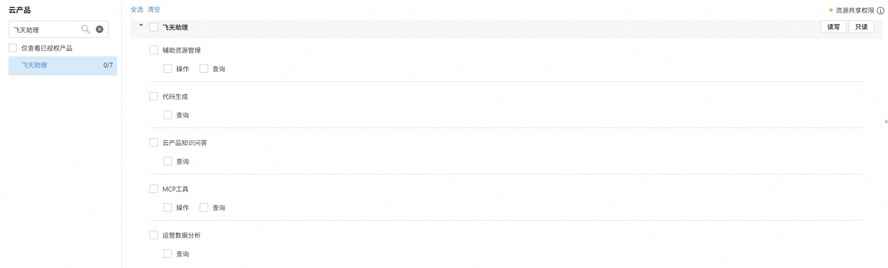

6. 角色创建完成后，将角色授权给用户。

# 2.飞天助理配置

## 2.1. 个性化配置

对智能助手进行启用控制以及AI助手内容的个性化设置。

**前提条件**

操作用户默认为运营管理员用户。

**操作步骤**

1. 登录Apsara Uni-manager运营控制台。

2. 在顶部菜单栏选择**配置**。

3. 在左侧导航栏选择**飞天助理** > **个性化配置**。

4. 在**个性化配置**页面，根据需要对智能助手配置进行更新。当配置需要恢复出厂设置时，可单击页面下方的**恢复出厂设置**，重新登录后生效。

   配置项

   说明

   用于控制飞天助理是否在控制台展示，开启后会展示在悬浮层和顶部导航栏。

    ：表示关闭。

   **是否在平台开启**

    ：表示开启。

   用于控制飞天助理对话框中是否展示内网搜索开关。

    ：表示关闭，对话框中不展示内网搜索开关。

    ：表示开启，对话框中展示内网搜索开关。开启后，需要配置本地

   知识库信息。

   **显示控制**

   > **说明**
   >
   > 内网搜索开关在飞天助理展示后，用户可在对话框中选择是否开启内

   **内网搜索**

   > 网搜索。

   - **知识来源**：默认为**百炼专属版**。

   - **URL**：输入百炼知识中心检索API，可检索到指定空间和知识库下的相关文件。

   - **APP_KEY**：输入生效中的APP_KEY。

   - **工作空间编码**：输入空间管理中的空间编码。

   - **知识库CODE**：输入知识服务中的知识库code。

   <table>
     <tr>
       <th rowspan="9">AI助理设置</th>
       <th>请设置AI 助理语言</th>
       <th>支持<strong>简体中文</strong>、<strong>English</strong>和<strong>繁體中文</strong>。</th>
     </tr>
     <tr>
       <td>助理名称</td>
       <td>建议不超过20个中文汉字或40个字符。默认 AI 助理名称为“飞天助理”。</td>
     </tr>
     <tr>
       <td>欢迎词</td>
       <td>设置进入智能助手的欢迎词。</td>
     </tr>
     <tr>
       <td>首页推荐问题</td>
       <td>设置智能助手首页的推荐问题。单击<strong>添加问题</strong>，可增加首页推荐的问题。单 击问题所在行的，可删除添加的问题。</td>
     </tr>
     <tr>
       <td>免责声明</td>
       <td>设置智能助手的免责声明内容。默认免责声明为“回答内容由AI生成，尚无法保证完全准确，仅供参考。”</td>
     </tr>
     <tr>
       <td>官方备用回答</td>
       <td>设置智能助手的官方备用回答。</td>
     </tr>
     <tr>
       <td>入口图标</td>
       <td>设置智能助手入口的展示图标。建议图片长宽比为1：1（如100像素 x 100像素），格式为gif、png、jpg或jpeg。</td>
     </tr>
     <tr>
       <td>欢迎页图标</td>
       <td>设置智能助手欢迎页的展示图标。建议图片长宽比为1：1（如100像素 x 100像素），格式为gif、png、jpg或jpeg。</td>
     </tr>
     <tr>
       <td>对话图标</td>
       <td>设置智能助手的对话图标。建议图片长宽比为1：1（如100像素 x 100像素），格式为gif、png、jpg或jpeg。</td>
     </tr>
     <tr>
       <td>偏好风格</td>
       <td>回答风格</td>
       <td>支持<strong>专家型</strong>、<strong>简洁性</strong>和<strong>服务型</strong>风格。 • <strong>专家型</strong>：风格严谨、结构清晰、术语规范。适合满足技术人员的深度答疑、架构设计与最佳实践需求。 • <strong>简洁性</strong>：风格言简意赅，信息密度高，无冗余表达。适合快速响应、操作指引与问题排查等场景。 • <strong>服务型</strong>：风格耐心、亲切、积极引导。适合提升员工满意度、服务信任感。</td>
     </tr>
   </table>

   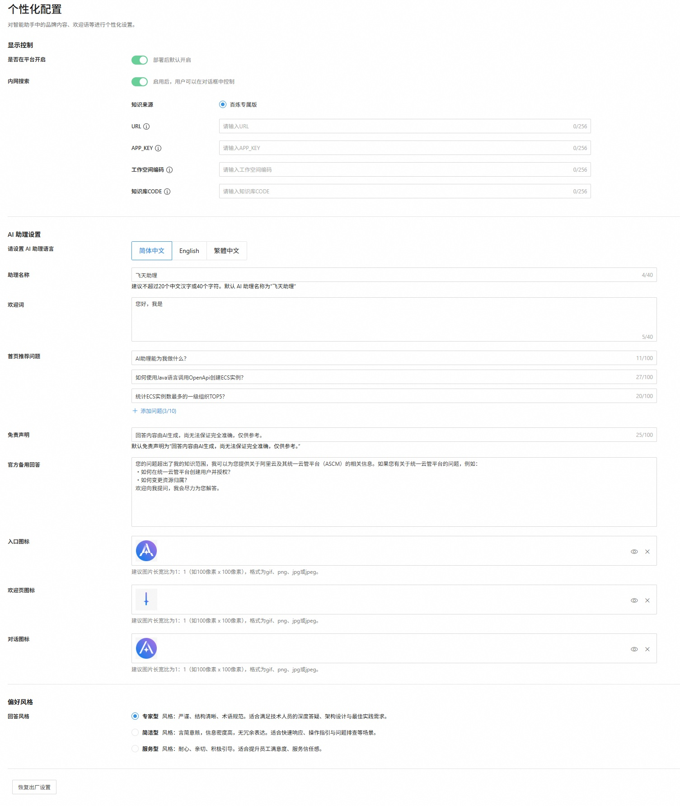

## 2.2. 准确性评测

准确性评测支持对飞天助理进行准确性评估。通过评测用例、评测集和评测任务三级结构完成自动化评估流程，并支持导出详细评测报告。

### 2.2.1. 评测用例管理

#### 2.2.1.1. 添加用例

本文介绍如何添加用例。

**前提条件**

操作用户默认为运营管理员用户。

**操作步骤**

1. 登录Apsara Uni-manager运营控制台。

2. 在顶部菜单栏选择**配置**。

3. 在左侧导航栏选择**飞天助理** > **准确性评测**。

4. 单击**评测用例管理**卡片。

5. 在**评测用例管理**页面，单击**添加用例**。

6. 在**添加评测用例**对话框，设置评测用例信息。

   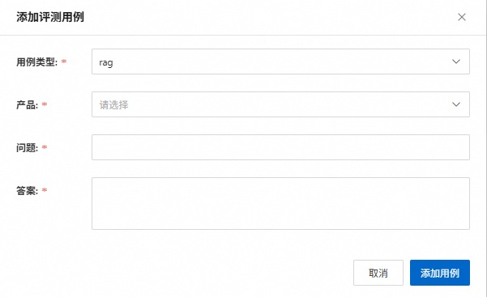

   | 配置项 | 说明 |
   | --- | --- |
   | 用例类型 | 选择用例类型，当前版本仅支持rag类型。 |
   | 产品 | 选择用例对应的产品。 |
   | 问题 | 输入用例的问题。 |
   | 答案 | 输入用例问题对应的答案。 |

7. 单击**添加用例**。

#### 2.2.1.2. 管理用例

用例添加完成后，支持查看和删除。

**前提条件**

- 操作用户默认为运营管理员用户。

- 已完成评测用例创建。

**操作步骤**

1. 登录Apsara Uni-manager运营控制台。

2. 在顶部菜单栏选择**配置**。

3. 在左侧导航栏选择**飞天助理** > **准确性评测**。

4. 单击**评测用例管理**卡片。

5. 管理评测用例。

   <table>
     <tr>
       <th width="90">操作</th>
       <th>说明</th>
     </tr>
     <tr>
       <td>查看用例</td>
       <td>在操作栏单击<strong>查看</strong>，即可查看测评用例的详情，包括关联的评测集。 说明 • 基础信息中的用例编码支持一键复制，鼠标悬停在用例右侧，单击即可复制。  • 在关联评测集操作列，可单击<strong>取消关联</strong>，将当前用例从评测集中移除。</td>
     </tr>
     <tr>
       <td>删除用例</td>
       <td>i. 在用例列表，单击操作列的<strong>删除</strong>。ii. 在弹出的对话框单击<strong>确定</strong>，即可删除该测评用例。</td>
     </tr>
   </table>

### 2.2.2. 评测集管理

#### 2.2.2.1. 创建评测集

本文介绍如何创建评测集。

**前提条件**

- 操作用户默认为运营管理员用户。

- 已完成评测用例的创建。

**操作步骤**

1. 登录Apsara Uni-manager运营控制台。

2. 在顶部菜单栏选择**配置**。

3. 在左侧导航栏选择**飞天助理** > **准确性评测**。

4. 单击**评测集管理**卡片。

5. 在**评测集管理**页面，单击**创建评测集**。

6. 在**创建评测集**对话框，设置评测集信息。

   <table>
     <tr>
       <th width="121">配置项</th>
       <th>说明</th>
     </tr>
     <tr>
       <td>评测集类型</td>
       <td>选择用例类型，当前版本仅支持Rag类型。</td>
     </tr>
     <tr>
       <td>评测集名称</td>
       <td>设置对应评测集的名称。</td>
     </tr>
     <tr>
       <td>描述</td>
       <td>可选，输入评测集的描述。</td>
     </tr>
     <tr>
       <td>选择评测用例</td>
       <td>单击<strong>通过评测用例创建评测集</strong>，支持通过<strong>用例编码</strong>、<strong>问题</strong>、<strong>所属产品</strong>和<strong>参考答案</strong>进行筛选，筛选完成后需要单击<strong>搜索</strong>，筛选条件方可生效。筛选后可以批量选中，单击<strong>全部添加</strong>，即可将选中的用例全部添加至评测集。</td>
     </tr>
   </table>

7. 单击**创建评测集**。

#### 2.2.2.2. 管理评测集

评测集创建完成后，支持查看、编辑和删除。

**前提条件**

- 操作用户默认为运营管理员用户。

- 已完成评测集创建。

**操作步骤**

1. 登录Apsara Uni-manager运营控制台。

2. 在顶部菜单栏选择**配置**。

3. 在左侧导航栏选择**飞天助理** > **准确性评测**。

4. 单击**评测集管理**卡片。

5. 管理评测集。

   <table>
     <tr>
       <th width="106">操作</th>
       <th>说明</th>
     </tr>
     <tr>
       <td>查看评测集</td>
       <td>在操作列单击<strong>查看</strong>，即可进入<strong>评测集用例管理</strong>界面，可以对评测集里的用例进行管理。</td>
     </tr>
     <tr>
       <td>编辑评测集</td>
       <td>i. 在操作列单击<strong>编辑</strong>。ii. 在<strong>编辑评测集</strong>页面，修改<strong>评测集名称</strong>和<strong>描述</strong>。iii. 单击<strong>确定</strong>。</td>
     </tr>
     <tr>
       <td>删除评测集</td>
       <td>i. 在操作列单击<strong>删除</strong>。ii. 在弹出的对话框单击<strong>确定</strong>，即可删除该测评集。</td>
     </tr>
   </table>

### 2.2.3. 评测任务管理

#### 2.2.3.1. 创建评测任务

本文介绍如何创建评测任务。

**前提条件**

- 操作用户默认为运营管理员用户。

- 已完成评测集的创建。

**操作步骤**

1. 登录Apsara Uni-manager运营控制台。

2. 在顶部菜单栏选择**配置**。

3. 在左侧导航栏选择**飞天助理** > **准确性评测**。

4. 单击**评测任务管理**卡片。

5. 在**评测任务管理**页面，单击**创建评测任务**。

6. 在**创建评测任务**对话框，设置评测集信息。

   | 配置项 | 说明 |
   | --- | --- |
   | 评测任务类型 | 选择用例类型，当前版本仅支持rag类型。 |
   | 评测集 | 下拉选择需要进行评测的评测集。 |

7. 单击**创建评测任务**。

   > **说明**
   >
   > 评测任务完成后不会自动执行，需在操作列单击**开始评测**启动评测任务。

#### 2.2.3.2. 管理评测任务

本文介绍对评测任务的管理。

**前提条件**

- 操作用户默认为运营管理员用户。

- 已完成评测任务创建。

**操作步骤**

1. 登录Apsara Uni-manager运营控制台。

2. 在顶部菜单栏选择**配置**。

3. 在左侧导航栏选择**飞天助理** > **准确率测评**。

4. 单击**评测任务管理**卡片。

5. 管理评测任务。

   | 操作 | 说明 |
   | --- | --- |
   | 查看结果 | i. 在操作列单击<strong>查看结果</strong>。ii. 查看用例各项指标的得分情况。 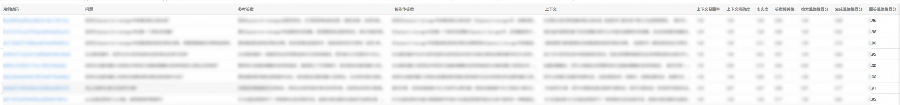 |
   | 查看报告 | i. 单击操作列，选择<strong>查看报告</strong>。 ii. 进入任务的详细报告页面，查看详细的评测分析报告。 |
   | 删除评测任务 | i. 单击操作列，选择<strong>删除</strong>。 ii. 在弹出的对话框单击<strong>确定</strong>，即可删除评测任务。 |
   | 重新评测 | i. 评测任务执行失败时，单击<strong>重新评测</strong>。ii. 在弹出的对话框单击<strong>确定</strong>，可重新执行评测任务。 |

## 2.3. 知识文档管理

管理飞天助理使用的知识文档信息，文档的同步与更新。

### 2.3.1. 创建分组

创建文档的分组。

**前提条件**

操作用户默认为运营管理员用户。

**操作步骤**

1. 登录Apsara Uni-manager运营控制台。

2. 在顶部菜单栏选择**配置**。

3. 在左侧导航栏选择**飞天助理** > **知识文档管理**。

4. 单击**添加知识文档**。

5. 在**创建分组**对话框，输入分组名称。

   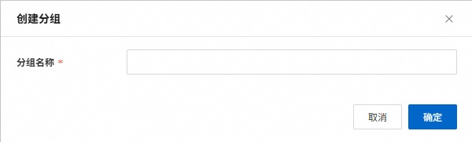

6. 单击**确定**。

### 2.3.2. 编辑分组

更新分组的名称。

**前提条件**

操作用户默认为运营管理员用户。

**操作步骤**

1. 登录Apsara Uni-manager运营控制台。

2. 在顶部菜单栏选择**配置**。

3. 在左侧导航栏选择**飞天助理** > **知识文档管理**。

4. 单击分组卡片上的  ，选择**编辑**。

5. 在**编辑分组**对话框，更新分组名称。

   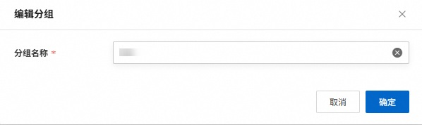

6. 单击**确定**。

### 2.3.3. 删除分组

删除不需要的分组。

**注意事项**

> **重要**
>
> 分组删除后，所有分组下的文档将被删除，不能再被飞天助理使用，请谨慎操作。

**前提条件**

操作用户默认为运营管理员用户。

**操作步骤**

1. 登录Apsara Uni-manager运营控制台。

2. 在顶部菜单栏选择**配置**。

3. 在左侧导航栏选择**飞天助理** > **知识文档管理**。

4. 单击分组卡片上的  ，选择**删除**。

5. 在**删除分组**对话框，输入分组名称进行确认。

   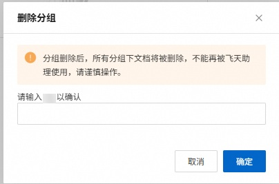

6. 单击**确定**。

### 2.3.4. 添加文档

在分组中添加文档。

**前提条件**

操作用户默认为运营管理员用户。

**操作步骤**

1. 登录Apsara Uni-manager运营控制台。

2. 在顶部菜单栏选择**配置**。

3. 在左侧导航栏选择**飞天助理** > **知识文档管理**。

4. 单击分组卡片，进入文档分组页面。

5. 在**文档分组**页面，单击**添加文档**。

6. 在**添加文档**对话框，选择**关联文档**。

   > **说明**
   >
   > - 选择文档：来源于统一云管平台中**运营** > **服务支持** > **文档管理** > **文档列表**中的文档。
   >
   > - 同步范围：支持选择**包含下级全部文档**或**仅本文档**。

   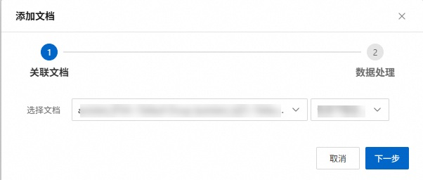

7. 单击**下一步**，查看文档处理进度。

   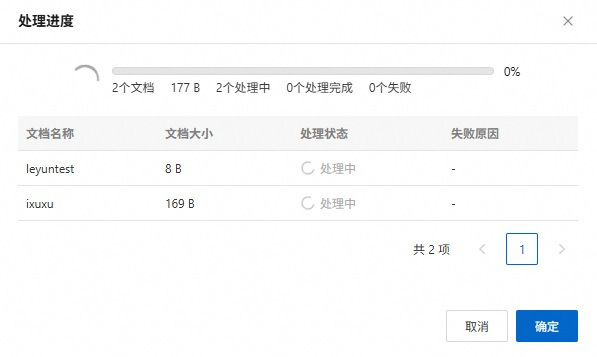

8. 文档处理成功后，在文档列表查看添加的文档。

   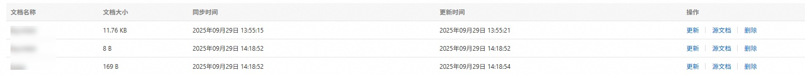

### 2.3.5. 更新文档

更新后，文档将被重新处理，历史数据将被覆盖。

**前提条件**

操作用户默认为运营管理员用户。

**操作步骤**

1. 登录Apsara Uni-manager运营控制台。

2. 在顶部菜单栏选择**配置**。

3. 在左侧导航栏选择**飞天助理** > **知识文档管理**。

4. 单击分组卡片，进入文档分组页面。

5. 在**文档分组**页面，单击文档**操作**列的**更新**。

   

6. 在**更新文档**对话框，单击**确定**。

### 2.3.6. 查看源文档详情

查看源文档详情。

**前提条件**

操作用户默认为运营管理员用户。

**操作步骤**

1. 登录Apsara Uni-manager运营控制台。

2. 在顶部菜单栏选择**配置**。

3. 在左侧导航栏选择**飞天助理** > **知识文档管理**。

4. 单击分组卡片，进入文档分组页面。

5. 在**文档分组**页面，单击文档**操作**列的**源文档**。

   

6. 跳转到源文档的文档详情页面，查看文档详细内容。

### 2.3.7. 删除文档

将添加的文档从文档中移除。

**前提条件**

操作用户默认为运营管理员用户。

**操作步骤**

1. 登录Apsara Uni-manager运营控制台。

2. 在顶部菜单栏选择**配置**。

3. 在左侧导航栏选择**飞天助理** > **知识文档管理**。

4. 单击分组卡片，进入文档分组页面。

5. 在**文档分组**页面，单击文档**操作**列的**删除**。

   

6. 在**确认删除**对话框，单击**删除**。

# 3.飞天助理应用

## 3.1. 飞天助理对话

飞天助理支持用户用自然语言提问平台与云产品相关的问题，向AI咨询信息，与AI进行智能对话。

**前提条件**

运营管理员用户已在Apsara Uni-manager运营控制台的**配置** > **飞天助理** > **个性化配置**中开启智能助手的显示。

**操作步骤**

1. 登录Apsara Uni-manager运营控制台。

2. 在控制台顶部导航栏或悬浮菜单单击  ，进入飞天助理。

   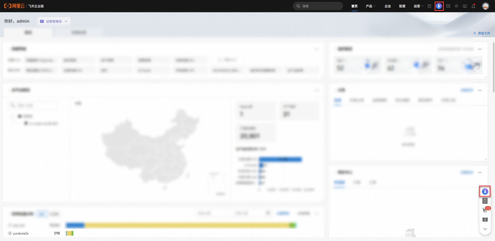

   

3. 在**飞天助理**对话框，输入需要咨询的问题，单击

   。

   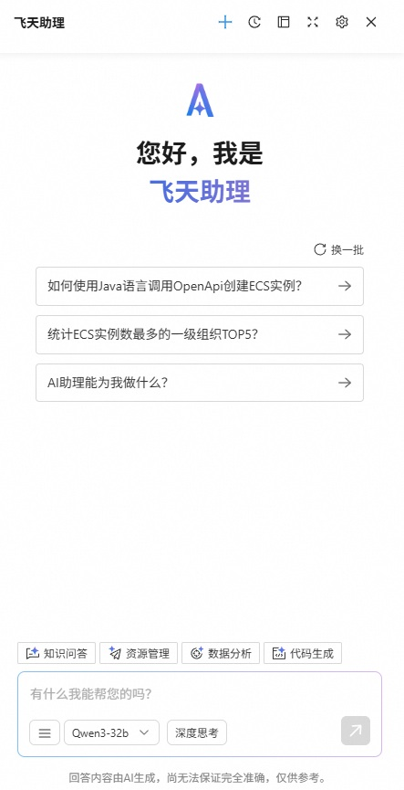

   <table>
     <tr>
       <th width="89">场景</th>
       <th>说明</th>
     </tr>
     <tr>
       <td>知识问答</td>
       <td>包括<strong>产品使用</strong>、<strong>最佳实践</strong>、<strong>限制说明</strong>和<strong>待办事项</strong>等类型。支持基于企业版租户侧的官方文档、可公开的KB库，提供对全量云产品的使用帮助，问题答疑、产品推荐等知识问答能力。支持根据用户的业务场景诉求，给出适合的云产品以及产品规格推荐，并提供相关的直达链接。支持提供用户当前待处理的事项，并支持跳转到对应页面。基于用户的问题，如果多轮对话也未能解决用户的问题，可识别并提示转工单，支持用户提交工单。</td>
     </tr>
     <tr>
       <td>资源管理</td>
       <td>包括<strong>资源检索</strong>、<strong>辅助创建</strong>和<strong>快捷操作</strong>等类型。支持识别用户输入的云资源相关的信息，自动查询资源的状态与信息，并给出与其存在关联关系的资源信息。支持采用step by step的方式辅助用户快速完成部分云资源的创建操作。支持产品使用引导及菜单导航功能。</td>
     </tr>
     <tr>
       <td>数据分析</td>
       <td>包括<strong>自然语言查询</strong>、<strong>使用率分析</strong>和<strong>账单分析</strong>等类型。支持基于用户输入的查询类文字，通过意图识别，自动生成SQL语言并返回对应的查询结果，动态生成图表和列表展示结果。支持实时汇总计算资源的运行状态，识别高负载或闲置实例，帮助用户优化资源配置，提升资源利用效率。支持查询账单的数据，根据账单的异常波动数据给出分析和优化建议。</td>
     </tr>
     <tr>
       <td>代码生成</td>
       <td>包括<strong>OpenAPI样例代码</strong>和<strong>IaC样例代码</strong>等类型。支持基于开发者输入的功能需求描述和参数信息，给出所需要的步骤指导，生成相关的依赖说明。检索相关的OpenAPI或者资源，给出参数说明和注意事项。对于API场景支持跳转开发者门户的调试页面。生成的代码支持Java、Go和python的Common SDK，IAC场景则支持生成资源编排的Terraform代码。支持开发者输入集成专有云功能的代码进行诊断给出优化建议。</td>
     </tr>
   </table>

   > **说明**
   >
   > - 飞天助理支持多种模型，您可以切换不同模型进行提问。当选中的模型支持深度思考时，可以选择或取消深度思考模式。
   >
   > - 单击输入框中的
   >
   >   ，可选择是否开启MCP和内网搜索。
   >
   >   
   >
   >   - 开启MCP并选择接入的云产品后，可以调用云产品MCP服务。
   >
   >   - 内网搜索仅在飞天助理的个性化配置中开启时才会显示。个性化配置中开启展示内网搜索后，才可以在这里启用内网搜索功能。

4. 飞天助理回答内容后，支持如下操作。

    ：赞同，表示认可回答。

    ：点踩，表示不认可回答。

    ：复制，支持复制回答的内容。

    ：导出回答，支持导出生成的回答。

**相关操作**

| 相关操作 | 说明 |
| --- | --- |
| 新对话 | 单击对话框上方的，可新开对话。 |
| 历史对话 | 单击对话框上方的，可查看历史对话记录。 |
| 窗口浮动/窗口吸附 | 单击对话框上方的，可调整飞天助理对话框的位置。窗口浮动状态时可拖动对话框调整到其他位置，窗口吸附状态时默认吸附展示在页面右侧，且不可拖动。 |
| 窗口全屏 | 单击对话框上方的，全屏展示飞天助理对话框。 |
| 设置 | 单击对话框上方的，可选择是否开启划词。开启划词后，鼠标左键在控制台页面划取内容，单击展示的“咨询飞天助理”，自动触发对所选内容的问答能力。 |
| 关闭 | 单击对话框上方的，可关闭飞天助理对话框。 |

## 3.2. 划词问答

通过对控制台页面的划词选择，自动触发对所选内容的问答能力。

**前提条件**

飞天助理已开启划词。

> **说明**
>
> 单击飞天助理对话框上方的  ，可选择开启划词。

**操作步骤**

1. 登录Apsara Uni-manager运营控制台。

2. 鼠标左键在控制台页面划取内容，单击提示的“咨询飞天助理”。

   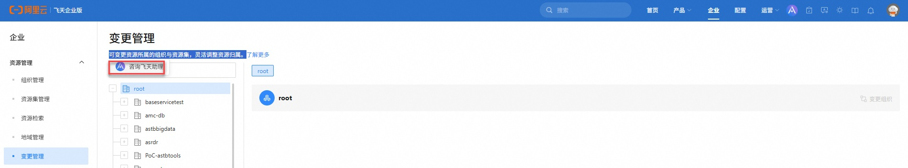

3. 飞天助理自动触发对所选内容的问答能力。

   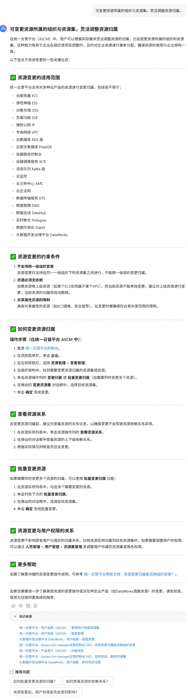

## 3.3. AI智能分析

飞天助理提供基于AI智能分析场景下的数据分析能力。

AI智能分析详细操作请参见《统一云管平台 用户指南》中“数据分析”下的“智能数据”章节。

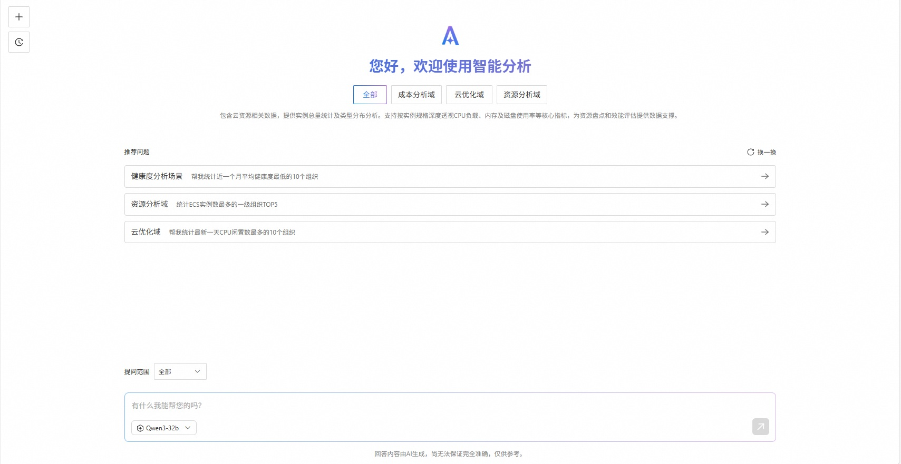

## 3.4. AI账单分析

账单数据繁多，用户难以从数字中发现背后趋势和可能存在的问题，飞天助理提供基于AI的账单分析能力，为平台用户提供账单的多维度洞察，帮助用户更方便快速地了解资源用量及费用情况，合理控制使用成本，同时也为平台运营提供账单的异常波动分析、趋势预测等智能分析，帮助平台保障账单的准确性，并优化运营策略提升收入。

产品账单AI分析详细操作请参见《统一云管平台 用户指南》中“账单管理”下的“产品账单AI分析”章节。

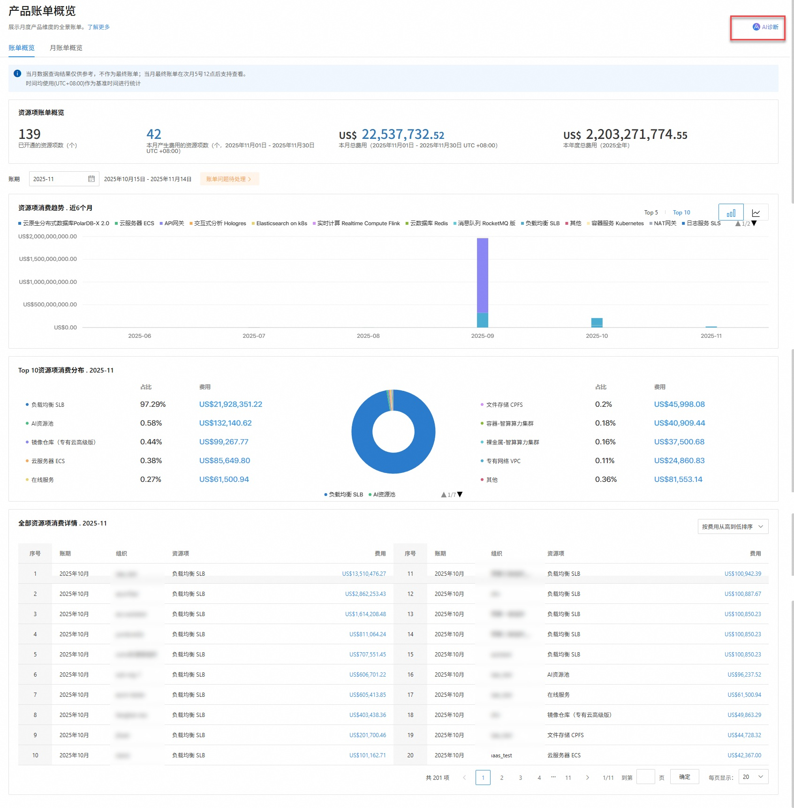

组织账单AI分析详细操作请参见《统一云管平台 用户指南》中“账单管理”下的“组织账单AI分析”章节。

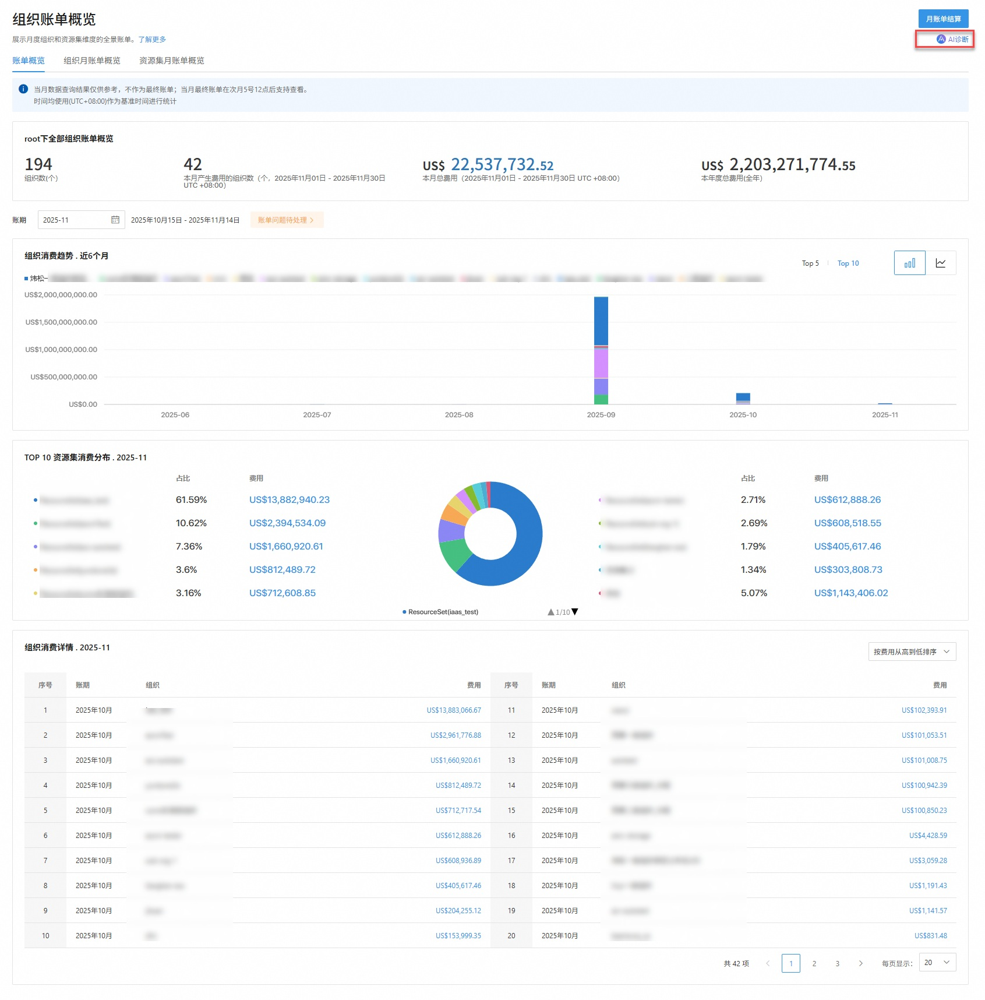

# 4.操作审计

飞天助理支持操作审计日志记录功能。

**操作步骤**

1. 登录Apsara Uni-manager运营控制台。

2. 在菜单中选择**企业**。

3. 在左侧导航栏中选择**操作审计** > **个人操作日志**。

4. 在**个人操作日志**页面，选择组织、产品类型、资源类型、事件类型、资源ID、源IP、事件ID、起止时间等筛选条件后，单击**搜索**。

   > **说明**
   >
   > 产品类型选择**统一云管平台**，资源类型选择**飞天助理**。

5. 在列表查看飞天助理的操作日志记录。

   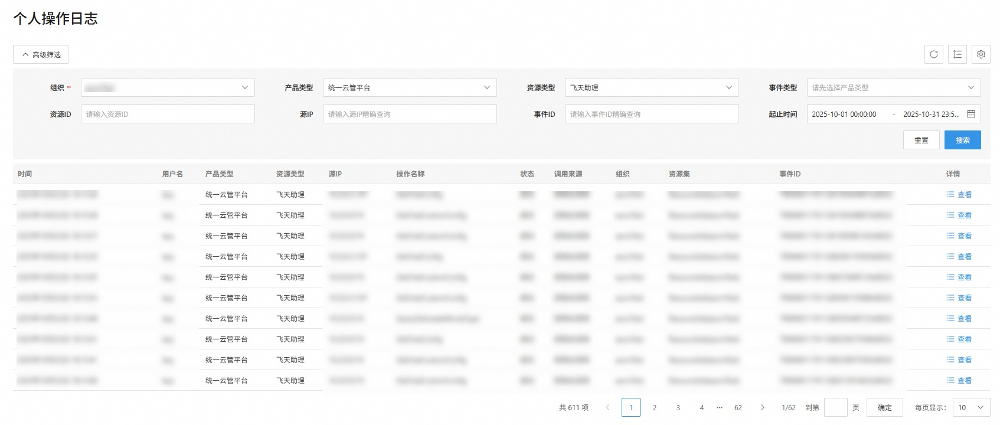

6. 单击列表操作列的**查看**，跳转到**操作详情**面板。

   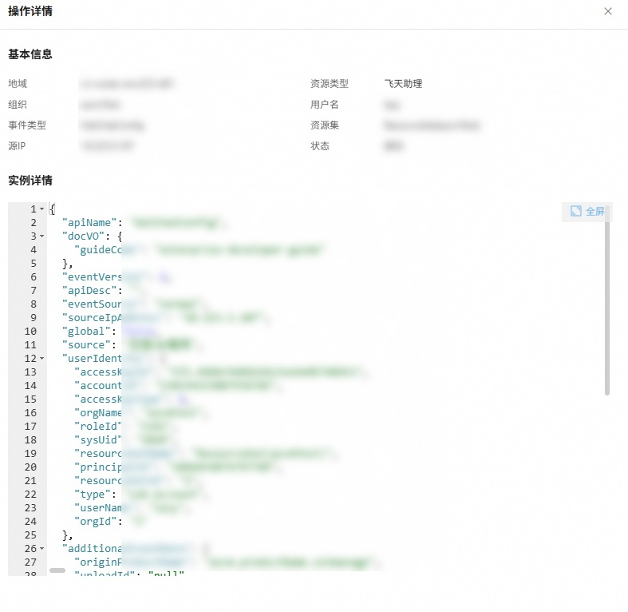

# 5.附录

## 5.1. 登录Apsara Uni-manager运营控制台

本文主要向您介绍如何登录Apsara Uni-manager运营控制台。

**前提条件**

- 登录Apsara Uni-manager运营控制台前，确认您已从部署人员处获取Apsara Uni-manager运营控制台的服务域名地址。

- 推荐使用Chrome浏览器。

**操作步骤**

1. 在浏览器地址栏中，输入Apsara Uni-manager运营控制台的服务域名地址，按回车键。

   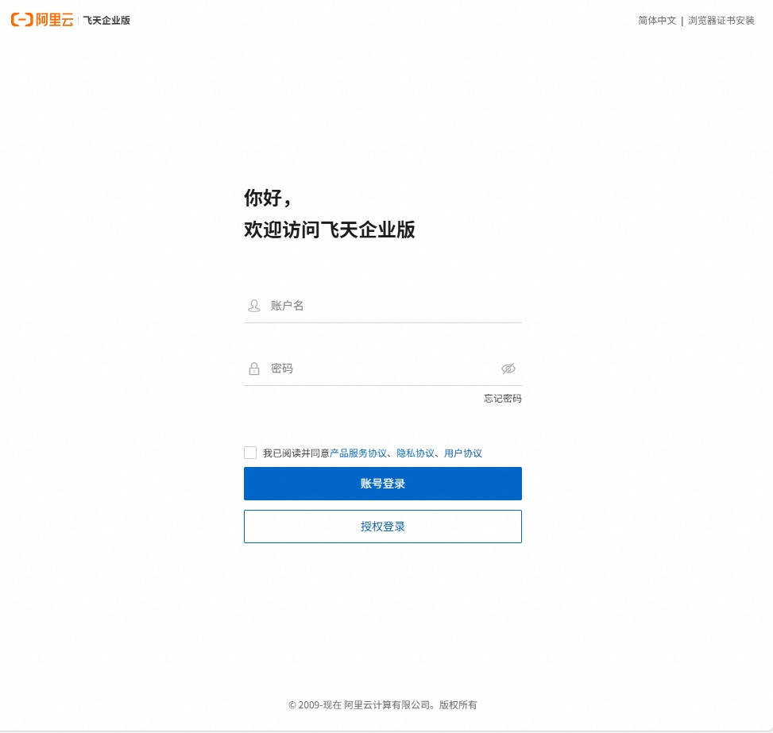

   > **说明**
   >
   > - 单击页面右上角的当前语言可以切换其它语言。

2. 输入正确的用户名及密码。

   > **说明**
   >
   > - 请向运营管理员获取登录控制台的用户名和密码。
   >
   > - 首次登录Apsara Uni-manager运营控制台时，需要修改登录用户名的密码，请按照提示完成密码修改。为提高安全性，密码长度必须为10~32位，且包含英文字母大小写、阿拉伯数字和特殊符号（感叹号（!）、at（@）、井号（#）、美元符号（$）、百分号（%）等）。

3. 勾选**我已阅读并同意产品服务协议、隐私协议、用户协议**。

   > **说明**
   >
   > - 登录页展示的链接文字为文档标题，单击链接文字，可查看协议的详细内容。
   >
   > - **产品服务协议**、**隐私协议**和**用户协议**仅在已发布时才会显示。如果三种类型协议都没有发布，则不需要执行该操作。

4. 单击**账号登录**/**授权登录**。

   > **说明**
   >
   > “授权登录”仅第三方认证的全局IdP设置启用时才会显示，且该显示名称可自定义，默认显示名称为“授权登录”。

5. 如果账号已激活MFA多因素认证，请根据以下两种情况进行操作：

   > **说明**
   >
   > 公网场景下，登录入口默认强制开启多因素认证。

   - **开启MFA后的首次登录**

     <ol type="a">

     <li>

     输入账号密码登录后，展示绑定虚拟MFA设备页面。

     </li>

     <li>

     在绑定虚拟MFA设备页面中，按页面提示步骤绑定虚拟MFA设备。

     </li>

     </ol>

     <ol type="i" start="100">

     <li>

     登录成功，进入控制台。

     </li>

     </ol>

   - **已开启并绑定MFA**

     输入6位MFA码后单击**认证**。

**相关操作**

**忘记密码**

1. 用户忘记登录密码时，单击密码输入框下方的**忘记密码**。

2. 在忘记密码页面，输入**账户名**、**邮箱**和验证码后，单击**确认**。

   

   > **说明**
   >
   > - 账户名请输入当前账号的用户名，邮箱请输入注册账号的Email地址。
   >
   > - 重置密码的链接将发至邮箱，进入链接后用户可输入新密码。
