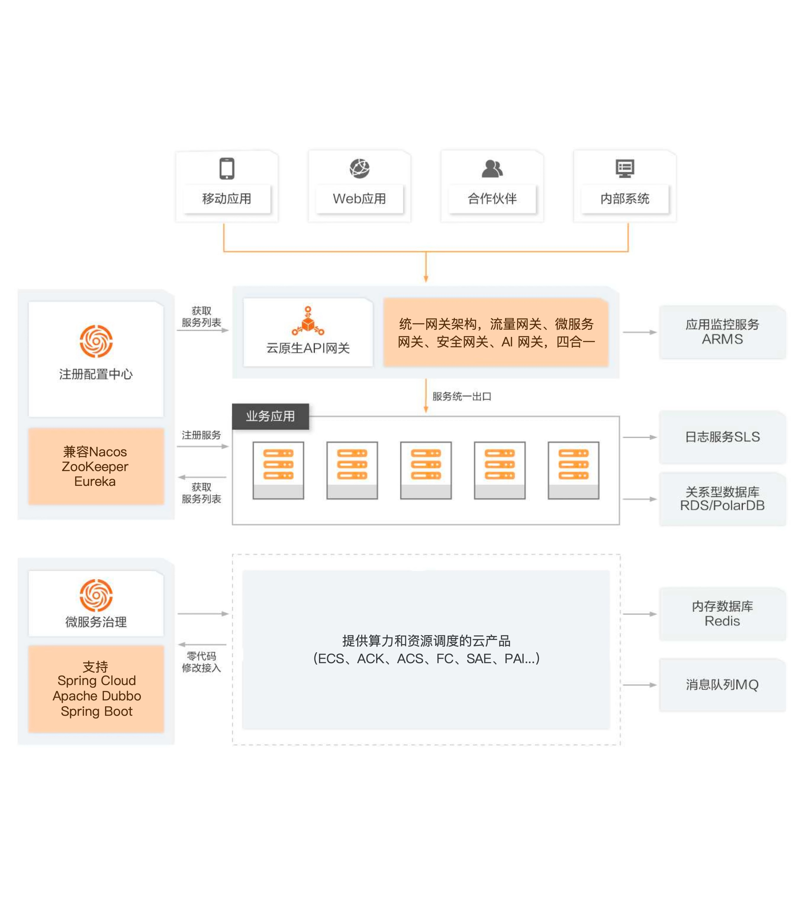
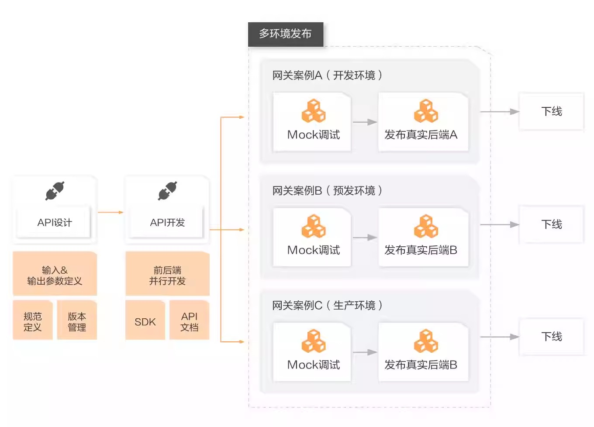

阿里云  
专有云  
API 网关  
产品简介  
产品版本：V3.18.6  
文档版本：20251202

**目录**

- [1.API网关](#section-1)
    - [1.1. 产品详情](#section-1-1)
    - [1.2. 产品价值](#section-1-2)
    - [1.3. 功能特性](#section-1-3)
    - [1.4. 应用场景](#section-1-4)

# 1.API网关

API网关作为现代应用架构的核心组件，承担着统一管理API 和 AI 请求、协调系统间交互的关键角色。其核心价值在于通过标准化接口托管、服务集成与能力开放，构建稳定、高扩展的企业级服务中台。

**产品形态与能力**

阿里云 API 网关分为云原生 API 网关和 AI 网关两个产品。

- 云原生 API 网关深度融合API管理、流量控制及微服务治理能力，是高性能、高扩展性网关。

- AI 网关面向 AI 场景全新打造，统一代理大模型 API 和 MCP Server，并提供丰富的集成和治理能力。

**解决方案与优势**

- **基于开源，优于开源**

  借助Spring Cloud Gateway构建接入层网关及API管理平台，基于大规模的落地经验，极大丰富了网关层流量管理能力，以应对复杂的生产场景。

- **强大的系统架构兼容性**

  既支持对接微服务架构下的注册中心（如Nacos、Eureka、K8s等），监听后端服务及快速发布；又支持协议转换（如WebService、gRPC、Dubbo等），可将不同协议的服务统一管理及发布，为系统间集成提供解决方案。

- **生态开放**

  提供能力开放平台，通过统一的管理和授权，将平台能力对外开放，与合作方进行能力及生态共建。

## 1.1. 产品详情

云原生API网关将流量网关、微服务网关和安全网关三合一，实现碎片化网关的架构统一，提供服务暴露及流量管控、应用流量入口与集成、API全生命周期管理等能力，具有性能更强劲（高出自建1～5倍）、稳定更可靠（技术积淀已久，历经多年双11考验 ）、多重安全防御（mTLS 双向认证、登录认证、集成应用防火墙、自定义安全插件）、扩展性强（提供丰富的插件，支持热更新），是高性能、安全的统一型网关。

**为什么选择云原生API网关**

<table>
  <tr>
    <th width="105">功能</th>
    <th>描述</th>
  </tr>
  <tr>
    <td>开源增强</td>
    <td>100%兼容开源社区产品，无缝对接K8s，并在性能、可观测性、操作便捷上提供加强的能力。</td>
  </tr>
  <tr>
    <td>全托管服务</td>
    <td>提供全托管集群。您只需专注于业务开发，无需部署运维，更专业、更弹性、更可靠。</td>
  </tr>
  <tr>
    <td>高可用性</td>
    <td>提供具备完善的监控和运维能力的实例，优化开源中间件大量可用性痛点。</td>
  </tr>
  <tr>
    <td>拥抱云原生</td>
    <td>产品组件容器化，提供K8s Ingress Controller，与容器服务深度集成。</td>
  </tr>
  <tr>
    <td>可视化</td>
    <td>提供可视化界面。实现API可见、可管、可控。</td>
  </tr>
</table>

更多详细信息，请参见功能特性和产品价值。

**核心概念**

云原生API网关在核心使用上，分为REST API、HTTP API、WebSocket API。

**HTTP API**

基于HTTP协议的接口，以路由为中心。适用于K8s Ingress、微服务架构、AI（SSE）等场景，实现服务的对外快速暴露。

- 在Kubernetes集群中，Ingress对集群服务（Service）中外部可访问的资源进行管理，提供七层负载均衡能力。云原生API网关Ingress是在API网关之上提供更为强大的Ingress流量管理方式，兼容Nginx Ingress以及50多个Nginx Ingress的注解，覆盖90%以上的Nginx Ingress业务场景，支持多服务版本同时灰度发布、灵活的服务治理能力以及全方位的安全防护保障，能够满足大规模云原生分布式应用的流量治理诉求。

- 业务系统间若不需要精细化的API粒度管理，可通过配置路由的方式，定义特定的请求应该由哪个后端服务来处理。路由路径相比API接口往往粒度较粗，如/user/\*，这样可快速配置访问路径，实现系统间的交互。

HTTP API主要面向开发或运维团队，通过路由可以快速实现业务逻辑的拆分和服务的交互，有较高的灵活性，简化业务系统间的调用逻辑。

**REST API**

基于HTTP协议的接口，以资源为导向，通过标准HTTP方法（如GET、POST等）对资源进行操作。适用于API First、跨团队协作、API精细化管控等场景。

- API First（API优先）：是一种软件开发方法论，它强调在设计和开发应用程序时，首先从API的设计开始。这种方法鼓励开发者通过定义和创建API来定义系统边界和服务之间的交互，然后再构建后端服务来实现这些接口。

- API精细化管理：往往应用于对上下游合作伙伴开放、内外部系统接入及协作的使用场景。在这种场景下，服务提供者需要将特定的接口对外开放，并配置接口层级的流量策略，同时需要对消费者提供较为完善的API文档。

Rest API主要面向以业务为中心的开发团队，促进跨团队协作，增强系统的灵活性，并推动业务的快速迭代和敏捷开发。

**WebSocket API**

提供双向实时通信的长连接协议接口，支持数据高效传输，适用于需要即时交互的应用场景，如AI、IoT、游戏、即时通讯和股票报价等。

WebSocket API在核心使用路径上和HTTP API保持一致，以路由为核心，默认提供更长的超时时间。

**主要功能**

| 功能模块 | 说明 | 相关文档 |
| --- | --- | --- |
| 实例管理 | 支持实例生命周期管理，设置实例引擎参数，并根据业务负载对实例进行弹性伸缩。 | 《API网关 用户指南》 &gt;《实例管理》 |
| 接口管理 | 提供了对服务接口生命周期的管理能力，包括创建、编辑、维护、调试、下线等。 | 《API网关 用户指南》 &gt;《接口中心》 |
| 服务开放 | 支持路由分组、路由管理、插件管理和签名管理功能。 | 《API网关 用户指南》 &gt;《服务开放》 |
| 服务调用 | • 认证授权：提供客户端身份认证与接口授权功能。客户端身份认证支持Basic、JWT等多种方式。 • API调试：支持API在线测试功能。 | 《API网关 用户指南》 &gt;《服务调用》 |
| 来源管理 | 支持从Nacos、微服务空间、Eureka和Database发现并导入后端服务。 | 《API网关 用户指南》 &gt;《来源管理》 |
| 策略管理 | 支持多种策略的全生命周期管理。 | 《API网关 用户指南》 &gt;《策略管理》 |
| 网关级联 | 提供了一种多个网关之间协作的方式，从而打通多个网关之间的路由和服务，使得一个网关用户可以调用到另一个网关管理的服务。 | 《API网关 用户指南》 &gt;《级联管理》 |
| 观测与分析 | 支持网关实例监控、日志检索、日志投递、链路追踪以及API监控等功能。 | 《API网关 用户指南》 &gt;《网关日志》 |

## 1.2. 产品价值

API网关具有高性能、稳定可靠、轻量级、简便易用、跨协议开放互联以及一站式服务管理等特点。

**高性能稳定可靠**

稳定可靠地支持大规模请求，基于阿里巴巴内部长期使用与沉淀的高可用、高性能分布式集群技术产品构建。

**轻量级简便易用**

实现企业业务能力的高效数字化输出和迅捷变更。

- API 发布、配置变更便捷灵活。

- API 调用简单方便。

- 处理能力按需简便扩容。

**跨协议开放互联**

实现从简单的应用间调用，到新建与遗留系统之间，以及企业组织间的能力互通。

- 支持不同系统、协议服务安全可控的互联，对接企业原有系统和账号体系。

- 支持复杂结构参数转换，以及多种常用协议的服务 API 发布和消费。

**微服务集成**

可以对接 SpringCloud/Dubbo/HSF 等多种微服务后端应用。

**一站式服务管理**

整体把握控制跨平台、跨系统、跨企业组织的能力开放，实现能力的统一管理、组织和互动。

- 完整的 API 生命周期管理，服务目录，服务授权，用户管理。

- 角色化的服务发布者、消费者、管理者，以及灵活的权限管理。

**高度适配AI场景**

AI网关具备高并发架构、毫秒级无中断配置、WASM热插件与全场景插件生态，支持SSE流式协议及资源优化，实现AI服务的稳定性、扩展性与易用性。

- 企业级可靠性保障：基于高并发场景的坚实底座，可实现零中断的智能配置更新。

- 灵活扩展能力：覆盖全场景的插件生态，通过WASM沙箱实现热插件架构革新。

- 开箱即用的安全与易用性：标准化控制台与白屏化配置，具备高度自动化能力，可实现极简部署。

- 高效流式处理引擎：支持全链路流式协议，提升资源利用率，降低基础设施成本，并实现性能突破。

更多信息，请参见<strong>《AI网关 产品简介》 > 《产品价值》</strong>。

## 1.3. 功能特性

API网关作为一种全托管的服务，为企业提供了一个统一的平台来管理和保护API的整个生命周期，包括设计、开发、测试、发布和下线。

云原生网关作为Kubernetes外部流量的入口，支持Ingress和Gateway API，提供第七层路由和负载均衡功能，兼容Nginx-ingress注解，便于用户以低成本实现迁移，从而实现云原生环境下的流量管理。微服务网关与微服务生态系统深度适配，能够对接Nacos、Zookeeper等注册中心，支持Dubbo和gRPC协议的转换，并可直接对接Dubbo和Spring Cloud等微服务框架，充当微服务应用的统一入口。

**云原生网关**

<table>
  <tr>
    <th width="106">功能点</th>
    <th>详细说明</th>
  </tr>
  <tr>
    <td>实例管理</td>
    <td>• 实例生命周期管理：涵盖网关实例的创建、启动、停止、删除、升级、扩容、缩容等全生命周期管理。 • 实例引擎参数：支持设置实例引擎参数。 • 弹性伸缩：支持根据业务负载自动调整网关实例的数量，以应对流量峰谷变化。</td>
  </tr>
  <tr>
    <td>路由管理</td>
    <td>支持对网关路由进行添加、变更和删除操作；支持发布和下线操作。</td>
  </tr>
  <tr>
    <td>插件管理</td>
    <td>支持插件市场和全局插件。</td>
  </tr>
  <tr>
    <td>消费者管理</td>
    <td>• 消费者生命周期：支持注册/停用/删除API的调用方或用户，为其分配访问权限。 • 消费者授权：支持为消费者分配API访问权限，并控制其可调用的API。</td>
  </tr>
</table>

<table>
  <tr>
    <td>策略管理</td>
    <td>• 鉴权策略：包含JWT、BASIC、APIKEY、自定义鉴权等鉴权手段，以保护程序的安全。 • 流控策略：对请求速率进行限制，以防止网络中瞬时大量数据对网络造成冲击，从而确保用户网络的高效与稳定运行。 • 超时策略：限制网关转发请求的最大超时时间。 • 熔断策略：在网关侧组织对服务提供方的调用，以保护应用业务。 • 跨域策略：通过网关，允许一个域下的文档或脚本请求另一个域下的资源。 • IP黑白名单策略：对请求的来源IP进行限制，以增强后端服务的安全性。 • 请求追踪策略：为经过本网关的请求添加一个请求追踪请求头，以便通过该请求头追踪请求链路。 • ACL权限控制策略：控制具有权限的消费者能够访问该服务。</td>
  </tr>
  <tr>
    <td>域名管理</td>
    <td>• 域名操作：支持用户添加/删除自定义域名到API网关，实现通过域名访问API。 • 协议与证书：允许更新域名的SSL/TLS证书或协议配置，确保安全通信。提供配置HTTPS传输使用的加密算法和套件，优化安全性。</td>
  </tr>
</table>

**微服务网关**

<table>
  <tr>
    <th width="106">功能点</th>
    <th>详细说明</th>
  </tr>
  <tr>
    <td>实例管理</td>
    <td>• 实例生命周期管理：涵盖网关实例的创建、启动、停止、删除、升级、扩缩容等全生命周期管理。 • 弹性伸缩：支持根据业务负载自动调整网关实例的数量，以应对流量峰谷变化。</td>
  </tr>
  <tr>
    <td>来源管理</td>
    <td>• Nacos：支持从Nacos发现并导入后端服务。 • EDAS微服务空间：支持从EDAS微服务空间发现并导入后端服务。 • Eureka：支持从Eureka发现并导入后端服务。 • Database：支持从Database发现并导入后端服务。</td>
  </tr>
  <tr>
    <td>服务开放</td>
    <td>• 路由分组：支持将一组相关的路由进行逻辑上的分组管理，以便统一应用策略、流量分配或实现灰度发布等复杂的路由场景。 • 路由管理：支持对网关路由进行添加、变更和删除操作，还可以进行发布和下线操作。 • 插件管理：支持插件市场和全局插件。 • 签名管理：支持签名认证，支持 HMAC（SHA-1, SHA-256，SM3）算法签名。</td>
  </tr>
  <tr>
    <td>消费者管理</td>
    <td>• 消费者生命周期：支持注册/停用/删除 API的调用方或用户，为其分配访问权限。 • 消费者授权：支持为消费者分配API访问权限和控制其可调用的API。</td>
  </tr>
  <tr>
    <td>API调试</td>
    <td>支持API在线测试功能，以便验证API的可用性和正确性，简化开发和调试流程。</td>
  </tr>
  <tr>
    <td>策略管理</td>
    <td>• 鉴权策略：包含 JWT、BASIC、APIKEY、自定义鉴权等鉴权手段，以保护程序的安全。 • 流控策略：限制请求的速率，以防止网络中瞬时大量数据对网络造成冲击，从而确保用户网络的高效与稳定运行。 • 超时策略：限制网关转发请求的最大超时时间。 • 熔断策略：在网关侧组织对服务提供方的调用，以保护应用业务。 • MOCK策略：在程序运行过程中，设定过滤规则及返回值，以满足固定的数据解析，解决不容易构造或者获取的数据对象。 • 签名策略：为通过网关的请求生成签名。 • 跨域策略：通过网关，使得一个域内的文档或脚本能够请求另一个域内的资源。 • 缓存策略：将已返回的响应进行缓存，避免重复请求后端服务的同一份资源。 • IP黑白名单策略：对请求的来源IP进行限制，以增强后端服务的安全性。 • 请求追踪策略：为经过本网关的请求添加一个请求追踪请求头，以便通过该请求头追踪请求的完整链路。 • ACL权限控制策略：控制具有权限的消费者能够访问该服务。</td>
  </tr>
  <tr>
    <td>级联管理</td>
    <td>• 级联网关：管理源端和级联端的路由、消费者和签名。在复杂的多环境互通场景下，该平台提供了级联发布管理机制，即跨网关实例的服务自动发布。该机制能够将某个网关实例上已接入的服务自动同步至级联网关，供消费者访问，从而实现跨环境的服务自动发布与互通。 • 级联链路：在级联场景中，需定义网关实例之间的级联关系，并确保网络的可达性。路由访问信息将自动同步，同时对应的凭证、签名及部分治理策略也将自动同步，以便于其他环境中的消费者进行调用，并确保统一的流量治理策略得以实施。</td>
  </tr>
  <tr>
    <td>域名管理</td>
    <td>• 域名操作：支持用户添加/删除自定义域名到API网关，实现通过域名访问API。 • 协议与证书：允许更新域名的SSL/TLS证书或协议配置，确保安全通信。提供配置HTTPS传输使用的加密算法和套件，优化安全性。</td>
  </tr>
</table>

**观测分析**

| 功能点 | 详细说明 |
| --- | --- |
| 监控与指标 | 支持实时查看API网关的性能指标、健康状态和请求量等监控数据。 |
| 日志管理 | 支持将API网关的访问日志、错误日志等信息投递到指定存储或分析服务。 |
| 链路追踪 | 支持启用分布式追踪功能，分析请求在整个系统中的流转过程。 |
| API级别监控 | 支持查看特定REST API，及其接口的性能指标和访问统计数据。 |

## 1.4. 应用场景

本文介绍API网关的核心应用场景。

**经典应用服务暴露及流量管控**

<strong>服务暴露及流量管控：</strong>兼容 K8s Ingress 标准，支持微服务、函数服务等多种后端服务，支持 K8s、Nacos 等多种发现方式，具备高集成、易使用、易扩展、热更新的特点。

- 容器及微服务的流量管理：作为容器服务的接入层，兼容 K8s Ingress 标准，提供精细化的路由或 API管控。支持一键导入K8s SVC 或 Nacos 注册服务，请求直连 Pod IP，支持 Nginx Ingress 核心注解扩展，并提供限流、预热、灰度等服务治理能力。

- 多活容灾：用于多个集群的统一接入层，进而实现容灾多活等功能。支持 ACK、MSE Nacos，FC，DNS 域名，IP 固定地址等多种服务来源， 可按比例/请求内容精准路由，支持健康检测，服务 fallback。

**API 全生命周期管理**

<strong>API 全生命周期管理：</strong>提供 API 设计、开发、发布及下线的全生命周期管理能力，并支持多环境管理，帮助团队更高效、安全地管理和发布 API，推动业务的快速迭代和创新。

- 开发规范化，效率提升：通过 API 全生命周期管理，开发者可以基于 API First 的模式实现前后端的并行开发，实现系统的快速迭代。

- API 精细化管理：在上下游合作伙伴开放、内外部系统接入及协作的使用场景下，实现 API 的精细化管理，避免开放范围的失控。

- 多环境管理：通过多环境管理，开发、测试、预生产和生产环境可以相互独立，避免在开发和测试过程中对生产环境造成影响，同时也便于进行不同阶段的测试和验证。

