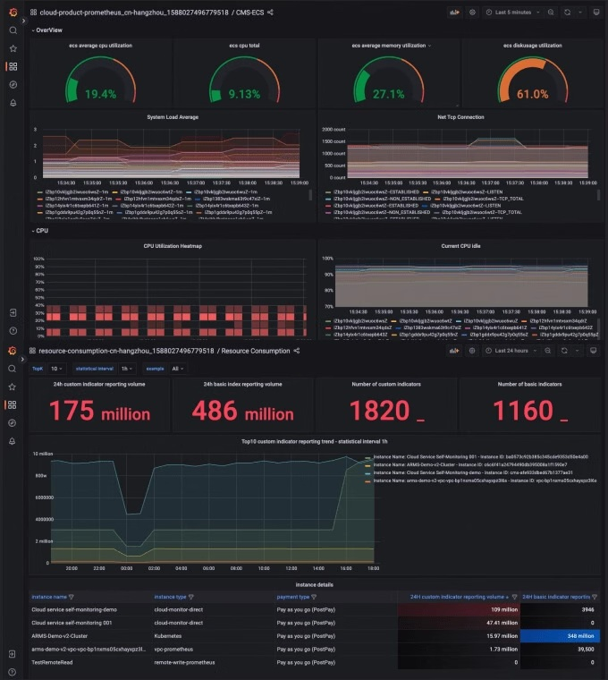
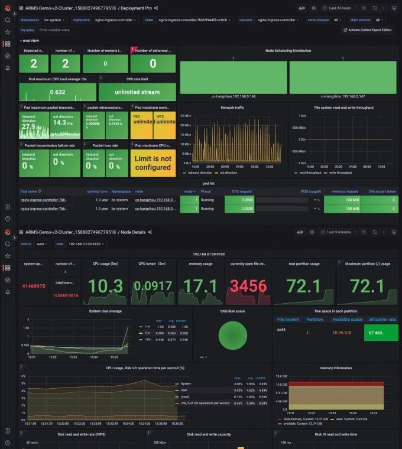
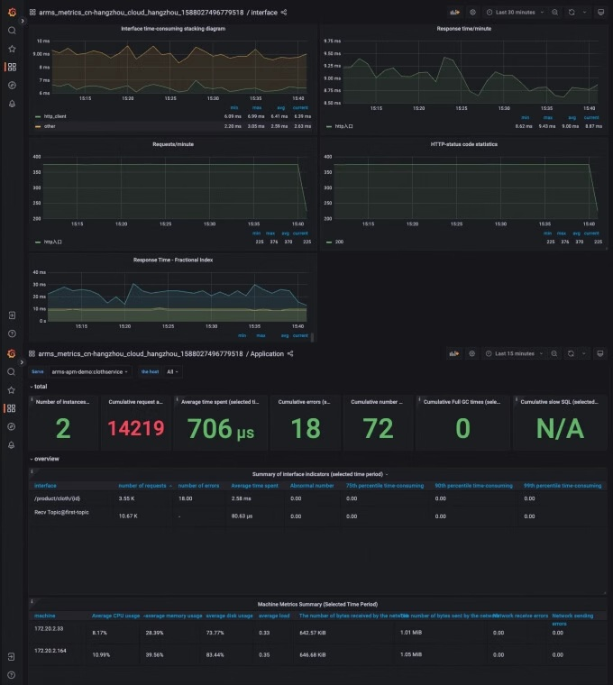
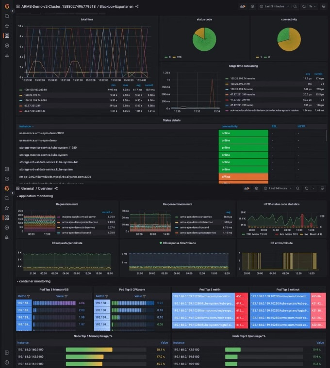
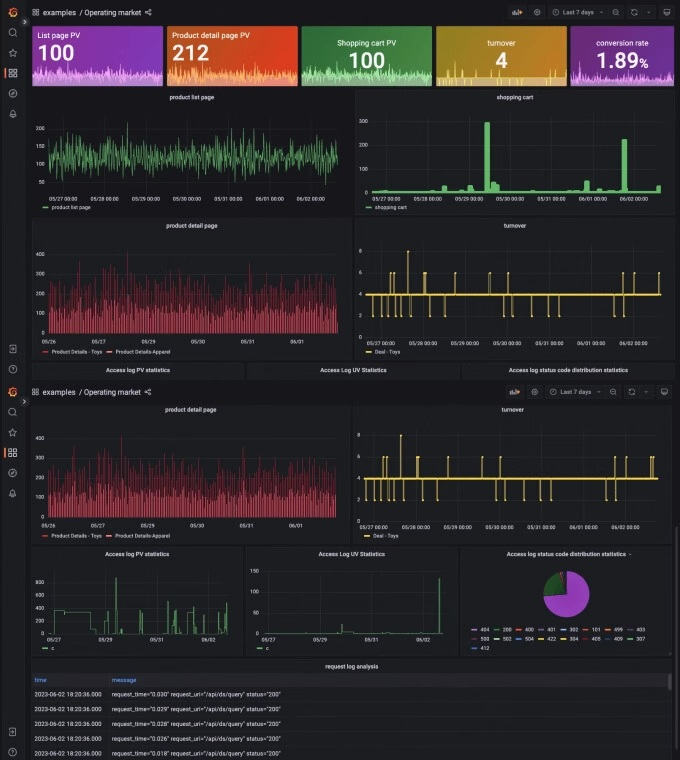

阿里云  
专有云  
可观测监控 Prometheus 版  
产品简介  
产品版本：V3.18.6  
文档版本：20260422

**目录**

- [1.Prometheus监控](#section-1)
- [2.产品详情](#section-2)
- [3.产品价值](#section-3)
- [4.功能特性](#section-4)
- [5.应用场景](#section-5)

# 1.Prometheus监控

阿里云Prometheus监控全面对接开源Prometheus生态，支持类型丰富的组件监控，提供多种开箱即用的预置监控大盘，且提供全面托管的Prometheus服务。

# 2.产品详情

Prometheus监控提供服务发现、指标采集、大盘展示、Agent水平扩容等能力，同时支持自定义可视化大盘、为容器指标创建告警等功能。

**服务发现（ServiceMonitor、PodMonitor）**

- 支持使用CRD ServiceMonitor的方式满足来用户自定义服务发现的采集需求。通过使用ServiceMonitor，用户可以自行定义Pod发现的Namespace范围以及通过MatchLabel来选择监听的Service。

- 支持通过识别集群Pod的Annotations配置，自动发现需要采集指标的Pod。

**容器集群Metrics采集**

- 兼容标准Prometheus监控的数据采集能力，支持容器Node、GPU、Kube State等数据采集。

- 支持查看Targets采集的Metrics指标信息。

**Grafana大盘展示**

默认支持K8s DaemonSet、K8s State、K8s StatefulSet、Kubernetes容器副本、Kubernetes概览、Kubernetes部署、Node Summary、Node TopN、Physical Resources、Pod TopN、Prometheus主机详情等大盘。

Prometheus监控通过Grafana大盘展示监控数据。

**Prometheus Agent安装及水平伸缩（HPA）**

支持通过Helm2和Helm3方式安装Prometheus Agent，同时支持对基于持久化的关键状态的采集器Agent自动扩容。

**可视化中心（自定义仪表盘）**

支持快速创建可视化分析仪表盘，使用PromQL表达式定义集群数据，可选折线图、面积图、柱状图、条状图、饼图、翻牌器、仪表盘等类型图表，自定义图表样式，托拉拽图表大小，实时洞察系统运行状态，可视化分析运营发展趋势。同时仪表盘支持过滤、自动刷新、分组、导入导出等功能。

**告警管理（自定义告警+告警模板）**

支持对集群上报的指标添加告警策略配置，提供多种内置容器告警模板和自定义PromQL表达式配置数据，支持电话、短信、邮件、钉钉等多种告警通知渠道，当系统发生异常可及时通知到对应的负责人，同时也支持告警抑制、告警屏蔽、告警收敛等告警压缩机制。

**统一的接入管理**

支持将已接入的ACK托管版集群统一到**接入管理**页面集中管理，在**接入管理**页面可以进行服务发现配置，Prometheus探针安装卸载管理，Prometheus Agent自监控大盘展示等集群内容统一管理入口。

# 3.产品价值

与开源Prometheus监控相比，阿里云Prometheus监控具有稳定、省时、资源占用小等优势。

**落地更快，比开源节省快50倍时间**

阿里云Prometheus监控无需部署，默认完成对Grafana和Alertmanager的集成，提供预置监控大盘，能够一体化Agent，自动完成部署和采集配置，10分钟完成对K8s集群的监控。

**架构更稳定，支持水平扩展，采用高可用架构**

阿里云Prometheus监控数据处理支持水平扩展，数据存储采用高可用架构，Agent端使用自动重传机制，并引入消息队列应对高流量。

**业务侵入性更小，Agent资源占用整体比开源少50%**

阿里云Prometheus监控使用一体化Agent，单进程运行，能够限制Agent资源占用，优化了内存和CPU的消耗。

# 4.功能特性

**接入中心**

<table>
  <tr>
    <th width="122">功能点</th>
    <th>详细说明</th>
  </tr>
  <tr>
    <td>容器服务接入</td>
    <td>支持将容器服务集群接入Prometheus监控平台，实现集群及工作负载的一体化监测。</td>
  </tr>
  <tr>
    <td>自定义接入</td>
    <td>支持自定义集成服务发现，进行自定义采集接入，查看指标、大盘和告警信息。</td>
  </tr>
  <tr>
    <td>云服务接入</td>
    <td>支持企业云监控集成和云产品自监控集成，查看云产品的监控数据。</td>
  </tr>
  <tr>
    <td>组件监控接入</td>
    <td>一键安装配置组件并提供开箱即用的专属监控大盘。</td>
  </tr>
</table>

**实例管理**

<table>
  <tr>
    <th width="90">功能点</th>
    <th>详细说明</th>
  </tr>
  <tr>
    <td>集成中心</td>
    <td>作为Prometheus实例入口，支持一键安装开发组件对象，灵活查看指标、服务发现配置和Grafana大盘。</td>
  </tr>
  <tr>
    <td>大盘列表</td>
    <td>支持查看Prometheus实例下的所有大盘信息和核心指标。</td>
  </tr>
  <tr>
    <td>服务发现</td>
    <td>提供多种服务发现机制，优化Kubernetes集群和ECS的监控范围，确保采集所需指标数据。</td>
  </tr>
  <tr>
    <td>设置</td>
    <td>支持查看探针基本信息和健康检查结果，设置Agent副本数及重启探针。</td>
  </tr>
</table>

**全局配置**

<table>
  <tr>
    <th width="90">功能点</th>
    <th>详细说明</th>
  </tr>
  <tr>
    <td>聚合实例</td>
    <td>提供地域级别的GlobalView聚合实例功能，实现统一的指标查询和告警。</td>
  </tr>
</table>

**告警管理**

| 功能点 | 详细说明 |
| --- | --- |
| Prometheus告警规则 | 创建针对特定Prometheus实例的告警规则，满足条件后生成告警事件，支持多种通知方式。 |
| Prometheus告警规则模板 | 为多个跨地域Prometheus实例创建相同的告警规则，提升规则管理效率。 |

**数据投递**

<table>
  <tr>
    <th width="154">功能点</th>
    <th>详细说明</th>
  </tr>
  <tr>
    <td>创建数据投递任务</td>
    <td>将数据从一个Prometheus实例远程写入另一个实例，或流转至其他云产品（如Kafka、MaxCompute）。</td>
  </tr>
</table>

# 5.应用场景

可观测监控 Prometheus 版适用于统一监控云服务（如ECS、Kafka）、容器性能（ACK）、应用（ARMS），支持多云/IDC组件及自定义指标，实现全链路运维观测。

**云服务统一指标观测**

可观测监控 Prometheus 版结合云监控CMS产品，支持将众多云服务指标数据统一展现、查询、告警，为运维团队提供更便捷的日常运维观测界面。

**容器层指标观测**

与阿里云容器服务 ACK 深度集成，配置容器集群过程中即可开启。针对容器提供工作负载性能监控、ingress 性能监控、CoreDNS 性能监控等组件， 并提供专属观测大盘覆盖容器服务、应用组件、云服务和应用自身观测指标，同步云资源 Tag 进行业务维度监控数据展现。

<strong>观测对象：</strong>容器服务 ACK。

**应用性能指标观测**

与应用实时监控服务 ARMS 集成，一键接入应用性能观测指标，预置应用性能指标观测大盘。并支持服务发现方式，上报应用性能数据。

<strong>观测对象：</strong>应用实时监控服务 ARMS。

**多云应用组件指标观测**

针对三方云/线下 IDC 中心提供相应 Exporter 接入方案，满足第三方云/线下 IDC 内组件指标观测需求。详细信息，请参见<strong>《可观测监控 Prometheus 版 用户指南》 > 《通过ServiceMonitor创建服务发现》</strong>。

**业务自定义指标观测**

根据业务特点，设定业务目标指标、业务服务质量指标、技术组件指标、基础资源指标，通过指标自定义，配置相关抓取任务，关联指标完整展现，提升数据关联性。

<strong>观测对象：</strong>日志服务 SLS；检索分析服务 Elasticsearch 版。

