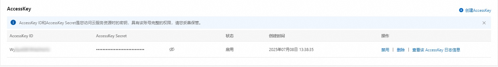

阿里云  
专有云  
可观测监控 Prometheus 版  
开发指南  
产品版本：V3.18.6  
文档版本：20260422

**目录**

- [1.SDK下载](#section-1)
- [2.请求示例说明](#section-2)
- [3.获取接口参数](#section-3)
- [4.API参考](#section-4)
    - [4.1. ListDashboards](#section-4-1)
    - [4.2. SearchAlertContact](#section-4-2)
    - [4.3. SearchAlertContactGroup](#section-4-3)

<a id="section-1"></a>

# 1.SDK下载

Prometheus监控提供Java、TypeScript、Go、PHP、Python和C#的SDK，本文介绍下载方法。

<table>
  <tr>
    <th width="182">下载SDK</th>
    <th>下载方式</th>
  </tr>
  <tr>
    <td>下载Java SDK</td>
    <td>请在pom.xml文件中添加以下Maven依赖来下载Java SDK：<br><code>&lt;dependency&gt;</code><br><code>&lt;groupId&gt;com.aliyun&lt;/groupId&gt;</code><br><code>&lt;artifactId&gt;arms20190808&lt;/artifactId&gt;</code><br><code>&lt;version&gt;1.0.0&lt;/version&gt;</code><br><code>&lt;/dependency&gt;</code></td>
  </tr>
  <tr>
    <td>下载TypeScript SDK</td>
    <td>请运行以下命令下载TypeScript SDK：<br><code>npm install @alicloud/arms20190808@1.0.0</code></td>
  </tr>
  <tr>
    <td>下载Go SDK</td>
    <td>请运行以下命令下载Go SDK：<br><code>go get github.com/alibabacloud-go/arms-20190808</code></td>
  </tr>
  <tr>
    <td>下载PHP SDK</td>
    <td>请运行以下命令下载PHP SDK：<br><code>composer require alibabacloud/arms-20190808 1.0.0</code></td>
  </tr>
  <tr>
    <td>下载Python SDK</td>
    <td>请运行以下命令下载Python SDK：<br><code>pip install alibabacloud_arms20190808==1.0.0</code></td>
  </tr>
  <tr>
    <td>下载C# SDK</td>
    <td>请运行以下命令下载C# SDK：<br><code>dotnet add package AlibabaCloud.SDK.ARMS20190808 --</code><br><code>version 1.0.0</code></td>
  </tr>
</table>

<a id="section-2"></a>

# 2.请求示例说明

本文以ListDashboards接口为例介绍如何进行Prometheus监控的接口访问。以下示例使用Java Apache HTTP Client、Python脚本发送HTTP Post请求等方式获取数据。

**Java请求示例**

```java
package com.aliyun.sample;
import com.aliyun.tea.*;
import com.aliyun.arms20190808.*;
import com.aliyun.arms20190808.models.*;
import com.aliyun.teaopenapi.*;
import com.aliyun.teaopenapi.models.*;
public class Sample {
 /**
 * 使⽤AK&SK初始化账号Client
 *
 * @param accessKeyId
 * @param accessKeySecret
 * @return Client
 * @throws Exception
 */
 public static com.aliyun.arms20190808.Client createClient(String accessKeyId, String
accessKeySecret) throws Exception {
 Config config = new Config().setAccessKeyId(accessKeyId)
                    .setAccessKeySecret(accessKeySecret)
                    .setRegionId(“${regionId}”); //prometheus产品所在regionId
 config.endpoint = "${proxy_prometheus_api_domain}"; //Prometheus产品POP域名值
 return new com.aliyun.arms20190808.Client(config);
 }

 public static void main(String[] args_) throws Exception {
 com.aliyun.arms20190808.Client client =createClient("accessKeyId", "accessKeySecret");
 ListDashboardsRequestl istDashboardsRequest = new ListDashboardsRequest();
 listDashboardsRequest.setClusterId("集群id");
 listDashboardsRequest.setRegionId("regionId值");
 ListDashboardsResponse response =client.listDashboards(listDashboardsRequest);
 System.out.println(response.body);
 }

}
```

**TypeScript请求示例**

```bash
import ARMS20190808, * as $ARMS20190808 from '@alicloud/arms20190808';
// 依赖的模块可通过下载⼯程中的模块依赖⽂件或右上⾓的获取SDK依赖信息查看
import OpenApi, * as $OpenApi from '@alicloud/openapi-client';
import * as $tea from '@alicloud/tea-typescript';
export default class Client {

 /**
 * 使⽤AK&SK初始化账号Client
 * @param accessKeyId
 * @param accessKeySecret
 * @return Client
 * @throws Exception
 */
 static createClient(accessKeyId: string, accessKeySecret: string): ARMS20190808 {
 let config = new $OpenApi.Config({
 accessKeyId: accessKeyId,
 accessKeySecret: accessKeySecret,
 regionId: “${regionId}”, //prometheus产品所在regoinId
 });
 // 访问的域名
 config.endpoint = "${proxy_prometheus_api_domain}"; //prometheus产品POP域名值
 return new ARMS20190808(config);
 }

 static async main(args: string[]): Promise<void> {
 let client = Client.createClient("accessKeyId", "accessKeySecret");
       let listDashboardsRequest = new $ARMS20190808.ListDashboardsRequest({ });
       ... //设置业务参数
 await client.listDashboards(listDashboardsRequest);
 }
}

Client.main(process.argv.slice(2));
```

**Go请求示例**

```go
package main
import (
 "os"
 arms20190808"github.com/alibabacloud-go/arms-20190808/client"
 openapi"github.com/alibabacloud-go/darabonba-openapi/client"
 "github.com/alibabacloud-go/tea/tea"
)

/**
* 使⽤AK&SK初始化账号Client
* @param accessKeyId
* @param accessKeySecret
* @return Client
* @throws Exception
*/
func CreateClient (accessKeyId *string, accessKeySecret *string) (_result *arms20190808.Client, _err error) {
 config := &openapi.Config{
 AccessKeyId: accessKeyId,
       AccessKeySecret: accessKeySecret,
       RegionId:“${regionId}”, //Prometheus产品所在regionId
 }
 // 访问的域名
 config.Endpoint = tea.String("${proxy_prometheus_api_domain}") // prometheus产品POP域名
值
 _result = &arms20190808.Client{}
 _result, _err = arms20190808.NewClient(config)
 return _result, _err
}

func _main (args []*string) (_err error) {
 client, _err := CreateClient(tea.String("accessKeyId"), tea.String("accessKeySecret"))
 if _err != nil {
 return _err
 }

 listDashboardsRequest := &arms20190808.ListDashboardsRequest{}
 ... //设置业务参数
 _, _err = client.ListDashboards(listDashboardsRequest)
 if _err != nil {
 return _err
 }
 return _err
}

func main() {
 err := _main(tea.StringSlice(os.Args[1:]))
 if err != nil {
 panic(err)
 }
}
```

**PHP请求示例**

```php
<?php
namespace AlibabaCloud\SDK\Sample;
use AlibabaCloud\SDK\ARMS\V20190808\ARMS;
use Darabonba\OpenApi\Models\Config;
use AlibabaCloud\SDK\ARMS\V20190808\Models\ListDashboardsRequest;

class Sample {

 /**
 * 使⽤AK&SK初始化账号Client
 * @param string $accessKeyId
 * @param string $accessKeySecret
 * @return ARMS Client
 */
 public static function createClient($accessKeyId, $accessKeySecret){
 $config = new Config([
 "accessKeyId" => $accessKeyId,
 "accessKeySecret" => $accessKeySecret
         "regionId" => “${regionId}” //Prometheus产品所在regionId
    ]);
   // 访问的域名
   $config->endpoint = "${proxy_prometheus_api_domain}"; //prometheus产品POP域名值
   return new ARMS($config);
 }

 /**
 * @param string[] $args
 * @return void
 */
 public static function main($args){
 $client = self::createClient("accessKeyId", "accessKeySecret");
 $listDashboardsRequest = new ListDashboardsRequest([]);
 ... //设置业务参数
               $client->listDashboards($listDashboardsRequest);
 }
}

$path = __DIR__ . \DIRECTORY_SEPARATOR . '..' . \DIRECTORY_SEPARATOR . 'vendor' . \DIRE
CTORY_SEPARATOR . 'autoload.php';
if (file_exists($path)) {
 require_once $path;
}
Sample::main(array_slice($argv, 1));
```

**Python请求示例**

```python
# -*- coding: utf-8
-*-
import sys
from typing import List
from alibabacloud_arms20190808.client import Client as ARMS20190808Client
from alibabacloud_tea_openapi import models as open_api_models
from alibabacloud_arms20190808 import models as arms20190808_models

class Sample:
 def __init__(self):
 pass

 @staticmethod
 def create_client(
 access_key_id: str,
 access_key_secret: str,
               region_id: str,
 ) -> ARMS20190808Client:
 """
 使⽤AK&SK初始化账号Client
 @param access_key_id:
 @param access_key_secret:
 @return: Client
 @throws Exception
 """
 config = open_api_models.Config(
 # 您的AccessKey ID；
 access_key_id=access_key_id,
 # 您的AccessKey Secret；
 access_key_secret=access_key_secret
                       region_id=“${regionId}” //Prometheus产品所在regionId
 )
 # 访问的域名
 config.endpoint = "${proxy_prometheus_api_domain}" #Prometheus产品POP域名值
 return ARMS20190808Client(config)

 @staticmethod
 def main(
 args: List[str],
 ) -> None:
 client = Sample.create_client('accessKeyId', 'accessKeySecret')
 list_dashboards_request = arms20190808_models.ListDashboardsRequest()
 ... #设置业务参数
 client.list_dashboards(list_dashboards_request)

 @staticmethod
 async def main_async(
 args: List[str],
 ) -> None:
 client = Sample.create_client('accessKeyId', 'accessKeySecret')
 list_dashboards_request = arms20190808_models.ListDashboardsRequest()
 ... #设置业务参数
 await client.list_dashboards_async(list_dashboards_request)

if __name__ == '__main__':
 Sample.main(sys.argv[1:])
```

**C#请求示例**

```csharp
using System;
using System.Collections;
using System.Collections.Generic;
using System.IO;
using System.Threading.Tasks;

using Tea;
using Tea.Utils;

namespace AlibabaCloud.SDK.Sample
{
 public class Sample 
 {

 /**
 * 使⽤AK&SK初始化账号Client
 * @param accessKeyId
 * @param accessKeySecret
 * @return Client
 * @throws Exception
 */
 public static AlibabaCloud.SDK.ARMS20190808.Client CreateClient(string accessKeyId, string accessKeySecret)
 {
 AlibabaCloud.OpenApiClient.Models.Config config = new 
AlibabaCloud.OpenApiClient.Models.Config
 {
 AccessKeyId = accessKeyId,
 AccessKeySecret = accessKeySecret,
                               regionId = “${regionId}”, //Prometheus产品所在regionId
 };
 // 访问的域名
 config.Endpoint = "${proxy_prometheus_api_domain}"; //Prometheus产品POP域名值
 return new AlibabaCloud.SDK.ARMS20190808.Client(config);
 }

 public static void Main(string[] args)
 {
 AlibabaCloud.SDK.ARMS20190808.Client client = CreateClient("accessKeyId", 
"accessKeySecret");
 AlibabaCloud.SDK.ARMS20190808.Models.ListDashboardsRequest listDashboardsRequest = new
AlibabaCloud.SDK.ARMS20190808.Models.ListDashboardsRequest();
 ... //设置业务参数
 client.ListDashboards(listDashboardsRequest);
 }
 }
}
```

<a id="section-3"></a>

# 3.获取接口参数

本文介绍如何获取访问Prometheus监控开发接口时所需的相关参数，以便您能快速访问Prometheus监控的POP接口。

**获取Prometheus监控的POP域名**

如下图所示，  `"proxy_prometheus_api_domain":` 即为Prometheus监控的POP域名，您可以联系技术支持从天基控制台获取。

**获取RegionId**

请联系技术支持获取当前环境的RegionId。

**获取AK/SK**

1. 登录Apsara Uni-manager运营控制台。

2. 在系统界面右上角，单击当前登录用户头像，单击**个人信息**。

3. 在阿里云**AccessKey**区域，你可以查看账户的AccessKey信息。

   

<a id="section-4"></a>

# 4.API参考

<a id="section-4-1"></a>

## 4.1. ListDashboards

调用ListDashboards接口获取集群的Grafana大盘列表。

**请求参数**

| 名称 | 类型 | 是否必选 | 示例值 | 描述 |
| --- | --- | --- | --- | --- |
| Action | String | 是 | ListDashboards | 系统规定参数。取值：ListDashboards。 |
| ClusterId | String | 是 | cc7a37ee31aea 4ed1a059eff803 4b\*\*\*\* | 阿里云容器服务Kubernetes版的Kubernetes集群的ID。 |
| RegionId | String | 是 | cn-hangzhou | 地域ID。 |
| ClusterType | String | 否 | Node | 集群类型。虚拟集群可通过集群类型查询大盘列表。 |
| Title | String | 否 | ApiServer | 指定大盘标题。大盘标题可能会修改，建议使用<strong>DashboardName</strong>查询。 |
| Product | String | 否 | xxxx | 云产品Code。 |
| RecreateSwitch | Boolean | 否 | false | 创建或者查询虚拟集群开关参数，可以对老数据兼容控制。 |
| DashboardName | String | 否 | k8s-node-overview | 大盘唯一名称，可筛选查询指定名称的大盘。相对于<strong>Title</strong>参数，<strong>Title</strong>可能会发生变化，name不会。并且支持指定多个name，以半角逗号（,）分隔，例如：<code> k8s-event,k8s-overview </code>。同一个大盘名称会有多个版本，如果要指定版本，可以在name后面增加版本信息，例如：<code> k8s-event:v1,k8s-</code><code>overview:latest </code>。 |

**返回数据**

| 名称 | 类型 | 示例值 | 描述 |
| --- | --- | --- | --- |
| DashboardVos | Array of DashboardVos |  | Grafana大盘信息。 |
| DashboardTyp e | String | Node | 大盘类型，作用与Exporter一致，但是字段含义更明确。 |
| Exporter | String | Nginx | Exporter接入源的类型，包括：<br>• Prometheus<br>• Node<br>• GPU<br>• Redis<br>• MySQL<br>• Kafka<br>• Nginx（v2）<br>• Nginx<br>• ZooKeeper<br>• MongoDB<br>• RabbitMQ<br>• PostgreSQL<br>• Kubernetes<br>• Client Library<br>• Elasticsearch<br>• RocketMQ |
| HttpUrl | String | http://g.console.ali yun.com/d/113197 1649496228-\*\*\*\*\*-59/ApiServer? orgId=3\*\*&amp;refresh =60s | 大盘的URL链接。 |
| HttpsUrl | String | http://g.console.ali yun.com/d/113197 1649496228-\*\*\*\*\*-59/ApiServer? orgId=3\*\*&amp;refresh =60s | 大盘的URL链接。 |
| Id | String | 1100\*\* | Grafana大盘ID，仅在安装Grafana大盘时是唯一的。 |
| IsArmsExporte r | Boolean | false | 是否属于ARMS提供的Exporter：<br>• true：是ARMS提供的Exporter。<br>• false：不是ARMS提供的Exporter。 |
| Kind | String | BASIC | 大盘种类，为BASIC、THIRD、LIMIT、CUSTOM的其中一种。 |
| Name | String | k8s-node-overview | 大盘名称，与<strong>Title</strong>不同，不会修改。 |
| NeedUpdate | Boolean | false | 大盘是否有新版本可以升级。 |
| Tags | List | \["arms-k8s","ccc8ce1fe0c 9543629e39ee657 e34\*\*\*\*"\] | Grafana大盘标签。 |
| Time | String | 1590136924 | Grafana大盘创建时间的时间戳。 |
| Title | String | ApiServer | Grafana大盘名称。 |
| Type | String | dash-db | Grafana大盘类型，包括：<br>• dash-db：大盘<br>• dash-folder：文件夹（可包含大盘） |
| Uid | String | 113197164949622 8-\*\*\*\*\*-59 | 安装多个Grafana大盘时的大盘唯一标识符，是展示在页面上的唯一业务ID。 |
| Url | String | http://g.console.ali yun.com/d/113197 1649496228-\*\*\*\*\*-59/ApiServer? orgId=3\*\*&amp;refresh =60s | Grafana大盘的完整URL。 |
| Version | String | v2 | 大盘版本，与name形成唯一键，确定一个大盘。 |
| RequestId | String | 2A0CEDF1-06FE-44AC-8E21-21A5BE65\*\*\*\* | 请求ID。 |

**示例**

请求示例

```text
http(s)://[Endpoint]/?Action=ListDashboards
&ClusterId=cc7a37ee31aea4ed1a059eff8034b****
&RegionId=cn-hangzhou
&<公共请求参数>
```

正常返回示例

`XML` 格式

```xml
<DashboardVos>
    <Title>ApiServer</Title>
    <Time>1590136924</Time>
    <Exporter>Nginx</Exporter>
    <HttpUrl>http://g.console.aliyun.com/d/1131971649496228-*****-59/ApiServer?
orgId=3**&amp;refresh=60s</HttpUrl>
    <Url>http://g.console.aliyun.com/d/1131971649496228-*****-59/ApiServer?
orgId=3**&amp;refresh=60s</Url>
    <Name>k8s-node-overview</Name>
    <Uid>1131971649496228-*****-59</Uid>
    <Type>dash-db</Type>
    <NeedUpdate>false</NeedUpdate>
    <Version>v2</Version>
    <Kind>BASIC</Kind>
    <Id>1100**</Id>
    <DashboardType>Node</DashboardType>
    <HttpsUrl>http://g.console.aliyun.com/d/1131971649496228-*****-59/ApiServer?orgId=3
**&amp;refresh=60s</HttpsUrl>
    <IsArmsExporter>false</IsArmsExporter>
    <Tags>["arms-k8s","ccc8ce1fe0c9543629e39ee657e34****"]</Tags>
</DashboardVos>
<RequestId>2A0CEDF1-06FE-44AC-8E21-21A5BE65****</RequestId>
```

`JSON` 格式

```json
{
    "DashboardVos": {
        "Title": "ApiServer",
        "Time": 1590136924,
        "Exporter": "Nginx",
        "HttpUrl": "http://g.console.aliyun.com/d/1131971649496228-*****-59/ApiServer?orgId=3**&amp;refresh=60s",
        "Url": "http://g.console.aliyun.com/d/1131971649496228-*****-59/ApiServer?
orgId=3**&amp;refresh=60s",
        "Name": "k8s-node-overview",
        "Uid": "1131971649496228-*****-59",
        "Type": "dash-db",
        "NeedUpdate": false,
        "Version": "v2",
        "Kind": "BASIC",
        "Id": "1100**",
        "DashboardType": "Node",
        "HttpsUrl": "http://g.console.aliyun.com/d/1131971649496228-*****-59/ApiServer?orgId=3**&amp;refresh=60s",
        "IsArmsExporter": false,
        "Tags": "[\"arms-k8s\",\"ccc8ce1fe0c9543629e39ee657e34****\"]"
    },
    "RequestId": "2A0CEDF1-06FE-44AC-8E21-21A5BE65****"
}
```

<a id="section-4-2"></a>

## 4.2. SearchAlertContact

调用SearchAlertContact接口查询告警联系人。

**请求参数**

| 名称 | 类型 | 是否必选 | 示例值 | 描述 |
| --- | --- | --- | --- | --- |
| Action | String | 是 | SearchAlertCont act | 系统规定参数。取值：SearchAlertContact。 |
| RegionId | String | 是 | cn-hangzhou | 地域ID。 |
| ContactName | String | 否 | John Doe | 告警联系人名称。 |
| Phone | String | 否 | 1381111\*\*\*\* | 告警联系人电话号码。 |
| Email | String | 否 | someone@exam ple.com | 联系人邮箱地址。 |
| CurrentPage | String | 否 | 1 | 查询分页的当前页码。 |
| PageSize | String | 否 | 20 | 查询分页的每页项目数量。 |
| ContactIds | String | 否 | \[12345\] | 告警联系人ID。 |

**返回数据**

| 名称 | 类型 | 示例值 | 描述 |
| --- | --- | --- | --- |
| PageBean | Struct |  | 返回结构体。 |
| Contacts | Array of Contact |  | 联系人对象列表。 |
| ContactId | Long | 123 | 联系人ID。 |
| ContactName | String | John Doe | 联系人名称。 |
| CreateTime | Long | 1572349025000 | 创建时间的时间戳。 |
| DingRobot | String | https://oapi.dingtal k.com/robot/send? access_token=91f2 f6\*\*\*\* | 钉钉机器人Webhook URL。 |
| Email | String | someone@exampl e.com | 联系人邮箱地址。 |
| Phone | String | 1381111\*\*\*\* | 联系人电话号码。 |
| SystemNoc | Boolean | false | 是否接收系统通知：<br>• true：接收系统通知。<br>• false：不接收系统通知。 |
| UpdateTime | Long | 1580258717000 | 更新时间的时间戳。 |
| UserId | String | 113197164949\*\*\*\* | 用户ID。 |
| Webhook | String | {\\"body\\":\\"{\\\\\\"msg_type\\\\\\": \\\\\\"text\\\\\\", \\\\\\"content\\\\\\": {\\\\\\"text\\\\\\": \\\\\\"$content\\\\\\" }}\\",\\"header\\": {\\"Arms-Content-Type\\":\\"json\\"},\\" method\\":\\"post\\",\\ "params\\": {},\\"url\\":\\"https://\* \*\*",\\"userId\\":\\"113 1971649\*\*\*\\"}", | Webhook信息。 |
| PageNumber | Integer | 1 | 返回结果的页码。 |
| PageSize | Integer | 10 | 返回结果的每页项目数量。 |
| TotalCount | Integer | 23 | 返回结果的总项数数量。 |
| RequestId | String | 21E85B16-75A6-429A-9F65-8AAC9A54\*\*\*\* | 请求ID。 |

**示例**

请求示例

```text
http(s)://[Endpoint]/?Action=SearchAlertContact
&RegionId=cn-hangzhou
&<公共请求参数>
```

正常返回示例

`XML` 格式

```xml
<PageBean>
    <TotalCount>23</TotalCount>
    <PageSize>10</PageSize>
    <PageNumber>1</PageNumber>
    <Contacts>
        <Email>someone@example.com</Email>
        <UserId>113197164949****</UserId>
        <Phone>1381111****</Phone>
        <CreateTime>1572349025000</CreateTime>
        <UpdateTime>1580258717000</UpdateTime>
        <Webhook>{\"body\":\"{ \\\"msg_type\\\": \\\"text\\\", \\\"content\\\": { 
\\\"text\\\": \\\"$content\\\" } }\",\"header\":{\"Arms-Content-
Type\":\"json\"},\"method\":\"post\",\"params\":
{},\"url\":\"https://***",\"userId\":\"1131971649***\"}",</Webhook>
        <ContactId>123</ContactId>
        <DingRobot>https://oapi.dingtalk.com/robot/send?access_token=91f2f6****
</DingRobot>
        <SystemNoc>false</SystemNoc>
        <ContactName>John Doe</ContactName>
    </Contacts>
</PageBean>
<RequestId>21E85B16-75A6-429A-9F65-8AAC9A54****</RequestId>
```

`JSON` 格式

```json
{
    "PageBean": {
        "TotalCount": 23,
        "PageSize": 10,
        "PageNumber": 1,
        "Contacts": {
            "Email": "someone@example.com",
            "UserId": "113197164949****",
            "Phone": "1381111****",
            "CreateTime": 1572349025000,
            "UpdateTime": 1580258717000,
            "Webhook": "{\\\"body\\\":\\\"{ \\\\\\\"msg_type\\\\\\\": \\\\\\\"text\\\\\\
\", \\\\\\\"content\\\\\\\": { \\\\\\\"text\\\\\\\": \\\\\\\"$content\\\\\\\" } }\\\",\
\\"header\\\":{\\\"Arms-Content-
Type\\\":\\\"json\\\"},\\\"method\\\":\\\"post\\\",\\\"params\\\":
{},\\\"url\\\":\\\"https://***\",\\\"userId\\\":\\\"1131971649***\\\"}\",",
            "ContactId": 123,
            "DingRobot": "https://oapi.dingtalk.com/robot/send?
access_token=91f2f6****",
            "SystemNoc": false,
            "ContactName": "John Doe"
        }
    },
    "RequestId": "21E85B16-75A6-429A-9F65-8AAC9A54****"
}
```

<a id="section-4-3"></a>

## 4.3. SearchAlertContactGroup

调用SearchAlertContactGroup接口查询告警联系人分组。

**请求参数**

| 名称 | 类型 | 是否必选 | 示例值 | 描述 |
| --- | --- | --- | --- | --- |
| Action | String | 是 | SearchAlertCont actGroup | 系统规定参数。取值：SearchAlertContactGroup。 |
| RegionId | String | 是 | cn-hangzhou | 地域ID。 |
| ContactGroupNa me | String | 否 | TestGroup | 告警联系人分组名称。 |
| ContactName | String | 否 | John Doe | 告警联系人名称。 |
| ContactId | Long | 否 | 123 | 告警联系人ID。可调用SearchAlertContact接口来查询联系人ID。 |
| ContactGroupIds | String | 否 | 746 | 告警联系人分组ID。可以同时查询多个联系人分组ID，联系人分组ID之间用半角逗号（,）分隔。 |
| IsDetail | Boolean | 否 | true | 是否返回联系人分组中包含的所有联系人。默认不返回所有联系人。 |

**返回数据**

| 名称 | 类型 | 示例值 | 描述 |
| --- | --- | --- | --- |
| ContactGroups | Array of ContactGroup |  | 告警联系人分组信息。 |
| ContactGroupI d | Long | 746 | 告警联系人分组ID。 |
| ContactGroup Name | String | TestGroup | 告警联系人分组名称。 |
| Contacts | Array of Contact |  | 联系人对象列表。 |
| ContactId | Long | 123 | 联系人ID。 |
| ContactName | String | John Doe | 联系人名称。 |
| CreateTime | Long | 1572349025000 | 创建时间的时间戳。 |
| DingRobot | String | https://oapi.dingtal k.com/robot/send? access_token=91f2 f6\*\*\*\* | 钉钉机器人Webhook URL。 |
| Email | String | someone@exampl e.com | 联系人邮箱地址。 |
| Phone | String | 1381111\*\*\*\* | 联系人电话号码。 |
| SystemNoc | Boolean | false | 是否接收系统通知：<br>• true：接收系统通知<br>• false：不接收系统通知 |
| UpdateTime | Long | 1580258717000 | 更新时间的时间戳。 |
| UserId | String | 113197164949\*\*\*\* | 用户ID。 |
| CreateTime | Long | 1529668855000 | 创建时间的时间戳。 |
| UpdateTime | Long | 1529668855000 | 更新时间的时间戳。 |
| UserId | String | 113197164949\*\*\*\* | 用户ID。 |
| RequestId | String | 4D6C358A-A58B-4F4B-94CE-F5AAF023\*\*\*\* | 请求ID。 |

**示例**

请求示例

```text
http(s)://[Endpoint]/?Action=SearchAlertContactGroup
&RegionId=cn-hangzhou
&<公共请求参数>
```

正常返回示例 `XML` 格式

```xml
<ContactGroups>
    <ContactGroupId>746</ContactGroupId>
    <ContactGroupName>TestGroup</ContactGroupName>
    <UserId>113197164949****</UserId>
    <CreateTime>1529668855000</CreateTime>
    <UpdateTime>1529668855000</UpdateTime>
    <Contacts>
        <Email>someone@example.com</Email>
        <UserId>113197164949****</UserId>
        <Phone>1381111****</Phone>
        <CreateTime>1572349025000</CreateTime>
        <UpdateTime>1580258717000</UpdateTime>
        <ContactId>123</ContactId>
        <DingRobot>https://oapi.dingtalk.com/robot/send?access_token=91f2f6****
</DingRobot>
        <SystemNoc>false</SystemNoc>
        <ContactName>John Doe</ContactName>
    </Contacts>
</ContactGroups>
<RequestId>4D6C358A-A58B-4F4B-94CE-F5AAF023****</RequestId>
```

`JSON` 格式

```json
{
    "ContactGroups": {
        "ContactGroupId": 746,
        "ContactGroupName": "TestGroup",
        "UserId": "113197164949****",
        "CreateTime": 1529668855000,
        "UpdateTime": 1529668855000,
        "Contacts": {
            "Email": "someone@example.com",
            "UserId": "113197164949****",
            "Phone": "1381111****",
            "CreateTime": 1572349025000,
            "UpdateTime": 1580258717000,
            "ContactId": 123,
            "DingRobot": "https://oapi.dingtalk.com/robot/send?
access_token=91f2f6****",
            "SystemNoc": false,
            "ContactName": "John Doe"
        }
    },
    "RequestId": "4D6C358A-A58B-4F4B-94CE-F5AAF023****"
}
```
