阿里云  
专有云  
可观测监控 Prometheus 版  
用户指南  
产品版本：V3.18.6  
文档版本：20260422

**目录**

- [1.产品简介](#section-1)
    - [1.1. 什么是Prometheus监控？](#section-1-1)
    - [1.2. Prometheus水平伸缩（HPA）功能](#section-1-2)
- [2.快速入门](#section-2)
    - [2.1. 登录Prometheus监控控制台](#section-2-1)
    - [2.2. 授权Prometheus控制台操作](#section-2-2)
    - [2.3. 登录飞天基础运维平台](#section-2-3)
- [3.Prometheus监控接入](#section-3)
    - [3.1. Prometheus监控接入概述](#section-3-1)
    - [3.2. 容器服务Kubernetes版集群接入Prometheus监控](#section-3-2)
    - [3.3. Remote Write对接自建的Prometheus](#section-3-3)
- [4.使用教程](#section-4)
    - [4.1. 容器可观测](#section-4-1)
        - [4.1.1. 集群列表](#section-4-1-1)
        - [4.1.2. 集群配置](#section-4-1-2)
    - [4.2. Prometheus实例](#section-4-2)
        - [4.2.1. 实例列表](#section-4-2-1)
    - [4.3. 仪表盘](#section-4-3)
    - [4.4. 接入管理](#section-4-4)
        - [4.4.1. 已接入环境](#section-4-4-1)
        - [4.4.2. 指标采集](#section-4-4-2)
        - [4.4.3. 探针设置](#section-4-4-3)
        - [4.4.4. 自监控](#section-4-4-4)
- [5.报警管理](#section-5)
    - [5.1. 创建报警](#section-5-1)
    - [5.2. 查询报警历史](#section-5-2)
    - [5.3. 告警屏蔽](#section-5-3)
    - [5.4. 创建联系人](#section-5-4)
    - [5.5. 获取钉钉机器人地址](#section-5-5)
    - [5.6. 创建Webhook报警](#section-5-6)
- [6.最佳实践](#section-6)
    - [6.1. 通过阿里云Prometheus监控容器集群指标并大盘展示](#section-6-1)
    - [6.2. 通过ServiceMonitor创建服务发现](#section-6-2)
    - [6.3. 通过Prometheus监控PV数据盘](#section-6-3)
- [7.参考信息](#section-7)
    - [7.1. Helm命令参数说明](#section-7-1)
    - [7.2. 预置大盘说明](#section-7-2)
- [8.权限管理](#section-8)
    - [8.1. 创建角色和绑定权限](#section-8-1)
    - [8.2. 创建用户和用户组](#section-8-2)
    - [8.3. 权限策略示例库](#section-8-3)
    - [8.4. RAM用户鉴权认证](#section-8-4)
    - [8.5. 用户角色与权限说明](#section-8-5)

<a id="section-1"></a>

# 1.产品简介

<a id="section-1-1"></a>

## 1.1. 什么是Prometheus监控？

阿里云Prometheus监控全面对接开源Prometheus生态，支持类型丰富的组件监控，提供多种开箱即用的预置监控大盘，且提供全面托管的Prometheus服务。

**产生背景**

随着Docker和Kubernetes不断发展，容器化所具备的弹性拓展、按量付费优势，以及通过标准化与轻量级形态赋予研发团队的更高效开发部署潜力，被越来越多企业重视与接纳。据报告显示，在公有云市场上目前约有20%~35%的应用已使用容器进行部署。预计到2025年，50%~75%的云应用将迁移到容器架构上。

作为Kubernetes最佳搭档，Prometheus成为云原生监控事实标准。Prometheus是云原生计算基金会（CNCF）官方推荐面向云原生的开源监控工具，它具有指标采集、数据处理、数据存储、可视化分析（借助Grafana）、监控告警等全方位监控能力，兼容云平台、OpenStack、私有云等多种环境支持虚拟机、容器、中间件、数据库等对象的监控。已经成为K8s容器平台监控工具的首选。但是开源Prometheus监控是单体应用，缺少分布式、集群化部署能力，监控和保存的数据量受限，且部署占用资源较大。阿里云Prometheus监控全面对接开源Prometheus生态，支持类型丰富的组件监控，提供多种开箱即用的预置监控大盘，且提供全面托管的Prometheus服务。

**阿里云Prometheus的技术架构**

ACK容器监控

Prometheus 2.0

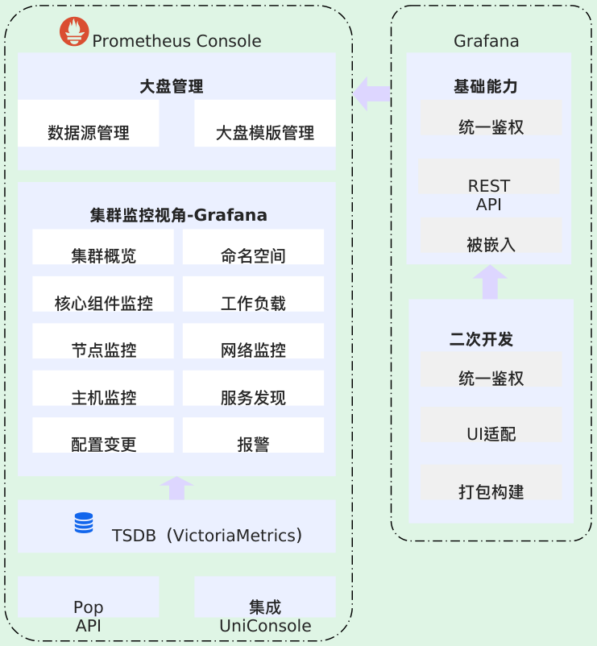

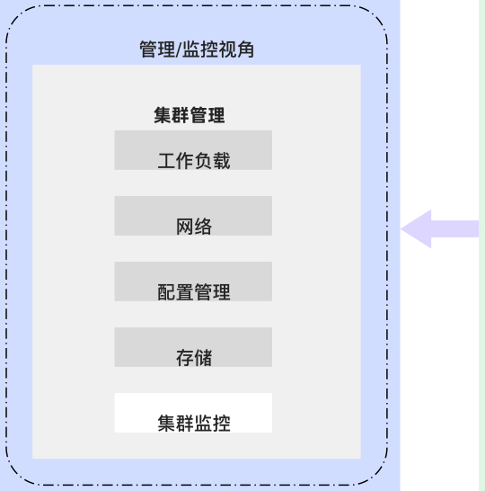

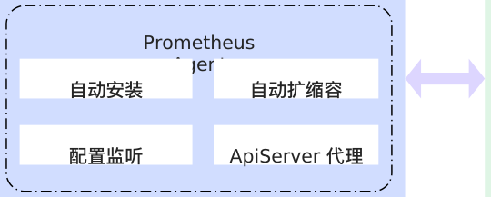

企业版底座/基础服务


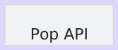


**技术优势**

整体而言，与开源Prometheus监控相比，阿里云Prometheus监控的优势包含以下几点。

- 落地更快，比开源节省快50倍时间

  - 阿里云Prometheus监控无需部署，开箱即用，提供预置监控大盘，能够一体化Agent，自动完成部署和采集配置，10分钟内完成对K8s集群的监控。

- 架构更稳定，支持水平扩展，采用高可用架构

  - 阿里云Prometheus监控数据处理支持水平扩展，数据存储采用高可用架构，Agent端使用自动重传机制，并引入消息队列应对高流量。

- 业务侵入性更小，Agent资源占用整体比开源少50%

  - 阿里云Prometheus监控使用一体化Agent，单进程运行，能够限制Agent资源占用，优化了内存和CPU的消耗。

**开箱即用，大幅减少落地时间**

与开源Prometheus监控相比，阿里云Prometheus监控的整体结构更加轻量化。您无需自行搭建Prometheus监控系统，仅需安装阿里云Prometheus监控探针PromAgent即可开始监控业务。

阿里云Prometheus监控各组件的优势如下：

- Prometheus Agent

  - 基于开源Prometheus Server精简优化。

  - 兼容开源的服务发现。

  - 支持开源的Exporter和Clientlib。

  - 抓取数据直写云端存储服务。

  - 200 MB内存消耗。

- Prometheus服务端

  - 基于开源VictoriaMetrics。

  - 自带Web API和Server组件。

  - 处理读请求。

  - 支持PromQL。

  - 支持CRD。

  - 查询优化。

- Grafana Service

  - 基于开源Grafana的渲染技术+二次开发能力。

  - 开箱即用的监控大盘。自定义显示组件。

**完全兼容开源生态架构优化，提高稳定性**

- 阿里云Prometheus监控完全兼容Prometheus监控开源生态链路中的客户端和查询语言部分，兼容并优化开源生态链路中的采集规则和使用价值部分。

  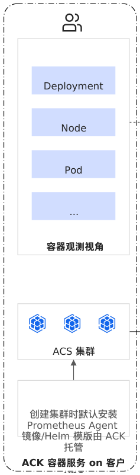

  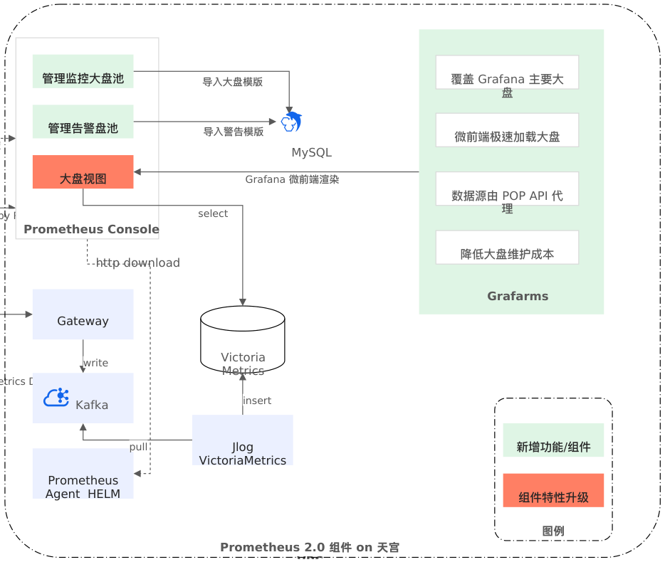

  查看集群监控

  1. 注册集群 by REST API

     2.Push Metrics Data

  **vpc**

  **VPC**

- 阿里云Prometheus监控兼容并提供三种主流采集规则的实现，包括标准开源prometheus.yaml采集规则配置文件、适合自定义K8s内监控的采集规则ServiceMonitor、以及默认采集规则Annotation。与开源Prometheus监控相比，阿里云Prometheus监控无需重启，即可使用prometheus.yaml配置文件动态更新采集规则。在Deployment文件里也无需编写多行代码，仅需增加以下3个Annotation注解即可。

  ```text
  prometheus.io/scrape: "true"
  prometheus.io/port: "9090"
  prometheus.io/path: "/metrics"
  ```

- 阿里云Prometheus监控兼容可视化Grafana。通过配置Prometheus HTTP API URL即可在Grafana中完成数据源的多租户隔离，以及Grafana大盘的多租户隔离。阿里云Prometheus监控还兼容Grafana的Explore数据调试模块。

- 阿里云Prometheus监控兼容开源Prometheus监控的HTTP API模块，完整支持query、query_range和labelValues 3个标准数据查询接口，并通过在数据URL中添加/userId/clusterId/regionId/这组ID达到多租户隔离的效果。

- 阿里云Prometheus监控虽然使用ARMS已有的告警系统，但完全兼容开源Prometheus监控的告警规则PromQL。

**架构优化，提高稳定性**

- 双节点：所有计算节点采用高可用的双节点架构，提高系统稳定性。

- 存储层：引入DB Rank排名第一的时序数据库victories metrics替换自带的TSDB，提高数据吞吐量。

- 链路层：引入Kafka消息队列和数据重传机制保证数据上报的可靠性。

- 水平扩展：直接基于集群规模进行弹性扩容。

- Agent优化架构，减少业务侵入性。

<a id="section-1-2"></a>

## 1.2. Prometheus水平伸缩（HPA）功能

阿里云Prometheus支持对基于持久化的关键状态的采集器自动扩容。

**术语解释**

- 容器：一种运行应用程序的环境，如K8s。

- 采集器：一种用来采集应用程序内监控信息的进程。

- 扩容：增加容器内某进程的机器数（副本数）。

- 副本数：同一个进程的数量。

**背景信息**

由于配置的Prometheus采集器的副本数量不足，导致采集器不断产生内存溢出发生重启。因此Prometheus新增HPA功能，可以自动调整采集器的副本数。

**阿里云Prometheus HPA和开源K8s HPA对比**

**开源K8s HPA原理：**

通过HPA进程采集各类指标数据，如采集内存使用率，然后配置一个指标阈值，如75%，超过75%则自动发起扩容操作。

**开源K8s HPA的缺点：**

- 需要指定一个可以判断容器是否需要扩容的指标，如内存使用率或者请求数，这个指标不易找，并且指标阈值都是根据经验设置的。

- 需要一个周期检测外部进程并进行判断，但是部分场景的发生瞬间就结束，来不及采集指标，如内存溢出，外部进程从外面采集，无法捕获到这个瞬间状态。

**阿里云Prometheus HPA原理：**

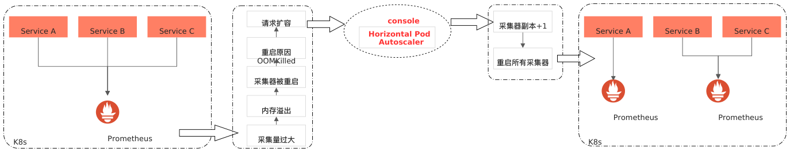

1. 阿里云Prometheus HPA的采集器初次以1个副本的形式运行在容器中。

2. 当需要采集的数据量过大时，采集进程会发生内存溢出，从而被K8s重启。

3. 重启后，在进程内部会先检测采集器自身上一次被重启的原因，如果是OOMKilled，那么这个时候会发起一个需要副本扩容的请求给外部控制器Console。

4. Console对K8s发起采集器副本+1的请求，目前仅支持最多扩容到10个副本。

5. Console对K8s发起对所有采集器重启一次的命令，用于清理上次OOMKilled的重启原因，并且对采集的任务进行重新分发，起到负载均衡的作用。

因此，阿里云Prometheus HPA可以解决以下问题：

- 通过OOMKilled的状态可以准确的解决难以找到一个指标用来描述是否需要扩容的问题。

- 当需要扩容时，OOMKilled状态会被记录到K8s的状态里，所以当采集器启动时可以从K8s状态里发现是否需要扩容，从而解决指标的瞬间状态无法获取的问题。

<a id="section-2"></a>

# 2.快速入门

<a id="section-2-1"></a>

## 2.1. 登录Prometheus监控控制台

本文介绍了如何登录Prometheus监控控制台。

**前提条件**

- 登录Apsara Uni-manager运营控制台前，确认您已从部署人员处获取Apsara Uni-manager运营控制台的服务域名地址。

- 推荐使用Chrome浏览器。

**操作步骤**

1. 在浏览器地址栏中，输入Apsara Uni-manager运营控制台的服务域名地址，按回车键。

   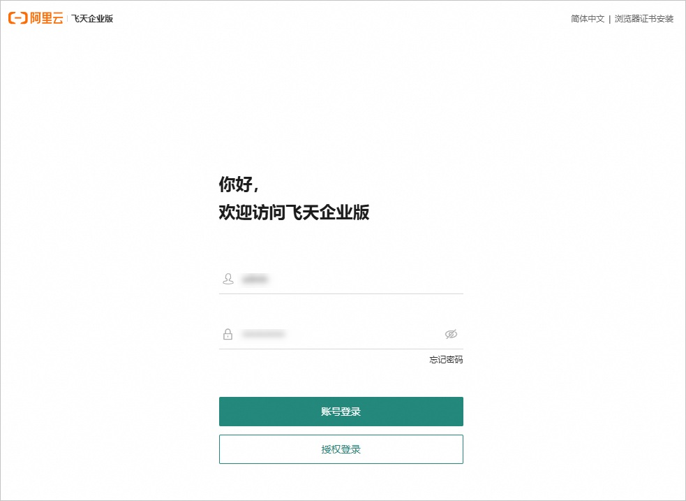

   > **说明**
   >
   > - 单击页面右上角的当前语言可以切换其它语言。
   >
   > - 授权登录是第三方认证中配置了全局IdP设置才会显示，且“授权登录”名称用户可按需自定义。
   >
   > - 由于浏览器证书过期或环境开启HTTPS认证等出现多次单击继续访问或无Apsara Uni-manager运营控制台地址入口等现象，此时需要安装证书才能正常访问。单击页面右上角的**浏览器证书安装**，可打开浏览器证书安装指南。

2. 输入正确的用户名及密码。

   > **说明**
   >
   > - 请向运营管理员获取登录控制台的用户名和密码。
   >
   > - 首次登录Apsara Uni-manager运营控制台时，需要修改登录用户名的密码，请按照提示完成密码修改。为提高安全性，密码长度必须为10~32位，且包含英文字母大小写、阿拉伯数字和特殊符号（感叹号（!）、at（@）、井号（#）、美元符号（$）、百分号（%）等）。

3. 单击**账号登录**。

4. 如果账号已激活MFA多因素认证，请根据以下两种情况进行操作：

   - **管理员强制开启MFA后的首次登录**

     <ol type="a">

     <li>

     在绑定虚拟MFA设备页面中，按页面提示步骤绑定MFA设备。

     </li>

     <li>

     按照步骤2重新输入账号和密码，单击**账号登录**。

     </li>

     </ol>

     <ol type="i" start="100">

     <li>

     输入6位MFA码后单击**认证**。

     </li>

     </ol>

   - **您已开启并绑定MFA**

     输入6位MFA码后单击**认证**。

     > **说明**
     >
     > 绑定并开启MFA的操作请参见《 Apsara Uni-manager运营控制台 用户指南》的**管理多因素认证**章节。

5. 在顶部菜单栏，选择**产品 > 中间件 > 云原生可观测 > Prometheus监控 2.0**，进入Prometheus监控2.0控制台。

6. 在顶部菜单栏选择组织和地域，切换到目标组织和地域。

   > **说明**
   >
   > 登录Prometheus监控2.0控制台后，若监控列表页面没有显示Prometheus实例列表信息，则需要您先进行相关授权操作，具体操作，请参见授权Prometheus控制台操作。

<a id="section-2-2"></a>

## 2.2. 授权Prometheus控制台操作

登录Prometheus控制台之后，您需要在控制台界面进行相关授权操作，授权完成之后在Prometheus控制台才会展示Prometheus实例列表信息，以便查看监控数据。

**背景信息**

若您在Apsara Uni-manager运营控制台已经安装了Prometheus监控产品，但是未在Prometheus监控控制台界面进行相关授权操作，此时Prometheus监控产品并未完全注册安装成功，同时在Prometheus监控控制台页面也无法显示监控数据。因此，您需要先登录Prometheus监控控制台进行授权，之后您可以重新登录Prometheus监控控制台，查看Prometheus实例的监控数据。

**操作步骤**

1. 登录**Prometheus监控**控制台。

2. 在页面左侧单击**集群列表**，然后单击**授权Prometheus**，您即可看到Prometheus实例安装成功。

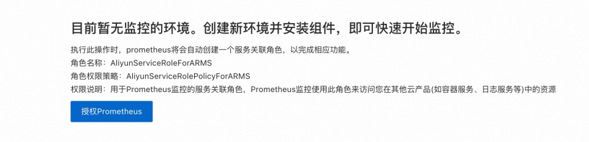

<a id="section-2-3"></a>

## 2.3. 登录飞天基础运维平台

本节介绍运维工程师等相关用户如何登录到飞天基础运维平台。

**前提条件**

- 已从部署人员或管理员处获取Apsara Uni-manager运维控制台的访问地址、用户名和密码。

  Apsara Uni-manager运维控制台访问地址格式为*region-id*.aso.*intranet-domain-id*.com。

- 推荐使用Chrome浏览器。

**操作步骤**

1. 打开浏览器。

2. 在地址栏中，输入Apsara Uni-manager运维控制台的访问地址 `region-id.aso.intranet-domain-id.com` ，按回车键。

   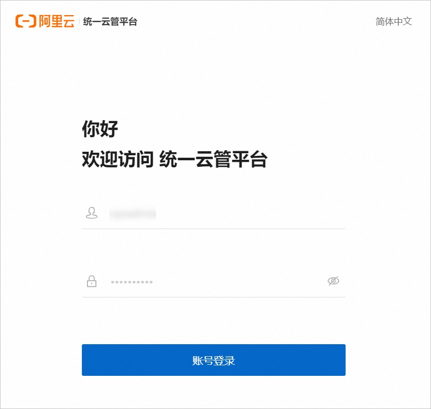

   > **说明**
   >
   > 您可以单击右上角的当前语言切换其它语言。当前支持简体中文、英文、繁体中文三种语言切换。

3. 输入正确的用户名及密码。

   > **说明**
   >
   > - 登录Apsara Uni-manager运维控制台的用户名和密码请从部署人员或管理员处获取。
   >
   > - 若连续输入密码错误三次，系统将启动图片验证码登录功能；若连续输入错误五次，账户将被锁定，请联系管理员进行激活。

   首次登录Apsara Uni-manager运维控制台时，需要修改登录用户名的密码，请按照提示完成密码修改。

   为提高安全性，密码必须满足以下要求：

   - 必须包含英文大小写字母。

   - 必须包含阿拉伯数字（0~9）。

   - 必须包含特殊符号，包括感叹号（!）、at（@）、井号（#）、美元符号（$）、百分号（%）等。

   - 密码长度为10~20个字符。

4. 单击**账号登录**。

5. 在Apsara Uni-manager运维控制台顶部菜单栏单击**平台运维**。

6. 在**平台运维**页面选择**飞天基础运维平台**的子菜单。

<a id="section-3"></a>

# 3.Prometheus监控接入

<a id="section-3-1"></a>

## 3.1. Prometheus监控接入概述

本文介绍Prometheus监控支持的多种接入方式。

- 详情请参见容器服务Kubernetes版集群接入Prometheus监控。

- 详情请参见Remote Write对接自建的Prometheus。

<a id="section-3-2"></a>

## 3.2. 容器服务Kubernetes版集群接入Prometheus监控

本文说明如何将容器服务Kubernetes版集群接入Prometheus监控，从而使用预定义的大盘监控主机和Kubernetes集群的众多性能指标。

**开启阿里云Prometheus监控**

1. 登录**Prometheus监控**控制台。

2. 在左侧导航栏选择**Prometheus实例**，单击**实例列表**。

3. 在**实例列表**页面，单击**新建Prometheus实例**。

4. 在弹出的**新建Prometheus实例**页面，单击**Prometheus实例 for 容器服务**。

5. 按照弹出页面的步骤说明，部署Kubernetes集群。详细创建集群步骤，请参见《容器服务Kubernetes版用户指南》的**创建Kubernetes集群**章节。

   > **说明**
   >
   > 使用容器服务Kubernetes集群监控和报警需要在集群创建时需要勾选Prometheus监控插件。按照接入说明操作即可。

<a id="section-3-3"></a>

## 3.3. Remote Write对接自建的Prometheus

阿里云Prometheus监控的Remote Write功能支持作为远程数据库存储Prometheus监控数据。本文介绍如何创建Remote Write类型的Prometheus实例，帮助用户使用阿里云Prometheus监控的Remote Write对接自建Prometheus，构建监控数据的高效存储方案。

**步骤一：创建Remote Write并获取读写URL**

1. 登录**Prometheus监控**控制台。

2. 在左侧导航栏中，选择**Prometheus实例 > 实例列表**。

3. 在**实例列表**页面，单击**新建Prometheus实例**，然后单击**通用实例**。

4. 在弹出的对话框中，在第1步中输入自定义实例的名称Name，然后单击保存。

   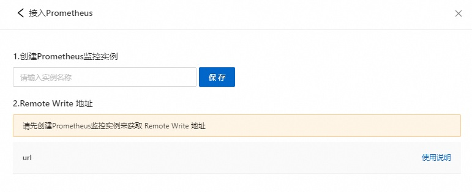

   > **说明**
   >
   > 单击**保存**后，若显示报错信息，是因为您设置的实例名称已存在，请重新设置实例名称即可。

5. 创建成功后系统给出Remote Write地址 。

   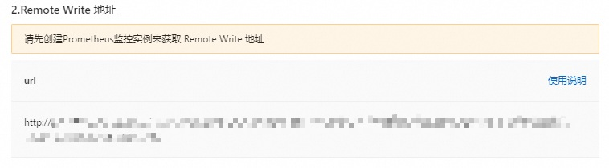

6. 根据地址的使用说明，您可以通过该接口远程存储Prometheus的监控数据。

**步骤二：配置Prometheus**

1. 安装Prometheus，具体的安装方法您可以参见官方文档。

2. 打开Prometheus.yaml配置文件，并在文件末尾增加以下内容，将 `remote_write` 和 `remote_read` 链接替换为步骤一：创建Remote Write并获取读写URL中获取的**WriteUrl**和**ReadUrl**，然后保存文件。

   ```text
   global:
     scrape_interval:     15s
     evaluation_interval: 15s
   scrape_configs:
     - job_name: 'prometheus'
       static_configs:
       - targets: ['localhost:9090']
   remote_write:
     - url: "http://ts-xxxxxxxxxxxx.hitsdb.rds.aliyuncs.com:3242/api/prom_write"
       basic_auth:   
         //Username和Password需要遵循AK/SK的限制。
         username: access-key-id
         password: access-key-secret
   ```

**步骤三：使用远程存储对接OpenTelemetry**

阿里云Prometheus监控的远程存储对接OpenTelemetry之后，您可以使用Prometheus监控的远程存储功能存储OpenTelemetry的数据。

1. 业务代码进行OpenTelemetry埋点。

   ```go
   package stat
   import (
       "context"
       "fmt"
       "go.opentelemetry.io/otel"
       "go.opentelemetry.io/otel/metric"
       "time"
   )

   var buyCounter metric.Int64Counter

   func init() {
       fmt.Println(time.Now(), " - initMetrics start......")
       meter := otel.GetMeterProvider().Meter("github.com/liguozhong/prometheus-arms-aliyun-go-demo")
       buyCounter = metric.Must(meter).NewInt64Counter(
           "buy_total",
           metric.WithDescription("Measures  buy"),
       )
   }

   func DoBuy() (string, error) {
       buyCounter.Add(context.Background(), 1)
       return "buy success", nil
   }
   ```

2. OpenTelemetry对Meter进行初始化并连接Prometheus。

   ```go
   package stat
   import (
       "context"
       prometheusPushExporter "go.opentelemetry.io/contrib/exporters/metric/cortex"
       prometheusExporter "go.opentelemetry.io/otel/exporters/metric/prometheus"

       "errors"
       "fmt"
       "go.opentelemetry.io/otel"
       "go.opentelemetry.io/otel/exporters/otlp"
       "go.opentelemetry.io/otel/label"
       "go.opentelemetry.io/otel/sdk/metric/controller/pull"
       "go.opentelemetry.io/otel/sdk/metric/controller/push"
       "go.opentelemetry.io/otel/sdk/metric/processor/basic"
       "go.opentelemetry.io/otel/sdk/metric/selector/simple"
       "go.opentelemetry.io/otel/sdk/resource"
       "net/http"
       "time"

       _ "net/http/pprof"
   )
   func InitMeter(app string, push bool) error {
       fmt.Println(time.Now(), " - initMeter start......")
       if push {
           fmt.Println(time.Now(), " - initMeter opentelemetry push......")
           remoteUrl := 
   "http://region.arms.aliyuncs.com/prometheus/../../../../api/v3/write"
           ak := "ak"
           sk := "sk"
           return initPushMeter(app, remoteUrl, ak, sk)
       }
       fmt.Println(time.Now(), " - initMeter opentelemetry pull......")
       return initPullMeter(app)
   }

   func initPushMeter(regionId string, remoteWriteUrl string, ak string, sk string) error {
       fmt.Println(time.Now(), " - initPushMeter start......")
       var validatedStandardConfig = prometheusPushExporter.Config{
           Endpoint:      remoteWriteUrl,
           Name:          "AliyunConfig",
           RemoteTimeout: 30 * time.Second,
           PushInterval:  10 * time.Second,
           Quantiles:     []float64{0.5, 0.9, 0.95, 0.99},
           BasicAuth: map[string]string{
               "username": ak,
               "password": sk,
           },
       }
       if validatedStandardConfig.Endpoint == "" {
           return errors.New(" validatedStandardConfig.Endpoint==empty.regionId:" + regionId)
       }
       fmt.Println("Success: Created Config struct")
       r, err := resource.New(context.Background(),
           resource.WithAttributes(
               label.String("cluster", "test-otel"),
               label.String("app", "buy")))
       if err != nil {
           fmt.Println("resource Error:", err)
       }
       pusher, err := prometheusPushExporter.InstallNewPipeline(validatedStandardConfig,
           push.WithPeriod(30*time.Second), push.WithResource(r))
       if err != nil {
           fmt.Println("InstallNewPipeline Error:", err)
       }
       otel.SetMeterProvider(pusher.MeterProvider())
       return nil
   }

   func initPullMeter(app string) error {
       fmt.Println(time.Now(), " - initPullMeter start......")
       r, err := resource.New(context.Background(),
           resource.WithAttributes(
               label.String("cluster", "test-otel"),
               label.String("app", app)))
       if err != nil {
           fmt.Println("resource Error:", err)
       }
       exporter, err := prometheusExporter.NewExportPipeline(
           prometheusExporter.Config{
               DefaultHistogramBoundaries: []float64{-0.5, 1},
           },
           pull.WithCachePeriod(0),
           pull.WithResource(r),
       )
       if err != nil {
           return err
       }
       http.HandleFunc("/opentelemetry", exporter.ServeHTTP)
       otel.SetMeterProvider(exporter.MeterProvider())
       return nil
   }

   func initOtlpProvider(regionId string) (*push.Controller, error) {
       exporter, err := otlp.NewExporter(
           context.Background(),
           otlp.WithInsecure(),
           otlp.WithAddress(regionId+"-intranet.arms.aliyuncs.com:8000"),
       )
       if err != nil {
           return nil, err
       }

       pusher := push.New(
           basic.New(
               simple.NewWithExactDistribution(),
               exporter,
           ),
           exporter,
           push.WithPeriod(30*time.Second),
       )

       otel.SetMeterProvider(pusher.MeterProvider())
       pusher.Start()

       return pusher, err
   }
   ```

3. 业务入口初始化，并启动OpenTelemetry功能。

   ```go
   package pkg
   import (
       "fmt"
       stat "github.com/liguozhong/prometheus-arms-aliyun-go-demo/pkg/opentelemetry"
       "github.com/prometheus/client_golang/prometheus/promhttp"
       "io"
       "net/http"
       "strconv"
   )

   type Server struct {
       port int
   }

   func NewServer(port int) *Server {
       return &Server{
           port: port,
       }
   }

   func (s *Server) Run() error {
       port := ":" + strconv.Itoa(s.port)
       path := "/metrics"
       service := "/buy"
       http.Handle(path, promhttp.Handler()) //初始⼀个http handler
       http.HandleFunc(service, func(writer http.ResponseWriter, request *http.Request) 
   {
           content, err := stat.DoBuy()
           if err != nil {
               io.WriteString(writer, err.Error())
               return
           }
           io.WriteString(writer, content)
       })
       stat.InitMeter("buy2", true)
       fmt.Println("http.url: http://localhost" + port + path)
       fmt.Println("service.url: http://localhost" + port + service)
       err := http.ListenAndServe(port, nil)
       if err != nil {
           return err
       }
       return nil
   }
   ```

4. 查看Go module的依赖列表。

   ```text
   module github.com/liguozhong/prometheus-arms-aliyun-go-demo

   go 1.12

   require (
       github.com/go-kit/kit v0.9.0
       github.com/prometheus/client_golang v1.7.1
       go.opentelemetry.io/contrib/exporters/metric/cortex v0.15.0
       go.opentelemetry.io/otel v0.15.0
       go.opentelemetry.io/otel/exporters/metric/prometheus v0.15.0
       go.opentelemetry.io/otel/exporters/otlp v0.15.0
       go.opentelemetry.io/otel/sdk v0.15.0
       golang.org/x/text v0.3.3 // indirect
   )
   ```

5. 在Grafana大盘中查看数据。

   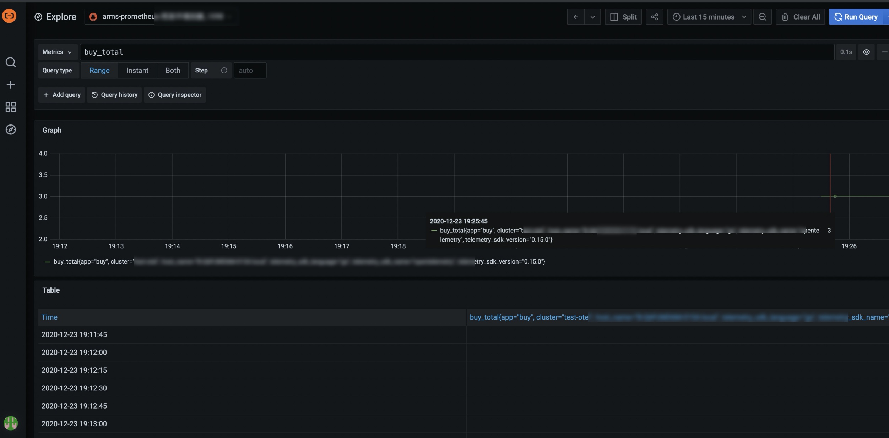

**步骤四：停止远程存储Prometheus监控数据**

如需停止远程数据库存储Prometheus监控数据，请按照以下步骤卸载Prometheus监控插件。

1. 登录**Prometheus监控**控制台。

2. 在**实例列表**页面找到需要卸载监控插件的Remote Write实例，并单击右侧**操作**列的**删除**，然后在弹出的对话框中单击**确定**。

   > **说明**
   >
   > 卸载插件完毕后，**Prometheus实例**页面不再显示该类型的实例。

<a id="section-4"></a>

# 4.使用教程

<a id="section-4-1"></a>

## 4.1. 容器可观测

<a id="section-4-1-1"></a>

### 4.1.1. 集群列表

在集群列表页面，您可以查看当前接入所有的集群列表和集群核心指标（节点数、内存使用率、CPU使用率和GPU使用率等）数据情况。也可以通过蜂窝图方式全局关注集群运行状态。

**前提条件**

接入Prometheus监控，具体操作，请参见Prometheus监控接入概述。

**操作步骤**

1. 登录Prometheus监控控制台。

2. 在左侧导航栏，选择**容器可观测 > 集群列表**。

3. 在**集群列表**页面单击顶部筛选栏中  可以切换集群信息显示方式。

> **说明**
>
> - 在集群列表页面会列出所有接入的集群名称、核心指标、接入源环境和标签等，同时支持添加标签操作。
>
>   添加单个标签：单击目标集群标签列的  ，选择或输入标签后，单击**确定**。
>
>   批量添加标签：勾选目标集群，单击**添加标签**，选择或输入标签后，单击**确定**。
>
>   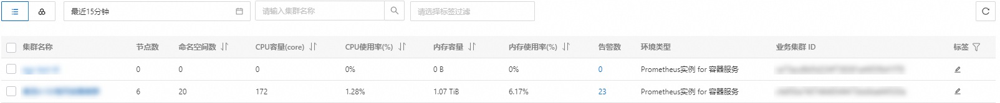
>
> - 在集群**蜂窝图**页面会把所接入集群的pod的cpu/内存的使用情况全局展示出来，支持根据集群名称、工作负载、命名空间过滤。
>
>   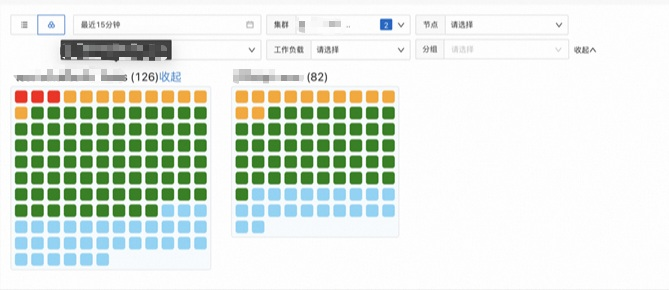

4. 在**集群列表**页面，单击**集群名称**，进入**集群详情**页面，可看到集群指标大盘展示：平台支持查询**kubernetes核心组件大盘**、**节点监控维度**、**集群应用维度**、**网络监控维度**、**GPU监控维度**和**大数据/AI维度**大盘。

   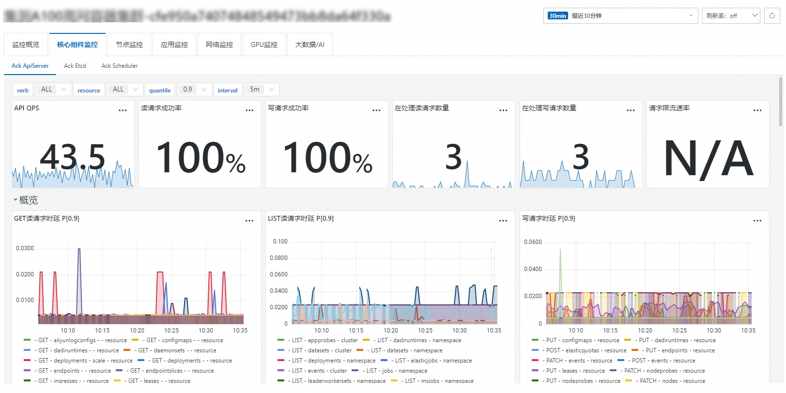

5. 在**集群列表**页面，单击**集群名称**，进入**集群详情**页面，可将关注的监控指标项，一键转为告警指标。

   单击指标项右侧的  图标，单击**创建告警**进入**创建告警规则**页面，更多详情请参见创建报警。

   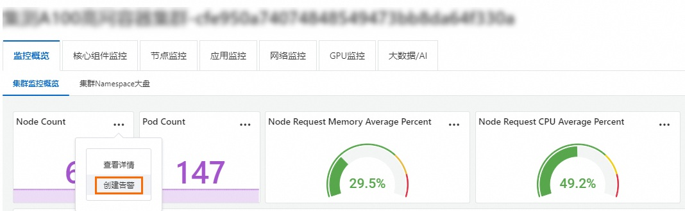

   如果一个面板涉及多条PromQL，单击**创建告警**会出现弹窗**选择PromQL**。选择完成后，单击**确定**进入**创建告警规则**页面，更多详情请参见创建报警。

   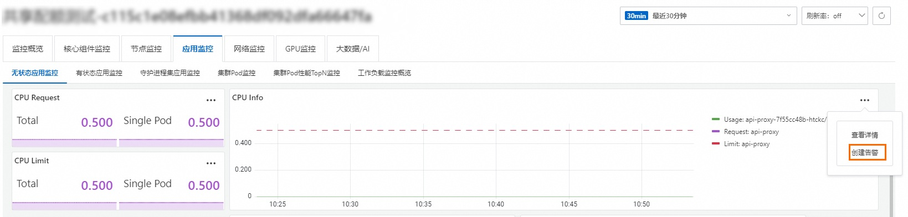

   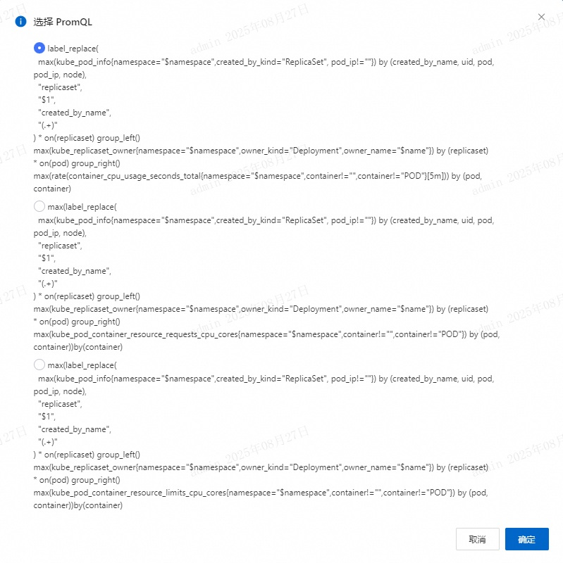

6. 在**集群列表**页面，单击目标集群的**告警数**，进入**告警事件**页面查看触发报警的历史记录，更多详情请参见告警事件。

<a id="section-4-1-2"></a>

### 4.1.2. 集群配置

本文主要描述配置集群的阈值。

**前提条件**

接入Prometheus监控，具体操作，请参见Prometheus监控接入概述。

**操作步骤**

1. 登录**Prometheus监控**控制台。

2. 在左侧导航栏单击**容器可观测**，然后单击**容器配置**。

3. 在**容器配置**页面可以设置集群pod和集群节点的阈值。

   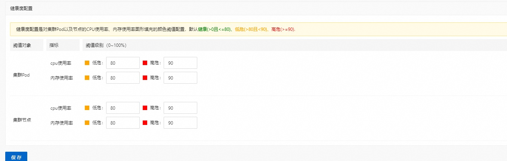

<a id="section-4-2"></a>

## 4.2. Prometheus实例

<a id="section-4-2-1"></a>

### 4.2.1. 实例列表

本文主要介绍如何在Prometheus监控控制台查看实例详情。

**前提条件**

接入Prometheus监控，具体操作，请参见Prometheus监控接入概述。

**操作步骤**

1. 登录**Prometheus监控**控制台。

2. 在左侧导航栏单击**Prometheus实例**，然后单击**实例列表**。

3. 在**实例列表**页面<strong>，</strong>单击顶部的**新建Prometheus实例**。

4. 在**新建Prometheus实例**页面，单击**Prometheus实例 for 容器服务**或**通用实例**，可以查看新建步骤。

5. 在**实例列表**页面，单击**实例名称**或者**详情**可以进入实例详情页面。

> **说明**
>
> - 在**实例列表**页面，展示接入的Prometheus实例名称、类型和标签，支持编辑标签、查询详情和删除实例操作。
>
>   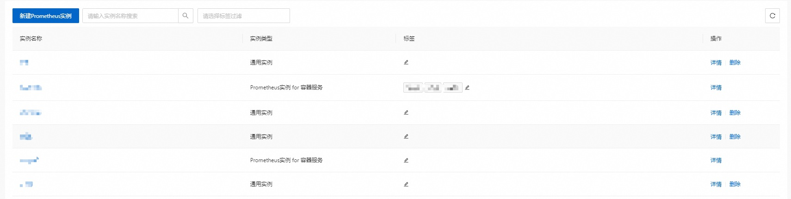
>
> - 在**实例详情**页面提供指标RemoteWrite/PushGateway接入地址和指标读取地址。对于容器类型实例支持配置Prometheus采集规则如下图所示。
>
>   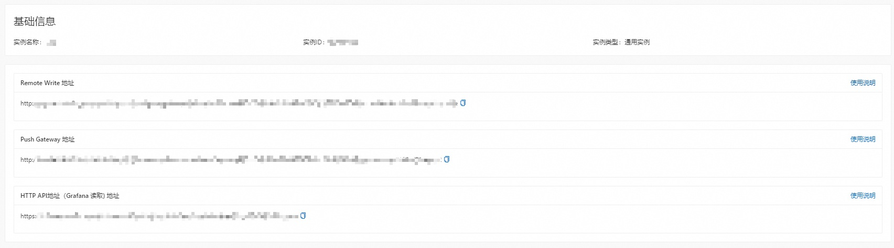

<a id="section-4-3"></a>

## 4.3. 仪表盘

在**大盘列表**页面，您可以查看目标集群下的所有大盘信息和对应的核心指标。

**前提条件**

已接入**Prometheus监控**。具体操作，请参见Prometheus监控接入概述。

**功能入口**

1. 登录**Prometheus监控**控制台。

2. 在左侧导航栏单击**自定义大盘**，进入大盘管理页面。

3. 在仪表盘页面单击

   可以进入创建图表页面。

   

> **说明**
>
> 在**仪表盘**页面，您使用PromQL创建集群指标的时序图，时序图支持样式自定义样式设置和托拉拽摆放位置，仪表盘图表支持分组、刷新、筛选、分享和导入导出等操作。

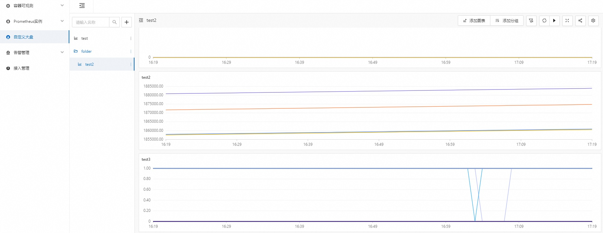

**其他操作**

- 您可以通过单击  ，创建文件夹和创建仪表盘。

- 单击文件夹右侧的  ，您可以进行以下操作：

  - 添加仪表盘

  - 添加文件夹

  - 编辑文件夹

  - 克隆文件夹

  - 导出文件夹

  - 删除文件夹

- 单击仪表盘右侧的  ，您可以进行以下操作：

  - 编辑仪表盘

  - 克隆仪表盘

  - 导出仪表盘

  - 删除仪表盘

- 您可以通过单击页面右侧的**添加分组**、编辑图标  、放大  等进行相关操作。

<a id="section-4-4"></a>

## 4.4. 接入管理

<a id="section-4-4-1"></a>

### 4.4.1. 已接入环境

本文介绍如何查看已接入的容器环境和如何删除环境。

**前提条件**

接入Prometheus监控，具体操作，请参见Prometheus监控接入概述。

**功能入口**

1. 登录**Prometheus监控**控制台。

2. 在左侧导航栏单击<strong>接入管理，</strong>进入**已接入环境**列表。

3. 在**容器环境**页面支持指标采集、探针设置和集群删除操作。

> **说明**
>
> - 在**容器环境**页面可以查看当前接入的容器服务基本信息。
>
> - 如需删除集群，在**环境列表**页面单击**删除**会弹窗确认当前集群内已接入组件和探针，需要先卸载集群关联探针和组件后才可以删除集群。

<a id="section-4-4-2"></a>

### 4.4.2. 指标采集

您可以通过添加ServiceMonitor配置Prometheus监控的采集规则。添加ServiceMonitor适用于需要监控部署在K8s集群内的应用的业务数据。

**前提条件**

接入Prometheus监控，具体操作，请参见Prometheus监控接入概述。

**操作步骤**

1. 登录**Prometheus监控**控制台。

2. 在左侧导航栏单击<strong>接入管理，</strong>单击目标环境**操作**列的**指标采集**。

3. 在**指标采集**页面支持添加ServiceMonitor配置、PodMonitor配置以监控Prometheus的采集规则；同时通过识别集群Pod的Annotations配置，通知编辑Prometheus配置添加Prometheus默认支持的采集任务。

> **说明**
>
> 默认服务发现、ServiceMonitor配置、PodMonitor配置Prometheus监控的采集规则根据新增提示配置即可，同时支持对运行中的配置**启停**设置。
>
> 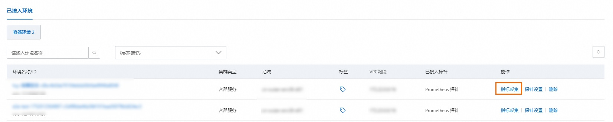

**相关操作**

在Service Monitor、Pod Monitor、自定义采集页面，您可以通过单击目标对象**操作**列的按钮，进行**停用**（状态为启用）、**启用**（状态为停用）、**编辑配置**、**删除**操作。

<a id="section-4-4-3"></a>

### 4.4.3. 探针设置

本文档主要介绍如何查看当前集群内探针的状态和探针版本。

**前提条件**

接入Prometheus监控，具体操作，请参见Prometheus监控接入概述。

**操作步骤**

1. 登录**Prometheus监控**控制台。

2. 在左侧导航栏单击<strong>接入管理，</strong>在**环境列表**单击**探针设置**。

3. 在**探针设置**页面支持对已安装探针进行重启、卸载和刷新操作。

<a id="section-4-4-4"></a>

### 4.4.4. 自监控

本文说明如何查看集群内Targets任务列表和Prometheus Agent自监控大盘。

**大盘自监控查看结果**

自监控大盘功能可以检查阿里云Prometheus监控是安装和运行是否正常。如果您发现Prometheus监控无法监控到数据，那么可以根据大盘展示数据结果排查原因。

1. 登录**Prometheus监控**控制台。

2. 在左侧导航栏单击<strong>接入管理，</strong>在**环境详情**页面单击**自监控**。

3. 在**自监控**页面支持查看Targets任务和Prometheus Agent监控大盘。

在Targets任务列表内可以查看当前集群运行任务以及任务Endpoint地址、状态、标签和数据上报延时。可以用来实时观察到不健康的任务执行情况，快速定位异常的job。

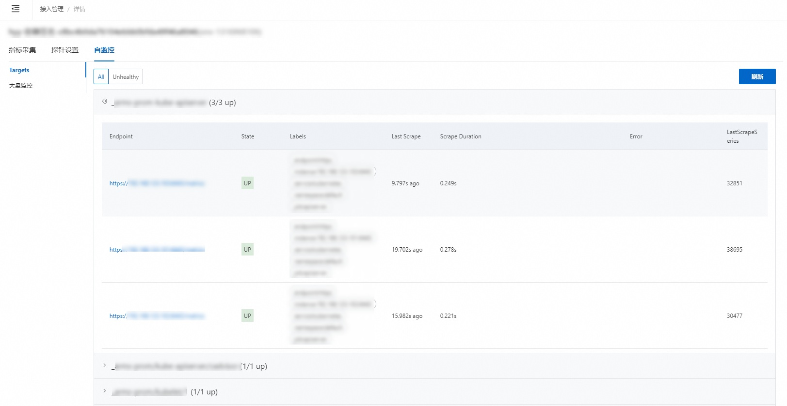

在PrometheusAgent监控大盘内可以实时查看Agent运行状态、探针下发情况和采集情况等。及时了解探针异常并判断集群问题。

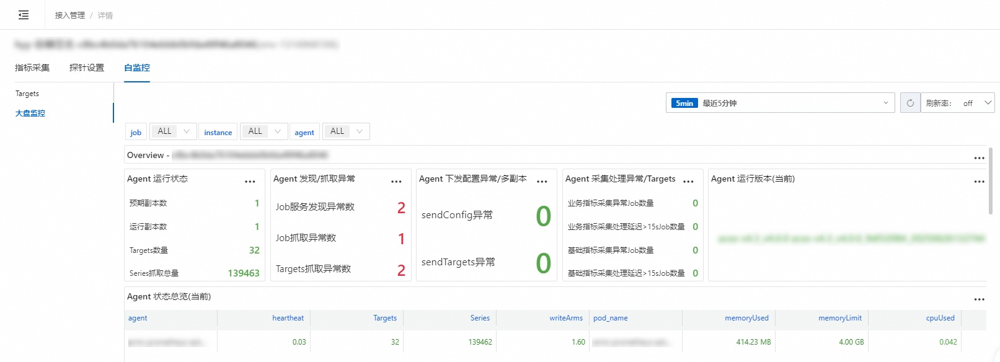

<a id="section-5"></a>

# 5.报警管理

<a id="section-5-1"></a>

## 5.1. 创建报警

阿里云Prometheus监控提供开箱即用的报警规则，您也可以自定义针对特定监控对象的报警规则。当规则被触发时，系统会以您指定的报警方式向报警联系人分组发送报警信息，以提醒报警联系人采取必要的问题解决措施。

**前提条件**

- 已成功创建监控任务，请参见Prometheus监控接入概述。

- 创建联系人，请参见创建联系人。

**操作步骤**

1. 登录**Prometheus监控**控制台。

2. 在左侧导航栏单击**告警管理**，然后单击**告警规则**。

3. 告警规则页面支持**创建告警规则**、**编辑规则**以及对规则**启停**控制等操作。

> **说明**
>
> - **告警规则**列表展示规则名称、规则标签、类型等基本信息。如果运行状态为停止，则不进行此规则告警，通知告警规则支持导入、导出和编辑。
>
>   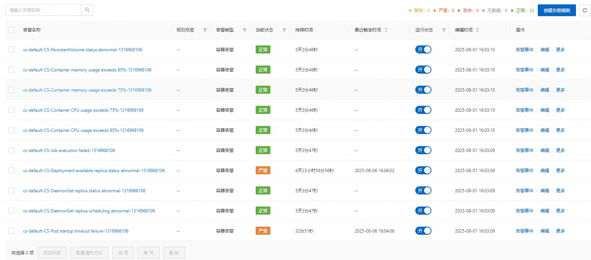
>
> - **告警规则**创建页面选择集群、填写PromQL语句、设置执行频率和告警级别以及自定义告警内容等，然后配置通知规则即可创建一个告警规则。

**相关操作**

- 开启报警：开启单个报警，单击该条规则运行状态**开**，可开启该报警。

- 关闭报警：关闭单个报警，单击该条规则运行状态**关**，可关闭该报警。

- 编辑报警：单击该条报警**操作**列的**编辑**，可重新设置该报警的**规则名称**、**表达式**以及**时间**等信息。

- 查看告警历史：单击报警**操作**列的**告警事件**，可跳转至**告警管理 > 告警事件**页面查看所有的报警事件历史和报警发送历史。

- 更多操作：单击报警**操作**列的**更多**，可对该告警规则进行**克隆**和**删除。**

- 批量操作：选中目标告警，单击页面下方按钮，可对告警规则批量进行添加标签、配置通知方式、启用、禁用、删除操作。

<a id="section-5-2"></a>

## 5.2. 查询报警历史

在**告警事件**页面，您可以查看某个报警规则在何时因为什么事件被触发报警的历史记录，以及触发报警规则后发送给指定报警联系人的报警通知的历史记录。

**前提条件**

- 已成功创建监控任务，请参见Prometheus监控接入概述。

- 创建联系人，请参见创建联系人。

**操作步骤**

1. 登录Prometheus监控控制台。

2. 在左侧导航栏中，单击**告警管理 > 告警事件**。

3. 在**告警事件**页面，可查看告警趋势图以及告警事件的历史记录。

   - 在**告警事件**列表页面上方输入告警ID、告警名称、告警对象或ACK集群名称，选择报警的时间范围，然后单击搜索图标，可以查看指定的告警历史记录。

   - 在告警趋势区域，按照时间进行划分统计告警数量。

     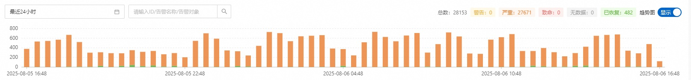

     - 每个柱面不同颜色的区域表示告警等级。

     - 将鼠标悬停在柱面上时，系统会显示对应时间每个告警等级对应的数量统计。

     - 单击**趋势图**右侧的按钮可选择隐藏或展示趋势图。

     - 趋势图上方展示告警总数以及不同状态下的告警数量，单击告警数量，可快速筛选对应状态下的告警历史记录。

   - 在告警列表区域，可查看历史告警的基本信息。

     | 参数 | 说明 |
     | --- | --- |
     | ID | 告警ID。 |
     | 告警名称 | 告警的名称。单击告警名称可查看告警事件详情。 |
     | 集群名称 | ACK集群名称。 |
     | 告警对象 | 触发告警的资源、服务应用、指标名称等。 |
     | 当前状态 | 告警事件的等级。包括：<br>• <strong>警告</strong>。<br>• <strong>严重</strong>。<br>• <strong>致命</strong>。<br>• <strong>无数据</strong>。<br>• <strong>已恢复</strong>。 |
     | 触发时间 | 事件被触发的时间。 |
     | 最近异常持续时间 | 最近一次触发异常到恢复的时间间隔。 |
     | 已合并数 | 相同的告警对象默认合并，统计合并数。 |
     | 告警类型 | 告警事件的类型。 |
     | 关联规则标签 | 规则自定义标签的透传。 |

5. 单击**告警名称**或告警所在行操作列的**查看详情**，可查看已触发报警发送的报警通知详细记录和触发时间线。

<a id="section-5-3"></a>

## 5.3. 告警屏蔽

本文介绍如何使用告警屏蔽来避免告警风暴。

**前提条件**

已成功创建监控任务，请参见Prometheus监控接入概述。

**操作步骤**

1. 登录Prometheus监控控制台。

2. 在左侧导航栏，单击**告警管理 > 告警屏蔽**。

3. 在**告警屏蔽**页面中单击**添加屏蔽规则**，在弹出的对话框中设置以下参数，然后单击**确定**。

   | 参数 | 说明 |
   | --- | --- |

   <table>
     <tr>
       <td>屏蔽类型</td>
       <td>• <strong>按规则</strong>：可选规则标签或是规则名称，直接针对告警规则进行屏蔽。其中按规则标签屏蔽时，已选规则标签下关联的告警规则均会被屏蔽。<br>• <strong>通知组</strong>：针对通知组进行屏蔽，已选通知组均会被屏蔽。<br>• <strong>全屏蔽</strong>：屏蔽系统已配置的所有告警规则，需谨慎选择配置。<br>• <strong>按ACK集群</strong>：屏蔽已选择的ACK集群。<br>• <strong>按告警内容关键字</strong>：屏蔽输入的告警内筒关键字。例如：告警内容存在NodeNotReady字样，支持按照NodeNotReady关键字屏蔽所有告警。<br>说明屏蔽过程中，关联告警触发时不会发送通知，但在告警历史中会有相应触发记录，为“仅触发”状态。</td>
     </tr>
     <tr>
       <td>屏蔽范围</td>
       <td>• <strong>按规则</strong>：选择规则标签或规则名称。<br>• <strong>按通知组</strong>：选择需要屏蔽的通知组。<br>• <strong>按ACK集群</strong>：选择需要屏蔽的ACK集群。<br>• <strong>按告警内容关键字</strong>：输入告警内容关键字。</td>
     </tr>
     <tr>
       <td>屏蔽计划</td>
       <td>• <strong>单次</strong>：支持按时间范围进行屏蔽，仅当次有效。<br>• <strong>周期循环</strong>：支持在选定时间范围内按每天、每周、每月进行周期循环屏蔽，可指定周期内屏蔽开始时间及其持续时间。</td>
     </tr>
     <tr>
       <td>屏蔽说明</td>
       <td>屏蔽说明信息。</td>
     </tr>
   </table>

**相关操作**

在**操作**列您可以按需完成以下操作：

- 编辑（仅**生效中**的屏蔽规则支持）：修改当前屏蔽规则。

- 结束（仅**生效中**的屏蔽规则支持）：提前结束当前屏蔽规则。

- 克隆：复制当前屏蔽规则。

- 删除（仅**已结束**的屏蔽规则支持）：删除当前屏蔽规则。

<a id="section-5-4"></a>

## 5.4. 创建联系人

报警规则被触发时控制台会向您指定的联系人或联系人分组发送通知，而在创建联系人分组之前必须先创建联系人。创建联系人时，您可以指定联系人用于接收通知的手机号码和邮箱地址，也可以提供用于自动发送报警通知的钉钉机器人地址。本文介绍如何创建联系人。

**操作步骤**

1. 登录**Prometheus监控**控制台。

2. 在左侧导航栏中选择**告警管理 > 通知设置**。

3. 在**通知设置**页面，单击**联系人**页签，然后单击右上角**添加联系人**。

4. 在**添加联系人**对话框中输入联系人姓名，根据实际需求输入联系人手机号码和加入通知组，单击**确定**。

   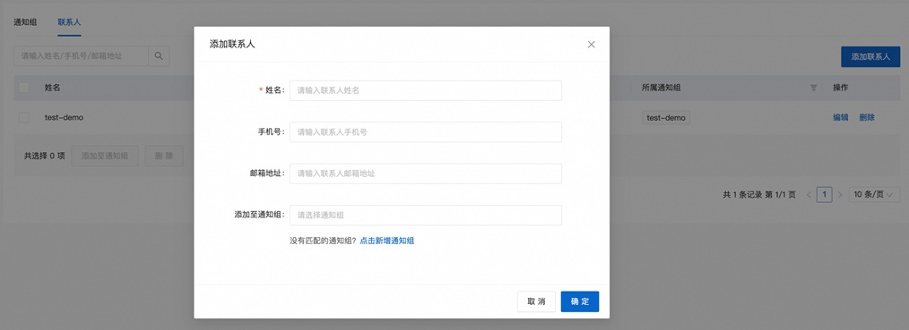

5. 单击**通知组**页签，然后单击**添加通知组**，在**添加通知组**对话框输入对应的钉钉通知、微信通知、webhook类型需要的字段，然后单击**确定**。

   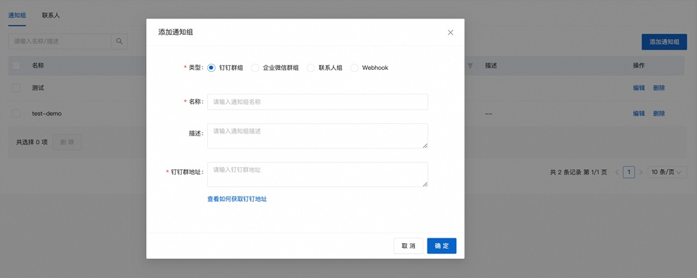

> **说明**
>
> - 手机号码、邮箱和钉钉机器人至少填写一项。每个手机号码或邮箱只能用于一个联系人。
>
> - 至多可添加100个联系人。
>
> - 获取钉钉机器人地址的方法，请参见获取钉钉机器人地址。

**相关操作**

创建联系人和通知组后，您可以在对应页签查询、编辑、删除联系人/通知组以及将联系人批量添加至通知组。

- 变更联系人/通知组信息：单击联系人/通知组右侧**操作**列中的**编辑**，在对话框中编辑信息，并单击**确定**。

- 删除联系人/通知组：

  - 删除单个联系人/通知组：单击联系人/通知组右侧**操作**列中的**删除**，并在弹出的对话框中单击**确定**。

  - 删除多个联系人/通知组：选中目标联系人/通知组，单击**批量删除**，并在弹出的对话框中单击**确定**。

- 将联系人批量添加至通知组：选中目标联系人，单击添加至通知组，在弹出的对话框中选择通知组后单击**确定**。

<a id="section-5-5"></a>

## 5.5. 获取钉钉机器人地址

本文介绍如何添加自定义钉钉机器人并获取Webhook地址。当报警规则被触发后，可以通过添加的钉钉机器人地址自动发送报警通知至指定的钉钉群。

**操作步骤**

1. 在PC版钉钉上打开您想要添加报警机器人的钉钉群，并单击右上角的**群设置**图标。

2. 在**群设置**面板中单击**智能群助手**。

3. 在**智能群助手**面板单击**添加机器人**。

4. 在弹出的**群机器人**对话框单击**添加机器人**区域右侧的

   图标，然后选择添加**自定义**。

   

   > **说明**
   >
   > 若为首次添加钉钉机器人，可直接在弹出的**群机器人**对话框选择添加**自定义**。

   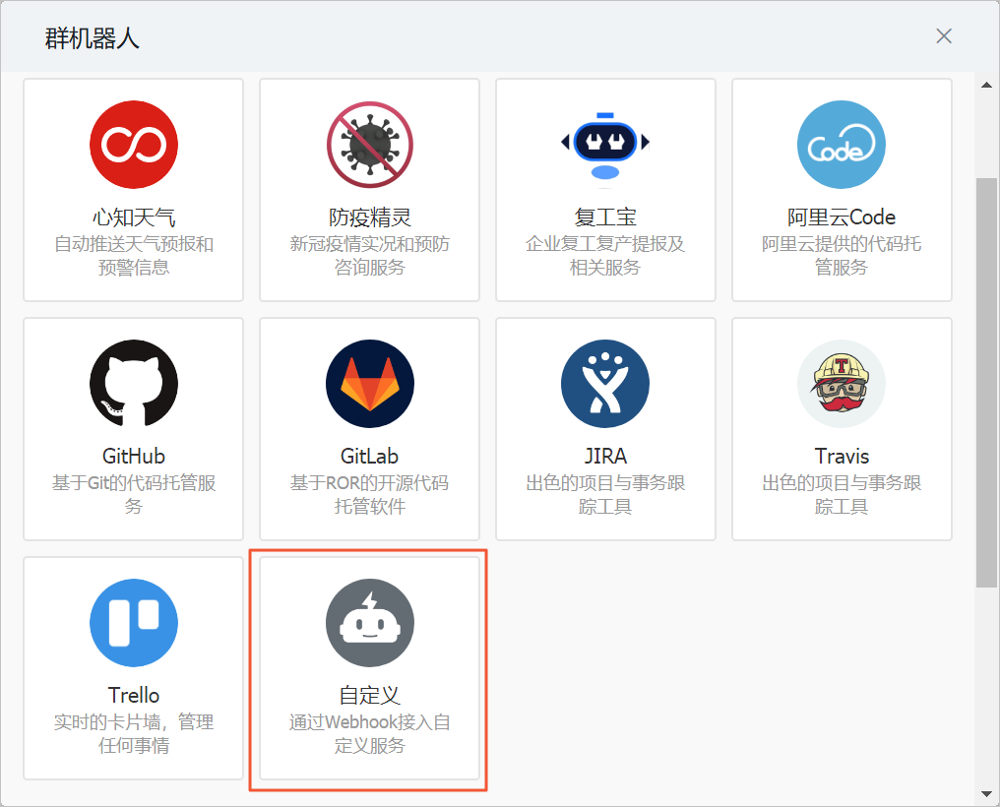

5. 在**机器人详情**对话框单击**添加**。

6. 在**添加机器人**对话框中编辑机器人头像和名称，选中必要的**安全设置**（至少选择一种），选中**我已阅读并同意《自定义机器人服务及免责条款》**，然后单击**完成**。

   > **重要**
   >
   > **安全设置**请至少选中**自定义关键词**，且关键词至少设置**报警**和**分派**这两个才能收到告警信息。

   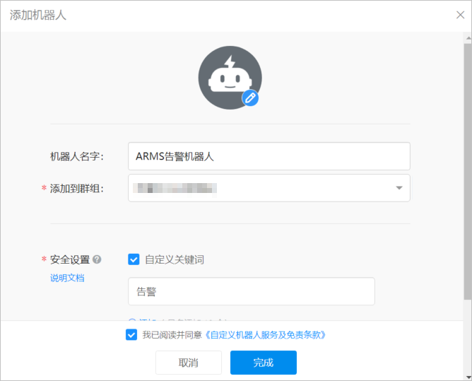

7. 在**添加机器人**对话框中复制生成的机器人Webhook地址，然后单击**完成**。

<a id="section-5-6"></a>

## 5.6. 创建Webhook报警

设置Webhook报警后，您可以将告警通知以指定方式发送到自定义的Webhook地址中。Prometheus监控支持对飞书、微信、钉钉等群组发送Webhook报警，本文以飞书为例，介绍如何创建Webhook报警。

**步骤一：生成Webhook链接**

1. 打开并登录飞书。

2. 单击<strong>+</strong>图标，然后单击**创建群组**，新建一个用于发送报警的群组。

3. 单击群组设置图标，然后单击**群机器人**页签。

4. 在**群机器人**页签单击**添加机器人**。

   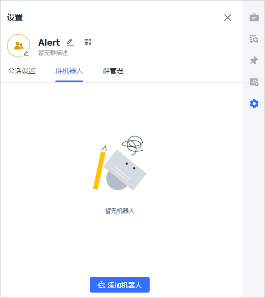

5. 在**添加机器人**面板选择**Custom Bot**。

   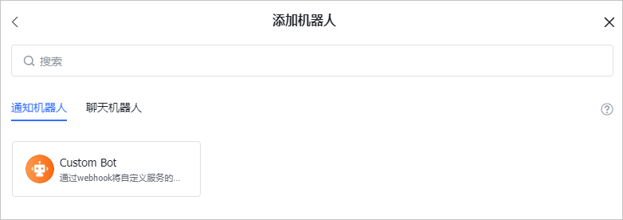

6. 在配置页设置**显示名称**和**描述**，然后单击**添加**。

   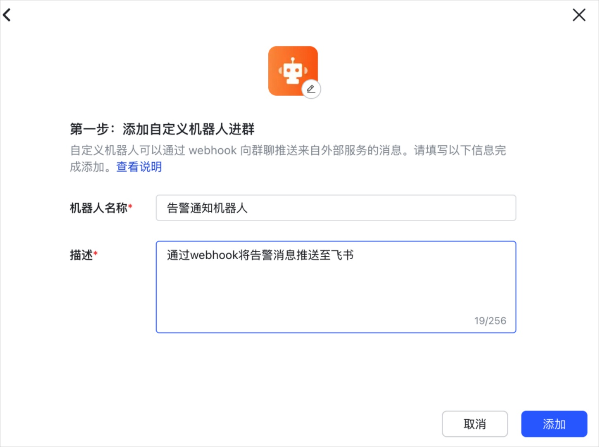

7. 单击**复制链接**保存**添加情况**区域的Webhook地址，然后单击**完成**。

   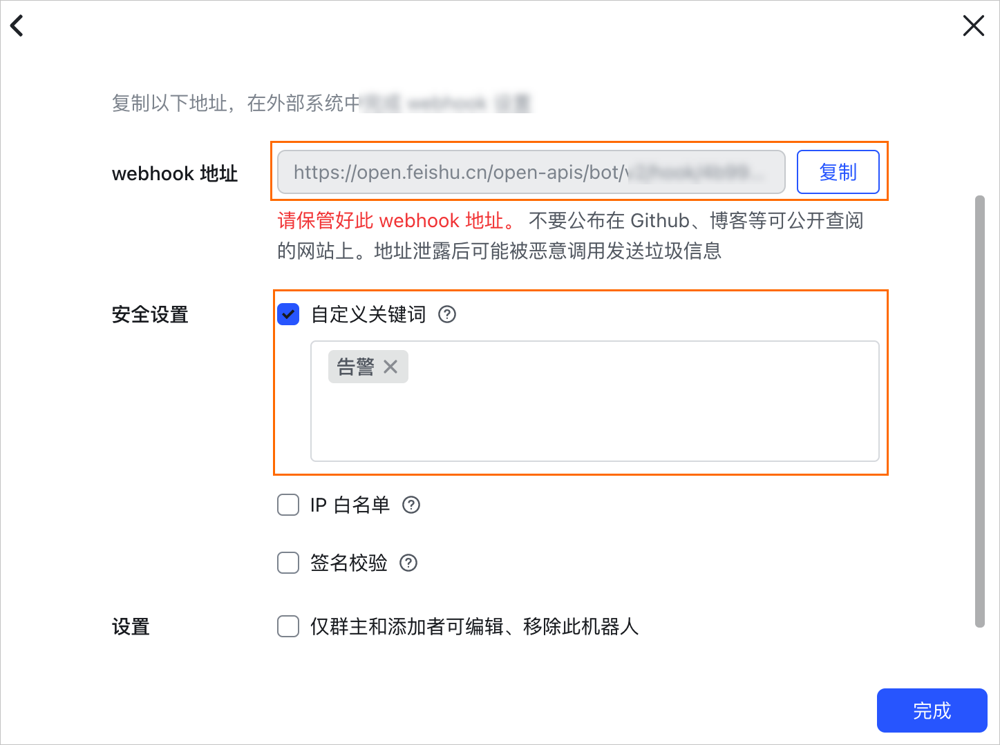

**步骤二：创建Webhook报警**

1. 登录**Prometheus监控**控制台。

2. 在左侧导航栏选择**告警管理 > 通知设置**。

3. 在**通知组**页签单击**添加通知组**，弹窗页面选择**Webhook**。

   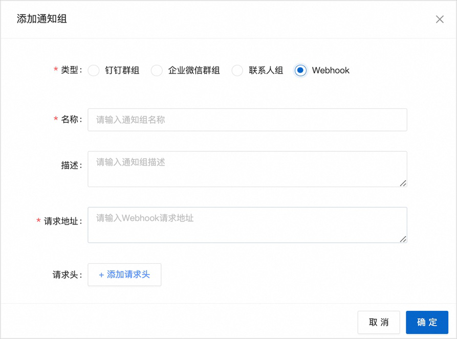

   基本参数描述如下所示。

   | 参数 | 说明 |
   | --- | --- |
   | Webhook名称 | 必填，自定义Webhook名称。 |
   | 请求地址 | 必填，设置请求方法。URL不可超过100个字符。此例中选择<strong>Post</strong>，并将步骤一：生成Webhook链接中保存的Webhook地址粘贴至右侧文本框。 |

4. 单击**确定**创建。

<a id="section-6"></a>

# 6.最佳实践

<a id="section-6-1"></a>

## 6.1. 通过阿里云Prometheus监控容器集群指标并大盘展示

阿里云Prometheus监控可以通过Grafana大盘来展示监控数据，并且支持自定义创建Grafana大盘和从Grafana官网导入大盘两种方式。本文以阿里云容器服务K8s集群和阿里云容器镜像服务为例，介绍通过自定义Grafana大盘展示监控数据。

**前提条件**

阿里云容器服务K8s集群已接入阿里云Prometheus监控。如何接入，请参见《容器服务Kubernetes版集群<strong>》</strong>

**步骤一：新增Prometheus实例**

在云平台接入Prometheus操作步骤如下：

1. 登录Prometheus监控控制台。

2. 在左侧导航栏选择**prometheus实例**，单击**实例列表**，然后单击**新增prometheus实例**。

3. 当前支持创建2种实例类型，根据接入说明接入实例，详情可参见Prometheus监控接入概述<strong>。</strong>

4. 接入完成之后，在**容器可观测 > 集群列表**页面，单击集群名称进入集群监控大盘。

**步骤二：查看集群大盘**

阿里云Prometheus会默认监控CPU信息、内存信息、网络信息等。操作步骤如下：

1. 登录Prometheus监控控制台。

2. 在左侧导航栏单击**接入管理**，然后单击目标**环境名称**。

3. 进入目标环境页面后，单击页面左上角**自监控**，然后单击**大盘监控**，就可以看到监控数据。

<a id="section-6-2"></a>

## 6.2. 通过ServiceMonitor创建服务发现

阿里云Prometheus支持使用CRD ServiceMonitor的方式来满足您自定义服务发现的采集需求。通过使用ServiceMonitor，您可以自行定义Pod发现的Namespace范围以及通过 `matchLabel` 来选择监听的Service。本文将基于SpringBoot框架演示如何通过ServiceMonitor创建服务发现。

**Demo**

您可以通过下载Demo工程，同步体验通过ServiceMonitor创建服务发现的完整过程。

**步骤一：创建基础代码依赖**

1. 创建一个Maven应用，并在pom.xml文件中添加以下依赖。

   ```xml
   <dependencies>
           <dependency>
               <groupId>org.springframework.boot</groupId>
               <artifactId>spring-boot-starter-actuator</artifactId>
           </dependency>
           <dependency>
               <groupId>org.springframework.boot</groupId>
               <artifactId>spring-boot-starter-web</artifactId>
           </dependency>
           <dependency>
               <groupId>io.micrometer</groupId>
               <artifactId>micrometer-registry-prometheus</artifactId>
               <version>1.6.6</version>
           </dependency>

           <dependency>
               <groupId>org.springframework.boot</groupId>
               <artifactId>spring-boot-configuration-processor</artifactId>
               <optional>true</optional>
           </dependency>
           <dependency>
               <groupId>org.projectlombok</groupId>
               <artifactId>lombok</artifactId>
               <optional>true</optional>
           </dependency>
           <dependency>
               <groupId>org.springframework.boot</groupId>
               <artifactId>spring-boot-starter-test</artifactId>
               <scope>test</scope>
           </dependency>
       </dependencies>
   ```

2. 在项目的src/resources/applications.properties文件中添加以下配置。

   ```text
   management.endpoints.web.exposure.include=prometheus
   ```

3. 启动项目，通过浏览器访问 `http://{host}:{port}/actuator/prometheus` 。

   获取到对应的JVM监控，返回示例如下：

   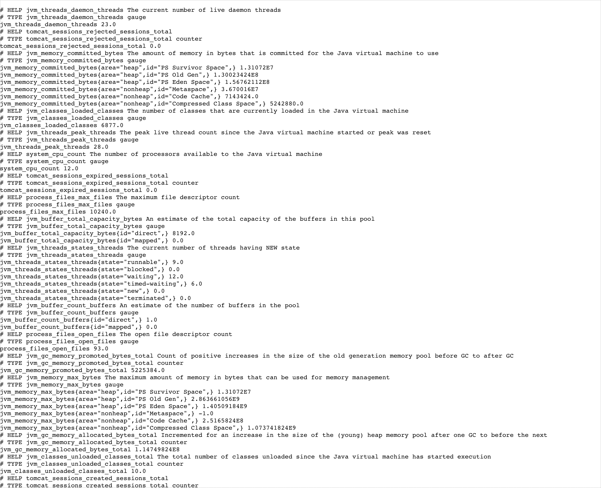

**步骤二：部署Kubernetes集群**

1. 构建一个镜像，并将构建镜像的Dockerfile文件上传至镜像仓库。

2. 参考以下内容创建Deployment。

   ```yaml
   apiVersion: apps/v1
   kind: Deployment
   metadata:
     name: micrometer-prometheus
     namespace: default
     labels:
       app: demo-prometheus
   spec:
     replicas: 3
     selector:
       matchLabels:
         app: demo-prometheus
     template:
       metadata:
         labels:
           app: demo-prometheus
       spec:
         containers:
           - name: micrometer-prometheus
             image: manjusakalza/micrometer-prometheus:latest
             ports:
               - containerPort: 8080
   ```

3. 参考以下内容创建Service。

   ```yaml
   apiVersion: v1
   kind: Service
   metadata:
     name: prometheus-metrics-demo
     namespace: default
     labels:
       micrometer-prometheus-discovery: 'true'
   spec:
     selector:
       app: demo-prometheus
     ports:
       - protocol: TCP
         port: 8080
         targetPort: 8080
         name: metrics
   ```

**步骤三：创建ServiceMonitor**

ServiceMonitor的YAML文件示例如下：

```yaml
apiVersion: monitoring.coreos.com/v1
kind: ServiceMonitor
metadata:
  name: micrometer-demo
  namespace: default
spec:
  endpoints:
    - interval: 15s
      path: /actuator/prometheus
      port: metrics
  namespaceSelector:
    any: true
  selector:
    matchLabels:
      micrometer-prometheus-discovery: 'true'
      app: tomcat
```

在这段YAML文件中，各代码段的含义如下：

- `metadata` 下的 `name` 和 `namespace` 将指定ServiceMonitor所需的一些关键元信息。

- `spec` 的 `endpoints` 为服务端点，代表Prometheus所需的采集Metrics的地址。 `endpoints` 为一个数组，同时可以创建多个 `endpoints` 。每个 `endpoints` 包含三个字段，每个字段的含义如下：

  - `interval` ：指定Prometheus对当前 `endpoints` 采集的周期。单位为秒，在本次示例中设定为 `15s` 。

  - `path` ：指定Prometheus的采集路径。在本次示例中，指定为 `/actuator/prometheus` 。

  - `port` ：指定采集数据需要通过的端口，设置的端口为步骤二创建Service时端口所设置的 `name` 。在本次示例中，设定为 `metrics` 。

- `spec` 的 `namespaceSelector` 为需要发现的Service的范围。 `namespaceSelector` 包含两个互斥字段，字段的含义如下：

  - `any` ：有且仅有一个值 `true` ，当该字段被设置时，将监听所有符合Selector过滤条件的Service的变动。

  - `matchNames` ：数组值，指定需要监听的 `namespace` 的范围。例如，只想监听default和arms-prom两个命名空间中的Service，那么 `matchNames` 设置如下：

    ```text
    namespaceSelector:
      matchNames:
      - default
      - arms-prom
    ```

- `spec` 的 `selector` 用于选择Service。更多信息，请参见labelselector-v1-meta。

  在本次示例所使用的Service有micrometer-prometheus-discovery: 'true' Label，所以 `selector` 设置如下：

  ```text
  selector:
    matchLabels:
      micrometer-prometheus-discovery: 'true'
  ```

阿里云Prometheus可以通过以下两种方式创建ServiceMonitor，请选择其中一种方式创建。

**通过控制台创建ServiceMonitor**

1. 登录**Prometheus监控**控制台。

2. 在左侧导航栏单击**接入管理**，单击目标环境名称。

3. 在弹出的页面中，单击**Service Monitor**，然后在页面右侧单击**新增**。

4. 在弹出的对话框中，单击**YAML编辑**，输入YAML文件内容，然后单击**创建**。

**通过命令创建ServiceMonitor**

1. 将写好的YAML文件保存至本地。

2. 执行以下命令使YAML文件生效。

   ```bash
   kubectl apply -f {YAML⽂件所在的路径}
   ```

**步骤四：验证ServiceMonitor**

通过以下操作，验证Prometheus是否成功进行服务发现。

1. 登录**Prometheus监控**控制台。

2. 在左侧导航栏单击**接入管理**，单击目标环境名称。

3. 单击**自监控**页签，在**Targets**页面查看是否存在名称为{namespace}/{serviceMonitorName}/x的Target。

   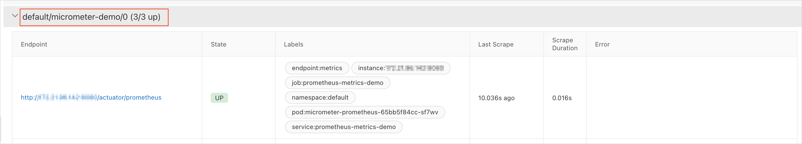

4. 单击{namespace}/{serviceMonitorName}/x所在行展开Target，然后单击Endpoint链接。

   验证Metrics是否正常。

   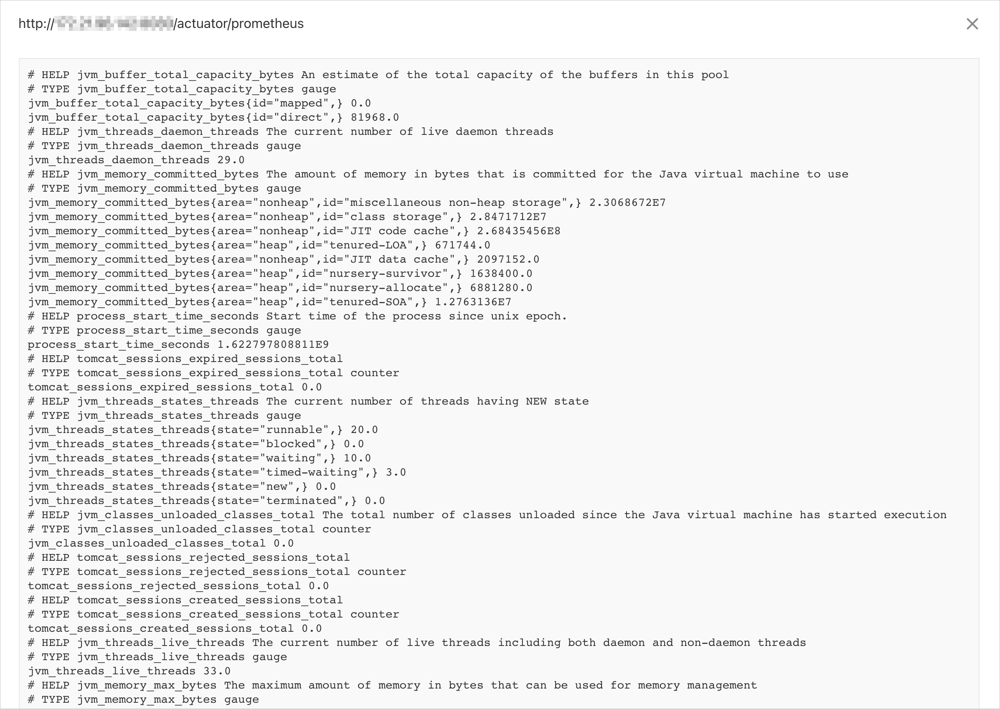

<a id="section-6-3"></a>

## 6.3. 通过Prometheus监控PV数据盘

本文介绍如何通过Prometheus监控PV数据盘。

**操作步骤**

1. 登录容器服务控制台。

   <ol type="i">

   <li>

   在浏览器地址栏中，输入Apsara Uni-manager运营控制台的服务域名地址，按回车键。

   

   > **说明**
   >
   > - 单击页面右上角的当前语言可以切换其它语言。
   >
   > - 授权登录是第三方认证中配置了全局IdP设置才会显示，且“授权登录”名称用户可按需自定义。
   >
   > - 由于浏览器证书过期或环境开启HTTPS认证等出现多次单击继续访问或无Apsara Uni-manager运营控制台地址入口等现象，此时需要安装证书才能正常访问。单击页面右上角的**浏览器证书安装**，可打开浏览器证书安装指南。

   </li>

   <li>

   输入正确的用户名及密码。

   > **说明**
   >
   > - 请向运营管理员获取登录控制台的用户名和密码。
   >
   > - 首次登录Apsara Uni-manager运营控制台时，需要修改登录用户名的密码，请按照提示完成密码修改。为提高安全性，密码长度必须为10~32位，且包含英文字母大小写、阿拉伯数字和特殊符号（感叹号（!）、at（@）、井号（#）、美元符号（$）、百分号（%）等）。

   </li>

   <li>

   单击**账号登录**。

   </li>

   <li>

   在页面顶部的菜单栏中，选择**产品 > 计算 > 容器服务Kubernetes版**。

   </li>

   <li>

   在**容器服务**页面，单击悬浮球的切换账号图标，选择组织和地域，然后单击**角色授权访问**或**管理员权限访问**，跳转到容器服务控制台。

   </li>

   </ol>

2. 单击目标集群名称，然后创建一个PVC，创建后状态需为**Bound**。操作步骤，请参见**容器服务Kubernetes版 > 用户指南 > Kubernetes集群 > 存储 > 使用阿里云云盘**。

   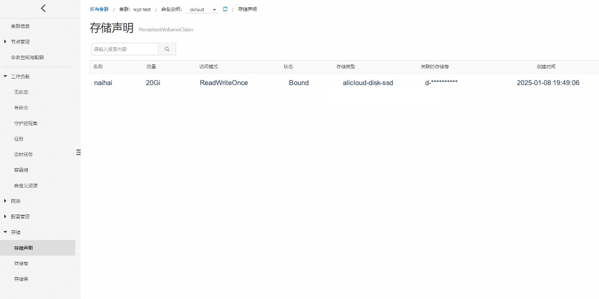

3. 创建一个Deployment，挂载此PVC。操作步骤，请参见**容器服务Kubernetes版 > 用户指南 > Kubernetes集群 > 应用管理 > 工作负载 > 创建无状态工作负载Deployment**。

   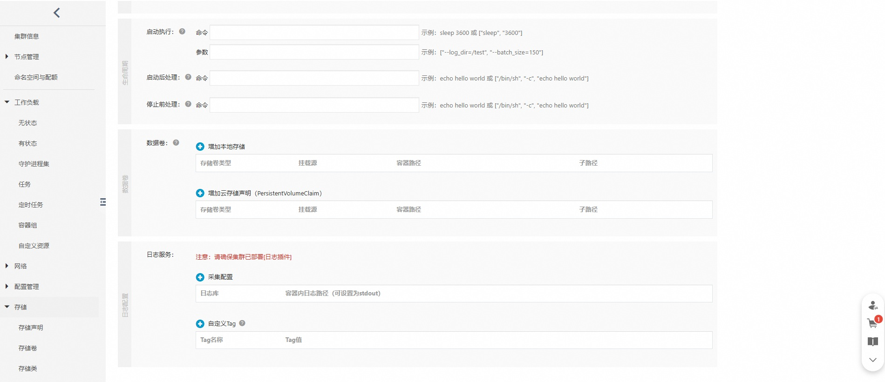

4. 容器组运行一段时间后，登录Prometheus控制台，使用自定义大盘观察指标node_volume_write_bytes_total。

   <ol type="i">

   <li>

   登录**统一云管平台**，选择**产品 > 云原生可观测 > Prometheus 监控 2.0**。

   

   </li>

   <li>

   在左侧导航栏单击**自定义大盘**，然后单击

   ，单击**创建仪表盘**。

   </li>

   <li>

   根据界面提示创建仪表盘，然后根据下图添加图表。

   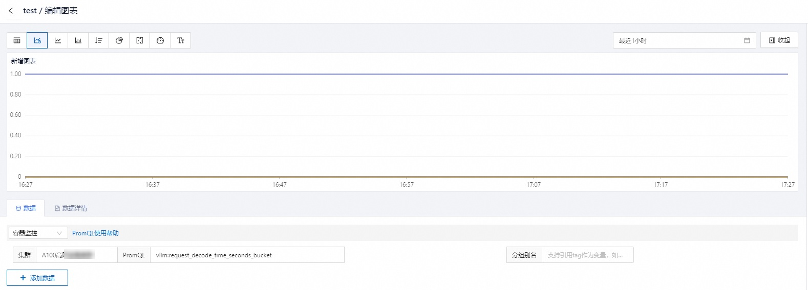

   </li>

   </ol>

**Prometheus支持的指标**

| 序号 | 指标名称 | 描述 |
| --- | --- | --- |
| 1 | node_volume_capacity_bytes_available | 当前存储卷中可用的容量（字节数）。这个指标可以帮助了解存储卷的剩余可用空间。 |
| 2 | node_volume_capacity_bytes_t otal | 存储卷的总容量（字节数）。通过与可用容量结合，可以计算已使用的存储空间以及整体的存储使用情况。 |
| 3 | node_volume_capacity_bytes_used | 当前存储卷中已使用的容量（字节数）。这个指标与可用容量和总容量一起使用，以确定存储资源的使用情况。 |
| 4 | node_volume_inodes_available | 存储卷中可用的 inode 数量。inode 是 Unix/Linux 文件系统中的一个数据结构，它存储关于文件和目录的信息（如文件类型、权限、所有者等）。 |
| 5 | node_volume_inodes_total | 存储卷中 inode 的总数。通过这个指标，可以了解存储卷支持的最大文件数量。 |
| 6 | node_volume_inodes_used | 当前存储卷中已使用的 inode 数量。它有助于监控文件数量的使用情况。 |
| 7 | node_volume_io_now | 当前时刻发生的 IO 操作的数量。这个指标通常用于实时监控，仅在短时间内查看当前 IO 活动。 |
| 8 | node_volume_io_time_seconds _total | 存储卷上所有 IO 操作所花费的总时间（以秒为单位）。这个指标用于评估存储性能，有助于识别潜在瓶颈。 |
| 9 | node_volume_read_bytes_total | 自从启动以来从存储卷中读取的总字节数。用于监控数据读取的吞吐量。 |
| 10 | node_volume_read_completed _total | 自启动以来完成的读取操作总数。它帮助统计读取请求的数量，以便分析负载。 |
| 11 | node_volume_read_merged_tot al | 自启动以来合并的读取操作总数。在高负载情况下，将多个读取请求合并成一个可以提高效率。 |
| 12 | node_volume_read_time_millis econds_total | 自启动以来用于读取操作的总时间（以毫秒为单位）。这个指标有助于评估读取性能。 |
| 13 | node_volume_write_bytes_total | 自启动以来写入到存储卷的总字节数。用于监控数据写入的吞吐量。 |
| 14 | node_volume_write_completed _total | 自启动以来完成的写入操作总数。用于统计写入请求的数量，分析负载情况。 |
| 15 | node_volume_write_merged_to tal | 自启动以来合并的写入操作总数，类似于读取合并，对于减少 I/O 操作开销也有所帮助。 |
| 16 | node_volume_write_time_millis econds_total | 自启动以来用于写入操作的总时间（以毫秒为单位）。这个指标有助于评估写入性能。 |

<a id="section-7"></a>

# 7.参考信息

<a id="section-7-1"></a>

## 7.1. Helm命令参数说明

Prometheus支持通过Operator方式安装K8s集群，本文介绍Operator安装过程中的Helm命令的各参数说明。

使用Operator方式安装K8s集群的Helm示例命令如下：

```bash
helm install --name arms-prom-operator arms-prom-operator-0.1.2.tgz \
  --version 0.1.4 \
  --namespace arms-prom \
  --set controller.clusterId=123 \
  --set controller.regionId=cn-qingdao-env66-d01 \
  --set controller.userId=456
```

| 参数 | 说明 |
| --- | --- |
| version | Helm版本。 |
| namespace | Helm目标命名空间。 |
| controller.clusterId | 当前K8s所在集群的Cluster ID。 |
| controller.userId | 当前用户的User ID。 |
| controller.regionId | 当前K8s所在集群的Region ID。 |

<a id="section-7-2"></a>

## 7.2. 预置大盘说明

Prometheus提供了多种开箱即用的预置监控大盘，您可以通过这些大盘查看丰富的Prometheus监控指标，并按需更改大盘数据的时间区间、刷新频率等属性。本文主要说明Kubernetes概览、Kubernetes部署、Kubernetes容器副本和主机详情大盘，并简单介绍下Grafana的常用操作。

**Kubernetes概览大盘**

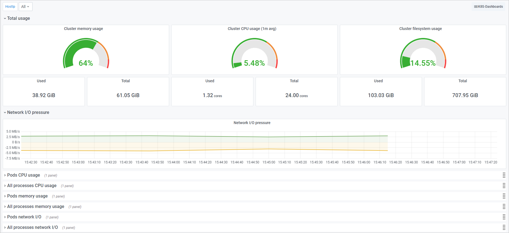

该大盘展示的监控指标主要包括：

- 总体使用量信息：例如集群CPU使用率、集群内存使用率、集群文件系统使用率。

- CPU信息：例如Pod CPU使用率、全部进程CPU使用率。

- 内存信息：例如Pod内存使用率、全部进程内存使用率。

- 网络信息：例如网络I/O压力、Pod网络I/O、所有进程网络I/O。

**Kubernetes部署大盘**

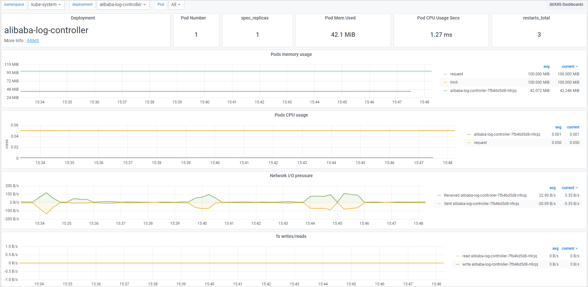

该大盘展示的监控指标主要包括：

- 概览：Pod数量、副本数量、部署CPU使用率、部署内存使用量、重启次数。

- 详情：CPU使用率、内存使用率、全部进程网络I/O、FS读写情况。

**Kubernetes容器副本大盘**

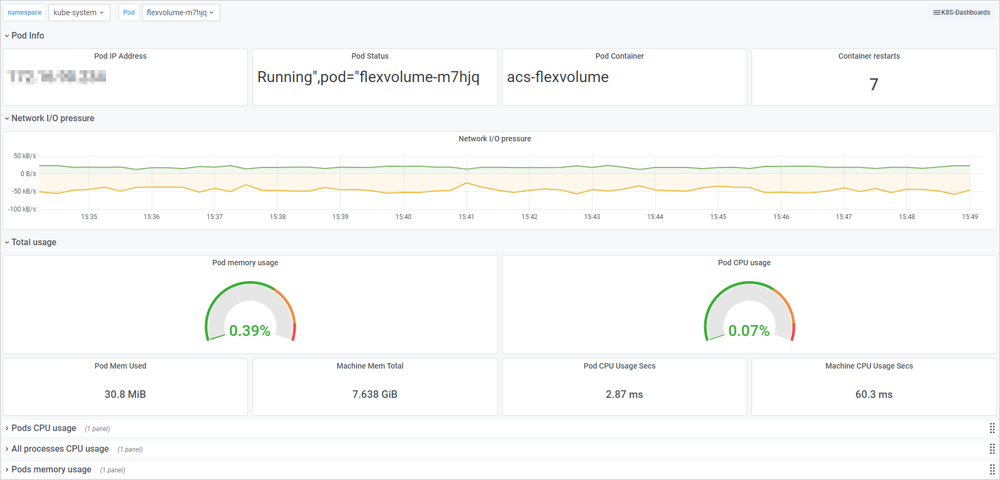

该大盘展示的监控指标主要包括：

- Pod基本信息：Pod IP地址、Pod状态、Pod容器、容器重启次数。

- 总体使用量信息：例如Pod CPU使用率、Pod内存使用率。

- CPU信息：例如Pod CPU使用率、全部进程CPU使用率。

- 内存信息：例如Pod内存使用率、全部进程内存使用率。

- 网络信息：例如网络I/O压力、Pod网络I/O、所有进程网络I/O。

**主机详情大盘**

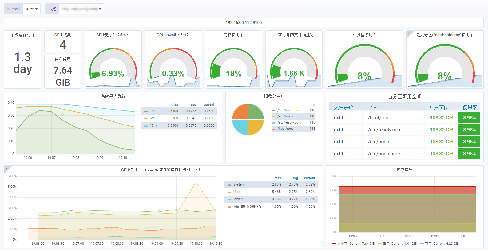

该大盘展示的监控指标主要包括：

- CPU信息：例如CPU核数、CPU使用率、CPU I/O等待时间。

- 内存信息：例如内存总量、内存使用率。

- 磁盘信息：例如磁盘总空间、磁盘IO读写时间、磁盘读写速率。

- 网络信息：例如网络流量、TCP连接情况。

**大盘常用操作**

> **说明**
>
> 本文只介绍了Grafana中常用的基本操作，更详细的使用方法，请参见Grafana文档。

对大盘的常用操作如下所示：

**设置时间区间和刷新频率**

1. 在Grafana页面右上角，单击时间选择框。

   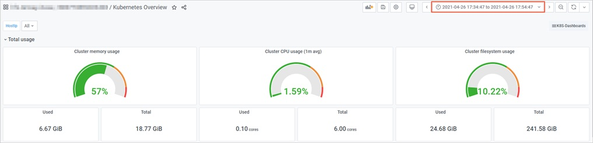

2. 在弹出的对话框中选择预定义的监控数据相对时间区间，例如过去5分钟、过去12小时、过去30天等，也可以通过设置时间起点和终点来设置自定义的绝对时间区间。

   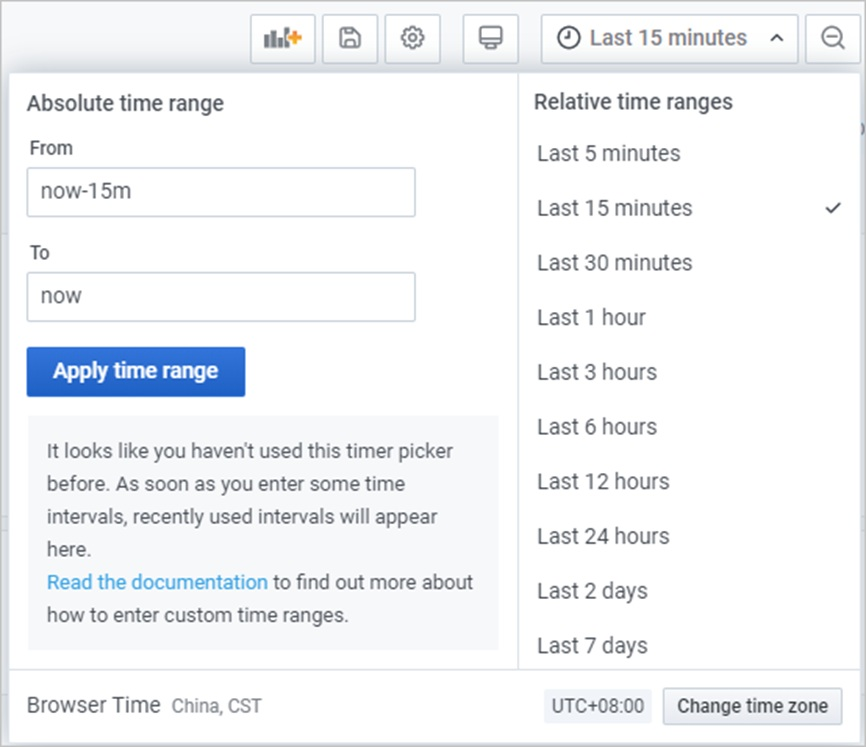

   

3. 在Grafana页面右上角，单击

   图标，刷新当前大盘中所有面板的监控数据。

   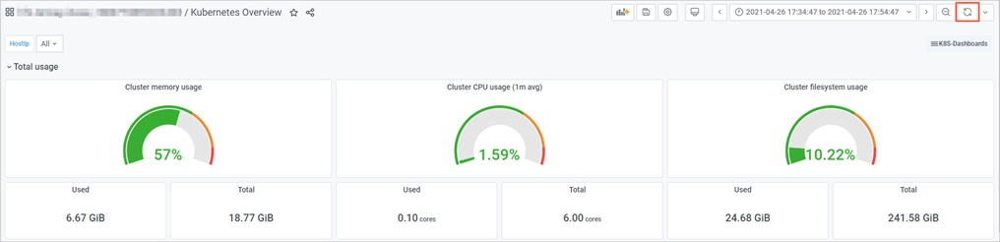

**筛选监控数据**

在Grafana页面，选择此下拉菜单中的选项即可筛选当前大盘显示的监控数据。


<a id="section-8"></a>

# 8.权限管理

<a id="section-8-1"></a>

## 8.1. 创建角色和绑定权限

Apsara Uni-manager控制台可以自定义创建角色并绑定权限策略，为用户赋予角色，以便更精细的管理权限。本文介绍创建角色、角色绑定用户组和角色绑定权限策略等操作。

**前提条件**

- 登录Apsara Uni-manager运营控制台前，确认您已从部署人员处获取Apsara Uni-manager运营控制台的服务域名地址。

- 推荐使用Chrome浏览器。

**创建角色**

1. 在浏览器地址栏中，输入Apsara Uni-manager运营控制台的服务域名地址，按回车键。

   

   > **说明**
   >
   > - 单击页面右上角的当前语言可以切换其它语言。
   >
   > - 授权登录是第三方认证中配置了全局IdP设置才会显示，且“授权登录”名称用户可按需自定义。
   >
   > - 由于浏览器证书过期或环境开启HTTPS认证等出现多次单击继续访问或无Apsara Uni-manager运营控制台地址入口等现象，此时需要安装证书才能正常访问。单击页面右上角的**浏览器证书安装**，可打开浏览器证书安装指南。

2. 输入正确的用户名及密码。

   > **说明**
   >
   > - 请向运营管理员获取登录控制台的用户名和密码。
   >
   > - 首次登录Apsara Uni-manager运营控制台时，需要修改登录用户名的密码，请按照提示完成密码修改。为提高安全性，密码长度必须为10~32位，且包含英文字母大小写、阿拉伯数字和特殊符号（感叹号（!）、at（@）、井号（#）、美元符号（$）、百分号（%）等）。

3. 单击**账号登录**。

4. 在页面顶部的导航栏中，单击**企业**。

5. 在左侧导航栏选择**权限管理 > 角色授权**，然后在右侧页面单击**创建自定义角色**。

6. 在**创建自定义角色**页面，展开页面下方的**高级创建**，单击**创建RAM角色授权**。

7. 设置**基础配置**，单击**下一步**。

   <table>
     <tr>
       <th width="89">参数</th>
       <th>说明</th>
     </tr>
     <tr>
       <td>角色名称</td>
       <td>自定义名称。</td>
     </tr>
     <tr>
       <td>描述</td>
       <td>（可选）角色描述信息。</td>
     </tr>
     <tr>
       <td>共享范围</td>
       <td>代表该角色的可见性范围。运营管理员创建时仅支持选择<strong>全局共享</strong>。<br>• 全局共享：角色的共享范围为所有组织。<br>• 本组织内共享：角色的共享范围为本级组织。<br>• 下级组织共享：角色的共享范围为本级及下级组织使用。</td>
     </tr>
   </table>

8. 在**自定义权限策略配置**页面，勾选权限策略，单击**下一步**。

   如果没有合适的权限策略，可单击权限策略列表右上方的**创建权限策略**，自定义权限策略。单击权限策略**操作**列的**策略内容**，可以查看JSON格式的策略内容。

   

9. 在**信任策略配置**页面，选择**授信组织**、**授信云服务**，单击**下一步**。

   信任策略用来定义可以扮演RAM角色的实体，这里可以指定一级组织（即云账号）、云服务扮演RAM角色。

   > **说明**
   >
   > 开启OIDC功能后，您还可以选择授信OIDC Provider扮演RAM角色，同时还可以设置限制条件。

   - **授权组织**：指定一级组织（云账号）扮演该RAM角色，支持选择多个组织。

   - **授信云服务**：指定云服务扮演该RAM角色，支持选择多个云服务。

0. 在**策略预览**页面，查看已选权限策略和信任策略内容，确认后单击**创建**，完成该RAM角色模板的创建。

1. 在角色列表中，找到创建的RAM角色模板，单击**角色名称/ID**，进入详情。

2. 在详情页面的**RAM角色**页签，单击**新建**，选择一个一级组织，创建RAM角色实例。

   

3. 创建完成后，生成一个RAM角色实例，授信策略中的授信实体就可以扮演这个RAM角色去访问和操作对应的资源了。

   

<a id="section-8-2"></a>

## 8.2. 创建用户和用户组

Apsara Uni-manager运营控制台可以创建用户，并为用户赋予角色，以满足用户对系统的访问控制需求。

**前提条件**

- 登录Apsara Uni-manager运营控制台前，确认您已从部署人员处获取Apsara Uni-manager运营控制台的服务域名地址。

- 推荐使用Chrome浏览器。

**创建组织**

创建用户和用户组都需要提前创建组织。

1. 在浏览器地址栏中，输入Apsara Uni-manager运营控制台的服务域名地址，按回车键。

   

   > **说明**
   >
   > - 单击页面右上角的当前语言可以切换其它语言。
   >
   > - 授权登录是第三方认证中配置了全局IdP设置才会显示，且“授权登录”名称用户可按需自定义。
   >
   > - 由于浏览器证书过期或环境开启HTTPS认证等出现多次单击继续访问或无Apsara Uni-manager运营控制台地址入口等现象，此时需要安装证书才能正常访问。单击页面右上角的**浏览器证书安装**，可打开浏览器证书安装指南。

2. 输入正确的用户名及密码。

   > **说明**
   >
   > - 请向运营管理员获取登录控制台的用户名和密码。
   >
   > - 首次登录Apsara Uni-manager运营控制台时，需要修改登录用户名的密码，请按照提示完成密码修改。为提高安全性，密码长度必须为10~32位，且包含英文字母大小写、阿拉伯数字和特殊符号（感叹号（!）、at（@）、井号（#）、美元符号（$）、百分号（%）等）。

3. 单击**账号登录**。

4. 在页面顶部的导航栏中，单击**企业**。

5. 在左侧导航栏中，选择**资源管理 > 组织管理**。

6. 在**组织管理**页面左侧组织树上选择**root**，然后在右侧单击**创建组织**。

7. 在**添加组织**对话框，填写组织信息。

   <table>
     <tr>
       <th width="137">配置项</th>
       <th>说明</th>
     </tr>
     <tr>
       <td>名称</td>
       <td>组织的名称，长度为2-128个字符，名称的开头和结尾不允许有空格。<br>说明组织名称在组织架构内必须唯一。</td>
     </tr>
     <tr>
       <td>描述</td>
       <td>组织的相关描述信息。</td>
     </tr>
     <tr>
       <td>绑定第三方认证</td>
       <td>如果资源池未设置全局IdP，可选择<strong>立即设置</strong>或<strong>暂不设置</strong>。<br>• 选择<strong>立即设置</strong>，在<strong>IdP服务名称</strong>下拉列表选择需要绑定的局部IdP服务（仅允许绑定一个）。<br>• 选择<strong>暂不设置</strong>，则跳过绑定第三方认证的设置。<br>重要<br>• 仅创建一级组织时才会显示<strong>绑定第三方认证</strong>配置项。<br>• 如果资源池已设置全局IdP，则无法为一级组织绑定第三方认证，且<strong>立即设</strong><strong>置</strong>与<strong>暂不设置</strong>处于灰色状态，不可选。</td>
     </tr>
   </table>

8. 单击**确定**，组织创建成功。

**创建用户组**

角色无法直接与用户进行绑定，您可以为用户组绑定一个角色，用户组中的用户即可获得角色的权限。

1. 在左侧导航栏中，选择**人员管理 > 用户组管理**。

2. 在**用户组管理**页面单击<strong>+创建用户组</strong>。

3. 在**创建用户组**对话框，设置**用户组名**并选择目标**组织**及**角色授权**，然后单击**确定**。

   

   <table>
     <tr>
       <th width="89">参数</th>
       <th>描述</th>
     </tr>
     <tr>
       <td>用户组名</td>
       <td>自定义设置用户组名称，由字母、数字、中文字符、下划线（_）、短划线（-）、半角句号（.）或at（@）组成，长度为3~255个字符。例如<br><br><code>EDAS_group</code>。</td>
     </tr>
     <tr>
       <td>组织</td>
       <td>从下拉列表中选择目标组织。</td>
     </tr>
     <tr>
       <td>角色授权</td>
       <td>授权用户组中的用户使用角色权限。创建角色的操作，请参见<strong>《创建角色》</strong></td>
     </tr>
   </table>

**创建用户**

您可以根据需要创建用户。

1. 在左侧导航栏中，选择**人员管理 > 用户管理**。

2. 在**用户管理**页面，单击<strong>+创建用户</strong>。

3. 在**创建用户**对话框，设置用户基本信息，然后单击**确定**。

   

   <table>
     <tr>
       <th width="121">名称</th>
       <th>描述</th>
     </tr>
     <tr>
       <td>用户名</td>
       <td>用户的个人云平台账号名，由中文汉字、英文大小写字母（A~Z、a~z）、阿拉伯数字（0~9）、短划线（-）、下划线（_）、半角句号（.）或at（@）组成，必须以字母或数字开头，长度为1~64个字符。</td>
     </tr>
     <tr>
       <td>显示名</td>
       <td>显示名由中文汉字、英文大小写字母（A~Z、a~z）、阿拉伯数字（0~9）、短划线（-）、下划线（_）、半角句号（.）或at（@）组成，长度为1~128个字符。</td>
     </tr>
     <tr>
       <td>角色</td>
       <td>此处必须选择<strong>资源使用人</strong>，否则登录Apsara Uni-manager运营控制台后会提示您没有权限。</td>
     </tr>
     <tr>
       <td>组织</td>
       <td>选择用户所在的组织。</td>
     </tr>
     <tr>
       <td>登录策略</td>
       <td>保持默认，选择默认策略。</td>
     </tr>
     <tr>
       <td>手机</td>
       <td>用户的手机号码。手机号码用于系统以短信形式通知用户资源的申请和使用情况，请填写正确的手机号码。<br>说明若手机号有变更，请及时在平台上更新。</td>
     </tr>
     <tr>
       <td>座机</td>
       <td>用户的座机号码。座机号码仅允许输入数字（0~9）和短划线（-），长度为4~20 个字符。</td>
     </tr>
     <tr>
       <td>Email</td>
       <td>用户的邮箱地址。邮箱用于系统以邮件方式通知用户资源的申请和使用情况，请填写正确的邮箱地址。<br>说明若Email有变更，请及时在平台上更新。</td>
     </tr>
     <tr>
       <td>钉钉密钥</td>
       <td>钉钉机器人的密钥。</td>
     </tr>
     <tr>
       <td>启用邮件通知</td>
       <td>启用后，Apsara Uni-manager运营控制台出现报警项且该用户是报警联系人时，Apsara Uni-manager运营控制台会将报警信息通过邮件通知用户对应的Email。<br>说明邮件通知需要配置邮件服务器，具体请联系驻场运维工程师。</td>
     </tr>
     <tr>
       <td>启用钉钉通知</td>
       <td>启用后，Apsara Uni-manager运营控制台出现报警项且该用户是报警联系人时，Apsara Uni-manager运营控制台会将报警信息通过钉钉消息通知用户的钉钉。</td>
     </tr>
   </table>

   > **说明**
   >
   > 请注意保存新用户的AccessKey信息和初始密码。

**添加用户到用户组**

用户添加到用户组后，即可享有用户组所绑定角色的权限。

1. 在页面顶部的导航栏中，选择**人员管理 > 用户组管理**。

2. 在**用户组管理**页面选择目标用户，在其**操作**列单击**添加用户**。

3. 在**添加用户**对话框，选中组织下的目标用户并单击  图标，然后单击**确定**。

   

<a id="section-8-3"></a>

## 8.3. 权限策略示例库

文本介绍在RAM用户（子账号）中可以授权的与Prometheus监控相关的权限策略。

**授权格式说明**

```json
{
  "Version": "1",
  "Statement": [
    {
      "Action": [
        "prometheus:ProcessCluster"
      ],
      "Resource": "acs:prometheus:*:*:prometheus/容器集群名匹配表达式",
      "Effect": "Allow"
    }
  ]
}
```

- Action: 目前为固定值 `prometheus:ProcessCluster` ，表示授权指定的RAM用户（子账号）可以操作容器集群。

- Resource：按照RAM统一的资源命名规范，目前定义为 `acs:prometheus:::prometheus/`容器集群名匹配表达式 ，其中“容器集群名匹配表达式”中支持设置为“\*”。

- Effect：按照RAM统一规范设置，目前通常设置为 `Allow`  。

**权限策略示例**

如下示例：表示授权RAM用户（子账号）可以操作容器集群名为 `prom` 开头的所有集群。

```json
{
  "Version": "1",
  "Statement": [
    {
      "Action": [
        "prometheus:ProcessCluster"
      ],
      "Resource": "acs:prometheus:*:*:prometheus/prom*",
      "Effect": "Allow"
    }
  ]
}
```

<a id="section-8-4"></a>

## 8.4. RAM用户鉴权认证

RAM用户（子账号）只能查看自己所在集群的Prometheus监控信息，不能创建Prometheus实例。

**阿里云账号查看所有集群列表**

使用阿里云账号（主账号）登录控制台后可以查看Prometheus监控页面所有的容器集群列表。

**RAM用户查看部分集群列表**

阿里云账号定义RAM用户的容器集群RAM权限策略后，使用RAM用户登录控制台后，在Prometheus监控页面只能查看符合RAM鉴权的容器集群列表，如下图所示，RAM用户只能查看 `prom*` 规则的容器集群列表。RAM用户只拥有阿里云账号为其配置的相关权限，如何配置RAM用户的权限策略请参见创建角色和绑定权限和权限策略示例库。

<a id="section-8-5"></a>

## 8.5. 用户角色与权限说明

本章节主要介绍了各类角色及其权限说明。


**资源使用人**

**云资源管理**

**用户管理**


**资源集管理员**

**云资源**

**用户**

**资源集**

**管理**

**管理**

**管理**


**组织管理员**

管理

管理

**组织管理**

**资源集管理**

**日常管理**

**用户管理**


**运营管理员**

管理

管理

**运营管理**

**平台管理**

**用户管理**


**安全审计员**

**账单审计**

**资源审计**

**业务审计**

审计

表 1. 角色与权限说明

<table>
  <tr>
    <th width="170">角色名称</th>
    <th>权限说明</th>
  </tr>
  <tr>
    <td>资源使用人</td>
    <td>拥有对所属资源集资源的操作权限；拥有对所属资源集资源查看和创建报警项的权限。</td>
  </tr>
  <tr>
    <td>资源集管理员</td>
    <td>拥有为所属资源集资源进行创建、删除和操作的权限；拥有管理资源集用户的权限。</td>
  </tr>
  <tr>
    <td>组织管理员</td>
    <td>拥有为所属组织及下级组织的资源进行创建、删除和操作的权限； 拥有为所属组织及下级组织的资源查看和创建报警项的权限； 拥有导出报表的权限； 拥有管理组织及下级组织用户的权限。</td>
  </tr>
  <tr>
    <td>运营管理员</td>
    <td>拥有所有资源的操作（ 读和写） 权限。</td>
  </tr>
  <tr>
    <td>安全审计员</td>
    <td>负责云平台的安全审计工作，拥有云平台操作日志的查看（只读）权限。</td>
  </tr>
  <tr>
    <td>平台管理员</td>
    <td>系统信息初始化，创建运营管理员。</td>
  </tr>
  <tr>
    <td>资源监察员</td>
    <td>拥有云平台所有资源的查看（只读）权限。</td>
  </tr>
  <tr>
    <td>组织安全管理员</td>
    <td>负责本组织的安全管理工作，包括主机安全、应用安全、网络安全等。拥有云平台操作日志的查看（只读）权限和云数据库RDS、云服务器ECS和云盾的操作（读和写）权限。</td>
  </tr>
  <tr>
    <td>安全系统配置管理员</td>
    <td>负责安全相关的系统配置工作，如升级中心，全局配置等，拥有云盾升级、防护和配置功能的操作（读和写）权限。</td>
  </tr>
  <tr>
    <td>全局组织安全管理员</td>
    <td>负责通过云安管中心SOC进行全局租户的安全管理工作，拥有云盾所有功能的操作（读和写）权限。</td>
  </tr>
  <tr>
    <td>平台安全管理员</td>
    <td>负责通过云安管中心SOC进行平台的安全管理工作，拥有云盾升级、防护和配置功能的操作（读和写）权限。</td>
  </tr>
  <tr>
    <td>全局组织安全监察员</td>
    <td>负责通过云安管中心SOC查看全部组织的安全状况，拥有云平台操作日志和云盾所有功能的查看（只读）权限。</td>
  </tr>
  <tr>
    <td>平台安全监察员</td>
    <td>负责通过云安管中心SOC查看平台的安全状况，拥有云平台操作日志、安骑士、云防火墙、数据盾、云安管中心、系统配置和WAF配置的查看（只读）权限，云盾DDos防护、姿势感知、同步中心功能的操作（读和写）权限。</td>
  </tr>
  <tr>
    <td>平台安全配置管理员</td>
    <td>负责平台安全产品的配置工作，具有配置功能的操作（读和写）权限，如物理机安骑士配置、平台WAF配置等。</td>
  </tr>
  <tr>
    <td>组织资源监察员</td>
    <td>具有所在组织所有云资源的查看权限。</td>
  </tr>
</table>
