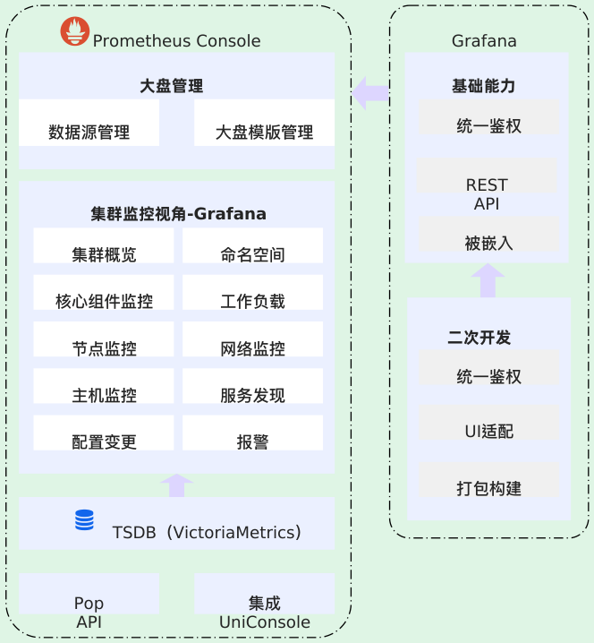
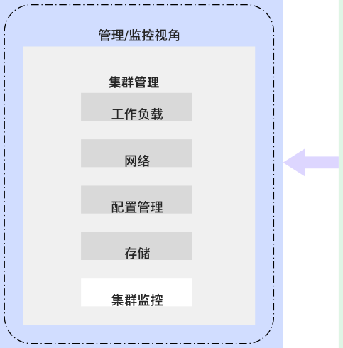
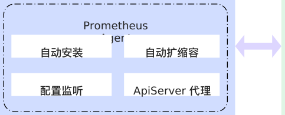
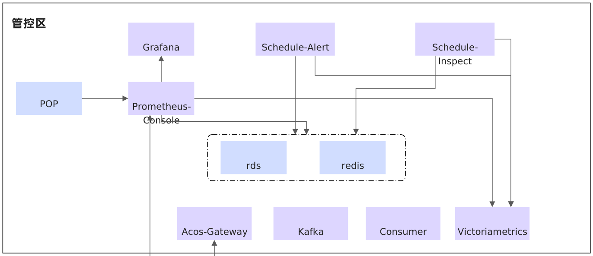
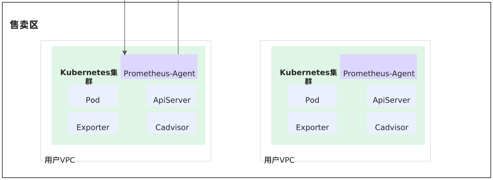
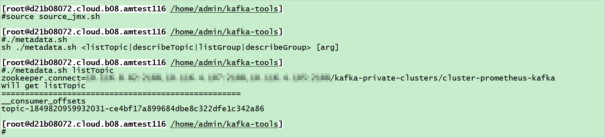
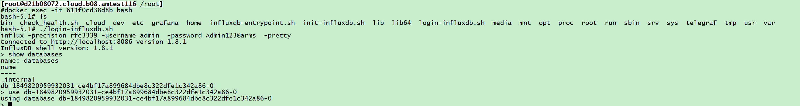

阿里云  
专有云  
可观测监控 Prometheus 版  
运维指南  
产品版本：V3.18.6  
文档版本：20260422

**目录**

- [1.运维概述](#section-1)
- [2.产品架构](#section-2)
    - [2.1. 系统架构](#section-2-1)
    - [2.2. 部署架构](#section-2-2)
    - [2.3. 组件架构](#section-2-3)
    - [2.4. 服务角色列表](#section-2-4)
- [3.系统巡检](#section-3)
- [4.日志审计](#section-4)
- [5.常用运维命令](#section-5)

# 1.运维概述

本手册主要指导维护人员对阿里云系统进行预防性的维护，确保系统长期稳定运行。

维护人员可以根据本手册的指导，处理维护过程中发现的系统问题。如果根据本手册无法解决系统问题，请寻求阿里云工程师的技术支持。

**要求**

维护人员必须拥有IT行业技能，包括计算机网络知识、计算机操作知识、问题分析排查能力。

另外，维护人员必须经过阿里云系统岗前培训，学习必要的阿里云系统知识，包括但不限于系统原理、组网、特性使用和维护工具的使用。

特别注意的是，在维护操作过程中，维护人员务必遵守操作规章，确保人身安全和系统安全。对于用户数据，严格保密，未经用户书面许可，禁止复制、传播用户数据。

**注意事项**

为了系统运行的稳定，避免意外事故的发生，维护人员需遵循以下事项：

- 分层分权管理

  对网络、设备、系统、数据实行分层分权管理，相应业务的维护人员仅拥有完成自身角色任务相对应的权限，防止越权操作而引起系统故障。

- 系统安全

  - 在对系统进行任何操作前，需清楚的了解操作的结果，避免危险操作影响系统运行。

  - 在操作过程中遇到的问题，需清楚记录以便问题排查和故障处理。

- 人身和数据安全

  - 操作电气设备时，必须根据设备要求做好安全措施。

  - 需使用安全的设备接入业务网络。

  - 未经授权，严禁对数据进行复制和传播。

**联系我们**

维护人员在系统维护过程中，如果需要相关帮助，可以联系阿里云技术支持获取帮助。

# 2.产品架构

## 2.1. 系统架构

本文介绍了Prometheus监控的系统架构。

图 1. Prometheus监控技术架构

ACK容器监控

Prometheus 2.0

企业版底座/基础服务

- Prometheus-agent：负责采集容器集群的Metrics信息，兼容开源Prometheus Agent的各项能力。

- Acos-Gateway：负责接收各个Prometheus Agent发送来的Metrics数据，将数据发送到Kafka消息中间件缓存。

- Kafka：缓存Metrics消息。

- Consumer：将Kafka缓存的Metrics消息持久化到VictoriaMetrics。

- VictoriaMetrics：一种时序数据库，用于保存Metrics信息。

- Prometheus-Console：从VictoriaMetrics查询数据，进行PromQL的计算，并返回结果给Grafana。

- Grafana：接收由Prometheus-Console查询返回的数据，并进行呈现。

- Schedule-Alert：告警服务，查询VictoriaMetrics的数据并进行告警规则的触发与通知。

- Schedule-Inspect：巡检服务，查询VictoriaMetrics的数据并生成巡检报告。

## 2.2. 部署架构

本文介绍了Prometheus监控的部署架构。

| 组件 | 描述 |
| --- | --- |
| Prometheus-agent | 部署在用户容器集群内，支持多节点水平扩容。 |
| Acos-Gateway | Kubernetes集群中部署，可根据需求进行扩容。 |
| Kafka | Kubernetes集群中部署，一般为三实例，可以根据业务需要横向扩展。 |
| jlogvictoriametrics | Kubernetes集群中部署，一般是双实例，可以根据业务需要横向扩展。 |
| VictoriaMetrics | Kubernetes集群中部署，一般是双实例，可以根据业务需要横向扩展。 |
| Prometheus-Console | Kubernetes集群中部署，一般是双实例，可以根据业务需要横向扩展。 |
| Grafana | Kubernetes集群中部署，一般是双实例，可以根据业务需要横向扩展。 |
| Schedule-Inspect | Kubernetes集群中部署，一般是双实例，可以根据业务需要横向扩展。 |
| Schedule-Alert | Kubernetes集群中部署，一般是双实例，可以根据业务需要横向扩展。 |

## 2.3. 组件架构

本文介绍Prometheus监控的组件架构。

| 组件 | 功能描述 |
| --- | --- |
| Gateway | 负责接收各个Prometheus Agent发送来的Metrics数据，将数据发送到Kafka消息中间件缓存。 |
| Kafka | 缓存Metrics消息。 |
| jlogvictoriametrics | 将Kafka缓存的Metrics消息持久化到VictoriaMetrics。 |
| VictoriaMetrics | 一种时序数据库，用于保存Metrics信息。 |
| Prometheus-Console | 从VictoriaMetrics查询数据，进行PromQL的计算，并返回结果给Grafana。 |
| Schedule-Alert | 告警服务，查询VictoriaMetrics的数据并进行告警规则的触发与通知。 |
| Schedule-Inspect | 巡检服务，查询VictoriaMetrics的数据并生成巡检报告。 |
| POP | 使用Prometheus管理接口调用其它云产品（目前是ACS）。 |
| Prometheus Agent | 负责采集容器集群的Metrics信息，兼容开源Prometheus Agent的各项能力。 |
| Grafana | 监控数据的可视化呈现。 |

## 2.4. 服务角色列表

本文介绍Prometheus监控的服务角色列表。

<table>
  <tr>
    <th>集群</th>
    <th>服务</th>
    <th>描述</th>
  </tr>
  <tr>
    <td rowspan="8">BasicCluster</td>
    <td>Prometheus2-console</td>
    <td>从VictoriaMetrics查询数据，进行PromQL的计算，并返回结果给Grafana。</td>
  </tr>
  <tr>
    <td>Prometheus2-dtlogux</td>
    <td>提供Grafana能力。</td>
  </tr>
  <tr>
    <td>Prometheus2-kafka</td>
    <td>缓存Agent采集的数据。</td>
  </tr>
  <tr>
    <td>Prometheus2-jlogvictoriametrics</td>
    <td>从Kafka中消费消息，持久化到VictoriaMetrics。</td>
  </tr>
  <tr>
    <td>Prometheus2-victoriametrics</td>
    <td>持久化Metrics数据。</td>
  </tr>
  <tr>
    <td>Prometheus2-gateway</td>
    <td>负责接收各个Prometheus Agent发送来的Metrics数据，将数据发送到Kafka消息中间件缓存。</td>
  </tr>
  <tr>
    <td>Prometheus2-schedule-alert</td>
    <td>告警服务，查询VictoriaMetrics的数据并进行告警规则的触发与通知。</td>
  </tr>
  <tr>
    <td>Prometheus2-Schedule-Inspect</td>
    <td>巡检服务，查询VictoriaMetrics的数据并生成巡检报告。</td>
  </tr>
</table>

# 3.系统巡检

本文介绍了Prometheus监控常用的系统巡检方法。

- 查看各组件所在系统的磁盘占用率，如果超过80%，则联系阿里云技术支持协助处理。

- 查看各组件所在系统的CPU最高使用率，如果超过40%，则联系阿里云技术支持协助处理。

- 查看各组件所在系统的内存占用率，如果超过90%，则联系阿里云技术支持协助处理。

# 4.日志审计

本文介绍Prometheus监控的日志审计。

<table>
  <tr>
    <th>组件</th>
    <th>文件</th>
    <th>说明</th>
  </tr>
  <tr>
    <td rowspan="5">console</td>
    <td>/home/admin/logs/arms/arms-console.log</td>
    <td>控制台系统日志。</td>
  </tr>
  <tr>
    <td>/home/admin/logs/arms/arms-prom.log</td>
    <td>Prometheus监控和访问容器服务相关日志。</td>
  </tr>
  <tr>
    <td>/home/admin/logs/arms/statistic/arms-prom-register-cluster.log</td>
    <td>容器集群注册过程日志。</td>
  </tr>
  <tr>
    <td>/home/admin/logs/arms-pop/arms-pop.log</td>
    <td>POP接口系统日志。</td>
  </tr>
  <tr>
    <td>/home/admin/logs/arms-pop/arms-pop-api.log</td>
    <td>POP接口调用明细日志。</td>
  </tr>
  <tr>
    <td>Prometheus-server</td>
    <td>docker logs prometheus-server实例id</td>
    <td>Prometheus Server的系统日志。</td>
  </tr>
  <tr>
    <td>grafana</td>
    <td>/home/admin/logs/grafana/grafana.log</td>
    <td>Grafana系统日志。</td>
  </tr>
  <tr>
    <td>Prometheus-agent</td>
    <td>kubectl logs agent实例id -n arms-prom</td>
    <td>Prometheus Agent的系统日志。</td>
  </tr>
  <tr>
    <td>collector</td>
    <td>/home/admin/logs/arms/arms-collector.log</td>
    <td>Collector的系统日志。</td>
  </tr>
  <tr>
    <td rowspan="2">kafka</td>
    <td>/home/admin/logs/alikafka/kafka-request.log</td>
    <td>Kafka请求日志。</td>
  </tr>
  <tr>
    <td>/home/admin/logs/alikafka/server.log</td>
    <td>Kafka系统日志。</td>
  </tr>
  <tr>
    <td>consumer</td>
    <td>/home/admin/logs/arms-prometheus-streaming.log</td>
    <td>Consumer系统日志。</td>
  </tr>
  <tr>
    <td rowspan="2">influxdb</td>
    <td>/var/lib/influxdb/log/influxdb.log</td>
    <td>InfluxDB系统日志。</td>
  </tr>
  <tr>
    <td>/var/lib/influxdb/log/access.log</td>
    <td>InfluxDB访问日志。</td>
  </tr>
</table>

# 5.常用运维命令

本文介绍Prometheus监控常用的运维命令。

**查看Kafka系统情况**

在Kafka Docker的/home/admin/kafka-tools目录下，执行 `source source_jmx.sh` ，然后执行 `./metadata.sh` ，可以查看Kafka的当前信息。

**查看InfluxDB信息**

在InfluxDB Docker内，执行 `/login-influxdb.sh` 可以登录InfluxDB命令行，然后执行InfluxDB相关命令。

