阿里云  
专有云  
应用运维平台  
用户指南  
产品版本：V3.18.6  
文档版本：20250529

**目录**

- [1.概述](#section-1)
- [2.快速入门](#section-2)
    - [2.1. 登录应用中心AHM控制台](#section-2-1)
    - [2.2. On Kubernetes应用部署交付](#section-2-2)
    - [2.3. On ECS应用部署交付](#section-2-3)
    - [2.4. ONSP应用部署交付](#section-2-4)
- [3.应用管理](#section-3)
    - [3.1. 导入应用](#section-3-1)
    - [3.2. 部署应用](#section-3-2)
    - [3.3. 管理应用](#section-3-3)
- [4.任务管理](#section-4)
- [5.镜像仓库管理](#section-5)
- [6.变量管理](#section-6)
    - [6.1. 管理全局变量](#section-6-1)
    - [6.2. 管理集群变量](#section-6-2)

<a id="section-1"></a>

# 1.概述

应用中心AHM（Apsara Hybrid Marketplace）是在专有云底座Tianji、PaaS平台之外的第三条产品研发交付链路。在专有云环境中主要承载应用交付，提供应用导入、应用部署、应用升级、应用下线、基础监控、系统配置管理等功能。支持Kubernetes和ECS两种部署模式，覆盖主流的应用交付场景。

<a id="section-2"></a>

# 2.快速入门

<a id="section-2-1"></a>

## 2.1. 登录应用中心AHM控制台

您可以通过Apsara Uni-manager运营控制台登录应用中心AHM控制台，首页通过图表方式展示各区域当前系统资源的使用情况和监控情况，方便您了解当前资源的使用情况。

**操作步骤**

1. 登录Apsara Uni-manager运营控制台。

2. 在顶部菜单栏选择**产品 > 应用 > 应用中心AHM**。

3. 在控制台首页可查看应用中心所有应用的汇总信息。

   - **我的应用状态**：展示应用中心所有应用的状态和数量。

   - **告警概览**：展示应用中心所有应用的各级报警数量和报警信息详情。

   - **资源排行-Top10**：展示应用中心资源占用前10的应用对CPU、磁盘和内存的占用数量。

   - **云资源分布**：展示云资源的地域分布情况。

<a id="section-2-2"></a>

## 2.2. On Kubernetes应用部署交付

使用应用中心AHM在专有云环境中的Kubernetes容器部署应用商店的应用。

**环境准备**

部署应用前，需要完成以下准备工作：

- 账号：准备拥有需要部署应用的指定组织、资源集相关资源使用权限的用户账号。

- 网络资源：在指定组织、资源集中已创建专有网络VPC和虚拟交换机。

- ACK集群：在指定组织、资源集中已创建容器服务Kubernetes集群，且集群Worker实例规格大小必须满足应用基线接入时要求的组件容器大小，例如组件容器大小为4核8G，则ACK集群单个Worker实例规格必须不小于4核8G。

- 集群数据授权：为准备的用户账号授予所创建的容器服务Kubernetes集群的数据权限。

- 泛域名：为所创建的容器服务Kubernetes集群的Ingress服务绑定可用的泛域名。

  > **说明**
  >
  > - 在容器服务Kubernetes集群管理页面的网络>服务菜单，选择kube-system命名空间，nginx-ingress-lb服务的外部端点IP即为需要绑定泛域名的源站IP。
  >
  > - 通过DNS绑定域名时，建议为Ingress服务使用A记录绑定泛域名。如果不使用泛域名绑定，则需要为所有服务域名都使用A记录绑定Ingress服务IP。
  >
  > - 绑定的泛域名在部署应用时需要配置到集群环境变量中。

- ACR镜像仓库：已创建ACR镜像仓库，并将所需部署的应用镜像推送至镜像仓库。

**操作步骤**

1. 登录应用中心AHM控制台。

2. 在**系统管理**>**镜像仓库管理**页面，确保镜像仓库的地址、账号、密码与准备的ACR镜像仓库地址一致。

3. 在**系统管理**>**变量管理**页面，可按需求调整变量。

4. 在**应用商店**页面，单击**导入应用**，上传应用基线zip包文件或使用**一键导入**功能导入全量制品包。

5. 导入完成后，在应用商店单击进入该应用详情页，单击**开始部署**，配置应用部署基本信息，完成配置向导，即应用部署完成。

   <ol type="i">

   <li>

   **基础配置**

   在基础配置中，填写相关参数，完成基础配置后，单击**下一步**，进入资源配置。

   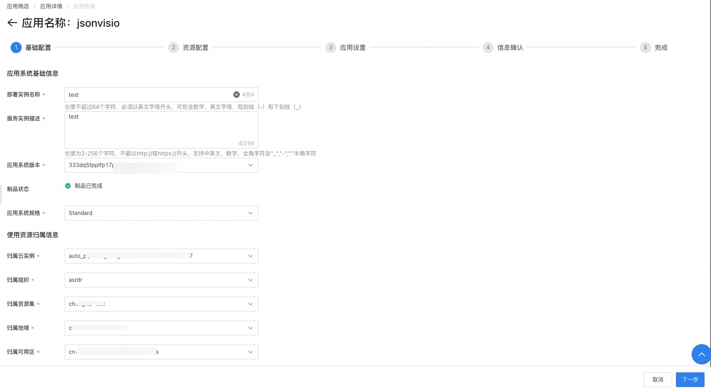

   相关参数说明：

   | 字段名称 | 是否必填 | 字段说明 |
   | --- | --- | --- |
   | 部署实例名称 | 是 | 填写应用名称，支持最多填写64个英文字母、短划线（-）或下划线（_），且必须以英文字母开头。 |
   | 服务实例描述 | 是 | 填写应用描述。 |
   | 应用系统版本 | 是 | 选择所需部署的应用系统版本号。 |
   | 制品状态 | 是 | 系统自动检查制品状态。 |
   | 应用系统规格 | 是 | 选择应用部署规格，不得超过ACK集群的Worker实例规格。 |
   | 归属云实例 | 是 | 选择准备部署应用的云平台。 |
   | 归属组织 | 是 | 选择准备部署应用的ACK集群所在组织。 |
   | 归属资源集 | 是 | 选择准备部署应用的ACK集群所在资源集。 |
   | 归属地域 | 是 | 选择准备部署应用的ACK集群所在地域。 |
   | 归属可用区 | 是 | 选择准备部署应用的ACK集群所在可用区。 |

   </li>

   <li>

   **资源配置**

   在资源配置中，填写相关参数，完成资源配置后，单击**下一步**，进入应用设置。

   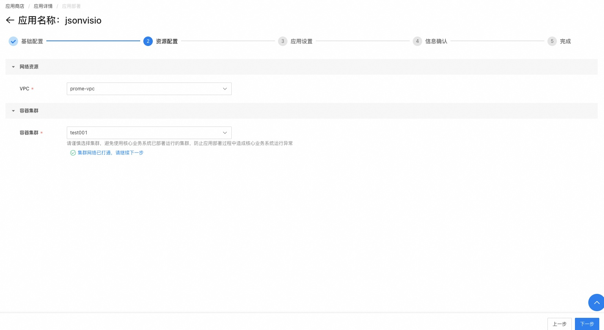

   相关参数说明：

   | 字段名称 | 是否必填 | 字段说明 |
   | --- | --- | --- |
   | VPC | 是 | 选择准备部署应用的ACK集群所在VPC。 |
   | 容器集群 | 是 | 选择准备部署应用的ACK集群。 |

   </li>

   <li>

   **应用设置**

   在应用设置中，填写相关参数，完成应用设置后，单击**下一步**，进入信息确认。

   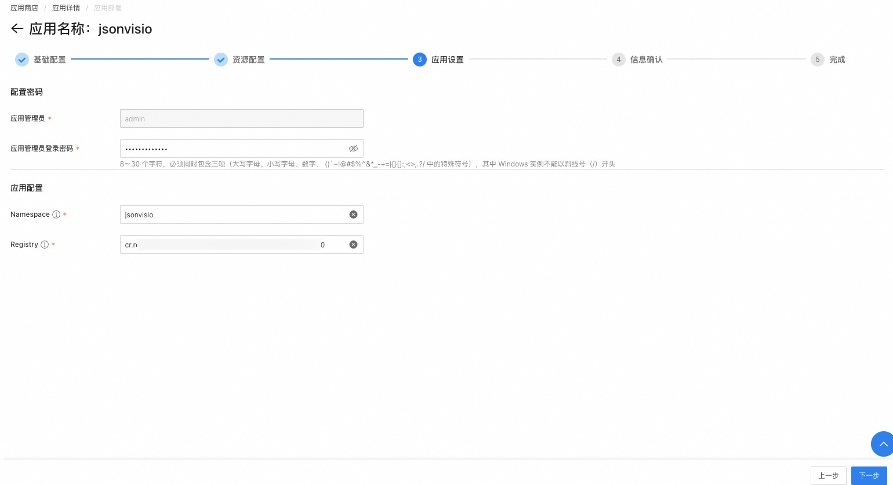

   相关参数说明：

   | 字段名称 | 是否必填 | 字段说明 |
   | --- | --- | --- |
   | 应用管理员 | 是 | 默认admin。 |
   | 应用管理员登录密码 | 是 | 填写应用管理员登录密码。 |
   | 应用配置 | 是 | 应用自定义配置。 |

   </li>

   <li>

   **信息确认**

   在信息确认中，进行信息的确认。

   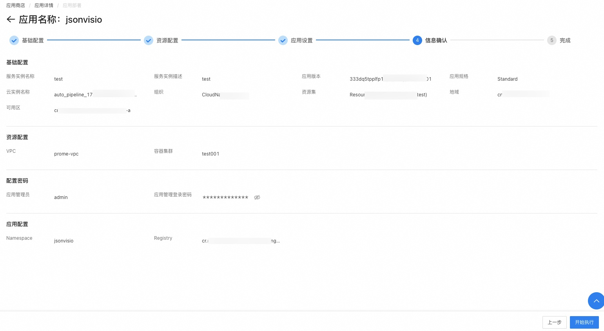

   </li>

   <li>

   **完成**

   单击**开始执行**，完成应用的部署。

   </li>

   </ol>

<a id="section-2-3"></a>

## 2.3. On ECS应用部署交付

使用应用中心AHM在专有云环境中的云服务器ECS实例部署应用商店的应用。

**环境准备**

部署应用前，需要完成以下准备工作：

- 账号：准备拥有需要部署应用的指定组织、资源集相关资源使用权限的用户账号。

- RAM授权：准备的账号需要拥有必要的云服务器ECS产品相关操作权限，可通过RAM授权的方式为准备的账号仅授予应用部署所需的必要权限。

  > **说明**
  >
  > **RAM授权配置方式**
  >
  > <ol type="i">
  >
  > <li>
  >
  > 在Apsara Uni-manager运营控制台中创建RAM授权。
  >
  > </li>
  >
  > <li>
  >
  > 为创建的RAM授权添加权限策略，具体策略内容如下所示：
  >
  > ```json
  > {
  >     "Version": "1",
  >     "Statement":
  >     [
  >         {
  >             "Action":
  >             [
  >                 "rds:Describe*",
  >                 "rds:CreateDBInstance",
  >                 "rds:CreateAccount*",
  >                 "rds:CreateDataBase*",
  >                 "rds:ModifySecurityIps",
  >                 "rds:GrantAccountPrivilege",
  >                 "rds:ReceiveDBInstance",
  >                 "rds:CreateMigrateTask",
  >                 "rds:DescribeMigrateTaskById",
  >                 "rds:CreateOnlineDatabaseTask"
  >             ],
  >             "Resource": "*",
  >             "Effect": "Allow"
  >         },
  >         {
  >             "Action":
  >             [
  >                 "ecs:DescribeSecurityGroupAttribute",
  >                 "ecs:DescribeInstances",
  >                 "ecs:DescribeRegions",
  >                 "ecs:AuthorizeSecurityGroup",
  >                 "ecs:CreateSecurityGroup",
  >                 "ecs:DeleteSecurityGroup",
  >                 "ecs:DescribeSecurityGroups",
  >                 "ecs:JoinSecurityGroup",
  >                 "ecs:LeaveSecurityGroup",
  >                 "ecs:RevokeSecurityGroup",
  >                 "ecs:RunCommand",
  >                 "ecs:SendFile",
  >                 "ecs:DescribeSendFileResults",
  >                 "ecs:ImportImage",
  >                 "ecs:DescribeTasks",
  >                 "ecs:DescribeCommands",
  >                 "ecs:DescribeInvocationResults",
  >                 "ecs:AllocateEipAddress",
  >                 "vpc:AllocateEipAddress",
  >                 "eip:AllocateEipAddress",
  >                 "slb:CreateLoadBalancer",
  >                 "slb:AddBackendServers",
  >                 "slb:CreateLoadBalancerHTTPListener",
  >                 "slb:StartLoadBalancerListener"
  >             ],
  >             "Resource": "*",
  >             "Effect": "Allow"
  >         }
  >     ]
  > }
  > ```
  >
  > </li>
  >
  > <li>
  >
  > 通过用户组关联所准备的用户账号与RAM授权。
  >
  > </li>
  >
  > </ol>

- 网络资源：在指定组织、资源集中已创建专有网络VPC和虚拟交换机。

**操作步骤**

1. 登录应用中心AHM控制台。

2. 在**系统管理**>**变量管理**页面，可按需求调整变量。

3. 在**应用商店**页面，单击**导入应用**，上传应用基线zip包文件或使用**一键导入**功能导入全量制品包。

4. 导入完成后，在应用商店单击进入该应用详情页，单击**开始部署**，配置应用部署基本配置信息，完成配置向导，即应用部署完成。

   <ol type="i">

   <li>

   **基础配置**

   在基础配置中，填写相关参数，完成基础配置后，单击**下一步**，进入资源配置。

   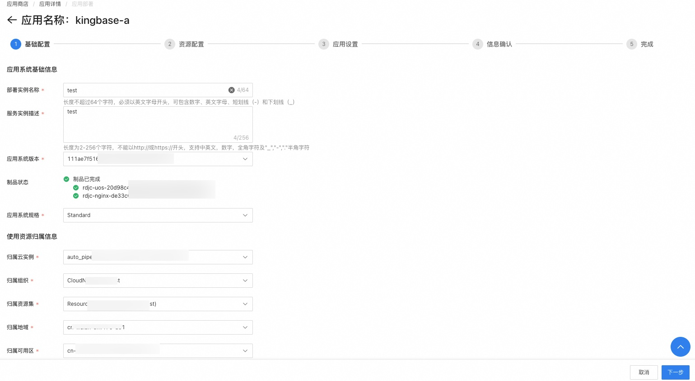

   相关参数说明如下：

   | 字段名称 | 是否必填 | 字段说明 |
   | --- | --- | --- |
   | 部署实例名称 | 是 | 填写应用名称，支持最多填写64个英文字母、短划线（-）或下划线（_），且必须以英文字母开头。 |
   | 服务实例描述 | 是 | 填写应用描述。 |
   | 应用系统版本 | 是 | 选择所需部署的应用系统版本号。 |
   | 制品状态 | 是 | 系统自动检查制品状态。 |
   | 应用系统规格 | 是 | 选择应用部署规格，不得超过ACK集群的Worker实例规格。 |
   | 归属云实例 | 是 | 选择准备部署应用的云平台。 |
   | 归属组织 | 是 | 选择准备部署应用的ECS实例所属组织。 |
   | 归属资源集 | 是 | 选择准备部署应用的ECS实例所属资源集。 |
   | 归属地域 | 是 | 选择准备部署应用的ECS实例所在地域。 |
   | 归属可用区 | 是 | 选择准备部署应用的ECS实例所在可用区。 |

   </li>

   <li>

   **资源配置**

   在资源配置中，填写相关参数，完成资源配置后，单击**下一步**，进入应用设置。

   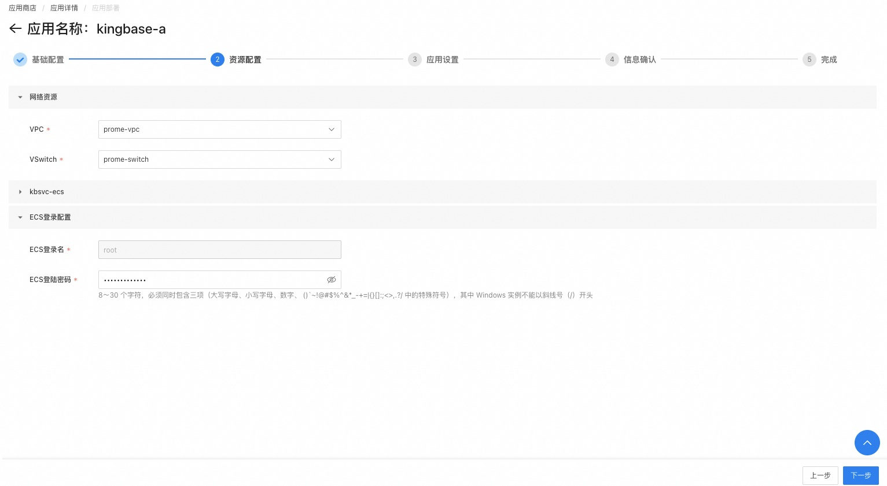

   相关参数说明如下：

   | 字段名称 | 是否必填 | 字段描述 |
   | --- | --- | --- |
   | VPC | 是 | 选择准备部署应用的ECS实例所使用的VPC。 |
   | VSwitch | 是 | 选择准备部署应用的ECS实例所使用的虚拟交换机。 |
   | 架构 | 是 | 选择ECS实例的芯片架构类型。 |
   | 实例规格 | 是 | 选择ECS实例规格。 |
   | 镜像 | 是 | 选择应用服务所需的ECS镜像。 |
   | 创建方式 | 是 | 默认选择<strong>普通创建</strong>。 |
   | 系统盘 | 是 | 选择云盘类型，设置云盘大小。 |
   | 数据盘 | 否 | 根据需要可添加数据盘，并设置数据盘的云盘类型和大小。 |
   | 实例数量 | 是 | 设置ECS实例数量。 |
   | 安全组 | 是 | 选择准备部署应用的ECS实例所使用的安全组。 |
   | ECS登录名 | 是 | 默认root。 |
   | ECS登录密码 | 是 | 登录ECS实例root用户密码。 |

   </li>

   <li>

   **应用设置**

   在应用设置中，填写相关参数，完成应用设置后，单击**下一步**，进入信息确认。

   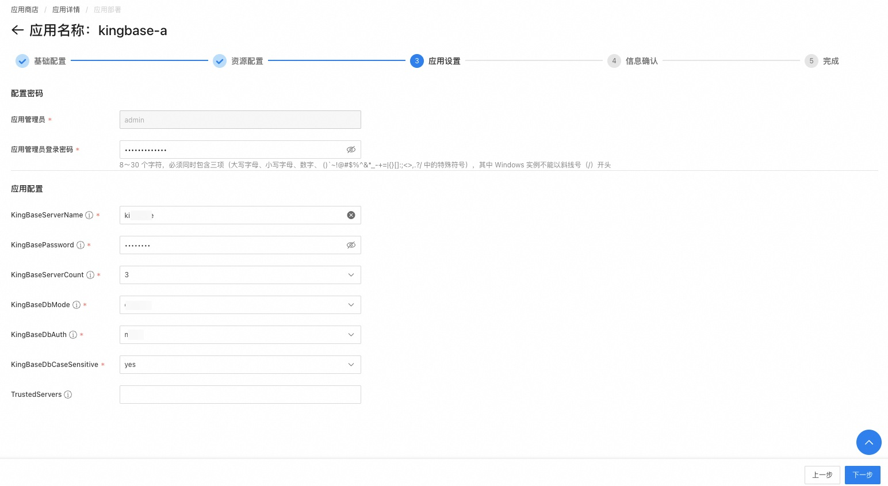

   相关参数说明如下：

   | 字段名称 | 是否必填 | 字段说明 |
   | --- | --- | --- |
   | 应用管理员 | 是 | 默认admin。 |
   | 应用管理员登录密码 | 是 | 填写应用管理员登录密码。 |
   | 应用配置 | 是 | 应用自定义配置。 |

   </li>

   <li>

   **息确认**

   在信息确认中，进行信息的确认。

   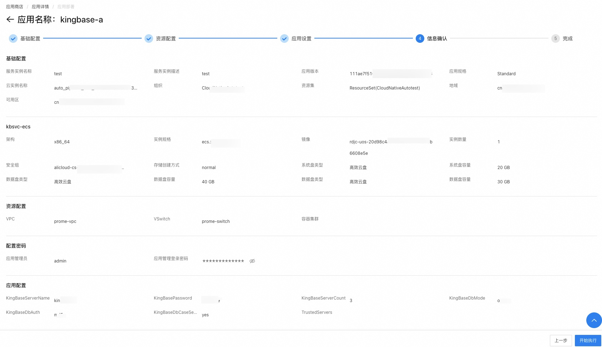

   </li>

   <li>

   单击**开始执行**，完成应用的部署。

   </li>

   </ol>

<a id="section-2-4"></a>

## 2.4. ONSP应用部署交付

使用应用中心AHM在专有云环境中部署开放网络服务平台（ONSP）应用。

**操作步骤**

1. 登录应用中心AHM控制台。

2. 在**插件中心**>**插件商店**页面，单击**导入插件**，选择上传远程应用插件JAR包，上传开放网络服务平台（ONSP）插件包后，单击**确定**导入ONSP插件。

3. 在插件商店找到ONSP插件进入详情页，单击**开通部署**，选择ONSP插件版本号单击**下一步**，等待插件部署完成。

   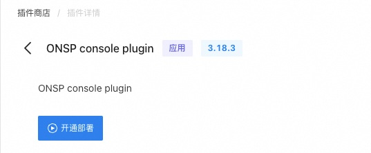

4. 在**我的插件**页面找到ONSP插件进入详情页，在**访问入口**的**访问域名**单击**开放网络服务管控台**，即可进入ONSP控制台。

   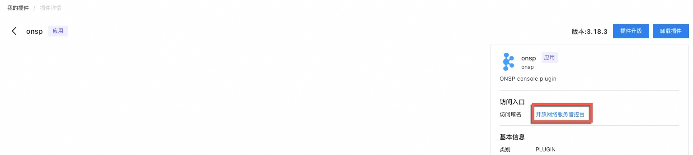

<a id="section-3"></a>

# 3.应用管理

<a id="section-3-1"></a>

## 3.1. 导入应用

您可以导入应用中心AHM支持的各类云上产品应用，通过应用中心快速部署，满足实际业务场景需求。

应用中心AHM支持通过云上产品包导入阿里巴巴或三方ISV发布的符合OAM标准的云上产品应用，云上产品包是符合OAM格式的ZIP包。

**导入应用**

1. 登录应用中心AHM控制台。

2. 在**应用商店**页面，单击**导入应用 > 导入应用**。

3. 在弹出的**导入应用**弹框中，单击**选择文件并上传**，上传云上产品应用基线zip包文件，单击**确定**。应用导入完成后，即可在应用商店查看该应用，并选择试用或正式部署应用。

   

**一键导入**

1. 登录应用中心AHM控制台。

2. 在**应用商店**页面，单击**导入应用 > 一键导入**。

3. 根据弹出的**一键导入**弹框步骤，开始一键导入操作。

   <ol type="i">

   <li>

   将制品文件上传至ops。

   </li>

   <li>

   输入ops制品文件绝对路径，单击**生成命令**，有效期2小时。

   </li>

   <li>

   单击**复制命令**，进入ops执行复制的命令，最终提示success表示执行成功。

   </li>

   </ol>

   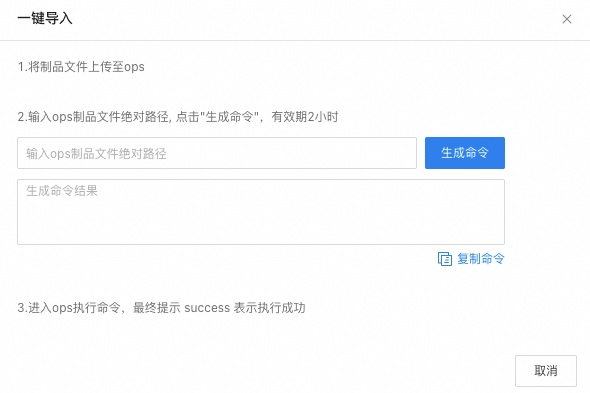

<a id="section-3-2"></a>

## 3.2. 部署应用

以正式部署WordPress应用为例提供应用部署操作指导。在应用部署前，需要在专有云环境准备相关网络资源、账号、容器集群等。

**操作步骤**

1. 登录应用中心AHM控制台。

2. 在**应用商店**页面找到需要部署的应用，例如WordPress，进入应用详情页。

3. 在应用详情页面单击**开始部署**。

4. 在弹出的提示框中，单击**我已知晓，下一步**，配置应用部署基本信息，完成配置向导，即应用部署完成。

   支持以下两种应用的部署：

   - 基于Kubernetes部署应用，配置向导具体过程参考On Kubernetes应用部署交付。

   - 基于ECS部署应用，配置向导具体过程参考On ECS应用部署交付。

<a id="section-3-3"></a>

## 3.3. 管理应用

应用部署完成后，您可以在应用中心AHM查看已购买和正在试用的所有应用，也可以下线已部署的正式应用。

> **说明**
>
> 您需要拥有相关应用的权限来管理应用，在我的应用页面中不会展示您无权查看的应用。

**操作步骤**

1. 登录应用中心AHM控制台。

2. 在**我的应用**页面，单击目标应用卡片，单击目标应用系统部署实例，进入应用详情页面。

3. 在应用详情页面，可以查看应用的**基础信息**和**部署日志**。

   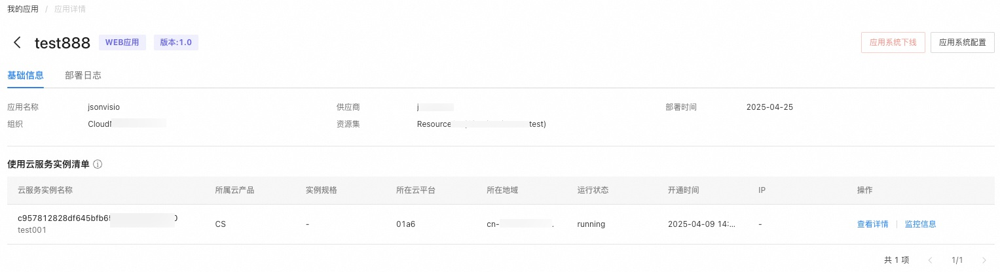

4. 下线应用。

   <ol type="i">

   <li>

   在应用详情页面，单击**应用系统下线**。

   

   </li>

   <li>

   在弹出的对话框，单击**下线应用**，完成下线应用并释放资源。

   </li>

   </ol>

   > **重要**
   >
   > 下线应用后，您在正式环境中所使用的资源将被释放，且产生的应用数据将被删除，请确认后操作。

5. 查看应用系统配置。

   <ol type="i">

   <li>

   在应用详情页面，单击**应用系统配置**。

   

   </li>

   <li>

   可以查看应用系统的**输入配置**、**输出配置**和**系统配置**信息。

   </li>

   </ol>

<a id="section-4"></a>

# 4.任务管理

在应用中心AHM的任务管理页面，您可以查看应用部署任务情况。当任务执行失败时，您还可以手动进行重试或跳过操作。

**操作步骤**

1. 登录应用中心AHM控制台。

2. 在**任务管理**页面，可查看应用部署任务的**工单号**、**应用名称**、**版本**、**变更类型**、**提交人**、**开始时间**、**结束时间**和**工单状态**信息。

   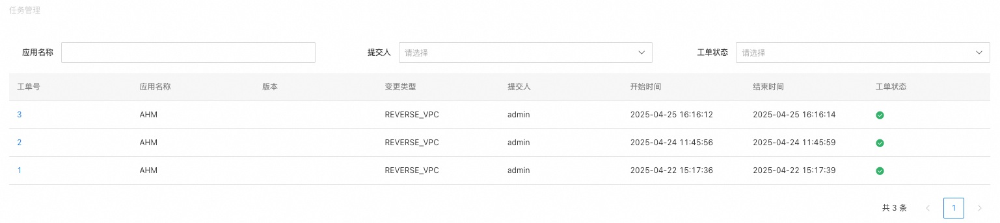

   任务列表支持根据**应用名称**、**提交人**、**工单状态**进行过滤。

3. 单击任务工单号，进入任务详情页面，可查看任务的工单信息和**执行进度**。

   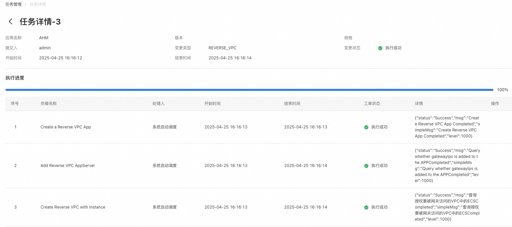

   对执行失败的任务步骤可进行重试或跳过操作。

   - 单击**重试**，然后单击**确定**，重启该步骤。

   - 单击**跳过**，然后单击**确定**，跳过执行该步骤。

<a id="section-5"></a>

# 5.镜像仓库管理

镜像仓库是Docker镜像仓库，一个镜像仓库对应来源相同的一部分集群。您可以为指定集群设置镜像仓库，在指定集群部署应用时，系统会读取对应镜像仓库的配置以获取应用Docker镜像；您也可以设置默认镜像仓库，对于未配置镜像仓库的集群，系统将读取该默认镜像仓库获取镜像。

**操作步骤**

1. 登录应用中心AHM控制台。

2. 在**系统管理**>**镜像仓库管理**页面，单击**新增镜像仓库**，配置仓库信息后单击**确定**，即可创建镜像仓库。

   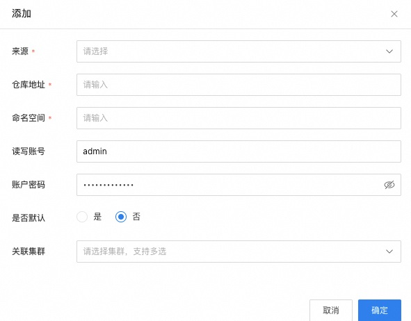

   <table>
     <tr>
       <th width="89">名称</th>
       <th>描述</th>
     </tr>
     <tr>
       <td>来源</td>
       <td>选择部署应用集群的集群来源，即集群的归属平台类型。在专有云环境中一般选择阿里云专有云。</td>
     </tr>
     <tr>
       <td>仓库地址</td>
       <td>填写所需绑定的Docker镜像仓库的服务域名。</td>
     </tr>
     <tr>
       <td>命名空间</td>
       <td>填写所需绑定的Docker镜像仓库的命名空间，即镜像仓库原生支持的逻辑分组空间。</td>
     </tr>
     <tr>
       <td>读写账号</td>
       <td>填写读取Docker镜像仓库的账号名称，绑定公开镜像仓库时可不填。</td>
     </tr>
     <tr>
       <td>账号密码</td>
       <td>填写访问Docker镜像仓库账号的密码，绑定公开镜像仓库时可不填。</td>
     </tr>
     <tr>
       <td>是否默认</td>
       <td>• 是：代表该镜像仓库是指定集群来源的默认镜像仓库。当应用和承载该应用的集群均未指定镜像仓库地址时，则使用该地址进行配置，避免系统无法获取镜像的情况。<br>• 否：代表该镜像仓库是给特定集群使用的，这时需要指定关联集群。</td>
     </tr>
     <tr>
       <td>关联集群</td>
       <td>选择镜像仓库绑定的Kubernetes集群。创建非默认镜像仓库时需要选择关联集群，且支持选择多个集群。</td>
     </tr>
   </table>

3. 镜像仓库创建完成后，可在**镜像仓库管理**页面查看系统当前已创建的所有镜像仓库信息。将鼠标悬停在**管理集群数**列的数字上，还可以查看该仓库当前管理的集群列表。

4. 在**镜像仓库管理**页面，还可以对已创建的镜像仓库进行管理操作：

   - 修改镜像仓库：单击**操作**列中的**编辑**，根据需要修改**来源**、**仓库地址**、**命名空间**、**读写账号**、**账户密码**、**是否默认**或**关联集群**镜像仓库属性后单击**确定**。

   - 删除镜像仓库：单击**操作**列中的**删除**，单击**确定**。

<a id="section-6"></a>

# 6.变量管理

<a id="section-6-1"></a>

## 6.1. 管理全局变量

全局变量是全局的配置，采用key-value形式的数据结构。全局变量的作用范围是全局，即对于同一个变量，所有的应用和集群读取到的值内容都是相同的。

**操作步骤**

1. 登录应用中心AHM控制台。

2. 在**系统管理**>**变量管理**页面，选择**全局变量**页签，单击**新增变量**，配置变量信息后单击**确定**，即可创建全局变量。

   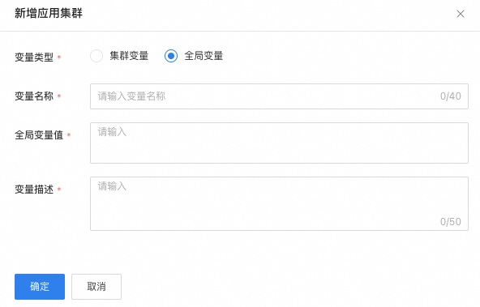

   | 名称 | 描述 |
   | --- | --- |
   | 变量类型 | 选择<strong>全局变量</strong>。 |
   | 变量名称 | 填写变量的名称，变量名称不可重复。 |
   | 全局变量值 | 填写变量的值内容。 |
   | 变量描述 | 填写变量的备注或描述，便于理解。 |

3. 在**变量管理**页面的**全局变量**页签，可查看所有全局变量信息，并对已创建的全局变量进行修改、删除操作。

   - 修改变量：单击待修改变量**操作**栏中的**编辑**，修改**变量名称**、**全局变量值**、**变量描述**信息后单击**确定**。

   - 删除变量：单击待删除变量**操作**列中的**删除**，单击**确定**。

<a id="section-6-2"></a>

## 6.2. 管理集群变量

集群变量是集群的配置变量，采用key-value形式的数据结构。集群变量的作用范围仅限于所关联的集群。因此，不同的集群如果关联不同的集群变量，名称相同的变量的值也可能是不同的。

**操作步骤**

1. 登录应用中心AHM控制台。

2. 在**系统管理**>**变量管理**页面，选择**集群变量**页签，单击**新增变量**，配置变量信息后单击**确定**，即可创建集群变量。

   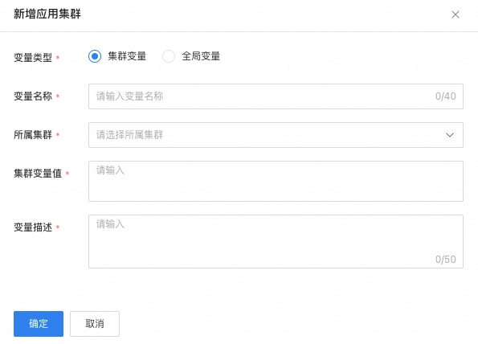

   | 名称 | 描述 |
   | --- | --- |
   | 变量类型 | 选择<strong>集群变量</strong>。 |
   | 变量名称 | 填写变量的名称，变量名称不可重复。 |
   | 所属集群 | 选择变量关联的集群，即变量作用的范围。 |
   | 集群变量值 | 填写变量的值内容。 |
   | 变量描述 | 填写变量的备注或描述，便于理解。 |

3. 在**变量管理**页面的**集群变量**页签，可查看所有集群变量信息，并对已创建的集群变量进行修改、删除操作。

   - 修改变量：单击待修改变量**操作**栏中的**编辑**，修改**变量名称**、**所属集群**、**集群变量值**、**变量描述**信息后单击**确定**。

   - 删除变量：单击待删除变量**操作**列中的**删除**，单击**确定**。
