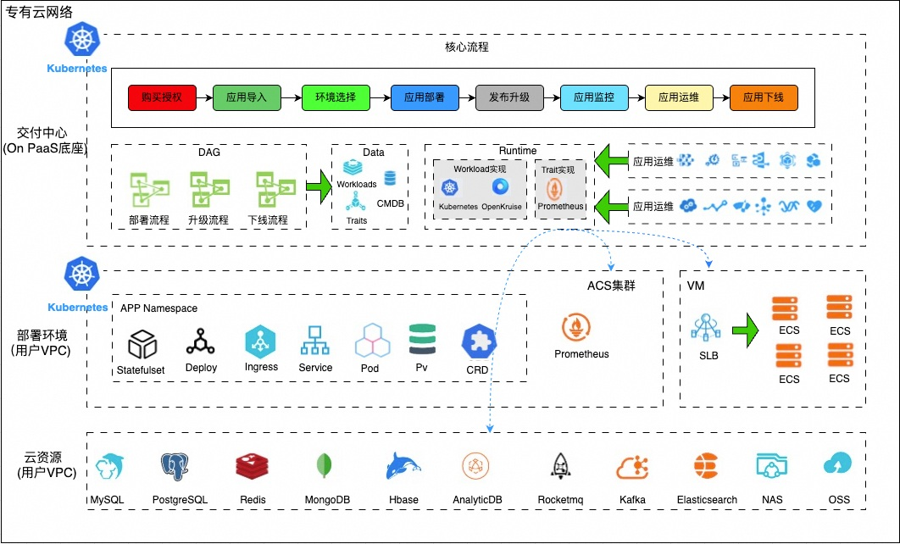
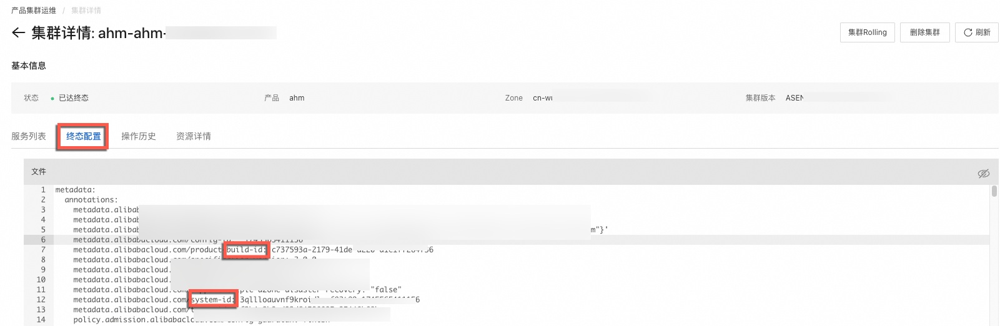
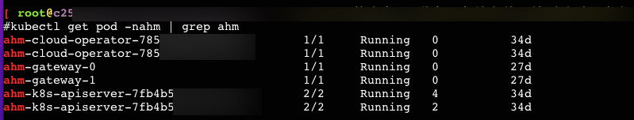
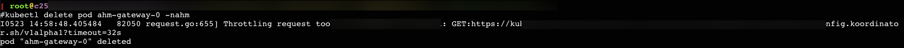
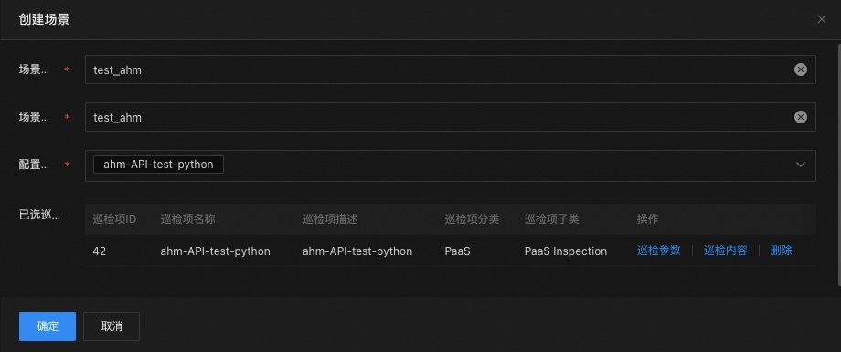
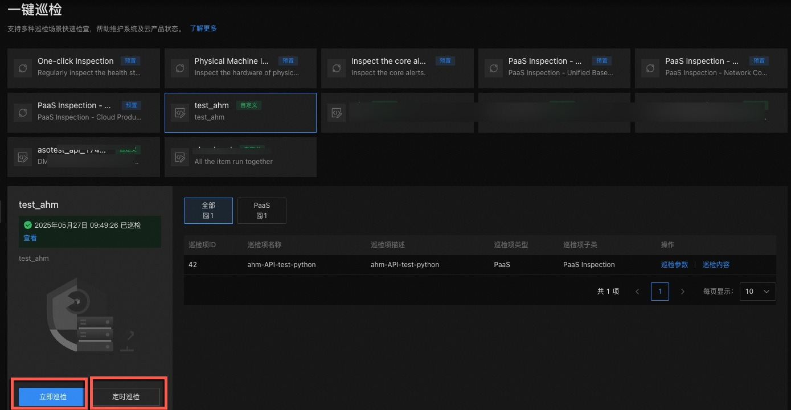
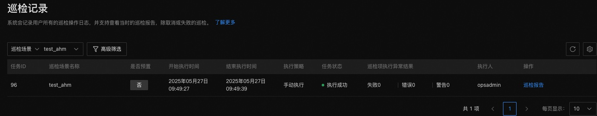

阿里云  
专有云  
应用运维平台  
运维指南  
产品版本：V3.18.6  
文档版本：20250627

**目录**

- [1.概述](#section-1)
- [2.产品架构](#section-2)
- [3.日常运维](#section-3)
    - [3.1. 交付阶段](#section-3-1)
    - [3.2. 运行阶段](#section-3-2)
- [4.应急预案](#section-4)
    - [4.1. 插件中心不可用](#section-4-1)
    - [4.2. 服务组件不可用](#section-4-2)
- [5.产品巡检](#section-5)
    - [5.1. 通过巡检控制台巡检](#section-5-1)
    - [5.2. 通过命令行方式巡检](#section-5-2)

<a id="section-1"></a>

# 1.概述

应用中心AHM在专有云环境中仅部署交付中心，向用户提供应用导入、应用部署、应用详情、应用升级、应用下线及系统配置管理等能力，支持包括On Kubernetes和On ECS两种部署模式的应用。

应用中心AHM产品的运维主要包含以下事项：

- 查询交付过程中的版本号

- 产品部署阶段检查各个组件是否已经达到终态

- 排查定位产品常见的功能问题

- 查看AHM产品监控项

- 查看AHM产品巡检结果

<a id="section-2"></a>

# 2.产品架构

应用中心AHM的交付中心模块在专有云环境中基于PaaS基座部署在底座侧经典网络内。



应用中心AHM的组件如下：

- ahm-ark-apiserver

- ahm-ark-webhook

- ahm-autotest

- ahm-cloud-operator

- ahm-cluster-init

- ahm-conversion-webhook

- ahm-dbinit

- ahm-gateway

- ahm-k8s-apiserver

- ahm-kone-runtime

<a id="section-3"></a>

# 3.日常运维

<a id="section-3-1"></a>

## 3.1. 交付阶段

在应用中心AHM产品部署交付阶段，一般涉及查看现场产品交付版本、检查产品各组件是否Ready等运维操作。

**查看现场产品交付版本**

可通过登录OPS机器或飞天基础运维平台两种方式查看版本Build和System ID。

- 登录OPS机器，执行以下命令，即可查看现场实际部署的应用中心AHM产品版本Build和System ID。

  ```bash
  #查看构建ID
  kubectl get appset -n ark-system -o yaml -l product=ahm|grep build-id

  #查看systemID
  kubectl get appset -n ark-system -o yaml -l product=ahm|grep system-id
  ```

- 通过飞天基础运维平台，在**资源管理**>**产品集群运维**页面，找到ahm产品，单击**集群详情**，切换到**终态配置**页签，模糊搜索build-id和system-id，即可查看产品版本的Build和System ID。

  

**检查产品各组件是否Ready**

登录OPS机器，执行 `kubectl get pod,svc,deploy -nahm` 命令，可查看应用中心AHM的组件运行状态。

确认各个组件的状态无异常、Pod状态为Running，即可验证产品部署成功。

<a id="section-3-2"></a>

## 3.2. 运行阶段

在应用中心AHM产品日常运行过程中可能遇到浏览器安全告警等常见问题，可使用提供的方法尝试解决或排查相关问题。

**Chrome浏览器提示ERR_CERT_AUTHORITY_INVALID告警**

在访问应用中心AHM控制台时，浏览器可能出现证书认证无效的安全提示，导致无法继续使用产品。

遇到该问题时，可通过以下方法解决：

- 客户端安装相关证书后，重新登录应用中心AHM控制台。

- 在浏览器告警提示页面，直接输入thisisunsafe，浏览器将自动刷新并可正常访问应用中心AHM控制台。

<a id="section-4"></a>

# 4.应急预案

对于应用中心AHM产品可能出现的故障，可依据相关应急预案中的处置方法快速处理。

<a id="section-4-1"></a>

## 4.1. 插件中心不可用

应用中心AHM所有插件都无法使用，调用所有插件都出现异常。

**故障分析**

出现该问题可能是由于在插件中心多次装载、卸载插件，缓存未清空导致插件中心内存溢出。

**技术与业务影响**

如果不及时恢复，可能导致远程插件无法调用。

**预计恢复时间**

5分钟

**处置说明**

在应用中心AHM控制台的**插件中心 > 我的插件**页面，单击**重启插件中心**即可。

<a id="section-4-2"></a>

## 4.2. 服务组件不可用

应用中心AHM的某个服务组件（如ahm-gateway）Pod状态正常，但无法接受业务请求。

**故障分析**

出现该问题可能的原因包括频繁FullGC、内存溢出、磁盘耗尽或者网络连接数耗尽等。

**技术和业务影响**

依赖出现问题的服务组件的产品运维功能不可用。

**预计恢复时间**

5分钟

**处置说明**

重启对应服务组件的Pod，即可解决该问题。

以重启ahm-gateway为例，执行以下步骤重启Pod：

1. 登录OPS机器，执行以下命令查看AHM容器的deployment状态和重启策略。

   ```bash
   #查看容器服务状态
   kubectl get statefulset -nahm

   #查看容器重启策略及描述信息
   kubectl edit statefulset ahm-gateway -nahm
   ```

2. 执行 `kubectl get pod -nahm | grep ahm` 命令查看需要重启应用的Pod列表。

   

3. 选择需要重启的Pod，执行 `kubectl delete` 删除该Pod。例如，执行 `kubectl delete pod ahm-gateway-0 -nahm` 命令删除ahm-plugin应用的Pod。

   

4. 执行 `kubectl get pod -nahm | grep ahm` 命令，确认应用的Pod状态到达Running后，表示Pod已成功重启。

<a id="section-5"></a>

# 5.产品巡检

应用中心AHM产品接入专有云PaaS巡检框架，可通过PaaS巡检控制台检测产品各组件服务是否的可用性。

应用中心AHM产品巡检主要包括ahm-web、ahm-plugin组件的基本健康检测。

| 巡检工程 | 巡检指标 | 巡检业务含义 |
| --- | --- | --- |
| ahm-web | test_ahm_web_service_health_check | ahm-core工程健康检测，检查组件是否可正常提供业务服务。 |
| ahm-pugin | test_ahm_web_plugin_health_check | 插件中心健康检测，检查组件是否可正常提供业务服务。 |

<a id="section-5-1"></a>

## 5.1. 通过巡检控制台巡检

应用中心AHM产品接入PaaS巡检控制台，可在巡检控制台直接执行巡检任务查看巡检结果。

**操作步骤**

1. 登录Apsara Uni-manager运维控制台。

2. 在**监控告警 > 巡检管理 > 巡检配置**页面的**巡检配置**页签中，单击**新建巡检场景**。

3. 在创建场景面板中，填写相关参数，其中**配置巡检项项**选择ahm-API-test-python，单击**确定**，完成创建巡检场景。

   

4. 在**一键巡检**页面，选中自定义的巡检场景卡片，单击**立即巡检**或**定时巡检**，进行巡检。

   

5. 在**巡检记录**页面，搜索巡检的巡检场景，单击操作列的**巡检报告**可查看具体执行情况。

   

   > **说明**
   >
   > 如果存在大量巡检任务失败，可单击**立即巡检**，手动执行巡检任务查看结果是否正常。

<a id="section-5-2"></a>

## 5.2. 通过命令行方式巡检

应用中心AHM产品支持通过命令行方式进行巡检。

**操作步骤**

在OPS机器上执行以下巡检命令，查看应用中心AHM产品巡检信息。

- 执行 `kubectl -nahm -l trident.apsara-stack.alibaba-inc.com/task-name=ahm-autotest get opsinstance` 命令，可查看所有巡检任务实例的执行状态。

  > **说明**
  >
  > 如果状态为Duplicate，可能是由于巡检任务的执行周期设置过小，出现重复执行的情况。

- 执行 `kubectl -nahm get opsinstance <`巡检任务实例`ID> -oyaml` 命令，可查看单次巡检任务实例的执行状态详情。

- 执行 `kubectl -n ahm get opstask ahm-autotest -oyaml` 命令，可查看巡检任务的详细信息。在巡检结果异常时，可通过该命令查看详细错误信息。

  > **说明**
  >
  > 如果巡检任务返回dial up或timeout标记，一般为PaaS环境内部调用超时问题，可忽略、继续观察下次巡检结果。
