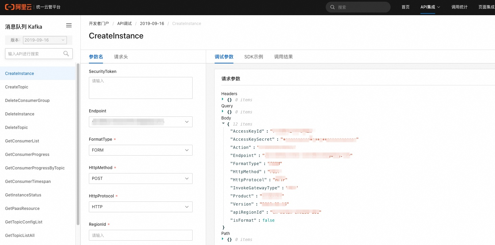
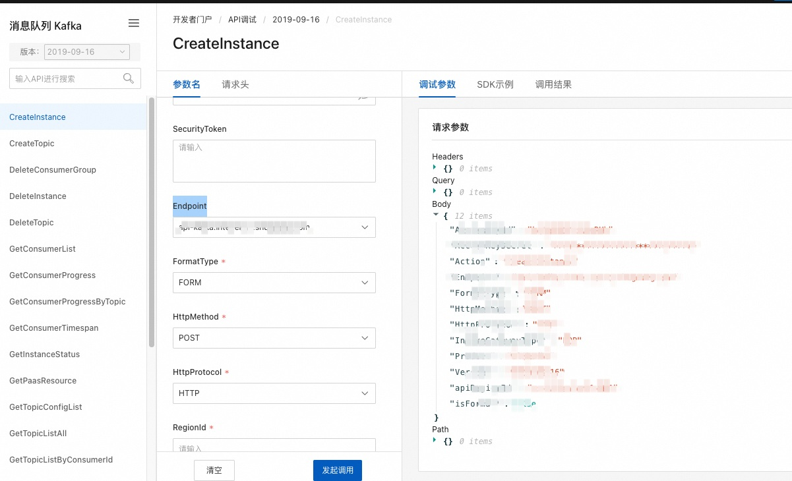
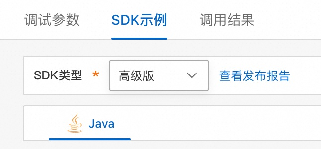
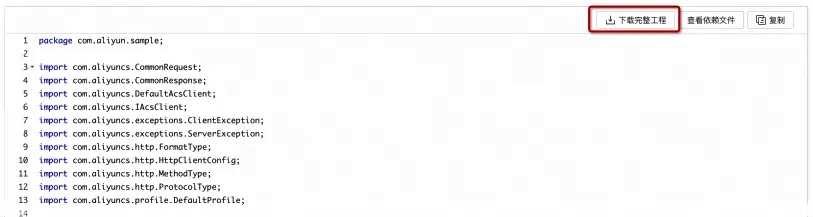
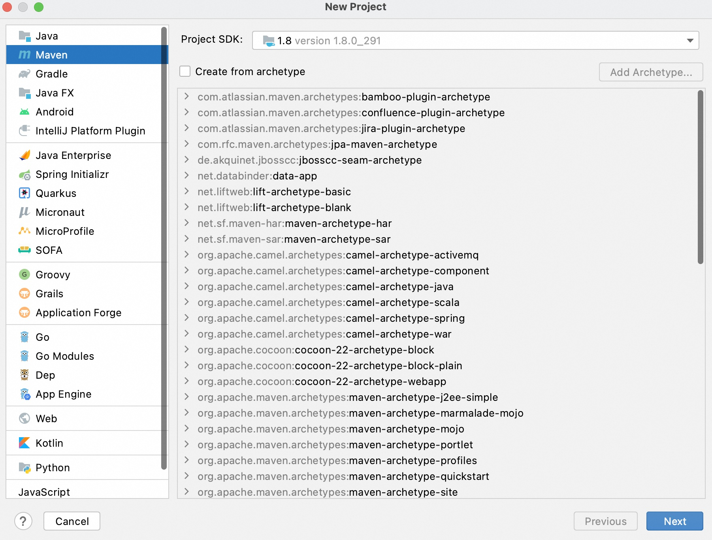
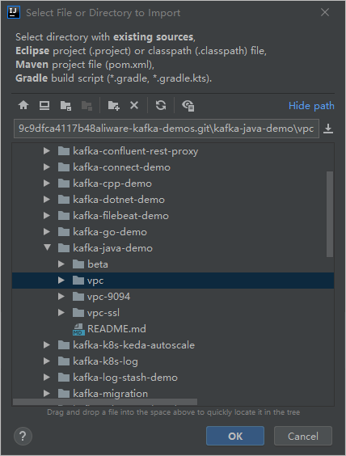
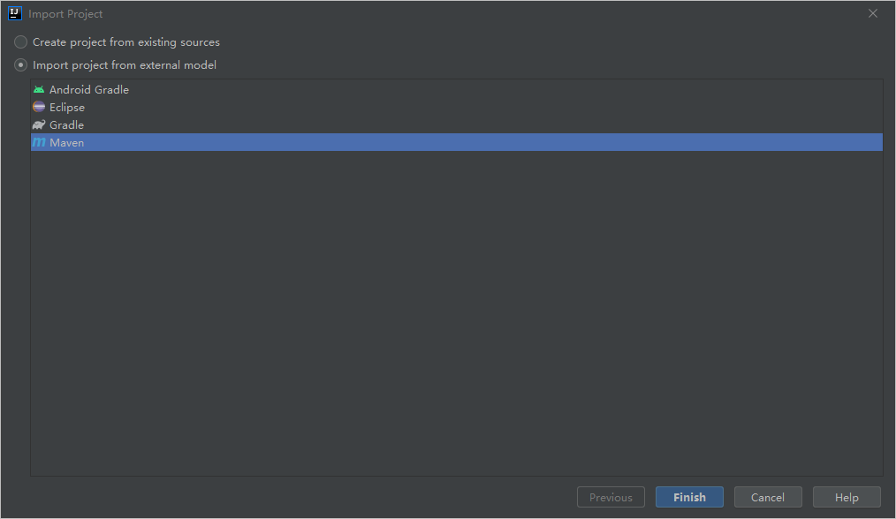
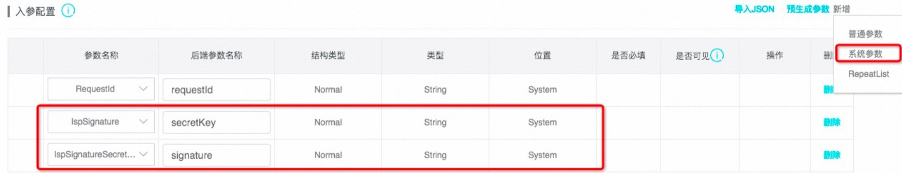

阿里云  
专有云  
消息队列Kafka版  
开发指南  
产品版本：V3.18.6  
文档版本：20251203

**目录**

- [1.准备工作](#section-1)
    - [1.1. 获取API信息及其EndPoint](#section-1-1)
    - [1.2. 获取AccessKey](#section-1-2)
    - [1.3. 获取公共Header参数](#section-1-3)
    - [1.4. 获取STS AccessKey](#section-1-4)
- [2.通过POP网关调用专有云API](#section-2)
    - [2.1. 概述](#section-2-1)
    - [2.2. 调用前置](#section-2-2)
    - [2.3. Java版本](#section-2-3)
- [3.Demo工程](#section-3)
    - [3.1. Demo工程概述](#section-3-1)
    - [3.2. 配置准备](#section-3-2)
    - [3.3. Demo工程配置](#section-3-3)
    - [3.4. 运行Demo](#section-3-4)
- [4.SDK参考](#section-4)
    - [4.1. Java SDK](#section-4-1)
    - [4.2. Python SDK](#section-4-2)
    - [4.3. C++ SDK](#section-4-3)
    - [4.4. Go SDK](#section-4-4)
    - [4.5. PHP SDK](#section-4-5)
    - [4.6. Ruby SDK](#section-4-6)
    - [4.7. Node.js SDK](#section-4-7)
- [5.API参考](#section-5)
    - [5.1. 公共参数设置](#section-5-1)
    - [5.2. 公共返回值解析](#section-5-2)
    - [5.3. 调用Domain获取方式](#section-5-3)
    - [5.4. 网关签名获取方式](#section-5-4)
    - [5.5. 实例管理](#section-5-5)
        - [5.5.1. CreateInstance](#section-5-5-1)
        - [5.5.2. CreateDisasterRecoveryInstance](#section-5-5-2)
        - [5.5.3. UpdateDisasterRecoveryInstance](#section-5-5-3)
        - [5.5.4. DeleteDisasterRecoveryInstance](#section-5-5-4)
        - [5.5.5. CreateInstanceRelation](#section-5-5-5)
        - [5.5.6. GetInstanceConfig](#section-5-5-6)
        - [5.5.7. GetInstanceIdList](#section-5-5-7)
        - [5.5.8. GetScheduledTaskList](#section-5-5-8)
        - [5.5.9. DeleteInstance](#section-5-5-9)
        - [5.5.10. GetDisasterRecoveryInstanceList](#section-5-5-10)
        - [5.5.11. GetDisasterRecoveryInstanceLag](#section-5-5-11)
        - [5.5.12. GetInstanceList](#section-5-5-12)
        - [5.5.13. GetInstanceRelationList](#section-5-5-13)
        - [5.5.14. GetInstanceStatus](#section-5-5-14)
        - [5.5.15. GetKafkaInstanceList](#section-5-5-15)
        - [5.5.16. ScaleInstance](#section-5-5-16)
        - [5.5.17. HotSwitchDisasterRecoveryInstance](#section-5-5-17)
        - [5.5.18. UpdateInstanceConfig](#section-5-5-18)
        - [5.5.19. UpdateInstanceName](#section-5-5-19)
        - [5.5.20. GetZoneList](#section-5-5-20)
        - [5.5.21. RebalanceInstanceTopic](#section-5-5-21)
    - [5.6. Topic管理](#section-5-6)
        - [5.6.1. CreateTopic](#section-5-6-1)
        - [5.6.2. GetTopicList](#section-5-6-2)
        - [5.6.3. GetTopicListAll](#section-5-6-3)
        - [5.6.4. DeleteTopic](#section-5-6-4)
        - [5.6.5. GetTopicConfigList](#section-5-6-5)
        - [5.6.6. GetTopicListByConsumerId](#section-5-6-6)
        - [5.6.7. GetTopicQuotaTip](#section-5-6-7)
        - [5.6.8. GetTopicStatus](#section-5-6-8)
        - [5.6.9. GetTopicSubscribeStatus](#section-5-6-9)
        - [5.6.10. UpdateTopicConfig](#section-5-6-10)
        - [5.6.11. RebalanceTopic](#section-5-6-11)
        - [5.6.12. ModifyPartitionNum](#section-5-6-12)
    - [5.7. Group管理](#section-5-7)
        - [5.7.1. GetConsumerList](#section-5-7-1)
        - [5.7.2. GetConsumerProgress](#section-5-7-2)
        - [5.7.3. GetConsumerProgressByTopic](#section-5-7-3)
        - [5.7.4. GetConsumerTimespan](#section-5-7-4)
        - [5.7.5. DeleteConsumerGroup](#section-5-7-5)
    - [5.8. 消息管理](#section-5-8)
        - [5.8.1. QueryMessage](#section-5-8-1)
        - [5.8.2. DownloadMessage](#section-5-8-2)
        - [5.8.3. SendMessage](#section-5-8-3)
        - [5.8.4. ResetOffset](#section-5-8-4)
    - [5.9. 资源管理](#section-5-9)
        - [5.9.1. DescribeCpuTypes](#section-5-9-1)
        - [5.9.2. GetPaasResource](#section-5-9-2)
        - [5.9.3. GetReplicatorList](#section-5-9-3)
        - [5.9.4. GetMetaData](#section-5-9-4)
        - [5.9.5. GetRegionList](#section-5-9-5)
        - [5.9.6. GetUnscheduledTaskList](#section-5-9-6)
    - [5.10. ACL](#section-5-10)
        - [5.10.1. CreateACL](#section-5-10-1)
        - [5.10.2. DeleteAcl](#section-5-10-2)
        - [5.10.3. CreateSaslUser](#section-5-10-3)
        - [5.10.4. DeleteSaslUser](#section-5-10-4)
        - [5.10.5. DescribeAcls](#section-5-10-5)
        - [5.10.6. DescribeSaslUsers](#section-5-10-6)
        - [5.10.7. QueryExistedAclResource](#section-5-10-7)
        - [5.10.8. DownloadFile](#section-5-10-8)
        - [5.10.9. GetSaslUserList](#section-5-10-9)
    - [5.11. VIP](#section-5-11)
        - [5.11.1. ApplyVipInfo](#section-5-11-1)
    - [5.12. 标签](#section-5-12)
        - [5.12.1. GetKafkaTagList](#section-5-12-1)

<a id="section-1"></a>

# 1.准备工作

<a id="section-1-1"></a>

## 1.1. 获取API信息及其EndPoint

首先，您需要了解产品开放API接口的相关信息，包括产品名称（code）、开放API接口名称、API版本。

**背景信息**

Apsara Uni-manager运营控制台API目录中的API信息仅供调用参考，具体API的使用方式需要参见云产品的开发指南。如果发生不一致情况，以开发指南支持情况为准。

**操作步骤**

1. 登录Apsara Uni-manager运营控制台。

2. 在顶部菜单栏选择**产品** > **开发工具** > **API与工具** > **开发者门户**。

3. 在**开发者门户**页面，选择**API集成** > **API调试**。

   

4. 在左侧导航栏中选择目标云产品。

5. 在**版本**下拉列表中，选择目标API版本。

6. 在下方API列表中可浏览当前版本的所有API接口。

7. 选中对应接口，在参数名下获取云产品的POP Endpoint信息。

   

<a id="section-1-2"></a>

## 1.2. 获取AccessKey

AccessKey支持RAM和STS两种授权模式，在发起调用时选择使用其中一种AccessKey即可。本文将为您介绍如何获取通过RAM授权的AccessKey。

**背景信息**

AccessKey通过使用AccessKey ID和AccessKey Secret对称加密，实现验证某个请求发送者的身份的功能。其中AccessKey ID用于标识用户，AccessKey Secret是用户用于加密签名的字符串。

AccessKey的两种授权模式如下：

- 通过RAM授权给第三方请求者的AccessKey ID和AccessKey Secret。

- 通过STS授权给第三方请求者的AccessKey ID、AccessKey Secret和Security Token。获取方式请参见获取STS AccessKey。

Apsara Uni-manager运营控制台提供了个人AccessKey和组织AccessKey（只有运营管理员和一级组织管理员可以获取组织AccessKey），推荐使用个人账号AccessKey调用Apsara Uni-manager运营控制台及云产品相关接口。如果使用个人账号AccessKey，需要在Header中添加以下限制性参数，否则可能提示权限不足：

> **警告**
>
> 个人账号AccessKey是由Apsara Uni-manager运营控制台权限体系管控的受限AccessKey，组织AccessKey相对权限较大，需要管理员确认操作的安全性。

<table>
  <tr>
    <th width="206">参数名称</th>
    <th>描述</th>
  </tr>
  <tr>
    <td>x-acs-regionid</td>
    <td>地域，如：cn-hangzhou-*。</td>
  </tr>
  <tr>
    <td>x-acs-organizationid</td>
    <td>Apsara Uni-manager运营控制台中对应的组织ID。获取方法可参见<strong>《Apsara Uni-manager运营控制台开</strong><strong>发指南》</strong>中的<strong>《GetOrganizationList》</strong>文档。</td>
  </tr>
  <tr>
    <td>x-acs-resourcegroupid</td>
    <td>Apsara Uni-manager运营控制台中对应的资源集ID。获取方法可参见<strong>《Apsara Uni-manager运营控制台</strong><strong>开发指南》</strong>中的<strong>《ListResourceGroup》</strong>文档。</td>
  </tr>
  <tr>
    <td>x-acs-instanceid</td>
    <td>进行操作的实例ID，例如，ECS的实例ID可以从ECS列表中查询到。</td>
  </tr>
</table>

**获取个人账号AccessKey**

获取个人账号AccessKey的方法如下：

1. 登录Apsara Uni-manager运营控制台。

2. 在系统界面右上角，单击当前登录用户头像，单击**个人信息**。

3. 在**AccessKey**区域，您可以查看个人账户的AccessKey信息。

   

   > **说明**
   >
   > AccessKey ID和AccessKey Secret是您访问云资源时的密钥，具有该账号完整的权限，请您妥善保管。

**获取组织AccessKey**

获取组织AccessKey的方法如下：

1. 管理员登录Apsara Uni-manager运营控制台。

2. 在顶部菜单栏，单击**企业**。

3. 在左侧导航栏中，选择**资源管理 > 组织管理**。

4. 在组织结构中，单击目标一级组织名称。

5. 单击**管理Accesskey**。

6. 在弹出的对话框中，查看组织AccessKey信息。

<a id="section-1-3"></a>

## 1.3. 获取公共Header参数

调用API时需要提供多个Header参数。本文为您介绍如何获取这些参数。并对调用后的一些返回值做出解释。

**获取Region ID**

1. 管理员登录Apsara Uni-manager运营控制台。

2. 在顶部菜单栏中，单击**企业**。

3. 在左侧导航栏中，选择**资源管理**>**地域管理**。

4. 单击目标组织名称。

5. 在右侧**Region列表**中查看**Region名称**，即为Region ID。

**获取组织ID**

组织ID需要通过调用API方式获取，您可以在Apsara Uni-manager运营控制台中通过API在线调试功能快速获取组织ID信息。

1. 管理员登录Apsara Uni-manager运营控制台。

2. 单击顶部菜单栏**产品**，选择**开发者工具** > **API与工具** > **开发者门户**。

3. 在**开发者门户**页面，选择**API集成** > **API调试**。

4. 单击  按钮，选择**云平台** > **统一云管平台**，**版本**选择**2019-05-10**。

5. 在文本框内输入 `GetOrganizationList` 进行在线调试，在name参数填写目标组织名称后发起调用，调用成功后查看**调用结果**中**id**的信息，即为组织ID。接口信息详见*Apsara Uni-manager运营控制台开发指南*中的章节*GetOrganizationList*。

**获取资源集ID**

资源集ID需要通过调用API方式获取，您可以在Apsara Uni-manager运营控制台中通过API在线调试功能快速获取资源集ID信息。

1. 管理员登录Apsara Uni-manager运营控制台。

2. 单击顶部菜单栏**产品**，选择**开发者工具** > **API与工具** > **开发者门户**。

3. 在**开发者门户**页面，选择**API集成** > **API调试**。

4. 单击  按钮，选择**云平台** > **统一云管平台**，**版本**选择**2019-05-10**。

5. 在文本框内输入 `ListResourceGroup` 进行在线调试，调用成功后查看**调用结果**中**id**的信息，即为资源集ID。接口信息详见*Apsara Uni-manager运营控制台开发指南*中的章节*ListResourceGroup*。

**获取实例ID**

实例ID可以通过Apsara Uni-manager运营控制台中的云产品实例列表进行获取，本文中以API网关为例，获取步骤如下：

1. 登录Apsara Uni-manager运营控制台。

2. 在顶部的菜单栏中，选择**产品 > 中间件 > 消息队列 > 消息队列Kafka版**。

3. 在左侧导航栏中，单击**实例列表**。

4. 在实例列表中查看**实例ID**。

**返回参数**

对于列表类的云产品资源实例接口，调用后会默认增加如下返回值。

| 名称 | 描述 |
| --- | --- |
| ResourceGroupName | 资源集名称。 |
| ResourceGroup | 资源集ID。 |
| DepartmentName | 组织名称。 |
| Department | 组织ID。 |

<a id="section-1-4"></a>

## 1.4. 获取STS AccessKey

本文为您介绍如何利用STS方式，调用专有云的产品API。

**背景信息**

阿里云临时安全令牌STS（Security Token Service）是阿里云提供的一种临时访问权限管理服务。您可以选择利用STS方式，调用专有云的产品API。

**操作步骤**

1. 获取用户角色的 `RAM Role` 。

   <ol type="i">

   <li>

   登录Apsara Uni-manager运营控制台。

   </li>

   <li>

   单击页面右上角的用户头像，选择**个人信息**。

   </li>

   <li>

   单击**查看当前角色策略**。

   在**当前选择角色策略**对话框中查看 `RAM Role` 。

   </li>

   </ol>

2. 使用以下代码，通过角色的 `RAM Role` 获得 `stsAK` 、 `stsSK` 和 `stsToken` 。

   ```java
   public static void main(String[] args) {
        ASClient asClient = new ASClient();
        // 调⽤来源说明
           asClient.setSdkSource("test");
        // 传入Arn
           String assumeRole = AssumeRole(asClient, "<RAM Role>");

           JSONObject assumeRoleJson = JSONObject.parseObject(assumeRole);

           JSONObject credentials = assumeRoleJson.getJSONObject("Credentials");

           // 获取到STS三元组
           String stsAK = credentials.getString("AccessKeyId");
           String stsSK = credentials.getString("AccessKeySecret");
           String stsToken = credentials.getString("SecurityToken");
   }

   public static String AssumeRole(ASClient asClient, String roleArn) {

           Map<String, String> headers = new HashMap<>();

           Map<String, Object> reqParams = new HashMap<>();

           reqParams.put("action", "AssumeRole");

           reqParams.put("Product", "Sts");

           reqParams.put("Version", "2015-04-01");

           reqParams.put("regionId", regionId);

        // 当前登录⽤户的ak
           reqParams.put("AccessKeyId", <当前⽤户的AccessKey ID>);
        // 当前登录⽤户的sk
           reqParams.put("AccessKeySecret", <当前⽤户的AccessKey Secret>);

           reqParams.put("roleSessionName", "StsUser");

           reqParams.put("roleArn", roleArn);

           return asClient.doRequest(endpoint, headers, reqParams);
   }
   ```

3. 通过STS可以调用云产品的接口，示例如下。

   ```java
   import com.aliyun.credentials.Client;
   import com.aliyun.credentials.models.Config;

   // 以下示例演示如何使⽤STS Token初始化凭据客户端（不包含如何获取到STS Token的过程）。
   public class DemoStsTest {
       public static void main(String[] args) {
           Config credentialConfig = new Config();
           credentialConfig.setType("sts");
           // 请替换为前⼀步获取到的STS三元组中AccessKeyI。
           credentialConfig.setAccessKeyId("your_AccessKeyId");
           // 请替换为前⼀步获取到的STS三元组中AccessKeySecret
           credentialConfig.setAccessKeySecret("your__AccessKeySecret");
           // 请替换为前⼀步获取到的STS三元组中SecurityToken
           credentialConfig.setSecurityToken("your__SecurityToken");
           Client credentialClient = new Client(credentialConfig);

           // 继续调⽤API，完整参考的API⽂档
       }
   }
   ```

<a id="section-2"></a>

# 2.通过POP网关调用专有云API

这是 通过POP网关调用专有云API 内容

<a id="section-2-1"></a>

## 2.1. 概述

阿里云专有云与公共云一样，可通过POP网关的方式进行API调用。本文为您介绍SDK概览情况。

**背景信息**

通过POP网关调用专有云API，可以实现对管控层资源（如实例、Topic、Group等）的查看、删除等操作。平台已封装支持Java语言的SDK，您可以通过在平台中下载该SDK直接调用专有云API。

文档中SDK关于API的示例代码仅供参考，各API的完整使用步骤与参数说明请参见开发者门户SDK示例和OpenAPI文档。

**环境要求**

- 支持 JDK8~JDK19

- Platform 支持：Linux、Mac、Windows

**语言**

当前仅支持Java语言。

**发布历史**

**SDK版本**

| 版本号 | 发布时间 | 更新内容 |
| --- | --- | --- |
| 3.18.3-0 | 2024.09 | 全新发布专有云3.18.3对外API的SDK。 |

**API列表**

当前专有云企业版SDK支持的API列表。

| API名称 | 所在版本 |
| --- | --- |
| ApplyVipInfo | 3.18.3-0 |
| CreateAcl | 3.18.3-0 |
| CreateDisasterRecoveryInstance | 3.18.3-0 |
| CreateInstance | 3.18.3-0 |
| CreateInstanceRelation | 3.18.3-0 |
| CreateSaslUser | 3.18.3-0 |
| CreateTopic | 3.18.3-0 |
| DeleteAcl | 3.18.3-0 |
| DeleteConsumerGroup | 3.18.3-0 |
| DeleteDisasterRecoveryInstance | 3.18.3-0 |
| DeleteInstance | 3.18.3-0 |
| DeleteSaslUser | 3.18.3-0 |
| DeleteTopic | 3.18.3-0 |
| DescribeAcls | 3.18.3-0 |
| DescribeCpuTypes | 3.18.3-0 |
| DescribeSaslUsers | 3.18.3-0 |
| DownloadMessage | 3.18.3-0 |
| EnableAcl | 3.18.3-0 |
| GetConsumerList | 3.18.3-0 |
| GetConsumerProgress | 3.18.3-0 |
| GetConsumerProgressByTopic | 3.18.3-0 |
| GetConsumerTimespan | 3.18.3-0 |
| GetDisasterRecoveryInstanceLag | 3.18.3-0 |
| GetDisasterRecoveryInstanceList | 3.18.3-0 |
| GetInstanceConfig | 3.18.3-0 |
| GetInstanceIdList | 3.18.3-0 |
| GetInstanceList | 3.18.3-0 |
| GetInstanceRelationList | 3.18.3-0 |
| GetInstanceStatus | 3.18.3-0 |
| GetKafkaInstanceList | 3.18.3-0 |
| GetKafkaTagList | 3.18.3-0 |
| GetMetaData | 3.18.3-0 |
| GetPaasResource | 3.18.3-0 |
| GetRegionList | 3.18.3-0 |
| GetReplicatorList | 3.18.3-0 |
| GetScheduledTaskList | 3.18.3-0 |
| GetTopicConfigList | 3.18.3-0 |
| GetTopicList | 3.18.3-0 |
| GetTopicListAll | 3.18.3-0 |
| GetTopicListByConsumerId | 3.18.3-0 |
| GetTopicQuotaTip | 3.18.3-0 |
| GetTopicStatus | 3.18.3-0 |
| GetTopicSubscribeStatus | 3.18.3-0 |
| GetUnscheduledTaskList | 3.18.3-0 |
| GetZoneList | 3.18.3-0 |
| HotSwitchDisasterRecoveryInstance | 3.18.3-0 |
| ModifyPartitionNum | 3.18.3-0 |
| QueryExistedAclResource | 3.18.3-0 |
| QueryMessage | 3.18.3-0 |
| RebalanceInstanceTopic | 3.18.3-0 |
| RebalanceTopic | 3.18.3-0 |
| ResetOffset | 3.18.3-0 |
| ScaleInstance | 3.18.3-0 |
| SendMessage | 3.18.3-0 |
| StartInstance | 3.18.3-0 |
| TagBind | 3.18.3-0 |
| TagBindSystemTags | 3.18.3-0 |
| TagListSystemTags | 3.18.3-0 |
| TagListTagsByResourceIds | 3.18.3-0 |
| TagUnbind | 3.18.3-0 |
| TagUnbindSystemTags | 3.18.3-0 |
| UpdateDisasterRecoveryInstance | 3.18.3-0 |
| UpdateInstanceConfig | 3.18.3-0 |
| UpdateInstancesNames | 3.18.3-0 |
| UpdateTopicConfig | 3.18.3-0 |

<a id="section-2-2"></a>

## 2.2. 调用前置

阿里云专有云与公共云一样，可通过POP网关的方式进行API调用。本文为您介绍调用前需要进行的准备工作。

**背景信息**

为了使专有云保持与公共云相同的使用方式，使您拥有更方便，更一致的体验，建议通过POP网关调用专有云API。

**获取云产品的Endpoint**

**通过开发者门户获取**

1. 登录Apsara Uni-manager运营控制台。

2. 在顶部菜单栏选择**产品** > **开发工具** > **API与工具** > **开发者门户**。

3. 在**开发者门户**页面，选择**API集成** > **API调试**。

   

4. 在左侧导航栏中选择目标云产品。

5. 在**版本**下拉列表中，选择目标API版本。

6. 在下方API列表中可浏览当前版本的所有API接口。

7. 选中对应接口，在参数名下获取云产品的POP Endpoint信息。

   

**通过飞天基础运维平台获取**

通过POP网关调用专有云API时需要使用云产品业务域的Endpoint。您可以在阿里云驻场运维工程师处获取。

您也可以自行获取Endpoint，本文以API网关为例为您介绍获取云产品业务域Endpoint的方法。

1. 登录Apsara Uni-manager运维控制台。

2. 顶部菜单栏选择**平台运维** > **飞天基础运维平台** > **运维工具**。

3. 在左侧导航栏，选择**运维工具** > **服务注册变量大盘**。

4. 在服务注册变量大盘页面，单击**高级筛选**。

5. 在Service Registration文本框中输入 `kafka-biz-openapi.endpoint` ，单击**搜索**。

   

6. 在 `alibaba-kafka-console` 服务的**Service Registration**列中，单击  图标。

7. 单击 `alibaba-kafka-console` 服务**Service Registration**列的文本信息，在弹出的**注册变量**对话框中，查看kafka-biz-openapi.endpoint值，即 `Endpoint` 。

**获取公共参数**

通过POP网关调用专有云API过程中所使用的参数，如组织ID、资源集ID、RegionID和实例ID，获取方式请参见获取公共Header参数。

<a id="section-2-3"></a>

## 2.3. Java版本

**环境要求**

支持 JDK8~JDK19，平台支持：Linux、Mac、Windows。

**安装说明代码**

从开发者门户获取SDK包后可使用以下 Mavan 依赖配置进行管理：

```xml
<dependencies>
    <dependency>
        <groupId>com.aliyun.apsarastack</groupId>
        <artifactId>aliyun-java-sdk-kafka</artifactId>
        <version>3.18.3-0</version>
        <scope>system</scope>
        <systemPath>${project.basedir}/lib/aliyun-java-sdk-kafka-3.18.3-
0.jar</systemPath>
    </dependency>
</dependencies>
```

**安装说明文档**

**开发者门户获取 SDK**

1. 登录 ASCM 的开发者门户，单击 SDK 示例。


2.SDK 类型下拉选择高级版，选择 Java 语言。



3. 下方可看到示例代码，点击下载完整工程以获取示例项目及 SDK 包。



**导入 SDK 包**

1. 通过以下任一方式创建 Maven 项目。

- 方式一：在 IDEA 中添加一个 Maven 项目。



- 方式二：将已有的项目转换为 Maven 项目。

右键单击要转换的项目，并选择**Add Framework Support**

...。

选择 Maven，并单击 OK。

2. 在项目根目录下创建 lib 包，将 Java SDK 包放入到 lib 目录下，如下图。

3. 在项目目录下的 pom.xml 中，添加 Java SDK 依赖，代码请参考上文中《安装说明代码》部分。

4. 查看 IDEA 右侧 Maven 栏，如图所示，表示已成功导入依赖。

**代码示例**

请参考示例，将某个 API 录入，注意保证代码通过，隐私信息泄露。

```java
import com.aliyun.alikafka20190916.Client;
import com.aliyun.alikafka20190916.models.ApplyVipInfoRequest;
import com.aliyun.alikafka20190916.models.ApplyVipInfoResponse;
import com.aliyun.tea.TeaException;
import com.aliyun.teautil.models.RuntimeOptions;


public class ApplyVipInfo {
    //示例展示了如何调⽤CreateVipInfo API进⾏vip接入点创建请求。
    public static  void testApplyVipInfo(Client client, RuntimeOptions runtime) {
        ApplyVipInfoRequest request = new ApplyVipInfoRequest()
            // 实例ID
            .setInstanceId("<your-instanceId>")
            // 访问的域名，可以参考开发者⻔户API调试⻚⾯获取 Endpoint
            .setRegionId("<your Endpoint>")
            // 调⽤Vip的action
            .setVipAction("create")
            // Vip类型
            .setVipType("AnyTunnel");
        try {
            ApplyVipInfoResponse applyVipInfoResponse = 
client.applyVipInfoWithOptions(request,runtime);
            
System.out.println(com.aliyun.teautil.Common.toJSONString(applyVipInfoResponse));
        } catch (TeaException error) {
            System.out.println(error.message);
        } catch (Exception _error) {
            TeaException error = new TeaException(_error.getMessage(), _error);
            System.out.println(error.getCause());
        }
    }
}
```

**步骤示例**

1. 初始化配置对象com.aliyun.teaopenapi.models.Config。Config对象存放AccessKeyId、AccessKeySecret、Endpoint 等配置，该配置信息参考获取AccessKey和获取API信息及其EndPoint进行获取。

```text
        Config config = new Config()
                .setRegionId("regionID")
                .setAccessKeyId(System.getenv("ALIBABA_CLOUD_ACCESS_KEY_ID"))
                .setAccessKeySecret(System.getenv("ALIBABA_CLOUD_ACCESS_KEY_SECRET"))
                .setEndpoint("************"");
```

2. 实例化一个客户端，从com.aliyun.alikafka20190916.Client类生成对象client。 后续request、response 从com.aliyun.alikafka20190916.models中获得。

```text
Client client = new Client(config);
```

3. 创建对应API的Request 。 类的命名规则为API方法名加上Request 。例如：

```text
QueryInstanceListRequest request = new QueryInstanceListRequest();
```

4. 设置请求类request的参数。 通过request类的属性设置必要的信息，即API中必须要提供的信息。

```text
request.setRegionId("your_value")// 该参数值为假设值，请您根据实际情况进⾏填写

request.setInstanceId("your_value") // 该参数值为假设值，请您根据实际情况进⾏填写

request.setVipAction("your_value") //该参数值为假设值，请您根据实际情况进⾏填写

request..setVipType("your_value");//该参数值为假设值，请您根据实际情况进⾏填写
```

5. 通过client对象获得对应request响应response 。

```java
ApplyVipInfoResponse applyVipInfoResponse = client.applyVipInfo(request);
System.out.println(com.aliyun.teautil.Common.toJSONString(applyVipInfoResponse));
```

6. 调用response中对应的属性获得返回的参数值。 假设您需要获取requestId ：

```text
String requestId = response.Body.requestId;
```

7. 使用catch()处理报错。

```java
catch (Exception _error) {
    TeaException error = new TeaException(_error.getMessage(), _error);
    System.out.println(error.getCause());
}
```

<a id="section-3"></a>

# 3.Demo工程

Demo是SDK调用的示例程序。本Demo以Java为例，提供具体的操作方法以帮助新手用户搭建消息队列Kafka版测试工程。

**操作流程**


流程说明如下：

1. 配置准备：配置Demo工程前的准备工作，包括安装IDE、下载Demo工程、安装JDK和创建Topic。

2. Demo工程配置：配置Demo工程。

3. 运行Demo：配置好Demo工程后，运行Demo收发消息。

<a id="section-3-1"></a>

## 3.1. Demo工程概述

Demo是SDK调用的示例程序。本Demo以Java为例，提供具体的操作方法以帮助新手用户搭建消息队列Kafka版测试工程。

**操作流程**


流程说明如下：

1. 配置准备：配置Demo工程前的准备工作，包括安装IDE、下载Demo工程、安装JDK和创建Topic。

2. Demo工程配置：配置Demo工程。

3. 运行Demo：配置好Demo工程后，运行Demo收发消息。

<a id="section-3-2"></a>

## 3.2. 配置准备

本文介绍配置Demo工程前的配置准备，包括安装IDE、下载Demo工程、安装JDK、安装Maven和创建Topic。

**安装IDE**

您可以使用IntelliJ IDEA或者Eclipse。 本文以IntelliJ IDEA为例。

访问https://www.jetbrains.com/idea/下载IDEA Ultimate版本，并参考IntelliJ IDEA说明进行安装。

**下载Demo工程**

访问消息队列Kafka版Demo，单击  ，下载Demo工程到本地。

解压下载的Demo库，即可看到本地新增了包含aliware-kafka-demos名称的文件夹。

**安装JDK**

如果本地未安装JDK，请访问Java downloads下载安装1.8或以上版本JDK。

**安装Maven**

如果本地未安装Maven，请访问Downloading Apache Maven下载安装2.5或以上版本Maven。

**创建Topic**

在消息队列Kafka版控制台创建所需的Topic。具体操作，请参见消息队列Kafka版<strong>《用户指南》</strong>中的<strong>《创建Topic》</strong>章节。

<a id="section-3-3"></a>

## 3.3. Demo工程配置

本文介绍如何配置Demo工程。

**操作步骤**

1. 将Demo工程文件导入IntelliJ IDEA。

   <ol type="i">

   <li>

   在IntelliJ IDEA界面，选择**New > Project From Existing Sources…**，选择kafka-java-demo文件夹。

   

   </li>

   <li>

   选择Import类型为Maven。

   

   </li>

   <li>

   单击**Finish**，直到导入完成。Demo工程需要加载依赖的JAR包，因此导入过程需要等待2-3分钟。

   </li>

   </ol>

2. 按以下说明配置kafka.properties类。

   ```text
   ## 配置接入点。您可在消息队列Kafka版控制台实例列表⻚⾯基本信息VIP信息区域查看接入点。
   bootstrap.servers=xxxxxxxxxxxxxxxxxxxxx
   ## 配置Topic。您刚刚在消息队列Kafka版控制台创建Topic的名称。
   topic=alikafka-topic-demo
   ## 配置Consumer Group。消息队列Kafka版会为您⾃动创建该Consumer Group。
   group.id=CID-consumer-group-demo
   ```

<a id="section-3-4"></a>

## 3.4. 运行Demo

在配置好Demo工程后，您可以运行Demo来收发消息。本文介绍如何运行Demo进行消息收发。

**发送消息**

1. 运行KafkaProducerDemo.java类发送消息。

2. 验证消息发送情况。

   <ol type="i">

   <li>

   登录消息队列Kafka版控制台。具体操作，请参见<strong>《消息队列Kafka版用户指南》</strong>中的**控制台操作指南> 登录消息队列kafka版控制台**。

   </li>

   <li>

   在**实例列表**页面，找到目标实例，在其右侧**操作**列，单击**详情**。

   </li>

   <li>

   在**左侧导航栏**，单击**Topic管理**，在Topic管理页面选择Topic名称进行查询。

   可以看见消息已经发送至Topic。

   </li>

   </ol>

**订阅消息**

1. 选择如下任意一种方式订阅消息。

   - 单Consumer订阅消息：运行KafkaConsumerDemo.java类订阅消息。

   - 多Consumer订阅消息：运行KafkaMultiConsumerDemo.java类订阅消息。

   运行后，可以看到消息被消费的日志。 因为有初始化，所以需等待几秒，在生产环境中不会经常初始化。

2. 查看消息消费情况。

   <ol type="i">

   <li>

   登录消息队列Kafka版控制台。具体操作，请参见<strong>《消息队列Kafka版用户指南》</strong>中的**控制台操作指南> 登录消息队列kafka版控制台**。

   </li>

   <li>

   在**实例列表**页面，找到目标实例，在其右侧**操作**列，单击**详情**。

   </li>

   <li>

   在左侧导航栏，单击**Consumer Group管理**，在**Consumer Group管理**页面，目标Consumer Group右侧**操作**列，单击**消费状态**进行查询。

   可以看到启动的消费端已经在线，并且订阅关系一致。

   </li>

   </ol>

<a id="section-4"></a>

# 4.SDK参考

本节介绍消息队列Kafka版支持的多语言SDK。

消息队列Kafka版支持以下多语言SDK：

- Java SDK

- Python SDK

- C++ SDK

- Go SDK

- PHP SDK

- Ruby SDK

- Node.js SDK

更多框架的示例代码，请参见消息队列Kafka版Demo库。

<a id="section-4-1"></a>

## 4.1. Java SDK

本文介绍如何通过Java SDK接入消息队列Kafka版并收发消息。

**前提条件**

- 安装1.8或以上版本JDK

- 安装2.5或以上版本Maven

**安装Java依赖库**

在pom.xml中添加以下依赖。

```xml
<dependency>
    <groupId>org.apache.kafka</groupId>
    <artifactId>kafka-clients</artifactId>
    <version>2.2.0</version>
</dependency>
<dependency>
    <groupId>org.slf4j</groupId>
    <artifactId>slf4j-log4j12</artifactId>
    <version>1.7.6</version>
</dependency>
```

> 建议您保持服务端和客户端版本一致，即保持客户端库版本和云消息队列 Kafka 版实例的
>
> **说明**
>
> 大版本一致。您可以在云消息队列 Kafka 版控制台的**实例详情**页面获取云消息队列 Kafka 版实例的大版本。

**准备配置**

1. 创建Log4j配置文件log4j.properties。

   ```text
   # Licensed to the Apache Software Foundation (ASF) under one or more
   # contributor license agreements.  See the NOTICE file distributed with
   # this work for additional information regarding copyright ownership.
   # The ASF licenses this file to You under the Apache License, Version 2.0
   # (the "License"); you may not use this file except in compliance with
   # the License.  You may obtain a copy of the License at
   #
   #    http://www.apache.org/licenses/LICENSE-2.0
   #
   # Unless required by applicable law or agreed to in writing, software
   # distributed under the License is distributed on an "AS IS" BASIS,
   # WITHOUT WARRANTIES OR CONDITIONS OF ANY KIND, either express or implied.
   # See the License for the specific language governing permissions and
   # limitations under the License.

   log4j.rootLogger=INFO, STDOUT

   log4j.appender.STDOUT=org.apache.log4j.ConsoleAppender
   log4j.appender.STDOUT.layout=org.apache.log4j.PatternLayout
   log4j.appender.STDOUT.layout.ConversionPattern=[%d] %p %m (%c)%n
   ```

2. 创建消息队列Kafka版配置文件kafka.properties。

   ```text
   ## 配置接入点。您可在控制台查看接入点。
   bootstrap.servers=xxxxxxxxxxxxxxxxxxxxx
   ## 配置Topic。您可在控制台创建Topic。
   topic=alikafka-topic-demo
   ## 配置Consumer Group。消息队列Kafka版会为您⾃动创建该Consumer Group。
   group.id=CID-consumer-group-demo
   ```

3. 创建配置文件加载程序JavaKafkaConfigurer.java。

   ```java
   public class JavaKafkaConfigurer {
       private static Properties properties;
       public synchronized static Properties getKafkaProperties() {
          if (null != properties) {
              return properties;
          }
          //获取配置⽂件kafka.properties的内容。
          Properties kafkaProperties = new Properties();
          try {
              
   kafkaProperties.load(KafkaProducerDemo.class.getClassLoader().getResourceAsStream("kafk
   properties"));
          } catch (Exception e) {
              //没加载到⽂件，程序要考虑退出。
              e.printStackTrace();
          }
          properties = kafkaProperties;
          return kafkaProperties;
       }
   }
   ```

**发送消息**

1. 创建发送消息程序KafkaProducerDemo.java。

   ```java
   import java.util.ArrayList;
   import java.util.List;
   import java.util.Properties;
   import java.util.concurrent.Future;

   import java.util.concurrent.TimeUnit;
   import org.apache.kafka.clients.CommonClientConfigs;
   import org.apache.kafka.clients.producer.KafkaProducer;
   import org.apache.kafka.clients.producer.ProducerConfig;
   import org.apache.kafka.clients.producer.ProducerRecord;
   import org.apache.kafka.clients.producer.RecordMetadata;

   public class KafkaProducerDemo {

       public static void main(String args[]) {
           //加载kafka.properties。
           Properties kafkaProperties =  JavaKafkaConfigurer.getKafkaProperties();

           Properties props = new Properties();
           //设置接入点，请通过控制台获取对应Topic的接入点。
           props.put(ProducerConfig.BOOTSTRAP_SERVERS_CONFIG, 
   kafkaProperties.getProperty("bootstrap.servers"));

           //消息队列Kafka版消息的序列化⽅式。
           props.put(ProducerConfig.KEY_SERIALIZER_CLASS_CONFIG, 
   "org.apache.kafka.common.serialization.StringSerializer");
           props.put(ProducerConfig.VALUE_SERIALIZER_CLASS_CONFIG, 
   "org.apache.kafka.common.serialization.StringSerializer");
           //请求的最⻓等待时间。
           props.put(ProducerConfig.MAX_BLOCK_MS_CONFIG, 30 * 1000);
           //设置客户端内部重试次数。
           props.put(ProducerConfig.RETRIES_CONFIG, 5);
           //设置客户端内部重试间隔。
           props.put(ProducerConfig.RECONNECT_BACKOFF_MS_CONFIG, 3000);
           //构造Producer对象，注意，该对象是线程安全的，⼀般来说，⼀个进程内⼀个Producer对象即可。
           //如果想提⾼性能，可以多构造⼏个对象，但不要太多，最好不要超过5个。
           KafkaProducer<String, String> producer = new KafkaProducer<String, String>(props);

           //构造消息。
           String topic = kafkaProperties.getProperty("topic"); //消息所属的Topic，请在控制
   台申请之后，填写在这⾥。
           String value = "this is the message's value"; //消息的内容。

           try {
               //批量获取Future对象可以加快速度，但注意，批量不要太⼤。
               List<Future<RecordMetadata>> futures = new 
   ArrayList<Future<RecordMetadata>>(128);
               for (int i =0; i < 100; i++) {
                   //发送消息，并获得⼀个Future对象。
                   ProducerRecord<String, String> kafkaMessage =  new 
   ProducerRecord<String, String>(topic, value + ": " + i);
                   Future<RecordMetadata> metadataFuture = producer.send(kafkaMessage);
                   futures.add(metadataFuture);

               }
               producer.flush();
               for (Future<RecordMetadata> future: futures) {
                   //同步获得Future对象的结果。
                   try {
                       RecordMetadata recordMetadata = future.get();
                       System.out.println("Produce ok:" + recordMetadata.toString());
                   } catch (Throwable t) {
                       t.printStackTrace();
                   }
               }
           } catch (Exception e) {
               //客户端内部重试之后，仍然发送失败，业务要应对此类错误。
               System.out.println("error occurred");
               e.printStackTrace();
           }
       }
   }
   ```

2. 编译并运行KafkaProducerDemo.java发送消息。

**订阅消息**

选择以下任意一种方式订阅消息。

- 单Consumer订阅消息。

  <ol type="i">

  <li>

  创建单Consumer订阅消息程序KafkaConsumerDemo.java。

  ```java
  import java.util.ArrayList;
  import java.util.List;
  import java.util.Properties;

  import org.apache.kafka.clients.consumer.ConsumerConfig;
  import org.apache.kafka.clients.consumer.ConsumerRecord;
  import org.apache.kafka.clients.consumer.ConsumerRecords;
  import org.apache.kafka.clients.consumer.KafkaConsumer;
  import org.apache.kafka.clients.producer.ProducerConfig;

  public class KafkaConsumerDemo {

      public static void main(String args[]) {
          //加载kafka.properties。
          Properties kafkaProperties =  JavaKafkaConfigurer.getKafkaProperties();

          Properties props = new Properties();
          //设置接入点，请通过控制台获取对应Topic的接入点。
          props.put(ProducerConfig.BOOTSTRAP_SERVERS_CONFIG, 
  kafkaProperties.getProperty("bootstrap.servers"));
          //两次Poll之间的最⼤允许间隔。
          //消费者超过该值没有返回⼼跳，服务端判断消费者处于非存活状态，服务端将消费者从Consumer G
  roup移除并触发Rebalance，默认30s。
          props.put(ConsumerConfig.SESSION_TIMEOUT_MS_CONFIG, 30000);
          //每次Poll的最⼤数量。
          //注意该值不要改得太⼤，如果Poll太多数据，⽽不能在下次Poll之前消费完，则会触发⼀次负载均
  衡，产⽣卡顿。
          props.put(ConsumerConfig.MAX_POLL_RECORDS_CONFIG, 30);
          //消息的反序列化⽅式。
          props.put(ConsumerConfig.KEY_DESERIALIZER_CLASS_CONFIG, 
  "org.apache.kafka.common.serialization.StringDeserializer");
          props.put(ConsumerConfig.VALUE_DESERIALIZER_CLASS_CONFIG, 
  "org.apache.kafka.common.serialization.StringDeserializer");
          //属于同⼀个组的消费实例，会负载消费消息。
          props.put(ConsumerConfig.GROUP_ID_CONFIG, 
  kafkaProperties.getProperty("group.id"));
          //构造消息对象，也即⽣成⼀个消费实例。
          KafkaConsumer<String, String> consumer = new 
  org.apache.kafka.clients.consumer.KafkaConsumer<String, String>(props);
          //设置消费组订阅的Topic，可以订阅多个。
          //如果GROUP_ID_CONFIG是⼀样，则订阅的Topic也建议设置成⼀样。
          List<String> subscribedTopics =  new ArrayList<String>();
          //如果需要订阅多个Topic，则在这⾥添加进去即可。
          //每个Topic需要先在控制台进⾏创建。
          String topicStr = kafkaProperties.getProperty("topic");
          String[] topics = topicStr.split(",");
          for (String topic: topics) {
              subscribedTopics.add(topic.trim());
          }
          consumer.subscribe(subscribedTopics);

          //循环消费消息。
          while (true){
              try {
                  ConsumerRecords<String, String> records = consumer.poll(1000);
                  //必须在下次Poll之前消费完这些数据, 且总耗时不得超过
  SESSION_TIMEOUT_MS_CONFIG。
                  //建议开⼀个单独的线程池来消费消息，然后异步返回结果。
                  for (ConsumerRecord<String, String> record : records) {
                      System.out.println(String.format("Consume partition:%d offset:%d
  ", record.partition(), record.offset()));
                  }
              } catch (Exception e) {
                  try {
                      Thread.sleep(1000);
                  } catch (Throwable ignore) {

                  }
                  e.printStackTrace();
              }
          }
      }
  }
  ```

  </li>

  <li>

  编译并运行KafkaConsumerDemo.java消费消息。

  </li>

  </ol>

- 多Consumer订阅消息。

  <ol type="i">

  <li>

  创建多Consumer订阅消息程序KafkaMultiConsumerDemo.java。

  ```java
  import java.util.ArrayList;
  import java.util.List;
  import java.util.Properties;
  import java.util.concurrent.atomic.AtomicBoolean;
  import org.apache.kafka.clients.consumer.ConsumerConfig;
  import org.apache.kafka.clients.consumer.ConsumerRecord;
  import org.apache.kafka.clients.consumer.ConsumerRecords;
  import org.apache.kafka.clients.consumer.KafkaConsumer;
  import org.apache.kafka.clients.producer.ProducerConfig;
  import org.apache.kafka.common.errors.WakeupException;

  /**
   * 本教程演示如何在⼀个进程内开启多个Consumer同时消费Topic。
   * 注意全局Consumer数量不要超过订阅的Topic总分区数。
   */
  public class KafkaMultiConsumerDemo {

      public static void main(String args[]) throws InterruptedException {
          //加载kafka.properties。
          Properties kafkaProperties = JavaKafkaConfigurer.getKafkaProperties();

          Properties props = new Properties();
          //设置接入点，请通过控制台获取对应Topic的接入点。
          props.put(ProducerConfig.BOOTSTRAP_SERVERS_CONFIG, 
  kafkaProperties.getProperty("bootstrap.servers"));
          //两次Poll之间的最⼤允许间隔。
          //消费者超过该值没有返回⼼跳，服务端判断消费者处于非存活状态，服务端将消费者从Consumer G
  roup移除并触发Rebalance，默认30s。
          props.put(ConsumerConfig.SESSION_TIMEOUT_MS_CONFIG, 30000);
          //每次Poll的最⼤数量。
          //注意该值不要改得太⼤，如果Poll太多数据，⽽不能在下次Poll之前消费完，则会触发⼀次负载均
  衡，产⽣卡顿。
          props.put(ConsumerConfig.MAX_POLL_RECORDS_CONFIG, 30);
          //消息的反序列化⽅式。
          props.put(ConsumerConfig.KEY_DESERIALIZER_CLASS_CONFIG, 
  "org.apache.kafka.common.serialization.StringDeserializer");
          props.put(ConsumerConfig.VALUE_DESERIALIZER_CLASS_CONFIG, 
  "org.apache.kafka.common.serialization.StringDeserializer");
          //属于同⼀个组的消费实例，会负载消费消息。
          props.put(ConsumerConfig.GROUP_ID_CONFIG, 
  kafkaProperties.getProperty("group.id"));

          int consumerNum = 2;
          Thread[] consumerThreads = new Thread[consumerNum];
          for (int i = 0; i < consumerNum; i++) {
              KafkaConsumer<String, String> consumer = new KafkaConsumer<String, String>(props);

              List<String> subscribedTopics = new ArrayList<String>();
              subscribedTopics.add(kafkaProperties.getProperty("topic"));
              consumer.subscribe(subscribedTopics);

              KafkaConsumerRunner kafkaConsumerRunner = new 
  KafkaConsumerRunner(consumer);
              consumerThreads[i] = new Thread(kafkaConsumerRunner);
          }

          for (int i = 0; i < consumerNum; i++) {
              consumerThreads[i].start();
          }

          for (int i = 0; i < consumerNum; i++) {
              consumerThreads[i].join();
          }
      }

      static class KafkaConsumerRunner implements Runnable {
          private final AtomicBoolean closed = new AtomicBoolean(false);
          private final KafkaConsumer consumer;

          KafkaConsumerRunner(KafkaConsumer consumer) {
              this.consumer = consumer;
          }

          @Override
          public void run() {
              try {
                  while (!closed.get()) {
                      try {
                          ConsumerRecords<String, String> records = 
  consumer.poll(1000);
                          //必须在下次Poll之前消费完这些数据, 且总耗时不得超过
  SESSION_TIMEOUT_MS_CONFIG。
                          for (ConsumerRecord<String, String> record : records) {
                              System.out.println(String.format("Thread:%s Consume part
  ition:%d offset:%d", Thread.currentThread().getName(), record.partition(), record.offset()));
                          }
                      } catch (Exception e) {
                          try {
                              Thread.sleep(1000);
                          } catch (Throwable ignore) {

                          }
                          e.printStackTrace();
                      }
                  }
              } catch (WakeupException e) {
                  //如果关闭则忽略异常。
                  if (!closed.get()) {
                      throw e;
                  }
              } finally {
                  consumer.close();
              }
          }
          //可以被另⼀个线程调⽤的关闭Hook。
          public void shutdown() {
              closed.set(true);
              consumer.wakeup();
          }
      }
  }
  ```

  </li>

  <li>

  编译并运行KafkaMultiConsumerDemo.java消费消息。

  </li>

  </ol>

**更多语言**

更多语言SDK示例代码，请参见消息队列Kafka版Demo库。

<a id="section-4-2"></a>

## 4.2. Python SDK

本文说明如何通过Python SDK接入消息队列Kafka版并收发消息。

**背景信息**

- 安装Python

  > **说明**
  >
  > Python版本为2.7、3.4、3.5、3.6或3.7。

- 安装pip

**安装Python依赖库**

执行以下命令安装Python依赖库。

```bash
pip install kafka-python
```

**准备配置**

创建消息队列Kafka版配置文件setting.py。

```text
kafka_setting = {
    'bootstrap_servers': ["XXX", "XXX", "XXX"],
    'topic_name': 'XXX',
    'consumer_id': 'XXX'
}
```

<table>
  <tr>
    <th width="190">参数</th>
    <th>描述</th>
  </tr>
  <tr>
    <td>bootstrap_servers</td>
    <td>实例的接入点。您可在消息队列Kafka版控制台的<strong>实例详</strong><strong>情</strong>页面获取消息队列Kafka版实例的接入点。</td>
  </tr>
  <tr>
    <td>topic_name</td>
    <td>Topic名称。您必须在收发消息前创建Topic。您可在消息队列Kafka版控制台的<strong>Topic管理</strong>页面创建Topic。</td>
  </tr>
  <tr>
    <td>consumer_id</td>
    <td>Consumer Group名称。您无需在收发消息前创建Consumer Group，消息队列Kafka版会根据您的配置自动创建Consumer Group。您可在消息队列Kafka版控制台的<strong>Consumer Group管理</strong>页面查看自动创建的Consumer Group。</td>
  </tr>
</table>

**发送消息**

1. 创建发送消息程序aliyun_kafka_producer.py。

   ```python
   #!/usr/bin/env python
   # encoding: utf-8

   import socket
   from kafka import KafkaProducer
   from kafka.errors import KafkaError
   import setting

   conf = setting.kafka_setting

   print conf


   producer = KafkaProducer(bootstrap_servers=conf['bootstrap_servers'],
                           api_version = (0,10),
                           retries=5)

   partitions = producer.partitions_for(conf['topic_name'])
   print 'Topic下分区: %s' % partitions

   try:
       future = producer.send(conf['topic_name'], 'hello aliyun-kafka!')
       future.get()
       print 'send message succeed.'
   except KafkaError, e:
       print 'send message failed.'
       print e
   ```

2. 执行以下命令发送消息。

   ```text
   python aliyun_kafka_producer.py
   ```

**订阅消息**

1. 创建订阅消息程序aliyun_kafka_consumer.py。

   ```python
   #!/usr/bin/env python
   # encoding: utf-8

   import socket
   from kafka import KafkaConsumer
   from kafka.errors import KafkaError
   import setting

   conf = setting.kafka_setting

   consumer = KafkaConsumer(bootstrap_servers=conf['bootstrap_servers'],
                           group_id=conf['consumer_id'],
                           api_version = (0,10,2), 
                           session_timeout_ms=25000,
                           max_poll_records=100,
                           fetch_max_bytes=1 * 1024 * 1024)

   print 'consumer start to consuming...'
   consumer.subscribe((conf['topic_name'], ))
   for message in consumer:
       print message.topic, message.offset, message.key, message.value, message.value, message.partition
   ```

2. 执行以下命令消费消息。

   ```text
   python aliyun_kafka_consumer.py
   ```

<a id="section-4-3"></a>

## 4.3. C++ SDK

本文说明如何使用C++ SDK接入云消息队列 Kafka 版并收发消息。

**前提条件**

您已安装GCC。更多信息，请参见安装GCC。

**安装C++依赖库**

1. 执行以下命令切换到yum源配置目录/etc/yum.repos.d/。

   ```bash
   cd /etc/yum.repos.d/
   ```

2. 创建yum源配置文件confluent.repo。

   ```ini
   [Confluent.dist]
   name=Confluent repository (dist)
   baseurl=https://packages.confluent.io/rpm/5.1/7
   gpgcheck=1
   gpgkey=https://packages.confluent.io/rpm/5.1/archive.key
   enabled=1

   [Confluent]
   name=Confluent repository
   baseurl=https://packages.confluent.io/rpm/5.1
   gpgcheck=1
   gpgkey=https://packages.confluent.io/rpm/5.1/archive.key
   enabled=1
   ```

3. 执行以下命令安装C++依赖库。

   ```bash
   yum install librdkafka-devel
   ```

**发送消息**

1. 创建发送消息程序kafka_producer.c。

   ```cpp
   /*
    * librdkafka - Apache Kafka C library
    *
    * Copyright (c) 2017, Magnus Edenhill
    * All rights reserved.
    *
    * Redistribution and use in source and binary forms, with or without
    * modification, are permitted provided that the following conditions are met:
    *
    * 1. Redistributions of source code must retain the above copyright notice,
    *    this list of conditions and the following disclaimer.
    * 2. Redistributions in binary form must reproduce the above copyright notice,
    *    this list of conditions and the following disclaimer in the documentation
    *    and/or other materials provided with the distribution.
    *
    * THIS SOFTWARE IS PROVIDED BY THE COPYRIGHT HOLDERS AND CONTRIBUTORS "AS IS"
    * AND ANY EXPRESS OR IMPLIED WARRANTIES, INCLUDING, BUT NOT LIMITED TO, THE
    * IMPLIED WARRANTIES OF MERCHANTABILITY AND FITNESS FOR A PARTICULAR PURPOSE
    * ARE DISCLAIMED. IN NO EVENT SHALL THE COPYRIGHT OWNER OR CONTRIBUTORS BE
    * LIABLE FOR ANY DIRECT, INDIRECT, INCIDENTAL, SPECIAL, EXEMPLARY, OR
    * CONSEQUENTIAL DAMAGES (INCLUDING, BUT NOT LIMITED TO, PROCUREMENT OF
    * SUBSTITUTE GOODS OR SERVICES; LOSS OF USE, DATA, OR PROFITS; OR BUSINESS
    * INTERRUPTION) HOWEVER CAUSED AND ON ANY THEORY OF LIABILITY, WHETHER IN
    * CONTRACT, STRICT LIABILITY, OR TORT (INCLUDING NEGLIGENCE OR OTHERWISE)
    * ARISING IN ANY WAY OUT OF THE USE OF THIS SOFTWARE, EVEN IF ADVISED OF THE
    * POSSIBILITY OF SUCH DAMAGE.
    */

   /**
    * Simple Apache Kafka producer
    * using the Kafka driver from librdkafka
    * (https://github.com/edenhill/librdkafka)
    */

   #include <stdio.h>
   #include <signal.h>
   #include <string.h>


   /* Typical include path would be <librdkafka/rdkafka.h>, but this program
    * is builtin from within the librdkafka source tree and thus differs. */
   #include "librdkafka/rdkafka.h"


   static int run = 1;

   /**
    * @brief Signal termination of program
    */
   static void stop (int sig) {
           run = 0;
           fclose(stdin); /* abort fgets() */
   }


   /**
    * @brief Message delivery report callback.
    *
    * This callback is called exactly once per message, indicating if
    * the message was succesfully delivered
    * (rkmessage->err == RD_KAFKA_RESP_ERR_NO_ERROR) or permanently
    * failed delivery (rkmessage->err != RD_KAFKA_RESP_ERR_NO_ERROR).
    *
    * The callback is triggered from rd_kafka_poll() and executes on
    * the application's thread.
    */
   static void dr_msg_cb (rd_kafka_t *rk,
                          const rd_kafka_message_t *rkmessage, void *opaque) {
           if (rkmessage->err)
                   fprintf(stderr, "%% Message delivery failed: %s\n",
                           rd_kafka_err2str(rkmessage->err));
           else
                   fprintf(stderr,
                           "%% Message delivered (%zd bytes, "
                           "partition %"PRId32")\n",
                           rkmessage->len, rkmessage->partition);

           /* The rkmessage is destroyed automatically by librdkafka */
   }


   int main (int argc, char **argv) {
           rd_kafka_t *rk;         /* Producer instance handle */
           rd_kafka_topic_t *rkt;  /* Topic object */
           rd_kafka_conf_t *conf;  /* Temporary configuration object */
           char errstr[512];       /* librdkafka API error reporting buffer */
           char buf[512];          /* Message value temporary buffer */
           const char *brokers;    /* Argument: broker list */
           const char *topic;      /* Argument: topic to produce to */

           /*
            * Argument validation
            */
           if (argc != 3) {
                   fprintf(stderr, "%% Usage: %s <broker> <topic>\n", argv[0]);
                   return 1;
           }

           brokers = argv[1];
           topic   = argv[2];


           /*
            * Create Kafka client configuration place-holder
            */
           conf = rd_kafka_conf_new();

           /* Set bootstrap broker(s) as a comma-separated list of
            * host or host:port (default port 9092).
            * librdkafka will use the bootstrap brokers to acquire the full
            * set of brokers from the cluster. */
           if (rd_kafka_conf_set(conf, "bootstrap.servers", brokers,
                                 errstr, sizeof(errstr)) != RD_KAFKA_CONF_OK) {
                   fprintf(stderr, "%s\n", errstr);
                   return 1;
           }

           /* Set the delivery report callback.
            * This callback will be called once per message to inform
            * the application if delivery succeeded or failed.
            * See dr_msg_cb() above. */
           rd_kafka_conf_set_dr_msg_cb(conf, dr_msg_cb);


           /*
            * Create producer instance.
            *
            * NOTE: rd_kafka_new() takes ownership of the conf object
            *       and the application must not reference it again after
            *       this call.
            */
           rk = rd_kafka_new(RD_KAFKA_PRODUCER, conf, errstr, sizeof(errstr));
           if (!rk) {
                   fprintf(stderr,
                           "%% Failed to create new producer: %s\n", errstr);
                   return 1;
           }


           /* Create topic object that will be reused for each message
            * produced.
            *
            * Both the producer instance (rd_kafka_t) and topic objects (topic_t)
            * are long-lived objects that should be reused as much as possible.
            */
           rkt = rd_kafka_topic_new(rk, topic, NULL);
           if (!rkt) {
                   fprintf(stderr, "%% Failed to create topic object: %s\n",
                           rd_kafka_err2str(rd_kafka_last_error()));
                   rd_kafka_destroy(rk);
                   return 1;
           }

           /* Signal handler for clean shutdown */
           signal(SIGINT, stop);

           fprintf(stderr,
                   "%% Type some text and hit enter to produce message\n"
                   "%% Or just hit enter to only serve delivery reports\n"
                   "%% Press Ctrl-C or Ctrl-D to exit\n");

           while (run && fgets(buf, sizeof(buf), stdin)) {
                   size_t len = strlen(buf);

                   if (buf[len-1] == '\n') /* Remove newline */
                           buf[--len] = '\0';

                   if (len == 0) {
                           /* Empty line: only serve delivery reports */
                           rd_kafka_poll(rk, 0/*non-blocking */);
                           continue;
                   }

                   /*
                    * Send/Produce message.
                    * This is an asynchronous call, on success it will only
                    * enqueue the message on the internal producer queue.
                    * The actual delivery attempts to the broker are handled
                    * by background threads.
                    * The previously registered delivery report callback
                    * (dr_msg_cb) is used to signal back to the application
                    * when the message has been delivered (or failed).
                    */
           retry:
                   if (rd_kafka_produce(
                               /* Topic object */
                               rkt,
                               /* Use builtin partitioner to select partition*/
                               RD_KAFKA_PARTITION_UA,
                               /* Make a copy of the payload. */
                               RD_KAFKA_MSG_F_COPY,
                               /* Message payload (value) and length */
                               buf, len,
                               /* Optional key and its length */
                               NULL, 0,
                               /* Message opaque, provided in
                                * delivery report callback as
                                * msg_opaque. */
                               NULL) == -1) {
                           /**
                            * Failed to *enqueue* message for producing.
                            */
                           fprintf(stderr,
                                   "%% Failed to produce to topic %s: %s\n",
                                   rd_kafka_topic_name(rkt),
                                   rd_kafka_err2str(rd_kafka_last_error()));

                           /* Poll to handle delivery reports */
                           if (rd_kafka_last_error() ==
                               RD_KAFKA_RESP_ERR__QUEUE_FULL) {
                                   /* If the internal queue is full, wait for
                                    * messages to be delivered and then retry.
                                    * The internal queue represents both
                                    * messages to be sent and messages that have
                                    * been sent or failed, awaiting their
                                    * delivery report callback to be called.
                                    *
                                    * The internal queue is limited by the
                                    * configuration property
                                    * queue.buffering.max.messages */
                                   rd_kafka_poll(rk, 1000/*block for max 1000ms*/);
                                   goto retry;
                           }
                   } else {
                           fprintf(stderr, "%% Enqueued message (%zd bytes) "
                                   "for topic %s\n",
                                   len, rd_kafka_topic_name(rkt));
                   }


                   /* A producer application should continually serve
                    * the delivery report queue by calling rd_kafka_poll()
                    * at frequent intervals.
                    * Either put the poll call in your main loop, or in a
                    * dedicated thread, or call it after every
                    * rd_kafka_produce() call.
                    * Just make sure that rd_kafka_poll() is still called
                    * during periods where you are not producing any messages
                    * to make sure previously produced messages have their
                    * delivery report callback served (and any other callbacks
                    * you register). */
                   rd_kafka_poll(rk, 0/*non-blocking*/);
           }


           /* Wait for final messages to be delivered or fail.
            * rd_kafka_flush() is an abstraction over rd_kafka_poll() which
            * waits for all messages to be delivered. */
           fprintf(stderr, "%% Flushing final messages..\n");
           rd_kafka_flush(rk, 10*1000 /* wait for max 10 seconds */);

           /* Destroy topic object */
           rd_kafka_topic_destroy(rkt);

           /* Destroy the producer instance */
           rd_kafka_destroy(rk);

           return 0;
   }
   ```

2. 执行以下命令编译kafka_producer.c。

   ```text
   gcc -lrdkafka ./kafka_producer.c -o kafka_producer
   ```

3. 执行以下命令发送消息。

   ```text
   ./kafka_producer <bootstrap_servers> <topic>
   ```

   | 参数 | 描述 |
   | --- | --- |
   | bootstrap_servers | 实例的接入点。您可在消息队列Kafka版控制台的<strong>实例</strong><strong>详情</strong>页面获取消息队列Kafka版实例的接入点。 |
   | topic | Topic名称。您必须在收发消息前创建Topic。您可在消息队列Kafka版控制台的<strong>Topic管理</strong>页面创建Topic。 |

**订阅消息**

1. 创建订阅消息程序kafka_consumer.c。

   ```cpp
   /*
    * librdkafka - Apache Kafka C library
    *
    * Copyright (c) 2015, Magnus Edenhill
    * All rights reserved.
    *
    * Redistribution and use in source and binary forms, with or without
    * modification, are permitted provided that the following conditions are met:
    *
    * 1. Redistributions of source code must retain the above copyright notice,
    *    this list of conditions and the following disclaimer.
    * 2. Redistributions in binary form must reproduce the above copyright notice,
    *    this list of conditions and the following disclaimer in the documentation
    *    and/or other materials provided with the distribution.
    *
    * THIS SOFTWARE IS PROVIDED BY THE COPYRIGHT HOLDERS AND CONTRIBUTORS "AS IS"
    * AND ANY EXPRESS OR IMPLIED WARRANTIES, INCLUDING, BUT NOT LIMITED TO, THE
    * IMPLIED WARRANTIES OF MERCHANTABILITY AND FITNESS FOR A PARTICULAR PURPOSE
    * ARE DISCLAIMED. IN NO EVENT SHALL THE COPYRIGHT OWNER OR CONTRIBUTORS BE
    * LIABLE FOR ANY DIRECT, INDIRECT, INCIDENTAL, SPECIAL, EXEMPLARY, OR
    * CONSEQUENTIAL DAMAGES (INCLUDING, BUT NOT LIMITED TO, PROCUREMENT OF
    * SUBSTITUTE GOODS OR SERVICES; LOSS OF USE, DATA, OR PROFITS; OR BUSINESS
    * INTERRUPTION) HOWEVER CAUSED AND ON ANY THEORY OF LIABILITY, WHETHER IN
    * CONTRACT, STRICT LIABILITY, OR TORT (INCLUDING NEGLIGENCE OR OTHERWISE)
    * ARISING IN ANY WAY OUT OF THE USE OF THIS SOFTWARE, EVEN IF ADVISED OF THE
    * POSSIBILITY OF SUCH DAMAGE.
    */

   /**
    * Apache Kafka high level consumer example program
    * using the Kafka driver from librdkafka
    * (https://github.com/edenhill/librdkafka)
    */

   #include <ctype.h>
   #include <signal.h>
   #include <string.h>
   #include <unistd.h>
   #include <stdlib.h>
   #include <syslog.h>
   #include <sys/time.h>
   #include <errno.h>
   #include <getopt.h>

   /* Typical include path would be <librdkafka/rdkafka.h>, but this program
    * is builtin from within the librdkafka source tree and thus differs. */
   #include "librdkafka/rdkafka.h"  /* for Kafka driver */


   static int run = 1;
   static rd_kafka_t *rk;
   static int exit_eof = 0;
   static int wait_eof = 0;  /* number of partitions awaiting EOF */
   static int quiet = 0;
   static     enum {
       OUTPUT_HEXDUMP,
       OUTPUT_RAW,
   } output = OUTPUT_HEXDUMP;

   static void stop (int sig) {
           if (!run)
                   exit(1);
       run = 0;
       fclose(stdin); /* abort fgets() */
   }


   static void hexdump (FILE *fp, const char *name, const void *ptr, size_t len) {
       const char *p = (const char *)ptr;
       unsigned int of = 0;


       if (name)
           fprintf(fp, "%s hexdump (%zd bytes):\n", name, len);

       for (of = 0 ; of < len ; of += 16) {
           char hexen[16*3+1];
           char charen[16+1];
           int hof = 0;

           int cof = 0;
           int i;

           for (i = of ; i < (int)of + 16 && i < (int)len ; i++) {
               hof += sprintf(hexen+hof, "%02x ", p[i] & 0xff);
               cof += sprintf(charen+cof, "%c",
                          isprint((int)p[i]) ? p[i] : '.');
           }
           fprintf(fp, "%08x: %-48s %-16s\n",
               of, hexen, charen);
       }
   }

   /**
    * Kafka logger callback (optional)
    */
   static void logger (const rd_kafka_t *rk, int level,
               const char *fac, const char *buf) {
       struct timeval tv;
       gettimeofday(&tv, NULL);
       fprintf(stdout, "%u.%03u RDKAFKA-%i-%s: %s: %s\n",
           (int)tv.tv_sec, (int)(tv.tv_usec / 1000),
           level, fac, rd_kafka_name(rk), buf);
   }


   /**
    * Handle and print a consumed message.
    * Internally crafted messages are also used to propagate state from
    * librdkafka to the application. The application needs to check
    * the `rkmessage->err` field for this purpose.
    */
   static void msg_consume (rd_kafka_message_t *rkmessage) {
       if (rkmessage->err) {
           if (rkmessage->err == RD_KAFKA_RESP_ERR__PARTITION_EOF) {
               fprintf(stderr,
                   "%% Consumer reached end of %s [%"PRId32"] "
                      "message queue at offset %"PRId64"\n",
                      rd_kafka_topic_name(rkmessage->rkt),
                      rkmessage->partition, rkmessage->offset);

               if (exit_eof && --wait_eof == 0) {
                                   fprintf(stderr,
                                           "%% All partition(s) reached EOF: "
                                           "exiting\n");
                   run = 0;
                           }

               return;
           }

                   if (rkmessage->rkt)
                           fprintf(stderr, "%% Consume error for "
                                   "topic \"%s\" [%"PRId32"] "
                                   "offset %"PRId64": %s\n",
                                   rd_kafka_topic_name(rkmessage->rkt),
                                   rkmessage->partition,
                                   rkmessage->offset,
                                   rd_kafka_message_errstr(rkmessage));
                   else
                           fprintf(stderr, "%% Consumer error: %s: %s\n",
                                   rd_kafka_err2str(rkmessage->err),
                                   rd_kafka_message_errstr(rkmessage));

                   if (rkmessage->err == RD_KAFKA_RESP_ERR__UNKNOWN_PARTITION ||
                       rkmessage->err == RD_KAFKA_RESP_ERR__UNKNOWN_TOPIC)
                           run = 0;
           return;
       }

       if (!quiet)
           fprintf(stdout, "%% Message (topic %s [%"PRId32"], "
                           "offset %"PRId64", %zd bytes):\n",
                           rd_kafka_topic_name(rkmessage->rkt),
                           rkmessage->partition,
               rkmessage->offset, rkmessage->len);

       if (rkmessage->key_len) {
           if (output == OUTPUT_HEXDUMP)
               hexdump(stdout, "Message Key",
                   rkmessage->key, rkmessage->key_len);
           else
               printf("Key: %.*s\n",
                      (int)rkmessage->key_len, (char *)rkmessage->key);
       }

       if (output == OUTPUT_HEXDUMP)
           hexdump(stdout, "Message Payload",
               rkmessage->payload, rkmessage->len);
       else
           printf("%.*s\n",
                  (int)rkmessage->len, (char *)rkmessage->payload);
   }


   static void print_partition_list (FILE *fp,
                                     const rd_kafka_topic_partition_list_t
                                     *partitions) {
           int i;
           for (i = 0 ; i < partitions->cnt ; i++) {
                   fprintf(stderr, "%s %s [%"PRId32"] offset %"PRId64,
                           i > 0 ? ",":"",
                           partitions->elems[i].topic,
                           partitions->elems[i].partition,
               partitions->elems[i].offset);
           }
           fprintf(stderr, "\n");

   }
   static void rebalance_cb (rd_kafka_t *rk,
                             rd_kafka_resp_err_t err,
                 rd_kafka_topic_partition_list_t *partitions,
                             void *opaque) {

       fprintf(stderr, "%% Consumer group rebalanced: ");

       switch (err)
       {
       case RD_KAFKA_RESP_ERR__ASSIGN_PARTITIONS:
           fprintf(stderr, "assigned:\n");
           print_partition_list(stderr, partitions);
           rd_kafka_assign(rk, partitions);
           wait_eof += partitions->cnt;
           break;

       case RD_KAFKA_RESP_ERR__REVOKE_PARTITIONS:
           fprintf(stderr, "revoked:\n");
           print_partition_list(stderr, partitions);
           rd_kafka_assign(rk, NULL);
           wait_eof = 0;
           break;

       default:
           fprintf(stderr, "failed: %s\n",
                           rd_kafka_err2str(err));
                   rd_kafka_assign(rk, NULL);
           break;
       }
   }


   static int describe_groups (rd_kafka_t *rk, const char *group) {
           rd_kafka_resp_err_t err;
           const struct rd_kafka_group_list *grplist;
           int i;

           err = rd_kafka_list_groups(rk, group, &grplist, 10000);

           if (err) {
                   fprintf(stderr, "%% Failed to acquire group list: %s\n",
                           rd_kafka_err2str(err));
                   return -1;
           }

           for (i = 0 ; i < grplist->group_cnt ; i++) {
                   const struct rd_kafka_group_info *gi = &grplist->groups[i];
                   int j;

                   printf("Group \"%s\" in state %s on broker %d (%s:%d)\n",
                          gi->group, gi->state,
                          gi->broker.id, gi->broker.host, gi->broker.port);
                   if (gi->err)
                           printf(" Error: %s\n", rd_kafka_err2str(gi->err));
                   printf(" Protocol type \"%s\", protocol \"%s\", "
                          "with %d member(s):\n",
                          gi->protocol_type, gi->protocol, gi->member_cnt);

                   for (j = 0 ; j < gi->member_cnt ; j++) {
                           const struct rd_kafka_group_member_info *mi;
                           mi = &gi->members[j];

                           printf("  \"%s\", client id \"%s\" on host %s\n",
                                  mi->member_id, mi->client_id, mi->client_host);
                           printf("    metadata: %d bytes\n",
                                  mi->member_metadata_size);
                           printf("    assignment: %d bytes\n",
                                  mi->member_assignment_size);
                   }
                   printf("\n");
           }

           if (group && !grplist->group_cnt)
                   fprintf(stderr, "%% No matching group (%s)\n", group);

           rd_kafka_group_list_destroy(grplist);

           return 0;
   }


   static void sig_usr1 (int sig) {
       rd_kafka_dump(stdout, rk);
   }

   int main (int argc, char **argv) {
           char mode = 'C';
       char *brokers = "localhost:9092";
       int opt;
       rd_kafka_conf_t *conf;
       rd_kafka_topic_conf_t *topic_conf;
       char errstr[512];
       const char *debug = NULL;
       int do_conf_dump = 0;
       char tmp[16];
           rd_kafka_resp_err_t err;
           char *group = NULL;
           rd_kafka_topic_partition_list_t *topics;
           int is_subscription;
           int i;

       quiet = !isatty(STDIN_FILENO);

       /* Kafka configuration */
       conf = rd_kafka_conf_new();

           /* Set logger */
           rd_kafka_conf_set_log_cb(conf, logger);

       /* Quick termination */
       snprintf(tmp, sizeof(tmp), "%i", SIGIO);
       rd_kafka_conf_set(conf, "internal.termination.signal", tmp, NULL, 0);

       /* Topic configuration */
       topic_conf = rd_kafka_topic_conf_new();

       while ((opt = getopt(argc, argv, "g:b:qd:eX:ADO")) != -1) {
           switch (opt) {
           case 'b':
               brokers = optarg;
               break;
                   case 'g':
                           group = optarg;
                           break;
           case 'e':
               exit_eof = 1;
               break;
           case 'd':
               debug = optarg;
               break;
           case 'q':
               quiet = 1;
               break;
           case 'A':
               output = OUTPUT_RAW;
               break;
           case 'X':
           {
               char *name, *val;
               rd_kafka_conf_res_t res;

               if (!strcmp(optarg, "list") ||
                   !strcmp(optarg, "help")) {
                   rd_kafka_conf_properties_show(stdout);
                   exit(0);
               }

               if (!strcmp(optarg, "dump")) {
                   do_conf_dump = 1;
                   continue;
               }

               name = optarg;
               if (!(val = strchr(name, '='))) {
                   fprintf(stderr, "%% Expected "
                       "-X property=value, not %s\n", name);
                   exit(1);
               }

               *val = '\0';
               val++;

               res = RD_KAFKA_CONF_UNKNOWN;
               /* Try "topic." prefixed properties on topic
                * conf first, and then fall through to global if
                * it didnt match a topic configuration property. */
               if (!strncmp(name, "topic.", strlen("topic.")))
                   res = rd_kafka_topic_conf_set(topic_conf,
                                     name+
                                     strlen("topic."),
                                     val,
                                     errstr,
                                     sizeof(errstr));

               if (res == RD_KAFKA_CONF_UNKNOWN)
                   res = rd_kafka_conf_set(conf, name, val,
                               errstr, sizeof(errstr));

               if (res != RD_KAFKA_CONF_OK) {
                   fprintf(stderr, "%% %s\n", errstr);
                   exit(1);
               }
           }
           break;

                   case 'D':
                   case 'O':
                           mode = opt;
                           break;

           default:
               goto usage;
           }
       }


       if (do_conf_dump) {
           const char **arr;
           size_t cnt;
           int pass;

           for (pass = 0 ; pass < 2 ; pass++) {
               if (pass == 0) {
                   arr = rd_kafka_conf_dump(conf, &cnt);
                   printf("# Global config\n");
               } else {
                   printf("# Topic config\n");
                   arr = rd_kafka_topic_conf_dump(topic_conf,
                                      &cnt);
               }

               for (i = 0 ; i < (int)cnt ; i += 2)
                   printf("%s = %s\n",
                          arr[i], arr[i+1]);

               printf("\n");

               rd_kafka_conf_dump_free(arr, cnt);
           }

           exit(0);
       }


       if (strchr("OC", mode) && optind == argc) {
       usage:
           fprintf(stderr,
               "Usage: %s [options] <topic[:part]> <topic[:part]>..\n"
               "\n"
               "librdkafka version %s (0x%08x)\n"
               "\n"
               " Options:\n"
                           "  -g <group>      Consumer group (%s)\n"
               "  -b <brokers>    Broker address (%s)\n"
               "  -e              Exit consumer when last message\n"
               "                  in partition has been received.\n"
                           "  -D              Describe group.\n"
                           "  -O              Get commmitted offset(s)\n"
               "  -d [facs..]     Enable debugging contexts:\n"
               "                  %s\n"
               "  -q              Be quiet\n"
               "  -A              Raw payload output (consumer)\n"
               "  -X <prop=name> Set arbitrary librdkafka "
               "configuration property\n"
               "               Properties prefixed with \"topic.\" "
               "will be set on topic object.\n"
               "               Use '-X list' to see the full list\n"
               "               of supported properties.\n"
               "\n"
                           "For balanced consumer groups use the 'topic1 topic2..'"
                           " format\n"
                           "and for static assignment use "
                           "'topic1:part1 topic1:part2 topic2:part1..'\n"
               "\n",
               argv[0],
               rd_kafka_version_str(), rd_kafka_version(),
                           group, brokers,
               RD_KAFKA_DEBUG_CONTEXTS);
           exit(1);
       }


       signal(SIGINT, stop);
       signal(SIGUSR1, sig_usr1);

       if (debug &&
           rd_kafka_conf_set(conf, "debug", debug, errstr, sizeof(errstr)) !=
           RD_KAFKA_CONF_OK) {
           fprintf(stderr, "%% Debug configuration failed: %s: %s\n",
               errstr, debug);
           exit(1);
       }

           /*
            * Client/Consumer group
            */

           if (strchr("CO", mode)) {
                   /* Consumer groups require a group id */
                   if (!group)
                           group = "rdkafka_consumer_example";
                   if (rd_kafka_conf_set(conf, "group.id", group,
                                         errstr, sizeof(errstr)) !=
                       RD_KAFKA_CONF_OK) {
                           fprintf(stderr, "%% %s\n", errstr);
                           exit(1);
                   }

                   /* Consumer groups always use broker based offset storage */
                   if (rd_kafka_topic_conf_set(topic_conf, "offset.store.method",
                                               "broker",
                                               errstr, sizeof(errstr)) !=
                       RD_KAFKA_CONF_OK) {
                           fprintf(stderr, "%% %s\n", errstr);
                           exit(1);
                   }

                   /* Set default topic config for pattern-matched topics. */
                   rd_kafka_conf_set_default_topic_conf(conf, topic_conf);

                   /* Callback called on partition assignment changes */
                   rd_kafka_conf_set_rebalance_cb(conf, rebalance_cb);

                   rd_kafka_conf_set(conf, "enable.partition.eof", "true",
                                     NULL, 0);
           }

           /* Create Kafka handle */
           if (!(rk = rd_kafka_new(RD_KAFKA_CONSUMER, conf,
                                   errstr, sizeof(errstr)))) {
                   fprintf(stderr,
                           "%% Failed to create new consumer: %s\n",
                           errstr);
                   exit(1);
           }

           /* Add brokers */
           if (rd_kafka_brokers_add(rk, brokers) == 0) {
                   fprintf(stderr, "%% No valid brokers specified\n");
                   exit(1);
           }


           if (mode == 'D') {
                   int r;
                   /* Describe groups */
                   r = describe_groups(rk, group);

                   rd_kafka_destroy(rk);
                   exit(r == -1 ? 1 : 0);
           }

           /* Redirect rd_kafka_poll() to consumer_poll() */
           rd_kafka_poll_set_consumer(rk);

           topics = rd_kafka_topic_partition_list_new(argc - optind);
           is_subscription = 1;
           for (i = optind ; i < argc ; i++) {
                   /* Parse "topic[:part] */
                   char *topic = argv[i];
                   char *t;
                   int32_t partition = -1;

                   if ((t = strstr(topic, ":"))) {
                           *t = '\0';
                           partition = atoi(t+1);
                           is_subscription = 0; /* is assignment */
                           wait_eof++;
                   }

                   rd_kafka_topic_partition_list_add(topics, topic, partition);
           }

           if (mode == 'O') {
                   /* Offset query */

                   err = rd_kafka_committed(rk, topics, 5000);
                   if (err) {
                           fprintf(stderr, "%% Failed to fetch offsets: %s\n",
                                   rd_kafka_err2str(err));
                           exit(1);
                   }

                   for (i = 0 ; i < topics->cnt ; i++) {
                           rd_kafka_topic_partition_t *p = &topics->elems[i];
                           printf("Topic \"%s\" partition %"PRId32,
                                  p->topic, p->partition);
                           if (p->err)
                                   printf(" error %s",
                                          rd_kafka_err2str(p->err));
                           else {
                                   printf(" offset %"PRId64"",
                                          p->offset);

                                   if (p->metadata_size)
                                           printf(" (%d bytes of metadata)",
                                                  (int)p->metadata_size);
                           }
                           printf("\n");
                   }

                   goto done;
           }


           if (is_subscription) {
                   fprintf(stderr, "%% Subscribing to %d topics\n", topics->cnt);

                   if ((err = rd_kafka_subscribe(rk, topics))) {
                           fprintf(stderr,
                                   "%% Failed to start consuming topics: %s\n",
                                   rd_kafka_err2str(err));
                           exit(1);
                   }
           } else {
                   fprintf(stderr, "%% Assigning %d partitions\n", topics->cnt);

                   if ((err = rd_kafka_assign(rk, topics))) {
                           fprintf(stderr,
                                   "%% Failed to assign partitions: %s\n",
                                   rd_kafka_err2str(err));
                   }
           }

           while (run) {
                   rd_kafka_message_t *rkmessage;

                   rkmessage = rd_kafka_consumer_poll(rk, 1000);
                   if (rkmessage) {
                           msg_consume(rkmessage);
                           rd_kafka_message_destroy(rkmessage);
                   }
           }

   done:
           err = rd_kafka_consumer_close(rk);
           if (err)
                   fprintf(stderr, "%% Failed to close consumer: %s\n",
                           rd_kafka_err2str(err));
           else
                   fprintf(stderr, "%% Consumer closed\n");

           rd_kafka_topic_partition_list_destroy(topics);

           /* Destroy handle */
           rd_kafka_destroy(rk);

       /* Let background threads clean up and terminate cleanly. */
       run = 5;
       while (run-- > 0 && rd_kafka_wait_destroyed(1000) == -1)
           printf("Waiting for librdkafka to decommission\n");
       if (run <= 0)
           rd_kafka_dump(stdout, rk);

       return 0;
   }
   ```

2. 执行以下命令编译kafka_consumer.c。

   ```text
   gcc -lrdkafka ./kafka_consumer.c -o kafka_consumer
   ```

3. 执行以下命令消费消息。

   ```text
   ./kafka_consumer -g <group> -b <bootstrap_servers> <topic>
   ```

   <table>
     <tr>
       <th width="190">参数</th>
       <th>描述</th>
     </tr>
     <tr>
       <td>group</td>
       <td>Consumer Group名称。您无需在收发消息前创建Consumer Group，消息队列Kafka版会根据您的配置自动创建Consumer Group。您可在消息队列Kafka版控制台的<strong>Consumer Group管理</strong>页面查看自动创建的Consumer Group。</td>
     </tr>
     <tr>
       <td>bootstrap_servers</td>
       <td>实例的接入点。您可在消息队列Kafka版控制台的<strong>实例</strong><strong>详情</strong>页面获取消息队列Kafka版实例的接入点。</td>
     </tr>
     <tr>
       <td>topic</td>
       <td>Topic名称。您必须在收发消息前创建Topic。您可在消息队列Kafka版控制台的<strong>Topic管理</strong>页面创建Topic。</td>
     </tr>
   </table>

<a id="section-4-4"></a>

## 4.4. Go SDK

本文说明如何使用Go SDK接入云消息队列 Kafka 版并收发消息。

**前提条件**

您已安装Go。更多信息，请参见安装Go。

**安装Go依赖库**

1. 执行以下命令安装Go依赖库。

   <ol type="i">

   <li>

   `go get github.com/Shopify/sarama/`

   </li>

   <li>

   `go get github.com/bsm/sarama-cluster`

   </li>

   </ol>

2. 执行以下命令编译Go依赖库。

   <ol type="i">

   <li>

   `go install services`

   </li>

   <li>

   `go install services/producer`

   </li>

   <li>

   `go install services/consumer`

   </li>

   </ol>

**准备配置**

1. 创建消息队列Kafka版配置文件kafka.json。

   ```json
   {
     "topics": ["XXX"],
     "servers": ["XXX","XXX","XXX"],
     "consumerGroup": "XXX"
   }
   ```

   <table>
     <tr>
       <th width="169">参数</th>
       <th>描述</th>
     </tr>
     <tr>
       <td>topics</td>
       <td>Topic名称。您必须在收发消息前创建Topic。您可在消息队列Kafka版控制台的<strong>Topic管理</strong>页面创建Topic。</td>
     </tr>
     <tr>
       <td>servers</td>
       <td>实例的接入点。您可在消息队列Kafka版控制台的<strong>实例</strong><strong>详情</strong>页面获取消息队列Kafka版实例的接入点。</td>
     </tr>
     <tr>
       <td>consumerGroup</td>
       <td>Consumer Group名称。您无需在收发消息前创建Consumer Group，消息队列Kafka版会根据您的配置自动创建Consumer Group。您可在消息队列Kafka版控制台的<strong>Consumer Group管理</strong>页面查看自动创建的Consumer Group。</td>
     </tr>
   </table>

2. 创建配置程序configs.go。

   ```go
   package configs

   import (
       "encoding/json"
       "fmt"
       "io/ioutil"
       "os"
       "path/filepath"
   )

   var (
       configPath string
   )

   func init() {
       var err error

       workPath, err := os.Getwd()
       if err != nil {
           panic(err)
       }

       configPath = filepath.Join(workPath, "conf")
   }

   // LoadJsonConfig⽤于将配置⽂件以JSON格式加载到config。
   // config应该是指向结构体的指针，否则panic异常。
   func LoadJsonConfig(config interface{}, filename string) {
       var err error
       var decoder *json.Decoder

       file := OpenFile(filename)
       defer file.Close()

       decoder = json.NewDecoder(file)
       if err = decoder.Decode(config); err != nil {
           msg := fmt.Sprintf("Decode json fail for config file at %s. Error: %v", filename, err)
           panic(msg)
       }

       json.Marshal(config)
   }

   func LoadJsonFile(filename string) (cfg string) {

       file := OpenFile(filename)
       defer file.Close()

       content, err := ioutil.ReadAll(file)
       if err != nil {
           msg := fmt.Sprintf("Read config to string error. file at %s. Error: %v", filename, err)
           panic(msg)
       }

       cfg = string(content)

       return cfg
   }

   func GetFullPath(filename string) string {
       return filepath.Join(configPath, filename)
   }

   func OpenFile(filename string) *os.File {
       fullPath := filepath.Join(configPath, filename)

       var file *os.File
       var err error

       if file, err = os.Open(fullPath); err != nil {
           msg := fmt.Sprintf("Can not load config at %s. Error: %v", fullPath, err)
           panic(msg)
       }

       return file
   }
   ```

3. 创建配置程序types.go。

   ```go
   package configs

   type MqConfig struct {
       Topics     []string `json:"topics"`
       Servers    []string `json:"servers"`
       ConsumerId string   `json:"consumerGroup"`
   }
   ```

**发送消息**

1. 创建发送消息程序producer.go。

   ```go
   import (
       "fmt"
       "services"
       "time"
       "strconv"

       "github.com/Shopify/sarama"
   )

   var cfg *configs.MqConfig
   var producer sarama.SyncProducer

   func init() {

       fmt.Print("init kafka producer, it may take a few seconds to init the 
   connection\n")

       var err error

       cfg = &configs.MqConfig{}
       configs.LoadJsonConfig(cfg, "kafka.json")

       mqConfig := sarama.NewConfig()

       mqConfig.Producer.Return.Successes = true
       mqConfig.Version=sarama.V0_10_2_1

       if err = mqConfig.Validate(); err != nil {
           msg := fmt.Sprintf("Kafka producer config invalidate. config: %v. err: %v", *cfg, err)
           fmt.Println(msg)
           panic(msg)
       }

       producer, err = sarama.NewSyncProducer(cfg.Servers, mqConfig)
       if err != nil {
           msg := fmt.Sprintf("Kafak producer create fail. err: %v", err)
           fmt.Println(msg)
           panic(msg)
       }

   }

   func produce(topic string, key string, content string) error {
       msg := &sarama.ProducerMessage{
           Topic: topic,
           Key:   sarama.StringEncoder(key),
           Value: sarama.StringEncoder(content),
           Timestamp: time.Now(),
       }

       _, _, err := producer.SendMessage(msg)
       if err != nil {
           msg := fmt.Sprintf("Send Error topic: %v. key: %v. content: %v", topic, key, content)
           fmt.Println(msg)
           return err
       }
       fmt.Printf("Send OK topic:%s key:%s value:%s\n", topic, key, content)

       return nil
   }

   func main() {
       key := strconv.FormatInt(time.Now().UTC().UnixNano(), 10)
       value := "this is a kafka message!"
       produce(cfg.Topics[0], key, value)
   }
   ```

2. 执行以下命令发送消息。

   ```text
   go run producer.go
   ```

**订阅消息**

1. 创建订阅消息程序consumer.go。

   ```go
   import (
       "fmt"
       "os"
       "services"
       "os/signal"
       "github.com/Shopify/sarama"
       "github.com/bsm/sarama-cluster"
   )

   var cfg *configs.MqConfig
   var consumer *cluster.Consumer
   var sig chan os.Signal

   func init() {
       fmt.Println("init kafka consumer, it may take a few seconds...")

       var err error

       cfg := &configs.MqConfig{}
       configs.LoadJsonConfig(cfg, "kafka.json")

       clusterCfg := cluster.NewConfig()

       clusterCfg.Consumer.Return.Errors = true
       clusterCfg.Consumer.Offsets.Initial = sarama.OffsetOldest
       clusterCfg.Group.Return.Notifications = true

       clusterCfg.Version = sarama.V0_10_2_1
       if err = clusterCfg.Validate(); err != nil {
           msg := fmt.Sprintf("Kafka consumer config invalidate. config: %v. err: %v", *clusterCfg, err)
           fmt.Println(msg)
           panic(msg)
       }

       consumer, err = cluster.NewConsumer(cfg.Servers, cfg.ConsumerId, cfg.Topics, clusterCfg)
       if err != nil {
           msg := fmt.Sprintf("Create kafka consumer error: %v. config: %v", err, clusterCfg)
           fmt.Println(msg)
           panic(msg)
       }

       sig = make(chan os.Signal, 1)

   }

   func Start() {
       go consume()
   }

   func consume() {
       for {
           select {
           case msg, more := <-consumer.Messages():
               if more {
                   fmt.Printf("Partition:%d, Offset:%d, Key:%s, Value:%s Timestamp:%s\n",
   msg.Partition, msg.Offset, string(msg.Key), string(msg.Value), msg.Timestamp)
                   consumer.MarkOffset(msg, "")
               }
           case err, more := <-consumer.Errors():
               if more {
                   fmt.Println("Kafka consumer error: %v", err.Error())
               }
           case ntf, more := <-consumer.Notifications():
               if more {
                   fmt.Println("Kafka consumer rebalance: %v", ntf)
               }
           case <-sig:
               fmt.Errorf("Stop consumer server...")
               consumer.Close()
               return
           }
       }

   }

   func Stop(s os.Signal) {
       fmt.Println("Recived kafka consumer stop signal...")
       sig <- s
       fmt.Println("kafka consumer stopped!!!")
   }

   func main() {

       signals := make(chan os.Signal, 1)
       signal.Notify(signals, os.Interrupt)

       Start()

       select {
       case s := <-signals:
           Stop(s)
       }
   }
   ```

2. 执行以下命令消费消息。

   ```text
   go run consumer.go
   ```

<a id="section-4-5"></a>

## 4.5. PHP SDK

本文说明如何使用PHP SDK接入云消息队列 Kafka 版并收发消息。

**前提条件**

- 安装GCC

- 安装PHP

- 安装PECL

**安装C++依赖库**

1. 执行以下命令切换到yum源配置目录/etc/yum.repos.d/。

   ```bash
   cd /etc/yum.repos.d/
   ```

2. 创建yum源配置文件confluent.repo。

   ```ini
   [Confluent.dist]
   name=Confluent repository (dist)
   baseurl=https://packages.confluent.io/rpm/5.1/7
   gpgcheck=1
   gpgkey=https://packages.confluent.io/rpm/5.1/archive.key
   enabled=1

   [Confluent]
   name=Confluent repository
   baseurl=https://packages.confluent.io/rpm/5.1
   gpgcheck=1
   gpgkey=https://packages.confluent.io/rpm/5.1/archive.key
   enabled=1
   ```

3. 执行以下命令安装C++依赖库。

   ```bash
   yum install librdkafka-devel
   ```

**安装PHP依赖库**

1. 执行以下命令安装PHP依赖库。

   ```text
   pecl install rdkafka
   ```

2. 在PHP的初始化文件php.ini中添加以下一行语句以开启扩展。

   ```text
   extension=rdkafka.so
   ```

**准备配置**

创建配置文件setting.php。

```php
<?php

return [
    'bootstrap_servers' => "xxx:xx,xxx:xx",
    'topic_name' => 'xxx',
    'consumer_id' => 'xxx'
];
```

<table>
  <tr>
    <th width="190">参数</th>
    <th>描述</th>
  </tr>
  <tr>
    <td>bootstrap_servers</td>
    <td>实例的接入点。您可在消息队列Kafka版控制台的<strong>实例详</strong><strong>情</strong>页面获取消息队列Kafka版实例的接入点。</td>
  </tr>
  <tr>
    <td>topic_name</td>
    <td>Topic名称。您必须在收发消息前创建Topic。您可在消息队列Kafka版控制台的<strong>Topic管理</strong>页面创建Topic。</td>
  </tr>
  <tr>
    <td>consumer_id</td>
    <td>Consumer Group名称。您无需在收发消息前创建Consumer Group，消息队列Kafka版会根据您的配置自动创建Consumer Group。您可在消息队列Kafka版控制台的<strong>Consumer Group管理</strong>页面查看自动创建的Consumer Group。</td>
  </tr>
</table>

**发送消息**

1. 创建发送消息程序kafka-producer.php。

   ```bash
   <?php

   $setting = require __DIR__ . '/setting.php';

   $conf = new RdKafka\Conf();
   $conf->set('api.version.request', 'true');
   $conf->set('message.send.max.retries', 5);
   $rk = new RdKafka\Producer($conf);
   ## If want to debug, set log level to LOG_DEBUG
   $rk->setLogLevel(LOG_INFO);
   $rk->addBrokers($setting['bootstrap_servers']);
   $topic = $rk->newTopic($setting['topic_name']);
   $a = $topic->produce(RD_KAFKA_PARTITION_UA, 0, "Message hello kafka");
   $rk->poll(0);
   while ($rk->getOutQLen() > 0) {
       $rk->poll(50);
   }
   echo "send succ" . PHP_EOL;
   ```

2. 执行以下命令发送消息。

   ```text
   php kafka-producer.php
   ```

**订阅消息**

1. 创建订阅消息程序kafka-consumer.php。

   ```bash
   <?php
   $setting = require __DIR__ . '/setting.php';
   $conf = new RdKafka\Conf();
   $conf->set('api.version.request', 'true');

   $conf->set('group.id', $setting['consumer_id']);

   $conf->set('metadata.broker.list', $setting['bootstrap_servers']);

   $topicConf = new RdKafka\TopicConf();

   $conf->setDefaultTopicConf($topicConf);

   $consumer = new RdKafka\KafkaConsumer($conf);

   $consumer->subscribe([$setting['topic_name']]);

   echo "Waiting for partition assignment... (make take some time when\n";
   echo "quickly re-joining the group after leaving it.)\n";

   while (true) {
       $message = $consumer->consume(30 * 1000);
       switch ($message->err) {
           case RD_KAFKA_RESP_ERR_NO_ERROR:
               var_dump($message);
               break;
           case RD_KAFKA_RESP_ERR__PARTITION_EOF:
               echo "No more messages; will wait for more\n";
               break;
           case RD_KAFKA_RESP_ERR__TIMED_OUT:
               echo "Timed out\n";
               break;
           default:
               throw new \Exception($message->errstr(), $message->err);
               break;
       }
   }

   ?>
   ```

2. 执行以下命令消费消息。

   ```text
   php kafka-consumer.php
   ```

<a id="section-4-6"></a>

## 4.6. Ruby SDK

本文说明如何使用Ruby SDK接入云消息队列 Kafka 版并收发消息。

**前提条件**

您已安装Ruby。更多信息，请参见安装Ruby。

**安装Ruby依赖库**

执行以下命令安装Ruby依赖库。

```text
gem install ruby-kafka -v 0.6.8
```

**发送消息**

1. 创建发送消息程序producer.rb。

   ```text
   # frozen_string_literal: true

   $LOAD_PATH.unshift(File.expand_path("../../lib", __FILE__))

   require "kafka"

   logger = Logger.new($stdout)

   #logger.level = Logger::DEBUG
   logger.level = Logger::INFO

   brokers = "xxx:xx,xxx:xx"
   topic = "xxx"


   kafka = Kafka.new(
           seed_brokers: brokers,
           client_id: "simple-producer",
           logger: logger,
           )

   producer = kafka.producer

   begin
       $stdin.each_with_index do |line, index|

       producer.produce(line, topic: topic)

       producer.deliver_messages
   end

   ensure

       producer.deliver_messages

       producer.shutdown
   end
   ```

   <table>
     <tr>
       <th width="96">参数</th>
       <th>描述</th>
     </tr>
     <tr>
       <td>brokers</td>
       <td>实例的接入点。您可在消息队列Kafka版控制台的<strong>实例</strong><strong>详情</strong>页面获取消息队列Kafka版实例的接入点。</td>
     </tr>
     <tr>
       <td>topic</td>
       <td>Topic名称。您必须在收发消息前创建Topic。您可在消息队列Kafka版控制台的<strong>Topic管理</strong>页面创建Topic。</td>
     </tr>
   </table>

2. 执行以下命令发送消息。

   ```text
   ruby producer.rb
   ```

**订阅消息**

1. 创建订阅消息程序consumer.rb。

   ```text
   # frozen_string_literal: true

   $LOAD_PATH.unshift(File.expand_path("../../lib", __FILE__))

   require "kafka"

   logger = Logger.new(STDOUT)
   #logger.level = Logger::DEBUG
   logger.level = Logger::INFO

   brokers = "XXX:XX,XXX:XX"
   topic = "XXX"
   consumerGroup = "XXX"


   kafka = Kafka.new(
           seed_brokers: brokers,
           client_id: "test",
           socket_timeout: 20,
           logger: logger,
           )

   consumer = kafka.consumer(group_id: consumerGroup)
   consumer.subscribe(topic, start_from_beginning: false)

   trap("TERM") { consumer.stop }
   trap("INT") { consumer.stop }

   begin
       consumer.each_message(max_bytes: 64 * 1024) do |message|
       logger.info("Get message: #{message.value}")
       end
   rescue Kafka::ProcessingError => e
       warn "Got error: #{e.cause}"
       consumer.pause(e.topic, e.partition, timeout: 20)

       retry
   end
   ```

   <table>
     <tr>
       <th width="169">参数</th>
       <th>描述</th>
     </tr>
     <tr>
       <td>brokers</td>
       <td>实例的接入点。您可在消息队列Kafka版控制台的<strong>实例</strong><strong>详情</strong>页面获取消息队列Kafka版实例的接入点。</td>
     </tr>
     <tr>
       <td>topic</td>
       <td>Topic名称。您必须在收发消息前创建Topic。您可在消息队列Kafka版控制台的<strong>Topic管理</strong>页面创建Topic。</td>
     </tr>
     <tr>
       <td>consumerGroup</td>
       <td>Consumer Group名称。您无需在收发消息前创建Consumer Group，消息队列Kafka版会根据您的配置自动创建Consumer Group。您可在消息队列Kafka版控制台的<strong>Consumer Group管理</strong>页面查看自动创建的Consumer Group。</td>
     </tr>
   </table>

2. 执行以下命令消费消息。

   ```text
   ruby consumer.rb
   ```

<a id="section-4-7"></a>

## 4.7. Node.js SDK

本文说明如何使用Node.js SDK接入云消息队列 Kafka 版并收发消息。

**前提条件**

- 安装GCC

- 安装Node.js

  > **重要**
  >
  > Node.js版本必须大于等于4.0.0。

- 安装OpenSSL

**安装Node.js依赖库**

1. 执行以下命令为预处理器指定OpenSSL头文件路径。

   ```bash
   # 配置为您的系统安装的OpenSSL头⽂件路径。
   export CPPFLAGS=-I</usr/local/opt/openssl/include>
   ```

2. 执行以下命令为连接器指定OpenSSL库路径。

   ```bash
   # 配置为您的系统安装的OpenSSL库路径。
   export LDFLAGS=-L</usr/local/opt/openssl/lib>
   ```

3. 执行以下命令安装Node.js依赖库。

   ```text
   npm install i --unsafe-perm node-rdkafka
   ```

> **说明**
>
> 在命令行窗口执行**whereis openssl**命令获取OpenSSL头文件路径和库路径。

**准备配置**

创建消息队列Kafka版配置文件setting.js。

```text
module.exports = {
    'bootstrap_servers': ["kafka-ons-internet.aliyun.com:8080"],
    'topic_name': 'xxx',
    'consumer_id': 'xxx'
}
```

<table>
  <tr>
    <th width="190">参数</th>
    <th>描述</th>
  </tr>
  <tr>
    <td>bootstrap_servers</td>
    <td>实例的接入点。您可在消息队列Kafka版控制台的<strong>实例详</strong><strong>情</strong>页面获取消息队列Kafka版实例的接入点。</td>
  </tr>
  <tr>
    <td>topic_name</td>
    <td>Topic名称。您必须在收发消息前创建Topic。您可在消息队列Kafka版控制台的<strong>Topic管理</strong>页面创建Topic。</td>
  </tr>
  <tr>
    <td>consumer_id</td>
    <td>Consumer Group名称。您无需在收发消息前创建Consumer Group，消息队列Kafka版会根据您的配置自动创建Consumer Group。您可在消息队列Kafka版控制台的<strong>Consumer Group管理</strong>页面查看自动创建的Consumer Group。</td>
  </tr>
</table>

**发送消息**

1. 创建发送消息程序producer.js。

   ```javascript
   const Kafka = require('node-rdkafka');
   const config = require('./setting');
   console.log("features:" + Kafka.features);
   console.log(Kafka.librdkafkaVersion);

   var producer = new Kafka.Producer({
       /*'debug': 'all', */
       'api.version.request': 'true',
       'bootstrap.servers': config['bootstrap_servers'],
       'dr_cb': true,
       'dr_msg_cb': true
   });

   var connected = false

   producer.setPollInterval(100);

   producer.connect();


   producer.on('ready', function() {
     connected = true
     console.log("connect ok")
   });

   producer.on("disconnected", function() {
     connected = false;
     producer.connect();
   })

   producer.on('event.log', function(event) {
         console.log("event.log", event);
   });

   producer.on("error", function(error) {
       console.log("error:" + error);
   });

   function produce() {
     try {
       producer.produce(
         config['topic_name'],   
         null,      
         new Buffer('Hello Ali Kafka'),      
         null,   
         Date.now()
       );
     } catch (err) {
       console.error('A problem occurred when sending our message');
       console.error(err);
     }

   }

   producer.on('delivery-report', function(err, report) {
       console.log("delivery-report: producer ok");
   });

   producer.on('event.error', function(err) {
       console.error('event.error:' + err);
   })

   setInterval(produce,1000,"Interval");
   ```

2. 执行以下命令发送消息。

   ```text
   node producer.js
   ```

**订阅消息**

1. 创建发送消息程序consumer.js。

   ```javascript
   const Kafka = require('node-rdkafka');
   const config = require('./setting');
   console.log(Kafka.features);
   console.log(Kafka.librdkafkaVersion);
   console.log(config)

   var consumer = new Kafka.KafkaConsumer({
       /*'debug': 'all',*/
       'api.version.request': 'true',
       'bootstrap.servers': config['bootstrap_servers'],
       'group.id' : config['consumer_id']
   });

   consumer.connect();

   consumer.on('ready', function() {
     console.log("connect ok");
     consumer.subscribe([config['topic_name']]);
     consumer.consume();
   })

   consumer.on('data', function(data) {
     console.log(data);
   });


   consumer.on('event.log', function(event) {
         console.log("event.log", event);
   });

   consumer.on('error', function(error) {
       console.log("error:" + error);
   });

   consumer.on('event', function(event) {
           console.log("event:" + event);
   });
   ```

2. 执行以下命令消费消息。

   ```text
   node consumer.js
   ```

<a id="section-5"></a>

# 5.API参考

<a id="section-5-1"></a>

## 5.1. 公共参数设置

客户端基于HTTPS方式调用Kafka Open API，所有API请求都需要传入一部分公共参数，供服务端进行权限校验。

公共参数列表如下：

| 参数 | 类型 | 是否必须 | 说明 |
| --- | --- | --- | --- |
| requestId | String | 否 | POP自动生成的请求ID，建议接入方保留，以便日志跟踪。 |
| _userId | Long | 否 | 用户名称。 |
| _callerType | String | 否 | 用户类型：<br>• partner：BID账号。<br>• customer：云账号。<br>• sub：RAM子用户。<br>• AssumedRoleUser：STS Token临时身份。 |
| _parentId | Long | 否 | 当callerType= sub时，为主账号ID，其余类型此字段为空，当使用STSToken登录时，此参数不下传至底层。 |
| AccessKeyId | String | 否 | 用户的Accesskey。 |
| SecurityToken | String | 否 | 调用者ID加上面所有ID信息。 |
| stsTokenCallerUid | Long | 否 | STS访问场景下，Token所属的主账号ID。 |
| stsTokenCallerBid | Long | 否 | STS访问场景下，调用者所属Bid。 |
| stsTokenUserId | Long | 否 | STS访问场景下，且是ImpersonatedUser类型的token时，为用户ID。 |
| _regionId | String | 是 | 地域ID。 |
| IspSignature | String | 否 | 签名结果。更多信息，请参见网关签名获取方式。 |
| IspSignatureSecretKey | String | 否 | 签名使用密钥的Key。更多信息，请参见网关签名获取方式。 |

<a id="section-5-2"></a>

## 5.2. 公共返回值解析

客户端发起HTTP请求到服务端，服务端处理完成后同样以HTTP响应形式返回结果，正常情况下返回结果HTTP状态码都是200，返回的内容放在Body中，为JSON字符串，需要客户端自己做JSON解析，判断是否调用成功。

JSON格式如下：

```json
{ 
    "code": 200, 
    "message": "operation success", 
    "requestId": "", 
    "success": true, 
}     
```

返回值说明：

- code：状态码，200代表成功，其他都是处理失败。

- message：处理结果信息。

- success：是否成功。

- RequestId：每个请求的唯一ID，String类型。

<a id="section-5-3"></a>

## 5.3. 调用Domain获取方式

可通过调用Domain的方式来访问API。

**获取Domain**

1. 进入部署平台的Master节点。

2. 在OPS上执行以下命令，获取Domain的调用地址。

   ```bash
   $ kubectl get ingress | grep kafka
   ```

   调用结果如图所示。

   

**API调用地址**

完整的API调用地址为 `http://<Domain`地址`>/pop/<API`目录`>` ，其中不同接口的&lt;API目录>也不相同，以ApplyVipInfo为例，完整调用地址为： `http://<Domain`地址`>/pop/kafkaInstance/applyVipInfo` 。详细信息，请参见具体的API接口页面。

<a id="section-5-4"></a>

## 5.4. 网关签名获取方式

服务提供方需要在API中新增IspSignatureSecretKey、IspSignature两个系统参数。根据接收到的IspSignatureSecretKey和IspSignature值进行匹配，验证数据在传输中是否正确。

**RPC**

- IspSignatureSecretKey为签名使用密钥的Key（在POP录入多个密钥对即可支持热替换加签密钥，是为了让后端知道使用了哪个密钥）。

- IspSignature为签名结果。

- name取值是映射到后端服务的参数名称，可以自定义。

API新增入参示例：

- 控制台示例

  

- xml示例

  ```xml
  <Parameter type="String" tagPosition="System" name="secretKey" required="false" tagName="IspSignatureSecretKey"/>
  <Parameter type="String" tagPosition="System" name="signature" required="false" tagName="IspSignature"/>
  ```

**ROA**

- 从Request的Header中读取参数 `x-acs-isp-signature-secret-key` 和 `x-acs-sign` ，例如Java中是 `request.getHeader("x-acs-sign")` 。

- 判断网关的签名与Http服务计算的签名是否一致即可完成验签。

<a id="section-5-5"></a>

## 5.5. 实例管理

<a id="section-5-5-1"></a>

### 5.5.1. CreateInstance

调用CreateInstance创建实例。

**API调用地址**

`http://<Domain`地址`>/pop/kafkaInstance/create`

**请求参数列表**

其他参数请参考公共参数设置。

| 名称 | 类型 | 是否必需 | 描述 |
| --- | --- | --- | --- |
| instanceType | String | 否 | 实例类型。取值如下：<br>• 单可用区实例<br>• 双可用区实例<br>• 三可用区实例 |
| zoneId | String | 是 | 可用区ID。 |
| zoneB | String | 否 | B可用区，当实例类型为双可用区实例或者三可用区实例时必填。 |
| zoneC | String | 否 | C可用区，当实例类型为三可用区实例时必填。 |
| instanceName | String | 是 | 实例名称。 |
| namespace | String | 否 | 实例所在namespace，默认为default。 |
| replicas | String | 否 | Kafka实例Broker节点数。 |
| spec | String | 否 | 实例规格，取值如下：<br>• broker4c16g、<br>• broker8c32g<br>• broker16c64g<br>• broker32c128g。 |
| cpuType | String | 否 | Broker部署所在Node上的CPU类型。 |
| vpcId | String | 否 | VPC ID，仅在vipType=SingleTunnel时必需配置。 |
| vSwitchId | String | 否 | vSwitchID，仅在vipType=SingleTunnel时必需配置。 |
| vipType | String | 是 | VIP类型。<br>• SingleTunnel<br>• AnyTunnel |
| uid | String | 否 | 用户UID。 |
| vipAction | String | 否 | 动作。<br>• create：创建。<br>• delete：删除。 |
| endpointTypes | String | 是 | 要开启的接入类型。取值如下：<br>• PLAINTEXT<br>• SASL |
| department | String | 是 | Ascm组织。 |
| resourceGroup | String | 是 | Ascm资源集。 |
| tags | String | 是 | 高安全sts模式下，绑定的tags。 |
| scope | String | 否 | 高安全sts模式下，tags所属scope。 |
| tagOwnerUid | Long | 是 | tags owner。 |

**返回参数列表**

其他参数请参考公共返回值解析。

| 名称 | 类型 | 描述 |
| --- | --- | --- |
| instanceId | String | 创建的实例的ID。 |

<a id="section-5-5-2"></a>

### 5.5.2. CreateDisasterRecoveryInstance

调用CreateDisasterRecoveryInstance创建容灾实例。

**API调用地址**

`http://<Domain`地址`>/pop/kafkaDisasterRecoveryInstance/createInstance`

**请求参数列表**

其他参数请参考公共参数设置。

| 名称 | 类型 | 是否必需 | 描述 |
| --- | --- | --- | --- |
| name | String | 否 | 容灾实例名称。 |
| targetInstanceId | String | 否 | 目标Kafka集群实例。 |
| instanceId1 | String | 否 | Kafka实例ID1。 |
| replicatorId1 | String | 否 | Kafka replicator1。 |
| instanceId2 | String | 否 | Kafka实例ID2。 |
| replicatorId2 | String | 否 | Kafka replicator2。 |
| autoOffsetReset | String | 否 | 起始同步位点，取值如下：<br>• 最早位点<br>• 最晚位点 |
| dateTimeOfOffset | String | 否 | 按时间同步时，起始同步的时间点。 |
| quota | String | 否 | 限流值。单位：MB/s。 |

**返回参数列表**

请参考公共返回值解析。

<a id="section-5-5-3"></a>

### 5.5.3. UpdateDisasterRecoveryInstance

更新容灾实例。

**请求头**

该接口使用公共请求头，无特殊请求头。请参见公共请求参数文档。

**请求参数**

| 参数名称 | 类型 | 位置 | 是否必选 | 示例 | 说明 |
| --- | --- | --- | --- | --- | --- |
| RegionId | Strin g | Query | 是 | cn-hangzhou | 实例的地域ID。 |
| SourceInst anceId | Strin g | Query | 是 | i-bp19ienyt0yax748\*\*\*\* | 设备所属的源实例ID。<br>• 各地域公共实例ID：<br>• 华东2（上海）：iotx-oxssharez200。<br>• 日本：iotx-oxssharez300。<br>• 新加坡：iotx-oxssharez400。<br>• 美国（硅谷）：iotx-oxssharez500。<br>• 美国（弗吉尼亚）：iotx-oxssharez600。<br>• 德国（法兰克福）：iotx-oxssharez700。<br>• 企业版实例ID：<br>i. 登录物联网平台控制台，从顶部导航栏左上方的下拉菜单选择地域。ii. 在<strong>实例概览</strong>页面，单击实例名称，在<strong>实例</strong>详情页面的<strong>实例基</strong>本信息中查看<strong>实例</strong>ID。 |
| Quota | Strin g | Query | 是 | {} | 配额 |

**返回数据**

| 参数名称 | 类型 | 示例 | 说明 |
| --- | --- | --- | --- |
| RequestId | String | 06084011-E093-46F3-A51F-4B19A8AD\*\*\*\* | 请求ID。 |
| Success | Boolean | True | 调用是否成功。 |
| Code | Integer | 200 | 状态码。返回200代表成功。 |
| Message | String | operation success | 返回消息。 |

**示例**

请求示例

```text
http(s)://[Endpoint]/?Action=UpdateDisasterRecoveryInstance
&RegionId=cn-hangzhou
&SourceInstanceId=i-bp19ienyt0yax748****
&Quota={}
&公共请求参数
```

正常返回示例

`JSON`  格式

```json
{
 "RequestId":"06084011-E093-46F3-A51F-4B19A8AD****",
 "Message":"operation success",
 "Code":200,
 "Success":true
}
```

<a id="section-5-5-4"></a>

### 5.5.4. DeleteDisasterRecoveryInstance

调用DeleteDisasterRecoveryInstance删除容灾实例。

**API调用地址**

`http://<Domain`地址`>/pop/kafkaDisasterRecoveryInstance/deleteInstance`

**请求参数列表**

其他参数请参考公共参数设置。

| 名称 | 类型 | 是否必需 | 描述 |
| --- | --- | --- | --- |
| sourceInstanceId | String | 是 | 容灾实例中的源集群实例ID。 |

**返回参数列表**

请参考公共返回值解析。

<a id="section-5-5-5"></a>

### 5.5.5. CreateInstanceRelation

调用CreateInstanceRelation创建实例归属关系。

**API调用地址**

`http://<Domain`地址`>/pop/relation/create`

**请求参数列表**

其他参数请参考公共参数设置。

| 名称 | 类型 | 是否必需 | 描述 |
| --- | --- | --- | --- |
| instanceId | String | 是 | 实例ID。 |
| ownerId | String | 是 | 归属者Owner ID |
| department | String | 是 | 归属者组织ID。 |
| resourceGroup | String | 是 | 归属者资源组ID。 |
| departmentName | String | 否 | 归属者组织名。 |
| resourceGroupName | String | 否 | 归属者资源组名。 |
| tags | String | 是 | 高安全sts模式下，绑定tags。 |
| scope | String | 否 | 高安全sts模式下，tags所属scope。 |
| tagOwnerUid | Long | 是 | tags绑定的Owner ID。 |

**返回参数列表**

请参考公共返回值解析。

<a id="section-5-5-6"></a>

### 5.5.6. GetInstanceConfig

调用GetInstanceConfig获取实例参数配置。

**API调用地址**

`http://<Domain`地址`>/pop/kafkaInstance/getInstanceConfig`

**请求参数列表**

其他参数请参考公共参数设置。

| 名称 | 类型 | 是否必需 | 描述 |
| --- | --- | --- | --- |
| instanceId | String | 是 | 实例ID。 |

**返回参数列表**

其他参数请参考公共返回值解析。

| 参数 | 类型 | 描述 |
| --- | --- | --- |
| data | String | 返回数据。 |

<a id="section-5-5-7"></a>

### 5.5.7. GetInstanceIdList

调用GetInstanceIdList获取实例ID列表。

**API调用地址**

`http://<Domain`地址`>/pop/kafkaInstance/listAllInstanceIds`

**请求参数列表**

请参考公共参数设置。

**返回参数列表**

其他参数请参考公共返回值解析。

| 参数 | 类型 | 描述 |
| --- | --- | --- |
| data | String | 返回数据。 |

<a id="section-5-5-8"></a>

### 5.5.8. GetScheduledTaskList

获取任务执行列表。

**请求头**

该接口使用公共请求头，无特殊请求头。请参见公共请求参数文档。

**请求参数**

| 参数名称 | 类型 | 位置 | 是否必选 | 示例 | 说明 |
| --- | --- | --- | --- | --- | --- |
| RegionId | Strin g | Query | 是 | cn-hangzhou | 实例的地域ID。 |
| InstanceId | Strin g | Query | 是 | alikafka_post-cn-v0h1fgs2\*\*\*\* | 实例的ID。 |
| CurrentPa ge | Strin g | Query | 否 | 1 | 当前页码。默认值：1。 |
| PageSize | Strin g | Query | 否 | 10 | 分页大小。默认值：10。 |

**返回数据**

| 参数名称 | 类型 | 示例 | 说明 |
| --- | --- | --- | --- |
| Data | String | \[{}\] | 返回数据。 |
| RequestId | String | 06084011-E093-46F3-A51F-4B19A8AD\*\*\*\* | 请求ID。 |
| Success | Boolean | True | 调用是否成功。 |
| Code | Integer | 200 | 状态码。返回200代表成功。 |
| Message | String | operation success | 返回消息。 |
| Total | Integer | 1 | Topic总数。 |
| PageSize | Integer | 10 | 页大小。 |
| CurrentPage | Integer | 1 | 分页查询时，当前页的页码。 |

**示例**

请求示例

```text
http(s)://[Endpoint]/?Action=GetScheduledTaskList
&RegionId=cn-hangzhou
&InstanceId=alikafka_post-cn-v0h1fgs2****
&公共请求参数
```

正常返回示例

`JSON`  格式

```json
{
 "RequestId":"06084011-E093-46F3-A51F-4B19A8AD****",
 "Message":"operation success",
 "PageSize":10,
 "CurrentPage":1,
 "Total":1,
 "Data":"[{}]",
 "Code":200,
 "Success":true
}
```

<a id="section-5-5-9"></a>

### 5.5.9. DeleteInstance

调用DeleteInstance删除实例。

**API调用地址**

`http://<Domain`地址`>/pop/kafkaInstance/delete`

**请求参数列表**

其他参数请参考公共参数设置。

| 名称 | 类型 | 是否必需 | 描述 |
| --- | --- | --- | --- |
| instanceId | String | 是 | 实例ID。 |
| namespace | String | 是 | 实例所在namespace，默认为default。 |

**返回参数列表**

请参考公共返回值解析。

<a id="section-5-5-10"></a>

### 5.5.10. GetDisasterRecoveryInstanceList

调用GetDisasterRecoveryInstanceList获取容灾实例列表。

**API调用地址**

`http://<Domain`地址

```text
>/pop/kafkaDisasterRecoveryInstance/listKafkaDisasterRecoveryInstances 
```

**请求参数列表**

其他参数请参考公共参数设置。

| 名称 | 类型 | 是否必需 | 描述 |
| --- | --- | --- | --- |
| kafkaInstance | String | 是 | Kafka实例。 |

**返回参数列表**

其他参数请参考公共返回值解析。

| 参数 | 类型 | 描述 |
| --- | --- | --- |
| data | String | 返回数据。 |

<a id="section-5-5-11"></a>

### 5.5.11. GetDisasterRecoveryInstanceLag

获取容灾实例延迟。

**请求头**

该接口使用公共请求头，无特殊请求头。请参见公共请求参数文档。

**请求参数**

| 参数名称 | 类型 | 位置 | 是否必选 | 示例 | 说明 |
| --- | --- | --- | --- | --- | --- |
| RegionId | Strin g | Query | 是 | cn-hangzhou | 实例的地域ID。 |
| SourceInst anceId | Strin g | Query | 是 | i-bp19ienyt0yax748\*\*\*\* | 设备所属的源实例ID。<br>• 各地域公共实例ID：<br>• 华东2（上海）：iotx-oxssharez200。<br>• 日本：iotx-oxssharez300。<br>• 新加坡：iotx-oxssharez400。<br>• 美国（硅谷）：iotx-oxssharez500。<br>• 美国（弗吉尼亚）：iotx-oxssharez600。<br>• 德国（法兰克福）：iotx-oxssharez700。<br>• 企业版实例ID：<br>i. 登录物联网平台控制台，从顶部导航栏左上方的下拉菜单选择地域。ii. 在<strong>实例概览</strong>页面，单击实例名称，在<strong>实例</strong>详情页面的<strong>实例基</strong>本信息中查看<strong>实例</strong>。ID |

**返回数据**

| 参数名称 | 类型 | 示例 | 说明 |
| --- | --- | --- | --- |
| RequestId | String | 06084011-E093-46F3-A51F-4B19A8AD\*\*\*\* | 请求ID。 |
| Success | Boolean | True | 调用是否成功。 |
| Code | Integer | 200 | 状态码。返回200代表成功。 |
| Message | String | operation success | 返回消息。 |
| Data | String | \[{}\] | 返回数据。 |

**示例**

请求示例

```text
http(s)://[Endpoint]/?Action=GetDisasterRecoveryInstanceLag
&RegionId=cn-hangzhou
&SourceInstanceId=i-bp19ienyt0yax748****
&公共请求参数
```

正常返回示例

`JSON`  格式

```json
{
 "RequestId":"06084011-E093-46F3-A51F-4B19A8AD****",
 "Message":"operation success",
 "Data":"[{}]",
 "Code":200,
 "Success":true
}
```

<a id="section-5-5-12"></a>

### 5.5.12. GetInstanceList

调用GetInstanceList获取实例列表。

**API调用地址**

`http://<Domain`地址`>/pop/kafkaInstance/list`

**请求参数列表**

其他参数请参考公共参数设置。

| 名称 | 类型 | 是否必需 | 描述 |
| --- | --- | --- | --- |
| orderId | String | 否 | 订单ID。 |
| instanceId | String | 否 | 实例ID，指定时只返回该实例，过滤其他实例。 |
| instanceIds | String | 否 | 实例ID列表，指定时只返回指定的实例ID列表实例，过滤其他实例。 |
| tags | String | 否 | 标签。 |

**返回参数列表**

其他参数请参考公共返回值解析。

| 名称 | 类型 | 描述 |
| --- | --- | --- |
| InstanceList | String | 实例列表。 |

<a id="section-5-5-13"></a>

### 5.5.13. GetInstanceRelationList

调用GetInstanceRelationList获取实例归属关系。

**API调用地址**

`http://<Domain`地址`>/pop/relation/list`

**请求参数列表**

请参考公共参数设置。

**返回参数列表**

其他参数请参考公共返回值解析。

| 名称 | 类型 | 描述 |
| --- | --- | --- |
| data | String | 返回数据。 |

<a id="section-5-5-14"></a>

### 5.5.14. GetInstanceStatus

调用GetInstanceStatus获取实例状态。

**API调用地址**

`http://<Domain`地址`>/pop/kafkaInstance/status`

**请求参数列表**

其他参数请参考公共参数设置。

| 名称 | 类型 | 是否必需 | 描述 |
| --- | --- | --- | --- |
| instanceId | String | 是 | 实例ID。 |
| namespace | String | 否 | 实例所在namespace，默认default。 |

**返回参数列表**

其他参数请参考公共返回值解析。

| 名称 | 类型 | 描述 |
| --- | --- | --- |
| InstanceStatus | String | 实例状态。 |

<a id="section-5-5-15"></a>

### 5.5.15. GetKafkaInstanceList

调用GetKafkaInstanceList获取Kafka实例列表。

**API调用地址**

`http://<Domain`地址`>/pop/kafkaDisasterRecoveryInstance/listKafkaInstances`

**请求参数列表**

请参考公共参数设置。

**返回参数列表**

其他参数请参考公共返回值解析。

| 名称 | 类型 | 描述 |
| --- | --- | --- |
| data | String | 返回数据。 |

<a id="section-5-5-16"></a>

### 5.5.16. ScaleInstance

调用ScaleInstance扩容实例。

**API调用地址**

`http://<Domain`地址`>/pop/kafkaInstance/scale`

**请求参数列表**

其他参数请参考公共参数设置。

| 名称 | 类型 | 是否必需 | 描述 |
| --- | --- | --- | --- |
| instanceId | String | 是 | 实例ID。 |
| namespace | String | 否 | 默认为default，暂不支持自定义namespace。 |
| replicas | String | 否 | 扩容后的节点数。 |

**返回参数列表**

请参考公共返回值解析。

<a id="section-5-5-17"></a>

### 5.5.17. HotSwitchDisasterRecoveryInstance

调用HotSwitchDisasterRecoveryInstance热切容灾集群。

**API调用地址**

`http://<Domain`地址`>/pop/kafkaDisasterRecoveryInstance/hotSwitch`

**请求参数列表**

其他参数请参考公共参数设置。

| 名称 | 类型 | 是否必需 | 描述 |
| --- | --- | --- | --- |
| expectedSourceInstan ceId | String | 是 | 容灾集群关系中，期望的源实例ID。 |

**返回参数列表**

请参考公共返回值解析。

<a id="section-5-5-18"></a>

### 5.5.18. UpdateInstanceConfig

调用UpdateInstanceConfig更新实例配置参数。

**API调用地址**

`http://<Domain`地址`>/pop/kafkaInstance/updateConfig`

**请求参数列表**

其他参数请参考公共参数设置。

| 名称 | 类型 | 是否必需 | 描述 |
| --- | --- | --- | --- |
| instanceId | String | 是 | 实例ID。 |
| config | String | 是 | 参数名称。 |
| value | String | 否 | 参数值。 |

**返回参数列表**

请参考公共返回值解析。

<a id="section-5-5-19"></a>

### 5.5.19. UpdateInstanceName

调用UpdateInstanceName更新实例名称。

**API调用地址**

`http://<Domain`地址`>/pop/kafkaInstance/updateInstanceName`

**请求参数列表**

其他参数请参考公共参数设置。

| 名称 | 类型 | 是否必需 | 描述 |
| --- | --- | --- | --- |
| instanceId | String | 是 | 实例ID。 |
| instanceName | String | 是 | 要更新的实例名称。 |

**返回参数列表**

请参考公共返回值解析。

<a id="section-5-5-20"></a>

### 5.5.20. GetZoneList

调用GetZoneList获取可用区列表。

**API调用地址**

`http://<Domain`地址`>/pop/region/listZones`

**请求参数列表**

请参考公共参数设置。

**返回参数列表**

其他参数请参考公共返回值解析。

| 名称 | 类型 | 描述 |
| --- | --- | --- |
| data | String | 返回数据。 |

<a id="section-5-5-21"></a>

### 5.5.21. RebalanceInstanceTopic

重平衡实例Topic。

**请求头**

该接口使用公共请求头，无特殊请求头。请参见公共请求参数文档。

**请求参数**

| 参数名称 | 类型 | 位置 | 是否必选 | 示例 | 说明 |
| --- | --- | --- | --- | --- | --- |
| RegionId | Strin g | Query | 是 | cn-hangzhou | 实例的地域ID。 |
| InstanceId | Strin g | Query | 是 | alikafka_post-cn-v0h1fgs2\*\*\*\* | 实例的ID。 |

**返回数据**

| 参数名称 | 类型 | 示例 | 说明 |
| --- | --- | --- | --- |
| RequestId | String | 06084011-E093-46F3-A51F-4B19A8AD\*\*\*\* | 请求ID。 |
| Success | Boolean | True | 调用是否成功。 |
| Code | Integer | 200 | 状态码。返回200代表成功。 |
| Message | String | operation success | 返回消息。 |

**示例**

请求示例

```text
http(s)://[Endpoint]/?Action=RebalanceInstanceTopic
&RegionId=cn-hangzhou
&InstanceId=alikafka_post-cn-v0h1fgs2****
&公共请求参数
```

正常返回示例

`JSON`  格式

```json
{
 "RequestId":"06084011-E093-46F3-A51F-4B19A8AD****",
 "Message":"operation success",
 "Code":200,
 "Success":true
}
```

<a id="section-5-6"></a>

## 5.6. Topic管理

<a id="section-5-6-1"></a>

### 5.6.1. CreateTopic

调用CreateTopic创建Topic。

**API调用地址**

`http://<Domain`地址`>/pop/topic/create`

**请求参数列表**

其他参数请参考公共参数设置。

| 名称 | 类型 | 是否必需 | 描述 |
| --- | --- | --- | --- |
| instanceId | String | 是 | 实例ID。 |
| topic | String | 是 | 待创建的Topic名称。 |
| compactTopic | Boolean | 否 | 是否为Compact Topic。 |
| partitionNum | String | 否 | Topic分区数。 |
| replicationFactor | String | 否 | Topic副本数。 |
| minInsyncReplicas | String | 否 | Topic最小同步副本数。 |
| retentionHours | String | 否 | Topic数据保留时间。 |

**返回参数列表**

请参考公共返回值解析。

<a id="section-5-6-2"></a>

### 5.6.2. GetTopicList

调用GetTopicList获取Topic列表。

**API调用地址**

`http://<Domain`地址`>/pop/topic/listInPage`

**请求参数列表**

其他参数请参考公共参数设置。

| 名称 | 类型 | 是否必需 | 描述 |
| --- | --- | --- | --- |
| instanceId | String | 是 | 实例ID。 |
| currentPage | String | 否 | 分页时，当前页码。 |
| pageSize | String | 否 | 分页时，每页大小。 |
| search | String | 否 | 模糊匹配时的模糊匹配值。 |

**返回参数列表**

其他参数请参考公共返回值解析。

| 参数 | 类型 | 描述 |
| --- | --- | --- |
| total | Int | 消费者个数。 |
| pageSize | Int | 分页大小。 |
| currentPage | Int | 当前页码。 |
| data | String | 返回数据。 |

<a id="section-5-6-3"></a>

### 5.6.3. GetTopicListAll

调用GetTopicListAll获取Topic列表。

**API调用地址**

`http://<Domain`地址`>/pop/topic/listAllTopic`

**请求参数列表**

其他参数请参考公共参数设置。

| 名称 | 类型 | 是否必需 | 描述 |
| --- | --- | --- | --- |
| instanceId | String | 是 | 实例ID。 |
| currentPage | String | 否 | 分页时，当前页码。 |
| pageSize | String | 否 | 分页时，每页大小。 |
| topic | String | 否 | Topic名称。 |
| search | String | 否 | 模糊匹配时的模糊匹配值。 |

**返回参数列表**

其他参数请参考公共返回值解析。

| 参数 | 类型 | 描述 |
| --- | --- | --- |
| total | Int | 消费者个数。 |
| pageSize | Int | 分页大小。 |
| currentPage | Int | 当前页码。 |
| data | String | 返回数据。 |

<a id="section-5-6-4"></a>

### 5.6.4. DeleteTopic

调用DeleteTopic删除Topic。

**API调用地址**

`http://<Domain`地址`>/pop/topic/delete`

**请求参数列表**

其他参数请参考公共参数设置。

| 名称 | 类型 | 是否必需 | 描述 |
| --- | --- | --- | --- |
| instanceId | String | 是 | 实例名称。 |
| topic | String | 是 | Topic名称。 |

**返回参数列表**

请参考公共返回值解析。

<a id="section-5-6-5"></a>

### 5.6.5. GetTopicConfigList

调用GetTopicConfigList获取Topic的配置列表。

**API调用地址**

`http://<Domain`地址`>/pop/topic/listTopicConfig`

**请求参数列表**

其他参数请参考公共参数设置。

| 名称 | 类型 | 是否必需 | 描述 |
| --- | --- | --- | --- |
| instanceId | String | 是 | 实例ID。 |
| topic | String | 否 | Topic名称。 |

**返回参数列表**

其他参数请参考公共返回值解析。

| 名称 | 类型 | 描述 |
| --- | --- | --- |
| data | String | 返回数据。 |

<a id="section-5-6-6"></a>

### 5.6.6. GetTopicListByConsumerId

调用GetTopicListByConsumerId获取消费组下的Topic列表。

**API调用地址**

`http://<Domain`地址`>/pop/subscription/listTopicsByConsumerId`

**请求参数列表**

其他参数请参考公共参数设置。

| 名称 | 类型 | 是否必需 | 描述 |
| --- | --- | --- | --- |
| instanceId | String | 是 | 实例ID。 |
| consumerId | String | 是 | 消费者ID。 |

**返回参数列表**

其他参数请参考公共返回值解析。

| 名称 | 类型 | 描述 |
| --- | --- | --- |
| data | String | 返回数据。 |

<a id="section-5-6-7"></a>

### 5.6.7. GetTopicQuotaTip

调用GetTopicQuotaTip获取Topic和分区的使用配额。

**API调用地址**

`http://<Domain`地址`>/pop/topic/quataTipOfTopic`

**请求参数列表**

其他参数请参考公共参数设置。

| 名称 | 类型 | 是否必需 | 描述 |
| --- | --- | --- | --- |
| instanceId | String | 是 | 实例ID。 |

**返回参数列表**

其他参数请参考公共返回值解析。

| 名称 | 类型 | 描述 |
| --- | --- | --- |
| data | String | 返回数据。 |

<a id="section-5-6-8"></a>

### 5.6.8. GetTopicStatus

调用GetTopicStatus获取Topic状态。

**API调用地址**

`http://<Domain`地址`>/pop/topic/status`

**请求参数列表**

其他参数请参考公共参数设置。

| 名称 | 类型 | 是否必需 | 描述 |
| --- | --- | --- | --- |
| instanceId | String | 是 | 实例ID。 |
| topic | String | 否 | 实例中的Topic。 |

**返回参数列表**

其他参数请参考公共返回值解析。

| 名称 | 类型 | 描述 |
| --- | --- | --- |
| data | String | 返回数据。 |

<a id="section-5-6-9"></a>

### 5.6.9. GetTopicSubscribeStatus

调用GetTopicSubscribeStatus获取Topic的订阅状态。

**API调用地址**

`http://<Domain`地址`>/pop/topic/topicSubscribeStatus`

**请求参数列表**

其他参数请参考公共参数设置。

| 名称 | 类型 | 是否必需 | 描述 |
| --- | --- | --- | --- |
| instanceId | String | 是 | 实例ID。 |
| topic | String | 否 | Topic名称。 |

**返回参数列表**

其他参数请参考公共返回值解析。

| 名称 | 类型 | 描述 |
| --- | --- | --- |
| data | String | 返回数据。 |

<a id="section-5-6-10"></a>

### 5.6.10. UpdateTopicConfig

调用UpdateTopicConfig更新Topic配置。

**API调用地址**

`http://<Domain`地址`>/pop/topic/updateTopicConfig`

**请求参数列表**

其他参数请参考公共参数设置。

| 名称 | 类型 | 是否必需 | 描述 |
| --- | --- | --- | --- |
| instanceId | String | 是 | 实例ID。 |
| topic | String | 是 | Topic名称。 |
| config | String | 是 | 配置参数名。 |
| value | String | 是 | 配置参数值。 |

**返回参数列表**

请参考公共返回值解析。

<a id="section-5-6-11"></a>

### 5.6.11. RebalanceTopic

调用RebalanceTopic负载均衡Topic。

**API调用地址**

`http://<Domain`地址`>/pop/topic/rebalance`

**请求参数列表**

其他参数请参考公共参数设置。

| 名称 | 类型 | 是否必需 | 描述 |
| --- | --- | --- | --- |
| instanceId | String | 是 | 实例ID。 |
| topics | String | 否 | 要负载均衡的Topic列表，不指定则选择集群所有Topic。 |
| destBrokerIds | String | 否 | 要负载均衡的目的Broker，不指定则选择集群所有在线的Broker。 |
| interBrokerThrottle | Long | 否 | Broker之间复制时的限流值，不设置此参数则不限制。 |
| logDirThrottle | Long | 否 | 特定目录下的日志分区写入速率，不设置此参数则不限制。 |
| additional | Boolean | 否 | 是否覆盖上一次负载均衡过程。 |

**返回参数列表**

请参考公共返回值解析。

<a id="section-5-6-12"></a>

### 5.6.12. ModifyPartitionNum

调用ModifyPartitionNum修改Topic分区数。

**API调用地址**

`http://<Domain`地址`>/pop/topic/addPartition`

**请求参数列表**

其他参数请参考公共参数设置。

| 名称 | 类型 | 是否必需 | 描述 |
| --- | --- | --- | --- |
| instanceId | String | 是 | 实例ID。 |
| topic | String | 是 | Topic名称。 |
| partitionNum | Int | 是 | 最终的Topic分区数。 |

**返回参数列表**

请参考公共返回值解析。

<a id="section-5-7"></a>

## 5.7. Group管理

<a id="section-5-7-1"></a>

### 5.7.1. GetConsumerList

调用GetConsumerList获取消费者列表。

**API调用地址**

`http://<Domain`地址`>/pop/subscription/listInPage`

**请求参数列表**

其他参数请参考公共参数设置。

| 名称 | 类型 | 是否必需 | 描述 |
| --- | --- | --- | --- |
| instanceId | String | 是 | 实例ID。 |
| currentPage | String | 否 | 查询出的结果分页时，当前页码。 |
| pageSize | String | 否 | 查询结果分页时，分页大小。 |
| search | String | 否 | 模糊匹配时的模糊匹配值。 |

**返回参数列表**

其他参数请参考公共返回值解析。

| 参数 | 类型 | 描述 |
| --- | --- | --- |
| total | Int | 消费者个数。 |
| pageSize | Int | 分页大小。 |
| currentPage | Int | 当前页码。 |
| data | String | 返回数据。 |

<a id="section-5-7-2"></a>

### 5.7.2. GetConsumerProgress

调用GetConsumerProgress查询消费组消费状态。

**API调用地址**

`http://<Domain`地址`>/pop/subscription/progress2`

**请求参数列表**

其他参数请参考公共参数设置。

| 名称 | 类型 | 是否必需 | 描述 |
| --- | --- | --- | --- |
| instanceId | String | 是 | 实例ID。 |
| consumerId | String | 是 | Group的名称。 |

**返回参数列表**

其他参数请参考公共返回值解析。

| 参数 | 类型 | 描述 |
| --- | --- | --- |
| data | String | 返回数据。 |

<a id="section-5-7-3"></a>

### 5.7.3. GetConsumerProgressByTopic

调用GetConsumerProgressByTopic获取消费组详细信息。

**API调用地址**

`http://<Domain`地址`>/pop/topic/consumerProgressOneTopic`

**请求参数列表**

其他参数请参考公共参数设置。

| 名称 | 类型 | 是否必需 | 描述 |
| --- | --- | --- | --- |
| instanceId | String | 是 | 实例ID。 |
| consumerId | String | 是 | 消费者ID。 |
| topic | String | 是 | Topic名称。 |

**返回参数列表**

其他参数请参考公共返回值解析。

| 参数 | 类型 | 描述 |
| --- | --- | --- |
| data | String | 返回数据。 |

<a id="section-5-7-4"></a>

### 5.7.4. GetConsumerTimespan

调用GetConsumerTimespan获取消费可重置时间区间。

**API调用地址**

`http://<Domain`地址`>/pop/subscription/timespan`

**请求参数列表**

其他参数请参考公共参数设置。

| 名称 | 类型 | 是否必需 | 描述 |
| --- | --- | --- | --- |
| instanceId | String | 是 | 实例ID。 |
| consumerId | String | 是 | 消费组名称。 |

**返回参数列表**

其他参数请参考公共返回值解析。

| 参数 | 类型 | 描述 |
| --- | --- | --- |
| data | String | 返回数据。 |

<a id="section-5-7-5"></a>

### 5.7.5. DeleteConsumerGroup

删除消费组。

**请求头**

该接口使用公共请求头，无特殊请求头。请参见公共请求参数文档。

**请求参数**

| 参数名称 | 类型 | 位置 | 是否必选 | 示例 | 说明 |
| --- | --- | --- | --- | --- | --- |
| RegionId | Strin g | Query | 是 | cn-hangzhou | 实例的地域ID。 |
| InstanceId | Strin g | Query | 是 | alikafka_post-cn-v0h1fgs2\*\*\*\* | 实例的ID。 |
| Consumer Id | Strin g | Query | 是 | kafka-test | Group名称。取值：<br>• 只能包含字母、数字、短划线（-）、下划线（_），且至少包含一个英文或数字。<br>• 长度限制在3～128字符，多于128字符将被自动截取。<br>• Group名称一旦创建后，将不能修改。 |

**返回数据**

| 参数名称 | 类型 | 示例 | 说明 |
| --- | --- | --- | --- |
| RequestId | String | 06084011-E093-46F3-A51F-4B19A8AD\*\*\*\* | 请求ID。 |
| Success | Boolean | True | 调用是否成功。 |
| Code | Integer | 200 | 状态码。返回200代表成功。 |
| Message | String | operation success | 返回消息。 |

**示例**

请求示例

```text
http(s)://[Endpoint]/?Action=DeleteConsumerGroup
&RegionId=cn-hangzhou
&InstanceId=alikafka_post-cn-v0h1fgs2****
&ConsumerId=kafka-test
&公共请求参数
```

正常返回示例

`JSON`  格式

```json
{
 "RequestId":"06084011-E093-46F3-A51F-4B19A8AD****",
 "Message":"operation success",
 "Code":200,
 "Success":true
}
```

<a id="section-5-8"></a>

## 5.8. 消息管理

<a id="section-5-8-1"></a>

### 5.8.1. QueryMessage

调用QueryMessage查询消息。

**API调用地址**

`http://<Domain`地址`>/pop/kafkaMessage/queryMessage`

**请求参数列表**

其他参数请参考公共参数设置。

| 名称 | 类型 | 是否必需 | 描述 |
| --- | --- | --- | --- |
| instanceId | String | 是 | 实例ID。 |
| topic | String | 是 | Topic名称。 |
| queryType | String | 否 | 查询类型。取值如下：<br>• byOffset：按位点查询。<br>• byTimeStamp：按时间戳查询。 |
| partition | String | 否 | 指定Topic分区。仅当queryType设置为byOffset时需设置。 |
| timestampStr | String | 否 | 指定时间分区。仅当queryType设置为byTimeStamp时需设置。 |
| offset | String | 否 | 指定Topic分区。仅当queryType设置为byOffset时需设置。 |

**返回参数列表**

其他参数请参考公共返回值解析。

| 名称 | 类型 | 描述 |
| --- | --- | --- |
| data | String | 返回数据。 |

<a id="section-5-8-2"></a>

### 5.8.2. DownloadMessage

调用DownloadMessage下载消息信息。

**API调用地址**

`http://<Domain`地址`>/pop/kafkaMessage/downloadMessage`

**请求参数列表**

其他参数请参考公共参数设置。

| 名称 | 类型 | 是否必需 | 描述 |
| --- | --- | --- | --- |
| instanceId | String | 是 | 实例ID。 |
| topic | String | 是 | Topic名称。 |
| queryType | String | 否 | 服务端查询类型。<br>• key：按消息的key查询。<br>• byOffset：按位点查询。 |
| partition | String | 否 | 分区。 |
| offset | String | 否 | 消息位点。 |

**返回参数列表**

请参考公共返回值解析。

<a id="section-5-8-3"></a>

### 5.8.3. SendMessage

调用SendMessage发送测试消息。

**API调用地址**

`http://<Domain`地址`>/pop/kafkaMessage/sendMessage`

**请求参数列表**

其他参数请参考公共参数设置。

| 名称 | 类型 | 是否必需 | 描述 |
| --- | --- | --- | --- |
| instanceId | String | 是 | 实例ID。 |
| topic | String | 是 | Topic名称。 |
| partition | String | 否 | Topic分区，如不指定则会随机选择分区。 |
| key | String | 是 | 消息的Key。 |
| value | String | 是 | 消息的Value。 |

**返回参数列表**

请参考公共返回值解析。

<a id="section-5-8-4"></a>

### 5.8.4. ResetOffset

调用ResetOffset重置消费位点。

**API调用地址**

`http://<Domain`地址`>/pop/subscription/resetOffset`

**请求参数列表**

其他参数请参考公共参数设置。

| 名称 | 类型 | 是否必需 | 描述 |
| --- | --- | --- | --- |
| instanceId | String | 是 | 实例ID。 |
| consumerId | String | 是 | 消费者ID。 |
| topic | String | 是 | Topic名称。 |
| timeStampStr | String | 是 | 要重置的消息时间。单位：毫秒。 |

**返回参数列表**

请参考公共返回值解析。

<a id="section-5-9"></a>

## 5.9. 资源管理

<a id="section-5-9-1"></a>

### 5.9.1. DescribeCpuTypes

调用DescribeCpuTypes查询CPU类型。

**API调用地址**

`http://<Domain`地址`>/pop/kafkaInstance/getCpuTypesByZone`

**请求参数列表**

其他参数请参考公共参数设置。

| 名称 | 类型 | 是否必需 | 描述 |
| --- | --- | --- | --- |
| zoneId | String | 否 | 可用区ID。 |

**返回参数列表**

其他参数请参考公共返回值解析。

| 名称 | 类型 | 描述 |
| --- | --- | --- |
| data | String | 返回数据。 |

<a id="section-5-9-2"></a>

### 5.9.2. GetPaasResource

调用GetPaasResource获取Kafka独占物理资源。

**API调用地址**

`http://<Domain`地址`>/pop/kafkaInstance/paasResource`

**请求参数列表**

其他参数请参考公共参数设置。

| 名称 | 类型 | 是否必需 | 描述 |
| --- | --- | --- | --- |
| labels | String | 否 | 查询Kafka物理资源时指定node的label，默认不需要。 |
| taints | String | 否 | 查询kafka物理资源时指定node的污点，默认不需要。 |

**返回参数列表**

其他参数请参考公共返回值解析。

| 名称 | 类型 | 描述 |
| --- | --- | --- |
| data | String | 返回数据。 |

<a id="section-5-9-3"></a>

### 5.9.3. GetReplicatorList

调用GetReplicatorList在容灾环境下获取Replicator列表。

**API调用地址**

`http://<Domain`地址`>/pop/kafkaDisasterRecoveryInstance/listReplicators`

**请求参数列表**

请参考公共参数设置。

**返回参数列表**

其他参数请参考公共返回值解析。

| 名称 | 类型 | 描述 |
| --- | --- | --- |
| data | String | 返回数据。 |

<a id="section-5-9-4"></a>

### 5.9.4. GetMetaData

调用GetMetaData获取前端相关配置参数。

**API调用地址**

`http://<Domain`地址`>/pop/meta/data`

**请求参数列表**

其他参数请参考公共参数设置。

| 名称 | 类型 | 是否必需 | 描述 |
| --- | --- | --- | --- |
| instanceId | String | 否 | 实例ID。 |

**返回参数列表**

其他参数请参考公共返回值解析。

| 名称 | 类型 | 描述 |
| --- | --- | --- |
| data | String | 返回数据。 |

<a id="section-5-9-5"></a>

### 5.9.5. GetRegionList

调用GetRegionList获取地域列表。

**API调用地址**

`http://<Domain`地址`>/pop/region/list`

**请求参数列表**

请参考公共参数设置。

**返回参数列表**

其他参数请参考公共返回值解析。

| 名称 | 类型 | 描述 |
| --- | --- | --- |
| data | String | 返回数据。 |

<a id="section-5-9-6"></a>

### 5.9.6. GetUnscheduledTaskList

调用GetUnscheduledTaskList获取未执行任务列表。

**API调用地址**

`http://<Domain`地址`>/pop/kafkaScheduledTask/listUnscheduledTasks`

**请求参数列表**

请参考公共参数设置。

**返回参数列表**

其他参数请参考公共返回值解析。

| 名称 | 类型 | 描述 |
| --- | --- | --- |
| data | String | 返回数据。 |

<a id="section-5-10"></a>

## 5.10. ACL

<a id="section-5-10-1"></a>

### 5.10.1. CreateACL

调用CreateACL创建ACL权限信息。

**API调用地址**

`http://<Domain`地址`>/pop/kafkaAcl/createAcl`

**请求参数列表**

其他参数请参考公共参数设置。

| 名称 | 类型 | 是否必需 | 描述 |
| --- | --- | --- | --- |
| instanceId | String | 是 | 实例ID。 |
| username | String | 否 | 用户名称。 |
| aclResourceType | String | 否 | ACL资源类型。 |
| aclResourceName | String | 否 | ACL资源名称。 |
| aclResourcePatternTyp e | String | 否 | ACL资源匹配类型。 |
| aclOperationType | String | 否 | ACL操作类型。 |

**返回参数列表**

请参考公共返回值解析。

<a id="section-5-10-2"></a>

### 5.10.2. DeleteAcl

调用DeleteAcl删除ACL权限信息。

**API调用地址**

`http://<Domain`地址`>/pop/kafkaAcl/deleteAcl`

**请求参数列表**

其他参数请参考公共参数设置。

| 名称 | 类型 | 是否必需 | 描述 |
| --- | --- | --- | --- |
| instanceId | String | 是 | 实例ID。 |
| username | String | 是 | 用户名称。 |
| aclResourceType | String | 否 | ACL资源类型。 |
| aclResourceName | Boolean | 否 | ACL资源名称。 |
| aclResourcePatternTyp e | String | 否 | ACL资源匹配类型。 |
| aclOperationType | String | 否 | ACL操作类型。 |

**返回参数列表**

请参考公共返回值解析。

<a id="section-5-10-3"></a>

### 5.10.3. CreateSaslUser

调用CreateSaslUser创建SASL用户。

**API调用地址**

`http://<Domain`地址`>/pop/kafkaAcl/addSaslUser`

**请求参数列表**

其他参数请参考公共参数设置。

| 名称 | 类型 | 是否必需 | 描述 |
| --- | --- | --- | --- |
| instanceId | String | 是 | 实例ID。 |
| username | String | 是 | SASL用户名。 |
| password | String | 是 | SASL用户密码。 |
| type | String | 否 | SASL用户类型，目前只支持Scram类型。 |

**返回参数列表**

请参考公共返回值解析。

<a id="section-5-10-4"></a>

### 5.10.4. DeleteSaslUser

调用DeleteSaslUser删除SASL用户。

**API调用地址**

`http://<Domain`地址`>/pop/kafkaAcl/deleteSaslUser`

**请求参数列表**

其他参数请参考公共参数设置。

| 名称 | 类型 | 是否必需 | 描述 |
| --- | --- | --- | --- |
| instanceId | String | 是 | 实例ID。 |
| username | String | 是 | 用户名称。 |
| type | String | 否 | SASL用户类型。目前仅支持Scram类型。 |

**返回参数列表**

请参考公共返回值解析。

<a id="section-5-10-5"></a>

### 5.10.5. DescribeAcls

调用DescribeAcls查询ACL。

**API调用地址**

`http://<Domain`地址`>/pop/kafkaAcl/describeAcls`

**请求参数列表**

其他参数请参考公共参数设置。

| 名称 | 类型 | 是否必需 | 描述 |
| --- | --- | --- | --- |
| instanceId | String | 是 | 实例ID。 |
| username | String | 否 | 用户名称。 |
| aclResourceType | String | 否 | ACL资源类型。 |
| aclResourceName | Boolean | 否 | ACL资源名称。 |
| aclResourcePatternTyp e | String | 否 | ACL资源匹配类型。 |

**返回参数列表**

其他参数请参考公共返回值解析。

| 名称 | 类型 | 描述 |
| --- | --- | --- |
| data | String | 返回数据。 |

<a id="section-5-10-6"></a>

### 5.10.6. DescribeSaslUsers

调用DescribeSaslUsers查询SASL用户。

**API调用地址**

**调用地址**

`http://<Domain`地址`>/pop/kafkaAcl/describeSaslUsers`

**请求参数列表**

其他参数请参考公共参数设置。

| 名称 | 类型 | 是否必需 | 描述 |
| --- | --- | --- | --- |
| instanceId | String | 是 | 实例ID。 |

**返回参数列表**

请参考公共返回值解析。

<a id="section-5-10-7"></a>

### 5.10.7. QueryExistedAclResource

调用QueryExistedAclResource查询已存在的ACL配置。

**API调用地址**

`http://<Domain`地址`>/pop/kafkaAcl/queryExistedAclResource`

**请求参数列表**

其他参数请参考公共参数设置。

| 名称 | 类型 | 是否必需 | 描述 |
| --- | --- | --- | --- |
| instanceId | String | 是 | 实例ID。 |
| username | String | 否 | 用户名称。 |
| aclResourceType | String | 否 | ACL资源类型。 |
| aclResourceName | String | 否 | ACL资源名称。 |
| aclResourcePatternTyp e | String | 否 | ACL资源匹配类型。 |

**返回参数列表**

其他参数请参考公共返回值解析。

| 名称 | 类型 | 描述 |
| --- | --- | --- |
| data | String | 返回数据。 |

<a id="section-5-10-8"></a>

### 5.10.8. DownloadFile

调用DownloadFile获取ACL证书文件内容。

**API调用地址**

`http://<Domain`地址`>/pop/kafkaInstance/downloadFile`

**请求参数列表**

其他参数请参考公共参数设置。

| 名称 | 类型 | 是否必需 | 描述 |
| --- | --- | --- | --- |
| instanceId | String | true | 实例ID。 |
| namespace | String | false | 命名空间。 |
| filePath | String | false | 文件路径。 |

**返回参数列表**

其他参数请参考公共返回值解析。

| 名称 | 类型 | 描述 |
| --- | --- | --- |
| data | String | 返回数据。 |

<a id="section-5-10-9"></a>

### 5.10.9. GetSaslUserList

获取SASL用户列表。

**请求头**

该接口使用公共请求头，无特殊请求头。请参见公共请求参数文档。

**请求参数**

| 参数名称 | 类型 | 位置 | 是否必选 | 示例 | 说明 |
| --- | --- | --- | --- | --- | --- |
| RegionId | Strin g | Query | 是 | cn-hangzhou | 实例的地域ID。 |
| InstanceId | Strin g | Query | 是 | alikafka_post-cn-v0h1fgs2\*\*\*\* | 实例的ID。 |

**返回数据**

| 参数名称 | 类型 | 示例 | 说明 |
| --- | --- | --- | --- |
| Data | String | \[{}\] | 返回数据。 |
| RequestId | String | 06084011-E093-46F3-A51F-4B19A8AD\*\*\*\* | 请求ID。 |
| Success | Boolean | True | 调用是否成功。 |
| Code | Integer | 200 | 状态码。返回200代表成功。 |
| Message | String | operation success | 返回消息。 |
| Total | Integer | 1 | Topic总数。 |
| PageSize | Integer | 10 | 页大小。 |
| CurrentPage | Integer | 1 | 分页查询时，当前页的页码。 |

**示例**

请求示例

```text
http(s)://[Endpoint]/?Action=GetSaslUserList
&RegionId=cn-hangzhou
&InstanceId=alikafka_post-cn-v0h1fgs2****
&公共请求参数
```

正常返回示例

`JSON`  格式

```json
{
 "RequestId":"06084011-E093-46F3-A51F-4B19A8AD****",
 "Message":"operation success",
 "PageSize":10,
 "CurrentPage":1,
 "Total":1,
 "Data":"[{}]",
 "Code":200,
 "Success":true
}
```

<a id="section-5-11"></a>

## 5.11. VIP

<a id="section-5-11-1"></a>

### 5.11.1. ApplyVipInfo

调用ApplyVipInfo创建或者删除VIP信息。

**API调用地址**

`http://<Domain`地址`>/pop/kafkaInstance/applyVipInfo`

**请求参数列表**

其他参数请参考公共参数设置。

| 名称 | 类型 | 是否必需 | 描述 |
| --- | --- | --- | --- |
| instanceId | String | 是 | 实例ID。 |
| vpcId | String | 否 | VPC ID，仅在vipType=SingleTunnel时必需。 |
| vSwitchId | String | 否 | vSwitchID，仅在vipType=SingleTunnel时必需。 |
| vipType | String | 是 | VIP类型。<br>• SingleTunnel<br>• AnyTunnel |
| uid | String | 否 | 用户UID。 |
| vipAction | String | 否 | 动作。<br>• create：创建。<br>• delete：删除。 |
| endpointTypes | String | 是 | 要开启的接入类型。取值如下：<br>• PLAINTEXT<br>• SASL |

**返回参数列表**

请参考公共返回值解析。

<a id="section-5-12"></a>

## 5.12. 标签

<a id="section-5-12-1"></a>

### 5.12.1. GetKafkaTagList

调用GetKafkaTagList获取Kafka标签列表。

**API调用地址**

`http://<Domain`地址`>/pop/kafkaTags/listTags`

**请求参数列表**

其他参数请参考公共参数设置。

| 名称 | 类型 | 是否必需 | 描述 |
| --- | --- | --- | --- |
| pageStart | String | 否 | 开始的页码。 |
| pageSize | String | 否 | 分页时，每页的大小。 |

**返回参数列表**

其他参数请参考公共返回值解析。

| 名称 | 类型 | 描述 |
| --- | --- | --- |
| data | String | 返回数据。 |
