阿里云  
专有云  
消息队列Kafka版  
用户指南  
产品版本：V3.18.6  
文档版本：20251202

**目录**

- [1.什么是消息队列Kafka版？](#section-1)
- [2.控制台操作指南](#section-2)
    - [2.1. 登录消息队列Kafka版控制台](#section-2-1)
    - [2.2. 快速入门](#section-2-2)
        - [2.2.1. 创建Topic](#section-2-2-1)
        - [2.2.2. 发送消息](#section-2-2-2)
        - [2.2.3. 查询消息](#section-2-2-3)
    - [2.3. 实例](#section-2-3)
        - [2.3.1. 管理实例](#section-2-3-1)
        - [2.3.2. 配置实例归属](#section-2-3-2)
        - [2.3.3. 获取实例接入点](#section-2-3-3)
        - [2.3.4. 参数配置](#section-2-3-4)
        - [2.3.5. 查看实例监控信息](#section-2-3-5)
        - [2.3.6. 查看实例操作日志](#section-2-3-6)
    - [2.4. Topic](#section-2-4)
        - [2.4.1. 创建Topic](#section-2-4-1)
        - [2.4.2. 查看Topic列表](#section-2-4-2)
        - [2.4.3. 查看Topic分区状态](#section-2-4-3)
        - [2.4.4. 查看Topic订阅关系](#section-2-4-4)
        - [2.4.5. 修改Topic配置](#section-2-4-5)
        - [2.4.6. 增加Topic分区数](#section-2-4-6)
        - [2.4.7. Topic分区迁移](#section-2-4-7)
    - [2.5. Consumer Group](#section-2-5)
        - [2.5.1. 查看Consumer Group列表](#section-2-5-1)
        - [2.5.2. 查看Consumer Group消费状态](#section-2-5-2)
        - [2.5.3. 重置Consumer Group消费位点](#section-2-5-3)
    - [2.6. 消息](#section-2-6)
        - [2.6.1. 发送消息](#section-2-6-1)
        - [2.6.2. 查询消息](#section-2-6-2)
    - [2.7. ACL](#section-2-7)
        - [2.7.1. 创建SASL用户](#section-2-7-1)
        - [2.7.2. 为SASL用户授权](#section-2-7-2)
        - [2.7.3. 设置IP白名单](#section-2-7-3)
        - [2.7.4. 修改SASL用户的密码](#section-2-7-4)
        - [2.7.5. 删除SASL用户](#section-2-7-5)
        - [2.7.6. 删除SASL用户权限](#section-2-7-6)
        - [2.7.7. 下载ACL证书](#section-2-7-7)
    - [2.8. VIP](#section-2-8)
        - [2.8.1. 创建VIP](#section-2-8-1)
        - [2.8.2. 删除VIP](#section-2-8-2)
        - [2.8.3. 申请域名](#section-2-8-3)
    - [2.9. 同城容灾](#section-2-9)
        - [2.9.1. 同城容灾方案简介](#section-2-9-1)
        - [2.9.2. 创建容灾集群](#section-2-9-2)
        - [2.9.3. 管理Replicators](#section-2-9-3)
    - [2.10. 数据迁移](#section-2-10)
        - [2.10.1. 迁移上云](#section-2-10-1)
            - [2.10.1.1. 迁移Topic和Group数据上云](#section-2-10-1-1)
        - [2.10.2. 云上迁移](#section-2-10-2)
            - [2.10.2.1. 通过控制台进行云上迁移](#section-2-10-2-1)
            - [2.10.2.2. 通过Kafka数据迁移工具进行云上迁移](#section-2-10-2-2)
- [3.Pod命令操作指南](#section-3)
    - [3.1. 命令验证](#section-3-1)
        - [3.1.1. 创建Topic](#section-3-1-1)
        - [3.1.2. 发送消息](#section-3-1-2)
        - [3.1.3. 消费消息](#section-3-1-3)
    - [3.2. Topic](#section-3-2)
        - [3.2.1. 创建Topic](#section-3-2-1)
        - [3.2.2. 查看Topic状态](#section-3-2-2)
        - [3.2.3. 查看分区的当前位点](#section-3-2-3)
        - [3.2.4. 查看Topic列表](#section-3-2-4)
        - [3.2.5. 增加Topic分区数](#section-3-2-5)
        - [3.2.6. 修改Topic配置](#section-3-2-6)
    - [3.3. Consumer Group](#section-3-3)
        - [3.3.1. 查看Consumer Group消费状态](#section-3-3-1)
        - [3.3.2. 查看Consumer Group列表](#section-3-3-2)
    - [3.4. 消息](#section-3-4)
        - [3.4.1. 发送消息](#section-3-4-1)
        - [3.4.2. 消费消息](#section-3-4-2)

<a id="section-1"></a>

# 1.什么是消息队列Kafka版？

消息队列Kafka版是阿里云提供的分布式、高吞吐、可扩展的消息队列服务。消息队列Kafka版广泛用于日志收集、监控数据聚合、流式数据处理、在线和离线分析等大数据领域，已成为大数据生态中不可或缺的部分。

**产品优势**

消息队列Kafka版针对开源的Apache Kafka提供全托管服务，彻底解决开源产品长期以来的痛点。有了消息队列Kafka版，您只需专注于业务开发，无需部署运维。消息队列Kafka版帮助您实现低成本、更弹性、更可靠。

**应用生态**

消息队列Kafka版具有丰富的应用生态，主要包括以下方面：

- 大数据领域：如网站行为分析、日志聚合、应用监控、流式数据处理、在线和离线数据分析等领域。

- 数据集成：将消息导入MaxCompute、OSS、RDS、Hadoop、HBase等离线数据仓库。

- 流计算集成：与StreamCompute、E-MapReduce、Spark、Storm等流计算引擎集成。

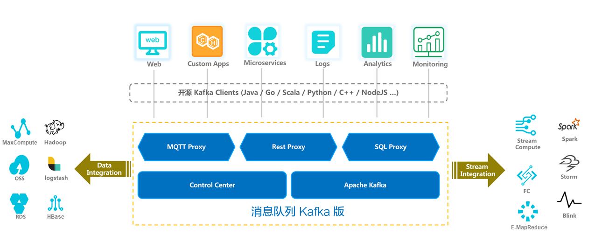

<a id="section-2"></a>

# 2.控制台操作指南

<a id="section-2-1"></a>

## 2.1. 登录消息队列Kafka版控制台

本文介绍如何登录消息队列Kafka版控制台。

**前提条件**

- 登录Apsara Uni-manager运营控制台前，确认您已从部署人员处获取Apsara Uni-manager运营控制台的服务域名地址。

- 推荐使用Chrome浏览器。

**操作步骤**

1. 在浏览器地址栏中，输入Apsara Uni-manager运营控制台的访问地址，按回车键。

2. 输入正确的用户名及密码。

   请向运营管理员获取登录控制台的用户名和密码。

   > 首次登录Apsara Uni-manager运营控制台时，需要修改登录用户名的密码，请按照提
   >
   > **说明**
   >
   > 示完成密码修改。为提高安全性，密码长度必须为 8~20 位，且至少包含以下两种类型：
   >
   > - 英文大写或小写字母（A~Z、a~z）
   >
   > - 阿拉伯数字（0~9）
   >
   > - 特殊符号（感叹号（！）、at（@）、井号（#）、美元符号（$）、百分号（%）等）

3. 单击**登录**。

4. 如果账号已激活MFA多因素认证，请根据以下两种情况进行操作：

   - 管理员强制开启MFA后的首次登录：

     <ol type="a">

     <li>

     在绑定虚拟MFA设备页面中，按页面提示步骤绑定MFA设备。

     </li>

     <li>

     按照步骤2重新输入账号和密码，单击**登录**。

     </li>

     </ol>

     <ol type="i" start="100">

     <li>

     输入6位MFA码后单击**认证**。

     </li>

     </ol>

   - 您已开启并绑定MFA：

     输入6位MFA码后单击**认证**。

     > 绑定并开启MFA的操作请参见<strong>《Apsara Uni-manager运营控制台用户指南》</strong>中的
     >
     > **说明**
     >
     > 章节<strong>《绑定并开启虚拟MFA设备》</strong>。

5. 在页面顶部菜单栏，选择**产品 > 中间件 > 消息队列Kafka**。

6. 在**消息队列Kafka**页面，选择**组织**和**地域**，然后单击**Kafka**。

<a id="section-2-2"></a>

## 2.2. 快速入门

<a id="section-2-2-1"></a>

### 2.2.1. 创建Topic

Topic用于存储生产者发布的消息。在发送消息前，您必须先创建Topic。

**操作步骤**

1. 登录消息队列Kafka版控制台。

2. 在**实例列表**页面，找到目标实例，单击目标实例名称，或其右侧**操作**列的**详情**。

3. 在**实例详情**页面，单击**Topic管理**页签。

4. 在**Topic管理**页面，单击**创建Topic**。

5. 在**创建Topic**对话框，设置Topic的属性，然后单击**确定**。

   <table>
     <tr>
       <th width="75">参数</th>
       <th>描述</th>
     </tr>
     <tr>
       <td>Topic</td>
       <td>Topic的名称。<br>• 名称只能包含字母、数字、下划线（_）和短划线（-），至少包含一个英文或数字且不能以双_开头。<br>• 名称长度限制在3字符~64字符之间，长于64字符将被自动截取。<br>• Topic名称一旦创建，无法修改。</td>
     </tr>
     <tr>
       <td>实例</td>
       <td>Topic所属的实例。</td>
     </tr>
     <tr>
       <td>分区数</td>
       <td>Topic的分区数。建议分区数是6的倍数，减少数据倾斜风险，分区数限制在1~48。</td>
     </tr>
   </table>

<a id="section-2-2-2"></a>

### 2.2.2. 发送消息

在创建Topic后，您可以直接在消息队列Kafka版控制台向Topic发送消息。

**操作步骤**

1. 登录消息队列Kafka版控制台。

2. 在**实例列表**页面，找到目标实例，单击目标实例名称，或其右侧**操作**列的**详情**。

3. 在**实例详情**页面，单击**Topic管理**页签。

4. 在**Topic管理**页面，找到目标Topic，在其右侧**操作**列，单击**发送消息**。

5. 在**发送消息**面板的**分区**文本框输入要发送的分区数，在**Message Key**文本框输入消息键，在**Message Value**文本框输入消息值，然后单击**确定**。

<a id="section-2-2-3"></a>

### 2.2.3. 查询消息

发送消息后，您可以查询发送的消息。

**背景信息**

消息队列Kafka版支持以下查询方式：

- <strong>按位点查询：</strong>根据位点查询消息，适用于明确发送消息的分区及位点的场景。

- <strong>按时间查询：</strong>根据时间查询消息，适用于不确定发送消息的分区或位点，但确定发送消息的时间的场景。

**注意事项**

- 最多查询到30条消息，且消息总大小不超过10 MB。

- 单条消息最多显示1 KB的内容，超过1 KB的部分将自动截断。如需查看完整的消息内容，请下载相应的消息。

- 只有未被服务端清除的消息才能被查询到。消息队列Kafka版服务端的消息清除策略如下：

  - 磁盘使用率低于85%：每天凌晨4点集中删除超过存储时间的消息。

  - 磁盘使用率达到85%：立即清除超过存储时间的消息。

  - 磁盘使用率达到90%：无论消息是否超过存储时间，按服务端存储消息的时间先后顺序清除消息。

**按位点查询**

1. 登录消息队列Kafka版控制台。

2. 在**实例列表**页面，找到目标实例，单击目标实例名称，或其右侧**操作**列的**详情**。

3. 在**实例详情**页面，单击**消息查询**页签。

4. 在**消息查询**页面，单击**按位点查询**页签，选择或输入**Topic**，选择**分区**，输入**位点**，然后单击**查询**。

   **消息查询**页面显示发送的消息。

   | 参数 | 描述 |
   | --- | --- |
   | 分区 | 消息的Topic分区。 |
   | 位点 | 消息的消费位点。 |
   | 时间 | 消息的创建时间。 |
   | Key(大小: 1B) | 消息的键（已强制转化为String类型）。<br>说明在选中具体消息后显示。 |
   | Value(大小: 1B) | 消息的值（已强制转化为String类型）。<br>说明在选中具体消息后显示。 |

**按时间查询**

1. 登录消息队列Kafka版控制台。

2. 在**实例列表**页面，找到目标实例，单击目标实例名称，或其右侧**操作**列的**详情**。

3. 在**实例详情**页面，单击**消息查询**页签。

4. 在**消息查询**页面，单击**按时间查询**页签，选择或输入**Topic**，选择**分区**，选择**时间**，然后单击**查询**。

   **消息查询**页面显示发送的消息。

   | 参数 | 描述 |
   | --- | --- |
   | 分区 | 消息的Topic分区。 |
   | 位点 | 消息的消费位点。 |
   | 时间 | 消息的创建时间。 |
   | Key(大小: 1B) | 消息的键（已强制转化为String类型）。<br>说明在选中具体消息后显示。 |
   | Value(大小: 1B) | 消息的值（已强制转化为String类型）。<br>说明在选中具体消息后显示。 |

<a id="section-2-3"></a>

## 2.3. 实例

<a id="section-2-3-1"></a>

### 2.3.1. 管理实例

实例存储了消息主题（Topic）和客户端ID（Group ID）信息。本文介绍如何在消息队列Kafka版控制台上创建、查看、扩容及释放实例。

**前提条件**

您已预留足够多的物理资源，以保证实例成功创建。

**使用限制**

- 如需使用创建实例功能，需要将消息队列Kafka版升级至V3.18.0版本。

- V3.18.0版本后通过控制台创建的实例支持在控制台扩容实例，V3.18.0版本之前直接交付的实例保持原有扩容方式。

**创建实例**

1. 登录消息队列Kafka版控制台。

2. 在左侧导航栏，单击**实例列表**。

3. 在**实例列表**页面，单击**创建实例**。

4. 在**创建Kafka实例**页面，设置以下参数，单击**提交**。

   > **说明**
   >
   > 如果您的环境开启了服务目录，在**创建Kafka实例**页面设置以下参数后，单击**确认订单**。

   | 类型 | 参数 | 描述 |
   | --- | --- | --- |

   选择创建的实例归属的组织。

   **组织**

   选择创建的实例归属的资源集。

   **资源集**

   选择地域。

   **地域**

   默认选择单可用区。

   **实例类型**

   基本信息

   选择主可用区。

   **主可用区**

   设置实例名称。

   **实例名称**

   选择实例的内核版本。

   **内核版本**

   支持选择**v2.8.2**版本或**v3.3.3**版本。

   规划给Kafka资源池的芯片类型。

   **芯片类型**

   可选取值如下：

   - **Broker4C16G**

   **规格**

   - **Broker16C64G**

   - **Broker32C128G**

   - **Broker8C32G**

   Kafka节点信息

   设置服务端节点数量，最小设置为3。

   **Broker数量**

   当前不可自定义，默认为fast-disks-ssd，表示独

   **存储类型**

   占的SSD盘。

   设置单Broker磁盘数量，默认为1。

   **单Broker磁盘数量**

   选择网络类型。取值如下：

   - **AnyTunnel**

   - **SingleTunnel**

   **网络类型**

   > **说明**
   >
   > 选择AnyTunnel时，实例地址存在被并网后客户网络访问的情况，请注意安全防护。

   选择VPC ID。

   > **说明**

   **VPC**

   > 仅当**网络类型**设置为**SingleTunnel**时需要设置此参数。

   选择VSwitch ID。

   > **说明**
   >
   > 仅当**网络类型**设置为**SingleTunnel**时需要

   **VSwitch**

   > 设置此参数。

   选择接入点类型，可选**PLAINTEXT**和**SASL**。默认选择SASL。

   > **说明**

   **接入点类型**

   > PLAINTEXT类型无需鉴权即可访问，请注意

   网络信息

   > 安全防护。

   - 输入域名前缀。

     - 只能包含字母、数字和短划线 (-) 。

   **域名前缀**

   - 长度限制在3-20个字符之间。

   输入自定义SASL明文接入点端口号，默认为8088。

   > **说明**

   **SASL 明文接入点**

   > 此配置仅当**接入点类型**选择了**SASL**时出现。

   输入自定义SASL_SSL加密接入点端口号，默认为8081。

   > **说明**

   **SASL_SSL 加密接入点**

   > 此配置仅当**接入点类型**选择了**SASL**时出现。

   输入自定义Plaintext明文接入点端口号，默认为8080。

   > **说明**

   **Plaintext 明文接入点**

   > 此配置仅当**接入点类型**选择了**PLAINTEXT**时出现。

**查看实例**

1. 在**实例列表**页面，可以快速查看目标实例的**标签**、**实例状态**和**扩容状态**。您也可以单击**监控**列按钮打开**监控**窗口，快速查看实例的相关监控信息。

2. 单击目标实例名称或右侧**操作**栏的**详情**，可打开**实例详情**页面，查看已部署的实例、集群信息。

3. 在**实例详情**页面，查看实例的**基本信息**、**运行状态**、**接入点信息**及**任务执行记录**。

   <ol type="i">

   <li>

   <strong>基本信息：</strong>可查看实例ID、实例名称、可用区、地域、实例类型、集群类型、大版本、小版本、芯片类型和规格信息。

   </li>

   <li>

   <strong>运行状态：</strong>可查看运行状态、付费类型、创建时间和是否自动续费。还可以查看ZooKeeper节点和Broker节点的拓扑图信息。

   </li>

   <li>

   <strong>接入点信息：</strong>可查看网络类型、状态、VPC ID、VSwitch ID、SASL_SSL、SASL_PLAINTEXT、PLAINTEXT等信息。

   </li>

   <li>

   <strong>任务执行记录：</strong>可查看任务类型、状态、开始执行时间、结束执行时间。

   </li>

   </ol>

**扩容实例**

当您的业务数据量增加且当前集群无法满足需求时，消息队列Kafka版支持在控制台上根据已部署实例的Broker进行同等资源水平扩展。

> **重要**
>
> 扩容后的终态Broker节点数量不能大于独占节点总数量，且暂不支持缩容。

1. 在**实例列表**页面，找到目标实例，单击右侧**操作**列的**扩容**。

2. 在**实例扩容**面板，设置**终态Broker节点数量**，单击**提交**。

   > **说明**
   >
   > 如果您的环境开启了服务目录，在**创建Kafka实例**页面设置以下参数后，单击**确认订单**。

**负载均衡**

实例扩容后，旧的Topic默认不会分布在新扩容的节点上，因此需要进行负载均衡。

1. 在**实例列表**页面，找到已扩容的实例，单击右侧**操作**栏的

   按钮，然后单击**负载均衡**。

   

2. 在提示对话框，仔细阅读提示的内容，单击**确定**。

   > **说明**
   >
   > - 当您进行扩容后，可通过负载均衡将该实例下的所有分区重新分配到所有 Broker 中。
   >
   > - 负载均衡操作可能会对业务并发流量产生影响，建议您在业务低峰期执行。
   >
   > - 负载均衡可能会对该实例下已经做过负载均衡的 Topic 产生影响，执行前请做好充分评估。

**释放实例**

> **警告**
>
> 释放实例会删除该实例内所有数据且不可恢复，请谨慎操作。

1. 在**实例列表**页面，找到目标实例，单击右侧**操作**栏的**释放**。

2. 在提示对话框，仔细阅读提示的内容，输入 

   `confirm`后单击**确定**。

<a id="section-2-3-2"></a>

### 2.3.2. 配置实例归属

消息队列Kafka版实例需要配置归属后，归属资源组下的用户才能看到该实例，并对实例进行操作。

**使用限制**

**历史版本限制**

消息队列Kafka版强依赖Apsara Uni-manager和oneconsole，三个产品必须一起升级，升级后的版本号如下：

- 消息队列Kafka版：

  - Hotfix名称：v3.14.0r-paas-kafka-SP003

  - 版本：ASEN_Prd-kafka_v1.14.3_archX

- Apsara Uni-manager：v3.14.0r-ascm-SP012

- oneconsole：v3.14.0r-oneConsole-SP012

**版本限制**

消息队列Kafka版强依赖Apsara Uni-manager和oneconsole，三个产品必须一起升级，升级后的版本号如下：

- 消息队列Kafka版：

  - Hotfix名称：v3.16.2r-paas-kafka-SP001

  - 版本：ASEN_Prd-kafka_v1.14.3_archX

- Apsara Uni-manager：v3.16.2r-ascm-SP003

- oneconsole：v3.16.2r-oneConsole-SP003

升级产品版本后，资源监察员默认有**实例关系配置**中**实例关系列表查询**权限，组织管理员默认有**实例关系配置**中**实例关系列表查询**和**归属配置**权限，其他用户需管理员添加**实例关系列表查询**和**归属配置**权限后，才可以使用此功能。

**角色限制**

配置实例归属的用户需具有**实例关系列表查询**和**归属配置**权限。组织管理员和资源监察员默认具有该权限。

**配置限制**

一个实例仅能归属一个资源组。实例配置归属后，不可变更归属。

**前提条件**

当前登录用户具有**实例关系列表查询**和**归属配置**权限。

**操作步骤**

1. 使用admin账号登录消息队列Kafka版控制台。详细步骤，请参见登录消息队列Kafka版控制台。

2. 在左侧导航栏，单击**实例关系配置**。

3. 在**实例关系配置**页面，找到目标实例，在其右侧**操作**列，单击**归属配置**。

4. 在**归属配置**面板，选择初始组织和资源集，单击**确定**。

   在**实例关系配置**页面，您可以看到刚配置归属的实例**操作**列为**已配置**。

<a id="section-2-3-3"></a>

### 2.3.3. 获取实例接入点

本文说明如何获取消息队列Kafka版实例的接入点。

**前提条件**

- 您已配置实例归属，详细信息请参见配置实例归属。

- 您已创建VIP，详细信息请参见创建VIP。

**背景信息**

消息队列Kafka版提供以下端口的接入点：

- 8080：适用于VPC内使用，不支持SASL校验。

- 8081：适用于VPC内使用，支持SASL校验，使用PLAINTEXT机制来对客户端进行身份验证，消息传输使用SSL（Secure Sockets Layer）进行加密。

- 8088：适用于VPC内使用，支持SASL校验，使用PLAINTEXT机制来对客户端进行身份验证。

**操作步骤**

1. 登录消息队列Kafka版控制台。

2. 在左侧导航栏，单击**实例列表**。

3. 在**实例列表**页面，找到目标实例，单击目标实例名称，或其右侧**操作**列的**详情**。

4. 在**实例详情**页面，单击**接入点信息**页签，获取实例的接入点信息：SASL_SSL、PLAINTEXT和SASL_PLAINTEXT。

<a id="section-2-3-4"></a>

### 2.3.4. 参数配置

本文介绍如何配置实例的参数。参数更改会改变Kafka的运行，请在熟悉使用Kafka后，确认实际需要后再行调整。

**操作步骤**

1. 登录消息队列Kafka版控制台。

2. 在**实例列表**页面，找到目标实例，在其右侧**操作**列，单击**参数配置**。

3. 在**参数配置**面板，修改以下参数。

   > **警告**
   >
   > 默认配置值已是最优配置，如无必要，建议您不要自行修改。下表中除**log.retention.bytes**参数外，修改其他参数均会重启Kafka，请选择在业务空闲时间修改。

   | 参数 | 描述 | 示例值 |
   | --- | --- | --- |
   | message.max.bytes | Server可接收的消息最大尺寸。Consumer与Producer在此属性的设置上必须保持一致，否则Producer发布的消息会对Consumer来说过大。需要注意的是，消息大小限制并非越大越好，建议根据具体业务需求进行合理设定。 | 10000000 |
   | num.partitions | 如果在创建Topic时未指定分区个数，则该参数的值将定义Topic下分区数量的默认值。 | 3 |
   | auto.create.topics.enable | 是否允许自动创建Topic。若允许，则发送消息或者匹配不存在的Topic时，会自动创建此Topic。否则需要使用命令行创建Topic。<br>• <strong>是</strong>：允许自动创建Topic。<br>• <strong>否</strong>：不允许自动创建Topic。 | 否 |
   | num.io.threads | Server用来处理请求的I/O线程的数目。这个线程数目至少要等于硬盘的个数。 | 16 |
   | queued.max.requests | 在网络线程停止读取新请求之前，可以排队等待I/O线程处理的最大请求个数。 | 80 |
   | replica.fetch.wait.max.ms | Replicas与Leader之间通信的最大等待时间，如果失败则会重试。单位：毫秒。 | 500 |
   | replica.lag.time.max.ms | 如果一个Follower在这个时间内没有发送Fetch请求，Leader将从ISR中移除这个Follower，并认为这个Follower已经下线。单位：毫秒。 | 30000 |
   | num.network.threads | Server用来处理网络请求的网络线程数目。 | 3 |
   | log.retention.bytes | Topic下每个分区保存的最大字节数。此数值乘以分区的个数就是每个Topic保存的数据总量。如果<strong>log.retention.hours</strong>和<strong>log.r</strong> <strong>etention.bytes</strong>都已设置，则超过了任何一个限制都会造成删除一个段文件。此配置项可以在单个Topic设置时进行覆盖。 | 4 |
   | replica.fetch.max.bytes | Follower从Leader备份时每次匹配的最大字节数。 | 10000000 |
   | num.replica.fetchers | 从Leader备份数据的线程数。 | 4 |
   | default.replication.factor | 默认备份的份数，仅指自动创建的Topic。 | 3 |
   | offsets.retention.minutes | 存在时间超过此时间限制的offsets将被标记为待删除。单位：分钟。 | 10080 |
   | background.threads | 用于后台处理的线程数目，例如文件删除。 | 10 |

4. 修改完成后，在参数右侧的**操作**列，单击**修改**。

5. 仔细阅读**修改配置**对话框中的提示信息，单击**确定**。

<a id="section-2-3-5"></a>

### 2.3.5. 查看实例监控信息

在云监控中心，您可以通过查看监控图表，了解各实例的运行情况。本文介绍如何快速跳转到云监控查看实例监控信息。

**背景信息**

云消息队列 Kafka 版支持监控您账户下创建的资源，包括Broker、Topic和Group，帮助您实时掌握资源状态。您还可以为云监控项设置报警规则，当监控项数据超过设定的报警阈值时，云监控可以通过电话、短信、邮件、钉钉机器人等方式通知您，帮助您及时应对异常情况。更多信息，请参见专有云文档中心<strong>《云监控CMS 用户指南》 > 《云监控概述》</strong>章节。

**操作步骤**

1. 登录消息队列Kafka版控制台。

2. 在左侧导航栏，单击**实例列表**。

3. 在**实例列表**页面，找到目标实例，单击目标实例名称，或其右侧**操作**列的**详情**。

   > **说明**
   >
   > 您也可以单击目标实例**监控**列的  图标，快速打开监控面板。

4. 在**实例详情**页面，单击**监控**页签，查看目标实例的监控信息。

> **说明**
>
> 您也可以单击右上角**查看更多**，进入云监控CMS控制台查看更详细的实例监控信息。

<table>
  <tr>
    <th width="90">项目</th>
    <th>说明</th>
  </tr>
  <tr>
    <td>监控粒度</td>
    <td>实例监控粒度分为<strong>Broker</strong>、<strong>Topic</strong>和<strong>Group</strong>。您可点击相应的页签进行切换。</td>
  </tr>
  <tr>
    <td>监控周期</td>
    <td>您可以配置查看监控数据的时间段，即监控周期。取值范围：<br>• 按小时：1小时、3小时、6小时、12小时。<br>• 按天：1天、3天、7天。<br>• 自定义：您可根据实际需要设置监控周期。支持快速选择<strong>近五分钟</strong>、<strong>近十分</strong><strong>钟</strong>或<strong>近十五分钟</strong>。</td>
  </tr>
  <tr>
    <td>监控指标</td>
    <td>以Broker为例，支持查看<strong>Broker消息生产流量 (bytes)</strong>、<strong>Broker消息消费流量</strong><strong>(bytes)</strong>、<strong>Broker消息生产请求频率 (count)</strong>、<strong>Broker消息生产条数</strong><strong>(count)</strong>和<strong>Broker消息消费请求频率 (count)</strong>。具体的监控指标说明，请参见专有云文档中心<strong>《云监控CMS 用户指南》 &gt; 《云产</strong><strong>品监控》 &gt; 《互联网中间件》 &gt; 《消息队列Kafka》</strong>章节。<br>您还可以点击各监控图表右上方的以快速创建报警规则。</td>
  </tr>
</table>

<a id="section-2-3-6"></a>

### 2.3.6. 查看实例操作日志

本文介绍如何查看Kafka的操作日志，以帮助您在管理或使用Kafka遇到问题时快速定位问题原因，提高故障排除效率。

> **说明**
>
> 1. 当前操作日志保存时长 7 天，如需调整，需管理员在配置-日志转存配置中操作。
>
> 2. 若通过转存设置延长保存时长，日志数据不会做前序时间数据补充。

**操作步骤**

1. 登录消息队列Kafka版控制台。

2. 在左侧导航栏，单击**实例列表**。

3. 在**实例列表**页面，找到目标实例，单击目标实例名称，或其右侧**操作**列的**详情**。

4. 在**实例详情**页面，单击**操作日志**页签，查看目标实例的操作日志信息。

5. 查看操作日志，默认会列出最近7天Kafka实例及其相关资源的所有操作记录。

   您可以点击**操作人**旁边的下拉按钮快速切换筛选条件。

   您还可以点击**高级筛选**，按**操作人**、**操作名称**、**执行状态**、**操作源IP**和**操作时间**进一步筛选出关心的操作记录。

<a id="section-2-4"></a>

## 2.4. Topic

<a id="section-2-4-1"></a>

### 2.4.1. 创建Topic

Topic用于存储生产者发布的消息。在发送消息前，您必须先创建Topic。

**操作步骤**

1. 登录消息队列Kafka版控制台。

2. 在**实例列表**页面，找到目标实例，单击目标实例名称，或其右侧**操作**列的**详情**。

3. 在**实例详情**页面，单击**Topic管理**页签。

4. 在**Topic管理**页面，单击**创建Topic**。

5. 在**创建Topic**对话框，设置Topic的属性，然后单击**确定**。

   <table>
     <tr>
       <th width="75">参数</th>
       <th>描述</th>
     </tr>
     <tr>
       <td>Topic</td>
       <td>Topic的名称。<br>• 名称只能包含字母、数字、下划线（_）和短划线（-），至少包含一个英文或数字且不能以双_开头。<br>• 名称长度限制在3字符~64字符之间，长于64字符将被自动截取。<br>• Topic名称一旦创建，无法修改。</td>
     </tr>
     <tr>
       <td>实例</td>
       <td>Topic所属的实例。</td>
     </tr>
     <tr>
       <td>分区数</td>
       <td>Topic的分区数。建议分区数是6的倍数，减少数据倾斜风险，分区数限制在1~48。</td>
     </tr>
   </table>

<a id="section-2-4-2"></a>

### 2.4.2. 查看Topic列表

本文介绍如何查看Topic列表。

**操作步骤**

1. 登录消息队列Kafka版控制台。

2. 在左侧导航栏，单击**实例列表**。

3. 在**实例列表**页面，找到目标实例，单击目标实例名称，或其右侧**操作**列的**详情**。

4. 单击**Topic管理**页签。

5. 在**Topic管理**页面，查看Topic列表。

<a id="section-2-4-3"></a>

### 2.4.3. 查看Topic分区状态

在创建Topic后，您可以查看Topic的各个分区的状态。

**操作步骤**

1. 登录消息队列Kafka版控制台。

2. 在**实例列表**页面，找到目标实例，单击目标实例名称，或其右侧**操作**列的**详情**。

3. 在**实例详情**页面，单击**Topic管理**页签。

4. 在**Topic管理**页面，找到目标Topic，在其右侧**操作**列，单击**分区状态**。

   **分区状态**面板显示Topic的各个分区的状态。

   | 参数 | 描述 |
   | --- | --- |
   | 当前服务器上消息总量 | 所有分区存在的消息量之和。 |
   | 分区ID | 该Topic分区的ID号。 |
   | 最小位点 | 该Topic在当前分区下的最小消费位点。 |
   | 最大位点 | 该Topic在当前分区下的最大消费位点。 |
   | ISR | 已同步的副本。 |
   | leader | 主副本，收发消息均通过主副本进行读写。 |

<a id="section-2-4-4"></a>

### 2.4.4. 查看Topic订阅关系

在创建Topic后，您可以查看已订阅Topic的在线Consumer Group。

**操作步骤**

1. 登录消息队列Kafka版控制台。

2. 在**实例列表**页面，找到目标实例，单击目标实例名称，或其右侧**操作**列的**详情**。

3. 在**实例详情**页面，单击**Topic管理**页签。

4. 在**Topic管理**页面，找到目标Topic，在其右侧**操作**列，单击**订阅关系**。

   **订阅关系**面板显示所有订阅Topic的Consumer Group。

   | 参数 | 描述 |
   | --- | --- |
   | Topic | Topic的名称。 |
   | 订阅Consumer Group数量 | 订阅该Topic的Consumer Group的数量。 |
   | 编号 | 编号。 |
   | Consumer Group ID | 已订阅指定Topic的在线Consumer Group ID，非在线Consumer Group ID无法查看。 |

<a id="section-2-4-5"></a>

### 2.4.5. 修改Topic配置

在创建Topic后，您可以修改Topic的配置。

**操作步骤**

1. 登录消息队列Kafka版控制台。

2. 在**实例列表**页面，找到目标实例，单击目标实例名称，或其右侧**操作**列的**详情**。

3. 在**实例详情**页面，单击**Topic管理**页签。

4. 在**Topic管理**页面，找到目标Topic，单击其右侧**操作**列的

   按钮，然后单击**topic配置**。

   

5. 在**Topic配置**对话框，找到需要修改的配置项，在其右侧单击**修改**，选择或输入目标值，单击**确定**。

   | 参数 | 描述 |
   | --- | --- |
   | min.insync.replicas(最小同步副本数) | Topic的最小同步副本数。<br>• 最小同步副本数的限制范围最小为1，最大为当前副本数，建议为1。<br>• 最小同步副本数必须小于等于副本数。<br>• 最小同步副本数定义了判断消息写入成功所需的最小确认消息的副本数量。当生产者将请求所需的消息确认设置为<code> All </code>或<code> -1 </code>时，最小副本数才有意义。 |
   | retention.ms(消息保留时间(毫秒)) | Topic中的消息的保留时间。保留时间限制在3600000ms～864000000ms。 |
   | max.message.bytes(最大消息大小(bytes)) | Topic能从Producer接收的消息的最大值。最大消息值限制在1048576bytes～10485760bytes。 |
   | retention.bytes(每个topic下每个partition保存数据的总量(bytes)) | 每个topic下每个partition保存数据的总量。<br>取值范围为：<code> -1 </code>或268435456bytes～1073741824bytes。<br>说明<br>取值为<code> -1 </code>表示不对分区的日志大小设置任何上限。 |

<a id="section-2-4-6"></a>

### 2.4.6. 增加Topic分区数

在创建Topic后，您可以增加Topic分区数。消息队列Kafka版不支持减少Topic分区数。如需减少Topic分区数，您可以删除Topic，然后重新创建Topic。

**操作步骤**

1. 登录消息队列Kafka版控制台。

2. 在**实例列表**页面，找到目标实例，单击目标实例名称，或其右侧**操作**列的**详情**。

3. 在**实例详情**页面，单击**Topic管理**页签。

4. 在**Topic管理**页面，找到目标Topic，单击其右侧**操作**列的

   按钮，然后单击**增加分区数**。

   

5. 在**增加分区数**对话框的**新增分区数**文本框，输入增加的分区数，然后单击**确定**。

   > **说明**
   >
   > 建议分区数是6的倍数，减少数据倾斜风险，分区数限制（1～48），特殊需求请提交工单。

<a id="section-2-4-7"></a>

### 2.4.7. Topic分区迁移

本文介绍如何对扩容过的Kafka实例进行Topic级别的分区迁移操作。

**前提条件**

您已部署云消息队列 Kafka 版实例并对其进行过扩容操作，实例的**扩容状态**需要为**已扩容**。关于扩容实例的详细信息，请参见扩容实例。

**操作步骤**

1. 登录消息队列Kafka版控制台。

2. 在左侧导航栏，单击**实例列表**。

3. 在**实例列表**页面，找到目标实例，单击目标实例名称，或其右侧**操作**列的**详情**。

4. 在**实例详情**页面，单击**Topic管理**页签。

5. 在Topic列表中找到需要进行分区迁移的Topic，单击其右侧**操作**列的  按钮，然后单击**消息重平衡**。

6. 在弹出的**消息重平衡**窗口中查看**当前分布brokers**，在**可重平衡brokers**下选择全部broker或您想要进行消息重新分配的broker。

7. 确认**目的brokers**后，点击**确认**。

<a id="section-2-5"></a>

## 2.5. Consumer Group

<a id="section-2-5-1"></a>

### 2.5.1. 查看Consumer Group列表

本文介绍如何查看Consumer Group列表。

**操作步骤**

1. 登录消息队列Kafka版控制台。

2. 在左侧导航栏，单击**实例列表**。

3. 在**实例列表**页面，找到目标实例，单击目标实例名称，或其右侧**操作**列的**详情**。

4. 在**实例详情**页面，单击**Group管理**页签。

5. 在**Group管理**页面，查看Consumer Group列表。

<a id="section-2-5-2"></a>

### 2.5.2. 查看Consumer Group消费状态

本文介绍如何查看Consumer Group消费状态。

**操作步骤**

1. 登录消息队列Kafka版控制台。

2. 在左侧导航栏，单击**实例列表**。

3. 在**实例列表**页面，找到目标实例，单击目标实例名称，或其右侧**操作**列的**详情**。

4. 在**实例详情**页面，单击**Group管理**页签。

5. 在**Group管理**页面，找到目标Consumer Group，在其右侧**操作**列，单击**消费状态**。

   **消费状态**面板显示该Consumer Group的消费状态。

   | 参数 | 描述 |
   | --- | --- |
   | 消息堆积总量 | 该Consumer Group订阅的所有Topic的未被消费消息总量。 |
   | Topic | 该Consumer Group订阅的Topic的名称。 |
   | 堆积量 | 该Topic未被消费的消息量。 |

6. <strong>可选：</strong>如需查看某个Topic的消费详情，您可在**消费状态**面板的**Topic**列表，找到目标Topic，在其右侧**操作**列，单击**详情**。

   展开的表格显示该Topic的消费详情。

   <table>
     <tr>
       <th width="89">参数</th>
       <th>描述</th>
     </tr>
     <tr>
       <td>分区ID</td>
       <td>该Topic分区的ID号。</td>
     </tr>
     <tr>
       <td>owner</td>
       <td>实时订阅该Topic的在线Consumer。<br>说明<br>• 取值格式为&lt;Client ID&gt;_/&lt;IP&gt;。<br>• 非在线消费端则无法查看owner信息。</td>
     </tr>
     <tr>
       <td>最大位点</td>
       <td>该Topic在当前分区下的最大消息消费位点。</td>
     </tr>
     <tr>
       <td>消费位点</td>
       <td>该Topic在当前分区下的消息消费位点。</td>
     </tr>
     <tr>
       <td>堆积量</td>
       <td>当前分区下的消息堆积总量（最大位点减去消费位点的值）。<br>说明堆积总量是一个关键指标，如果发现堆积总量较大，则应用消费端可能产生了阻塞，或者消费速度跟不上生产速度。此时需要分析消费端的运行状况，尽力提升消费速度。</td>
     </tr>
   </table>

<a id="section-2-5-3"></a>

### 2.5.3. 重置Consumer Group消费位点

重置消费位点是指调整订阅者当前的消费位置。通过重置消费位点，您可以根据需要清除堆积的或不想消费的消息，然后重新开始消费，或直接跳转至某个时间点，消费该时间点之后的消息（无论是否已消费过该时间点之前的消息）。

**前提条件**

已停止要重置消费位点的Consumer客户端。

> **重要**
>
> - 消息队列Kafka版不支持在线重置消费位点。
>
> - 在停止Consumer客户端后，需要经过 `ConsumerConfig.SESSION_TIMEOUT_MS_CONFIG` 配置时间（默认10000毫秒），服务端才认为Consumer真正下线。

**背景信息**

消息队列Kafka版支持以下重置消费位点方式：

- <strong>清除所有堆积消息，从最新位点开始消费：</strong>因为某种原因，订阅者不准备再继续消费Broker上堆积的消息，此时通过清除消息，可以将消费位点指定到最新的位置。

  > **重要**
  >
  > 堆积的消息本身不会因此被删除，改变的只是消费位点。

- <strong>指定时间点开始消费：</strong>将某个Consumer Group的位点重置到过去或者将来的某个时间点（该时间点以Topic的消息存储时间为准，假设为“t”）。重置过后，Consumer Group将从“t”时间点之后的消息开始订阅。

**操作步骤**

1. 登录消息队列Kafka版控制台。

2. 在左侧导航栏，单击**实例列表**。

3. 在**实例列表**页面，找到目标实例，单击目标实例名称，或其右侧**操作**列的**详情**。

4. 在**实例详情**页面，单击**Group管理**页签。

5. 在**Group管理**页面，找到目标Consumer Group，在其右侧**操作**列，单击**重置消费位点**。

6. 在**重置消费位点**对话框，在**Topic**列表选择需要重置消费位点的Topic，选择重置策略，然后单击**确定**。

<a id="section-2-6"></a>

## 2.6. 消息

<a id="section-2-6-1"></a>

### 2.6.1. 发送消息

在创建Topic后，您可以直接在消息队列Kafka版控制台向Topic发送消息。

**操作步骤**

1. 登录消息队列Kafka版控制台。

2. 在**实例列表**页面，找到目标实例，单击目标实例名称，或其右侧**操作**列的**详情**。

3. 在**实例详情**页面，单击**Topic管理**页签。

4. 在**Topic管理**页面，找到目标Topic，在其右侧**操作**列，单击**发送消息**。

5. 在**发送消息**面板的**分区**文本框输入要发送的分区数，在**Message Key**文本框输入消息键，在**Message Value**文本框输入消息值，然后单击**确定**。

<a id="section-2-6-2"></a>

### 2.6.2. 查询消息

发送消息后，您可以查询发送的消息。

**背景信息**

消息队列Kafka版支持以下查询方式：

- <strong>按位点查询：</strong>根据位点查询消息，适用于明确发送消息的分区及位点的场景。

- <strong>按时间查询：</strong>根据时间查询消息，适用于不确定发送消息的分区或位点，但确定发送消息的时间的场景。

**注意事项**

- 最多查询到30条消息，且消息总大小不超过10 MB。

- 单条消息最多显示1 KB的内容，超过1 KB的部分将自动截断。如需查看完整的消息内容，请下载相应的消息。

- 只有未被服务端清除的消息才能被查询到。消息队列Kafka版服务端的消息清除策略如下：

  - 磁盘使用率低于85%：每天凌晨4点集中删除超过存储时间的消息。

  - 磁盘使用率达到85%：立即清除超过存储时间的消息。

  - 磁盘使用率达到90%：无论消息是否超过存储时间，按服务端存储消息的时间先后顺序清除消息。

**按位点查询**

1. 登录消息队列Kafka版控制台。

2. 在**实例列表**页面，找到目标实例，单击目标实例名称，或其右侧**操作**列的**详情**。

3. 在**实例详情**页面，单击**消息查询**页签。

4. 在**消息查询**页面，单击**按位点查询**页签，选择或输入**Topic**，选择**分区**，输入**位点**，然后单击**查询**。

   **消息查询**页面显示发送的消息。

   | 参数 | 描述 |
   | --- | --- |
   | 分区 | 消息的Topic分区。 |
   | 位点 | 消息的消费位点。 |
   | 时间 | 消息的创建时间。 |
   | Key(大小: 1B) | 消息的键（已强制转化为String类型）。<br>说明在选中具体消息后显示。 |
   | Value(大小: 1B) | 消息的值（已强制转化为String类型）。<br>说明在选中具体消息后显示。 |

**按时间查询**

1. 登录消息队列Kafka版控制台。

2. 在**实例列表**页面，找到目标实例，单击目标实例名称，或其右侧**操作**列的**详情**。

3. 在**实例详情**页面，单击**消息查询**页签。

4. 在**消息查询**页面，单击**按时间查询**页签，选择或输入**Topic**，选择**分区**，选择**时间**，然后单击**查询**。

   **消息查询**页面显示发送的消息。

   | 参数 | 描述 |
   | --- | --- |
   | 分区 | 消息的Topic分区。 |
   | 位点 | 消息的消费位点。 |
   | 时间 | 消息的创建时间。 |
   | Key(大小: 1B) | 消息的键（已强制转化为String类型）。<br>说明在选中具体消息后显示。 |
   | Value(大小: 1B) | 消息的值（已强制转化为String类型）。<br>说明在选中具体消息后显示。 |

<a id="section-2-7"></a>

## 2.7. ACL

<a id="section-2-7-1"></a>

### 2.7.1. 创建SASL用户

本文说明如何创建SASL用户。

**操作步骤**

1. 登录消息队列Kafka版控制台。

2. 在左侧导航栏，单击**实例列表**。

3. 在**实例列表**页面，找到目标实例，单击目标实例名称，或其右侧**操作**列的**详情**。

4. 在**实例详情**页面，单击**SASL用户**页签。

5. 单击**创建SASL用户**。

6. 在**创建SASL用户**对话框，设置SASL用户信息，然后单击**确定**。

   | 参数 | 描述 |
   | --- | --- |
   | 用户名 | SASL用户的名称。 |
   | 密码 | SASL用户的密码。 |
   | 类型 | SASL用户的类型。消息队列Kafka版支持的SASL机制如下：<br>• <strong>SCRAM：</strong>一种用户名密码校验机制，安全性比PLAIN更高。消息队列Kafka版使用SCRAM-SHA-256。<br>• <strong>PLAIN：</strong>默认不可选。 |

<a id="section-2-7-2"></a>

### 2.7.2. 为SASL用户授权

本文说明如何为SASL用户授权。

**前提条件**

您已创建SASL用户，详情请参见创建SASL用户。

**操作步骤**

1. 登录消息队列Kafka版控制台。

2. 在左侧导航栏，单击**实例列表**。

3. 在**实例列表**页面，找到目标实例，单击目标实例名称，或其右侧**操作**列的**详情**。

4. 在**实例详情**页面，单击**SASL权限**页签。

5. 单击**创建ACL**。

6. 在**创建ACL**对话框，设置以下信息后，单击**确定**。

   <table>
     <tr>
       <th width="152">参数</th>
       <th>描述</th>
     </tr>
     <tr>
       <td>用户名</td>
       <td>SASL用户的名称。<br>说明消息队列Kafka版支持通配符星号（*）表示所有用户名。</td>
     </tr>
     <tr>
       <td>资源类型</td>
       <td>资源的类型。取值：<br>• Topic：消息主题。<br>• Group：消费组。</td>
     </tr>
     <tr>
       <td>匹配模式</td>
       <td>资源的匹配模式。取值：<br>• 全匹配：按字面值匹配资源名称。全匹配模式只会匹配名称完全相同的资源。<br>• 前缀匹配：根据前缀匹配资源名称。前缀匹配模式将匹配以指定名称开头的任意资源名称。</td>
     </tr>
     <tr>
       <td>操作类型</td>
       <td>SASL用户对资源的操作类型。支持同时选择Write和Read以单次完成两种权限的授权操作。<br>• Write：写入。<br>• Read：读取。<br>重要资源类型Group仅支持操作类型Read。</td>
     </tr>
     <tr>
       <td>是否自定义资源名</td>
       <td>勾选此选项后，您可以不选择已有Group资源，而填入自定义的Group名称（资源名）完成ACL创建。如需使创建的ACL生效，您还需之后手动创建同名Group资源。<br>说明此选项仅在<strong>资源类型</strong>选择<strong>Group</strong>，且<strong>匹配模式</strong>选择<strong>全匹配</strong>时出现。</td>
     </tr>
     <tr>
       <td>资源名</td>
       <td>资源的名称。Topic或Consumer Group的名称。<br>说明消息队列Kafka版支持通配符星号（*）表示所有资源名。</td>
     </tr>
     <tr>
       <td>白名单地址</td>
       <td>填入白名单地址。只有配置在白名单中的IP地址与端口才允许访问云消息队列 Kafka版实例。</td>
     </tr>
   </table>

<a id="section-2-7-3"></a>

### 2.7.3. 设置IP白名单

本文介绍如何为云消息队列 Kafka 版实例设置IP白名单，只有配置在白名单中的IP地址与端口才允许访问云消息队列 Kafka 版实例。

**前提条件**

您已部署云消息队列 Kafka 版实例，且该实例处于**服务中**的状态。

**添加白名单**

1. 登录消息队列Kafka版控制台。

2. 在左侧导航栏，单击**实例列表**。

3. 在**实例列表**页面，找到目标实例，单击目标实例名称，或其右侧**操作**列的**详情**。

4. 在**实例详情**页面，单击**SASL权限**页签。

5. 点击**创建ACL**按钮，并于弹出的**创建ACL**窗口配置如下参数后，点击**确定**。

   <table>
     <tr>
       <th width="152">参数</th>
       <th>描述</th>
     </tr>
     <tr>
       <td>用户名</td>
       <td>SASL用户的名称。<br>说明消息队列Kafka版支持通配符星号（*）表示所有用户名。</td>
     </tr>
     <tr>
       <td>资源类型</td>
       <td>资源的类型。取值：<br>• Topic：消息主题。<br>• Group：消费组。</td>
     </tr>
     <tr>
       <td>匹配模式</td>
       <td>资源的匹配模式。取值：<br>• 全匹配：按字面值匹配资源名称。全匹配模式只会匹配名称完全相同的资源。<br>• 前缀匹配：根据前缀匹配资源名称。前缀匹配模式将匹配以指定名称开头的任意资源名称。</td>
     </tr>
     <tr>
       <td>操作类型</td>
       <td>SASL用户对资源的操作类型。支持同时选择Write和Read以单次完成两种权限的授权操作。<br>• Write：写入。<br>• Read：读取。<br>重要资源类型Group仅支持操作类型Read。</td>
     </tr>
     <tr>
       <td>是否自定义资源名</td>
       <td>勾选此选项后，您可以不选择已有Group资源，而填入自定义的Group名称（资源名）完成ACL创建。如需使创建的ACL生效，您还需之后手动创建同名Group资源。<br>说明此选项仅在<strong>资源类型</strong>选择<strong>Group</strong>，且<strong>匹配模式</strong>选择<strong>全匹配</strong>时出现。</td>
     </tr>
     <tr>
       <td>资源名</td>
       <td>资源的名称。Topic或Consumer Group的名称。<br>说明消息队列Kafka版支持通配符星号（*）表示所有资源名。</td>
     </tr>
     <tr>
       <td>白名单地址</td>
       <td>填入白名单地址。只有配置在白名单中的IP地址与端口才允许访问云消息队列 Kafka版实例。</td>
     </tr>
   </table>

**删除白名单**

1. 登录消息队列Kafka版控制台。

2. 在左侧导航栏，单击**实例列表**。

3. 在**实例列表**页面，找到目标实例，单击目标实例名称，或其右侧**操作**列的**详情**。

4. 在**实例详情**页面，单击**SASL权限**页签。

5. 找到需要删除的ACL条目，单击右侧**操作**列的**删除**。

6. 在**删除ACL**对话框，单击**确定**。

<a id="section-2-7-4"></a>

### 2.7.4. 修改SASL用户的密码

本文说明如何修改SASL用户的密码。

**前提条件**

您已创建SASL用户，详情请参见创建SASL用户。

**操作步骤**

1. 登录消息队列Kafka版控制台。

2. 在左侧导航栏，单击**实例列表**。

3. 在**实例列表**页面，找到目标实例，单击目标实例名称，或其右侧**操作**列的**详情**。

4. 在**实例详情**页面，单击**SASL用户**页签。

5. 在**SASL用户**页签下方，找到要修改密码的SASL用户，在其右侧**操作**列，单击**修改**。

6. 在**修改SASL用户**对话框，输入新的密码，然后单击**确定**。

<a id="section-2-7-5"></a>

### 2.7.5. 删除SASL用户

本文说明如何删除SASL用户。

**前提条件**

您已创建SASL用户，详情请参见创建SASL用户。

**操作步骤**

1. 登录消息队列Kafka版控制台。

2. 在左侧导航栏，单击**实例列表**。

3. 在**实例列表**页面，找到目标实例，单击目标实例名称，或其右侧**操作**列的**详情**。

4. 在**实例详情**页面，单击**SASL用户**页签。

5. 在**SASL用户**页签，找到要删除的SASL用户，在其右侧**操作**列，单击**删除**。

6. 在**删除SASL用户**对话框，单击**确定**。

<a id="section-2-7-6"></a>

### 2.7.6. 删除SASL用户权限

本文说明如何删除授予SASL用户的权限。

**前提条件**

您已为SASL用户授权，详情请参见为SASL用户授权。

**操作步骤**

1. 登录消息队列Kafka版控制台。

2. 在左侧导航栏，单击**实例列表**。

3. 在**实例列表**页面，找到目标实例，单击目标实例名称，或其右侧**操作**列的**详情**。

4. 在**实例详情**页面，单击**SASL权限**页签。

5. 在**SASL权限**页签，根据提示选择需删除权限的相关信息，单击**查询**。

6. 在权限列表中，找到需删除的权限，在其右侧**操作**列，单击**删除**。

7. 在**删除ACL**对话框，单击**确定**。

<a id="section-2-7-7"></a>

### 2.7.7. 下载ACL证书

本文说明如何下载ACL证书。

**前提条件**

目标实例的接入点类型为SASL，接入点信息中的SASL_SSL和SASL_PLAINTEXT显示了相应的值。

**操作步骤**

1. 登录消息队列Kafka版控制台。

2. 在左侧导航栏，单击**实例列表**。

3. 在**实例列表**页面，找到目标实例，单击目标实例名称，或其右侧**操作**列的**详情**。

4. 在**实例详情**页面，单击**SASL权限**页签。

5. 在**SASL权限**页签，单击**下载ACL证书**，即可将证书下载至本地。

<a id="section-2-8"></a>

## 2.8. VIP

<a id="section-2-8-1"></a>

### 2.8.1. 创建VIP

本文说明如何创建VIP。

**背景信息**

消息队列Kafka版提供以下类型的VIP：

- <strong>SingeTunnel：</strong>只允许从特定的VPC访问消息队列Kafka版。

- <strong>AnyTunnel：</strong>允许从任何VPC访问消息队列Kafka版。

**操作步骤**

1. 登录消息队列Kafka版控制台。

2. 在左侧导航栏，单击**实例列表**。

3. 在**实例列表**页面，找到目标实例，单击目标实例名称，或其右侧**操作**列的**详情**。

4. 在**实例详情**页面，单击**接入点信息**页签，单击**创建**。

5. 在**创建VIP信息**页面，配置以下网络信息后，单击**提交**。

   <table>
     <tr>
       <th width="197">参数</th>
       <th>说明</th>
     </tr>
     <tr>
       <td>网络类型</td>
       <td>选择网络类型。取值如下：<br>• AnyTunnel<br>• SingleTunnel<br>说明选择AnyTunnel时，实例地址存在被并网后客户网络访问的情况，请注意安全防护。</td>
     </tr>
     <tr>
       <td>接入点类型</td>
       <td>选择接入点类型，可选<strong>PLAINTEXT</strong>和<strong>SASL</strong>。默认选择SASL。<br>说明PLAINTEXT类型无需鉴权即可访问，请注意安全防护。</td>
     </tr>
     <tr>
       <td>VPC ID</td>
       <td>选择VPC ID。<br>说明仅当<strong>网络类型</strong>设置为<strong>SingleTunnel</strong>时需要设置此参数。</td>
     </tr>
     <tr>
       <td>VSwitch ID</td>
       <td>选择VSwitch ID。<br>说明仅当<strong>网络类型</strong>设置为<strong>SingleTunnel</strong>时需要设置此参数。</td>
     </tr>
     <tr>
       <td>UID</td>
       <td>所填写的vSwitch ID的归属者的UID。<br>说明仅当<strong>网络类型</strong>设置为<strong>SingleTunnel</strong>时需要设置此参数。</td>
     </tr>
     <tr>
       <td>域名前缀</td>
       <td>• 输入域名前缀。<br>• 只能包含字母、数字和短划线 (-) 。<br>• 长度限制在3-20个字符之间。</td>
     </tr>
     <tr>
       <td>SASL 明文接入点</td>
       <td>输入自定义SASL明文接入点端口号，默认为8088。<br>说明此配置仅当<strong>接入点类型</strong>选择了<strong>SASL</strong>时出现。</td>
     </tr>
     <tr>
       <td>SASL_SSL 加密接入点</td>
       <td>输入自定义SASL_SSL加密接入点端口号，默认为8081。<br>说明此配置仅当<strong>接入点类型</strong>选择了<strong>SASL</strong>时出现。</td>
     </tr>
     <tr>
       <td>Plaintext 明文接入点</td>
       <td>输入自定义Plaintext明文接入点端口号，默认为8080。<br>说明此配置仅当<strong>接入点类型</strong>选择了<strong>PLAINTEXT</strong>时出现。</td>
     </tr>
   </table>

   创建VIP需要更新消息队列Kafka版网络和重启消息队列Kafka版服务，预计需要时间为：消息队列Kafka版节点数×10分钟。

<a id="section-2-8-2"></a>

### 2.8.2. 删除VIP

本文说明如何删除VIP。

**操作步骤**

1. 登录消息队列Kafka版控制台。

2. 在左侧导航栏，单击**实例列表**。

3. 在**实例列表**页面，找到目标实例，单击目标实例名称，或其右侧**操作**列的**详情**。

4. 在**实例详情**页面，单击**接入点信息**页签，单击**删除**。

5. 在**确认删除**对话框，输入 

   `confirm`，然后单击**确认**。

   > **重要**
   >
   > 删除VIP会导致该消息队列Kafka版实例不可用，请您谨慎操作。

<a id="section-2-8-3"></a>

### 2.8.3. 申请域名

本文介绍如何为未配置域名前缀的VIP接入点创建域名。

**前提条件**

该VIP接入点未配置域名前缀。

**操作步骤**

1. 登录消息队列Kafka版控制台。

2. 在左侧导航栏，单击**实例列表**。

3. 在**实例列表**页面，找到目标实例，单击目标实例名称，或其右侧**操作**列的**详情**。

4. 在**实例详情**页面，单击**接入点信息**页签，单击**申请域名**。

5. 在**申请域名**窗口，输入域名前缀，单击**确定**。

<a id="section-2-9"></a>

## 2.9. 同城容灾

<a id="section-2-9-1"></a>

### 2.9.1. 同城容灾方案简介

对于有数据可靠性强需求和监管需求的金融业务场景，消息队列Kafka版提供同城容灾功能，提升数据可靠性。

**方案描述**

同城的两机房中部署两套消息队列Kafka版系统。一个作为主集群，一个作为备集群，主集群对外提供业务，同步组件KafkaReplicator负责把数据从主集群同步给备集群。两个集群正常运行时，消息由主集群向备集群全量备份，包括消息和消费位点。当主集群发生故障时，例如，由于软硬件环境被破坏而无法在短时间内恢复业务，火灾、自然灾害等事件导致整个数据中心的重建等，您可以通过消息队列Kafka版控制台或者ASR手动将业务切换至备集群，备集群对外提供业务，主集群恢复后，再将业务切回正常状态。

**方案架构**

以您部署两套消息队列Kafka版系统为例，同城容灾方案架构示意如下：

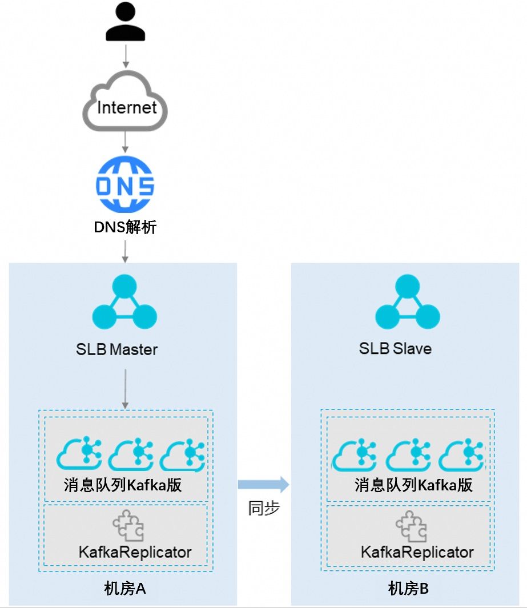

架构说明：

- 在机房A和机房B机房分别部署对等的消息队列Kafka版和KafkaReplicator数据库集群。

- 同步组件KafkaReplicator使机房A的数据可以同步到机房B，保证数据的一致性。

- 机房A故障时，业务切换至机房B，业务继续使用已有域名无需更换。

**使用限制**

同城容灾集群创建后，应用客户端需要修改一次访问地址，将VIP地址修改为容灾集群的域名，否则进行容灾切换时无法连接容灾集群。

<a id="section-2-9-2"></a>

### 2.9.2. 创建容灾集群

本文介绍如何通过消息队列Kafka版实例创建容灾集群、搭建主备关系以提供容灾能力。

**前提条件**

实例列表中已存在两个消息队列Kafka版实例，一个作为生产环境使用，一个作为容灾环境使用，且实例所在集群已部署同步组件KafkaReplicator。如果不存在，请联系部署人员部署。

1. 登录消息队列Kafka版控制台。

2. 在左侧导航栏，单击**容灾集群列表**。

3. 在**容灾**页面，单击**创建容灾集群**。

4. 在配置向导页面，依次完成以下操作。

   <ol type="i">

   <li>

   在**配置基本信息**页面，配置以下信息后单击**下一步**。

   <table>
     <tr>
       <th width="121">参数</th>
       <th>描述</th>
     </tr>
     <tr>
       <td>容灾集群名称</td>
       <td>创建的容灾集群的名称。<br>说明您设置容灾集群名称时，请注意有以下要求：<br>• 容灾集群名称只能包含字母，数字和短划线 (-) 。<br>• 容灾集群名称长度限制在3-20个字符之间，长于20字符将被自动截取。<br>• 容灾集群创建成功后，容灾集群名称不可修改。</td>
     </tr>
   </table>

   </li>

   <li>

   在**配置源服务**页面，选择源实例信息，配置完成后单击**下一步**。

   | 参数 | 描述 |
   | --- | --- |
   | 源Kafka实例 | 选择源Kafka实例。 |
   | 源KafkaReplicator实例 | 选择源KafkaReplicator实例。 |
   | 同步起始位点 | 选择同步起始位点，可选<strong>最早点位</strong>、<strong>最近点位</strong>和<strong>指定时间</strong>。 |
   | 时间点 | 选择日期和时间。<br>说明此选项仅在<strong>同步起始位点</strong>选择<strong>指定时间</strong>时出现。 |
   | 同步限流 | 如果不需要对容灾实例数据的同步过程进行限流则填<code> 0 </code>。单位MB/s。 |

   </li>

   <li>

   在**配置目标服务**页面，配置目标实例信息，配置完成后单击**创建**。

   </li>

   </ol>

   在**容灾集群列表**的容灾集群列表页面，显示已创建的容灾集群。

   > **说明**
   >
   > 已经创建容灾集群的实例，不支持再次作为源实例或者目标实例创建容灾集群。

**切换容灾集群**

当主集群发生故障时，可以将主集群业务切换至备集群，确保业务正常。

> **重要**
>
> 切换过程中，会涉及网络切换，客户端会出现短时间内连接断开，请您确认切换后再操作。

1. 登录消息队列Kafka版控制台。

2. 在左侧导航栏，单击**容灾集群列表**。

3. 在**容灾**页面，目标容灾集群所在行的**操作**列，单击**容灾切换**。

4. 在**容灾切换**对话框中，选择切换的目标Kafka主集群，单击**确定**。

**删除容灾集群**

当不再需要容灾能力时，可以删除容灾集群。

> **重要**
>
> 删除容灾集群后，运行中的同步任务将停止并同步删除，主备集群无容灾能力，删除操作不可恢复，请谨慎操作。

1. 登录消息队列Kafka版控制台。

2. 在左侧导航栏，单击**容灾集群列表**。

3. 在**容灾**页面，目标容灾集群所在行的**操作**列，单击**删除**。

4. 在**删除集群**对话框中，单击**确认**。

<a id="section-2-9-3"></a>

### 2.9.3. 管理Replicators

本文介绍如何通过控制台创建并查看Replicators。

**背景信息**

为了解决容灾场景中增量Replicator需要先进行规划再进行部署的繁琐流程，目前云消息队列Kafka版支持通过控制台动态创建和管理Replicator。

**注意事项**

Replicator 所需资源较大，一般需要16C32G及以上。当前版本仅支持在多可用区场景下使用。

**创建Replicator**

1. 登录消息队列Kafka版控制台。

2. 在左侧导航栏，单击**Replicators**。

3. 在**Replicators**页面，单击**创建Replicator**。

4. 在**创建Replicator**窗口，配置以下选项，而后单击**确定**。

   | 参数 | 说明 |
   | --- | --- |
   | 可用区 | 选择Replicator的可用区。 |
   | 用途 | 选择Replicator的用途。 |

**查看Replicator**

1. 登录消息队列Kafka版控制台。

2. 在左侧导航栏，单击**Replicators**。

3. 在**Replicators**页面，可查看已创建的Replicator列表及相关信息，包括**Replicator ID**、**地域**、**可用区**、**是否动态创建**、**状态**和**用途**。

4. （可选）您也可以在列表上方的搜索框内输入目标Replicator ID以实现快速查找。

5. （可选）您也可单击目标Replicator右侧**操作**列的**详情**以查看Replicator的相关Key值。

   支持查看的Key值包括cluster1、bootstrapServers1、targetCluster、bootstrapServers2、autoOffsetReset、cluster2、timestamp。

<a id="section-2-10"></a>

## 2.10. 数据迁移

<a id="section-2-10-1"></a>

### 2.10.1. 迁移上云

<a id="section-2-10-1-1"></a>

#### 2.10.1.1. 迁移Topic和Group数据上云

本文介绍如何使用阿里云提供的Kafka数据迁移工具，从您自建的开源版本Kafka向阿里云上的Kafka实例迁移Topic和Group数据。

**通过元数据文件迁移上云**

您可以使用 `kafka-migration.jar` 工具和自建 Kafka 集群导出的元数据文件，在阿里云消息队列 Kafka版实例上自动创建topic和group。

**前提条件**

- 下载 `kafka-migration.jar` 工具到您需要进行数据迁移的自建Kafka环境。

  - kafka-migration.jar

- 导出您自建 Kafka 集群的元数据文件。

**启动迁移**

**Topic迁移**

1. 获取目标云消息队列Kafka版实例的pop域名：在目标云消息队列Kafka版实例的kafka console pod中执行 `env |grep kafka` 命令，实例pop域名为参数 `kafka_pop_domain` 对应的值。

   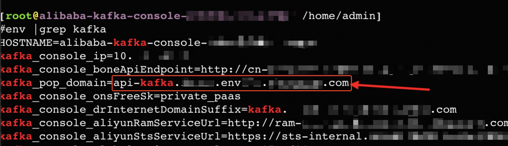

2. 在您自建的Kafka环境中运行以下命令，启动迁移。运行代码前请按照下文所示的参数说明将命令中的相关参数修改为您自己的值。

   ```text
   java -jar kafka-migration.jar TopicMigrationFromMetadata \
   --fileName metadata.json \
   --endpoint ggggg \
   --destAk hhhh \
   --destSk kkkk \
   --destRegionId llll \
   --destInstanceId iiii \
   --commit
   ```

   | 参数 | 说明 | 示例 |
   | --- | --- | --- |
   | <code>--fileName</code> | 导出元数据的文件名。如果不指定，则文件名称默认为：<code> kafka-metadata-</code><code>export.json </code>。 | <code>metadata.json</code> |
   | <code>--endpoint</code> | 目标云消息队列Kafka版实例的pop域名。 | <code>api-</code><br><code>kafka.inter.env1.shuguang.</code><br><code>com</code> |
   | <code>--destAk</code> | 目标云消息队列Kafka版实例所属阿里云账号的AccessKey ID。 | <code>zNYXZmCqIchtIKr</code> |
   | <code>--destSk</code> | 目标云消息队列Kafka版实例所属阿里云账号的AccessKey Secret。 | <code>HwMYEcd1j3EqSiLkSGV6Bu8dM</code><br><code>cK</code> |
   | <code>--destRegionId</code> | 目标云消息队列Kafka版实例的地域ID。 | <code>cn-hangzhou</code> |
   | <code>--destInstanceId</code> | 目标云消息队列Kafka版实例的ID。 | <code>cluster-snje0r</code> |
   | <code>--commit</code> | 提交运行。 | <code>commit</code> |

**Group迁移**

1. 获取目标云消息队列Kafka对应Topic的接入点：进入任意一个目标云消息队列Kafka对应的实例集群，执行 `hostname -i` 命令， `bootstrapServers` 的值为 目标`IP:9092` 。

   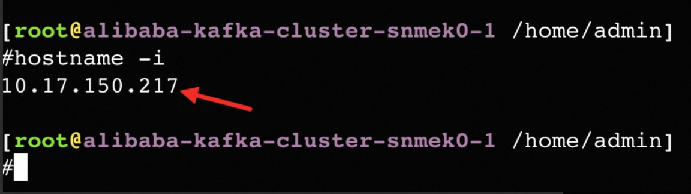

2. 在您自建的Kafka环境中运行以下命令，启动迁移。运行代码前请按照下文所示的参数说明将命令中的相关参数修改为您自己的值。

   ```text
   java -jar kafka-migration.jar ConsumerGroupMigrationFromMetadata \
   --fileName metadata.json \
   --bootstrapServers ggggg \
   --commit
   ```

   | 参数 | 说明 | 示例 |
   | --- | --- | --- |
   | <code>--fileName</code> | 导出元数据的文件名。如果不指定，则文件名称默认为：<code> kafka-metadata-</code><code>export.json </code>。 | <code>metadata.json</code> |
   | <code>--</code><br><code>bootstrapServers</code> | 目标云消息队列Kafka对应Topic的接入点。 | <code>10.17.150.217:9092</code> |
   | <code>--commit</code> | 提交运行。 | <code>commit</code> |

**查看迁移进度**

**查看迁移 Topic 进度**

执行启动迁移命令后，您可以通过以下区域查看各Topic迁移的进度。

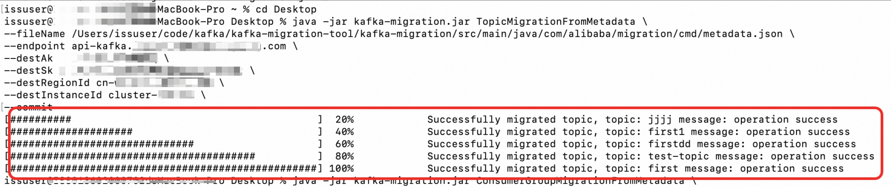

**查看迁移 Group 进度**

执行启动迁移命令后，您可以通过以下区域查看各Group迁移的进度。

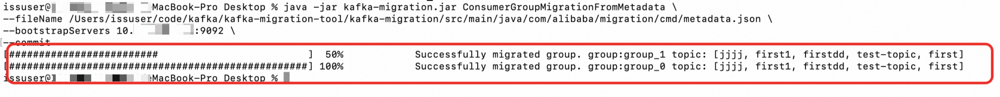

**验证迁移结果**

1. 登录消息队列Kafka版控制台。

2. 在左侧导航栏，单击**实例列表**。

3. 在**实例列表**页面，找到目标实例，单击目标实例名称，或其右侧**操作**列的**详情**。

4. 单击**Topic管理**或**Group管理**页签，并在对应的**Topic列表**或**Group列表**中查看已创建的Topic或Group。

**常见问题**

**Q1：如果在迁移Topic的过程中发现迁移的Topic已经存在，会发生什么？**

迁移Topic失败并遇到如下报错，显示该Topic已经存在。

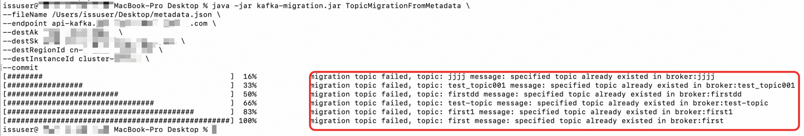

**Q2：如果在迁移Topic的过程中发现 endpoint 填写错误，会发生什么？**

迁移Topic失败并遇到如下报错。

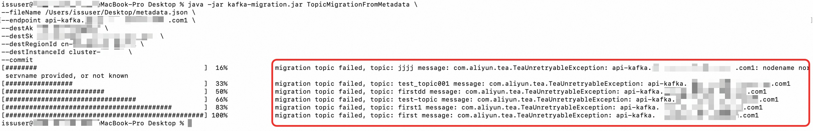

**Q3：如果在迁移Topic的过程中发现 AccessKey ID 和 AccessKey Secret填写错误，会发生什么？**

迁移Topic失败并遇到如下报错。

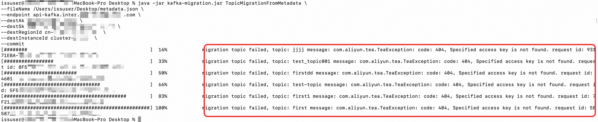

**Q4：如果在迁移Topic的过程中发现 destRegionId 或 destInstanceId 填写错误，会发生什么？**

迁移Topic失败并遇到如下报错，提示找不到目标实例或目标实例未在运行。


**Q5：如果在迁移Topic的过程中发现 metadata.json 文件不存在，会发生什么？**

迁移Topic失败并遇到如下报错，提示读取文件失败。

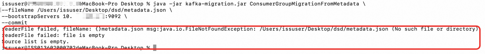

**Q6：如果在迁移Group的过程中发现 bootstrapServers 填写错误，会发生什么？**

迁移Group失败并遇到如下报错，提示您检查bootstrapServers是否填写正确。

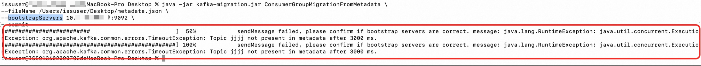

<a id="section-2-10-2"></a>

### 2.10.2. 云上迁移

<a id="section-2-10-2-1"></a>

#### 2.10.2.1. 通过控制台进行云上迁移

本文介绍如何通过消息队列Kafka版控制台，将业务从一个专有云消息队列 Kafka 版实例迁移至另一个专有云消息队列 Kafka 版实例。

**操作步骤**

1. 登录消息队列Kafka版控制台。

2. 在左侧导航栏，单击**消息路由**。

3. 在**消息路由**页面，单击**任务**页签。

4. 单击**创建同城任务**，配置以下信息后，单击**确定**。

   <table>
     <tr>
       <th colspan="2">参数</th>
       <th>说明</th>
     </tr>
     <tr>
       <td rowspan="2">消息源</td>
       <td>源实例</td>
       <td>选择源云消息队列 Kafka 版实例。</td>
     </tr>
     <tr>
       <td>类型</td>
       <td>选择迁移任务类型，支持选择：<br>• 实例迁移<br>• topic迁移</td>
     </tr>
     <tr>
       <td rowspan="2">消息目标</td>
       <td>目标实例</td>
       <td>选择目标云消息队列 kafka 版实例。</td>
     </tr>
     <tr>
       <td>目标Replicator</td>
       <td>选择目标Replicator。</td>
     </tr>
     <tr>
       <td colspan="2">同步起始位点</td>
       <td>选择同步起始位点，支持选择：<br>• 最早点位<br>• 最近点位<br>• 指定时间</td>
     </tr>
   </table>

   <table>
     <tr>
       <td>限流</td>
       <td>设置容灾实例数据同步过程的限流规则，单位：MB/s。<br>说明如果不需要对容灾实例数据的同步过程进行限流，则填0。</td>
     </tr>
     <tr>
       <td>描述</td>
       <td>输入描述。</td>
     </tr>
   </table>

5. 任务创建完成后，您可以在**任务**页签的任务列表中查看已创建同城任务的基本信息和状态。

<a id="section-2-10-2-2"></a>

#### 2.10.2.2. 通过Kafka数据迁移工具进行云上迁移

本文介绍如何使用阿里云提供的Kafka数据迁移工具，将业务从一个专有云消息队列 Kafka 版实例迁移至另一个专有云消息队列 Kafka 版实例。

**云上kafka元数据和数据迁移**

您可以使用提供的 `kafka-migration-assessment.jar` 工具和云kafka实例自带的 `kafka-mirror-maker.sh`  工具，在阿里云消息队列 Kafka 版实例完成元数据和数据的迁移。

**前提条件**

- 下载 `kafka-migration-assessment.jar` 工具到需要迁移到的目标云消息队列 kafka 集群。

  - kafka-migration-assessment.jar

**启动迁移**

**元数据迁移（Topic 和Group）**

1. 将下载好的迁移工具上传至 **目标云消息队列 kafka 集群** 。示例如下：

```bash
# 将迁移⼯具上传到云消息队列kafka实例main容器中
kubectl cp /apsarapangu/disk4/tmp/xtermupload/kafka-migration-assessment.jar alibaba-kafka-cluster-s****-0:/home/admin -c main
# 进入⽬标云消息队列kafka实例main容器
kubectl exec -it alibaba-kafka-cluster-s****-0 -c main -- bash
```

2. 在迁移工具所在的目录上运行以下命令，赋予 JAR 包可执行权限。

```bash
chmod 777 kafka-migration-assessment.jar
```

3. 工具参数说明：

| 参数 | 说明 | 示例 |
| --- | --- | --- |
| <code>--</code><br><code>sourceAk</code> | 源云消息队列 Kafka 版实例所属阿里云账号的AccessKey ID。 | <code>0J*********</code> |
| <code>--</code><br><code>sourceSk</code> | 源云消息队列 Kafka 版实例所属阿里云账号的AccessKey Secret。 | <code>h7*****************</code> |
| <code>--</code><br><code>sourceRegio</code><br><code>nId</code> | 源云消息队列 Kafka 版实例的地域 ID。 | <code>cn-hangzhou</code> |
| <code>--</code><br><code>sourceInsta</code><br><code>nceId</code> | 源云消息队列 Kafka 版实例的 ID。 | <code>cluster-s***qu</code> |
| <code>--</code><br><code>sourceEndpo</code><br><code>int</code> | kafka-console 容器的<code> kafka_pop_domain </code> 环境变量。 | <code>api-</code><br><code>kafka.inter.env**.sh****.com</code> |
| <code>--</code><br><code>destAk</code> | 目标云消息队列 Kafka 版实例所属阿里云账号的AccessKey ID。 | <code>ER*********</code> |
| <code>--</code><br><code>destSk</code> | 目标云消息队列 Kafka 版实例所属阿里云账号的AccessKey Secret。 | <code>Ut*****************</code> |
| <code>--</code><br><code>destRegionI</code><br><code>d</code> | 目标云消息队列 Kafka 版实例的地域 ID。 | <code>cn-hangzhou</code> |
| <code>--</code><br><code>destInstanc</code><br><code>eId</code> | 目标云消息队列 Kafka 版实例的 ID。 | <code>cluster-s***ty</code> |
| <code>--</code><br><code>destEndpoin</code><br><code>t</code> | kafka-console 容器的<code> kafka_pop_domain </code>环境变量。 | <code>api-</code><br><code>kafka.inter.env**.sh****.com</code> |
| <code>--</code><br><code>search</code> | 指定迁移的 topic 或 group。 | <code>topic1,topic2,topic3</code> |
| <code>--</code><br><code>commit</code> | 提交运行。 | <code>commit</code> |
| <code>--</code><br><code>destBootstr</code><br><code>apServers</code> | 目标云消息队列 Kafka 对应 Topic 的接入点。 | <code>localhost:9092</code> |

**云上 Topic 迁移**

**步骤一：执行 Topic 迁移评估**

```text
java -jar kafka-migration-assessment.jar TopicMigrationFromAliyun \
--sourceAk 0J********* \
--sourceSk h7***************** \
--sourceRegionId cn-w****-env**-d01 \
--sourceInstanceId cluster-s**** \
--sourceEndpoint api-kafka.inter.env**.sh****.com \
--destAk ER********* \
--destSk Ut***************** \
--destRegionId cn-w****-env**-d01 \
--destInstanceId cluster-s**** \
--destEndpoint api-kafka.inter.env**.sh****.com
```

存在  `--search`  参数时，可指定 topic 进行迁移评估，不存在此参数时，默认针对所有 topic。

```text
java -jar kafka-migration-assessment.jar TopicMigrationFromAliyun \
--sourceAk 0J********* \
--sourceSk h7***************** \
--sourceRegionId cn-w****-env**-d01 \
--sourceInstanceId cluster-s**** \
--sourceEndpoint api-kafka.inter.env**.sh****.com \
--destAk ER********* \
--destSk Ut***************** \
--destRegionId cn-w****-env**-d01 \
--destInstanceId cluster-s**** \
--destEndpoint api-kafka.inter.env**.sh****.com \
--search topic1,topic2,topic3,topic4
```

评估结果如下：

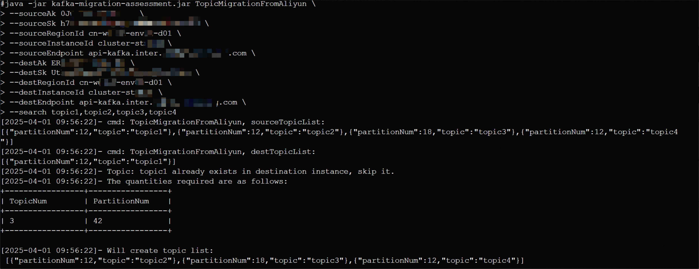

确认评估结果无问题后，可执行topic迁移命令。

**步骤二：执行 Topic 迁移**

根据  `--search`  参数，指定 topic 进行迁移。

```text
java -jar kafka-migration-assessment.jar TopicMigrationFromAliyun \
--sourceAk 0J********* \
--sourceSk h7***************** \
--sourceRegionId cn-w****-env**-d01 \
--sourceInstanceId cluster-s**** \
--sourceEndpoint api-kafka.inter.env**.sh****.com \
--destAk ER********* \
--destSk Ut***************** \
--destRegionId cn-w****-env**-d01 \
--destInstanceId cluster-s**** \
--destEndpoint api-kafka.inter.env**.sh****.com \
--search topic1,topic2,topic3,topic4 \
--commit
```

迁移结果展示：

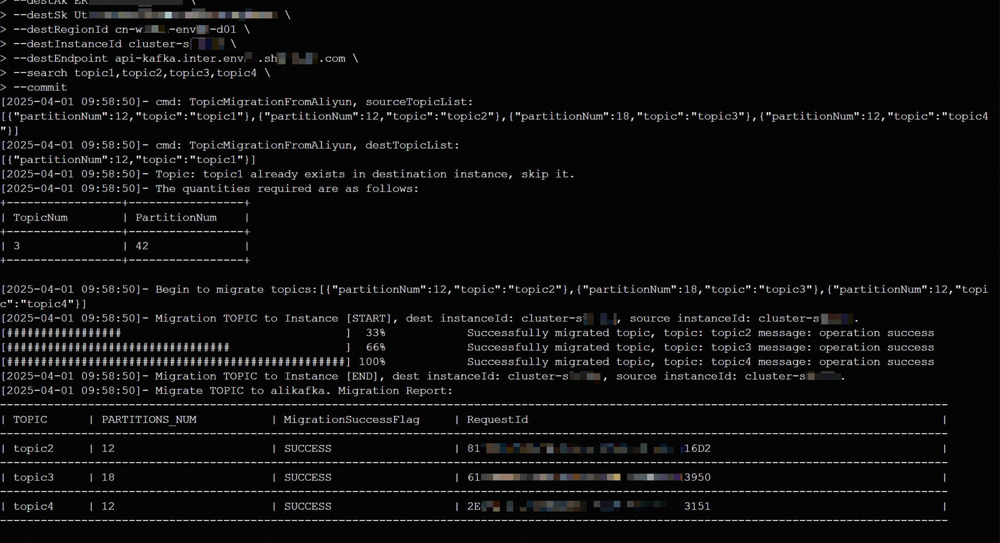

**步骤三：验证迁移结果**

迁移完成后，您可以导航至目标实例的Topic管理页签，在Topic列表中查看已创建的Topic。

1. 登录消息队列Kafka版控制台。

2. 在左侧导航栏，单击**实例列表**。

3. 在**实例列表**页面，找到目标实例，单击目标实例名称，或其右侧**操作**列的**详情**。

4. 在**实例详情**页面，单击**Topic管理**页签。

5. 在**Topic管理**页面，查看Topic列表及Topic的基本信息，包括：Topic名称、实例、服务状态。

**常见问题**

**Q1：迁移过程中源实例的 topic 在目标实例中都存在时，会跳过迁移吗？**

是的。

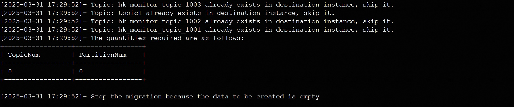

**云上 Consumer Group 迁移**

**步骤一：执行 group 迁移评估**

```text
java -jar kafka-migration-assessment.jar ConsumerGroupMigrationFromAliyun \
--sourceAk 0J********* \
--sourceSk h7***************** \
--sourceRegionId cn-w****-env**-d01 \
--sourceInstanceId cluster-s**** \
--sourceEndpoint api-kafka.inter.env**.sh****.com \
--destAk ER********* \
--destSk Ut***************** \
--destRegionId cn-w****-env**-d01 \
--destInstanceId cluster-s**** \
--destEndpoint api-kafka.inter.env**.sh****.com \
--destBootstrapServers localhost:9092 \
--search group1,group2,group3
```

评估结果如下：

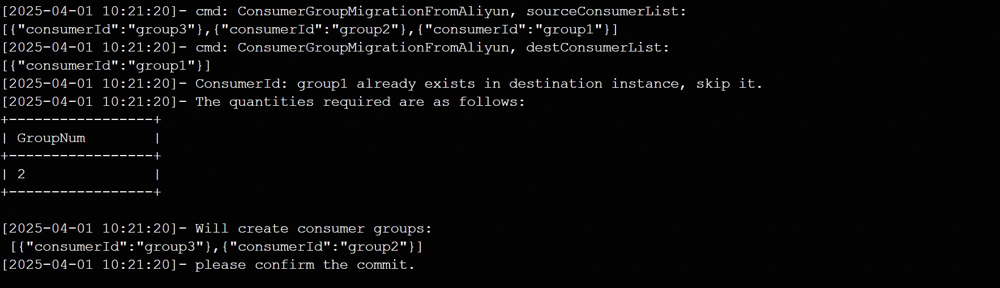

确认评估结果无问题后，可以执行 group 迁移命令。

**步骤二：执行 group 迁移**

```text
java -jar kafka-migration-assessment.jar ConsumerGroupMigrationFromAliyun \
--sourceAk 0J********* \
--sourceSk h7***************** \
--sourceRegionId cn-w****-env**-d01 \
--sourceInstanceId cluster-s**** \
--sourceEndpoint api-kafka.inter.env**.sh****.com \
--destAk ER********* \
--destSk Ut***************** \
--destRegionId cn-wulan-env82-d01 \
--destInstanceId cluster-s**** \
--destEndpoint api-kafka.inter.env**.sh****.com \
--destBootstrapServers localhost:9092 \
--search group1,group2,group3 \
--commit
```

迁移结果展示：

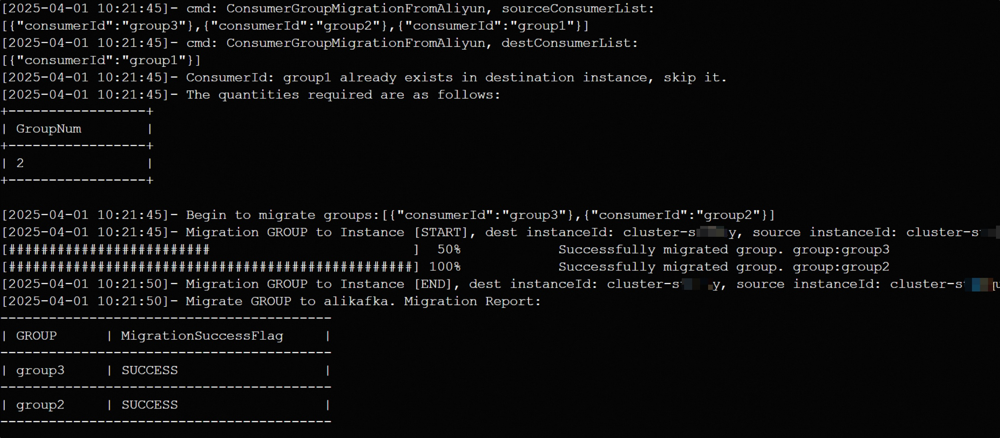

**步骤三：验证迁移结果**

迁移完成后，您可以导航至目标实例的Group管理页签，在Group列表中查看已创建的Group。

1. 登录消息队列Kafka版控制台。

2. 在左侧导航栏，单击**实例列表**。

3. 在**实例列表**页面，找到目标实例，单击目标实例名称，或其右侧**操作**列的**详情**。

4. 在**实例详情**页面，单击**Group管理**页签。

5. 在**Group管理**页面，查看Consumer Group列表。

**云上迁移数据**

kafka-mirror-maker 工具通过消费者（Consumer）从源云消息队列kafka版实例拉取数据，并通过生产者（Producer）将数据高效、可靠地传输至目标云消息队列 kafka 版实例中。

**准备数据迁移配置文件**

进入**目标云消息队列 kafka 集群**，准备如下配置文件 migrationProducer.properties、migrationConsumer.properties。

- migrationProducer.properties 文件内容：

```text
## ⽬标kafka集群的接入点(PLAINTEXT)
bootstrap.servers=ip:port

## 数据压缩⽅式
compression.type=none
```

- migrationConsumer.properties 文件内容：

```text
## 源kafka集群的接入点(PLAINTEXT)
bootstrap.servers=ip:port

## 消费者分区分配策略
partition.assignment.strategy=org.apache.kafka.clients.consumer.RoundRobinAssignor

## Group的名称，使⽤未创建过的group进⾏数据迁移
group.id=test-consumer-group

# 没有提交过offset，从最早数据开始同步
auto.offset.reset=earliest
```

**数据迁移工具使用**

- 工具位置：进入云消息队列 kafka 版容器中，位于 `/home/admin/KafkaProxy/bin` 目录下。

- **完成 topic 迁移后**，执行以下命令开始数据迁移。

```text
./kafka-mirror-maker.sh --consumer.config ../config/migrationConsumer.properties --producer.config ../config/migrationProducer.properties --whitelist 'topic1|topic2|topic3'
```

| 参数 | 说明 | 示例 |
| --- | --- | --- |
| <code>--</code><br><code>consumer.config</code> | 指定消费者配置文件（连接源集群的配置信息）。 | ../config/migrationConsumer.properties |
| <code>--</code><br><code>producer.config</code> | 指定生产者配置文件（连接目标集群的配置信息）。 | ../config/migrationProducer.properties |
| <code>--whitelist</code> | 白名单，通过正则表达式指定要复制的主题。 | <code>"topic1&#124;topic2&#124;topic3"</code> |

**数据迁移结果验证**

1. 在目标云消息队列 kafka 版实例的Group 管理页签，查看是否存在配置的  `group.id` 。

2. 查看Group的消费状态和Topic的消费详情。详细步骤，请参考查看Consumer Group消费状态。

3. 在云消息队列 Kafka 版控制台中查看对应 Topic 的分区状态，确认云消息队列 kafka 实例上 topic 的消息数量是否正确。详细步骤，请参考查看Topic分区状态。

**常见问题**

**Q1：如何关闭执行中的迁移脚本？**

- 若在脚本执行命令行下，按 Ctrl+C 退出脚本执行即可。

- 若不在脚本执行命令行下，可查看并杀死进程，方法如下：

```text
ps -ef | grep "kafka.tools.MirrorMaker"
```

杀死进程：

```text
kill -9  xxx
```

<a id="section-3"></a>

# 3.Pod命令操作指南

<a id="section-3-1"></a>

## 3.1. 命令验证

<a id="section-3-1-1"></a>

### 3.1.1. 创建Topic

本文介绍如何创建Topic。

**前提条件**

获取部署平台的Master节点信息。

**操作步骤**

1. 进入部署平台的Master节点。

2. 执行命令 `kubectl exec -it <pod> bash` 进入部署了消息队列Kafka版的Pod。例如Pod的名称为 `alibaba-kafka-cluster-private-paas-default-0` ，则执行命令 `kubectl exec -it alibaba-kafka-cluster-private-paas-default-0 bash` 。

3. 执行命令 `sudo su admin` 切换成管理员账号。

4. 执行命令 ``sh /home/admin/KafkaProxy/bin/kafka-topics.sh --create --bootstrap-server `hostname -i`:9092 --topic test --replication-factor 3 --partitions 12`` 创建Topic。

**执行结果**

执行命令 ``sh /home/admin/KafkaProxy/bin/kafka-topics.sh --list --bootstrap-server `hostname -i`:9092`` 查看Topic列表。

Topic列表返回示例如下：

```text
__consumer_offsets
test
```

> ___consumer_offsets为自动创建的Topic，用于存储每个Topic提交的位点信息。
>
> **说明**

<a id="section-3-1-2"></a>

### 3.1.2. 发送消息

本文介绍如何向Topic发送消息。

**前提条件**

获取部署平台的Master节点信息。

**背景信息**

消息队列Kafka版支持通过PLAINTEXT协议发送消息。

**PLAINTEXT协议**

1. 进入部署平台的Master节点。

2. 执行命令 `kubectl exec -it <pod> bash` 进入部署了消息队列Kafka版的Pod。例如Pod的名称为 `alibaba-kafka-cluster-private-paas-default-0` ，则执行命令 `kubectl exec -it alibaba-kafka-cluster-private-paas-default-0 bash` 。

3. 执行命令 `sudo su admin` 切换成管理员账号。

4. 使用PLAINTEXT协议的9092端口发送消息。

   - 执行命令 ``java -jar /home/admin/kafka-pkgs/KafkaChecker.jar send -s `hostname -i`:9092 -t test`` 直接发送消息。

   - 执行命令 ``java -Dlog4j.configuration=file:/home/admin/kafka-pkgs/log4j.properties -jar /home/admin/kafka-pkgs/KafkaChecker.jar send -s `hostname -i`:9092 -t test`` 开启Debug发送消息。

<a id="section-3-1-3"></a>

### 3.1.3. 消费消息

本文介绍如何从Topic消费消息。

**前提条件**

获取部署平台的Master节点信息。

**背景信息**

消息队列Kafka版支持通过PLAINTEXT协议消费消息。

**PLAINTEXT协议**

1. 进入部署平台的Master节点。

2. 执行命令 `kubectl exec -it <pod> bash` 进入部署了消息队列Kafka版的Pod。例如Pod的名称为 `alibaba-kafka-cluster-private-paas-default-0` ，则执行命令 `kubectl exec -it alibaba-kafka-cluster-private-paas-default-0 bash` 。

3. 执行命令 `sudo su admin` 切换成管理员账号。

4. 使用PLAINTEXT协议的9092端口消费消息。

   - 执行命令 ``sh /home/admin/KafkaProxy/bin/kafka-console-consumer.sh --from-beginning --topic test --group CID_test --bootstrap-server `hostname -i`:9092`` 使用脚本直接消费消息。

   - 执行命令 ``java -jar /home/admin/kafka-pkgs/KafkaChecker.jar consume -s `hostname -i`:9092 --offsetReset earliest --printAll true`` 使用Jar工具直接消费消息。

   - 执行命令 `java -Dlog4j.configuration=file:/home/admin/kafka-pkgs/log4j.properties -jar`

```text
/home/admin/kafka-pkgs/KafkaChecker.jar consume -s `hostname -i`:9092 --offsetReset 
```

`earliest --printAll true` 开启Debug日志消费消息。

<a id="section-3-2"></a>

## 3.2. Topic

<a id="section-3-2-1"></a>

### 3.2.1. 创建Topic

本文介绍如何创建Topic。

**前提条件**

获取部署平台的Master节点信息。

**操作步骤**

1. 进入部署平台的Master节点。

2. 执行命令 `kubectl exec -it <pod> bash` 进入部署了消息队列Kafka版的Pod。

   例如Pod的名称为 `alibaba-kafka-cluster-private-paas-default-0` ，则执行命令 `kubectl exec -it alibaba-kafka-cluster-private-paas-default-0 bash` 。

3. 执行命令 `sudo su admin` 切换成管理员账号。

4. 执行命令 ``sh /home/admin/KafkaProxy/bin/kafka-topics.sh --create --bootstrap-server `hostname -i`:9092 --topic test --replication-factor 3 --partitions 12`` 创建Topic。

**执行结果**

执行命令 ``sh /home/admin/KafkaProxy/bin/kafka-topics.sh --list --bootstrap-server `hostname -i`:9092`` 查看Topic列表。

Topic列表返回示例如下：

```text
__consumer_offsets
test
```

> ___consumer_offsets为自动创建的Topic，用于存储每个Topic提交的位点信息。
>
> **说明**

<a id="section-3-2-2"></a>

### 3.2.2. 查看Topic状态

本文介绍如何查看Topic状态。

**前提条件**

获取部署平台的Master节点信息。

**操作步骤**

1. 进入部署平台的Master节点。

2. 执行命令 `kubectl exec -it <pod> bash` 进入部署了消息队列Kafka版的Pod。例如Pod的名称为 `alibaba-kafka-cluster-private-paas-default-0` ，则执行命令 `kubectl exec -it alibaba-kafka-cluster-private-paas-default-0 bash` 。

3. 执行命令 `sudo su admin` 切换成管理员账号。

4. 执行命令 ``sh /home/admin/KafkaProxy/bin/kafka-topics.sh --describe --bootstrap-server `hostname -i`:9092 --topic test`` 查看Topic状态。Topic状态返回示例如下：

   ```text
   Topic:test      PartitionCount:12       ReplicationFactor:3     
   Configs:min.insync.replicas=1,flush.ms=1000,segment.bytes=268435456,retention.ms=864000
   ,flush.messages=10000,max.message.bytes=10000000,unclean.leader.election.enable=false
           Topic: test     Partition: 0    Leader: 1003    Replicas: 1003,1002,1001      
   Isr: 1001,1003,1002
           Topic: test     Partition: 1    Leader: 1002    Replicas: 1002,1001,1003      
   Isr: 1003,1002,1001
           Topic: test     Partition: 2    Leader: 1001    Replicas: 1001,1003,1002      
   Isr: 1003,1002,1001
           Topic: test     Partition: 3    Leader: 1003    Replicas: 1003,1001,1002      
   Isr: 1001,1003,1002
           Topic: test     Partition: 4    Leader: 1002    Replicas: 1002,1003,1001      
   Isr: 1003,1002,1001
           Topic: test     Partition: 5    Leader: 1001    Replicas: 1001,1002,1003      
   Isr: 1003,1002,1001
           Topic: test     Partition: 6    Leader: 1003    Replicas: 1003,1002,1001      
   Isr: 1001,1003,1002
           Topic: test     Partition: 7    Leader: 1002    Replicas: 1002,1001,1003      
   Isr: 1003,1002,1001
           Topic: test     Partition: 8    Leader: 1001    Replicas: 1001,1003,1002      
   Isr: 1003,1002,1001
           Topic: test     Partition: 9    Leader: 1003    Replicas: 1003,1001,1002      
   Isr: 1001,1003,1002
           Topic: test     Partition: 10   Leader: 1002    Replicas: 1002,1003,1001      
   Isr: 1003,1002,1001
           Topic: test     Partition: 11   Leader: 1001    Replicas: 1001,1002,1003      
   Isr: 1003,1002,1001
   ```

<a id="section-3-2-3"></a>

### 3.2.3. 查看分区的当前位点

当前位点指向消费者最近一次拉取消息时消息队列Kafka版已经发送的最后一条数据。本文介绍如何查看分区的当前位点。

**前提条件**

获取部署平台的Master节点信息。

**操作步骤**

1. 进入部署平台的Master节点。

2. 执行命令 `kubectl exec -it <pod> bash` 进入部署了消息队列Kafka版的Pod。例如Pod的名称为 `alibaba-kafka-cluster-private-paas-default-0` ，则执行命令 `kubectl exec -it alibaba-kafka-cluster-private-paas-default-0 bash` 。

3. 执行命令 `sudo su admin` 切换成管理员账号。

4. 执行命令 `java -jar /home/admin/kafka-pkgs/KafkaMetricChecker.jar object -o kafka.log:name=LogEndOffset,partition=<partition id>,topic=<topic>,type=Log` 查看分区的当前位点。例如Topic的名称为 `test` 、分区ID为 `9` ，则执行命令 `java -jar /home/admin/kafka-`

```text
pkgs/KafkaMetricChecker.jar object -o 
```

`kafka.log:name=LogEndOffset,partition=9,topic=test,type=Log` 。分区的当前位点返回示例如下：

```text
Value                                                            16761
```

<a id="section-3-2-4"></a>

### 3.2.4. 查看Topic列表

本文介绍如何查看Topic列表。

**前提条件**

获取部署平台的Master节点信息。

**操作步骤**

1. 进入部署平台的Master节点。

2. 执行命令 `kubectl exec -it <pod> bash` 进入部署了消息队列Kafka版的Pod。例如Pod的名称为 `alibaba-kafka-cluster-private-paas-default-0` ，则执行命令 `kubectl exec -it alibaba-kafka-cluster-private-paas-default-0 bash` 。

3. 执行命令 `sudo su admin` 切换成管理员账号。

4. 执行命令 ``sh /home/admin/KafkaProxy/bin/kafka-topics.sh --list --bootstrap-server `hostname -i`:9092`` 查看Topic列表。Topic列表返回示例如下：

   ```text
   CMDTest
   __consumer_offsets
   demo
   test
   test1
   test2
   ```

<a id="section-3-2-5"></a>

### 3.2.5. 增加Topic分区数

在创建Topic后，您可以增加Topic分区数。消息队列Kafka版不支持减少Topic分区数。如需减少Topic分区数，您可以删除Topic，然后重新创建Topic。

**前提条件**

获取部署平台的Master节点信息。

**操作步骤**

1. 进入部署平台的Master节点。

2. 执行命令 `kubectl exec -it <pod> bash` 进入部署了消息队列Kafka版的Pod。例如Pod的名称为 `alibaba-kafka-cluster-private-paas-default-0` ，则执行命令 `kubectl exec -it alibaba-kafka-cluster-private-paas-default-0 bash` 。

3. 执行命令 `sudo su admin` 切换成管理员账号。

4. 执行命令 ``sh /home/admin/KafkaProxy/bin/kafka-topics.sh -alter --bootstrap-server `hostname -i`:9092 --topic <topic> --partitions <total partition number>`` 增加Topic分区数。例如Topic的名称为test、已有分区数为12、要新增的分区数为6，则执行命令 `sh`

```text
/home/admin/KafkaProxy/bin/kafka-topics.sh -alter --bootstrap-server `hostname -i`:9092 
```

`--topic test --partitions 18` 。增加Topic分区数返回示例如下：

```text
Topic:test      PartitionCount:18       ReplicationFactor:3     
Configs:min.insync.replicas=1,flush.ms=1000,segment.bytes=268435456,retention.ms=864000
,flush.messages=10000,max.message.bytes=10000000,unclean.leader.election.enable=false
        Topic: test     Partition: 0    Leader: 1003    Replicas: 1003,1002,1001      
Isr: 1001,1003,1002
        Topic: test     Partition: 1    Leader: 1002    Replicas: 1002,1001,1003      
Isr: 1003,1002,1001
        Topic: test     Partition: 2    Leader: 1001    Replicas: 1001,1003,1002      
Isr: 1003,1002,1001
        Topic: test     Partition: 3    Leader: 1003    Replicas: 1003,1001,1002      
Isr: 1001,1003,1002
        Topic: test     Partition: 4    Leader: 1002    Replicas: 1002,1003,1001      
Isr: 1003,1002,1001
        Topic: test     Partition: 5    Leader: 1001    Replicas: 1001,1002,1003      
Isr: 1003,1002,1001
        Topic: test     Partition: 6    Leader: 1003    Replicas: 1003,1002,1001      
Isr: 1001,1003,1002
        Topic: test     Partition: 7    Leader: 1002    Replicas: 1002,1001,1003      
Isr: 1003,1002,1001
        Topic: test     Partition: 8    Leader: 1001    Replicas: 1001,1003,1002      
Isr: 1003,1002,1001
        Topic: test     Partition: 9    Leader: 1003    Replicas: 1003,1001,1002      
Isr: 1001,1003,1002
        Topic: test     Partition: 10   Leader: 1002    Replicas: 1002,1003,1001      
Isr: 1003,1002,1001
        Topic: test     Partition: 11   Leader: 1001    Replicas: 1001,1002,1003      
Isr: 1003,1002,1001
        Topic: test     Partition: 12   Leader: 1003    Replicas: 1003,1002,1001      
Isr: 1003,1002,1001
        Topic: test     Partition: 13   Leader: 1001    Replicas: 1001,1003,1002      
Isr: 1001,1003,1002
        Topic: test     Partition: 14   Leader: 1002    Replicas: 1002,1001,1003      
Isr: 1002,1001,1003
        Topic: test     Partition: 15   Leader: 1003    Replicas: 1003,1001,1002      
Isr: 1003,1001,1002
        Topic: test     Partition: 16   Leader: 1001    Replicas: 1001,1002,1003      
Isr: 1001,1002,1003
        Topic: test     Partition: 17   Leader: 1002    Replicas: 1002,1003,1001      
Isr: 1002,1003,1001
```

<a id="section-3-2-6"></a>

### 3.2.6. 修改Topic配置

当Topic的配置不满足要求时，您可以修改Topic配置。

**前提条件**

获取部署平台的Master节点信息。

**操作步骤**

1. 进入部署平台的Master节点。

2. 执行命令 `kubectl exec -it <pod> bash` 进入部署了消息队列Kafka版的Pod。例如Pod的名称为 `alibaba-kafka-cluster-private-paas-default-0` ，则执行命令 `kubectl exec -it alibaba-kafka-cluster-private-paas-default-0 bash` 。

3. 执行命令 `sudo su admin` 切换成管理员账号。

4. 执行命令 `cat /home/admin/kafka-config/server.properties | grep zookeeper.connect` 查看ZK连接。ZK连接返回示例如下：

   ```text
   zookeeper.connect=10.XX.XX.145:2188,10.XX.XX.143:2188,10.XX.XX.181:2188/kafka-private-clusters/cluster-private-paas-default
   zookeeper.connection.timeout.ms=36000
   ```

5. 执行命令 `sh /home/admin/KafkaProxy/bin/kafka-configs.sh --zookeeper <zk connect> --describe --entity-name <topic> --entity-type topics` 查看Topic配置。例如ZK连接为 `10.XX.XX.183:2188,10.XX.XX.182:2188,10.XX.XX.181:2188/kafka-private-clusters/cluster-private-paas-default` 、Topic的名称为 `test` ，则执行命令 `sh`

```text
/home/admin/KafkaProxy/bin/kafka-configs.sh --zookeeper 
```

```text
10.XX.XX.183:2188,10.XX.XX.182:2188,10.XX.XX.181:2188/kafka-private-clusters/cluster-
```

`private-paas-default --describe --entity-name test --entity-type topics` 。查看Topic配置返回示例如下：

```text
Configs for topic 'test' are 
retention.ms=86400000,min.insync.replicas=1,max.message.bytes=1000000
```

6. 执行命令 `sh /home/admin/KafkaProxy/bin/kafka-configs.sh -zookeeper <zk connect> --alter --add-config <config kv> --entity-name <topic> --entity-type topics` 修改Topic配置。例如ZK连接为 `10.XX.XX.183:2188,10.XX.XX.182:2188,10.XX.XX.181:2188/kafka-private-clusters/cluster-private-paas-default` 、Topic的名称为 `test` 、最大消息大小为 `1000000` 、目标最大消息大小为 `10000000` ，则执行命令 `sh /home/admin/KafkaProxy/bin/kafka-configs.sh`

```text
-zookeeper 10.XX.XX.183:2188,10.XX.XX.182:2188,10.XX.XX.181:2188/kafka-private-
```

```text
clusters/cluster-private-paas-default --alter --add-config max.message.bytes=10000000 --
```

`entity-name test --entity-type topics` 。修改Topic配置返回示例如下：

```text
Completed Updating config for entity: topic 'test'.
```

<table>
  <tr>
    <th width="206">参数</th>
    <th>描述</th>
  </tr>
  <tr>
    <td>min.insync.replicas</td>
    <td>Topic的最小同步副本数。<br>• 最小同步副本数限制在1~3，建议为1。<br>• 最小同步副本数必须小于等于副本数。<br>• 最小同步副本数定义了判断消息写入成功所需的最小的确认消息的副本数量。当生产者将请求所需的消息确认设置为All或-1时，最小副本数才有意义。</td>
  </tr>
  <tr>
    <td>retention.ms</td>
    <td>Topic中的消息的保留时间。保留时间限制在1小时~168小时。</td>
  </tr>
  <tr>
    <td>max.message.bytes</td>
    <td>Topic能从Producer接收的消息的最大值。最大值限制在1 MB~10 MB。</td>
  </tr>
</table>

<a id="section-3-3"></a>

## 3.3. Consumer Group

<a id="section-3-3-1"></a>

### 3.3.1. 查看Consumer Group消费状态

本文介绍如何查看Consumer Group消费状态。

**前提条件**

获取部署平台的Master节点信息。

**操作步骤**

1. 进入部署平台的Master节点。

2. 执行命令 `kubectl exec -it <pod> bash` 进入部署了消息队列Kafka版的Pod。例如Pod的名称为 `alibaba-kafka-cluster-private-paas-default-0` ，则执行命令 `kubectl exec -it alibaba-kafka-cluster-private-paas-default-0 bash` 。

3. 执行命令 `sudo su admin` 切换成管理员账号。

4. 执行命令 ``sh /home/admin/KafkaProxy/bin/kafka-consumer-groups.sh --bootstrap-server `hostname -i`:9092 --group <group> --describe`` 查看Consumer Group消费状态。例如Consumer Group的名称为 `CID_test` ，则执行命令 ``sh /home/admin/KafkaProxy/bin/kafka-consumer-groups.sh --bootstrap-server `hostname -i`:9092 --group CID_test --describe`` 。Consumer Group消费状态返回示例如下：

   ```text
   Consumer group 'CID_test' has no active members.

   TOPIC           PARTITION  CURRENT-OFFSET  LOG-END-OFFSET  LAG             CONSUMER-ID
   HOST            CLIENT-ID
   test            6          16653           16653           0               -           
   -               -
   test            11         16740           16740           0               -           
   -               -
   test            10         16608           16608           0               -           
   -               -
   test            0          16735           16735           0               -           
   -               -
   test            7          16603           16603           0               -           
   -               -
   test            5          16772           16772           0               -           
   -               -
   test            8          16816           16816           0               -           
   -               -
   test            1          16712           16712           0               -           
   -               -
   test            4          16797           16797           0               -           
   -               -
   test            9          16761           16761           0               -           
   -               -
   test            3          16670           16670           0               -           
   -               -
   test            2          16516           16516           0               -           
   -               -
   ```

<a id="section-3-3-2"></a>

### 3.3.2. 查看Consumer Group列表

本文介绍如何查看Consumer Group列表。

**前提条件**

获取部署平台的Master节点信息。

**操作步骤**

1. 进入部署平台的Master节点。

2. 执行命令 `kubectl exec -it <pod> bash` 进入部署了消息队列Kafka版的Pod。例如Pod的名称为 `alibaba-kafka-cluster-private-paas-default-0` ，则执行命令 `kubectl exec -it alibaba-kafka-cluster-private-paas-default-0 bash` 。

3. 执行命令 `sudo su admin` 切换成管理员账号。

4. 执行命令 ``sh /home/admin/KafkaProxy/bin/kafka-consumer-groups.sh --list --bootstrap-server `hostname -i`:9092`` 查看Consumer Group列表。Consumer Group列表返回示例如下：

   ```text
   CID_test
   ```

<a id="section-3-4"></a>

## 3.4. 消息

<a id="section-3-4-1"></a>

### 3.4.1. 发送消息

本文介绍如何向Topic发送消息。

**前提条件**

获取部署平台的Master节点信息。

**背景信息**

消息队列Kafka版支持通过PLAINTEXT协议发送消息。

**PLAINTEXT协议**

1. 进入部署平台的Master节点。

2. 执行命令 `kubectl exec -it <pod> bash` 进入部署了消息队列Kafka版的Pod。例如Pod的名称为 `alibaba-kafka-cluster-private-paas-default-0` ，则执行命令 `kubectl exec -it alibaba-kafka-cluster-private-paas-default-0 bash` 。

3. 执行命令 `sudo su admin` 切换成管理员账号。

4. 使用PLAINTEXT协议的9092端口发送消息。

   - 执行命令 ``java -jar /home/admin/kafka-pkgs/KafkaChecker.jar send -s `hostname -i`:9092 -t test`` 直接发送消息。

   - 执行命令 ``java -Dlog4j.configuration=file:/home/admin/kafka-pkgs/log4j.properties -jar /home/admin/kafka-pkgs/KafkaChecker.jar send -s `hostname -i`:9092 -t test`` 开启Debug发送消息。

<a id="section-3-4-2"></a>

### 3.4.2. 消费消息

本文介绍如何从Topic消费消息。

**前提条件**

获取部署平台的Master节点信息。

**背景信息**

消息队列Kafka版支持通过PLAINTEXT协议消费消息。

**PLAINTEXT协议**

1. 进入部署平台的Master节点。

2. 执行命令 `kubectl exec -it <pod> bash` 进入部署了消息队列Kafka版的Pod。例如Pod的名称为 `alibaba-kafka-cluster-private-paas-default-0` ，则执行命令 `kubectl exec -it alibaba-kafka-cluster-private-paas-default-0 bash` 。

3. 执行命令 `sudo su admin` 切换成管理员账号。

4. 使用PLAINTEXT协议的9092端口消费消息。

   - 执行命令 ``sh /home/admin/KafkaProxy/bin/kafka-console-consumer.sh --from-beginning --topic test --group CID_test --bootstrap-server `hostname -i`:9092`` 使用脚本直接消费消息。

   - 执行命令 ``java -jar /home/admin/kafka-pkgs/KafkaChecker.jar consume -s `hostname -i`:9092 --offsetReset earliest --printAll true`` 使用Jar工具直接消费消息。

   - 执行命令 `java -Dlog4j.configuration=file:/home/admin/kafka-pkgs/log4j.properties -jar`

```text
/home/admin/kafka-pkgs/KafkaChecker.jar consume -s `hostname -i`:9092 --offsetReset 
```

`earliest --printAll true` 开启Debug日志消费消息。
