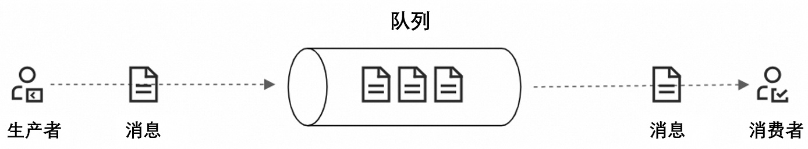
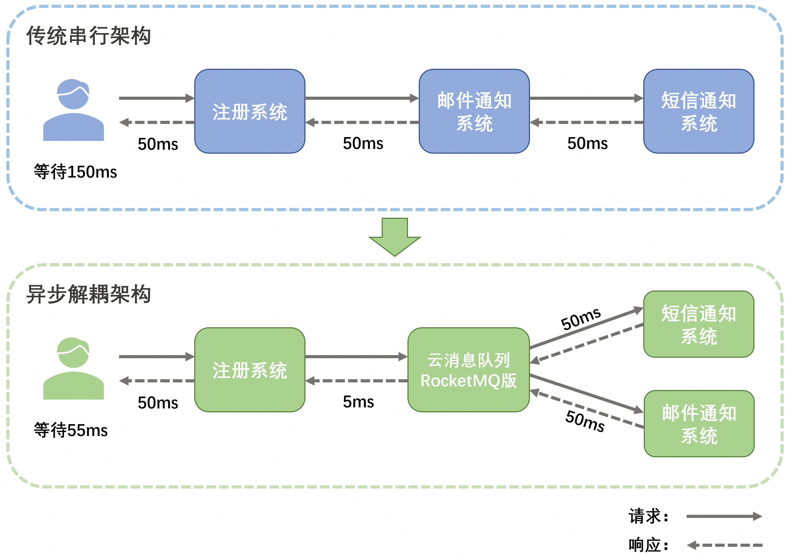
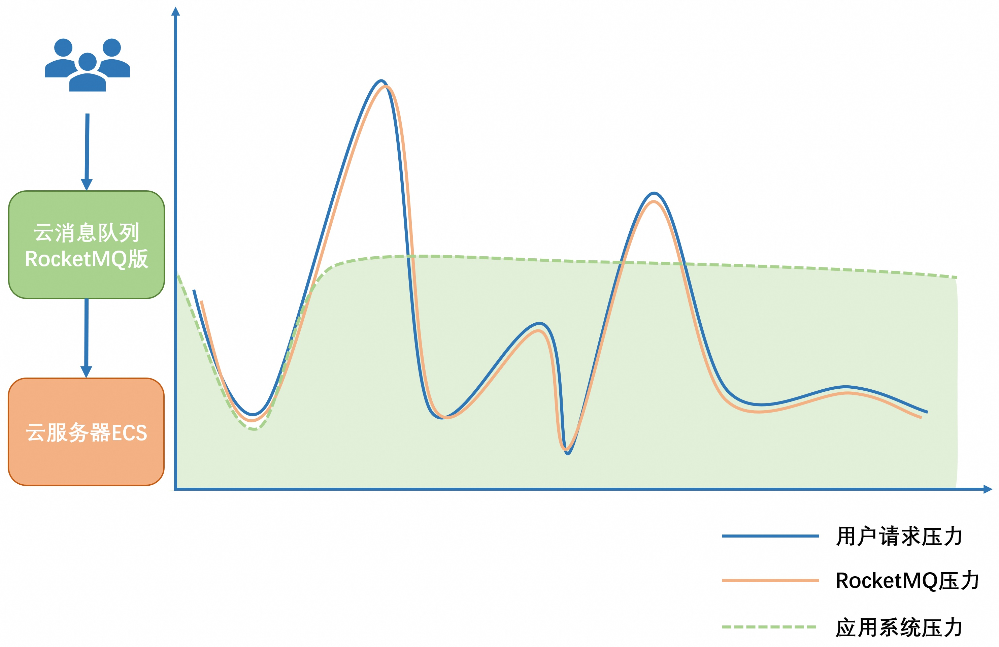
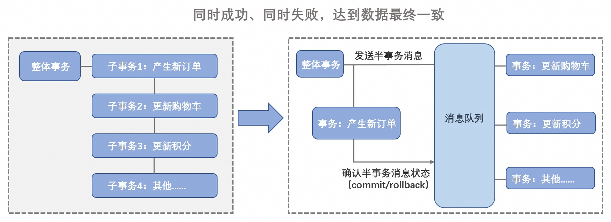
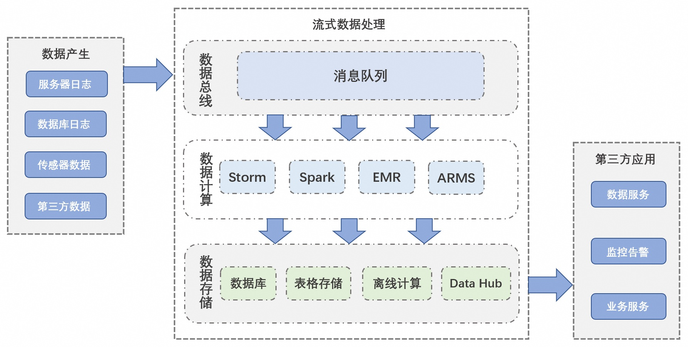
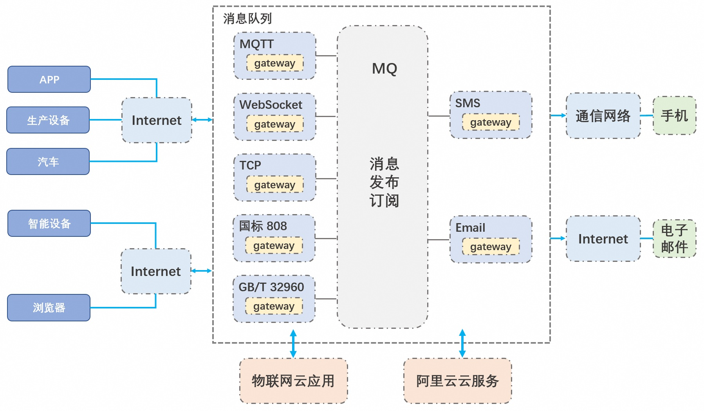
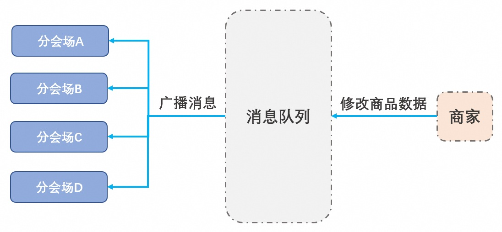

阿里云  
专有云  
消息队列 MQ  
产品简介  
产品版本：V3.18.6  
文档版本：20250730

**目录**

- [1.消息队列RocketMQ版](#section-1)
- [2.产品详情](#section-2)
- [3.产品价值](#section-3)
- [4.功能特性](#section-4)
- [5.应用场景](#section-5)

# 1.消息队列RocketMQ版

消息队列RocketMQ版（简称RocketMQ）是阿里云基于开源Apache RocketMQ构建的低延迟、高并发、高可用、高可靠的分布式消息中间件。

RocketMQ基于高可用分布式集群技术，提供消息订阅和发布、消息轨迹查询、定时（延时）消息、资源统计等一系列消息云服务，是企业级互联网架构的核心产品。RocketMQ为分布式应用系统提供异步解耦、削峰填谷的能力，同时具备海量消息堆积、高吞吐、可靠重试等互联网应用所需的特性，是支持阿里巴巴双11的核心产品。

RocketMQ目前提供TCP协议和HTTP协议层面的接入方式，支持Java、C++、.NET等多种编程语言，方便不同编程语言开发的应用快速接入RocketMQ消息云服务。

# 2.产品详情

本文介绍云消息队列的基本工作原理，以及RocketMQ的核心功能与技术特性。RocketMQ支持TCP协议和HTTP协议，并提供多种开发语言的接入方式，具备高性能和多副本机制以保障高可用性，还支持如消息轨迹、死信队列等企业级功能，以及多维度的运维和管理工具。

**云消息队列工作原理**

云消息队列的工作原理基于经典的消息队列模型，提供了一个分布式系统之间异步通信的中介层，主要涉及到生产者、消费者、消息和队列。

- <strong>生产者（Producers）：</strong>也称为发布者（Publishers），是发送消息到队列的应用程序或服务。

- <strong>消费者（Consumers）：</strong>也称为订阅者（Subscribers），是从队列中提取并处理消息的应用程序或服务。

- <strong>消息（Messages）：</strong>通信的基本单元，可以包含文本、二进制数据或结构化数据。

- <strong>队列（Queues）：</strong>用于存储消息的临时存储区。在点对点模型中，每条消息只能由一个消费者接收。在发布/订阅模型中，消息被分发到一个或多个订阅者。

云消息队列的一般工作流程如下：

1. 生产者创建消息并将其发送到消息队列中。

2. 消息队列服务确保消息的持久化，以防止系统故障导致数据丢失。

3. 消费者连接到消息队列，并根据需要或通过长轮询、推送机制等方式从队列中拉取或接收消息。

4. 消费者处理消息后，通常会发送一个确认（ACK），表示消息已成功处理，随后消息会从队列中删除以确保不会被重复处理。

云消息队列通过冗余存储和数据副本提高了可靠性，确保即使在部分系统故障的情况下，消息也不会丢失。服务通常可以自动缩放以适应负载变化，无需用户手动介入。

**核心功能与技术特性**

**生产者：消息类型与适用场景**

**消息类型**

- 普通消息：适用于异步通信，如日志采集、事件通知。

- 事务消息：保障业务操作与消息发送的原子性，如订单支付与库存扣减。

- 顺序消息：按业务维度（如订单ID）保证消息严格有序，如金融交易流水。

- 定时/延时消息：支持毫秒级延时投递，如订单超时关闭。

**核心能力**

- Topic分类：通过Topic划分业务逻辑，实现消息分发。

- Tag标签：细化消息分类，支持消费者按标签过滤。

- 批量发送：提升发送效率，降低网络开销。

**消费者：高效消费与可靠性保障**

- **消费模式**

  - 集群消费：消息仅被消费组内一个实例消费，适用于高吞吐场景（如订单处理）。

  - 广播消费：消息被消费组内所有实例重复消费，适用于全局通知场景（如配置下发）。

- **消费组（Consumer Group）**

  - 负载均衡：自动分配MessageQueue至消费组实例，实现并行消费。

  - 故障转移：broker宕机后自动迁移任务，保障消费连续性。

  - 水平扩展：通过增加broker数量提升消费能力。

- **消费点位（Offset）**

  - 支持重置消费点位：根据时间重置消费进度，允许用户进行消息回溯或者丢弃堆积消息。

- **推（Push）与拉（Pull）模式**

  - Push模式：broker主动推送，适用于实时性要求高的场景。

  - Pull模式：消费者主动拉取，适用于批量处理或低延迟场景。

- **消费保障**

  - 失败消息重试（最多16次），自动隔离至死信队列（DLQ）。

  - 消息过滤（Tag/SQL），减少无效处理。

**高性能与高可用架构**

- <strong>吞吐能力：</strong>单集群支持百万级TPS，毫秒级延迟，满足高并发业务需求。

- <strong>多副本机制：</strong>数据相互同步备份，支持跨地域容灾，保障可用性。

**企业级功能**

- <strong>协议接入：</strong>支持TCP协议和HTTP协议，提供Java、C/C++和.NET SDK等多种语言的SDK。

- <strong>消息轨迹：</strong>全链路跟踪消息流向，快速定位问题。

- <strong>死信队列：</strong>将无法正常消费的消息储存到特殊的死信队列以供后续处理，隔离消费失败的消息，避免阻塞正常流程。

- <strong>权限控制：</strong>支持基于VPC、RAM角色、IP白名单的多层安全防护，满足金融、医疗等行业的合规要求。

- <strong>异地多活：</strong>可购买RocketMQ异地多活增强组件，在项目存在MSHA产品的前提下，根据地域将业务划分到不同生产中心，各生产中心同时对外提供服务，并且数据相互同步备份，当其中一个生产中心故障时，可以通过MSHA切流将业务快速切换到其他容灾站点继续处理，实现业务的平滑迁移和快速恢复。

- <strong>资源报表：</strong>消息生产和消费数据的统计功能。通过该功能，用户可查询在一段时间范围内发送至某Topic的消息总量或者TPS（消息生产数据），也可查询在一个时间段内某Topic投递给某Group ID的消息总量或TPS（消息消费数据）。

**管理工具**

- <strong>Web控制台：</strong>支持Topic管理、Group管理、消息查询、消息轨迹、资源报表。

- <strong>OpenAPI：</strong>提供API允许客户将RocketMQ管理工具集成到自己的控制台。

- <strong>mqadmin命令集：</strong>专有云输出提供一套丰富的管理命令集，以命令方式对RocketMQ服务进行管理。

**专有云部署**

- <strong>灵活部署：</strong>支持专有云独立部署，同时支持混合云架构。

- <strong>运维管控：</strong>专有云支持mqadmin命令集、OpenAPI运维管理工具，方便管控平台集成以及统一运维。

# 3.产品价值

作为消息领域内一款专业级的消息中间件产品，RocketMQ具有高可靠、高可用、高性能等优势，并支持多种协议接入，支持独立部署。

**产品优势**

**专业**

- 消息领域业内专业的消息中间件，消息保证不丢，技术体系丰富成熟。

- 开源社区产品名为Apache RocketMQ；产品多次在国内外获奖。

- 阿里云内部1000多款核心应用使用，每天流转几千亿条消息，经过双11交易、商品等核心链路真实场景的验证，稳定可靠。

**高可靠**

- 一份消息多份落盘存储，经过严格的断电测试，消息依然保证不丢失。

- 允许海量消息堆积，单个Topic即使堆积100多亿条消息，系统高流量压力下依然可靠。

- 默认消息持久化存储3天，支持最多重置消费位点消费3天之内任何时间点的消息。

**高可用**

- 通过异地多活，实现故障场景下业务的快速平滑迁移，将业务恢复和故障恢复解耦，保障了业务连续性。

**高性能**

- 支持水平扩展。

- 支持最大4 MB消息（含消息属性）。

**支持多种协议**

- 提供TCP协议和HTTP协议层面的接入方式，支持Java、C++、.NET等多种编程语言。

**独立部署**

- 支持专有云独立输出，支持物理机部署，仅几台机器便可搭建完整消息云服务。

- 专有云配套mqadmin命令集和管理类OpenAPI ，方便运维人员实时监控系统状态。

- 支持混合云架构，允许通过专线的方式接入公有云服务。

**开源对比**

阿里云RocketMQ产品对比开源RocketMQ，在以下六个维度上具备更多优势：

| 分类 | 阿里云RocketMQ | 开源RocketMQ |
| --- | --- | --- |

<table>
  <tr>
    <td>安全</td>
    <td>• 持续修复安全漏洞（自动更新和补丁支持）。 • 各云产品共享一体化的阿里云账号权限体系。 • 多租户资源隔离能力。 • RAM/STS （子账号/角色扮演）等多种灵活的资源访问管理方式。 • API权限精细化控制。</td>
    <td>• 安全漏洞修复依赖社区，需用户主动更新。 • 基础ACL权限控制（无多租户隔离）。 • 需自行配置权限管理方案。 • API权限管理较弱，依赖用户自定义。</td>
  </tr>
  <tr>
    <td>稳定性</td>
    <td>• 产品问题快速修复（阿里云团队支持）。 • 支持多架构芯片处理器适配（如ARM、x86等）。 • 明确的性能容量指标，使每种芯片性能可量化。 • 成熟的运维变更方案（白屏化/自动化运维工具链）。</td>
    <td>• 依赖开源社区修复问题，响应时间较长。 • 芯片适配有限，主要支持主流架构。 • 性能指标需用户自行测试和优化。 • 运维经验依赖用户积累，缺乏现成方案。</td>
  </tr>
  <tr>
    <td>容灾能力</td>
    <td>• 支持同城容灾（双AZ对等/非对等容灾）。 • 具有备机房容灾供给能力。 • 异地多活架构支持（跨地域容灾）。 • 高可用集群自动切换与故障恢复机制。</td>
    <td>• 基础主从复制容灾（需用户自行搭建）。 • 跨机房容灾需依赖外部工具。 • 异地多活架构需用户自行设计和实现。 • 容灾方案复杂度高，依赖社区最佳实践。</td>
  </tr>
  <tr>
    <td>可观测性</td>
    <td>• 内置丰富的监控指标体系包含底层物理资源层、平台层、租户业务层（如消息延迟、吞吐量、集群状态等）。 • 支持自定义监控和告警，与阿里云监控服务深度集成。 • 可视化仪表盘与告警能力。 • 持续优化监控维度和指标粒度。</td>
    <td>• 依赖开源版本自带的基础监控，且监控指标有限。 • 需集成第三方工具（如Prometheus、Grafana）实现高级监控。 • 定制化观测方案需用户自行开发。 • 监控指标更新依赖社区迭代。</td>
  </tr>
  <tr>
    <td>弹性</td>
    <td>• 具备集群内和多集群的扩缩容能力。</td>
    <td>• 弹性扩缩容依赖用户手动操作或第三方工具。 • 弹性能力受限于开源社区支持的硬件环境。</td>
  </tr>
  <tr>
    <td>多芯支持</td>
    <td>• 支持多集群不同芯片混部（如ARM集群与x86集群混合使用）。 • 同一集群需相同芯片，但集群间可异构。 • 芯片性能优化适配（阿里云提供官方性能调优指导）。</td>
    <td>• 同一集群需相同芯片（无法混部异构芯片）。 • 芯片适配需要用户自行测试和优化。</td>
  </tr>
</table>

**重点提炼**

1. **安全**：阿里云通过成熟的账号权限体系提供更细粒度的安全控制，而开源版本需要您自行搭建安全框架。

2. **稳定性**：阿里云提供官方支持和硬件适配优化，而开源版本依赖社区维护，硬件兼容性可能受限。

3. **容灾能力**：阿里云内置复杂容灾方案（如异地多活），而开源版本需要您自行整合第三方工具实现复杂容灾能力。

4. **可观测性**：阿里云集成多种云监控能力，提供更全面的可观测性，而开源版本需依赖第三方工具实现。

5. **弹性**：阿里云具备集群内和多集群的扩缩容能力，而开源版本需要依赖用户手动操作并受限于开源社区支持的硬件环境。

6. **多芯支持**：阿里云支持多集群异构芯片部署，而开源版本仅支持同集群同芯片。

# 4.功能特性

消息队列RocketMQ是基于Apache RocketMQ开发的分布式消息中间件服务，提供了多种开发语言的接入方式以及多维度的管理工具，同时针对不同的应用场景提供了如死信队列和消息查询等一系列特色功能。具体功能及相应的详细说明如下：

**实例管理**

<table>
  <tr>
    <th width="122">功能点</th>
    <th>详细说明</th>
  </tr>
  <tr>
    <td>创建实例</td>
    <td>创建一个云消息队列RocketMQ版资源实例。该实例可以被视为一个隔离的服务器或服务环境，执行消息的接收、存储和转发操作。 • 支持选择集群、地域来创建实例。 • 支持在创建时选择实例的组织、资源集和芯片架构。 • 支持设置消息发送/订阅的TPS限制。</td>
  </tr>
  <tr>
    <td>实例列表查询</td>
    <td>查询指定区域下用户创建的实例列表，包含实例ID/名称、实例类型、集群ID、部门、状态等。</td>
  </tr>
  <tr>
    <td>实例详情</td>
    <td>查看实例的基本信息、网络信息（接入点）、Topic信息、Group信息、消息查询和TPS峰值等。</td>
  </tr>
  <tr>
    <td>实例变配</td>
    <td>对选择的实例进行编辑，支持修改实例名称、描述、Topic数上限、消息发送TPS和消息订阅TPS。</td>
  </tr>
  <tr>
    <td>网络管理</td>
    <td>默认提供TCP和HTTP协议客户端内网接入点。支持修改实例的VPC ID、交换机以及VPC NAME。支持绑定和解绑VPC。</td>
  </tr>
  <tr>
    <td>删除实例</td>
    <td>支持删除实例。</td>
  </tr>
  <tr>
    <td>实例级限流</td>
    <td>支持按照创建实例时的TPS并发量做实例级别的限流。若配置限流开关打开，当达到实例开通时的消息并发量时，将拒绝消息生产。</td>
  </tr>
  <tr>
    <td>实例扩容</td>
    <td>支持实例扩容，对实例的broker进行扩容操作；支持分区负载均衡；支持在扩容完成后，自动对分区进行重新分布。</td>
  </tr>
  <tr>
    <td>操作日志</td>
    <td>支持查阅操作日志以快速定位问题原因，提高故障排除效率。</td>
  </tr>
  <tr>
    <td>数据集成</td>
    <td>提供全托管、免运维的Connector以支持RocketMQ和其他阿里云服务之间的数据同步。</td>
  </tr>
</table>

**Topic管理**

<table>
  <tr>
    <th width="133">功能点</th>
    <th>详细说明</th>
  </tr>
  <tr>
    <td>创建Topic</td>
    <td>创建消息的主题，包含普通消息、分区顺序消息、定时/延时消息、事务消息类型。</td>
  </tr>
  <tr>
    <td>查询Topic列表</td>
    <td>查看已创建的Topic列表，包含Topic名称、类型、权限、描述和操作。支持按Topic名称进行模糊搜索。</td>
  </tr>
  <tr>
    <td>编辑Topic描述</td>
    <td>支持修改Topic的描述信息。</td>
  </tr>
  <tr>
    <td>删除Topic</td>
    <td>支持删除选择的Topic。</td>
  </tr>
  <tr>
    <td>发送消息</td>
    <td>支持对选择的Topic进行消息收发，消息堆积和失败消息重投能力的快速验证。</td>
  </tr>
  <tr>
    <td>资源报表</td>
    <td>支持使用资源报表功能统计和查询消息生产和消费的数据。</td>
  </tr>
  <tr>
    <td>查看订阅关系</td>
    <td>支持查看Topic的订阅关系。</td>
  </tr>
</table>

**Group管理**

<table>
  <tr>
    <th width="139">功能点</th>
    <th>详细说明</th>
  </tr>
  <tr>
    <td>创建Group</td>
    <td>选择Group的协议类型后，可创建所选实例的Group，并设定其描述。</td>
  </tr>
  <tr>
    <td>查询Group列表</td>
    <td>查看所选实例下已创建的Group列表，包含Group ID、创建时间、权限、描述和操作。</td>
  </tr>
  <tr>
    <td>查看订阅关系</td>
    <td>支持查看Group的订阅关系。</td>
  </tr>
  <tr>
    <td>消费者状态</td>
    <td>查看所选Group的综合信息和Group下单个消费端信息，包括在线状态、订阅关系、消费TPS、消息堆积量和线程堆栈信息等。</td>
  </tr>
  <tr>
    <td>资源报表</td>
    <td>支持使用资源报表功能统计和查询消息生产和消费的数据。</td>
  </tr>
  <tr>
    <td>重置消费位点</td>
    <td>支持对所选Group进行消费位点重置操作。可选择清除所有堆积消息，从最新位点开始消费，或按时间点进行消费位点重置。</td>
  </tr>
  <tr>
    <td>删除Group</td>
    <td>删除选择的Group。</td>
  </tr>
</table>

**消息轨迹**

| 功能点 | 详细说明 |
| --- | --- |
| 按照 Message ID 查询消息轨迹 | 支持按照 Message ID 查询消息轨迹。需要输入消息的唯一Message ID、Topic以及消息的大致发送时间。此方式查询速度快，匹配精确。 |
| 按照 Message key 查询消息轨迹 | 支持按照 Message key 查询消息轨迹。需要输入消息的 Message Key、Topic 以及大致发送时间。此方式属于模糊查询，最多可查询1000条轨迹。 |
| 按照 Topic 查询消息轨迹 | 支持按照 Topic 查询消息轨迹。此方式属于范围查询，虽然仅输入 Topic 和时间段即可，但查询时间范围内消息较多，且不具备区分度。 |
| 查看轨迹 | 查询消息的生产者信息、Topic信息和消费者信息，并对查询到的消息轨迹导出轨迹图片。 |

**消息路由**

<table>
  <tr>
    <th width="170">功能点</th>
    <th>详细说明</th>
  </tr>
  <tr>
    <td>跨集群间的消息同步</td>
    <td>通过路由规则动态规划消息的同步路径，使消息按照过滤条件从源节点同步到目标节点。实现跨集群、远距离、毫秒级消息实时同步，确保集群之间的数据一致性与完整性。</td>
  </tr>
</table>

**消息查询**

| 功能点 | 详细说明 |
| --- | --- |
| 按照 MessageID 查询消息 | 支持按照 Message ID 查询指定 Topic 的消息。此方式为精确查询，只需输入Topic 和 Message ID 即可精确查询到任意一条消息。 |
| 按照 Message key 查询消息 | 支持按照 Message key 查询指定 Topic 的消息。RocketMQ将根据您设置的Message Key 建立消息的索引信息，当您输入 Topic 和 Message Key 进行查询时，RocketMQ根据该索引即可匹配相关的消息返回。 |
| 按照 Topic 查询消息 | 按照 Topic 查询消息。此方式根据 Topic 和消息的发送时间范围，批量获取该时间范围内的所有消息，然后再找到关心的数据。 |
| 消费验证 | 支持对查询到的消息进行消息重发。 |
| 下载消息 | 支持对查询到的消息进行下载操作。 |

**死信队列**

支持死信队列，用于处理无法被正常消费（超过最大重试次数）的消息，即死信消息。通过管理死信消息，避免消息漏处理。支持对死信消息的查询、批量导出和重新投递等功能。

| 功能点 | 详细说明 |
| --- | --- |
| 按照 Group ID 查询死信消息 | 支持根据 Group ID 和死信消息产生的时间范围，批量查询该 Group ID 在某段时间内产生的所有死信消息。 |
| 按照 Message ID 查询死信消息 | 支持根据 Group ID 与 Message ID 精确查询到任意一条消息。 |
| 导出死信消息 | 支持对死信消息进行单条导出和批量导出。导出的文件格式为CSV。 |
| 重新发送死信消息 | 支持对死信消息进行重新发送。 |

**监控**

云监控中心支持对资源进行实时监控，监控数据收集和可视化，以及实时监控报警及通知等功能。您可以通过云监控创建监控和告警规则，自动监控服务的运行状态并发送报警通知，便于您及时预警服务的异常信息，提高运维效率。

<table>
  <tr>
    <th width="122">功能点</th>
    <th>详细说明</th>
  </tr>
  <tr>
    <td>服务监控</td>
    <td>支持对实例进行以下粒度的实时监控： • 实例 • Group • Topic • Topic&amp;Group</td>
  </tr>
  <tr>
    <td>查看监控指标</td>
    <td>支持查看所选资源的监控项图表。</td>
  </tr>
  <tr>
    <td>创建告警规则</td>
    <td>支持通过云监控创建告警规则。</td>
  </tr>
</table>

**高可扩展**

| 功能点 | 详细说明 |
| --- | --- |
| 平滑扩容、缩容 | 支持平滑扩容、缩容。增加或减少节点对用户透明，不影响集群的正常服务。 |
| 多维度扩展 | 支持多维度扩展，包括多集群、集群内多节点、多主题、多队列等水平扩展方式。 |

**高可用**

<table>
  <tr>
    <th width="106">功能点</th>
    <th>详细说明</th>
  </tr>
  <tr>
    <td>无单点故障</td>
    <td>支持无单点故障。采用大规模分布式集群架构，集群之间各个节点独立运行，一个节点宕机不会影响到集群其他节点。</td>
  </tr>
  <tr>
    <td>过载保护</td>
    <td>支持过载保护。当流量超过系统容量时，仍可保证容量范围内的服务不受影响。</td>
  </tr>
  <tr>
    <td>异地多活</td>
    <td>支持异地多活。通过跨实例间数据的双向同步和业务切流能力，实现业务恢复和故障恢复解耦，保障故障场景下的业务连续性。</td>
  </tr>
</table>

# 5.应用场景

RocketMQ可应用于分布式事务、实时计算、物联网应用和大规模缓存同步。

**异步解耦，削峰填谷**

云消息队列 RocketMQ 版初始于阿里巴巴双十一核心链路，广泛应用于物流、购物车、积分等微服务业务系统，有效承载系统间异步解耦和流量削峰填谷的作用。通过使用云消息队列 RocketMQ 版，可有效实现如下作用：

**异步解耦缩短链路**

通过云消息队列 RocketMQ 版将上游业务和下游系统进行解耦，缩短了无服务调用的链路。系统异步化后响应时间更短、上下游轻松耦合，开发效率更高。

**削峰填谷提高稳定性**

传统消息中间件仅满足业务的异步化需求，而云消息队列 RocketMQ 版诞生于在线互联网和交易业务场景，除了满足异步能力，还将削峰填谷作为消息的基础能力。通过削峰填谷不仅能够提高系统稳定性，还能大幅降低业务成本。

实现削峰填谷的功能，消息中间件需要支持海量的消息堆积能力以及处理好冷热消息混合情况下的流量模型。云消息队列 RocketMQ 版能够提供亿级消息堆积能力，可以在大促等流量峰值场景下抗住流量洪峰，保证下游业务能够在安全水位内平滑稳定的运行。

**分布式事务**

在传统的事务处理中，多个系统之间的交互耦合到一个事务中，响应时间长，影响系统可用性。引入分布式事务消息，交易系统和消息队列之间，组成一个事务处理，能保证分布式系统之间数据的最终一致；下游业务系统（购物车、积分、其他）相互隔离，并行处理。

图 1. 分布式事务场景

**实时计算**

通过RocketMQ，将源端不停产生的数据实时流入到计算引擎，实现实时计算。用户可采用以下计算引擎：Spark/Storm/EMR/ARMS/BeamRunner。

图 2. 实时计算场景

**物联网应用**

物联网设备通过微消息队列连接云端，双向通信，数据传输；设备数据通过RocketMQ连接计算引擎，分析数据或者源数据实时高效写入到TSDB/HiStore/MaxCompute等。

图 3. 物联网应用场景

**大规模缓存同步**

在商业大促活动中，如“双11”大促，各个分会场会有琳琅满目的商品，每件商品的价格都会实时变化；同时，大量并发访问商品数据库，会场页面响应时间长。集中式缓存，带宽成瓶颈，无法满足对商品价格的访问需求。

RocketMQ能够通过大规模缓存同步，减少页面响应时间；针对分会场的多缓存设计，满足客户对商品价格的访问需求。

图 4. 大规模缓存同步场景

