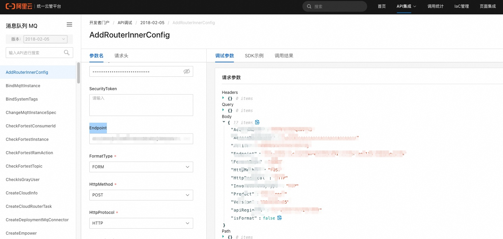
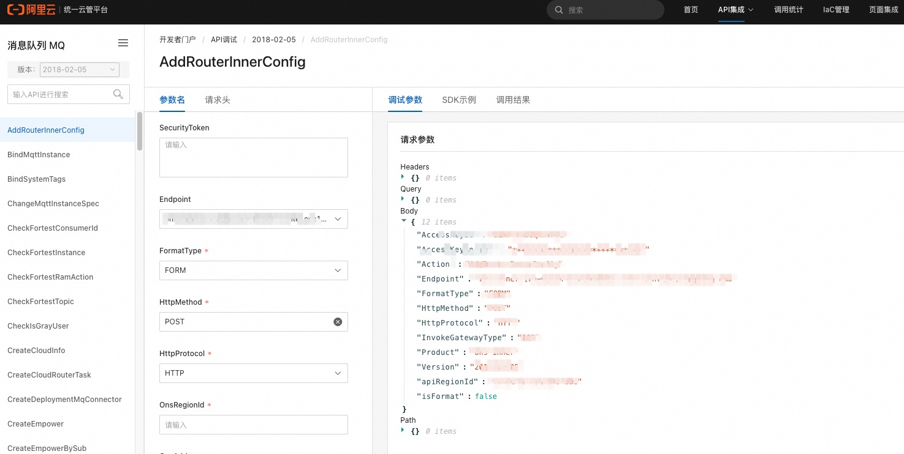
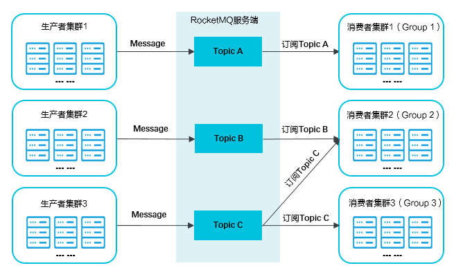
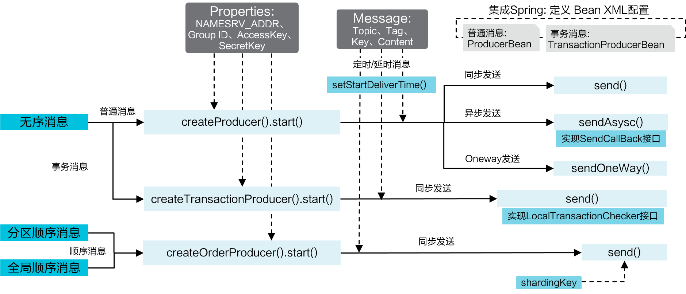
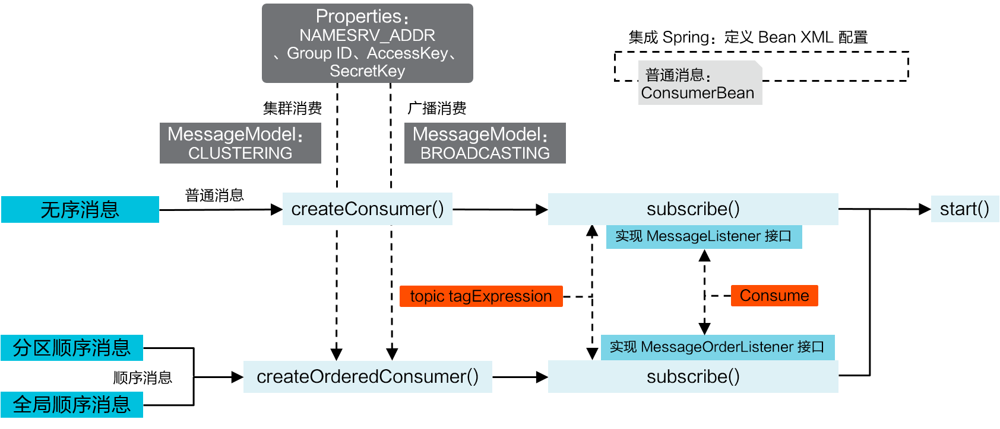

阿里云  
专有云  
消息队列 MQ  
开发指南  
产品版本：V3.18.6  
文档版本：20260108

**目录**

- [1.准备工作](#section-1)
    - [1.1. 获取API信息及其EndPoint](#section-1-1)
    - [1.2. 获取AccessKey](#section-1-2)
    - [1.3. 获取公共Header参数](#section-1-3)
    - [1.4. 获取STS AccessKey](#section-1-4)
- [2.通过POP网关调用专有云API](#section-2)
    - [2.1. 概述](#section-2-1)
    - [2.2. 调用前置](#section-2-2)
    - [2.3. Java版](#section-2-3)
- [3.API参考](#section-3)
    - [3.1. RocketMQ_API](#section-3-1)
        - [3.1.1. 产品更新说明](#section-3-1-1)
        - [3.1.2. RocketMQ Open API简介](#section-3-1-2)
            - [3.1.2.1. 面向用户和场景](#section-3-1-2-1)
            - [3.1.2.2. 适用场景和局限性](#section-3-1-2-2)
            - [3.1.2.3. Open API基本原理](#section-3-1-2-3)
        - [3.1.3. RocketMQ Open API接入指南](#section-3-1-3)
            - [3.1.3.1. 公共参数设置](#section-3-1-3-1)
            - [3.1.3.2. 公共返回值解析](#section-3-1-3-2)
        - [3.1.4. RocketMQ Open API公共术语](#section-3-1-4)
            - [3.1.4.1. 账号安全类](#section-3-1-4-1)
                - [3.1.4.1.1. AccessKey](#section-3-1-4-1-1)
                - [3.1.4.1.2. SecretKey](#section-3-1-4-1-2)
            - [3.1.4.2. RocketMQ资源管控类](#section-3-1-4-2)
                - [3.1.4.2.1. Topic](#section-3-1-4-2-1)
                - [3.1.4.2.2. Group ID（GID）](#section-3-1-4-2-2)
        - [3.1.5. RocketMQ Open API错误码列表](#section-3-1-5)
        - [3.1.6. API详细说明](#section-3-1-6)
            - [3.1.6.1. Instance管理](#section-3-1-6-1)
                - [3.1.6.1.1. QueryCommonGenRedirectUrl](#section-3-1-6-1-1)
                - [3.1.6.1.2. QueryTrendFlowLimit](#section-3-1-6-1-2)
                - [3.1.6.1.3. UnbindSystemTags](#section-3-1-6-1-3)
                - [3.1.6.1.4. CreateInstance](#section-3-1-6-1-4)
                - [3.1.6.1.5. BindSystemTags](#section-3-1-6-1-5)
                - [3.1.6.1.6. QuerySystemTagList](#section-3-1-6-1-6)
                - [3.1.6.1.7. DeleteInstance](#section-3-1-6-1-7)
                - [3.1.6.1.8. QueryInstanceBaseInfo](#section-3-1-6-1-8)
                - [3.1.6.1.9. QueryInstanceStatistics](#section-3-1-6-1-9)
                - [3.1.6.1.10. QueryInstanceList](#section-3-1-6-1-10)
                - [3.1.6.1.11. QueryRouterInstanceList](#section-3-1-6-1-11)
                - [3.1.6.1.12. UpdateInstance](#section-3-1-6-1-12)
                - [3.1.6.1.13. CheckFortestInstance](#section-3-1-6-1-13)
            - [3.1.6.2. Topic管理](#section-3-1-6-2)
                - [3.1.6.2.1. CheckFortestTopic](#section-3-1-6-2-1)
                - [3.1.6.2.2. PageQueryTopicList](#section-3-1-6-2-2)
                - [3.1.6.2.3. CreateSubscription](#section-3-1-6-2-3)
                - [3.1.6.2.4. CreateTopic](#section-3-1-6-2-4)
                - [3.1.6.2.5. DeleteTopic](#section-3-1-6-2-5)
                - [3.1.6.2.6. DeleteSubscription](#section-3-1-6-2-6)
                - [3.1.6.2.7. QueryTrendTopicInputTps](#section-3-1-6-2-7)
                - [3.1.6.2.8. QueryTopicSubDetail](#section-3-1-6-2-8)
                - [3.1.6.2.9. QueryTopicStatus](#section-3-1-6-2-9)
                - [3.1.6.2.10. QueryTopicNameList](#section-3-1-6-2-10)
                - [3.1.6.2.11. QueryTopicListByGroupId](#section-3-1-6-2-11)
                - [3.1.6.2.12. QueryTopicList](#section-3-1-6-2-12)
                - [3.1.6.2.13. QueryTopic](#section-3-1-6-2-13)
                - [3.1.6.2.14. QuerySubscriptionList](#section-3-1-6-2-14)
                - [3.1.6.2.15. QuerySubscription](#section-3-1-6-2-15)
                - [3.1.6.2.16. QueryRouterTopicList](#section-3-1-6-2-16)
                - [3.1.6.2.17. UpdateTopicInfo](#section-3-1-6-2-17)
                - [3.1.6.2.18. UpdateTopic](#section-3-1-6-2-18)
                - [3.1.6.2.19. UpdateSubscription](#section-3-1-6-2-19)
                - [3.1.6.2.20. SearchSubscription](#section-3-1-6-2-20)
            - [3.1.6.3. Cluster管理](#section-3-1-6-3)
                - [3.1.6.3.1. QueryClusterList](#section-3-1-6-3-1)
                - [3.1.6.3.2. QueryClusterCapacity](#section-3-1-6-3-2)
            - [3.1.6.4. Group管理](#section-3-1-6-4)
                - [3.1.6.4.1. CreateGroup](#section-3-1-6-4-1)
                - [3.1.6.4.2. PageQueryGroupList](#section-3-1-6-4-2)
                - [3.1.6.4.3. DeleteGroup](#section-3-1-6-4-3)
                - [3.1.6.4.4. QueryGroupIdList](#section-3-1-6-4-4)
                - [3.1.6.4.5. QueryGroupSubDetail](#section-3-1-6-4-5)
                - [3.1.6.4.6. QueryGroupList](#section-3-1-6-4-6)
                - [3.1.6.4.7. QueryTrendGroupOutputTps](#section-3-1-6-4-7)
                - [3.1.6.4.8. UpdateGroupInfo](#section-3-1-6-4-8)
                - [3.1.6.4.9. UpdateGroupConsumer](#section-3-1-6-4-9)
            - [3.1.6.5. CloudInfo管理](#section-3-1-6-5)
                - [3.1.6.5.1. QueryCloudInfoNoPage](#section-3-1-6-5-1)
                - [3.1.6.5.2. UpdateCloudInfo](#section-3-1-6-5-2)
                - [3.1.6.5.3. DeleteCloudInfo](#section-3-1-6-5-3)
                - [3.1.6.5.4. CreateCloudInfo](#section-3-1-6-5-4)
                - [3.1.6.5.5. QueryCloudInfo](#section-3-1-6-5-5)
            - [3.1.6.6. Message管理](#section-3-1-6-6)
                - [3.1.6.6.1. PushMessage](#section-3-1-6-6-1)
                - [3.1.6.6.2. DownloadMessageBodyInDLQ](#section-3-1-6-6-2)
                - [3.1.6.6.3. DownloadMessageAllInDLQ](#section-3-1-6-6-3)
                - [3.1.6.6.4. DownloadMessage](#section-3-1-6-6-4)
                - [3.1.6.6.5. QueryMessageByPagedTopic](#section-3-1-6-6-5)
                - [3.1.6.6.6. QueryMessageByPagedDLQ](#section-3-1-6-6-6)
                - [3.1.6.6.7. QueryMessageByKey](#section-3-1-6-6-7)
                - [3.1.6.6.8. QueryMessageByIdInDLQ](#section-3-1-6-6-8)
                - [3.1.6.6.9. QueryMessageById](#section-3-1-6-6-9)
                - [3.1.6.6.10. TraceMessage](#section-3-1-6-6-10)
                - [3.1.6.6.11. SendMessage](#section-3-1-6-6-11)
                - [3.1.6.6.12. ResendMessageByIdInDLQ](#section-3-1-6-6-12)
            - [3.1.6.7. Empower管理](#section-3-1-6-7)
                - [3.1.6.7.1. CheckFortestRamAction](#section-3-1-6-7-1)
                - [3.1.6.7.2. DeleteDauthToolByUserId](#section-3-1-6-7-2)
                - [3.1.6.7.3. CreateGroupEmpowerBySub](#section-3-1-6-7-3)
                - [3.1.6.7.4. CreateEmpowerBySub](#section-3-1-6-7-4)
                - [3.1.6.7.5. CreateEmpower](#section-3-1-6-7-5)
                - [3.1.6.7.6. QueryGroupEmpowerList](#section-3-1-6-7-6)
                - [3.1.6.7.7. QueryEmpowerList](#section-3-1-6-7-7)
                - [3.1.6.7.8. DeleteGroupEmpower](#section-3-1-6-7-8)
                - [3.1.6.7.9. DeleteEmpower](#section-3-1-6-7-9)
            - [3.1.6.8. MQTT管理接口](#section-3-1-6-8)
                - [3.1.6.8.1. DeleteMqttGroupId](#section-3-1-6-8-1)
                - [3.1.6.8.2. SendMqtt](#section-3-1-6-8-2)
                - [3.1.6.8.3. QueryMqttMsgTransTask](#section-3-1-6-8-3)
                - [3.1.6.8.4. CreateMqttInstanceStoreResource](#section-3-1-6-8-4)
                - [3.1.6.8.5. CreateMqttInstance](#section-3-1-6-8-5)
                - [3.1.6.8.6. CreateMqttGroupId](#section-3-1-6-8-6)
                - [3.1.6.8.7. PageQueryMqttInstanceStoreResource](#section-3-1-6-8-7)
                - [3.1.6.8.8. PageQueryMqttInstanceList](#section-3-1-6-8-8)
                - [3.1.6.8.9. PageQueryMqttGroupId](#section-3-1-6-8-9)
                - [3.1.6.8.10. DeleteMqttInstanceStoreResource](#section-3-1-6-8-10)
                - [3.1.6.8.11. DeleteMqttInstance](#section-3-1-6-8-11)
                - [3.1.6.8.12. QueryMqttInstanceReport](#section-3-1-6-8-12)
                - [3.1.6.8.13. QueryMqttInstanceList](#section-3-1-6-8-13)
                - [3.1.6.8.14. QueryMqttInstanceBaseInfo](#section-3-1-6-8-14)
                - [3.1.6.8.15. QueryMqttGroupIdList](#section-3-1-6-8-15)
                - [3.1.6.8.16. QueryMqttDeviceRunningInfo](#section-3-1-6-8-16)
                - [3.1.6.8.17. QueryMqttConnectionSum](#section-3-1-6-8-17)
                - [3.1.6.8.18. QueryMqttClientSetByTopic](#section-3-1-6-8-18)
                - [3.1.6.8.19. QueryMqttClientSetByGroupId](#section-3-1-6-8-19)
                - [3.1.6.8.20. QueryMqttTraceByTraceId](#section-3-1-6-8-20)
                - [3.1.6.8.21. QueryMqttMsgByPubInfo](#section-3-1-6-8-21)
                - [3.1.6.8.22. QueryMqttInstanceStoreResourceNameList](#section-3-1-6-8-22)
                - [3.1.6.8.23. QueryMqttInstanceStoreInstanceList](#section-3-1-6-8-23)
                - [3.1.6.8.24. UpdateMqttInstance](#section-3-1-6-8-24)
                - [3.1.6.8.25. ChangeMqttInstanceSpec](#section-3-1-6-8-25)
                - [3.1.6.8.26. BindMqttInstance](#section-3-1-6-8-26)
            - [3.1.6.9. Trace管理](#section-3-1-6-9)
                - [3.1.6.9.1. QueryTraceMapByQueryId](#section-3-1-6-9-1)
                - [3.1.6.9.2. QueryPubTraceByQueryId](#section-3-1-6-9-2)
                - [3.1.6.9.3. PageQueryTraceListByUserId](#section-3-1-6-9-3)
                - [3.1.6.9.4. DeleteTraceQueryTask](#section-3-1-6-9-4)
                - [3.1.6.9.5. QueryTraceByMsgTopic](#section-3-1-6-9-5)
                - [3.1.6.9.6. QueryTraceByMsgKey](#section-3-1-6-9-6)
                - [3.1.6.9.7. QueryTraceByMsgId](#section-3-1-6-9-7)
            - [3.1.6.10. Consumer管理](#section-3-1-6-10)
                - [3.1.6.10.1. CheckFortestConsumerId](#section-3-1-6-10-1)
                - [3.1.6.10.2. QueryAllConsumerAccumulation](#section-3-1-6-10-2)
                - [3.1.6.10.3. QueryConsumerTimespan](#section-3-1-6-10-3)
                - [3.1.6.10.4. QueryConsumerStatus](#section-3-1-6-10-4)
                - [3.1.6.10.5. QueryConsumerProgress](#section-3-1-6-10-5)
                - [3.1.6.10.6. QueryConsumerJstackInfo](#section-3-1-6-10-6)
                - [3.1.6.10.7. QueryConsumerConnection](#section-3-1-6-10-7)
                - [3.1.6.10.8. QueryConsumerAccumulate](#section-3-1-6-10-8)
                - [3.1.6.10.9. UpdateConsumerReadableByTopicAndGroup](#section-3-1-6-10-9)
                - [3.1.6.10.10. ResetConsumerOffset](#section-3-1-6-10-10)
                - [3.1.6.10.11. QueryUnitLatestConsumerTime](#section-3-1-6-10-11)
            - [3.1.6.11. MQ Connector管理](#section-3-1-6-11)
                - [3.1.6.11.1. ResumeMqConnector](#section-3-1-6-11-1)
                - [3.1.6.11.2. PauseMqConnector](#section-3-1-6-11-2)
                - [3.1.6.11.3. DeleteDeploymentMqConnector](#section-3-1-6-11-3)
                - [3.1.6.11.4. CreateDeploymentMqConnector](#section-3-1-6-11-4)
                - [3.1.6.11.5. DeployDeploymentMqConnector](#section-3-1-6-11-5)
                - [3.1.6.11.6. QueryMqConnectorSysResourceName](#section-3-1-6-11-6)
                - [3.1.6.11.7. QueryMqConnectorMetricsDetailList](#section-3-1-6-11-7)
                - [3.1.6.11.8. QueryMqConnectorInfoList](#section-3-1-6-11-8)
                - [3.1.6.11.9. QueryMqConnectorDeploymentList](#section-3-1-6-11-9)
                - [3.1.6.11.10. UpdateMqConnectorDeployment](#section-3-1-6-11-10)
            - [3.1.6.12. Router Task管理](#section-3-1-6-12)
                - [3.1.6.12.1. DeleteCloudRouterTask](#section-3-1-6-12-1)
                - [3.1.6.12.2. CreateRouterTask](#section-3-1-6-12-2)
                - [3.1.6.12.3. CreateRouterInnerTask](#section-3-1-6-12-3)
                - [3.1.6.12.4. CreateCloudRouterTask](#section-3-1-6-12-4)
                - [3.1.6.12.5. QueryCloudRouterTaskStats](#section-3-1-6-12-5)
                - [3.1.6.12.6. QueryCloudRouterTask](#section-3-1-6-12-6)
                - [3.1.6.12.7. QueryCloudRouterItems](#section-3-1-6-12-7)
                - [3.1.6.12.8. PageQueryCloudRouterTask](#section-3-1-6-12-8)
                - [3.1.6.12.9. DeleteRouterTask](#section-3-1-6-12-9)
                - [3.1.6.12.10. DeleteRouterInnerTask](#section-3-1-6-12-10)
                - [3.1.6.12.11. QueryRouterTask](#section-3-1-6-12-11)
                - [3.1.6.12.12. QueryRouterStat](#section-3-1-6-12-12)
                - [3.1.6.12.13. QueryRouterInnerTask](#section-3-1-6-12-13)
                - [3.1.6.12.14. QueryRouterInnerStat](#section-3-1-6-12-14)
                - [3.1.6.12.15. UpdateRouterFilterRule](#section-3-1-6-12-15)
                - [3.1.6.12.16. UpdateCloudRouterTask](#section-3-1-6-12-16)
                - [3.1.6.12.17. StopRouterTask](#section-3-1-6-12-17)
                - [3.1.6.12.18. StopCloudRouterTask](#section-3-1-6-12-18)
                - [3.1.6.12.19. StartRouterTask](#section-3-1-6-12-19)
                - [3.1.6.12.20. StartRouterInnerTask](#section-3-1-6-12-20)
                - [3.1.6.12.21. StartCloudRouterTask](#section-3-1-6-12-21)
                - [3.1.6.12.22. SearchRouterTask](#section-3-1-6-12-22)
                - [3.1.6.12.23. AddRouterInnerConfig](#section-3-1-6-12-23)
            - [3.1.6.13. VPC管理](#section-3-1-6-13)
                - [3.1.6.13.1. CreateVpcTunnelInstanceSingleTunnel](#section-3-1-6-13-1)
                - [3.1.6.13.2. DeleteVpcTunnelInstanceSingleTunnel](#section-3-1-6-13-2)
                - [3.1.6.13.3. QueryVpcTunnelTunnelSwitch](#section-3-1-6-13-3)
                - [3.1.6.13.4. QueryVpcTunnelInstanceSingleTunnelList](#section-3-1-6-13-4)
            - [3.1.6.14. Region管理](#section-3-1-6-14)
                - [3.1.6.14.1. QueryMetaData](#section-3-1-6-14-1)
                - [3.1.6.14.2. QueryCommonRegionData](#section-3-1-6-14-2)
                - [3.1.6.14.3. QueryRegionList](#section-3-1-6-14-3)
                - [3.1.6.14.4. QueryRegionConsoleUrlList](#section-3-1-6-14-4)
            - [3.1.6.15. UnitResetTask管理](#section-3-1-6-15)
                - [3.1.6.15.1. CreateUnitResetTask](#section-3-1-6-15-1)
                - [3.1.6.15.2. QueryUnitResetTask](#section-3-1-6-15-2)
- [4.SDK参考](#section-4)
    - [4.1. RocketMQ_SDK](#section-4-1)
        - [4.1.1. 概述](#section-4-1-1)
        - [4.1.2. 消息模型](#section-4-1-2)
        - [4.1.3. 产品更新说明](#section-4-1-3)
        - [4.1.4. 传输协议与字符编码](#section-4-1-4)
        - [4.1.5. 常用类及其方法](#section-4-1-5)
            - [4.1.5.1. 常量类PropertyKeyConst](#section-4-1-5-1)
            - [4.1.5.2. 工厂类ONSFactory](#section-4-1-5-2)
                - [4.1.5.2.1. createConsumer](#section-4-1-5-2-1)
                - [4.1.5.2.2. createBatchConsumer](#section-4-1-5-2-2)
                - [4.1.5.2.3. createOrderedConsumer](#section-4-1-5-2-3)
                - [4.1.5.2.4. createOrderProducer](#section-4-1-5-2-4)
                - [4.1.5.2.5. createProducer](#section-4-1-5-2-5)
                - [4.1.5.2.6. createTransactionProducer](#section-4-1-5-2-6)
            - [4.1.5.3. 消息类Message](#section-4-1-5-3)
                - [4.1.5.3.1. 消息类Message概述](#section-4-1-5-3-1)
                - [4.1.5.3.2. Message默认构造方法](#section-4-1-5-3-2)
                - [4.1.5.3.3. Message有参构造方法（一）](#section-4-1-5-3-3)
                - [4.1.5.3.4. Message有参构造方法（二）](#section-4-1-5-3-4)
                - [4.1.5.3.5. putUserProperties](#section-4-1-5-3-5)
                - [4.1.5.3.6. getUserProperties](#section-4-1-5-3-6)
                - [4.1.5.3.7. getTopic](#section-4-1-5-3-7)
                - [4.1.5.3.8. setTopic](#section-4-1-5-3-8)
                - [4.1.5.3.9. getTag](#section-4-1-5-3-9)
                - [4.1.5.3.10. setTag](#section-4-1-5-3-10)
                - [4.1.5.3.11. getKey](#section-4-1-5-3-11)
                - [4.1.5.3.12. setKey](#section-4-1-5-3-12)
                - [4.1.5.3.13. getMsgID](#section-4-1-5-3-13)
                - [4.1.5.3.14. setMsgID](#section-4-1-5-3-14)
                - [4.1.5.3.15. getReconsumeTimes](#section-4-1-5-3-15)
                - [4.1.5.3.16. setReconsumeTimes](#section-4-1-5-3-16)
                - [4.1.5.3.17. getBornTimestamp](#section-4-1-5-3-17)
                - [4.1.5.3.18. setBornTimestamp](#section-4-1-5-3-18)
                - [4.1.5.3.19. getBornHost](#section-4-1-5-3-19)
                - [4.1.5.3.20. setBornHost](#section-4-1-5-3-20)
                - [4.1.5.3.21. getStartDeliverTime](#section-4-1-5-3-21)
                - [4.1.5.3.22. setStartDeliverTime](#section-4-1-5-3-22)
                - [4.1.5.3.23. getShardingKey](#section-4-1-5-3-23)
                - [4.1.5.3.24. setShardingKey](#section-4-1-5-3-24)
            - [4.1.5.4. 异常类ONSClientException](#section-4-1-5-4)
                - [4.1.5.4.1. ONSClientException默认构造方法](#section-4-1-5-4-1)
                - [4.1.5.4.2. ONSClientException有参构造方法（一）](#section-4-1-5-4-2)
                - [4.1.5.4.3. ONSClientException有参构造方法（二）](#section-4-1-5-4-3)
                - [4.1.5.4.4. ONSClientException有参构造方法（三）](#section-4-1-5-4-4)
            - [4.1.5.5. 发送消息接口](#section-4-1-5-5)
                - [4.1.5.5.1. 发送消息接口概述](#section-4-1-5-5-1)
                - [4.1.5.5.2. 发送结果SendResult](#section-4-1-5-5-2)
                    - [4.1.5.5.2.1. SendResult默认构造方法](#section-4-1-5-5-2-1)
                    - [4.1.5.5.2.2. getMessageId](#section-4-1-5-5-2-2)
                    - [4.1.5.5.2.3. getTopic](#section-4-1-5-5-2-3)
                    - [4.1.5.5.2.4. toString](#section-4-1-5-5-2-4)
                - [4.1.5.5.3. 生产者实例Producer](#section-4-1-5-5-3)
                    - [4.1.5.5.3.1. 生产者实例Producer概述](#section-4-1-5-5-3-1)
                    - [4.1.5.5.3.2. send](#section-4-1-5-5-3-2)
                    - [4.1.5.5.3.3. sendOneway](#section-4-1-5-5-3-3)
                    - [4.1.5.5.3.4. sendAsync](#section-4-1-5-5-3-4)
                    - [4.1.5.5.3.5. isStarted](#section-4-1-5-5-3-5)
                    - [4.1.5.5.3.6. isClosed](#section-4-1-5-5-3-6)
                    - [4.1.5.5.3.7. start](#section-4-1-5-5-3-7)
                    - [4.1.5.5.3.8. shutdown](#section-4-1-5-5-3-8)
                - [4.1.5.5.4. 分布式事务消息生产者实例 TransactionProducer](#section-4-1-5-5-4)
                    - [4.1.5.5.4.1. send](#section-4-1-5-5-4-1)
                    - [4.1.5.5.4.2. isStarted](#section-4-1-5-5-4-2)
                    - [4.1.5.5.4.3. isClosed](#section-4-1-5-5-4-3)
                    - [4.1.5.5.4.4. start](#section-4-1-5-5-4-4)
                    - [4.1.5.5.4.5. shutdown](#section-4-1-5-5-4-5)
                    - [4.1.5.5.4.6. 本地事务执行器LocalTransactionExecuter](#section-4-1-5-5-4-6)
                    - [4.1.5.5.4.7. 分布式事务消息状态TransactionStatus](#section-4-1-5-5-4-7)
                - [4.1.5.5.5. 顺序消息生产者实例OrderProducer](#section-4-1-5-5-5)
                    - [4.1.5.5.5.1. send](#section-4-1-5-5-5-1)
                    - [4.1.5.5.5.2. isStarted](#section-4-1-5-5-5-2)
                    - [4.1.5.5.5.3. isClosed](#section-4-1-5-5-5-3)
                    - [4.1.5.5.5.4. start](#section-4-1-5-5-5-4)
                    - [4.1.5.5.5.5. shutdown](#section-4-1-5-5-5-5)
            - [4.1.5.6. 订阅消息接口](#section-4-1-5-6)
                - [4.1.5.6.1. 订阅消息接口概述](#section-4-1-5-6-1)
                - [4.1.5.6.2. 消费者实例Consumer](#section-4-1-5-6-2)
                    - [4.1.5.6.2.1. 消费者实例Consumer概述](#section-4-1-5-6-2-1)
                    - [4.1.5.6.2.2. subscribe](#section-4-1-5-6-2-2)
                    - [4.1.5.6.2.3. unsubscribe](#section-4-1-5-6-2-3)
                    - [4.1.5.6.2.4. isStarted](#section-4-1-5-6-2-4)
                    - [4.1.5.6.2.5. isClosed](#section-4-1-5-6-2-5)
                    - [4.1.5.6.2.6. start](#section-4-1-5-6-2-6)
                    - [4.1.5.6.2.7. shutdown](#section-4-1-5-6-2-7)
                - [4.1.5.6.3. 消息监听器MessageListener](#section-4-1-5-6-3)
                    - [4.1.5.6.3.1. 消费监听器MessageListener概述](#section-4-1-5-6-3-1)
                    - [4.1.5.6.3.2. consume](#section-4-1-5-6-3-2)
                - [4.1.5.6.4. 消息消费结果Action](#section-4-1-5-6-4)
                    - [4.1.5.6.4.1. 消息消费结果Action概述](#section-4-1-5-6-4-1)
                    - [4.1.5.6.4.2. valueOf](#section-4-1-5-6-4-2)
                    - [4.1.5.6.4.3. values](#section-4-1-5-6-4-3)
                - [4.1.5.6.5. 消费模式PropertyValueConst](#section-4-1-5-6-5)
                - [4.1.5.6.6. 顺序消费者实例OrderConsumer](#section-4-1-5-6-6)
                    - [4.1.5.6.6.1. 顺序消费者实例OrderConsumer概述](#section-4-1-5-6-6-1)
                    - [4.1.5.6.6.2. subscribe](#section-4-1-5-6-6-2)
                    - [4.1.5.6.6.3. unsubscribe](#section-4-1-5-6-6-3)
                    - [4.1.5.6.6.4. isStarted](#section-4-1-5-6-6-4)
                    - [4.1.5.6.6.5. isClosed](#section-4-1-5-6-6-5)
                    - [4.1.5.6.6.6. start](#section-4-1-5-6-6-6)
                    - [4.1.5.6.6.7. shutdown](#section-4-1-5-6-6-7)
                - [4.1.5.6.7. 消息监听器MessageOrderListener](#section-4-1-5-6-7)
                    - [4.1.5.6.7.1. 消息监听器MessageOrderListener概述](#section-4-1-5-6-7-1)
                    - [4.1.5.6.7.2. consume](#section-4-1-5-6-7-2)
                - [4.1.5.6.8. 顺序消息消费结果OrderAction](#section-4-1-5-6-8)
                    - [4.1.5.6.8.1. 顺序消息消费结果OrderAction概述](#section-4-1-5-6-8-1)
                    - [4.1.5.6.8.2. valueOf](#section-4-1-5-6-8-2)
                    - [4.1.5.6.8.3. values](#section-4-1-5-6-8-3)
                - [4.1.5.6.9. 批量消费者实例BatchConsumer](#section-4-1-5-6-9)
                    - [4.1.5.6.9.1. 批量消费者实例BatchConsumer概述](#section-4-1-5-6-9-1)
                    - [4.1.5.6.9.2. subscribe](#section-4-1-5-6-9-2)
                    - [4.1.5.6.9.3. unsubscribe](#section-4-1-5-6-9-3)
                    - [4.1.5.6.9.4. isStarted](#section-4-1-5-6-9-4)
                    - [4.1.5.6.9.5. isClosed](#section-4-1-5-6-9-5)
                    - [4.1.5.6.9.6. start](#section-4-1-5-6-9-6)
                    - [4.1.5.6.9.7. shutdown](#section-4-1-5-6-9-7)
                - [4.1.5.6.10. 批量消费消息监听器BatchMessageListener](#section-4-1-5-6-10)
                    - [4.1.5.6.10.1. 批量消费消息监听器BatchMessageListener概述](#section-4-1-5-6-10-1)
                    - [4.1.5.6.10.2. consume](#section-4-1-5-6-10-2)

<a id="section-1"></a>

# 1.准备工作

<a id="section-1-1"></a>

## 1.1. 获取API信息及其EndPoint

首先，您需要了解产品开放API接口的相关信息，包括产品名称（code）、开放API接口名称、API版本。

**背景信息**

Apsara Uni-manager运营控制台API目录中的API信息仅供调用参考，具体API的使用方式需要参见云产品的开发指南。如果发生不一致情况，以开发指南支持情况为准。

**操作步骤**

1. 登录Apsara Uni-manager运营控制台。

2. 在顶部菜单栏选择**产品** > **开发工具** > **API与工具** > **开发者门户**。

3. 在**开发者门户**页面，选择**API集成** > **API调试**。

   

4. 在左侧导航栏中选择目标云产品。

5. 在**版本**下拉列表中，选择目标API版本。

6. 在下方API列表中可浏览当前版本的所有API接口。

7. 选中对应接口，在参数名下获取云产品的POP Endpoint信息。

   

<a id="section-1-2"></a>

## 1.2. 获取AccessKey

AccessKey支持RAM和STS两种授权模式，在发起调用时选择使用其中一种AccessKey即可。本文将为您介绍如何获取通过RAM授权的AccessKey。

**背景信息**

AccessKey通过使用AccessKey ID和AccessKey Secret对称加密，实现验证某个请求发送者的身份的功能。其中AccessKey ID用于标识用户，AccessKey Secret是用户用于加密签名的字符串。

AccessKey的两种授权模式如下：

- 通过RAM授权给第三方请求者的AccessKey ID和AccessKey Secret。

- 通过STS授权给第三方请求者的AccessKey ID、AccessKey Secret和Security Token。获取方式请参见获取STS AccessKey。

Apsara Uni-manager运营控制台提供了个人AccessKey和组织AccessKey（只有运营管理员和一级组织管理员可以获取组织AccessKey），推荐使用个人账号AccessKey调用Apsara Uni-manager运营控制台及云产品相关接口。如果使用个人账号AccessKey，需要在Header中添加以下限制性参数，否则可能提示权限不足：

> **警告**
>
> 个人账号AccessKey是由Apsara Uni-manager运营控制台权限体系管控的受限AccessKey，组织AccessKey相对权限较大，需要管理员确认操作的安全性。

<table>
  <tr>
    <th width="206">参数名称</th>
    <th>描述</th>
  </tr>
  <tr>
    <td>x-acs-regionid</td>
    <td>地域，如：cn-hangzhou-*。</td>
  </tr>
  <tr>
    <td>x-acs-organizationid</td>
    <td>Apsara Uni-manager运营控制台中对应的组织ID。获取方法可参见<strong>《Apsara Uni-manager运营控制台开</strong><strong>发指南》</strong>中的<strong>《GetOrganizationList》</strong>文档。</td>
  </tr>
  <tr>
    <td>x-acs-resourcegroupid</td>
    <td>Apsara Uni-manager运营控制台中对应的资源集ID。获取方法可参见<strong>《Apsara Uni-manager运营控制台</strong><strong>开发指南》</strong>中的<strong>《ListResourceGroup》</strong>文档。</td>
  </tr>
  <tr>
    <td>x-acs-instanceid</td>
    <td>进行操作的实例ID，例如，ECS的实例ID可以从ECS列表中查询到。</td>
  </tr>
</table>

**获取个人账号AccessKey**

获取个人账号AccessKey的方法如下：

1. 登录Apsara Uni-manager运营控制台。

2. 在系统界面右上角，单击当前登录用户头像，单击**个人信息**。

3. 在**AccessKey**区域，您可以查看个人账户的AccessKey信息。

   

   > **说明**
   >
   > AccessKey ID和AccessKey Secret是您访问云资源时的密钥，具有该账号完整的权限，请您妥善保管。

**获取组织AccessKey**

获取组织AccessKey的方法如下：

1. 管理员登录Apsara Uni-manager运营控制台。

2. 在顶部菜单栏，单击**企业**。

3. 在左侧导航栏中，选择**资源管理 > 组织管理**。

4. 在组织结构中，单击目标一级组织名称。

5. 单击**管理Accesskey**。

6. 在弹出的对话框中，查看组织AccessKey信息。

<a id="section-1-3"></a>

## 1.3. 获取公共Header参数

调用API时需要提供多个Header参数。本文为您介绍如何获取这些参数。并对调用后的一些返回值做出解释。

**获取Region ID**

1. 管理员登录Apsara Uni-manager运营控制台。

2. 在顶部菜单栏中，单击**企业**。

3. 在左侧导航栏中，选择**资源管理**>**地域管理**。

4. 单击目标组织名称。

5. 在右侧**Region列表**中查看**Region名称**，即为Region ID。

**获取组织ID**

组织ID需要通过调用API方式获取，您可以在Apsara Uni-manager运营控制台中通过API在线调试功能快速获取组织ID信息。

1. 管理员登录Apsara Uni-manager运营控制台。

2. 单击顶部菜单栏**产品**，选择**开发工具** > **API与工具** > **开发者门户**。

3. 在**开发者门户**页面，选择**API集成** > **API调试**。

4. 单击  按钮，选择**云平台** > **统一云管平台**，**版本**选择**2019-05-10**。

5. 在文本框内输入 `GetOrganizationList` 进行在线调试，在name参数填写目标组织名称后发起调用，调用成功后查看**调用结果**中**id**的信息，即为组织ID。接口信息详见*Apsara Uni-manager运营控制台开发指南*中的章节*GetOrganizationList*。

**获取资源集ID**

资源集ID需要通过调用API方式获取，您可以在Apsara Uni-manager运营控制台中通过API在线调试功能快速获取资源集ID信息。

1. 管理员登录Apsara Uni-manager运营控制台。

2. 单击顶部菜单栏**产品**，选择**开发工具** > **API与工具** > **开发者门户**。

3. 在**开发者门户**页面，选择**API集成** > **API调试**。

4. 单击  按钮，选择**云平台** > **统一云管平台**，**版本**选择**2019-05-10**。

5. 在文本框内输入 `ListResourceGroup` 进行在线调试，调用成功后查看**调用结果**中**id**的信息，即为资源集ID。接口信息详见*Apsara Uni-manager运营控制台开发指南*中的章节*ListResourceGroup*。

**获取实例ID**

实例ID可以通过Apsara Uni-manager运营控制台中的云产品实例列表进行获取，本文中以API网关为例，获取步骤如下：

1. 登录Apsara Uni-manager运营控制台。

2. 在顶部的菜单栏中，选择**产品** > **中间件** > **消息队列** > **消息队列 RocketMQ 版**。

3. 在左侧导航栏中，单击**实例列表**。

4. 在实例列表中查看**实例ID**。

**返回参数**

对于列表类的云产品资源实例接口，调用后会默认增加如下返回值。

| 名称 | 描述 |
| --- | --- |
| ResourceGroupName | 资源集名称。 |
| ResourceGroup | 资源集ID。 |
| DepartmentName | 组织名称。 |
| Department | 组织ID。 |

<a id="section-1-4"></a>

## 1.4. 获取STS AccessKey

本文为您介绍如何利用STS方式，调用专有云的产品API。

**背景信息**

阿里云临时安全令牌STS（Security Token Service）是阿里云提供的一种临时访问权限管理服务。您可以选择利用STS方式，调用专有云的产品API。

**操作步骤**

1. 获取用户角色的 `RAM Role` 。

   <ol type="i">

   <li>

   登录Apsara Uni-manager运营控制台。

   </li>

   <li>

   单击页面右上角的用户头像，选择**个人信息**。

   </li>

   <li>

   单击**查看当前角色策略**。

   在**当前选择角色策略**对话框中查看 `RAM Role` 。

   </li>

   </ol>

2. 使用以下代码，通过角色的 `RAM Role` 获得 `stsAK` 、 `stsSK` 和 `stsToken` 。

   ```java
   public static void main(String[] args) {
        ASClient asClient = new ASClient();
        // 调⽤来源说明
           asClient.setSdkSource("test");
        // 传入Arn
           String assumeRole = AssumeRole(asClient, "<RAM Role>");

           JSONObject assumeRoleJson = JSONObject.parseObject(assumeRole);

           JSONObject credentials = assumeRoleJson.getJSONObject("Credentials");

           // 获取到STS三元组
           String stsAK = credentials.getString("AccessKeyId");
           String stsSK = credentials.getString("AccessKeySecret");
           String stsToken = credentials.getString("SecurityToken");
   }

   public static String AssumeRole(ASClient asClient, String roleArn) {

           Map<String, String> headers = new HashMap<>();

           Map<String, Object> reqParams = new HashMap<>();

           reqParams.put("action", "AssumeRole");

           reqParams.put("Product", "Sts");

           reqParams.put("Version", "2015-04-01");

           reqParams.put("regionId", regionId);

        // 当前登录⽤户的ak
           reqParams.put("AccessKeyId", <当前⽤户的AccessKey ID>);
        // 当前登录⽤户的sk
           reqParams.put("AccessKeySecret", <当前⽤户的AccessKey Secret>);

           reqParams.put("roleSessionName", "StsUser");

           reqParams.put("roleArn", roleArn);

           return asClient.doRequest(endpoint, headers, reqParams);
   }
   ```

3. 通过STS可以调用云产品的接口，示例如下。

   ```java
   import com.aliyun.credentials.Client;
   import com.aliyun.credentials.models.Config;

   // 以下示例演示如何使⽤STS Token初始化凭据客户端（不包含如何获取到STS Token的过程）。
   public class DemoStsTest {
       public static void main(String[] args) {
           Config credentialConfig = new Config();
           credentialConfig.setType("sts");
           // 请替换为前⼀步获取到的STS三元组中AccessKeyI。
           credentialConfig.setAccessKeyId("your_AccessKeyId");
           // 请替换为前⼀步获取到的STS三元组中AccessKeySecret
           credentialConfig.setAccessKeySecret("your__AccessKeySecret");
           // 请替换为前⼀步获取到的STS三元组中SecurityToken
           credentialConfig.setSecurityToken("your__SecurityToken");
           Client credentialClient = new Client(credentialConfig);

           // 继续调⽤API，完整参考的API⽂档
       }
   }
   ```

<a id="section-2"></a>

# 2.通过POP网关调用专有云API

<a id="section-2-1"></a>

## 2.1. 概述

阿里云专有云与公共云一样，可通过POP网关的方式进行API调用。本文为您介绍概述情况。

**背景信息**

通过POP网关调用专有云API，可以实现对管控层资源（如实例、Topic、Group等）的增删改查等操作。平台已封装支持Java语言的SDK，您可以通过在平台中下载该SDK直接调用专有云API。

文档中SDK关于API的示例代码仅供参考，各API的完整使用步骤与参数说明请参见开发者门户SDK示例和OpenAPI文档。

**环境要求**

- 支持JDK8~JDK19

- Platform支持：Linux、Mac、Windows

**语言**

当前仅支持Java语言。

**发布历史**

**SDK版本**

| 版本号 | 发布时间 | 更新内容 |
| --- | --- | --- |
| 3.16.2-0 | 2024.09 | 全新发布专有云3.16.2对外API的SDK。 |

**API列表**

当前专有云企业版SDK支持的API列表。

| API名称 | 所在版本 |
| --- | --- |
| BindSystemTags | 3.16.2-0 |
| CheckFortestConsumerId | 3.16.2-0 |
| CheckFortestInstance | 3.16.2-0 |
| CheckFortestRamAction | 3.16.2-0 |
| CheckFortestTopic | 3.16.2-0 |
| CreateCloudInfo | 3.16.2-0 |
| CreateCloudRouterTask | 3.16.2-0 |
| CreateDeploymentMqConnector | 3.16.2-0 |
| CreateEmpower | 3.16.2-0 |
| CreateEmpowerBySub | 3.16.2-0 |
| CreateGroup | 3.16.2-0 |
| CreateGroupEmpowerBySub | 3.16.2-0 |
| CreateInstance | 3.16.2-0 |
| CreateTopic | 3.16.2-0 |
| CreateUnitResetTask | 3.16.2-0 |
| CreateVpcTunnelInstanceSingleTunnel | 3.16.2-0 |
| DeleteCloudInfo | 3.16.2-0 |
| DeleteCloudRouterTask | 3.16.2-0 |
| DeleteDeploymentMqConnector | 3.16.2-0 |
| DeleteEmpower | 3.16.2-0 |
| DeleteGroup | 3.16.2-0 |
| DeleteGroupEmpower | 3.16.2-0 |
| DeleteInstance | 3.16.2-0 |
| DeleteTopic | 3.16.2-0 |
| DeleteTraceQueryTask | 3.16.2-0 |
| DeleteVpcTunnelInstanceSingleTunnel | 3.16.2-0 |
| DeployDeploymentMqConnector | 3.16.2-0 |
| DownloadMessage | 3.16.2-0 |
| DownloadMessageAllInDLQ | 3.16.2-0 |
| DownloadMessageBodyInDLQ | 3.16.2-0 |
| PageQueryCloudRouterTask | 3.16.2-0 |
| PageQueryGroupList | 3.16.2-0 |
| PageQueryTopicList | 3.16.2-0 |
| PageQueryTraceListByUserId | 3.16.2-0 |
| PauseMqConnector | 3.16.2-0 |
| PushMessage | 3.16.2-0 |
| QueryAllConsumerAccumulation | 3.16.2-0 |
| QueryCloudInfo | 3.16.2-0 |
| QueryCloudRouterItems | 3.16.2-0 |
| QueryCloudRouterTask | 3.16.2-0 |
| QueryCloudRouterTaskStats | 3.16.2-0 |
| QueryClusterCapacity | 3.16.2-0 |
| QueryClusterList | 3.16.2-0 |
| QueryCommonGenRedirectUrl | 3.16.2-0 |
| QueryCommonRegionData | 3.16.2-0 |
| QueryConsumerAccumulate | 3.16.2-0 |
| QueryConsumerConnection | 3.16.2-0 |
| QueryConsumerJstackInfo | 3.16.2-0 |
| QueryConsumerProgress | 3.16.2-0 |
| QueryConsumerStatus | 3.16.2-0 |
| QueryConsumerTimespan | 3.16.2-0 |
| QueryEmpowerList | 3.16.2-0 |
| QueryGroupEmpowerList | 3.16.2-0 |
| QueryGroupIdList | 3.16.2-0 |
| QueryGroupList | 3.16.2-0 |
| QueryGroupSubDetail | 3.16.2-0 |
| QueryInstanceBaseInfo | 3.16.2-0 |
| QueryInstanceList | 3.16.2-0 |
| QueryInstanceStatistics | 3.16.2-0 |
| QueryMessageById | 3.16.2-0 |
| QueryMessageByIdInDLQ | 3.16.2-0 |
| QueryMessageByKey | 3.16.2-0 |
| QueryMessageByPagedDLQ | 3.16.2-0 |
| QueryMessageByPagedTopic | 3.16.2-0 |
| QueryMetaData | 3.16.2-0 |
| QueryMqConnectorDeploymentList | 3.16.2-0 |
| QueryMqConnectorInfoList | 3.16.2-0 |
| QueryMqConnectorMetricsDetailList | 3.16.2-0 |
| QueryMqConnectorSysResourceName | 3.16.2-0 |
| QueryPubTraceByQueryId | 3.16.2-0 |
| QueryRegionConsoleUrlList | 3.16.2-0 |
| QueryRegionList | 3.16.2-0 |
| QueryRouterInstanceList | 3.16.2-0 |
| QueryRouterTopicList | 3.16.2-0 |
| QuerySubscriptionList | 3.16.2-0 |
| QuerySystemTagList | 3.16.2-0 |
| QueryTopic | 3.16.2-0 |
| QueryTopicList | 3.16.2-0 |
| QueryTopicListByGroupId | 3.16.2-0 |
| QueryTopicNameList | 3.16.2-0 |
| QueryTopicStatus | 3.16.2-0 |
| QueryTopicSubDetail | 3.16.2-0 |
| QueryTraceByMsgId | 3.16.2-0 |
| QueryTraceByMsgKey | 3.16.2-0 |
| QueryTraceByMsgTopic | 3.16.2-0 |
| QueryTraceMapByQueryId | 3.16.2-0 |
| QueryTrendFlowLimit | 3.16.2-0 |
| QueryTrendGroupOutputTps | 3.16.2-0 |
| QueryTrendTopicInputTps | 3.16.2-0 |
| QueryUnitLatestConsumerTime | 3.16.2-0 |
| QueryUnitResetTask | 3.16.2-0 |
| QueryVpcTunnelInstanceSingleTunnelList | 3.16.2-0 |
| QueryVpcTunnelTunnelSwitch | 3.16.2-0 |
| ResendMessageByIdInDLQ | 3.16.2-0 |
| ResetConsumerOffset | 3.16.2-0 |
| ResumeMqConnector | 3.16.2-0 |
| SearchRouterTask | 3.16.2-0 |
| SearchSubscription | 3.16.2-0 |
| SendMessage | 3.16.2-0 |
| StartCloudRouterTask | 3.16.2-0 |
| StopCloudRouterTask | 3.16.2-0 |
| TraceMessage | 3.16.2-0 |
| UnbindSystemTags | 3.16.2-0 |
| UpdateCloudInfo | 3.16.2-0 |
| UpdateCloudRouterTask | 3.16.2-0 |
| UpdateConsumerReadableByTopicAndGroup | 3.16.2-0 |
| UpdateGroupConsumer | 3.16.2-0 |
| UpdateGroupInfo | 3.16.2-0 |
| UpdateInstance | 3.16.2-0 |
| UpdateMqConnectorDeployment | 3.16.2-0 |
| UpdateTopic | 3.16.2-0 |
| UpdateTopicInfo | 3.16.2-0 |

<a id="section-2-2"></a>

## 2.2. 调用前置

阿里云专有云与公共云一样，可通过POP网关的方式进行API调用。本文为您介绍调用前需要进行的准备工作。

**背景信息**

为了使专有云保持与公共云相同的使用方式，使您拥有更方便，更一致的体验，建议通过POP网关调用专有云API。

**获取云产品的Endpoint**

**通过开发者门户获取**

1. 登录Apsara Uni-manager运营控制台。

2. 在顶部菜单栏选择**产品** > **开发工具** > **API与工具** > **开发者门户**。

3. 在**开发者门户**页面，选择**API集成** > **API调试**。

   

4. 在左侧导航栏中选择目标云产品。

5. 在**版本**下拉列表中，选择目标API版本。

6. 在下方API列表中可浏览当前版本的所有API接口。

7. 选中对应接口，在参数名下获取云产品的POP Endpoint信息。

   

**通过飞天基础运维平台获取**

通过POP网关调用专有云API时需要使用云产品业务域的Endpoint。您可以在阿里云驻场运维工程师处获取。您也可以自行获取Endpoint，本文为您介绍获取云产品业务域Endpoint的方法。

1. 登录Apsara Uni-manager运维控制台。

2. 顶部菜单栏选择**平台运维** > **飞天基础运维平台** > **运维工具**。

3. 在左侧导航栏，选择**运维工具** > **服务注册变量大盘**。

4. 在**服务注册变量大盘**页面，单击**高级筛选**。

5. 在Service Registration文本框中输入 `ons_bizapi_endpoint` ，单击**搜索**。

   

6. 在 `mq-console` 服务的**Service Registration**列中，单击  图标。

7. 单击 `mq-console` 服务**Service Registration**列的文本信息，在弹出的**注册变量**对话框中，查看ons_bizapi_endpoint值，即 `Endpoint` 。

**获取公共参数**

通过POP网关调用专有云API过程中所使用的参数，如组织ID、资源集ID、RegionID和实例ID，获取方式请参见获取公共Header参数。

<a id="section-2-3"></a>

## 2.3. Java版

本文为您介绍通过POP网关的方式进行API调用时，高级SDK的使用示例。

**安装说明开发者门户获取SDK包**

1. 登录Apsara Uni-manager运营控制台。

2. 在顶部菜单栏选择**产品** > **开发工具** > **API与工具** > **开发者门户**。

3. 在**开发者门户**页面，选择**API集成** > **SDK示例**。

4. 单击  按钮，选择**中间件** > **消息队列MQ**，**版本**选择**2018-02-05**。

5. 从**SDK类型**下拉列表中选择**高级版**，选择Java语言。

6. 下方可看到示例代码，点击**下载完整工程**以获取示例项目及SDK包。

**导入SDK包**

1. 通过以下任一方式创建Maven项目。

   方式一：在IDEA中添加一个Maven项目。

   方式二：将已有的项目转换为Maven项目。

   <ol type="i">

   <li>

   右键单击要转换的项目，并选择**Add Framework Support...**。

   </li>

   <li>

   选择**Maven**，并单击**OK。**

   </li>

   </ol>

2. 在项目根目录下创建lib目录，通过开发者门户获取SDK包后放入到lib目录下，如下图。

3. 在项目目录下的pom.xml中，添加Java SDK依赖。

   ```xml
   <dependencies>
       <dependency>
           <groupId>com.aliyun.apsarastack</groupId>
           <artifactId>aliyun-java-sdk-ons</artifactId>
           <version>3.18.3-0</version>
           <scope>system</scope>
           <systemPath>${project.basedir}/lib/aliyun-java-sdk-ons-3.18.3-
   0.jar</systemPath>
       </dependency>
   </dependencies>
   ```

4. 查看IDEA右侧Maven栏。

   如图所示，表示已成功导入依赖。

**代码示例**


示例展示了如何调用 `QueryInstanceList` API进行 查询`MQ`实例列表 请求。

```java
import com.aliyun.ons_inner20180205.Client;
import com.aliyun.ons_inner20180205.models.QueryInstanceListRequest;
import com.aliyun.ons_inner20180205.models.QueryInstanceListResponse;
import com.aliyun.tea.TeaException;
import com.aliyun.teaopenapi.models.Config;
import com.aliyun.teautil.models.ExtendsParameters;
import com.aliyun.teautil.models.RuntimeOptions;

import java.util.HashMap;
import java.util.Map;

public class sample {
    public static void main(String[] args) throws Exception {
        // 1.初始化配置对象 com.aliyun.teaopenapi.models.Config
        Config config = new Config()
                // 地域ID
                .setRegionId("<your-regionId>")
                // 您的AccessKey ID
                .setAccessKeyId("<AccessKey ID>")
                // 您的AccessKey Secret
                .setAccessKeySecret("<AccessKey Secret>")
                // ⽀持通过Config在初始化Client阶段设置请求的代理，根据实际情况替换下⾯示例。
                .setHttpProxy("http://127.0.0.1:9898");
        // 访问的域名，可以参考开发者⻔户API调试⻚⾯获取 Endpoint
        config.endpoint = "<your Endpoint>";

        // 2.实例化⼀个客户端，从 com.aliyun.ons_inner20180205.Client 类⽣成对象 client 。 后
续 request、response 从 com.aliyun.ons_inner20180205.models 中获得。
        Client client = new Client(config);

        // 3.运⾏时参数设置
        RuntimeOptions runtime = new RuntimeOptions();
        Map<String, String> headers = new HashMap<>();
        // 组织id
        headers.put("x-acs-organizationid", "<your-organizationId>");
        // 资源组id
        headers.put("x-acs-resourcegroupid", "<your-resourcegroupId>");
        // ⾓⾊id
        headers.put("x-acs-roleId", "<your-roleId>");
        runtime.setExtendsParameters(new ExtendsParameters().setHeaders(headers));
        // ⽀持通过运⾏时参数（RuntimeOptions）配置当前请求的代理，代理配置优先级：RuntimeOption
配置 > Client配置，根据需要选择⼀种即可。
        runtime.setHttpProxy("http://127.0.0.1:9898");
        runtime.ignoreSSL = true;
        runtime.setConnectTimeout(3000);
        runtime.setReadTimeout(30000);

        // 4.设置请求类 request 的参数，类的属性设置必要的信息，即 API 中必须要提供的信息可以参考具
体的API⽂档。
        QueryInstanceListRequest request = new QueryInstanceListRequest();
        // 该参数值为假设值，请您根据实际业务情况进⾏填写
        request.setNeedResourceInfo(true);
        // 该参数值为假设值，请您根据实际业务情况进⾏填写
        request.setOnsSessionId("your_value");
        // 该参数值为假设值，请您根据实际业务情况进⾏填写
        request.setOnsRegionId("your_value");
        // 该参数值为假设值，请您根据实际业务情况进⾏填写
        request.setPreventCache(System.currentTimeMillis());
        
        try{
            // 5.通过 client 对象获得对应 request 响应 response 。
            QueryInstanceListResponse response = 
client.queryInstanceListWithOptions(request, runtime);
            // 6.调⽤ response 中对应的属性获得返回的参数值，假设您需要获取 requestId ：
            String requestId = response.body.getRequestId();
            // 打印返回结果仅做示例，请您根据实际业务情况替换
            System.out.println(com.aliyun.teautil.Common.toJSONString(response));
        } catch (TeaException error) {
            // 使⽤ catch() 处理报错。
            // 此处仅做打印展示，请谨慎对待异常处理，在⼯程项⽬中切勿直接忽略异常。
            System.out.println(error.message);
        } catch (Exception _error) {
            // 使⽤ catch() 处理报错。
            TeaException error = new TeaException(_error.getMessage(), _error);
            // 此处仅做打印展示，请谨慎对待异常处理，在⼯程项⽬中切勿直接忽略异常。
            System.out.println(error.getMessage());
        }
    }
}
```

**步骤介绍**

1. 初始化配置对象com.aliyun.teaopenapi.models.Config。Config对象存放AccessKeyId、AccessKeySecret、Endpoint等配置，该配置信息参考获取AccessKey和获取API信息及其EndPoint进行获取。

   ```text
   Config config = new Config()
   // 您的AccessKey ID
   .setAccessKeyId(System.getenv("ALIBABA_CLOUD_ACCESS_KEY_ID"))
   // 您的AccessKey Secret
   .setAccessKeySecret(System.getenv("ALIBABA_CLOUD_ACCESS_KEY_SECRET"));
   // 访问的域名
   config.endpoint = "************";
   ```

2. 实例化一个客户端，从com.aliyun.ons_inner20180205.Client类生成对象client 。 后续request response从com.aliyun.ons_inner20180205.models中获得。

   ```text
   Client client = new Client(config);
   ```

3. 创建对应API的Request 。 类的命名规则为API方法名加上Request。例如：

   ```text
   QueryInstanceListRequest request = new QueryInstanceListRequest();
   ```

4. 设置请求类request的参数。 通过request类的属性设置必要的信息，即API中必须要提供的信息。

   ```text
   request.SourceRegionId = "your_value"; // 该参数值为假设值，请您根据实际情况进⾏填写
   request.RegionId = "your_value"; // 该参数值为假设值，请您根据实际情况进⾏填写
   ```

5. 通过client对象获得对应request响应response 。

   ```java
   QueryInstanceListResponse response = client.queryInstanceListWithOptions(request, runtime);
   System.out.println(new Gson().toJson(response.Body));
   ```

6. 调用response中对应的属性获得返回的参数值。 假设您需要获取requestId，例如：

   ```text
   String requestId = response.Body.requestId;
   ```

7. 使用catch()处理报错。

   ```text
   catch (Exception e) {
       e.printStackTrace();
   }
   ```

<a id="section-3"></a>

# 3.API参考

<a id="section-3-1"></a>

## 3.1. RocketMQ_API

<a id="section-3-1-1"></a>

### 3.1.1. 产品更新说明

本文介绍消息队列RocketMQ版（简称RocketMQ）从V3.8.0到V3.8.1的产品更新说明，帮助您更快地上手更新后的版本。

**资源隔离优化（实例化支持）**

RocketMQ开放实例化功能，解决多租之间的隔离问题，每个用户可以购买多个实例，每个实例之间逻辑隔离。

为兼容老用户的既有资源，RocketMQ实例的命名空间分为两种：

- 默认实例（兼容老用户的既有资源）

  - 无独立命名空间，实例内或者跨实例之间，资源命名必须全局唯一。

  - 对RocketMQ老用户来说，既有资源将自动生成一个默认的无独立命名空间实例；无既有资源，则可选择创建不带命名空间的实例，最多创建1个。

  - 接入点配置（可在控制台**实例详情**页面中获取）。

    ```text
    // 推荐配置
    properties.put(PropertyKeyConst.NAMESRV_ADDR, "xxxx");
    // 兼容配置（不推荐继续使⽤, 建议逐渐升级为推荐配置）
    properties.put(PropertyKeyConst.ONSAddr, "xxxx");
    ```

- 新建实例

  - 有独立命名空间，资源命名确保实例内唯一，跨实例之间可重名。

  - 接入点配置（可在控制台**实例详情**页面中获取）。

    ```text
    // 推荐配置
    properties.put(PropertyKeyConst.NAMESRV_ADDR, "xxx");
    ```

  - ons-client客户端必须升级到最新版本：

    - JAVA：1.8.7.1.Final

    - C/C++：v2.0.0

    - .NET：1.1.3

**资源申请流程优化**

原RocketMQ的资源包括3个部分：消息主题（Topic）、生产者（Producer ID）、消费者（Consumer ID），三者之间都是多对多的对应关系，三者之间的关系复杂而难以理解；对于中、大型企业客户来说，每创建一个Topic，都要关联或者更新Producer ID和Consumer ID，流程过于复杂。

因此，为进一步优化用户体验，降低新用户的接入门槛，对资源申请的接入流程进行简化。

资源申请方面，主要包括以下部分：

- Topic管理（保持不变）

  - Topic资源申请，一级消息类型，通过Topic对消息进行分类。

- Group管理

  - 取消原Producer ID的申请，与原Consumer ID统一为Group ID，即对应控制台上，取消原生产者管理，与原消费者管理统一为Group管理。

  - 取消原申请Producer ID或Consumer ID时需要指定Topic的关联约束，只需申请Group ID即可在代码中直接配置与Topic的关联使用。

  - 兼容性相关问题

    - 原申请的Producer ID列表将不再显示，不影响当前业务的正常使用。

    - 原申请的以“CID-”或者“CID_”打头的Consumer ID仍可以正常使用，代码中既可在**PropertyKeyConst.ConsumerId**中设置，亦可在**PropertyKeyConst.GROUP_ID**中设置。

- 示例代码

  > **说明**
  >
  > - 建议您将ons-client客户端升级为最新版本：
  >
  >   - JAVA：1.8.7.1.Final
  >
  >   - C/C++：v2.0.0
  >
  >   - .NET：1.1.3
  >
  > - 原来已经在使用的Producer ID或者Consumer ID保持兼容，不影响当前在线业务的正常使用，但建议逐步替换为新的推荐配置方式。

  - 推荐方式：将Producer ID、Consumer ID的概念融合成Group ID。

    ```text
    // 设置PropertyKeyConst.GROUP_ID，原PropertyKeyConst.ProducerId和
    PropertyKeyConst.ConsumerId会被@Deprecated
    properties.put(PropertyKeyConst.GROUP_ID, "原CID-XXX或GID-XXX");
    ```

  - 兼容方式：Producer ID用来标识生产者，Consumer ID用来标识消费者。

    ```text
    // 创建Producer时需要配置PropertyKeyConst.ProducerId。
    properties.put(PropertyKeyConst.ProducerId, "原PID-XXX或GID-XXX");
    // 创建Consumer时需要配置PropertyKeyConst.ConsumerId。
    properties.put(PropertyKeyConst.ConsumerId, "原CID-XXX或GID-XXX");
    ```

<a id="section-3-1-2"></a>

### 3.1.2. RocketMQ Open API简介

<a id="section-3-1-2-1"></a>

#### 3.1.2.1. 面向用户和场景

Open API是RocketMQ提供给用户的管控手段，用于实现一系列资源管理和运维功能。同生产用SDK不同，Open API主要用于管理RocketMQ相关的资源，例如Topic、Group ID等。

Open API的主要用户：

- 已经熟悉RocketMQ控制台的主要功能。

- 需要实现类似控制台的管控，存在自定义管控功能等需求。

<a id="section-3-1-2-2"></a>

#### 3.1.2.2. 适用场景和局限性

1. Open API由于其实现原理，调用端必须具备访问RocketMQ控制台域名能力，否则无法调通。

2. Open API底层基于HTTP协议实现，性能和效率不高，仅适用于管控场景，请勿用于大批量高并发的生产场景。

<a id="section-3-1-2-3"></a>

#### 3.1.2.3. Open API基本原理

Open API底层通过HTTP接口提供服务，用户调用HTTP客户端，发出HTTP请求到RocketMQ的后端服务去执行。

用户将参数封装到每个请求中，每个请求即对应一个接口，执行的结果放在response中，请求和响应的字符编码都是采用UTF-8编码。

其中，HTTP请求的服务端地址即为控制台的域名地址。

<a id="section-3-1-3"></a>

### 3.1.3. RocketMQ Open API接入指南

<a id="section-3-1-3-1"></a>

#### 3.1.3.1. 公共参数设置

客户端基于HTTPS方式调用RocketMQ Open API，所有API请求都需要传入一部分公共参数，供服务端进行权限校验。

公共参数列表如下：

| 参数名称 | 类型 | 是否必须 | 说明 |
| --- | --- | --- | --- |
| _accesskey | String | 是 | 用户账号AK |
| __preventCache | Long | 是 | 用于CSRF校验，设置为系统当前时间即可，单位毫秒（ms） |
| _regionId | String | 是（获取regionId列表接口除外） | 当前Region |
| _signature | String | 是 | 请求的签名 |

**_regionId**参数需要填写当前请求操作的Region，专有域和专有云情况下，默认值为mq-private。

**_signature**参数是对HTTPS请求中其他参数字段做排序后得到待签名字符串，然后使用账号的SecretKey进行签名计算得到。

**签名计算示例**

例如原始请求的HTTPS方法是：

```text
https://mq.console.${global:internet-domain}/json/topic/create
```

> 在单region部署的情况下或接入多region部署中的中心region，使用${global:internet-
>
> **说明**
>
> domain}作为访问域名；接入多region部署下的普通region，使用${global:region}.${global:internet-domain}作为访问域名

参数列表有（参数包含公共参数和每个接口自定义的参数）：

**Key_2=Value_2&Key_1=Value_1&Key_3=Value_3**

那么原始请求URL是：

```text
https://mq.console.${global:internet-domain}/json/topic/create?
Key_2=Value_2&Key_1=Value_1&Key_3=Value_3
```

将**Key_2，Key_1，Key_3**这3对参数的key按字典序排序，然后将对应的value按字符串连接。Key的排序结果为：Key_1、Key_2、Key_3，排序后其对应值的连接结果为Value1Value2Value3。此时待签名字符串就是Value1Value2Value3。

然后使用您的secretKey作为秘钥，使用 HmacSHA1方法对上面的待签名字符串做签名，得到签名字符串。Hmac的算法实现，各个语言都有现成的函数库，请自行搜索。

Linux命令行的方式可以参考：

```bash
echo -n 'Value1Value2Value3' | openssl dgst -hmac '⽤户的SecretKey' -sha1 -binary | base64
```

假设最终得到的结果为：**eqweq+adwe23\*\*\*\*=**

最后，整个HTTPS请求就是（注意通过curl的方式需要将“+”替换成“%2B”，“=”替换成“%3D”，“/”替换成“%2F”，否则自动转义后会报鉴权失败）：

```text
https://mq.console.${global:internet-domain}/json/topic/create?
Key_2=Value_2&Key_1=Value_1&Key_3=Value_3&_signature= eqweq%2Badwe23****%3D
```

<a id="section-3-1-3-2"></a>

#### 3.1.3.2. 公共返回值解析

客户端发起HTTP请求到服务端，服务端处理完成后同样以HTTP响应形式返回结果，正常情况下返回结果HTTP状态码都是200，返回的内容放在Body中，为JSON字符串，需要客户端自己做JSON解析，判断是否调用成功。

JSON格式如下：

```json
 { 
    "code": 200, 
    "currentPage": 0, 
    "data": { }, 
    "dynamicCode": "", 
    "dynamicMessage": "",  
    "message": "operation success", 
    "pageSize": 0, 
    "requestId": "", 
    "status": "SUCCESS", 
    "success": true, 
    "total": 0
}     
   
```

返回值说明：

- code：状态码，200代表成功，其他都是处理失败。

- currentPage：当前请求如果是分页查询的请求，此变量代表结果所处的当前页。

- dynamicMessage：错误异常信息字符串。

- message：处理结果信息。

- pageSize：当前请求如果是分页查询的请求，此变量代表结果所处的当前页大小。

- success：是否成功。

- data：业务信息返回，String类型，也是JSON，如果当前请求的返回结果中带有业务数据，则此处需要反解JSON内容。

- RequestId：每个请求的唯一ID，String类型。

<a id="section-3-1-4"></a>

### 3.1.4. RocketMQ Open API公共术语

<a id="section-3-1-4-1"></a>

#### 3.1.4.1. 账号安全类

<a id="section-3-1-4-1-1"></a>

##### 3.1.4.1.1. AccessKey

访问阿里云产品使用的账号的AccessKeyId，在控制台获得。调用时传入给RocketMQ后台用于身份验证，调用RocketMQ Open API只能操作对应账号下的资源。

<a id="section-3-1-4-1-2"></a>

##### 3.1.4.1.2. SecretKey

访问阿里云产品使用的账号的AccessKeySecret，在控制台获得，调用时传入，用于计算访问请求的签名。RocketMQ后端根据对应账号比对签名实现鉴权。

<a id="section-3-1-4-2"></a>

#### 3.1.4.2. RocketMQ资源管控类

<a id="section-3-1-4-2-1"></a>

##### 3.1.4.2.1. Topic

RocketMQ产品中消息按照Topic进行分类存储，因此Topic是RocketMQ中最重要的资源之一。RocketMQ中Topic全局唯一。

<a id="section-3-1-4-2-2"></a>

##### 3.1.4.2.2. Group ID（GID）

一类Producer或Consumer，这类Producer或Consumer通常生产或消费同一类消息，且消息发布或订阅的逻辑一致。

- 对于子账号创建的消费者Group ID或存量CID，该子账号及其主账号都有使用权限。

- 对于主账号创建的消费者Group ID或存量CID，仅该主账号有使用权限，其子账号无使用权限。

- 存量Producer ID和Consumer ID与Group ID的使用变更，请参见产品更新说明。

<a id="section-3-1-5"></a>

### 3.1.5. RocketMQ Open API错误码列表

RocketMQ Open API调用成功时返回给客户端的ResponseCode=200，当出现调用失败时，会返回对应的异常错误码以及描述信息。您可以根据以下异常信息对照表查找对应的解决方法。

| 错误码 | 现象&amp;原因 | 解决方法 |
| --- | --- | --- |
| ONS_SYSTEM_ERROR | RocketMQ后端异常 | 通过阿里云工单联系RocketMQ技术人员 |
| ONS_SERVICE_UNSUPPORTED | 当前调用在对应的区域不支持 | 请找RocketMQ技术支持确认该接口的开通情况 |
| ONS_INVOKE_ERROR | Open API接口调用失败 | 联系RocketMQ技术人员处理 |
| BIZ_FIELD_CHECK_INVALID | 参数检验失败 | 请参考API手册检查各个参数传入是否合法 |
| BIZ_TOPIC_NOT_FOUND | Topic没有找到 | 请检查Topic输入是否合法，或者是否创建过 |
| BIZ_SUBSCRIPTION_NOT_FOUND | 目标订阅关系GID找不到 | 请检查GID是否创建过，或者查询条件错误 |
| BIZ_PUBLISHER_EXISTED | 指定GID已经存在 | 更换GID的名称重试请求 |
| BIZ_SUBSCRIPTION_EXISTED | 指定GID已经存在 | 更换GID的名称重试请求 |
| BIZ_CONSUMER_NOT_ONLINE | 指定GID的客户端不在线 | 请确保消费端在线，然后重试请求 |
| BIZ_NO_MESSAGE | 当前查询条件没有匹配消息 | 请检查查询条件，并确认查询范围内是否发过消息 |
| BIZ_REGION_NOT_FOUND | 请求的region找不到 | 确认请求的Region参数是否合法 |
| BIZ_TOPIC_EXISTED | 指定Topic已经存在 | 更改Topic名称重试请求 |
| BIZ_PRODUCER_ID_BELONG_TO_OTHER_US ER | 当前GID已经被其他用户占用 | 更换GID重试请求 |
| BIZ_CONSUMER_ID_BELONG_TO_OTHER_US ER | 当前GID已经被其他用户占用 | 更换GID重试请求 |
| BIZ_PUBLISH_INFO_NOT_FOUND | 请求的GID没有找到 | 确认GID是否存在，或者请求条件错误 |
| EMPOWER_EXIST_ERROR | 当前授权关系已经存在 | 核实请求参数，重试或者先查询 |
| EMPOWER_OWNER_CHECK_ERROR | 当前用户不是授权Topic的Owner | 确认资源所属关系 |

<a id="section-3-1-6"></a>

### 3.1.6. API详细说明

<a id="section-3-1-6-1"></a>

#### 3.1.6.1. Instance管理

<a id="section-3-1-6-1-1"></a>

##### 3.1.6.1.1. QueryCommonGenRedirectUrl

生成通用重定向URL以支持消息队列RocketMQ版的相关操作。

**请求头**

该接口使用公共请求头，无特殊请求头。请参见公共请求参数文档。

**请求参数**

| 参数名称 | 类型 | 位置 | 是否必选 | 示例 | 说明 |
| --- | --- | --- | --- | --- | --- |
| RegionId | Strin g | Host | 否 | cn-hangzhou | 地域ID。 |
| OnsRegio nId | Strin g | Query | 是 | REGION_001 | Ons服务的区域标识符，用于指定消息服务的地域节点。 |
| PreventCa che | Long | Query | 是 | 324234234 | 用于防止浏览器缓存页面内容，确保每次请求都从服务器获取最新数据。 |
| InstanceId | Strin g | Query | 否 | bastionhost-12\*\*\*\*\*\* | 实例ID。 |
| Key | Strin g | Query | 是 | TestKey | 标签键。 |
| OnsSessio nId | Strin g | Query | 否 | abc123xyz | 表示在使用阿里云ONS（Open Notification Service）服务时，用于标识客户端会话的唯一ID，用于保障消息通信的上下文一致性。 |

**返回数据**

| 参数名称 | 类型 | 示例 | 说明 |
| --- | --- | --- | --- |
| RequestId | String | F0A8A039-930D-5EC1-97C8-\*\*\*\*\*\*\*\*\*\*\*\* | 请求ID。 |
| Success | Boolean | true | 返回状态。<br>• 成功：true。<br>• 失败：false。 |
| Code | Integer | 200 | 接口状态或POP错误码。 |
| Message | String | success | 附加信息。 |
| Data | String | \[{}\] | 返回数据。 |
| Total | Long | 1 | 总数。 |

**示例**

请求示例

```text
http(s)://[Endpoint]/?Action=QueryCommonGenRedirectUrl
&OnsRegionId=REGION_001
&PreventCache=324234234
&Key=TestKey
&公共请求参数
```

正常返回示例

`JSON`  格式

```json
{
 "RequestId":"F0A8A039-930D-5EC1-97C8-************",
 "Message":"success",
 "Total":1,
 "Data":"[{}]",
 "Code":200,
 "Success":true
}
```

<a id="section-3-1-6-1-2"></a>

##### 3.1.6.1.2. QueryTrendFlowLimit

查询消息队列RocketMQ版的流量限制趋势数据。

**请求头**

该接口使用公共请求头，无特殊请求头。请参见公共请求参数文档。

**请求参数**

| 参数名称 | 类型 | 位置 | 是否必选 | 示例 | 说明 |
| --- | --- | --- | --- | --- | --- |
| RegionId | Strin g | Host | 否 | cn-hangzhou | 地域ID。 |
| InstanceId | Strin g | Query | 是 | bastionhost-12\*\*\*\*\*\* | 实例ID。 |
| OnsRegio nId | Strin g | Query | 是 | Region001 | Ons服务的区域标识，用于指定消息服务的地理区域。 |
| PreventCa che | Long | Query | 是 | 234234234 | 用于防止浏览器缓存页面内容，确保每次请求都从服务器获取最新数据。 |
| Type | Integ er | Query | 否 | 1 | 类型。 |
| MessageT ype | Strin g | Query | 是 | RAW | 消息类型。 |
| Period | Integ er | Query | 否 | 1 | 周期。 |
| BeginTime | Long | Query | 否 | 2022 | 开始时间。 |
| EndTime | Long | Query | 否 | 1706668721 | 结束时间。 |
| OnsSessio nId | Strin g | Query | 否 | abc123xyz | 表示在使用阿里云ONS（Open Notification Service）服务时，用于标识客户端与服务端之间一次会话的唯一ID。该ID通常由客户端生成，用于追踪和管理消息的发送与接收过程。 |

**返回数据**

| 参数名称 | 类型 | 示例 | 说明 |
| --- | --- | --- | --- |
| Data | String | \[{}\] | 返回数据。 |
| RequestId | String | F0A8A039-930D-5EC1-97C8-\*\*\*\*\*\*\*\*\*\*\*\* | 请求ID。 |
| Success | Boolean | true | 返回状态。<br>• 成功：true。<br>• 失败：false。 |
| Code | Integer | 200 | 接口状态或POP错误码。 |
| Message | String | success | 附加信息。 |
| Total | Long | 1 | 总数。 |

**示例**

请求示例

```text
http(s)://[Endpoint]/?Action=QueryTrendFlowLimit
&InstanceId=bastionhost-12******
&OnsRegionId=Region001
&PreventCache=234234234
&MessageType=RAW
&公共请求参数
```

正常返回示例

`JSON`  格式

```json
{
 "RequestId":"F0A8A039-930D-5EC1-97C8-************",
 "Message":"success",
 "Total":1,
 "Data":"[{}]",
 "Code":200,
 "Success":true
}
```

`XML`  格式

```xml
<RequestId>F0A8A039-930D-5EC1-97C8-************</RequestId>
<Message>success</Message>
<Total>1</Total>
<Data>[{}]</Data>
<Code>200</Code>
<Success>true</Success>
```

<a id="section-3-1-6-1-3"></a>

##### 3.1.6.1.3. UnbindSystemTags

解绑指定实例上的系统标签。

**请求头**

该接口使用公共请求头，无特殊请求头。请参见公共请求参数文档。

**请求参数**

| 参数名称 | 类型 | 位置 | 是否必选 | 示例 | 说明 |
| --- | --- | --- | --- | --- | --- |
| RegionId | Strin g | Host | 否 | cn-hangzhou | 地域ID。 |
| OnsRegio nId | Strin g | Query | 是 | REGION001 | Ons服务的区域标识，用于指定消息服务所在的地理区域。 |
| PreventCa che | Long | Query | 是 | 32424234234 | 用于防止浏览器缓存页面内容，确保每次请求都从服务器获取最新数据。 |
| InstanceId | Strin g | Query | 是 | bastionhost-12\*\*\*\*\*\* | 实例ID。 |
| TagOwner Uid | Long | Query | 是 | 123xxxx | 标签所属阿里云账号ID。 |
| TagKeys | Strin g | Query | 否 | \["k1","k2"\] | 标签键。 |
| Scope | Strin g | Query | 否 | 11 | 组织范围。 |

**返回数据**

| 参数名称 | 类型 | 示例 | 说明 |
| --- | --- | --- | --- |
| RequestId | String | F0A8A039-930D-5EC1-97C8-\*\*\*\*\*\*\*\*\*\*\*\* | 请求ID。 |
| Success | Boolean | true | 返回状态。<br>• 成功：true。<br>• 失败：false。 |
| Code | Integer | 200 | 接口状态或POP错误码。 |
| Message | String | success | 附加信息。 |
| Data | String | \[{}\] | 返回数据。 |
| Total | Long | 1 | 总数。 |

**示例**

请求示例

```text
http(s)://[Endpoint]/?Action=UnbindSystemTags
&OnsRegionId=REGION001
&PreventCache=32424234234
&InstanceId=bastionhost-12******
&TagOwnerUid=123xxxx
&公共请求参数
```

正常返回示例

`JSON`  格式

```json
{
 "RequestId":"F0A8A039-930D-5EC1-97C8-************",
 "Message":"success",
 "Total":1,
 "Data":"[{}]",
 "Code":200,
 "Success":true
}
```

`XML`  格式

```xml
<RequestId>F0A8A039-930D-5EC1-97C8-************</RequestId>
<Message>success</Message>
<Total>1</Total>
<Data>[{}]</Data>
<Code>200</Code>
<Success>true</Success>
```

<a id="section-3-1-6-1-4"></a>

##### 3.1.6.1.4. CreateInstance

创建实例。

**请求头**

该接口使用公共请求头，无特殊请求头。请参见公共请求参数文档。

**请求参数**

| 参数名称 | 类型 | 位置 | 是否必选 | 示例 | 说明 |
| --- | --- | --- | --- | --- | --- |
| RegionId | Strin g | Host | 否 | cn-hangzhou | 地域ID。 |
| OnsRegio nId | Strin g | Query | 是 | Region001 | Ons服务的区域标识符，用于指定服务所在的地理区域。 |
| PreventCa che | Long | Query | 否 | 23232323 | 用于防止浏览器或服务器缓存数据，确保每次请求都获取最新内容。 |
| InstanceN ame | Strin g | Query | 是 | myinstance | 实例名称。 |
| Remark | Strin g | Query | 否 | remark | 备注。 |
| TopicCapa city | Integ er | Query | 否 | 50 | 该实例下允许创建的Topic数量上限。取值如下：25、50、100、300、500。<em>该参数仅适用于云消息</em><em>队列 RocketMQ 版铂</em><em>金版实例。</em> |
| MaxSendT ps | Long | Query | 否 | 1000 | 表示系统每秒最多可以发送1000个交易请求。 |
| MaxRecei veTps | Long | Query | 否 | 1000 | 表示系统每秒最多接收1000个事务请求 |
| Cluster | Strin g | Query | 否 | tianji-A-006b | 集群名。 |
| Independe ntNaming | Boole an | Query | 否 | true | 实例是否有命名空间。取值说明如下：：拥有独立命名<br>• true空间，资源命名确保实例内唯一，跨实例之间可重名。<br>• false：无独立命名空间，实例内或者跨实例之间，资源命名必须全局唯一。 |
| Tags | Strin g | Query | 否 | tag1 | 标签。 |
| Scope | Strin g | Query | 否 | 11 | 组织范围。 |
| TagOwner Uid | Long | Query | 否 | 123xxxx | 标签所属阿里云账号ID。 |
| CpuArch | Strin g | Query | 否 | x86_64 | 驱动适配的CPU架构。取值如下：<br>• armv7<br>• armv7-hf<br>• aarch64<br>• x86-64<br>• x86 |
| CpuId | Strin g | Query | 否 | cpu1 | 芯片id。 |
| CpuBrand | Strin g | Query | 否 | Apple M1 | cpu品牌。 |

**返回数据**

| 参数名称 | 类型 | 示例 | 说明 |
| --- | --- | --- | --- |
| RequestId | String | F0A8A039-930D-5EC1-97C8-\*\*\*\*\*\*\*\*\*\*\*\* | 请求ID。 |
| Success | Boolean | true | 返回状态。<br>• 成功：true。<br>• 失败：false。 |
| Code | Integer | 200 | 接口状态或POP错误码。 |
| Message | String | success | 附加信息。 |
| Data | Map | {} | 返回数据。 |

**示例**

请求示例

```text
http(s)://[Endpoint]/?Action=CreateInstance
&OnsRegionId=Region001
&InstanceName=myinstance
&公共请求参数
```

正常返回示例

`JSON`  格式

```json
{
 "RequestId":"F0A8A039-930D-5EC1-97C8-************",
 "Message":"success",
 "Data":{},
 "Code":200,
 "Success":true
}
```

<a id="section-3-1-6-1-5"></a>

##### 3.1.6.1.5. BindSystemTags

绑定系统标签至消息队列实例。

**请求头**

该接口使用公共请求头，无特殊请求头。请参见公共请求参数文档。

**请求参数**

| 参数名称 | 类型 | 位置 | 是否必选 | 示例 | 说明 |
| --- | --- | --- | --- | --- | --- |
| RegionId | Strin g | Host | 否 | cn-hangzhou | 地域ID。 |
| OnsRegio nId | Strin g | Query | 是 | Region001 | 代表某个特定的地理区域或逻辑区域标识符。 |
| PreventCa che | Long | Query | 是 | 34234242 | 用于防止浏览器缓存页面内容，确保每次请求都从服务器获取最新数据。 |
| InstanceId | Strin g | Query | 是 | bastionhost-12\*\*\*\*\*\* | 实例ID。 |
| Tags | Strin g | Query | 是 | tag1,tag2 | 标签。 |
| Scope | Strin g | Query | 否 | 11 | 组织范围。 |
| TagOwner Uid | Long | Query | 是 | 123xxxx | 标签所属阿里云账号ID。 |

**返回数据**

| 参数名称 | 类型 | 示例 | 说明 |
| --- | --- | --- | --- |
| RequestId | String | F0A8A039-930D-5EC1-97C8-\*\*\*\*\*\*\*\*\*\*\*\* | 请求ID。 |
| Success | Boolean | true | 返回状态。<br>• 成功：true。<br>• 失败：false。 |
| Code | Integer | 200 | 接口状态或POP错误码。 |
| Message | String | success | 附加信息。 |
| Data | String | \[{}\] | 返回数据。 |
| Total | Long | 1 | 总数。 |

**示例**

请求示例

```text
http(s)://[Endpoint]/?Action=BindSystemTags
&OnsRegionId=Region001
&PreventCache=34234242
&InstanceId=bastionhost-12******
&Tags=tag1,tag2
&TagOwnerUid=
&公共请求参数
```

正常返回示例

`JSON`  格式

```json
{
 "RequestId":"F0A8A039-930D-5EC1-97C8-************",
 "Message":"success",
 "Total":1,
 "Data":"[{}]",
 "Code":200,
 "Success":true
}
```

<a id="section-3-1-6-1-6"></a>

##### 3.1.6.1.6. QuerySystemTagList

查询系统标签列表API。

**请求头**

该接口使用公共请求头，无特殊请求头。请参见公共请求参数文档。

**请求参数**

| 参数名称 | 类型 | 位置 | 是否必选 | 示例 | 说明 |
| --- | --- | --- | --- | --- | --- |
| RegionId | Strin g | Host | 否 | cn-hangzhou | 地域ID。 |
| OnsRegio nId | Strin g | Query | 是 | Region001 | Ons服务的区域标识符，用于指定服务所在的地理区域。 |
| PreventCa che | Long | Query | 是 | 3424234 | 用于防止浏览器或系统缓存数据，确保每次请求都获取最新内容。 |
| InstanceId | Strin g | Query | 是 | bastionhost-12\*\*\*\*\*\* | 实例ID。 |
| Scope | Strin g | Query | 否 | 11 | 组织范围。 |
| TagOwner Uid | Long | Query | 是 | 123xxxx | 标签所属阿里云账号ID。 |

**返回数据**

| 参数名称 | 类型 | 示例 | 说明 |
| --- | --- | --- | --- |
| Data | String | \[{}\] | 返回数据。 |
| RequestId | String | F0A8A039-930D-5EC1-97C8-\*\*\*\*\*\*\*\*\*\*\*\* | 请求ID。 |
| Success | Boolean | true | 返回状态。<br>• 成功：true。<br>• 失败：false。 |
| Code | Integer | 200 | 接口状态或POP错误码。 |
| Message | String | success | 附加信息。 |
| Total | Long | 1 | 总数。 |

**示例**

请求示例

```text
http(s)://[Endpoint]/?Action=QuerySystemTagList
&OnsRegionId=Region001
&PreventCache=3424234
&InstanceId=bastionhost-12******
&TagOwnerUid=123xxxx
&公共请求参数
```

正常返回示例

`JSON`  格式

```json
{
 "RequestId":"F0A8A039-930D-5EC1-97C8-************",
 "Message":"success",
 "Total":1,
 "Data":"[{}]",
 "Code":200,
 "Success":true
}
```

`XML`  格式

```xml
<RequestId>F0A8A039-930D-5EC1-97C8-************</RequestId>
<Message>success</Message>
<Total>1</Total>
<Data>[{}]</Data>
<Code>200</Code>
<Success>true</Success>
```

<a id="section-3-1-6-1-7"></a>

##### 3.1.6.1.7. DeleteInstance

删除指定的消息队列实例。

**请求头**

该接口使用公共请求头，无特殊请求头。请参见公共请求参数文档。

**请求参数**

| 参数名称 | 类型 | 位置 | 是否必选 | 示例 | 说明 |
| --- | --- | --- | --- | --- | --- |
| RegionId | Strin g | Host | 否 | cn-hangzhou | 地域ID。 |
| OnsRegio nId | Strin g | Query | 是 | Region01 | 代表某个特定的地理区域或逻辑区域标识，用于区分不同的服务区域或数据中心。 |
| PreventCa che | Long | Query | 是 | 2321423 | 用于防止浏览器缓存页面内容，确保每次请求都从服务器获取最新数据。 |
| InstanceId | Strin g | Query | 是 | bastionhost-12\*\*\*\*\*\* | 实例ID。 |

**返回数据**

| 参数名称 | 类型 | 示例 | 说明 |
| --- | --- | --- | --- |
| RequestId | String | F0A8A039-930D-5EC1-97C8-\*\*\*\*\*\*\*\*\*\*\*\* | 请求ID。 |
| Success | Boolean | true | 返回状态。<br>• 成功：true。<br>• 失败：false。 |
| Code | Integer | 200 | 接口状态或POP错误码。 |
| Message | String | success | 附加信息。 |

**示例**

请求示例

```text
http(s)://[Endpoint]/?Action=DeleteInstance
&OnsRegionId=Region01
&PreventCache=2321423
&InstanceId=bastionhost-12******
&公共请求参数
```

正常返回示例

`JSON`  格式

```json
{
 "RequestId":"F0A8A039-930D-5EC1-97C8-************",
 "Message":"success",
 "Code":200,
 "Success":true
}
```

<a id="section-3-1-6-1-8"></a>

##### 3.1.6.1.8. QueryInstanceBaseInfo

查询指定消息实例的基本信息，包括实例ID、名称、状态、规格配置等核心属性。

**请求头**

该接口使用公共请求头，无特殊请求头。请参见公共请求参数文档。

**请求参数**

| 参数名称 | 类型 | 位置 | 是否必选 | 示例 | 说明 |
| --- | --- | --- | --- | --- | --- |
| RegionId | Strin g | Host | 否 | cn-hangzhou | 地域ID。 |
| OnsRegio nId | Strin g | Query | 是 | REGION_001 | 消息服务区域标识。 |
| PreventCa che | Long | Query | 是 | 65443334456 | 启用防止缓存功能，确保每次请求都从服务器获取最新数据，避免使用本地缓存。 |
| InstanceId | Strin g | Query | 是 | bastionhost-12\*\*\*\*\*\* | 实例ID。 |
| OnsSessio nId | Strin g | Query | 否 | abc123xyz | 表示在ONS（Open Notification Service）中标识一次客户端会话的唯一ID，用于跟踪和管理消息的发送与接收过程。 |

**返回数据**

| 参数名称 | 类型 | 示例 | 说明 |
| --- | --- | --- | --- |
| RequestId | String | F0A8A039-930D-5EC1-97C8-\*\*\*\*\*\*\*\*\*\*\*\* | 请求ID。 |
| Success | Boolean | true | 返回状态。<br>• 成功：true。<br>• 失败：false。 |
| Code | Integer | 200 | 接口状态或POP错误码。 |
| Message | String | success | 附加信息。 |
| Data | Map | {} | 返回数据。 |

**示例**

请求示例

```text
http(s)://[Endpoint]/?Action=QueryInstanceBaseInfo
&OnsRegionId=REGION_001
&PreventCache=65443334456
&InstanceId=bastionhost-12******
&公共请求参数
```

正常返回示例

<a id="section-3-1-6-1-9"></a>

##### 3.1.6.1.9. QueryInstanceStatistics

查询指定消息实例的统计信息，包括消息量、Topic数量、消费者组数量等运行统计数据。

**请求头**

该接口使用公共请求头，无特殊请求头。请参见公共请求参数文档。

**请求参数**

| 参数名称 | 类型 | 位置 | 是否必选 | 示例 | 说明 |
| --- | --- | --- | --- | --- | --- |
| RegionId | Strin g | Host | 否 | cn-hangzhou | 地域ID。 |
| OnsRegio nId | Strin g | Query | 是 | region123 | Ons服务的区域标识符，用于指定资源所在的地理区域。 |
| PreventCa che | Long | Query | 是 | 6553356777 | 启用防止缓存功能，确保每次请求都从服务器获取最新数据，避免使用本地缓存。 |
| InstanceId | Strin g | Query | 是 | bastionhost-12\*\*\*\*\*\* | 实例ID。 |
| EndTime | Long | Query | 否 | 1706668721 | 结束时间。 |
| OnsSessio nId | Strin g | Query | 否 | abc123xyz | 表示在使用阿里云ONS（Open Notification Service）服务时，用于标识客户端会话的唯一ID，用于保障消息的顺序性和幂等性。 |

**返回数据**

| 参数名称 | 类型 | 示例 | 说明 |
| --- | --- | --- | --- |
| RequestId | String | F0A8A039-930D-5EC1-97C8-\*\*\*\*\*\*\*\*\*\*\*\* | 请求ID。 |
| Success | Boolean | true | 返回状态。<br>• 成功：true。<br>• 失败：false。 |
| Code | Integer | 200 | 接口状态或POP错误码。 |
| Message | String | success | 附加信息。 |
| Data | Map | {} | 返回数据。 |

**示例**

请求示例

```text
http(s)://[Endpoint]/?Action=QueryInstanceStatistics
&OnsRegionId=region123
&PreventCache=6553356777
&InstanceId=bastionhost-12******
&公共请求参数
```

正常返回示例

`JSON`  格式

```json
{
 "RequestId":"F0A8A039-930D-5EC1-97C8-************",
 "Message":"success",
 "Data":{},
 "Code":200,
 "Success":true
}
```

`XML`  格式

```xml
<RequestId>F0A8A039-930D-5EC1-97C8-************</RequestId>
<Message>success</Message>
<Data  />
<Code>200</Code>
<Success>true</Success>
```

<a id="section-3-1-6-1-10"></a>

##### 3.1.6.1.10. QueryInstanceList

查询消息队列RocketMQ版实例列表。

**请求头**

该接口使用公共请求头，无特殊请求头。请参见公共请求参数文档。

**请求参数**

| 参数名称 | 类型 | 位置 | 是否必选 | 示例 | 说明 |
| --- | --- | --- | --- | --- | --- |
| RegionId | Strin g | Host | 否 | cn-hangzhou | 地域ID。 |
| OnsRegio nId | Strin g | Query | 是 | REGION12345 | Ons服务的区域标识，用于指定消息服务所在的地理区域。 |
| PreventCa che | Long | Query | 是 | 4534534534 | 防止浏览器缓存页面内容，确保每次请求都从服务器获取最新数据 |
| OnsSessio nId | Strin g | Query | 否 | abc123xyz | 用于标识一次ONS（Open Notification Service）会话的唯一ID，用于追踪和管理消息的发送与接收过程。 |
| NeedReso urceInfo | Boole an | Query | 否 | true | 是否需要资源统计信息。即实例下Topic的数量和Group的数量。 |

**返回数据**

| 参数名称 | 类型 | 示例 | 说明 |
| --- | --- | --- | --- |
| Data | String | \[{}\] | 返回数据。 |
| RequestId | String | F0A8A039-930D-5EC1-97C8-\*\*\*\*\*\*\*\*\*\*\*\* | 请求ID。 |
| Success | Boolean | true | 返回状态。<br>• 成功：true。<br>• 失败：false。 |
| Code | Integer | 200 | 接口状态或POP错误码。 |
| Message | String | success | 附加信息。 |

**示例**

请求示例

```text
http(s)://[Endpoint]/?Action=QueryInstanceList
&OnsRegionId=REGION12345
&PreventCache=4534534534
&公共请求参数
```

正常返回示例

`JSON`  格式

```json
{
 "RequestId":"F0A8A039-930D-5EC1-97C8-************",
 "Message":"success",
 "Data":"[{}]",
 "Code":200,
 "Success":true
}
```

`XML`  格式

```xml
<RequestId>F0A8A039-930D-5EC1-97C8-************</RequestId>
<Message>success</Message>
<Data>[{}]</Data>
<Code>200</Code>
<Success>true</Success>
```

<a id="section-3-1-6-1-11"></a>

##### 3.1.6.1.11. QueryRouterInstanceList

查询消息队列RocketMQ版的路由实例列表。

**请求头**

该接口使用公共请求头，无特殊请求头。请参见公共请求参数文档。

**请求参数**

| 参数名称 | 类型 | 位置 | 是否必选 | 示例 | 说明 |
| --- | --- | --- | --- | --- | --- |
| RegionId | Strin g | Host | 否 | cn-hangzhou | 地域ID。 |
| OnsRegio nId | Strin g | Query | 是 | region1 | 表示消息服务中的一个地理区域标识，用于区分不同的服务部署区域。 |
| PreventCa che | Long | Query | 是 | 8767767755 | 用于防止浏览器或系统缓存数据，确保每次请求都获取最新内容。 |
| OnsSessio nId | Strin g | Query | 否 | abc123xyz | 表示在消息队列ONS服务中标识一次客户端会话的唯一ID，用于跟踪和管理消息的消费或生产会话。 |

**返回数据**

| 参数名称 | 类型 | 示例 | 说明 |
| --- | --- | --- | --- |
| Data | String | \[{}\] | 返回数据。 |
| RequestId | String | F0A8A039-930D-5EC1-97C8-\*\*\*\*\*\*\*\*\*\*\*\* | 请求ID。 |
| Success | Boolean | true | 返回状态。<br>• 成功：true。<br>• 失败：false。 |
| Code | Integer | 200 | 接口状态或POP错误码。 |
| Message | String | success | 附加信息。 |
| Total | Long | 1 | 总数。 |

**示例**

请求示例

```text
http(s)://[Endpoint]/?Action=QueryRouterInstanceList
&OnsRegionId=region1
&PreventCache=8767767755
&公共请求参数
```

正常返回示例 `JSON`  格式

```json
{
 "RequestId":"F0A8A039-930D-5EC1-97C8-************",
 "Message":"success",
 "Total":1,
 "Data":"[{}]",
 "Code":200,
 "Success":true
}
```

`XML`  格式

```xml
<RequestId>F0A8A039-930D-5EC1-97C8-************</RequestId>
<Message>success</Message>
<Total>1</Total>
<Data>[{}]</Data>
<Code>200</Code>
<Success>true</Success>
```

<a id="section-3-1-6-1-12"></a>

##### 3.1.6.1.12. UpdateInstance

更新消息队列实例的配置。

**请求头**

该接口使用公共请求头，无特殊请求头。请参见公共请求参数文档。

**请求参数**

| 参数名称 | 类型 | 位置 | 是否必选 | 示例 | 说明 |
| --- | --- | --- | --- | --- | --- |
| RegionId | Strin g | Host | 否 | cn-hangzhou | 地域ID。 |
| OnsRegio nId | Strin g | Query | 是 | hangzhou | 代表某个特定区域的唯一标识符，通常用于消息服务或云服务中区分不同的地理区域。 |
| PreventCa che | Long | Query | 是 | 24234234 | 用于防止浏览器缓存页面内容，确保每次请求都从服务器获取最新数据。 |
| InstanceId | Strin g | Query | 是 | bastionhost-12\*\*\*\*\*\* | 实例ID。 |
| InstanceN ame | Strin g | Query | 否 | myinstance | 实例名称。 |
| Remark | Strin g | Query | 否 | remark | 备注。 |
| TopicCapa city | Integ er | Query | 否 | 50 | 该实例下允许创建的Topic数量上限。取值如下：25、50、100、300、500。<em>该参数仅适用于云消息</em><em>队列 RocketMQ 版铂</em><em>金版实例。</em> |
| MaxSendT ps | Long | Query | 否 | 1000 | 表示系统每秒最多可以处理1000个发送请求。 |
| MaxRecei veTps | Long | Query | 否 | 1000 | 表示系统每秒最多接收1000个事务请求 |

**返回数据**

| 参数名称 | 类型 | 示例 | 说明 |
| --- | --- | --- | --- |
| RequestId | String | F0A8A039-930D-5EC1-97C8-\*\*\*\*\*\*\*\*\*\*\*\* | 请求ID。 |
| Success | Boolean | true | 返回状态。<br>• 成功：true。<br>• 失败：false。 |
| Code | Integer | 200 | 接口状态或POP错误码。 |
| Message | String | success | 附加信息。 |
| Data | String | \[{}\] | 返回数据。 |

**示例**

请求示例

```text
http(s)://[Endpoint]/?Action=UpdateInstance
&OnsRegionId=hangzhou
&PreventCache=24234234
&InstanceId=bastionhost-12******
&公共请求参数
```

正常返回示例

`JSON`  格式

```json
{
 "RequestId":"F0A8A039-930D-5EC1-97C8-************",
 "Message":"success",
 "Data":"[{}]",
 "Code":200,
 "Success":true
}
```

`XML`  格式

```xml
<RequestId>F0A8A039-930D-5EC1-97C8-************</RequestId>
<Message>success</Message>
<Data>[{}]</Data>
<Code>200</Code>
<Success>true</Success>
```

<a id="section-3-1-6-1-13"></a>

##### 3.1.6.1.13. CheckFortestInstance

检查测试实例的状态及权限。

**请求头**

该接口使用公共请求头，无特殊请求头。请参见公共请求参数文档。

**请求参数**

| 参数名称 | 类型 | 位置 | 是否必选 | 示例 | 说明 |
| --- | --- | --- | --- | --- | --- |
| RegionId | Strin g | Host | 否 | cn-hangzhou | 地域ID。 |
| OnsRegion Id | Strin g | Quer y | 是 | region123 | 代表某个特定的ONS区域标识符，用于区分不同的区域配置或地理位置。 |
| PreventCa che | Long | Quer y | 是 | 23423424 | 用于防止浏览器缓存页面内容，确保每次请求都从服务器获取最新数据。 |
| InstanceId | Strin g | Quer y | 是 | bastionhost-12\*\*\*\*\*\* | 实例ID。 |
| AuthAction Name | Strin g | Quer y | 是 | SessionRefresh | 校验用户对实例资源是否拥有指定操作权限的RAM权限动作名称。 |

**返回数据**

| 参数名称 | 类型 | 示例 | 说明 |
| --- | --- | --- | --- |
| RequestId | String | F0A8A039-930D-5EC1-97C8-\*\*\*\*\*\*\*\*\*\*\*\* | 请求ID。 |
| Success | Boolean | true | 返回状态。<br>• 成功：true。<br>• 失败：false。 |
| Code | Integer | 200 | 接口状态或POP错误码。 |
| Message | String | success | 附加信息。 |
| Data | String | \[{}\] | 返回数据。 |
| Total | Long | 1 | 总数。 |

**示例**

请求示例

```text
http(s)://[Endpoint]/?Action=CheckFortestInstance
&OnsRegionId=region123
&PreventCache=
&InstanceId=bastionhost-12******
&AuthActionName=SessionRefresh
&公共请求参数
```

正常返回示例

`JSON`  格式

```json
{
 "RequestId":"F0A8A039-930D-5EC1-97C8-************",
 "Message":"success",
 "Total":1,
 "Data":"[{}]",
 "Code":200,
 "Success":true
}
```

<a id="section-3-1-6-2"></a>

#### 3.1.6.2. Topic管理

<a id="section-3-1-6-2-1"></a>

##### 3.1.6.2.1. CheckFortestTopic

用于测试环境验证Topic是否创建成功并校验当前用户是否拥有指定的发布/订阅权限。

**请求头**

该接口使用公共请求头，无特殊请求头。请参见公共请求参数文档。

**请求参数**

| 参数名称 | 类型 | 位置 | 是否必选 | 示例 | 说明 |
| --- | --- | --- | --- | --- | --- |
| RegionId | Strin g | Host | 否 | cn-hangzhou | 地域ID。 |
| OnsRegion Id | Strin g | Quer y | 是 | REGION01 | Ons服务的区域标识，用于指定消息服务所在的地理区域。 |
| PreventCa che | Long | Quer y | 是 | 234234234 | 用于防止浏览器缓存页面内容，确保每次请求都从服务器获取最新数据。 |
| InstanceId | Strin g | Quer y | 否 | bastionhost-12\*\*\*\*\*\* | 实例ID。 |
| Topic | Strin g | Quer y | 是 | test | Topic名称。 |
| Relation | Integ er | Quer y | 是 | 6 | 指定要校验的Topic权限关系类型，包括所有者（OWNER=1）、发布权限（PUB=2）、订阅权限（SUB=4）以及发布订阅权限（PUB_SUB=6）。 |

**返回数据**

| 参数名称 | 类型 | 示例 | 说明 |
| --- | --- | --- | --- |
| RequestId | String | F0A8A039-930D-5EC1-97C8-\*\*\*\*\*\*\*\*\*\*\*\* | 请求ID。 |
| Success | Boolean | true | 返回状态。<br>• 成功：true。<br>• 失败：false。 |
| Code | Integer | 200 | 接口状态或POP错误码。 |
| Message | String | success | 附加信息。 |
| Data | String | \[{}\] | 返回数据。 |
| Total | Long | 1 | 总数。 |

**示例**

请求示例

```text
http(s)://[Endpoint]/?Action=CheckFortestTopic
&OnsRegionId=REGION01
&PreventCache=
&Topic=test
&Relation=6
&公共请求参数
```

正常返回示例

`JSON`  格式

```json
{
 "RequestId":"F0A8A039-930D-5EC1-97C8-************",
 "Message":"success",
 "Total":1,
 "Data":"[{}]",
 "Code":200,
 "Success":true
}
```

<a id="section-3-1-6-2-2"></a>

##### 3.1.6.2.2. PageQueryTopicList

分页查询消息队列RocketMQ版中的主题列表。

**请求头**

该接口使用公共请求头，无特殊请求头。请参见公共请求参数文档。

**请求参数**

| 参数名称 | 类型 | 位置 | 是否必选 | 示例 | 说明 |
| --- | --- | --- | --- | --- | --- |
| RegionId | Strin g | Host | 否 | cn-hangzhou | 地域ID。 |
| OnsRegio nId | Strin g | Query | 是 | Region001 | Ons服务的区域标识，用于指定服务所在的地理区域。 |
| PreventCa che | Long | Query | 是 | 32423424 | 用于防止浏览器缓存页面内容，确保每次请求都从服务器获取最新数据。 |
| InstanceId | Strin g | Query | 否 | bastionhost-12\*\*\*\*\*\* | 实例ID。 |
| CurrentPa ge | Integ er | Query | 否 | 1 | 分页查询时，当前页的页码。 |
| PageSize | Integ er | Query | 否 | 10 | 分页查询时设置的每页行数。默认值：10。 |
| Search | Strin g | Query | 否 | 1_1_1_1_1 | 搜索。 |
| OnsSessio nId | Strin g | Query | 否 | abc123xyz | 表示在消息队列ONS（Open Notification Service）中标识一次客户端会话的唯一ID，用于跟踪和管理消息的消费或生产会话。 |

**返回数据**

| 参数名称 | 类型 | 示例 | 说明 |
| --- | --- | --- | --- |
| Data | String | \[{}\] | 返回数据。 |
| RequestId | String | F0A8A039-930D-5EC1-97C8-\*\*\*\*\*\*\*\*\*\*\*\* | 请求ID。 |
| Success | Boolean | true | 返回状态。<br>• 成功：true。<br>• 失败：false。 |
| Code | Integer | 200 | 接口状态或POP错误码。 |
| Message | String | success | 附加信息。 |
| Total | Long | 1 | 总数。 |

**示例**

请求示例

```text
http(s)://[Endpoint]/?Action=PageQueryTopicList
&OnsRegionId=Region001
&PreventCache=32423424
&公共请求参数
```

正常返回示例

`JSON`  格式

```json
{
 "RequestId":"F0A8A039-930D-5EC1-97C8-************",
 "Message":"success",
 "Total":1,
 "Data":"[{}]",
 "Code":200,
 "Success":true
}
```

<a id="section-3-1-6-2-3"></a>

##### 3.1.6.2.3. CreateSubscription

创建订阅关系的API接口。

**请求头**

该接口使用公共请求头，无特殊请求头。请参见公共请求参数文档。

**请求参数**

| 参数名称 | 类型 | 位置 | 是否必选 | 示例 | 说明 |
| --- | --- | --- | --- | --- | --- |
| RegionId | Strin g | Host | 否 | cn-hangzhou | 地域ID。 |
| OnsRegio nId | Strin g | Query | 是 | region1 | 表示某个特定的区域标识符，用于区分不同的服务区域或数据中心。 |
| PreventCa che | Long | Query | 是 | 2332424232 | 用于防止浏览器或服务器缓存数据，确保每次请求都获取最新内容。 |
| Consumer Id | Strin g | Query | 是 | kafka-test | Group名称。取值：<br>• 只能包含字母、数字、短划线（-）、下划线（_），且至少包含一个英文或数字。<br>• 长度限制在3～128字符，多于128字符将被自动截取。<br>• Group名称一旦创建后，将不能修改。 |
| Topic | Strin g | Query | 是 | test | Topic名称。 |

**返回数据**

| 参数名称 | 类型 | 示例 | 说明 |
| --- | --- | --- | --- |
| RequestId | String | F0A8A039-930D-5EC1-97C8-\*\*\*\*\*\*\*\*\*\*\*\* | 请求ID。 |
| Success | Boolean | true | 返回状态。<br>• 成功：true。<br>• 失败：false。 |
| Code | Integer | 200 | 接口状态或POP错误码。 |
| Message | String | success | 附加信息。 |
| Data | String | \[{}\] | 返回数据。 |
| Total | Long | 1 | 总数。 |

**示例**

请求示例

```text
http(s)://[Endpoint]/?Action=CreateSubscription
&OnsRegionId=region1
&PreventCache=2332424232
&ConsumerId=kafka-test
&Topic=test
&公共请求参数
```

正常返回示例

`JSON`  格式

```json
{
 "RequestId":"F0A8A039-930D-5EC1-97C8-************",
 "Message":"success",
 "Total":1,
 "Data":"[{}]",
 "Code":200,
 "Success":true
}
```

<a id="section-3-1-6-2-4"></a>

##### 3.1.6.2.4. CreateTopic

创建一个新消息主题（Topic）。

**请求头**

该接口使用公共请求头，无特殊请求头。请参见公共请求参数文档。

**请求参数**

| 参数名称 | 类型 | 位置 | 是否必选 | 示例 | 说明 |
| --- | --- | --- | --- | --- | --- |
| RegionId | Strin g | Host | 否 | cn-hangzhou | 地域ID。 |
| OnsRegio nId | Strin g | Query | 是 | Region001 | Ons服务的区域标识符，用于指定服务所在的地理区域。 |
| PreventCa che | Long | Query | 是 | 32342342 | 用于防止浏览器或系统缓存数据，确保每次请求都获取最新内容。 |
| InstanceId | Strin g | Query | 否 | bastionhost-12\*\*\*\*\*\* | 实例ID。 |
| Topic | Strin g | Query | 是 | test | Topic名称。 |
| OrderType | Integ er | Query | 否 | 1 | 订单类型。 |
| Remark | Strin g | Query | 否 | remark | 备注。 |

**返回数据**

| 参数名称 | 类型 | 示例 | 说明 |
| --- | --- | --- | --- |
| RequestId | String | F0A8A039-930D-5EC1-97C8-\*\*\*\*\*\*\*\*\*\*\*\* | 请求ID。 |
| Success | Boolean | true | 返回状态。<br>• 成功：true。<br>• 失败：false。 |
| Code | Integer | 200 | 接口状态或POP错误码。 |
| Message | String | success | 附加信息。 |
| Data | String | \[{}\] | 返回数据。 |

**示例**

请求示例

```text
http(s)://[Endpoint]/?Action=CreateTopic
&OnsRegionId=Region001
&PreventCache=32342342
&Topic=test
&公共请求参数
```

正常返回示例

`JSON`  格式

```json
{
 "RequestId":"F0A8A039-930D-5EC1-97C8-************",
 "Message":"success",
 "Data":"[{}]",
 "Code":200,
 "Success":true
}
```

<a id="section-3-1-6-2-5"></a>

##### 3.1.6.2.5. DeleteTopic

删除指定的消息主题（Topic）。

**请求头**

该接口使用公共请求头，无特殊请求头。请参见公共请求参数文档。

**请求参数**

| 参数名称 | 类型 | 位置 | 是否必选 | 示例 | 说明 |
| --- | --- | --- | --- | --- | --- |
| RegionId | Strin g | Host | 否 | cn-hangzhou | 地域ID。 |
| OnsRegio nId | Strin g | Query | 是 | region123 | Ons服务的区域标识符，用于指定消息服务的地理区域。 |
| PreventCa che | Long | Query | 是 | 223432442 | 用于防止浏览器或系统缓存数据，确保每次请求都获取最新内容。 |
| InstanceId | Strin g | Query | 否 | bastionhost-12\*\*\*\*\*\* | 实例ID。 |
| Topic | Strin g | Query | 是 | test | Topic名称。 |

**返回数据**

| 参数名称 | 类型 | 示例 | 说明 |
| --- | --- | --- | --- |
| RequestId | String | F0A8A039-930D-5EC1-97C8-\*\*\*\*\*\*\*\*\*\*\*\* | 请求ID。 |
| Success | Boolean | true | 返回状态。<br>• 成功：true。<br>• 失败：false。 |
| Code | Integer | 200 | 接口状态或POP错误码。 |
| Message | String | success | 附加信息。 |
| Data | String | \[{}\] | 返回数据。 |

**示例**

请求示例

```text
http(s)://[Endpoint]/?Action=DeleteTopic
&OnsRegionId=region123
&PreventCache=223432442
&Topic=test
&公共请求参数
```

正常返回示例

`JSON`  格式

```json
{
 "RequestId":"F0A8A039-930D-5EC1-97C8-************",
 "Message":"success",
 "Data":"[{}]",
 "Code":200,
 "Success":true
}
```

<a id="section-3-1-6-2-6"></a>

##### 3.1.6.2.6. DeleteSubscription

删除消息队列RocketMQ版中的订阅关系。

**请求头**

该接口使用公共请求头，无特殊请求头。请参见公共请求参数文档。

**请求参数**

| 参数名称 | 类型 | 位置 | 是否必选 | 示例 | 说明 |
| --- | --- | --- | --- | --- | --- |
| RegionId | Strin g | Host | 否 | cn-hangzhou | 地域ID。 |
| OnsRegio nId | Strin g | Query | 是 | qingdao | 描述信息。 |
| PreventCa che | Long | Query | 是 | 2333333 | 用于指示客户端或服务器不应缓存响应数据，确保每次请求都获取最新内容。 |
| Consumer Id | Strin g | Query | 是 | kafka-test | Group名称。取值：<br>• 只能包含字母、数字、短划线（-）、下划线（_），且至少包含一个英文或数字。<br>• 长度限制在3～128字符，多于128字符将被自动截取。<br>• Group名称一旦创建后，将不能修改。 |
| Topic | Strin g | Query | 否 | test | Topic名称。 |

**返回数据**

| 参数名称 | 类型 | 示例 | 说明 |
| --- | --- | --- | --- |
| RequestId | String | F0A8A039-930D-5EC1-97C8-\*\*\*\*\*\*\*\*\*\*\*\* | 请求ID。 |
| Success | Boolean | true | 返回状态。<br>• 成功：true。<br>• 失败：false。 |
| Code | Integer | 200 | 接口状态或POP错误码。 |
| Message | String | success | 附加信息。 |
| Data | String | \[{}\] | 返回数据。 |
| Total | Long | 1 | 总数。 |

**示例**

请求示例

```text
http(s)://[Endpoint]/?Action=DeleteSubscription
&OnsRegionId=qingdao
&PreventCache=2333333
&ConsumerId=kafka-test
&公共请求参数
```

正常返回示例

`JSON`  格式

```json
{
 "RequestId":"F0A8A039-930D-5EC1-97C8-************",
 "Message":"success",
 "Total":1,
 "Data":"[{}]",
 "Code":200,
 "Success":true
}
```

<a id="section-3-1-6-2-7"></a>

##### 3.1.6.2.7. QueryTrendTopicInputTps

用于查询Topic的消息发送TPS趋势数据，展示消息生产量的变化趋势。

**请求头**

该接口使用公共请求头，无特殊请求头。请参见公共请求参数文档。

**请求参数**

| 参数名称 | 类型 | 位置 | 是否必选 | 示例 | 说明 |
| --- | --- | --- | --- | --- | --- |
| RegionId | Strin g | Host | 否 | cn-hangzhou | 地域ID。 |
| OnsRegio nId | Strin g | Query | 是 | ExampleRegion01 | 用于标识区域id。 |
| PreventCa che | Long | Query | 是 | 6454433343 | 用于防止浏览器缓存页面内容，确保每次请求都从服务器获取最新数据。 |
| InstanceId | Strin g | Query | 是 | bastionhost-12\*\*\*\*\*\* | 实例ID。 |
| Topic | Strin g | Query | 是 | test | Topic名称。 |
| Type | Integ er | Query | 否 | 1 | 类型。 |
| Period | Integ er | Query | 否 | 1 | 周期。 |
| BeginTime | Long | Query | 否 | 2022 | 开始时间。 |
| EndTime | Long | Query | 否 | 1706668721 | 结束时间。 |
| OnsSessio nId | Strin g | Query | 否 | ABC123XYZ789 | 表示在ONS（Open Notification Service）中标识客户端会话的唯一ID，用于追踪和管理消息推送会话。 |

**返回数据**

| 参数名称 | 类型 | 示例 | 说明 |
| --- | --- | --- | --- |
| RequestId | String | F0A8A039-930D-5EC1-97C8-\*\*\*\*\*\*\*\*\*\*\*\* | 请求ID。 |
| Success | Boolean | true | 返回状态。<br>• 成功：true。<br>• 失败：false。 |
| Code | Integer | 200 | 接口状态或POP错误码。 |
| Message | String | success | 附加信息。 |
| Data | Map | {} | 返回数据。 |
| Total | Long | 1 | 总数。 |

**示例**

请求示例

```text
http(s)://[Endpoint]/?Action=QueryTrendTopicInputTps
&OnsRegionId=ExampleRegion01
&PreventCache=6454433343
&InstanceId=bastionhost-12******
&Topic=test
&公共请求参数
```

正常返回示例

`JSON`  格式

```json
{
 "RequestId":"F0A8A039-930D-5EC1-97C8-************",
 "Message":"success",
 "Total":1,
 "Data":{},
 "Code":200,
 "Success":true
}
```

`XML`  格式

```xml
<RequestId>F0A8A039-930D-5EC1-97C8-************</RequestId>
<Message>success</Message>
<Total>1</Total>
<Data  />
<Code>200</Code>
<Success>true</Success>
```

<a id="section-3-1-6-2-8"></a>

##### 3.1.6.2.8. QueryTopicSubDetail

用于查询指定Topic的订阅关系详情，包括订阅该Topic的所有消费者组信息。

**请求头**

该接口使用公共请求头，无特殊请求头。请参见公共请求参数文档。

**请求参数**

| 参数名称 | 类型 | 位置 | 是否必选 | 示例 | 说明 |
| --- | --- | --- | --- | --- | --- |
| RegionId | Strin g | Host | 否 | cn-hangzhou | 地域ID。 |
| OnsRegio nId | Strin g | Query | 是 | Region001 | 示例区域ID，用于标识特定的消息服务区域。 |
| PreventCa che | Long | Query | 是 | 23432423 | 用于指示客户端或服务器不应缓存响应数据，确保每次请求都获取最新内容。 |
| InstanceId | Strin g | Query | 是 | bastionhost-12\*\*\*\*\*\* | 实例ID。 |
| Topic | Strin g | Query | 是 | test | Topic名称。 |
| OnsSessio nId | Strin g | Query | 否 | abc123xyz | 用于标识客户端与服务端之间的一次会话连接，确保消息传输的上下文一致性。 |

**返回数据**

| 参数名称 | 类型 | 示例 | 说明 |
| --- | --- | --- | --- |
| RequestId | String | F0A8A039-930D-5EC1-97C8-\*\*\*\*\*\*\*\*\*\*\*\* | 请求ID。 |
| Success | Boolean | true | 返回状态。<br>• 成功：true。<br>• 失败：false。 |
| Code | Integer | 200 | 接口状态或POP错误码。 |
| Message | String | success | 附加信息。 |
| Data | Map | {} | 返回数据。 |

**示例**

请求示例

```text
http(s)://[Endpoint]/?Action=QueryTopicSubDetail
&OnsRegionId=Region001
&PreventCache=23432423
&InstanceId=bastionhost-12******
&Topic=test
&公共请求参数
```

正常返回示例

`JSON`  格式

```json
{
 "RequestId":"F0A8A039-930D-5EC1-97C8-************",
 "Message":"success",
 "Data":{},
 "Code":200,
 "Success":true
}
```

`XML`  格式

```xml
<RequestId>F0A8A039-930D-5EC1-97C8-************</RequestId>
<Message>success</Message>
<Data  />
<Code>200</Code>
<Success>true</Success>
```

<a id="section-3-1-6-2-9"></a>

##### 3.1.6.2.9. QueryTopicStatus

用于查询指定Topic的消息状态信息，包括消息总量、最后发送时间等统计信息。

**请求头**

该接口使用公共请求头，无特殊请求头。请参见公共请求参数文档。

**请求参数**

| 参数名称 | 类型 | 位置 | 是否必选 | 示例 | 说明 |
| --- | --- | --- | --- | --- | --- |
| RegionId | Strin g | Host | 否 | cn-hangzhou | 地域ID。 |
| OnsRegio nId | Strin g | Query | 是 | region1 | 表示某个特定区域的标识符，用于区分不同的服务区域或地理位置。 |
| PreventCa che | Long | Query | 是 | 1231231231 | 用于防止浏览器缓存页面内容，确保每次请求都从服务器获取最新数据。 |
| InstanceId | Strin g | Query | 否 | bastionhost-12\*\*\*\*\*\* | 实例ID。 |
| Topic | Strin g | Query | 是 | test | Topic名称。 |

**返回数据**

| 参数名称 | 类型 | 示例 | 说明 |
| --- | --- | --- | --- |
| RequestId | String | F0A8A039-930D-5EC1-97C8-\*\*\*\*\*\*\*\*\*\*\*\* | 请求ID。 |
| Success | Boolean | true | 返回状态。<br>• 成功：true。<br>• 失败：false。 |
| Code | Integer | 200 | 接口状态或POP错误码。 |
| Message | String | success | 附加信息。 |
| Data | Map | {} | 返回数据。 |
| Total | Long | 1 | 总数。 |

**示例**

请求示例

```text
http(s)://[Endpoint]/?Action=QueryTopicStatus
&OnsRegionId=region1
&PreventCache=1231231231
&Topic=test
&公共请求参数
```

正常返回示例

`JSON`  格式

```json
{
 "RequestId":"F0A8A039-930D-5EC1-97C8-************",
 "Message":"success",
 "Total":1,
 "Data":{},
 "Code":200,
 "Success":true
}
```

`XML`  格式

```xml
<RequestId>F0A8A039-930D-5EC1-97C8-************</RequestId>
<Message>success</Message>
<Total>1</Total>
<Data  />
<Code>200</Code>
<Success>true</Success>
```

<a id="section-3-1-6-2-10"></a>

##### 3.1.6.2.10. QueryTopicNameList

查询消息队列RocketMQ版的主题名称列表。

**请求头**

该接口使用公共请求头，无特殊请求头。请参见公共请求参数文档。

**请求参数**

| 参数名称 | 类型 | 位置 | 是否必选 | 示例 | 说明 |
| --- | --- | --- | --- | --- | --- |
| RegionId | Strin g | Host | 否 | cn-hangzhou | 地域ID。 |
| OnsRegio nId | Strin g | Query | 是 | region123 | 代表某个特定区域的唯一标识符，用于区分不同的服务或数据区域。 |
| PreventCa che | Long | Query | 是 | 23132132 | 用于防止浏览器缓存页面内容，设置为true时强制浏览器每次请求都从服务器获取最新数据。 |
| InstanceId | Strin g | Query | 否 | bastionhost-12\*\*\*\*\*\* | 实例ID。 |
| OnsSessio nId | Strin g | Query | 否 | abc123xyz | 表示在消息队列服务中标识一次客户端会话的唯一ID，用于维护客户端与服务端之间的连接状态。 |

**返回数据**

| 参数名称 | 类型 | 示例 | 说明 |
| --- | --- | --- | --- |
| Data | String | \[{}\] | 返回数据。 |
| RequestId | String | F0A8A039-930D-5EC1-97C8-\*\*\*\*\*\*\*\*\*\*\*\* | 请求ID。 |
| Success | Boolean | true | 返回状态。<br>• 成功：true。<br>• 失败：false。 |
| Code | Integer | 200 | 接口状态或POP错误码。 |
| Message | String | success | 附加信息。 |

**示例**

请求示例

```text
http(s)://[Endpoint]/?Action=QueryTopicNameList
&OnsRegionId=region123
&PreventCache=23132132
&公共请求参数
```

正常返回示例

`JSON`  格式

```json
{
 "RequestId":"F0A8A039-930D-5EC1-97C8-************",
 "Message":"success",
 "Data":"[{}]",
 "Code":200,
 "Success":true
}
```

`XML`  格式

```xml
<RequestId>F0A8A039-930D-5EC1-97C8-************</RequestId>
<Message>success</Message>
<Data>[{}]</Data>
<Code>200</Code>
<Success>true</Success>
```

<a id="section-3-1-6-2-11"></a>

##### 3.1.6.2.11. QueryTopicListByGroupId

根据消费者组ID查询主题列表。

**请求头**

该接口使用公共请求头，无特殊请求头。请参见公共请求参数文档。

**请求参数**

| 参数名称 | 类型 | 位置 | 是否必选 | 示例 | 说明 |
| --- | --- | --- | --- | --- | --- |
| RegionId | Strin g | Host | 否 | cn-hangzhou | 地域ID。 |
| OnsRegio nId | Strin g | Query | 是 | ons1234567890 | 代表一个区域的唯一标识符，用于区分不同的服务区域或数据中心。 |
| PreventCa che | Long | Query | 是 | 2312313 | 用于防止浏览器或系统缓存数据，确保每次请求都获取最新内容。 |
| InstanceId | Strin g | Query | 是 | bastionhost-12\*\*\*\*\*\* | 实例ID。 |
| GroupId | Strin g | Query | 是 | 1 | 消费者组ID。 |
| OnsSessio nId | Strin g | Query | 否 | abc123xyz | 表示在消息队列ONS服务中标识一次客户端会话的唯一ID，用于维护生产者或消费者的连接状态。 |

**返回数据**

| 参数名称 | 类型 | 示例 | 说明 |
| --- | --- | --- | --- |
| Data | String | \[{}\] | 返回数据。 |
| RequestId | String | F0A8A039-930D-5EC1-97C8-\*\*\*\*\*\*\*\*\*\*\*\* | 请求ID。 |
| Success | Boolean | true | 返回状态。<br>• 成功：true。<br>• 失败：false。 |
| Code | Integer | 200 | 接口状态或POP错误码。 |
| Message | String | success | 附加信息。 |
| Total | Long | 1 | 总数。 |

**示例**

请求示例

```text
http(s)://[Endpoint]/?Action=QueryTopicListByGroupId
&OnsRegionId=ons1234567890
&PreventCache=2312313
&InstanceId=bastionhost-12******
&GroupId=1
&公共请求参数
```

正常返回示例

`JSON`  格式

```json
{
 "RequestId":"F0A8A039-930D-5EC1-97C8-************",
 "Message":"success",
 "Total":1,
 "Data":"[{}]",
 "Code":200,
 "Success":true
}
```

`XML`  格式

```xml
<RequestId>F0A8A039-930D-5EC1-97C8-************</RequestId>
<Message>success</Message>
<Total>1</Total>
<Data>[{}]</Data>
<Code>200</Code>
<Success>true</Success>
```

<a id="section-3-1-6-2-12"></a>

##### 3.1.6.2.12. QueryTopicList

查询消息队列RocketMQ版的主题列表。

**请求头**

该接口使用公共请求头，无特殊请求头。请参见公共请求参数文档。

**请求参数**

| 参数名称 | 类型 | 位置 | 是否必选 | 示例 | 说明 |
| --- | --- | --- | --- | --- | --- |
| RegionId | Strin g | Host | 否 | cn-hangzhou | 地域ID。 |
| OnsRegio nId | Strin g | Query | 是 | RegionUS | Ons服务的区域标识符，用于指定消息服务的地理区域或逻辑分区。 |
| PreventCa che | Long | Query | 是 | 23123131 | 用于防止浏览器缓存页面内容，强制每次请求都从服务器获取最新数据。 |
| InstanceId | Strin g | Query | 否 | bastionhost-12\*\*\*\*\*\* | 实例ID。 |
| Topic | Strin g | Query | 否 | test | Topic名称。 |

**返回数据**

| 参数名称 | 类型 | 示例 | 说明 |
| --- | --- | --- | --- |
| Data | String | \[{}\] | 返回数据。 |
| RequestId | String | F0A8A039-930D-5EC1-97C8-\*\*\*\*\*\*\*\*\*\*\*\* | 请求ID。 |
| Success | Boolean | true | 返回状态。<br>• 成功：true。<br>• 失败：false。 |
| Code | Integer | 200 | 接口状态或POP错误码。 |
| Message | String | success | 附加信息。 |
| Total | Long | 1 | 总数。 |

**示例**

请求示例

```text
http(s)://[Endpoint]/?Action=QueryTopicList
&OnsRegionId=RegionUS
&PreventCache=23123131
&公共请求参数
```

正常返回示例

`JSON`  格式

```json
{
 "RequestId":"F0A8A039-930D-5EC1-97C8-************",
 "Message":"success",
 "Total":1,
 "Data":"[{}]",
 "Code":200,
 "Success":true
}
```

`XML`  格式

```xml
<RequestId>F0A8A039-930D-5EC1-97C8-************</RequestId>
<Message>success</Message>
<Total>1</Total>
<Data>[{}]</Data>
<Code>200</Code>
<Success>true</Success>
```

<a id="section-3-1-6-2-13"></a>

##### 3.1.6.2.13. QueryTopic

查询主题信息的API接口。

**请求头**

该接口使用公共请求头，无特殊请求头。请参见公共请求参数文档。

**请求参数**

| 参数名称 | 类型 | 位置 | 是否必选 | 示例 | 说明 |
| --- | --- | --- | --- | --- | --- |
| RegionId | Strin g | Host | 否 | cn-hangzhou | 地域ID。 |
| OnsRegio nId | Strin g | Query | 是 | hangzhou | Ons服务的区域标识符，用于指定资源所在的地理区域。 |
| PreventCa che | Long | Query | 是 | 23134124 | 用于指示客户端或服务器不应缓存响应内容，确保每次请求都返回最新数据。 |
| InstanceId | Strin g | Query | 否 | bastionhost-12\*\*\*\*\*\* | 实例ID。 |
| Topic | Strin g | Query | 否 | test | Topic名称。 |

**返回数据**

| 参数名称 | 类型 | 示例 | 说明 |
| --- | --- | --- | --- |
| Data | String | \[{}\] | 返回数据。 |
| RequestId | String | F0A8A039-930D-5EC1-97C8-\*\*\*\*\*\*\*\*\*\*\*\* | 请求ID。 |
| Success | Boolean | true | 返回状态。<br>• 成功：true。<br>• 失败：false。 |
| Code | Integer | 200 | 接口状态或POP错误码。 |
| Message | String | success | 附加信息。 |
| Total | Long | 1 | 总数。 |

**示例**

请求示例

```text
http(s)://[Endpoint]/?Action=QueryTopic
&OnsRegionId=hangzhou
&PreventCache=23134124
&公共请求参数
```

正常返回示例

`JSON`  格式

```json
{
 "RequestId":"F0A8A039-930D-5EC1-97C8-************",
 "Message":"success",
 "Total":1,
 "Data":"[{}]",
 "Code":200,
 "Success":true
}
```

`XML`  格式

```xml
<RequestId>F0A8A039-930D-5EC1-97C8-************</RequestId>
<Message>success</Message>
<Total>1</Total>
<Data>[{}]</Data>
<Code>200</Code>
<Success>true</Success>
```

<a id="section-3-1-6-2-14"></a>

##### 3.1.6.2.14. QuerySubscriptionList

查询订阅列表API，适用于消息队列RocketMQ版。

**请求头**

该接口使用公共请求头，无特殊请求头。请参见公共请求参数文档。

**请求参数**

| 参数名称 | 类型 | 位置 | 是否必选 | 示例 | 说明 |
| --- | --- | --- | --- | --- | --- |
| RegionId | Strin g | Host | 否 | cn-hangzhou | 地域ID。 |
| OnsRegio nId | Strin g | Query | 是 | REGION_001 | 区域标识id。 |
| PreventCa che | Long | Query | 是 | 23324124 | 用于防止浏览器缓存页面内容，确保每次请求都从服务器获取最新数据。 |

**返回数据**

| 参数名称 | 类型 | 示例 | 说明 |
| --- | --- | --- | --- |
| Data | String | \[{}\] | 返回数据。 |
| RequestId | String | F0A8A039-930D-5EC1-97C8-\*\*\*\*\*\*\*\*\*\*\*\* | 请求ID。 |
| Success | Boolean | true | 返回状态。<br>• 成功：true。<br>• 失败：false。 |
| Code | Integer | 200 | 接口状态或POP错误码。 |
| Message | String | success | 附加信息。 |
| Total | Long | 1 | 总数。 |

**示例**

请求示例

```text
http(s)://[Endpoint]/?Action=QuerySubscriptionList
&OnsRegionId=REGION_001
&PreventCache=23324124
&公共请求参数
```

正常返回示例

`JSON`  格式

```json
{
 "RequestId":"F0A8A039-930D-5EC1-97C8-************",
 "Message":"success",
 "Total":1,
 "Data":"[{}]",
 "Code":200,
 "Success":true
}
```

`XML`  格式

```xml
<RequestId>F0A8A039-930D-5EC1-97C8-************</RequestId>
<Message>success</Message>
<Total>1</Total>
<Data>[{}]</Data>
<Code>200</Code>
<Success>true</Success>
```

<a id="section-3-1-6-2-15"></a>

##### 3.1.6.2.15. QuerySubscription

查询消息队列RocketMQ版的订阅详情。

**请求头**

该接口使用公共请求头，无特殊请求头。请参见公共请求参数文档。

**请求参数**

| 参数名称 | 类型 | 位置 | 是否必选 | 示例 | 说明 |
| --- | --- | --- | --- | --- | --- |
| RegionId | Strin g | Host | 否 | cn-hangzhou | 地域ID。 |
| OnsRegio nId | Strin g | Query | 是 | Region001 | 用于区分不同的地理或逻辑区域。 |
| PreventCa che | Long | Query | 是 | 23423424242 | 用于防止浏览器缓存页面内容，确保每次请求都从服务器获取最新数据。 |
| Consumer Id | Strin g | Query | 是 | kafka-test | 消费者id。 |
| Topic | Strin g | Query | 是 | test | Topic名称。 |

**返回数据**

| 参数名称 | 类型 | 示例 | 说明 |
| --- | --- | --- | --- |
| RequestId | String | F0A8A039-930D-5EC1-97C8-\*\*\*\*\*\*\*\*\*\*\*\* | 请求ID。 |
| Success | Boolean | true | 返回状态。<br>• 成功：true。<br>• 失败：false。 |
| Code | Integer | 200 | 接口状态或POP错误码。 |
| Message | String | success | 附加信息。 |
| Data | String | \[{}\] | 返回数据。 |
| Total | Long | 1 | 总数。 |

**示例**

请求示例

```text
http(s)://[Endpoint]/?Action=QuerySubscription
&OnsRegionId=Region001
&PreventCache=23423424242
&ConsumerId=kafka-test
&Topic=test
&公共请求参数
```

正常返回示例

`JSON`  格式

```json
{
 "RequestId":"F0A8A039-930D-5EC1-97C8-************",
 "Message":"success",
 "Total":1,
 "Data":"[{}]",
 "Code":200,
 "Success":true
}
```

`XML`  格式

```xml
<RequestId>F0A8A039-930D-5EC1-97C8-************</RequestId>
<Message>success</Message>
<Total>1</Total>
<Data>[{}]</Data>
<Code>200</Code>
<Success>true</Success>
```

<a id="section-3-1-6-2-16"></a>

##### 3.1.6.2.16. QueryRouterTopicList

查询消息队列RocketMQ版的路由主题列表。

**请求头**

该接口使用公共请求头，无特殊请求头。请参见公共请求参数文档。

**请求参数**

| 参数名称 | 类型 | 位置 | 是否必选 | 示例 | 说明 |
| --- | --- | --- | --- | --- | --- |
| RegionId | Strin g | Host | 否 | cn-hangzhou | 地域ID。 |
| OnsRegio nId | Strin g | Query | 是 | shenzhen | 代表某个特定的地理区域或逻辑区域标识符。 |
| PreventCa che | Long | Query | 是 | 34234234234 | 用于指示客户端或服务器不应缓存响应内容，确保每次请求都直接从服务器获取最新数据。 |
| InstanceId | Strin g | Query | 否 | bastionhost-12\*\*\*\*\*\* | 实例ID。 |
| OnsSessio nId | Strin g | Query | 否 | abc123xyz | 用户在使用阿里云消息服务（ONS）时，用于标识客户端会话的唯一ID。 |

**返回数据**

| 参数名称 | 类型 | 示例 | 说明 |
| --- | --- | --- | --- |
| Data | String | \[{}\] | 返回数据。 |
| RequestId | String | F0A8A039-930D-5EC1-97C8-\*\*\*\*\*\*\*\*\*\*\*\* | 请求ID。 |
| Success | Boolean | true | 返回状态。<br>• 成功：true。<br>• 失败：false。 |
| Code | Integer | 200 | 接口状态或POP错误码。 |
| Message | String | success | 附加信息。 |
| Total | Long | 1 | 总数。 |

**示例**

请求示例

```text
http(s)://[Endpoint]/?Action=QueryRouterTopicList
&OnsRegionId=shenzhen
&PreventCache=34234234234
&公共请求参数
```

正常返回示例

`JSON`  格式

```json
{
 "RequestId":"F0A8A039-930D-5EC1-97C8-************",
 "Message":"success",
 "Total":1,
 "Data":"[{}]",
 "Code":200,
 "Success":true
}
```

`XML`  格式

```xml
<RequestId>F0A8A039-930D-5EC1-97C8-************</RequestId>
<Message>success</Message>
<Total>1</Total>
<Data>[{}]</Data>
<Code>200</Code>
<Success>true</Success>
```

<a id="section-3-1-6-2-17"></a>

##### 3.1.6.2.17. UpdateTopicInfo

更新消息队列RocketMQ版中指定主题的相关信息。

**请求头**

该接口使用公共请求头，无特殊请求头。请参见公共请求参数文档。

**请求参数**

| 参数名称 | 类型 | 位置 | 是否必选 | 示例 | 说明 |
| --- | --- | --- | --- | --- | --- |
| RegionId | Strin g | Host | 否 | cn-hangzhou | 地域ID。 |
| OnsRegio nId | Strin g | Query | 是 | region123 | 代表某个特定的地理区域或逻辑区域标识符，用于区分不同的服务区域或数据中心。 |
| PreventCa che | Long | Query | 是 | 4353453 | 用于指示客户端或服务器不应缓存响应数据，确保每次请求都获取最新内容。 |
| InstanceId | Strin g | Query | 是 | bastionhost-12\*\*\*\*\*\* | 实例ID。 |
| Topic | Strin g | Query | 是 | test | Topic名称。 |
| Remark | Strin g | Query | 是 | remark | 备注。 |

**返回数据**

| 参数名称 | 类型 | 示例 | 说明 |
| --- | --- | --- | --- |
| RequestId | String | F0A8A039-930D-5EC1-97C8-\*\*\*\*\*\*\*\*\*\*\*\* | 请求ID。 |
| Success | Boolean | true | 返回状态。<br>• 成功：true。<br>• 失败：false。 |
| Code | Integer | 200 | 接口状态或POP错误码。 |
| Message | String | success | 附加信息。 |
| Data | String | \[{}\] | 返回数据。 |
| Total | Long | 1 | 总数。 |

**示例**

请求示例

```text
http(s)://[Endpoint]/?Action=UpdateTopicInfo
&OnsRegionId=region123
&PreventCache=4353453
&InstanceId=bastionhost-12******
&Topic=test
&Remark=remark
&公共请求参数
```

正常返回示例

`JSON`  格式

```json
{
 "RequestId":"F0A8A039-930D-5EC1-97C8-************",
 "Message":"success",
 "Total":1,
 "Data":"[{}]",
 "Code":200,
 "Success":true
}
```

`XML`  格式

```xml
<RequestId>F0A8A039-930D-5EC1-97C8-************</RequestId>
<Message>success</Message>
<Total>1</Total>
<Data>[{}]</Data>
<Code>200</Code>
<Success>true</Success>
```

<a id="section-3-1-6-2-18"></a>

##### 3.1.6.2.18. UpdateTopic

更新消息队列RocketMQ版中的主题配置。

**请求头**

该接口使用公共请求头，无特殊请求头。请参见公共请求参数文档。

**请求参数**

| 参数名称 | 类型 | 位置 | 是否必选 | 示例 | 说明 |
| --- | --- | --- | --- | --- | --- |
| RegionId | Strin g | Host | 否 | cn-hangzhou | 地域ID。 |
| OnsRegio nId | Strin g | Query | 是 | Region001 | 代表某个特定的地理区域或逻辑区域标识符，用于区分不同的服务区域或数据中心位置。 |
| PreventCa che | Long | Query | 是 | 2343243234 | 用于防止浏览器或系统缓存数据，确保每次请求都获取最新内容。 |
| InstanceId | Strin g | Query | 否 | bastionhost-12\*\*\*\*\*\* | 实例ID。 |
| Topic | Strin g | Query | 是 | test | Topic名称。 |
| Perm | Integ er | Query | 否 | 6 | 设置该 Topic 的读写模式。取值说明：6：同时支持读写；4：禁写；2：禁读。 |
| UnitFlag | Boole an | Query | 否 | 0x80 | 表示单位无效 |

**返回数据**

| 参数名称 | 类型 | 示例 | 说明 |
| --- | --- | --- | --- |
| RequestId | String | F0A8A039-930D-5EC1-97C8-\*\*\*\*\*\*\*\*\*\*\*\* | 请求ID。 |
| Success | Boolean | true | 返回状态。<br>• 成功：true。<br>• 失败：false。 |
| Code | Integer | 200 | 接口状态或POP错误码。 |
| Message | String | success | 附加信息。 |
| Data | String | \[{}\] | 返回数据。 |
| Total | Long | 1 | 总数。 |

**示例**

请求示例

```text
http(s)://[Endpoint]/?Action=UpdateTopic
&OnsRegionId=Region001
&PreventCache=2343243234
&Topic=test
&公共请求参数
```

正常返回示例

`JSON`  格式

```json
{
 "RequestId":"F0A8A039-930D-5EC1-97C8-************",
 "Message":"success",
 "Total":1,
 "Data":"[{}]",
 "Code":200,
 "Success":true
}
```

`XML`  格式

```xml
<RequestId>F0A8A039-930D-5EC1-97C8-************</RequestId>
<Message>success</Message>
<Total>1</Total>
<Data>[{}]</Data>
<Code>200</Code>
<Success>true</Success>
```

<a id="section-3-1-6-2-19"></a>

##### 3.1.6.2.19. UpdateSubscription

更新订阅关系的API接口。

**请求头**

该接口使用公共请求头，无特殊请求头。请参见公共请求参数文档。

**请求参数**

| 参数名称 | 类型 | 位置 | 是否必选 | 示例 | 说明 |
| --- | --- | --- | --- | --- | --- |
| RegionId | Strin g | Host | 否 | cn-hangzhou | 地域ID。 |
| OnsRegion Id | Strin g | Quer y | 是 | REGION_001 | 代表某个特定的地理区域或逻辑区域标识符，用于区分不同的服务区域或数据中心位置。 |
| PreventCa che | Long | Quer y | 是 | 23423423423 | 用于防止浏览器或系统缓存数据，确保每次请求都获取最新内容。 |
| ConsumerI d | Strin g | Quer y | 是 | kafka-test | 消费者id。 |
| ReadEnabl e | Bool ean | Quer y | 是 | true | 设置读消息开关。 |

**返回数据**

| 参数名称 | 类型 | 示例 | 说明 |
| --- | --- | --- | --- |
| RequestId | String | F0A8A039-930D-5EC1-97C8-\*\*\*\*\*\*\*\*\*\*\*\* | 请求ID。 |
| Success | Boolean | true | 返回状态。<br>• 成功：true。<br>• 失败：false。 |
| Code | Integer | 200 | 接口状态或POP错误码。 |
| Message | String | success | 消息内容。 |
| Data | String | \[{}\] | 返回数据。 |
| Total | Long | 1 | 总数。 |

**示例**

请求示例

```text
http(s)://[Endpoint]/?Action=UpdateSubscription
&OnsRegionId=REGION_001
&PreventCache=23423423423
&ConsumerId=kafka-test
&ReadEnable=true
&公共请求参数
```

正常返回示例

`JSON`  格式

```json
{
 "RequestId":"F0A8A039-930D-5EC1-97C8-************",
 "Message":"success",
 "Total":1,
 "Data":"[{}]",
 "Code":200,
 "Success":true
}
```

`XML`  格式

```xml
<RequestId>F0A8A039-930D-5EC1-97C8-************</RequestId>
<Message>success</Message>
<Total>1</Total>
<Data>[{}]</Data>
<Code>200</Code>
<Success>true</Success>
```

<a id="section-3-1-6-2-20"></a>

##### 3.1.6.2.20. SearchSubscription

消息队列RocketMQ版提供的订阅关系查询接口。

**请求头**

该接口使用公共请求头，无特殊请求头。请参见公共请求参数文档。

**请求参数**

| 参数名称 | 类型 | 位置 | 是否必选 | 示例 | 说明 |
| --- | --- | --- | --- | --- | --- |
| RegionId | Strin g | Host | 否 | cn-hangzhou | 地域ID。 |
| OnsRegio nId | Strin g | Query | 是 | Region001 | 用于标识区域id。 |
| PreventCa che | Long | Query | 是 | 324234243 | 用于防止浏览器缓存页面内容，确保每次请求都从服务器获取最新数据。 |
| Search | Strin g | Query | 是 | 1_1_1_1_1 | 搜索框。 |

**返回数据**

| 参数名称 | 类型 | 示例 | 说明 |
| --- | --- | --- | --- |
| Data | String | \[{}\] | 返回数据。 |
| RequestId | String | F0A8A039-930D-5EC1-97C8-\*\*\*\*\*\*\*\*\*\*\*\* | 请求ID。 |
| Success | Boolean | true | 返回状态。<br>• 成功：true。<br>• 失败：false。 |
| Code | Integer | 200 | 接口状态或POP错误码。 |
| Message | String | success | 附加信息。 |
| Total | Long | 1 | 总数。 |

**示例**

请求示例

```text
http(s)://[Endpoint]/?Action=SearchSubscription
&OnsRegionId=Region001
&PreventCache=324234243
&Search=1_1_1_1_1
&公共请求参数
```

正常返回示例

`JSON`  格式

```json
{
 "RequestId":"F0A8A039-930D-5EC1-97C8-************",
 "Message":"success",
 "Total":1,
 "Data":"[{}]",
 "Code":200,
 "Success":true
}
```

`XML`  格式

```xml
<RequestId>F0A8A039-930D-5EC1-97C8-************</RequestId>
<Message>success</Message>
<Total>1</Total>
<Data>[{}]</Data>
<Code>200</Code>
<Success>true</Success>
```

<a id="section-3-1-6-3"></a>

#### 3.1.6.3. Cluster管理

<a id="section-3-1-6-3-1"></a>

##### 3.1.6.3.1. QueryClusterList

查询消息队列RocketMQ版的集群列表。

**请求头**

该接口使用公共请求头，无特殊请求头。请参见公共请求参数文档。

**请求参数**

| 参数名称 | 类型 | 位置 | 是否必选 | 示例 | 说明 |
| --- | --- | --- | --- | --- | --- |
| RegionId | Strin g | Host | 否 | cn-hangzhou | 地域ID。 |
| OnsRegio nId | Strin g | Query | 是 | REGION01 | 表示某个特定区域的唯一标识符，用于区分不同的服务区域或数据中心。 |
| PreventCa che | Long | Query | 否 | 3224234 | 用于防止浏览器或系统缓存数据，确保每次请求都获取最新内容。 |

**返回数据**

| 参数名称 | 类型 | 示例 | 说明 |
| --- | --- | --- | --- |
| Data | String | \[{}\] | 返回数据。 |
| RequestId | String | F0A8A039-930D-5EC1-97C8-\*\*\*\*\*\*\*\*\*\*\*\* | 请求ID。 |
| Success | Boolean | true | 返回状态。<br>• 成功：true。<br>• 失败：false。 |
| Code | Integer | 200 | 接口状态或POP错误码。 |
| Message | String | success | 附加信息。 |
| Total | Long | 1 | 总数。 |

**示例**

请求示例

```text
http(s)://[Endpoint]/?Action=QueryClusterList
&OnsRegionId=REGION01
&公共请求参数
```

正常返回示例

`JSON`  格式

```json
{
 "RequestId":"F0A8A039-930D-5EC1-97C8-************",
 "Message":"success",
 "Total":1,
 "Data":"[{}]",
 "Code":200,
 "Success":true
}
```

<a id="section-3-1-6-3-2"></a>

##### 3.1.6.3.2. QueryClusterCapacity

用于查询指定集群的容量信息，包括集群支持的最大主题数量、最大发送TPS和最大接收TPS等容量限制。

**请求头**

该接口使用公共请求头，无特殊请求头。请参见公共请求参数文档。

**请求参数**

| 参数名称 | 类型 | 位置 | 是否必选 | 示例 | 说明 |
| --- | --- | --- | --- | --- | --- |
| RegionId | Strin g | Host | 否 | cn-hangzhou | 地域ID。 |
| OnsRegio nId | Strin g | Query | 是 | region123 | Ons服务的区域标识符，用于指定服务所在的地理区域。 |
| PreventCa che | Long | Query | 否 | 334545775433 | 用于防止浏览器缓存页面内容，确保每次请求都从服务器获取最新数据。 |
| Cluster | Strin g | Query | 是 | tianji-A-006b | 集群名。 |

**返回数据**

| 参数名称 | 类型 | 示例 | 说明 |
| --- | --- | --- | --- |
| RequestId | String | F0A8A039-930D-5EC1-97C8-\*\*\*\*\*\*\*\*\*\*\*\* | 请求ID。 |
| Success | Boolean | true | 返回状态。<br>• 成功：true。<br>• 失败：false。 |
| Code | Integer | 200 | 接口状态或POP错误码。 |
| Message | String | success | 附加信息。 |
| Data | Map | {} | 返回数据。 |
| Total | Long | 1 | 总数。 |

**示例**

请求示例

```text
http(s)://[Endpoint]/?Action=QueryClusterCapacity
&OnsRegionId=region123
&Cluster=tianji-A-006b
&公共请求参数
```

正常返回示例

`JSON`  格式

```json
{
 "RequestId":"F0A8A039-930D-5EC1-97C8-************",
 "Message":"success",
 "Total":1,
 "Data":{},
 "Code":200,
 "Success":true
}
```

<a id="section-3-1-6-4"></a>

#### 3.1.6.4. Group管理

<a id="section-3-1-6-4-1"></a>

##### 3.1.6.4.1. CreateGroup

创建一个新的消息消费组。

**请求头**

该接口使用公共请求头，无特殊请求头。请参见公共请求参数文档。

**请求参数**

| 参数名称 | 类型 | 位置 | 是否必选 | 示例 | 说明 |
| --- | --- | --- | --- | --- | --- |
| RegionId | Strin g | Host | 否 | cn-hangzhou | 地域ID。 |
| OnsRegio nId | Strin g | Query | 是 | hangzhou | Ons服务的区域标识，用于指定资源所在的地理区域。 |
| PreventCa che | Long | Query | 是 | 32342342 | 用于防止浏览器或服务器缓存数据，确保每次请求都获取最新内容 |
| InstanceId | Strin g | Query | 否 | bastionhost-12\*\*\*\*\*\* | 实例ID。 |
| GroupId | Strin g | Query | 是 | 1 | 应用分组ID。 |
| GroupTyp e | Strin g | Query | 否 | ip | 安全组类型，分为普通安全组与企业安全组。取值范围：<br>• normal：普通安全组。<br>• enterprise：企业安全组。 |
| Remark | Strin g | Query | 否 | remark | 备注。 |

**返回数据**

| 参数名称 | 类型 | 示例 | 说明 |
| --- | --- | --- | --- |
| RequestId | String | F0A8A039-930D-5EC1-97C8-\*\*\*\*\*\*\*\*\*\*\*\* | 请求ID。 |
| Success | Boolean | true | 返回状态。<br>• 成功：true。<br>• 失败：false。 |
| Code | Integer | 200 | 接口状态或POP错误码。 |
| Message | String | success | 附加信息。 |
| Data | String | \[{}\] | 返回数据。 |
| Total | Long | 1 | 总数。 |

**示例**

请求示例

```text
http(s)://[Endpoint]/?Action=CreateGroup
&OnsRegionId=hangzhou
&PreventCache=32342342
&GroupId=1
&公共请求参数
```

正常返回示例

`JSON`  格式

```json
{
 "RequestId":"F0A8A039-930D-5EC1-97C8-************",
 "Message":"success",
 "Total":1,
 "Data":"[{}]",
 "Code":200,
 "Success":true
}
```

<a id="section-3-1-6-4-2"></a>

##### 3.1.6.4.2. PageQueryGroupList

分页查询消息队列RocketMQ版中的分组列表。

**请求头**

该接口使用公共请求头，无特殊请求头。请参见公共请求参数文档。

**请求参数**

| 参数名称 | 类型 | 位置 | 是否必选 | 示例 | 说明 |
| --- | --- | --- | --- | --- | --- |
| RegionId | Strin g | Host | 否 | cn-hangzhou | 地域ID。 |
| OnsRegio nId | Strin g | Query | 是 | region123 | 代表某个特定的区域标识符，用于区分不同的地域或数据中心。 |
| PreventCa che | Long | Query | 是 | 234234234 | 用于防止浏览器或系统缓存数据，确保每次请求都获取最新内容。 |
| InstanceId | Strin g | Query | 是 | bastionhost-12\*\*\*\*\*\* | 实例ID。 |
| CurrentPa ge | Integ er | Query | 否 | 1 | 分页查询时，当前页的页码。 |
| PageSize | Integ er | Query | 否 | 10 | 分页查询时设置的每页行数。 |
| GroupTyp e | Strin g | Query | 否 | type | 组类型。 |
| Search | Strin g | Query | 否 | 1_1_1_1_1 | 搜索框。 |
| OnsSessio nId | Strin g | Query | 否 | abc123xyz | 标识客户端与服务端之间一次会话的唯一ID，用于消息的顺序性和会话状态的维护。 |

**返回数据**

| 参数名称 | 类型 | 示例 | 说明 |
| --- | --- | --- | --- |
| Data | String | \[{}\] | 返回数据。 |
| RequestId | String | F0A8A039-930D-5EC1-97C8-\*\*\*\*\*\*\*\*\*\*\*\* | 请求ID。 |
| Success | Boolean | true | 返回状态。<br>• 成功：true。<br>• 失败：false。 |
| Code | Integer | 200 | 接口状态或POP错误码。 |
| Message | String | success | 附加信息。 |
| Total | Long | 1 | 总数。 |

**示例**

请求示例

```text
http(s)://[Endpoint]/?Action=PageQueryGroupList
&OnsRegionId=region123
&PreventCache=234234234
&InstanceId=bastionhost-12******
&公共请求参数
```

正常返回示例

`JSON`  格式

```json
{
 "RequestId":"F0A8A039-930D-5EC1-97C8-************",
 "Message":"success",
 "Total":1,
 "Data":"[{}]",
 "Code":200,
 "Success":true
}
```

<a id="section-3-1-6-4-3"></a>

##### 3.1.6.4.3. DeleteGroup

删除消息队列消费组。

**请求头**

该接口使用公共请求头，无特殊请求头。请参见公共请求参数文档。

**请求参数**

| 参数名称 | 类型 | 位置 | 是否必选 | 示例 | 说明 |
| --- | --- | --- | --- | --- | --- |
| RegionId | Strin g | Host | 否 | cn-hangzhou | 地域ID。 |
| OnsRegio nId | Strin g | Query | 是 | region123 | Ons服务的区域标识符，用于指定服务所在的地理区域。 |
| PreventCa che | Long | Query | 是 | 324242344 | 用于指示客户端或服务器不应缓存响应数据，确保每次请求都获取最新内容。 |
| InstanceId | Strin g | Query | 是 | bastionhost-12\*\*\*\*\*\* | 实例ID。 |
| GroupId | Strin g | Query | 是 | 1 | 应用分组ID。 |

**返回数据**

| 参数名称 | 类型 | 示例 | 说明 |
| --- | --- | --- | --- |
| RequestId | String | F0A8A039-930D-5EC1-97C8-\*\*\*\*\*\*\*\*\*\*\*\* | 请求ID。 |
| Success | Boolean | true | 返回状态。<br>• 成功：true。<br>• 失败：false。 |
| Code | Integer | 200 | 接口状态或POP错误码。 |
| Message | String | success | 附加信息。 |
| Data | String | \[{}\] | 返回数据。 |
| Total | Long | 1 | 总数。 |

**示例**

请求示例

```text
http(s)://[Endpoint]/?Action=DeleteGroup
&OnsRegionId=region123
&PreventCache=324242344
&InstanceId=bastionhost-12******
&GroupId=1
&公共请求参数
```

正常返回示例

`JSON`  格式

```json
{
 "RequestId":"F0A8A039-930D-5EC1-97C8-************",
 "Message":"success",
 "Total":1,
 "Data":"[{}]",
 "Code":200,
 "Success":true
}
```

<a id="section-3-1-6-4-4"></a>

##### 3.1.6.4.4. QueryGroupIdList

查询指定实例下的所有Group ID列表。

**请求头**

该接口使用公共请求头，无特殊请求头。请参见公共请求参数文档。

**请求参数**

| 参数名称 | 类型 | 位置 | 是否必选 | 示例 | 说明 |
| --- | --- | --- | --- | --- | --- |
| RegionId | Strin g | Host | 否 | cn-hangzhou | 地域ID。 |
| OnsRegio nId | Strin g | Query | 是 | region123 | 表示消息服务中某一特定区域的唯一标识符。 |
| PreventCa che | Long | Query | 是 | 3445345345 | 用于防止浏览器缓存页面内容，确保每次请求都从服务器获取最新数据。 |
| InstanceId | Strin g | Query | 是 | bastionhost-12\*\*\*\*\*\* | 实例ID。 |
| OnsSessio nId | Strin g | Query | 否 | abc123xyz | 客户端与服务端通信的唯一会话标识。 |

**返回数据**

| 参数名称 | 类型 | 示例 | 说明 |
| --- | --- | --- | --- |
| Data | String | \[{}\] | 返回数据。 |
| RequestId | String | F0A8A039-930D-5EC1-97C8-\*\*\*\*\*\*\*\*\*\*\*\* | 请求ID。 |
| Success | Boolean | true | 返回状态。<br>• 成功：true。<br>• 失败：false。 |
| Code | Integer | 200 | 接口状态或POP错误码。 |
| Message | String | success | 附加信息。 |
| Total | Long | 1 | 总数。 |

**示例**

请求示例

```text
http(s)://[Endpoint]/?Action=QueryGroupIdList
&OnsRegionId=region123
&PreventCache=3445345345
&InstanceId=bastionhost-12******
&公共请求参数
```

正常返回示例

`JSON`  格式

```json
{
 "RequestId":"F0A8A039-930D-5EC1-97C8-************",
 "Message":"success",
 "Total":1,
 "Data":"[{}]",
 "Code":200,
 "Success":true
}
```

`XML`  格式

```xml
<RequestId>F0A8A039-930D-5EC1-97C8-************</RequestId>
<Message>success</Message>
<Total>1</Total>
<Data>[{}]</Data>
<Code>200</Code>
<Success>true</Success>
```

<a id="section-3-1-6-4-5"></a>

##### 3.1.6.4.5. QueryGroupSubDetail

获取消费者组的完整订阅信息。

**请求头**

该接口使用公共请求头，无特殊请求头。请参见公共请求参数文档。

**请求参数**

| 参数名称 | 类型 | 位置 | 是否必选 | 示例 | 说明 |
| --- | --- | --- | --- | --- | --- |
| RegionId | Strin g | Host | 否 | cn-hangzhou | 地域ID。 |
| OnsRegio nId | Strin g | Query | 是 | region123 | Ons服务的区域标识符，用于指定消息服务的地理区域或逻辑分区。 |
| PreventCa che | Long | Query | 是 | 1232131231 | 用于防止浏览器或系统缓存数据，确保每次请求都获取最新内容。 |
| InstanceId | Strin g | Query | 是 | bastionhost-12\*\*\*\*\*\* | 实例ID。 |
| GroupId | Strin g | Query | 是 | GID-1 | 组ID。 |
| OnsSessio nId | Strin g | Query | 否 | 1234567890 | 用于标识客户端与服务端之间的一次会话连接，确保消息通信的上下文一致性。 |

**返回数据**

| 参数名称 | 类型 | 示例 | 说明 |
| --- | --- | --- | --- |
| RequestId | String | F0A8A039-930D-5EC1-97C8-\*\*\*\*\*\*\*\*\*\*\*\* | 请求ID。 |
| Success | Boolean | true | 返回状态。<br>• 成功：true。<br>• 失败：false。 |
| Code | Integer | 200 | 接口状态或POP错误码。 |
| Message | String | success | 附加信息。 |
| Data | Map | {} | 返回数据。 |
| Total | Long | 1 | 总数。 |

**示例**

请求示例

```text
http(s)://[Endpoint]/?Action=QueryGroupSubDetail
&OnsRegionId=region123
&PreventCache=1232131231
&InstanceId=bastionhost-12******
&GroupId=GID-1
&公共请求参数
```

正常返回示例

`JSON`  格式

```json
{
 "RequestId":"F0A8A039-930D-5EC1-97C8-************",
 "Message":"success",
 "Total":1,
 "Data":{},
 "Code":200,
 "Success":true
}
```

`XML`  格式

```xml
<RequestId>F0A8A039-930D-5EC1-97C8-************</RequestId>
<Message>success</Message>
<Total>1</Total>
<Data  />
<Code>200</Code>
<Success>true</Success>
```

<a id="section-3-1-6-4-6"></a>

##### 3.1.6.4.6. QueryGroupList

查询消息队列RocketMQ版的消费者组列表。

**请求头**

该接口使用公共请求头，无特殊请求头。请参见公共请求参数文档。

**请求参数**

| 参数名称 | 类型 | 位置 | 是否必选 | 示例 | 说明 |
| --- | --- | --- | --- | --- | --- |
| RegionId | Strin g | Host | 否 | cn-hangzhou | 地域ID。 |
| OnsRegion Id | Strin g | Quer y | 是 | CN01 | Ons服务的区域标识符，用于指定消息服务的地理区域或逻辑分区。 |
| PreventCa che | Long | Quer y | 是 | 3242431 | 用于防止浏览器或服务器缓存数据，确保每次请求都获取最新内容。 |
| InstanceId | Strin g | Quer y | 否 | bastionhost-12\*\*\*\*\*\* | 实例ID。 |
| GroupId | Strin g | Quer y | 否 | 1 | 应用分组ID。 |
| GroupType | Strin g | Quer y | 否 | ip | 组类型。 |

**返回数据**

| 参数名称 | 类型 | 示例 | 说明 |
| --- | --- | --- | --- |
| Data | String | \[{}\] | 返回数据。 |
| RequestId | String | F0A8A039-930D-5EC1-97C8-\*\*\*\*\*\*\*\*\*\*\*\* | 请求ID。 |
| Success | Boolean | true | 返回状态。<br>• 成功：true。<br>• 失败：false。 |
| Code | Integer | 200 | 接口状态或POP错误码。 |
| Message | String | success | 附加信息。 |
| Total | Long | 1 | 总数。 |

**示例**

请求示例

```text
http(s)://[Endpoint]/?Action=QueryGroupList
&OnsRegionId=CN01
&PreventCache=3242431
&公共请求参数
```

正常返回示例

`JSON`  格式

```json
{
 "RequestId":"F0A8A039-930D-5EC1-97C8-************",
 "Message":"success",
 "Total":1,
 "Data":"[{}]",
 "Code":200,
 "Success":true
}
```

`XML`  格式

```xml
<RequestId>F0A8A039-930D-5EC1-97C8-************</RequestId>
<Message>success</Message>
<Total>1</Total>
<Data>[{}]</Data>
<Code>200</Code>
<Success>true</Success>
```

<a id="section-3-1-6-4-7"></a>

##### 3.1.6.4.7. QueryTrendGroupOutputTps

用于查询消费者组的消息消费TPS趋势数据，展示消费能力的变化情况。

**请求头**

该接口使用公共请求头，无特殊请求头。请参见公共请求参数文档。

**请求参数**

| 参数名称 | 类型 | 位置 | 是否必选 | 示例 | 说明 |
| --- | --- | --- | --- | --- | --- |
| RegionId | Strin g | Host | 否 | cn-hangzhou | 地域ID。 |
| OnsRegio nId | Strin g | Query | 是 | Region001 | 代表某个特定的地理区域或逻辑区域标识符，用于区分不同的服务区域或数据中心。 |
| PreventCa che | Long | Query | 是 | 342342342 | 启用防止缓存功能，确保每次请求都从服务器获取最新数据，避免使用本地缓存。 |
| InstanceId | Strin g | Query | 是 | bastionhost-12\*\*\*\*\*\* | 实例ID。 |
| Topic | Strin g | Query | 是 | test | Topic名称。 |
| GroupId | Strin g | Query | 是 | 1 | 组ID。 |
| Type | Integ er | Query | 否 | 1 | 类型。 |
| Period | Integ er | Query | 否 | 1 | 周期。 |
| BeginTime | Long | Query | 否 | 2022 | 开始时间。 |
| EndTime | Long | Query | 否 | 1706668721 | 结束时间。 |
| OnsSessio nId | Strin g | Query | 否 | abc123xyz | 标识客户端与服务端之间的一次会话连接，用于消息的顺序处理和状态保持。 |

**返回数据**

| 参数名称 | 类型 | 示例 | 说明 |
| --- | --- | --- | --- |
| RequestId | String | F0A8A039-930D-5EC1-97C8-\*\*\*\*\*\*\*\*\*\*\*\* | 请求ID。 |
| Success | Boolean | true | 返回状态。<br>• 成功：true。<br>• 失败：false。 |
| Code | Integer | 200 | 接口状态或POP错误码。 |
| Message | String | success | 附加信息。 |
| Data | Map | {} | 返回数据。 |
| Total | Long | 1 | 总数。 |

**示例**

请求示例

```text
http(s)://[Endpoint]/?Action=QueryTrendGroupOutputTps
&OnsRegionId=Region001
&PreventCache=342342342
&InstanceId=bastionhost-12******
&Topic=test
&GroupId=1
&公共请求参数
```

正常返回示例

`JSON`  格式

```json
{
 "RequestId":"F0A8A039-930D-5EC1-97C8-************",
 "Message":"success",
 "Total":1,
 "Data":{},
 "Code":200,
 "Success":true
}
```

`XML`  格式

```xml
<RequestId>F0A8A039-930D-5EC1-97C8-************</RequestId>
<Message>success</Message>
<Total>1</Total>
<Data  />
<Code>200</Code>
<Success>true</Success>
```

<a id="section-3-1-6-4-8"></a>

##### 3.1.6.4.8. UpdateGroupInfo

更新消息队列RocketMQ版中组的相关信息。

**请求头**

该接口使用公共请求头，无特殊请求头。请参见公共请求参数文档。

**请求参数**

| 参数名称 | 类型 | 位置 | 是否必选 | 示例 | 说明 |
| --- | --- | --- | --- | --- | --- |
| RegionId | Strin g | Host | 否 | cn-hangzhou | 地域ID。 |
| OnsRegio nId | Strin g | Query | 是 | region123 | 表示某个特定区域的标识符，用于区分不同的服务区域或数据中心。 |
| PreventCa che | Long | Query | 是 | 423423423 | 用于指示系统或浏览器不应缓存当前请求或资源，确保每次请求都直接从服务器获取最新数据。 |
| InstanceId | Strin g | Query | 否 | bastionhost-12\*\*\*\*\*\* | 实例ID。 |
| GroupId | Strin g | Query | 是 | 1 | 消费者组ID。 |
| Remark | Strin g | Query | 是 | remark | 备注。 |

**返回数据**

| 参数名称 | 类型 | 示例 | 说明 |
| --- | --- | --- | --- |
| RequestId | String | F0A8A039-930D-5EC1-97C8-\*\*\*\*\*\*\*\*\*\*\*\* | 请求ID。 |
| Success | Boolean | true | 返回状态。<br>• 成功：true。<br>• 失败：false。 |
| Code | Integer | 200 | 接口状态或POP错误码。 |
| Message | String | success | 附加信息。 |
| Data | String | \[{}\] | 返回数据。 |
| Total | Long | 1 | 总数。 |

**示例**

请求示例

```text
http(s)://[Endpoint]/?Action=UpdateGroupInfo
&OnsRegionId=region123
&PreventCache=423423423
&GroupId=1
&Remark=remark
&公共请求参数
```

正常返回示例

`JSON`  格式

```json
{
 "RequestId":"F0A8A039-930D-5EC1-97C8-************",
 "Message":"success",
 "Total":1,
 "Data":"[{}]",
 "Code":200,
 "Success":true
}
```

`XML`  格式

```xml
<RequestId>F0A8A039-930D-5EC1-97C8-************</RequestId>
<Message>success</Message>
<Total>1</Total>
<Data>[{}]</Data>
<Code>200</Code>
<Success>true</Success>
```

<a id="section-3-1-6-4-9"></a>

##### 3.1.6.4.9. UpdateGroupConsumer

更新消息队列RocketMQ版中指定消费者组的配置信息。

**请求头**

该接口使用公共请求头，无特殊请求头。请参见公共请求参数文档。

**请求参数**

| 参数名称 | 类型 | 位置 | 是否必选 | 示例 | 说明 |
| --- | --- | --- | --- | --- | --- |
| RegionId | Strin g | Host | 否 | cn-hangzhou | 地域ID。 |
| OnsRegio nId | Strin g | Query | 是 | region1 | 用于区分不同的地域部署环境的id。 |
| InstanceId | Strin g | Query | 否 | bastionhost-12\*\*\*\*\*\* | 实例ID。 |
| GroupId | Strin g | Query | 是 | 1 | 消费者组ID。 |
| ReadEnab le | Boole an | Query | 否 | true | 设置读消息开关。 |
| UnitFlag | Boole an | Query | 否 | 0x80 | UnitFlag。 |

**返回数据**

| 参数名称 | 类型 | 示例 | 说明 |
| --- | --- | --- | --- |
| RequestId | String | F0A8A039-930D-5EC1-97C8-\*\*\*\*\*\*\*\*\*\*\*\* | 请求ID。 |
| Success | Boolean | true | 返回状态。<br>• 成功：true。<br>• 失败：false。 |
| Code | Integer | 200 | 接口状态或POP错误码。 |
| Message | String | success | 附加信息。 |
| Data | String | \[{}\] | 返回数据。 |
| Total | Long | 1 | 总数。 |

**示例**

请求示例

```text
http(s)://[Endpoint]/?Action=UpdateGroupConsumer
&OnsRegionId=region1
&GroupId=1
&公共请求参数
```

正常返回示例

`JSON`  格式

```json
{
 "RequestId":"F0A8A039-930D-5EC1-97C8-************",
 "Message":"success",
 "Total":1,
 "Data":"[{}]",
 "Code":200,
 "Success":true
}
```

`XML`  格式

```xml
<RequestId>F0A8A039-930D-5EC1-97C8-************</RequestId>
<Message>success</Message>
<Total>1</Total>
<Data>[{}]</Data>
<Code>200</Code>
<Success>true</Success>
```

<a id="section-3-1-6-5"></a>

#### 3.1.6.5. CloudInfo管理

<a id="section-3-1-6-5-1"></a>

##### 3.1.6.5.1. QueryCloudInfoNoPage

查询云信息（无分页）API。

**请求头**

该接口使用公共请求头，无特殊请求头。请参见公共请求参数文档。

**请求参数**

| 参数名称 | 类型 | 位置 | 是否必选 | 示例 | 说明 |
| --- | --- | --- | --- | --- | --- |
| RegionId | Strin g | Host | 否 | cn-hangzhou | 地域ID。 |
| OnsRegio nId | Strin g | Query | 是 | region123 | 代表某个特定的地理区域或逻辑区域标识，用于区分不同的服务区域或数据中心。 |
| PreventCa che | Long | Query | 是 | 342432324 | 用于防止浏览器或系统缓存数据，确保每次请求都获取最新内容。 |
| CloudInfo Key | Strin g | Query | 否 | anotherExample | 用于相关数据的标识。 |
| OnsSessio nId | Strin g | Query | 否 | 1234567890 | 表示在消息队列ONS服务中标识一次客户端会话的唯一ID，用于维护生产者或消费者与服务端的连接状态。 |

**返回数据**

| 参数名称 | 类型 | 示例 | 说明 |
| --- | --- | --- | --- |
| Data | String | \[{}\] | 返回数据。 |
| RequestId | String | F0A8A039-930D-5EC1-97C8-\*\*\*\*\*\*\*\*\*\*\*\* | 请求ID。 |
| Success | Boolean | true | 返回状态。<br>• 成功：true。<br>• 失败：false。 |
| Code | Integer | 200 | 接口状态或POP错误码。 |
| Message | String | success | 附加信息。 |
| Total | Long | 1 | 总数。 |

**示例**

请求示例

```text
http(s)://[Endpoint]/?Action=QueryCloudInfoNoPage
&OnsRegionId=region123
&PreventCache=342432324
&公共请求参数
```

正常返回示例

`JSON`  格式

```json
{
 "RequestId":"F0A8A039-930D-5EC1-97C8-************",
 "Message":"success",
 "Total":1,
 "Data":"[{}]",
 "Code":200,
 "Success":true
}
```

<a id="section-3-1-6-5-2"></a>

##### 3.1.6.5.2. UpdateCloudInfo

更新指定云实例的相关信息。

**请求头**

该接口使用公共请求头，无特殊请求头。请参见公共请求参数文档。

**请求参数**

| 参数名称 | 类型 | 位置 | 是否必选 | 示例 | 说明 |
| --- | --- | --- | --- | --- | --- |
| RegionId | Strin g | Host | 否 | cn-hangzhou | 地域ID。 |
| OnsRegion Id | Strin g | Quer y | 是 | region123 | 代表某个特定的地理区域或逻辑区域标识，用于区分不同的服务区域或数据中心。 |
| PreventCa che | Long | Quer y | 是 | 234234234 | 用于防止浏览器或系统缓存数据，确保每次请求都获取最新内容。 |
| CloudNam e | Strin g | Quer y | 否 | 212e | 云实例名称。 |
| AddRegion Id | Strin g | Quer y | 否 | 1001 | 表示新增的区域ID，用于标识新加入的地理区域或逻辑区域，常用于系统中区域划分的唯一标识。 |
| CloudId | Strin g | Quer y | 是 | ffe1\*\*\*\*\*\*\*\*6d6d | 云实例ID。 |
| Ak | Strin g | Quer y | 否 | LTAIpY33\*\*\*\*\*\*\*\* | AccessKeyId。 |
| Sk | Strin g | Quer y | 否 | USER01 | SecretKeyId。 |
| MqEndPoin t | Strin g | Quer y | 否 | ssl://broker1.test.org:888 3 | 表示消息队列服务的连接地址，包含协议、主机名和端口号。 |
| ConsoleEn dPoint | Strin g | Quer y | 否 | https://console.example.c om | 控制台服务的终端接入点地址。 |
| Remark | Strin g | Quer y | 否 | remark | 备注。 |

**返回数据**

| 参数名称 | 类型 | 示例 | 说明 |
| --- | --- | --- | --- |
| RequestId | String | F0A8A039-930D-5EC1-97C8-\*\*\*\*\*\*\*\*\*\*\*\* | 请求ID。 |
| Success | Boolean | true | 返回状态。<br>• 成功：true。<br>• 失败：false。 |
| Code | Integer | 200 | 接口状态或POP错误码。 |
| Message | String | success | 附加信息。 |
| Data | String | \[{}\] | 返回数据。 |

**示例**

请求示例

```text
http(s)://[Endpoint]/?Action=UpdateCloudInfo
&OnsRegionId=region123
&PreventCache=234234234
&CloudId=ffe1********6d6d
&公共请求参数
```

正常返回示例

`JSON`  格式

```json
{
 "RequestId":"F0A8A039-930D-5EC1-97C8-************",
 "Message":"success",
 "Data":"[{}]",
 "Code":200,
 "Success":true
}
```

`XML`  格式

```xml
<RequestId>F0A8A039-930D-5EC1-97C8-************</RequestId>
<Message>success</Message>
<Data>[{}]</Data>
<Code>200</Code>
<Success>true</Success>
```

<a id="section-3-1-6-5-3"></a>

##### 3.1.6.5.3. DeleteCloudInfo

删除指定云实例的信息。

**请求头**

该接口使用公共请求头，无特殊请求头。请参见公共请求参数文档。

**请求参数**

| 参数名称 | 类型 | 位置 | 是否必选 | 示例 | 说明 |
| --- | --- | --- | --- | --- | --- |
| RegionId | Strin g | Host | 否 | cn-hangzhou | 地域ID。 |
| OnsRegio nId | Strin g | Query | 是 | Region001 | 表示某个特定区域的唯一标识符，用于区分不同的服务或数据区域。 |
| PreventCa che | Long | Query | 是 | 2312342342 | 用于指示客户端或服务器不应缓存响应内容，确保每次请求都重新获取最新数据。 |
| CloudId | Strin g | Query | 是 | ffe1\*\*\*\*\*\*\*\*6d6d | 云实例ID。 |

**返回数据**

| 参数名称 | 类型 | 示例 | 说明 |
| --- | --- | --- | --- |
| RequestId | String | F0A8A039-930D-5EC1-97C8-\*\*\*\*\*\*\*\*\*\*\*\* | 请求ID。 |
| Success | Boolean | true | 返回状态。<br>• 成功：true。<br>• 失败：false。 |
| Code | Integer | 200 | 接口状态或POP错误码。 |
| Message | String | success | 附加信息。 |
| Data | String | \[{}\] | 返回数据。 |

**示例**

请求示例

```text
http(s)://[Endpoint]/?Action=DeleteCloudInfo
&OnsRegionId=Region001
&PreventCache=2312342342
&CloudId=ffe1********6d6d
&公共请求参数
```

正常返回示例

`JSON`  格式

```json
{
 "RequestId":"F0A8A039-930D-5EC1-97C8-************",
 "Message":"success",
 "Data":"[{}]",
 "Code":200,
 "Success":true
}
```

<a id="section-3-1-6-5-4"></a>

##### 3.1.6.5.4. CreateCloudInfo

创建消息队列RocketMQ版的云实例。

**请求头**

该接口使用公共请求头，无特殊请求头。请参见公共请求参数文档。

**请求参数**

| 参数名称 | 类型 | 位置 | 是否必选 | 示例 | 说明 |
| --- | --- | --- | --- | --- | --- |
| RegionId | Strin g | Host | 否 | cn-hangzhou | 地域ID。 |
| OnsRegio nId | Strin g | Query | 是 | region123 | Ons服务的区域标识，用于指定资源所在的地理区域。 |
| PreventCa che | Long | Query | 否 | 234234234 | 用于防止浏览器或系统缓存数据，确保每次请求都获取最新内容。 |
| CloudNam e | Strin g | Query | 是 | 212e | 云实例名称。 |
| AddRegio nId | Strin g | Query | 是 | 1001 | 表示新增的区域ID，用于标识新加入的地理区域或服务范围。 |
| Ak | Strin g | Query | 是 | LTAIpY33\*\*\*\*\*\*\*\* | AccessKeyId。 |
| Sk | Strin g | Query | 是 | 123456 | 用户会话唯一标识符。 |
| MqEndPoi nt | Strin g | Query | 是 | failover://\[tcp://host1:61 616,tcp://host2:61616\] | 表示本地主机上的消息队列服务端点，常用于开发环境中的消息通信。 |
| ConsoleEn dPoint | Strin g | Query | 是 | https://console.example.com | 控制台服务的访问端点，用于用户通过浏览器访问系统管理界面。 |
| Remark | Strin g | Query | 是 | remark | 备注。 |

**返回数据**

| 参数名称 | 类型 | 示例 | 说明 |
| --- | --- | --- | --- |
| RequestId | String | F0A8A039-930D-5EC1-97C8-\*\*\*\*\*\*\*\*\*\*\*\* | 请求ID。 |
| Success | Boolean | true | 返回状态。<br>• 成功：true。<br>• 失败：false。 |
| Code | Integer | 200 | 接口状态或POP错误码。 |
| Message | String | success | 附加信息。 |
| Data | String | \[{}\] | 返回数据。 |

**示例**

请求示例

```text
http(s)://[Endpoint]/?Action=CreateCloudInfo
&OnsRegionId=region123
&CloudName=212e
&AddRegionId=1001
&Ak=LTAIpY33********
&Sk=123456
&MqEndPoint=failover://[tcp://host1:61616,tcp://host2:61616]
&ConsoleEndPoint=https://console.example.com
&Remark=remark
&公共请求参数
```

正常返回示例

`JSON`  格式

```json
{
 "RequestId":"F0A8A039-930D-5EC1-97C8-************",
 "Message":"success",
 "Data":"[{}]",
 "Code":200,
 "Success":true
}
```

<a id="section-3-1-6-5-5"></a>

##### 3.1.6.5.5. QueryCloudInfo

提供分页查询功能以获取消息队列相关云服务信息。

**请求头**

该接口使用公共请求头，无特殊请求头。请参见公共请求参数文档。

**请求参数**

| 参数名称 | 类型 | 位置 | 是否必选 | 示例 | 说明 |
| --- | --- | --- | --- | --- | --- |
| RegionId | Strin g | Host | 否 | cn-hangzhou | 地域ID。 |
| OnsRegio nId | Strin g | Query | 是 | REGION_001 | Ons服务的区域标识符，用于指定资源所在的地理区域。 |
| PreventCa che | Long | Query | 是 | 213123123 | 用于防止浏览器缓存页面内容，确保每次请求都从服务器获取最新数据。 |
| CurrentPa ge | Integ er | Query | 是 | 1 | 分页查询时，当前页的页码。 |
| PageSize | Integ er | Query | 是 | 10 | 分页查询时设置的每页行数。默认值：10。 |
| CloudInfo Key | Strin g | Query | 否 | CREATED_AT | 唯一标识符。 |
| OnsSessio nId | Strin g | Query | 否 | abc123xyz | 表示在消息队列服务中标识一次客户端会话的唯一ID，用于跟踪和管理会话状态。 |

**返回数据**

| 参数名称 | 类型 | 示例 | 说明 |
| --- | --- | --- | --- |
| Data | String | \[{}\] | 返回数据。 |
| RequestId | String | F0A8A039-930D-5EC1-97C8-\*\*\*\*\*\*\*\*\*\*\*\* | 请求ID。 |
| Success | Boolean | true | 返回状态。<br>• 成功：true。<br>• 失败：false。 |
| Code | Integer | 200 | 接口状态或POP错误码。 |
| Message | String | success | 附加信息。 |
| Total | Long | 1 | 总数。 |

**示例**

请求示例

```text
http(s)://[Endpoint]/?Action=QueryCloudInfo
&OnsRegionId=REGION_001
&PreventCache=213123123
&CurrentPage=1
&PageSize=10
&公共请求参数
```

正常返回示例

`JSON`  格式

```json
{
 "RequestId":"F0A8A039-930D-5EC1-97C8-************",
 "Message":"success",
 "Total":1,
 "Data":"[{}]",
 "Code":200,
 "Success":true
}
```

<a id="section-3-1-6-6"></a>

#### 3.1.6.6. Message管理

<a id="section-3-1-6-6-1"></a>

##### 3.1.6.6.1. PushMessage

PushMessage API用于向指定消费者组推送消息，适用于消息队列RocketMQ版。

**请求头**

该接口使用公共请求头，无特殊请求头。请参见公共请求参数文档。

**请求参数**

| 参数名称 | 类型 | 位置 | 是否必选 | 示例 | 说明 |
| --- | --- | --- | --- | --- | --- |
| RegionId | Strin g | Host | 否 | cn-hangzhou | 地域ID。 |
| OnsRegio nId | Strin g | Query | 是 | REGION_001 | 表示某个特定区域的唯一标识符，用于区分不同的区域配置或部署环境。 |
| PreventCa che | Long | Query | 是 | 324243242 | 用于防止浏览器缓存页面内容，确保每次请求都从服务器获取最新数据。 |
| InstanceId | Strin g | Query | 否 | bastionhost-12\*\*\*\*\*\* | 实例ID。 |
| GroupId | Strin g | Query | 是 | 1 | 应用分组ID。 |
| Topic | Strin g | Query | 是 | test | Topic名称。 |
| ClientId | Strin g | Query | 是 | GID_test@@@test | 备份客户端ID。 |
| MsgId | Strin g | Query | 是 | 0BC16699165C03B925D B8A404E2D\*\*\*\* | 需查询的消息的ID，即Message ID。 |

**返回数据**

| 参数名称 | 类型 | 示例 | 说明 |
| --- | --- | --- | --- |
| RequestId | String | F0A8A039-930D-5EC1-97C8-\*\*\*\*\*\*\*\*\*\*\*\* | 请求ID。 |
| Success | Boolean | true | 返回状态。<br>• 成功：true。<br>• 失败：false。 |
| Code | Integer | 200 | 接口状态或POP错误码。 |
| Message | String | success | 附加信息。 |
| Data | String | \[{}\] | 返回数据。 |
| Total | Long | 1 | 总数。 |

**示例**

请求示例

```text
http(s)://[Endpoint]/?Action=PushMessage
&OnsRegionId=REGION_001
&PreventCache=324243242
&GroupId=1
&Topic=test
&ClientId=GID_test@@@test
&MsgId=0BC16699165C03B925DB8A404E2D****
&公共请求参数
```

正常返回示例

`JSON`  格式

```json
{
 "RequestId":"F0A8A039-930D-5EC1-97C8-************",
 "Message":"success",
 "Total":1,
 "Data":"[{}]",
 "Code":200,
 "Success":true
}
```

`XML`  格式

```xml
<RequestId>F0A8A039-930D-5EC1-97C8-************</RequestId>
<Message>success</Message>
<Total>1</Total>
<Data>[{}]</Data>
<Code>200</Code>
<Success>true</Success>
```

<a id="section-3-1-6-6-2"></a>

##### 3.1.6.6.2. DownloadMessageBodyInDLQ

从死信队列中下载指定消息的消息体。

**请求头**

该接口使用公共请求头，无特殊请求头。请参见公共请求参数文档。

**请求参数**

| 参数名称 | 类型 | 位置 | 是否必选 | 示例 | 说明 |
| --- | --- | --- | --- | --- | --- |
| RegionId | Strin g | Host | 否 | cn-hangzhou | 地域ID。 |
| OnsRegio nId | Strin g | Query | 是 | region123 | Ons服务的区域标识，用于指定消息服务所在的地理区域。 |
| PreventCa che | Long | Query | 是 | 6262355332 | 用于防止浏览器或系统缓存数据，确保每次请求都获取最新内容。 |
| InstanceId | Strin g | Query | 是 | bastionhost-12\*\*\*\*\*\* | 实例ID。 |
| GroupId | Strin g | Query | 是 | GID-01 | 消费者组ID。 |
| MsgId | Strin g | Query | 是 | 0BC16699165C03B925D B8A404E2D\*\*\*\* | 需查询的消息的ID，即Message ID。 |
| OnsSessio nId | Strin g | Query | 否 | abc123xyz | 表示在消息队列服务中标识一次客户端会话的唯一ID，用于维护客户端与服务端的连接状态。 |

**返回数据**

| 参数名称 | 类型 | 示例 | 说明 |
| --- | --- | --- | --- |
| RequestId | String | F0A8A039-930D-5EC1-97C8-\*\*\*\*\*\*\*\*\*\*\*\* | 请求ID。 |
| Success | Boolean | true | 返回状态。<br>• 成功：true。<br>• 失败：false。 |
| Code | Integer | 200 | 接口状态或POP错误码。 |
| Message | String | success | 附加信息。 |
| Data | String | \[{}\] | 返回数据。 |
| Total | Long | 1 | 总数。 |

**示例**

请求示例

```text
http(s)://[Endpoint]/?Action=DownloadMessageBodyInDLQ
&OnsRegionId=region123
&PreventCache=6262355332
&InstanceId=bastionhost-12******
&GroupId=GID-01
&MsgId=0BC16699165C03B925DB8A404E2D****
&公共请求参数
```

正常返回示例

`JSON`  格式

```json
{
 "RequestId":"F0A8A039-930D-5EC1-97C8-************",
 "Message":"success",
 "Total":1,
 "Data":"[{}]",
 "Code":200,
 "Success":true
}
```

<a id="section-3-1-6-6-3"></a>

##### 3.1.6.6.3. DownloadMessageAllInDLQ

从死信队列中批量下载消息。

**请求头**

该接口使用公共请求头，无特殊请求头。请参见公共请求参数文档。

**请求参数**

| 参数名称 | 类型 | 位置 | 是否必选 | 示例 | 说明 |
| --- | --- | --- | --- | --- | --- |
| RegionId | Strin g | Host | 否 | cn-hangzhou | 地域ID。 |
| OnsRegio nId | Strin g | Query | 是 | region123 | 代表某个特定的地理区域或逻辑区域标识符。 |
| PreventCa che | Long | Query | 是 | 23423423424 | 用于指示系统或浏览器不要缓存当前请求或资源，确保每次请求都直接从服务器获取最新内容。 |
| InstanceId | Strin g | Query | 是 | bastionhost-12\*\*\*\*\*\* | 实例ID。 |
| GroupId | Strin g | Query | 是 | GID-01 | 组ID。 |
| MsgId | Strin g | Query | 是 | 0BC16699165C03B925D B8A404E2D\*\*\*\* | 需查询的消息的ID，即Message ID。 |
| OnsSessio nId | Strin g | Query | 否 | abc123xyz | 表示在使用阿里云消息服务（ONS）时，客户端与服务端之间的一次会话标识，用于关联和管理消息的发送与接收过程。 |

**返回数据**

| 参数名称 | 类型 | 示例 | 说明 |
| --- | --- | --- | --- |
| RequestId | String | F0A8A039-930D-5EC1-97C8-\*\*\*\*\*\*\*\*\*\*\*\* | 请求ID。 |
| Success | Boolean | true | 返回状态。<br>• 成功：true。<br>• 失败：false。 |
| Code | Integer | 200 | 接口状态或POP错误码。 |
| Message | String | success | 附加信息。 |
| Data | String | \[{}\] | 返回数据。 |
| Total | Long | 1 | 总数。 |

**示例**

请求示例

```text
http(s)://[Endpoint]/?Action=DownloadMessageAllInDLQ
&OnsRegionId=region123
&PreventCache=23423423424
&InstanceId=bastionhost-12******
&GroupId=GID-01
&MsgId=0BC16699165C03B925DB8A404E2D****
&公共请求参数
```

正常返回示例

`JSON`  格式

```json
{
 "RequestId":"F0A8A039-930D-5EC1-97C8-************",
 "Message":"success",
 "Total":1,
 "Data":"[{}]",
 "Code":200,
 "Success":true
}
```

<a id="section-3-1-6-6-4"></a>

##### 3.1.6.6.4. DownloadMessage

下载指定消息的API接口。

**请求头**

该接口使用公共请求头，无特殊请求头。请参见公共请求参数文档。

**请求参数**

| 参数名称 | 类型 | 位置 | 是否必选 | 示例 | 说明 |
| --- | --- | --- | --- | --- | --- |
| RegionId | Strin g | Host | 否 | cn-hangzhou | 地域ID。 |
| OnsRegio nId | Strin g | Query | 是 | Region001 | 代表某个特定的区域标识符，用于区分不同的服务区域或数据中心。 |
| PreventCa che | Long | Query | 是 | 23432432 | 用于防止浏览器或系统缓存数据，确保每次请求都从服务器获取最新内容。 |
| InstanceId | Strin g | Query | 是 | bastionhost-12\*\*\*\*\*\* | 实例ID。 |
| Topic | Strin g | Query | 是 | test | Topic名称。 |
| MsgId | Strin g | Query | 是 | 0BC16699165C03B925D B8A404E2D\*\*\*\* | 需查询的消息的ID，即Message ID。 |
| OnsSessio nId | Strin g | Query | 否 | abc123xyz | 表示在消息队列ONS服务中标识一次客户端会话的唯一ID，用于维护生产者或消费者的连接状态。 |

**返回数据**

| 参数名称 | 类型 | 示例 | 说明 |
| --- | --- | --- | --- |
| RequestId | String | F0A8A039-930D-5EC1-97C8-\*\*\*\*\*\*\*\*\*\*\*\* | 请求ID。 |
| Success | Boolean | true | 返回状态。<br>• 成功：true。<br>• 失败：false。 |
| Code | Integer | 200 | 接口状态或POP错误码。 |
| Message | String | success | 附加信息。 |
| Data | String | \[{}\] | 返回数据。 |

**示例**

请求示例

```text
http(s)://[Endpoint]/?Action=DownloadMessage
&OnsRegionId=Region001
&PreventCache=23432432
&InstanceId=bastionhost-12******
&Topic=test
&MsgId=0BC16699165C03B925DB8A404E2D****
&公共请求参数
```

正常返回示例

`JSON`  格式

```json
{
 "RequestId":"F0A8A039-930D-5EC1-97C8-************",
 "Message":"success",
 "Data":"[{}]",
 "Code":200,
 "Success":true
}
```

<a id="section-3-1-6-6-5"></a>

##### 3.1.6.6.5. QueryMessageByPagedTopic

分页查询指定Topic下的消息列表。

**请求头**

该接口使用公共请求头，无特殊请求头。请参见公共请求参数文档。

**请求参数**

| 参数名称 | 类型 | 位置 | 是否必选 | 示例 | 说明 |
| --- | --- | --- | --- | --- | --- |
| RegionId | Strin g | Host | 否 | cn-hangzhou | 地域ID。 |
| OnsRegio nId | Strin g | Query | 是 | region123 | Ons服务的区域标识符，用于指定服务所在的地理区域。 |
| InstanceId | Strin g | Query | 否 | bastionhost-12\*\*\*\*\*\* | 实例ID。 |
| Topic | Strin g | Query | 是 | test | Topic名称。 |
| TaskId | Strin g | Query | 否 | 123456 | 任务ID。 |
| BeginTime | Long | Query | 是 | 1570852800000 | 开始时间。 |
| EndTime | Long | Query | 是 | 1704938400 | 结束时间。 |
| CurrentPa ge | Integ er | Query | 否 | 1 | 分页查询时，当前页的页码。 |
| PageSize | Integ er | Query | 是 | 10 | 分页查询时设置的每页行数。默认值：10。 |
| OnsSessio nId | Strin g | Query | 否 | abc123xyz | 表示本次ONS（Open Notification Service）会话的唯一标识符，用于追踪和管理消息的发送与接收过程。 |

**返回数据**

| 参数名称 | 类型 | 示例 | 说明 |
| --- | --- | --- | --- |
| RequestId | String | F0A8A039-930D-5EC1-97C8-\*\*\*\*\*\*\*\*\*\*\*\* | 请求ID。 |
| Success | Boolean | true | 返回状态。<br>• 成功：true。<br>• 失败：false。 |
| Code | Integer | 200 | 接口状态或POP错误码。 |
| Message | String | success | 附加信息。 |
| Data | Map | {} | 返回数据。 |
| Total | Long | 1 | 总数。 |

**示例**

请求示例

```text
http(s)://[Endpoint]/?Action=QueryMessageByPagedTopic
&OnsRegionId=region123
&Topic=test
&BeginTime=1570852800000
&EndTime=1704938400
&PageSize=10
&公共请求参数
```

正常返回示例

`JSON`  格式

```json
{
 "RequestId":"F0A8A039-930D-5EC1-97C8-************",
 "Message":"success",
 "Total":1,
 "Data":{},
 "Code":200,
 "Success":true
}
```

`XML`  格式

```xml
<RequestId>F0A8A039-930D-5EC1-97C8-************</RequestId>
<Message>success</Message>
<Total>1</Total>
<Data  />
<Code>200</Code>
<Success>true</Success>
```

<a id="section-3-1-6-6-6"></a>

##### 3.1.6.6.6. QueryMessageByPagedDLQ

分页查询死信队列(DLQ)中的消息列表。

**请求头**

该接口使用公共请求头，无特殊请求头。请参见公共请求参数文档。

**请求参数**

| 参数名称 | 类型 | 位置 | 是否必选 | 示例 | 说明 |
| --- | --- | --- | --- | --- | --- |
| RegionId | Strin g | Host | 否 | cn-hangzhou | 地域ID。 |
| OnsRegio nId | Strin g | Query | 是 | region1 | Ons服务的区域标识符，用于指定资源所在的地理区域。 |
| PreventCa che | Long | Query | 是 | 3244523452 | 用于防止浏览器缓存页面内容，确保每次请求都从服务器获取最新数据。 |
| InstanceId | Strin g | Query | 是 | bastionhost-12\*\*\*\*\*\* | 实例ID。 |
| GroupId | Strin g | Query | 是 | GID-01 | 组ID。 |
| TaskId | Strin g | Query | 否 | 123456 | 任务ID。 |
| CurrentPa ge | Integ er | Query | 否 | 1 | 分页查询时，当前页的页码。 |
| PageSize | Integ er | Query | 否 | 10 | 分页查询时设置的每页行数。默认值：10。 |
| BeginTime | Long | Query | 否 | 2022 | 开始时间。 |
| EndTime | Long | Query | 否 | 1706668721 | 结束时间。 |
| OnsSessio nId | Strin g | Query | 否 | abc123xyz | 表示客户端与服务端之间一次会话的唯一标识，用于跟踪和管理消息的发送与消费过程。 |

**返回数据**

| 参数名称 | 类型 | 示例 | 说明 |
| --- | --- | --- | --- |
| RequestId | String | F0A8A039-930D-5EC1-97C8-\*\*\*\*\*\*\*\*\*\*\*\* | 请求ID。 |
| Success | Boolean | true | 返回状态。<br>• 成功：true。<br>• 失败：false。 |
| Code | Integer | 200 | 接口状态或POP错误码。 |
| Message | String | success | 附加信息。 |
| Data | Map | {} | 返回数据。 |
| Total | Long | 1 | 总数。 |

**示例**

请求示例

```text
http(s)://[Endpoint]/?Action=QueryMessageByPagedDLQ
&OnsRegionId=region1
&PreventCache=3244523452
&InstanceId=bastionhost-12******
&GroupId=GID-01
&公共请求参数
```

正常返回示例

`JSON`  格式

```json
{
 "RequestId":"F0A8A039-930D-5EC1-97C8-************",
 "Message":"success",
 "Total":1,
 "Data":{},
 "Code":200,
 "Success":true
}
```

`XML`  格式

```xml
<RequestId>F0A8A039-930D-5EC1-97C8-************</RequestId>
<Message>success</Message>
<Total>1</Total>
<Data  />
<Code>200</Code>
<Success>true</Success>
```

<a id="section-3-1-6-6-7"></a>

##### 3.1.6.6.7. QueryMessageByKey

提供基于消息键值的消息查询功能。

**请求头**

该接口使用公共请求头，无特殊请求头。请参见公共请求参数文档。

**请求参数**

| 参数名称 | 类型 | 位置 | 是否必选 | 示例 | 说明 |
| --- | --- | --- | --- | --- | --- |
| RegionId | Strin g | Host | 否 | cn-hangzhou | 地域ID。 |
| OnsRegio nId | Strin g | Query | 是 | region01 | 示例区域ID，用于标识消息服务中的特定区域。 |
| PreventCa che | Long | Query | 是 | 3453434534 | 用于防止浏览器缓存页面内容，确保每次请求都从服务器获取最新数据。 |
| InstanceId | Strin g | Query | 否 | bastionhost-12\*\*\*\*\*\* | 实例ID。 |
| Topic | Strin g | Query | 是 | test | Topic名称。 |
| Key | Strin g | Query | 是 | TestKey | 标签键。 |
| OnsSessio nId | Strin g | Query | 否 | abc123xyz | 表示在消息队列ONS服务中标识一次客户端会话的唯一ID，用于区分不同的生产者或消费者会话。 |

**返回数据**

| 参数名称 | 类型 | 示例 | 说明 |
| --- | --- | --- | --- |
| Data | String | \[{}\] | 返回数据。 |
| RequestId | String | F0A8A039-930D-5EC1-97C8-\*\*\*\*\*\*\*\*\*\*\*\* | 请求ID。 |
| Success | Boolean | true | 返回状态。<br>• 成功：true。<br>• 失败：false。 |
| Code | Integer | 200 | 接口状态或POP错误码。 |
| Message | String | success | 附加信息。 |
| Total | Long | 1 | 总数。 |

**示例**

请求示例

```text
http(s)://[Endpoint]/?Action=QueryMessageByKey
&OnsRegionId=region01
&PreventCache=3453434534
&Topic=test
&Key=TestKey
&公共请求参数
```

正常返回示例

`JSON`  格式

```json
{
 "RequestId":"F0A8A039-930D-5EC1-97C8-************",
 "Message":"success",
 "Total":1,
 "Data":"[{}]",
 "Code":200,
 "Success":true
}
```

`XML`  格式

```xml
<RequestId>F0A8A039-930D-5EC1-97C8-************</RequestId>
<Message>success</Message>
<Total>1</Total>
<Data>[{}]</Data>
<Code>200</Code>
<Success>true</Success>
```

<a id="section-3-1-6-6-8"></a>

##### 3.1.6.6.8. QueryMessageByIdInDLQ

根据消息ID查询死信队列(DLQ)中的单条消息详细信息。

**请求头**

该接口使用公共请求头，无特殊请求头。请参见公共请求参数文档。

**请求参数**

| 参数名称 | 类型 | 位置 | 是否必选 | 示例 | 说明 |
| --- | --- | --- | --- | --- | --- |
| RegionId | Strin g | Host | 否 | cn-hangzhou | 地域ID。 |
| OnsRegio nId | Strin g | Query | 是 | region1 | Ons服务的区域标识符，用于指定资源所在的地理区域。 |
| PreventCa che | Long | Query | 是 | 5353453533 | 防止浏览器缓存页面内容，确保每次请求都从服务器获取最新数据。 |
| InstanceId | Strin g | Query | 是 | bastionhost-12\*\*\*\*\*\* | 实例ID。 |
| GroupId | Strin g | Query | 是 | GID-01 | 组ID。 |
| MsgId | Strin g | Query | 是 | 0BC16699165C03B925D B8A404E2D\*\*\*\* | 需查询的消息的ID，即Message ID。 |
| OnsSessio nId | Strin g | Query | 否 | abc123xyz | 表示在消息队列ONS（Open Notification Service）中的一次会话或请求的唯一标识符，用于追踪和管理消息的发送与接收过程。 |

**返回数据**

| 参数名称 | 类型 | 示例 | 说明 |
| --- | --- | --- | --- |
| RequestId | String | F0A8A039-930D-5EC1-97C8-\*\*\*\*\*\*\*\*\*\*\*\* | 请求ID。 |
| Success | Boolean | true | 返回状态。<br>• 成功：true。<br>• 失败：false。 |
| Code | Integer | 200 | 接口状态或POP错误码。 |
| Message | String | success | 附加信息。 |
| Data | Map | {} | 返回数据。 |
| Total | Long | 1 | 总数。 |

**示例**

请求示例

```text
http(s)://[Endpoint]/?Action=QueryMessageByIdInDLQ
&OnsRegionId=region1
&PreventCache=5353453533
&InstanceId=bastionhost-12******
&GroupId=GID-01
&MsgId=0BC16699165C03B925DB8A404E2D****
&公共请求参数
```

正常返回示例

`JSON`  格式

```json
{
 "RequestId":"F0A8A039-930D-5EC1-97C8-************",
 "Message":"success",
 "Total":1,
 "Data":{},
 "Code":200,
 "Success":true
}
```

`XML`  格式

```xml
<RequestId>F0A8A039-930D-5EC1-97C8-************</RequestId>
<Message>success</Message>
<Total>1</Total>
<Data  />
<Code>200</Code>
<Success>true</Success>
```

<a id="section-3-1-6-6-9"></a>

##### 3.1.6.6.9. QueryMessageById

根据消息ID查询单条消息的详细信息。

**请求头**

该接口使用公共请求头，无特殊请求头。请参见公共请求参数文档。

**请求参数**

| 参数名称 | 类型 | 位置 | 是否必选 | 示例 | 说明 |
| --- | --- | --- | --- | --- | --- |
| RegionId | Strin g | Host | 否 | cn-hangzhou | 地域ID。 |
| OnsRegio nId | Strin g | Query | 是 | REGION001 | 代表某个特定的区域标识符，用于区分不同的服务区域或数据中心。 |
| PreventCa che | Long | Query | 是 | 2342424 | 用于防止浏览器或系统缓存数据，确保每次请求都获取最新内容。 |
| InstanceId | Strin g | Query | 是 | bastionhost-12\*\*\*\*\*\* | 实例ID。 |
| Topic | Strin g | Query | 是 | test | Topic名称。 |
| MsgId | Strin g | Query | 是 | 0BC16699165C03B925D B8A404E2D\*\*\*\* | 需查询的消息的ID，即Message ID。 |
| OnsSessio nId | Strin g | Query | 否 | abc123xyz | 客户端与服务端通信的唯一会话标识 |

**返回数据**

| 参数名称 | 类型 | 示例 | 说明 |
| --- | --- | --- | --- |
| RequestId | String | F0A8A039-930D-5EC1-97C8-\*\*\*\*\*\*\*\*\*\*\*\* | 请求ID。 |
| Success | Boolean | true | 返回状态。<br>• 成功：true。<br>• 失败：false。 |
| Code | Integer | 200 | 接口状态或POP错误码。 |
| Message | String | success | 附加信息。 |
| Data | Map | {} | 返回数据。 |

**示例**

请求示例

```text
http(s)://[Endpoint]/?Action=QueryMessageById
&OnsRegionId=REGION001
&PreventCache=2342424
&InstanceId=bastionhost-12******
&Topic=test
&MsgId=0BC16699165C03B925DB8A404E2D****
&公共请求参数
```

正常返回示例

`JSON`  格式

```json
{
 "RequestId":"F0A8A039-930D-5EC1-97C8-************",
 "Message":"success",
 "Data":{},
 "Code":200,
 "Success":true
}
```

`XML`  格式

```xml
<RequestId>F0A8A039-930D-5EC1-97C8-************</RequestId>
<Message>success</Message>
<Data  />
<Code>200</Code>
<Success>true</Success>
```

<a id="section-3-1-6-6-10"></a>

##### 3.1.6.6.10. TraceMessage

查询消息轨迹API，支持定位和追踪消息队列中的消息流转路径。

**请求头**

该接口使用公共请求头，无特殊请求头。请参见公共请求参数文档。

**请求参数**

| 参数名称 | 类型 | 位置 | 是否必选 | 示例 | 说明 |
| --- | --- | --- | --- | --- | --- |
| RegionId | Strin g | Host | 否 | cn-hangzhou | 地域ID。 |
| OnsRegio nId | Strin g | Query | 是 | region123 | 代表某个特定区域的唯一标识符，用于区分不同的服务区域或数据中心。 |
| PreventCa che | Long | Query | 是 | 23424234234 | 用于防止浏览器缓存页面内容，确保每次请求都从服务器获取最新数据。 |
| InstanceId | Strin g | Query | 否 | bastionhost-12\*\*\*\*\*\* | 实例ID。 |
| Topic | Strin g | Query | 是 | test | Topic名称。 |
| MsgId | Strin g | Query | 是 | 0BC16699165C03B925D B8A404E2D\*\*\*\* | 需查询的消息的ID，即Message ID。 |
| OnsSessio nId | Strin g | Query | 否 | abc123xyz | 表示在消息队列ONS（Open Notification Service）中的一次会话或请求的唯一标识符，用于跟踪和管理消息的发送与接收过程。 |
| NeedDeliv eryResult | Boole an | Query | 否 | false | 表示需要交付结果，通常用于标识某个流程或任务需要返回最终执行结果给调用方或系统。 |

**返回数据**

| 参数名称 | 类型 | 示例 | 说明 |
| --- | --- | --- | --- |
| Data | String | \[{}\] | 返回数据。 |
| RequestId | String | F0A8A039-930D-5EC1-97C8-\*\*\*\*\*\*\*\*\*\*\*\* | 请求ID。 |
| Success | Boolean | true | 返回状态。<br>• 成功：true。<br>• 失败：false。 |
| Code | Integer | 200 | 接口状态或POP错误码。 |
| Message | String | success | 附加信息。 |
| Total | Long | 1 | 总数。 |

**示例**

请求示例

```text
http(s)://[Endpoint]/?Action=TraceMessage
&OnsRegionId=region123
&PreventCache=23424234234
&Topic=test
&MsgId=0BC16699165C03B925DB8A404E2D****
&公共请求参数
```

正常返回示例

`JSON`  格式

```json
{
 "RequestId":"F0A8A039-930D-5EC1-97C8-************",
 "Message":"success",
 "Total":1,
 "Data":"[{}]",
 "Code":200,
 "Success":true
}
```

`XML`  格式

```xml
<RequestId>F0A8A039-930D-5EC1-97C8-************</RequestId>
<Message>success</Message>
<Total>1</Total>
<Data>[{}]</Data>
<Code>200</Code>
<Success>true</Success>
```

<a id="section-3-1-6-6-11"></a>

##### 3.1.6.6.11. SendMessage

发送消息至消息队列RocketMQ版的核心接口。

**请求头**

该接口使用公共请求头，无特殊请求头。请参见公共请求参数文档。

**请求参数**

| 参数名称 | 类型 | 位置 | 是否必选 | 示例 | 说明 |
| --- | --- | --- | --- | --- | --- |
| RegionId | Strin g | Host | 否 | cn-hangzhou | 地域ID。 |
| OnsRegio nId | Strin g | Query | 是 | region123 | 示例区域ID，用于标识特定的消息服务区域。 |
| PreventCa che | Long | Query | 是 | 2342342342 | 用于防止浏览器或系统缓存数据，确保每次请求都获取最新内容。 |
| InstanceId | Strin g | Query | 否 | bastionhost-12\*\*\*\*\*\* | 实例ID。 |
| Topic | Strin g | Query | 是 | test | Topic名称。 |
| Tag | Strin g | Query | 否 | 标签1 | 标签列表。 |
| Key | Strin g | Query | 否 | TestKey | 标签键。 |
| Message | Strin g | Query | 是 | \*\*\*\*\* | 消息内容。 |

**返回数据**

| 参数名称 | 类型 | 示例 | 说明 |
| --- | --- | --- | --- |
| RequestId | String | F0A8A039-930D-5EC1-97C8-\*\*\*\*\*\*\*\*\*\*\*\* | 请求ID。 |
| Success | Boolean | true | 返回状态。<br>• 成功：true。<br>• 失败：false。 |
| Code | Integer | 200 | 接口状态或POP错误码。 |
| Message | String | success | 附加信息。 |
| Data | String | \[{}\] | 返回数据。 |

**示例**

请求示例

```text
http(s)://[Endpoint]/?Action=SendMessage
&OnsRegionId=region123
&PreventCache=2342342342
&Topic=test
&Message=*****
&公共请求参数
```

正常返回示例

`JSON`  格式

```json
{
 "RequestId":"F0A8A039-930D-5EC1-97C8-************",
 "Message":"success",
 "Data":"[{}]",
 "Code":200,
 "Success":true
}
```

`XML`  格式

```xml
<RequestId>F0A8A039-930D-5EC1-97C8-************</RequestId>
<Message>success</Message>
<Data>[{}]</Data>
<Code>200</Code>
<Success>true</Success>
```

<a id="section-3-1-6-6-12"></a>

##### 3.1.6.6.12. ResendMessageByIdInDLQ

重新发送死信队列中的消息。

**请求头**

该接口使用公共请求头，无特殊请求头。请参见公共请求参数文档。

**请求参数**

| 参数名称 | 类型 | 位置 | 是否必选 | 示例 | 说明 |
| --- | --- | --- | --- | --- | --- |
| RegionId | Strin g | Host | 否 | cn-hangzhou | 地域ID。 |
| OnsRegio nId | Strin g | Query | 是 | hangzhou | 表示某个特定区域的唯一标识符，用于消息服务中区分不同的地理或逻辑区域。 |
| PreventCa che | Long | Query | 是 | 423423424 | 用于防止浏览器或系统缓存数据，确保每次请求都获取最新内容。 |
| InstanceId | Strin g | Query | 是 | bastionhost-12\*\*\*\*\*\* | 实例ID。 |
| GroupId | Strin g | Query | 是 | 1 | 消费者组ID。 |
| MsgId | Strin g | Query | 是 | 0BC16699165C03B925D B8A404E2D\*\*\*\* | 需查询的消息的ID，即Message ID。 |

**返回数据**

| 参数名称 | 类型 | 示例 | 说明 |
| --- | --- | --- | --- |
| RequestId | String | F0A8A039-930D-5EC1-97C8-\*\*\*\*\*\*\*\*\*\*\*\* | 请求ID。 |
| Success | Boolean | true | 返回状态。<br>• 成功：true。<br>• 失败：false。 |
| Code | Integer | 200 | 接口状态或POP错误码。 |
| Message | String | success | 附加信息。 |
| Data | String | \[{}\] | 返回数据。 |
| Total | Long | 1 | 总数。 |

**示例**

请求示例

```text
http(s)://[Endpoint]/?Action=ResendMessageByIdInDLQ
&OnsRegionId=hangzhou
&PreventCache=423423424
&InstanceId=bastionhost-12******
&GroupId=1
&MsgId=0BC16699165C03B925DB8A404E2D****
&公共请求参数
```

正常返回示例

`JSON`  格式

```json
{
 "RequestId":"F0A8A039-930D-5EC1-97C8-************",
 "Message":"success",
 "Total":1,
 "Data":"[{}]",
 "Code":200,
 "Success":true
}
```

`XML`  格式

```xml
<RequestId>F0A8A039-930D-5EC1-97C8-************</RequestId>
<Message>success</Message>
<Total>1</Total>
<Data>[{}]</Data>
<Code>200</Code>
<Success>true</Success>
```

<a id="section-3-1-6-7"></a>

#### 3.1.6.7. Empower管理

<a id="section-3-1-6-7-1"></a>

##### 3.1.6.7.1. CheckFortestRamAction

检查测试环境下RAM权限的有效性。

**请求头**

该接口使用公共请求头，无特殊请求头。请参见公共请求参数文档。

**请求参数**

| 参数名称 | 类型 | 位置 | 是否必选 | 示例 | 说明 |
| --- | --- | --- | --- | --- | --- |
| RegionId | Strin g | Host | 否 | cn-hangzhou | 地域ID。 |
| OnsRegion Id | Strin g | Quer y | 是 | region123 | Ons服务的区域标识符，用于指定服务所在的地理区域。 |
| ResourceId | Strin g | Quer y | 是 | eas-r-asdasdasd\*\*\*\* | 资源ID。 |
| AuthAction Name | Strin g | Quer y | 是 | RevokePermission | 系统要求用户提供额外的身份验证信息。 |

**返回数据**

| 参数名称 | 类型 | 示例 | 说明 |
| --- | --- | --- | --- |
| RequestId | String | F0A8A039-930D-5EC1-97C8-\*\*\*\*\*\*\*\*\*\*\*\* | 请求ID。 |
| Success | Boolean | true | 返回状态。<br>• 成功：true。<br>• 失败：false。 |
| Code | Integer | 200 | 接口状态或POP错误码。 |
| Message | String | success | 附加信息。 |
| Data | String | \[{}\] | 返回数据。 |
| Total | Long | 1 | 总数。 |

**示例**

请求示例

```text
http(s)://[Endpoint]/?Action=CheckFortestRamAction
&OnsRegionId=示例值
&ResourceId=eas-r-asdasdasd****
&AuthActionName=RevokePermission
&公共请求参数
```

正常返回示例

`JSON`  格式

```json
{
 "RequestId":"F0A8A039-930D-5EC1-97C8-************",
 "Message":"success",
 "Total":1,
 "Data":"[{}]",
 "Code":200,
 "Success":true
}
```

<a id="section-3-1-6-7-2"></a>

##### 3.1.6.7.2. DeleteDauthToolByUserId

通过用户ID删除授权工具。

**请求头**

该接口使用公共请求头，无特殊请求头。请参见公共请求参数文档。

**请求参数**

| 参数名称 | 类型 | 位置 | 是否必选 | 示例 | 说明 |
| --- | --- | --- | --- | --- | --- |
| RegionId | Strin g | Host | 否 | cn-hangzhou | 地域ID。 |
| UserId | Strin g | Query | 是 | agent@ccc-test | 用户Id。 |
| SleepSeco nd | Integ er | Query | 是 | 3 | 表示程序或进程休眠3秒。 |

**返回数据**

| 参数名称 | 类型 | 示例 | 说明 |
| --- | --- | --- | --- |
| RequestId | String | F0A8A039-930D-5EC1-97C8-\*\*\*\*\*\*\*\*\*\*\*\* | 请求ID。 |
| Success | Boolean | true | 返回状态。<br>• 成功：true。<br>• 失败：false。 |
| Code | Integer | 200 | 接口状态或POP错误码。 |
| Message | String | success | 附加信息。 |
| Data | String | \[{}\] | 返回数据。 |
| Total | Long | 1 | 总数。 |

**示例**

请求示例

```text
http(s)://[Endpoint]/?Action=DeleteDauthToolByUserId
&UserId=agent@ccc-test
&SleepSecond=3
&公共请求参数
```

正常返回示例

`JSON`  格式

```json
{
 "RequestId":"F0A8A039-930D-5EC1-97C8-************",
 "Message":"success",
 "Total":1,
 "Data":"[{}]",
 "Code":200,
 "Success":true
}
```

<a id="section-3-1-6-7-3"></a>

##### 3.1.6.7.3. CreateGroupEmpowerBySub

通过子账号为指定用户创建消息队列RocketMQ版的消费者组授权。

**请求头**

该接口使用公共请求头，无特殊请求头。请参见公共请求参数文档。

**请求参数**

| 参数名称 | 类型 | 位置 | 是否必选 | 示例 | 说明 |
| --- | --- | --- | --- | --- | --- |
| RegionId | Strin g | Host | 否 | cn-hangzhou | 地域ID。 |
| OnsRegio nId | Strin g | Query | 是 | REGION_001 | Ons服务的区域标识符，用于指定服务所在的地理区域。 |
| PreventCa che | Long | Query | 是 | 2343242342 | 用于防止浏览器或系统缓存数据，确保每次请求都获取最新内容。 |
| Empower User | Strin g | Query | 是 | exportUserData | 重置用户密码权限。 |
| GroupId | Strin g | Query | 是 | 1 | 应用分组ID。 |
| InstanceId | Strin g | Query | 是 | bastionhost-12\*\*\*\*\*\* | 实例ID。 |

**返回数据**

| 参数名称 | 类型 | 示例 | 说明 |
| --- | --- | --- | --- |
| RequestId | String | F0A8A039-930D-5EC1-97C8-\*\*\*\*\*\*\*\*\*\*\*\* | 请求ID。 |
| Success | Boolean | true | 返回状态。<br>• 成功：true。<br>• 失败：false。 |
| Code | Integer | 200 | 接口状态或POP错误码。 |
| Message | String | success | 附加信息。 |
| Data | String | \[{}\] | 返回数据。 |
| Total | Long | 1 | 总数。 |

**示例**

请求示例

```text
http(s)://[Endpoint]/?Action=CreateGroupEmpowerBySub
&OnsRegionId=REGION_001
&PreventCache=2343242342
&EmpowerUser=exportUserData
&GroupId=1
&InstanceId=bastionhost-12******
&公共请求参数
```

正常返回示例

`JSON`  格式

```json
{
 "RequestId":"F0A8A039-930D-5EC1-97C8-************",
 "Message":"success",
 "Total":1,
 "Data":"[{}]",
 "Code":200,
 "Success":true
}
```

<a id="section-3-1-6-7-4"></a>

##### 3.1.6.7.4. CreateEmpowerBySub

通过子账号为指定用户创建消息队列RocketMQ版的授权关系。

**请求头**

该接口使用公共请求头，无特殊请求头。请参见公共请求参数文档。

**请求参数**

| 参数名称 | 类型 | 位置 | 是否必选 | 示例 | 说明 |
| --- | --- | --- | --- | --- | --- |
| RegionId | Strin g | Host | 否 | cn-hangzhou | 地域ID。 |
| OnsRegio nId | Strin g | Query | 是 | qingdao | 代表某个特定区域的唯一标识符，用于区分不同的地理或逻辑区域。 |
| PreventCa che | Long | Query | 是 | 34242342 | 用于防止浏览器或服务器缓存数据，确保每次请求都获取最新内容。 |
| Empower User | Strin g | Query | 是 | revokeRole | 禁用用户账户。 |
| Topic | Strin g | Query | 是 | test | Topic名称。 |
| Relation | Integ er | Query | 是 | 6 | 用户组的关系。取值：：等于。<br>• Equal：不等于。<br>• Unequal |
| InstanceId | Strin g | Query | 否 | bastionhost-12\*\*\*\*\*\* | 实例ID。 |

**返回数据**

| 参数名称 | 类型 | 示例 | 说明 |
| --- | --- | --- | --- |
| RequestId | String | F0A8A039-930D-5EC1-97C8-\*\*\*\*\*\*\*\*\*\*\*\* | 请求ID。 |
| Success | Boolean | true | 返回状态。<br>• 成功：true。<br>• 失败：false。 |
| Code | Integer | 200 | 接口状态或POP错误码。 |
| Message | String | success | 附加信息。 |
| Data | String | \[{}\] | 返回数据。 |
| Total | Long | 1 | 总数。 |

**示例**

请求示例

```text
http(s)://[Endpoint]/?Action=CreateEmpowerBySub
&OnsRegionId=qingdao
&PreventCache=34242342
&EmpowerUser=revokeRole
&Topic=test
&Relation=6
&公共请求参数
```

正常返回示例

`JSON`  格式

```json
{
 "RequestId":"F0A8A039-930D-5EC1-97C8-************",
 "Message":"success",
 "Total":1,
 "Data":"[{}]",
 "Code":200,
 "Success":true
}
```

<a id="section-3-1-6-7-5"></a>

##### 3.1.6.7.5. CreateEmpower

创建消息队列RocketMQ版的授权关系。

**请求头**

该接口使用公共请求头，无特殊请求头。请参见公共请求参数文档。

**请求参数**

| 参数名称 | 类型 | 位置 | 是否必选 | 示例 | 说明 |
| --- | --- | --- | --- | --- | --- |
| RegionId | Strin g | Host | 否 | cn-hangzhou | 地域ID。 |
| OnsRegio nId | Strin g | Query | 是 | Region001 | Ons服务的区域标识符，用于指定消息服务所在的地理区域。 |
| PreventCa che | Long | Query | 是 | 23423424 | 防止浏览器缓存页面内容，确保每次请求都从服务器获取最新数据。 |
| Empower User | Strin g | Query | 是 | revokeRole | 撤销用户角色权限。 |
| Topic | Strin g | Query | 是 | test | Topic名称。 |
| Relation | Integ er | Query | 是 | 6 | 用户组的关系。取值：：等于。<br>• Equal：不等于。<br>• Unequal |
| InstanceId | Strin g | Query | 否 | bastionhost-12\*\*\*\*\*\* | 实例ID。 |

**返回数据**

| 参数名称 | 类型 | 示例 | 说明 |
| --- | --- | --- | --- |
| RequestId | String | F0A8A039-930D-5EC1-97C8-\*\*\*\*\*\*\*\*\*\*\*\* | 请求ID。 |
| Success | Boolean | true | 返回状态。<br>• 成功：true。<br>• 失败：false。 |
| Code | Integer | 200 | 接口状态或POP错误码。 |
| Message | String | success | 附加信息。 |
| Data | String | \[{}\] | 返回数据。 |
| Total | Long | 1 | 总数。 |

**示例**

请求示例

```text
http(s)://[Endpoint]/?Action=CreateEmpower
&OnsRegionId=Region001
&PreventCache=
&EmpowerUser=revokeRole
&Topic=test
&Relation=6
&公共请求参数
```

正常返回示例

`JSON`  格式

```json
{
 "RequestId":"F0A8A039-930D-5EC1-97C8-************",
 "Message":"success",
 "Total":1,
 "Data":"[{}]",
 "Code":200,
 "Success":true
}
```

<a id="section-3-1-6-7-6"></a>

##### 3.1.6.7.6. QueryGroupEmpowerList

查询指定实例和消费者组的授权列表。

**请求头**

该接口使用公共请求头，无特殊请求头。请参见公共请求参数文档。

**请求参数**

| 参数名称 | 类型 | 位置 | 是否必选 | 示例 | 说明 |
| --- | --- | --- | --- | --- | --- |
| RegionId | Strin g | Host | 否 | cn-hangzhou | 地域ID。 |
| OnsRegion Id | Strin g | Quer y | 是 | Region001 | Ons服务的区域标识符，用于指定服务所在的地理区域。 |
| GroupId | Strin g | Quer y | 是 | 1 | 消费者组ID。 |
| InstanceId | Strin g | Quer y | 是 | bastionhost-12\*\*\*\*\*\* | 实例ID。 |

**返回数据**

| 参数名称 | 类型 | 示例 | 说明 |
| --- | --- | --- | --- |
| Data | String | \[{}\] | 返回数据。 |
| RequestId | String | F0A8A039-930D-5EC1-97C8-\*\*\*\*\*\*\*\*\*\*\*\* | 请求ID。 |
| Success | Boolean | true | 返回状态。<br>• 成功：true。<br>• 失败：false。 |
| Code | Integer | 200 | 接口状态或POP错误码。 |
| Message | String | success | 附加信息。 |
| Total | Long | 1 | 总数。 |

**示例**

请求示例

```text
http(s)://[Endpoint]/?Action=QueryGroupEmpowerList
&OnsRegionId=Region001
&GroupId=1
&InstanceId=bastionhost-12******
&公共请求参数
```

正常返回示例

`JSON`  格式

```json
{
 "RequestId":"F0A8A039-930D-5EC1-97C8-************",
 "Message":"success",
 "Total":1,
 "Data":"[{}]",
 "Code":200,
 "Success":true
}
```

`XML`  格式

```xml
<RequestId>F0A8A039-930D-5EC1-97C8-************</RequestId>
<Message>success</Message>
<Total>1</Total>
<Data>[{}]</Data>
<Code>200</Code>
<Success>true</Success>
```

<a id="section-3-1-6-7-7"></a>

##### 3.1.6.7.7. QueryEmpowerList

查询消息队列RocketMQ版授权列表的API。

**请求头**

该接口使用公共请求头，无特殊请求头。请参见公共请求参数文档。

**请求参数**

| 参数名称 | 类型 | 位置 | 是否必选 | 示例 | 说明 |
| --- | --- | --- | --- | --- | --- |
| RegionId | Strin g | Host | 否 | cn-hangzhou | 地域ID。 |
| OnsRegio nId | Strin g | Query | 是 | REGION01 | 表示区域1，通常用于标识不同的地理区域或逻辑分区，适用于消息队列、服务部署等场景中的区域划分。 |
| Topic | Strin g | Query | 否 | test | Topic名称。 |
| InstanceId | Strin g | Query | 否 | bastionhost-12\*\*\*\*\*\* | 实例ID。 |
| OnsSessio nId | Strin g | Query | 否 | 1234567890 | 标识客户端与服务端之间的一次会话连接，用于消息的顺序性和状态保持 |

**返回数据**

| 参数名称 | 类型 | 示例 | 说明 |
| --- | --- | --- | --- |
| Data | String | \[{}\] | 返回数据。 |
| RequestId | String | F0A8A039-930D-5EC1-97C8-\*\*\*\*\*\*\*\*\*\*\*\* | 请求ID。 |
| Success | Boolean | true | 返回状态。<br>• 成功：true。<br>• 失败：false。 |
| Code | Integer | 200 | 接口状态或POP错误码。 |
| Message | String | success | 附加信息。 |
| Total | Long | 1 | 总数。 |

**示例**

请求示例

```text
http(s)://[Endpoint]/?Action=QueryEmpowerList
&OnsRegionId=REGION01
&公共请求参数
```

正常返回示例 `JSON`  格式

```json
{
 "RequestId":"F0A8A039-930D-5EC1-97C8-************",
 "Message":"success",
 "Total":1,
 "Data":"[{}]",
 "Code":200,
 "Success":true
}
```

`XML`  格式

```xml
<RequestId>F0A8A039-930D-5EC1-97C8-************</RequestId>
<Message>success</Message>
<Total>1</Total>
<Data>[{}]</Data>
<Code>200</Code>
<Success>true</Success>
```

<a id="section-3-1-6-7-8"></a>

##### 3.1.6.7.8. DeleteGroupEmpower

删除消息队列RocketMQ版中的授权组。

**请求头**

该接口使用公共请求头，无特殊请求头。请参见公共请求参数文档。

**请求参数**

| 参数名称 | 类型 | 位置 | 是否必选 | 示例 | 说明 |
| --- | --- | --- | --- | --- | --- |
| RegionId | Strin g | Host | 否 | cn-hangzhou | 地域ID。 |
| OnsRegio nId | Strin g | Query | 是 | hangzhou | 主区域1，用于区分不同的服务部署区域。 |
| PreventCa che | Long | Query | 是 | 32423423424 | 用于防止浏览器或服务器缓存数据，确保每次请求都获取最新内容。 |
| Empower User | Strin g | Query | 否 | user123 | 该用户具有查看和编辑权限，可管理个人账户信息及发布内容。 |
| GroupId | Strin g | Query | 是 | 1 | 应用分组ID。 |
| InstanceId | Strin g | Query | 是 | bastionhost-12\*\*\*\*\*\* | 实例ID。 |

**返回数据**

| 参数名称 | 类型 | 示例 | 说明 |
| --- | --- | --- | --- |
| RequestId | String | F0A8A039-930D-5EC1-97C8-\*\*\*\*\*\*\*\*\*\*\*\* | 请求ID。 |
| Success | Boolean | true | 返回状态。<br>• 成功：true。<br>• 失败：false。 |
| Code | Integer | 200 | 接口状态或POP错误码。 |
| Message | String | success | 附加信息。 |
| Data | String | \[{}\] | 返回数据。 |
| Total | Long | 1 | 总数。 |

**示例**

请求示例

```text
http(s)://[Endpoint]/?Action=DeleteGroupEmpower
&OnsRegionId=hangzhou
&PreventCache=32423423424
&GroupId=1
&InstanceId=bastionhost-12******
&公共请求参数
```

正常返回示例

`JSON`  格式

```json
{
 "RequestId":"F0A8A039-930D-5EC1-97C8-************",
 "Message":"success",
 "Total":1,
 "Data":"[{}]",
 "Code":200,
 "Success":true
}
```

<a id="section-3-1-6-7-9"></a>

##### 3.1.6.7.9. DeleteEmpower

删除消息队列RocketMQ版中指定主题的授权关系。

**请求头**

该接口使用公共请求头，无特殊请求头。请参见公共请求参数文档。

**请求参数**

| 参数名称 | 类型 | 位置 | 是否必选 | 示例 | 说明 |
| --- | --- | --- | --- | --- | --- |
| RegionId | Strin g | Host | 否 | cn-hangzhou | 地域ID。 |
| OnsRegio nId | Strin g | Query | 是 | Region001 | 表示某个特定业务区域的唯一标识符，用于消息服务中区分不同的地理或逻辑区域。 |
| PreventCa che | Long | Query | 是 | 63636363 | 防止浏览器缓存页面内容，确保每次请求都从服务器获取最新数据。 |
| Empower User | Strin g | Query | 否 | 示例值 | 该用户具有查看和编辑权限，可管理指定项目中的任务分配与进度跟踪。 |
| Topic | Strin g | Query | 是 | test | Topic名称。 |
| InstanceId | Strin g | Query | 否 | bastionhost-12\*\*\*\*\*\* | 实例ID。 |

**返回数据**

| 参数名称 | 类型 | 示例 | 说明 |
| --- | --- | --- | --- |
| RequestId | String | F0A8A039-930D-5EC1-97C8-\*\*\*\*\*\*\*\*\*\*\*\* | 请求ID。 |
| Success | Boolean | true | 返回状态。<br>• 成功：true。<br>• 失败：false。 |
| Code | Integer | 200 | 接口状态或POP错误码。 |
| Message | String | success | 附加信息。 |
| Data | String | \[{}\] | 返回数据。 |
| Total | Long | 1 | 总数。 |

**示例**

请求示例

```text
http(s)://[Endpoint]/?Action=DeleteEmpower
&OnsRegionId=Region001
&PreventCache=63636363
&Topic=test
&公共请求参数
```

正常返回示例

`JSON`  格式

```json
{
 "RequestId":"F0A8A039-930D-5EC1-97C8-************",
 "Message":"success",
 "Total":1,
 "Data":"[{}]",
 "Code":200,
 "Success":true
}
```

<a id="section-3-1-6-8"></a>

#### 3.1.6.8. MQTT管理接口

<a id="section-3-1-6-8-1"></a>

##### 3.1.6.8.1. DeleteMqttGroupId

删除指定的MQTT Group ID。

**请求头**

该接口使用公共请求头，无特殊请求头。请参见公共请求参数文档。

**请求参数**

| 参数名称 | 类型 | 位置 | 是否必选 | 示例 | 说明 |
| --- | --- | --- | --- | --- | --- |
| RegionId | Strin g | Host | 否 | cn-hangzhou | 地域ID。 |
| OnsRegio nId | Strin g | Query | 是 | Region001 | Ons服务的区域标识符，用于指定资源所在的地理区域。 |
| PreventCa che | Long | Query | 是 | 123123123 | 用于指示系统或浏览器不要缓存当前请求或数据，确保每次请求都直接从服务器获取最新内容。 |
| MqttInstan ceId | Strin g | Query | 是 | post-cn-7mz2d\*\*\*\*\*\* | CA证书所绑定的实例ID，即云消息队列 MQTT 版的实例ID。 |
| GroupId | Strin g | Query | 否 | 1 | 应用分组ID。 |

**返回数据**

| 参数名称 | 类型 | 示例 | 说明 |
| --- | --- | --- | --- |
| RequestId | String | F0A8A039-930D-5EC1-97C8-\*\*\*\*\*\*\*\*\*\*\*\* | 请求ID。 |
| Success | Boolean | true | 返回状态。<br>• 成功：true。<br>• 失败：false。 |
| Code | Integer | 200 | 接口状态或POP错误码。 |
| Message | String | success | 附加信息。 |
| Data | String | \[{}\] | 返回数据。 |
| Total | Long | 1 | 总数。 |

**示例**

请求示例

```text
http(s)://[Endpoint]/?Action=DeleteMqttGroupId
&OnsRegionId=Region001
&PreventCache=123123123
&MqttInstanceId=post-cn-7mz2d******
&公共请求参数
```

正常返回示例

`JSON`  格式

```json
{
 "RequestId":"F0A8A039-930D-5EC1-97C8-************",
 "Message":"success",
 "Total":1,
 "Data":"[{}]",
 "Code":200,
 "Success":true
}
```

<a id="section-3-1-6-8-2"></a>

##### 3.1.6.8.2. SendMqtt

通过指定MQTT实例发送消息的接口。

**请求头**

该接口使用公共请求头，无特殊请求头。请参见公共请求参数文档。

**请求参数**

| 参数名称 | 类型 | 位置 | 是否必选 | 示例 | 说明 |
| --- | --- | --- | --- | --- | --- |
| RegionId | Strin g | Host | 否 | cn-hangzhou | 地域ID。 |
| OnsRegio nId | Strin g | Query | 是 | region123 | Ons服务的区域标识符，用于指定资源所在的地理区域。 |
| PreventCa che | Long | Query | 是 | 3423423424 | 用于防止浏览器或系统缓存数据，确保每次请求都获取最新内容。 |
| MqttInstan ceId | Strin g | Query | 是 | post-cn-7mz2d\*\*\*\*\*\* | CA证书所绑定的实例ID，即云消息队列 MQTT 版的实例ID。 |
| FirstTopic | Strin g | Query | 否 | Technology | 第一个topic。 |
| SecondTo pic | Strin g | Query | 否 | UserBehavior | 第二个topic。 |
| Qos | Integ er | Query | 否 | 0 | 指定消息的发送方式。 |
| CleanSess ion | Boole an | Query | 否 | false | 表示客户端是否希望清理会话。 |
| Body | Strin g | Query | 否 | 图片二进制文件 | 请求体参数。 |

**返回数据**

| 参数名称 | 类型 | 示例 | 说明 |
| --- | --- | --- | --- |
| RequestId | String | F0A8A039-930D-5EC1-97C8-\*\*\*\*\*\*\*\*\*\*\*\* | 请求ID。 |
| Success | Boolean | true | 返回状态。<br>• 成功：true。<br>• 失败：false。 |
| Code | Integer | 200 | 接口状态或POP错误码。 |
| Message | String | success | 附加信息。 |
| Data | String | \[{}\] | 返回数据。 |
| Total | Long | 1 | 总数。 |

**示例**

请求示例

```text
http(s)://[Endpoint]/?Action=SendMqtt
&OnsRegionId=region123
&PreventCache=3423423424
&MqttInstanceId=post-cn-7mz2d******
&公共请求参数
```

正常返回示例

`JSON`  格式

```json
{
 "RequestId":"F0A8A039-930D-5EC1-97C8-************",
 "Message":"success",
 "Total":1,
 "Data":"[{}]",
 "Code":200,
 "Success":true
}
```

`XML`  格式

```xml
<RequestId>F0A8A039-930D-5EC1-97C8-************</RequestId>
<Message>success</Message>
<Total>1</Total>
<Data>[{}]</Data>
<Code>200</Code>
<Success>true</Success>
```

<a id="section-3-1-6-8-3"></a>

##### 3.1.6.8.3. QueryMqttMsgTransTask

查询MQTT消息传输任务的历史发布/订阅数据。

**请求头**

该接口使用公共请求头，无特殊请求头。请参见公共请求参数文档。

**请求参数**

| 参数名称 | 类型 | 位置 | 是否必选 | 示例 | 说明 |
| --- | --- | --- | --- | --- | --- |
| RegionId | Strin g | Host | 否 | cn-hangzhou | 地域ID。 |
| OnsRegio nId | Strin g | Query | 是 | qingdao | 表示某个特定区域的唯一标识符，用于区分不同的服务区域或地理区域。 |
| PreventCa che | Long | Query | 是 | 23423423 | 用于防止浏览器或系统缓存数据，确保每次请求都从服务器获取最新内容。 |
| ConsoleTy pe | Strin g | Query | 是 | DesktopConsole | 控制台类型。 |
| QueryTyp e | Strin g | Query | 是 | 1 | 查询类型。 |
| Topic | Strin g | Query | 是 | test | Topic名称。 |
| SecondTo pic | Strin g | Query | 否 | test2 | 第二topic。 |
| MqttInstan ceId | Strin g | Query | 是 | post-cn-7mz2d\*\*\*\*\*\* | CA证书所绑定的实例ID，即云消息队列 MQTT 版的实例ID。 |
| MsgType | Strin g | Query | 否 | text | 消息类型。 |
| Qos | Integ er | Query | 否 | 0 | 服务质量等级。 |
| BeginTime | Long | Query | 否 | 2022 | 开始时间。 |
| EndTime | Long | Query | 否 | 1707118672 | 结束时间。 |
| Period | Long | Query | 否 | 1 | 周期。 |

**返回数据**

| 参数名称 | 类型 | 示例 | 说明 |
| --- | --- | --- | --- |
| RequestId | String | F0A8A039-930D-5EC1-97C8-\*\*\*\*\*\*\*\*\*\*\*\* | 请求ID。 |
| Success | Boolean | true | 返回状态。<br>• 成功：true。<br>• 失败：false。 |
| Code | Integer | 200 | 接口状态或POP错误码。 |
| Message | String | success | 附加信息。 |
| Data | Map | {} | 返回数据。 |
| Total | Long | 1 | 总数。 |

**示例**

请求示例

```text
http(s)://[Endpoint]/?Action=QueryMqttMsgTransTask
&OnsRegionId=qingdao
&PreventCache=23423423
&ConsoleType=DesktopConsole
&QueryType=1
&Topic=test
&MqttInstanceId=post-cn-7mz2d******
&公共请求参数
```

正常返回示例

`JSON`  格式

```json
{
 "RequestId":"F0A8A039-930D-5EC1-97C8-************",
 "Message":"success",
 "Total":1,
 "Data":{},
 "Code":200,
 "Success":true
}
```

`XML`  格式

```xml
<RequestId>F0A8A039-930D-5EC1-97C8-************</RequestId>
<Message>success</Message>
<Total>1</Total>
<Data  />
<Code>200</Code>
<Success>true</Success>
```

<a id="section-3-1-6-8-4"></a>

##### 3.1.6.8.4. CreateMqttInstanceStoreResource

创建MQTT实例的存储资源。

**请求头**

该接口使用公共请求头，无特殊请求头。请参见公共请求参数文档。

**请求参数**

| 参数名称 | 类型 | 位置 | 是否必选 | 示例 | 说明 |
| --- | --- | --- | --- | --- | --- |
| RegionId | Strin g | Host | 否 | cn-hangzhou | 地域ID。 |
| OnsRegio nId | Strin g | Query | 是 | REGION_001 | 表示区域的标识符。 |
| PreventCa che | Long | Query | 是 | 234242 | 用于指示客户端或服务器不应缓存响应内容，确保每次请求都从源服务器获取最新数据。 |
| MqttInstan ceId | Strin g | Query | 是 | post-cn-7mz2d\*\*\*\*\*\* | CA证书所绑定的实例ID，即云消息队列 MQTT 版的实例ID。 |
| StoreType | Integ er | Query | 是 | 2 | 外部存储的类型。这里固定为oss。 |
| InstanceId | Strin g | Query | 否 | bastionhost-12\*\*\*\*\*\* | 实例ID。 |
| Topic | Strin g | Query | 是 | test | Topic名称。 |
| OrderType | Integ er | Query | 否 | 1 | 订单类型。 |
| Remark | Strin g | Query | 否 | remark | 备注。 |

**返回数据**

| 参数名称 | 类型 | 示例 | 说明 |
| --- | --- | --- | --- |
| RequestId | String | F0A8A039-930D-5EC1-97C8-\*\*\*\*\*\*\*\*\*\*\*\* | 请求ID。 |
| Success | Boolean | true | 返回状态。<br>• 成功：true。<br>• 失败：false。 |
| Code | Integer | 200 | 接口状态或POP错误码。 |
| Message | String | success | 附加信息。 |
| Data | String | \[{}\] | 返回数据。 |
| Total | Long | 1 | 总数。 |

**示例**

请求示例

```text
http(s)://[Endpoint]/?Action=CreateMqttInstanceStoreResource
&OnsRegionId=REGION_001
&PreventCache=234242
&MqttInstanceId=post-cn-7mz2d******
&StoreType=2
&Topic=test
&公共请求参数
```

正常返回示例

`JSON`  格式

```json
{
 "RequestId":"F0A8A039-930D-5EC1-97C8-************",
 "Message":"success",
 "Total":1,
 "Data":"[{}]",
 "Code":200,
 "Success":true
}
```

<a id="section-3-1-6-8-5"></a>

##### 3.1.6.8.5. CreateMqttInstance

创建MQTT实例以支持消息队列RocketMQ版的MQTT协议接入。

**请求头**

该接口使用公共请求头，无特殊请求头。请参见公共请求参数文档。

**请求参数**

| 参数名称 | 类型 | 位置 | 是否必选 | 示例 | 说明 |
| --- | --- | --- | --- | --- | --- |
| RegionId | Strin g | Host | 否 | cn-hangzhou | 地域ID。 |
| OnsRegio nId | Strin g | Query | 是 | region1 | 逻辑区域id。 |
| PreventCa che | Long | Query | 是 | 342342342 | 防止浏览器缓存页面内容，确保每次请求都从服务器获取最新数据。 |
| InstanceN ame | Strin g | Query | 否 | myinstance | 实例名称。 |
| Remark | Strin g | Query | 否 | remark | 备注。 |
| MaxConn | Long | Query | 是 | 5000 | 规格对应的最大连接数。 |
| MaxSub | Long | Query | 是 | 3 | 表示某个系统或程序中允许的最大订阅数量或子项数量为5。 |
| MaxDown Tps | Long | Query | 是 | 150 | 表示系统在单位时间内处理下行请求的最大事务数为150个，用于衡量系统在高负载情况下的处理能力。 |
| MaxUpTps | Long | Query | 是 | 150 | 表示系统每秒最多可处理150个上行事务请求。 |
| Independe ntNaming | Boole an | Query | 是 | true | 实例是否有命名空间。取值说明如下：<br>• true：拥有独立命名空间，资源命名确保实例内唯一，跨实例之间可重名。：无独立命名空<br>• false间，实例内或者跨实例之间，资源命名必须全局唯一。 |

**返回数据**

| 参数名称 | 类型 | 示例 | 说明 |
| --- | --- | --- | --- |
| RequestId | String | F0A8A039-930D-5EC1-97C8-\*\*\*\*\*\*\*\*\*\*\*\* | 请求ID。 |
| Success | Boolean | true | 返回状态。<br>• 成功：true。<br>• 失败：false。 |
| Code | Integer | 200 | 接口状态或POP错误码。 |
| Message | String | success | 附加信息。 |
| Data | String | \[{}\] | 返回数据。 |
| Total | Long | 1 | 总数。 |

**示例**

请求示例

```text
http(s)://[Endpoint]/?Action=CreateMqttInstance
&OnsRegionId=region1
&PreventCache=342342342
&MaxConn=5000
&MaxSub=3
&MaxDownTps=150
&MaxUpTps=150
&IndependentNaming=true
&公共请求参数
```

正常返回示例

`JSON`  格式

```json
{
 "RequestId":"F0A8A039-930D-5EC1-97C8-************",
 "Message":"success",
 "Total":1,
 "Data":"[{}]",
 "Code":200,
 "Success":true
}
```

<a id="section-3-1-6-8-6"></a>

##### 3.1.6.8.6. CreateMqttGroupId

创建一个MQTT Group ID。

**请求头**

该接口使用公共请求头，无特殊请求头。请参见公共请求参数文档。

**请求参数**

| 参数名称 | 类型 | 位置 | 是否必选 | 示例 | 说明 |
| --- | --- | --- | --- | --- | --- |
| RegionId | Strin g | Host | 否 | cn-hangzhou | 地域ID。 |
| OnsRegio nId | Strin g | Query | 是 | region123 | 表示消息服务所在的区域标识符。 |
| PreventCa che | Long | Query | 是 | 23342342 | 用于防止浏览器或系统缓存数据，确保每次请求都获取最新内容。 |
| MqttInstan ceId | Strin g | Query | 是 | post-cn-7mz2d\*\*\*\*\*\* | CA证书所绑定的实例ID，即云消息队列 MQTT 版的实例ID。 |
| GroupId | Strin g | Query | 否 | 1 | 应用分组ID。 |

**返回数据**

| 参数名称 | 类型 | 示例 | 说明 |
| --- | --- | --- | --- |
| RequestId | String | F0A8A039-930D-5EC1-97C8-\*\*\*\*\*\*\*\*\*\*\*\* | 请求ID。 |
| Success | Boolean | true | 返回状态。<br>• 成功：true。<br>• 失败：false。 |
| Code | Integer | 200 | 接口状态或POP错误码。 |
| Message | String | success | 附加信息。 |
| Data | String | \[{}\] | 返回数据。 |
| Total | Long | 1 | 总数。 |

**示例**

请求示例

```text
http(s)://[Endpoint]/?Action=CreateMqttGroupId
&OnsRegionId=region123
&PreventCache=23342342
&MqttInstanceId=post-cn-7mz2d******
&公共请求参数
```

正常返回示例

`JSON`  格式

```json
{
 "RequestId":"F0A8A039-930D-5EC1-97C8-************",
 "Message":"success",
 "Total":1,
 "Data":"[{}]",
 "Code":200,
 "Success":true
}
```

<a id="section-3-1-6-8-7"></a>

##### 3.1.6.8.7. PageQueryMqttInstanceStoreResource

分页查询MQTT实例存储资源。

**请求头**

该接口使用公共请求头，无特殊请求头。请参见公共请求参数文档。

**请求参数**

| 参数名称 | 类型 | 位置 | 是否必选 | 示例 | 说明 |
| --- | --- | --- | --- | --- | --- |
| RegionId | Strin g | Host | 否 | cn-hangzhou | 地域ID。 |
| OnsRegio nId | Strin g | Query | 是 | ExampleRegion01 | Ons服务的区域标识符，用于指定资源所在的地理区域。 |
| PreventCa che | Long | Query | 是 | 32423 | 用于防止浏览器或系统缓存数据，确保每次请求都获取最新内容。 |
| MqttInstan ceId | Strin g | Query | 是 | post-cn-7mz2d\*\*\*\*\*\* | CA证书所绑定的实例ID，即云消息队列 MQTT 版的实例ID。 |
| StoreType | Integ er | Query | 是 | oss | 外部存储的类型。 |
| InstanceId | Strin g | Query | 是 | bastionhost-12\*\*\*\*\*\* | 实例ID。 |
| CurrentPa ge | Integ er | Query | 否 | 1 | 分页查询时，当前页的页码。 |
| PageSize | Integ er | Query | 否 | 10 | 分页查询时设置的每页行数。 |
| Search | Strin g | Query | 否 | 1_1_1_1_1 | 搜索。 |

**返回数据**

| 参数名称 | 类型 | 示例 | 说明 |
| --- | --- | --- | --- |
| Data | String | \[{}\] | 返回数据。 |
| RequestId | String | F0A8A039-930D-5EC1-97C8-\*\*\*\*\*\*\*\*\*\*\*\* | 请求ID。 |
| Success | Boolean | true | 返回状态。<br>• 成功：true。<br>• 失败：false。 |
| Code | Integer | 200 | 接口状态或POP错误码。 |
| Message | String | success | 附加信息。 |
| Total | Long | 1 | 总数。 |

**示例**

请求示例

```text
http(s)://[Endpoint]/?Action=PageQueryMqttInstanceStoreResource
&OnsRegionId=ExampleRegion01
&PreventCache=32423
&MqttInstanceId=post-cn-7mz2d******
&StoreType=oss
&InstanceId=bastionhost-12******
&公共请求参数
```

正常返回示例

`JSON`  格式

```json
{
 "RequestId":"F0A8A039-930D-5EC1-97C8-************",
 "Message":"success",
 "Total":1,
 "Data":"[{}]",
 "Code":200,
 "Success":true
}
```

<a id="section-3-1-6-8-8"></a>

##### 3.1.6.8.8. PageQueryMqttInstanceList

分页查询MQTT实例列表。

**请求头**

该接口使用公共请求头，无特殊请求头。请参见公共请求参数文档。

**请求参数**

| 参数名称 | 类型 | 位置 | 是否必选 | 示例 | 说明 |
| --- | --- | --- | --- | --- | --- |
| RegionId | Strin g | Host | 否 | cn-hangzhou | 地域ID。 |
| OnsRegio nId | Strin g | Query | 是 | REGION_001 | 用于区分不同的服务部署区域。 |
| PreventCa che | Long | Query | 是 | 234234234 | 用于防止浏览器或服务器缓存数据，确保每次请求都获取最新内容。 |
| CurrentPa ge | Integ er | Query | 否 | 1 | 分页查询时，当前页的页码。 |
| PageSize | Integ er | Query | 否 | 10 | 分页查询时设置的每页行数。 |

**返回数据**

| 参数名称 | 类型 | 示例 | 说明 |
| --- | --- | --- | --- |
| Data | String | \[{}\] | 返回数据。 |
| RequestId | String | F0A8A039-930D-5EC1-97C8-\*\*\*\*\*\*\*\*\*\*\*\* | 请求ID。 |
| Success | Boolean | true | 返回状态。<br>• 成功：true。<br>• 失败：false。 |
| Code | Integer | 200 | 接口状态或POP错误码。 |
| Message | String | success | 附加信息。 |
| Total | Long | 1 | 总数。 |

**示例**

请求示例

```text
http(s)://[Endpoint]/?Action=PageQueryMqttInstanceList
&OnsRegionId=REGION_001
&PreventCache=234234234
&公共请求参数
```

正常返回示例

`JSON`  格式

```json
{
 "RequestId":"F0A8A039-930D-5EC1-97C8-************",
 "Message":"success",
 "Total":1,
 "Data":"[{}]",
 "Code":200,
 "Success":true
}
```

<a id="section-3-1-6-8-9"></a>

##### 3.1.6.8.9. PageQueryMqttGroupId

分页查询MQTT实例下的Group ID列表。

**请求头**

该接口使用公共请求头，无特殊请求头。请参见公共请求参数文档。

**请求参数**

| 参数名称 | 类型 | 位置 | 是否必选 | 示例 | 说明 |
| --- | --- | --- | --- | --- | --- |
| RegionId | Strin g | Host | 否 | cn-hangzhou | 地域ID。 |
| OnsRegio nId | Strin g | Query | 是 | Region01 | Ons服务的区域标识，用于指定消息服务的地理区域。 |
| PreventCa che | Long | Query | 是 | 234241212 | 用于防止浏览器缓存页面内容，确保每次请求都从服务器获取最新数据。 |
| MqttInstan ceId | Strin g | Query | 是 | post-cn-7mz2d\*\*\*\*\*\* | CA证书所绑定的实例ID，即云消息队列 MQTT 版的实例ID。 |
| Search | Strin g | Query | 否 | 1_1_1_1_1 | 搜索。 |
| CurrentPa ge | Integ er | Query | 否 | 1 | 分页查询时，当前页的页码。 |
| PageSize | Integ er | Query | 否 | 10 | 分页查询时设置的每页行数。 |
| IsFuzzy | Boole an | Query | 否 | false | 表示结果或条件明确、精确，不具有模糊性。 |
| Type | Integ er | Query | 否 | 1 | 类型。 |

**返回数据**

| 参数名称 | 类型 | 示例 | 说明 |
| --- | --- | --- | --- |
| Data | String | \[{}\] | 返回数据。 |
| RequestId | String | F0A8A039-930D-5EC1-97C8-\*\*\*\*\*\*\*\*\*\*\*\* | 请求ID。 |
| Success | Boolean | true | 返回状态。<br>• 成功：true。<br>• 失败：false。 |
| Code | Integer | 200 | 接口状态或POP错误码。 |
| Message | String | success | 附加信息。 |
| Total | Long | 1 | 总数。 |

**示例**

请求示例

```text
http(s)://[Endpoint]/?Action=PageQueryMqttGroupId
&OnsRegionId=Region01
&PreventCache=234241212
&MqttInstanceId=post-cn-7mz2d******
&公共请求参数
```

正常返回示例

`JSON`  格式

```json
{
 "RequestId":"F0A8A039-930D-5EC1-97C8-************",
 "Message":"success",
 "Total":1,
 "Data":"[{}]",
 "Code":200,
 "Success":true
}
```

<a id="section-3-1-6-8-10"></a>

##### 3.1.6.8.10. DeleteMqttInstanceStoreResource

删除指定MQTT实例的存储资源。

**请求头**

该接口使用公共请求头，无特殊请求头。请参见公共请求参数文档。

**请求参数**

| 参数名称 | 类型 | 位置 | 是否必选 | 示例 | 说明 |
| --- | --- | --- | --- | --- | --- |
| RegionId | Strin g | Host | 否 | cn-hangzhou | 地域ID。 |
| OnsRegio nId | Strin g | Query | 是 | region123 | 代表某个特定的区域标识符，用于区分不同的区域或服务节点。 |
| PreventCa che | Long | Query | 是 | 53534342534 | 用于防止浏览器或系统缓存数据，确保每次请求都从服务器获取最新内容。 |
| MqttInstan ceId | Strin g | Query | 是 | post-cn-7mz2d\*\*\*\*\*\* | CA证书所绑定的实例ID，即云消息队列 MQTT 版的实例ID。 |
| StoreType | Integ er | Query | 是 | 1 | 外部存储的类型。这里固定为oss。 |
| InstanceId | Strin g | Query | 否 | bastionhost-12\*\*\*\*\*\* | 实例ID。 |
| Topic | Strin g | Query | 是 | test | Topic名称。 |

**返回数据**

| 参数名称 | 类型 | 示例 | 说明 |
| --- | --- | --- | --- |
| RequestId | String | F0A8A039-930D-5EC1-97C8-\*\*\*\*\*\*\*\*\*\*\*\* | 请求ID。 |
| Success | Boolean | true | 返回状态。<br>• 成功：true。<br>• 失败：false。 |
| Code | Integer | 200 | 接口状态或POP错误码。 |
| Message | String | success | 附加信息。 |
| Data | String | \[{}\] | 返回数据。 |
| Total | Long | 1 | 总数。 |

**示例**

请求示例

```text
http(s)://[Endpoint]/?Action=DeleteMqttInstanceStoreResource
&OnsRegionId=region123
&PreventCache=53534342534
&MqttInstanceId=post-cn-7mz2d******
&StoreType=1
&Topic=test
&公共请求参数
```

正常返回示例

`JSON`  格式

```json
{
 "RequestId":"F0A8A039-930D-5EC1-97C8-************",
 "Message":"success",
 "Total":1,
 "Data":"[{}]",
 "Code":200,
 "Success":true
}
```

<a id="section-3-1-6-8-11"></a>

##### 3.1.6.8.11. DeleteMqttInstance

删除指定的MQTT实例。

**请求头**

该接口使用公共请求头，无特殊请求头。请参见公共请求参数文档。

**请求参数**

| 参数名称 | 类型 | 位置 | 是否必选 | 示例 | 说明 |
| --- | --- | --- | --- | --- | --- |
| RegionId | Strin g | Host | 否 | cn-hangzhou | 地域ID。 |
| OnsRegio nId | Strin g | Query | 是 | region123 | Ons服务的区域标识符，用于指定服务所在的地理区域。 |
| PreventCa che | Long | Query | 是 | 234234324 | 用于防止浏览器或服务器缓存数据，确保每次请求都获取最新内容。 |
| MqttInstan ceId | Strin g | Query | 是 | post-cn-7mz2d\*\*\*\*\*\* | CA证书所绑定的实例ID，即云消息队列 MQTT 版的实例ID。 |

**返回数据**

| 参数名称 | 类型 | 示例 | 说明 |
| --- | --- | --- | --- |
| RequestId | String | F0A8A039-930D-5EC1-97C8-\*\*\*\*\*\*\*\*\*\*\*\* | 请求ID。 |
| Success | Boolean | true | 返回状态。<br>• 成功：true。<br>• 失败：false。 |
| Code | Integer | 200 | 接口状态或POP错误码。 |
| Message | String | success | 附加信息。 |
| Data | String | \[{}\] | 返回数据。 |
| Total | Long | 1 | 总数。 |

**示例**

请求示例

```text
http(s)://[Endpoint]/?Action=DeleteMqttInstance
&OnsRegionId=region123
&PreventCache=234234324
&MqttInstanceId=post-cn-7mz2d******
&公共请求参数
```

正常返回示例

`JSON`  格式

```json
{
 "RequestId":"F0A8A039-930D-5EC1-97C8-************",
 "Message":"success",
 "Total":1,
 "Data":"[{}]",
 "Code":200,
 "Success":true
}
```

<a id="section-3-1-6-8-12"></a>

##### 3.1.6.8.12. QueryMqttInstanceReport

查询MQTT实例的运行报告统计数据。

**请求头**

该接口使用公共请求头，无特殊请求头。请参见公共请求参数文档。

**请求参数**

| 参数名称 | 类型 | 位置 | 是否必选 | 示例 | 说明 |
| --- | --- | --- | --- | --- | --- |
| RegionId | Strin g | Host | 否 | cn-hangzhou | 地域ID。 |
| OnsRegio nId | Strin g | Query | 是 | REGION01 | 代表某个特定区域的唯一标识符，用于消息服务中区分不同的地理或逻辑区域。 |
| PreventCa che | Long | Query | 是 | 234234242 | 用于防止浏览器缓存页面内容，确保每次请求都从服务器获取最新数据。 |
| MqttInstan ceId | Strin g | Query | 是 | post-cn-7mz2d\*\*\*\*\*\* | CA证书所绑定的实例ID，即云消息队列 MQTT 版的实例ID。 |
| BeginTime | Long | Query | 是 | 2022 | 开始时间。 |
| EndTime | Long | Query | 是 | 1706668721 | 结束时间。 |

**返回数据**

| 参数名称 | 类型 | 示例 | 说明 |
| --- | --- | --- | --- |
| RequestId | String | F0A8A039-930D-5EC1-97C8-\*\*\*\*\*\*\*\*\*\*\*\* | 请求ID。 |
| Success | Boolean | true | 返回状态。<br>• 成功：true。<br>• 失败：false。 |
| Code | Integer | 200 | 接口状态或POP错误码。 |
| Message | String | success | 附加信息。 |
| Data | Map | {} | 返回数据。 |
| Total | Long | 1 | 总数。 |

**示例**

请求示例

```text
http(s)://[Endpoint]/?Action=QueryMqttInstanceReport
&OnsRegionId=REGION01
&PreventCache=234234242
&MqttInstanceId=post-cn-7mz2d******
&BeginTime=2022
&EndTime=1706668721
&公共请求参数
```

正常返回示例

`JSON`  格式

```json
{
 "RequestId":"F0A8A039-930D-5EC1-97C8-************",
 "Message":"success",
 "Total":1,
 "Data":{},
 "Code":200,
 "Success":true
}
```

`XML`  格式

```xml
<RequestId>F0A8A039-930D-5EC1-97C8-************</RequestId>
<Message>success</Message>
<Total>1</Total>
<Data  />
<Code>200</Code>
<Success>true</Success>
```

<a id="section-3-1-6-8-13"></a>

##### 3.1.6.8.13. QueryMqttInstanceList

查询指定区域内的MQTT实例列表。

**请求头**

该接口使用公共请求头，无特殊请求头。请参见公共请求参数文档。

**请求参数**

| 参数名称 | 类型 | 位置 | 是否必选 | 示例 | 说明 |
| --- | --- | --- | --- | --- | --- |
| RegionId | Strin g | Host | 否 | cn-hangzhou | 地域ID。 |
| OnsRegio nId | Strin g | Query | 是 | Region001 | 表示消息服务所在的区域标识符，用于区分不同地理区域的资源部署。 |
| PreventCa che | Long | Query | 是 | 23423423 | 用于防止浏览器缓存页面内容，强制每次请求都从服务器获取最新数据。 |
| OnsSessio nId | Strin g | Query | 否 | abc123xyz | 表示本次会话的唯一标识符，用于追踪和管理消息服务中的会话过程。 |

**返回数据**

| 参数名称 | 类型 | 示例 | 说明 |
| --- | --- | --- | --- |
| Data | String | \[{}\] | 返回数据。 |
| RequestId | String | F0A8A039-930D-5EC1-97C8-\*\*\*\*\*\*\*\*\*\*\*\* | 请求ID。 |
| Success | Boolean | true | 返回状态。<br>• 成功：true。<br>• 失败：false。 |
| Code | Integer | 200 | 接口状态或POP错误码。 |
| Message | String | success | 附加信息。 |

**示例**

请求示例

```text
http(s)://[Endpoint]/?Action=QueryMqttInstanceList
&OnsRegionId=Region001
&PreventCache=23423423
&公共请求参数
```

正常返回示例

`JSON`  格式

```json
{
 "RequestId":"F0A8A039-930D-5EC1-97C8-************",
 "Message":"success",
 "Data":"[{}]",
 "Code":200,
 "Success":true
}
```

`XML`  格式

```xml
<RequestId>F0A8A039-930D-5EC1-97C8-************</RequestId>
<Message>success</Message>
<Data>[{}]</Data>
<Code>200</Code>
<Success>true</Success>
```

<a id="section-3-1-6-8-14"></a>

##### 3.1.6.8.14. QueryMqttInstanceBaseInfo

查询MQTT实例的基本信息，包括实例ID、名称、规格配置等。

**请求头**

该接口使用公共请求头，无特殊请求头。请参见公共请求参数文档。

**请求参数**

| 参数名称 | 类型 | 位置 | 是否必选 | 示例 | 说明 |
| --- | --- | --- | --- | --- | --- |
| RegionId | Strin g | Host | 否 | cn-hangzhou | 地域ID。 |
| OnsRegio nId | Strin g | Query | 是 | Region001 | 标识ONS服务区域。 |
| PreventCa che | Long | Query | 是 | 34234242 | 用于防止浏览器或系统缓存数据，确保每次请求都获取最新内容。 |
| MqttInstan ceId | Strin g | Query | 是 | post-cn-7mz2d\*\*\*\*\*\* | CA证书所绑定的实例ID，即云消息队列 MQTT 版的实例ID。 |

**返回数据**

| 参数名称 | 类型 | 示例 | 说明 |
| --- | --- | --- | --- |
| RequestId | String | F0A8A039-930D-5EC1-97C8-\*\*\*\*\*\*\*\*\*\*\*\* | 请求ID。 |
| Success | Boolean | true | 返回状态。<br>• 成功：true。<br>• 失败：false。 |
| Code | Integer | 200 | 接口状态或POP错误码。 |
| Message | String | success | 附加信息。 |
| Data | Map | {} | 返回数据。 |
| Total | Long | 1 | 总数。 |

**示例**

请求示例

```text
http(s)://[Endpoint]/?Action=QueryMqttInstanceBaseInfo
&OnsRegionId=Region001
&PreventCache=34234242
&MqttInstanceId=post-cn-7mz2d******
&公共请求参数
```

正常返回示例

`JSON`  格式

```json
{
 "RequestId":"F0A8A039-930D-5EC1-97C8-************",
 "Message":"success",
 "Total":1,
 "Data":{},
 "Code":200,
 "Success":true
}
```

`XML`  格式

```xml
<RequestId>F0A8A039-930D-5EC1-97C8-************</RequestId>
<Message>success</Message>
<Total>1</Total>
<Data  />
<Code>200</Code>
<Success>true</Success>
```

<a id="section-3-1-6-8-15"></a>

##### 3.1.6.8.15. QueryMqttGroupIdList

查询指定MQTT实例下的所有Group ID列表。

**请求头**

该接口使用公共请求头，无特殊请求头。请参见公共请求参数文档。

**请求参数**

| 参数名称 | 类型 | 位置 | 是否必选 | 示例 | 说明 |
| --- | --- | --- | --- | --- | --- |
| RegionId | Strin g | Host | 否 | cn-hangzhou | 地域ID。 |
| OnsRegio nId | Strin g | Query | 是 | REGION_US_01 | 表示某个特定区域的唯一标识符，用于区分不同的地理或逻辑区域。 |
| PreventCa che | Long | Query | 是 | 763465327325 | 防止浏览器缓存页面内容，确保每次请求都从服务器获取最新数据。 |
| MqttInstan ceId | Strin g | Query | 是 | post-cn-7mz2d\*\*\*\*\*\* | CA证书所绑定的实例ID，即云消息队列 MQTT 版的实例ID。 |

**返回数据**

| 参数名称 | 类型 | 示例 | 说明 |
| --- | --- | --- | --- |
| Data | String | \[{}\] | 返回数据。 |
| RequestId | String | F0A8A039-930D-5EC1-97C8-\*\*\*\*\*\*\*\*\*\*\*\* | 请求ID。 |
| Success | Boolean | true | 返回状态。<br>• 成功：true。<br>• 失败：false。 |
| Code | Integer | 200 | 接口状态或POP错误码。 |
| Message | String | success | 附加信息。 |
| Total | Long | 1 | 总数。 |

**示例**

请求示例

```text
http(s)://[Endpoint]/?Action=QueryMqttGroupIdList
&OnsRegionId=REGION_US_01
&PreventCache=763465327325
&MqttInstanceId=post-cn-7mz2d******
&公共请求参数
```

正常返回示例

`JSON`  格式

```json
{
 "RequestId":"F0A8A039-930D-5EC1-97C8-************",
 "Message":"success",
 "Total":1,
 "Data":"[{}]",
 "Code":200,
 "Success":true
}
```

`XML`  格式

```xml
<RequestId>F0A8A039-930D-5EC1-97C8-************</RequestId>
<Message>success</Message>
<Total>1</Total>
<Data>[{}]</Data>
<Code>200</Code>
<Success>true</Success>
```

<a id="section-3-1-6-8-16"></a>

##### 3.1.6.8.16. QueryMqttDeviceRunningInfo

查询MQTT设备的运行状态信息。

**请求头**

该接口使用公共请求头，无特殊请求头。请参见公共请求参数文档。

**请求参数**

| 参数名称 | 类型 | 位置 | 是否必选 | 示例 | 说明 |
| --- | --- | --- | --- | --- | --- |
| RegionId | Strin g | Host | 否 | cn-hangzhou | 地域ID。 |
| OnsRegio nId | Strin g | Query | 是 | region123 | 代表某个特定的地理区域或逻辑区域标识，用于区分不同的服务区域或数据中心。 |
| PreventCa che | Long | Query | 是 | true | 启用防止缓存功能，确保每次请求都从服务器获取最新数据，避免使用本地缓存。 |
| MqttInstan ceId | Strin g | Query | 是 | post-cn-7mz2d\*\*\*\*\*\* | CA证书所绑定的实例ID，即云消息队列 MQTT 版的实例ID。 |
| ClientId | Strin g | Query | 否 | ClientID | 客户端ID。 |

**返回数据**

| 参数名称 | 类型 | 示例 | 说明 |
| --- | --- | --- | --- |
| RequestId | String | F0A8A039-930D-5EC1-97C8-\*\*\*\*\*\*\*\*\*\*\*\* | 请求ID。 |
| Success | Boolean | true | 返回状态。<br>• 成功：true。<br>• 失败：false。 |
| Code | Integer | 200 | 接口状态或POP错误码。 |
| Message | String | success | 附加信息。 |
| Data | Map | {} | 返回数据。 |
| Total | Long | 1 | 总数。 |

**示例**

请求示例

```text
http(s)://[Endpoint]/?Action=QueryMqttDeviceRunningInfo
&OnsRegionId=region123
&PreventCache=true
&MqttInstanceId=post-cn-7mz2d******
&公共请求参数
```

正常返回示例

`JSON`  格式

```json
{
 "RequestId":"F0A8A039-930D-5EC1-97C8-************",
 "Message":"success",
 "Total":1,
 "Data":{},
 "Code":200,
 "Success":true
}
```

`XML`  格式

```xml
<RequestId>F0A8A039-930D-5EC1-97C8-************</RequestId>
<Message>success</Message>
<Total>1</Total>
<Data  />
<Code>200</Code>
<Success>true</Success>
```

<a id="section-3-1-6-8-17"></a>

##### 3.1.6.8.17. QueryMqttConnectionSum

查询MQTT连接数的统计信息和趋势数据。

**请求头**

该接口使用公共请求头，无特殊请求头。请参见公共请求参数文档。

**请求参数**

| 参数名称 | 类型 | 位置 | 是否必选 | 示例 | 说明 |
| --- | --- | --- | --- | --- | --- |
| RegionId | Strin g | Host | 否 | cn-hangzhou | 地域ID。 |
| OnsRegio nId | Strin g | Query | 是 | REGION01 | 代表某个特定的地理区域或逻辑区域标识符，用于区分不同的服务区域或数据中心。 |
| PreventCa che | Long | Query | 是 | 234235234243 | 用于指示客户端或服务器不应缓存响应数据，确保每次请求都获取最新内容。 |
| MqttInstan ceId | Strin g | Query | 是 | post-cn-7mz2d\*\*\*\*\*\* | CA证书所绑定的实例ID，即云消息队列 MQTT 版的实例ID。 |
| BeginTime | Long | Query | 否 | 2022 | 开始时间。 |
| EndTime | Long | Query | 否 | 2022 | 结束时间。 |
| GroupId | Strin g | Query | 否 | 1 | 组ID。 |

**返回数据**

| 参数名称 | 类型 | 示例 | 说明 |
| --- | --- | --- | --- |
| RequestId | String | F0A8A039-930D-5EC1-97C8-\*\*\*\*\*\*\*\*\*\*\*\* | 请求ID。 |
| Success | Boolean | true | 返回状态。<br>• 成功：true。<br>• 失败：false。 |
| Code | Integer | 200 | 接口状态或POP错误码。 |
| Message | String | success | 附加信息。 |
| Data | Map | {} | 返回数据。 |
| Total | Long | 1 | 总数。 |

**示例**

请求示例

```text
http(s)://[Endpoint]/?Action=QueryMqttConnectionSum
&OnsRegionId=REGION01
&PreventCache=234235234243
&MqttInstanceId=post-cn-7mz2d******
&公共请求参数
```

正常返回示例

`JSON`  格式

```json
{
 "RequestId":"F0A8A039-930D-5EC1-97C8-************",
 "Message":"success",
 "Total":1,
 "Data":{},
 "Code":200,
 "Success":true
}
```

`XML`  格式

```xml
<RequestId>F0A8A039-930D-5EC1-97C8-************</RequestId>
<Message>success</Message>
<Total>1</Total>
<Data  />
<Code>200</Code>
<Success>true</Success>
```

<a id="section-3-1-6-8-18"></a>

##### 3.1.6.8.18. QueryMqttClientSetByTopic

根据MQTT主题查询订阅该主题的客户端集合信息。

**请求头**

该接口使用公共请求头，无特殊请求头。请参见公共请求参数文档。

**请求参数**

| 参数名称 | 类型 | 位置 | 是否必选 | 示例 | 说明 |
| --- | --- | --- | --- | --- | --- |
| RegionId | Strin g | Host | 否 | cn-hangzhou | 地域ID。 |
| OnsRegio nId | Strin g | Query | 是 | region123 | 代表某个特定的地理区域或逻辑区域标识符，用于区分不同的服务区域或数据中心。 |
| PreventCa che | Long | Query | 是 | 124241212 | 用于防止浏览器缓存页面内容，确保每次请求都从服务器获取最新数据。 |
| MqttInstan ceId | Strin g | Query | 是 | post-cn-7mz2d\*\*\*\*\*\* | CA证书所绑定的实例ID，即云消息队列 MQTT 版的实例ID。 |
| FirstTopic | Strin g | Query | 否 | Technology | 第一topic。 |
| SecondTo pic | Strin g | Query | 否 | UserBehavior | 第二topic。 |

**返回数据**

| 参数名称 | 类型 | 示例 | 说明 |
| --- | --- | --- | --- |
| RequestId | String | F0A8A039-930D-5EC1-97C8-\*\*\*\*\*\*\*\*\*\*\*\* | 请求ID。 |
| Success | Boolean | true | 返回状态。<br>• 成功：true。<br>• 失败：false。 |
| Code | Integer | 200 | 接口状态或POP错误码。 |
| Message | String | success | 附加信息。 |
| Data | Map | {} | 返回数据。 |
| Total | Long | 1 | 总数。 |

**示例**

请求示例

```text
http(s)://[Endpoint]/?Action=QueryMqttClientSetByTopic
&OnsRegionId=region123
&PreventCache=124241212
&MqttInstanceId=post-cn-7mz2d******
&公共请求参数
```

正常返回示例

`JSON`  格式

```json
{
 "RequestId":"F0A8A039-930D-5EC1-97C8-************",
 "Message":"success",
 "Total":1,
 "Data":{},
 "Code":200,
 "Success":true
}
```

`XML`  格式

```xml
<RequestId>F0A8A039-930D-5EC1-97C8-************</RequestId>
<Message>success</Message>
<Total>1</Total>
<Data  />
<Code>200</Code>
<Success>true</Success>
```

<a id="section-3-1-6-8-19"></a>

##### 3.1.6.8.19. QueryMqttClientSetByGroupId

根据MQTT GroupId查询在线客户端集合信息。

**请求头**

该接口使用公共请求头，无特殊请求头。请参见公共请求参数文档。

**请求参数**

| 参数名称 | 类型 | 位置 | 是否必选 | 示例 | 说明 |
| --- | --- | --- | --- | --- | --- |
| RegionId | Strin g | Host | 否 | cn-hangzhou | 地域ID。 |
| OnsRegio nId | Strin g | Query | 是 | REGION_001 | 表示ONS服务中某一特定区域的唯一标识符。 |
| PreventCa che | Long | Query | 是 | 23214142 | 用于防止浏览器或系统缓存数据，确保每次请求都获取最新内容。 |
| MqttInstan ceId | Strin g | Query | 是 | post-cn-7mz2d\*\*\*\*\*\* | CA证书所绑定的实例ID，即云消息队列 MQTT 版的实例ID。 |
| GroupId | Strin g | Query | 否 | GIG-01 | 组ID。 |

**返回数据**

| 参数名称 | 类型 | 示例 | 说明 |
| --- | --- | --- | --- |
| RequestId | String | F0A8A039-930D-5EC1-97C8-\*\*\*\*\*\*\*\*\*\*\*\* | 请求ID。 |
| Success | Boolean | true | 返回状态。<br>• 成功：true。<br>• 失败：false。 |
| Code | Integer | 200 | 接口状态或POP错误码。 |
| Message | String | success | 附加信息。 |
| Data | Map | {} | 返回数据。 |
| Total | Long | 1 | 总数。 |

**示例**

请求示例

```text
http(s)://[Endpoint]/?Action=QueryMqttClientSetByGroupId
&OnsRegionId=REGION_001
&PreventCache=23214142
&MqttInstanceId=post-cn-7mz2d******
&公共请求参数
```

正常返回示例

`JSON`  格式

```json
{
 "RequestId":"F0A8A039-930D-5EC1-97C8-************",
 "Message":"success",
 "Total":1,
 "Data":{},
 "Code":200,
 "Success":true
}
```

`XML`  格式

```xml
<RequestId>F0A8A039-930D-5EC1-97C8-************</RequestId>
<Message>success</Message>
<Total>1</Total>
<Data  />
<Code>200</Code>
<Success>true</Success>
```

<a id="section-3-1-6-8-20"></a>

##### 3.1.6.8.20. QueryMqttTraceByTraceId

用于查询指定Trace ID下的MQTT消息轨迹。

**请求头**

该接口使用公共请求头，无特殊请求头。请参见公共请求参数文档。

**请求参数**

| 参数名称 | 类型 | 位置 | 是否必选 | 示例 | 说明 |
| --- | --- | --- | --- | --- | --- |
| RegionId | Strin g | Host | 否 | cn-hangzhou | 地域ID。 |
| OnsRegio nId | Strin g | Query | 是 | hangzhou | 代表某个特定的地理区域或逻辑区域标识符。 |
| PreventCa che | Long | Query | 是 | 324242342 | 用于防止浏览器缓存页面内容，确保每次请求都从服务器获取最新数据。 |
| MqttInstan ceId | Strin g | Query | 是 | post-cn-7mz2d\*\*\*\*\*\* | CA证书所绑定的实例ID，即云消息队列 MQTT 版的实例ID。 |
| Topic | Strin g | Query | 否 | test | Topic名称。 |
| TraceId | Strin g | Query | 否 | 0a98a33417022688050 2075\*\*\*\*\*\* | 调用链ID。 |

**返回数据**

| 参数名称 | 类型 | 示例 | 说明 |
| --- | --- | --- | --- |
| RequestId | String | F0A8A039-930D-5EC1-97C8-\*\*\*\*\*\*\*\*\*\*\*\* | 请求ID。 |
| Success | Boolean | true | 返回状态。<br>• 成功：true。<br>• 失败：false。 |
| Code | Integer | 200 | 接口状态或POP错误码。 |
| Message | String | success | 附加信息。 |
| Data | String | \[{}\] | 返回数据。 |
| Total | Long | 1 | 总数。 |

**示例**

请求示例

```text
http(s)://[Endpoint]/?Action=QueryMqttTraceByTraceId
&OnsRegionId=hangzhou
&PreventCache=324242342
&MqttInstanceId=post-cn-7mz2d******
&公共请求参数
```

正常返回示例

`JSON`  格式

```json
{
 "RequestId":"F0A8A039-930D-5EC1-97C8-************",
 "Message":"success",
 "Total":1,
 "Data":"[{}]",
 "Code":200,
 "Success":true
}
```

`XML`  格式

```xml
<RequestId>F0A8A039-930D-5EC1-97C8-************</RequestId>
<Message>success</Message>
<Total>1</Total>
<Data>[{}]</Data>
<Code>200</Code>
<Success>true</Success>
```

<a id="section-3-1-6-8-21"></a>

##### 3.1.6.8.21. QueryMqttMsgByPubInfo

根据发布信息查询MQTT消息的API接口。

**请求头**

该接口使用公共请求头，无特殊请求头。请参见公共请求参数文档。

**请求参数**

| 参数名称 | 类型 | 位置 | 是否必选 | 示例 | 说明 |
| --- | --- | --- | --- | --- | --- |
| RegionId | Strin g | Host | 否 | cn-hangzhou | 地域ID。 |
| OnsRegio nId | Strin g | Query | 是 | REGION01 | 代表某个特定的地理区域或逻辑区域标识符。 |
| PreventCa che | Long | Query | 是 | 2342342 | 用于指示系统或浏览器不应缓存当前请求或响应，确保获取最新数据。 |
| MqttInstan ceId | Strin g | Query | 是 | post-cn-7mz2d\*\*\*\*\*\* | CA证书所绑定的实例ID，即云消息队列 MQTT 版的实例ID。 |
| BeginTime | Long | Query | 否 | 2022 | 开始时间。 |
| EndTime | Long | Query | 否 | 1706668721 | 结束时间。 |
| Topic | Strin g | Query | 否 | test | Topic名称。 |
| ClientId | Strin g | Query | 否 | test | 客户端ID。 |

**返回数据**

| 参数名称 | 类型 | 示例 | 说明 |
| --- | --- | --- | --- |
| Data | String | \[{}\] | 返回数据。 |
| RequestId | String | F0A8A039-930D-5EC1-97C8-\*\*\*\*\*\*\*\*\*\*\*\* | 请求ID。 |
| Success | Boolean | true | 返回状态。<br>• 成功：true。<br>• 失败：false。 |
| Code | Integer | 200 | 接口状态或POP错误码。 |
| Message | String | success | 附加信息。 |
| Total | Long | 1 | 总数。 |

**示例**

请求示例

```text
http(s)://[Endpoint]/?Action=QueryMqttMsgByPubInfo
&OnsRegionId=REGION01
&PreventCache=2342342
&MqttInstanceId=post-cn-7mz2d******
&公共请求参数
```

正常返回示例

`JSON`  格式

```json
{
 "RequestId":"F0A8A039-930D-5EC1-97C8-************",
 "Message":"success",
 "Total":1,
 "Data":"[{}]",
 "Code":200,
 "Success":true
}
```

`XML`  格式

```xml
<RequestId>F0A8A039-930D-5EC1-97C8-************</RequestId>
<Message>success</Message>
<Total>1</Total>
<Data>[{}]</Data>
<Code>200</Code>
<Success>true</Success>
```

<a id="section-3-1-6-8-22"></a>

##### 3.1.6.8.22. QueryMqttInstanceStoreResourceNameList

查询MQTT实例存储资源名称列表。

**请求头**

该接口使用公共请求头，无特殊请求头。请参见公共请求参数文档。

**请求参数请求参数**

| 参数名称 | 类型 | 位置 | 是否必选 | 示例 | 说明 |
| --- | --- | --- | --- | --- | --- |
| RegionId | Strin g | Host | 否 | cn-hangzhou | 地域ID。 |
| OnsRegio nId | Strin g | Query | 是 | region01 | 表示消息服务中的一个特定区域标识，用于区分不同的地理或逻辑区域。 |
| PreventCa che | Long | Query | 是 | 234234234 | 用于防止浏览器缓存页面内容，确保每次请求都从服务器获取最新数据。 |
| MqttInstan ceId | Strin g | Query | 是 | post-cn-7mz2d\*\*\*\*\*\* | CA证书所绑定的实例ID，即云消息队列 MQTT 版的实例ID。 |
| StoreType | Integ er | Query | 是 | 3 | 外部存储的类型。 |
| InstanceId | Strin g | Query | 是 | bastionhost-12\*\*\*\*\*\* | 实例ID。 |

**返回数据**

| 参数名称 | 类型 | 示例 | 说明 |
| --- | --- | --- | --- |
| Data | String | \[{}\] | 返回数据。 |
| RequestId | String | F0A8A039-930D-5EC1-97C8-\*\*\*\*\*\*\*\*\*\*\*\* | 请求ID。 |
| Success | Boolean | true | 返回状态。<br>• 成功：true。<br>• 失败：false。 |
| Code | Integer | 200 | 接口状态或POP错误码。 |
| Message | String | success | 附加信息。 |
| Total | Long | 1 | 总数。 |

**示例**

请求示例

```text
http(s)://[Endpoint]/?Action=QueryMqttInstanceStoreResourceNameList
&OnsRegionId=region01
&PreventCache=234234234
&MqttInstanceId=post-cn-7mz2d******
&StoreType=3
&InstanceId=bastionhost-12******
&公共请求参数
```

正常返回示例

`JSON`  格式

```json
{
 "RequestId":"F0A8A039-930D-5EC1-97C8-************",
 "Message":"success",
 "Total":1,
 "Data":"[{}]",
 "Code":200,
 "Success":true
}
```

`XML`  格式

```xml
<RequestId>F0A8A039-930D-5EC1-97C8-************</RequestId>
<Message>success</Message>
<Total>1</Total>
<Data>[{}]</Data>
<Code>200</Code>
<Success>true</Success>
```

<a id="section-3-1-6-8-23"></a>

##### 3.1.6.8.23. QueryMqttInstanceStoreInstanceList

查询MQTT实例的存储实例列表。

**请求头**

该接口使用公共请求头，无特殊请求头。请参见公共请求参数文档。

**请求参数**

| 参数名称 | 类型 | 位置 | 是否必选 | 示例 | 说明 |
| --- | --- | --- | --- | --- | --- |
| RegionId | Strin g | Host | 否 | cn-hangzhou | 地域ID。 |
| OnsRegio nId | Strin g | Query | 是 | Region001 | 代表某个特定区域的唯一标识符，用于区分不同的地理或逻辑区域。 |
| PreventCa che | Long | Query | 是 | 723635625425 | 用于防止浏览器缓存页面内容，确保每次请求都从服务器获取最新数据。 |
| StoreType | Integ er | Query | 否 | 2 | 外部存储的类型。 |

**返回数据**

| 参数名称 | 类型 | 示例 | 说明 |
| --- | --- | --- | --- |
| Data | String | \[{}\] | 返回数据。 |
| RequestId | String | F0A8A039-930D-5EC1-97C8-\*\*\*\*\*\*\*\*\*\*\*\* | 请求ID。 |
| Success | Boolean | true | 返回状态。<br>• 成功：true。<br>• 失败：false。 |
| Code | Integer | 200 | 接口状态或POP错误码。 |
| Message | String | success | 附加信息。 |
| Total | Long | 1 | 总数。 |

**示例**

请求示例

```text
http(s)://[Endpoint]/?Action=QueryMqttInstanceStoreInstanceList
&OnsRegionId=Region001
&PreventCache=723635625425
&公共请求参数
```

正常返回示例

`JSON`  格式

```json
{
 "RequestId":"F0A8A039-930D-5EC1-97C8-************",
 "Message":"success",
 "Total":1,
 "Data":"[{}]",
 "Code":200,
 "Success":true
}
```

`XML`  格式

```xml
<RequestId>F0A8A039-930D-5EC1-97C8-************</RequestId>
<Message>success</Message>
<Total>1</Total>
<Data>[{}]</Data>
<Code>200</Code>
<Success>true</Success>
```

<a id="section-3-1-6-8-24"></a>

##### 3.1.6.8.24. UpdateMqttInstance

更新指定MQTT实例的详细信息。

**请求头**

该接口使用公共请求头，无特殊请求头。请参见公共请求参数文档。

**请求参数**

| 参数名称 | 类型 | 位置 | 是否必选 | 示例 | 说明 |
| --- | --- | --- | --- | --- | --- |
| RegionId | Strin g | Host | 否 | cn-hangzhou | 地域ID。 |
| OnsRegio nId | Strin g | Query | 是 | REGION06 | 表示某个特定区域的唯一标识符，通常用于区分不同的地理或逻辑区域。 |
| PreventCa che | Long | Query | 是 | 2424324234 | 用于防止浏览器或系统缓存数据，确保每次请求都获取最新内容。 |
| MqttInstan ceId | Strin g | Query | 是 | post-cn-7mz2d\*\*\*\*\*\* | CA证书所绑定的实例ID，即云消息队列 MQTT 版的实例ID。 |
| MqttInstan ceName | Strin g | Query | 是 | myMqtt | 实例名称。 |
| Remark | Strin g | Query | 是 | remark | 备注。 |

**返回数据**

| 参数名称 | 类型 | 示例 | 说明 |
| --- | --- | --- | --- |
| RequestId | String | F0A8A039-930D-5EC1-97C8-\*\*\*\*\*\*\*\*\*\*\*\* | 请求ID。 |
| Success | Boolean | true | 返回状态。<br>• 成功：true。<br>• 失败：false。 |
| Code | Integer | 200 | 接口状态或POP错误码。 |
| Message | String | success | 附加信息。 |
| Data | String | \[{}\] | 返回数据。 |
| Total | Long | 1 | 总数。 |

**示例**

请求示例

```text
http(s)://[Endpoint]/?Action=UpdateMqttInstance
&OnsRegionId=REGION06
&PreventCache=2424324234
&MqttInstanceId=post-cn-7mz2d******
&MqttInstanceName=myMqtt
&Remark=remark
&公共请求参数
```

正常返回示例

`JSON`  格式

```json
{
 "RequestId":"F0A8A039-930D-5EC1-97C8-************",
 "Message":"success",
 "Total":1,
 "Data":"[{}]",
 "Code":200,
 "Success":true
}
```

`XML`  格式

```xml
<RequestId>F0A8A039-930D-5EC1-97C8-************</RequestId>
<Message>success</Message>
<Total>1</Total>
<Data>[{}]</Data>
<Code>200</Code>
<Success>true</Success>
```

<a id="section-3-1-6-8-25"></a>

##### 3.1.6.8.25. ChangeMqttInstanceSpec

更改MQTT实例规格的API接口。

**请求头**

该接口使用公共请求头，无特殊请求头。请参见公共请求参数文档。

**请求参数**

| 参数名称 | 类型 | 位置 | 是否必选 | 示例 | 说明 |
| --- | --- | --- | --- | --- | --- |
| RegionId | Strin g | Host | 否 | cn-hangzhou | 地域ID。 |
| OnsRegio nId | Strin g | Query | 是 | region123 | 表示消息服务中用于区分不同地域的唯一标识符，用于消息队列服务的区域划分，确保服务部署和数据传输的地域隔离与优化。 |
| PreventCa che | Long | Query | 是 | 2342342 | 用于防止浏览器或系统缓存数据，确保每次请求都获取最新内容。 |
| MqttInstan ceId | Strin g | Query | 是 | post-cn-7mz2d\*\*\*\*\*\* | CA证书所绑定的实例ID，即云消息队列 MQTT 版的实例ID。 |
| MaxConn | Long | Query | 是 | 5000 | 规格对应的最大连接数。 |
| MaxSub | Long | Query | 是 | 5 | 表示某个系统或应用中允许的最大订阅数量为5。 |
| MaxDown Tps | Long | Query | 是 | 150 | 表示系统最大下行事务处理速率为每秒150个事务。 |
| MaxUpTps | Long | Query | 是 | 150 | 表示系统在单位时间内能够处理的最多上传交易数量为每秒150笔。 |

**返回数据**

| 参数名称 | 类型 | 示例 | 说明 |
| --- | --- | --- | --- |
| RequestId | String | F0A8A039-930D-5EC1-97C8-\*\*\*\*\*\*\*\*\*\*\*\* | 请求ID。 |
| Success | Boolean | true | 返回状态。<br>• 成功：true。<br>• 失败：false。 |
| Code | Integer | 200 | 接口状态或POP错误码。 |
| Message | String | success | 附加信息。 |
| Data | String | \[{}\] | 返回数据。 |
| Total | Long | 1 | 总数。 |

**示例**

请求示例

```text
http(s)://[Endpoint]/?Action=ChangeMqttInstanceSpec
&OnsRegionId=region123
&PreventCache=2342342
&MqttInstanceId=post-cn-7mz2d******
&MaxConn=5000
&MaxSub=5
&MaxDownTps=150
&MaxUpTps=150
&公共请求参数
```

正常返回示例

`JSON`  格式

```json
{
 "RequestId":"F0A8A039-930D-5EC1-97C8-************",
 "Message":"success",
 "Total":1,
 "Data":"[{}]",
 "Code":200,
 "Success":true
}
```

`XML`  格式

```xml
<RequestId>F0A8A039-930D-5EC1-97C8-************</RequestId>
<Message>success</Message>
<Total>1</Total>
<Data>[{}]</Data>
<Code>200</Code>
<Success>true</Success>
```

<a id="section-3-1-6-8-26"></a>

##### 3.1.6.8.26. BindMqttInstance

绑定MQTT实例到消息队列RocketMQ版服务。

**请求头**

该接口使用公共请求头，无特殊请求头。请参见公共请求参数文档。

**请求参数**

| 参数名称 | 类型 | 位置 | 是否必选 | 示例 | 说明 |
| --- | --- | --- | --- | --- | --- |
| RegionId | Strin g | Host | 否 | cn-hangzhou | 地域ID。 |
| OnsRegio nId | Strin g | Query | 是 | REGION_001 | Ons服务的区域标识符，用于指定实例所在的地理区域。 |
| PreventCa che | Long | Query | 是 | 3242423 | 用于防止浏览器缓存页面内容，强制每次请求都从服务器获取最新数据。 |
| MqttInstan ceId | Strin g | Query | 是 | post-cn-7mz2d\*\*\*\*\*\* | CA证书所绑定的实例ID，即云消息队列 MQTT 版的实例ID。 |
| StoreType | Integ er | Query | 是 | 2 | 外部存储的类型。这里固定为oss。 |
| InstanceId | Strin g | Query | 是 | bastionhost-12\*\*\*\*\*\* | 实例ID。 |

**返回数据**

| 参数名称 | 类型 | 示例 | 说明 |
| --- | --- | --- | --- |
| RequestId | String | F0A8A039-930D-5EC1-97C8-\*\*\*\*\*\*\*\*\*\*\*\* | 请求ID。 |
| Success | Boolean | true | 返回状态。<br>• 成功：true。<br>• 失败：false。 |
| Code | Integer | 200 | 接口状态或POP错误码。 |
| Message | String | success | 附加信息。 |
| Total | Long | 1 | 总数。 |

**示例**

请求示例

```text
http(s)://[Endpoint]/?Action=BindMqttInstance
&OnsRegionId=REGION_001
&PreventCache=3242423
&MqttInstanceId=post-cn-7mz2d******
&StoreType=2
&InstanceId=bastionhost-12******
&公共请求参数
```

正常返回示例

`JSON`  格式

```json
{
 "RequestId":"F0A8A039-930D-5EC1-97C8-************",
 "Message":"success",
 "Total":1,
 "Code":200,
 "Success":true
}
```

`XML`  格式

```xml
<RequestId>F0A8A039-930D-5EC1-97C8-************</RequestId>
<Message>success</Message>
<Total>1</Total>
<Code>200</Code>
<Success>true</Success>
```

<a id="section-3-1-6-9"></a>

#### 3.1.6.9. Trace管理

<a id="section-3-1-6-9-1"></a>

##### 3.1.6.9.1. QueryTraceMapByQueryId

根据查询ID获取完整的消息轨迹链路图，展示消息从发送到消费的完整链路信息。

**请求头**

该接口使用公共请求头，无特殊请求头。请参见公共请求参数文档。

**请求参数**

| 参数名称 | 类型 | 位置 | 是否必选 | 示例 | 说明 |
| --- | --- | --- | --- | --- | --- |
| RegionId | Strin g | Host | 否 | cn-hangzhou | 地域ID。 |
| OnsRegio nId | Strin g | Query | 是 | REGION01 | 表示消息服务中使用的区域ID，用于指定资源所在的地理区域。 |
| PreventCa che | Long | Query | 是 | 3665454 | 用于防止浏览器缓存页面内容，确保每次请求都从服务器获取最新数据。 |
| InstanceId | Strin g | Query | 是 | bastionhost-12\*\*\*\*\*\* | 实例ID。 |
| QueryId | Strin g | Query | 是 | 123 | 查询ID，即查询的唯一标识。 |
| OnsSessio nId | Strin g | Query | 否 | abc123xyz | 标识客户端与服务端之间的一次会话连接，用于消息的顺序处理和状态保持。 |

**返回数据**

| 参数名称 | 类型 | 示例 | 说明 |
| --- | --- | --- | --- |
| RequestId | String | F0A8A039-930D-5EC1-97C8-\*\*\*\*\*\*\*\*\*\*\*\* | 请求ID。 |
| Success | Boolean | true | 返回状态。<br>• 成功：true。<br>• 失败：false。 |
| Code | Integer | 200 | 接口状态或POP错误码。 |
| Message | String | success | 附加信息。 |
| Data | Map | {} | 返回数据。 |

**示例**

请求示例

```text
http(s)://[Endpoint]/?Action=QueryTraceMapByQueryId
&OnsRegionId=REGION01
&PreventCache=3665454
&InstanceId=bastionhost-12******
&QueryId=123
&公共请求参数
```

正常返回示例

`JSON`  格式

```json
{
 "RequestId":"F0A8A039-930D-5EC1-97C8-************",
 "Message":"success",
 "Data":{},
 "Code":200,
 "Success":true
}
```

`XML`  格式

```xml
<RequestId>F0A8A039-930D-5EC1-97C8-************</RequestId>
<Message>success</Message>
<Data  />
<Code>200</Code>
<Success>true</Success>
```

<a id="section-3-1-6-9-2"></a>

##### 3.1.6.9.2. QueryPubTraceByQueryId

根据查询ID获取消息发布的轨迹详情信息。

**请求头**

该接口使用公共请求头，无特殊请求头。请参见公共请求参数文档。

**请求参数**

| 参数名称 | 类型 | 位置 | 是否必选 | 示例 | 说明 |
| --- | --- | --- | --- | --- | --- |
| RegionId | Strin g | Host | 否 | cn-hangzhou | 地域ID。 |
| OnsRegio nId | Strin g | Query | 是 | Region001 | 表示某个特定的地理区域或逻辑区域标识符。 |
| PreventCa che | Long | Query | 是 | 231241431 | 用于防止浏览器或系统缓存数据，确保每次请求都从服务器获取最新内容。 |
| InstanceId | Strin g | Query | 是 | bastionhost-12\*\*\*\*\*\* | 实例ID。 |
| QueryId | Strin g | Query | 是 | 123 | 查询ID，即查询的唯一标识。 |
| CurrentPa ge | Integ er | Query | 否 | 1 | 当前页的页码。 |
| OnsSessio nId | Strin g | Query | 否 | abc123xyz | 表示在使用阿里云ONS（Open Notification Service）服务时，用于标识客户端会话的唯一ID，用于追踪和管理消息的消费或生产会话。 |

**返回数据**

| 参数名称 | 类型 | 示例 | 说明 |
| --- | --- | --- | --- |
| RequestId | String | F0A8A039-930D-5EC1-97C8-\*\*\*\*\*\*\*\*\*\*\*\* | 请求ID。 |
| Success | Boolean | true | 返回状态。<br>• 成功：true。<br>• 失败：false。 |
| Code | Integer | 200 | 接口状态或POP错误码。 |
| Message | String | success | 附加信息。 |
| Data | Map | {} | 返回数据。 |

**示例**

请求示例

```text
http(s)://[Endpoint]/?Action=QueryPubTraceByQueryId
&OnsRegionId=Region001
&PreventCache=231241431
&InstanceId=bastionhost-12******
&QueryId=123
&公共请求参数
```

正常返回示例

`JSON`  格式

```json
{
 "RequestId":"F0A8A039-930D-5EC1-97C8-************",
 "Message":"success",
 "Data":{},
 "Code":200,
 "Success":true
}
```

`XML`  格式

```xml
<RequestId>F0A8A039-930D-5EC1-97C8-************</RequestId>
<Message>success</Message>
<Data  />
<Code>200</Code>
<Success>true</Success>
```

<a id="section-3-1-6-9-3"></a>

##### 3.1.6.9.3. PageQueryTraceListByUserId

分页查询用户的消息轨迹列表。

**请求头**

该接口使用公共请求头，无特殊请求头。请参见公共请求参数文档。

**请求参数**

| 参数名称 | 类型 | 位置 | 是否必选 | 示例 | 说明 |
| --- | --- | --- | --- | --- | --- |
| RegionId | Strin g | Host | 否 | cn-hangzhou | 地域ID。 |
| OnsRegio nId | Strin g | Query | 是 | Region001 | 代表某个特定区域的唯一标识符，用于区分不同的地理或逻辑区域。 |
| PreventCa che | Long | Query | 是 | 32423432424 | 用于防止浏览器或系统缓存数据，确保每次请求都获取最新内容。 |
| InstanceId | Strin g | Query | 是 | bastionhost-12\*\*\*\*\*\* | 实例ID。 |
| PageSize | Integ er | Query | 否 | 10 | 分页查询时设置的每页行数。默认值：10。 |
| CurrentPa ge | Integ er | Query | 否 | 1 | 分页查询时，当前页的页码。 |
| OnsSessio nId | Strin g | Query | 否 | abc123xyz | 表示在ONS（Open Notification Service）中标识一次推送通知会话的唯一ID，用于追踪和管理消息推送的生命周期。 |

**返回数据**

| 参数名称 | 类型 | 示例 | 说明 |
| --- | --- | --- | --- |
| Data | String | \[{}\] | 返回数据。 |
| RequestId | String | F0A8A039-930D-5EC1-97C8-\*\*\*\*\*\*\*\*\*\*\*\* | 请求ID。 |
| Success | Boolean | true | 返回状态。<br>• 成功：true。<br>• 失败：false。 |
| Code | Integer | 200 | 接口状态或POP错误码。 |
| Message | String | success | 附加信息。 |
| Total | Long | 1 | 总数。 |

**示例**

请求示例

```text
http(s)://[Endpoint]/?Action=PageQueryTraceListByUserId
&OnsRegionId=Region001
&PreventCache=32423432424
&InstanceId=bastionhost-12******
&公共请求参数
```

正常返回示例

`JSON`  格式

```json
{
 "RequestId":"F0A8A039-930D-5EC1-97C8-************",
 "Message":"success",
 "Total":1,
 "Data":"[{}]",
 "Code":200,
 "Success":true
}
```

<a id="section-3-1-6-9-4"></a>

##### 3.1.6.9.4. DeleteTraceQueryTask

删除消息轨迹查询任务的API接口。

**请求头**

该接口使用公共请求头，无特殊请求头。请参见公共请求参数文档。

**请求参数**

| 参数名称 | 类型 | 位置 | 是否必选 | 示例 | 说明 |
| --- | --- | --- | --- | --- | --- |
| RegionId | Strin g | Host | 否 | cn-hangzhou | 地域ID。 |
| OnsRegio nId | Strin g | Query | 是 | REGION_001 | Ons服务的区域标识，用于指定资源所在的地理区域。 |
| PreventCa che | Long | Query | 是 | 234555333232 | 用于防止浏览器缓存页面内容，确保每次请求都从服务器获取最新数据。 |
| InstanceId | Strin g | Query | 是 | bastionhost-12\*\*\*\*\*\* | 实例ID。 |
| QueryId | Strin g | Query | 是 | 2729675626528836491 57096685\*\*\*\* | 查询Id。 |

**返回数据**

| 参数名称 | 类型 | 示例 | 说明 |
| --- | --- | --- | --- |
| RequestId | String | F0A8A039-930D-5EC1-97C8-\*\*\*\*\*\*\*\*\*\*\*\* | 请求ID。 |
| Success | Boolean | true | 返回状态。<br>• 成功：true。<br>• 失败：false。 |
| Code | Integer | 200 | 接口状态或POP错误码。 |
| Message | String | success | 附加信息。 |
| Data | String | \[{}\] | 返回数据。 |

**示例**

请求示例

```text
http(s)://[Endpoint]/?Action=DeleteTraceQueryTask
&OnsRegionId=REGION_001
&PreventCache=234555333232
&InstanceId=bastionhost-12******
&QueryId=272967562652883649157096685****
&公共请求参数
```

正常返回示例

`JSON`  格式

```json
{
 "RequestId":"F0A8A039-930D-5EC1-97C8-************",
 "Message":"success",
 "Data":"[{}]",
 "Code":200,
 "Success":true
}
```

<a id="section-3-1-6-9-5"></a>

##### 3.1.6.9.5. QueryTraceByMsgTopic

根据主题名称查询消息轨迹。

**请求头**

该接口使用公共请求头，无特殊请求头。请参见公共请求参数文档。

**请求参数**

| 参数名称 | 类型 | 位置 | 是否必选 | 示例 | 说明 |
| --- | --- | --- | --- | --- | --- |
| RegionId | Strin g | Host | 否 | cn-hangzhou | 地域ID。 |
| OnsRegion Id | Strin g | Quer y | 是 | ExampleRegion01 | Ons服务的区域标识，用于指定资源所在的地理区域。 |
| PreventCa che | Long | Quer y | 是 | 231243123423 | 用于防止浏览器或服务器缓存数据，确保每次请求都获取最新内容。 |
| InstanceId | Strin g | Quer y | 是 | bastionhost-12\*\*\*\*\*\* | 实例ID。 |
| Topic | Strin g | Quer y | 是 | test | Topic名称。 |
| BeginTime | Long | Quer y | 否 | 2022 | 开始时间。 |
| EndTime | Long | Quer y | 是 | 1706668721 | 结束时间。 |
| OnsSessio nId | Strin g | Quer y | 否 | abc123xyz | 表示在消息队列服务中标识一次客户端会话的唯一ID，用于跟踪和管理消息的发送与接收过程。 |

**返回数据**

| 参数名称 | 类型 | 示例 | 说明 |
| --- | --- | --- | --- |
| RequestId | String | F0A8A039-930D-5EC1-97C8-\*\*\*\*\*\*\*\*\*\*\*\* | 请求ID。 |
| Success | Boolean | true | 返回状态。<br>• 成功：true。<br>• 失败：false。 |
| Code | Integer | 200 | 接口状态或POP错误码。 |
| Message | String | success | 附加信息。 |
| Data | String | \[{}\] | 返回数据。 |
| Total | Long | 1 | 总数。 |

**示例**

请求示例

```text
http(s)://[Endpoint]/?Action=QueryTraceByMsgTopic
&OnsRegionId=ExampleRegion01
&PreventCache=231243123423
&InstanceId=bastionhost-12******
&Topic=test
&EndTime=1706668721
&公共请求参数
```

正常返回示例

`JSON`  格式

```json
{
 "RequestId":"F0A8A039-930D-5EC1-97C8-************",
 "Message":"success",
 "Total":1,
 "Data":"[{}]",
 "Code":200,
 "Success":true
}
```

`XML`  格式

```xml
<RequestId>F0A8A039-930D-5EC1-97C8-************</RequestId>
<Message>success</Message>
<Total>1</Total>
<Data>[{}]</Data>
<Code>200</Code>
<Success>true</Success>
```

<a id="section-3-1-6-9-6"></a>

##### 3.1.6.9.6. QueryTraceByMsgKey

根据消息键值查询消息轨迹。

**请求头**

该接口使用公共请求头，无特殊请求头。请参见公共请求参数文档。

**请求参数**

| 参数名称 | 类型 | 位置 | 是否必选 | 示例 | 说明 |
| --- | --- | --- | --- | --- | --- |
| RegionId | Strin g | Host | 否 | cn-hangzhou | 地域ID。 |
| OnsRegio nId | Strin g | Query | 是 | region123 | 代表某个特定的地理区域或逻辑区域标识符，用于区分不同的服务区域或数据中心。 |
| PreventCa che | Long | Query | 是 | 342342423 | 用于防止浏览器缓存页面内容，确保每次请求都从服务器获取最新数据。 |
| InstanceId | Strin g | Query | 是 | bastionhost-12\*\*\*\*\*\* | 实例ID。 |
| Topic | Strin g | Query | 是 | test | Topic名称。 |
| MsgKey | Strin g | Query | 是 | ORDERID_100 | 需查询的消息的Message Key。 |
| BeginTime | Long | Query | 否 | 2022 | 开始时间。 |
| EndTime | Long | Query | 是 | 1706668721 | 结束时间。 |
| OnsSessio nId | Strin g | Query | 否 | abc123xyz | 表示在消息队列服务中标识一个客户端会话的唯一ID，用于维护客户端与服务端之间的连接状态。 |

**返回数据**

| 参数名称 | 类型 | 示例 | 说明 |
| --- | --- | --- | --- |
| RequestId | String | F0A8A039-930D-5EC1-97C8-\*\*\*\*\*\*\*\*\*\*\*\* | 请求ID。 |
| Success | Boolean | true | 返回状态。<br>• 成功：true。<br>• 失败：false。 |
| Code | Integer | 200 | 接口状态或POP错误码。 |
| Message | String | success | 附加信息。 |
| Data | String | \[{}\] | 返回数据。 |
| Total | Long | 1 | 总数。 |

**示例**

请求示例

```text
http(s)://[Endpoint]/?Action=QueryTraceByMsgKey
&OnsRegionId=region123
&PreventCache=342342423
&InstanceId=bastionhost-12******
&Topic=test
&MsgKey=ORDERID_100
&EndTime=1706668721
&公共请求参数
```

正常返回示例

`JSON`  格式

```json
{
 "RequestId":"F0A8A039-930D-5EC1-97C8-************",
 "Message":"success",
 "Total":1,
 "Data":"[{}]",
 "Code":200,
 "Success":true
}
```

`XML`  格式

```xml
<RequestId>F0A8A039-930D-5EC1-97C8-************</RequestId>
<Message>success</Message>
<Total>1</Total>
<Data>[{}]</Data>
<Code>200</Code>
<Success>true</Success>
```

<a id="section-3-1-6-9-7"></a>

##### 3.1.6.9.7. QueryTraceByMsgId

查询指定消息ID的消息轨迹。

**请求头**

该接口使用公共请求头，无特殊请求头。请参见公共请求参数文档。

**请求参数**

| 参数名称 | 类型 | 位置 | 是否必选 | 示例 | 说明 |
| --- | --- | --- | --- | --- | --- |
| RegionId | Strin g | Host | 否 | cn-hangzhou | 地域ID。 |
| OnsRegion Id | Strin g | Quer y | 是 | REGION001 | Ons服务的区域标识，用于指定资源所在的地理区域。 |
| PreventCa che | Long | Quer y | 是 | 23232423 | 用于防止浏览器缓存页面内容，确保每次请求都从服务器获取最新数据。 |
| InstanceId | Strin g | Quer y | 是 | bastionhost-12\*\*\*\*\*\* | 实例ID。 |
| Topic | Strin g | Quer y | 是 | test | Topic名称。 |
| MsgId | Strin g | Quer y | 是 | 0BC16699165C03B925D B8A404E2D\*\*\*\* | 需查询的消息的ID，即Message ID。 |
| OnsSessio nId | Strin g | Quer y | 否 | abc123xyz | 表示在消息队列服务中标识一次客户端会话的唯一ID，用于维护客户端与服务端的连接状态。 |

**返回数据**

| 参数名称 | 类型 | 示例 | 说明 |
| --- | --- | --- | --- |
| RequestId | String | F0A8A039-930D-5EC1-97C8-\*\*\*\*\*\*\*\*\*\*\*\* | 请求ID。 |
| Success | Boolean | true | 返回状态。<br>• 成功：true。<br>• 失败：false。 |
| Code | Integer | 200 | 接口状态或POP错误码。 |
| Message | String | success | 附加信息。 |
| Data | String | \[{}\] | 返回数据。 |

**示例**

请求示例

```text
http(s)://[Endpoint]/?Action=QueryTraceByMsgId
&OnsRegionId=REGION001
&PreventCache=23232423
&InstanceId=bastionhost-12******
&Topic=test
&MsgId=0BC16699165C03B925DB8A404E2D****
&公共请求参数
```

正常返回示例

`JSON`  格式

```json
{
 "RequestId":"F0A8A039-930D-5EC1-97C8-************",
 "Message":"success",
 "Data":"[{}]",
 "Code":200,
 "Success":true
}
```

`XML`  格式

```xml
<RequestId>F0A8A039-930D-5EC1-97C8-************</RequestId>
<Message>success</Message>
<Data>[{}]</Data>
<Code>200</Code>
<Success>true</Success>
```

<a id="section-3-1-6-10"></a>

#### 3.1.6.10. Consumer管理

<a id="section-3-1-6-10-1"></a>

##### 3.1.6.10.1. CheckFortestConsumerId

验证测试环境中消费者ID的有效性。

**请求头**

该接口使用公共请求头，无特殊请求头。请参见公共请求参数文档。

**请求参数**

| 参数名称 | 类型 | 位置 | 是否必选 | 示例 | 说明 |
| --- | --- | --- | --- | --- | --- |
| RegionId | Strin g | Host | 否 | cn-hangzhou | 地域ID。 |
| OnsRegion Id | Strin g | Quer y | 是 | region123 | Ons服务的区域标识符，用于指定资源所在的地理区域。 |
| PreventCa che | Long | Quer y | 是 | 2342424 | 用于指示客户端或服务器不应缓存响应内容，确保每次请求都重新获取最新数据。 |
| InstanceId | Strin g | Quer y | 否 | bastionhost-12\*\*\*\*\*\* | 实例ID。 |
| GroupId | Strin g | Quer y | 否 | 1 | 应用分组ID。 |
| ConsumerI d | Strin g | Quer y | 否 | kafka-test | Group名称。取值：<br>• 只能包含字母、数字、短划线（-）、下划线（_），且至少包含一个英文字符或数字。<br>• 长度限制在3～128字符，多于128字符将被自动截取。<br>• Group名称一旦创建后，将不能修改。 |
| Relation | Integ er | Quer y | 是 | 6 | 用户组的关系。取值：<br>• <strong>Equal</strong>：等于。<br>• <strong>Unequal</strong>：不等于。 |

**返回数据**

| 参数名称 | 类型 | 示例 | 说明 |
| --- | --- | --- | --- |
| RequestId | String | F0A8A039-930D-5EC1-97C8-\*\*\*\*\*\*\*\*\*\*\*\* | 请求ID。 |
| Success | Boolean | true | 返回状态。<br>• 成功：true。<br>• 失败：false。 |
| Code | Integer | 200 | 接口状态或POP错误码。 |
| Message | String | success | 附加信息。 |
| Data | String | \[{}\] | 返回数据。 |
| Total | Long | 1 | 总数。 |

**示例**

请求示例

```text
http(s)://[Endpoint]/?Action=CheckFortestConsumerId
&OnsRegionId=region123
&PreventCache=2342424
&Relation=6
&公共请求参数
```

正常返回示例

`JSON`  格式

```json
{
 "RequestId":"F0A8A039-930D-5EC1-97C8-************",
 "Message":"success",
 "Total":1,
 "Data":"[{}]",
 "Code":200,
 "Success":true
}
```

<a id="section-3-1-6-10-2"></a>

##### 3.1.6.10.2. QueryAllConsumerAccumulation

查询指定消费者组在特定Topic下的所有消息队列的消费堆积情况。

**请求头**

该接口使用公共请求头，无特殊请求头。请参见公共请求参数文档。

**请求参数**

| 参数名称 | 类型 | 位置 | 是否必选 | 示例 | 说明 |
| --- | --- | --- | --- | --- | --- |
| RegionId | Strin g | Host | 否 | cn-hangzhou | 地域ID。 |
| OnsRegion Id | Strin g | Quer y | 是 | Region001 | Ons服务的区域标识符，用于指定资源所在的地理区域。 |
| Topic | Strin g | Quer y | 是 | test | Topic名称。 |
| GroupId | Strin g | Quer y | 是 | GID-test | 组ID。 |
| InstanceId | Strin g | Quer y | 否 | ccc-test | 实例ID。 |

**返回数据**

| 参数名称 | 类型 | 示例 | 说明 |
| --- | --- | --- | --- |
| RequestId | String | F0A8A039-930D-5EC1-97C8-\*\*\*\*\*\*\*\*\*\*\*\* | 请求ID。 |
| Success | Boolean | true | 返回状态。<br>• 成功：true。<br>• 失败：false。 |
| Code | Integer | 200 | 接口状态或POP错误码。 |
| Message | String | success | 附加信息。 |
| Data | Map | {} | 返回数据。 |
| Total | Long | 1 | 总数。 |

**示例**

请求示例

```text
http(s)://[Endpoint]/?Action=QueryAllConsumerAccumulation
&OnsRegionId=Region001
&Topic=test
&GroupId=GID-test
&公共请求参数
```

正常返回示例

`JSON`  格式

```json
{
 "RequestId":"F0A8A039-930D-5EC1-97C8-************",
 "Message":"success",
 "Total":1,
 "Data":{},
 "Code":200,
 "Success":true
}
```

<a id="section-3-1-6-10-3"></a>

##### 3.1.6.10.3. QueryConsumerTimespan

查询指定消费者组在特定主题下的消费时间跨度信息，包括最早和最晚消费时间、消费延迟等时间相关指标。

**请求头**

该接口使用公共请求头，无特殊请求头。请参见公共请求参数文档。

**请求参数**

| 参数名称 | 类型 | 位置 | 是否必选 | 示例 | 说明 |
| --- | --- | --- | --- | --- | --- |
| RegionId | Strin g | Host | 否 | cn-hangzhou | 地域ID。 |
| OnsRegio nId | Strin g | Query | 是 | Region001 | Ons服务的区域标识符，用于指定资源所在的地理区域。 |
| PreventCa che | Long | Query | 是 | 464563643 | 用于防止浏览器缓存页面内容，设置为true时强制浏览器每次请求都从服务器获取最新数据。 |
| InstanceId | Strin g | Query | 是 | bastionhost-12\*\*\*\*\*\* | 实例ID。 |
| GroupId | Strin g | Query | 是 | 1 | 组ID。 |
| Topic | Strin g | Query | 是 | test | Topic名称。 |
| OnsSessio nId | Strin g | Query | 否 | abc123xyz | 表示在消息队列ONS服务中标识一次客户端会话的唯一ID，用于维护生产者或消费者与服务端的连接状态。 |

**返回数据**

| 参数名称 | 类型 | 示例 | 说明 |
| --- | --- | --- | --- |
| RequestId | String | F0A8A039-930D-5EC1-97C8-\*\*\*\*\*\*\*\*\*\*\*\* | 请求ID。 |
| Success | Boolean | true | 返回状态。<br>• 成功：true。<br>• 失败：false。 |
| Code | Integer | 200 | 接口状态或POP错误码。 |
| Message | String | success | 附加信息。 |
| Data | Map | {} | 返回数据。 |
| Total | Long | 1 | 总数。 |

**示例**

请求示例

```text
http(s)://[Endpoint]/?Action=QueryConsumerTimespan
&OnsRegionId=Region001
&PreventCache=464563643
&InstanceId=bastionhost-12******
&GroupId=1
&Topic=test
&公共请求参数
```

正常返回示例

`JSON`  格式

```json
{
 "RequestId":"F0A8A039-930D-5EC1-97C8-************",
 "Message":"success",
 "Total":1,
 "Data":{},
 "Code":200,
 "Success":true
}
```

`XML`  格式

```xml
<RequestId>F0A8A039-930D-5EC1-97C8-************</RequestId>
<Message>success</Message>
<Total>1</Total>
<Data  />
<Code>200</Code>
<Success>true</Success>
```

<a id="section-3-1-6-10-4"></a>

##### 3.1.6.10.4. QueryConsumerStatus

查询指定消费者组的综合状态信息，包括在线状态、消费TPS、消息堆积量、消费延迟以及订阅关系一致性等关键运行状态指标。

**请求头**

该接口使用公共请求头，无特殊请求头。请参见公共请求参数文档。

**请求参数**

| 参数名称 | 类型 | 位置 | 是否必选 | 示例 | 说明 |
| --- | --- | --- | --- | --- | --- |
| RegionId | Strin g | Host | 否 | cn-hangzhou | 地域ID。 |
| OnsRegio nId | Strin g | Query | 是 | REGION_001 | Ons服务的区域标识符，用于指定服务所在的地理区域。 |
| PreventCa che | Long | Query | 是 | 223435434 | 用于防止浏览器或服务器缓存数据，确保每次请求都获取最新内容。 |
| InstanceId | Strin g | Query | 是 | bastionhost-12\*\*\*\*\*\* | 实例ID。 |
| GroupId | Strin g | Query | 是 | 1 | 组ID。 |
| Detail | Boole an | Query | 否 | true | 内容。 |
| NeedJstac k | Boole an | Query | 否 | true | 是否打印Jstack信息。 |
| OnsSessio nId | Strin g | Query | 否 | abc123xyz | 表示在消息队列ONS服务中标识一次客户端会话的唯一ID，用于区分不同的生产或消费会话。 |

**返回数据**

| 参数名称 | 类型 | 示例 | 说明 |
| --- | --- | --- | --- |
| RequestId | String | F0A8A039-930D-5EC1-97C8-\*\*\*\*\*\*\*\*\*\*\*\* | 请求ID。 |
| Success | Boolean | true | 返回状态。<br>• 成功：true。<br>• 失败：false。 |
| Code | Integer | 200 | 接口状态或POP错误码。 |
| Message | String | success | 附加信息。 |
| Data | Map | {} | 返回数据。 |
| Total | Long | 1 | 总数。 |

**示例**

请求示例

```text
http(s)://[Endpoint]/?Action=QueryConsumerStatus
&OnsRegionId=REGION_001
&PreventCache=223435434
&InstanceId=bastionhost-12******
&GroupId=1
&公共请求参数
```

正常返回示例

`JSON`  格式

```json
{
 "RequestId":"F0A8A039-930D-5EC1-97C8-************",
 "Message":"success",
 "Total":1,
 "Data":{},
 "Code":200,
 "Success":true
}
```

`XML`  格式

```xml
<RequestId>F0A8A039-930D-5EC1-97C8-************</RequestId>
<Message>success</Message>
<Total>1</Total>
<Data  />
<Code>200</Code>
<Success>true</Success>
```

<a id="section-3-1-6-10-5"></a>

##### 3.1.6.10.5. QueryConsumerProgress

用于查询指定消费者组的消费进度信息，包括各消息队列的消费位点、堆积量和最后消费时间等详细进度数据。

**请求头**

该接口使用公共请求头，无特殊请求头。请参见公共请求参数文档。

**请求参数**

| 参数名称 | 类型 | 位置 | 是否必选 | 示例 | 说明 |
| --- | --- | --- | --- | --- | --- |
| RegionId | Strin g | Host | 否 | cn-hangzhou | 地域ID。 |
| OnsRegio nId | Strin g | Query | 是 | hangzhou | Ons服务的区域标识，用于指定服务所在的地理区域。 |
| PreventCa che | Long | Query | 是 | 23424234242 | 用于防止浏览器或系统缓存数据，确保每次请求都从服务器获取最新内容。 |
| GroupId | Strin g | Query | 否 | GID-01 | 组ID。 |
| InstanceId | Strin g | Query | 否 | bastionhost-12\*\*\*\*\*\* | 实例ID。 |
| Consumer Id | Strin g | Query | 否 | kafka-test | 消费者id。 |
| OnsSessio nId | Strin g | Query | 否 | abc123xyz | 标识客户端与服务端之间的一次会话连接，用于消息的顺序处理和状态保持 |

**返回数据**

| 参数名称 | 类型 | 示例 | 说明 |
| --- | --- | --- | --- |
| RequestId | String | F0A8A039-930D-5EC1-97C8-\*\*\*\*\*\*\*\*\*\*\*\* | 请求ID。 |
| Success | Boolean | true | 返回状态。<br>• 成功：true。<br>• 失败：false。 |
| Code | Integer | 200 | 接口状态或POP错误码。 |
| Message | String | success | 附加信息。 |
| Data | Map | {} | 返回数据。 |
| Total | Long | 1 | 总数。 |

**示例**

请求示例

```text
http(s)://[Endpoint]/?Action=QueryConsumerProgress
&OnsRegionId=hangzhou
&PreventCache=23424234242
&公共请求参数
```

正常返回示例

`JSON`  格式

```json
{
 "RequestId":"F0A8A039-930D-5EC1-97C8-************",
 "Message":"success",
 "Total":1,
 "Data":{},
 "Code":200,
 "Success":true
}
```

`XML`  格式

```xml
<RequestId>F0A8A039-930D-5EC1-97C8-************</RequestId>
<Message>success</Message>
<Total>1</Total>
<Data  />
<Code>200</Code>
<Success>true</Success>
```

<a id="section-3-1-6-10-6"></a>

##### 3.1.6.10.6. QueryConsumerJstackInfo

查询消息队列RocketMQ版中消费者的线程堆栈信息。

**请求头**

该接口使用公共请求头，无特殊请求头。请参见公共请求参数文档。

**请求参数**

| 参数名称 | 类型 | 位置 | 是否必选 | 示例 | 说明 |
| --- | --- | --- | --- | --- | --- |
| RegionId | Strin g | Host | 否 | cn-hangzhou | 地域ID。 |
| OnsRegio nId | Strin g | Query | 是 | region123 | 代表某个特定区域的唯一标识符，用于区分不同的地域或数据中心。 |
| PreventCa che | Long | Query | 是 | 2342342342 | 用于防止浏览器缓存页面内容，确保每次请求都从服务器获取最新数据。 |
| Consumer Id | Strin g | Query | 否 | kafka-test | 消费者id。 |
| GroupId | Strin g | Query | 否 | 1 | 消费者组ID。 |
| ClientId | Strin g | Query | 是 | test | 客户端ID。 |
| InstanceId | Strin g | Query | 否 | bastionhost-12\*\*\*\*\*\* | 实例ID。 |
| OnsSessio nId | Strin g | Query | 否 | abc123xyz | 标识客户端与服务端之间的一次会话连接，用于消息的顺序性和状态保持。 |

**返回数据**

| 参数名称 | 类型 | 示例 | 说明 |
| --- | --- | --- | --- |
| RequestId | String | F0A8A039-930D-5EC1-97C8-\*\*\*\*\*\*\*\*\*\*\*\* | 请求ID。 |
| Success | Boolean | true | 返回状态。<br>• 成功：true。<br>• 失败：false。 |
| Code | Integer | 200 | 接口状态或POP错误码。 |
| Message | String | success | 附加信息。 |
| Data | String | \[{}\] | 返回数据。 |
| Total | Long | 1 | 总数。 |

**示例**

请求示例

```text
http(s)://[Endpoint]/?Action=QueryConsumerJstackInfo
&OnsRegionId=region123
&PreventCache=2342342342
&ClientId=GID_test@@@test
&公共请求参数
```

正常返回示例

`JSON`  格式

```json
{
 "RequestId":"F0A8A039-930D-5EC1-97C8-************",
 "Message":"success",
 "Total":1,
 "Data":"[{}]",
 "Code":200,
 "Success":true
}
```

`XML`  格式

```xml
<RequestId>F0A8A039-930D-5EC1-97C8-************</RequestId>
<Message>success</Message>
<Total>1</Total>
<Data>[{}]</Data>
<Code>200</Code>
<Success>true</Success>
```

<a id="section-3-1-6-10-7"></a>

##### 3.1.6.10.7. QueryConsumerConnection

用于查询指定消费者组的连接信息，包括在线的消费者客户端连接列表和客户端详细信息。

**请求头**

该接口使用公共请求头，无特殊请求头。请参见公共请求参数文档。

**请求参数**

| 参数名称 | 类型 | 位置 | 是否必选 | 示例 | 说明 |
| --- | --- | --- | --- | --- | --- |
| RegionId | Strin g | Host | 否 | cn-hangzhou | 地域ID。 |
| OnsRegio nId | Strin g | Query | 是 | region01 | 代表某个特定的地理区域或逻辑区域标识符。 |
| PreventCa che | Long | Query | 是 | 324234242 | 用于防止浏览器或系统缓存数据，确保每次请求都获取最新内容。 |
| GroupId | Strin g | Query | 是 | GID-01 | 组ID。 |
| InstanceId | Strin g | Query | 否 | bastionhost-12\*\*\*\*\*\* | 实例ID。 |

**返回数据**

| 参数名称 | 类型 | 示例 | 说明 |
| --- | --- | --- | --- |
| RequestId | String | F0A8A039-930D-5EC1-97C8-\*\*\*\*\*\*\*\*\*\*\*\* | 请求ID。 |
| Success | Boolean | true | 返回状态。<br>• 成功：true。<br>• 失败：false。 |
| Code | Integer | 200 | 接口状态或POP错误码。 |
| Message | String | success | 附加信息。 |
| Data | Map | {} | 返回数据。 |
| Total | Long | 1 | 总数。 |

**示例**

请求示例

```text
http(s)://[Endpoint]/?Action=QueryConsumerConnection
&OnsRegionId=region01
&PreventCache=324234242
&GroupId=GID-01
&公共请求参数
```

正常返回示例

`JSON`  格式

```json
{
 "RequestId":"F0A8A039-930D-5EC1-97C8-************",
 "Message":"success",
 "Total":1,
 "Data":{},
 "Code":200,
 "Success":true
}
```

`XML`  格式

```xml
<RequestId>F0A8A039-930D-5EC1-97C8-************</RequestId>
<Message>success</Message>
<Total>1</Total>
<Data  />
<Code>200</Code>
<Success>true</Success>
```

<a id="section-3-1-6-10-8"></a>

##### 3.1.6.10.8. QueryConsumerAccumulate

用于查询指定消费者组的消息堆积情况，包括总堆积量和各主题的详细堆积信息。

**请求头**

该接口使用公共请求头，无特殊请求头。请参见公共请求参数文档。

**请求参数**

| 参数名称 | 类型 | 位置 | 是否必选 | 示例 | 说明 |
| --- | --- | --- | --- | --- | --- |
| RegionId | Strin g | Host | 否 | cn-hangzhou | 地域ID。 |
| OnsRegio nId | Strin g | Query | 是 | region01 | 主区域1，用于标识消息服务的主要地理区域。 |
| PreventCa che | Long | Query | 是 | 12312313 | 用于防止浏览器缓存页面内容，确保每次请求都从服务器获取最新数据。 |
| InstanceId | Strin g | Query | 否 | bastionhost-12\*\*\*\*\*\* | 实例ID。 |
| GroupId | Strin g | Query | 是 | GID-1 | 组ID。 |
| Detail | Boole an | Query | 否 | true | 明细。 |

**返回数据**

| 参数名称 | 类型 | 示例 | 说明 |
| --- | --- | --- | --- |
| RequestId | String | F0A8A039-930D-5EC1-97C8-\*\*\*\*\*\*\*\*\*\*\*\* | 请求ID。 |
| Success | Boolean | true | 返回状态。<br>• 成功：true。<br>• 失败：false。 |
| Code | Integer | 200 | 接口状态或POP错误码。 |
| Message | String | success | 附加信息。 |
| Data | Map | {} | 返回数据。 |
| Total | Long | 1 | 总数。 |

**示例**

请求示例

```text
http(s)://[Endpoint]/?Action=QueryConsumerAccumulate
&OnsRegionId=region01
&PreventCache=12312313
&GroupId=GID-1
&公共请求参数
```

正常返回示例

`JSON`  格式

```json
{
 "RequestId":"F0A8A039-930D-5EC1-97C8-************",
 "Message":"success",
 "Total":1,
 "Data":{},
 "Code":200,
 "Success":true
}
```

`XML`  格式

```xml
<RequestId>F0A8A039-930D-5EC1-97C8-************</RequestId>
<Message>success</Message>
<Total>1</Total>
<Data  />
<Code>200</Code>
<Success>true</Success>
```

<a id="section-3-1-6-10-9"></a>

##### 3.1.6.10.9. UpdateConsumerReadableByTopicAndGroup

更新指定主题和消费者组的可读状态。

**请求头**

该接口使用公共请求头，无特殊请求头。请参见公共请求参数文档。

**请求参数**

| 参数名称 | 类型 | 位置 | 是否必选 | 示例 | 说明 |
| --- | --- | --- | --- | --- | --- |
| RegionId | Strin g | Host | 否 | cn-hangzhou | 地域ID。 |
| OnsRegio nId | Strin g | Query | 是 | Region001 | 表示某个特定的区域标识符，用于区分不同的服务区域或数据中心。 |
| Topic | Strin g | Query | 是 | test | Topic名称。 |
| GroupId | Strin g | Query | 是 | 1 | 消费者组ID。 |
| ReadEnab le | Boole an | Query | 是 | true | 设置读消息开关。 |
| InstanceId | Strin g | Query | 否 | bastionhost-12\*\*\*\*\*\* | 实例ID。 |

**返回数据**

| 参数名称 | 类型 | 示例 | 说明 |
| --- | --- | --- | --- |
| RequestId | String | F0A8A039-930D-5EC1-97C8-\*\*\*\*\*\*\*\*\*\*\*\* | 请求ID。 |
| Success | Boolean | true | 返回状态。<br>• 成功：true。<br>• 失败：false。 |
| Code | Integer | 200 | 接口状态或POP错误码。 |
| Message | String | success | 附加信息。 |
| Data | String | \[{}\] | 返回数据。 |
| Total | Long | 1 | 总数。 |

**示例**

请求示例

```text
http(s)://[Endpoint]/?Action=UpdateConsumerReadableByTopicAndGroup
&OnsRegionId=Region001
&Topic=test
&GroupId=1
&ReadEnable=true
&公共请求参数
```

正常返回示例

`JSON`  格式

```json
{
 "RequestId":"F0A8A039-930D-5EC1-97C8-************",
 "Message":"success",
 "Total":1,
 "Data":"[{}]",
 "Code":200,
 "Success":true
}
```

`XML`  格式

```xml
<RequestId>F0A8A039-930D-5EC1-97C8-************</RequestId>
<Message>success</Message>
<Total>1</Total>
<Data>[{}]</Data>
<Code>200</Code>
<Success>true</Success>
```

<a id="section-3-1-6-10-10"></a>

##### 3.1.6.10.10. ResetConsumerOffset

重置消息队列RocketMQ版的消费者偏移量。

**请求头**

该接口使用公共请求头，无特殊请求头。请参见公共请求参数文档。

**请求参数**

| 参数名称 | 类型 | 位置 | 是否必选 | 示例 | 说明 |
| --- | --- | --- | --- | --- | --- |
| RegionId | Strin g | Host | 否 | cn-hangzhou | 地域ID。 |
| OnsRegio nId | Strin g | Query | 是 | region123 | Ons服务的区域标识符，用于指定资源所在的地理区域。 |
| PreventCa che | Long | Query | 是 | 2342342342 | 用于防止浏览器或系统缓存数据，确保每次请求都从服务器获取最新内容。 |
| InstanceId | Strin g | Query | 是 | bastionhost-12\*\*\*\*\*\* | 实例ID。 |
| GroupId | Strin g | Query | 是 | 1 | 消费者组ID。 |
| Topic | Strin g | Query | 是 | test | Topic名称。 |
| Type | Integ er | Query | 否 | 1 | 类型。 |
| ResetTime | Long | Query | 否 | 2022-10-29 01:06:24 | 重置时间。 |

**返回数据**

| 参数名称 | 类型 | 示例 | 说明 |
| --- | --- | --- | --- |
| RequestId | String | F0A8A039-930D-5EC1-97C8-\*\*\*\*\*\*\*\*\*\*\*\* | 请求ID。 |
| Success | Boolean | true | 返回状态。<br>• 成功：true。<br>• 失败：false。 |
| Code | Integer | 200 | 接口状态或POP错误码。 |
| Message | String | success | 附加信息。 |
| Data | String | \[{}\] | 返回数据。 |
| Total | Long | 1 | 总数。 |

**示例**

请求示例

```text
http(s)://[Endpoint]/?Action=ResetConsumerOffset
&OnsRegionId=region123
&PreventCache=2342342342
&InstanceId=bastionhost-12******
&GroupId=1
&Topic=test
&公共请求参数
```

正常返回示例

`JSON`  格式

```json
{
 "RequestId":"F0A8A039-930D-5EC1-97C8-************",
 "Message":"success",
 "Total":1,
 "Data":"[{}]",
 "Code":200,
 "Success":true
}
```

`XML`  格式

```xml
<RequestId>F0A8A039-930D-5EC1-97C8-************</RequestId>
<Message>success</Message>
<Total>1</Total>
<Data>[{}]</Data>
<Code>200</Code>
<Success>true</Success>
```

<a id="section-3-1-6-10-11"></a>

##### 3.1.6.10.11. QueryUnitLatestConsumerTime

查询指定消费者组在某个实例和主题下的最新消费时间。

**请求头**

该接口使用公共请求头，无特殊请求头。请参见公共请求参数文档。

**请求参数**

| 参数名称 | 类型 | 位置 | 是否必选 | 示例 | 说明 |
| --- | --- | --- | --- | --- | --- |
| RegionId | Strin g | Host | 否 | cn-hangzhou | 地域ID。 |
| OnsRegio nId | Strin g | Query | 是 | region123 | 表示消息服务中的一个逻辑区域标识，用于区分不同的服务区域或数据中心。 |
| PreventCa che | Long | Query | 否 | 98765545 | 用于防止浏览器缓存页面内容，确保每次请求都从服务器获取最新数据。 |
| InstanceId | Strin g | Query | 否 | bastionhost-12\*\*\*\*\*\* | 实例ID。 |
| Topic | Strin g | Query | 是 | test | Topic名称。 |
| GroupId | Strin g | Query | 是 | 1 | 消费者组ID。 |

**返回数据**

| 参数名称 | 类型 | 示例 | 说明 |
| --- | --- | --- | --- |
| RequestId | String | F0A8A039-930D-5EC1-97C8-\*\*\*\*\*\*\*\*\*\*\*\* | 请求ID。 |
| Success | Boolean | true | 返回状态。<br>• 成功：true。<br>• 失败：false。 |
| Code | Integer | 200 | 接口状态或POP错误码。 |
| Message | String | success | 附加信息。 |
| Data | String | \[{}\] | 返回数据。 |
| Total | Long | 1 | 总数。 |

**示例**

请求示例

```text
http(s)://[Endpoint]/?Action=QueryUnitLatestConsumerTime
&OnsRegionId=region123
&Topic=test
&GroupId=1
&公共请求参数
```

正常返回示例

`JSON`  格式

```json
{
 "RequestId":"F0A8A039-930D-5EC1-97C8-************",
 "Message":"success",
 "Total":1,
 "Data":"[{}]",
 "Code":200,
 "Success":true
}
```

`XML`  格式

```xml
<RequestId>F0A8A039-930D-5EC1-97C8-************</RequestId>
<Message>success</Message>
<Total>1</Total>
<Data>[{}]</Data>
<Code>200</Code>
<Success>true</Success>
```

<a id="section-3-1-6-11"></a>

#### 3.1.6.11. MQ Connector管理

<a id="section-3-1-6-11-1"></a>

##### 3.1.6.11.1. ResumeMqConnector

恢复消息队列MQ连接器的服务状态。

**请求头**

该接口使用公共请求头，无特殊请求头。请参见公共请求参数文档。

**请求参数**

| 参数名称 | 类型 | 位置 | 是否必选 | 示例 | 说明 |
| --- | --- | --- | --- | --- | --- |
| Name | Strin g | Query | 否 | test | 名称。 |
| InstanceId | Strin g | Query | 否 | bastionhost-12\*\*\*\*\*\* | 实例ID。 |
| RegionId | Strin g | Query | 否 | cn-hangzhou | 地域ID。 |
| Id | Strin g | Query | 否 | 1 | ID |
| OnsRegio nId | Strin g | Query | 是 | Region001 | Ons服务的区域标识符，用于指定资源所在的地理区域。 |
| PreventCa che | Long | Query | 是 | 24234234 | 用于防止浏览器缓存页面内容，确保每次请求都从服务器获取最新数据。 |

**返回数据**

| 参数名称 | 类型 | 示例 | 说明 |
| --- | --- | --- | --- |
| RequestId | String | F0A8A039-930D-5EC1-97C8-\*\*\*\*\*\*\*\*\*\*\*\* | 请求ID。 |
| Success | Boolean | true | 返回状态。<br>• 成功：true。<br>• 失败：false。 |
| Code | Integer | 200 | 接口状态或POP错误码。 |
| Message | String | success | 附加信息。 |
| Data | String | \[{}\] | 返回数据。 |
| Total | Long | 1 | 总数。 |

**示例**

请求示例

```text
http(s)://[Endpoint]/?Action=ResumeMqConnector
&OnsRegionId=Region001
&PreventCache=24234234
&公共请求参数
```

正常返回示例

`JSON`  格式

```json
{
 "RequestId":"F0A8A039-930D-5EC1-97C8-************",
 "Message":"success",
 "Total":1,
 "Data":"[{}]",
 "Code":200,
 "Success":true
}
```

`XML`  格式

```xml
<RequestId>F0A8A039-930D-5EC1-97C8-************</RequestId>
<Message>success</Message>
<Total>1</Total>
<Data>[{}]</Data>
<Code>200</Code>
<Success>true</Success>
```

<a id="section-3-1-6-11-2"></a>

##### 3.1.6.11.2. PauseMqConnector

暂停消息队列MQ连接器的操作接口。

**请求头**

该接口使用公共请求头，无特殊请求头。请参见公共请求参数文档。

**请求参数**

| 参数名称 | 类型 | 位置 | 是否必选 | 示例 | 说明 |
| --- | --- | --- | --- | --- | --- |
| OnsRegio nId | Strin g | Query | 是 | REGION01 | Ons服务的区域标识，用于指定消息服务所在的地理区域。 |
| PreventCa che | Long | Query | 是 | 324234234242 | 用于指示客户端或服务器不应缓存响应内容，确保每次请求都获取最新数据。 |

**返回数据**

| 参数名称 | 类型 | 示例 | 说明 |
| --- | --- | --- | --- |
| RequestId | String | F0A8A039-930D-5EC1-97C8-\*\*\*\*\*\*\*\*\*\*\*\* | 请求ID。 |
| Success | Boolean | true | 返回状态。<br>• 成功：true。<br>• 失败：false。 |
| Code | Integer | 200 | 接口状态或POP错误码。 |
| Message | String | success | 附加信息。 |
| Data | String | \[{}\] | 返回数据。 |
| Total | Long | 1 | 总数。 |

**示例**

请求示例

```text
http(s)://[Endpoint]/?Action=PauseMqConnector
&OnsRegionId=REGION01
&PreventCache=324234234242
&公共请求参数
```

正常返回示例

`JSON`  格式

```json
{
 "RequestId":"F0A8A039-930D-5EC1-97C8-************",
 "Message":"success",
 "Total":1,
 "Data":"[{}]",
 "Code":200,
 "Success":true
}
```

<a id="section-3-1-6-11-3"></a>

##### 3.1.6.11.3. DeleteDeploymentMqConnector

删除消息队列MQ中的部署连接器。

**请求头**

该接口使用公共请求头，无特殊请求头。请参见公共请求参数文档。

**请求参数**

| 参数名称 | 类型 | 位置 | 是否必选 | 示例 | 说明 |
| --- | --- | --- | --- | --- | --- |
| Name | Strin g | Query | 否 | test | 配置项名称，必须以字母开头，支持数字、字母和短划线（-），最多支持63个字符。 |
| InstanceId | Strin g | Query | 否 | bastionhost-12\*\*\*\*\*\* | 实例ID。 |
| RegionId | Strin g | Query | 否 | cn-hangzhou | 地域ID。 |
| OnsRegio nId | Strin g | Query | 是 | Region12345 | 表示某个云服务或消息队列中的区域标识符，用于区分不同的地理区域或逻辑分区。 |
| PreventCa che | Long | Query | 是 | 23442342432 | 用于防止浏览器缓存页面内容，确保每次请求都从服务器获取最新数据。 |

**返回数据**

| 参数名称 | 类型 | 示例 | 说明 |
| --- | --- | --- | --- |
| RequestId | String | F0A8A039-930D-5EC1-97C8-\*\*\*\*\*\*\*\*\*\*\*\* | 请求ID。 |
| Success | Boolean | true | 返回状态。<br>• 成功：true。<br>• 失败：false。 |
| Code | Integer | 200 | 接口状态或POP错误码。 |
| Message | String | success | 附加信息。 |
| Data | String | \[{}\] | 返回数据。 |
| Total | Long | 1 | 总数。 |

**示例**

请求示例

```text
http(s)://[Endpoint]/?Action=DeleteDeploymentMqConnector
&OnsRegionId=Region12345
&PreventCache=23442342432
&公共请求参数
```

正常返回示例

`JSON`  格式

```json
{
 "RequestId":"F0A8A039-930D-5EC1-97C8-************",
 "Message":"success",
 "Total":1,
 "Data":"[{}]",
 "Code":200,
 "Success":true
}
```

<a id="section-3-1-6-11-4"></a>

##### 3.1.6.11.4. CreateDeploymentMqConnector

创建消息队列MQ的部署连接器。

**请求头**

该接口使用公共请求头，无特殊请求头。请参见公共请求参数文档。

**请求参数**

| 参数名称 | 类型 | 位置 | 是否必选 | 示例 | 说明 |
| --- | --- | --- | --- | --- | --- |
| Name | Strin g | Query | 否 | test | 配置项名称，必须以字母开头，支持数字、字母和短划线（-），最多支持63个字符。 |
| InstanceId | Strin g | Query | 否 | bastionhost-12\*\*\*\*\*\* | 实例ID。 |
| Type | Strin g | Query | 否 | 1 | 保密配置类型，支持以下两种类型：<br>• Opaque：用户自定义数据类型。<br>• kubernetes.io/tls：TLS证书类型。 |
| SourcePar ams | Strin g | Query | 否 | {"key1": "value1", "key2": 123, "key3": true} | 用于传递请求中的参数，通常以键值对形式表示，包含调用接口时所需的各类参数信息。 |
| TargetPar ams | Strin g | Query | 是 | {"key1":"value1", "key2":"value2"} | 用于表示目标参数的键值对集合，其中每个键代表一个参数名称，对应的值为该参数的具体数值或配置。 |
| OnsRegio nId | Strin g | Query | 是 | REGION01 | Ons服务的区域标识符，用于指定资源所在的地理区域。 |
| PreventCa che | Long | Query | 是 | 7336353563 | 用于指示客户端或服务器不应缓存响应内容，确保每次请求都直接从服务器获取最新数据。 |

**返回数据**

| 参数名称 | 类型 | 示例 | 说明 |
| --- | --- | --- | --- |
| RequestId | String | F0A8A039-930D-5EC1-97C8-\*\*\*\*\*\*\*\*\*\*\*\* | 请求ID。 |
| Success | Boolean | true | 返回状态。<br>• 成功：true。<br>• 失败：false。 |
| Code | Integer | 200 | 接口状态或POP错误码。 |
| Message | String | success | 附加信息。 |
| Data | String | \[{}\] | 返回数据。 |
| Total | Long | 1 | 总数。 |

**示例**

请求示例

```text
http(s)://[Endpoint]/?Action=CreateDeploymentMqConnector
&TargetParams={"key1":"value1", "key2":"value2"}
&OnsRegionId=REGION01
&PreventCache=7336353563
&公共请求参数
```

正常返回示例

`JSON`  格式

```json
{
 "RequestId":"F0A8A039-930D-5EC1-97C8-************",
 "Message":"success",
 "Total":1,
 "Data":"[{}]",
 "Code":200,
 "Success":true
}
```

<a id="section-3-1-6-11-5"></a>

##### 3.1.6.11.5. DeployDeploymentMqConnector

部署消息队列MQ连接器的API接口。

**请求头**

该接口使用公共请求头，无特殊请求头。请参见公共请求参数文档。

**请求参数**

| 参数名称 | 类型 | 位置 | 是否必选 | 示例 | 说明 |
| --- | --- | --- | --- | --- | --- |
| Name | Strin g | Query | 否 | test | 名称。 |
| InstanceId | Strin g | Query | 否 | bastionhost-12\*\*\*\*\*\* | 实例ID。 |
| RegionId | Strin g | Query | 否 | cn-hangzhou | 地域ID。 |
| OnsRegio nId | Strin g | Query | 是 | REGION_001 | Ons服务的区域标识符，用于指定资源所在的地理区域。 |
| PreventCa che | Long | Query | 是 | 234234234 | 用于防止浏览器缓存页面内容，确保每次请求都从服务器获取最新数据。 |

**返回数据**

| 参数名称 | 类型 | 示例 | 说明 |
| --- | --- | --- | --- |
| RequestId | String | F0A8A039-930D-5EC1-97C8-\*\*\*\*\*\*\*\*\*\*\*\* | 请求ID。 |
| Success | Boolean | true | 返回状态。<br>• 成功：true。<br>• 失败：false。 |
| Code | Integer | 200 | 接口状态或POP错误码。 |
| Message | String | success | 附加信息。 |
| Data | String | \[{}\] | 返回数据。 |
| Total | Long | 1 | 总数。 |

**示例**

请求示例

```text
http(s)://[Endpoint]/?Action=DeployDeploymentMqConnector
&OnsRegionId=REGION_001
&PreventCache=234234234
&公共请求参数
```

正常返回示例

`JSON`  格式

```json
{
 "RequestId":"F0A8A039-930D-5EC1-97C8-************",
 "Message":"success",
 "Total":1,
 "Data":"[{}]",
 "Code":200,
 "Success":true
}
```

<a id="section-3-1-6-11-6"></a>

##### 3.1.6.11.6. QueryMqConnectorSysResourceName

根据MQ连接器任务名称生成系统资源名称，包括错误处理Topic和消费者组等。

**请求头**

该接口使用公共请求头，无特殊请求头。请参见公共请求参数文档。

**请求参数**

| 参数名称 | 类型 | 位置 | 是否必选 | 示例 | 说明 |
| --- | --- | --- | --- | --- | --- |
| Name | Strin g | Query | 否 | test | 名称 |
| InstanceId | Strin g | Query | 否 | bastionhost-12\*\*\*\*\*\* | 实例ID。 |
| RegionId | Strin g | Query | 否 | cn-hangzhou | 地域ID。 |
| OnsRegio nId | Strin g | Query | 是 | nanjing | 代表某个特定的区域标识符，用于区分不同的服务区域或数据中心。 |
| PreventCa che | Long | Query | 是 | 12321313231 | 用于防止浏览器或系统缓存数据，确保每次请求都从源获取最新内容。 |

**返回数据**

| 参数名称 | 类型 | 示例 | 说明 |
| --- | --- | --- | --- |
| RequestId | String | F0A8A039-930D-5EC1-97C8-\*\*\*\*\*\*\*\*\*\*\*\* | 请求ID。 |
| Success | Boolean | true | 返回状态。<br>• 成功：true。<br>• 失败：false。 |
| Code | Integer | 200 | 接口状态或POP错误码。 |
| Message | String | success | 附加信息。 |
| Data | Map | {} | 返回数据。 |
| Total | Long | 1 | 总数。 |

**示例**

请求示例

```text
http(s)://[Endpoint]/?Action=QueryMqConnectorSysResourceName
&OnsRegionId=nanjing
&PreventCache=12321313231
&公共请求参数
```

正常返回示例

`JSON`  格式

```json
{
 "RequestId":"F0A8A039-930D-5EC1-97C8-************",
 "Message":"success",
 "Total":1,
 "Data":{},
 "Code":200,
 "Success":true
}
```

`XML`  格式

```xml
<RequestId>F0A8A039-930D-5EC1-97C8-************</RequestId>
<Message>success</Message>
<Total>1</Total>
<Data  />
<Code>200</Code>
<Success>true</Success>
```

<a id="section-3-1-6-11-7"></a>

##### 3.1.6.11.7. QueryMqConnectorMetricsDetailList

查询消息队列连接器的指标详情列表。

**请求头**

该接口使用公共请求头，无特殊请求头。请参见公共请求参数文档。

**请求参数**

| 参数名称 | 类型 | 位置 | 是否必选 | 示例 | 说明 |
| --- | --- | --- | --- | --- | --- |
| OnsRegio nId | Strin g | Query | 是 | REGION_001 | 代表某个特定的地理区域或逻辑区域标识符，用于区分不同的服务区域或数据中心。 |
| PreventCa che | Long | Query | 是 | 2323434235242 | 用于防止浏览器或系统缓存数据，确保每次请求都获取最新内容。 |

**返回数据**

| 参数名称 | 类型 | 示例 | 说明 |
| --- | --- | --- | --- |
| Data | String | \[{}\] | 返回数据。 |
| RequestId | String | F0A8A039-930D-5EC1-97C8-\*\*\*\*\*\*\*\*\*\*\*\* | 请求ID。 |
| Success | Boolean | true | 返回状态。<br>• 成功：true。<br>• 失败：false。 |
| Code | Integer | 200 | 接口状态或POP错误码。 |
| Message | String | success | 附加信息。 |
| Total | Long | 1 | 总数。 |

**示例**

请求示例

```text
http(s)://[Endpoint]/?Action=QueryMqConnectorMetricsDetailList
&OnsRegionId=REGION_001
&PreventCache=2323434235242
&公共请求参数
```

正常返回示例

`JSON`  格式

```json
{
 "RequestId":"F0A8A039-930D-5EC1-97C8-************",
 "Message":"success",
 "Total":1,
 "Data":"[{}]",
 "Code":200,
 "Success":true
}
```

`XML`  格式

```xml
<RequestId>F0A8A039-930D-5EC1-97C8-************</RequestId>
<Message>success</Message>
<Total>1</Total>
<Data>[{}]</Data>
<Code>200</Code>
<Success>true</Success>
```

<a id="section-3-1-6-11-8"></a>

##### 3.1.6.11.8. QueryMqConnectorInfoList

查询消息队列MQ连接器信息列表。

**请求头**

该接口使用公共请求头，无特殊请求头。请参见公共请求参数文档。

**请求参数**

| 参数名称 | 类型 | 位置 | 是否必选 | 示例 | 说明 |
| --- | --- | --- | --- | --- | --- |
| OnsRegio nId | Strin g | Query | 是 | REGION_001 | 代表某个特定的地理区域或逻辑区域标识符。 |
| PreventCa che | Long | Query | 是 | 2323432423 | 防止浏览器缓存页面内容，确保每次请求都从服务器获取最新数据。 |

**返回数据**

| 参数名称 | 类型 | 示例 | 说明 |
| --- | --- | --- | --- |
| Data | String | \[{}\] | 返回数据。 |
| RequestId | String | F0A8A039-930D-5EC1-97C8-\*\*\*\*\*\*\*\*\*\*\*\* | 请求ID。 |
| Success | Boolean | true | 返回状态。<br>• 成功：true。<br>• 失败：false。 |
| Code | Integer | 200 | 接口状态或POP错误码。 |
| Message | String | success | 附加信息。 |
| Total | Long | 1 | 总数。 |

**示例**

请求示例

```text
http(s)://[Endpoint]/?Action=QueryMqConnectorInfoList
&OnsRegionId=REGION_001
&PreventCache=2323432423
&公共请求参数
```

正常返回示例

`JSON`  格式

```json
{
 "RequestId":"F0A8A039-930D-5EC1-97C8-************",
 "Message":"success",
 "Total":1,
 "Data":"[{}]",
 "Code":200,
 "Success":true
}
```

`XML`  格式

```xml
<RequestId>F0A8A039-930D-5EC1-97C8-************</RequestId>
<Message>success</Message>
<Total>1</Total>
<Data>[{}]</Data>
<Code>200</Code>
<Success>true</Success>
```

<a id="section-3-1-6-11-9"></a>

##### 3.1.6.11.9. QueryMqConnectorDeploymentList

查询消息队列MQ连接器的部署列表。

**请求头**

该接口使用公共请求头，无特殊请求头。请参见公共请求参数文档。

**请求参数**

| 参数名称 | 类型 | 位置 | 是否必选 | 示例 | 说明 |
| --- | --- | --- | --- | --- | --- |
| OnsRegio nId | Strin g | Query | 是 | REGION01 | Ons服务的区域标识符，用于指定实例所在的地理区域。 |
| PreventCa che | Long | Query | 是 | 32532545543 | 用于防止浏览器缓存页面内容，强制每次请求都从服务器获取最新数据。 |

**返回数据**

| 参数名称 | 类型 | 示例 | 说明 |
| --- | --- | --- | --- |
| Data | String | \[{}\] | 返回数据。 |
| RequestId | String | F0A8A039-930D-5EC1-97C8-\*\*\*\*\*\*\*\*\*\*\*\* | 请求ID。 |
| Success | Boolean | true | 返回状态。<br>• 成功：true。<br>• 失败：false。 |
| Code | Integer | 200 | 接口状态或POP错误码。 |
| Message | String | success | 附加信息。 |
| Total | Long | 1 | 总数。 |

**示例**

请求示例

```text
http(s)://[Endpoint]/?Action=QueryMqConnectorDeploymentList
&OnsRegionId=REGION01
&PreventCache=32532545543
&公共请求参数
```

正常返回示例

`JSON`  格式

```json
{
 "RequestId":"F0A8A039-930D-5EC1-97C8-************",
 "Message":"success",
 "Total":1,
 "Data":"[{}]",
 "Code":200,
 "Success":true
}
```

`XML`  格式

```xml
<RequestId>F0A8A039-930D-5EC1-97C8-************</RequestId>
<Message>success</Message>
<Total>1</Total>
<Data>[{}]</Data>
<Code>200</Code>
<Success>true</Success>
```

<a id="section-3-1-6-11-10"></a>

##### 3.1.6.11.10. UpdateMqConnectorDeployment

更新消息队列MQ连接器的部署配置。

**请求头**

该接口使用公共请求头，无特殊请求头。请参见公共请求参数文档。

**请求参数**

| 参数名称 | 类型 | 位置 | 是否必选 | 示例 | 说明 |
| --- | --- | --- | --- | --- | --- |
| Name | Strin g | Query | 否 | test | 名称。 |
| InstanceId | Strin g | Query | 否 | bastionhost-12\*\*\*\*\*\* | 实例ID。 |
| Type | Strin g | Query | 否 | 1 | 类型。 |
| RegionId | Strin g | Query | 否 | cn-hangzhou | 地域ID。 |
| Id | Strin g | Query | 否 | 1 | ID。 |
| SourcePar ams | Strin g | Query | 否 | {"key1": "value1", "key2": 123, "key3": true} | 用于传递请求所需的参数，如过滤条件、配置信息等，是接口调用时的动态参数集合。 |
| TargetPar ams | Strin g | Query | 是 | {"age": 25, "gender": "male", "location": "Shanghai"} | 用于描述目标参数集合。 |
| OnsRegio nId | Strin g | Query | 是 | singapore | 表示消息服务中的一个逻辑区域标识，用于区分不同地域的消息集群。 |
| PreventCa che | Long | Query | 是 | 23423423 | 防止浏览器缓存页面内容，确保每次请求都从服务器获取最新数据。 |

**返回数据**

| 参数名称 | 类型 | 示例 | 说明 |
| --- | --- | --- | --- |
| RequestId | String | F0A8A039-930D-5EC1-97C8-\*\*\*\*\*\*\*\*\*\*\*\* | 请求ID。 |
| Success | Boolean | true | 返回状态。<br>• 成功：true。<br>• 失败：false。 |
| Code | Integer | 200 | 接口状态或POP错误码。 |
| Message | String | success | 附加信息。 |
| Data | String | \[{}\] | 返回数据。 |
| Total | Long | 1 | 总数。 |

**示例**

请求示例

```text
http(s)://[Endpoint]/?Action=UpdateMqConnectorDeployment
&TargetParams={"age": 25, "gender": "male", "location": "Shanghai"}
&OnsRegionId=singapore
&PreventCache=23423423
&公共请求参数
```

正常返回示例

`JSON`  格式

```json
{
 "RequestId":"F0A8A039-930D-5EC1-97C8-************",
 "Message":"success",
 "Total":1,
 "Data":"[{}]",
 "Code":200,
 "Success":true
}
```

`XML`  格式

```xml
<RequestId>F0A8A039-930D-5EC1-97C8-************</RequestId>
<Message>success</Message>
<Total>1</Total>
<Data>[{}]</Data>
<Code>200</Code>
<Success>true</Success>
```

<a id="section-3-1-6-12"></a>

#### 3.1.6.12. Router Task管理

<a id="section-3-1-6-12-1"></a>

##### 3.1.6.12.1. DeleteCloudRouterTask

删除指定的云路由任务。

**请求头**

该接口使用公共请求头，无特殊请求头。请参见公共请求参数文档。

**请求参数**

| 参数名称 | 类型 | 位置 | 是否必选 | 示例 | 说明 |
| --- | --- | --- | --- | --- | --- |
| RegionId | Strin g | Host | 否 | cn-hangzhou | 地域ID。 |
| OnsRegio nId | Strin g | Query | 是 | REGION08 | Ons服务的区域标识，用于指定消息服务所在的地理区域。 |
| PreventCa che | Long | Query | 是 | 4535354353 | 用于防止浏览器缓存页面内容，确保每次请求都从服务器获取最新数据。 |
| CloudRout erTaskId | Strin g | Query | 否 | task12345 | 任务标识符，用于唯一标识一次路由任务的ID，便于追踪和管理路由操作。 |

**返回数据**

| 参数名称 | 类型 | 示例 | 说明 |
| --- | --- | --- | --- |
| RequestId | String | F0A8A039-930D-5EC1-97C8-\*\*\*\*\*\*\*\*\*\*\*\* | 请求ID。 |
| Success | Boolean | true | 返回状态。<br>• 成功：true。<br>• 失败：false。 |
| Code | Integer | 200 | 接口状态或POP错误码。 |
| Message | String | success | 附加信息。 |
| Data | String | \[{}\] | 返回数据。 |
| Total | Long | 1 | 总数。 |

**示例**

请求示例

```text
http(s)://[Endpoint]/?Action=DeleteCloudRouterTask
&OnsRegionId=REGION08
&PreventCache=4535354353
&公共请求参数
```

正常返回示例

`JSON`  格式

```json
{
 "RequestId":"F0A8A039-930D-5EC1-97C8-************",
 "Message":"success",
 "Total":1,
 "Data":"[{}]",
 "Code":200,
 "Success":true
}
```

<a id="section-3-1-6-12-2"></a>

##### 3.1.6.12.2. CreateRouterTask

创建一个消息路由任务，支持跨区域或实例的消息转发。

**请求头**

该接口使用公共请求头，无特殊请求头。请参见公共请求参数文档。

**请求参数**

| 参数名称 | 类型 | 位置 | 是否必选 | 示例 | 说明 |
| --- | --- | --- | --- | --- | --- |
| RegionId | Strin g | Host | 否 | cn-hangzhou | 地域ID。 |
| OnsRegio nId | Strin g | Query | 是 | region123 | Ons服务的区域标识，用于指定资源所在的地理区域。 |
| PreventCa che | Long | Query | 是 | 1213123213 | 用于防止浏览器缓存页面内容，确保每次请求都从服务器获取最新数据。 |
| TaskDesc | Strin g | Query | 否 | task-desc | 任务描述，描述长度为2~256个字符，不能以http://和https:// 开头。 |
| TaskKey | Strin g | Query | 否 | taskKey | 表示任务类型的唯一标识符示例。 |
| FilterType | Strin g | Query | 否 | Tag | 消息过滤类型。 |
| FilterRule | Strin g | Query | 否 | {"field":"status","operat or":"=","value":"active"} | 用于筛选状态等于"active"的记录。 |
| FilterProp erty | Strin g | Query | 否 | NOT | 用于筛选对象的分类属性。 |
| SrcTopic | Strin g | Query | 是 | /x7aWKW9\*\*\*/testDataT oDataHub/user/update | 源Topic，即被订阅的Topic。如，<code> SrcTopic.1=/x7aW</code> <code>KW9****/testDataToDat</code> <code>aHub/user/update </code>。 |
| SrcRegion | Strin g | Query | 是 | cn-beijing | 源实例所在区域。<br>• <em>当备份恢复类型为</em><em>已删除实例重建</em><em>时，需要且必填</em><br>• <em>当备份恢复类型为</em><em>异地备份克隆时，</em><em>需要且必填</em> |
| SrcInstanc eId | Strin g | Query | 否 | 1 | 源项目ID。 |
| DesTopic | Strin g | Query | 是 | 用户登录 | 描述用户在系统中进行身份验证的过程。 |
| DesRegio n | Strin g | Query | 是 | 亚洲 | 表示亚太地区，常用于地理区域划分，涵盖亚洲和太平洋周边国家及地区。 |
| DesInstan ceId | Strin g | Query | 否 | example123 | instanceId是用于唯一标识一个实例的ID，通常在云计算或系统管理中使用。 |
| OffsetFro mType | Strin g | Query | 是 | 示例值 | 描述信息。 |
| OffsetFro mGroupId | Strin g | Query | 否 | 1001 | 表示从组ID为1001的元素开始计算偏移量。 |
| OffsetFro mTimesta mp | Long | Query | 否 | 1630425600000 | 表示从1970年1月1日00:00:00 UTC到某个特定时间点的毫秒数，常用于定义时间戳的偏移量。 |

**返回数据**

| 参数名称 | 类型 | 示例 | 说明 |
| --- | --- | --- | --- |
| RequestId | String | F0A8A039-930D-5EC1-97C8-\*\*\*\*\*\*\*\*\*\*\*\* | 请求ID。 |
| Success | Boolean | true | 返回状态。<br>• 成功：true。<br>• 失败：false。 |
| Code | Integer | 200 | 接口状态或POP错误码。 |
| Message | String | success | 附加信息。 |
| Data | String | \[{}\] | 返回数据。 |
| Total | Long | 1 | 总数。 |

**示例**

请求示例

```text
http(s)://[Endpoint]/?Action=CreateRouterTask
&OnsRegionId=region123
&PreventCache=1213123213
&SrcTopic=/x7aWKW9***/testDataToDataHub/user/update
&SrcRegion=cn-beijing
&DesTopic=⽤户登录
&DesRegion=亚洲
&OffsetFromType=示例值
&公共请求参数
```

正常返回示例

`JSON`  格式

```json
{
 "RequestId":"F0A8A039-930D-5EC1-97C8-************",
 "Message":"success",
 "Total":1,
 "Data":"[{}]",
 "Code":200,
 "Success":true
}
```

<a id="section-3-1-6-12-3"></a>

##### 3.1.6.12.3. CreateRouterInnerTask

创建一个内部消息路由任务。

**请求头**

该接口使用公共请求头，无特殊请求头。请参见公共请求参数文档。

**请求参数**

| 参数名称 | 类型 | 位置 | 是否必选 | 示例 | 说明 |
| --- | --- | --- | --- | --- | --- |
| RegionId | Strin g | Host | 否 | cn-hangzhou | 地域ID。 |
| OnsRegio nId | Strin g | Query | 是 | ExampleRegion01 | 代表某个特定区域的唯一标识符，用于区分不同的服务区域或数据中心。 |
| TaskDesc | Strin g | Query | 否 | task-desc | 任务描述，描述长度为2~256个字符，不能以http://和https:// 开头。 |
| TaskKey | Strin g | Query | 否 | EX003 | 任务标识符。 |
| FilterType | Strin g | Query | 否 | Tag | 消息过滤类型。 |
| FilterRule | Strin g | Query | 否 | {"field": "status", "value": "active", "operator": "="} | 根据指定字段进行过滤，示例表示筛选status等于active的记录。 |
| FilterProp erty | Strin g | Query | 否 | Date | 用于根据用户角色（如管理员、普通用户）进行过滤。 |
| SrcTopic | Strin g | Query | 是 | /x7aWKW9\*\*\*/testDataT oDataHub/user/update | 源Topic，即被订阅的Topic。如，<code> SrcTopic.1=/x7aW</code> <code>KW9****/testDataToDat</code> <code>aHub/user/update </code>。 |
| SrcRegion | Strin g | Query | 是 | cn-beijing | 源实例所在区域。<br>• <em>当备份恢复类型为</em><em>已删除实例重建</em><em>时，需要且必填</em><br>• <em>当备份恢复类型为</em><em>异地备份克隆时，</em><em>需要且必填</em> |
| SrcInstanc eId | Strin g | Query | 否 | 1 | 源项目ID。 |
| DesTopic | Strin g | Query | 是 | 用户登录 | 描述用户在系统中进行身份验证的过程。 |
| DesRegio n | Strin g | Query | 是 | OC | 目标区域为全球范围的用户群体。 |
| DesInstan ceId | Strin g | Query | 否 | 1234567890 | 目标实例的唯一标识符，用于指定操作的具体实例。 |
| OffsetFro mType | Strin g | Query | 否 | 256 | 表示偏移量从数据的末尾位置开始计算。 |
| OffsetFro mGroupId | Strin g | Query | 否 | 1001 | 表示从组ID为1001的元素开始计算偏移量。 |
| OffsetFro mTimesta mp | Long | Query | 否 | 1630435200000 | 表示从该时间戳开始的偏移量，通常用于标记某个时间点的起始位置。 |
| NeedSrcIn stance | Boole an | Query | 是 | true | 表示需要源实例来执行当前操作或任务，例如在复制或迁移数据时需要指定源实例。 |
| NeedDesI nstance | Boole an | Query | 是 | true | 需要将服务器上的重要数据定期备份到安全的存储位置，以防数据丢失或损坏。 |

**返回数据**

| 参数名称 | 类型 | 示例 | 说明 |
| --- | --- | --- | --- |
| RequestId | String | F0A8A039-930D-5EC1-97C8-\*\*\*\*\*\*\*\*\*\*\*\* | 请求ID。 |
| Success | Boolean | true | 返回状态。<br>• 成功：true。<br>• 失败：false。 |
| Code | Integer | 200 | 接口状态或POP错误码。 |
| Message | String | success | 附加信息。 |
| Data | String | \[{}\] | 返回数据。 |
| Total | Long | 1 | 总数。 |

**示例**

请求示例

```text
http(s)://[Endpoint]/?Action=CreateRouterInnerTask
&OnsRegionId=ExampleRegion01
&SrcTopic=/x7aWKW9***/testDataToDataHub/user/update
&SrcRegion=cn-beijing
&DesTopic=⽤户登录
&DesRegion=OC
&NeedSrcInstance=true
&NeedDesInstance=true
&公共请求参数
```

正常返回示例

`JSON`  格式

```json
{
 "RequestId":"F0A8A039-930D-5EC1-97C8-************",
 "Message":"success",
 "Total":1,
 "Data":"[{}]",
 "Code":200,
 "Success":true
}
```

<a id="section-3-1-6-12-4"></a>

##### 3.1.6.12.4. CreateCloudRouterTask

创建跨云路由任务以实现消息队列之间的跨云通信。

**请求头**

该接口使用公共请求头，无特殊请求头。请参见公共请求参数文档。

**请求参数**

| 参数名称 | 类型 | 位置 | 是否必选 | 示例 | 说明 |
| --- | --- | --- | --- | --- | --- |
| SrcCloudId | Strin g | Quer y | 是 | 1001 | 表示源端云平台的唯一标识符，用于区分不同的云服务提供商或云实例。 |
| DesCloudI d | Strin g | Quer y | 是 | CLD123456 | 目标云平台的唯一标识符，用于区分不同的云服务提供商或云环境。 |
| RegionId | Strin g | Quer y | 否 | cn-hangzhou | 地域ID。 |
| OnsRegion Id | Strin g | Quer y | 是 | REGION001 | 代表某个特定的区域标识符，用于区分不同的地域或数据中心。 |
| PreventCa che | Long | Quer y | 是 | 33333332223 | 用于防止浏览器或系统缓存数据，确保每次请求都获取最新内容。 |
| TaskDesc | Strin g | Quer y | 否 | task-desc | 任务描述，描述长度为2~256个字符，不能以http://和https:// 开头。 |
| TaskKey | Strin g | Quer y | 否 | task003 | 表示示例任务编号003。 |
| FilterType | Strin g | Quer y | 否 | Tag | 消息过滤类型。 |
| FilterRule | Strin g | Quer y | 否 | {"field": "category", "operator": "!=", "value": "expired"} | 用于筛选状态为"active"的记录。 |
| FilterPrope rty | Strin g | Quer y | 否 | Tag | 用于过滤对象状态的属性。 |
| SrcTopic | Strin g | Quer y | 是 | /x7aWKW9\*\*\*/testDataTo DataHub/user/update | 源Topic，即被订阅的Topic。如，<code> SrcTopic.1=/x7aWK</code> <code>W9****/testDataToDataH</code> <code>ub/user/update </code>。 |
| SrcRegion | Strin g | Quer y | 是 | cn-beijing | 源实例所在区域。 |
| SrcInstanc eId | Strin g | Quer y | 否 | 1 | 源实例ID。 |
| DesTopic | Strin g | Quer y | 是 | 用户登录 | 描述用户在系统中进行身份验证的过程。 |
| DesRegion | Strin g | Quer y | 是 | SG | 代表新加坡地区。 |
| DesInstanc eId | Strin g | Quer y | 否 | inst123456 | 目标实例的唯一标识符，用于指定操作或查询的具体实例。 |
| OffsetFrom Type | Strin g | Quer y | 是 | 示例值 | 表示从基准位置偏移500个单位的类型标识。 |
| OffsetFrom GroupId | Strin g | Quer y | 否 | 1001 | 表示从组ID为1001的元素开始计算偏移量。 |
| OffsetFrom Timestam p | Long | Quer y | 否 | 1630425600000 | 表示从该时间戳开始的偏移量，通常用于标记某个时间点的起始位置。 |
| NeedSrcIn stance | Bool ean | Quer y | 否 | true | 表示需要源实例来执行操作或验证逻辑，常用于数据迁移、复制或条件判断场景中。 |
| NeedDesIn stance | Bool ean | Quer y | 否 | true | 用于实现用户身份验证和系统访问控制的实例对象。 |

**返回数据**

| 参数名称 | 类型 | 示例 | 说明 |
| --- | --- | --- | --- |
| RequestId | String | F0A8A039-930D-5EC1-97C8-\*\*\*\*\*\*\*\*\*\*\*\* | 请求ID。 |
| Success | Boolean | true | 返回状态。<br>• 成功：true。<br>• 失败：false。 |
| Code | Integer | 200 | 接口状态或POP错误码。 |
| Message | String | success | 附加信息。 |
| Data | String | \[{}\] | 返回数据。 |
| Total | Long | 1 | 总数。 |

**示例**

请求示例

```text
http(s)://[Endpoint]/?Action=CreateCloudRouterTask
&SrcCloudId=1001
&DesCloudId=CLD123456
&OnsRegionId=REGION001
&PreventCache=
&SrcTopic=/x7aWKW9***/testDataToDataHub/user/update
&SrcRegion=cn-beijing
&DesTopic=⽤户登录
&DesRegion=SG
&OffsetFromType=示例值
&公共请求参数
```

正常返回示例

`JSON`  格式

```json
{
 "RequestId":"F0A8A039-930D-5EC1-97C8-************",
 "Message":"success",
 "Total":1,
 "Data":"[{}]",
 "Code":200,
 "Success":true
}
```

<a id="section-3-1-6-12-5"></a>

##### 3.1.6.12.5. QueryCloudRouterTaskStats

用于查询云路由任务的统计信息，包括任务的TPS、消息差值、延迟等性能指标数据。

**请求头**

该接口使用公共请求头，无特殊请求头。请参见公共请求参数文档。

**请求参数**

| 参数名称 | 类型 | 位置 | 是否必选 | 示例 | 说明 |
| --- | --- | --- | --- | --- | --- |
| RegionId | Strin g | Host | 否 | cn-hangzhou | 地域ID。 |
| OnsRegio nId | Strin g | Query | 是 | REGION01 | 代表某个特定区域的唯一标识符，用于区分不同的地理或逻辑区域。 |
| PreventCa che | Long | Query | 是 | true | 用于防止浏览器缓存页面内容，确保每次请求都从服务器获取最新数据。 |
| CloudRout erTaskId | Strin g | Query | 否 | 123456 | 标识一个具体的云路由器任务，用于唯一追踪和管理该任务的ID。 |
| FromDate | Long | Query | 是 | 2020-03-06T02:58:16Z | 开始时间。 |
| ToDate | Long | Query | 是 | 1560134212326 | 结束时间。 |
| OnsSessio nId | Strin g | Query | 否 | abc123xyz | 标识客户端与服务端之间的一次会话连接，用于消息的顺序处理和会话状态保持 |

**返回数据**

| 参数名称 | 类型 | 示例 | 说明 |
| --- | --- | --- | --- |
| RequestId | String | F0A8A039-930D-5EC1-97C8-\*\*\*\*\*\*\*\*\*\*\*\* | 请求ID。 |
| Success | Boolean | true | 返回状态。<br>• 成功：true。<br>• 失败：false。 |
| Code | Integer | 200 | 接口状态或POP错误码。 |
| Message | String | success | 附加信息。 |
| Data | Map | {} | 返回数据。 |
| Total | Long | 1 | 总数。 |

**示例**

请求示例

```text
http(s)://[Endpoint]/?Action=QueryCloudRouterTaskStats
&OnsRegionId=REGION01
&PreventCache=true
&FromDate=2020-03-06T02:58:16Z
&ToDate=1560134212326
&公共请求参数
```

正常返回示例

`JSON`  格式

```json
{
 "RequestId":"F0A8A039-930D-5EC1-97C8-************",
 "Message":"success",
 "Total":1,
 "Data":{},
 "Code":200,
 "Success":true
}
```

<a id="section-3-1-6-12-6"></a>

##### 3.1.6.12.6. QueryCloudRouterTask

查询指定云路由任务的详细信息。

**请求头**

该接口使用公共请求头，无特殊请求头。请参见公共请求参数文档。

**请求参数**

| 参数名称 | 类型 | 位置 | 是否必选 | 示例 | 说明 |
| --- | --- | --- | --- | --- | --- |
| RegionId | Strin g | Host | 否 | cn-hangzhou | 地域ID。 |
| OnsRegio nId | Strin g | Query | 是 | region123 | Ons服务的区域标识符，用于指定消息服务的地域部署位置。 |
| PreventCa che | Long | Query | 是 | true | 用于防止浏览器缓存页面内容，确保每次请求都从服务器获取最新数据。 |
| CloudRout erTaskId | Strin g | Query | 否 | TR20231001120000 | 标识一个具体的云路由器任务，用于唯一追踪和管理该任务的生命周期与操作记录。 |
| OnsSessio nId | Strin g | Query | 否 | abc123xyz | OnsSessionId是用于标识一次会话或连接的唯一ID，用于跟踪和管理消息服务中的会话状态。 |

**返回数据**

| 参数名称 | 类型 | 示例 | 说明 |
| --- | --- | --- | --- |
| RequestId | String | F0A8A039-930D-5EC1-97C8-\*\*\*\*\*\*\*\*\*\*\*\* | 请求ID。 |
| Success | Boolean | true | 返回状态。<br>• 成功：true。<br>• 失败：false。 |
| Code | Integer | 200 | 接口状态或POP错误码。 |
| Message | String | success | 附加信息。 |
| Data | Map | {} | 返回数据。 |
| Total | Long | 1 | 总数。 |

**示例**

请求示例

```text
http(s)://[Endpoint]/?Action=QueryCloudRouterTask
&OnsRegionId=region123
&PreventCache=true
&公共请求参数
```

正常返回示例

`JSON`  格式

```json
{
 "RequestId":"F0A8A039-930D-5EC1-97C8-************",
 "Message":"success",
 "Total":1,
 "Data":{},
 "Code":200,
 "Success":true
}
```

<a id="section-3-1-6-12-7"></a>

##### 3.1.6.12.7. QueryCloudRouterItems

查询云路由任务项的API接口。

**请求头**

该接口使用公共请求头，无特殊请求头。请参见公共请求参数文档。

**请求参数**

| 参数名称 | 类型 | 位置 | 是否必选 | 示例 | 说明 |
| --- | --- | --- | --- | --- | --- |
| RegionId | Strin g | Host | 否 | cn-hangzhou | 地域ID。 |
| OnsRegio nId | Strin g | Query | 是 | Region001 | 标识ONS服务中某个具体区域的唯一ID，用于区分不同的服务区域或实例。 |
| PreventCa che | Long | Query | 是 | 343532334 | 用于指示客户端或服务器不应缓存响应内容，确保每次请求都获取最新数据。 |
| CloudId | Strin g | Query | 否 | ffe1\*\*\*\*\*\*\*\*6d6d | 云实例ID。 |
| QueryRegi onId | Strin g | Query | 否 | cn-hangzhou | Zone关联VPC所属的地域ID。 |
| InstanceId | Strin g | Query | 否 | bastionhost-12\*\*\*\*\*\* | 实例ID。 |
| OnsSessio nId | Strin g | Query | 否 | abc123xyz | 表示在使用阿里云ONS（Open Notification Service）服务时，用于标识客户端与服务端之间的一次会话连接的唯一ID。该ID通常在客户端初始化或连接服务端时生成，用于消息通信过程中的上下文跟踪和会话管理。 |

**返回数据**

| 参数名称 | 类型 | 示例 | 说明 |
| --- | --- | --- | --- |
| Data | String | \[{}\] | 返回数据。 |
| RequestId | String | F0A8A039-930D-5EC1-97C8-\*\*\*\*\*\*\*\*\*\*\*\* | 请求ID。 |
| Success | Boolean | true | 返回状态。<br>• 成功：true。<br>• 失败：false。 |
| Code | Integer | 200 | 接口状态或POP错误码。 |
| Message | String | success | 附加信息。 |
| Total | Long | 1 | 总数。 |

**示例**

请求示例

```text
http(s)://[Endpoint]/?Action=QueryCloudRouterItems
&OnsRegionId=Region001
&PreventCache=343532334
&公共请求参数
```

正常返回示例

`JSON`  格式

```json
{
 "RequestId":"F0A8A039-930D-5EC1-97C8-************",
 "Message":"success",
 "Total":1,
 "Data":"[{}]",
 "Code":200,
 "Success":true
}
```

<a id="section-3-1-6-12-8"></a>

##### 3.1.6.12.8. PageQueryCloudRouterTask

分页查询云路由任务列表。

**请求头**

该接口使用公共请求头，无特殊请求头。请参见公共请求参数文档。

**请求参数**

| 参数名称 | 类型 | 位置 | 是否必选 | 示例 | 说明 |
| --- | --- | --- | --- | --- | --- |
| RegionId | Strin g | Host | 否 | cn-hangzhou | 地域ID。 |
| OnsRegio nId | Strin g | Query | 是 | region123 | Ons服务的区域标识符，用于指定服务所在的地理区域。 |
| PreventCa che | Long | Query | 是 | 3423424324 | 用于防止浏览器或系统缓存数据，确保每次请求都获取最新内容。 |
| CurrentPa ge | Integ er | Query | 是 | 1 | 分页查询时，当前页的页码。 |
| PageSize | Integ er | Query | 是 | 10 | 分页查询时设置的每页行数。 |
| TaskKey | Strin g | Query | 否 | key1 | 表示任务标识符。 |
| OnsSessio nId | Strin g | Query | 否 | abc123xyz | 标识客户端与服务端之间的一次会话连接，用于消息的顺序性和状态保持。 |

**返回数据**

| 参数名称 | 类型 | 示例 | 说明 |
| --- | --- | --- | --- |
| Data | String | \[{}\] | 返回数据。 |
| RequestId | String | F0A8A039-930D-5EC1-97C8-\*\*\*\*\*\*\*\*\*\*\*\* | 请求ID。 |
| Success | Boolean | true | 返回状态。<br>• 成功：true。<br>• 失败：false。 |
| Code | Integer | 200 | 接口状态或POP错误码。 |
| Message | String | success | 附加信息。 |
| Total | Long | 1 | 总数。 |

**示例**

请求示例

```text
http(s)://[Endpoint]/?Action=PageQueryCloudRouterTask
&OnsRegionId=region123
&PreventCache=3423424324
&CurrentPage=1
&PageSize=10
&公共请求参数
```

正常返回示例 `JSON`  格式

```json
{
 "RequestId":"F0A8A039-930D-5EC1-97C8-************",
 "Message":"success",
 "Total":1,
 "Data":"[{}]",
 "Code":200,
 "Success":true
}
```

<a id="section-3-1-6-12-9"></a>

##### 3.1.6.12.9. DeleteRouterTask

删除指定的路由任务。

**请求头**

该接口使用公共请求头，无特殊请求头。请参见公共请求参数文档。

**请求参数**

| 参数名称 | 类型 | 位置 | 是否必选 | 示例 | 说明 |
| --- | --- | --- | --- | --- | --- |
| RegionId | Strin g | Host | 否 | cn-hangzhou | 地域ID。 |
| OnsRegion Id | Strin g | Quer y | 是 | Region001 | 表示某个特定区域的唯一标识符，用于区分不同的地理或逻辑区域。 |
| PreventCa che | Long | Quer y | 是 | 234234234 | 用于防止浏览器或系统缓存数据，确保每次请求都获取最新内容。 |
| TaskId | Strin g | Quer y | 否 | 123456 | 任务ID。 |
| TaskKey | Strin g | Quer y | 否 | common | Router任务的自定义字符串标识符，可作为TaskId的替代方式，用于查询、启动、停止或删除跨地域消息路由任务。 |

**返回数据**

| 参数名称 | 类型 | 示例 | 说明 |
| --- | --- | --- | --- |
| RequestId | String | F0A8A039-930D-5EC1-97C8-\*\*\*\*\*\*\*\*\*\*\*\* | 请求ID。 |
| Success | Boolean | true | 返回状态。<br>• 成功：true。<br>• 失败：false。 |
| Code | Integer | 200 | 接口状态或POP错误码。 |
| Message | String | success | 附加信息。 |
| Data | String | \[{}\] | 返回数据。 |
| Total | Long | 1 | 总数。 |

**示例**

请求示例

```text
http(s)://[Endpoint]/?Action=DeleteRouterTask
&OnsRegionId=Region001
&PreventCache=234234234
&公共请求参数
```

正常返回示例

`JSON`  格式

```json
{
 "RequestId":"F0A8A039-930D-5EC1-97C8-************",
 "Message":"success",
 "Total":1,
 "Data":"[{}]",
 "Code":200,
 "Success":true
}
```

<a id="section-3-1-6-12-10"></a>

##### 3.1.6.12.10. DeleteRouterInnerTask

删除指定的任务。

**请求头**

该接口使用公共请求头，无特殊请求头。请参见公共请求参数文档。

**请求参数**

| 参数名称 | 类型 | 位置 | 是否必选 | 示例 | 说明 |
| --- | --- | --- | --- | --- | --- |
| RegionId | Strin g | Host | 否 | cn-hangzhou | 地域ID。 |
| OnsRegio nId | Strin g | Query | 是 | Region001 | 表示消息服务中用于标识特定地理区域的唯一ID，常用于消息队列服务中的地域分区配置。 |
| TaskId | Long | Query | 是 | 123456 | 任务ID。 |

**返回数据**

| 参数名称 | 类型 | 示例 | 说明 |
| --- | --- | --- | --- |
| RequestId | String | F0A8A039-930D-5EC1-97C8-\*\*\*\*\*\*\*\*\*\*\*\* | 请求ID。 |
| Success | Boolean | true | 返回状态。<br>• 成功：true。<br>• 失败：false。 |
| Code | Integer | 200 | 接口状态或POP错误码。 |
| Message | String | success | 附加信息。 |
| Data | String | \[{}\] | 返回数据。 |
| Total | Long | 1 | 总数。 |

**示例**

请求示例

```text
http(s)://[Endpoint]/?Action=DeleteRouterInnerTask
&OnsRegionId=Region001
&TaskId=123456
&公共请求参数
```

正常返回示例

`JSON`  格式

```json
{
 "RequestId":"F0A8A039-930D-5EC1-97C8-************",
 "Message":"success",
 "Total":1,
 "Data":"[{}]",
 "Code":200,
 "Success":true
}
```

<a id="section-3-1-6-12-11"></a>

##### 3.1.6.12.11. QueryRouterTask

查询消息路由任务的状态和相关信息。

**请求头**

该接口使用公共请求头，无特殊请求头。请参见公共请求参数文档。

**请求参数**

| 参数名称 | 类型 | 位置 | 是否必选 | 示例 | 说明 |
| --- | --- | --- | --- | --- | --- |
| RegionId | Strin g | Host | 否 | cn-hangzhou | 地域ID。 |
| OnsRegio nId | Strin g | Query | 是 | REGION01 | 代表某一特定地理区域的唯一标识符。 |
| PreventCa che | Long | Query | 是 | 78766544 | 用于防止浏览器缓存页面内容，确保每次请求都从服务器获取最新数据。 |
| TaskId | Strin g | Query | 否 | 123456 | 任务ID。 |
| TaskKey | Strin g | Query | 否 | AUTHENTICATE_USER | taskKey。 |
| OnsSessio nId | Strin g | Query | 否 | abc123xyz | 表示在使用阿里云ONS（Open Notification Service）服务时，用于标识客户端会话的唯一ID，用于保障消息通信的完整性和上下文关联。 |

**返回数据**

| 参数名称 | 类型 | 示例 | 说明 |
| --- | --- | --- | --- |
| RequestId | String | F0A8A039-930D-5EC1-97C8-\*\*\*\*\*\*\*\*\*\*\*\* | 请求ID。 |
| Success | Boolean | true | 返回状态。<br>• 成功：true。<br>• 失败：false。 |
| Code | Integer | 200 | 接口状态或POP错误码。 |
| Message | String | success | 附加信息。 |
| Data | String | \[{}\] | 返回数据。 |
| Total | Long | 1 | 总数。 |

**示例**

请求示例

```text
http(s)://[Endpoint]/?Action=QueryRouterTask
&OnsRegionId=REGION01
&PreventCache=78766544
&公共请求参数
```

正常返回示例

`JSON`  格式

```json
{
 "RequestId":"F0A8A039-930D-5EC1-97C8-************",
 "Message":"success",
 "Total":1,
 "Data":"[{}]",
 "Code":200,
 "Success":true
}
```

`XML`  格式

```xml
<RequestId>F0A8A039-930D-5EC1-97C8-************</RequestId>
<Message>success</Message>
<Total>1</Total>
<Data>[{}]</Data>
<Code>200</Code>
<Success>true</Success>
```

<a id="section-3-1-6-12-12"></a>

##### 3.1.6.12.12. QueryRouterStat

查询消息路由统计信息。

**请求头**

该接口使用公共请求头，无特殊请求头。请参见公共请求参数文档。

**请求参数**

| 参数名称 | 类型 | 位置 | 是否必选 | 示例 | 说明 |
| --- | --- | --- | --- | --- | --- |
| RegionId | Strin g | Host | 否 | cn-hangzhou | 地域ID。 |
| OnsRegio nId | Strin g | Query | 是 | EU01 | 表示某个特定区域的唯一标识符，用于区分不同的地理或逻辑区域。 |
| PreventCa che | Long | Query | 是 | 978654545 | 用于防止浏览器或服务器缓存数据，确保每次请求都获取最新内容。 |
| TaskId | Strin g | Query | 是 | 123456 | 任务ID。 |
| FromDate | Long | Query | 是 | 1560134212326 | 开始时间。 |
| ToDate | Long | Query | 是 | 1560134212326 | 结束时间。 |
| OnsSessio nId | Strin g | Query | 否 | abc123xyz | 表示在使用阿里云ONS（Open Notification Service）服务时，用于标识客户端会话的唯一ID，用于关联同一会话内的消息发送与接收。 |

**返回数据**

| 参数名称 | 类型 | 示例 | 说明 |
| --- | --- | --- | --- |
| RequestId | String | F0A8A039-930D-5EC1-97C8-\*\*\*\*\*\*\*\*\*\*\*\* | 请求ID。 |
| Success | Boolean | true | 返回状态。<br>• 成功：true。<br>• 失败：false。 |
| Code | Integer | 200 | 接口状态或POP错误码。 |
| Message | String | success | 附加信息。 |
| Data | String | \[{}\] | 返回数据。 |
| Total | Long | 1 | 总数。 |

**示例**

请求示例

```text
http(s)://[Endpoint]/?Action=QueryRouterStat
&OnsRegionId=EU01
&PreventCache=978654545
&TaskId=123456
&FromDate=1560134212326
&ToDate=1560134212326
&公共请求参数
```

正常返回示例

`JSON`  格式

```json
{
 "RequestId":"F0A8A039-930D-5EC1-97C8-************",
 "Message":"success",
 "Total":1,
 "Data":"[{}]",
 "Code":200,
 "Success":true
}
```

`XML`  格式

```xml
<RequestId>F0A8A039-930D-5EC1-97C8-************</RequestId>
<Message>success</Message>
<Total>1</Total>
<Data>[{}]</Data>
<Code>200</Code>
<Success>true</Success>
```

<a id="section-3-1-6-12-13"></a>

##### 3.1.6.12.13. QueryRouterInnerTask

用于查询消息路由内部任务的详细信息，包括任务状态、源目标信息等。

**请求头**

该接口使用公共请求头，无特殊请求头。请参见公共请求参数文档。

**请求参数**

| 参数名称 | 类型 | 位置 | 是否必选 | 示例 | 说明 |
| --- | --- | --- | --- | --- | --- |
| RegionId | Strin g | Host | 否 | cn-hangzhou | 地域ID。 |
| OnsRegio nId | Strin g | Query | 是 | REGION01 | 示例区域ID，用于标识特定的消息服务区域。 |
| TaskId | Long | Query | 是 | 123456 | 任务ID。 |

**返回数据**

| 参数名称 | 类型 | 示例 | 说明 |
| --- | --- | --- | --- |
| RequestId | String | F0A8A039-930D-5EC1-97C8-\*\*\*\*\*\*\*\*\*\*\*\* | 请求ID。 |
| Success | Boolean | true | 返回状态。<br>• 成功：true。<br>• 失败：false。 |
| Code | Integer | 200 | 接口状态或POP错误码。 |
| Message | String | success | 附加信息。 |
| Data | Map | {} | 返回数据。 |
| Total | Long | 1 | 总数。 |

**示例**

请求示例

```text
http(s)://[Endpoint]/?Action=QueryRouterInnerTask
&OnsRegionId=REGION01
&TaskId=123456
&公共请求参数
```

正常返回示例

`JSON`  格式

```json
{
 "RequestId":"F0A8A039-930D-5EC1-97C8-************",
 "Message":"success",
 "Total":1,
 "Data":{},
 "Code":200,
 "Success":true
}
```

`XML`  格式

```xml
<RequestId>F0A8A039-930D-5EC1-97C8-************</RequestId>
<Message>success</Message>
<Total>1</Total>
<Data  />
<Code>200</Code>
<Success>true</Success>
```

<a id="section-3-1-6-12-14"></a>

##### 3.1.6.12.14. QueryRouterInnerStat

查询消息路由任务的统计信息，包括任务的TPS、延迟等运行状态数据。

**请求头**

该接口使用公共请求头，无特殊请求头。请参见公共请求参数文档。

**请求参数**

| 参数名称 | 类型 | 位置 | 是否必选 | 示例 | 说明 |
| --- | --- | --- | --- | --- | --- |
| RegionId | Strin g | Host | 否 | cn-hangzhou | 地域ID。 |
| OnsRegio nId | Strin g | Query | 是 | hangzhou | Ons服务的区域标识符，用于指定资源所在的地理区域。 |
| PreventCa che | Long | Query | 是 | 3423424 | 用于防止浏览器缓存页面内容，确保每次请求都从服务器获取最新数据。 |
| TaskId | Strin g | Query | 是 | 123456 | 任务ID。 |
| FromDate | Long | Query | 是 | 2020-03-06T02:58:16Z | 开始时间。 |
| ToDate | Long | Query | 是 | 2020-03-17T02:26:28Z | 结束时间。 |
| OnsSessio nId | Strin g | Query | 否 | ABC123XYZ789 | 表示在消息队列ONS服务中标识一次客户端会话的唯一ID，用于维护生产者或消费者的连接状态。 |

**返回数据**

| 参数名称 | 类型 | 示例 | 说明 |
| --- | --- | --- | --- |
| RequestId | String | F0A8A039-930D-5EC1-97C8-\*\*\*\*\*\*\*\*\*\*\*\* | 请求ID。 |
| Success | Boolean | true | 返回状态。<br>• 成功：true。<br>• 失败：false。 |
| Code | Integer | 200 | 接口状态或POP错误码。 |
| Message | String | success | 附加信息。 |
| Data | Map | {} | 返回数据。 |
| Total | Long | 1 | 总数。 |

**示例**

请求示例

```text
http(s)://[Endpoint]/?Action=QueryRouterInnerStat
&OnsRegionId=hangzhou
&PreventCache=3423424
&TaskId=123456
&FromDate=2020-03-06T02:58:16Z
&ToDate=2020-03-17T02:26:28Z
&公共请求参数
```

正常返回示例

`JSON`  格式

```json
{
 "RequestId":"F0A8A039-930D-5EC1-97C8-************",
 "Message":"success",
 "Total":1,
 "Data":{},
 "Code":200,
 "Success":true
}
```

`XML`  格式

```xml
<RequestId>F0A8A039-930D-5EC1-97C8-************</RequestId>
<Message>success</Message>
<Total>1</Total>
<Data  />
<Code>200</Code>
<Success>true</Success>
```

<a id="section-3-1-6-12-15"></a>

##### 3.1.6.12.15. UpdateRouterFilterRule

更新消息路由的过滤规则。

**请求头**

该接口使用公共请求头，无特殊请求头。请参见公共请求参数文档。

**请求参数**

| 参数名称 | 类型 | 位置 | 是否必选 | 示例 | 说明 |
| --- | --- | --- | --- | --- | --- |
| RegionId | Strin g | Host | 否 | cn-hangzhou | 地域ID。 |
| OnsRegio nId | Strin g | Query | 是 | hangzhou | Ons服务的区域标识符，用于指定服务所在的地理区域。 |
| PreventCa che | Long | Query | 是 | 23342424234 | 用于指示系统或浏览器不要缓存当前请求或资源，确保每次请求都直接从服务器获取最新内容。 |
| TaskId | Strin g | Query | 否 | 123456 | 任务ID。 |
| TaskKey | Strin g | Query | 否 | taskKey | 唯一标识符。 |
| FilterType | Strin g | Query | 否 | Tag | 消息过滤类型。 |
| FilterRule | Strin g | Query | 是 | {"field":"status","operat or":"=","value":"active"} | 筛选规则。 |
| FilterProp erty | Strin g | Query | 否 | Date | 用于过滤字段的条件。 |

**返回数据**

| 参数名称 | 类型 | 示例 | 说明 |
| --- | --- | --- | --- |
| RequestId | String | F0A8A039-930D-5EC1-97C8-\*\*\*\*\*\*\*\*\*\*\*\* | 请求ID。 |
| Success | Boolean | true | 返回状态。<br>• 成功：true。<br>• 失败：false。 |
| Code | Integer | 200 | 接口状态或POP错误码。 |
| Message | String | success | 附加信息。 |
| Data | String | \[{}\] | 返回数据。 |
| Total | Long | 1 | 总数。 |

**示例**

请求示例

```text
http(s)://[Endpoint]/?Action=UpdateRouterFilterRule
&OnsRegionId=hangzhou
&PreventCache=23342424234
&FilterRule={"field":"status","operator":"=","value":"active"}
&公共请求参数
```

正常返回示例

`JSON`  格式

```json
{
 "RequestId":"F0A8A039-930D-5EC1-97C8-************",
 "Message":"success",
 "Total":1,
 "Data":"[{}]",
 "Code":200,
 "Success":true
}
```

`XML`  格式

```xml
<RequestId>F0A8A039-930D-5EC1-97C8-************</RequestId>
<Message>success</Message>
<Total>1</Total>
<Data>[{}]</Data>
<Code>200</Code>
<Success>true</Success>
```

<a id="section-3-1-6-12-16"></a>

##### 3.1.6.12.16. UpdateCloudRouterTask

更新消息队列RocketMQ版中的云路由任务配置。

**请求头**

该接口使用公共请求头，无特殊请求头。请参见公共请求参数文档。

**请求参数**

| 参数名称 | 类型 | 位置 | 是否必选 | 示例 | 说明 |
| --- | --- | --- | --- | --- | --- |
| RegionId | Strin g | Host | 否 | cn-hangzhou | 地域ID。 |
| OnsRegio nId | Strin g | Query | 是 | hangzhou | 代表某个特定的地理区域或逻辑区域标识符。 |
| PreventCa che | Long | Query | 是 | 453453535 | 用于防止浏览器缓存页面内容，确保每次请求都从服务器获取最新数据。 |
| CloudRout erTaskId | Strin g | Query | 否 | TR20231001120000 | 云路由器任务的唯一标识符。 |
| TaskDesc | Strin g | Query | 否 | task-desc | 任务描述。 |
| FilterType | Strin g | Query | 否 | Tag | 消息过滤类型。 |
| FilterRule | Strin g | Query | 是 | {"field":"status","operat or":"=","value":"active"} | 用于筛选。 |
| FilterProp erty | Strin g | Query | 否 | Status | 用于过滤查询结果中的角色字段（如管理员、普通用户）。 |

**返回数据**

| 参数名称 | 类型 | 示例 | 说明 |
| --- | --- | --- | --- |
| RequestId | String | F0A8A039-930D-5EC1-97C8-\*\*\*\*\*\*\*\*\*\*\*\* | 请求ID。 |
| Success | Boolean | true | 返回状态。<br>• 成功：true。<br>• 失败：false。 |
| Code | Integer | 200 | 接口状态或POP错误码。 |
| Message | String | success | 附加信息。 |
| Data | String | \[{}\] | 返回数据。 |
| Total | Long | 1 | 总数。 |

**示例**

请求示例

```text
http(s)://[Endpoint]/?Action=UpdateCloudRouterTask
&OnsRegionId=hangzhou
&PreventCache=453453535
&FilterRule={"field":"status","operator":"=","value":"active"}
&公共请求参数
```

正常返回示例

`JSON`  格式

```json
{
 "RequestId":"F0A8A039-930D-5EC1-97C8-************",
 "Message":"success",
 "Total":1,
 "Data":"[{}]",
 "Code":200,
 "Success":true
}
```

`XML`  格式

```xml
<RequestId>F0A8A039-930D-5EC1-97C8-************</RequestId>
<Message>success</Message>
<Total>1</Total>
<Data>[{}]</Data>
<Code>200</Code>
<Success>true</Success>
```

<a id="section-3-1-6-12-17"></a>

##### 3.1.6.12.17. StopRouterTask

停止消息路由任务的API接口。

**请求头**

该接口使用公共请求头，无特殊请求头。请参见公共请求参数文档。

**请求参数**

| 参数名称 | 类型 | 位置 | 是否必选 | 示例 | 说明 |
| --- | --- | --- | --- | --- | --- |
| RegionId | Strin g | Host | 否 | cn-hangzhou | 地域ID。 |
| OnsRegio nId | Strin g | Query | 是 | region123 | 用于标识区域id。 |
| PreventCa che | Long | Query | 是 | 342342342 | 用于防止浏览器缓存页面内容，确保每次请求都从服务器获取最新数据。 |
| TaskId | Strin g | Query | 否 | 123456 | 任务ID。 |
| TaskKey | Strin g | Query | 否 | EX001 | taskKey。 |

**返回数据**

| 参数名称 | 类型 | 示例 | 说明 |
| --- | --- | --- | --- |
| RequestId | String | F0A8A039-930D-5EC1-97C8-\*\*\*\*\*\*\*\*\*\*\*\* | 请求ID。 |
| Success | Boolean | true | 返回状态。<br>• 成功：true。<br>• 失败：false。 |
| Code | Integer | 200 | 接口状态或POP错误码。 |
| Message | String | success | 附加信息。 |
| Data | String | \[{}\] | 返回数据。 |
| Total | Long | 1 | 总数。 |

**示例**

请求示例

```text
http(s)://[Endpoint]/?Action=StopRouterTask
&OnsRegionId=region123
&PreventCache=342342342
&公共请求参数
```

正常返回示例

`JSON`  格式

```json
{
 "RequestId":"F0A8A039-930D-5EC1-97C8-************",
 "Message":"success",
 "Total":1,
 "Data":"[{}]",
 "Code":200,
 "Success":true
}
```

`XML`  格式

```xml
<RequestId>F0A8A039-930D-5EC1-97C8-************</RequestId>
<Message>success</Message>
<Total>1</Total>
<Data>[{}]</Data>
<Code>200</Code>
<Success>true</Success>
```

<a id="section-3-1-6-12-18"></a>

##### 3.1.6.12.18. StopCloudRouterTask

停止指定的云路由任务。

**请求头**

该接口使用公共请求头，无特殊请求头。请参见公共请求参数文档。

**请求参数**

| 参数名称 | 类型 | 位置 | 是否必选 | 示例 | 说明 |
| --- | --- | --- | --- | --- | --- |
| RegionId | Strin g | Host | 否 | cn-hangzhou | 地域ID。 |
| OnsRegio nId | Strin g | Query | 是 | shenzhen | Ons服务的区域标识符，用于指定资源所在的地理区域。 |
| PreventCa che | Long | Query | 是 | 234234242 | 用于指示客户端或服务器不应缓存响应数据，确保每次请求都获取最新内容。 |
| CloudRout erTaskId | Strin g | Query | 否 | task12345 | 表示云路由器任务的唯一标识符，用于追踪和管理特定的路由任务或操作。 |

**返回数据**

| 参数名称 | 类型 | 示例 | 说明 |
| --- | --- | --- | --- |
| RequestId | String | F0A8A039-930D-5EC1-97C8-\*\*\*\*\*\*\*\*\*\*\*\* | 请求ID。 |
| Success | Boolean | true | 返回状态。<br>• 成功：true。<br>• 失败：false。 |
| Code | Integer | 200 | 接口状态或POP错误码。 |
| Message | String | success | 附加信息。 |
| Data | String | \[{}\] | 返回数据。 |
| Total | Long | 1 | 总数。 |

**示例**

请求示例

```text
http(s)://[Endpoint]/?Action=StopCloudRouterTask
&OnsRegionId=shenzhen
&PreventCache=234234242
&公共请求参数
```

正常返回示例

`JSON`  格式

```json
{
 "RequestId":"F0A8A039-930D-5EC1-97C8-************",
 "Message":"success",
 "Total":1,
 "Data":"[{}]",
 "Code":200,
 "Success":true
}
```

`XML`  格式

```xml
<RequestId>F0A8A039-930D-5EC1-97C8-************</RequestId>
<Message>success</Message>
<Total>1</Total>
<Data>[{}]</Data>
<Code>200</Code>
<Success>true</Success>
```

<a id="section-3-1-6-12-19"></a>

##### 3.1.6.12.19. StartRouterTask

启动消息路由任务的API接口。

**请求头**

该接口使用公共请求头，无特殊请求头。请参见公共请求参数文档。

**请求参数**

| 参数名称 | 类型 | 位置 | 是否必选 | 示例 | 说明 |
| --- | --- | --- | --- | --- | --- |
| RegionId | Strin g | Host | 否 | cn-hangzhou | 地域ID。 |
| OnsRegio nId | Strin g | Query | 是 | Region001 | 代表一个特定的地理区域或逻辑区域标识符，用于区分不同的服务区域或数据中心。 |
| PreventCa che | Long | Query | 是 | 4242342 | 用于防止浏览器或服务器缓存数据，确保每次请求都获取最新内容。 |
| TaskId | Strin g | Query | 否 | 123456 | 任务ID。 |
| TaskKey | Strin g | Query | 否 | EX003 | 任务key。 |

**返回数据**

| 参数名称 | 类型 | 示例 | 说明 |
| --- | --- | --- | --- |
| RequestId | String | F0A8A039-930D-5EC1-97C8-\*\*\*\*\*\*\*\*\*\*\*\* | 请求ID。 |
| Success | Boolean | true | 返回状态。<br>• 成功：true。<br>• 失败：false。 |
| Code | Integer | 200 | 接口状态或POP错误码。 |
| Message | String | success | 附加信息。 |
| Data | String | \[{}\] | 返回数据。 |
| Total | Long | 1 | 总数。 |

**示例**

请求示例

```text
http(s)://[Endpoint]/?Action=StartRouterTask
&OnsRegionId=Region001
&PreventCache=4242342
&公共请求参数
```

正常返回示例

`JSON`  格式

```json
{
 "RequestId":"F0A8A039-930D-5EC1-97C8-************",
 "Message":"success",
 "Total":1,
 "Data":"[{}]",
 "Code":200,
 "Success":true
}
```

`XML`  格式

```xml
<RequestId>F0A8A039-930D-5EC1-97C8-************</RequestId>
<Message>success</Message>
<Total>1</Total>
<Data>[{}]</Data>
<Code>200</Code>
<Success>true</Success>
```

<a id="section-3-1-6-12-20"></a>

##### 3.1.6.12.20. StartRouterInnerTask

启动消息队列RocketMQ版中的路由内部任务。

**请求头**

该接口使用公共请求头，无特殊请求头。请参见公共请求参数文档。

**请求参数**

| 参数名称 | 类型 | 位置 | 是否必选 | 示例 | 说明 |
| --- | --- | --- | --- | --- | --- |
| RegionId | Strin g | Host | 否 | cn-hangzhou | 地域ID。 |
| OnsRegio nId | Strin g | Query | 是 | REGION01 | Ons服务的区域标识符，用于指定资源所在的地理区域。 |
| TaskId | Long | Query | 否 | 123456 | 任务ID。 |

**返回数据**

| 参数名称 | 类型 | 示例 | 说明 |
| --- | --- | --- | --- |
| RequestId | String | F0A8A039-930D-5EC1-97C8-\*\*\*\*\*\*\*\*\*\*\*\* | 请求ID。 |
| Success | Boolean | true | 返回状态。<br>• 成功：true。<br>• 失败：false。 |
| Code | Integer | 200 | 接口状态或POP错误码。 |
| Message | String | success | 附加信息。 |
| Data | String | \[{}\] | 返回数据。 |
| Total | Long | 1 | 总数。 |

**示例**

请求示例

```text
http(s)://[Endpoint]/?Action=StartRouterInnerTask
&OnsRegionId=REGION01
&公共请求参数
```

正常返回示例

`JSON`  格式

```json
{
 "RequestId":"F0A8A039-930D-5EC1-97C8-************",
 "Message":"success",
 "Total":1,
 "Data":"[{}]",
 "Code":200,
 "Success":true
}
```

`XML`  格式

```xml
<RequestId>F0A8A039-930D-5EC1-97C8-************</RequestId>
<Message>success</Message>
<Total>1</Total>
<Data>[{}]</Data>
<Code>200</Code>
<Success>true</Success>
```

<a id="section-3-1-6-12-21"></a>

##### 3.1.6.12.21. StartCloudRouterTask

启动消息队列RocketMQ版中的云路由任务。

**请求头**

该接口使用公共请求头，无特殊请求头。请参见公共请求参数文档。

**请求参数**

| 参数名称 | 类型 | 位置 | 是否必选 | 示例 | 说明 |
| --- | --- | --- | --- | --- | --- |
| RegionId | Strin g | Host | 否 | cn-hangzhou | 地域ID。 |
| OnsRegio nId | Strin g | Query | 是 | Region001 | 表示某个特定服务区域的唯一标识符。 |
| PreventCa che | Long | Query | 是 | 3242342342 | 用于防止浏览器缓存页面内容，确保每次请求都从服务器获取最新数据。 |
| CloudRout erTaskId | Strin g | Query | 否 | task12345 | 用于唯一标识一次路由配置更新任务。 |

**返回数据**

| 参数名称 | 类型 | 示例 | 说明 |
| --- | --- | --- | --- |
| RequestId | String | F0A8A039-930D-5EC1-97C8-\*\*\*\*\*\*\*\*\*\*\*\* | 请求ID。 |
| Success | Boolean | true | 返回状态。<br>• 成功：true。<br>• 失败：false。 |
| Code | Integer | 200 | 接口状态或POP错误码。 |
| Message | String | success | 附加信息。 |
| Data | String | \[{}\] | 返回数据。 |
| Total | Long | 1 | 总数。 |

**示例**

请求示例

```text
http(s)://[Endpoint]/?Action=StartCloudRouterTask
&OnsRegionId=Region001
&PreventCache=3242342342
&公共请求参数
```

正常返回示例

`JSON`  格式

```json
{
 "RequestId":"F0A8A039-930D-5EC1-97C8-************",
 "Message":"success",
 "Total":1,
 "Data":"[{}]",
 "Code":200,
 "Success":true
}
```

`XML`  格式

```xml
<RequestId>F0A8A039-930D-5EC1-97C8-************</RequestId>
<Message>success</Message>
<Total>1</Total>
<Data>[{}]</Data>
<Code>200</Code>
<Success>true</Success>
```

<a id="section-3-1-6-12-22"></a>

##### 3.1.6.12.22. SearchRouterTask

搜索消息路由任务的API接口。

**请求头**

该接口使用公共请求头，无特殊请求头。请参见公共请求参数文档。

**请求参数**

| 参数名称 | 类型 | 位置 | 是否必选 | 示例 | 说明 |
| --- | --- | --- | --- | --- | --- |
| RegionId | Strin g | Host | 否 | cn-hangzhou | 地域ID。 |
| OnsRegion Id | Strin g | Quer y | 是 | region123 | Ons服务的区域标识，用于指定资源所在的地理区域。 |
| PreventCa che | Long | Quer y | 是 | 234234234 | 用于指示客户端或服务器不应缓存响应内容，确保每次请求都直接从服务器获取最新数据。 |
| SrcTopic | Strin g | Quer y | 否 | test | 源Topic，即被订阅的Topic。 |
| SrcRegion | Strin g | Quer y | 否 | cn-beijing | 源实例所在区域。 |
| SrcInstanc eId | Strin g | Quer y | 否 | 1 | 源项目ID。 |
| DesTopic | Strin g | Quer y | 否 | 用户登录 | 目标topic。 |
| DesRegion | Strin g | Quer y | 否 | OCEANIA | 目标地域。 |
| DesInstanc eId | Strin g | Quer y | 否 | example123 | 目标实例的唯一标识符，用于指定操作的具体实例。 |
| PageNo | Integ er | Quer y | 是 | 1 | 页码。 |
| PageSize | Integ er | Quer y | 是 | 10 | 分页查询时设置的每页行数。默认值：10。 |
| OnsSessio nId | Strin g | Quer y | 否 | abc123xyz | 表示在ONS（Open Notification Service）服务中标识客户端会话的唯一ID，用于区分不同的消息会话连接。 |

**返回数据**

| 参数名称 | 类型 | 示例 | 说明 |
| --- | --- | --- | --- |
| Data | String | \[{}\] | 返回数据。 |
| RequestId | String | F0A8A039-930D-5EC1-97C8-\*\*\*\*\*\*\*\*\*\*\*\* | 请求ID。 |
| Success | Boolean | true | 返回状态。<br>• 成功：true。<br>• 失败：false。 |
| Code | Integer | 200 | 接口状态或POP错误码。 |
| Message | String | success | 附加信息。 |
| Total | Long | 1 | 总数。 |

**示例**

请求示例

```text
http(s)://[Endpoint]/?Action=SearchRouterTask
&OnsRegionId=region123
&PreventCache=234234234
&PageNo=1
&PageSize=10
&公共请求参数
```

正常返回示例

`JSON`  格式

```json
{
 "RequestId":"F0A8A039-930D-5EC1-97C8-************",
 "Message":"success",
 "Total":1,
 "Data":"[{}]",
 "Code":200,
 "Success":true
}
```

`XML`  格式

```xml
<RequestId>F0A8A039-930D-5EC1-97C8-************</RequestId>
<Message>success</Message>
<Total>1</Total>
<Data>[{}]</Data>
<Code>200</Code>
<Success>true</Success>
```

<a id="section-3-1-6-12-23"></a>

##### 3.1.6.12.23. AddRouterInnerConfig

向消息队列RocketMQ版添加内部路由配置。

**请求头**

该接口使用公共请求头，无特殊请求头。请参见公共请求参数文档。

**请求参数**

| 参数名称 | 类型 | 位置 | 是否必选 | 示例 | 说明 |
| --- | --- | --- | --- | --- | --- |
| RegionId | Strin g | Host | 否 | cn-hangzhou | 地域ID。 |
| OnsRegio nId | Strin g | Query | 是 | REGION01 | 表示某一特定区域（如华东、华北等）的唯一标识，用于消息服务中区分不同地理区域的部署和管理。 |
| OnsAddr | Strin g | Query | 是 | 192.168.1.100:9876 | 表示运行中的ONS（Open Notification Service）服务器的IP地址和端口号，用于消息服务的通信。 |

**返回数据**

| 参数名称 | 类型 | 示例 | 说明 |
| --- | --- | --- | --- |
| RequestId | String | F0A8A039-930D-5EC1-97C8-\*\*\*\*\*\*\*\*\*\*\*\* | 请求ID。 |
| Success | Boolean | true | 返回状态。<br>• 成功：true。<br>• 失败：false。 |
| Code | Integer | 200 | 接口状态或POP错误码。 |
| Message | String | success | 附加信息。 |
| Data | String | \[{}\] | 返回数据。 |
| Total | Long | 1 | 总数。 |

**示例**

请求示例

```text
http(s)://[Endpoint]/?Action=AddRouterInnerConfig
&OnsRegionId=REGION01
&OnsAddr=192.168.1.100:9876
&公共请求参数
```

正常返回示例

`JSON`  格式

```json
{
 "RequestId":"F0A8A039-930D-5EC1-97C8-************",
 "Message":"success",
 "Total":1,
 "Data":"[{}]",
 "Code":200,
 "Success":true
}
```

<a id="section-3-1-6-13"></a>

#### 3.1.6.13. VPC管理

<a id="section-3-1-6-13-1"></a>

##### 3.1.6.13.1. CreateVpcTunnelInstanceSingleTunnel

创建单个VPC隧道实例的API接口。

**请求头**

该接口使用公共请求头，无特殊请求头。请参见公共请求参数文档。

**请求参数**

| 参数名称 | 类型 | 位置 | 是否必选 | 示例 | 说明 |
| --- | --- | --- | --- | --- | --- |
| RegionId | Strin g | Host | 否 | cn-hangzhou | 地域ID。 |
| OnsRegio nId | Strin g | Query | 是 | region3 | Ons服务中用于标识消息所属区域的唯一ID |
| PreventCa che | Long | Query | 是 | 3223424234 | 用于防止浏览器或服务器缓存响应内容，确保每次请求都返回最新数据。 |
| VpcId | Strin g | Query | 是 | vpc-4uftp58qtzn7t663xajtj | vpc id。 |
| VpcName | Strin g | Query | 是 | Vpc-1 | VPC名。 |
| VSwitchId | Strin g | Query | 是 | vsw-bp1s5fnvk4gn2tws0\*\*\*\* | 交换机ID。 |
| Cluster | Strin g | Query | 是 | slbCluster-A-20231203-005b | 集群名。 |
| InstanceId | Strin g | Query | 是 | bastionhost-12\*\*\*\*\*\* | 实例ID。 |

**返回数据**

| 参数名称 | 类型 | 示例 | 说明 |
| --- | --- | --- | --- |
| RequestId | String | F0A8A039-930D-5EC1-97C8-\*\*\*\*\*\*\*\*\*\*\*\* | 请求ID。 |
| Success | Boolean | true | 返回状态。<br>• 成功：true。<br>• 失败：false。 |
| Code | Integer | 200 | 接口状态或POP错误码。 |
| Message | String | success | 附加信息。 |
| Data | String | \[{}\] | 返回数据。 |

**示例**

请求示例

```text
http(s)://[Endpoint]/?Action=CreateVpcTunnelInstanceSingleTunnel
&OnsRegionId=region3
&PreventCache=3223424234
&VpcId=vpc-4uftp58qtzn7t663xajtj
&VpcName=Vpc-1
&VSwitchId=vsw-bp1s5fnvk4gn2tws0****
&Cluster=slbCluster-A-20231203-005b
&InstanceId=bastionhost-12******
&公共请求参数
```

正常返回示例

`JSON`  格式

```json
{
 "RequestId":"F0A8A039-930D-5EC1-97C8-************",
 "Message":"success",
 "Data":"[{}]",
 "Code":200,
 "Success":true
}
```

<a id="section-3-1-6-13-2"></a>

##### 3.1.6.13.2. DeleteVpcTunnelInstanceSingleTunnel

删除指定的VPC隧道实例。

**请求头**

该接口使用公共请求头，无特殊请求头。请参见公共请求参数文档。

**请求参数**

| 参数名称 | 类型 | 位置 | 是否必选 | 示例 | 说明 |
| --- | --- | --- | --- | --- | --- |
| RegionId | Strin g | Host | 否 | cn-hangzhou | 地域ID。 |
| OnsRegio nId | Strin g | Query | 是 | REGION01 | 代表一个区域的唯一标识符，通常用于消息服务中的区域划分。 |
| PreventCa che | Long | Query | 是 | 23423424 | 用于防止浏览器缓存页面内容，确保每次请求都从服务器获取最新数据。 |
| VpcId | Strin g | Query | 是 | vpc-4uftp58qtzn7t663xajtj | vpc id。 |
| VSwitchId | Strin g | Query | 否 | vsw-bp1s5fnvk4gn2tws0\*\*\*\* | 交换机ID。 |
| Cluster | Strin g | Query | 是 | slbCluster-A-20231203-005b | 集群名。 |
| InstanceId | Strin g | Query | 是 | bastionhost-12\*\*\*\*\*\* | 实例ID。 |

**返回数据**

| 参数名称 | 类型 | 示例 | 说明 |
| --- | --- | --- | --- |
| RequestId | String | F0A8A039-930D-5EC1-97C8-\*\*\*\*\*\*\*\*\*\*\*\* | 请求ID。 |
| Success | Boolean | true | 返回状态。<br>• 成功：true。<br>• 失败：false。 |
| Code | Integer | 200 | 接口状态或POP错误码。 |
| Message | String | success | 附加信息。 |
| Data | String | \[{}\] | 返回数据。 |

**示例**

请求示例

```text
http(s)://[Endpoint]/?Action=DeleteVpcTunnelInstanceSingleTunnel
&OnsRegionId=REGION01
&PreventCache=23423424
&VpcId=vpc-4uftp58qtzn7t663xajtj
&Cluster=slbCluster-A-20231203-005b
&InstanceId=bastionhost-12******
&公共请求参数
```

正常返回示例

`JSON`  格式

```json
{
 "RequestId":"F0A8A039-930D-5EC1-97C8-************",
 "Message":"success",
 "Data":"[{}]",
 "Code":200,
 "Success":true
}
```

<a id="section-3-1-6-13-3"></a>

##### 3.1.6.13.3. QueryVpcTunnelTunnelSwitch

查询VPC隧道开关状态的API。

**请求头**

该接口使用公共请求头，无特殊请求头。请参见公共请求参数文档。

**请求参数**

| 参数名称 | 类型 | 位置 | 是否必选 | 示例 | 说明 |
| --- | --- | --- | --- | --- | --- |
| RegionId | Strin g | Host | 否 | cn-hangzhou | 地域ID。 |
| OnsRegion Id | Strin g | Quer y | 是 | Region001 | 代表某个特定区域的标识符，用于区分不同的地理或逻辑区域。 |
| PreventCa che | Long | Quer y | 是 | 342342342 | 用于防止浏览器或服务器缓存数据，确保每次请求都获取最新内容。 |
| VSwitchId | Strin g | Quer y | 否 | vsw-bp1s5fnvk4gn2tws0\*\*\*\* | 交换机ID。 |
| Cluster | Strin g | Quer y | 是 | slbCluster-A-20231203-005b | 集群名。 |
| TunnelTyp e | Strin g | Quer y | 是 | Any_tunnel | 隧道类型。 |
| Force | Bool ean | Quer y | 是 | false | 是否强制。 |

**返回数据**

| 参数名称 | 类型 | 示例 | 说明 |
| --- | --- | --- | --- |
| RequestId | String | F0A8A039-930D-5EC1-97C8-\*\*\*\*\*\*\*\*\*\*\*\* | 请求ID。 |
| Success | Boolean | true | 返回状态。<br>• 成功：true。<br>• 失败：false。 |
| Code | Integer | 200 | 接口状态或POP错误码。 |
| Message | String | success | 附加信息。 |
| Data | String | \[{}\] | 返回数据。 |

**示例**

请求示例

```text
http(s)://[Endpoint]/?Action=QueryVpcTunnelTunnelSwitch
&OnsRegionId=Region001
&PreventCache=342342342
&Cluster=slbCluster-A-20231203-005b
&TunnelType=Any_tunnel
&Force=false
&公共请求参数
```

正常返回示例

`JSON`  格式

```json
{
 "RequestId":"F0A8A039-930D-5EC1-97C8-************",
 "Message":"success",
 "Data":"[{}]",
 "Code":200,
 "Success":true
}
```

`XML`  格式

```xml
<RequestId>F0A8A039-930D-5EC1-97C8-************</RequestId>
<Message>success</Message>
<Data>[{}]</Data>
<Code>200</Code>
<Success>true</Success>
```

<a id="section-3-1-6-13-4"></a>

##### 3.1.6.13.4. QueryVpcTunnelInstanceSingleTunnelList

查询VPC隧道实例中的单个隧道列表。

**请求头**

该接口使用公共请求头，无特殊请求头。请参见公共请求参数文档。

**请求参数**

| 参数名称 | 类型 | 位置 | 是否必选 | 示例 | 说明 |
| --- | --- | --- | --- | --- | --- |
| RegionId | Strin g | Host | 否 | cn-hangzhou | 地域ID。 |
| OnsRegio nId | Strin g | Query | 是 | region123 | 代表某个特定区域的标识符，用于区分不同的地理或逻辑区域。 |
| PreventCa che | Long | Query | 是 | 2342342 | 用于防止浏览器或服务器缓存数据，确保每次请求都返回最新内容。 |
| VpcId | Strin g | Query | 否 | vpc-4uftp58qtzn7t663xajtj | vpc id。 |
| VSwitchId | Strin g | Query | 否 | vsw-bp1s5fnvk4gn2tws0\*\*\*\* | 交换机ID。 |
| Cluster | Strin g | Query | 是 | slbCluster-A-20231203-005b | 集群名。 |
| InstanceId | Strin g | Query | 否 | bastionhost-12\*\*\*\*\*\* | 实例ID。 |

**返回数据**

| 参数名称 | 类型 | 示例 | 说明 |
| --- | --- | --- | --- |
| Data | String | \[{}\] | 返回数据。 |
| RequestId | String | F0A8A039-930D-5EC1-97C8-\*\*\*\*\*\*\*\*\*\*\*\* | 请求ID。 |
| Success | Boolean | true | 返回状态。<br>• 成功：true。<br>• 失败：false。 |
| Code | Integer | 200 | 接口状态或POP错误码。 |
| Message | String | success | 附加信息。 |

**示例**

请求示例

```text
http(s)://[Endpoint]/?Action=QueryVpcTunnelInstanceSingleTunnelList
&OnsRegionId=region123
&PreventCache=2342342
&Cluster=slbCluster-A-20231203-005b
&公共请求参数
```

正常返回示例

`JSON`  格式

```json
{
 "RequestId":"F0A8A039-930D-5EC1-97C8-************",
 "Message":"success",
 "Data":"[{}]",
 "Code":200,
 "Success":true
}
```

`XML`  格式

```xml
<RequestId>F0A8A039-930D-5EC1-97C8-************</RequestId>
<Message>success</Message>
<Data>[{}]</Data>
<Code>200</Code>
<Success>true</Success>
```

<a id="section-3-1-6-14"></a>

#### 3.1.6.14. Region管理

<a id="section-3-1-6-14-1"></a>

##### 3.1.6.14.1. QueryMetaData

查询系统的元数据信息。

**请求头**

该接口使用公共请求头，无特殊请求头。请参见公共请求参数文档。

**请求参数**

| 参数名称 | 类型 | 位置 | 是否必选 | 示例 | 说明 |
| --- | --- | --- | --- | --- | --- |
| RegionId | Strin g | Host | 否 | cn-hangzhou | 地域ID。 |
| OnsRegio nId | Strin g | Query | 是 | region123 | Ons服务的区域标识符，用于指定资源所在的地理区域。 |
| OnsSessio nId | Strin g | Query | 否 | abc123xyz | 表示在消息队列服务中标识一次客户端会话的唯一ID，用于跟踪和管理消息的发送与接收过程。 |

**返回数据**

| 参数名称 | 类型 | 示例 | 说明 |
| --- | --- | --- | --- |
| RequestId | String | F0A8A039-930D-5EC1-97C8-\*\*\*\*\*\*\*\*\*\*\*\* | 请求ID。 |
| Success | Boolean | true | 返回状态。<br>• 成功：true。<br>• 失败：false。 |
| Code | Integer | 200 | 接口状态或POP错误码。 |
| Message | String | success | 附加信息。 |
| Data | Map | {} | 返回数据。 |

**示例**

请求示例

```text
http(s)://[Endpoint]/?Action=QueryMetaData
&OnsRegionId=region123
&公共请求参数
```

正常返回示例

`JSON`  格式

```json
{
 "RequestId":"F0A8A039-930D-5EC1-97C8-************",
 "Message":"success",
 "Data":{},
 "Code":200,
 "Success":true
}
```

`XML`  格式

```xml
<RequestId>F0A8A039-930D-5EC1-97C8-************</RequestId>
<Message>success</Message>
<Data  />
<Code>200</Code>
<Success>true</Success>
```

<a id="section-3-1-6-14-2"></a>

##### 3.1.6.14.2. QueryCommonRegionData

用于查询指定区域的通用数据信息，包括该区域是否支持创建共享实例等配置信息。

**请求头**

该接口使用公共请求头，无特殊请求头。请参见公共请求参数文档。

**请求参数**

| 参数名称 | 类型 | 位置 | 是否必选 | 示例 | 说明 |
| --- | --- | --- | --- | --- | --- |
| RegionId | Strin g | Host | 否 | cn-hangzhou | 地域ID。 |
| OnsRegio nId | Strin g | Query | 是 | Region001 | Ons服务的区域标识符，用于指定资源所在的地理区域。 |
| PreventCa che | Long | Query | 是 | 21312313 | 用于防止浏览器或系统缓存数据，确保每次请求都获取最新内容。 |
| OnsSessio nId | Strin g | Query | 否 | abc123xyz | 表示在ONS（Open Notification Service）中标识客户端会话的唯一ID，用于区分不同的消息会话连接。 |

**返回数据**

| 参数名称 | 类型 | 示例 | 说明 |
| --- | --- | --- | --- |
| RequestId | String | F0A8A039-930D-5EC1-97C8-\*\*\*\*\*\*\*\*\*\*\*\* | 请求ID。 |
| Success | Boolean | true | 返回状态。<br>• 成功：true。<br>• 失败：false。 |
| Code | Integer | 200 | 接口状态或POP错误码。 |
| Message | Map | {} | 附加信息。 |
| Data | Map | {} | 返回数据。 |

**示例**

请求示例

```text
http(s)://[Endpoint]/?Action=QueryCommonRegionData
&OnsRegionId=Region001
&PreventCache=21312313
&公共请求参数
```

正常返回示例

`JSON`  格式

```json
{
 "RequestId":"F0A8A039-930D-5EC1-97C8-************",
 "Message":{},
 "Data":{},
 "Code":200,
 "Success":true
}
```

<a id="section-3-1-6-14-3"></a>

##### 3.1.6.14.3. QueryRegionList

查询消息队列RocketMQ版支持的区域列表。

**请求头**

该接口使用公共请求头，无特殊请求头。请参见公共请求参数文档。

**请求参数**

| 参数名称 | 类型 | 位置 | 是否必选 | 示例 | 说明 |
| --- | --- | --- | --- | --- | --- |
| RegionId | Strin g | Host | 否 | cn-hangzhou | 地域ID。 |
| OnsRegio nId | Strin g | Query | 是 | REGION_001 | 表示某个特定业务区域或地理区域的标识符，用于消息服务中区分不同区域的配置或资源。 |
| PreventCa che | Long | Query | 是 | 86676756456465 | 防止浏览器缓存资源，强制每次请求都从服务器获取最新内容。 |
| OnsSessio nId | Strin g | Query | 否 | abc123xyz | 表示在消息队列服务中标识一次客户端会话的唯一ID，用于跟踪和管理消息的发送与接收过程。 |

**返回数据**

| 参数名称 | 类型 | 示例 | 说明 |
| --- | --- | --- | --- |
| Data | String | \[{}\] | 返回数据。 |
| RequestId | String | F0A8A039-930D-5EC1-97C8-\*\*\*\*\*\*\*\*\*\*\*\* | 请求ID。 |
| Success | Boolean | true | 返回状态。<br>• 成功：true。<br>• 失败：false。 |
| Code | Integer | 200 | 接口状态或POP错误码。 |
| Message | String | success | 附加信息。 |

**示例**

请求示例

```text
http(s)://[Endpoint]/?Action=QueryRegionList
&OnsRegionId=REGION_001
&PreventCache=86676756456465
&公共请求参数
```

正常返回示例

`JSON`  格式

```json
{
 "RequestId":"F0A8A039-930D-5EC1-97C8-************",
 "Message":"success",
 "Data":"[{}]",
 "Code":200,
 "Success":true
}
```

`XML`  格式

```xml
<RequestId>F0A8A039-930D-5EC1-97C8-************</RequestId>
<Message>success</Message>
<Data>[{}]</Data>
<Code>200</Code>
<Success>true</Success>
```

<a id="section-3-1-6-14-4"></a>

##### 3.1.6.14.4. QueryRegionConsoleUrlList

获取各个Region控制台的URL地址列表，用于跳转到不同区域的控制台。

**请求头**

该接口使用公共请求头，无特殊请求头。请参见公共请求参数文档。

**请求参数**

| 参数名称 | 类型 | 位置 | 是否必选 | 示例 | 说明 |
| --- | --- | --- | --- | --- | --- |
| RegionId | Strin g | Host | 否 | cn-hangzhou | 地域ID。 |
| OnsRegion Id | Strin g | Quer y | 是 | REGION_001 | 表示某个特定业务区域或地理区域的标识符，用于消息服务中区分不同区域的配置或资源。 |
| PreventCa che | Long | Quer y | 是 | true | 用于防止浏览器缓存页面内容，确保每次请求都从服务器获取最新数据。 |
| OnsSessio nId | Strin g | Quer y | 否 | abc123xyz | session标识，用于追踪和管理用户在ONS（Open Notification Service）中的会话状态。 |

**返回数据**

| 参数名称 | 类型 | 示例 | 说明 |
| --- | --- | --- | --- |
| RequestId | String | F0A8A039-930D-5EC1-97C8-\*\*\*\*\*\*\*\*\*\*\*\* | 请求ID。 |
| Success | Boolean | true | 返回状态。<br>• 成功：true。<br>• 失败：false。 |
| Code | Integer | 200 | 接口状态或POP错误码。 |
| Message | String | success | 附加信息。 |
| Data | Map | {} | 返回数据。 |

**示例**

请求示例

```text
http(s)://[Endpoint]/?Action=QueryRegionConsoleUrlList
&OnsRegionId=REGION_001
&PreventCache=true
&公共请求参数
```

正常返回示例

`JSON`  格式

```json
{
 "RequestId":"F0A8A039-930D-5EC1-97C8-************",
 "Message":"success",
 "Data":{},
 "Code":200,
 "Success":true
}
```

`XML`  格式

```xml
<RequestId>F0A8A039-930D-5EC1-97C8-************</RequestId>
<Message>success</Message>
<Data  />
<Code>200</Code>
<Success>true</Success>
```

<a id="section-3-1-6-15"></a>

#### 3.1.6.15. UnitResetTask管理

<a id="section-3-1-6-15-1"></a>

##### 3.1.6.15.1. CreateUnitResetTask

为指定的Topic和消费者组创建一个重置任务。

**请求头**

该接口使用公共请求头，无特殊请求头。请参见公共请求参数文档。

**请求参数**

| 参数名称 | 类型 | 位置 | 是否必选 | 示例 | 说明 |
| --- | --- | --- | --- | --- | --- |
| RegionId | Strin g | Host | 否 | cn-hangzhou | 地域ID。 |
| OnsRegio nId | Strin g | Query | 是 | region1 | 表示某个特定区域的唯一标识符，通常用于消息服务或云服务中区分不同的地理区域。 |
| PreventCa che | Long | Query | 是 | 24232424324 | 用于指示客户端或服务器不应缓存响应内容，确保每次请求都返回最新的数据。 |
| InstanceId | Strin g | Query | 否 | ccc-test | 实例ID。 |
| GroupId | Strin g | Query | 是 | GID-1 | 应用分组ID。 |
| Topic | Strin g | Query | 是 | 123456 | Topic名称。 |
| UnitRuleV ersion | Long | Query | 是 | 3.0.0 | 全面升级规则表达式语法，支持更复杂条件组合。 |
| OffsetTim estamp | Long | Query | 是 | 1696845600 | 时间戳。 |
| AllUnitInfo | Strin g | Query | 是 | {"unit_id": "U001", "name": "步兵", "attack": 10, "defense": 5, "health": 50} | 包含所有单位类型的示例信息。 |

**返回数据**

| 参数名称 | 类型 | 示例 | 说明 |
| --- | --- | --- | --- |
| RequestId | String | F0A8A039-930D-5EC1-97C8-\*\*\*\*\*\*\*\*\*\*\*\* | 请求ID。 |
| Success | Boolean | true | 返回状态。<br>• 成功：true。<br>• 失败：false。 |
| Code | Integer | 200 | 接口状态或POP错误码。 |
| Message | String | success | 附加信息。 |
| Data | Map | {} | 返回数据。 |
| Total | Long | 1 | 总数。 |

**示例**

请求示例

```text
http(s)://[Endpoint]/?Action=CreateUnitResetTask
&OnsRegionId=region1
&PreventCache=24232424324
&GroupId=GID-1
&Topic=123456
&UnitRuleVersion=3.0.0
&OffsetTimestamp=1696845600
&AllUnitInfo={"unit_id": "U001", "name": "步兵", "attack": 10, "defense": 5, "health": 50}
&公共请求参数
```

正常返回示例

<a id="section-3-1-6-15-2"></a>

##### 3.1.6.15.2. QueryUnitResetTask

查询指定单元重置任务的执行状态和详细信息。

**请求头**

该接口使用公共请求头，无特殊请求头。请参见公共请求参数文档。

**请求参数**

| 参数名称 | 类型 | 位置 | 是否必选 | 示例 | 说明 |
| --- | --- | --- | --- | --- | --- |
| RegionId | Strin g | Host | 否 | cn-hangzhou | 地域ID。 |
| OnsRegio nId | Strin g | Query | 是 | region1 | 表示某个特定的消息服务区域标识符，用于区分不同的服务部署区域。 |
| PreventCa che | Long | Query | 否 | true | 启用防止缓存功能，确保每次请求都从服务器获取最新数据，避免使用本地缓存。 |
| TaskId | Strin g | Query | 是 | 123456 | 任务ID。 |

**返回数据**

| 参数名称 | 类型 | 示例 | 说明 |
| --- | --- | --- | --- |
| RequestId | String | F0A8A039-930D-5EC1-97C8-\*\*\*\*\*\*\*\*\*\*\*\* | 请求ID。 |
| Success | Boolean | true | 返回状态。<br>• 成功：true。<br>• 失败：false。 |
| Code | Integer | 200 | 接口状态或POP错误码。 |
| Message | String | success | 附加信息。 |
| Data | Map | {} | 返回数据。 |
| Total | Long | 1 | 总数。 |

**示例**

请求示例

```text
http(s)://[Endpoint]/?Action=QueryUnitResetTask
&OnsRegionId=region1
&TaskId=123456
&公共请求参数
```

正常返回示例

`JSON`  格式

```json
{
 "RequestId":"F0A8A039-930D-5EC1-97C8-************",
 "Message":"success",
 "Total":1,
 "Data":{},
 "Code":200,
 "Success":true
}
```

`XML`  格式

```xml
<RequestId>F0A8A039-930D-5EC1-97C8-************</RequestId>
<Message>success</Message>
<Total>1</Total>
<Data  />
<Code>200</Code>
<Success>true</Success>
```

<a id="section-4"></a>

# 4.SDK参考

<a id="section-4-1"></a>

## 4.1. RocketMQ_SDK

<a id="section-4-1-1"></a>

### 4.1.1. 概述

消息队列RocketMQ版（简称RocketMQ）是分布式系统中重要的组件，主要解决系统解耦、异步消息、削峰填谷等问题，实现高性能、高可用、可伸缩和最终一致性架构。

本参考规定RocketMQ应用节点与消息队列服务中心间数据传输服务管理方法，包括服务遵循的规范，以及服务管理相关的公共API。

本参考适用于使用RocketMQ Java SDK，基于TCP协议进行消息传输的场景。

<a id="section-4-1-2"></a>

### 4.1.2. 消息模型

RocketMQ支持发布/订阅模型，发布者可以将一条消息发送至消息服务端，多个接收方进行订阅。如下图：

图 1. Pub-Sub模型



<a id="section-4-1-3"></a>

### 4.1.3. 产品更新说明

本文介绍消息队列RocketMQ版（简称RocketMQ）从V3.8.0到V3.8.1的产品更新说明，帮助您更快地上手更新后的版本。

**资源隔离优化（实例化支持）**

RocketMQ开放实例化功能，解决多租之间的隔离问题，每个用户可以购买多个实例，每个实例之间逻辑隔离。

为兼容老用户的既有资源，RocketMQ实例的命名空间分为两种：

- 默认实例（兼容老用户的既有资源）

  - 无独立命名空间，实例内或者跨实例之间，资源命名必须全局唯一。

  - 对RocketMQ老用户来说，既有资源将自动生成一个默认的无独立命名空间实例；无既有资源，则可选择创建不带命名空间的实例，最多创建1个。

  - 接入点配置（可在控制台**实例详情**页面中获取）。

    ```text
    // 推荐配置
    properties.put(PropertyKeyConst.NAMESRV_ADDR, "xxxx");
    // 兼容配置（不推荐继续使⽤, 建议逐渐升级为推荐配置）
    properties.put(PropertyKeyConst.ONSAddr, "xxxx");
    ```

- 新建实例

  - 有独立命名空间，资源命名确保实例内唯一，跨实例之间可重名。

  - 接入点配置（可在控制台**实例详情**页面中获取）。

    ```text
    // 推荐配置
    properties.put(PropertyKeyConst.NAMESRV_ADDR, "xxx");
    ```

  - ons-client客户端必须升级到最新版本：

    - JAVA：1.8.7.1.Final

    - C/C++：v2.0.0

    - .NET：1.1.3

**资源申请流程优化**

原RocketMQ的资源包括3个部分：消息主题（Topic）、生产者（Producer ID）、消费者（Consumer ID），三者之间都是多对多的对应关系，三者之间的关系复杂而难以理解；对于中、大型企业客户来说，每创建一个Topic，都要关联或者更新Producer ID和Consumer ID，流程过于复杂。

因此，为进一步优化用户体验，降低新用户的接入门槛，对资源申请的接入流程进行简化。

资源申请方面，主要包括以下部分：

- Topic管理（保持不变）

  - Topic资源申请，一级消息类型，通过Topic对消息进行分类。

- Group管理

  - 取消原Producer ID的申请，与原Consumer ID统一为Group ID，即对应控制台上，取消原生产者管理，与原消费者管理统一为Group管理。

  - 取消原申请Producer ID或Consumer ID时需要指定Topic的关联约束，只需申请Group ID即可在代码中直接配置与Topic的关联使用。

  - 兼容性相关问题

    - 原申请的Producer ID列表将不再显示，不影响当前业务的正常使用。

    - 原申请的以“CID-”或者“CID_”打头的Consumer ID仍可以正常使用，代码中既可在**PropertyKeyConst.ConsumerId**中设置，亦可在**PropertyKeyConst.GROUP_ID**中设置。

- 示例代码

  > **说明**
  >
  > - 建议您将ons-client客户端升级为最新版本：
  >
  >   - JAVA：1.8.7.1.Final
  >
  >   - C/C++：v2.0.0
  >
  >   - .NET：1.1.3
  >
  > - 原来已经在使用的Producer ID或者Consumer ID保持兼容，不影响当前在线业务的正常使用，但建议逐步替换为新的推荐配置方式。

  - 推荐方式：将Producer ID、Consumer ID的概念融合成Group ID。

    ```text
    // 设置PropertyKeyConst.GROUP_ID，原PropertyKeyConst.ProducerId和
    PropertyKeyConst.ConsumerId会被@Deprecated
    properties.put(PropertyKeyConst.GROUP_ID, "原CID-XXX或GID-XXX");
    ```

  - 兼容方式：Producer ID用来标识生产者，Consumer ID用来标识消费者。

    ```text
    // 创建Producer时需要配置PropertyKeyConst.ProducerId。
    properties.put(PropertyKeyConst.ProducerId, "原PID-XXX或GID-XXX");
    // 创建Consumer时需要配置PropertyKeyConst.ConsumerId。
    properties.put(PropertyKeyConst.ConsumerId, "原CID-XXX或GID-XXX");
    ```

<a id="section-4-1-4"></a>

### 4.1.4. 传输协议与字符编码

RocketMQ SDK底层通过TCP协议提供服务，用户请求和响应的字符编码都是采用UTF-8编码。

**传输层加密**

RocketMQ实例支持TLS v1.2及以上版本的传输层安全性协议，您可以通过SDK的配置来决定是否使用加密的传输层链接。

<strong>配置方式：</strong>在启动客户端程序时，设置JVM属性来决定是否使用加密的传输层链接。启动命令为**java -Dtls.enable=true**。默认情况下，TLS链接不开启，设置为true将启用加密的传输层链接。

<a id="section-4-1-5"></a>

### 4.1.5. 常用类及其方法

<a id="section-4-1-5-1"></a>

#### 4.1.5.1. 常量类PropertyKeyConst

该类字段主要包括以下内容。

| 名称 | 类型 | 默认值 | 描述 |
| --- | --- | --- | --- |
| AccessKey | String | - | 您在阿里云账号管理控制台中创建的AccessKey ID，用于身份认证。 |
| SecretKey | String | - | 您在阿里云账号管理控制台中创建的AccessKey Secret，用于身份认证。 |
| OnsChannel | String | ALIYUN | 用户渠道，阿里云：ALIYUN，聚石塔用户：CLOUD。 |
| NAMESRV_ADDR | String | - | 设置RocketMQ TCP协议接入点。 |
| GROUP_ID | String | - | 标识一类Producer或Consumer，您在RocketMQ控制台创建的Group ID。 |
| MessageModel | String | CLUSTERING | 设置Consumer实例的消费模式，集群消费：CLUSTERING，广播消费：BROADCASTING。 |
| ConsumeThreadNums | String | 64 | 消费线程数量。 |
| MaxReconsumeTimes | String | 16 | 设置消息消费失败的最大重试次数。 |
| ConsumeTimeout | String | 15 | 设置每条消息消费的最大超时时间，超过设置时间则被视为消费失败，等下次重新投递再次消费。每个业务需要设置一个合理的值，单位（分钟）。 |
| ConsumeMessageBatc hMaxSize | String | 1 | BatchConsumer每次批量消费的最大消息数量，默认值为1，允许自定义范围为\[1, 32\]，实际消费数量可能小于该值。 |
| CheckImmunityTimeIn Seconds | String | 30 | 设置事务消息第一次回查的最快时间，单位（秒）。 |
| shardingKey | String | - | 顺序消息中用来计算不同分区的值。 |
| suspendTimeMillis | String | 3000 | 只适用于顺序消息，设置消息消费失败的重试间隔时间，单位（毫秒）。 |

<a id="section-4-1-5-2"></a>

#### 4.1.5.2. 工厂类ONSFactory

<a id="section-4-1-5-2-1"></a>

##### 4.1.5.2.1. createConsumer

- 语法：static Consumer createConsumer(Properties properties)

- 描述：创建RocketMQ普通消息、定时和延时消息、分布式事务消息等消息类型的消费者实例。

- 参数：

  | 名称 | 类型 | 描述 |
  | --- | --- | --- |
  | properties | Properties | 详情参考PropertyKeyConst说明。必填属性：PropertyKeyConst.NAMESRV_ADDR、PropertyKeyConst.ConsumerId、PropertyKeyConst.AccessKey、PropertyKeyConst.SecretKey。可选属性：PropertyKeyConst.ConsumeThreadNums、PropertyKeyConst.ConsumeTimeout。 |

- 返回值

  <table>
    <tr>
      <th width="108">类型</th>
      <th>描述</th>
    </tr>
    <tr>
      <td>Consumer</td>
      <td>RocketMQ普通消息、定时和延时消息、分布式事务消息等消息类型的消费者实例。</td>
    </tr>
  </table>

<a id="section-4-1-5-2-2"></a>

##### 4.1.5.2.2. createBatchConsumer

- 语法：static BatchConsumer createBatchConsumer(Properties properties)

- 描述：创建RocketMQ批量消费者实例。

- 参数：

  | 名称 | 类型 | 描述 |
  | --- | --- | --- |
  | properties | Properties | 详情参考PropertyKeyConst说明;必填属性：PropertyKeyConst.NAMESRV_ADDR、PropertyKeyConst.GROUP_ID、PropertyKeyConst.AccessKey、PropertyKeyConst.SecretKey；可选属性：PropertyKeyConst.ConsumeThreadNums、PropertyKeyConst.ConsumeTimeout、PropertyKeyConst.ConsumeMessageBatchMaxSize。 |

- 返回值：

  | 类型 | 描述 |
  | --- | --- |
  | BatchConsumer | BatchConsumer |

<a id="section-4-1-5-2-3"></a>

##### 4.1.5.2.3. createOrderedConsumer

- 语法：static OrderConsumer createOrderedConsumer(Properties properties)

- 描述：创建RocketMQ顺序消息消费者。

- 参数：

  | 名称 | 类型 | 描述 |
  | --- | --- | --- |
  | properties | properties | 详情参考PropertyKeyConst说明；必填属性：PropertyKeyConst.NAMESRV_ADDR、PropertyKeyConst.GROUP_ID、PropertyKeyConst.AccessKey、PropertyKeyConst.SecretKey；可选属性：PropertyKeyConst.ConsumeThreadNums、PropertyKeyConst.ConsumeTimeout。 |

- 返回值：

  | 类型 | 描述 |
  | --- | --- |
  | OrderConsumer | RocketMQ顺序消息消费者实例 |

<a id="section-4-1-5-2-4"></a>

##### 4.1.5.2.4. createOrderProducer

- 语法：static OrderProducer createOrderProducer(Properties properties)

- 描述：创建RocketMQ顺序消息发布者。

- 参数：

  | 名称 | 类型 | 描述 |
  | --- | --- | --- |
  | properties | Properties | 详情参考PropertyKeyConst说明;必填属性：PropertyKeyConst.NAMESRV_ADDR、PropertyKeyConst.GROUP_ID、PropertyKeyConst.AccessKey、PropertyKeyConst.SecretKey、PropertyKeyConst.ShardingKey；可选属性：PropertyKeyConst.SendMsgTimeoutMillis |

- 返回值：

  | 类型 | 描述 |
  | --- | --- |
  | OrderProducer | RocketMQ顺序消息发布者实例 |

<a id="section-4-1-5-2-5"></a>

##### 4.1.5.2.5. createProducer

- 语法：static Producer createProducer(Properties properties)

- 描述：创建RocketMQ普通消息、定时和延时消息发布者。

- 参数：

  | 名称 | 类型 | 描述 |
  | --- | --- | --- |
  | properties | Properties | 详情参考PropertyKeyConst说明。必填属性：PropertyKeyConst.NAMESRV_ADDR、PropertyKeyConst.GROUP_ID、PropertyKeyConst.AccessKey、PropertyKeyConst.SecretKey。可选属性：PropertyKeyConst.SendMsgTimeoutMillis。 |

- 返回值：

  | 类型 | 描述 |
  | --- | --- |
  | Producer | RocketMQ普通消息、定时和延时消息发布者实例。 |

<a id="section-4-1-5-2-6"></a>

##### 4.1.5.2.6. createTransactionProducer

- 语法：static TransactionProducer createTransactionProducer(Properties properties, LocalTransactionChecker checker)

- 描述：创建RocketMQ分布式事务消息发布者。

- 参数：

  | 名称 | 类型 | 描述 |
  | --- | --- | --- |
  | properties | Properties | 详情参考PropertyKeyConst说明;必填属性：PropertyKeyConst.NAMESRV_ADDR、PropertyKeyConst.GROUP_ID、PropertyKeyConst.AccessKey、PropertyKeyConst.SecretKey；可选属性：PropertyKeyConst.SendMsgTimeoutMillis、PropertyKeyConst.CheckImmunityTimeInSeconds。 |
  | checker | LocalTransactionCh ecker | 详情参考LocalTransactionChecker说明。 |

- 返回值：

  | 类型 | 描述 |
  | --- | --- |
  | TransactionProducer | RocketMQ分布式事务消息发布者实例 |

<a id="section-4-1-5-3"></a>

#### 4.1.5.3. 消息类Message

<a id="section-4-1-5-3-1"></a>

##### 4.1.5.3.1. 消息类Message概述

消息类，表示要发送的消息。一条合法的消息，应包含主题(Topic)，消息体以及可选的标签和业务标识。

注意：我们对每条消息的自定义键值对的长度没有限制，但所有的自定义键值对，系统键值对序列化后，所占空间不能超过32767字节。

<a id="section-4-1-5-3-2"></a>

##### 4.1.5.3.2. Message默认构造方法

- 语法：Message()

- 描述：默认构造函数，创建消息对象。

- 参数：无

<a id="section-4-1-5-3-3"></a>

##### 4.1.5.3.3. Message有参构造方法（一）

- 语法：public Message(String topic, String tag, String key, byte body)

- 描述：有参构造函数，创建消息对象。

- 参数：

  | 名称 | 类型 | 描述 |
  | --- | --- | --- |
  | topic | String | 消息主题，最长不超过255个字符；由a-z, A-Z, 0-9，以及中划线"-"和下划线"_"构成。 |
  | tag | String | 消息标签，请使用合法标识符，尽量简短且见名知意。 |
  | key | String | 业务标识。 |
  | body | byte | 消息体，消息体长度默认不超过4 MB（包含消息属性，其中消息属性不超过8 KB），具体请参阅集群部署文档描述。 |

<a id="section-4-1-5-3-4"></a>

##### 4.1.5.3.4. Message有参构造方法（二）

- 语法：public Message(String topic, String tags, byte body)

- 描述：有参构造函数，创建消息对象。

- 参数：

  | 名称 | 类型 | 描述 |
  | --- | --- | --- |
  | topic | String | 消息主题，最长不超过255个字符；由a-z, A-Z, 0-9，以及中划线"-"和下划线"_"构成。 |
  | tags | String | 消息标签，请使用合法标识符，尽量简短且见名知意。 |
  | body | byte | 消息体，消息体长度默认不超过4 MB（包含消息属性，其中消息属性不超过8 KB），具体请参阅集群部署文档描述。 |

<a id="section-4-1-5-3-5"></a>

##### 4.1.5.3.5. putUserProperties

- 语法：public void putUserProperties(String key, String value)

- 描述：添加用户自定义属性键值对; 该键值对在消费消息时可被获取。

- 参数：

  | 名称 | 类型 | 描述 |
  | --- | --- | --- |
  | key | String | 自定义属性键。 |
  | value | String | 自定义属性值。 |

- 返回值：无

<a id="section-4-1-5-3-6"></a>

##### 4.1.5.3.6. getUserProperties

- 语法：public String getUserProperties(String key)

- 描述：获取用户自定义属性的值。

- 参数：

  | 名称 | 类型 | 描述 |
  | --- | --- | --- |
  | key | String | 自定义属性键。 |

- 返回值：

  | 类型 | 描述 |
  | --- | --- |
  | String | 用户自定义属性值 |

<a id="section-4-1-5-3-7"></a>

##### 4.1.5.3.7. getTopic

- 语法：public String getTopic()

- 描述：获取消息的主题。

- 参数：无

- 返回值：

  | 类型 | 描述 |
  | --- | --- |
  | String | 消息主题 |

<a id="section-4-1-5-3-8"></a>

##### 4.1.5.3.8. setTopic

- 语法：public void setTopic(String topic)

- 描述：设置消息主题。

- 参数：

  | 名称 | 类型 | 描述 |
  | --- | --- | --- |
  | topic | String | 消息主题 |

- 返回值：无

<a id="section-4-1-5-3-9"></a>

##### 4.1.5.3.9. getTag

- 语法：public String getTag()

- 描述：获取消息标签。

- 参数：无

- 返回值：

  | 类型 | 描述 |
  | --- | --- |
  | String | 消息标签 |

<a id="section-4-1-5-3-10"></a>

##### 4.1.5.3.10. setTag

- 语法：public void setTag(String tag)

- 描述：设置消息标签。

- 参数：

  | 名称 | 类型 | 描述 |
  | --- | --- | --- |
  | tag | String | 消息标签 |

- 返回值：无

<a id="section-4-1-5-3-11"></a>

##### 4.1.5.3.11. getKey

- 描述：获取业务标识。

- 语法：public String getKey()

- 参数：无

- 返回值：

  | 类型 | 描述 |
  | --- | --- |
  | String | 业务标识 |

<a id="section-4-1-5-3-12"></a>

##### 4.1.5.3.12. setKey

- 语法：public void setKey(String key)

- 描述：设置业务标签。

- 参数：

  | 名称 | 类型 | 描述 |
  | --- | --- | --- |
  | key | String | 业务标识 |

- 返回值：无

<a id="section-4-1-5-3-13"></a>

##### 4.1.5.3.13. getMsgID

- 语法：public String getMsgID()

- 描述：获取消息ID。

- 参数：无

- 返回值：

  | 类型 | 描述 |
  | --- | --- |
  | String | 消息ID |

<a id="section-4-1-5-3-14"></a>

##### 4.1.5.3.14. setMsgID

- 语法：public void setMsgID(String msgid)

- 描述：设置消息ID

- 参数：

  | 名称 | 类型 | 描述 |
  | --- | --- | --- |
  | msgid | String | 消息ID |

- 返回值：无

<a id="section-4-1-5-3-15"></a>

##### 4.1.5.3.15. getReconsumeTimes

- 语法：public int getReconsumeTimes()

- 描述：消息消费时，获取消息已经被重试消费的次数。

- 参数：无

- 返回值：

  | 类型 | 描述 |
  | --- | --- |
  | String | 重试消费次数 |

<a id="section-4-1-5-3-16"></a>

##### 4.1.5.3.16. setReconsumeTimes

- 语法：public void setReconsumeTimes(int value)

- 描述：设置消息重试消费次数。

- 参数：

  | 名称 | 类型 | 描述 |
  | --- | --- | --- |
  | value | int | 重试消费次数 |

- 返回值：无

<a id="section-4-1-5-3-17"></a>

##### 4.1.5.3.17. getBornTimestamp

- 语法：public long getBornTimestamp()

- 描述：获取消息的生产时间。

- 参数：无

- 返回值：

  | 类型 | 描述 |
  | --- | --- |
  | String | 消息的生产时间 |

<a id="section-4-1-5-3-18"></a>

##### 4.1.5.3.18. setBornTimestamp

- 语法：public void setBornTimestamp(long value)

- 描述：设置消息的产生时间。

- 参数：

  | 名称 | 类型 | 描述 |
  | --- | --- | --- |
  | value | long | 消息生产时间。 |

- 返回值：无

<a id="section-4-1-5-3-19"></a>

##### 4.1.5.3.19. getBornHost

- 语法：public String getBornHost()

- 描述：获取产生消息的主机。

- 参数：无

- 返回值：

  | 类型 | 描述 |
  | --- | --- |
  | String | 产生消息的主机 |

<a id="section-4-1-5-3-20"></a>

##### 4.1.5.3.20. setBornHost

- 语法：public void setBornHost(String value)

- 描述：设置生产消息的主机。

- 参数：

  | 名称 | 类型 | 描述 |
  | --- | --- | --- |
  | value | long | 生产消息的主机。 |

- 返回值：无

<a id="section-4-1-5-3-21"></a>

##### 4.1.5.3.21. getStartDeliverTime

- 语法：public long getStartDeliverTime()

- 描述：获取定时消息开始投递时间。

- 参数：无

- 返回值：

  | 类型 | 描述 |
  | --- | --- |
  | String | 定时消息开始投递时间 |

<a id="section-4-1-5-3-22"></a>

##### 4.1.5.3.22. setStartDeliverTime

- 语法：public void setStartDeliverTime(long value)

- 描述：设置消息的定时投递时间（绝对时间)，最大延迟时间为40天。

- 参数：

  | 名称 | 类型 | 描述 |
  | --- | --- | --- |
  | value | long | 定时消息的开始投递时间。 |

- 返回值：无

<a id="section-4-1-5-3-23"></a>

##### 4.1.5.3.23. getShardingKey

- 语法：public long getShardingKey()

- 描述：获取顺序消息中用来计算不同分区的值。

- 参数：无

- 返回值：

  | 类型 | 描述 |
  | --- | --- |
  | String | 顺序消息中用来计算不同分区的值 |

<a id="section-4-1-5-3-24"></a>

##### 4.1.5.3.24. setShardingKey

- 语法：public void setShardingKey(String value)

- 描述：设置顺序消息中用来计算不同分区的值。

- 参数：

  | 名称 | 类型 | 描述 |
  | --- | --- | --- |
  | String | long | 顺序消息中用来计算不同分区的值。 |

- 返回值：无

<a id="section-4-1-5-4"></a>

#### 4.1.5.4. 异常类ONSClientException

<a id="section-4-1-5-4-1"></a>

##### 4.1.5.4.1. ONSClientException默认构造方法

- 语法：public ONSClientException()

- 描述：默认异常构造函数。

- 参数：无

<a id="section-4-1-5-4-2"></a>

##### 4.1.5.4.2. ONSClientException有参构造方法（一）

- 语法：public ONSClientException(String message)

- 描述：异常接口构造函数。

- 参数：

  | 名称 | 类型 | 描述 |
  | --- | --- | --- |
  | message | String | 需要向外传递的异常信息 |

<a id="section-4-1-5-4-3"></a>

##### 4.1.5.4.3. ONSClientException有参构造方法（二）

- 语法：public ONSClientException(Throwable cause)

- 描述：异常接口构造函数。

- 参数：

  | 名称 | 类型 | 描述 |
  | --- | --- | --- |
  | message | String | 需要向外传递的异常信息 |

<a id="section-4-1-5-4-4"></a>

##### 4.1.5.4.4. ONSClientException有参构造方法（三）

- 语法：public ONSClientException(String message, Throwable cause)

- 描述：异常接口构造函数。

- 参数：

  | 名称 | 类型 | 描述 |
  | --- | --- | --- |
  | message | String | 需要向外传递的异常信息 |
  | cause | Throwable | 需要向外传递的异常信息 |

<a id="section-4-1-5-5"></a>

#### 4.1.5.5. 发送消息接口

<a id="section-4-1-5-5-1"></a>

##### 4.1.5.5.1. 发送消息接口概述

本单元主要详述RocketMQ发送各种类消息的接口规范。不同消息类型与各个接口、参数的对应关系如下图所示。

图 1. 发布消息相关接口参数说明



<a id="section-4-1-5-5-2"></a>

##### 4.1.5.5.2. 发送结果SendResult

<a id="section-4-1-5-5-2-1"></a>

###### 4.1.5.5.2.1. SendResult默认构造方法

- 语法：public SendResult()

- 描述：默认构造函数，创建消息发送结果对象。

- 参数：无

<a id="section-4-1-5-5-2-2"></a>

###### 4.1.5.5.2.2. getMessageId

- 语法：public long getMessageId()

- 描述：获取被发送消息的消息 ID。

- 参数：无

- 返回值：

  | 类型 | 描述 |
  | --- | --- |
  | String | 被发送消息的消息 ID |

<a id="section-4-1-5-5-2-3"></a>

###### 4.1.5.5.2.3. getTopic

- 语法：public String getTopic()

- 描述：获取被发送消息的消息主题。

- 参数：无

- 返回值：

  | 类型 | 描述 |
  | --- | --- |
  | String | 被发送消息的消息主题 |

<a id="section-4-1-5-5-2-4"></a>

###### 4.1.5.5.2.4. toString

- 语法：public String toString()

- 描述：序列化发送结果。

- 参数：无

- 返回值：

  | 类型 | 描述 |
  | --- | --- |
  | String | 发送结果的String表示 |

<a id="section-4-1-5-5-3"></a>

##### 4.1.5.5.3. 生产者实例Producer

<a id="section-4-1-5-5-3-1"></a>

###### 4.1.5.5.3.1. 生产者实例Producer概述

发布者对象，可以通过该对象接口发送普通消息，发送定时/延时消息。

- 线程安全性: 本接口的实现类都是线程安全的，可以多线并发发送消息。

- 一个实例可以发送多个主题的消息。

- 正常情况下，一个实例足够高效完成本模块的发送任务，无需创建多个实例

RocketMQ普通消息支持3种发送方式：可靠同步发送、可靠异步发送、单向（Oneway）发送。

<a id="section-4-1-5-5-3-2"></a>

###### 4.1.5.5.3.2. send

- 语法：public SendResult send(Message message)

- 描述：同步发送消息，只要不抛异常就表示成功；支持普通消息，发送定时/延时消息。

- 参数：

  | 名称 | 类型 | 描述 |
  | --- | --- | --- |
  | message | Message | 要发送的消息对象 |

- 返回值：

  | 类型 | 描述 |
  | --- | --- |
  | SendResult | 发送结果，含消息Id，消息主题等 |

<a id="section-4-1-5-5-3-3"></a>

###### 4.1.5.5.3.3. sendOneway

- 语法：public void sendOneway(Message message)

- 描述：发送消息，Oneway形式，服务器不应答，无法保证消息是否成功到达服务器；支持普通消息，发送定时/延时消息。

- 参数：

  | 名称 | 类型 | 描述 |
  | --- | --- | --- |
  | message | Message | 要发送的消息对象 |

- 返回值：无

<a id="section-4-1-5-5-3-4"></a>

###### 4.1.5.5.3.4. sendAsync

- 语法：public void sendAsync(Message message, SendCallback sendCallback)

- 描述：发送消息，异步Callback形式；支持普通消息，发送定时/延时消息。

- 参数：

  | 名称 | 类型 | 描述 |
  | --- | --- | --- |
  | message | Message | 要发送的消息对象 |
  | sendCallback | SendCallback | 发送完成要执行的回调函数 |

- 返回值：无

<a id="section-4-1-5-5-3-5"></a>

###### 4.1.5.5.3.5. isStarted

- 语法：public boolean isStarted()

- 描述：检查服务是否已经启动。

- 参数：无

- 返回值：

  | 类型 | 描述 |
  | --- | --- |
  | boolean | 如果检查服务已经启动返回 true; 其它情况返回 false |

<a id="section-4-1-5-5-3-6"></a>

###### 4.1.5.5.3.6. isClosed

- 语法：public boolean isClosed()

- 描述：检查服务是否已经关闭。

- 参数：无

- 返回值：

  | 类型 | 描述 |
  | --- | --- |
  | boolean | 如果服务已关闭返回 true; 其它情况返回 false |

<a id="section-4-1-5-5-3-7"></a>

###### 4.1.5.5.3.7. start

- 语法：public void start()

- 描述：启动消息发送 Producer 服务。

- 参数：无

- 返回：无

<a id="section-4-1-5-5-3-8"></a>

###### 4.1.5.5.3.8. shutdown

- 语法：public void shutdown()

- 描述：关闭消息发送 Producer 服务。

- 参数：无

- 返回：无

<a id="section-4-1-5-5-4"></a>

##### 4.1.5.5.4. 分布式事务消息生产者实例 TransactionProducer

<a id="section-4-1-5-5-4-1"></a>

###### 4.1.5.5.4.1. send

- 语法：SendResult send(Message message, LocalTransactionExecuter executer, Object arg)

- 描述：该方法用来发送一条事务型消息。事务型消息发送分为三个步骤：

  - 本服务实现类首先发送一条半事务消息到消息服务器;

  - 通过executer执行本地事务;

  - 根据上一步骤执行结果, 决定发送提交或者回滚第一步发送的半事务消息;

- 参数：

  | 名称 | 类型 | 描述 |
  | --- | --- | --- |
  | message | Message | 要发送的事务型消息 |
  | executer | LocalTransactionExecuter | 本地事务执行器，详情请参考LocalTransactionExecuter类说明 |
  | arg | Object | 应用自定义参数，该参数可以传入本地事务执行器 |

- 返回值：

  | 类型 | 描述 |
  | --- | --- |
  | SendResult | 返回发送结果，含消息Id, 消息主题等 |

<a id="section-4-1-5-5-4-2"></a>

###### 4.1.5.5.4.2. isStarted

- 语法：public boolean isStarted()

- 描述：检查服务是否已经启动。

- 参数：无

- 返回值：

  | 类型 | 描述 |
  | --- | --- |
  | boolean | 如果检查服务已经启动返回 true; 其它情况返回 false |

<a id="section-4-1-5-5-4-3"></a>

###### 4.1.5.5.4.3. isClosed

- 语法：public boolean isClosed()

- 描述：检查服务是否已经关闭。

- 参数：无

- 返回值：

  | 类型 | 描述 |
  | --- | --- |
  | boolean | 如果服务已关闭返回 true; 其它情况返回 false |

<a id="section-4-1-5-5-4-4"></a>

###### 4.1.5.5.4.4. start

- 语法：public void start()

- 描述：启动事务消息发送 Producer 服务。

- 参数：无

- 返回值：无

<a id="section-4-1-5-5-4-5"></a>

###### 4.1.5.5.4.5. shutdown

- 语法：public void shutdown()

- 描述：关闭事务消息发送 Producer 服务。

- 参数：无

- 返回值：无

<a id="section-4-1-5-5-4-6"></a>

###### 4.1.5.5.4.6. 本地事务执行器LocalTransactionExecuter

execute

- 语法：TransactionStatus execute(Message msg, Object arg)

- 描述：执行本地事务，由应用来重写；

- 参数：

  | 名称 | 类型 | 描述 |
  | --- | --- | --- |
  | message | Message | 要发送的事务型消息 |
  | arg | Object | 应用自定义参数，由send方法传入并回调 |

- 返回值：

  | 类型 | 描述 |
  | --- | --- |
  | TransactionStatus | 返回事务执行结果，包括提交事务、回滚事务、未知状态 |

<a id="section-4-1-5-5-4-7"></a>

###### 4.1.5.5.4.7. 分布式事务消息状态TransactionStatus

分布式事务半消息的状态，包括提交事务、回滚事务、未知状态。

枚举：

| 取值 | 描述 |
| --- | --- |
| CommitTransaction | 提交事务，对应的事务消息将投递给消费者 |
| RollbackTransaction | 回滚事务，对应的事务消息会被删除，不会投递给消费者 |
| Unknow | 未知状态，一般在用户无法确定事务是成功还是失败时使用，对于未知状态的事务，服务端会定期进行事务回查 |

<a id="section-4-1-5-5-5"></a>

##### 4.1.5.5.5. 顺序消息生产者实例OrderProducer

<a id="section-4-1-5-5-5-1"></a>

###### 4.1.5.5.5.1. send

- 语法：SendResult send(Message message, String shardingKey)

- 描述：发送顺序消息。

- 参数：

  | 名称 | 类型 | 描述 |
  | --- | --- | --- |
  | message | Message | 要发送的顺序消息对象。 |
  | shardingKey | String | 顺序消息选择因子，发送方法基于 shardingKey 选择具体的消息队列。 |

- 返回值：

  | 类型 | 描述 |
  | --- | --- |
  | SendResult | 发送结果。含消息ID、消息主题等。 |

<a id="section-4-1-5-5-5-2"></a>

###### 4.1.5.5.5.2. isStarted

- 语法：public boolean isStarted()

- 描述：检查服务是否已经启动。

- 参数：无

- 返回值：

  | 类型 | 描述 |
  | --- | --- |
  | boolean | 如果检查服务已经启动返回 true; 其它情况返回 false |

<a id="section-4-1-5-5-5-3"></a>

###### 4.1.5.5.5.3. isClosed

- 语法：public boolean isClosed()

- 描述：检查服务是否已经关闭。

- 参数：无

- 返回值：

  | 类型 | 描述 |
  | --- | --- |
  | boolean | 如果服务已关闭返回 true; 其它情况返回 false |

<a id="section-4-1-5-5-5-4"></a>

###### 4.1.5.5.5.4. start

- 语法：public void start()

- 描述：启动顺序消息消息发送Producer服务。

- 参数：无

- 返回：无

<a id="section-4-1-5-5-5-5"></a>

###### 4.1.5.5.5.5. shutdown

- 语法：public void shutdown()

- 描述：关闭顺序消息发送Producer服务。

- 参数：无

- 返回：无

<a id="section-4-1-5-6"></a>

#### 4.1.5.6. 订阅消息接口

<a id="section-4-1-5-6-1"></a>

##### 4.1.5.6.1. 订阅消息接口概述

本节详述RocketMQ订阅各种类消息的接口规范。不同消息类型与各个接口、参数的对应关系如下图所示。

图 1. 订阅消息接口相关参数说明



<a id="section-4-1-5-6-2"></a>

##### 4.1.5.6.2. 消费者实例Consumer

<a id="section-4-1-5-6-2-1"></a>

###### 4.1.5.6.2.1. 消费者实例Consumer概述

消息消费者实例，用来订阅消息，支持普通消息、事务消息、定时消息/延时消息。

<a id="section-4-1-5-6-2-2"></a>

###### 4.1.5.6.2.2. subscribe

- 语法：public void subscribe(String topic, String subExpression, MessageListener listener)

- 描述：订阅消息，包括普通消息、事务消息、定时消息/延时消息。

- 参数：

  | 名称 | 类型 | 描述 |
  | --- | --- | --- |
  | topic | String | 消息主题 |
  | subExpression | String | 订阅过滤表达式字符串，RocketMQ服务器依据此表达式进行过滤，只支持或 (\|\|) 运算；示例1："tag1 \|\| tag2 \|\| tag3"；示例2：subExpression 等于 null 或者 \* ，则表示全部订阅； |
  | listener | MessageListener | 消息回调监听器 |

- 返回值：无

<a id="section-4-1-5-6-2-3"></a>

###### 4.1.5.6.2.3. unsubscribe

- 语法：void unsubscribe(String topic)

- 描述：取消某个topic订阅。

- 参数：

  | 名称 | 类型 | 描述 |
  | --- | --- | --- |
  | topic | String | 消息主题 |

- 返回值：无

<a id="section-4-1-5-6-2-4"></a>

###### 4.1.5.6.2.4. isStarted

- 语法：public boolean isStarted()

- 描述：检查服务是否已经启动。

- 参数：无

- 返回值：

  | 类型 | 描述 |
  | --- | --- |
  | boolean | 如果检查服务已经启动返回 true; 其它情况返回 false |

<a id="section-4-1-5-6-2-5"></a>

###### 4.1.5.6.2.5. isClosed

- 语法：public boolean isClosed()

- 描述：检查服务是否已经关闭。

- 参数：无

- 返回值：

  | 类型 | 描述 |
  | --- | --- |
  | boolean | 如果服务已关闭返回 true; 其它情况返回 false |

<a id="section-4-1-5-6-2-6"></a>

###### 4.1.5.6.2.6. start

- 语法：public void start()

- 描述：启动消费者实例 Consumer 服务。

- 参数：无

- 返回值：无

<a id="section-4-1-5-6-2-7"></a>

###### 4.1.5.6.2.7. shutdown

- 语法：public void shutdown()

- 描述：关闭消费者实例 Consumer 服务。

- 参数：无

- 返回值：无

<a id="section-4-1-5-6-3"></a>

##### 4.1.5.6.3. 消息监听器MessageListener

<a id="section-4-1-5-6-3-1"></a>

###### 4.1.5.6.3.1. 消费监听器MessageListener概述

消息监听器，Consumer注册消息监听器来订阅消息。

线程安全性要求：该接口会被Consumer的多个线程并发调用, 用户需要保证并发安全性

<a id="section-4-1-5-6-3-2"></a>

###### 4.1.5.6.3.2. consume

- 语法：Action consume(Message message, ConsumeContext context)

- 描述：消费消息接口，由应用来实现；网络抖动等不稳定的情形可能会带来消息重复，对重复消息敏感的业务可对消息做幂等处理。

- 参数：

  | 名称 | 类型 | 描述 |
  | --- | --- | --- |
  | message | Message | 消息对象 |
  | context | ConsumeContext | 消费上下文，具体参考 ConsumeContext 说明 |

- 返回值：

  <table>
    <tr>
      <th width="77">类型</th>
      <th>描述</th>
    </tr>
    <tr>
      <td>Action</td>
      <td>消费结果。消费失败：如果应用抛出异常或者返回Null等价于返回Action.ReconsumeLater；消费成功：返回 Action.CommitMessage。</td>
    </tr>
  </table>

<a id="section-4-1-5-6-4"></a>

##### 4.1.5.6.4. 消息消费结果Action

<a id="section-4-1-5-6-4-1"></a>

###### 4.1.5.6.4.1. 消息消费结果Action概述

消费消息的返回结果。

枚举：

| 名称 | 类型 | 描述 |
| --- | --- | --- |
| CommitMessage | String | 消费成功，继续消费下一条消息 |
| ReconsumeLater | String | 消费失败，告知服务器稍后再投递这条消息，继续消费其他消息 |

<a id="section-4-1-5-6-4-2"></a>

###### 4.1.5.6.4.2. valueOf

- 语法：public static Action valueOf(String name)

- 描述：返回带有指定名称的该类型的枚举常量，字符串必须与用于声明该类型的枚举常量的标识符完全匹配；（不允许有多余 的空格字符）。

- 参数：

  | 名称 | 类型 | 描述 |
  | --- | --- | --- |
  | name | String | 要返回的枚举常量的名称 |

- 返回值：

  | 类型 | 描述 |
  | --- | --- |
  | Action | 返回带有指定名称的枚举常量 |

- 异常：

  | 类型 | 描述 |
  | --- | --- |
  | IllegalArgumentException | 如果该枚举类型没有带有指定名称的常量 |
  | NullPointerException | 如果参数为空值 |

<a id="section-4-1-5-6-4-3"></a>

###### 4.1.5.6.4.3. values

- 语法：public static Action[] values()

- 描述：按照声明该枚举类型常量的顺序, 返回包含这些常量的数组。

- 参数：无

- 返回值：

  | 类型 | 描述 |
  | --- | --- |
  | Action\[\] | 按照声明该枚举类型的常量的顺序返回的包含这些常量的数组 |

<a id="section-4-1-5-6-5"></a>

##### 4.1.5.6.5. 消费模式PropertyValueConst

消费模式常量类。

枚举：

| 名称 | 类型 | 描述 |
| --- | --- | --- |
| BROADCASTING | String | 广播消费模式 |
| CLUSTERING | String | 集群消费模式 |

<a id="section-4-1-5-6-6"></a>

##### 4.1.5.6.6. 顺序消费者实例OrderConsumer

<a id="section-4-1-5-6-6-1"></a>

###### 4.1.5.6.6.1. 顺序消费者实例OrderConsumer概述

顺序消息消费者实例，通过改对象的接口可以先进先出的方式进行顺序订阅。

<a id="section-4-1-5-6-6-2"></a>

###### 4.1.5.6.6.2. subscribe

- 语法：void subscribe(String topic, String subExpression, MessageOrderListener listener)

- 描述：订阅顺序消息。

- 参数：

  | 名称 | 类型 | 描述 |
  | --- | --- | --- |
  | topic | String | 消息主题 |
  | subExpression | String | 订阅过滤表达式字符串，RocketMQ服务器依据此表达式进行过滤，只支持或 (\|\|) 运算；示例1: "tag1 \|\| tag2 \|\| tag3"；示例2：subExpression 等于null或者\*，则表示全部订阅； |
  | listener | MessageOrd erListener | 消息回调监听器 |

- 返回值：无

<a id="section-4-1-5-6-6-3"></a>

###### 4.1.5.6.6.3. unsubscribe

- 语法：void unsubscribe(String topic)

- 描述：取消某个topic订阅。

- 参数：

  | 名称 | 类型 | 描述 |
  | --- | --- | --- |
  | topic | String | 消息主题 |

- 返回值：无

<a id="section-4-1-5-6-6-4"></a>

###### 4.1.5.6.6.4. isStarted

- 语法：public boolean isStarted()

- 描述：检查服务是否已经启动。

- 参数：无

- 返回值：

  | 类型 | 描述 |
  | --- | --- |
  | boolean | 如果检查服务已经启动返回 true; 其它情况返回 false |

<a id="section-4-1-5-6-6-5"></a>

###### 4.1.5.6.6.5. isClosed

- 语法：public boolean isClosed()

- 描述：检查服务是否已经关闭。

- 参数：无

- 返回值：

  | 类型 | 描述 |
  | --- | --- |
  | boolean | 如果服务已关闭返回 true; 其它情况返回 false |

<a id="section-4-1-5-6-6-6"></a>

###### 4.1.5.6.6.6. start

- 语法：public void start()

- 描述：启动消费者实例 Consumer 服务。

- 参数：无

- 返回值：无

<a id="section-4-1-5-6-6-7"></a>

###### 4.1.5.6.6.7. shutdown

- 语法：public void shutdown()

- 描述：关闭消费者实例 Consumer 服务。

- 参数：无

- 返回：无

<a id="section-4-1-5-6-7"></a>

##### 4.1.5.6.7. 消息监听器MessageOrderListener

<a id="section-4-1-5-6-7-1"></a>

###### 4.1.5.6.7.1. 消息监听器MessageOrderListener概述

顺序消息监听器，Consumer注册消息监听器来订阅消息。

线程安全性要求：该接口会被Consumer的多个线程并发调用, 用户需要保证并发安全性

<a id="section-4-1-5-6-7-2"></a>

###### 4.1.5.6.7.2. consume

- 语法：OrderAction consume(Message message, ConsumeOrderContext context)

- 描述：消费消息接口，由应用来实现；网络抖动等不稳定的情形可能会带来消息重复，对重复消息敏感的业务可对消息做幂等处理。

- 参数：

  | 名称 | 类型 | 描述 |
  | --- | --- | --- |
  | message | Message | 消息对象 |
  | context | ConsumeOrderContext | 消费上下文，具体参考 ConsumeOrderContext说明； |

- 返回值：

  <table>
    <tr>
      <th width="122">类型</th>
      <th>描述</th>
    </tr>
    <tr>
      <td>OrderAction</td>
      <td>消费结果。消费失败：如果应用抛出异常或者返回Null等价于返回 Action.Suspend；消费成功：返回Action.Success。</td>
    </tr>
  </table>

<a id="section-4-1-5-6-8"></a>

##### 4.1.5.6.8. 顺序消息消费结果OrderAction

<a id="section-4-1-5-6-8-1"></a>

###### 4.1.5.6.8.1. 顺序消息消费结果OrderAction概述

顺序消息消费消息的返回结果。

枚举：

| 名称 | 类型 | 描述 |
| --- | --- | --- |
| Success | String | 消费成功，继续消费下一条消息 |
| Suspend | String | 消费失败，挂起当前队列 |

<a id="section-4-1-5-6-8-2"></a>

###### 4.1.5.6.8.2. valueOf

- 语法：public static OrderAction valueOf(String name)

- 描述：返回带有指定名称的该类型的枚举常量，字符串必须与用于声明该类型的枚举常量的标识符完全匹配；（不允许有多余的空格字符）。

- 参数：

  | 名称 | 类型 | 描述 |
  | --- | --- | --- |
  | name | String | 要返回的枚举常量的名称 |

- 返回值：

  | 类型 | 描述 |
  | --- | --- |
  | OrderAction | 返回带有指定名称的枚举常量 |

- 异常：

  | 类型 | 描述 |
  | --- | --- |
  | IllegalArgumentException | 如果该枚举类型没有带有指定名称的常量 |
  | NullPointerException | 如果参数为空值 |

<a id="section-4-1-5-6-8-3"></a>

###### 4.1.5.6.8.3. values

- 语法：public static OrderAction[] values()

- 描述：按照声明该枚举类型常量的顺序, 返回包含这些常量的数组。

- 参数：无

- 返回值：

  | 类型 | 描述 |
  | --- | --- |
  | OrderAction\[\] | 按照声明该枚举类型的常量的顺序返回的包含这些常量的数组 |

<a id="section-4-1-5-6-9"></a>

##### 4.1.5.6.9. 批量消费者实例BatchConsumer

<a id="section-4-1-5-6-9-1"></a>

###### 4.1.5.6.9.1. 批量消费者实例BatchConsumer概述

批量消息消费者，用来通过批量的方式订阅消息。

<a id="section-4-1-5-6-9-2"></a>

###### 4.1.5.6.9.2. subscribe

- 语法：void subscribe(String topic, String subExpression, BatchMessageListener listener)

- 描述：订阅消息，包括普通消息、事务消息、定时消息/延时消息。

- 参数：

  | 名称 | 类型 | 描述 |
  | --- | --- | --- |
  | topic | String | 消息主题 |
  | subExpression | String | 订阅过滤表达式字符串，RocketMQ服务器依据此表达式进行过滤，只支持或 (\|\|) 运算；示例1: "tag1 \|\| tag2 \|\| tag3"；示例2：subExpression等于null或者\*，则表示全部订阅； |
  | listener | BatchMess ageListener | 消息回调监听器 |

- 返回值：无

<a id="section-4-1-5-6-9-3"></a>

###### 4.1.5.6.9.3. unsubscribe

- 语法：void unsubscribe(String topic)

- 描述：取消某个topic订阅。

- 参数：

  | 名称 | 类型 | 描述 |
  | --- | --- | --- |
  | topic | String | 消息主题 |

- 返回值：无

<a id="section-4-1-5-6-9-4"></a>

###### 4.1.5.6.9.4. isStarted

- 语法：public boolean isStarted()

- 描述：检查服务是否已经启动。

- 参数：无

- 返回值：

  | 类型 | 描述 |
  | --- | --- |
  | boolean | 如果检查服务已经启动返回 true; 其它情况返回 false |

<a id="section-4-1-5-6-9-5"></a>

###### 4.1.5.6.9.5. isClosed

- 语法：public boolean isClosed()

- 描述：检查服务是否已经关闭。

- 参数：无

- 返回值：

  | 类型 | 描述 |
  | --- | --- |
  | boolean | 如果服务已关闭返回 true; 其它情况返回 false |

<a id="section-4-1-5-6-9-6"></a>

###### 4.1.5.6.9.6. start

- 语法：public void start()

- 描述：启动消费者实例 Consumer 服务。

- 参数：无

- 返回：无

<a id="section-4-1-5-6-9-7"></a>

###### 4.1.5.6.9.7. shutdown

- 语法：public void shutdown()

- 描述：关闭消费者实例 Consumer 服务。

- 参数：无

- 返回：无

<a id="section-4-1-5-6-10"></a>

##### 4.1.5.6.10. 批量消费消息监听器BatchMessageListener

<a id="section-4-1-5-6-10-1"></a>

###### 4.1.5.6.10.1. 批量消费消息监听器BatchMessageListener概述

批量消息监听器，BatchConsumer注册消息监听器来批量地消费消息。

线程安全性要求：该接口会被Consumer的多个线程并发调用, 用户需要保证并发安全性。

<a id="section-4-1-5-6-10-2"></a>

###### 4.1.5.6.10.2. consume

- 语法：Action consume(Message message, ConsumeContext context)

- 描述：批量消费消息接口，由应用来实现需要注意网络抖动等不稳定的情形可能会带来消息重复，对重复消息敏感的业务可对消息做幂等处理。

- 参数：

  | 名称 | 类型 | 描述 |
  | --- | --- | --- |
  | message | Message | 消息对象 |
  | context | ConsumeContext | 消费上下文，具体参考 ConsumeContext 说明 |

- 返回值：

  <table>
    <tr>
      <th width="77">类型</th>
      <th>描述</th>
    </tr>
    <tr>
      <td>Action</td>
      <td>消费结果。消费失败：如果应用抛出异常或者返回Null等价于返回Action.ReconsumeLater；消费成功：返回 Action.CommitMessage；</td>
    </tr>
  </table>
