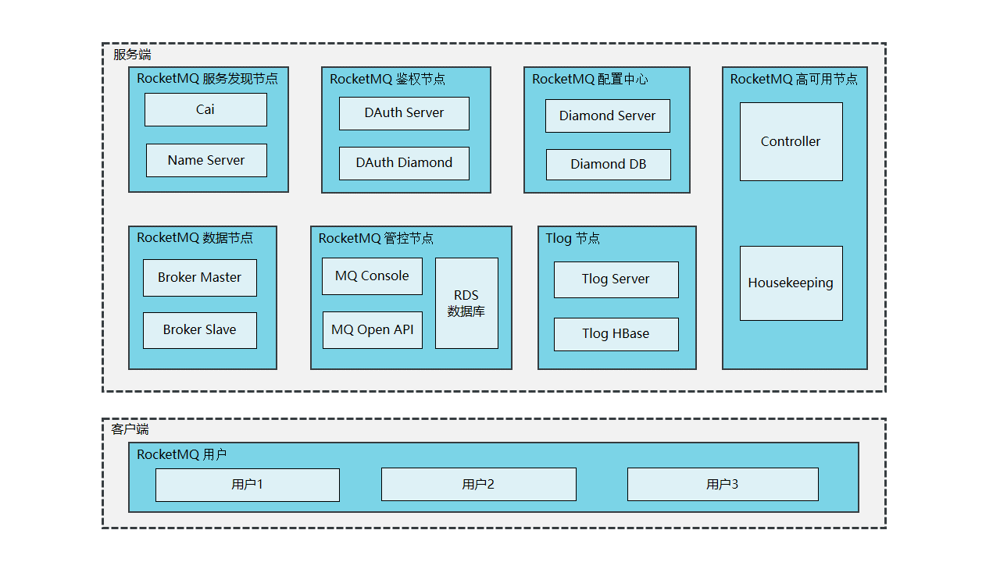

阿里云  
专有云  
消息队列 MQ  
运维指南  
产品版本：V3.18.6  
文档版本：20260107

**目录**

- [1.运维概述](#section-1)
    - [1.1. 产品架构](#section-1-1)
    - [1.2. 运维架构](#section-1-2)
    - [1.3. 产品更新说明](#section-1-3)
- [2.消息队列运维·RocketMQ](#section-2)
    - [2.1. 登录消息队列运维·RocketMQ控制台](#section-2-1)
    - [2.2. 概览](#section-2-2)
    - [2.3. Broker管理](#section-2-3)
    - [2.4. NameServer管理](#section-2-4)
    - [2.5. 元数据管理](#section-2-5)
    - [2.6. Copilot](#section-2-6)
        - [2.6.1. 热升级](#section-2-6-1)
        - [2.6.2. 容灾搭建](#section-2-6-2)
        - [2.6.3. 容灾解除](#section-2-6-3)
    - [2.7. 操作审计](#section-2-7)
- [3.高危操作](#section-3)
    - [3.1. 运维操作的危险级别定义](#section-3-1)
    - [3.2. 高危操作和文件](#section-3-2)
- [4.运维准备](#section-4)
- [5.例行维护](#section-5)
    - [5.1. 组件巡检监控](#section-5-1)
        - [5.1.1. 人工巡检](#section-5-1-1)
            - [5.1.1.1. Name Server的巡检](#section-5-1-1-1)
            - [5.1.1.2. RocketMQ Console的巡检](#section-5-1-1-2)
            - [5.1.1.3. RocketMQ Controller的巡检](#section-5-1-1-3)
            - [5.1.1.4. RocketMQ Broker的巡检](#section-5-1-1-4)
            - [5.1.1.5. Address Server（Cai）的巡检](#section-5-1-1-5)
            - [5.1.1.6. Diamond Server的巡检](#section-5-1-1-6)
            - [5.1.1.7. Dauth的巡检](#section-5-1-1-7)
            - [5.1.1.8. TLog Console的巡检](#section-5-1-1-8)
    - [5.2. 服务巡检监控](#section-5-2)
    - [5.3. 日志](#section-5-3)
- [6.运维命令](#section-6)
    - [6.1. 概述](#section-6-1)
    - [6.2. 查看所有运维命令](#section-6-2)
    - [6.3. 创建Topic](#section-6-3)
    - [6.4. 删除Topic](#section-6-4)
    - [6.5. 创建（修订）订阅组](#section-6-5)
    - [6.6. 删除订阅组](#section-6-6)
    - [6.7. 更新Broker配置](#section-6-7)
    - [6.8. 查看Topic列表信息](#section-6-8)
    - [6.9. 查看Topic路由信息](#section-6-9)
    - [6.10. 根据消息ID查询消息](#section-6-10)
    - [6.11. 根据消息offset查询消息](#section-6-11)
    - [6.12. 根据消息Key查询消息](#section-6-12)
    - [6.13. 查询Consumer的网络连接](#section-6-13)
    - [6.14. 查看订阅组消费状态](#section-6-14)
    - [6.15. 查看集群消息](#section-6-15)
    - [6.16. 获取Consumer消费进度](#section-6-16)
    - [6.17. 更新Topic读写权限](#section-6-17)
    - [6.18. 查看Topic所属集群](#section-6-18)
    - [6.19. 查看Broker状态](#section-6-19)
    - [6.20. 查看Topic指定时间的消息](#section-6-20)
    - [6.21. 查看Broker所有GID消费状态](#section-6-21)
    - [6.22. 查看Producer连接状态](#section-6-22)
    - [6.23. 重置消费位点](#section-6-23)
    - [6.24. 查看Topic统计信息](#section-6-24)
    - [6.25. 清除特定Broker权限](#section-6-25)
- [7.运维操作](#section-7)
    - [7.1. 实例限流运维操作](#section-7-1)
- [8.容量评估](#section-8)
    - [8.1. Name Server组件](#section-8-1)
    - [8.2. Broker组件](#section-8-2)
    - [8.3. TPS](#section-8-3)
    - [8.4. 磁盘使用率](#section-8-4)
- [9.日志参考](#section-9)

<a id="section-1"></a>

# 1.运维概述

本文介绍消息队列RocketMQ版（简称RocketMQ）的产品架构和运维架构。

<a id="section-1-1"></a>

## 1.1. 产品架构

本节内容旨在帮助您在运维过程中了解RocketMQ的系统架构和其中包含的各组件。

RocketMQ主要由RocketMQ服务发现节点、RocketMQ数据节点、RocketMQ鉴权节点、RocketMQ配置中心、Tlog、RocketMQ高可用节点等系统模块组成。

图 1. RocketMQ系统架构图



各模块和组件的介绍如下：

**RocketMQ服务发现节点**

RocketMQ服务发现节点由Name Server和Cai组成。

Cai主要用于Name Server和Diamond的地址发现。调用方通过Cai获得地址，并在本地缓存地址列表。

Name Server主要负责消息队列服务的注册与查找，是实现消息队列服务弹性部署和线性扩展的核心。RocketMQ Broker会把消息队列服务注册到Name Server并把Broker的状态同步到Name Server中。 生产者与消费者通过Name Server来查找到具体的Broker。在已启动的生产者与消费者在建立与Name Server的连接后，会缓存Broker与消息队列的信息，并周期性地从Name Server更新缓存信息。

**RocketMQ Broker**

消息队列服务器（RocketMQ Broker）是消息队列的核心处理模块，由多个服务节点组成服务集群，支持集群化、多副本部署，主备复制实现高可用。它提供高可用、稳定高效、可线性扩容的消息服务能力。

RocketMQ Broker管理Topic信息、发布订阅的连接，并把相关Topic注册到Name Server上，由Name Server提供服务发现与路由服务。RocketMQ Broker负责消息的收发以及消息的存储。

**RocketMQ Console**

Console用于为消息队列提供用户访问的外部界面服务，所有消息队列操作都可以通过RocketMQ Consoler实现。使用者优先考虑在Console上执行RocketMQ的操作。

**RocketMQ OpenAPI**

为方便用户接入、自主运维，RocketMQ OpenAPI通过HTTP/HTTPS接口的形式提供一整套API服务，用户可以通过OpenAPI创建Topic、Group信息、消息查询以及消费者状态查询等。

**RocketMQ 鉴权节点**

RocketMQ鉴权节点（DAuth）为消息队列提供统一登录服务以及安全访问控制。包括资源的权限控制、跨账号与子账号访问控制、资源授权等功能。

**RocketMQ 配置中心**

RocketMQ配置中心（Diamond）主要负责存储消息队列的配置信息，如VIP转换规则、资源权限信息等数据。

**Tlog**

Tlog收集消息队列的资源报表数据及其他关键日志。

**RocketMQ Controller**

用于高可用控制，提供RocketMQ Broker的主备切换功能。它通过与ZooKeeper组件交互来管理RocketMQ Broker集群状态，确保RocketMQ Broker节点主备状态的一致性。

**RocketMQ Housekeeping**

定时检查RocketMQ服务核心链路的健康状态，覆盖核心业务、内核参数、应用配置、应用监控指标和控制台等等，如果发现异常及时发出告警，确保RocketMQ集群高可用。

<a id="section-1-2"></a>

## 1.2. 运维架构

在您了解了RocketMQ的产品架构后，通过本文档希望帮忙您了解RocketMQ的运维架构。

RocketMQ的运维主要是借助命令行完成。

| 运维大类 | 描述 | 运维工具 |
| --- | --- | --- |
| 例行维护 | 包括巡检和监控。 | 命令行：对RocketMQ的容器、组件进行人工巡检。 |
| 停机维护 | • 检查、确认容器、组件状态。<br>• 停止、启动容器、组件。 | 命令行。 |
| 故障处理 | 主要处理RocketMQ的组件可用性故障、服务可用性故障和业务连续性故障。 | 通过命令行处理故障。 |

<a id="section-1-3"></a>

## 1.3. 产品更新说明

本文介绍消息队列RocketMQ版（简称RocketMQ）从V3.8.0到V3.18.3的产品更新说明，帮助您更快地上手更新后的版本。

**资源隔离优化（实例化支持）**

RocketMQ开放实例化功能，解决多租之间的隔离问题，每个用户可以购买多个实例，每个实例之间逻辑隔离。

为兼容老用户的既有资源，RocketMQ实例的命名空间分为两种：

- 默认实例（兼容老用户的既有资源）

  - 无独立命名空间，实例内或者跨实例之间，资源命名必须全局唯一。

  - 对RocketMQ老用户来说，既有资源将自动生成一个默认的无独立命名空间实例；无既有资源，则可选择创建不带命名空间的实例，最多创建1个。

  - 接入点配置（可在控制台**实例详情**页面中获取）。

    ```text
    // 推荐配置
    properties.put(PropertyKeyConst.NAMESRV_ADDR, "xxxx");
    // 兼容配置（不推荐继续使⽤, 建议逐渐升级为推荐配置）
    properties.put(PropertyKeyConst.ONSAddr, "xxxx");
    ```

- 新建实例

  - 有独立命名空间，资源命名确保实例内唯一，跨实例之间可重名。

  - 接入点配置（可在控制台**实例详情**页面中获取）。

    ```text
    // 推荐配置
    properties.put(PropertyKeyConst.NAMESRV_ADDR, "xxx");
    ```

  - ons-client客户端必须升级到最新版本：

    - JAVA：1.8.7.1.Final

    - C/C++：v2.0.0

    - .NET：1.1.3

**资源申请流程优化**

原RocketMQ的资源包括3个部分：消息主题（Topic）、生产者（Producer ID）、消费者（Consumer ID），三者之间都是多对多的对应关系，三者之间的关系复杂而难以理解；对于中、大型企业客户来说，每创建一个Topic，都要关联或者更新Producer ID和Consumer ID，流程过于复杂。

因此，为进一步优化用户体验，降低新用户的接入门槛，对资源申请的接入流程进行简化。

资源申请方面，主要包括以下部分：

- Topic管理（保持不变）

  - Topic资源申请，一级消息类型，通过Topic对消息进行分类。

- Group管理

  - 取消原Producer ID的申请，与原Consumer ID统一为Group ID，即对应控制台上，取消原生产者管理，与原消费者管理统一为Group管理。

  - 取消原申请Producer ID或Consumer ID时需要指定Topic的关联约束，只需申请Group ID即可在代码中直接配置与Topic的关联使用。

  - 兼容性相关问题

    - 原申请的Producer ID列表将不再显示，不影响当前业务的正常使用。

    - 原申请的以“CID-”或者“CID_”打头的Consumer ID仍可以正常使用，代码中既可在**PropertyKeyConst.ConsumerId**中设置，亦可在**PropertyKeyConst.GROUP_ID**中设置。

- 示例代码

  > **说明**
  >
  > - 建议您将ons-client客户端升级为最新版本：
  >
  >   - JAVA：1.8.7.1.Final
  >
  >   - C/C++：v2.0.0
  >
  >   - .NET：1.1.3
  >
  > - 原来已经在使用的Producer ID或者Consumer ID保持兼容，不影响当前在线业务的正常使用，但建议逐步替换为新的推荐配置方式。

  - 推荐方式：将Producer ID、Consumer ID的概念融合成Group ID。

    ```text
    // 设置PropertyKeyConst.GROUP_ID，原PropertyKeyConst.ProducerId和
    PropertyKeyConst.ConsumerId会被@Deprecated
    properties.put(PropertyKeyConst.GROUP_ID, "原CID-XXX或GID-XXX");
    ```

  - 兼容方式：Producer ID用来标识生产者，Consumer ID用来标识消费者。

    ```text
    // 创建Producer时需要配置PropertyKeyConst.ProducerId。
    properties.put(PropertyKeyConst.ProducerId, "原PID-XXX或GID-XXX");
    // 创建Consumer时需要配置PropertyKeyConst.ConsumerId。
    properties.put(PropertyKeyConst.ConsumerId, "原CID-XXX或GID-XXX");
    ```

<a id="section-2"></a>

# 2.消息队列运维·RocketMQ

<a id="section-2-1"></a>

## 2.1. 登录消息队列运维·RocketMQ控制台

本文介绍如何登录消息队列运维·RocketMQ控制台。

**前提条件**

- 已从部署人员或管理员处获取Apsara Uni-manager运维控制台的访问地址、用户名和密码。

  Apsara Uni-manager运维控制台访问地址格式为*region-id*.ops.console.*intranet-domain-id*。

- 推荐使用Chrome浏览器。

**操作步骤**

1. 打开浏览器。

2. 在地址栏中，输入Apsara Uni-manager运维控制台的访问地址，按回车键。

   

   > **说明**
   >
   > 您可以单击右上角的当前语言切换其它语言。当前支持简体中文、英文、繁体中文三种语言切换。

3. 输入正确的用户名及密码。

   > **说明**
   >
   > - 登录Apsara Uni-manager运维控制台的用户名和密码请从部署人员或管理员处获取。
   >
   > - 若连续输入密码错误三次，系统将启动图片验证码登录功能；若连续输入错误五次，账户将被锁定，请联系管理员进行激活。

   首次登录Apsara Uni-manager运维控制台时，需要修改登录用户名的密码，请按照提示完成密码修改。

   为提高安全性，密码必须满足以下要求：

   - 必须包含英文大小写字母。

   - 必须包含阿拉伯数字（0~9）。

   - 必须包含特殊符号，包括感叹号（!）、at（@）、井号（#）、美元符号（$）、百分号（%）等。

   - 密码长度为10~20个字符。

4. 单击**账号登录**。

5. 在顶部菜单栏，选择**产品运维 > 中间件运维 > 消息队列运维·RocketMQ** 。

<a id="section-2-2"></a>

## 2.2. 概览

本文介绍消息队列RocketMQ的核心功能与关键指标，帮助用户快速掌握RocketMQ实例的运行状态与健康情况。

**操作步骤**

1. 登录消息队列运维·RocketMQ控制台。

2. 系统默认进入**概览**页面，展示RocketMQ的指标概览、磁盘使用率与流入/流出TPS排名靠前的Broker信息，以及实时告警统计和最近5条告警记录。

   <table>
     <tr>
       <th width="213">区域</th>
       <th>描述</th>
     </tr>
     <tr>
       <td>指标概览</td>
       <td>• <strong>集群总数</strong>：当前环境下的RocketMQ集群数量。<br>• <strong>Broker总数</strong>：所有集群中在线的Broker的总数。单击<strong>Broker总数</strong>或下方的数字，可跳转至<strong>Broker管</strong><strong>理</strong>页面查看Broker的详细信息。<br>• <strong>Topic总数</strong>：系统中创建的Topic数量。<br>• <strong>Group总数</strong>：消费组的数量。<br>• <strong>实例总数</strong>：部署的RocketMQ实例数量。</td>
     </tr>
     <tr>
       <td>磁盘使用率 TOP Broker</td>
       <td>展示了磁盘使用率最高的几个Broker，包括每个Broker的名称和对应的IP地址及端口号，以及具体的磁盘使用率百分比。</td>
     </tr>
     <tr>
       <td>流入TPS TOP Broker</td>
       <td>展示消息流入速率最高的前四个Broker，单位为条/秒。</td>
     </tr>
     <tr>
       <td>流出TPS TOP Broker</td>
       <td>展示消息流出速率最高的前四个Broker，单位为条/秒。</td>
     </tr>
     <tr>
       <td>告警统计</td>
       <td>展示不同严重程度（<strong>P1严重</strong>、<strong>P2重要</strong>、<strong>P3一般</strong>、<strong>P4警</strong><strong>告</strong>）的告警总数。</td>
     </tr>
     <tr>
       <td>最近5条告警记录</td>
       <td>展示最近发生的5条告警记录，包括告警项、严重程度和告警时间。单击<strong>查看更多</strong>跳转至<strong>告警列表</strong>页面，可以查看完整的告警信息，包括未关闭的实时告警和已关闭历史告警。</td>
     </tr>
   </table>

<a id="section-2-3"></a>

## 2.3. Broker管理

本文介绍如何查看Broker的基本信息和配置信息。

**背景信息**

在RocketMQ中，Broker管理是确保消息系统高效、稳定运行的重要组成部分。Broker作为RocketMQ的核心组件之一，负责实际的消息存储、转发和查询等操作。

**查看Broker信息**

1. 登录消息队列运维·RocketMQ控制台。

2. 在左侧导航栏，单击**Broker 管理**。

3. 在**Broker管理**页面，选择**集群名称**。

4. （可选）您可通过Broker名称快速搜索Broker。

5. 在Broker列表中，查看Broker的基本信息。

   <table>
     <tr>
       <th width="118">参数</th>
       <th>描述</th>
     </tr>
     <tr>
       <td>Broker名称</td>
       <td>Broker组的唯一标识名称。</td>
     </tr>
     <tr>
       <td>主/备</td>
       <td>表示该Broker实例在其所属集群中的角色，是主节点还是备节点。</td>
     </tr>
     <tr>
       <td>主机IP</td>
       <td>单个Broker在网络中的地址，由IP地址和端口号组成。</td>
     </tr>
     <tr>
       <td>状态</td>
       <td>当前Broker的状态。<br>• <strong>readonly</strong>：表示该Broker处于只读模式。<br>• <strong>online</strong>：表示该Broker在线并正常工作。<br>• <strong>offline</strong>：表示该Broker离线，可能由于故障或其他原因无法提供服务。</td>
     </tr>
     <tr>
       <td>HA状态</td>
       <td>当前Broker实例的工作状态。<br>• <strong>SYNC_STATE</strong>：表示该Broker处于同步状态。<br>• <strong>ONLY_MASTER</strong>：表示该Broker是唯一的主节点，没有对应的备节点。<br>• <strong>ASYNC_STATE</strong>：表示该Broker处于异步状态，即数据正在从主节点同步到备节点。<br>• <strong>HAIF_STATE</strong>：表示该Broker处于半同步状态。</td>
     </tr>
     <tr>
       <td>流入TPS</td>
       <td>每秒流入的消息数量。单击流量，弹出<strong>业务生产流量分析</strong><strong>Top10</strong>对话框，查看当前生产者发送消息最多的前10个Topic，包括<strong>Topic</strong>、<strong>TPS</strong>以及<strong>Timestamp</strong>信息。</td>
     </tr>
     <tr>
       <td>流出TPS</td>
       <td>每秒流出的消息数量。单击流量，弹出<strong>业务消费流量分析</strong><strong>Top10</strong>对话框，查看当前消费量最高的前10个Topic及其对应的Consumer Group，包括<strong>Topic</strong>、<strong>Group</strong>、<strong>TPS</strong>以及<strong>Timestamp</strong>信息。</td>
     </tr>
   </table>

6. 在**Broker管理**页面，单击Broker名称或**操作**列的**查看**，可查看Broker的详细信息。

   - 在**基本信息**页签，查看Broker的**基础信息**和**关键指标**。

     - **基础信息**：查看Broker的主备节点信息。

     - **关键指标**：查看Broker的**发送tps**、**拉取tps**、**磁盘占用率**、**磁盘空间**、**保存时长**等信息，同时分析一段时间内的**in/out tps**、**CPU**、**内存**、**磁盘IO**和**网络IO**的趋势图。支持按**15分钟**、**1小时**、 **6小时**或自定义时间进行切换。

   - 在**配置信息**页签，可查看配置项的**键**、**值**以及**描述**信息。单击**操作**列的**修改**，可修改**配置值**。

   - 在**VPC管理**页签，查看Broker集群的VPC网络信息，包括**VPC ID/名称**、**交换机ID**、**地域**、**集群**、**broker VIP**和**nameserver VIP。**

**禁写Broker**

在RocketMQ中，对Broker执行禁写操作通常是为了避免在维护、故障排查或紧急情况下继续向Broker写入新消息，从而防止数据不一致或其他潜在问题的发生。

> **说明**
>
> 仅**状态**为**online**的Broker节点支持禁写。

1. 登录消息队列运维·RocketMQ控制台。

2. 在左侧导航栏，单击**Broker 管理**。

3. 在**Broker管理**页面，单击**操作**列的**禁写**。

4. 在弹出的对话框中，单击**确定**。

**恢复Broker**

若需要继续向Broker写入新消息，可解除Broker的禁写。

> **说明**
>
> 仅状态为**readonly**的Broker节点支持禁写。

1. 登录消息队列运维·RocketMQ控制台。

2. 在左侧导航栏，单击**Broker 管理**。

3. 在**Broker管理**页面，单击**操作**列的**解除禁写**。

4. 在弹出的对话框中，单击**确定**。

**下线/上线Broker**

1. 登录消息队列运维·RocketMQ控制台。

2. 在左侧导航栏，单击**Broker 管理**。

3. 在**Broker管理**页面，单击**操作**列的**下线**/**上线**。

4. 在弹出的对话框中，单击**确定**。

**重启Broker**

1. 登录消息队列运维·RocketMQ控制台。

2. 在左侧导航栏，单击**Broker 管理**。

3. 在**Broker管理**页面，单击**操作**列的**重启**。

4. 在弹出的对话框中，单击**确定**。

<a id="section-2-4"></a>

## 2.4. NameServer管理

本文介绍如何查看NameServer节点的信息。

**背景信息**

RocketMQ运维控制台中的NameServer管理模块主要用于管理和监控RocketMQ集群中的NameServer节点。NameServer在RocketMQ中扮演着非常重要的角色，它主要负责服务发现和路由信息管理，是消息生产者、消费者与Broker之间通信的枢纽。

**操作步骤**

1. 登录消息队列运维·RocketMQ控制台。

2. 在左侧导航栏，单击**NameServer 管理**。

3. 在**NameServer 管理**页面，查看NameServer节点的**IP地址**、**端口**、**状态**以及**连接数**等信息。

   <table>
     <tr>
       <th width="76">参数</th>
       <th>说明</th>
     </tr>
     <tr>
       <td>IP地址</td>
       <td>NameServer节点在网络中的标识符，用于客户端（生产者、消费者）与NameServer进行通信。每个NameServer都有一个独立的IP地址。</td>
     </tr>
     <tr>
       <td>端口</td>
       <td>客户端与NameServer通信时使用的网络端口号。</td>
     </tr>
     <tr>
       <td>状态</td>
       <td>NameServer节点的运行状况。</td>
     </tr>
     <tr>
       <td>连接数</td>
       <td>当前与NameServer建立连接的客户端数量，包括生产者、消费者和Broker。</td>
     </tr>
   </table>

4. 单击**操作**列的**详情**，在弹出的**详情**对话框中，查看NameServer节点的Key、value信息。

<a id="section-2-5"></a>

## 2.5. 元数据管理

本文介绍如何查看和管理RocketMQ 4.x集群所关联的VPC网络配置信息。

**操作步骤**

1. 登录消息队列运维·RocketMQ控制台。

2. 在左侧导航栏，单击**元数据管理**。

3. 在**元数据管理**可查看当前RocketMQ 4.x实例的VPC和配置信息。

   - 在**VPC管理**页签，可查看RocketMQ 4.x实例绑定的VPC信息，包括**VPC ID**和**VPC名称**。单击**查看broker**，可查看该VPC下的Broker列表，包括**Broker地址**、**Broker VIP**、**Nameserver VIP**、**实例ID**、**集群**以及**交换机ID**。

   - 单击**配置管理**页签，您可以查看配置项及其描述信息，并对配置项进行修改。

     修改配置值：单击**操作**列的**修改**，设置**集群**和**配置值**，然后单击**确定**。

     | 参数 | 说明 |
     | --- | --- |
     | 集群 | 下拉选择要修改的集群。 |
     | 配置值 | • 开启：启用写入认证。<br>• 关闭：禁用写入认证。 |

     > **重要**
     >
     > 修改操作将统一更新集群内所有Broker的相关配置项的配置值，请谨慎执行。

<a id="section-2-6"></a>

## 2.6. Copilot

<a id="section-2-6-1"></a>

### 2.6.1. 热升级

本文介绍如何创建热升级任务。

**背景信息**

RocketMQ热升级指的是在不中断服务的情况下对RocketMQ进行版本更新或配置调整，以减少系统停机时间并维持业务的连续性。

**前提条件**

当前系统存在升级审批任务。

**操作步骤**

1. 登录消息队列运维·RocketMQ控制台。

2. 在左侧导航栏，单击**热升级**。

3. 在**热升级**页面，单击**创建热升级任务**。

4. 在弹出的对话框中，单击**确定**，生成热升级任务列表。

   <table>
     <tr>
       <th width="124">参数</th>
       <th>说明</th>
     </tr>
     <tr>
       <td>Broker 名称</td>
       <td>Broker组的唯一标识名称。</td>
     </tr>
     <tr>
       <td>Broker 地址</td>
       <td>单个Broker在网络中的地址，由IP地址和端口号组成。</td>
     </tr>
     <tr>
       <td>主备</td>
       <td>表示该Broker实例在其所属集群中的角色，是主节点还是备节点。</td>
     </tr>
     <tr>
       <td>HA状态</td>
       <td>当前Broker实例的工作状态。<br>• <strong>SYNC_STATE</strong>：表示该Broker处于同步状态。<br>• <strong>ONLY_MASTER</strong>：表示该Broker是唯一的主节点，没有对应的备节点。<br>• <strong>ASYNC_STATE</strong>：表示该Broker处于异步状态，即数据正在从主节点同步到备节点。<br>• <strong>HAIF_STATE</strong>：表示该Broker处于半同步状态。</td>
     </tr>
     <tr>
       <td>更新时间</td>
       <td>HA状态最后一次更新或检查的时间。</td>
     </tr>
     <tr>
       <td>升级状态</td>
       <td>当前Broker的升级状态。</td>
     </tr>
     <tr>
       <td>是否禁写</td>
       <td>是否禁止向该Broker写入消息。<br>• <strong>是</strong>：表示当前禁止向该Broker写入消息。<br>• <strong>否</strong>：表示允许向该Broker写入消息。</td>
     </tr>
     <tr>
       <td>流入TPS</td>
       <td>每秒流入的消息数量。单击流量，弹出<strong>业务生产流量分析</strong><strong>Top10</strong>对话框，查看当前生产者发送消息最多的前10个Topic，包括<strong>Topic</strong>、<strong>TPS</strong>以及<strong>Timestamp</strong>信息。</td>
     </tr>
     <tr>
       <td>流出TPS</td>
       <td>每秒流出的消息数量。单击流量，弹出<strong>业务消费流量分析</strong><strong>Top10</strong>对话框，查看当前消费量最高的前10个Topic及其对应的Consumer Group，包括<strong>Topic</strong>、<strong>Group</strong>、<strong>TPS</strong>以及<strong>Timestamp</strong>信息。</td>
     </tr>
   </table>

5. 确认需要升级的Broker集群相应的Broker的**HA状态**为**SYNC_STATE**。

   > **说明**
   >
   > 本文仅以一组操作为例，其他组的操作步骤参照步骤6至步骤9。

6. 禁写操作组的节点。

   在**热升级**页面，依次单击一组主备节点**操作**列的**禁写**，然后单击**确定**。

7. 升级主备节点。

   <ol type="i">

   <li>

   待主备节点**升级状态**为**可升级**后，单击主节点**操作**列的**升级**，然后单击**确定**。

   </li>

   <li>

   待主节点**升级状态**为**升级完成**后，单击备节点**操作**列的**升级**，然后单击**确定**。

   </li>

   </ol>

8. 恢复操作组的节点。

   待主备节点**升级状态**均为**升级完成**且**HA状态**为**SYNC_STATE**后，依次单击主备节点**操作**列的**解除禁写**，然后单击**确定**。

<a id="section-2-6-2"></a>

### 2.6.2. 容灾搭建

本文介绍如何搭建单集群容灾以及扩容容灾集群。

**背景信息**

在交付阶段结束后，提升消息队列容灾搭建的效率，以降低对线上业务的影响。容灾关系的搭建属于运维阶段，由运维人员进行排期并执行相关变更。

**前提条件**

- 检查集群状态为正常。

- 主备机房的升级及扩容应遵循标准流程。

此时，主机房已正常启动，而备机房则处于阻塞状态。通过broker_location，可以查看到主备节点的信息，主机房已成功分配broker_name。

**注意事项**

- 容灾搭建不支持包含全局顺序消息Topic的集群。

- 请检查主备机房所有RocketMQ的Broker所在物理机的机型信息。

  - 确保一组主备使用相同的机型和磁盘容量。

  - 选择备机房节点进行主备搭建时，确保选择的备机房节点和主机房的节点机型一致。

  - 如果从备机房中无法选择到和主机房相同的机型，请谨慎搭建或提工单联系规划人员评估机型风险。

**单集群容灾搭建**

> **说明**
>
> 任务完成或者未完成状态都支持结束任务，单击**结束容灾任务**会清空任务信息表。

1. 登录消息队列运维·RocketMQ控制台。

2. 在左侧导航栏，单击**容灾搭建**。

3. 在**容灾搭建**页面，单击**创建容灾搭建任务**。

4. 在弹出的对话框中，选择**集群**和**主机房**，然后单击**确定**。此操作将触发任务创建，系统会检查是否存在未完成的搭建任务。如果不存在，则同步现有集群信息到新任务中，扩容的主机房Broker会显示在列表末尾，待上线，同时会缓存集群内某个主Broker的元数据。

   <table>
     <tr>
       <th width="124">参数</th>
       <th>说明</th>
     </tr>
     <tr>
       <td>Broker 名称</td>
       <td>Broker组的唯一标识名称。</td>
     </tr>
     <tr>
       <td>Broker 地址</td>
       <td>单个Broker在网络中的地址，由IP地址和端口号组成。</td>
     </tr>
     <tr>
       <td>主备</td>
       <td>表示该Broker实例在其所属集群中的角色，是主节点还是备节点。</td>
     </tr>
     <tr>
       <td>状态</td>
       <td>当前Broker实例的工作状态。<br>• <strong>SYNC_STATE</strong>：表示该Broker处于同步状态。<br>• <strong>ONLY_MASTER</strong>：表示该Broker是唯一的主节点，没有对应的备节点。<br>• <strong>ASYNC_STATE</strong>：表示该Broker处于异步状态，即数据正在从主节点同步到备节点。<br>• <strong>HAIF_STATE</strong>：表示该Broker处于半同步状态。</td>
     </tr>
     <tr>
       <td>流入TPS</td>
       <td>每秒流入的消息数量。单击流量，弹出<strong>业务生产流量分析</strong><strong>Top10</strong>对话框，查看当前生产者发送消息最多的前10个Topic，包括<strong>Topic</strong>、<strong>TPS</strong>以及<strong>Timestamp</strong>信息。</td>
     </tr>
     <tr>
       <td>流出TPS</td>
       <td>每秒流出的消息数量。单击流量，弹出<strong>业务消费流量分析</strong><strong>Top10</strong>对话框，查看当前消费量最高的前10个Topic及其对应的Consumer Group，包括<strong>Topic</strong>、<strong>Group</strong>、<strong>TPS</strong>以及<strong>Timestamp</strong>信息。</td>
     </tr>
     <tr>
       <td>是否禁写</td>
       <td>是否禁止向该Broker写入消息。<br>• <strong>是</strong>：表示当前禁止向该Broker写入消息。<br>• <strong>否</strong>：表示允许向该Broker写入消息。</td>
     </tr>
     <tr>
       <td>idc room</td>
       <td>所属机房或数据中心名称。</td>
     </tr>
   </table>

> **说明**
>
> 本文仅以一组操作为例，其他组的操作步骤参照步骤5至步骤10。

5. 禁写操作组的节点。

   在**容灾搭建**页面，依次单击主备节点**操作**列的**禁写**，然后单击**确定**。此操作将禁用所对应节点的写入功能，观察流量下降为0。

6. 下线备节点。

   <ol type="i">

   <li>

   当流量降为0后，单击备节点操作列的**下线**，然后单击**确定**，将下线该节点，并删除对应的BrokerName，清理store目录下 `broker.conf` 、 `/config/topics.json` 和 `/config/subscriptionGroup.json` 之外的其余文件。

   > **说明**
   >
   > 下线备节点后，主节点状态变为**ONLY_MASTER**。

   </li>

   </ol>

7. 为操作组的主节点新增备节点<strong>。</strong>

   > **说明**
   >
   > 下线备节点后，主机房操作组的主节点**操作**列会显示**新增备节点**按钮。

   单击**新增备节点**，选择备节点并单击**确定**，将挂载备机房的备节点一，并将缓存的元数据同步至该Broker，设置该Broker为禁读禁写状态，同时会在broker_name插入备节点一。

8. 将操作组原备节点提升为主节点（上线）。

   > **说明**
   >
   > 下线备节点后，主机房操作组已下线的备节点**操作**列会显示**上线**按钮。

   在挂载备机房备节点一之后，单击**上线**，然后单击**确定**，会设置该Broker为新主节点，将缓存的元数据同步至该Broker，并设置该Broker为禁读禁写状态，申请BrokerName并插入数据库，最后重启容器。

9. 为操作组的新主节点新增备节点。

   > **说明**
   >
   > 操作组原备节点升为主节点后，**操作**列会显示**新增备节点**按钮。

   单击**新增备节点**，选择备节点并单击**确定**，将挂载备机房的备节点二，并将缓存的元数据同步至该Broker，设置该Broker为禁读禁写状态，同时会在broker_name插入备节点二。

0. 解除禁写<strong>。</strong>

   依次单击主备节点**操作**列的**解除禁写**，然后单击**确定**，解禁当前节点的写入，观察流量上升。

**容灾集群扩容**

> **说明**
>
> 任务完成或者未完成状态都支持结束任务，单击**结束容灾任务**会清空任务信息表。

1. 登录消息队列运维·RocketMQ控制台。

2. 在左侧导航栏，单击**容灾搭建**。

3. 在**容灾搭建**页面，单击**创建容灾搭建任务**。

4. 在弹出的对话框中，选择**集群**和**主机房**，然后单击**确定**。此操作将触发任务创建，系统会检查是否存在未完成的搭建任务。如果不存在，则同步现有集群信息到新任务中，扩容的主机房Broker会显示在列表末尾，待上线，同时会缓存集群内某个主Broker的元数据。

5. 上线主机房新扩容的Broker。

   存在新扩容的Broker时，主机房操作组的已下线备Broker或者新Broker会显示**上线**按钮，单击**上线**，然后单击**确定**，会设置该Broker为新主节点，将缓存的元数据同步至该Broker，并设置该Broker为禁读禁写状态，申请BrokerName并插入数据库，最后重启容器。

6. 为操作组的新主节点新增备节点。

   > **说明**
   >
   > 操作组原备节点升为主节点后，**操作**列会显示**新增备节点**按钮。

   单击**新增备节点**，选择备节点并单击**确定**，将挂载备机房的备节点二，并将缓存的元数据文件同步至该Broker，设置该Broker为禁读禁写状态，同时会在broker_name插入备节点二。

<a id="section-2-6-3"></a>

### 2.6.3. 容灾解除

本文介绍如何解除容灾关系。

**背景信息**

解除集群中Broker的容灾关系，使容灾集群缩容为单机房集群，也可以进行集群迁移或 XC 轮转。

**前提条件**

- 检查集群状态为正常。

- 主备机房的升级及扩容应遵循标准流程。

- 确保主节点部署在主机房。

**适用范围**

- 容灾机房转换成单机房。

- 集群跨机房迁移。

- XC 轮转。

**操作步骤**

> **说明**
>
> 以下操作以一组Broker为例，其他组的操作步骤亦相同。

1. 登录消息队列运维·RocketMQ控制台。

2. 在左侧导航栏，单击**容灾解除**。

3. 在**容灾关系解除**页面，选择**集群名称**。

4. 列表展示Broker的基本信息。

   <table>
     <tr>
       <th width="118">参数</th>
       <th>描述</th>
     </tr>
     <tr>
       <td>Broker名称</td>
       <td>Broker组的唯一标识名称。</td>
     </tr>
     <tr>
       <td>主/备</td>
       <td>表示该Broker实例在其所属集群中的角色，是主节点还是备节点。</td>
     </tr>
     <tr>
       <td>主机IP</td>
       <td>单个Broker在网络中的地址，由IP地址和端口号组成。</td>
     </tr>
     <tr>
       <td>状态</td>
       <td>当前Broker的状态。<br>• <strong>readonly</strong>：表示该Broker处于只读模式。<br>• <strong>online</strong>：表示该Broker在线并正常工作。<br>• <strong>offline</strong>：表示该Broker离线，可能由于故障或其他原因无法提供服务。</td>
     </tr>
     <tr>
       <td>HA状态</td>
       <td>当前Broker实例的工作状态。<br>• <strong>SYNC_STATE</strong>：表示该Broker处于同步状态。<br>• <strong>ONLY_MASTER</strong>：表示该Broker是唯一的主节点，没有对应的备节点。<br>• <strong>ASYNC_STATE</strong>：表示该Broker处于异步状态，即数据正在从主节点同步到备节点。<br>• <strong>HAIF_STATE</strong>：表示该Broker处于半同步状态。</td>
     </tr>
     <tr>
       <td>流入TPS</td>
       <td>每秒流入的消息数量。单击流量，弹出<strong>业务生产流量分析</strong><strong>Top10</strong>对话框，查看当前生产者发送消息最多的前10个Topic，包括<strong>Topic</strong>、<strong>TPS</strong>以及<strong>Timestamp</strong>信息。</td>
     </tr>
     <tr>
       <td>流出TPS</td>
       <td>每秒流出的消息数量。单击流量，弹出<strong>业务消费流量分析</strong><strong>Top10</strong>对话框，查看当前消费量最高的前10个Topic及其对应的Consumer Group，包括<strong>Topic</strong>、<strong>Group</strong>、<strong>TPS</strong>以及<strong>Timestamp</strong>信息。</td>
     </tr>
   </table>

5. 禁写操作组主备节点。

   在**容灾关系解除**页面，依次单击主备节点**操作**列的**禁写**，然后单击**确定**。此操作将禁用所对应节点的写入功能，观察流量下降为0。

6. 单击操作组备节点**操作**列的**解除容灾关系**，然后单击**确定**。此操作将停止该Broker，并从broker_name表中移除该节点。

7. 解除容灾关系后，将支持清理元数据。单击操作组备节点**操作**列的**清理数据**，将删除 `/home/admin/store/broker.conf` 、  `/home/admin/store/config/topics.json` 和 `/home/admin/store/config/subscriptionGroup.json` 之外的其他文件。

<a id="section-2-7"></a>

## 2.7. 操作审计

本文介绍如何查看所有对RocketMQ 4.x集群执行的操作日志。

**操作步骤**

1. 登录消息队列运维·RocketMQ控制台。

2. 在左侧导航栏，单击**操作审计**。

3. （可选）您可以通过选择**操作类型**，输入**操作人**以及设置**操作时间**快速筛选操作日志。

4. 在操作日志列表中，可以获取**ID**、**操作人ID/名称**、**部门ID**、**操作类型**、**操作时间**、**操作项**以及**操作参数**。

<a id="section-3"></a>

# 3.高危操作

<a id="section-3-1"></a>

## 3.1. 运维操作的危险级别定义

所有运维操作按业务场景和操作的危险程度被分为三级：G1、G2、G3。

各级别定义如下：

- G1：L1/L2可以根据文档完成操作，不需要做变更申请，该操作按文档执行完全安全，该操作不会对业务产生影响。

- G2：L1/L2驻场人员可以根据文档指引，需要做变更申请，向产品侧咨询确认方可执行操作。该操作不会对业务产生影响。

- G3：L1/L2驻场人员可以根据文档指引，需要做变更申请，向产品侧以及客户侧咨询确认方可执行操作（提工单）。该操作有可能对业务产生影响。

<a id="section-3-2"></a>

## 3.2. 高危操作和文件

本节将列出您在运维时需格外注意的高危运维操作和不能随意清理的高危文件。

**高危操作**

高危操作即上文提到的**G3**级别的运维操作，进行该类操作时请按照相应的指导进行。

**高危文件**

高危文件是指不能被随意清理的文件，需要您在处理文件时注意以下事项：

- 从文件产生到现在都没有动态增长的文件原则上不能清理。如需要清理（如一些陈旧的包，升级时遗留下来不再使用的版本），需要与产品，客户进行确认。

- 配置文件不能清理。所有conf目录下的内容都是受保护的。

- 应用程序包目录下的文件不能清理。

- 当前正在使用的日志文件不能清理。例如日志文件有mw.log和mw-2018-07-22.log， 这种场景下，当前生效的文件mw.log不能被清理。

- 对于RocketMQ Broker的高危文件，RocketMQ Broker会自主管理这些文件，不能主动清理。

表 1. 高危文件

| 文件名称 | 用途 | 说明 |
| --- | --- | --- |

<table>
  <tr>
    <td>/home/admin/store/commitlog/*</td>
    <td>消息存储文件，用于存放生产者提交的消息，属于数据文件。</td>
    <td>• 每个文件的大小由/home/admin/rmq/conf/broker.conf中的配置项<strong>mapedFileSizeCommitLog</strong>决定，默认值为1G。<br>• 删除旧数据的执行时间由/home/admin/rmq/conf/broker.conf中的配置项<strong>deleteWhen</strong>决定，默认值为每天早上4:00。<br>• 空间使用率到多大时开始清理旧数据，由home/admin/rmq/conf/broke r.conf中的配置项<strong>diskMaxUsedSpaceRatio</strong>决定，默认值为 75%。<br>• 当磁盘满时是否强制删除旧文件，由home/admin/rmq/conf/broke r.conf中的配置项<strong>leanFileForciblyEnable</strong>决定。</td>
  </tr>
  <tr>
    <td>/home/admin/store/config/consu merOffset.json</td>
    <td>消费位点存储文件。</td>
    <td>RocketMQ Broker会自主管理该文件，不能主动清理。</td>
  </tr>
  <tr>
    <td>/home/admin/store/config/delayO ffset.json</td>
    <td>重试消息队列的消费位点。</td>
    <td>RocketMQ Broker会自主管理该文件，不能主动清理。</td>
  </tr>
  <tr>
    <td>/home/admin/store/config/subscri ptionGroup.json</td>
    <td>订阅组配置。</td>
    <td>RocketMQ Broker会自主管理该文件，不能主动清理。</td>
  </tr>
  <tr>
    <td>/home/admin/store/config/topics.j son</td>
    <td>topic配置。</td>
    <td>RocketMQ Broker会自主管理该文件，不能主动清理。</td>
  </tr>
</table>

<a id="section-4"></a>

# 4.运维准备

本文介绍运维时需要的登录入口、账号、权限和工具。

表 1. 运维准备说明

| 名称 | 作用 | 说明 |
| --- | --- | --- |
| SSH远程登录工具（如<em>MobaXterm</em>或<em>PuTTY</em>） | 登录组件所在的机器。 | 登录使用的账号需要具有相应的操作权限。但不建议直接使用root或admin账号。 |
| 账号 | 用于登录控制台或具体机器。 | • 控制台的登录账号和密码请向RocketMQ技术支持人员获取。<br>• 登录RocketMQ机器组件所在机器使用的账号需要具有相应的操作权限。但不建议直接使用root或admin账号。 |

<a id="section-5"></a>

# 5.例行维护

RocketMQ的例行巡检监控包含组件巡检监控和服务巡检监控两部分。

**组件巡检监控**

组件巡检监控是指对RocketMQ各系统组件的状态进行监测，包括Cai、Name Server、Broker、Controller、Console和Housekeeping。

**服务巡检监控**

服务巡检监控是指对RocketMQ的核心链路进行运行时巡检和监控，覆盖核心业务、内核参数、应用配置、应用指标（Metrics）和控制台等。

<a id="section-5-1"></a>

## 5.1. 组件巡检监控

RocketMQ的组件巡检监控主要有以下内容：

- 巡检：周期性地拨测URL或端口等来判断RocketMQ的组件运行是否正常。目前支持的巡检方式有：HTTP、TCP、PING和JDBC。

- 监控：通过TLog从客户机搜集日志并按一定方式汇聚出关键指标，以此来衡量系统运行状况，包括容器监控和其他自定义指标的监控。

<a id="section-5-1-1"></a>

### 5.1.1. 人工巡检

人工巡检使用的命令为Linux系统通用的命令，具体参数需要根据实际环境设置。

<a id="section-5-1-1-1"></a>

#### 5.1.1.1. Name Server的巡检

1. 登录Name Server容器。

2. Name Server运行时是一个Java进程，通过PS命令查看进程状态是否正常运行： `ps aux|grep -i NamesrvStartup` 。

3. 通过 `ss -s`  命令，检查网络连接数，如果连接数超过规格半数以上，请联系运维工程师处理。

<a id="section-5-1-1-2"></a>

#### 5.1.1.2. RocketMQ Console的巡检

RocketMQ Console 是一个部署在Tomcat内部的Web系统，因此巡检需考虑如下几方面：

1. 登录RocketMQ Console容器。

2. 检查Tomcat进程是否存在，7001端口是否开通：  `netstat -an |grep 7001` 。

3. 检查Nginx进程是否存在，80端口是否能够正常转发到7001。

4. 检查/home/admin/logs/ons-api/\*.log中是否存在明显的异常。

5. 检查/home/admin/ons-api/logs 中是否需要清理无用的日志文件。

6. 检查/home/admin对应磁盘是否有足够的容量。

<a id="section-5-1-1-3"></a>

#### 5.1.1.3. RocketMQ Controller的巡检

1. 登录RocketMQ Controller容器。

2. RocketMQ Controller运行时是一个Java进程，通过PS命令查看进程状态是否正常运行： `ps aux|grep -i FailoverStartUp` 。

3. 通过 `grep 'take the leadership of role' /home/admin/logs/rocketmqlogs/failover_controller.log` 可以确认两台Controller中哪一台正在负责主备切换的工作。

4. 检查 `/home/admin/logs/rocketmqlogs/*.log` 中是否存在明显的异常。

<a id="section-5-1-1-4"></a>

#### 5.1.1.4. RocketMQ Broker的巡检

1. 登录RocketMQ Broker容器。

2. 执行命令 `ps aux|grep brokerStartup` ，查看进程信息。

3. 执行命令 `ss -s` ，检查连接数，如果连接数大于规格半数以上，请联系售后工程师处理。

4. 查看RocketMQ Broker相关的日志，路径为/home/admin/logs/rocketmqlogs/。

5. 检查磁盘容量： `df -h` ，确保磁盘使用率小于80%。

6. 检查/home/admin/store路径下的配置是否存在：

   - /home/admin/store/config/consumerOffset.json：消费位点存储文件。

   - /home/admin/store/config/delayOffset.json：定时消息消费位点。

   - /home/admin/store/config/subscriptionGroup.json：订阅组配置。

   - /home/admin/store/config/topics.json：Topic配置。

   - /home/admin/store/consumequeue：消费索引文件存储文件，以Topic维度进行存储。

   - /home/admin/store/index：key查询索引文件。

7. 发消息之后，查看消息存储文件commitlog：

   <ol type="i">

   <li>

   查看/home/admin/store/commitlog目录下是否有文件产生。

   </li>

   <li>

   在目录du –sh /home/admin/store/commitlog/\* 下查看文件是否有新的数据写入。

   </li>

   <li>

   检查当前服务器的收发情况，执行 `sh /home/admin/rmq/bin/mqadmin clusterlist` 命令，查看集群内各节点的收发情况。

   </li>

   </ol>

<a id="section-5-1-1-5"></a>

#### 5.1.1.5. Address Server（Cai）的巡检

1. 登录Address Server（Cai）容器。

   AddressServer是一个Nginx进程模块，默认开启HTTP端口是8080。

2. 执行命令 `curl -v 'http://localhost:8080/rocketmq/nsaddr4broker-internal'` ，检查地址服务器上Name Server的配置信息。返回状态码为200，同时返回/home/admin/cai/htdocs/rocketmq/nsaddr4broker-internal配置中的内容表明正常。

<a id="section-5-1-1-6"></a>

#### 5.1.1.6. Diamond Server的巡检

1. 登录Diamond Server容器。

2. 磁盘空间检查，避免磁盘满导致Diamond服务异常： `df –lh` 。

3. 确保系统内存，CPU在正常范围： `top` 。

4. 确保地址服务器正常连接，且不能延迟太大（内网10 ms以下）： `ping jmenv.tbsite.net -c 3` 。

5. 确保每个Diamond Server彼此能相互连接，网络延迟不能太大，执行一下脚本，循环ping所有的Diamond Server。

6. 确保Diamond服务压力在可控范围内，单机QPS极限4000左右，建议单机QPS不超过500，load少于CPU核数，CPU不超过20%： `tsar --nginx --load --cpu -l -i3` 。

<a id="section-5-1-1-7"></a>

#### 5.1.1.7. Dauth的巡检

Dauth 是一个部署在Tomcat内部的Web系统，因此巡检考虑以下几方面：

1. 登录Dauth容器。

2. 检查Tomcat进程是否存在，8080端口是否已开通。

3. 检查Nginx进程是否存在，80端口是否能够正常转发到8080。

4. 检查/home/admin/dauth/logs/\*.log中是否存在明显的异常。

5. 检查/home/admin/dauth/logs中是否存在需要清理的无用日志文件。

6. 执行curl 'localhost:8080'|grep Unsupported命令，若返回结果中有“Unsupported”字段，说明服务正常。

7. 检查/home/admin对应磁盘是否有足够的容量。

8. Dauth也是Diamond的客户端，因此需要巡检以下方面：

   - /home/admin/logs/diamond-client/diamond-client.log中是否有明显异常。

   - 执行如下 `curl 'http://jmenv.tbsite.net:8080/diamond-server/diamond-unit-spas'` 命令，返回diamond spas单元的服务器列表，ping每台机器，确保延迟在10 ms以下。

<a id="section-5-1-1-8"></a>

#### 5.1.1.8. TLog Console的巡检

- 登录TLog Console容器。

- 检查Tomcat进程： `ps aux|grep tomcat` 。

- 检查磁盘容量： `df -h` 。

- 检查访问是否正常： `curl -v 'http://localhost'` 。

<a id="section-5-2"></a>

## 5.2. 服务巡检监控

RocketMQ的服务巡检是通过Housekeeping组件执行。

Housekeeping会周期性地巡检RocketMQ的各个监控项（注意：当前的监控项都是固定配置的，不支持变更），并把告警信息输出到Housekeeping容器中的位置/home/admin/logs/aliware-mq-hkagent/warning.log。

<a id="section-5-3"></a>

## 5.3. 日志

日志是RocketMQ运维的重要方式之一，主要用于监控及故障处理。所以需要对日志进行例行的维护。

RocketMQ的日志主要包括基础监控日志、服务监控日志、容器监控日志和JVM监控日志。详细信息请参考《日志参考》。

<a id="section-6"></a>

# 6.运维命令

后端运维命令是提供给有经验的运维工程师使用的，请优先选择使用控制台执行相关的命令。

<a id="section-6-1"></a>

## 6.1. 概述

消息队列提供一个后台运维工具，帮助您进行日常运维。此运维工具在目录/home/admin/rmq/bin下，文件名是sh mqadmin 。

运维的命令需要登录到mq-namesrv或mq-broker的容器上执行，步骤如下：

1. 执行以下命令登录容器。

   ```bash
   docker exec -it <namesrv或broker的容器id> /bin/bash
   ```

2. 执行以下命令进入运行目录。

   ```bash
   cd /home/admin/rmq/bin
   ```

**命令语法示例**

在mq-broker中使用cd命令跳转到bin目录后通过此工具执行相关指令，例如：

- 展示所有支持的指令： `./mqadmin`

- 展示指令clusterList的帮助文档（用法及参数）： `./mqadmin help clusterList`

- 运行指令clusterList，展示cluster列表及详细信息： `./mqadmin clusterList -m`

指令clusterList的用法描述为： `mqadmin clusterList [-h] [-i <arg>] [-m] [-n <arg>]` ，其中的参数用法如下：

- `-h` 、  `-i`  、 `-m` 和 `-n` 是参数短标识，有相应标识表示指定了相应选项和参数。

- 用法描述中用方括号括起的参数标识表示可选参数，可以不指定。

- 用法描述中用尖括号括起的arg表示此参数如果指定则需要一个具体的参数值，例如 `./mqadmin clusterList -i 3 -m` 。

**资源命名**

从V3.8.1版本开始，针对有命名空间和无命名空间的实例所包含的资源命名有所变更。具体说明如下：

- Topic命名

  - 有命名空间的实例：instanceid%topic。

  - 无命名空间的实例：topic。

- Group ID命名

  - 有命名空间的实例：instanceid%gid。

  - 无命名空间的实例：gid。

实例的命名空间说明请参见产品更新说明。

<a id="section-6-2"></a>

## 6.2. 查看所有运维命令

表 1. mqadmin

| 参数名称 | 说明 |
| --- | --- |
| updateTopic | 创建Topic。 |
| deleteTopic | 删除Topic。 |
| topicList | 查看Topic列表信息。 |
| topicCLusterList | 查看Topic所属集群。 |
| topicRoute | 查看Topic路由信息。 |
| updateTopicPerm | 更新Topic读写权限。 |
| topicStatus | 查看Topic统计信息。 |
| brokerStatus | 查看Broker状态。 |
| wipeWritePerm | 清除特定Broker权限。 |
| updateBrokerConfig | 更新Broker配置。 |
| producerConnection | 查看Producer连接状态。 |
| consumerConnection | 查看Consumer的连接状态。 |
| brokerConsumerStats | 查看Broker所有GID消费状态。 |
| updateSubGroup | 创建（修订）订阅组。 |
| deleteSumGroup | 删除订阅组。 |
| consumerProgress | 查看订阅组消费状态。 |
| consumerStatus | 获取Consumer消费进度。 |
| queryMsgById | 根据消息ID查询消息。 |
| queryMsgByKey | 根据消息Key查询消息。 |
| queryMsgByOffset | 根据消息Offset查询消息。 |
| printMsg | 查看Topic指定时间的消息。 |
| clusterList | 查看集群信息。 |
| resetOffsetByTime | 重置位点。 |

<a id="section-6-3"></a>

## 6.3. 创建Topic

表 1. updateTopic

| 参数名称 | 是否必填 | 说明 |
| --- | --- | --- |
| -b | 如果-c为空，则必填 | Broker 地址，表示Topic 建在该Broker。 |
| -c | 如果-b为空，则必填 | Cluster 名称，表示Topic 建在该集群（集群可通过clusterList 查询）。 |
| -n | 是 | Name Server服务地址列表，格式ip:port;ip:port。 |
| -p | 否 | 指定新Topic 的权限限制（W\|R\|WR）。 |
| -r | 否 | 可读队列数（默认为8）。 |
| -w | 否 | 可写队列数（默认为8）。 |
| -t | 是 | Topic 名称。 |

<a id="section-6-4"></a>

## 6.4. 删除Topic

本命令为高危操作，请谨慎执行。

表 1. deleteTopic

| 参数名称 | 是否必填 | 说明 |
| --- | --- | --- |
| -c | 是 | Cluster名称，表示删除某集群下的某个Topic （集群可通过clusterList 查询）。 |
| -n | 是 | Name Server服务地址列表，格式ip:port;ip:port。 |
| -p | 是 | Topic名称。 |

<a id="section-6-5"></a>

## 6.5. 创建（修订）订阅组

表 1. updateSubGroup

| 参数名称 | 是否必填 | 说明 |
| --- | --- | --- |
| -b | 如果-c为空，则必填 | Broker地址，表示Topic建在该Broker。 |
| -c | 如果-b为空，则必填 | Cluster名称，表示Topic建在该集群（集群可通过clusterList 查询）。 |
| -g | 是 | 订阅组名。 |
| -n | 是 | Name Server服务地址列表，格式ip:port;ip:port。 |
| -d | 否 | 是否容许广播方式消费。 |
| -m | 否 | 是否容许从队列的最小位置开始消费，默认会设置为false。 |
| -q | 否 | 消费失败的消息放到一个重试队列，每个订阅组配置几个重试队列。 |
| -r | 否 | 重试消费最大次数，超过则投递到死信队列，不再投递。 |
| -s | 否 | 消费功能是否开启。 |

<a id="section-6-6"></a>

## 6.6. 删除订阅组

本命令为高危操作，请谨慎执行。 表 1. deleteSubGroup

| 参数名称 | 是否必填 | 说明 |
| --- | --- | --- |
| -b | 如果-c为空，则必填 | Broker地址，表示Topic建在该Broker。 |
| -c | 如果-b为空，则必填 | Cluster名称，表示Topic建在该集群（集群可通过clusterList 查询）。 |
| -g | 是 | 订阅组名。 |
| -n | 是 | Name Server服务地址列表，格式ip:port;ip:port。 |

<a id="section-6-7"></a>

## 6.7. 更新Broker配置

**updateBrokerConfig**

更新Broker配置的命令为 `updateBrokerConfig` ，命令参数如下表所示。

> 本命令为高危操作，请谨慎执行。
>
> **重要**

表 1. 命令参数

| 参数名称 | 是否必填 | 说明 |
| --- | --- | --- |
| -b | 如果-c为空，则必填，且-b和-c只能同时填写一个。 | Broker的IP地址。格式为&lt;BrokerIP:Port&gt;，端口号固定为10911。 |
| -c | 如果-b为空，则必填，且-b和-c只能同时填写一个。 | Broker所在的集群名称。集群可通过<code> clusterList </code>查询。 |
| -k | 是 | Broker配置项名称。具体配置项及说明，请参见下文Broker配置项说明。 |
| -v | 是 | Broker配置项的值。具体配置项及说明，请参见下文Broker配置项说明。 |
| -n | 是<br>说明如果该命令在Broker所在容器中执行，该参数可以不用填写，系统会自动查询Name Server服务地址。 | Name Server服务地址列表，格式为&lt;ip:port;ip:port&gt;。 |

**Broker配置项说明**

`updateBrokerConfig` 命令中，Broker的配置项<strong>-k</strong>和<strong>-v</strong>的取值说明如下。

| Broker配置项名称（-k） | Broker配置项取值（-v） | 说明 |
| --- | --- | --- |
| runtimeWriteMessageEncrypt Enable | 运行时加密开关。控制RocketMQ运行时写消息是否开启KMS加密。该配置项取值如下：<br>• <strong>true</strong>：开启加密开关。<br>• <strong>false</strong>：关闭加密开关。默认值：<strong>true</strong>。 | 建议在Broker主备节点上保持开关状态一致，避免因准备节点切换造成开关状态和预期不一致。例如，主节点开启，备节点关闭，主备节点切换后，主节点开关变成关闭了，和预期要求不一致。 |
| enableSendFlowlimit | 实例限流开关。控制RocketMQ是否会对实例的消息发送TPS进行限流。消息发送TPS若超过规格上限值，RocketMQ服务端会直接拒绝生产者发送的消息。该配置项取值如下：<br>• <strong>true</strong>：开启实例限流开关。<br>• <strong>false</strong>：关闭实例限流开关。默认值：<strong>false</strong>。 | 实例消息发送TPS的上限值可在控制台<strong>实例详情</strong>页面查看。实例限流开关打开后，还需要打开前端功能开关，具体操作，请参见实例限流运维操作。 |

**使用示例**

> 示例中的&lt;BrokerIP:10911>、&lt;ClusterName>请替换为您实际的Broker的IP地址和集群名
>
> **重要**
>
> 称。

- 关闭某个Broker的加密开关：

  ```text
   -b <BrokerIP:10911> 
   -k runtimeWriteMessageEncryptEnable 
   -v false 
  ```

  ```text
  sh /home/admin/rmq/bin/mqadmin updateBrokerConfig -b <BrokerIP:10911> -k 
  runtimeWriteMessageEncryptEnable -v false
  ```

- 关闭某个集群所有Broker的加密开关：

  ```text
   -c <ClusterName> 
   -a all 
   -k runtimeWriteMessageEncryptEnable 
   -v false 
  ```

  ```text
  sh /home/admin/rmq/bin/mqadmin updateBrokerConfig -c <ClusterName> -a all -k runtimeWrite
  MessageEncryptEnable -v false
  ```

  > 若不支持使用 `-a` 命令，则需要使用 `-b` 命令手动替换所有Broker的IP地址，依次将集群
  >
  > **说明**
  >
  > 下所有准备节点开关都统一修改。如果仅使用 `-c` 命令，仅修改主节点的开关，会造成主备节点切换后开关状态和预期不符。

- 开启某个Broker的实例限流开关：

  ```text
   -b <BrokerIP:10911> 
   -k enableSendFlowlimit 
   -v true 
  ```

  ```text
  sh /home/admin/rmq/bin/mqadmin updateBrokerConfig -b <BrokerIP:10911> -k 
  enableSendFlowlimit -v true
  ```

<a id="section-6-8"></a>

## 6.8. 查看Topic列表信息

表 1. topicList

| 参数名称 | 是否必填 | 说明 |
| --- | --- | --- |
| -n | 是 | Name Server服务地址列表，格式ip:port;ip:port。 |

<a id="section-6-9"></a>

## 6.9. 查看Topic路由信息

表 1. topicRoute

| 参数名称 | 是否必填 | 说明 |
| --- | --- | --- |
| -t | 是 | Topic名称。 |
| -n | 是 | Name Server服务地址列表，格式ip:port;ip:port。 |

<a id="section-6-10"></a>

## 6.10. 根据消息ID查询消息

表 1. queryMsgById

| 参数名称 | 是否必填 | 说明 |
| --- | --- | --- |
| -i | 是 | 消息ID。 |
| -n | 是 | Name Server服务地址列表，格式ip:port;ip:port。 |

<a id="section-6-11"></a>

## 6.11. 根据消息offset查询消息

表 1. queryMsgByOffset

| 参数名称 | 是否必填 | 说明 |
| --- | --- | --- |
| -o | 是 | 消息位点。 |
| -i | 是 | 队列id。 |
| -b | 是 | Broker地址，表示Topic建在该Broker。 |
| -t | 是 | Topic名称。 |

<a id="section-6-12"></a>

## 6.12. 根据消息Key查询消息

表 1. queryMsgByKey

| 参数名称 | 是否必填 | 说明 |
| --- | --- | --- |
| -k | 是 | 消息设置的key内容。 |
| -t | 是 | Topic名称。 |
| -n | 是 | Name Server服务地址列表，格式ip:port;ip:port。 |

<a id="section-6-13"></a>

## 6.13. 查询Consumer的网络连接

表 1. consumerConnection

| 参数名称 | 是否必填 | 说明 |
| --- | --- | --- |
| -g | 是 | 订阅组的Group ID。 |
| -n | 是 | Name Server服务地址列表，格式ip:port;ip:port。 |

<a id="section-6-14"></a>

## 6.14. 查看订阅组消费状态

表 1. consumerProgress

| 参数名称 | 是否必填 | 说明 |
| --- | --- | --- |
| -g | 是 | 订阅组的Group ID。该参数根据实例是否有命名空间而异：<br>• 有命名空间：instanceid%gid<br>• 无命名空间：gid |
| -n | 是 | Name Server服务地址列表，格式ip:port;ip:port。 |

<a id="section-6-15"></a>

## 6.15. 查看集群消息

表 1. clusterList

| 参数名称 | 是否必填 | 说明 |
| --- | --- | --- |
| -m | 是 | 打印集群的统计信息。 |
| -i | 否 | 循环打印间隔时间，单位为秒。 |
| -n | 是 | Name Server服务地址列表，格式为ip:port;ip:port。 |

<a id="section-6-16"></a>

## 6.16. 获取Consumer消费进度

表 1. consumerStatus

| 参数名称 | 是否必填 | 说明 |
| --- | --- | --- |
| -g | 是 | 订阅组名。 |
| -i | 否 | Consumer客户端IP地址。 |
| -n | 是 | Name Server服务地址列表，格式ip:port;ip:port。 |
| -s | 否 | 打印堆栈信息。 |

<a id="section-6-17"></a>

## 6.17. 更新Topic读写权限

本命令为高危操作，请谨慎执行。

表 1. updateTopicPerm

| 参数名称 | 是否必填 | 说明 |
| --- | --- | --- |
| -b | 如果-c为空，则必填 | Broker地址。 |
| -c | 如果-b为空，则必填 | Cluster名称。 |
| -p | 是 | 权限：2：只写；4：只读；6：读写。 |
| -t | 是 | Topic名称。 |
| -n | 是 | Name Server服务地址列表，格式为ip:port;ip:port。 |

<a id="section-6-18"></a>

## 6.18. 查看Topic所属集群

表 1. topicClusterList

| 参数名称 | 是否必填 | 说明 |
| --- | --- | --- |
| -n | 是 | Name Server地址，例如：192.168.0.1:9876。 |
| -t | 是 | Topic名称。 |

<a id="section-6-19"></a>

## 6.19. 查看Broker状态

表 1. brokerStatus

| 参数名称 | 是否必填 | 说明 |
| --- | --- | --- |
| -b | 如果-c为空，则必填 | Broker地址，例如：11.164.190.48:10911。 |
| -c | 如果-b为空，则必填 | Cluster名称。 |
| -n | 是 | Name Server地址，例如：192.168.0.1:9876。 |

<a id="section-6-20"></a>

## 6.20. 查看Topic指定时间的消息

表 1. printMsg

| 参数名称 | 是否必填 | 说明 |
| --- | --- | --- |
| -b | 是 | 开始时间。格式为：yyyy-MM-dd#HH:mm:ss:SSS。 |
| -e | 是 | 结束时间。格式为：yyyy-MM-dd#HH:mm:ss:SSS。 |
| -d | 否 | 是否打印消息体。 |
| -s | 否 | 消息标签，默认：\*，格式：TagA \|\| TagB。 |
| -c | 否 | 编码格式，例如：UTF-8,GBK。 |
| -t | 是 | Topic名。 |

<a id="section-6-21"></a>

## 6.21. 查看Broker所有GID消费状态

表 1. brokerConsumeStats

| 参数名称 | 是否必填 | 说明 |
| --- | --- | --- |
| -b | 是 | Broker地址，例如：11.164.190.48:10911。 |
| -t | 否 | 超时时间，单位毫秒，默认50000毫秒。 |

<a id="section-6-22"></a>

## 6.22. 查看Producer连接状态

表 1. producerConnection

| 参数名称 | 是否必填 | 说明 |
| --- | --- | --- |
| -g | 是 | 发送者GID，该参数根据实例是否有命名空间而异：<br>• 有命名空间：instanceid%gid<br>• 无命名空间：gid |
| -t | 是 | Topic名。 |

<a id="section-6-23"></a>

## 6.23. 重置消费位点

此命令可能会导致消息被重复消费或被跳过不消费。

表 1. resetOffsetByTime

| 参数名称 | 是否必填 | 说明 |
| --- | --- | --- |
| -g | 是 | 消费者GID。该参数根据实例是否有命名空间而异：<br>• 有命名空间：instanceid%gid<br>• 无命名空间：gid |
| -s | 是 | 时刻：yyyy-MM-dd#HH:mm:ss:SS。 |
| -t | 是 | Topic名。 |

<a id="section-6-24"></a>

## 6.24. 查看Topic统计信息

表 1. topicStatus

| 参数名称 | 是否必填 | 说明 |
| --- | --- | --- |
| -t | 是 | Topic名称。 |

<a id="section-6-25"></a>

## 6.25. 清除特定Broker权限

本命令为高危操作，请谨慎执行。

表 1. wipeWritePerm

| 是否必填 | 说明 |
| --- | --- |
| 是 | Broker名称。 |

<a id="section-7"></a>

# 7.运维操作

<a id="section-7-1"></a>

## 7.1. 实例限流运维操作

RocketMQ实例限流功能默认关闭，系统不会对消息发送TPS进行限制。若您需要对消息发送TPS进行限制，可通过本操作开启实例限流功能。

**背景信息**

实例限流功能开启后，若消息发送TPS超过规格限制，RocketMQ会拒绝接收超过上限的消息。

**前提条件**

- RocketMQ所属集群已增量部署限流组件**MQFlowLimit**。

- MQFlowLimit中的tokenserver服务容器和Broker的容器完成时钟同步，否则会影响限流准确性。

**注意事项**

- 本操作为高危操作，可能对业务产生影响。操作前需要做变更申请，向产品侧以及客户侧咨询确认方可执行。

- 增量部署限流组件后需要回滚RocketMQ集群，Console组件会重启，Broker并不会重启。

- 限流组件部署后，存量实例默认不限流，只有新建实例和更新了Broker配置的存量实例会限流。您可以登录onsflowlimit数据库中的flow_limit表查看哪些实例存在限流。

**步骤一：开启限流开关**

在Broker所在的容器上使用运维命令**updateBrokerConfig**开启限流开关。命令的更多信息，请参见更新Broker配置。

```text
sh /home/admin/rmq/bin/mqadmin updateBrokerConfig -b <BrokerIP:10911> -k 
enableSendFlowlimit -v true
```

> 请将命令中的&lt;BrokerIP:10911>依次替换为集群下所有Broker的IP地址，并依次执行该命
>
> **重要**
>
> 令，将所有集群下所有的Broker的限流开关都开启。

**步骤二：打开实例限流报表**

1. 登录UiConsole控制台。

   <ol type="i">

   <li>

   登录Apsara Uni-manager运维控制台。

   </li>

   <li>

   在顶部菜单栏单击**运维**。

   </li>

   <li>

   在左侧导航栏中选择**产品运维管理 > 产品列表**。

   </li>

   <li>

   在**云平台运维**区域中单击**uiconsole**。

   </li>

   </ol>

2. 在**产品列表**页面单击**OneConsole**页签。

3. 在**OneConsole**页签的搜索框输入 

   `ons`并单击**搜索**。

4. 在搜索结果中找到**onsnext**，在其**操作**列单击**开关列表**。

5. 在**onsnext 开关列表**页面中的搜索框输入

   `privateCloud.trafficLimit`并单击**搜索**。

   

6. 在搜索结果中找到**privateCloud.trafficLimit**，打开其**当前值**列的开关。

<a id="section-8"></a>

# 8.容量评估

<a id="section-8-1"></a>

## 8.1. Name Server组件

**连接数指标**

- **当前水位统计：**

  进入mq-namesrv容器执行 `ss -s` 。

- **基准和警戒水位：**

  当连接数超过规格的一半时，请联系运维工程师处理。

<a id="section-8-2"></a>

## 8.2. Broker组件

**连接数指标**

- **当前水位统计：**

  进入mq-broker容器执行 `ss -s` 。

- **基准和警戒水位：**

  当连接数超过规格的一半时，请联系运维工程师处理。

<a id="section-8-3"></a>

## 8.3. TPS

**连接数指标**

- **当前水位统计：**

  进入mq-namesrv或mq-broker容器，执行 `sh /home/admin/rmq/bin/mqadmin clusterlist` ，汇总#InTps 和 #OutTps。

- **基准和警戒水位：**

  2主2备，容量请联系运维人员获取，包含收发。

  RocketMQ Broker可以线性扩容。以2主2备为例，收发送流量超过规格的一半容量就需要考虑扩容计划。

<a id="section-8-4"></a>

## 8.4. 磁盘使用率

**连接数指标**

- **当前水位统计：**

  进入mq-broker容器执行 `df -h` ，观察/home/admin/store，或/metadata磁盘使用比例。

- **基准和警戒水位：**

  磁盘使用率超过70%，就需要考虑扩磁盘或扩容。

<a id="section-9"></a>

# 9.日志参考

在运维过程中，您可以通过日志了解RocketMQ各组件的状态或定位故障。本文将罗列出RocketMQ组件的所有日志的路径，并提供相关说明。

您也可以使用专有云运维平台**日志中心**的**日志查询**功能对RocketMQ产品的部分日志进行查询和分析，详情请参见<strong>《Apsara Uni-manager运维控制台 用户指南》 > 《平台运维》 > 《日志中心》 > 《日志查询》</strong>。

表 1. RocketMQ组件日志

**组件**

**文件**

**说明**

关键字：Register broker to name server

通过 register 信息确认 broker 的注

/home/admin/logs/rocketmqlogs/

册：Register broker to name

broker.log

server {ip} OK，标识该 broker 已在 namesrv 上注册，即 clusterlist可查到该 broker。

根据 Client 端 IP 判断网络何时断开；

/home/admin/logs/rocketmqlogs/remoting.log

RocketMQ有很多调用 remoting 工程，该日志使用较少。

主备切换，关注状态机切换的时间

/home/admin/logs/rocketmqlogs/f

点。

ailover_controller.log

控制结果的过滤；

/home/admin/logs/rocketmqlogs/f

RocketMQ 现采用类似 tag 表达式的

ilter.log

方式配置过滤条件。

关键字：tryLockBatch

consumer 分配 queue 的绑定关

/home/admin/logs/rocketmqlogs/l

系：一个 queue 最多只分配给一个

ock.log

consumer 实例；

下线后会有 unlockBatch 日志。

定时消息，定时消息在 server 端先存入 DB，DB 通过轮询服务检查快要到发送时间的消息，再通过 broker 发送；

关键字： Scan add infly

当发生定时消息未投递或投递时间不准时，可通过关键字查看：Scan add

/home/admin/logs/rocketmqlogs/t

infly: msgID。表示消息从 DB 中捞

ime.log

出，放入 broker 投递的时间点；

通过查询 msgID 在 time.log 中捞出的时间点，结合轨迹，可说明流程何处发生了阻塞，卡顿，何处慢了。

事务消息，半事务消息，同样会通过server 先存入 DB；

/home/admin/logs/rocketmqlogs/t

部分消息为事务半决状态，未commit

ransaction.log

的半事务会通过 DB 扫描定时向producer 询问事务确认。

记录当前的 broker tps。用于查阅历史的 tps 问题。资源报表，也是由这里的日志汇总得到。

关键字：

BROKER_PUT_NUMS 每分钟写消息

/home/admin/logs/rocketmqlogs/

TPS 流量监控；

stats.log

BROKER_GET_NUMS 每分钟读消息TPS 流量监控；

可用于某个时间点发送消息失败/写消息失败的排查；

结合 TLOG 使用，看报表。

TPS 的宏观统计；

关键字：PAGECACHERT

totalput —— 写入量；

mq-broker

putmessagedistributetime —— 快

/home/admin/logs/rocketmqlogs/

速落盘消息数量，按耗时分类（10

store.log

ms以内正常）；

可用于 TPS 低问题的排查，常用于压测的时候关注延迟问题。

（commitLog 串行写入，在这里体现明显）

主备切换，主备相关信息；

broker row SYNC_MASTER 状态

状态机状态：

1. orignal-state： NULL_STATE

2. singal-master-state：

ONLY_MASTER

3. async-sync-state：

ASYNC_STATE

4. semi-sync-state：HALF_SYNC

5. sync-state：SYNC_STATE

服务启动后的状态机及转换过程：

服务启动时为orignal-state初始状态，

/home/admin/logs/rocketmqlogs/

当主机启动后，置为ONLY_MASTER

dup.log

状态；

启动备机并开始将消息以异步状态同步至备机，主机继续写请求；

当消息同步的位点差异在100条消息以内时，hold 主机的写请求，(HALF_SYNC)备机继续异步复制；

直至全部写完，即转化为同步复制状态（SYNC_STATE）；

CONTROLLER决定谁是主机谁是备机。

专有云99.99%基本是主备同步部署；

关键字：DuplicationStatus

voteDupoffset标识位点，若一直在增长，表示消费正常位移。

性能监控：任务数，备机写延迟，本

/home/admin/logs/rocketmqlogs/

地写延迟。

dup-stats.log

/home/admin/logs/rocketmqlogs/

主备机异步复制状态。

dup-study.log

/home/admin/logs/rocketmqlogs/

WATERMARK数据，排查意义不大。

broker_default.log

/home/admin/logs/rocketmqlogs/

排查意义不大。

rocketmq.log

鉴权信息，权限，validate。authorized。

根据AK获取阿里云用户的UID在DB里确认创建的 topic 匹配。确认是否授权。

/home/admin/logs/spas/spas_sdk. log

权限规则：控制台用的哪个账号创建TOPIC client 端口就要用哪个账号的Access-Key Security-Key。

鉴权信息，权限，validate。authorized。

根据AK获取阿里云用户的 UID 在DB里确认创建的 topic 匹配。确认是否

/home/admin/logs/spas/spas_sdk.

授权。

log

权限规则：控制台用的哪个账号创建

mq-namesrv

TOPIC client 端口就要用哪个账号的Access-Key Security-Key。

/home/admin/logs/rocketmqlogs/

无。

namesrv.log

鉴权信息，权限，validate。authorized。

根据AK获取阿里云用户的 UID 在 DB里确认创建的 topic 匹配。确认是否

/home/admin/logs/spas/spas_sdk.

授权。

log

权限规则：控制台用的哪个账号创建TOPIC client 端口就要用哪个账号的Access-Key Security-Key。

mq-console

用户查询；

/home/admin/rmq/ons-

Topic增删改查；

api/register.log

GID增删改查。

/home/admin/rmq/ons-

展现控制台操作的异常。

api/rest.log

地址服务器运行错误日志。

/home/admin/cai/logs/error.log

Mq-cai

地址服务器访问日志。

/home/admin/cai/logs/access.log

RocketMQ broker主备切换日志，有

/home/admin/logs/rocketmqlogs/f

Mq-controller

日志就需要观察和分析是否正常。

ailover_controller.log

RocketMQ自带巡检工具，保存检查

/home/admin/logs/aliware-mq-

结果，所有日志都需要进行观察并分

Mq-housekeeping

hkagent/warning.log

析其是否正常。
