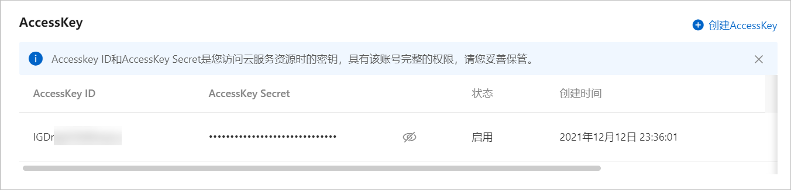

阿里云  
专有云  
链路追踪  
开发指南  
产品版本：V3.18.3  
文档版本：20241224

**目录**

- [1.API使用简介](#section-1)
    - [1.1. 调用方式](#section-1-1)
    - [1.2. RAM鉴权](#section-1-2)
    - [1.3. 签名机制](#section-1-3)
    - [1.4. 公共参数](#section-1-4)
    - [1.5. 获取个人账号AccessKey](#section-1-5)
- [2.API参考](#section-2)
    - [2.1. API概览](#section-2-1)
    - [2.2. GetTrace](#section-2-2)
    - [2.3. QueryMetric](#section-2-3)
    - [2.4. SearchTraces](#section-2-4)

<a id="section-1"></a>

# 1.API使用简介

<a id="section-1-1"></a>

## 1.1. 调用方式

链路追踪Tracing Analysis接口调用是向链路追踪Tracing Analysis API的服务端地址发送HTTP GET请求，并按照接口说明在请求中加入相应请求参数，调用后系统会返回处理结果。请求及返回结果都使用UTF-8字符集进行编码。

**请求结构**

链路追踪Tracing Analysis的API是RPC风格，您可以通过发送HTTP GET请求调用链路追踪Tracing Analysis API。

其请求结构如下：

```text
http://Endpoint/?Action=xx&Version=xx&Parameters
```

其中：

- **Endpoint**： 链路追踪Tracing Analysis API的服务接入地址为ARMS的Endpoint，例如*arms.cn-han gzhou.aliyuncs.com*。

- **Action**：要执行的操作，如调用GetTagKey获取上报链路数据中的Tag Key。

- **Version**：要使用的API版本，链路追踪Tracing Analysis的API版本是2019-08-08。

- **Parameters**：请求参数，每个参数之间用“&”分隔。

  请求参数由公共请求参数和API自定义参数组成。公共参数中包含API版本号、身份验证等信息，详情请参见公共参数。

下面是一个调用GetTagKey 接口获取上报链路数据中的Tag Key的示例：

> 为了便于用户查看，本文档中的示例都做了格式化处理。
>
> **说明**

```text
https://xtrace.cn-hangzhou.aliyuncs.com/?Action=GetTagKey
&AccessKeyId=key-test
&Format=JSON
&RegionId=cn-hangzhou
&SecureTransport=true
&SignatureMethod=HMAC-SHA1
&SignatureVersion=1.0
&Timestamp=2020-03-18T06%3A06%3A30Z
&Version=2019-08-08
…
```

<a id="section-1-2"></a>

## 1.2. RAM鉴权

在使用RAM账号调用API前，需要主账号通过创建授权策略对RAM账号进行授权。

**权限策略**

链路追踪支持的系统权限策略如下所示。

| 权限策略 | 类型 | 说明 |
| --- | --- | --- |
| AliyunTracingAnalysisFullAc cess | 系统 | 链路追踪的完整权限 |
| AliyunTracingAnalysisReadO nlyAccess | 系统 | 链路追踪的只读权限 |

以上两种权限策略都可直接访问链路追踪的API接口。

<a id="section-1-3"></a>

## 1.3. 签名机制

为保证API的安全调用，在调用API时阿里云会对每个API请求通过签名（Signature）进行身份验证。无论使用HTTP还是HTTPS协议提交请求，都需要在请求中包含签名信息。

**概述**

RPC API要按如下格式在API请求的Query中增加签名（Signature）：

```text
https://Endpoint/?SignatureVersion=1.0&SignatureMethod=HMAC-
SHA1&Signature=CT9X0VtwR86fNWxxxxxxxxxxjuE%3D&SignatureNonce=3ee8c1b8-xxxx-xxxx-xxxx-4e0ad82fd6cf
```

其中：

- **SignatureMethod**：签名方式，目前支持HMAC-SHA1。

- **SignatureVersion**：签名算法版本，目前版本是1.0。

- **SignatureNonce**：唯一随机数，用于防止网络重放攻击。用户在不同请求间要使用不同的随机数值，建议使用通用唯一识别码（Universally Unique Identifier, 简称UUID）。

- **Signature**: 使用AccessKey Secret对请求进行对称加密后生成的签名。

**计算签名**

签名算法遵循RFC 2104 HMAC-SHA1规范，使用AccessSecret对编码、排序后的整个请求串计算HMAC值作为签名。签名的元素是请求自身的一些参数，由于每个API请求内容不同，所以签名的结果也不尽相同。

```text
Signature = Base64( HMAC-SHA1( AccessSecret, UTF-8-Encoding-Of(
StringToSign)) )
```

完成以下操作，计算签名：

1. 构建待签名字符串

   <ol type="i">

   <li>

   使用请求参数构造规范化的请求字符串（Canonicalized Query String）:

   <ol type="a">

   <li>

   按照参数名称的字典顺序对请求中所有的请求参数（包括公共请求参数和接口的自定义参数，但不包括公共请求参数中的**Signature**参数）进行排序。

   当使用GET方法提交请求时，这些参数就是请求URI中的参数部分，即URI中 ？ 之后由 `&` 连接的部分。

   </li>

   <li>

   对排序之后的请求参数的名称和值分别用UTF-8字符集进行URL编码。编码规则如下：

   | 字符 | 编码方式 |
   | --- | --- |
   | A~Z、a~z和0~9以及“-”、“_”、“.”和“~” | 不编码。 |
   | 其它字符 | 编码成%XY的格式，其中XY是字符对应ASCII码的16进制表示。例如英文的双引号（""）对应的编码为%22。 |
   | 扩展的UTF-8字符 | 编码成%XY%ZA…的格式。 |
   | 英文空格 | 编码成%20，而不是加号（+）。该编码方式和一般采用的application/x-www-form-urlencoded MIME格式编码算法（例如Java标准库中的<code> java.net.URLEncoder </code>的实现）存在区别。编码时可以先用标准库的方式进行编码，然后把编码后的字符串中的加号（+）替换成%20，星号（\*）替换成%2A，%7E替换回波浪号（~），即可得到上述规则描述的编码字符串。本算法可以用下面的<code> percentEncode </code>方法来实现：<br><code>private static final String ENCODING = "UTF-8";</code><br><code>private static String percentEncode(String value)</code><br><code>throws UnsupportedEncodingException</code><br><code>{</code><br><code>return value != null ? URLEncoder.encode(value,</code><br><code>ENCODING).replace("+", "%20").replace("*",</code><br><code>"%2A").replace("%7E", "~") : null;</code><br><code>}</code> |

   </li>

   </ol>

   <ol type="i" start="100">

   <li>

   将编码后的参数名称和值用英文等号（=）进行连接。

   </li>

   <li value="500">

   将等号连接得到的参数组合按步骤i排好的顺序依次使用 `&` 符号连接，即得到规范化请求字符串。

   </li>

   </ol>

   </li>

   <li>

   将第一步构造的规范化字符串按照下面的规则构造成待签名的字符串。

   ```text
   StringToSign=
         HTTPMethod + “&” +
         percentEncode(“/”) + ”&” +
          percentEncode(CanonicalizedQueryString)
   ```

   其中：

   - **HTTPMethod** ：是提交请求用的HTTP方法，例如GET。

   - **percentEncode(“/”)** ：是按照步骤1.1中描述的URL编码规则对字符 `/`  进行编码得到的值，即%2F。

   - **percentEncode(CanonicalizedQueryString)** ：是对步骤1中构造的规范化请求字符串按步骤1.2中描述的URL编码规则编码后得到的字符串。

   </li>

   </ol>

2. 计算签名

   <ol type="i">

   <li>

   按照RFC2104的定义，计算待签名字符串（StringToSign）的HMAC值。

   > 计算签名时使用的Key就是您持有的AccessKey Secret并加上一个 `&` 字符
   >
   > **说明**
   >
   > （ASCII:38），使用的哈希算法是SHA1。

   </li>

   <li>

   按照Base64编码规则把上面的HMAC值编码成字符串，即得到签名值（Signature）。

   </li>

   <li>

   将得到的签名值作为**Signature**参数添加到请求参数中。

   > 得到的签名值在作为最后的请求参数值提交时要和其它参数一样，按照一定的规则进
   >
   > **说明**
   >
   > 行URL编码。

   </li>

   </ol>

**示例**

以DescribeRegions API为例，假设使用的AccessKey Id为 `testid` ，AccessKey Secret为 `testsecret` 。 签名前的请求URL如下：

```text
http://ecs.aliyuncs.com/?Timestamp=2016-02-
23T12:46:24Z&Format=XML&AccessKeyId=testid&Action=DescribeRegions&SignatureMethod=HMAC-
SHA1&SignatureNonce=3ee8c1b8-xxxx-xxxx-xxxx-4e0ad82fd6cf&Version=2014-05-
26&SignatureVersion=1.0
```

使用 `testsecret&` ，计算得到的签名值是：

```text
OLeaidS1JvxuMvnyHOwuJ+uX5qY=
```

最后将签名作为**Signature**参数加入到URL请求中，最后得到的URL为：

```text
http://ecs.aliyuncs.com/?
SignatureVersion=1.0&Action=DescribeRegions&Format=XML&SignatureNonce=3ee8c1b8-83d3-44af-a94f-4e0ad82fd6cf&Version=2014-05-
26&AccessKeyId=testid&Signature=OLeaidS1JvxuMvnyHOwuJ+uX5qY=&SignatureMethod=HMAC-SHA1&
Timestamp=2016-02-23T12%3A46%3A24Z
```

<a id="section-1-4"></a>

## 1.4. 公共参数

介绍每个接口都需要使用的请求参数和返回参数。

**公共请求参数**

表 1. 公共请求参数表

| 名称 | 类型 | 是否必须 | 描述 |
| --- | --- | --- | --- |
| Format | Strin g | 否 | 返回消息的格式。取值：JSON （默认值） \| XML |
| Version | Strin g | 是 | API版本号，使用YYYY-MM-DD日期格式。取值：<br>2019-08-08 |
| AccessKeyId | Strin g | 是 | 访问服务使用的密钥ID。 |
| Signature | Strin g | 是 | 签名结果串。 |
| SignatureMe thod | Strin g | 是 | 签名方式，取值：<br>HMAC-SHA1 |
| Timestamp | Strin g | 是 | 请求的时间戳，为日期格式。使用UTC时间按照ISO8601标准，格式为YYYY-MM-DDThh:mm:ssZ。例如，北京时间2013年1月10日20点0分0秒，表示为2013-01-10T12:00:00Z。 |
| SignatureVer sion | Strin g | 是 | 签名算法版本，取值：<br>1.0 |
| SignatureNo nce | Strin g | 是 | 唯一随机数，用于防止网络重放攻击。在不同请求间要使用不同的随机数值。 |
| ResourceOw nerAccount | Strin g | 否 | 本次API请求访问到的资源拥有者账户，即登录用户名。 |

示例

```text
https://xtrace.cn-hangzhou.aliyuncs.com/?Action=GetTagKey
&AccessKeyId=key-test
&Format=JSON
&RegionId=cn-hangzhou
&SecureTransport=true
&SignatureMethod=HMAC-SHA1
&SignatureVersion=1.0
&Timestamp=2020-03-18T06%3A06%3A30Z
&Version=2019-08-08
…
```

**公共返回参数**

API返回结果采用统一格式，调用成功返回的数据格式有XML和JSON两种，可以在发送请求时指定返回的数据格式，默认为XML格式。每次接口调用，无论成功与否，系统都会返回一个唯一识别码**RequestId**。

- 返回 `2xx`  HTTP状态码表示调用成功。

- 返回 `4xx` 或 `5xx`  HTTP状态码表示调用失败。

公共返回参数示例如下：

- XML格式

  ```xml
  <?xml version="1.0" encoding="utf-8"?> 
      <!--结果的根结点-->
      <接⼝名称+Response>
          <!--返回请求标签-->
          <RequestId>4C467B38-3910-447D-87BC-AC049166F216</RequestId>
          <!--返回结果数据-->
      </接⼝名称+Response>
                          
  ```

- JSON格式

  ```json
  {
      "RequestId":"4C467B38-3910-447D-87BC-AC049166F216",
      /*返回结果数据*/
      }
  ```

<a id="section-1-5"></a>

## 1.5. 获取个人账号AccessKey

**操作步骤**

1. 登录Apsara Uni-manager运营控制台。

2. 在系统界面右上角，单击当前登录用户头像，单击**个人信息**。

3. 在阿里云**AccessKey**区域，你可以查看账户的AccessKey信息。

   

<a id="section-2"></a>

# 2.API参考

<a id="section-2-1"></a>

## 2.1. API概览

链路追踪Tracing Analysis提供以下相关API接口。

| API | 描述 |
| --- | --- |
| GetTrace | 调用GetTrace获取调用链路详情。 |
| QueryMetric | 调用QueryMetric查询相关监控指标。 |
| SearchTraces | 调用SearchTraces查询调用链列表，可根据时间、应用名称、IP地址、Span名称和Tag等信息对调用链进行过滤查询。 |

<a id="section-2-2"></a>

## 2.2. GetTrace

调用GetTrace接口获取调用链路详情。

**请求参数**

| 名称 | 类型 | 是否必选 | 示例值 | 描述 |
| --- | --- | --- | --- | --- |
| Action | String | 是 | GetTrace | 系统规定参数。取值：GetTrace。 |
| RegionId | String | 是 | cn-beijing | 地域ID。 |
| TraceID | String | 是 | 1c6881aab8419 1a4 | 调用链ID，链路请求的唯一标识。 |

**返回数据**

| 名称 | 类型 | 示例值 | 描述 |
| --- | --- | --- | --- |
| RequestId | String | 1E2B6A4C-6B83-4062-8B6F-AEEC1FC47DED | 请求ID。 |
| Spans | Array of Span |  | Span列表。 |
| Duration | Long | 1000 | 耗时，单位为毫秒（ms）。 |
| HaveStack | Boolean | false | 是否有子Span。取值：<br>• <code> true </code>：有子Span。<br>• <code> false </code>：无子Span。 |
| LogEventList | Array of LogEvent |  | 日志事件列表。 |
| TagEntryList | Array of TagEntry |  | 标签列表。 |
| Key | String | logLevel | 日志事件的标签键。 |
| Value | String | Warning | 日志事件的标签值。 |
| Timestamp | Long | 158368320204700 0 | 日志事件的产生时间戳。 |
| OperationNam e | String | /api | 又称为Span名称。 |
| ParentSpanId | String | fec891bb8f8XXX | 父Span ID。 |
| ResultCode | String | 200 | 返回码。 |
| RpcId | String | 1.1 | 表示Span之间的父子兄弟关系。 例如1.1是1.1.1的父亲Span， 而1.1.2和1.1.1是兄弟Span。 |
| RpcType | Integer | 101 | 调用类型。<br>• 101：表示Client调用<br>• 102：表示Server调用<br>• 103：表示Producer调用<br>• 104：表示Consumer调用<br>• 105：表示DB调用<br>• 106：表示Xtrace_Other调用 |
| ServiceIp | String | 192.168.XXX.XXX | 服务IP地址，即Span所在的机器IP地址。 |
| ServiceName | String | server1 | 服务名称，又称为应用名称。 |
| SpanId | String | fec891bb8f8XXX | Span ID。 |
| TagEntryList | Array of TagEntry |  | 标签项列表。 |
| Key | String | logLevel | Span的标签键。 |
| Value | String | Warning | Span的标签值。 |
| Timestamp | Long | 158368320204700 0 | Span的产生时间戳。 |
| TraceID | String | 1c6881aab84191a 4 | 调用链ID，链路请求的唯一标识。 |

**示例**

请求示例

```text
http(s)://[Endpoint]/?Action=GetTrace
&RegionId=cn-beijing
&TraceID=1c6881aab84191a4
&<公共请求参数>
```

正常返回示例

`XML` 格式

```xml
<RequestId>1E2B6A4C-6B83-4062-8B6F-AEEC1FC47DED</RequestId>
<Spans>
    <HaveStack>false</HaveStack>
    <ParentSpanId>fec891bb8f8XXX</ParentSpanId>
    <ServiceIp>192.168.XXX.XXX</ServiceIp>
    <ServiceName>server1</ServiceName>
    <OperationName>/api</OperationName>
    <RpcType>101</RpcType>
    <RpcId>1.1</RpcId>
    <TraceID>1c6881aab84191a4</TraceID>
    <Duration>1000</Duration>
    <Timestamp>1583683202047000</Timestamp>
    <ResultCode>200</ResultCode>
    <SpanId>fec891bb8f8XXX</SpanId>
    <TagEntryList>
        <Value>Warning</Value>
        <Key>logLevel</Key>
    </TagEntryList>
    <LogEventList>
        <Timestamp>1583683202047000</Timestamp>
        <TagEntryList>
            <Value>Warning</Value>
            <Key>logLevel</Key>
        </TagEntryList>
    </LogEventList>
</Spans>
```

`JSON` 格式

```json
{
    "RequestId": "1E2B6A4C-6B83-4062-8B6F-AEEC1FC47DED",
    "Spans": {
        "HaveStack": false,
        "ParentSpanId": "fec891bb8f8XXX",
        "ServiceIp": "192.168.XXX.XXX",
        "ServiceName": "server1",
        "OperationName": "/api",
        "RpcType": 101,
        "RpcId": 1.1,
        "TraceID": "1c6881aab84191a4",
        "Duration": 1000,
        "Timestamp": 1583683202047000,
        "ResultCode": 200,
        "SpanId": "fec891bb8f8XXX",
        "TagEntryList": {
            "Value": "Warning",
            "Key": "logLevel"
        },
        "LogEventList": {
            "Timestamp": 1583683202047000,
            "TagEntryList": {
                "Value": "Warning",
                "Key": "logLevel"
            }
        }
    }
}
```

<a id="section-2-3"></a>

## 2.3. QueryMetric

调用QueryMetric查询相关监控指标。

**请求参数**

| 名称 | 类型 | 是否必选 | 示例值 | 描述 |
| --- | --- | --- | --- | --- |
| Action | String | 是 | QueryMetric | 系统规定参数。取值：QueryMetric。 |
| EndTime | Long | 是 | 1575622455686 | 结束时间，精确到毫秒（ms）。 |
| IntervalInSec | Integer | 是 | 60 | 时间间隔，单位为秒（s）。 |
| Measures.N | RepeatL ist | 是 | count | 查询字段。<strong>Metric</strong>取值为<code> appstat.incall </code>时，<strong>Measures</strong><strong>.N</strong>取值：<br>• rt：响应时间。<br>• count：总数。<br>• error：错误数。<br>• exception：异常。<br>• errorrate：错误率。<br>• qps：每秒请求数。<strong>Metric</strong>取值为<code> appstat.sql </code>时，<strong>Measures.N</strong>取值：<br>• rt：响应时间。<br>• count：总数。<br>• error：错误数。<br>• slowcount：慢调用次数。 |
| Metric | String | 是 | appstat.incall | 指标名称，取值：<br>• appstat.incall：链路统计。<br>• appstat.sql：SQL统计。 |
| StartTime | Long | 是 | 1575561600000 | 开始时间，精确到毫秒（ms）。 |
| OrderBy | String | 否 | count | 排序字段，根据查询返回字段中的某个字段排序。 |
| Limit | Integer | 否 | 100 | 返回数据条数。 |
| Filters.N.Key | String | 否 | http.status_code | 过滤字段的Key。 |
| Filters.N.Value | String | 否 | 200 | 过滤字段的Value。 |
| Dimensions.N | RepeatL ist | 否 | RT | 维度，即GroupBy分组。 |
| Order | String | 否 | ASC | 排序，取值：<br>• ASC：升序。<br>• DESC：降序。 |
| RegionId | String | 否 | cn-beijing | 地域ID。 |
| ProxyUserId | String | 否 | testefgag12 | 代理用户ID。 |
| ConsistencyData Key | String | 否 | - | 专有云暂不支持该参数。 |
| ConsistencyQuer yStrategy | String | 否 | - | 专有云暂不支持该参数。 |

**返回数据**

| 名称 | 类型 | 示例值 | 描述 |
| --- | --- | --- | --- |
| Data | String | { "RequestId": "E2373982-D8CD-413D-B991-8EB678C01B4F", "Data": "{\\"data\\": \[{\\"date\\":1583686 800000,\\"count\\":0,\\"rt\\":0,\\"rpc\\":\\"chi ldSpan3\\"}} | 返回统计信息。 |
| RequestId | String | 1E2B6A4C-6B83-4062-8B6F-AEEC1FC47DED | 请求ID。 |

**示例**

请求示例

```text
http(s)://[Endpoint]/?Action=QueryMetric
&EndTime=1575622455686
&IntervalInSec=60
&Measures.1=count
&Metric=appstat.incall
&StartTime=1575561600000
&<公共请求参数>
```

正常返回示例

`XML` 格式

```xml
<RequestId>1E2B6A4C-6B83-4062-8B6F-AEEC1FC47DED</RequestId>
<Data>{ "RequestId": "E2373982-D8CD-413D-B991-8EB678C01B4F", "Data": "{\"data\":[{\"date\":1583686800000,\"count\":0,\"rt\":0,\"rpc\":\"childSpan3\"}}</Data>
```

`JSON` 格式

```json
{
    "RequestId": "1E2B6A4C-6B83-4062-8B6F-AEEC1FC47DED",
    "Data": "{ \"RequestId\": \"E2373982-D8CD-413D-B991-8EB678C01B4F\", \"Data\": \"{\\
\"data\\\":
[{\\\"date\\\":1583686800000,\\\"count\\\":0,\\\"rt\\\":0,\\\"rpc\\\":\\\"childSpan3\\\"}

}
```

<a id="section-2-4"></a>

## 2.4. SearchTraces

调用SearchTraces查询调用链列表，可根据时间、应用名称、IP地址、Span名称、Tag等信息对调用链进行过滤查询。

**请求参数**

| 名称 | 类型 | 是否必选 | 示例值 | 描述 |
| --- | --- | --- | --- | --- |
| Action | String | 是 | SearchTraces | 系统规定参数。取值：SearchTraces。 |
| EndTime | Long | 是 | 1575622455686 | 结束时间，精确到毫秒（ms）。 |
| RegionId | String | 是 | cn-beijing | 地域ID。 |
| StartTime | Long | 是 | 1575561600000 | 开始时间，精确到毫秒（ms）。 |
| ServiceName | String | 否 | service 1 | 微服务名称，又称为应用名称。 |
| OperationName | String | 否 | /api | Span名称，即某个跟踪点或埋点的名称。 |
| MinDuration | Long | 否 | 1000 | 大于某个时间跨度范围，单位为毫秒（ms）。例如，100表示大于100毫秒的数据。 |
| Tag.N.Key | String | 否 | http.status_cod | 标签键。 |
| Tag.N.Value | String | 否 | 200 | 标签值。 |
| Reverse | Boolean | 否 | false | 按照时间正序或者倒序排列。默认为<code> false </code>。取值：<br>• true：倒序。<br>• false：顺序。 |
| ServiceIp | String | 否 | 10.0.0.0 | Span对应的IP地址。 |
| ExclusionFilters.N.Key | String | 否 | - | 专有云该参数暂时不可用。 |
| ExclusionFilters.N.Value | String | 否 | - | 专有云该参数暂时不可用。 |

**返回数据**

| 名称 | 类型 | 示例值 | 描述 |
| --- | --- | --- | --- |
| RequestId | String | cn-beijing | 地域ID。 |
| TraceInfos | Array of TraceInfo |  | 链路追踪信息。 |
| Duration | Long | 100 | 耗时，单位为毫秒（ms）。 |
| OperationNam e | String | /api | Span名称。 |
| ServiceIp | String | 192.168.XXX.XXX | Span所在的IP地址。 |
| ServiceName | String | service1 | 微服务名称，又称为应用名称。 |
| Timestamp | Long | 157556160000000 0 | Span产生时间，单位为微秒（μs）。 |
| TraceID | String | 1c6881aab84191a 4 | 调用链ID。 |

**示例**

请求示例

```text
http(s)://[Endpoint]/?Action=SearchTraces
&EndTime=1575622455686
&RegionId=cn-beijing
&StartTime=1575561600000
&<公共请求参数>
```

正常返回示例

`XML` 格式

```xml
<RequestId>cn-beijing</RequestId>
<TraceInfos>
    <ServiceIp>192.163.XXX.XXX</ServiceIp>
    <ServiceName>service1</ServiceName>
    <OperationName>/api</OperationName>
    <TraceID>1c6881aab84191a4</TraceID>
    <Duration>100</Duration>
    <Timestamp>1575561600000000</Timestamp>
</TraceInfos>
```

`JSON` 格式

```json
{
    "RequestId": "cn-beijing",
    "TraceInfos": {
        "ServiceIp": "192.163.XXX.XXX",
        "ServiceName": "service1",
        "OperationName": "/api",
        "TraceID": "1c6881aab84191a4",
        "Duration": 100,
        "Timestamp": 1575561600000000
    }
}
```
