阿里云  
专有云  
链路追踪  
用户指南  
产品版本：V3.18.3  
文档版本：20241114

**目录**

- [1.快速入门](#section-1)
    - [1.1. 登录链路追踪控制台](#section-1-1)
    - [1.2. 获取接入点](#section-1-2)
    - [1.3. 开始监控Java应用](#section-1-3)
        - [1.3.1. 通过Jaeger上报Java应用数据](#section-1-3-1)
        - [1.3.2. 通过Zipkin上报Java应用数据](#section-1-3-2)
    - [1.4. 开始监控PHP应用](#section-1-4)
        - [1.4.1. 通过Zipkin上报PHP应用数据](#section-1-4-1)
    - [1.5. 开始监控Go应用](#section-1-5)
        - [1.5.1. 通过Jaeger上报Go应用数据](#section-1-5-1)
        - [1.5.2. 通过Zipkin上报Go应用数据](#section-1-5-2)
    - [1.6. 开始监控Node.js应用](#section-1-6)
        - [1.6.1. 通过Jaeger上报Node.js应用数据](#section-1-6-1)
    - [1.7. 开始监控.NET应用](#section-1-7)
        - [1.7.1. 通过Jaeger上报.NET应用数据](#section-1-7-1)
        - [1.7.2. 通过Zipkin上报.NET应用数据](#section-1-7-2)
    - [1.8. 开始监控Nginx](#section-1-8)
        - [1.8.1. 使用Zipkin对Nginx进行链路追踪](#section-1-8-1)
- [2.使用教程](#section-2)
    - [2.1. 查看应用列表](#section-2-1)
    - [2.2. 查看应用总览](#section-2-2)
    - [2.3. 查看应用详情](#section-2-3)
    - [2.4. 查看接口调用情况](#section-2-4)
    - [2.5. 查看数据库调用](#section-2-5)
    - [2.6. 异常诊断](#section-2-6)
    - [2.7. 应用设置](#section-2-7)
    - [2.8. 多维查询](#section-2-8)
    - [2.9. 全局拓扑](#section-2-9)
    - [2.10. 用量统计](#section-2-10)

<a id="section-1"></a>

# 1.快速入门

<a id="section-1-1"></a>

## 1.1. 登录链路追踪控制台

本文介绍了如何登录链路追踪控制台。

**前提条件**

- 登录Apsara Uni-manager运营控制台前，确认您已从部署人员处获取Apsara Uni-manager运营控制台的服务域名地址。

- 推荐使用Chrome浏览器。

**操作步骤**

1. 在浏览器地址栏中，输入Apsara Uni-manager运营控制台的服务域名地址，按回车键。

   

   > **说明**
   >
   > - 单击页面右上角的当前语言可以切换其它语言。
   >
   > - 由于浏览器证书过期或环境开启HTTPS认证等出现多次单击继续访问或无Apsara Uni-manager运营控制台地址入口等现象，此时需要安装证书才能正常访问。单击页面右上角的**浏览器证书安装**，可打开浏览器证书安装指南。

2. 输入正确的用户名及密码。

   > **说明**
   >
   > - 请向运营管理员获取登录控制台的用户名和密码。
   >
   > - 首次登录Apsara Uni-manager运营控制台时，需要修改登录用户名的密码，请按照提示完成密码修改。为提高安全性，密码长度必须为10~32位，且包含英文字母大小写、阿拉伯数字和特殊符号（感叹号（!）、at（@）、井号（#）、美元符号（$）、百分号（%）等）。

3. 单击**账号登录**。

4. 如果账号已激活MFA多因素认证，请根据以下两种情况进行操作：

   - 管理员强制开启MFA后的首次登录：

     <ol type="a">

     <li>

     在绑定虚拟MFA设备页面中，按页面提示步骤绑定MFA设备。

     </li>

     <li>

     按照步骤2重新输入账号和密码，单击**登录**。

     </li>

     </ol>

     <ol type="i" start="100">

     <li>

     输入6位MFA码后单击**认证**。

     </li>

     </ol>

   - 您已开启并绑定MFA：

     输入6位MFA码后单击**认证**。

     > 绑定并开启MFA的操作请参见<strong>《Apsara Uni-manager运营控制台用户指南》</strong>中的
     >
     > **说明**
     >
     > 章节<strong>《绑定并开启虚拟MFA设备》</strong>。

5. 在顶部菜单栏，选择**产品 > 监控运维 > 应用实时监控服务 ARMS**。

6. 在**应用实时监控服务**页面，选择您需登录的组织账号和地域，单击**管理员权限访问**进入应用实时监控ARMS控制台。

7. 在顶部菜单栏，选择**产品 > 监控运维 > 应用实时监控ARMS**。

8. 在**应用实时监控服务**页面，选择您需登录的组织账号和地域，单击**ARMS**进入应用实时监控ARMS控制台。

9. 在左侧导航栏选择**链路追踪**，进入链路追踪控制台。

<a id="section-1-2"></a>

## 1.2. 获取接入点

您需要获取接入点以接入应用。接入应用是指通过客户端将应用的链路数据上报至链路追踪，从而实现链路追踪的目的。您可以将Java、PHP、Go、Python、JS、.NET、C++等语言的应用数据上报至链路追踪。

**操作步骤**

1. 登录链路追踪控制台。

2. 在左侧导航栏，选择**链路追踪 > 集群配置**。

3. 在**接入点信息**页签下的**集群信息**区域，打开**显示Token**开关。

4. 在**客户端采集工具**区域，单击需要使用的客户端采集工具的页签。

   > **说明**
   >
   > - 链路追踪仅支持Jaeger和Zipkin，暂不支持SkyWalking。
   >
   > - Jaeger仅支持通过HTTP上报数据，不支持通过Agent上报数据。
   >
   > - 对于Zipkin，一般情况下建议您使用v2版接入点，Istio、Molten等特定场景下建议您使用v1版本接入点。

   在表格的**相关信息**列**接入点**右侧的信息就是接入点信息。

   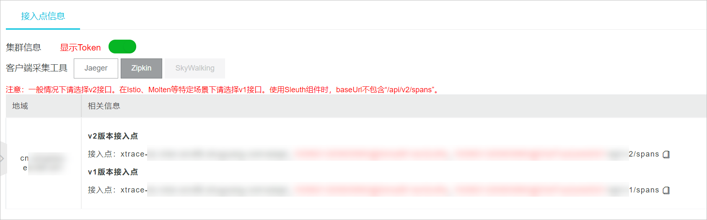

<a id="section-1-3"></a>

## 1.3. 开始监控Java应用

<a id="section-1-3-1"></a>

### 1.3.1. 通过Jaeger上报Java应用数据

在追踪应用的链路数据之前，需要通过客户端将应用数据上报至链路追踪。本文介绍如何通过Jaeger客户端上报Java应用数据。

**前提条件**

获取接入点

**背景信息**

Jaeger是一款开源分布式追踪系统，兼容OpenTracing API，且已加入CNCF开源组织。其主要功能是聚合来自各个异构系统的实时监控数据。

要通过Jaeger将Java应用数据上报至链路追踪控制台，首先需要完成埋点工作。您可以手动埋点，也可以利用各种现有插件实现埋点的目的。Jaeger支持以下埋点方法：

- 为Java应用手动埋点

- 通过Spring Cloud组件为Java应用埋点

- 通过gRPC组件为Java应用埋点

**数据上报**

不通过Jaeger Agent而直接上报数据的原理如下图所示。

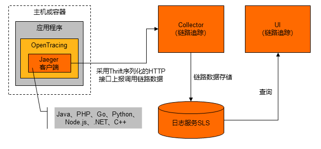

**为Java应用手动埋点**

要通过Jaeger将Java应用数据上报至链路追踪控制台，首先需要完成埋点工作。本示例为手动埋点。

1. 下载Demo工程，进入**manualDemo**目录，并按照Readme的说明运行程序。

2. 打开pom.xml，添加对Jaeger客户端的依赖。

   ```xml
   <dependency>
       <groupId>io.jaegertracing</groupId>
       <artifactId>jaeger-client</artifactId>
       <version>0.31.0</version>
   </dependency>
   ```

3. 配置初始化参数并创建Tracer对象。

   Tracer对象可以用来创建Span对象以便记录分布式操作时间、通过Extract/Inject方法跨机器透传数据、或设置当前Span。Tracer对象还配置了上报数据的网关地址、本机IP地址、采样率、服务名等数据。您可以通过调整采样率来减少因上报数据产生的开销。

   ```text
   // 将manualDemo替换为您的应⽤名称。
   io.jaegertracing.Configuration config = new 
   io.jaegertracing.Configuration("manualDemo");
   io.jaegertracing.Configuration.SenderConfiguration sender = new 
   io.jaegertracing.Configuration.SenderConfiguration();
   // 将 <endpoint> 替换为控制台概览⻚⾯上相应客户端和地域的接入点。
   sender.withEndpoint("<endpoint>");
   config.withSampler(new 
   io.jaegertracing.Configuration.SamplerConfiguration().withType("const").withParam(1));

   config.withReporter(new 
   io.jaegertracing.Configuration.ReporterConfiguration().withSender(sender).withMaxQueueS
   e(10000));
   GlobalTracer.register(config.getTracer());
   ```

4. 记录请求数据。

   ```text
   Tracer tracer = GlobalTracer.get();
   // 创建Span。
   Span span = tracer.buildSpan("parentSpan").withTag("myTag", "spanFirst").start();
   tracer.scopeManager().activate(span, false);
   tracer.activeSpan().setTag("methodName", "testTracing");
   // 业务逻辑。
   secondBiz();
   span.finish();
   ```

5. <strong>可选：</strong>上一步用于记录请求的根操作，如果需要记录请求的上一步和下一步操作，则需要传入上下文。

   ```text
   Tracer tracer = GlobalTracer.get();
   Span parentspan = tracer.activeSpan();
   Tracer.SpanBuilder spanBuilder = tracer.buildSpan("childSpan").withTag("myTag", "span
   Second");
   if (parentspan !=null) {
       spanBuilder.asChildOf(parentspan).start();
   }
   Span childSpan = spanBuilder.start();
   tracer.scopeManager().activate(childSpan, false);
   // 业务逻辑。
   childSpan.finish();
   tracer.activeSpan().setTag("methodName", "testCall");
   ```

6. <strong>可选：</strong>为了方便排查问题，您可以为某个记录添加一些自定义标签（Tag），例如记录是否发生错误、请求的返回值等。

   ```text
   tracer.activeSpan().setTag("methodName", "testCall");
   ```

7. 在分布式系统中发送RPC请求时会带上Tracing数据，包括TraceId、ParentSpanId、SpanId、Sampled等。您可以在HTTP请求中使用Extract/Inject方法在HTTP Request Headers上透传数据。总体流程如下：

   ```text
      Client Span                                                Server Span
   ┌──────────────────┐                                       ┌──────────────────┐
   │                  │                                       │                  │
   │   TraceContext   │           Http Request Headers        │   TraceContext   │
   │ ┌──────────────┐ │          ┌───────────────────┐        │ ┌──────────────┐ │
   │ │ TraceId      │ │          │ X-B3-TraceId      │        │ │ TraceId      │ │
   │ │              │ │          │                   │        │ │              │ │
   │ │ ParentSpanId │ │ Inject   │ X-B3-ParentSpanId │Extract │ │ ParentSpanId │ │
   │ │              ├─┼─────────>│                   ├────────┼>│              │ │
   │ │ SpanId       │ │          │ X-B3-SpanId       │        │ │ SpanId       │ │
   │ │              │ │          │                   │        │ │              │ │
   │ │ Sampled      │ │          │ X-B3-Sampled      │        │ │ Sampled      │ │
   │ └──────────────┘ │          └───────────────────┘        │ └──────────────┘ │
   │                  │                                       │                  │
   └──────────────────┘                                       └──────────────────┘
   ```

   <ol type="i">

   <li>

   在客户端调用Inject方法传入Context信息。

   ```text
   private void attachTraceInfo(Tracer tracer, Span span, final Request request) {
           tracer.inject(span.context(), Format.Builtin.TEXT_MAP, new TextMap() {
               @Override
               public void put(String key, String value) {
                   request.setHeader(key, value);
               }
               @Override
               public Iterator<Map.Entry<String, String>> iterator() {
                   throw new UnsupportedOperationException("TextMapInjectAdapter should
   only be used with Tracer.inject()");
               }
           });
       }
   ```

   </li>

   <li>

   在服务端调用Extract方法解析Context信息。

   ```text
   protected Span extractTraceInfo(Request request, Tracer tracer) {
       Tracer.SpanBuilder spanBuilder = tracer.buildSpan("/api/xtrace/test03");
       try {
           SpanContext spanContext = tracer.extract(Format.Builtin.TEXT_MAP, new TextMapExtractAdapter(request.getAttachments()));
           if (spanContext != null) {
               spanBuilder.asChildOf(spanContext);
           }
       } catch (Exception e) {
           spanBuilder.withTag("Error", "extract from request fail, error msg:" + 
   e.getMessage());
       }
       return spanBuilder.start();
   }
                                   
   ```

   </li>

   </ol>

**通过Spring Cloud组件为Java应用埋点**

要通过Jaeger将Java应用数据上报至链路追踪控制台，首先需要完成埋点工作。本示例为通过Spring Cloud组件埋点。Spring Cloud提供了下列组件的埋点：

- @Async, @Scheduled, Executors

- Feign, HystrixFeign

- Hystrix

- JDBC

- JMS

- Mongo

- RabbitMQ

- Redis

- RxJava

- Spring Messaging - 链路消息通过消息通道发送

- Spring Web (RestControllers, RestTemplates, WebAsyncTask)

- Standard Logging - 日志被添加至当前Span

- WebSocket STOMP

- Zuul

请按照以下步骤通过Spring Cloud组件埋点。

1. 下载Demo工程，进入**springMvcDemo/webmvc4-boot**目录，并按照Readme的说明运行程序。

2. 打开pom.xml，添加JAR包依赖。

   ```xml
   <dependency>
      <groupId>io.opentracing.contrib</groupId>
     <artifactId>opentracing-spring-cloud-starter</artifactId>
     <version>0.2.0</version>
   </dependency>
   <dependency>
     <groupId>io.jaegertracing</groupId>
     <artifactId>jaeger-client</artifactId>
     <version>0.31.0</version>
   </dependency>
   ```

3. 添加OpenTracing Tracer Bean。

   ```text
   @Bean
   public io.opentracing.Tracer tracer() {
       io.jaegertracing.Configuration config = new 
   io.jaegertracing.Configuration("springFrontend");
       io.jaegertracing.Configuration.SenderConfiguration sender = new 
   io.jaegertracing.Configuration.SenderConfiguration();
       sender.withEndpoint("<endpoint>");
       config.withSampler(new 
   io.jaegertracing.Configuration.SamplerConfiguration().withType("const").withParam(1));

       config.withReporter(new 
   io.jaegertracing.Configuration.ReporterConfiguration().withSender(sender).withMaxQueueS
   e(10000));
       return config.getTracer();
   }
   ```

**通过gRPC组件为Java应用埋点**

要通过Jaeger将Java应用数据上报至链路追踪控制台，首先需要完成埋点工作。本示例为通过gRPC组件埋点。

请按照以下步骤通过gRPC组件埋点。

1. 下载Demo工程，进入**grpcDemo**目录，并按照Readme的说明运行程序。

2. 打开pom.xml，添加JAR包依赖。

   ```xml
   <dependency>
       <groupId>io.opentracing.contrib</groupId>
       <artifactId>opentracing-grpc</artifactId>
       <version>0.0.7</version>
   </dependency>
   ```

3. 在服务端初始化Tracing对象，创建ServerTracingInterceptor，并添加对Server的拦截。

   ```java
   import io.opentracing.Tracer;

       public class YourServer {

           private int port;
           private Server server;
           private final Tracer tracer;

           private void start() throws IOException {
               ServerTracingInterceptor tracingInterceptor = new 
   ServerTracingInterceptor(this.tracer);

               // If GlobalTracer is used: 
               // ServerTracingInterceptor tracingInterceptor = new 
   ServerTracingInterceptor();

               server = ServerBuilder.forPort(port)
                   .addService(tracingInterceptor.intercept(someServiceDef))
                   .build()
                   .start();
           }
       }
   ```

4. 在客户端初始化Tracing对象，创建ClientTracingInterceptor，并添加对Client Channel的拦截。

   ```java
   import io.opentracing.Tracer;

       public class YourClient {

           private final ManagedChannel channel;
           private final GreeterGrpc.GreeterBlockingStub blockingStub;
           private final Tracer tracer;

           public YourClient(String host, int port) {

               channel = ManagedChannelBuilder.forAddress(host, port)
                   .usePlaintext(true)
                   .build();

               ClientTracingInterceptor tracingInterceptor = new 
   ClientTracingInterceptor(this.tracer);

               // If GlobalTracer is used: 
               // ClientTracingInterceptor tracingInterceptor = new 
   ClientTracingInterceptor();

               blockingStub = 
   GreeterGrpc.newBlockingStub(tracingInterceptor.intercept(channel));
           }
       }
                           
   ```

**常见问题**

问：Demo程序执行成功，为什么控制台上没有上报数据？

答：请调试方法io.jaegertracing.thrift.internal.senders.HttpSender.send(Process process, List&lt;Span> spans)，并查看上报数据时的返回值。如果报403错误，则表明接入点配置不正确，请检查并修改。

**相关文档**

- Jaeger官网

- Jaeger的Java Client

- OpenTracing的组件库

- OpenTracing的Spring Cloud组件

<a id="section-1-3-2"></a>

### 1.3.2. 通过Zipkin上报Java应用数据

在追踪应用的链路数据之前，需要通过客户端将应用数据上报至链路追踪。本文介绍如何通过Zipkin客户端上报Java应用数据。

**前提条件**

获取接入点

**背景信息**

Zipkin已经开发多年，对各种Java框架支持齐全。

要通过Zipkin将Java应用数据上报至链路追踪控制台，首先需要完成埋点工作。您可以手动埋点，也可以利用各种现有插件实现埋点的目的。Zipkin支持以下埋点方式：

- 手动埋点

- 通过Spring 2.5 MVC或Spring 3.0 MVC插件埋点

- 通过Spring 4.0 MVC或Spring Boot插件埋点

- 通过Dubbo插件埋点

- 通过Spring Sleuth插件埋点

**数据上报**

通过Zipkin上报数据的原理如下图所示。

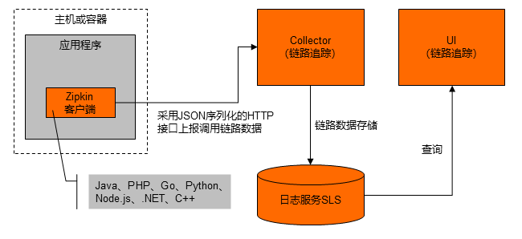

**手动埋点**

如果选择手动埋点，您需要自行编写代码。

> 如需获取Demo，请下载源码，进入**manualDemo**目录，并根据Readme运行程序。
>
> **说明**

1. 添加依赖JAR包。

   ```xml
   <dependency>
               <groupId>io.zipkin.brave</groupId>
               <artifactId>brave</artifactId>
               <version>5.4.2</version>
           </dependency>
           <dependency>
               <groupId>io.zipkin.reporter2</groupId>
               <artifactId>zipkin-sender-okhttp3</artifactId>
               <version>2.7.9</version>
           </dependency>
   ```

2. 创建Tracer。

   ```text
   private static final String zipkinEndPoint = "<endpoint>";
     ...
     // 构建数据发送对象。
     OkHttpSender sender = OkHttpSender.newBuilder().endpoint(zipkinEndPoint).build();

     // 构建数据上报对象。
     Reporter<Span> reporter = AsyncReporter.builder(sender).build();

     tracing = 
   Tracing.newBuilder().localServiceName(localServiceName).spanReporter(reporter).build();
   ```

3. 构建Span和Child Span。

   ```java
   private void firstBiz() {
           // 创建rootspan。
           tracing.tracer().startScopedSpan("parentSpan");
           Span span =  tracing.tracer().currentSpan();
           span.tag("key", "firstBiz");
           secondBiz();
           span.finish();
       }

       private void secondBiz() {
           tracing.tracer().startScopedSpanWithParent("childSpan", 
   tracing.tracer().currentSpan().context());
           Span chindSpan =  tracing.tracer().currentSpan();
           chindSpan.tag("key", "secondBiz");
           chindSpan.finish();
           System.out.println("end tracing,id:" + chindSpan.context().traceIdString());
       }
   ```

4. （可选）为了快速排查问题，您可以为某个记录添加一些自定义标签，例如记录是否发生错误、请求的返回值等。

   ```text
   tracer.activeSpan().setTag("http.status_code", "500");
   ```

5. 在分布式系统中发送RPC请求时会带上Tracing数据，包括TraceId、ParentSpanId、SpanId、Sampled等。您可以在HTTP请求中使用Extract/Inject方法在HTTP Request Headers上透传数据。总体流程如下：

   ```text
      Client Span                                                Server Span
   ┌──────────────────┐                                       ┌──────────────────┐
   │                  │                                       │                  │
   │   TraceContext   │           Http Request Headers        │   TraceContext   │
   │ ┌──────────────┐ │          ┌───────────────────┐        │ ┌──────────────┐ │
   │ │ TraceId      │ │          │ X-B3-TraceId      │        │ │ TraceId      │ │
   │ │              │ │          │                   │        │ │              │ │
   │ │ ParentSpanId │ │ Inject   │ X-B3-ParentSpanId │Extract │ │ ParentSpanId │ │
   │ │              ├─┼─────────>│                   ├────────┼>│              │ │
   │ │ SpanId       │ │          │ X-B3-SpanId       │        │ │ SpanId       │ │
   │ │              │ │          │                   │        │ │              │ │
   │ │ Sampled      │ │          │ X-B3-Sampled      │        │ │ Sampled      │ │
   │ └──────────────┘ │          └───────────────────┘        │ └──────────────┘ │
   │                  │                                       │                  │
   └──────────────────┘                                       └──────────────────┘
   ```

   <ol type="i">

   <li>

   在客户端调用Inject方法传入Context信息。

   ```text
   // start a new span representing a client request
       oneWaySend = tracer.nextSpan().name(service + "/" + method).kind(CLIENT);
       --snip--

       // Add the trace context to the request, so it can bepropagated in-band
       tracing.propagation().injector(Request::addHeader)
                        .inject(oneWaySend.context(), request);

      // fire off the request asynchronously, totally dropping any response
      request.execute();

      // start the client side and flush instead of finish
      oneWaySend.start().flush();
   ```

   </li>

   <li>

   在服务端调用Extract方法解析Context信息。

   ```text
   // pull the context out of the incoming request
   extractor = tracing.propagation().extractor(Request::getHeader);

   // convert that context to a span which you can name and add tags to
   oneWayReceive = nextSpan(tracer, extractor.extract(request))
       .name("process-request")
       .kind(SERVER)
       ... add tags etc.

   // start the server side and flush instead of finish
   oneWayReceive.start().flush();

   // you should not modify this span anymore as it is complete. However,
   // you can create children to represent follow-up work.
   next = tracer.newSpan(oneWayReceive.context()).name("step2").start();
   ```

   </li>

   </ol>

**通过Spring 2.5 MVC或Spring 3.0 MVC插件埋点**

您可以选择通过Spring 2.5 MVC或Spring 3.0 MVC插件进行埋点。

> 如需获取Demo，请下载源码，进入**springMvcDemo\\webmvc3|webmvc25**目
>
> **说明**
>
> 录，并根据Readme运行程序。

1. 在**applicationContext.xml**中配置Tracing对象。

   ```xml
   <bean class="zipkin2.reporter.beans.OkHttpSenderFactoryBean">
     <property name="endpoint" value="<endpoint>"/>
   </bean>

   <!-- allows us to read the service name from spring config -->
   <context:property-placeholder/>

   <bean class="brave.spring.beans.TracingFactoryBean">
     <property name="localServiceName" value="brave-webmvc3-example"/>
     <property name="spanReporter">
       <bean class="zipkin2.reporter.beans.AsyncReporterFactoryBean">
         <property name="encoder" value="JSON_V2"/>
         <property name="sender" ref="sender"/>
         <!-- wait up to half a second for any in-flight spans on close -->
         <property name="closeTimeout" value="500"/>
       </bean>
     </property>
     <property name="propagationFactory">
       <bean class="brave.propagation.ExtraFieldPropagation" factory-
   method="newFactory">
         <constructor-arg index="0">
           <util:constant static-field="brave.propagation.B3Propagation.FACTORY"/>
         </constructor-arg>
         <constructor-arg index="1">
           <list>
             <value>user-name</value>
           </list>
         </constructor-arg>
       </bean>
     </property>
     <property name="currentTraceContext">
       <bean class="brave.spring.beans.CurrentTraceContextFactoryBean">
         <property name="scopeDecorators">
           <bean class="brave.context.log4j12.MDCScopeDecorator" factory-
   method="create"/>
         </property>
       </bean>
     </property>
   </bean>

   <bean class="brave.spring.beans.HttpTracingFactoryBean">
     <property name="tracing" ref="tracing"/>
   </bean>
   ```

2. 添加Interceptors对象。

   ```xml
   <bean class="brave.httpclient.TracingHttpClientBuilder"
         factory-method="create">
       <constructor-arg type="brave.http.HttpTracing" ref="httpTracing"/>
     </bean>

     <bean factory-bean="httpClientBuilder" factory-method="build"/>

     <bean 
   class="org.springframework.web.servlet.mvc.annotation.DefaultAnnotationHandlerMapping">

       <property name="interceptors">
         <list>
           <bean class="brave.spring.webmvc.SpanCustomizingHandlerInterceptor"/>
         </list>
       </property>
     </bean>

     <!-- Loads the controller -->
     <context:component-scan base-package="brave.webmvc"/>
   ```

3. 添加Filter对象。

   ```xml
   <!-- Add the delegate to the standard tracing filter and map it to all paths -->
   <filter>
     <filter-name>tracingFilter</filter-name>
     <filter-class>brave.spring.webmvc.DelegatingTracingFilter</filter-class>
   </filter>
   <filter-mapping>
     <filter-name>tracingFilter</filter-name>
     <url-pattern>/*</url-pattern>
   </filter-mapping>
   ```

**通过Spring 4.0 MVC或Spring Boot插件埋点**

您可以选择通过Spring 4.0 MVC或Spring Boot插件进行埋点。

> 如需获取Demo，请下载源码，进入**springMvcDemo\\webmvc4-boot|webmv4**目
>
> **说明**
>
> 录，并根据Readme运行程序。

1. 配置Tracing和Filter。

   ```text
   /** Configuration for how to send spans to Zipkin */
     @Bean Sender sender() {
       return OkHttpSender.create("<endpoint>");
     }

     /** Configuration for how to buffer spans into messages for Zipkin */
     @Bean AsyncReporter<Span> spanReporter() {
       return AsyncReporter.create(sender());
     }

     /** Controls aspects of tracing such as the name that shows up in the UI */
     @Bean Tracing tracing(@Value("${spring.application.name}") String serviceName) {
       return Tracing.newBuilder()
           .localServiceName(serviceName)
           .propagationFactory(ExtraFieldPropagation.newFactory(B3Propagation.FACTORY, "user-name"))
           .currentTraceContext(ThreadLocalCurrentTraceContext.newBuilder()
               .addScopeDecorator(MDCScopeDecorator.create()) // puts trace IDs into 
   logs
               .build()
           )
           .spanReporter(spanReporter()).build();
     }

     /** decides how to name and tag spans. By default they are named the same as the http method. */
     @Bean HttpTracing httpTracing(Tracing tracing) {
       return HttpTracing.create(tracing);
     }

     /** Creates client spans for http requests */
     // We are using a BPP as the Frontend supplies a RestTemplate bean prior to this configuration
     @Bean BeanPostProcessor connectionFactoryDecorator(final BeanFactory beanFactory) {
       return new BeanPostProcessor() {
         @Override public Object postProcessBeforeInitialization(Object bean, String beanName) {
           return bean;
         }

         @Override public Object postProcessAfterInitialization(Object bean, String bean
   Name) {
           if (!(bean instanceof RestTemplate)) return bean;

           RestTemplate restTemplate = (RestTemplate) bean;
           List<ClientHttpRequestInterceptor> interceptors =
               new ArrayList<>(restTemplate.getInterceptors());
           interceptors.add(0, getTracingInterceptor());
           restTemplate.setInterceptors(interceptors);
           return bean;
         }

         // Lazy lookup so that the BPP doesn't end up needing to proxy anything.
         ClientHttpRequestInterceptor getTracingInterceptor() {
           return 
   TracingClientHttpRequestInterceptor.create(beanFactory.getBean(HttpTracing.class));
         }
       };
     }

     /** Creates server spans for http requests */
     @Bean Filter tracingFilter(HttpTracing httpTracing) {
       return TracingFilter.create(httpTracing);
     }

     @Autowired SpanCustomizingAsyncHandlerInterceptor webMvcTracingCustomizer;

     /** Decorates server spans with application-defined web tags */
     @Override public void addInterceptors(InterceptorRegistry registry) {
       registry.addInterceptor(webMvcTracingCustomizer);
     }
   ```

2. 配置autoconfigure（spring.factories)。

   ```text
   org.springframework.boot.autoconfigure.EnableAutoConfiguration=\
   brave.webmvc.TracingConfiguration
   ```

**通过Dubbo插件埋点**

您可以选择通过Dubbo插件进行埋点。

> 如需获取Demo，请下载源码，进入**dubboDem**目录，并根据Readme运行程序。
>
> **说明**

1. 添加依赖JAR包。

   ```xml
   <dependency>
               <groupId>io.zipkin.brave</groupId>
               <artifactId>brave-instrumentation-dubbo-rpc</artifactId>
               <version>5.4.2</version>
           </dependency>

           <dependency>
               <groupId>io.zipkin.brave</groupId>
               <artifactId>brave-spring-beans</artifactId>
               <version>5.4.2</version>
           </dependency>

           <dependency>
               <groupId>io.zipkin.brave</groupId>
               <artifactId>brave-context-slf4j</artifactId>
               <version>5.4.2</version>
           </dependency>
           <dependency>
               <groupId>io.zipkin.reporter2</groupId>
               <artifactId>zipkin-sender-okhttp3</artifactId>
               <version>2.7.9</version>
           </dependency>
           <dependency>
               <groupId>io.zipkin.brave</groupId>
               <artifactId>brave</artifactId>
               <version>5.4.2</version>
           </dependency>

           <dependency>
               <groupId>io.zipkin.reporter2</groupId>
               <artifactId>zipkin-sender-okhttp3</artifactId>
               <version>2.7.9</version>
           </dependency>
   ```

2. 配置Tracing对象。

   ```xml
   <bean class="zipkin2.reporter.beans.OkHttpSenderFactoryBean">
           <property name="endpoint" value="<endpoint>"/>
       </bean>

       <bean class="brave.spring.beans.TracingFactoryBean">
           <property name="localServiceName" value="double-provider"/>
           <property name="spanReporter">
               <bean class="zipkin2.reporter.beans.AsyncReporterFactoryBean">
                   <property name="sender" ref="sender"/>
                   <!-- wait up to half a second for any in-flight spans on close -->
                   <property name="closeTimeout" value="500"/>
               </bean>
           </property>
           <property name="currentTraceContext">
               <bean class="brave.spring.beans.CurrentTraceContextFactoryBean">
                   <property name="scopeDecorators">
                       <bean class="brave.context.slf4j.MDCScopeDecorator" factory-method
   ="create"/>
                   </property>
               </bean>
           </property>
       </bean>
   ```

3. 添加Filter配置。

   ```xml
   // 服务端配置。
   <dubbo:provider filter="tracing" />
   // 客户端配置。
   <dubbo:consumer filter="tracing" />
   ```

**通过Spring Sleuth插件埋点**

您可以选择通过Spring Sleuth插件进行埋点。

> 如需获取Demo，请下载源码，进入**sleuthDemo**目录，并根据Readme运行程序。
>
> **说明**

1. 添加依赖JAR包。

   ```xml
   <dependency>
               <groupId>io.zipkin.brave</groupId>
               <artifactId>brave</artifactId>
               <version>5.4.2</version>
           </dependency>

           <dependency>
               <groupId>io.zipkin.reporter2</groupId>
               <artifactId>zipkin-sender-okhttp3</artifactId>
               <version>2.7.9</version>
           </dependency>
           <dependency>
               <groupId>org.springframework.boot</groupId>
               <artifactId>spring-boot-starter-web</artifactId>
               <version>2.0.1.RELEASE</version>
           </dependency>
           <dependency>
               <groupId>org.springframework.cloud</groupId>
               <artifactId>spring-cloud-sleuth-core</artifactId>
               <version>2.0.1.RELEASE</version>
           </dependency>
           <dependency>
               <groupId>org.springframework.cloud</groupId>
               <artifactId>spring-cloud-sleuth-zipkin</artifactId>
               <version>2.0.1.RELEASE</version>
           </dependency>
   ```

2. 配置application.yml。

   > 请将 `<endpoint_short>` 替换成控制台**概览**页面上相应地域的接入点（“公网接入
   >
   > **说明**
   >
   > 点：”后面到“api/v2/spans”之前的内容）。

   ```text
   spring:
      application:
        # This ends up as the service name in zipkin
        name: sleuthDemo
      zipkin:
        # Uncomment to send to zipkin, replacing 192.168.99.100 with your zipkin IP address
        baseUrl: <endpoint_short>

      sleuth:
        sampler:
          probability: 1.0

    sample:
      zipkin:
        # When enabled=false, traces log to the console. Comment to send to zipkin
        enabled: true
   ```

**常见问题**

问：Demo程序执行成功，但是为什么有的网站上无数据？

答：请断点调试**zipkin2.reporter.okhttp3.HttpCall**中的**parseResponse**方法，查看上报数据时返回值。如果报403错误，表示用户名配置不正确，需要检查Endpoint配置。

**相关文档**

- brave-webmvc-example

- brave-instrumentation

- spring-cloud-zipkin-sleuth-tutorial

<a id="section-1-4"></a>

## 1.4. 开始监控PHP应用

<a id="section-1-4-1"></a>

### 1.4.1. 通过Zipkin上报PHP应用数据

在追踪应用的链路数据之前，需要通过客户端将应用数据上报至链路追踪。本文介绍如何通过Zipkin客户端上报PHP应用数据。

**前提条件**

获取接入点

**数据上报**

通过Zipkin上报数据的原理如下图所示。


**代码埋点**

要通过Zipkin将PHP应用数据上报至链路追踪控制台，首先需要完成埋点工作。

1. 安装Zipkin的PHP插件。

   ```text
   composer require openzipkin/zipkin
   ```

2. 创建Tracer。Tracer对象可以用来创建Span对象（记录分布式操作时间）。Tracer对象还配置了上报数据的网关地址、本机IP、采样频率等数据，您可以通过调整采样率来减少因上报数据产生的开销。

   ```javascript
   function create_tracing($endpointName, $ipv4)
   {
       $endpoint = Endpoint::create($endpointName, $ipv4, null, 2555);
       /* Do not copy this logger into production.
        * Read https://github.com/Seldaek/monolog/blob/master/doc/01-usage.md#log-levels
        */
       $logger = new \Monolog\Logger('log');
       $logger->pushHandler(new \Monolog\Handler\ErrorLogHandler());
       $reporter = new 
   Zipkin\Reporters\Http(\Zipkin\Reporters\Http\CurlFactory::create());
       $sampler = BinarySampler::createAsAlwaysSample();
       $tracing = TracingBuilder::create()
           ->havingLocalEndpoint($endpoint)
           ->havingSampler($sampler)
           ->havingReporter($reporter)
           ->build();
       return $tracing;
   }   
   ```

3. 记录请求数据。

   ```text
   $rootSpan = $tracer->newTrace();
   $rootSpan->setName('encode')
   $rootSpan->start();

   try {
     doSomethingExpensive();
   } finally {
     $rootSpan->finish();
   }
   ```

   > **说明**
   >
   > 以上代码用于记录请求的根操作，如果需要记录请求的上一步和下一步操作，则需要传入上下文。示例：
   >
   > ```text
   > $span = $tracer->newChild($parentSpan->getContext());
   > $span->setName('encode');
   > $span->start();
   > try {
   >   doSomethingExpensive();
   > } finally {
   >   $span->finish();
   > }
   > ```

4. <strong>可选：</strong>为了快速排查问题，您可以为某个记录添加一些自定义标签，例如记录是否发生错误、请求的返回值等。

   ```text
   $span->tag('http.status_code', $resultCode);
   ```

5. <strong>可选：</strong>请求上的采样率是由根操作决定的，一般在创建Tracer对象时会创建采样策略，但是您也可以在局部进行替换。例如：

   ```text
   private function newTrace(Request $request) {
     $flags = SamplingFlags::createAsEmpty();
     if (strpos($request->getUri(), '/experimental') === 0) {
       $flags = DefaultSamplingFlags::createAsSampled();
     } else if (strpos($request->getUri(), '/static') === 0) {
       $flags = DefaultSamplingFlags::createAsSampled();
     }
     return $tracer->newTrace($flags);
   }
   ```

6. 在分布式系统中发送RPC请求时会带上Tracing数据，包括TraceId、ParentSpanId、SpanId、Sampled等。您可以在HTTP请求中使用Extract/Inject方法在HTTP Request Headers上透传数据。总体流程如下：

   ```text
      Client Span                                                Server Span
   ┌──────────────────┐                                       ┌──────────────────┐
   │                  │                                       │                  │
   │   TraceContext   │           Http Request Headers        │   TraceContext   │
   │ ┌──────────────┐ │          ┌───────────────────┐        │ ┌──────────────┐ │
   │ │ TraceId      │ │          │ X-B3-TraceId      │        │ │ TraceId      │ │
   │ │              │ │          │                   │        │ │              │ │
   │ │ ParentSpanId │ │ Inject   │ X-B3-ParentSpanId │Extract │ │ ParentSpanId │ │
   │ │              ├─┼─────────>│                   ├────────┼>│              │ │
   │ │ SpanId       │ │          │ X-B3-SpanId       │        │ │ SpanId       │ │
   │ │              │ │          │                   │        │ │              │ │
   │ │ Sampled      │ │          │ X-B3-Sampled      │        │ │ Sampled      │ │
   │ └──────────────┘ │          └───────────────────┘        │ └──────────────┘ │
   │                  │                                       │                  │
   └──────────────────┘                                       └──────────────────┘
   ```

   <ol type="i">

   <li>

   在客户端调用Inject方法传入Context信息。

   ```text
   // configure a function that injects a trace context into a request
   $injector = $tracing->getPropagation()->getInjector(new RequestHeaders);

   // before a request is sent, add the current span's context to it
   $injector->inject($span->getContext(), $request);
   ```

   <ol type="i" start="2">

   <li>

   Extract方法解析Context信息。

   </li>

   </ol>

   ```text
   // configure a function that extracts the trace context from a request
   $extracted = $tracing->getPropagation()->extractor(new RequestHeaders);

   $span = $tracer->newChild($extracted)
   $span->setKind(Kind\SERVER);
   ```

   </li>

   </ol>

**快速入门**

接下来以Zipkin的官方示例演示如何通过Zipkin上报PHP应用数据。

1. 下载示例文件。

2. 在functions.php文件中修改上报数据的网关地址，将 `$reporter = new Zipkin\Reporters\Http(\Zipkin\Reporters\Http\CurlFactory::create());` 替换为以下内容：

   ```text
   reporter = new Zipkin\Reporters\Http(\Zipkin\Reporters\Http\CurlFactory::create(), 
   ['endpoint_url' => '<endpoint>
   ',]);
   ```

3. 安装依赖包。

   ```text
   // As of zipkin php is still in 1.0.0-betaX
   rm composer.lock && composer install
   ```

4. 启动服务。

   ```text
   # 在终端1中执⾏composer run-frontend
   # 在终端2中执⾏composer run-backend
   ```

5. 访问前端页面上报数据。

   ```bash
   curl http://localhost:8081
   ```

6. 在链路追踪控制台查看上报的数据。

**常见问题**

问：为什么按照快速入门的步骤操作没有上报数据？

答：请检查**endpoint_url**的配置是否正确。

**相关文档**

- Zipkin官网

- Zipkin-php源码

- zipkin-php-example

<a id="section-1-5"></a>

## 1.5. 开始监控Go应用

<a id="section-1-5-1"></a>

### 1.5.1. 通过Jaeger上报Go应用数据

在追踪应用的链路数据之前，需要通过客户端将应用数据上报至链路追踪。本文介绍如何通过Jaeger客户端上报Go应用数据。

**前提条件**

获取接入点

**数据上报**

不通过Jaeger Agent而直接上报数据的原理如下图所示。


**快速开始**

1. 运行以下命令，在GOPATH/src目录下载Demo文件。

   ```bash
   wget http://arms-apm.oss-cn-hangzhou.aliyuncs.com/tools/tracingtest.zip && unzip tracingtest.zip
   ```

2. 修改配置。

   ```text
   sender := transport.NewHTTPTransport(
           // 设置⽹关，⽹关因地域⽽异。
           "<endpoint>",
           )
   ```

3. 运行以下命令上传数据。

   ```text
   go run main.go
   http done
   grpc done
   ```

   > **说明**
   >
   > 如果出现以下错误，说明用户名和密码不正确，请更正并重试。
   >
   > ```text
   > go run main.go
   > http done
   > 2018/09/17 21:11:54 ERROR: error when flushing the buffer: error from collector: 
   > 403
   > ```

4. 在链路追踪控制台查看上报的数据。

**直接上报数据**

1. 引入**jaeger-client-go**。

   - 包路径：github.com/uber/jaeger-client-go

   - 版本号：≥2.11.0

   以glide为例，您需要在glide.yaml中加入以下配置：

   ```yaml
   package: github.com/uber/jaeger-client-go
   version: ^2.11.0
   subpackages:
   transport
   ```

2. 创建Trace对象。

   ```go
   func NewJaegerTracer(service string) (opentracing.Tracer, io.Closer) {

       sender := transport.NewHTTPTransport(
          // 设置⽹关，⽹关因地域⽽异。
           "<endpoint>",
       )
      tracer, closer:= jaeger.NewTracer(service,
           jaeger.NewConstSampler(true),
      jaeger.NewRemoteReporter(sender))
      return tracer, closer
   }
   ```

3. 创建Span实例对象和数据透传。

   - 如果没有parentSpan

     ```text
     // 创建Span。
     span := tracer.StartSpan("myspan")
     // 设置Tag。
     clientSpan.SetTag("mytag", "123")
     // 透传traceId。
     tracer.Inject(span.Context(), opentracing.HTTPHeaders, 
     opentracing.HTTPHeadersCarrier(req.Header))
     ...
     defer  span.Finish()
     ```

   - 如果有parentSpan

     ```text
     // 从HTTP/RPC对象解析出spanCtx。
     spanCtx, _ := tracer.Extract(opentracing.HTTPHeaders, 
     opentracing.HTTPHeadersCarrier(r.Header))
     span := tracer.StartSpan("myspan", opentracing.ChildOf(spanCtx))
     ...
     defer  span.Finish()
     ```

<a id="section-1-5-2"></a>

### 1.5.2. 通过Zipkin上报Go应用数据

在追踪应用的链路数据之前，需要通过客户端将应用数据上报至链路追踪。本文介绍如何通过Zipkin客户端上报Go应用数据。

**前提条件**

获取接入点

**数据上报**

通过Zipkin上报数据的原理如下图所示。


**代码埋点**

要通过Zipkin将Go应用数据上报至链路追踪控制台，首先需要完成埋点工作。

1. 添加组件依赖。

   ```text
   [[constraint]]
     name = "github.com/openzipkin/zipkin-go"
     version = "0.1.1"

   [[constraint]]
     name = "github.com/gorilla/mux"
     version = "1.6.2"
   ```

2. 创建Tracer。Tracer对象可以用来创建Span对象（记录分布式操作时间）。Tracer对象还配置了上报数据的网关地址、本机IP、采样频率等数据，您可以通过调整采样率来减少因上报数据产生的开销。

   ```go
   func getTracer(serviceName string, ip string) *zipkin.Tracer {
     // create a reporter to be used by the tracer
     reporter := httpreporter.NewReporter("http://tracing-analysis-dc-
   hz.aliyuncs.com/adapt_aokcdqnxyz@123456ff_abcdef123@abcdef123/api/v2/spans")
     // set-up the local endpoint for our service
     endpoint, _ := zipkin.NewEndpoint(serviceName, ip)
     // set-up our sampling strategy
     sampler := zipkin.NewModuloSampler(1)
     // initialize the tracer
     tracer, _ := zipkin.NewTracer(
       reporter,
       zipkin.WithLocalEndpoint(endpoint),
       zipkin.WithSampler(sampler),
     )
     return tracer;
   }
   ```

3. 记录请求数据。

   ```text
   // tracer can now be used to create spans.
   span := tracer.StartSpan("some_operation")
   // ... do some work ...
   span.Finish()
   // Output:
   ```

   > **说明**
   >
   > 以上代码用于记录请求的根操作，如果需要记录请求的上一步和下一步操作，则需要传入上下文。示例：
   >
   > ```text
   > childSpan := tracer.StartSpan("some_operation2", zipkin.Parent(span.Context()))
   >     // ... do some work ...
   > childSpan.Finish()
   > ```

4. <strong>可选：</strong>为了快速排查问题，您可以为某个记录添加一些自定义标签，例如记录是否发生错误、请求的返回值等。

   ```text
   childSpan.Tag("http.status_code", statusCode)
   ```

5. 在分布式系统中发送RPC请求时会带上Tracing数据，包括TraceId、ParentSpanId、SpanId、Sampled等。您可以在HTTP请求中使用Extract/Inject方法在HTTP Request Headers上透传数据。总体流程如下：

   ```text
      Client Span                                                Server Span
   ┌──────────────────┐                                       ┌──────────────────┐
   │                  │                                       │                  │
   │   TraceContext   │           Http Request Headers        │   TraceContext   │
   │ ┌──────────────┐ │          ┌───────────────────┐        │ ┌──────────────┐ │
   │ │ TraceId      │ │          │ X-B3-TraceId      │        │ │ TraceId      │ │
   │ │              │ │          │                   │        │ │              │ │
   │ │ ParentSpanId │ │ Inject   │ X-B3-ParentSpanId │Extract │ │ ParentSpanId │ │
   │ │              ├─┼─────────>│                   ├────────┼>│              │ │
   │ │ SpanId       │ │          │ X-B3-SpanId       │        │ │ SpanId       │ │
   │ │              │ │          │                   │        │ │              │ │
   │ │ Sampled      │ │          │ X-B3-Sampled      │        │ │ Sampled      │ │
   │ └──────────────┘ │          └───────────────────┘        │ └──────────────┘ │
   │                  │                                       │                  │
   └──────────────────┘                                       └──────────────────┘
   ```

   > 目前Zipkin已有组件支持以HTTP、gRPC这两种RPC协议透传Context信息。
   >
   > **说明**

   <ol type="i">

   <li>

   在客户端调用Inject方法传入Context信息。

   ```text
   req, _ := http.NewRequest("GET", "/", nil)
   // configure a function that injects a trace context into a reques
   injector := b3.InjectHTTP(req)
   injector(sp.Context())
   ```

   </li>

   <li>

   在服务端调用Extract方法解析Context信息。

   ```text
   req, _ := http.NewRequest("GET", "/", nil)
           b3.InjectHTTP(req)(sp.Context())

           b.ResetTimer()
           _ = b3.ExtractHTTP(copyRequest(req))
   ```

   </li>

   </ol>

**快速入门**

接下来以一个示例演示如何通过Zipkin上报Go应用数据。

1. 下载示例文件。

2. 在utils.go文件中修改上报数据的网关地址（endpointURL）。

3. 安装依赖包。

   ```text
   dep ensure
   ```

4. 运行测试程序。

   ```text
   go run main.go
   ```

5. 在链路追踪控制台查看上报的数据。

**常见问题**

问：为什么按照快速入门的步骤操作没有上报数据？

答：请检查运行过程中是否有提示，并检查**endpoint_url**的配置是否正确。例如，错误 `failed the request with status code 403` 表明用户名或密码不正确。

**相关文档**

- Zipkin官网

- Zipkin-go源码

<a id="section-1-6"></a>

## 1.6. 开始监控Node.js应用

<a id="section-1-6-1"></a>

### 1.6.1. 通过Jaeger上报Node.js应用数据

在追踪应用的链路数据之前，需要通过客户端将应用数据上报至链路追踪。本文介绍如何通过Jaeger客户端上报Node.js应用数据。

**前提条件**

- 在Node工程的Package中配置对Jaeger Client的依赖。

  ```text
  "dependencies": {
      "jaeger-client": "^3.12.0"
    }
  ```

- 获取接入点

**数据上报**

不通过Jaeger Agent而直接上报数据的原理如下图所示。


**操作步骤**

1. 初始化配置。

   ```javascript
   const initTracer = require("jaeger-client").initTracer;

   const config = {
       serviceName: 'node-service',
       sampler: {
           type: "const",
           param: 1
       },
       reporter: {
           collectorEndpoint: "<endpoint>"
       },
   };
   ```

2. 创建Tracer实例对象。

   ```javascript
   const tracer = initTracer(config);
   ```

3. 创建Span实例对象。

   ```javascript
   const span = tracer.startSpan("say-hello");

   // 设置标签（可选，⽀持多个）。
   span.setTag("tagKey-01", "tagValue-01");

   // 设置事件（可选，⽀持多个）。
   span.log({event: "timestamp", value: Date.now()});

   // 标记Span结束
   span.finish();
   ```

4. 登录链路追踪控制台并查看调用链。

**基于Express的完整示例**

```javascript
const express = require("express");
const initTracer = require("jaeger-client").initTracer;
const app = express();

const config = {
    serviceName: 'node-service',
    sampler: {
        type: "const",
        param: 1
    },
    reporter: {
        collectorEndpoint: "<endpoint>"
    },
};
const tracer = initTracer(config);

app.all('*', function (req, res, next) {
    req.span = tracer.startSpan("say-hello");
    next();
});

app.get("/api", function (req, res) {
    const span = req.span;
    span.log({event: "timestamp", value: Date.now()});
    req.span.finish();
    res.send({code: 200, msg: "success"});
});

app.listen(3000, '127.0.0.1', function () {
    console.log('start');
});
```

**相关文档**

- jaeger-client-node

- opentracing-javascript

<a id="section-1-7"></a>

## 1.7. 开始监控.NET应用

<a id="section-1-7-1"></a>

### 1.7.1. 通过Jaeger上报.NET应用数据

在追踪应用的链路数据之前，需要通过客户端将应用数据上报至链路追踪。本文介绍如何通过Jaeger客户端上报 .NET应用数据（此方法同样适用于使用C#语言开发的应用）。

**前提条件**

获取接入点

**背景信息**

Jaeger是Uber推出的一款开源分布式追踪系统，兼容OpenTracing API，已在Uber大规模使用，且已加入CNCF开源组织。其主要功能是聚合来自各个异构系统的实时监控数据。

目前OpenTracing社区已有许多组件可支持各种 .NET框架，例如：

- ASP.NET Core

- Entity Framework Core

- .NET Core BCL types (HttpClient)

- gRPC

**数据上报**

不通过Jaeger Agent而直接上报数据的原理如下图所示。


**通过netcore组件自动埋点**

请按照以下步骤通过netcore组件埋点。

> 下载Demo源码，并进入webapi.dotnetcore目录，按照Readme的说明运行程序。
>
> **说明**

1. 安装NuGet包。

   ```text
   // 添加以下组件。
   // OpenTracing.Contrib.NetCore（aspnetcore中间件）
   // Jaeger（OpenTracing的实现组件）
   // Microsoft.Extensions.Logging.Console（⽇志组件）

   dotnet add  package OpenTracing.Contrib.NetCore
   dotnet add  package Jaeger
   dotnet add  package Microsoft.Extensions.Logging.Console
   ```

2. 用项目中Startup.cs里面的Configure方法注册中间件。

   ```text
   // 注册OpenTracing组件埋点。
   services.AddOpenTracing();
   // 过滤httpclient采集中的Jaeger数据上报请求。
   var httpOption = new HttpHandlerDiagnosticOptions();
   httpOption.IgnorePatterns.Add(req => 
   req.RequestUri.AbsolutePath.Contains("/api/traces"));
   services.AddSingleton(Options.Create(httpOption));
   ```

3. 初始化和注册Jaeger。

   ```text
   // 添加Jaeger Tracer。
   services.AddSingleton<ITracer>(serviceProvider =>
   {
       string serviceName = serviceProvider.GetRequiredService<IHostingEnvironment>().ApplicationName;
       ILoggerFactory loggerFactory = serviceProvider.GetRequiredService<ILoggerFactory>
   ();
        Configuration.SenderConfiguration senderConfiguration = new 
   Configuration.SenderConfiguration(loggerFactory)
        // 在链路追踪控制台获取Jaeger Endpoint。
             .WithEndpoint("http://tracing-analysis-dc-
   sz.aliyuncs.com/adapt_your_token/api/traces");

         // This will log to a default localhost installation of Jaeger.
         var tracer = new Tracer.Builder(serviceName)
             .WithSampler(new ConstSampler(true))
             .WithReporter(new 
   RemoteReporter.Builder().WithSender(senderConfiguration.GetSender()).Build())
              .Build();

         // Allows code that can't use DI to also access the tracer.
         GlobalTracer.Register(tracer);

         return tracer;
   });
   ```

**通过gRPC组件自动埋点**

请按照以下步骤通过gRPC组件埋点。

> 下载Demo源码，并按照Readme的说明运行程序。
>
> **说明**

1. 安装NuGet包。

   ```text
   // 添加以下组件。
   // OpenTracing.Contrib.Grpc（gRPC中间件）
   // Jaeger（OpenTracing的实现组件）
   // Microsoft.Extensions.Logging.Console（⽇志组件）

   dotnet add  package OpenTracing.Contrib.grpc
   dotnet add  package Jaeger
   ```

2. 初始化ITracer对象。

   ```text
   public static Tracer InitTracer(string serviceName, ILoggerFactory loggerFactory)
           {
               Configuration.SamplerConfiguration samplerConfiguration = new 
   Configuration.SamplerConfiguration(loggerFactory)
                   .WithType(ConstSampler.Type)
                   .WithParam(1);
               Configuration.SenderConfiguration senderConfiguration = new 
   Configuration.SenderConfiguration(loggerFactory)
                       // 在链路追踪控制台获取Jaeger Endpoint。
                      .WithEndpoint("http://tracing-analysis-dc-
   sz.aliyuncs.com/adapt_your_token/api/traces");
               Configuration.ReporterConfiguration reporterConfiguration = new 
   Configuration.ReporterConfiguration(loggerFactory)
                   .WithSender(senderConfiguration);

               return (Tracer)new Configuration(serviceName, loggerFactory)
                   .WithSampler(samplerConfiguration)
                   .WithReporter(reporterConfiguration)
                   .GetTracer();
           }
   ```

3. 在服务端埋点。构建用于埋点的ServerTracingInterceptor对象，并将ServerTracingInterceptor绑定到服务上。

   ```text
   ILoggerFactory loggerFactory = new LoggerFactory().AddConsole();
   ITracer tracer = TracingHelper.InitTracer("dotnetGrpcServer", loggerFactory);
   ServerTracingInterceptor tracingInterceptor = new ServerTracingInterceptor(tracer);
   Server server = new Server
    {
       Services = { Greeter.BindService(new GreeterImpl()).Intercept(tracingInterceptor) 
   },
        Ports = { new ServerPort("localhost", Port, ServerCredentials.Insecure) }
    };
   ```

4. 在客户端埋点。构建用于埋点的ClientTracingInterceptor对象，并将ClientTracingInterceptor绑定到Channel上。

   ```text
   ILoggerFactory loggerFactory = new LoggerFactory().AddConsole();
   ITracer tracer = TracingHelper.InitTracer("dotnetGrpcClient", loggerFactory);
   ClientTracingInterceptor tracingInterceptor = new ClientTracingInterceptor(tracer);
   Channel channel = new Channel("127.0.0.1:50051", ChannelCredentials.Insecure);

   var client = new Greeter.GreeterClient(channel.Intercept(tracingInterceptor));
   ```

**手动埋点**

要通过Jaeger将 .NET应用数据上报至链路追踪控制台，除了利用各种现有插件实现埋点的目的，也可以手动埋点。

> 下载Demo源码，并进入ManualDemo目录，按照Readme的说明运行程序。
>
> **说明**

1. 安装NuGet包。

   ```text
   // Jaeger（OpenTracing的实现组件）
   // Microsoft.Extensions.Logging.Console（⽇志组件）

   dotnet add  package Microsoft.Extensions.Logging.Console
   dotnet add  package Jaeger
   ```

2. 构建ITracer对象。ITracer是OpenTracing定义的对象，需要用Jaeger来构建该对象（配置网关、采样率等）。

   ```text
   public static ITracer InitTracer(string serviceName, ILoggerFactory loggerFactory)
    {
       Configuration.SamplerConfiguration samplerConfiguration = new 
   Configuration.SamplerConfiguration(loggerFactory)
             .WithType(ConstSampler.Type)
             .WithParam(1);
       Configuration.SenderConfiguration senderConfiguration = new 
   Configuration.SenderConfiguration(loggerFactory)
              // 在链路追踪控制台获取Jaeger Endpoint。
             .WithEndpoint("http://tracing-analysis-dc-
   sz.aliyuncs.com/adapt_your_token/api/traces");

      Configuration.ReporterConfiguration reporterConfiguration = new 
   Configuration.ReporterConfiguration(loggerFactory)
             .WithSender(senderConfiguration);

      return (Tracer)new Configuration(serviceName, loggerFactory)
             .WithSampler(samplerConfiguration)
             .WithReporter(reporterConfiguration)
           .GetTracer();
   }
   ```

3. 将ITreacer注册到GlobalTracer中，方便调用代码。

   ```text
   GlobalTracer.Register(InitTracer("dotnetManualDemo", loggerFactory ));
   ```

4. 记录请求数据。

   ```text
   ITracer tracer = GlobalTracer.Instance;
   ISpan span = tracer.BuildSpan("parentSpan").WithTag("mytag","parentSapn").Start();
   tracer.ScopeManager.Activate(span, false);
   // ... do something
   span.Finish();
   ```

   > 以上代码用于记录请求的根操作，如果需要记录请求的上一步和下一步操作，则需要调
   >
   > **说明**
   >
   > 用AsChildOf方法。

   示例：

   ```text
   ITracer tracer = GlobalTracer.Instance;
   ISpan parentSpan = tracer.ActiveSpan;
   ISpan childSpan =tracer.BuildSpan("childSpan").AsChildOf(parentSpan).WithTag("mytag", 
   "spanSecond").Start();
   tracer.ScopeManager.Activate(childSpan, false);
   // ... do something
   childSpan.Finish();
   ```

5. （可选）为了快速排查问题，您可以为某个记录添加一些自定义标签，例如记录是否发生错误、请求的返回值等。

   ```text
   tracer.activeSpan().setTag("http.status_code", "200");
   ```

6. 在分布式系统中发送RPC请求时会带上Tracing数据，包括TraceId、ParentSpanId、SpanId、Sampled等。您可以在HTTP请求中使用Extract/Inject方法在HTTP Request Headers上透传数据。总体流程如下：

   ```text
      Client Span                                                Server Span
   ┌──────────────────┐                                       ┌──────────────────┐
   │                  │                                       │                  │
   │   TraceContext   │           Http Request Headers        │   TraceContext   │
   │ ┌──────────────┐ │          ┌───────────────────┐        │ ┌──────────────┐ │
   │ │ TraceId      │ │          │ X-B3-TraceId      │        │ │ TraceId      │ │
   │ │              │ │          │                   │        │ │              │ │
   │ │ ParentSpanId │ │ Inject   │ X-B3-ParentSpanId │Extract │ │ ParentSpanId │ │
   │ │              ├─┼─────────>│                   ├────────┼>│              │ │
   │ │ SpanId       │ │          │ X-B3-SpanId       │        │ │ SpanId       │ │
   │ │              │ │          │                   │        │ │              │ │
   │ │ Sampled      │ │          │ X-B3-Sampled      │        │ │ Sampled      │ │
   │ └──────────────┘ │          └───────────────────┘        │ └──────────────┘ │
   │                  │                                       │                  │
   └──────────────────┘                                       └──────────────────┘
   ```

   <ol type="i">

   <li>

   在客户端调用Inject方法传入Context信息。

   ```text
   Tracer.Inject(span.Context, BuiltinFormats.HttpHeaders, new 
   HttpHeadersInjectAdapter(request.Headers));
   ```

   </li>

   <li>

   在服务端调用Extract方法解析Context信息。

   ```text
   ISpanContext extractedSpanContext = _tracer.Extract(BuiltinFormats.HttpHeaders, new
   RequestHeadersExtractAdapter(request.Headers));
   ISpan childSpan = _tracer.BuildSpan(operationName).AsChildOf(extractedSpanContext);
   ```

   </li>

   </ol>

**常见问题**

问：Demo程序执行成功，为什么控制台上没有上报数据？

答：请检查senderConfiguration配置中的Endpoint是否填写正确。

```text
Configuration.SenderConfiguration senderConfiguration = new 
Configuration.SenderConfiguration(loggerFactory)
           // 在链路追踪控制台获取Jaeger Endpoint。
          .WithEndpoint("http://tracing-analysis-dc-
sz.aliyuncs.com/adapt_your_token/api/traces");
```

**相关文档**

- Jaeger官网

- jaeger-client-csharp

- Jaeger对asp.net core组件库

- Jaeger对gRPC埋点组件

<a id="section-1-7-2"></a>

### 1.7.2. 通过Zipkin上报.NET应用数据

在追踪应用的链路数据之前，需要通过客户端将应用数据上报至链路追踪。本文介绍如何通过Zipkin客户端上报.NET应用数据。此方法同样适用于使用C#语言开发的应用。

**前提条件**

获取接入点

**数据上报**

通过Zipkin上报数据的原理如下图所示。


**通过ASP.NET Core组件自动埋点**

请按照以下步骤通过ASP.NET Core组件埋点。

> **说明**
>
> 下载Demo源码，并按照Readme的说明运行程序。

1. 安装NuGet包。

   ```text
   // 添加以下组件。
   // zipkin4net.middleware.aspnetcore（aspnetcore中间件）
   // zipkin4net（追踪器）

   dotnet add  package zipkin4net.middleware.aspnetcore
   dotnet add  package zipkin4nete
   ```

2. 注册和启动Zipkin。

   ```text
   lifetime.ApplicationStarted.Register(() => {
       TraceManager.SamplingRate = 1.0f;
       var logger = new TracingLogger(loggerFactory, "zipkin4net");
       // 在链路追踪控制台获取Zipkin Endpoint，注意Endpoint中不包含“/api/v2/spans”。
       var httpSender = new HttpZipkinSender("http://tracing-analysis-dc-
   hz.aliyuncs.com/adapt_your_token", "application/json");

       var tracer = new ZipkinTracer(httpSender, new JSONSpanSerializer());
       TraceManager.RegisterTracer(tracer);
       TraceManager.Start(logger);
    });
   lifetime.ApplicationStopped.Register(() => TraceManager.Stop());
   app.UseTracing(applicationName);
   ```

3. 在发送Get/Post请求的HttpClient中添加tracinghandler（追踪处理者）。

   ```text
   public override void ConfigureServices(IServiceCollection services)
   {
       services.AddHttpClient("Tracer").AddHttpMessageHandler(provider =>
           TracingHandler.WithoutInnerHandler(provider.GetService<IConfiguration>()["applicationName"]));
   }
   ```

**通过Owin组件自动埋点**

请按照以下步骤通过Owin组件埋点。

> **说明**
>
> 下载Demo源码，并按照Readme的说明运行程序。

1. 安装NuGet包。

   ```text
   // 添加以下组件。
   // zipkin4net.middleware.aspnetcore（aspnetcore中间件）
   // zipkin4net（追踪器）

   dotnet add  package zipkin4net.middleware.aspnetcore
   dotnet add  package zipkin4nete
   ```

2. 注册和启动Zipkin。

   ```text
   // 设置Tracing。
   TraceManager.SamplingRate = 1.0f;
   var logger = new ConsoleLogger();
   // 在链路追踪控制台获取Zipkin Endpoint,注意Endpoint中不包含“/api/v2/spans”。
   var httpSender = new HttpZipkinSender("http://tracing-analysis-dc-
   hz.aliyuncs.com/adapt_your_token", "application/json");

   var tracer = new ZipkinTracer(httpSender, new JSONSpanSerializer());
   TraceManager.RegisterTracer(tracer);
   TraceManager.Start(logger);

   //Stop TraceManager on app dispose
   var properties = new AppProperties(appBuilder.Properties);
   var token = properties.OnAppDisposing;

   if (token != CancellationToken.None)
   {
   token.Register(() =>
   {
   TraceManager.Stop();
   });
   }
   //

   // Setup Owin Middleware
   appBuilder.UseZipkinTracer(System.Configuration.ConfigurationManager.AppSettings["appli
   tionName"]);                       
   ```

3. 在发送Get/Post请求的HttpClient中添加tracinghandler（追踪处理者）。

   ```text
   using (var httpClient = new HttpClient(new TracingHandler(applicationName)))
       {
          var response = await httpClient.GetAsync(callServiceUrl);
          var content = await response.Content.ReadAsStringAsync();

          await context.Response.WriteAsync(content);
       }
   ```

**手动埋点**

要通过Zipkin将Java应用数据上报至链路追踪控制台，除了利用各种现有插件实现埋点的目的，也可以手动埋点。

> **说明**
>
> 下载Demo源码，并按照Readme的说明运行程序。

1. 安装NuGet包。

   ```text
   // 添加zipkin4net（追踪器）。

   dotnet add  package zipkin4nete
   ```

2. 注册和启动Zipkin。

   ```text
   TraceManager.SamplingRate = 1.0f;
   var logger = new ConsoleLogger();
   // 在链路追踪控制台获取Zipkin Endpoint,注意Endpoint中不包含“/api/v2/spans”。
   var httpSender = new HttpZipkinSender("http://tracing-analysis-dc-
   hz.aliyuncs.com/adapt_your_token", "application/json");

   var tracer = new ZipkinTracer(httpSender, new JSONSpanSerializer());
   TraceManager.RegisterTracer(tracer);
   TraceManager.Start(logger);
   ```

3. 记录请求数据。

   ```text
   var trace = Trace.Create();

   Trace.Current = trace;
   trace.Record(Annotations.ClientSend());

   trace.Record(Annotations.Rpc("client"));
   trace.Record(Annotations.Tag("mytag", "spanFrist"));
   trace.Record(Annotations.ServiceName("dotnetManual"));
   // ...do something
   testCall();

   trace.Record(Annotations.ClientRecv());
   ```

   > **说明**
   >
   > 以上代码用于记录请求的根操作，如果需要记录请求的上一步和下一步操作，则需要调用ChildOf方法。示例：
   >
   > ```text
   > var trace = Trace.Current.Child();
   > Trace.Current = trace;
   > trace.Record(Annotations.ServerRecv());
   > trace.Record(Annotations.Rpc("server"));
   > trace.Record(Annotations.Tag("mytag", "spanSecond"));
   > trace.Record(Annotations.ServiceName("dotnetManual"));
   > // ...do something
   > trace.Record(Annotations.ServerSend());
   > ```

4. <strong>可选：</strong>为了快速排查问题，您可以为某个记录添加一些自定义标签，例如记录是否发生错误、请求的返回值等。

   ```text
   tracer.activeSpan().setTag("http.status_code", "200");
   ```

5. 在分布式系统中发送RPC请求时会带上Tracing数据，包括TraceId、ParentSpanId、SpanId、Sampled等。您可以在HTTP请求中使用Extract/Inject方法在HTTP Request Headers上透传数据。总体流程如下：

   ```text
      Client Span                                                Server Span
   ┌──────────────────┐                                       ┌──────────────────┐
   │                  │                                       │                  │
   │   TraceContext   │           Http Request Headers        │   TraceContext   │
   │ ┌──────────────┐ │          ┌───────────────────┐        │ ┌──────────────┐ │
   │ │ TraceId      │ │          │ X-B3-TraceId      │        │ │ TraceId      │ │
   │ │              │ │          │                   │        │ │              │ │
   │ │ ParentSpanId │ │ Inject   │ X-B3-ParentSpanId │Extract │ │ ParentSpanId │ │
   │ │              ├─┼─────────>│                   ├────────┼>│              │ │
   │ │ SpanId       │ │          │ X-B3-SpanId       │        │ │ SpanId       │ │
   │ │              │ │          │                   │        │ │              │ │
   │ │ Sampled      │ │          │ X-B3-Sampled      │        │ │ Sampled      │ │
   │ └──────────────┘ │          └───────────────────┘        │ └──────────────┘ │
   │                  │                                       │                  │
   └──────────────────┘                                       └──────────────────┘
   ```

   <ol type="i">

   <li>

   在客户端调用Inject方法传入Context信息。

   ```text
   _injector.Inject(clientTrace.Trace.CurrentSpan, request.Headers);
   ```

   </li>

   <li>

   在服务端调用Extract方法解析Context信息。

   ```text
   Ivar traceContext = traceExtractor.Extract(context.Request.Headers);
   var trace = traceContext == null ? Trace.Create() : 
   Trace.CreateFromId(traceContext);
   ```

   </li>

   </ol>

**常见问题**

问：Demo程序执行成功，为什么控制台上没有上报数据？

答：请检查senderConfiguration配置中的Endpoint是否填写正确。

```text
// 在链路追踪控制台获取Zipkin Endpoint,注意Endpoint中不包含“/api/v2/spans”。
var httpSender = new HttpZipkinSender("http://tracing-analysis-dc-
hz.aliyuncs.com/adapt_your_token", "application/json");
```

**相关文档**

- Zipkin官网

- Zipkin的dotnet客户端

<a id="section-1-8"></a>

## 1.8. 开始监控Nginx

<a id="section-1-8-1"></a>

### 1.8.1. 使用Zipkin对Nginx进行链路追踪

Nginx是一款自由的、开源的、高性能的HTTP服务器和反向代理服务器，对其进行跟踪可以帮助我们更好地了解应用服务的运行状况。本文将详细介绍Nginx的链路跟踪的安装过程。

**前提条件**

获取接入点

**数据上报**

通过Zipkin上报数据的原理如下图所示。


**教程概述**

当Nginx代理的微服务出现假死现象时，因为采集不到任何数据，所以无法评估造成的影响。借助链路追踪来追踪微服务的上游Nginx，并快速统计出假死现象影响的访问量。

**操作步骤**

1. 从Registry中拉取镜像。

   ```bash
   sudo docker pull registry.cn-hangzhou.aliyuncs.com/public-community/nginx-zipkin:0.1
   ```

2. 运行Nginx Docker。

   ```bash
   docker run --rm  -p 80:80 -e "COLLECTOR_HOST=${ZIPKIN_ENDPOINT}?" -d registry.cn-hangzhou.aliyuncs.com/public-community/nginx-zipkin:0.1
   ```

   `${ZIPKIN_ENDPOINT}` 是v1版本的Agent接入点信息。不包括“http://”部分，且以半角问号（?）结尾。

   例如：

   ```bash
   docker run --rm  -p 80:80 -e "COLLECTOR_HOST=tracing-analysis-dc-
   hz.aliyuncs.com/adapt_******_******/api/v1/spans?" -d registry.cn-
   hangzhou.aliyuncs.com/public-community/nginx-zipkin:0.1
   ```

3. 访问Nginx页面。

   在浏览器上访问localhost/nginx.conf或者curl "localhost/nginx.conf"。

4. 在应用实时监控控制台查看应用nginx-jaeger的链路数据。

**在Docker上部署和跟踪Nginx**

1. 下载Dockerfile并编译部署。

   ```bash
   wget https://arms-apm.oss-cn-hangzhou.aliyuncs.com/demo/nginx-zipkin-docker.tgz
   tar -xzvf nginx-zipkin-docker.tgz
   cd nginx-zipkin
   // 编译docker
   docker build --rm --tag nginx-jaeger:0.1 .
   ```

2. 运行Docker。

   ```bash
   docker run --rm  -p 80:80 -e "COLLECTOR_HOST=${ZIPKIN_ENDPOINT}?" -d nginx-zipkin:0.1
   ```

   `${ZIPKIN_ENDPOINT}` 是v1版本的Agent接入点信息。不包括“http://”部分，且以半角问号（?）结尾。

   例如：

   ```bash
   docker run --rm  -p 80:80 -e "COLLECTOR_HOST=tracing-analysis-dc-
   hz.aliyuncs.com/adapt_123@abc_456@efg/api/v1/spans?" -d nginx-zipkin:0.1
   ```

**在ECS上部署和跟踪Nginx**

1. 安装Nginx。

   <ol type="i">

   <li>

   下载并解压Nginx源码。

   ```bash
   wget http://nginx.org/download/nginx-1.14.2.tar.gz
   tar -xzvf nginx-1.14.2.tar.gz
   ```

   </li>

   <li>

   编译Nginx源码。

   ```bash
   cd nginx-1.14.2
   ./configure --with-compat
   make
   sudo make install
   ```

   </li>

   </ol>

2. 安装OpenTracing插件。

   <ol type="i">

   <li>

   下载OpenTracing插件并解压。

   ```bash
   wget https://github.com/opentracing-contrib/nginx-
   opentracing/releases/download/v0.7.0/linux-amd64-nginx-1.14.0-
   ngx_http_module.so.tgz
   tar -xzvf linux-amd64-nginx-1.14.0-ngx_http_module.so.tgz
   ```

   </li>

   <li>

   拷贝.so文件至Nginx的*modules*目录。如果不存在该目录则需要先创建。

   ```bash
   sudo mkdir /usr/local/nginx/modules
   sudo cp ngx_http_opentracing_module.so 
   /usr/local/nginx/modules/ngx_http_opentracing_module.so
   ```

   </li>

   </ol>

3. 使用Zipkin进行链路追踪。

   <ol type="i">

   <li>

   下载Zipkin插件并将其拷贝至任意工作目录。

   ```bash
   wget  https://github.com/rnburn/zipkin-cpp-
   opentracing/releases/download/v0.5.2/linux-amd64-libzipkin_opentracing_plugin.so.gzgunzip linux-amd64-libzipkin_opentracing_plugin.so.gz
   sudo cp linux-amd64-libzipkin_opentracing_plugin.so 
   /usr/local/lib/libzipkin_opentracing_plugin.so 
   ```

   </li>

   <li>

   配置<em>/usr/local/nginx/conf/nginx.conf</em>文件。

   ```text
   load_module modules/ngx_http_opentracing_module.so;
   events {}
   http {
     opentracing on;
     opentracing_load_tracer /usr/local/lib/libzipkin_opentracing.so /etc/zipkin-config.json;
     server {
       error_log /var/log/nginx/debug.log debug;
       listen 80;
       location  ~ {
         opentracing_operation_name $uri;
         opentracing_trace_locations off;
         # 跳转到代理的服务，⽤户根据需要替换。
         proxy_pass http://127.0.0.1:8081;
         opentracing_propagate_context;
       }
     }
   }
   ```

   > 详细配置说明，请参见opentracing-contrib配置。
   >
   > **说明**

   </li>

   <li>

   在<em>/etc/zipkin-config.json</em>文件中配置Zipkin参数。

   ```json
   {
     "service_name": "nginx",
     "collector_host": "zipkin"
   }
   ```

   若使用阿里云的Zipkin托管服务，则将collector_host配置为Zipkin接口。

   > Zipkin接口的值为v1版本的Agent接入点信息，不包括“http://”部分，且以半角问号
   >
   > **说明**
   >
   > （?）结尾。

   ```text
   "collector_host": "tracing-analysis-dc-
   hz.aliyuncs.com/adapt_abc123@abc456_abc123@abc356/api/v1/spans?"
   ```

   </li>

   <li>

   通过sample_rate配置采样比例。

   ```text
   // 10%的采样比例
   "sample_rate":0.1
   ```

   </li>

   <li>

   运行Nginx并访问Nginx服务。

   ```bash
   sudo /usr/local/nginx/sbin/nginx
   curl "http://localhost"
   ```

   </li>

   </ol>

**结果验证**

稍等片刻后到链路追踪控制台查看，如果有监控数据则表示追踪成功。

**相关文档**

- nginx-opentracing项目

- jaeger-client-cpp项目

- zipkin-cpp-opentracing

- Jaeger的Nginx Example

- Zipkin的Nginx Example

<a id="section-2"></a>

# 2.使用教程

<a id="section-2-1"></a>

## 2.1. 查看应用列表

应用列表页面展示了所有被监控应用的本日请求数、本日错误数、响应时间等关键指标。您还可以为应用设置自定义标签并使用标签来筛选。

**功能入口**

1. 登录链路追踪控制台。

2. 在左侧导航栏，选择**链路追踪 > 应用列表**。

   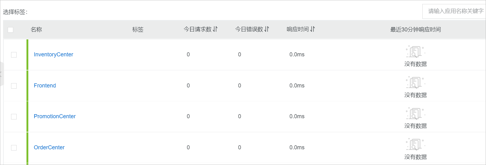

**排序应用**

单击下列标题旁边的箭头，即可按照相应条件升序或降序排列所有应用：

- **今日请求数**

- **今日错误数**

- **响应时间**

**设置应用标签**

为应用设置自定义的标签后，可利用这些标签来筛选应用。

1. 将鼠标悬浮于**标签**列上，单击

   图标，然后单击**管理标签**。

   

2. 在**标签**页签下，单击**管理应用标签**。

3. 在**管理应用标签**对话框，单击

   图标，输入自定义标签，然后单击**确定**。在弹出**成功**对话框再次单击**确定**

   

   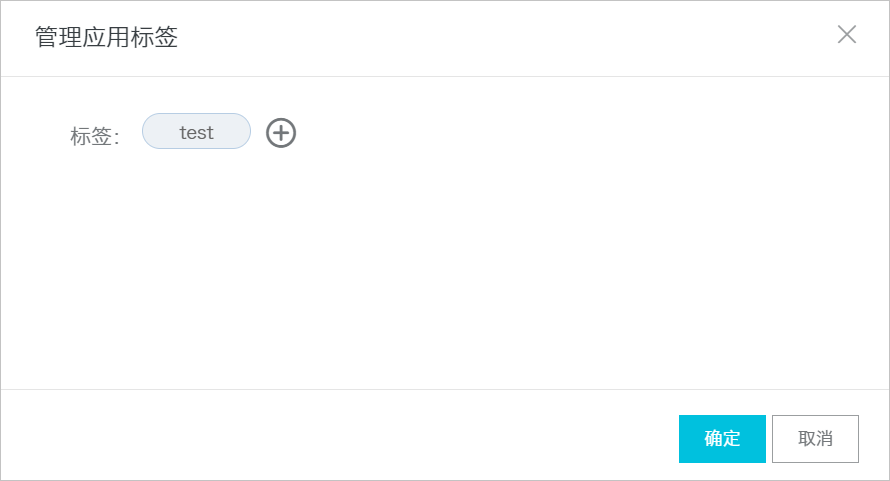

   > 如果在**管理应用标签**对话框删除现有标签，则以前添加了该标签的应用将会失去该标
   >
   > **重要**
   >
   > 签。

4. 返回**应用列表**页面，找到要打标签的应用，在其右侧**标签**列，单击

   图标，然后单击自定义的标签。

   

   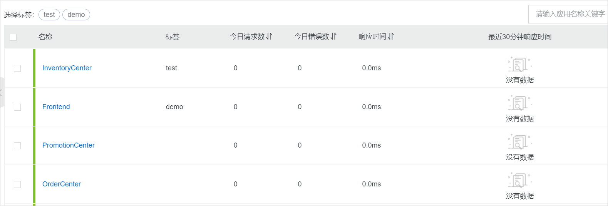

**利用标签筛选应用**

在应用列表上方的**选择标签**区域框中单击一个或多个标签，即可筛选出具有至少其中一个标签的所有应用。

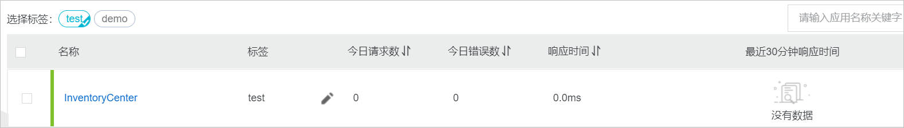

<a id="section-2-2"></a>

## 2.2. 查看应用总览

应用总览页面展示应用的性能关键指标和拓扑结构。

**背景信息**

当应用数据被上报至链路追踪Tracing Analysis后，链路追踪Tracing Analysis会开始全方位监控您的应用。通过**应用总览**页面，您可以快速查看应用性能关键指标，并通过应用拓扑图浏览应用的上下游依赖关系。

**查看应用性能关键指标**

您可以在**概览分析**页签上查看应用性能关键指标。

1. 登录链路追踪控制台。

2. 在左侧导航栏，选择**链路追踪 > 应用列表**。

3. 在**应用列表**页面，单击应用名称。

4. 在**应用总览**页面的**概览分析**页签，查看以下关键指标：

   - 选定时间内的请求总量、平均响应时间、异常次数、Span数量，以及这些指标和上周的同比、前一天的环比升降幅度。

   - 应用被上游调用的次数/耗时、调用下游服务次数/耗时的时序曲线。

   - 调用最慢的10个接口及其平均响应时间时序曲线。

   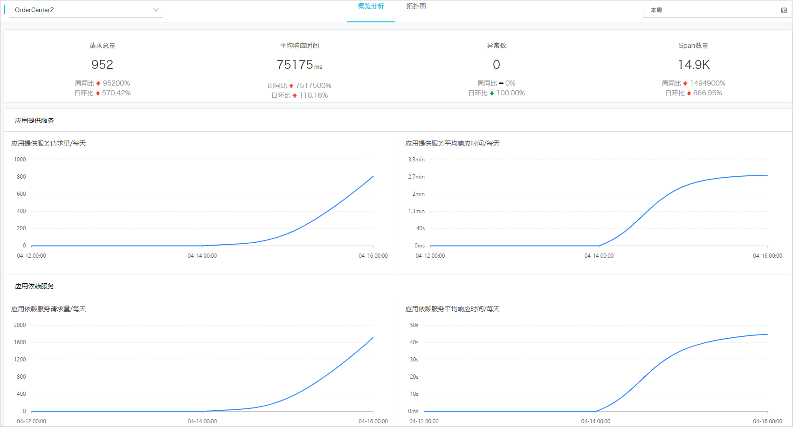

**查看应用拓扑图**

在**拓扑图**页签上，您可以更加直观地看到应用的上下游组件以及与它们的调用关系，从而更快速地找出应用的性能瓶颈。

1. 登录链路追踪控制台。

2. 在左侧导航栏，选择**链路追踪 > 应用列表**。

3. 在**应用列表**页面，单击应用名称。

4. 在**应用总览**页面上单击**拓扑图**页签，并在**拓扑图**页签上查看以下信息：

   - 选定时间内的应用调用关系拓扑图。

   - 选定时间内数据库、客户端、服务端和内部调用的调用次数、平均响应时间和错误率。

   - 选定时间内每分钟的请求数、响应时间和错误率时序图。

   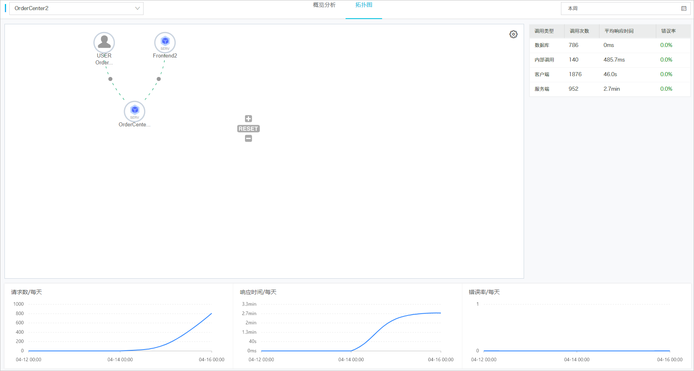

**设置查询时间范围**

您可以选择预设的时间范围，或者输入自定义的时间范围。

- 单击页面右上角的时间选择框，然后单击一个预设的时间范围，例如**最近30分钟**、**今天**、**本周**。

- 如果没有符合需求的预设时间范围，则单击**自定义**，然后在日历中选择起始和截止时间，或者在文本框内手动输入，并单击**确定**。

  > 日期的格式为 `YYYY-MM-DD` ，时间的格式为 `HH:MM` 。
  >
  > **说明**

  图 1. 查询时间范围选择器

  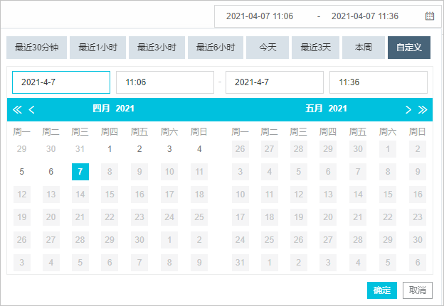

<a id="section-2-3"></a>

## 2.3. 查看应用详情

应用详情页面可展示应用在所部属的每一台机器上的关键性能指标、调用拓扑图和调用链路。

**查看关键性能指标和拓扑图**

**应用详情**页面的**概览**页签列出了部署该应用的所有机器。您可以按照响应时间、请求数、异常数对该列表排序。在机器列表中选中一台机器，即可在**概览**页签上查看应用的详细调用拓扑，以及请求数、响应时间、异常数的时序曲线。

1. 登录链路追踪控制台。

2. 在左侧导航栏，选择**链路追踪 > 应用列表**。

3. 在**应用列表**页面，单击应用名称。

4. 在左侧导航栏，单击**应用详情**，在左侧的机器列表中单击**全部**或一台机器，然后在**概览**页签上查看调用拓扑图和关键性能指标。

   > 单击**响应时间**、**请求数**、**异常数**页签，并单击旁边的箭头，即可按照相应的条件对部署
   >
   > **说明**
   >
   > 该应用的所有机器进行排序。在搜索框中输入关键字，即可动态筛选出符合关键字的机器。

   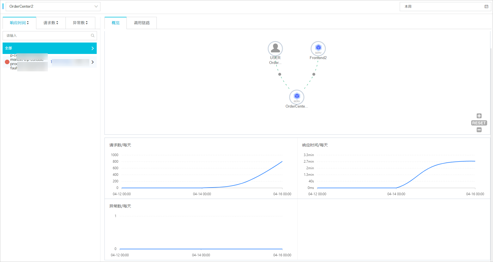

   > 如需切换至其他应用，可单击页面左上角的应用名称下拉列表并选择其他应用。
   >
   > **说明**

**查看调用链路**

**调用链路**页签列出了该应用在所选时间段内所选机器上耗时最长的至多100个调用链路。

图 1. 调用链路页签

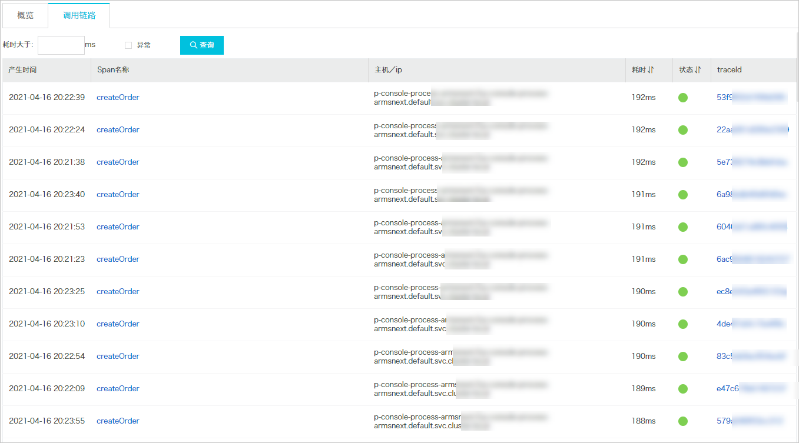

> **状态**列中的绿色图标表示耗时小于500毫秒，黄色图标表示耗时介于500毫秒至1000毫秒
>
> **说明**
>
> 之间，红色图标表示耗时大于1000毫秒或者有Tag Key为 `error` 。

在**调用链路**页签上可以按需执行以下操作：

- 在**耗时大于**调整框中输入一个时间值（单位为毫秒），并单击**查询**，即可筛选出耗时大于指定值的调用链路。

- 选择**异常**并单击**查询**，即可筛选出有异常的调用链路。

- 单击**耗时**或**状态**右侧的上下箭头，即可按照对应的条件升序或降序排列。

- 单击TraceID，即可在新窗口中打开**调用链路**页面，并查看该调用链路的瀑布图。

**查看调用链瀑布图**

在**调用链路**页面上，您可以看到调用链路的开始时间、耗时、应用数、链路深度、Span数量、Span名称、时间轴、应用名称等信息。

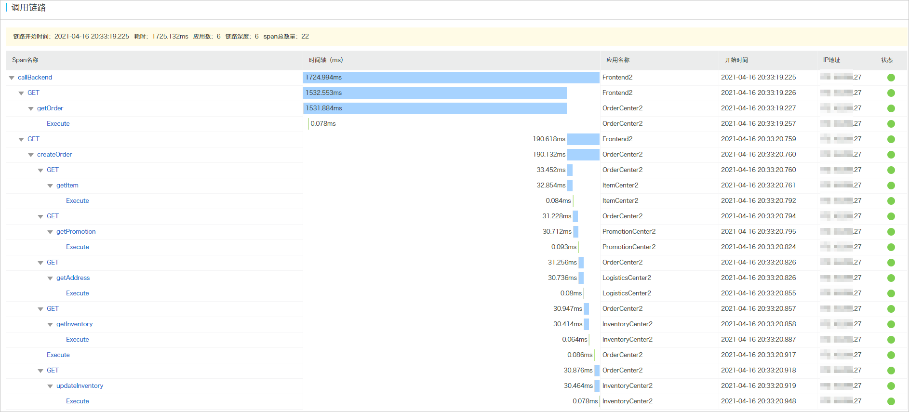

将鼠标悬浮于Span名称上，还可以查看该Span的时长、开始时间、Tag和日志事件等信息。

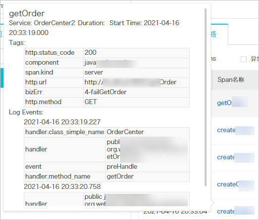

**设置查询时间范围**

您可以选择预设的时间范围，或者输入自定义的时间范围。

- 单击页面右上角的时间选择框，然后单击一个预设的时间范围，例如**最近30分钟**、**今天**、**本周**。

- 如果没有符合需求的预设时间范围，则单击**自定义**，然后在日历中选择起始和截止时间，或者在文本框内手动输入，并单击**确定**。

  > 日期的格式为 `YYYY-MM-DD` ，时间的格式为 `HH:MM` 。
  >
  > **说明**

  图 2. 查询时间范围选择器

  

<a id="section-2-4"></a>

## 2.4. 查看接口调用情况

接口调用页面展示客户端调用、服务端调用和本地调用中的接口（Span）调用性能指标，以及链路上游和链路下游的接口调用情况。

**查看接口调用性能指标**

**接口调用**页面列出了应用调用中涉及的全部接口（Span）。您可以按照响应时间、请求数、异常数对该列表排序。在接口列表中选中一个接口，即可在**概览**页签上查看应用的拓扑图和接口调用性能指标的时序曲线，包括请求数、响应时间、异常数。

1. 登录链路追踪控制台。

2. 在左侧导航栏，选择**链路追踪 > 应用列表**。

3. 在**应用列表**页面，单击应用名称。

4. 在左侧导航栏，单击**接口调用**，在左侧的接口列表中单击一个接口，然后在**概览**页签上查看该接口的拓扑图和性能指标。

   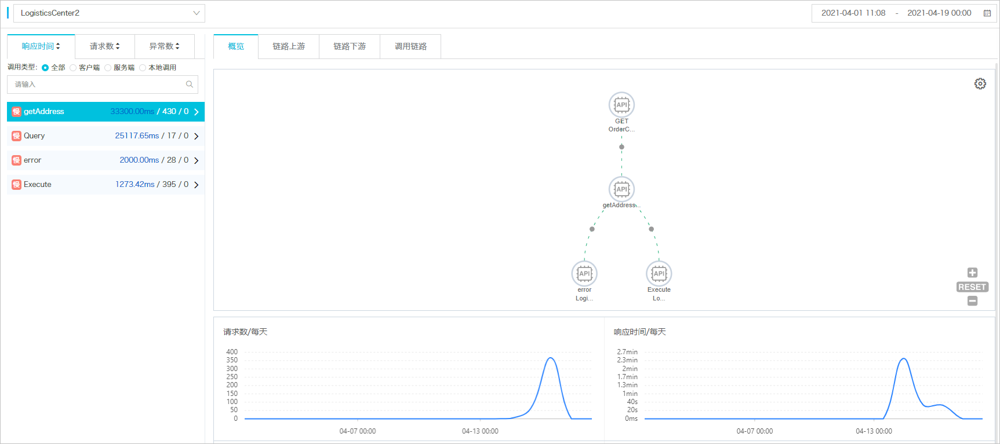

   - 单击**响应时间**、**请求数**、**异常数**页签，并单击页签标题旁边的上箭头或下箭头，即可按照相应的条件对所有接口进行升序或降序排序。

   - 在**调用类型**区域框单击**全部**、**客户端**、**服务端**或**本地调用**，即可筛选出相应调用类型的接口。

   - 在搜索框中输入关键字，即可动态筛选出符合关键字的接口。

**查看链路上游和链路下游的接口调用情况**

当前版本暂不支持该功能。

**查看调用链路**

**调用链路**页签列出了该应用在所选时间段内所选机器上耗时最长的至多100个调用链路。

图 1. 调用链路页签

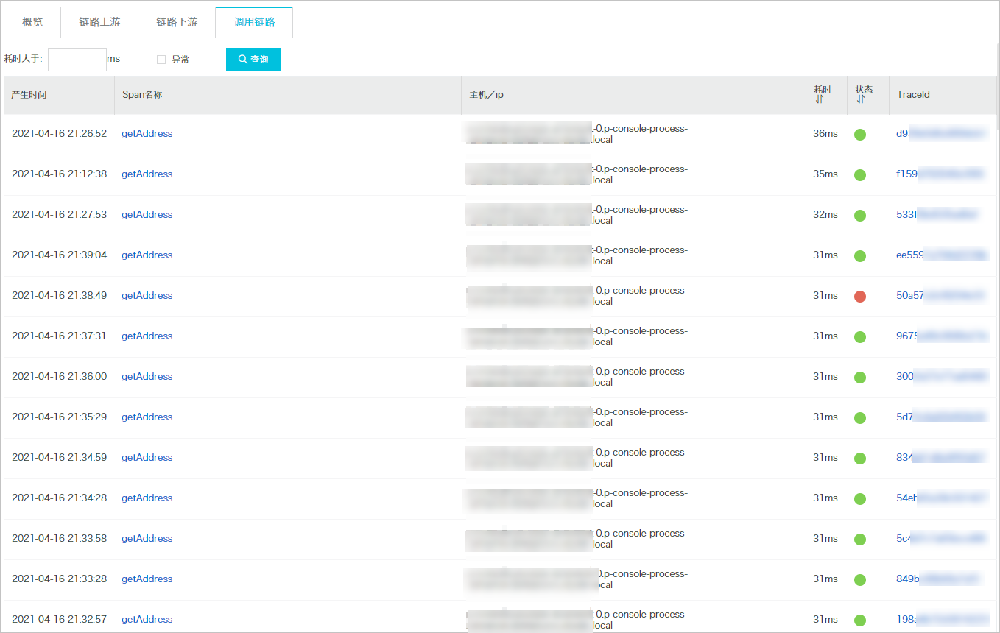

> **状态**列中的绿色图标表示耗时小于500毫秒，黄色图标表示耗时介于500毫秒至1000毫秒
>
> **说明**
>
> 之间，红色图标表示耗时大于1000毫秒或者有Tag Key为 `error` 。

在**调用链路**页签上可以按需执行以下操作：

- 在**耗时大于**调整框中输入一个时间值（单位为毫秒），并单击**查询**，即可筛选出耗时大于指定值的调用链路。

- 选择**异常**并单击**查询**，即可筛选出有异常的调用链路。

- 单击**耗时**或**状态**右侧的上下箭头，即可按照对应的条件升序或降序排列。

- 单击TraceID，即可在新窗口中打开**调用链路**页面，并查看该调用链路的瀑布图。

**查看调用链瀑布图**

在**调用链路**页面上，您可以看到调用链路的开始时间、耗时、应用数、链路深度、Span数量、Span名称、时间轴、应用名称等信息。


将鼠标悬浮于Span名称上，还可以查看该Span的时长、开始时间、Tag和日志事件等信息。


**设置查询时间范围**

您可以选择预设的时间范围，或者输入自定义的时间范围。

- 单击页面右上角的时间选择框，然后单击一个预设的时间范围，例如**最近30分钟**、**今天**、**本周**。

- 如果没有符合需求的预设时间范围，则单击**自定义**，然后在日历中选择起始和截止时间，或者在文本框内手动输入，并单击**确定**。

  > 日期的格式为 `YYYY-MM-DD` ，时间的格式为 `HH:MM` 。
  >
  > **说明**

  图 2. 查询时间范围选择器

  

<a id="section-2-5"></a>

## 2.5. 查看数据库调用

您可以在**数据库调用**页面分析SQL语句或查询调用链路。

**查看SQL分析**

通过SQL分析查询调用次数、平均耗时和相关调用链路，帮助您定位SQL性能问题。

1. 登录链路追踪控制台。

2. 在左侧导航栏，选择**链路追踪 > 应用列表**。

3. 在**应用列表**页面，单击应用名称。

4. 在左侧导航栏，单击**数据库调用**，然后在**SQL分析**页签上查看以下指标：

   - 选定时间内的每分钟SQL调用次数和平均耗时图表。

   - 选定时间内具体SQL语句的调用次数和平均耗时。

5. 在**SQL分析**页签上，按需执行以下操作：

   - 在**操作**列中单击**调用统计**，即可查看选定时间内具体SQL语句的每分钟调用次数和平均耗时图表。

   - 在**操作**列中单击**链路查询**，即可在**调用链路**页签上查看与对应SQL语句相关的所有调用链路。

   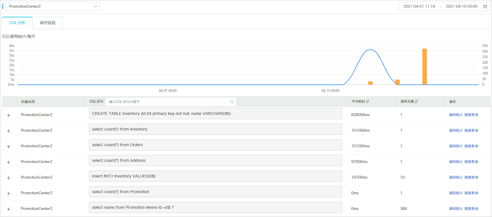

**设置查询时间范围**

您可以选择预设的时间范围，或者输入自定义的时间范围。

- 单击页面右上角的时间选择框，然后单击一个预设的时间范围，例如**最近30分钟**、**今天**、**本周**。

- 如果没有符合需求的预设时间范围，则单击**自定义**，然后在日历中选择起始和截止时间，或者在文本框内手动输入，并单击**确定**。

  > 日期的格式为 `YYYY-MM-DD` ，时间的格式为 `HH:MM` 。
  >
  > **说明**

  图 1. 查询时间范围选择器

  

<a id="section-2-6"></a>

## 2.6. 异常诊断

本文说明如何进行异常诊断。

**查看异常列表**

1. 登录链路追踪控制台。

2. 在左侧导航栏，选择**链路追踪 > 应用列表**。

3. 在**应用列表**页面，单击应用名称。

4. 在左侧导航栏，单击**异常诊断**。

   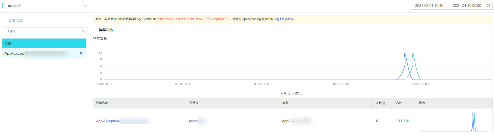

**查看异常详情**

1. 在**异常名称**列，单击要查看的异常。**异常详情**面板显示该异常的名称、接口、摘要、发生次数等信息。**错误信息**页签下显示具体的报错。

   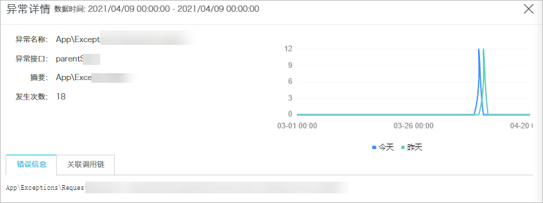

2. 如需查看该异常的关联调用链，单击**关联调用链**。

   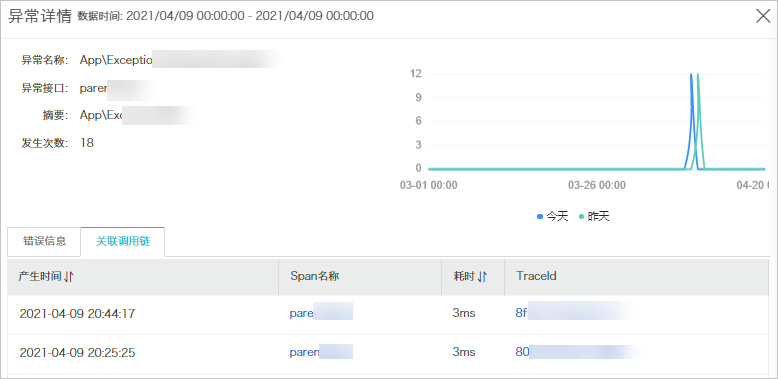

**设置查询时间范围**

您可以选择预设的时间范围，或者输入自定义的时间范围。

- 单击页面右上角的时间选择框，然后单击一个预设的时间范围，例如**最近30分钟**、**今天**、**本周**。

- 如果没有符合需求的预设时间范围，则单击**自定义**，然后在日历中选择起始和截止时间，或者在文本框内手动输入，并单击**确定**。

  > 日期的格式为 `YYYY-MM-DD` ，时间的格式为 `HH:MM` 。
  >
  > **说明**

  图 1. 查询时间范围选择器

  

<a id="section-2-7"></a>

## 2.7. 应用设置

本文说明如何启用和管理标签以及删除应用。

**启用标签**

1. 登录链路追踪控制台。

2. 在左侧导航栏，选择**链路追踪 > 应用列表**。

3. 在**应用列表**页面，单击任一应用**操作**列的**设置**或者单击应用名称，然后在左侧导航栏选择**应用设置**。

4. 在**应用设置**页面，单击**标签**页签。

5. 在**管理应用标签**下方的**关联标签**右侧，勾选要为应用启用的标签，然后单击**保存**。

   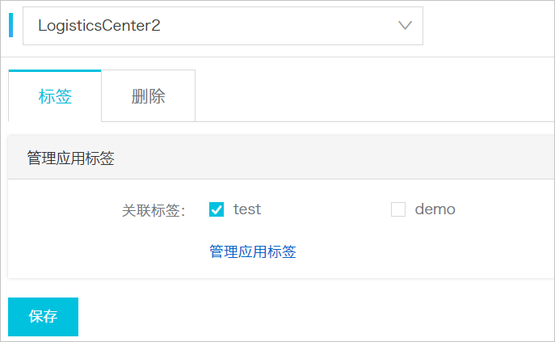

**管理标签**

1. 登录链路追踪控制台。

2. 在左侧导航栏，选择**链路追踪 > 应用列表**。

3. 在**应用列表**页面，单击任一应用**操作**列的**设置**或者单击应用名称，然后在左侧导航栏选择**应用设置**。

4. 在**应用设置**页面，单击**标签**页签。

5. 在**管理应用标签**区域，单击**管理应用标签**。

6. 在**管理应用标签**对话框，按需采取以下操作，然后单击**确定**。

   - 如需创建新标签，则单击加号图标，并在文本框内输入标签。

   - 如需删除现有标签，则将鼠标悬浮于标签上，并单击左侧的X图标。

     > 如果在**管理应用标签**对话框，删除现有标签，则所有已经启用该标签的应用将会失去
     >
     > **重要**
     >
     > 该标签。

   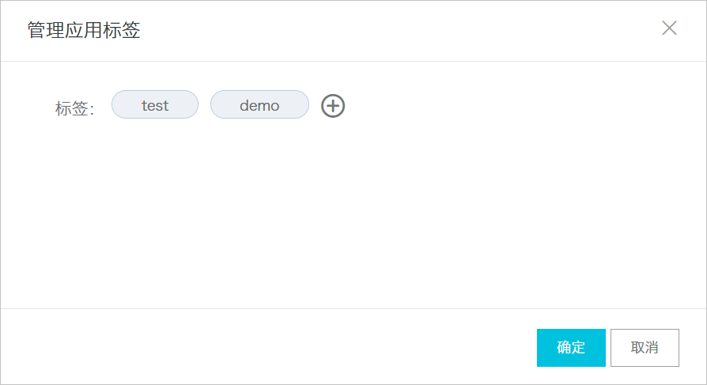

**删除应用**

1. 登录链路追踪控制台。

2. 在左侧导航栏，选择**链路追踪 > 应用列表**。

3. 在**应用列表**页面，单击任一应用**操作**列的**设置**或者单击应用名称，然后在左侧导航栏选择**应用设置**。

4. 在**应用设置**页面，单击**删除**页签。

5. 在**删除应用**区域，单击**删除**。

6. 在**删除应用**对话框，单击**删除**。

   > 此操作将会清除应用所有的监控数据。删除后数据无法恢复。
   >
   > **重要**

   

<a id="section-2-8"></a>

## 2.8. 多维查询

本文介绍如何利用多维查询功能查询调用链。

**查询调用链**

1. 登录链路追踪控制台。

2. 在左侧导航栏，选择**链路追踪 > 多维查询**。

3. 在**多维查询**页面上，按需输入以下参数的值，然后单击**查询**。

   - 固定查询参数

     - TraceID

     - 耗时大于（毫秒）

     - 应用名称

     - Span名称

     - 日期

   - 可选查询参数：Tag键

     从**Tag键**下拉列表选择Tag的键，然后在**Tag值**下拉列表选择Tag的值。如需添加Tag键和Tag值作为查询条件，请单击字段右侧的蓝色加号图标。

   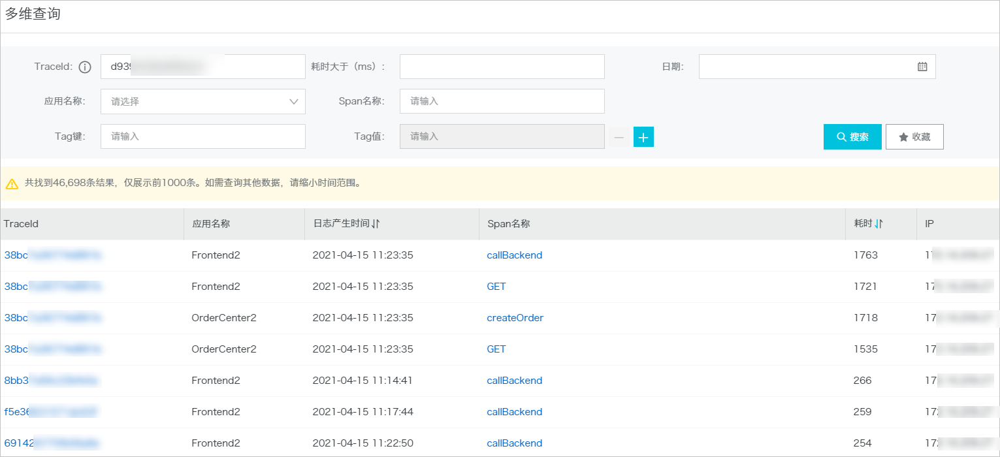

   > 在查询结果中，单击TraceID即可进入**调用链路**标签页查看调用链详情。
   >
   > **说明**

4. 如需保存当前查询参数配置，单击**收藏**，并设置别名。

5. 如需删除收藏的所有查询参数配置，单击别名右侧的删除图标。

**设置查询时间范围**

您可以选择预设的时间范围，或者输入自定义的时间范围。

- 单击页面右上角的时间选择框，然后单击一个预设的时间范围，例如**最近30分钟**、**今天**、**本周**。

- 如果没有符合需求的预设时间范围，则单击**自定义**，然后在日历中选择起始和截止时间，或者在文本框内手动输入，并单击**确定**。

  > 日期的格式为 `YYYY-MM-DD` ，时间的格式为 `HH:MM` 。
  >
  > **说明**

  图 1. 查询时间范围选择器

  

<a id="section-2-9"></a>

## 2.9. 全局拓扑

链路追踪的全局拓扑图能展示应用的上下游依赖关系。

**查看全局拓扑**

1. 登录链路追踪控制台。

2. 在左侧导航栏选择**链路追踪 > 全局拓扑**。

3. 在**全局拓扑**页面右上角设置需要查看的时间段。

   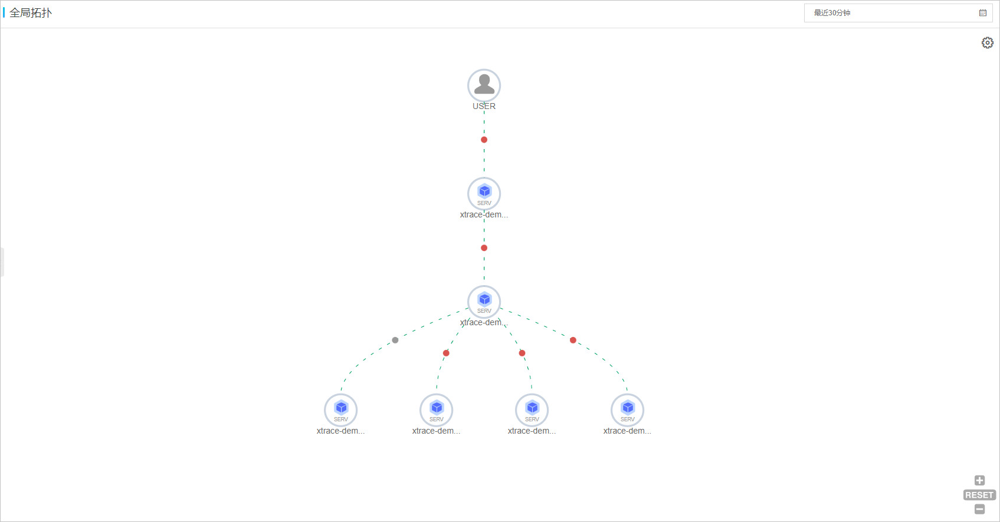

在全局拓扑页面，您可以执行以下操作：

- 单击加号图标或向上滑动鼠标滚轮，放大应用拓扑图。

- 单击减号图标或向下滑动鼠标滚轮，缩小应用拓扑图。

- 单击RESET图标，将应用拓扑图恢复至默认大小。

- 单击一个节点，可以高亮显示该节点关联的拓扑图。

- 右键应用节点，可以查看当前应用的详细信息。更多信息，请参见查看应用详情。

- 单击节点之间连线的圆点，可以查看QPS（请求数）、RT（响应时间）和ERROR（异常数）以及对应的时序曲线。

<a id="section-2-10"></a>

## 2.10. 用量统计

链路追踪已支持查看资源消耗统计，您可以通过设置过滤条件查看应用在特定时间内的资源消耗详情。

1. 登录链路追踪控制台。

2. 在左侧导航栏选择**链路追踪 > 用量统计**。

3. 在**用量统计**页面右上角设置需要查看的时间段。

4. 在**自研探针上报**或<strong>自研探针上报（全局）</strong>页签查看在线应用数和APM实例数，以及对应的用量趋势。

   - 自研探针上报：当前用户的用量数据。

   - 自研探针上报（全局）：所有用户的用量数据，仅管理员支持查看<strong>自研探针上报（全局）</strong>页签。

   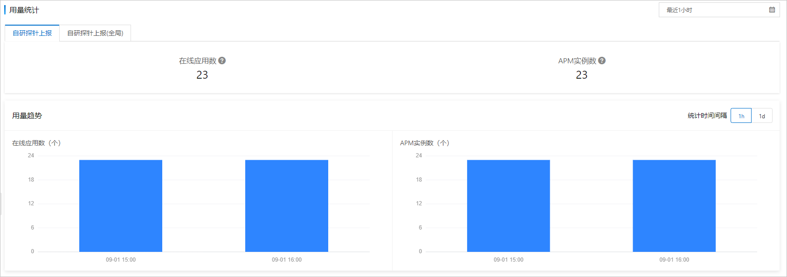
