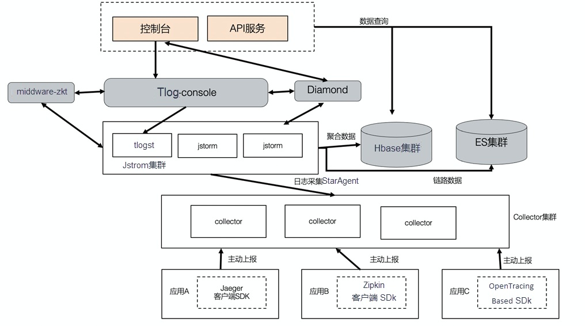
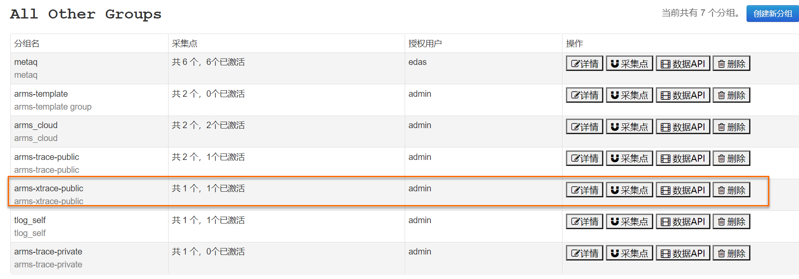
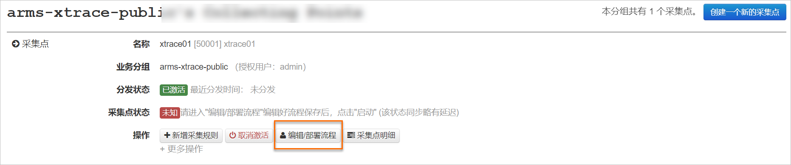
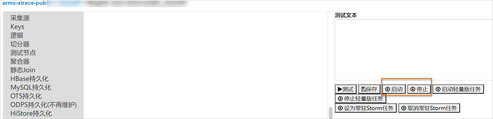
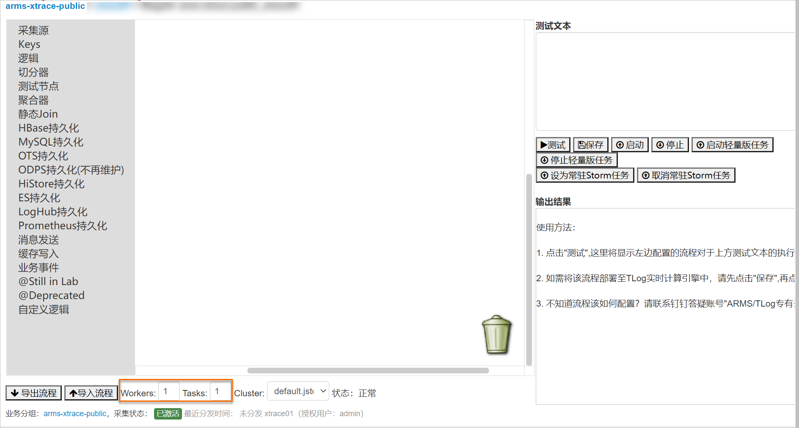
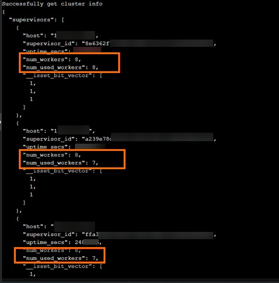
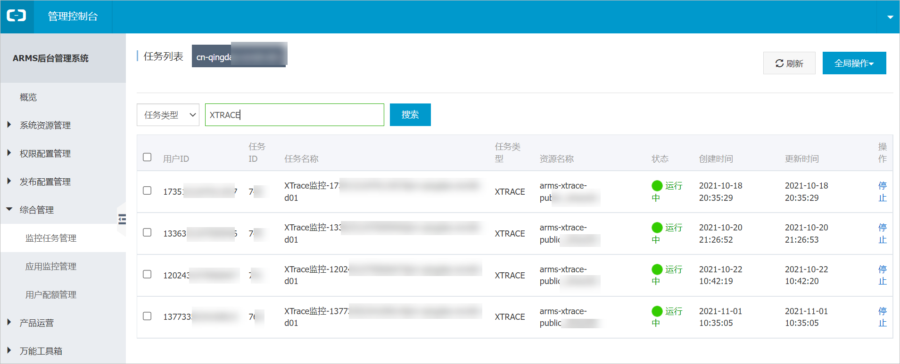
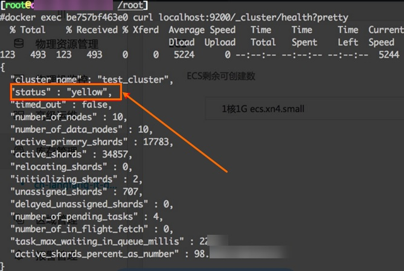
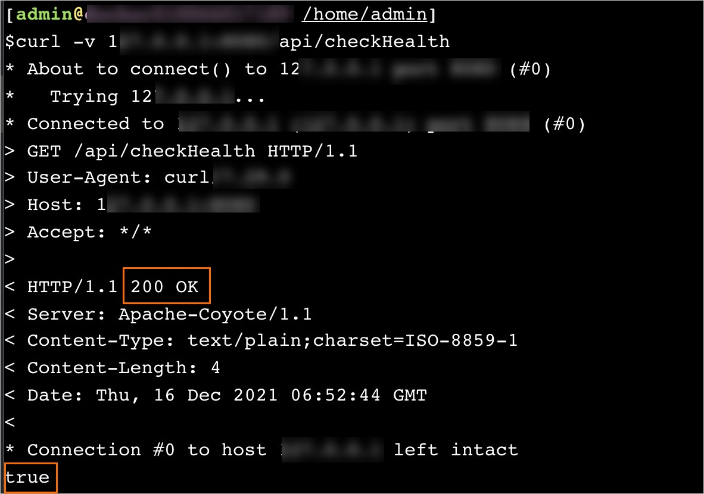

阿里云  
专有云  
链路追踪  
运维指南  
产品版本：V3.18.3  
文档版本：20250212

**目录**

- [1.运维概述](#section-1)
- [2.产品架构](#section-2)
    - [2.1. 系统架构](#section-2-1)
    - [2.2. 部署架构](#section-2-2)
    - [2.3. 服务角色列表](#section-2-3)
- [3.系统运维](#section-3)
    - [3.1. 链路追踪TLog采集点运维](#section-3-1)
    - [3.2. 链路追踪自定义任务运维](#section-3-2)
- [4.系统巡检](#section-4)
    - [4.1. 登录Apsara Uni-manager运维控制台](#section-4-1)
    - [4.2. 登录飞天基础运维平台](#section-4-2)
    - [4.3. Diamond巡检](#section-4-3)
    - [4.4. HBase巡检](#section-4-4)
    - [4.5. JStorm巡检](#section-4-5)
    - [4.6. Elasticsearch巡检](#section-4-6)
    - [4.7. Collector巡检](#section-4-7)
    - [4.8. TLog-Console巡检](#section-4-8)
    - [4.9. 链路追踪控制台巡检](#section-4-9)
- [5.安全维护](#section-5)
    - [5.1. 账号密码维护](#section-5-1)
    - [5.2. 日志审计](#section-5-2)

<a id="section-1"></a>

# 1.运维概述

本手册主要指导维护人员对阿里云系统-链路追踪进行预防性的维护，确保系统长期稳定运行。

维护人员可以根据本手册的指导，处理维护过程中发现的系统问题。如果根据本手册无法解决系统问题，您可以联系阿里云技术支持获取帮助。

**要求**

维护人员必须拥有IT行业技能，包括计算机网络知识、计算机操作知识、问题分析排查能力。

另外，维护人员必须经过阿里云系统岗前培训，学习必要的阿里云系统知识，包括但不限于系统原理、组网、特性使用和维护工具的使用。

特别注意的是，在维护操作过程中，维护人员务必遵守操作规章，确保人身安全和系统安全。对于用户数据，严格保密，未经用户书面许可，禁止复制、传播用户数据。

**注意事项**

为了系统运行的稳定，避免意外事故的发生，维护人员需遵循以下事项：

- 分层分权管理

  对网络、设备、系统、数据实行分层分权管理，相应业务的维护人员仅拥有完成自身角色任务相对应的权限，防止越权操作而引起系统故障。

- 系统安全

  - 在对系统进行任何操作前，需清楚地了解操作的结果，避免危险操作影响系统运行。

  - 在操作过程中遇到的问题，需清楚记录以便问题排查和故障处理。

- 人身和数据安全

  - 操作电气设备时，必须根据设备要求做好安全措施。

  - 需使用安全的设备接入业务网络。

  - 未经授权，严禁对数据进行复制和传播。

**联系我们**

维护人员在系统维护过程中，遇到任何问题您可以联系阿里云技术支持获取帮助。

<a id="section-2"></a>

# 2.产品架构

<a id="section-2-1"></a>

## 2.1. 系统架构

本文介绍了链路追踪的系统架构。



链路追踪产品在该版本中主要由控制台以及API服务组成，其核心计算以及存储等服务全部依赖TLog，详细介绍请参见部署架构。

<a id="section-2-2"></a>

## 2.2. 部署架构

本文介绍了链路追踪的部署架构。

<table>
  <tr>
    <th>组件分组</th>
    <th>组件</th>
    <th>描述</th>
  </tr>
  <tr>
    <td>链路追踪</td>
    <td>链路追踪控制台</td>
    <td>链路追踪产品的控制台，主要负责应用列表展示、分布式调用链查询和诊断、应用性能实时汇总、分布式拓扑动态发现以及应用相关设置。其中API服务主要提供对外API服务，控制台以及API服务部署在同一个容器中。</td>
  </tr>
  <tr>
    <td rowspan="5">TLog</td>
    <td>ARMS-Collector</td>
    <td>该组件隶属于TLog，应用程序通过集成链路追踪的多语言客户端SDK上报服务调用数据，Collector集群负责调用数据的收集。</td>
  </tr>
  <tr>
    <td>JStorm</td>
    <td>该组件隶属于TLog，JStorm集群包含TLogst和JStorm两种类型组件，主要负责日志的采集、清洗、计算以及存储写入。</td>
  </tr>
  <tr>
    <td>HBase</td>
    <td>该组件隶属于TLog，主要负责链路追踪统计数据的存储。</td>
  </tr>
  <tr>
    <td>ESDB</td>
    <td>该组件隶属于TLog，主要负责链路追踪明细数据的存储。</td>
  </tr>
  <tr>
    <td>TLog-Console</td>
    <td>该组件隶属于TLog，主要负责采集点管控、采集规则分发等。</td>
  </tr>
</table>

<a id="section-2-3"></a>

## 2.3. 服务角色列表

本文介绍链路追踪的服务角色列表。

**集群**

**服务**

**服务角色**

**描述**

**Project**

链路追踪控制台DB

arms-arms-

初始化，与ARMS应

console.ArmsCon

用监控共用。

soleInit#

arms-arms-

BasicCluster

console

链路追踪控制台，

arms-arms-

与ARMS应用监控共

ARMS

console.ArmsCon

用。

soleProcess#

arms-

链路追踪资源初始

XtraceCluster

arms-xtrac

xtrace.ArmsXtrac

化。

eInit#

arms-arms-

用于接收链路追踪

arms-arms-

collector.ArmsCol

上报的链路数据。

collector

lectorProcess#

ESDB集群，用于存

tlog-

储链路追踪明细数

tlog-tlogEsdb

tlogEsdb.TlogEsd

据。

b#

HBase集群，用于

tlog-

存储链路追踪统计

tlog-tlogHbase

tlogHbase.TlogHb

数据。

ase#

tlog-

JStorm集群

TLog

BasicCluster

tlogService.Tlogs

Nimbus所在节点。

t#

JStorm集群

tlog-

Supervisor所在节

tlogService.Jstor

点。

m#

tlog-tlogService

tlog-

TLog DB资源初始

tlogService.TlogI

化。

nit#

tlog-

TLog控制台。

tlogService.TlogC onsole#

<a id="section-3"></a>

# 3.系统运维

<a id="section-3-1"></a>

## 3.1. 链路追踪TLog采集点运维

链路追踪产品依赖TLog，本文介绍链路追踪TLog采集点运维。

1. 登录TLog运维控制台。链路追踪默认的专有云资源池分组为arms-xtrace-public，如下图所示。

   

2. 单击右侧**操作**列的**采集点**。默认该分组下只有一个**名称**为**xtrace01**的采集点。

   

   - 重启采集点：

     <ol type="a">

     <li>

     单击**编辑/部署流程**，在**测试文本**区域下方，先单击**停止**，大约等待30s，然后单击**启动**，即可重启采集点。

     </li>

     </ol>

     

   - 修改采集点的Worker数：**xtrace01**采集点默认的Worker数为1，Task数也为1。随着用户业务的增加，默认的Worker数无法支持增长的业务量，需要适当增加Worker数来保障业务稳定运行。

     

     > **说明**
     >
     > - 建议自行设置的Worker数与Task数之间保持1:2的比例。
     >
     > - Worker数量的设置存在上限，不能无限增加。

     增加Worker数之前需要前往JStorm集群查看当前集群剩余的Worker数量。执行以下命令进入TLogst容器。

     ```bash
     docker ps | grep tlogst
     docker exec -ti <tlogst容器ID> bash     //执⾏docker ps | grep tlogst命令后可以获取tlog
     st容器ID。
     sudo su admin
     jstorm list
     ```

     如下图所示：JStorm集群中有三台机器，其中num_workers数量共计24，num_used_workers数量共计22，因此剩余的Worker数即为2。

     

<a id="section-3-2"></a>

## 3.2. 链路追踪自定义任务运维

每个区域每个用户（主账号级别）会存在一个链路追踪的系统自定义监控任务（前提是用户已经有应用接入链路追踪，如果没有那么该任务不存在），在特定的情况下该系统自定义监控任务需要进行重启。

重启需要以管理员身份登录链路追踪控制台的管理员系统。获取管理员系统界面的登录方式，您可以联系阿里云技术支持获取。



<a id="section-4"></a>

# 4.系统巡检

<a id="section-4-1"></a>

## 4.1. 登录Apsara Uni-manager运维控制台

本节介绍运维工程师等相关用户如何登录到Apsara Uni-manager运维控制台。

**前提条件**

- 已从部署人员或管理员处获取Apsara Uni-manager运维控制台的访问地址、用户名和密码。

  Apsara Uni-manager运维控制台访问地址格式为*region-id*.ops.console.*intranet-domain-id*。

- 推荐使用Chrome浏览器。

**操作步骤**

1. 打开浏览器。

2. 在地址栏中，输入Apsara Uni-manager运维控制台的访问地址，按回车键。

   

   > **说明**
   >
   > 您可以单击右上角的当前语言切换其它语言。当前支持简体中文、英文、繁体中文三种语言切换。

3. 输入正确的用户名及密码。

   > **说明**
   >
   > 登录Apsara Uni-manager运维控制台的用户名和密码请从部署人员或管理员处获取。

   首次登录Apsara Uni-manager运维控制台时，需要修改登录用户名的密码，请按照提示完成密码修改。

   为提高安全性，密码必须满足以下要求：

   - 必须包含英文大小写字母。

   - 必须包含阿拉伯数字（0~9）。

   - 必须包含特殊符号，包括感叹号（!）、at（@）、井号（#）、美元符号（$）、百分号（%）等。

   - 密码长度为10~20个字符。

4. 单击**账号登录**。

<a id="section-4-2"></a>

## 4.2. 登录飞天基础运维平台

本节介绍运维工程师等相关用户如何登录到飞天基础运维平台。

**前提条件**

- 已从部署人员或管理员处获取Apsara Uni-manager运维控制台的访问地址、用户名和密码。

  Apsara Uni-manager运维控制台访问地址格式为*region-id*.ops.console.*intranet-domain-id*。

- 推荐使用Chrome浏览器。

**操作步骤**

1. 打开浏览器。

2. 在地址栏中，输入Apsara Uni-manager运维控制台的访问地址，按回车键。

   

   > **说明**
   >
   > 您可以单击右上角的当前语言切换其它语言。当前支持简体中文、英文、繁体中文三种语言切换。

3. 输入正确的用户名及密码。

   > **说明**
   >
   > 登录Apsara Uni-manager运维控制台的用户名和密码请从部署人员或管理员处获取。

   首次登录Apsara Uni-manager运维控制台时，需要修改登录用户名的密码，请按照提示完成密码修改。

   为提高安全性，密码必须满足以下要求：

   - 必须包含英文大小写字母。

   - 必须包含阿拉伯数字（0~9）。

   - 必须包含特殊符号，包括感叹号（!）、at（@）、井号（#）、美元符号（$）、百分号（%）等。

   - 密码长度为10~20个字符。

4. 单击**账号登录**。

5. 在Apsara Uni-manager运维控制台顶部菜单栏，选择**云平台运维 > 飞天基础运维平台**。

6. 单击**资源管理**。

<a id="section-4-3"></a>

## 4.3. Diamond巡检

本文介绍Diamond巡检。

**操作步骤操作步骤**

1. 登录飞天基础运维平台。

2. 在左侧导航栏，选择**运维工具 > 服务管理**。

3. 在**服务管理**页面的**服务**搜索框中输入 `middleWare-jmenv` ，在**服务实例**页签，点击**操作**列的**实例详情**，检查 `middleWare-jmenv` 服务对应机器的状态是否正常。

   - 是：表示 `middleWare-jmenv` 服务正常。

   - 否：请联系驻场技术支持。

<a id="section-4-4"></a>

## 4.4. HBase巡检

本文介绍HBase巡检。

**操作步骤**

1. 登录飞天基础运维平台。

2. 在左侧导航栏，选择**运维工具 > 服务管理**。

3. 在**服务管理**页面的**服务**搜索框中输入 `tlog-tlogHbase` ，在**服务实例**页签，点击**操作**列的**实例详情**。

4. 在**组件详情**页面，单击**组件列表**中的 `TlogHbase#` 。

5. 在**实例列表**页签，选中任一机器单击其右侧**操作**列的**Terminal**，然后在**TerminalService**页面单击左侧的机器名称，登录到该机器，执行如下命令进入容器。

   ```bash
   sudo docker ps | grep hbase
   sudo docker exec -it <HBase容器ID> bash
   ```

6. 执行以下命令，切换为hadoop用户。

   ```text
   su hadoop
   ```

7. 执行以下命令，查看是否存在 `tlog-biz` 表。

   ```bash
   cd ~/hbase-current/bin
   list
   ```

   - 是：继续执行步骤8。

   - 否：请联系驻场技术支持。

8. 执行以下命令，查看 `tlog-biz` 是否正常加载 `coprocessor` 。

   ```text
   describe 'tlog-biz'
   ```

   - 是：继续执行步骤9。

   - 否：请联系驻场技术支持。

9. 执行以下命令，判断读取数据是否存在异常。

   ```text
   scan 'tlog-biz',LIMIT=>10
   ```

   - 是：表示服务正常。

   - 否：请联系驻场技术支持。

<a id="section-4-5"></a>

## 4.5. JStorm巡检

本文介绍JStorm巡检。

**操作步骤**

1. 登录飞天基础运维平台。

2. 在左侧导航栏，选择**运维工具 > 服务管理**。

3. 在**服务管理**页面的**服务**搜索框中输入 `tlog-tlogService` ，在**服务实例**页签，点击**操作**列的**实例详情**。

4. 在**组件详情**页面，单击**组件列表**中的 `Tlogst#` 。

5. 在**实例列表**页签，选中任一机器单击其右侧**操作**列的**Terminal**，然后在**TerminalService**页面单击左侧的机器名称，登录到该机器，执行如下命令进入容器。

   ```bash
   sudo docker ps | grep tlogst
   sudo docker exec -it <tlogst容器ID> bash    //执⾏sudo docker ps | grep tlogst命令后可获
   取tlogst容器ID。
   ```

6. 执行以下命令，然后输入admin用户密码，切换为admin用户。

   ```text
   su admin
   ```

7. 执行以下命令，查看 `Topology` 和相关结点的运行是否正常。

   ```text
   jstorm list
   ```

   - 是：表示服务正常。

   - 否：请联系驻场技术支持。

<a id="section-4-6"></a>

## 4.6. Elasticsearch巡检

本文档介绍Elasticsearch巡检。

**操作步骤**

1. 登录飞天基础运维平台。

2. 在左侧导航栏，选择**运维工具 > 服务管理**。

3. 在**服务管理**页面的**服务**搜索框中输入 `tlog-tlogEsdb` ，在**服务实例**页签，点击**操作**列的**实例详情**。

4. 在**组件详情**页面，单击**组件列表**中的 `TlogEsdb#` 。

5. 在**实例列表**页签，选中任一机器单击其右侧**操作**列的**Terminal**，然后在**TerminalService**页面单击左侧的机器名称，登录到该机器，执行如下命令进入容器。

   ```bash
   sudo docker ps | grep esdb
   sudo docker exec -it <esdb容器ID> bash      //执⾏sudo docker ps | grep esdb命令后可获取esdb容器ID。
   ```

6. 执行以下命令，然后输入hadoop用户密码，切换为hadoop用户。

   ```text
   su hadoop
   ```

7. 执行以下命令，检查集群状态是否正常。

   ```bash
   curl --user arms_admin:arms_admin -POST "IP:9200/_cluster/health?pretty"       //IP地
   址请根据实际情况进⾏替换
   ```

   - 集群状态正常：请继续执行步骤9。

   - 集群状态不正常：请联系驻场支持。

   

   回显信息如上图所示。在ES集群中的状态（“status”）有三种，分别是：“green”、“red”和“yellow”，上图展示的是状态为“yellow”时的情况，这三种状态具体代表如下：

   - **green**：表示所有的主分片和副本分片都已分配。集群100%可用。

   - **yellow**：表示所有的主分片已经分片了，但至少还有一个副本是缺失的。不会造成数据丢失，因此搜索结果依然是完整的。但是集群的高可用在某种程度上会被弱化。如果更多的分片消失，集群就会丢失数据。“yellow”状态类似于一个需要及时调查的警告。

   - **red**：表示至少一个主分片（以及它的全部副本）都在缺失中。表示目前有数据缺失，因此搜索只能返回部分数据，而分配到这个分片上的写入请求会返回一个异常，可以通过执行以下命令进行处理：

     ```bash
     curl --user arms_admin:arms_admin -POST 'ip:9200/_cat/indices?v'
     ```

     > **说明**
     >
     > 通过执行该命令，可以查看所有索引信息。即可以查看是由哪个索引的“red”状态导致集群状态为“red”。如果集群索引较多，需要把结果拷贝出来，然后搜索“red”关键字就可以跟踪到索引和分片了；如果该索引不重要，可以直接删除（delete），集群状态立刻会变为“green”。同时也可以通过执行reroute强制分配该分片，该操作有一定风险，请谨慎使用。

8. 执行以下命令，检查集群是否有异常索引。

   ```bash
   curl --user arms_admin:arms_admin -POST 'ip:9200/_cat/indices?v'
   ```

   通过查看索引的名称，判断异常索引。除系统索引外，正常索引末尾会带有正常的年份信息（年+月+日或者年+月），如果出现异常且大量的非正常年份信息索引，则可判定该集群存在异常索引，可以对其进行删除。如下为异常索引举例：

   ```text
   arms_trace_armsmg_7042-04-13
   arms_trace_armsmg_2476-02-17 
   arms_trace_armsmg_7040-03-06
   arms_trace_armsmg_7034-12-25
   arms_trace_armsmg_7035-08-19
   arms_trace_armsmg_2496-01-08
   ```

   若无异常索引，表示服务正常。

<a id="section-4-7"></a>

## 4.7. Collector巡检

本文介绍Collector巡检。

**操作步骤**

1. 登录飞天基础运维平台。

2. 在左侧导航栏，选择**运维工具 > 服务管理**。

3. 在**服务管理**页面的**服务**搜索框中输入 `arms-arms-collector` ，在**服务实例**页签，点击**操作**列的**实例详情**。

4. 在**组件详情**页面，单击**组件列表**中的 `ArmsCollectorProcess#` 。

5. 在**实例列表**页签，选中任一机器单击其右侧**操作**列的**Terminal**，然后在**TerminalService**页面单击左侧的机器名称，登录到该机器，执行如下命令进入容器。

   ```bash
   sudo docker ps | grep collector
   sudo docker exec -it <collector容器ID> bash
   ```

6. 执行以下命令，然后输入admin用户密码，切换为admin用户。

   ```text
   su admin
   ```

7. 执行以下命令，检查服务是否正常。

   ```bash
   curl -v 127.0.0.1:8080
   ```

   

   如上图，若回显信息中返回值存在 `200 OK` 以及 `true` 的字符信息时，表示服务正常，否则请联系驻场支持。

<a id="section-4-8"></a>

## 4.8. TLog-Console巡检

本文介绍TLog-Console巡检。

**操作步骤**

1. 登录Apsara Uni-manager运维控制台。

2. 在左侧导航栏选择**产品运维管理 > 产品列表**，然后在**产品列表**页面选择**中间件服务 > Tlog**。如果页面能正常打开，则表示服务正常，否则请联系驻场支持。

<a id="section-4-9"></a>

## 4.9. 链路追踪控制台巡检

登录用户侧环境，如果能打开链路追踪控制台，则表示服务正常，否则请联系驻场支持。

<a id="section-5"></a>

# 5.安全维护

<a id="section-5-1"></a>

## 5.1. 账号密码维护

链路追踪产品的账号密码统一使用Apsara Uni-Manager，TLog账号密码统一使用ASO。

<a id="section-5-2"></a>

## 5.2. 日志审计

本文介绍链路追踪的日志审计。

表 1. 链路追踪控制台

| 日志路径 | 说明 |
| --- | --- |
| /home/admin/logs/arms/arms-console.log | ARMS-Console业务日志 |
| /home/admin/taobao-tomcat-production-7.0.85/logs/catalina.out | Tomcat Catalina日志 |
| /home/admin/taobao-tomcat-production-7.0.85/logs/localhost.log | Tomcat Localhost日志 |

表 2. 链路追踪API服务

| 日志路径 | 说明 |
| --- | --- |
| /home/admin/logs/arms/arms-pop.log | ARMS-Pop业务日志 |
| /home/admin/arms-pop/taobao-tomcat-production/logs/catalina.out | Tomcat Catalina日志 |
| /home/admin/arms-pop/taobao-tomcat-production/logs/localhost.log | Tomcat Localhost日志 |

表 3. ARMS-Collector

| 日志路径 | 说明 |
| --- | --- |
| /home/admin/logs/arms/arms-collector.log | ARMS-Collector服务日志 |
| /home/admin/logs/arms/tracelogs | 用户链路追踪SDK上报的业务日志（请勿删除） |
| /home/admin/taobao-tomcat-production-7.0.85/logs/catalina.out | Tomcat Catalina日志 |
| /home/admin/taobao-tomcat-production-7.0.85/logs/localhost.log | Tomcat Localhost日志 |

表 4. TLog Console

| 日志路径 | 说明 |
| --- | --- |
| /home/admin/tlogconsole/logs/tlog-console.log | TLog Console业务日志 |
| /home/admin/taobao-tomcat-production-7.0.85/logs/catalina.out | Tomcat Catalina日志 |
| /home/admin/taobao-tomcat-production-7.0.85/logs/localhost.log | Tomcat Localhost日志 |

表 5. JStorm集群（组件TLogst、JStorm的Nimbus）

| 日志路径 | 说明 |
| --- | --- |
| /home/admin/logs/nimbus.log | JStorm Nimbus业务日志 |
| /home/admin/logs/supervisor.log | JStorm Supervisor日志 |
| /home/admin/logs/check.log | 检查Nimbus与Supervisor状态的日志 |
| /home/admin/logs/xxxx-worker-端口.log | 采集点Worker日志 |

表 6. JStorm集群（组件 JStorm 、JStorm的Supervisor）

| 日志路径 | 说明 |
| --- | --- |
| /home/admin/logs/supervisor.log | JStorm Supervisor日志 |
| /home/admin/logs/check.log | 检查Supervisor状态的日志 |
| /home/admin/logs/xxxx-worker-端口.log | 采集点Worker日志 |

表 7. HBase

| 日志路径 | 说明 |
| --- | --- |
| /home/hadoop/cluster-data/logs/hbase_health.log | HBase健康检查日志 |
| /home/hadoop/cluster-data/hbase/logs/hbase-hadoop-master-xxx.log | Master日志 |
| /home/hadoop/cluster-data/logs/hadoop-xxx-namenode-xxx.log | NameNode日志 |
| /home/hadoop/cluster-data/hbase/logs/hbase-xxx-regionserver-xxx.log | Region Server日志 |
| /home/hadoop/cluster-data/hbase/logs/hbase-xxx-zookeeper-xxx.log | HBase ZooKeeper日志 |

表 8. ESDB集群

| 日志路径 | 说明 |
| --- | --- |
| /disk1/test_cluster.log | ESDB运行时日志 |
