阿里云  
专有云  
云迁移中心  
用户指南  
产品版本：V3.18.6  
文档版本：20251217

**目录**

- [1.什么是云迁移中心](#section-1)
- [2.迁移指引](#section-2)
- [3.快速入门](#section-3)
    - [3.1. 服务器迁移](#section-3-1)
    - [3.2. VMWare迁移](#section-3-2)
    - [3.3. 操作系统替换](#section-3-3)
    - [3.4. 数据库迁移](#section-3-4)
    - [3.5. 存储迁移](#section-3-5)
- [4.资源迁移](#section-4)
    - [4.1. 创建资源迁移计划](#section-4-1)
    - [4.2. 管理资源迁移计划](#section-4-2)
- [5.高级服务](#section-5)
    - [5.1. 服务器迁移](#section-5-1)
        - [5.1.1. 使用限制](#section-5-1-1)
        - [5.1.2. 迁移前准备](#section-5-1-2)
        - [5.1.3. 操作指南](#section-5-1-3)
            - [5.1.3.1. 服务器迁移](#section-5-1-3-1)
            - [5.1.3.2. VMware无代理迁移](#section-5-1-3-2)
            - [5.1.3.3. 操作系统替换](#section-5-1-3-3)
    - [5.2. 跨平台应用扫描](#section-5-2)
        - [5.2.1. 源代码扫描](#section-5-2-1)
            - [5.2.1.1. 创建评估任务](#section-5-2-1-1)
            - [5.2.1.2. 查看源码建议](#section-5-2-1-2)
            - [5.2.1.3. 下载代码扫描报告](#section-5-2-1-3)
            - [5.2.1.4. 扫描参数设置](#section-5-2-1-4)
        - [5.2.2. 软件包评估](#section-5-2-2)
            - [5.2.2.1. 创建评估任务](#section-5-2-2-1)
            - [5.2.2.2. 查看评估报告](#section-5-2-2-2)
    - [5.3. JVM参数调优](#section-5-3)

<a id="section-1"></a>

# 1.什么是云迁移中心

云迁移中心作为企业数字化转型的核心引擎，以集中化管理、覆盖主流产品、承载最佳实践、服务于应用为四大支柱，构建端到端的智能化迁云体系，助力企业高效、安全、低成本上云。

1. 集中化管理：一站式全生命周期迁云

   - 全流程覆盖：覆盖迁移全链路（调研→规划→准备→测试→执行→验证），在一个平台上完成所有迁移操作。

   - 自动化运行：采集迁移源的配置信息和运行情况，结合迁移条件（迁移网络带宽），自动设计迁移任务执行策略、差异性适配方案以及数据校验方式，无需人为参与，绕过复杂配置，简单点击即可完成迁移。

   - 过程可视化：提供全流程跟踪数据看板，实时展示迁移进度、资源状态，抓取迁移过程中的关键指标（如网络传输成功率、迁移带宽占用率、源端资源负载），异常时自动触发告警。

2. 覆盖主流产品：多种类型资源统一管理

   - 服务器：支持云下服务器迁移上云、云下虚拟机迁移上云、虚拟机跨云迁移；

   - VMWare：支持云下VMWare集群无代理迁移上云；

   - 操作系统：支持EOL系统升级或操作系统的合规重构。

   - 存储：支持NAS迁移上云和OSS跨云迁移；

   - 数据库：支持MySQL数据库迁移上云和跨云迁移；

3. 承载最佳实践：满足企业对数据安全、业务稳定和迁移效率的诉求

   - 业务连续性优先：在迁移源的安全工作负载条件下完成数据迁移，实时监控迁移源在迁移过程中的运行状态，发现业务有异常风险自动熔断。

   - 资源充分利用：通过批量执行迁移任务、自适应调整同步速率以及错峰执行数据校验，充分使用迁移网络、流量、CPU等资源，使得整体迁移效率最大化；

   - 兼容性与扩展性：平台内部植入跨版本迁移的适配规则，扫描发现差异点并进行自动化适配，充分测试验证后发布上线；根据业务发展需要，支持在迁移的过程中升级版本、提升资源实例规格以及扩大应用集群规模；

   - 数据一致性和完整性：所有资源默认使用安全的传输协议，在网络层面保证数据传输的完整性。支持边同步数据边执行完整性校验，提升校验效率。分层执行数据校验，从全局到局部，逐层递归快速发现问题数据。

4. 服务于应用：以业务视角贴近用户管理迁移

   - 应用迁移计划：把应用包含的资源组合在迁移计划内，按照应用的架构依赖关系自底向上执行资源的迁移动作。

   - 应用级资源映射： 从应用维度，构建源端与云端资源的映射关系，直观展示应用架构拓扑，方便管理应用迁移上云的整个生命周期。

   - 应用级业务割接： 编排业务割接的切换动作，监控源端和云上资源的运行状态，实时发现数据同步、割接动作进展，实现多团队通过统一平台协作，支持多角色（业务方、技术方、运维方）实时同步信息，减少沟通成本。

<a id="section-2"></a>

# 2.迁移指引

本文档展示了云迁移中心AMC的常用操作流程，说明了其中的核心元素和使用逻辑，从而引导您更好地完成迁移操作。

**引导中心**

进入云迁移中心后默认跳转引导中心，引导中心对支持的几种迁移场景进行了详细说明，并介绍了迁移流程的6个主要步骤以及环境要求等信息，帮助用户更好地了解云迁移中心。

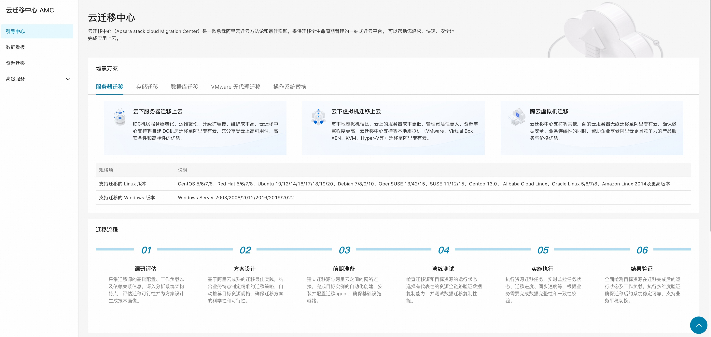

**数据看板**

数据看板从全局视角对迁移数据进行了展示，用户可以直观的了解到当前进展和历史迁移记录，从而帮助用户更好地制定迁移计划。

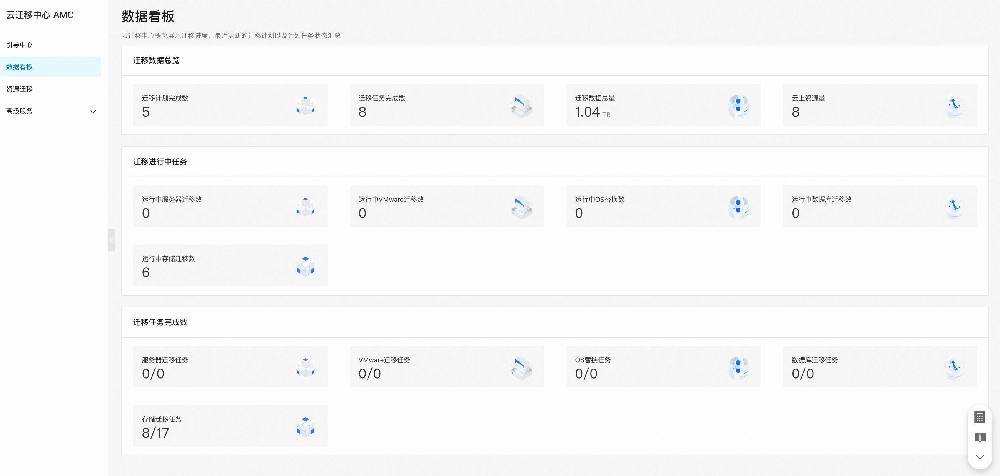

**资源迁移**

用户可以在资源迁移中管理和执行具体的迁移计划，完成从调研评估、方案设计、前期准备、演练测试、迁移实施和结果验证的6个步骤，通过自动化地流程推进，降低迁移复杂度，大大提高迁移效率。

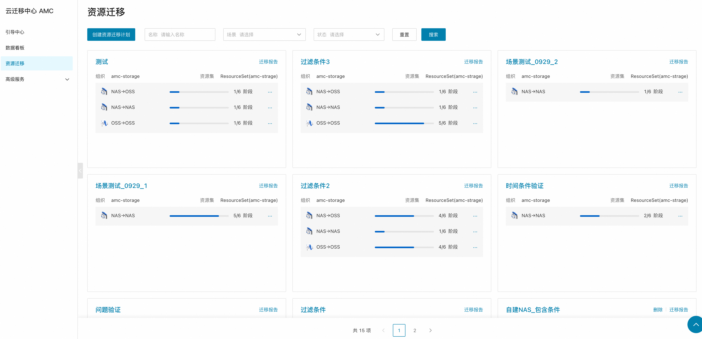

**高级服务**

高级服务主要面向不需要进行资源调研的迁移场景，另外还提供了跨平台评估和JVM参数调优工具，用户可根据实际情况使用。

- **服务器迁移**目前支持服务器的**通用迁移（有代理）**、**VMWare无代理迁移和操作系统替换**。在完成迁移前准备工作后，可以执行导入迁移源、创建迁移任务来快速执行迁移。

- **跨平台源码评估**的核心功能则是针对目标端的指令集架构与源端不一致的问题，通过跨平台应用扫描工具帮助用户解决迁移后源码或软件包的改造问题。

- **JVM参数调优**可根据Java版本、供应商、平台和CPU架构等相关信息，实现JVM参数的优化、迁移等功能。

<a id="section-3"></a>

# 3.快速入门

<a id="section-3-1"></a>

## 3.1. 服务器迁移

**前提条件**

在进行服务器迁移之前请先检查源服务器是否满足以下要求。

- **Linux系统**

  - 确保系统时间与所在地域的标准时间一致，避免SMC agent注册失败。

  - 检查SELinux。对于CentOS/Red Hat系列内核系统，一般需要检查SELinux服务是否已禁用或关闭。如果没有关闭，您可以采用下列方法之一将其关闭。

    - 运行 `setenforce 0` 命令临时将其关闭。

    - 修改 `/etc/selinux/config` 文件，配置 `SELINUX=disabled` 永久禁用SELinux。

  - 检查GRUB引导程序。

    部分低内核系统（如CentOS、Red Hat 5和Debian 7）以及Amazon Linux系统需要升级GRUB至2.02及以上版本。

  - 检查授权应用。

    源服务器迁移到阿里云后，系统底层硬件设备会发生变化，可能会导致一些跟硬件绑定的应用许可证（License）失效，您需要做好检查。

  - 您还需要根据源服务器所处的环境不同，进行针对性检查。具体说明如下：

    - 如果您待迁移的源服务器为**物理机**，则需要检查虚拟化应用。阿里云的普通ECS实例不支持嵌套虚拟化软件，因此不再支持VMware Workstation、Virtual Box或者Hyper-V等只能在物理机环境使用的虚拟机软件。

    - 如果您待迁移的源服务器为**AWS EC2 Linux系统**，则需要检查cloud-init。

      cloud-init服务是众多云平台用于自动初始化配置系统的服务软件，但AWS和阿里云的cloud-int服务配置无法完全兼容。从AWS迁移过来的系统可能会因为cloud-init启动失败导致无法正常启动，网络无法正常连通。建议您在迁移前使用阿里云的cloud-init配置。

    - 如果待迁移的源服务器为**Google Cloud Linux系统**，请确保已安装cloud-init。

    - 如果待迁移的源服务器为**UCloud Linux系统**，则需要检查Linux系统内核是否为UCloud云平台定制。如果源服务器的内核是UCloud云平台定制，您需要注意，迁移后的Linux实例可能无法在ECS控制台正常启动或停止。原因是该UCloud Linux系统的内核可能与阿里云平台不兼容。您可以更换Linux系统内核，例如，对于CentOS操作系统，您可以更换为CentOS官方内核。

  - 检查磁盘。

    - 使用df -h命令查看是否挂载了nas盘，服务器迁移工具支持将nas盘数据迁移为云盘数据，如非必要可排除掉nas盘目录，自行迁移nas盘存储数据。

    - 使用df -h命令查看是否挂载了ftp盘，服务器迁移工具不支持迁移ftp盘数据，迁移前需排除掉ftp盘目录，自行迁移ftp源数据。

    - 使用df -h命令检查是否存在一块硬盘挂载在了多个目录下，若存在则迁移前需解挂载多余挂载目录或排除掉多余挂载目录。

- **Windows系统**

  - 确保系统时间与所在地域的标准时间一致，避免SMC agent注册失败。

  - 检查并确保Windows系统VSS服务为启动状态。

  - 检查是否安装了QEMU Guest Agent软件，如果安装了此软件，您需要先卸载。

  - 检查授权应用。

    源服务器迁移到阿里云后，系统底层硬件设备会发生变化，可能会导致一些跟硬件绑定的应用许可证（License）失效，您需要做好检查。

  - 您还需要根据源服务器所处的环境不同，进行针对性检查。具体说明如下：

    - 如果您待迁移的源服务器为物理机，则需要检查虚拟化应用。阿里云的普通ECS实例不支持嵌套虚拟化软件，因此不再支持VMware Workstation、Virtual Box或者Hyper-V等只能在物理机环境使用的虚拟机软件。

    - 如果您待迁移的源服务器为其他QEMU KVM虚拟化云平台ECS Windows系统，则需要检查系统中是否安装了 `QEMU Guest Agent VSS Provider` 服务。

      如果已安装该服务，您可以尝试在类似于 `C:\Program Files (x86)\virtio\monitor` 的目录下找到并执行uninstall.bat脚本，卸载QEMU Guest Agent软件。

**操作步骤**

**步骤一：创建资源迁移计划**

**1）创建迁移计划**

1. 点击**创建资源迁移计划**按钮。

   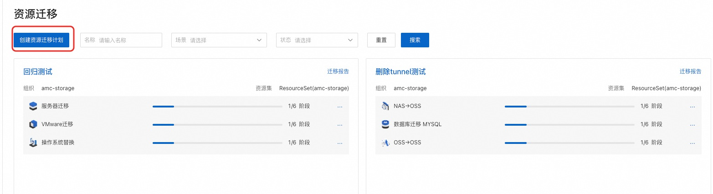

2. 填写迁移计划名称、迁移类型等参数并点击**确定**。

   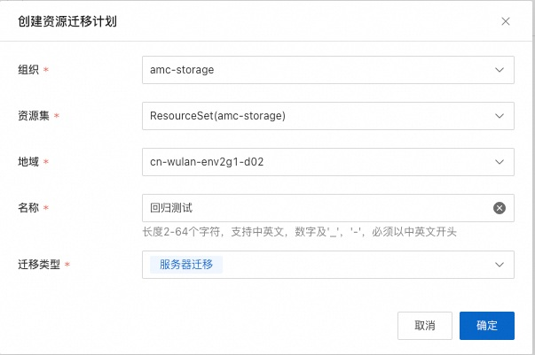

3. 点击计划名称进入创建的迁移计划。

**步骤二：调研评估1）创建调研评估任务**

1. 点击**开始调研**按钮。

   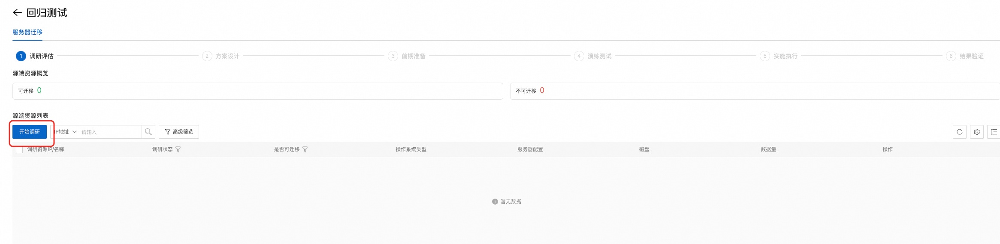

2. 根据实际情况填写目标VPC、VSwitch以及机器连接信息等，如果连接地址为公网IP，需打开公网调研开关，请提前确保目标VPC网络可以访问调研资源。

   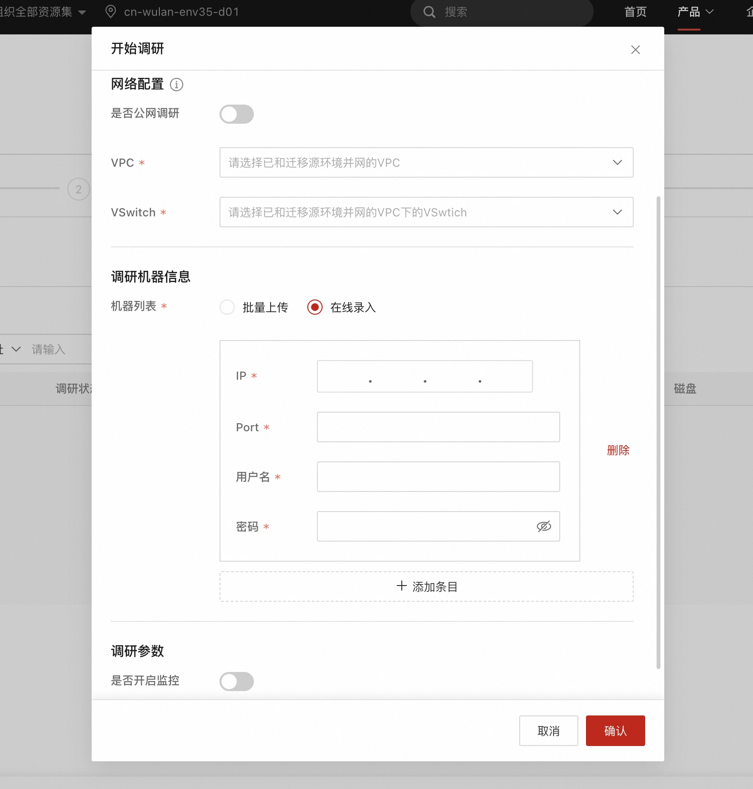

   > **说明**
   >
   > 是否开启监控：如果开启监控，在线调研时将会监测源端CPU、内存等使用情况，最短监控时长为1小时。

3. 点击**确认**后等待调研任务完成。

   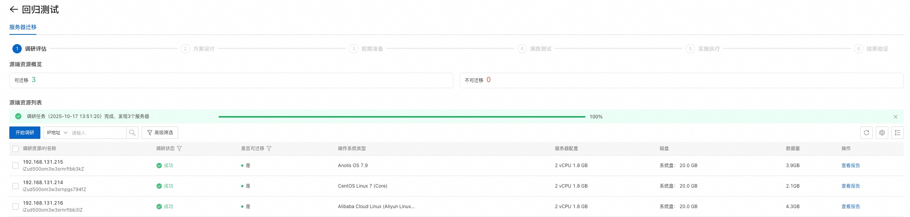

   > **说明**
   >
   > 如果调研资源显示不可迁移，请根据提示信息调整源端资源后，重新发起调研，不可迁移资源无法勾选进入下一步。

**2）确认调研评估结果**

1. 点击**查看详情**按钮可以查看服务器的详细信息，其中工作负载只有在开启调研监控时才会显示。

   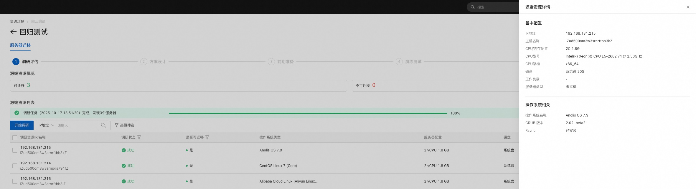

2. 勾选待迁移的资源，点击**下一步**并确认。

   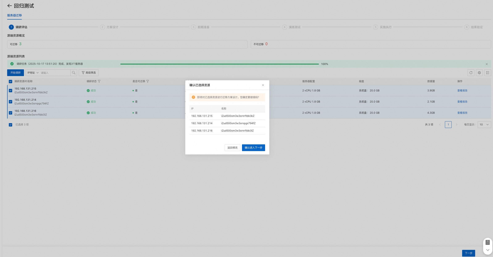

**步骤三：方案设计**

**1）设计方案**

1. 点击**开始方案设计**按钮。

   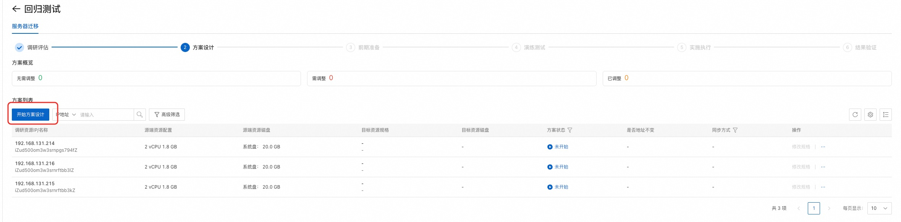

2. 根据实际情况填写目标VPC、VSwitch、可用带宽等信息后点击**确定**。

   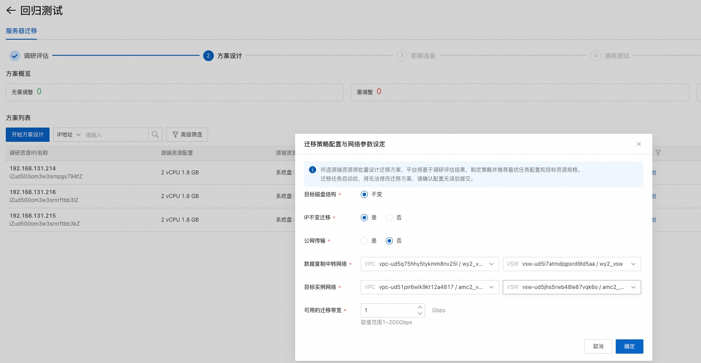

   > **说明**
   >
   > 如果选择了IP不变迁移，需要确保目标VPC网段中存在迁移源的IP地址且未被使用，源端与数据复制中转网络连通。

**2）确认方案设计结果**

1. 确认生成的迁移方案，可根据业务需求修改目标实例的规格。

   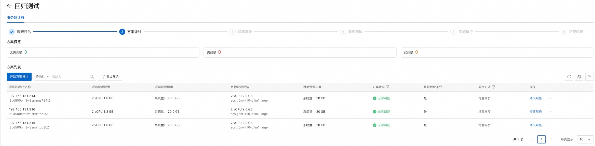

   > **说明**
   >
   > 如果方案未能自动推荐规格，或者自动推荐的规格不满足业务需求，可以点击修改规格自行选择。

2. 检查所有待迁移资源的迁移方案状态列不存在“需调整”后，点击**下一步**并确认。

   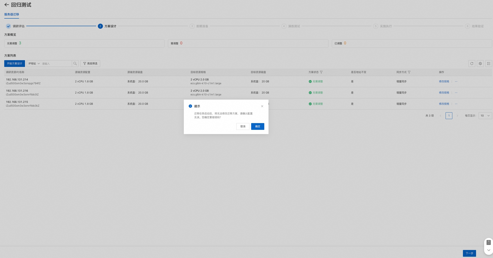

**步骤四：前期准备**

**1）完成前期准备**

1. 等待环境初始化完成。

   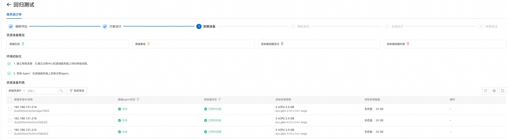

   > **说明**
   >
   > 进入前期准备阶段后，平台会自动进行环境初始化，包括创建资源和安装迁移agent，如果创建资源失败（如资源不足），可以在修复问题后点击重建目标实例，如果安装agent失败，可以点击重试连接再次安装。

**2）确认前期准备结果**

1. 确认agent状态为在线，目标资源资源状态正常后，点击**下一步**并确认。

**步骤五：演练测试**

**1）开始演练测试任务**

1. 点击**全部开始测试**按钮并等待任务完成。

   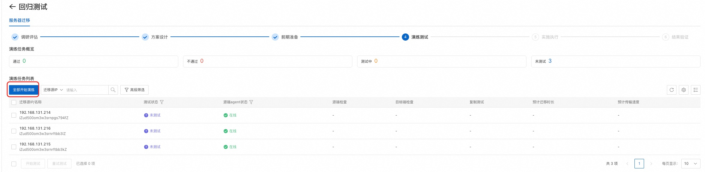

2. 点击测试状态栏的报告图标可查看演练报告。

   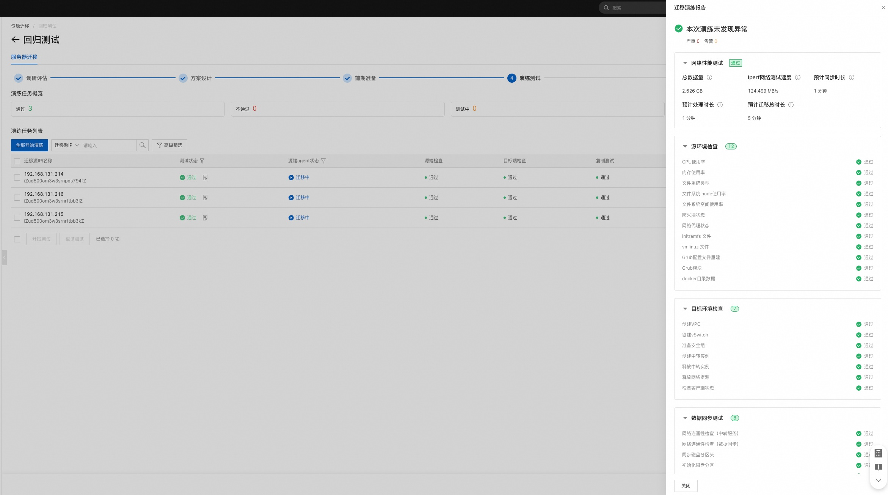

**2）确认演练测试结果**

1. 检查所有待迁移资源的测试状态列全部为通过，然后点击**下一步**并确认。

   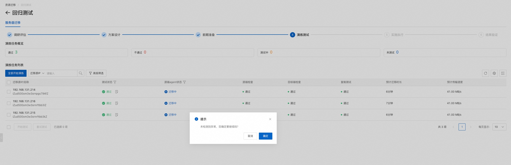

   > **说明**
   >
   > 如果出现演练失败项，请根据错误提示修复问题，然后重试测试任务。

**步骤六：迁移实施**

**1）开始迁移任务**

1. 点击**全部开始迁移**按钮。

   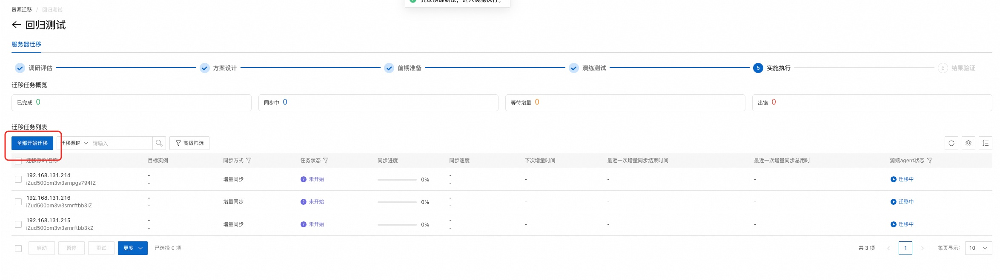

2. 等待任务完成，如果是增量任务需要点击**完成复制**手动完成任务。

   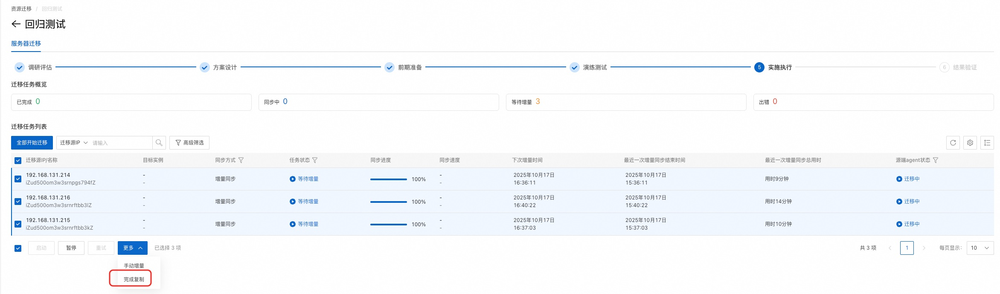

   完成任务时可以选择是否进行最后一次增量同步。

   > **说明**
   >
   > 增量迁移任务每间隔1小时会自动进行一次同步，也可以点击手动增量主动触发同步，增量任务不会自动结束。

**2）确认迁移结果**

1. 检查所有待迁移资源的任务状态列全部为已完成，然后点击**下一步**并确认。

   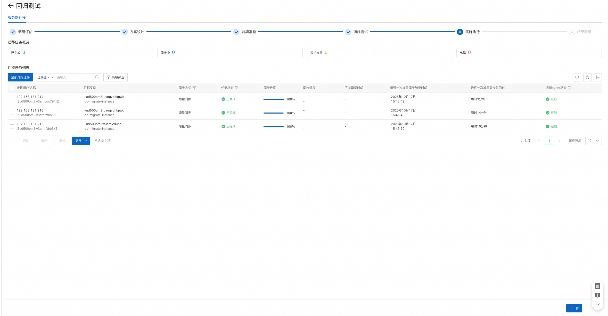

**步骤七：结果验证1）开始验证**

1. 点击**全部开始验证**按钮并等待任务完成。

   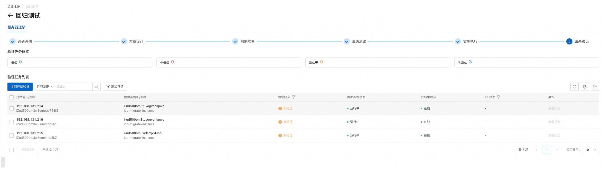

   > **说明**
   >
   > 结果验证依赖ECS云助手，若缺少云助手需要用户自行安装。

2. 任务完成后可点击验证结果列的报告图标查看验证报告。

   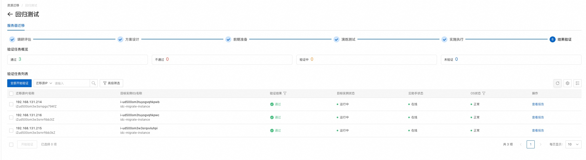

   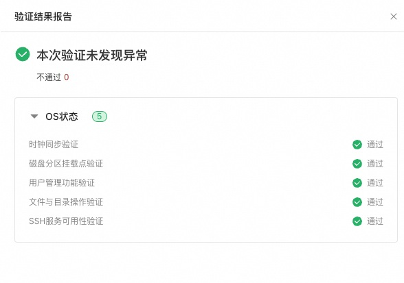

**2）确认验证结果**

1. 检查所有待迁移资源的验证结果列全部为通过，然后点击**确认完成**按钮结束迁移。

   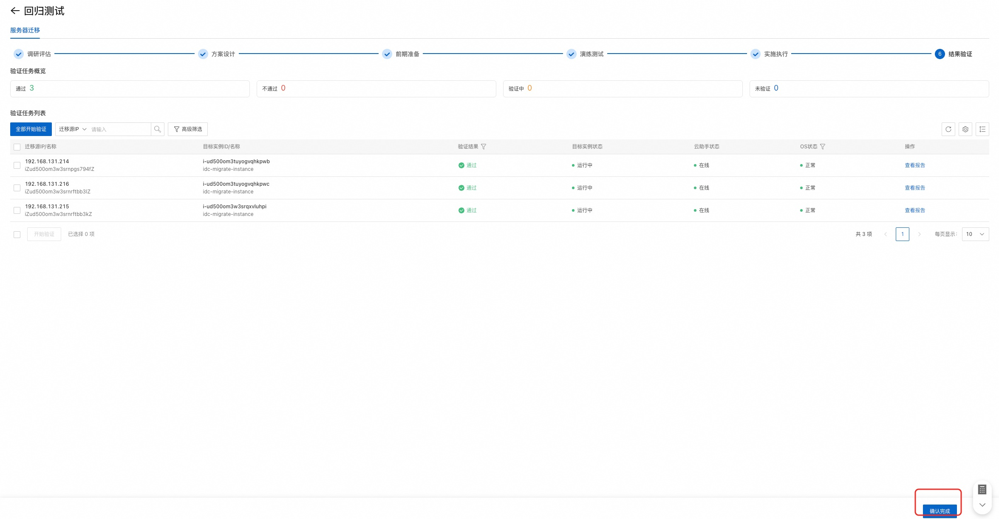

2. 确认完成后会自动进入迁移报告页面，用户可以查看该计划的整体执行情况。

   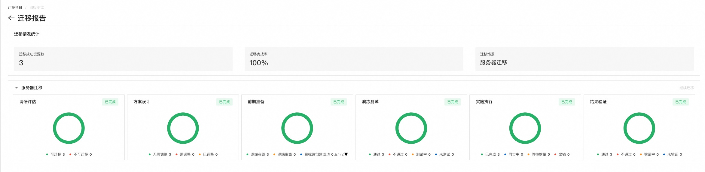

<a id="section-3-2"></a>

## 3.2. VMWare迁移

**前提条件**

- 若使用vCenter用户，其在ESXi和VM上的角色需要分配以下权限：

  - Datastore > Browse datastore

  - Datastore > Low-level file operations

  - Host > Local operations > Create virtual machine

  - Virtual machine > Change Configuration > Acquire disk lease

  - Virtual machine > Change Configuration > Toggle disk change tracking

  - Virtual machine > Provisioning > Allow virtual machine download

  - Virtual machine > Provisioning > Allow disk access

  - Virtual machine > Provisioning > Allow read-only disk access

  - Virtual machine > Snapshot management > Create snapshot

  - Virtual machine > Snapshot management > Remove Snapshot

- 若使用ESXi用户，其角色类型需要为Administrator。

**操作步骤**

**步骤一：创建资源迁移计划1）创建迁移计划**

1. 点击**创建资源迁移计划**按钮。

   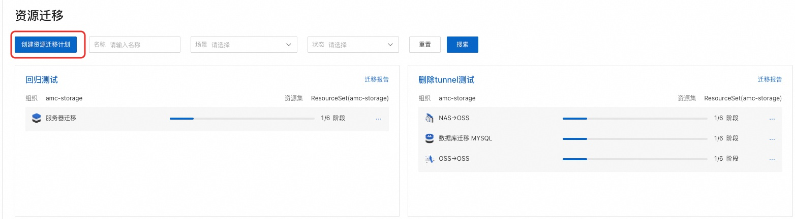

2. 填写迁移计划名称、迁移类型等参数并点击**确定**。

   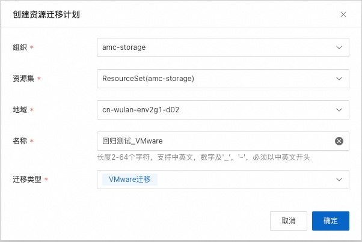

3. 点击计划名称进入创建的迁移计划。

**步骤二：调研评估**

**1）创建调研评估任务**

1. 点击**开始调研**按钮。

   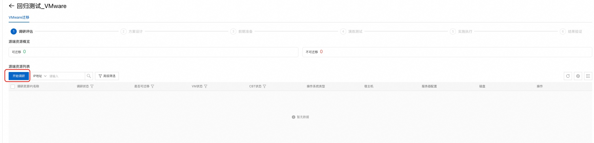

2. 根据实际情况填写目标VPC、VSwitch以及VMWare连接信息等，如果连接地址为公网IP，需打开公网调研开关，请提前确保目标VPC网络可以访问调研资源。

   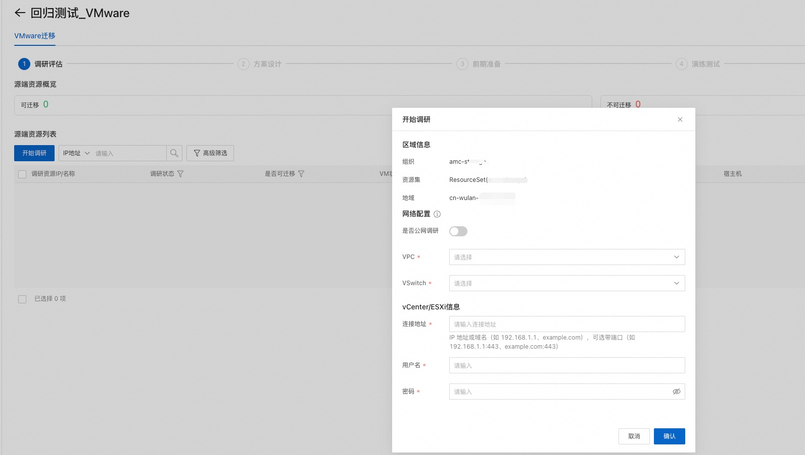

3. 点击**确认**后等待调研任务完成。

   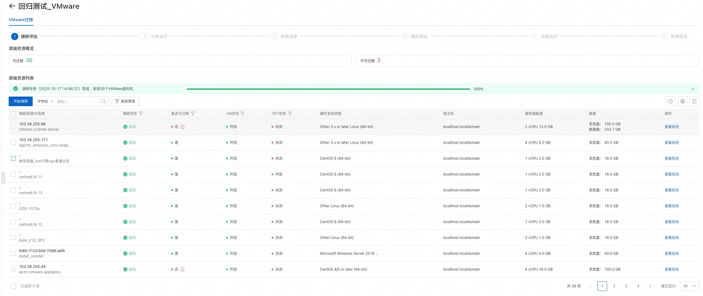

   > **说明**
   >
   > 如果调研资源显示不可迁移，请根据提示信息调整源端资源后，重新发起调研，不可迁移资源无法勾选进入下一步。对于CBT状态关闭的资源，无法进行增量迁移，只能使用全量迁移。

**2）确认调研评估结果**

1. 点击**查看详情**按钮可以查看虚拟机的详细信息。

   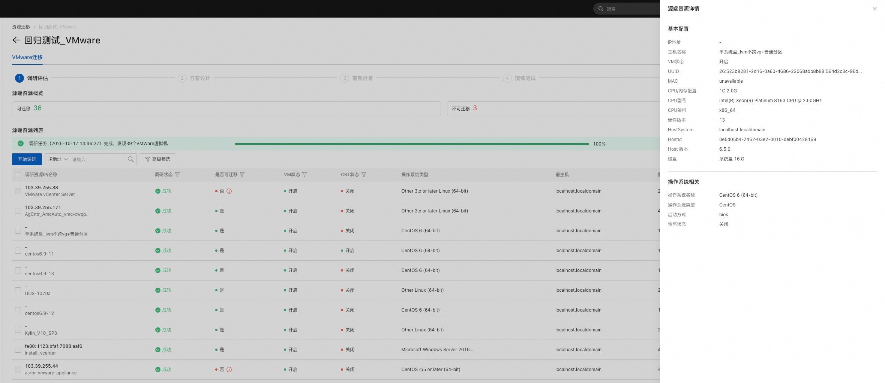

2. 勾选待迁移的资源，点击**下一步**并确认。

   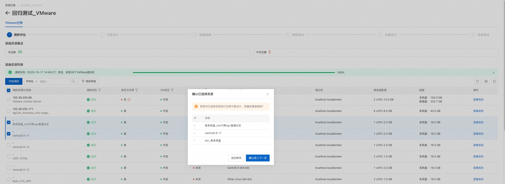

**步骤三：方案设计**

**1）设计方案**

1. 点击**开始方案设计**按钮。

   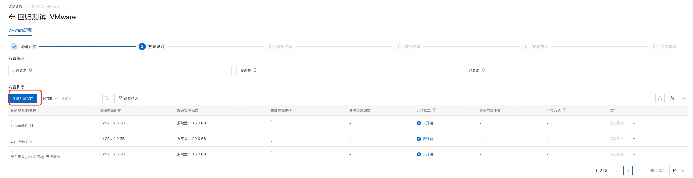

2. 根据实际情况填写目标VPC、VSwitch、可用带宽等信息后点击**确定**。

   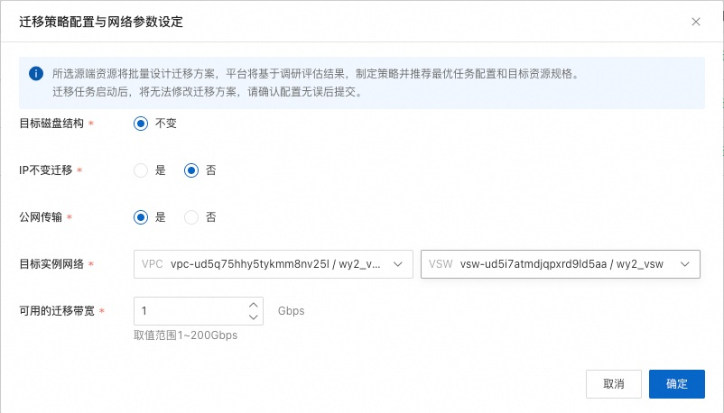

   > **说明**
   >
   > 如果选择了IP不变迁移，需要确保目标VPC网段中存在迁移源的IP地址且未被使用，源端与数据复制中转网络连通。

**2）确认方案设计结果**

1. 确认生成的迁移方案，可根据业务需求修改目标实例的规格。

   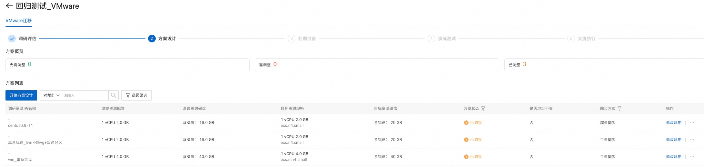

   > **说明**
   >
   > 如果方案未能自动出推荐规格，或者自动推荐的规格不满足业务需求，可以点击修改规格自行选择。

2. 检查所有待迁移资源的迁移方案状态列不存在“需调整”后，点击**下一步**并确认。

   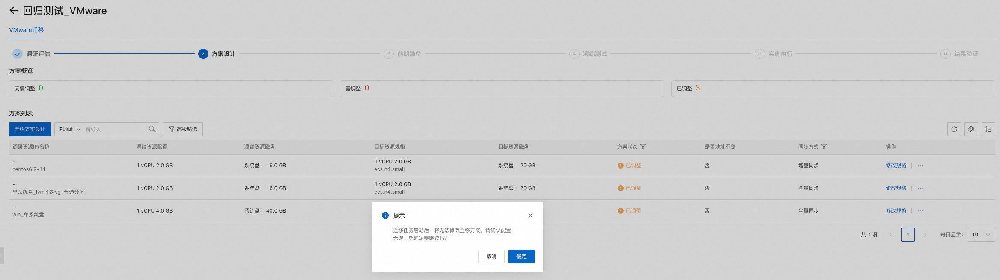

**步骤四：前期准备**

**1）完成前期准备**

1. 等待环境初始化完成。

   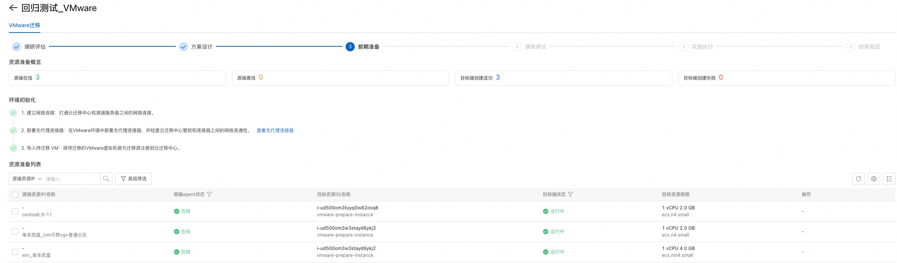

   > **说明**
   >
   > 进入前期准备阶段后，平台会自动进行环境初始化，包括创建资源和安装迁移agent，如果创建资源失败（如资源不足），可以在修复问题后点击重建目标实例，如果安装agent失败，可以点击重试连接再次安装。

**2）确认前期准备结果**

1. 确认agent状态为在线，目标资源资源状态正常后，点击**下一步**并确认。

**步骤五：演练测试**

**1）开始演练测试任务**

1. 点击**全部开始测试**按钮并等待任务完成。

   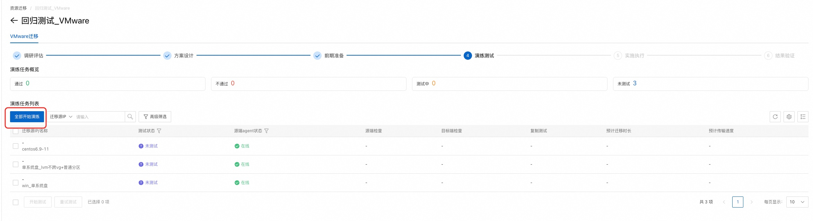

2. 点击测试状态栏的报告图标可查看演练报告。

   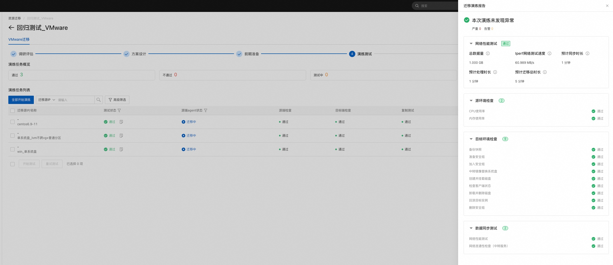

**2）确认演练测试结果**

1. 检查所有待迁移资源的测试状态列全部为通过，然后点击**下一步**并确认。

   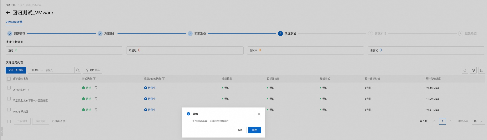

   > **说明**
   >
   > 如果出现演练失败项，请根据错误提示修复问题，然后重试测试任务。

**步骤六：迁移实施**

**1）开始迁移任务**

1. 点击**全部开始迁移**按钮并等待任务完成。

   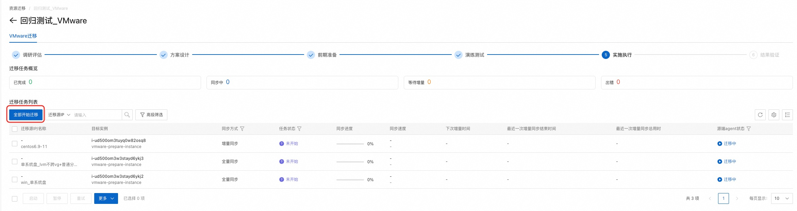

**2）确认迁移结果**

1. 检查所有待迁移资源的任务状态列全部为已完成，然后点击**下一步**并确认。

   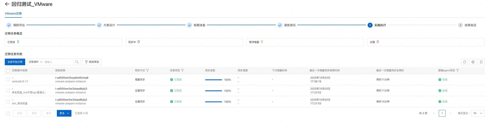

**步骤七：结果验证**

**1）开始验证**

1. 点击**全部开始验证**按钮并等待任务完成。

   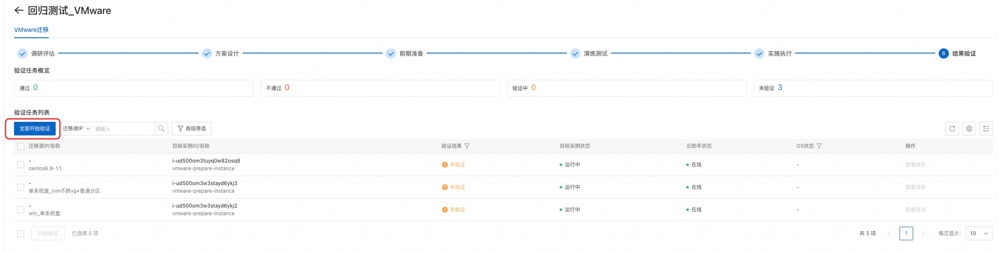

   > **说明**
   >
   > 结果验证依赖ECS云助手，若缺少云助手需要用户自行安装。

2. 任务完成后可点击验证结果列的报告图标查看验证报告。

   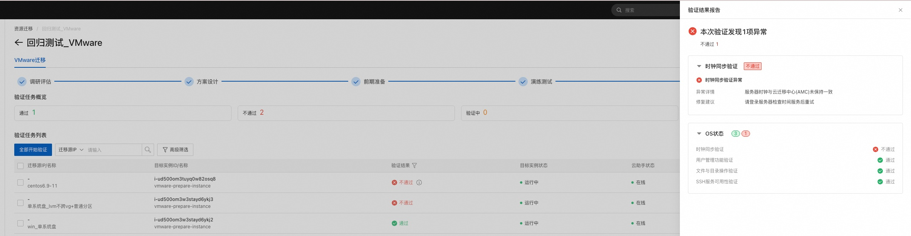

**2）确认验证结果**

1. 检查所有待迁移资源的验证结果列全部为通过，然后点击**确认完成**按钮结束迁移。

   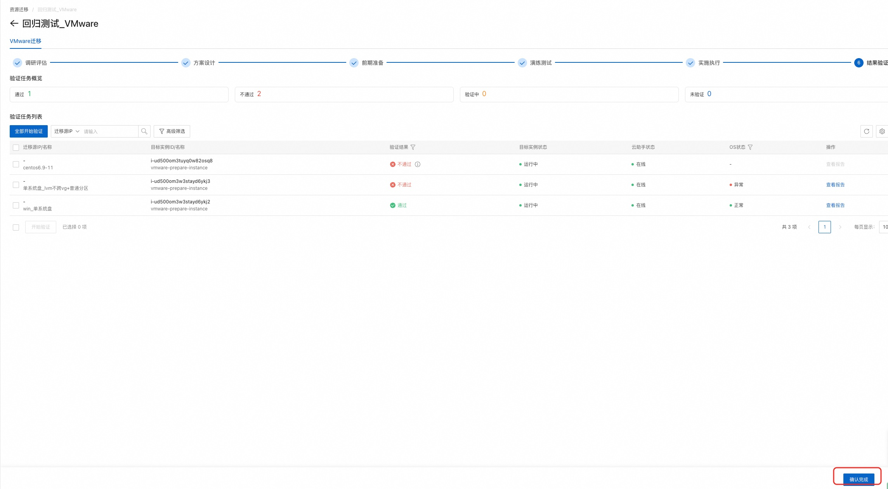

2. 确认完成后会自动进入迁移报告页面，用户可以查看该计划的整体执行情况。

   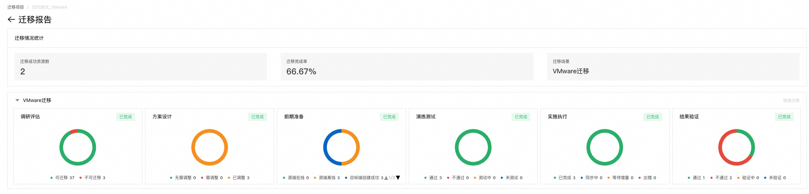

3.

<a id="section-3-3"></a>

## 3.3. 操作系统替换

**使用限制**

| 限制类别 | 限制说明 |
| --- | --- |
| 通用限制 | • Alibaba Cloud Linux系统不提供i686架构的软件包，如您的系统上安装了CentOS的i386（包括i686）架构的软件包，则无法正常替换。<br>• 替换前需要确保实例内保留了可用的资源容量：<br>• 内存大小：600 MiB<br>• 云盘容量：<br>• /usr目录需要250 MiB<br>• /var目录需要4 GiB<br>• /boot目录需要100 MiB |
| CentOS7、Anolis7替换至Alibaba Cloud Linux 3、阿里云服务器操作系统V3 | Alibaba Cloud Linux 3选用Linux kernel 5.10 LTS作为Alibaba Cloud Linux 3的内核，并选用GCC 10.2、binutils 2.35、glibc 2.32作为基础工具链。两个版本的内核无法相互兼容，依赖于内核接口编程的业务，例如涉及内核OOT模块开发、硬件使能等，需提前做好评估，明确是否适合直接替换，以免操作系统替换后业务无法正常运行。 |
| CentOS8、Anolis8替换至Alibaba Cloud Linux 3、阿里云服务器操作系统V3 | • Alibaba Cloud Linux 3选用Linux kernel 5.10 LTS作为Alibaba Cloud Linux 3的内核，并选用GCC 10.2、binutils 2.35、glibc 2.32作为基础工具链。在软件包生态上与CentOS 8兼容。<br>• CentOS8和Anolis8替换到阿里云操作系统V3前需要先卸载kmod-kvdo(业务方自行评估能否卸载)，卸载命令：yum remove kmod-kvdo |

**前提条件**

OS替换时需要有可用的YUM源，请根据目标操作系统类型选择对应的自定义镜像搭建YUM源。

| YUM源镜像 | 可支持替换的目标OS | 镜像部署和配置操作 |
| --- | --- | --- |
| Alinux免费版YUM源 | Alibaba Cloud Linux 3 | 1. 向技术支持获取Alibaba Cloud Linux 3对应的YUM源ECS镜像； 2. 在ECS控制台导入获取到的自定义镜像； 3. 导入成功后使用该镜像创建ECS实例；<br>4. 取消镜像实例/root/alinux/migration/aliyuncs-install.sh文件的第2行注释，并修改export MIRROR_SITE=xxxxxx 为真实的YUM源IP地址； |
| Alinux商业版YUM源 | 阿里云服务器操作系统V3 | 1. 向技术支持获取阿里云服务器操作系统V3对应的YUM源ECS镜像；<br>2. 在ECS控制台导入获取到的自定义镜像； 3. 导入成功后使用该镜像创建ECS实例； 4. 取消镜像实例/root/alinux/migration/aliyuncs-install_3p.sh文件的第2行注释，并修改export MIRROR_SITE=xxxxxx 为真实的YUM源IP地址； |

搭建完成后，可以用测试ECS执行 `curl {YUM`源`IP}` 查看YUM源状态是否正常。

**操作步骤**

**步骤一：创建资源迁移计划**

**1）创建迁移计划**

1. 点击**创建资源迁移计划**按钮。

   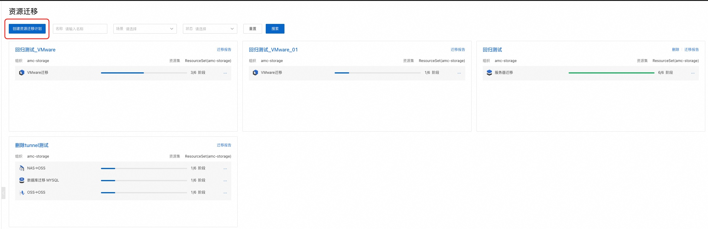

2. 填写迁移计划名称、迁移类型等参数并点击**确定**。

   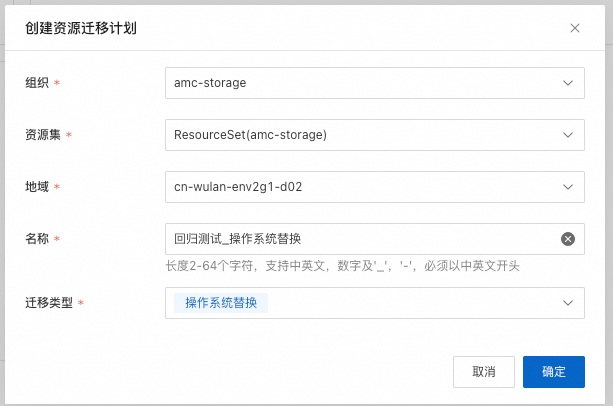

3. 点击计划名称进入创建的迁移计划。

**步骤二：调研评估**

**1）创建调研评估任务**

1. 点击**开始调研**按钮。

   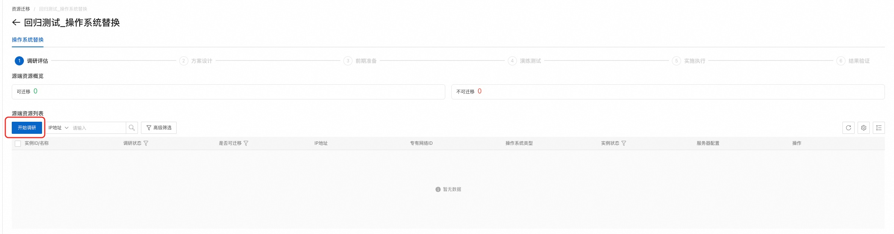

2. 选择要进行OS替换的ECS实例。

   

3. 点击**确认**后等待调研任务完成。

   

   > **说明**
   >
   > 如果调研资源显示不可迁移，请根据提示信息调整源端资源后，重新发起调研，不可迁移资源无法勾选进入下一步。

**2）确认调研评估结果**

1. 点击**查看详情**可以查看ECS的详细信息。

   

2. 勾选待迁移的资源，点击**下一步**并确认。

   

**步骤三：方案设计**

**1）设计方案**

1. 点击**开始方案设计**按钮。

   

2. 根据实际情况填写目标操作系统类型和YUM源地址。

   

**2）确认方案设计结果**

1. 确认生成的迁移方案，可根据业务需求修改YUM源地址或者目标操作系统。

   

2. 检查所有待迁移资源的迁移方案状态列不存在“需调整”后，点击**下一步**并确认。

   

**步骤四：前期准备**

**1）完成前期准备**

1. 等待环境初始化完成。

   

**2）确认前期准备结果**

1. 确认agent状态为在线，目标资源资源状态正常后，点击**下一步**并确认。

   

**步骤五：演练测试**

**1）开始演练测试任务**

1. 点击**全部开始测试**按钮并等待任务完成。

   

2. 点击测试状态栏的报告图标可查看演练报告。

   

   > **说明**
   >
   > 演练报告中的警告项不影响OS替换进行，但是可能会影响其中的应用，需要用户自行判断。

**2）确认演练测试结果**

1. 检查所有待迁移资源的测试状态列全部为通过，然后点击**下一步**并确认。

   

   > **说明**
   >
   > 如果出现演练失败项，请根据错误提示修复问题，然后重试测试任务。

**步骤六：迁移实施**

**1）开始迁移任务**

1. 点击**全部开始迁移**按钮并等待任务完成。

   

**2）确认迁移结果**

1. 检查所有待迁移资源的任务状态列全部为已完成，然后点击**下一步**并确认。

   

**步骤七：结果验证**

**1）开始验证**

1. 点击**全部开始验证**按钮并等待任务完成。

   

   > **说明**
   >
   > 结果验证依赖ECS云助手，若缺少云助手需要用户自行安装。

2. 任务完成后可点击验证结果列的报告图标查看验证报告。

   

   

**2）确认验证结果**

1. 检查所有待迁移资源的验证结果列全部为通过，然后点击**确认完成**按钮结束迁移。

   

2. 确认完成后会自动进入迁移报告页面，用户可以查看该计划的整体执行情况。

   

<a id="section-3-4"></a>

## 3.4. 数据库迁移

**前提条件**

在进行数据库迁移之前请先检查源数据库是否满足以下要求。

- 带宽要求：源库所属的服务器需具备足够出口带宽，否则将影响数据迁移速率。

- 待迁移的表需具备主键或唯一约束，且字段具有唯一性，否则可能会导致目标数据库中出现重复数据。

- 如需进行增量迁移，Binlog日志：

  - 需开启，并且binlog_format为row、binlog_row_image为full。否则预检查阶段提示报错，且无法成功启动数据迁移任务。

  - RDS实例的本地Binlog日志需保留3天及以上（建议保留7天），自建MySQL数据库的本地Binlog日志需保留7天及以上。

- 源库的操作限制：

  - 在库表结构迁移和全量迁移阶段，请勿执行库或表结构变更的DDL操作，否则数据迁移任务会失败。

  - 若仅执行全量数据迁移，请勿向源实例中写入新的数据，否则会导致源和目标数据不一致。

**操作步骤**

**步骤一：创建资源迁移计划**

**1）创建迁移计划**

1. 点击**创建资源迁移计划**按钮。

   

2. 填写迁移计划名称、迁移类型等参数并点击**确定**。

   

3. 点击计划名称进入创建的迁移计划。

**步骤二：调研评估**

**1）创建调研评估任务**

1. 点击**开始调研**按钮。

   

2. 根据实际情况填写目标VPC、VSwitch以及数据库连接信息等，如果连接地址为公网IP，需打开公网调研开关，请提前确保目标VPC网络可以访问调研资源。

   

   > **说明**
   >
   > 是否开启监控：如果开启监控，在线调研时将会监测源端CPU、内存等使用情况，最短监控时长为1小时。

3. 点击**确认**后等待调研任务完成。

   

   > **说明**
   >
   > 如果调研资源显示不可迁移，请根据提示信息调整源端资源后，重新发起调研，不可迁移资源无法勾选进入下一步。

**2）确认调研评估结果**

1. 点击**查看报告**按钮可以查看数据库的详细信息，其中工作负载只有在开启调研监控时才会显示。

   

2. 勾选待迁移的资源，点击**下一步**并确认。

   

**步骤三：方案设计**

**1）设计方案**

1. 点击**开始方案设计**按钮。

   

2. 根据实际情况填写目标VPC、VSwitch、可用带宽等信息后点击**确定**。

   

   > **说明**
   >
   > 创建目标实例方式如果为平台创建，则迁移目标为新建数据库实例，如果选择用户输入，则迁移到已存在的指定实例。

**2）确认方案设计结果**

1. 确认生成的迁移方案，可根据业务需求修改目标实例的规格。

   

   > **说明**
   >
   > 方案生成后，可以在操作栏做如下修改：
   >
   > - 修改规格：如果方案未能自动推荐规格，或者自动推荐的规格不满足业务需求，可以点击修改规格自行选择。
   >
   > - 修改同步方式：可以进行增量同步和全量同步的切换。
   >
   > - 过滤同步对象：如果不需要迁移所有数据，可以选择指定的逻辑库进行迁移。

2. 检查所有待迁移资源的迁移方案状态列不存在“需调整”后，点击**下一步**并确认。

   

**步骤四：前期准备**

**1）完成前期准备**

1. 等待环境初始化完成。

   

   > **说明**
   >
   > 进入前期准备阶段后，平台会自动进行环境初始化，如果在方案设计中目标实例创建方式为手动选择，需要点击配置目标资源来选择一个实例。创建资源失败（如资源不足）时，可以在修复问题后点击重建目标资源，连通性检查失败时，可以点击重新连接。

**2）确认前期准备结果**

1. 确认目标资源状态状态和连通性检查都正常后，点击**下一步**并确认。

   

**步骤五：演练测试**

**1）开始演练测试任务**

1. 点击**全部开始演练**按钮并等待任务完成。

   

2. 点击**查看报告**按钮可查看演练报告。

   

**2）确认演练测试结果**

1. 检查所有待迁移资源的测试状态列全部为通过，然后点击**下一步**并确认。

   

   > **说明**
   >
   > 如果出现演练失败项，请根据错误提示修复问题，然后重试演练。

**步骤六：迁移实施**

**1）开始迁移任务**

1. 点击**全部开始迁移**按钮。

   

2. 等待任务完成，如果是增量任务需要点击**完成增量**手动完成任务。

   

   > **说明**
   >
   > 增量同步时每隔10分钟会进行一次自动校验，用户也可以手动关闭和开启校验。

**2）确认迁移结果**

1. 点击**查看报告**按钮查看迁移详情。

   

2. 检查所有迁移任务都完成后，点击**下一步**。

**步骤七：结果验证**

**1）开始验证**

1. 点击**全部开始验证**按钮并等待任务完成。

   

2. 任务完成后可点击**查看报告**按钮查看验证报告。

   

**2）确认验证结果**

1. 检查所有待迁移资源的验证结果列全部为通过，然后点击**确认完成**按钮结束迁移。

   

2. 确认完成后会自动进入迁移报告页面，用户可以查看该计划的整体执行情况。

   

<a id="section-3-5"></a>

## 3.5. 存储迁移

**前提条件**

在进行存储迁移之前，请先检查以下条件和要求。

- 数据迁移任务会占用网络带宽，可能对线上应用性能造成影响，建议在业务低峰期进行数据迁移。

- 本服务不支持从启用 CDN 的数据源或任何通过中间代理/中继服务器访问的数据源进行迁移。确认您的源数据地址是直接可访问的原始地址，不经过 CDN 加速或任何形式的中间中继服务。

- 在迁移完成且数据验证无误前，避免对源数据进行任何修改或删除操作。

- 迁移时如存在同名文件，迁移可能直接覆盖。

- 数据迁移时，会跳过迁移软链接。

**操作步骤步骤一：创建资源迁移计划**

**1）创建迁移计划**

1. 点击**创建资源迁移计划**按钮。

   

2. 填写迁移计划名称、迁移类型等参数并点击**确定**。

   

   > **说明**
   >
   > 用户需要根据源端与目标端类型选择对应的迁移类型，包括NAS -> NAS、NAS -> OSS、OSS -> OSS。

3. 点击计划名称进入创建的迁移计划。

**步骤二：调研评估**

**1）创建调研评估任务**

1. 点击**开始调研**按钮。

   

2. 根据实际情况填写目标VPC、VSwitch以及数据源连接信息，请确保目标VPC网络可以访问调研资源。

   

3. 点击**确认**后等待调研任务完成。

   

   > **说明**
   >
   > 如果调研资源显示不可迁移，请根据提示信息调整源端资源后，重新发起调研，不可迁移资源无法勾选进入下一步。

**2）确认调研评估结果**

1. 点击**查看报告**按钮可以查看数据源的详细信息。

   

2. 勾选待迁移的资源，点击**下一步**并确认。

   

**步骤三：方案设计1）设计方案**

1. 点击**开始方案设计**按钮。

   

2. 根据实际情况填写传输网络、可用带宽等信息后点击**确定**。

   

   > **说明**
   >
   > 创建目标实例方式如果为平台创建，则迁移目标为新建存储资源，如果选择用户输入，则迁移到已存在的指定资源。

**2）确认方案设计结果**

1. 确认生成的迁移方案，可根据业务需求在生成后修改方案。

   

   > **说明**
   >
   > 方案生成后，可以在操作栏做如下修改：
   >
   > - 修改目标名称：可以修改目标资源名称。
   >
   > - 调整目标规格：如果自动推荐的规格不满足业务需求，可以点击修改规格自行选择。
   >
   > - 修改同步方式：可以进行增量同步和全量同步的切换。
   >
   > - 修改过滤配置：如果不需要迁移所有数据，可以选择指定的文件进行迁移。

2. 检查所有待迁移资源的迁移方案状态列不存在“需调整”后，点击**下一步**并确认。

   

**步骤四：前期准备**

**1）完成前期准备**

1. 等待环境初始化完成。

   

   > **说明**
   >
   > 进入前期准备阶段后，平台会自动进行环境初始化，如果在方案设计中目标实例创建方式为手动选择，需要点击配置目标资源来选择一个实例。连通性检查失败时，可以点击重新连接。

**2）确认前期准备结果**

1. 确认目标资源状态状态和连通性检查都正常后，点击**下一步**并确认。

   

**步骤五：演练测试**

**1）开始演练测试任务**

1. 点击**全部开始演练**按钮并等待任务完成。

   

   > **说明**
   >
   > 在增量同步时，需要手动点击结束演练按钮来完成演练任务。

2. 点击**查看报告**按钮可查看演练报告。

   

**2）确认演练测试结果**

1. 检查所有待迁移资源的测试状态列全部为通过，然后点击**下一步**并确认。

   

   > **说明**
   >
   > 如果出现演练失败项，请根据错误提示修复问题，然后重试演练。

**步骤六：迁移实施**

**1）开始迁移任务**

1. 点击**全部开始迁移**按钮。

   

2. 等待任务完成，如果是增量任务需要点击**完成增量**手动完成任务。

   

**2）确认迁移结果**

1. 点击**查看报告**按钮查看迁移详情。

   

2. 检查所有迁移任务都完成后，点击**下一步**。

**步骤七：结果验证**

**1）开始验证**

1. 点击**全部开始验证**按钮并等待任务完成。

   

2. 任务完成后可点击**查看报告**按钮查看验证报告。

   

**2）确认验证结果**

1. 检查所有待迁移资源的验证结果列全部为通过，然后点击**确认完成**按钮结束迁移。

   

2. 确认完成后会自动进入迁移报告页面，用户可以查看该计划的整体执行情况。

   

<a id="section-4"></a>

# 4.资源迁移

<a id="section-4-1"></a>

## 4.1. 创建资源迁移计划

**操作步骤**

1. 登录云迁移中心控制台。

2. 在左侧导航栏选择**资源迁移**，单击**创建资源迁移计划**。

3. 按照实际情况填写组织、资源集、地域、计划名称和迁移类型，其中迁移类型可以多选。

   

4. 单击**确认**，完成资源迁移计划的创建。

<a id="section-4-2"></a>

## 4.2. 管理资源迁移计划

**操作步骤**

1. 登录云迁移中心控制台。

2. 在左侧导航栏选择**资源迁移**，可查看资源迁移计划列表。

3. 在资源迁移计划列表上方可以根据名称、场景、状态进行过滤，其中状态为“超期”表示计划存在时间超过15天，且未完成或者终止。

   

4. 点击计划名称旁的铅笔图标可以修改计划名称。

   

5. 点击**迁移报告**按钮可查看当前迁移计划的概览。

   

6. 点击迁移计划名称或者其中的迁移场景可跳转到计划详情。

7. 点击迁移场景旁的**终止迁移**按钮可以直接结束未完成的迁移。

   

8. 点击**删除**按钮可以删除当前计划，只有已完成或者已终止的计划可以被删除。

<a id="section-5"></a>

# 5.高级服务

<a id="section-5-1"></a>

## 5.1. 服务器迁移

<a id="section-5-1-1"></a>

### 5.1.1. 使用限制

**规格说明**

| 规格项 | 规格说明 | 例外申请 |
| --- | --- | --- |
| 块复制能力 | Linux以下系统支持块复制：CentOS、Debian、OpenSUSE、Red Hat、SUSE、Ubuntu、Kylin、UOS。Windows默认支持。 | 无 |
| 操作系统替换 | 仅支持阿里云ECS迁移源，线下的服务器需要先迁移到云上。 | 无 |
| 系统盘大小限制 | 容量范围20～2048GB。 | 无 |
| 数据盘大小、数量限制 | 单盘容量范围20～32768GB，最大支持15块数据盘。 | 无 |
| 激活码数量限制 | 单租户（一级部门）默认配置 10000。 | 提交工单 |
| 迁移源数量限制 | 单租户（一级部门）默认配置 10000。 | 提交工单 |
| 迁移任务数量限制 | 单租户（一级部门）默认配置 10000。 | 提交工单 |
| 迁移任务并发限制 | 单租户（一级部门）最大并发任务数 50。 | 提交工单 |
| VMware无代理连接器 | 每台VMware无代理连接器最多支持并发任务数 10。 | 无 |

**服务器迁移数据分区限制**

| 待迁移服务器操作系统 | 迁移数据限制说明 |
| --- | --- |
| Windows系统 | • 不支持复制部分磁盘分区结构，如动态磁盘分区、扩展磁盘分区。不支持的磁盘分区结构会被重建为普通分区。<br>• 不支持迁移系统卷影副本备份（Volume Shadow Snapshots）。 |
| Linux系统 | • 不支持复制部分磁盘分区结构，如扩展磁盘分区。不支持的磁盘分区结构会被重建为普通分区。<br>• 不支持LVM VG跨磁盘结构，不支持的结构会重建为普通分区。<br>• 不支持复制SWAP分区，迁移后需要重新配置。<br>• 不支持复制部分非主流文件系统格式，不支持的文件系统会被重建为主流的ext2/3/4格式。<br>• 不支持块复制时，默认不迁移虚拟内存、缓存、系统快照文件，部分软件配置如cloud-init、网络服务，以及docker目录数据，具体请参考SMC客户端目录下的过滤配置文件rsync_excludes_linux.txt。 |

**VMware无代理迁移限制**

仅支持以下vCenter、ESXI版本：

| OVA模板 | VMware无代理连接器的配置 | vCenter部署 | 单ESXi环境部署 |
| --- | --- | --- | --- |
| SMC VMware Connector 6.7 OVA | • vCPU：4 vCPU及以上<br>• 内存：8 GB及以上<br>• 磁盘：40 GB及以上 | • vCenter版本：6.0/6.5/6.7<br>• 连接器所在的ESXi版本：6.0/6.5/6.7<br>• 待迁移虚拟机所在的ESXi版本：6.0/6.5/6.7<br>• 待迁移虚拟机的硬件版本：11/12/13/14/15 | • ESXi版本：6.0/6.5/6.7<br>• 待迁移虚拟机的硬件版本：11/12/13/14/15 |
| SMC VMware Connector 8.0 OVA | • vCPU：4 vCPU及以上<br>• 内存：8 GB及以上<br>• 磁盘：40 GB及以上 | • vCenter版本：6.7/7.0/8.0<br>• 连接器所在的ESXi版本：6.7/7.0/8.0<br>• 待迁移虚拟机所在的ESXi版本：6.7/7.0/8.0<br>• 待迁移虚拟机的硬件版本：14/15/16/17/18/19/2 0/21 | • ESXi版本：6.7/7.0/8.0<br>• 待迁移虚拟机的硬件版本：14/15/16/17/18/19/2 0/21 |

**操作系统限制**

服务器迁移、VMware无代理迁移支持以下操作系统：

| Windwos | Linux |
| --- | --- |
| Windows Server 2003<br>Windows Server 2008<br>Windows Server 2012<br>Windows Server 2016<br>Windows Server 2019<br>Windows Server 2022 | CentOS 5/6/7/8<br>Red Hat 5/6/7/8<br>Ubuntu 10/12/14/16/17/18/19/20<br>Debian 7/8/9/10<br>OpenSUSE 13/42/15<br>SUSE 11/12/15<br>Gentoo 13.0<br>Alibaba Cloud Linux<br>Oracle Linux 5/6/7/8<br>Amazon Linux 2014及更高版本UOS 1050a/e、1050u2a/e、1060a/e、1070a<br>Kylin-Sever-10-sp1/2/3 |

操作系统替换支持以下操作系统：

<table>
  <tr>
    <th>系统架构</th>
    <th>源操作系统</th>
    <th>目标操作系统</th>
  </tr>
  <tr>
    <td rowspan="5">x86</td>
    <td rowspan="2">CentOS 7、8</td>
    <td>Alibaba Cloud Linux 3</td>
  </tr>
  <tr>
    <td>阿里云服务器操作系统V3</td>
  </tr>
  <tr>
    <td>Anolis 7、8</td>
    <td>阿里云服务器操作系统V3</td>
  </tr>
  <tr>
    <td>Alibaba Cloud Linux 2</td>
    <td>Alibaba Cloud Linux 3</td>
  </tr>
  <tr>
    <td>Alibaba Cloud Linux 3</td>
    <td>阿里云服务器操作系统V3</td>
  </tr>
</table>

**其他限制**

- 每个迁移源同一时刻下仅能关联一个未完成状态的迁移任务。

  > **说明**
  >
  > 未完成状态包括Ready（未开始）、Running（运行中）、Stopped（已暂停）、InError（出错）和Expired（已过期）。

- 迁移源为Linux系统时，系统引导程序GRUB需为2.02及以上版本。

  > **说明**
  >
  > 对于CentOS 5、Red Hat Enterprise Linux 5、Debian 7、Amazon Linux或Oracle Linux等低版本操作系统，需要更新GRUB至2.02及以上版本。

<a id="section-5-1-2"></a>

### 5.1.2. 迁移前准备

使用服务器迁移之前，您需要明确工具适用场景和使用限制，为迁云账号配置权限、备份数据、打通网络等。

**适用场景**

服务器迁移支持不停机将源服务器（包括系统盘和数据盘）从物理机、本地虚拟机（VMware、Xen、KVM、Hyper-V等）、其他云厂商（AWS、Azure、Google Cloud、腾讯云等）迁移至阿里云。推荐您使用服务器迁移工具迁移常规Web中间件服务器、负载转发服务器和运维机等，不推荐迁移大数据类、存储类等存在海量小文件或动态大文件的服务器。支持块复制的源实例能够迁移单实例数据库、容器类的数据，仅支持文件复制的源实例无法迁移单实例数据库、容器类的数据。

**使用限制**

**配置权限**

使用SMC迁移前，需要拥有对您云资源相应的访问权限，故需确保您已开通相关RAM服务并授权。登录服务器迁移控制台，根据控制台提示单击**确认授权**完成授权。


服务关联角色是一种可信实体为阿里云服务的RAM角色。SMC使用服务关联角色获取其他云服务或云资源的访问权限，阿里云访问控制为每个服务关联角色提供了一个系统权限策略，该策略不支持修改。

**备份数据**

为防止系统故障等因素导致数据丢失或损坏，创建快照以备份数据。

**打通网络**

服务器迁移支持公网和私网两种方式迁移数据。迁移时源系统到中转实例或目标实例的IP的网络需要打通。

- 公网传输：需要源服务器能访问公网，并在迁移源出方向开放8080、8703端口，迁移数据通过公网传输到中转实例。

- 私网传输：需要将源服务器与阿里云专有网络VPC打通，迁移数据通过VPC内网传输到中转实例。如果您能直接从自建机房IDC、虚拟机环境或者云主机访问阿里云专有网络VPC，建议您使用SMC的私网传输迁移方案。通过SMC的私网传输迁移，比公网更快速、更稳定，能提高迁移的效率。默认使用此方式传输数据。

使用服务器迁移前需要确保源服务器能访问以下服务地址和端口：

- 服务器迁移中心SMC域名：

  > **说明**
  >
  > 默认情况下SMC域名都是HTTPS协议443端口，HTTP协议80端口不一定支持。

在迁移的过程中，服务器迁移的客户端通过连接中转实例/目标实例的 `8080` 端口来建立通信，并通过中转实例/目标实例的 `8703` 端口将磁盘数据传输到中转实例的数据盘，所以您需要在源服务器开放 `8080` 和 `8703` 端口。

> **说明**
>
> 迁移过程中，SMC自动创建、启动、停止和释放中转实例(名称默认为No_Delete_SMC_Transition_Instance)； 中转实例的默认安全组在入方向开放了8080和8703端口，这是中转实例的迁移服务端口。8703 端口数据传输时涉及http及https协议，8080 只涉及http协议。

- 如果您需要通过命令行一键导入的方式安装SMC Agent，还需要能够访问存储客户端资源的OSS域名地址。

- 源服务器不需要开放任何入方向的端口，但是需要在出方向访问上述地址和端口。

**源端服务器环境及其他要求**

**Linux系统**

- 确保系统时间与所在地域的标准时间一致，避免SMC客户端注册失败。

- 检查SELinux。

  对于CentOS/Red Hat系列内核系统，一般需要检查SELinux服务是否已禁用或关闭。如果没有关闭，您可以采用下列方法之一将其关闭。

  - 运行 `setenforce 0` 命令临时将其关闭。

  - 修改 `/etc/selinux/config` 文件，配置 `SELINUX=disabled` 永久禁用SELinux。

- 检查GRUB引导程序。

  部分低内核系统（如CentOS、Red Hat 5和Debian 7）以及Amazon Linux系列系统需要升级GRUB至2.02及以上版本。

- 检查授权应用。

  源服务器迁移到阿里云后，系统底层硬件设备会发生变化，可能会导致一些跟硬件绑定的应用许可证（License）失效，您需要做好检查。

- 您还需要根据源服务器所处的环境不同，进行针对性检查。具体说明如下：

  - 如果您待迁移的源服务器为**物理机**，则需要检查虚拟化应用。阿里云的普通ECS实例不支持嵌套虚拟化软件，因此不再支持VMware Workstation、Virtual Box或者Hyper-V等只能在物理机环境使用的虚拟机软件。

  - 如果您待迁移的源服务器为**AWS EC2 Linux系统**，则需要检查cloud-init。

    cloud-init服务是众多云平台用于自动初始化配置系统的服务软件，但AWS和阿里云的cloud-int服务配置无法完全兼容。从AWS迁移过来的系统可能会因为cloud-init启动失败导致无法正常启动，网络无法正常连通。建议您在迁移前使用阿里云的cloud-init配置。

  - 如果待迁移的源服务器为**Google Cloud Linux系统**，请确保已安装cloud-init。

  - 如果待迁移的源服务器为**UCloud Linux系统**，则需要检查Linux系统内核是否为UCloud云平台定制。

  - 如果源服务器的内核是UCloud云平台定制，您需要注意，迁移后的Linux实例可能无法在ECS控制台正常启动或停止。原因是该UCloud Linux系统的内核可能与阿里云平台不兼容。您可以更换Linux系统内核，例如，对于CentOS操作系统，您可以更换为CentOS官方内核。

- 检查磁盘。

  - 使用df -h命令查看是否挂载了nas盘，服务器迁移工具支持将nas盘数据迁移为云盘数据，如非必要可排除掉nas盘目录，自行迁移nas盘存储数据。

  - 使用df -h命令查看是否挂载了ftp盘，服务器迁移工具不支持迁移ftp盘数据，迁移前需排除掉ftp盘目录，自行迁移ftp源数据。

  - 使用df -h命令检查是否存在一块硬盘挂载在了多个目录下，若存在则迁移前需解挂载多余挂载目录或排除掉多余挂载目录。

**Windows系统**

- 确保系统时间与所在地域的标准时间一致。避免SMC客户端注册失败。

- 检查并确保Windows系统VSS服务为启动状态。

- 检查是否安装了QEMU Guest Agent软件。如果安装了此软件，您需要先卸载。

- 检查授权应用。

  源服务器迁移到阿里云后，系统底层硬件设备会发生变化，可能会导致一些跟硬件绑定的应用许可证（License）失效，您需要做好检查。

- 您还需要根据源服务器所处的环境不同，进行针对性检查。具体说明如下：

  - 如果您待迁移的源服务器为物理机，则需要检查虚拟化应用。阿里云的普通ECS实例不支持嵌套虚拟化软件，因此不再支持VMware Workstation、Virtual Box或者Hyper-V等只能在物理机环境使用的虚拟机软件。

  - 如果您待迁移的源服务器为其他QEMU KVM虚拟化云平台ECS Windows系统，则需要检查系统中是否安装了 `QEMU Guest Agent VSS Provider` 服务。

    如果已安装该服务，您可以尝试在类似于 `C:\Program Files (x86)\virtio\monitor` 的目录下找到并执行uninstall.bat脚本，卸载QEMU Guest Agent软件。

<a id="section-5-1-3"></a>

### 5.1.3. 操作指南

<a id="section-5-1-3-1"></a>

#### 5.1.3.1. 服务器迁移

本文档主要介绍服务器迁移的相关操作。

**前提条件**

在进行服务器迁移之前请先检查源服务器是否满足以下要求。

- **Linux系统**

  - 确保系统时间与所在地域的标准时间一致，避免SMC agent注册失败。

  - 检查SELinux。对于CentOS/Red Hat系列内核系统，一般需要检查SELinux服务是否已禁用或关闭。如果没有关闭，您可以采用下列方法之一将其关闭。

    - 运行 `setenforce 0` 命令临时将其关闭。

    - 修改 `/etc/selinux/config` 文件，配置 `SELINUX=disabled` 永久禁用SELinux。

  - 检查GRUB引导程序。

    部分低内核系统（如CentOS、Red Hat 5和Debian 7）以及Amazon Linux系统需要升级GRUB至2.02及以上版本。

  - 检查授权应用。

    源服务器迁移到阿里云后，系统底层硬件设备会发生变化，可能会导致一些跟硬件绑定的应用许可证（License）失效，您需要做好检查。

  - 您还需要根据源服务器所处的环境不同，进行针对性检查。具体说明如下：

    - 如果您待迁移的源服务器为**物理机**，则需要检查虚拟化应用。阿里云的普通ECS实例不支持嵌套虚拟化软件，因此不再支持VMware Workstation、Virtual Box或者Hyper-V等只能在物理机环境使用的虚拟机软件。

    - 如果您待迁移的源服务器为**AWS EC2 Linux系统**，则需要检查cloud-init。

      cloud-init服务是众多云平台用于自动初始化配置系统的服务软件，但AWS和阿里云的cloud-int服务配置无法完全兼容。从AWS迁移过来的系统可能会因为cloud-init启动失败导致无法正常启动，网络无法正常连通。建议您在迁移前使用阿里云的cloud-init配置。

    - 如果待迁移的源服务器为**Google Cloud Linux系统**，请确保已安装cloud-init。

    - 如果待迁移的源服务器为**UCloud Linux系统**，则需要检查Linux系统内核是否为UCloud云平台定制。如果源服务器的内核是UCloud云平台定制，您需要注意，迁移后的Linux实例可能无法在ECS控制台正常启动或停止。原因是该UCloud Linux系统的内核可能与阿里云平台不兼容。您可以更换Linux系统内核，例如，对于CentOS操作系统，您可以更换为CentOS官方内核。

  - 检查磁盘。

    - 使用df -h命令查看是否挂载了nas盘，服务器迁移工具支持将nas盘数据迁移为云盘数据，如非必要可排除掉nas盘目录，自行迁移nas盘存储数据。

    - 使用df -h命令查看是否挂载了ftp盘，服务器迁移工具不支持迁移ftp盘数据，迁移前需排除掉ftp盘目录，自行迁移ftp源数据。

    - 使用df -h命令检查是否存在一块硬盘挂载在了多个目录下，若存在则迁移前需解挂载多余挂载目录或排除掉多余挂载目录。

- **Windows系统**

  - 确保系统时间与所在地域的标准时间一致，避免SMC agent注册失败。

  - 检查并确保Windows系统VSS服务为启动状态。

  - 检查是否安装了QEMU Guest Agent软件，如果安装了此软件，您需要先卸载。

  - 检查授权应用。

    源服务器迁移到阿里云后，系统底层硬件设备会发生变化，可能会导致一些跟硬件绑定的应用许可证（License）失效，您需要做好检查。

  - 您还需要根据源服务器所处的环境不同，进行针对性检查。具体说明如下：

    - 如果您待迁移的源服务器为物理机，则需要检查虚拟化应用。阿里云的普通ECS实例不支持嵌套虚拟化软件，因此不再支持VMware Workstation、Virtual Box或者Hyper-V等只能在物理机环境使用的虚拟机软件。

    - 如果您待迁移的源服务器为其他QEMU KVM虚拟化云平台ECS Windows系统，则需要检查系统中是否安装了 `QEMU Guest Agent VSS Provider` 服务。

      如果已安装该服务，您可以尝试在类似于 `C:\Program Files (x86)\virtio\monitor` 的目录下找到并执行uninstall.bat脚本，卸载QEMU Guest Agent软件。

**操作步骤**

**步骤一：导入迁移源**

> **说明**
>
> **迁移源**：需要迁移的内容所在的初始环境或系统，这里指待迁移的源服务器。

**1）离线命令行导入迁移源**

1. 生成激活码在迁移源页面，选择**物理机/虚拟机/云服务器**，单击导入迁移源，导入方式选择命令行导入，点击**生成激活码**并复制激活码信息。

   

2. 导入迁移源

   登录源服务器，使用管理员权限粘贴并运行复制的命令，执行导入迁移源的操作，当回显信息显示Import Source Server [s-bp14zd35128xgjdbh\*\*\*\*] Successfully!时，表示导入迁移源成功。

**2）离线客户端导入迁移源（Linux）**

1. 在客户端导入界面，根据Linux源服务器的架构（ARM和X86）和操作系统位数（32位和64位），选择合适的SMC客户端压缩包并下载。

   

2. 使用支持文件传输的第三方远程连接工具将SMC客户端压缩包上传至Linux源服务器。

3. 远程连接Linux源服务器并解压SMC客户端压缩包。

   本示例中以解压Linux 64位通用版为例，如果您使用其他版本的SMC客户端，命令中的压缩包名称需要替换为实际下载的SMC客户端名称。

   ```bash
   tar -zxvf go2aliyun_client_linux_x86_64.tar.gz
   ```

4. 获取激活码。

   在SMC控制台的**导入说明**中，根据界面提示选择迁移源归属的组织、资源集、地域，单击**生成激活码**并复制激活码信息。

5. 在SMC客户端文件夹下，执行以下命令，运行SMC客户端。

   <ol type="i">

   <li>

   执行命令。

   ```bash
   cd go2aliyun_client_linux_x86_64
   sudo chmod +x go2aliyun_client
   sudo ./go2aliyun_client --endpoint=输入SMC Endpoint
   ```

   </li>

   <li>

   根据提示信息，输入激活码：

   

   当回显出现类似“Import Source Server [s-aoqriroegdp\*\*\*\*] Successfully!”的信息时，表示导入迁移源成功。

   > **说明**
   >
   > 如果导入迁移源失败，您可以根据回显信息，解决问题后，根据迁移源操作系统对root权限和sudo权限的支持情况，依次运行以下命令，退出后台程序并重新导入迁移源。
   >
   > ```bash
   > sudo ./go2aliyun_client --abort
   > sudo ./go2aliyun_client
   > ```

   </li>

   </ol>

**3）离线客户端导入迁移源（Windows）**

1. 在客户端导入界面，根据Windows源服务器的操作系统位数（32位和64位），选择合适的SMC客户端并下载。

2. 使用支持文件传输的第三方远程连接工具将SMC客户端上传至Windows源服务器。

3. 在Windows源服务器里，使用Windows自带的解压工具或您自行安装的解压工具，解压SMC客户端压缩包。解压后文件夹中包含的目录和文件，如下图所示。

   

   | 文件（夹）名 | 描述 |
   | --- | --- |
   | go2aliyun_client.exe | （Windows版本）命令行主程序。 |
   | go2aliyun_gui.exe | （Windows版本） GUI主程序。 |
   | user_config.json | 迁移源和迁移目标的配置文件。 |
   | client_data | 迁移数据文件，包含ECS中转实例信息和迁移进度等。 |

4. 在适配您迁移源系统版本的SMC客户端文件夹，运行SMC客户端。

   - GUI版本：双击运行go2aliyun_gui.exe应用程序。

   - 命令行版本：双击运行go2aliyun_client.exe应用程序。

     > **说明**
     >
     > 程序运行时会提示需要管理员权限，单击**确定**。

5. 获取激活码

   在SMC控制台的**导入说明**中，根据界面提示选择迁移源归属的组织、资源集、地域，单击**生成激活码**并复制激活码信息。

6. 根据提示信息，输入激活码。

   - GUI版本：在**Token Id/AK**和**Token Code/SK**文本框中，输入激活码或者访问密钥（AccessKey）后，单击**运行**。

   - 命令行版本： 输入激活码access_access_token_id和access_token_code的值，并按Enter键。

     当回显出现类似“Import Source Server [s-tebufskeyf5\*\*\*\*] Successfully!”的信息时，表示导入迁移源成功。

     

**步骤二：创建迁移任务**

1. 在云迁移中心的**高级服务**->**服务器迁移-**>**迁移源**菜单下，目标迁移源表格的操作列，点击**创建迁移任务**。

2. 输入配置参数，参考下方配置参数介绍表。 如果需要更高级的配置，例如设置网络模式、压缩率等，点击**专家模式**。

   

   - 在**迁移任务**页面，可以查看迁移任务实时状态。由于传输数据耗时受源端数据大小，网络带宽等因素影响，迁移时间各有不同。

   - 增量迁移配置，如果要进行增量迁移，在创建迁移任务时，选择**自动增量同步。**

   <ol type="i">

   <li>

   基本参数介绍表

   | 参数 | 说明 | 示例 |
   | --- | --- | --- |
   | 任务名称 | 迁移任务的名称。 | VMware无代理迁移 |
   | 任务描述 | 输入迁移任务的描述。 | test |
   | <strong>目标类型</strong>（必填） | 根据实际迁移场景选择对应的目标类型：<strong>云服务器镜像 （</strong>迁移为自定义镜像，人工使用镜像创建ECS实例<strong>）</strong><strong>云服务器实例（</strong>使用一个无数据的、与迁移源虚拟机配置适配的ECS实例作为目标ECS<strong>）</strong> | 云服务器镜像 |
   | 执行方式 | 选择迁移任务执行方式：<strong>立即执行</strong>：创建迁移任务后立即启动。默认选择<strong>立即执</strong><strong>行</strong>。<strong>预约执行</strong>：创建迁移任务后，在设置的时间自动启动迁移任务。<strong>说明：</strong>预约执行时间最早可设置为当前时间后10分钟。<strong>只创建</strong>：仅创建迁移任务，后续需要在<strong>操作</strong>列点击<strong>开始</strong><strong>任务</strong>，手动启动迁移任务。 | 保持默认 |
   | 自动增量同步 | 迁移任务是否自动同步源服务器增量数据至阿里云。默认关闭自动增量同步。说明开启该开关后，需设置以下配置项：<br>• <strong>同步重复频率</strong>：增量迁移任务周期性自动执行的时间间隔。<br>• <strong>最大镜像保留数</strong>：增量迁移任务默认保留的最大镜像数。迁移任务将自动周期性执行，并同步增量数据至阿里云。 | 保持默认 |

   </li>

   <li>

   磁盘参数介绍表

   | 参数 | 说明 | 示例 |
   | --- | --- | --- |
   | 调整磁盘分区结构 | 根据需求选择是否开启调整磁盘分区结构。<br>• 未开启：目标磁盘分区结构默认与迁移源一致。<br>• 开启：可以调整目标磁盘分区结构，包括分区大小与位置顺序、传输方式、是否开启LVM等配置。磁盘分区结构的参数说明如下：<br>• 配置磁盘<br>• <strong>系统盘</strong>：目标阿里云云服务器系统盘的大小，单位为GiB。系统盘大小取值范围为20~2048。目标系统盘取值需要大于迁移源系统盘实际占用大小。例如，源系统盘大小为400 GiB，实际占用100 GiB，则目标系统盘取值需大于100 GiB。<br>警告默认值为迁移源系统盘大小，如无缩小系统盘容量的需要，建议不要小于默认值。<br>• <strong>数据盘&lt;N&gt;：</strong>表示迁移后阿里云云服务器数据盘的大小，单位为GiB。 数据盘大小取值范围：1~32768。<br>• 变量&lt;N&gt;表示第几个数据盘，如果迁移到目标实例，N为数据盘ID。<br>• 数据盘取值需要大于迁移源数据盘的实际占用大小。例如，源数据盘大小为500 GiB，实际占用100 GiB，则目标数据盘取值需大于100 GiB。<br>• 如果<strong>数据盘</strong>下不存在挂载点或者挂载点都设置为不迁移，则不会迁移该数据盘。<br>• <strong>LVM</strong>：逻辑卷管理LVM（Logical Volume Manager）是一种在Linux系统中对磁盘分区进行管理的一种机制。LVM比普通的磁盘分区更加灵活，可以动态地调整磁盘空间。您可以根据需求选择是否开启LVM，开启LVM后，目的端将自动为该磁盘以LVM结构进行重建。<br>• 开启LVM配置说明对于每个开启LVM的目标磁盘，系统会创建1个物理卷（PV）及其对应的卷组（VG），在该卷组上创建和挂载点对应数量的逻辑卷（LVM）。卷组名默认为vgX（X为磁盘的序号），逻辑卷名默认为lvX（X为逻辑卷的序号），示例如下：假设迁移源分区如下：<br><br>配置任务开启lvm:<br><br>迁移后结果：重建为lvm结构<br><br>• 不支持开启LVM：<br>• 迁移源为Windows系统时，不支持开启LVM。<br>• 系统盘无启动分区，不支持开启LVM。<br>• 开启LVM后，以下场景该功能不生效：<br>• 迁移源不支持lvm2、未安装lvm2软件包。 | 保持默认 |

   - 迁移源为内核版本在3.x及以下的Debian系统，且挂载了XFS文件系统的磁盘。

   </li>

   <li>

   高级参数介绍表

   | 参数 | 说明 | 示例 |
   | --- | --- | --- |
   | 传输限速 | 迁移过程中，数据传输的带宽上限限制，单位为Mbps。 | 保持默认 |
   | 压缩率 | 迁移过程中，数据压缩传输的级别。请根据您的实际需要，设置压缩率。<br>• 在带宽有限的环境下，使用高压缩率，可以提升数据的传输速度。<br>• 在带宽很高的情况下，建议您不压缩传输数据，可减少对迁移源CPU资源的耗费。 | 保持默认 |
   | Checksum验证 | 默认关闭，开启后，可增强数据一致性校验，但是可能会降低传输速度。 | 保持默认 |
   | 中转实例规格 | 可根据实际需求选择中转实例规格。当<strong>目标类型</strong>选择<strong>云</strong><strong>服务器镜像</strong>时，才会出现此参数。<br>• 选择中转实例规格：系统会选择该实例规格创建中转实例。若该实例规格库存不足，则迁移任务创建失败。<br>• 不选择中转实例规格：系统默认会按照顺序选择实例规格来创建中转实例。 | 保持默认 |

   </li>

   </ol>

**步骤三：执行迁移任务**

1. 在云迁移中心的**高级服务**->**服务器迁移-**>**迁移任务**->**服务器迁移**菜单下，迁移任务的操作列，点击**开始任务**。在开始任务对话框中，点击**确定**。

   

2. 在迁移任务页面，查看迁移实时状态。由于传输数据耗时受源端数据大小，网络带宽等因素影响，请耐心等待迁移任务完成。

   

**步骤四：管理迁移任务**

1. 暂停任务（迁移状态为同步中）

   在云迁移中心的**迁移工具**->**服务器迁移-**>**迁移任务**->**服务器迁移**菜单下，迁移任务的操作列，点击**暂停任务**。在暂停任务对话框中，点击**确定**。

   

   在**迁移任务**页面，可以看到此时任务处于暂停状态。

   

2. 编辑迁移任务（迁移任务状态为为未开始或暂停中）

   在云迁移中心的**迁移工具**->**服务器迁移-**>**迁移任务**->**服务器迁移**菜单下，迁移任务的操作列，点击**编辑任务**。在编辑任务对话框中，输入您需要修改的参数，点击**确定。**

   

3. 删除迁移任务（迁移任务状态为出错或者已完成）

   在云迁移中心的**迁移工具**->**服务器迁移-**>**迁移任务**->**服务器迁移**菜单下，迁移任务的操作列，点击**删除任务**。在删除任务对话框中，点击**确定。**

   

4. 完成增量同步（迁移任务参数配置了增量迁移）

   在云迁移中心的**迁移工具**->**服务器迁移-**>**迁移任务**->**服务器迁移**菜单下，迁移任务的操作列，点击**完成增量同步**。在完成增量同步对话框中，选择是否要进行一次迁移，点击**确定。**

   

<a id="section-5-1-3-2"></a>

#### 5.1.3.2. VMware无代理迁移

本文档主要介绍VMware无代理迁移的相关操作。

**前提条件**

不同的OVA模板需要的环境要求不同，具体如下表所示。

| OVA模板 | VMware无代理连接器的配置 | vCenter部署 | 单ESXi环境部署 |
| --- | --- | --- | --- |
| SMC VMware Connector 6.7 OVA | • vCPU：4 vCPU及以上<br>• 内存：8 GB及以上<br>• 磁盘：40 GB及以上 | • vCenter版本：6.0/6.5/6.7<br>• 连接器所在的ESXi版本：6.0/6.5/6.7<br>• 待迁移虚拟机所在的ESXi版本：6.0/6.5/6.7<br>• 待迁移虚拟机的硬件版本：11/12/13/14/15 | • ESXi版本：6.0/6.5/6.7<br>• 待迁移虚拟机的硬件版本：11/12/13/14/15 |
| SMC VMware Connector 8.0 OVA | • vCPU：4 vCPU及以上<br>• 内存：8 GB及以上<br>• 磁盘：40 GB及以上 | • vCenter版本：6.7/7.0/8.0<br>• 连接器所在的ESXi版本：6.7/7.0/8.0<br>• 待迁移虚拟机所在的ESXi版本：6.7/7.0/8.0<br>• 待迁移虚拟机的硬件版本：14/15/16/17/18/19/2 0/21 | • ESXi版本：6.7/7.0/8.0<br>• 待迁移虚拟机的硬件版本：14/15/16/17/18/19/2 0/21 |

**角色权限要求**

- 若使用vCenter用户，其在ESXi和VM上的角色需要分配以下权限：

  - Datastore > Browse datastore

  - Datastore > Low-level file operations

  - Host > Local operations > Create virtual machine

  - Virtual machine > Change Configuration > Acquire disk lease

  - Virtual machine > Change Configuration > Toggle disk change tracking

  - Virtual machine > Provisioning > Allow virtual machine download

  - Virtual machine > Provisioning > Allow disk access

  - Virtual machine > Provisioning > Allow read-only disk access

  - Virtual machine > Snapshot management > Create snapshot

  - Virtual machine > Snapshot management > Remove Snapshot

- 若使用ESXi用户，其角色类型需要为Administrator。

**操作步骤**

**步骤一：下载VMware无代理连接器OVF模板**

云迁移中心上可以下载VMware无代理连接器OVF模板文件，在具有vCenter或ESXi的VMware虚拟化环境中导入OVF模板，您可以通过该模板文件安装部署VMware无代理连接器。

> **说明**
>
> **无代理连接器**：在vCenter或ESXi和阿里云平台之间建立连接的工具，不需要在待迁移虚拟机上安装额外的软件代理（Agent）。

1. 在**迁移源**页面，选择**VMware虚拟机**，点击**导入迁移源**。

   

2. 选择组织、资源集、地域，选择**VMware无代理连接器导入**，根据VMware ESXi或vCenter的版本下载并解压对应的OVF模板文件。

   

**步骤二：安装部署VMware无代理连接器**

在vCenter或ESXi环境中导入VMware无代理连接器OVF模板文件，通过该模板文件部署VMware无代理连接器。推荐使用vCenter。

**1）vCenter部署（推荐）**

在vCenter环境中导入VMware无代理连接器OVF模板，并通过该模板部署VMware无代理连接器。以vCenter 6.7为例，操作步骤如下：

1. 登录vCenter，在vCenter主机上，右键点击**Deploy OVF Template...**。

   

2. 在**Deploy OVF Template**页面，根据配置向导完成创建虚拟机。

   <ol type="i">

   <li>

   选择OVF模板后，点击**NEXT**。选中**Local file**，并点击**Browse...**，选择已解压的OVF模板文件。

   

   </li>

   <li>

   选择虚拟机名称和安装位置后，点击**NEXT**。在**Virtual machine name**后输入虚拟机名称，并选择安装位置。

   

   </li>

   <li>

   选择计算资源后，点击**NEXT**。

   

   </li>

   </ol>

3. 确认模板信息后，点击**NEXT**。

   

4. 选择存储空间后，点击**NEXT**。

   

5. 选择网络资源后，点击**NEXT**。

   

6. 确认配置信息后，点击**FINISH**。

   

7. 部署成功后，在VMware无代理连接器上右键选择**Power > Power On**启动电源。

8. 测试VMware无代理连接器能够访问vCenter的443端口和902端口（默认），如果不能访问请在后台打开端口。

9. 在**Summary**页签下，获取VMware无代理连接器的IP地址。

   

**2）单ESXi环境部署**

在ESXi环境中导入VMware无代理连接器OVF模板，并通过该模板部署VMware无代理连接器。本文以ESXi 7.0，操作步骤如下：

1. 登录VMware ESXi，在虚拟机上右键，点击**创建/注册虚拟机**。

   

2. 在**选择创建类型**页面，选择**从OVF或OVA文件部署虚拟机**后，点击**下一页**。

   

3. 在**选择OVF和VMDK文件**页面，输入虚拟机名称后，点击**单击以选择文件或拖放**，选择已下载的OVF模板文件，点击**下一页**。

   

4. 在**选择存储**页面，点击**下一页**。

   

5. 在**部署选项**页面，点击**下一页**。

   

6. 等待虚拟机部署完成，在**一般信息**区域中显示出连接器的IP地址（连接器的网络配置默认为DHCP，如需修改请自行配置）。

   

   部署完成后需要

   <ol type="i">

   <li>

   自行配置网络环境，确保创建的VMware无代理连接器能够与ESXi的443和902端口（默认）连通。

   </li>

   <li>

   登录VMware无代理连接器，检查系统时钟。以SSH远程连接方式为例，操作步骤如下：

   <ol type="a">

   <li>

   在某个与VMware无代理连接器网络连通的终端中，运行以下命令，远程连接VMware无代理连接器。默认用户名为root，密码默认为空。

   ```bash
   ssh root@<VMware无代理连接器IP地址>
   ```

   </li>

   <li>

   运行以下命令，检查时间是否准确。

   ```text
   date
   ```

   </li>

   </ol>

   <ol type="i" start="100">

   <li>

   如果和云的时间不一致，可通过**ntpdate**命令校准时间。本文以0.asia.pool.ntp.org时间服务器为例。(每个环境有一个自己的ntp服务器。需要查询)

   ```text
   #ntpdate 0.asia.pool.ntp.org
   #hwclock --systohc
   ```

   </li>

   </ol>

   

   </li>

   </ol>

   > **重要**
   >
   > 如果时间不准确，会导致导入迁移源失败。

**步骤三：导入VMware迁移源**

> **说明**
>
> **迁移源**：需要迁移的内容所在的初始环境或系统，这里指VMware平台上待迁移的虚拟机。

**1）离线导入迁移源**

1. 选择待迁移的VMware虚拟机（迁移源）

   登录VMware无代理连接器（默认用户名为root，密码默认为空）

   ```bash
   ssh root@<VMware无代理连接器IP地址>
   ```

   运行以下命令，配置无代理连接器

   ```bash
   cd /root/smc
   ./configure.sh
   ```

   输入VMware vCenter或ESXi的IP地址、用户名、密码、端口号（建议使用默认443）

   ```text
   [root@localhost ~]# cd /root/smc
   [root@localhost smc]# ./configure.sh
   Please input vCenter/ESXi IP:192.168.XX.XX
   Please input username:administr****@vsphere.local
   Please input password:
   Please input port number(default 443):443
   ```

   提示连接成功，生成宿主机列表，要求输入需要迁移的虚拟机对应的宿主机（需选择状态为“已连接”的宿主机，即Connected一列为\*）。

   ```text
   Test to connect the vCenter/ESXi...
   Connect success!
   save to ./vmware_connect_config.json
   ========Aliyun SMC VMware Configure Tool 1.2========
   Connect success!
    Getting host list progress:
    [>>>>>>>>>>>>>>>>>>>>>>>>>>>>>>>>>>>>>>>>>>>>>>>>>>100.00%]time：1.0s


   Host List:
   ------------------------------------------------------------------------
   ID      Name                              Version            Connected
   1       192.168.XX.XX                     6.7.0                  *
   2       192.168.XX.XX                     7.0.3                  *
   ------------------------------------------------------------------------
   Please input the ID of Host(input 0 to exit):1
   ```

   输入宿主机ID后，生成虚拟机列表，并要求输入需要待迁移虚拟机的ID（需选择状态为“已连接”的虚拟机，即Connected一列为\*）。

   ```text
   Test to connect 192.168.XX.XX
   Connect success!
    Getting vm list progress:
    [>>>>>>>>>>>>>>>>>>>>>>>>>>>>>>>>>>>>>>>>>>>>>>>>>>100.00%]time：2.3s


   VM List of 192.168.XX.XX:
   ------------------------------------------------------------------------
   ID      Name                               Connected      CBT      Add
   1080    test1                                  *
   1084    win16bios                              *
   1011    centos7-bios-2                         *
   3008    centos7-uefi                           *
   2001    centos-hw10                            *
   ------------------------------------------------------------------------
   Please input the ID of VM to be migrated (input 0 to exit):1084
   ```

   输入选择的要迁移的虚拟机所在宿主机的芯片架构

   ```text
   --------------------------------------------------------------
   0    x86_64
   1    i386
   2    arm64
   --------------------------------------------------------------
   ```

   确认系统给出的操作系统类型是否是当前虚拟机的真实操作系统类型，如果是输入y，如果否输入n，在给出的操作系统列表中输入操作系统对应的序号。

   > **重要**
   >
   > VMware vCenter中创建虚拟机时预设的操作系统类型可能并不真实，需要用户确认。

   ```text
   Is [CentOS 7 (64-bit)]' truly the OS of VM (y or n)?n
   ------------------------------------------------------------------------
   0  CentOS
   1  Ubuntu
   2  SUSE
   3  OpenSUSE
   4  Debian
   5  RedHat
   6  Others Linux
   7  Windows Server 2003
   8  Windows Server 2008
   9  Windows Server 2012
   10  Windows Server 2016
   11  Windows Server 2019
   12  Windows Server 2022
   ------------------------------------------------------------------------
   Please choose the OS of VM:
   ```

   选择系统盘，默认为序号0的虚拟磁盘

   ```text
   --------------------------------------------------------------
   0    [datastore1] win16bios/wins16bios-000001.vmdk
   1    [datastore1] wins16bios/wins16bios_1-000001.vmdk
   --------------------------------------------------------------
   Please choose the system disk (default 0):0
   ```

   对于虚拟机名称后的Add行显示\*，表示该虚拟机导入成功。

   ```text
   VM List of 192.168.XX.XX:
   --------------------------------------------------------------
   ID      Name                     Connected      CBT      Add  
   481     TEST_CLONE_1                 *      
   389     win16bios                    *                    *  
   338     hanjun_test_001              *  
   386     Aliyun_SMC_Agent_6.5         *  
   393     win16uefi   
   --------------------------------------------------------------
   Please input the ID of VM to be migrated (input 0 to exit):0
   ```

   如果需要迁移多台虚拟机，可继续输入需要迁移的虚拟机的ID。导入完所有需要迁移的虚拟机后，输入0，返回宿主机选择项，退出配置。

   在/root/smc目录下运行 ll 命令，查看是否生成vmware_connect_config.json和vmware_migrate_config.json文件。

   ```text
   [root@localhost smc]# ll
   total 5588
   drwxrwxrwx. 4 root root     239 Oct 17 17:27 Check
   -rwxrwxrwx. 1 root root    6884 Oct 14 15:54 client_data
   -rwxrwxrwx. 1 root root     151 Oct 14 17:47 configure.sh
   drwxrwxrwx. 2 root root      72 Nov  1 01:15 dist
   -rwxrwxrwx. 1 root root   38878 Oct 14 15:54 EULA
   drwxrwxrwx. 2 root root    4096 Oct 17 17:27 Excludes
   -rwxrwxrwx. 1 root root 5633792 Oct 31 19:43 go2aliyun_client
   -rwxrwxrwx. 1 root root     146 Oct 14 15:54 user_config.json
   -rw-r--r--. 1 root root     263 Nov 10 18:05 vmware_connect_config.json
   -rw-r--r--. 1 root root   18406 Nov 10 18:07 vmware_migrate_config.json
   ```

2. 导入迁移源

   登录云迁移中心的VMware 迁移页面，获取SMC客户端激活码。SMC激活码Access Token包括Access Token Id和Access Token Code，如果您没有激活码，请先在**导入说明**中，点击**生成激活码**并复制激活码信息。

   

   

   可通过下面两种方式导入：

   <ol type="i">

   <li>

   登录VMware无代理连接器，在/root/smc目录下执行下图的第五步中的内容 （推荐）

   

   </li>

   <li>

   登录VMware无代理连接器，将user_config.json下的内容复制进/root/smc/user_config.json文件中或者将Access Token Id 和AccessKey Token Code、SMC Endpoint写入./user_config.json文件中。运行以下命令，导入迁移源

   ```bash
   chmod +x ./go2aliyun_client
   ./go2aliyun_client --jobtype=3
   ```

   当回显信息显示Import Source Server [s-bp14zd35128xgjdbh\*\*\*\*] Successfully!时，表示SMC客户端导入迁移源成功。

   </li>

   </ol>

   在云迁移中心的【迁移工具】【服务器迁移】【迁移源】【VMware无代理迁移】页面的迁移实时状态列，查看迁移源的状态。如果迁移源为迁移源在线状态，表示导入迁移源状态返回成功。如果迁移源为其他状态，表示导入迁移源状态返回失败，请联系阿里云迁移研发。

   > **重要**
   >
   > 一个VMware无代理连接器支持最多10个虚拟机的迁移，支持大于10个的虚拟机并发迁移，需要部署多个VMware无代理连接器。每个VMware无代理连接器，需要单独执行导入不同的迁移源。

**步骤四：创建迁移任务**

1. 在云迁移中心的**高级服务**->**服务器迁移-**>**迁移源**菜单下，迁移源列表的操作列点击**创建迁移任务**。

2. 输入配置参数，参考下方配置参数介绍表。 如果需要更高级的配置，例如设置网络模式、压缩率等，点击**高级配置**。

   

   - 在**迁移任务**页面，可以查看迁移任务实时状态。由于传输数据耗时受源端数据大小，网络带宽等因素影响，迁移时间各有不同。

   - 增量迁移配置，如果要进行增量迁移，在创建迁移任务时，选择**自动增量同步。**

   <ol type="i">

   <li>

   基本参数介绍表

   | 参数 | 说明 | 示例 |
   | --- | --- | --- |
   | 任务名称 | 迁移任务的名称。 | VMware无代理迁移 |
   | 任务描述 | 输入迁移任务的描述。 | test |
   | <strong>目标类型</strong>（必填） | 根据实际迁移场景选择对应的目标类型：<strong>云服务器镜像 （</strong>迁移为自定义镜像，人工使用镜像创建ECS实例<strong>）</strong><strong>云服务器实例（</strong>使用一个无数据的、与迁移源虚拟机配置适配的ECS实例作为目标ECS<strong>）</strong> | 云服务器镜像 |
   | 执行方式 | 选择迁移任务执行方式：<strong>立即执行</strong>：创建迁移任务后立即启动。默认选择<strong>立即执</strong><strong>行</strong>。<strong>预约执行</strong>：创建迁移任务后，在设置的时间自动启动迁移任务。<strong>说明：</strong>预约执行时间最早可设置为当前时间后10分钟。<strong>只创建</strong>：仅创建迁移任务，后续需要在<strong>操作</strong>列点击<strong>开始</strong><strong>任务</strong>，手动启动迁移任务。 | 保持默认 |
   | 自动增量同步 | 迁移任务是否自动同步源服务器增量数据至阿里云。默认关闭自动增量同步。说明开启该开关后，需设置以下配置项：<br>• <strong>同步重复频率</strong>：增量迁移任务周期性自动执行的时间间隔。<br>• <strong>最大镜像保留数</strong>：增量迁移任务默认保留的最大镜像数。迁移任务将自动周期性执行，并同步增量数据至阿里云。。 | 保持默认 |

   </li>

   <li>

   磁盘参数介绍表

   | 参数 | 说明 | 示例 |
   | --- | --- | --- |
   | 目标磁盘（GiB） | 设置目标云服务器的磁盘结构。根据业务需求配置相关参数：系统盘：目标阿里云云服务器系统盘的大小，单位为GiB。系统盘大小取值范围为20~2048。目标系统盘取值需要大于迁移源系统盘实际占用大小。例如，源系统盘大小为400 GiB，实际占用100 GiB，则目标系统盘取值需大于100 GiB。<br>说明默认值为迁移源系统盘大小，如无缩小系统盘容量的需要，建议不要小于默认值。<br>数据盘&lt;N&gt;：表示迁移后阿里云云服务器数据盘的大小，单位为GiB。 数据盘大小取值范围：20~32768。<br>• 您可以设置<strong>数据盘</strong>前复选框的选中情况，自行选择是否迁移目标数据盘。<br>• 变量<code> &lt;N&gt; </code>表示第几个数据盘。<br>• 数据盘取值需要大于迁移源数据盘的实际占用大小。例如，源数据盘大小为500 GiB，实际占用大小为100 GiB，则目标数据盘取值需大于100 GiB。 | 保持默认 |

   </li>

   <li>

   高级参数介绍表

   | 参数 | 说明 | 示例 |
   | --- | --- | --- |
   | 传输限速 | 迁移过程中，数据传输的带宽上限限制，单位为Mbps。 | 保持默认 |
   | 压缩率 | 迁移过程中，数据压缩传输的级别。请根据您的实际需要，设置压缩率。<br>• 在带宽有限的环境下，使用高压缩率，可以提升数据的传输速度。<br>• 在带宽很高的情况下，建议您不压缩传输数据，可减少对迁移源CPU资源的耗费。 | 保持默认 |
   | Checksum验证 | 默认关闭，开启后，可增强数据一致性校验，但是可能会降低传输速度。 | 保持默认 |
   | 中转实例规格 | 可根据实际需求选择中转实例规格。当<strong>目标类型</strong>选择<strong>云</strong><strong>服务器镜像</strong>时，才会出现此参数。<br>• 选择中转实例规格：系统会选择该实例规格创建中转实例。若该实例规格库存不足，则迁移任务创建失败。<br>• 不选择中转实例规格：系统默认会按照顺序选择实例规格来创建中转实例。 | 保持默认 |

   </li>

   </ol>

**步骤五：迁移下一个VMware虚拟机**

如果在配置待迁移的虚拟机时，您添加了多个虚拟机ID，完成一个VMware虚拟机迁移操作后，可以关掉SMC客户端进程，然后迁移下一个VMware虚拟机。

> **说明**
>
> 此步骤仅针对连接器内agent版本大于等于2.0.0，版本的获取方式如下图。


1. 登录VMware无代理连接器。

2. 通过 `Ctrl+C` 退出正在运行的SMC客户端进程，并通过以下命令结束当前SMC客户端进程。

   ```text
   ./dist/finish 1
   ```

3. 执行以下命令，重新运行SMC客户端，开始迁移下一台虚拟机。

   ```text
   ./go2aliyun_client --jobtype=3
   ```

**步骤六：执行迁移任务**

**操作过程：**

1. 在云迁移中心的**高级服务**->**服务器迁移-**>**迁移任务**->**VMware**无代理迁移菜单下，迁移任务的操作列点击**开始任务**。在开始任务对话框中，点击**确定**。

   

2. 在迁移任务页面，查看迁移实时状态。由于传输数据耗时受源端数据大小，网络带宽等因素影响，请耐心等待迁移任务完成。

   

> **重要**
>
> SMC客户端运行期间，避免人为对待迁移的VMware虚拟机执行关机、重启、创建和删除快照等相关操作。若您对待迁移的VMware虚拟机执行了创建和删除快照的操作，可能导致迁移失败。因此导致迁移失败后，需要在SMC客户端主目录/root/smc下执行./dist/migrate_configure，重新获取虚拟机配置后，执行./go2aliyun_client --jobtype=3命令重新运行SMC客户端。

**步骤七：管理迁移任务**

1. 暂停任务（迁移状态为同步中）

   在云迁移中心的**高级服务**->**服务器迁移-**>**迁移任务**->**VMware**菜单下，迁移任务的操作列，点击**暂停任务**。在暂停任务对话框中，点击**确定**。

   

   在**迁移任务**页面，可以看到此时任务处于暂停状态。

   

2. 编辑迁移任务（迁移任务状态为为未开始或暂停中）

   在云迁移中心的**高级服务**->**服务器迁移-**>**迁移任务**->**VMware**菜单下，迁移任务的操作列，点击**编辑任务**。在编辑任务对话框中，输入您需要修改的参数，点击**确定。**

   

3. 删除迁移任务（迁移任务状态为出错或者已完成）

   在云迁移中心的**高级服务**->**服务器迁移-**>**迁移任务**->**VMware**菜单下，迁移任务的操作列，点击**删除任务**。在删除任务对话框中，点击**确定。**

   

4. 完成增量同步（迁移任务参数配置了增量迁移）

   在云迁移中心的**高级服务**->**服务器迁移-**>**迁移任务**->**VMware**菜单下，迁移任务的操作列，点击**完成增量同步**。在完成增量同步对话框中，选择是否要进行一次迁移，点击**确定。**

   

<a id="section-5-1-3-3"></a>

#### 5.1.3.3. 操作系统替换

本文档主要介绍操作系统替换的相关操作。

**前提条件**

| 限制类别 | 限制说明 |
| --- | --- |
| 通用限制 | • Alibaba Cloud Linux系统不提供i686架构的软件包，如您的系统上安装了CentOS的i386（包括i686）架构的软件包，则无法正常替换。<br>• 替换前需要确保实例内保留了可用的资源容量：<br>• 内存大小：600 MiB<br>• 云盘容量：<br>• /usr目录需要250 MiB<br>• /var目录需要4 GiB<br>• /boot目录需要100 MiB |
| CentOS7、Anolis7替换至Alibaba Cloud Linux 3、阿里云服务器操作系统V3 | Alibaba Cloud Linux 3选用Linux kernel 5.10 LTS作为Alibaba Cloud Linux 3的内核，并选用GCC 10.2、binutils 2.35、glibc 2.32作为基础工具链。两个版本的内核无法相互兼容，依赖于内核接口编程的业务，例如涉及内核OOT模块开发、硬件使能等，需提前做好评估，明确是否适合直接替换，以免操作系统替换后业务无法正常运行。 |
| CentOS8、Anolis8替换至Alibaba Cloud Linux 3、阿里云服务器操作系统V3 | • Alibaba Cloud Linux 3选用Linux kernel 5.10 LTS作为Alibaba Cloud Linux 3的内核，并选用GCC 10.2、binutils 2.35、glibc 2.32作为基础工具链。在软件包生态上与CentOS 8兼容。<br>• CentOS8和Anolis8替换到阿里云操作系统V3前需要先卸载kmod-kvdo(业务方自行评估能否卸载)，卸载命令：yum remove kmod-kvdo |

OS替换时需要有可用的YUM源，请根据目标操作系统类型选择对应的自定义镜像搭建YUM源。

| YUM源镜像 | 可支持替换的目标OS | 镜像部署和配置操作 |
| --- | --- | --- |
| Alinux免费版YUM源 | Alibaba Cloud Linux 3 | 1. 向技术支持获取Alibaba Cloud Linux 3对应的YUM源ECS镜像； 2. 在ECS控制台导入获取到的自定义镜像； 3. 导入成功后使用该镜像创建ECS实例；<br>4. 取消镜像实例/root/alinux/migration/aliyuncs-install.sh文件的第2行注释，并修改export MIRROR_SITE=xxxxxx 为真实的YUM源IP地址； |
| Alinux商业版YUM源 | 阿里云服务器操作系统V3 | 1. 向技术支持获取阿里云服务器操作系统V3对应的YUM源ECS镜像；<br>2. 在ECS控制台导入获取到的自定义镜像； 3. 导入成功后使用该镜像创建ECS实例； 4. 取消镜像实例/root/alinux/migration/aliyuncs-install_3p.sh文件的第2行注释，并修改export MIRROR_SITE=xxxxxx 为真实的YUM源IP地址； |

搭建完成后，可以用测试ECS执行 `curl {YUM`源`IP}` 查看YUM源状态是否正常。

**操作步骤**

**步骤一：导入迁移源**

> **说明**
>
> **迁移源**：需要进行OS替换的初始环境，这里指待替换的阿里云ECS。

1. 在**迁移源**页面，选择<strong>阿里云ECS服务器，</strong>单击**导入迁移源。**

   

2. 根据页面提示设置目标操作系统YUM源并选择实例资源集、实例地域及实例信息等。

   

3. 勾选需要OS替换的实例，并单击**验证YUM源**，验证过程预计在1分钟以内。

4. YUM源验证结果通过后点击**导入**，导入过程预计在3分钟以内。

   

**步骤二：创建OS替换任务**

1. 在左侧导航栏的**迁移源**页面，选择需要替换的ECS服务器<strong>，</strong>单击**创建迁移任务。**

2. 选择**目标操作系统类型**。

   

   > **说明**
   >
   > **执行方式**：仅演练只是检测可行性，不会真实替换操作系统；演练并迁移会在演练通过后自动替换操作系统。

3. 等待任务完成，OS替换时间与磁盘大小和制作快照速度有关，任务完成后不能立刻登录，需要5-10分钟初始化，之后可以正常登录使用。

<a id="section-5-2"></a>

## 5.2. 跨平台应用扫描

跨平台应用扫描工具通过分析待迁移软件源码和软件包，提供迁移指导、可迁移性评估及可视化迁移建议，提升迁移效率。

跨平台代码迁移工具的主要特性包含下几点：

1. 源码扫描功能支持大部分主流开发语言，包括 C/CPP，Java，Python，Go，Rust语言。

2. 支持国产处理器鲲鹏、海光和申威。

3. 扫描报告包含详细的问题描述，代码片段和修改建议，并提供初步的工作量评估。

4. 支持非源码软件包的兼容性评估。

<a id="section-5-2-1"></a>

### 5.2.1. 源代码扫描

<a id="section-5-2-1-1"></a>

#### 5.2.1.1. 创建评估任务

本文档介绍了如何创建一个新的源代码扫描评估任务。

**前提条件**

- 待检测代码需自行打包成压缩文件后上传，且压缩包大小限制在2GB以内。

- 源码类型为C/CPP、Java、Python、Go或者Rust语言。

**操作步骤**

1. 登录云迁移中心控制台。

2. 在左侧导航栏选择**高级服务 > 跨平台应用扫描**，在跨平台应用扫描页面单击**创建评估任务**。

3. 在**创建评估任务**对话框中，配置相关参数并上传源码压缩包后，单击**确认**。

   

   **配置说明：**

   | 配置 | 说明 |
   | --- | --- |
   | 任务名称 | 自定义字段，用于任务列表展示字段，方便用户区分任务。 |
   | 任务类型 | 需要选择<strong>源代码扫描</strong>类型。 |
   | 扫描方式 | 上传的源码需在本地打成压缩包后再进行上传，压缩文件最大可接受2G大小，如超过2G建议批量打包，分次扫描。支持本地上传或OSS链接扫描。 |
   | 目标指令集架构 | 选择迁移目标的指令集架构，包括arm64、hygon和sw64三个选项。 |
   | 语言类型 | 包括C/CPP、JAVA、PYTHON、GO、RUST，本选项可多选，生成的报告中会针对多种语言的扫描结果进行区分展示。 |
   | 任务描述 | 额外描述字段，对扫描结果无影响，仅用于方便用户区分任务。 |

4. 创建完成后，可在评估任务列表查看该评估任务。评估任务创建成功后，任务状态初始为**未开始**状态。

5. 在任务列表中，单击对应任务的**开始执行**然后单击**确认。**

   

6. 在任务管理页面中，查看对应任务的任务状态为**执行中**，一段时间后任务执行完成，任务状态为**已完成**。

   

<a id="section-5-2-1-2"></a>

#### 5.2.1.2. 查看源码建议

本文档介绍了如何查看源代码扫描的结果，并根据源码扫描建议快速修复。

**前提条件**

创建了源代码扫描任务任务，任务状态为**已完成**

**查看扫描报告**

1. 登录云迁移中心控制台。

2. 在左侧导航栏选择**高级服务**>**跨平台应用扫描**。

3. 在跨平台扫描页面，单击对应任务报告**预览图标**或蓝色**任务名称**可在线预览扫描报告。

   

4. 查看源码扫描建议。

   单击**源码建议**可进入源码视图，左侧为存在兼容性问题的文件列表，右侧为对应的源码及问题分析。

   

5. 快速修复。

   鼠标悬停在源码标红处显示问题详情，可根据提示进行修改，部分问题提供了**Quick Fix**的快速修复选项。

   

   根据工具定位出的问题和建议，修改完成后点击右上角的**保存图标**进行保存。然后勾选需要替换的对应文件，单击**下载图标**即可打包下载，文件列表支持模糊查询功能。

   

<a id="section-5-2-1-3"></a>

#### 5.2.1.3. 下载代码扫描报告

本文档介绍了如何下载并查看源代码扫描报告。

**前提条件**

源代码扫描任务状态为已完成。

**操作步骤**

1. 登录云迁移中心控制台。

2. 在左侧导航栏选择**高级服务**>**跨平台应用扫描**。

3. 在跨平台扫描页面，单击对应任务报告下载图标可对代码扫描结果进行下载。

   

4. 下载完成后解压并打开扫描报告的html文件可查看离线报告。

<a id="section-5-2-1-4"></a>

#### 5.2.1.4. 扫描参数设置

可设置参数动态修改工作量评估结果。

**操作步骤**

1. 登录云迁移中心控制台。

2. 在左侧导航栏选择**高级服务**>**跨平台应用扫描**。

3. 在跨平台扫描页面，单击**扫描参数设置**可以对各语言工作量参数进行修改。

   

4. 扫描报告中的工作量评估会根据该处参数值进行计算。

<a id="section-5-2-2"></a>

### 5.2.2. 软件包评估

<a id="section-5-2-2-1"></a>

#### 5.2.2.1. 创建评估任务

本文档介绍了如何创建软件包评估任务。

**前提条件**

待检测软件包需自行打包成压缩文件后上传，且压缩包大小限制在2GB以内。

**操作步骤**

1. 登录云迁移中心控制台。

2. 在左侧导航栏选择**高级服务 > 跨平台应用扫描**。

3. 在**跨平台应用扫描**页面，单击**创建评估任务**。

4. 在**创建评估任务**对话框中，配置相关参数并上传源码压缩包后，单击**确认**。

   

   **配置说明：**

   | 配置 | 说明 |
   | --- | --- |
   | 任务名称 | 自定义字段，用于任务列表展示字段，方便用户区分任务。 |
   | 任务类型 | 需要选择<strong>软件包评估</strong>类型。 |
   | 扫描方式 | 支持扫描非源码软件包和jar包，支持本地上传或OSS链接扫描。 |
   | 目标指令集架构 | 选择迁移目标的指令集架构，包括arm64、hygon。 |
   | 目标操作系统 | 支持ALinux3、CentOS7.4-7.7几种操作系统。 |
   | 任务描述 | 额外描述字段，对扫描结果无影响，仅用于方便用户区分任务。 |

5. 创建完成后，可在评估任务列表查看该评估任务。评估任务创建成功后，任务状态初始为 **未开始**状态。

6. 在任务列表中，单击对应任务的**开始执行**并点击**确认。**

   

7. 在任务管理页面中，查看对应任务的任务状态为**执行中**，一段时间后任务执行完成，任务状态为**已完成**。

   

<a id="section-5-2-2-2"></a>

#### 5.2.2.2. 查看评估报告

本文档介绍了如何查看软件包评估的评估报告。

**前提条件**

软件包评估任务状态为已完成。

**操作步骤**

1. 登录云迁移中心控制台。

2. 在左侧导航栏选择**高级服务 > 跨平台应用扫描**。

3. 在**跨平台应用扫描**页面，单击对应任务报告**预览图标**或蓝色**任务名称**可在线预览扫描报告。

   

4. 单击**下载**或**复制链接**可获取对应目标平台的替换软件包，通过替换动态链接库和可执行文件获得兼容目标平台的应用。

5. 单击**下载报告**可获取离线扫描报告的表格文件。

<a id="section-5-3"></a>

## 5.3. JVM参数调优

JVM参数调优工具可根据Java版本、供应商、平台和CPU架构等相关信息，实现JVM参数的优化、迁移等功能，整个过程简单快速，能够极大降低JVM参数调优等成本。

**前提条件**

- 登录云迁移中心控制台。

- 推荐使用Chrome浏览器。

**操作步骤**

1. 登录云迁移中心控制台。

2. 在左侧导航栏选择**高级服务 > JVM参数调优**，进入参数调优界面。

3. 在JVM参数调优界面选择**参数生成**页签，选择运行环境和高级配置后单击**生成参数**即可生成相关JVM参数。

   

4. 在参数生成页签配置好环境并输入参数，单击**参数优化**，即可获得优化后的参数修改建议。

   

5. 单击**参数迁移**页签，将输入参数配置完成后单击**参数迁移**，即可获得迁移后的参数修改建议。

   

6. 单击**参数查询**页签，将输入参数配置完成后单击**查询**，即可查询相应结果。

   
