阿里云  
专有云  
备份管理平台  
用户指南  
产品版本：V3.18.3  
文档版本：20250611

**目录**

- [1.什么是备份管理平台ASR-BR](#section-1)
- [2.角色和权限说明](#section-2)
- [3.使用流程](#section-3)
- [4.登录备份管理平台ASR-BR](#section-4)
- [5.概览](#section-5)
- [6.用户引导](#section-6)
- [7.创建存储池](#section-7)
- [8.实例管理](#section-8)
    - [8.1. 查看实例列表](#section-8-1)
    - [8.2. 修改所属的备份策略](#section-8-2)
    - [8.3. 查看备份时长](#section-8-3)
- [9.备份仓库](#section-9)
    - [9.1. 创建备份仓库](#section-9-1)
    - [9.2. 查看备份仓库的数据](#section-9-2)
    - [9.3. 管理备份仓库](#section-9-3)
    - [9.4. 创建镜像仓库](#section-9-4)
- [10.备份计划](#section-10)
    - [10.1. 创建备份计划](#section-10-1)
    - [10.2. 查看备份计划](#section-10-2)
    - [10.3. 启动备份计划](#section-10-3)
    - [10.4. 立即备份](#section-10-4)
    - [10.5. 停止备份计划](#section-10-5)
    - [10.6. 修改备份计划的配置信息](#section-10-6)
    - [10.7. 修改备份计划的策略](#section-10-7)
    - [10.8. 查看日志备份](#section-10-8)
    - [10.9. 查看备份事件](#section-10-9)
    - [10.10. 查看备份统计](#section-10-10)
- [11.备份记录](#section-11)
    - [11.1. 备份流向概览](#section-11-1)
    - [11.2. 备份记录](#section-11-2)
- [12.恢复任务](#section-12)
    - [12.1. 新建常规恢复任务](#section-12-1)
    - [12.2. 启动恢复任务](#section-12-2)
    - [12.3. 停止恢复任务](#section-12-3)
    - [12.4. 查看恢复任务](#section-12-4)
    - [12.5. 查看恢复事件](#section-12-5)
- [13.VMware备份恢复](#section-13)
    - [13.1. 安装备份网关虚拟机](#section-13-1)
    - [13.2. 注册备份网关](#section-13-2)
    - [13.3. 新建vCenter](#section-13-3)
    - [13.4. 新建虚拟机备份计划](#section-13-4)
    - [13.5. 恢复VMware虚拟机](#section-13-5)
- [14.系统管理](#section-14)
    - [14.1. 管理存储池组](#section-14-1)
    - [14.2. 自备份管理](#section-14-2)
        - [14.2.1. 设置元数据的备份策略](#section-14-2-1)
        - [14.2.2. 查看元数据备份记录](#section-14-2-2)
    - [14.3. 灾难恢复](#section-14-3)
    - [14.4. 授权管理](#section-14-4)
        - [14.4.1. 查看License授权项](#section-14-4-1)
        - [14.4.2. 给各组织分配授权](#section-14-4-2)
- [15.运维管理](#section-15)
    - [15.1. 告警管理](#section-15-1)
        - [15.1.1. 查看告警记录](#section-15-1-1)
        - [15.1.2. 告警记录标为已读](#section-15-1-2)
        - [15.1.3. 删除告警记录](#section-15-1-3)
    - [15.2. 流控配置](#section-15-2)
    - [15.3. 引擎监控](#section-15-3)
    - [15.4. 资源统计](#section-15-4)
    - [15.5. 查看操作日志](#section-15-5)
    - [15.6. 参数配置](#section-15-6)
    - [15.7. 事件管理](#section-15-7)
- [16.备份最佳实践](#section-16)
    - [16.1. 数据库类云产品备份最佳实践](#section-16-1)
        - [16.1.1. RDS备份](#section-16-1-1)
        - [16.1.2. PolarDB-X 1.0备份](#section-16-1-2)
    - [16.2. 文件类存储产品备份最佳实践](#section-16-2)
        - [16.2.1. OSS备份](#section-16-2-1)
        - [16.2.2. NAS备份](#section-16-2-2)
        - [16.2.3. ECS文件备份](#section-16-2-3)
        - [16.2.4. ECS整机备份](#section-16-2-4)
    - [16.3. 大数据类产品备份最佳实践](#section-16-3)
        - [16.3.1. MaxCompute备份](#section-16-3-1)
    - [16.4. 混合云备份最佳实践](#section-16-4)
        - [16.4.1. 提前准备](#section-16-4-1)
        - [16.4.2. 混合云网络通：混合云管理（专有云企业版）专线场景联通](#section-16-4-2)
        - [16.4.3. 创建混合云备份存储池](#section-16-4-3)
        - [16.4.4. 创建混合云备份仓库](#section-16-4-4)
        - [16.4.5. 创建备份计划](#section-16-4-5)
- [17.常见问题](#section-17)
    - [17.1. 如何删除存储池](#section-17-1)
    - [17.2. 如何查看ECS快照大小](#section-17-2)
    - [17.3. 如何解决普通用户登录备份页面报错](#section-17-3)
    - [17.4. 如何解决创建存储池时密钥错误或AccessDenied](#section-17-4)
    - [17.5. 如何解决ASR-BR页面报错](#section-17-5)
- [18.附录](#section-18)
    - [18.1. 在ECS上安装HBR-Agent](#section-18-1)
    - [18.2. 使用备份仓库存储级联功能的前置操作](#section-18-2)
        - [18.2.1. 备份仓库存储级联功能描述](#section-18-2-1)
        - [18.2.2. 控制台的初始化操作](#section-18-2-2)
    - [18.3. 为组织配置ASR-BR服务角色](#section-18-3)
    - [18.4. 网络约束](#section-18-4)
    - [18.5. 统计组织资源集级别资源用量](#section-18-5)
    - [18.6. SMB协议NAS的备份与恢复](#section-18-6)
        - [18.6.1. 使用SMB协议备份NAS](#section-18-6-1)
        - [18.6.2. 使用SMB协议恢复NAS](#section-18-6-2)
    - [18.7. 异地备份](#section-18-7)

<a id="section-1"></a>

# 1.什么是备份管理平台ASR-BR

备份管理平台ASR-BR是一款专注于专有云备份与恢复的云平台产品，当前支持的产品包括：云数据库RDS、对象存储OSS、云服务器ECS（文件和整机）、文件存储NAS、云原生分布式数据库PolarDB-X 1.0、大数据计算MaxCompute。

**功能概述**

- 首页

  首页展示系统实时情况、备份恢复情况统计、资源统计数据、备份引擎监控和系统告警。

- 用户引导

  提供备份管理平台ASR-BR 的首页和产品文档入口、使用流程、备份到阿里云公共云、推荐场景、关键概念等。

- 实例列表

  基于租户视角的云产品实例查看页面，在该页面用户可以轻松查看实例是否已经设置了备份计划。

- 备份仓库

  备份云中心用于存储产品备份数据仓库管理页面，目前备份仓库的存储介质只支持OSS。您可以创建数据库类备份仓库、存储类备份仓库和重删存储类备份仓库。

- 备份计划

  基于租户的视角管理目前系统中的所有备份计划。

- 备份记录

  通过查看备份记录，您可以了解某实例的备份执行记录，包括备份的备份集大小、记录状态、存储位置、开始时间、过期时间等相关信息。

- 恢复任务

  基于租户的视角管理目前系统中的恢复任务。恢复任务根据使用场景包括常规恢复、灾难恢复、VMware云上恢复和VMware本地恢复。

- 系统管理

  系统管理包括存储池管理、自备份管理、灾难恢复、vCenter管理和授权管理功能。

- 运维管理

  运维管理包括流控配置、引擎监控、资源统计、日志管理、参数配置、告警管理和事件管理。

<a id="section-2"></a>

# 2.角色和权限说明

ASR-BR平台支持系统默认角色及自定义角色两种角色访问，本文着重介绍四种系统默认角色备份（运营管理员、组织管理员、资源监察员及组织资源监察员）登录方式和权限。

**角色概要介绍**

运营管理员、组织管理员、资源监察员和组织资源监察员的角色登录方式如下表所示。

<table>
  <tr>
    <th width="138">角色</th>
    <th>登录方式</th>
  </tr>
  <tr>
    <td>运营管理员</td>
    <td>通过运营管理员登录Apsara Uni-manager运营控制台，选择root组织跳转登录备份管理平台ASR-BR。</td>
  </tr>
  <tr>
    <td>组织管理员</td>
    <td>• 通过组织管理员登录Apsara Uni-manager运营控制台，选择所属组织跳转登录备份管理平台ASR-BR。<br>• 通过运营管理员登录Apsara Uni-manager运营控制台，选择非root组织跳转登录备份管理平台ASR-BR。</td>
  </tr>
  <tr>
    <td>资源监察员</td>
    <td>通过资源监察员登录Apsara Uni-manager运营控制台，选择任一组织跳转登录备份管理平台ASR-BR。</td>
  </tr>
  <tr>
    <td>组织资源监察员</td>
    <td>通过组织资源监察员登录Apsara Uni-manager运营控制台，选择所属组织跳转登录备份管理平台ASR-BR。</td>
  </tr>
</table>

**角色权限说明**

运营管理员、组织管理员、资源监察员和组织资源监察员在备份管理平台ASR-BR上的操作权限如下表所示。

> **说明**
>
> - 运营管理员和资源监察员操作权限的范围为全部组织。
>
> - 组织管理员和组织资源监察员操作权限的范围为所属组织及下级组织。

**功能**

**操作**

**运营管理员**

**组织管理员**

**资源监察员**

**组织资源监察员**

概览

查看

支持

支持

支持

支持

实例列表

查看

支持

支持

支持

支持

创建

不支持

支持

不支持

不支持

数据浏览

支持

支持

支持

支持

备份仓库

删除

不支持

支持

不支持

不支持

修改

支持

支持

不支持

不支持

详情

支持

支持

支持

支持

创建

不支持

支持

不支持

不支持

查询/查看

支持

支持

支持

支持

配置/立即备

备份计划

不支持

支持

不支持

不支持

份

删除

不支持

支持

不支持

不支持

事件处理

不支持

支持

不支持

不支持

查询/详情

支持

支持

支持

支持

备份记录

浏览

支持

支持

支持

支持

删除

不支持

支持

不支持

不支持

创建

不支持

支持

不支持

不支持

恢复任务

事件处理

不支持

支持

不支持

不支持

告警列表

处理

支持

支持

不支持

仅支持查看

创建

支持

存储池管

编辑

支持

仅支持查看

仅支持查看

仅支持查看

理

删除

支持

创建/修改/取

支持

不支持

不支持

不支持

消

自备份管理

自备份记录

支持

不支持

不支持

不支持

删除

灾难恢复

创建/处理

支持

不支持

不支持

不支持

vCenter

创建

不支持

支持

不支持

不支持

管理

同步授权

支持

不支持

授权管理

仅支持查看

仅支持查看

授权分配

支持

支持

支持VMware备份

流控配置

支持

仅支持查看

仅支持查看

网关流控配置

引擎监控

支持

支持

支持

支持

资源统计

支持

支持

支持

支持

运维管理

日志管理

支持

支持

支持

支持

参数配置

支持

不支持

不支持

不支持

事件管理

支持

支持

仅支持查看

仅支持查看

<a id="section-3"></a>

# 3.使用流程

本文介绍备份恢复的配置流程。

备份和恢复的配置流程如下图所示。

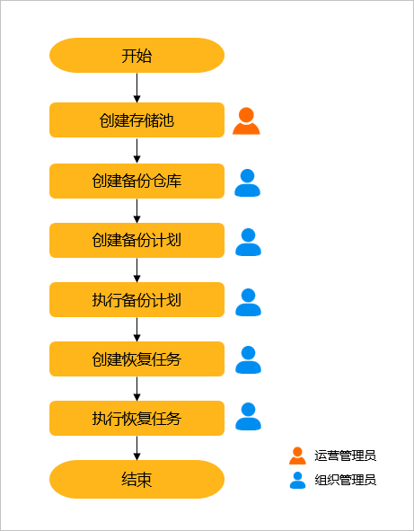

<a id="section-4"></a>

# 4.登录备份管理平台ASR-BR

您可以通过备中心的Apsara Uni-manager运营控制台跳转到备份管理控制台。

**前提条件**

- 登录Apsara Uni-manager运营控制台前，确认您已从部署人员处获取Apsara Uni-manager运营控制台的服务域名地址。

- 推荐使用Chrome浏览器。

**背景信息**

在跨地域备份和本地备份场景中，备份管理控制台部署在中心Region，您需要通过Apsara Uni-manager运营控制台登录中心Region的备份管理控制台。

**操作步骤**

1. 在浏览器地址栏中，输入Apsara Uni-manager运营控制台的服务域名地址，按回车键。

   

   > **说明**
   >
   > - 单击页面右上角的当前语言可以切换其它语言。
   >
   > - 授权登录是第三方认证中配置了全局IdP设置才会显示，且“授权登录”名称用户可按需自定义。

2. 输入正确的用户名及密码。

   > **说明**
   >
   > - 请向运营管理员获取登录控制台的用户名和密码。
   >
   > - 首次登录Apsara Uni-manager运营控制台时，需要修改登录用户名的密码，请按照提示完成密码修改。为提高安全性，密码长度必须为10~32位，且包含英文字母大小写、阿拉伯数字和特殊符号（感叹号（!）、at（@）、井号（#）、美元符号（$）、百分号（%）等）。

3. 单击**账号登录**。

4. 

5. 在顶部菜单中选择**产品**。

6. 在左侧导航栏中选择**容灾与备份**。

7. 在**容灾与备份**区域选择**备份服务 > 备份管理平台 ASR-BR**。

<a id="section-5"></a>

# 5.概览

通过概览页面您可以查看备份系统的实时情况、备份恢复情况统计、资源统计、备份情况和系统告警，帮助您快速了解备份全局情况。

**操作步骤**

1. 登录备份管理平台ASR-BR。

2. 在左侧导航栏中选择**概览**。

   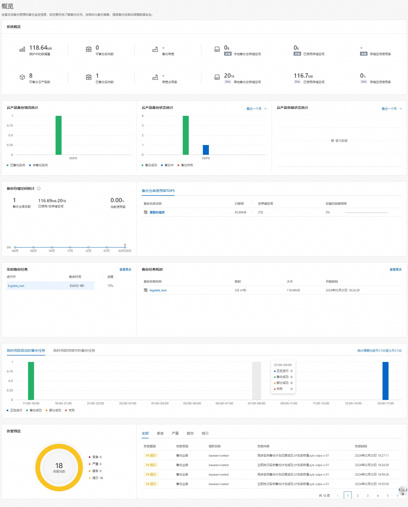

   子模块

   **模块**

   **说明**

   展示已经备份的实例最近一次备份成功的源端数据量总和。

   - 运营管理员：展示所有已经备份的实例最近一次备份成功的

   保护中的数据量

   数据量总和。

   - 组织管理员：展示当前组织已经备份的实例最近一次备份成功的数据量总和。

   - 运营管理员：展示所有组织云产品的总实例数。

   可备份实例数

   - 组织管理员：展示当前组织云产品的总实例数。

   **系统概览**

   备份带宽

   展示当前系统所设置的备份流量速度。

   - 运营管理员：展示系统中可以备份的云产品类型的数量。

   可备份云产品数

   - 组织管理员：展示当前组织可以备份的云产品类型的数量。

   - 运营管理员：展示当前所有的备份实例数量。

   已备份实例数

   - 组织管理员：展示当前组织的备份实例数量。

   带宽占用率

   展示当前系统带宽备份时的占有率。

   - 运营管理员：分别展示系统中已备份和未备份实例数量。

   **云产品备份情况统计**

   -

   - 组织管理员：分别展示当前组织下已备份和未备份实例数量。

   - 运营管理员：统计并展示系统中所有云产品备份状态。

   **云产品备份状态统计**

   -

   - 组织管理员：统计并展示当前组织下所有云产品备份状态。

   - 运营管理员：统计并展示系统中所有云产品恢复的状态，包括恢复成功、恢复中、恢复失败。

   **云产品恢复状态统计**

   -

   - 组织管理员：统计并展示当前组织下云产品的恢复状态，包括恢复成功、恢复中、恢复失败。

   - 运营管理员：展示当前系统中备份仓库总数量。

   备份仓库总数

   - 组织管理员：展示当前组织下备份仓库总数量。

   - 运营管理员：展示当前系统中总备份存储空间和已使用存储空间。

   已使用/总存储空间

   - 组织管理员：展示当前组织下的总备份存储空间和已使用存储空间。

   **备份存储空间统计**

   计算公式：当前使用率 = 已使用存储空间 / 总存储空间 \* 100%

   当前使用率

   - 运营管理员：展示总备份存储空间的使用率。

   - 组织管理员：展示当前组织备份存储空间的使用率。

   - 运营管理员：展示系统所有备份仓库使用率前五的仓库。

   - 组织管理员：展示当前组织下所有备份仓库使用率前五的仓

   备份仓库使用率

   库。

   TOP5

   单击备份仓库名称，可跳转至**备份仓库**页面查看仓库详情，备份仓库操作请参考备份仓库。

   实时统计并显示备份任务，可单击**查看更多**查看全部备份任务详情。

   **实时备份任务**

   -

   - 运营管理员：展示系统中所有实时备份的任务备份情况

   - 组织管理员：展示当前组织下实时备份的任务备份情况

   统计并显示所有备份任务所耗费的时长，最多展示10条，可单击**查看更多**查看全部备份任务的耗费时长。

   **备份任务耗时**

   -

   - 运营管理员：展示系统中所有备份任务耗时情况。

   - 组织管理员：展示当前组织下备份任务耗时情况。

   统计并展示24小时内启动的备份任务处于正在进行、备份成功、部分成功和失败状态的任务数量。

   **各时间段启动的备份**

   -

   - 运营管理员：展示系统所有备份任务启动情况

   **任务**

   - 组织管理员：展示当前组织备份任务启动情况

   统计并展示最近24小时内启动的备份任务处于正在进行的任务数量。

   - 运营管理员：展示系统中最近一天持续中的所有备份任务数

   **各时间段内持续中的**

   -

   量。

   **备份任务**

   - 组织管理员：展示当前组织下最近一天持续中的备份任务数量。

   - 统计后以环状图形式显示全部、紧急、严重、警告、提示四个级别的告警数量。

   - 以列表形式显示全部、紧急、严重、警告、提示四个级别的告警详情，单击不同的页签，可以查看不同级别的告警详情。

   **告警预览**

   > **说明**

   -

   > - 以运营管理员登录呈现的是系统中所有的告警信息。
   >
   > - 以组织管理员登录展示的是当前组织下的所有告警信息。

<a id="section-6"></a>

# 6.用户引导

用户引导页面提供备份管理平台ASR-BR的首页和产品文档入口、使用流程、备份到阿里云公共云、推荐场景、关键概念等。

1. 以备份运营管理员或组织备份管理员登录备份管理平台ASR-BR。

2. 在左侧导航栏选择**用户引导**，进入用户引导页面。

   备份运营管理员用户引导页面：

   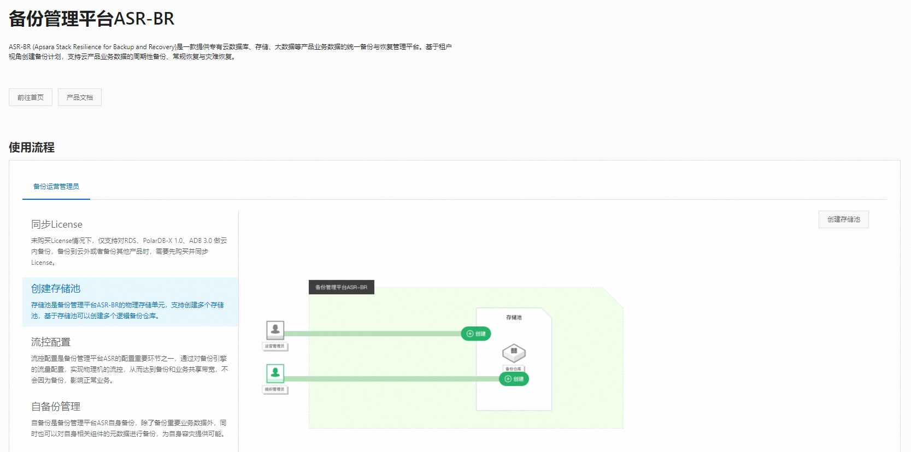

   组织备份管理员用户引导页面：

   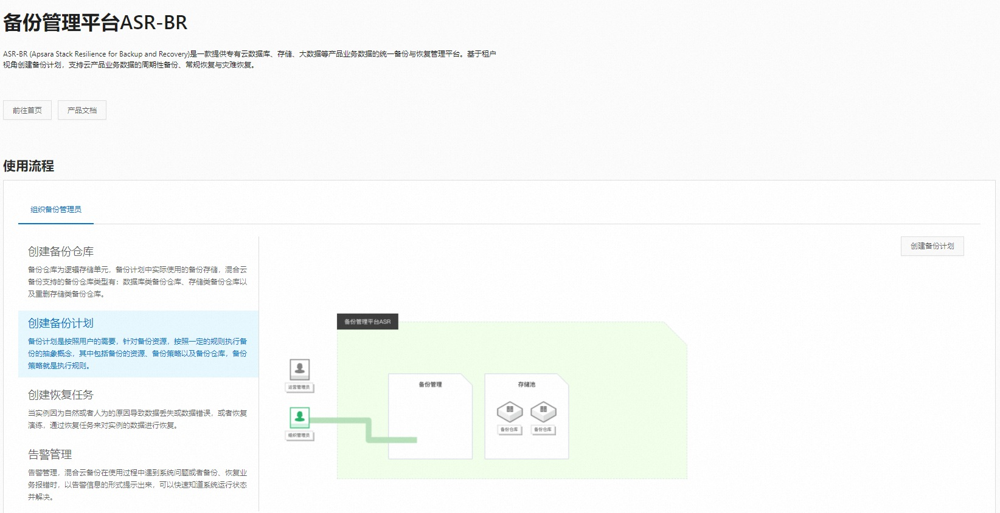

   <table>
     <tr>
       <th width="170">模块</th>
       <th>说明</th>
     </tr>
     <tr>
       <td>首页入口</td>
       <td>在页面上方单击<strong>前往首页</strong>，跳转至备份管理平台ASR-BR首页。</td>
     </tr>
     <tr>
       <td>产品文档入口</td>
       <td>在页面上方单击<strong>产品文档</strong>，跳转至备份管理平台ASR-BR用户指南。</td>
     </tr>
     <tr>
       <td>使用流程</td>
       <td>• 以备份运营管理员登录，使用流程模块动态展示同步License、创建存储池、流控配置、自备份管理、告警管理的操作流程，并提供操作快捷入口。<br>• 以组织备份管理员登录，使用流程模块动态展示创建备份仓库、创建备份计划、创建恢复任务、告警管理的操作流程，并提供操作快捷入口。</td>
     </tr>
     <tr>
       <td>备份到阿里云公共云</td>
       <td>介绍备份到阿里云公共云的功能优势、提前准备、操作步骤。</td>
     </tr>
     <tr>
       <td>推荐场景</td>
       <td>提供数据库类云产品备份最佳实践、文件类存储产品备份最佳实践、大数据类产品备份最佳实践，单击<strong>产品文档</strong>查看最佳实践详情。</td>
     </tr>
     <tr>
       <td>关键概念</td>
       <td>列表化展示备份管理平台ASR-BR的相关概念说明，可单击概念名称查看详情。</td>
     </tr>
   </table>

<a id="section-7"></a>

# 7.创建存储池

存储池组是指存储备份数据的物理集群，在存储池组中您可以创建多个存储池，各个存储池之间通过AK和SK进行逻辑隔离。

**前提条件**

只有运营管理员可以创建存储池组和存储池。

**操作步骤**

1. 登录备份管理平台ASR-BR。

2. 在左侧导航栏中选择**系统管理** > **存储池组管理**。

3. 单击**创建存储池组**，在**添加存储池组**对话框中设置相关参数，完成后单击**确定**。

   > **说明**
   >
   > 存储池组总数量不能超过16个。

   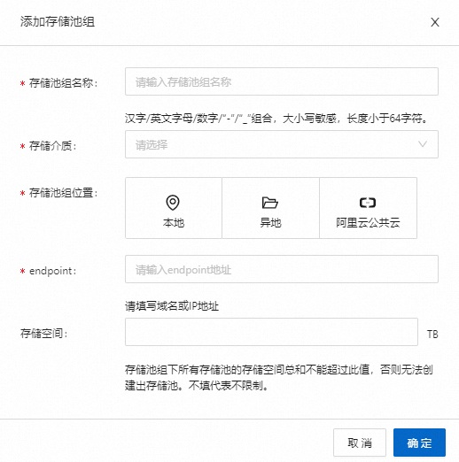

   <table>
     <tr>
       <th width="154">配置项</th>
       <th>说明</th>
     </tr>
     <tr>
       <td>存储池组名称</td>
       <td>请设置一个容易识别的存储池组名称，例如“公共云存储池组”。<br>说明<br>• 名称由中文、英文、数字、短划线（-）、下划线（_）组成，长度小于64个字符，大小写敏感。</td>
     </tr>
     <tr>
       <td>存储介质</td>
       <td>可支持OSS、CDS-OSS、MINIOSS、PanguStor、SDS。</td>
     </tr>
     <tr>
       <td>存储池组位置</td>
       <td>请选择该存储池组的位置。<br>• <strong>本地</strong>：存储池组在本站点。<br>• <strong>异地</strong>：存储池组在异地的站点。<br>• <strong>阿里云公共云</strong>：存储池组在阿里云公共云。</td>
     </tr>
     <tr>
       <td>endpoint</td>
       <td>输入endpoint地址，可填写存储介质对应的域名或IP地址。<br>说明<br>• endpoint网络必须能够连通。<br>• 不支持IPv6地址。<br>• 如果采用NAT需要添加端口映射，可以在域名或IP之后加上英文冒号和端<br><br>口号，格式为<code> </code>&lt;endpoint&gt;:&lt;端口号&gt;<code> </code>。</td>
     </tr>
     <tr>
       <td><strong>存储空间</strong>（可选）</td>
       <td>设置存储池组的存储空间大小，单位为TB。<br>说明<br>• 存储池组下所有存储池的存储空间总和不能超过此值，否则无法创建出存储池。<br>• 不填代表不限制。</td>
     </tr>
   </table>

4. 在存储池组列表中单击存储池组名称，进入存储池列表。

5. 在页面左上角单击**创建存储池**，在**添加存储池**对话框中设置相关参数。

   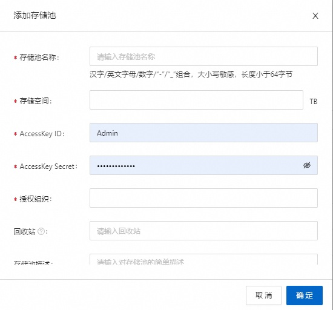

   <table>
     <tr>
       <th width="185">配置项</th>
       <th>描述</th>
     </tr>
     <tr>
       <td>存储池名称</td>
       <td>请设置一个容易识别的存储池名称，例如“公共云存储池”。<br>说明名称由中文、英文、数字、短划线（-）、下划线（_）组成，长度小于64个字符，大小写敏感。</td>
     </tr>
     <tr>
       <td>存储空间</td>
       <td>设置存储池的最大存储空间，单位为TB。</td>
     </tr>
     <tr>
       <td>AccessKey ID</td>
       <td>访问目的端存储账号对应的AccessKey ID。<br>说明该组AccessKey ID和AccessKey Secret至少需要有读写存储权限。</td>
     </tr>
     <tr>
       <td>AccessKey Secret</td>
       <td>访问目的端存储账号对应的AccessKey Secret。</td>
     </tr>
     <tr>
       <td>授权组织</td>
       <td>选择授权的一级组织名称，支持全选。</td>
     </tr>
     <tr>
       <td>回收站</td>
       <td>选填，自定义输入回收站名称。当该存储池下需要创建重删存储仓库或镜像仓库时，该参数必填。<br>说明当创建重删存储仓库或镜像仓库时，填写的回收站Bucket存在会直接使用，不存在将创建一个对应名称的Bucket使用。</td>
     </tr>
     <tr>
       <td><strong>存储池描述</strong>（可选）</td>
       <td>请对存储池进行简要描述，便于区分。</td>
     </tr>
   </table>

6. 单击**确定**。

<a id="section-8"></a>

# 8.实例管理

<a id="section-8-1"></a>

## 8.1. 查看实例列表

通过实例列表，您可以查看主中心实例的状态和关联的备份计划。

**背景信息**

- 组织管理员只能查看本组织的实例。

- 运营管理员能查看所有组织的实例。

**操作步骤**

1. 登录备份管理平台ASR-BR。

2. 在左侧导航栏单击**实例列表**。

   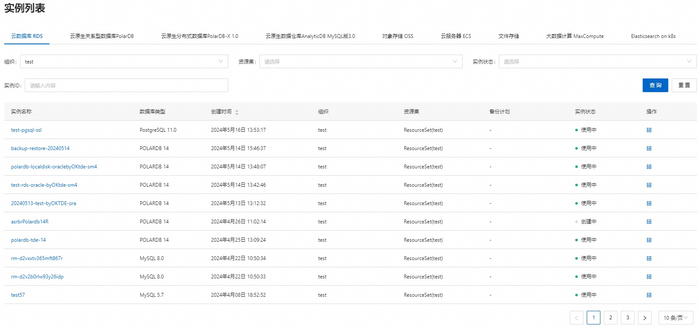

3. 单击产品名称的页签。

4. 设置相应的搜索条件，单击**查询**。

   支持的搜索条件如下表所示。

   | 名称 | 描述 |
   | --- | --- |
   | 组织 | 您可以选择某个组织，查询该组织下所有实例。 |
   | 资源集 | 您可以选择某个资源集，查询该资源集下所有实例。 |
   | 实例ID | 您可以根据实例ID查询对应的实例。 |
   | 实例状态 | 您可以根据实例状态进行筛选。 |

5. 在实例列表中查看实例的状态和关联的备份计划。

**相关操作**

在实例列表页面，您还可以执行以下操作。

<table>
  <tr>
    <th width="122">任务名称</th>
    <th>操作步骤</th>
  </tr>
  <tr>
    <td>查看实例详情</td>
    <td>1. 单击实例名称或单击<strong>操作</strong>列<strong> &gt; 详情</strong>，跳转至<strong>实例详情</strong>页面。<br>2. 查看实例详情。<br>• <strong>备份记录</strong>页签：展示该实例所有的备份情况。<br>• <strong>日志备份</strong>页签：展示RDS实例和PolarDB实例备份Binlog日志备份记录。<br>• <strong>备份恢复事件</strong>页签：展示该实例备份恢复时的所有事件。</td>
  </tr>
  <tr>
    <td>查看备份计划</td>
    <td>1. 单击<strong>备份计划</strong>列的计划名称。<br>2. 展示该备份计划的信息、记录、日志、事件以及统计情况。</td>
  </tr>
</table>

<a id="section-8-2"></a>

## 8.2. 修改所属的备份策略

您可以修改实例所属的备份计划，修改后，实例将继承备份计划的备份策略。

**前提条件**

实例已加入某个备份计划。

**操作步骤**

1. 登录备份管理平台ASR-BR。

2. 在左侧导航栏，单击**实例列表**。

3. 单击对应的云产品页签。

4. 选择组织、资源集、实例状态，输入实例ID，单击**查询**。

5. 在实例列表中展示符合条件的实例后，单击**备份计划**列的备份计划名称。

6. 在**备份计划**页签，单击**修改策略**，进入备份策略设置页面。

   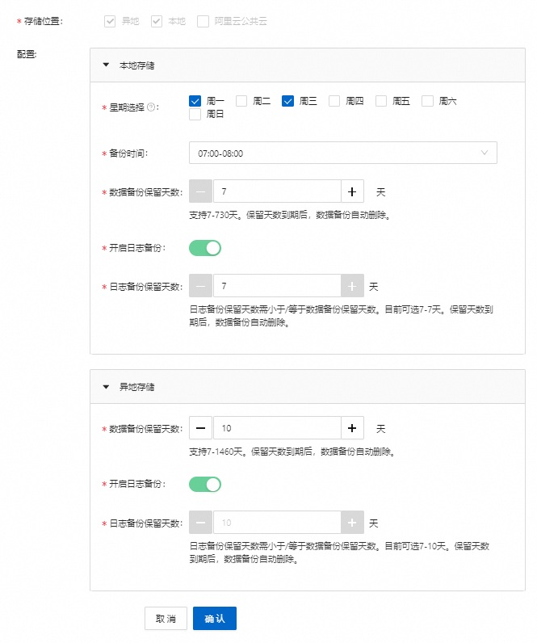

7. 在备份策略设置页面，重新设置备份策略，具体操作请参见创建备份计划中备份策略的内容。

8. 设置完成后单击**确认**。

<a id="section-8-3"></a>

## 8.3. 查看备份时长

ASR-BR通过曲线图展示最近几次备份操作的时长。定期关注备份时长可以帮您分析带宽的拥塞情况，并合理选择备份的时间点，避开带宽拥塞的时间段。

**前提条件**

实例已加入某个备份计划。

**操作步骤**

1. 登录备份管理控制台。

2. 在左侧导航栏单击**实例列表**。

3. 单击对应的实例类型页签。

4. 在实例列表中选择目标实例，单击**操作**列中的  图标，单击**备份时长**。

5. 将鼠标悬停至图表的相应位置，可以查看该次备份操作所花的时长以及备份的时间点。

   

6. （可选）您可以在窗口右上角根据需要切换视图的显示次数，ASR-BR支持查看最近10次、最近20次、最近30次或最近50次的备份时长。

<a id="section-9"></a>

# 9.备份仓库

<a id="section-9-1"></a>

## 9.1. 创建备份仓库

备份仓库是指存储池上规划的逻辑的存储空间，即OSS的Bucket，用于存储业务数据的备份。

**前提条件**

- 已创建存储池，具体请参见创建存储池。

- 创建备份仓库的组织备份管理员或组织备份操作员的所在组织，必须归属在存储池授权的一级组织中，否则存储池不可见。

**背景信息**

- V3.16及以后版本支持创建多个数据库类备份仓库。

- 一个存储池中可以创建多个存储类备份仓库、数据库类备份仓库、重删存储类备份仓库和表格存储的备份仓库。

- RDS、PolarDB和PolarDB-X 1.0使用相同的数据库备份仓库。

- 组织备份管理员和组织备份操作员可以创建数据库备份仓库、存储类备份仓库和重删存储类备份仓库。

**操作步骤**

1. 登录备份管理平台ASR-BR。

2. 在左侧导航栏中单击**备份仓库**。

3. 在**备份仓库**页面，单击**新建**。

4. 在**新建备份仓库**对话框中填写相关参数，具体说明如下。

   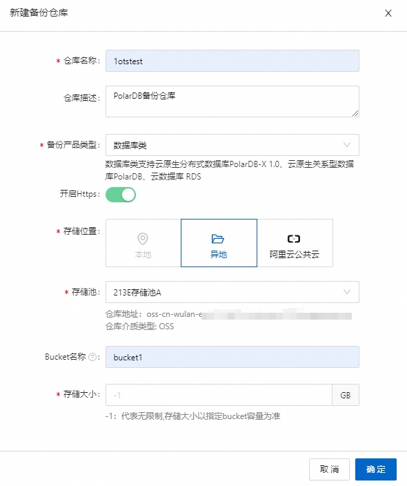

   <table>
     <tr>
       <th width="154">参数名称</th>
       <th>配置说明</th>
     </tr>
     <tr>
       <td>仓库名称</td>
       <td>请设置一个方便识别的备份仓库名称，例如公共云备份仓库。<br>说明<br>• 该名称创建成功后不可修改。<br>• 名称只能包含小写字母、数字、中文或短划线（-），且不能以短划线（-）开头。名称长度为3~35个字符。</td>
     </tr>
     <tr>
       <td><strong>仓库描述</strong>（可选）</td>
       <td>输入对仓库的简单描述。</td>
     </tr>
     <tr>
       <td>备份产品类型</td>
       <td>设置该仓库备份的产品类型。<br>• <strong>数据库类</strong>：目前支持RDS、PolarDB和PolarDB-X 1.0。<br>• <strong>存储类</strong>：目前支持OSS、ECS、NAS、。<br>• <strong>表格存储</strong>：目前支持OTS（TableStore备份）。<br>• <strong>重删存储类</strong>：目前支持MaxCompute。</td>
     </tr>
     <tr>
       <td>开启Https</td>
       <td>设置创建备份仓库、备份数据到备份仓库时，使用HTTP或HTTPS协议。默认开启HTTPS协议，可手动关闭。<br>说明<br>• 只有当<strong>备份产品类型</strong>选择<strong>数据库类</strong>、<strong>存储类</strong>和<strong>表格存储</strong>时，才需要配置该参数。<br>• 如果和OSS的HTTPS端口未打通，建议关闭<strong>开启Https</strong>开关。</td>
     </tr>
     <tr>
       <td>存储位置</td>
       <td>设置备份数据存储的位置。<br>• <strong>本地</strong>：将备份数据存储在云内的OSS。<br>• <strong>异地</strong>：将备份数据存储在其他阿里云的OSS。<br>• <strong>阿里云公共云</strong>：将备份数据存储在阿里云公共云的OSS。<br>说明当<strong>备份产品类型</strong>为<strong>表格存储</strong>时，<strong>存储位置</strong>只支持<strong>异地</strong>。</td>
     </tr>
     <tr>
       <td>存储池</td>
       <td>请选择该备份仓库所属的存储池。</td>
     </tr>
     <tr>
       <td>Bucket名称</td>
       <td>如果用户填写了Bucket，那将直接使用该Bucket作为备份仓库。同时填写的Bucket名称必须是OSS内已经存在的Bucket名称。<br>说明如果选择的存储池没有创建Bucket权限，则必须填写。</td>
     </tr>
     <tr>
       <td>存储大小</td>
       <td>设置备份仓库的存储大小，单位为GB。<br>说明如果所选存储池设定了存储空间大小，则备份仓库的存储大小不能超过该值。</td>
     </tr>
   </table>

5. 单击**确定**。

   > **说明**
   >
   > 如果创建存储仓库失败，可能是存储资源不足，请及时扩容后再重新创建。

**执行结果**

ASR-BR会自动在对应存储池中创建一个OSS Bucket，用于存储业务数据的备份。

<a id="section-9-2"></a>

## 9.2. 查看备份仓库的数据

您可以查看备份仓库对应的OSS Bucket中的文件信息。定期查看备份仓库中备份数据的相关信息，方便您及时了解和调整备份恢复计划。

1. 登录备份管理控制台。

2. 在左侧导航栏单击**备份仓库**。

3. 在备份仓库列表中，单击**操作**列的  图标，选择**浏览**。

4. 在弹出的对话框中，查看备份仓库对应的OSS Bucket中的文件名、文件大小、文件的更新时间。

   > **说明**
   >
   > 如果OSS Bucket中包含文件夹，请单击文件夹名称，查看文件夹内的文件目录。

5. 单击**确定**。

<a id="section-9-3"></a>

## 9.3. 管理备份仓库

管理备份仓库包含查看备份仓库、修改备份仓库、删除备份仓库的具体操作。

**背景信息**

- 对于已经创建的备份仓库，在使用过程中备份运营管理员、组织备份管理员、组织备份操作员可以修改仓库名称和存储大小。

- 当备份仓库没有绑定任何的备份计划，且备份仓库内所有数据均过期时，组织备份管理员、组织备份操作员可以删除该备份仓库。

**查看备份仓库**

1. 登录备份管理平台ASR-BR。

2. 在左侧导航栏单击**备份仓库**。

3. 在备份仓库列表中，单击仓库名称，即可以查看备份仓库的基本信息、存储池使用情况、用户操作信息等。

4. 在备份仓库关联图页签可以查看与该仓库关联的其他仓库。

5. 单击镜像仓库，可以查看该仓库对应的镜像仓库信息，包括同步进度、仓库使用占比、存储池占比等信息。

**修改备份仓库**

1. 登录备份管理平台ASR-BR。

2. 在左侧导航栏单击**备份仓库**。

3. 在备份仓库列表中，单击**操作**列的  图标，选择**修改**。

4. 您可以修改**仓库名称**、**存储大小**，修改完成后，单击**确定**。

**删除备份仓库**

1. 登录备份管理平台ASR-BR。

2. 在左侧导航栏单击**备份仓库**。

3. 在**备份仓库**页面，单击目标仓库**操作**列的  图标，选择**删除**。

4. 在弹出的对话框中单击**确认**。

<a id="section-9-4"></a>

## 9.4. 创建镜像仓库

镜像仓库是一个特殊的备份仓库，用于保存备份仓库的数据副本。对备份仓库创建一个异地的镜像仓库，备份仓库中的数据将会使用OSS跨域/云复制能力，自动将数据复制到镜像仓库中，实现备份数据保存多地，恢复时允许用户选择任意仓库恢复。

**背景信息**

通过创建镜像仓库将备份仓库与镜像仓库关联起来，进而管理镜像仓库；将备份控制台将各云产品业务数据备份到备份仓库，然后再从备份仓库同步到镜像仓库。

**约束条件**

- 镜像仓库使用的Bucket必须是空Bucket。

- 只有存储介质为OSS、CDS-OSS、PanguStor的存储池才允许创建镜像仓库。

- 镜像仓库的类型在创建成功后不可修改。

**前提条件**

- 已创建备份仓库，请参见创建备份仓库。

- 已创建存储池并在创建时填写了回收站和跨域/云复制授权信息，请参见创建存储池。

- 已经完成前置操作，请参见使用备份仓库存储级联功能的前置操作。

**操作步骤**

1. 登录备份管理平台ASR-BR。

2. 在左侧导航栏中单击**备份仓库**。

3. 在备份仓库页面选择**仓库位置**、**仓库类型**和**仓库名称**，单击**查询**，筛选出需要创建镜像的仓库。

4. 单击对应仓库**操作**列  ，单击**创建镜像仓库**。

5. 参考下表填写对应参数值。

   <table>
     <tr>
       <th width="121">参数名称</th>
       <th>描述</th>
     </tr>
     <tr>
       <td>镜像仓库名称</td>
       <td>用户自定义，也可以选择备份仓库的名称。<br>• 该名称创建成功后不可修改。<br>• 名称只能包含小写字母、数字、中文或短划线（-），且不能以短划线（-）开头。名称长度为3~35个字符。</td>
     </tr>
     <tr>
       <td>仓库描述</td>
       <td>输入对仓库的简单描述，非必填，建议填写为创建备份仓库时的描述，方便维护。</td>
     </tr>
     <tr>
       <td>备份产品类型</td>
       <td>系统自动填充，无需填写。</td>
     </tr>
     <tr>
       <td>存储池</td>
       <td>下拉选择已经创建成功的存储池。<br>说明如果没有选项，请参考创建存储池先创建。</td>
     </tr>
     <tr>
       <td>Bucket名称</td>
       <td>如果用户填写了Bucket，那将直接使用该Bucket作为镜像仓库。<br>说明如果选择的存储池没有创建Bucket权限，则必须填写。填写的Bucket必须是空Bucket。</td>
     </tr>
     <tr>
       <td>存储空间</td>
       <td>需要填写的值大于等于1000GB，因为镜像仓库的存储空间不允许小于备份仓库的存储空间。</td>
     </tr>
   </table>

6. 填写完成后单击**确定**。

   创建成功后在**备份仓库**页面的列表中会显示镜像仓库。

7. 单击**镜像仓库**列  ，打开镜像仓库列表，数字代表挂载在该备份仓库的镜像仓库数量。

   - 查看镜像仓库基本信息和同步状态：单击镜像仓库名称/Bucket名称，可查看基本信息、操作信息、备份仓库关联图和镜像仓库。

     > **说明**
     >
     > 如果**状态**列是创建失败或者同步失败时，可以单击**操作**列**重试**，重新创建或同步一次。

   - 编辑修改镜像仓库：

     <ol type="a">

     <li>

     单击**操作**列**编辑**，打开编辑镜像仓库弹框。

     </li>

     <li>

     修改需要修改的参数值后，单击**确定**。

     </li>

     </ol>

   - 断开镜像仓库和备份仓库关系：

     <ol type="a">

     <li>

     单击**操作**列**断开**。

     </li>

     <li>

     在弹出的提示框上单击**确定**。

     > **说明**
     >
     > - 如果断开失败，可能是由于源端OSS异常导致同步边无法断开，源端OSS恢复后虽然ASR-BR状态是断开失败，但是仍可能在同步数据。
     >
     > - 如果已断开，镜像仓库的备份集可用性仍和备份仓库保持一致，即备份仓库的备份记录过期了，镜像仓库即便备份数据仍存在，也无法进行数据恢复。

     </li>

     </ol>

<a id="section-10"></a>

# 10.备份计划

<a id="section-10-1"></a>

## 10.1. 创建备份计划

通过创建备份计划，ASR-BR会定期将实例中的数据备份至备份仓库中。

**前提条件**

- 只有组织备份管理员和组织备份操作员能创建备份计划，备份运营管理员不支持创建备份计划。

- 已创建备份仓库，具体参见创建备份仓库。

- 备份恢复MaxCompute前，请确保已开启MaxCompute的外部表功能，且已部署MaxCompute联合计算增强包（Spark on MaxCompute）。

- 创建ECS实例备份计划，请确保ECS实例已安装ECS云助手且状态正常。

- （可选）创建MaxCompute备份计划前，请配置MaxCompute实例参数，会使用指定项目的cu进行备份，防止备份时影响业务。具体操作请参见参数配置；如果不配置，将使用当前项目的cu进行备份，同时在配置实例时会出现缺少运行项目的提示。

**背景信息**

- ASR-BR会备份RDS数据及用户信息、权限、规格等元数据信息。

- ASR-BR支持备份NFS和SMB协议的NAS实例。

- ASR-BR会备份MaxCompute的Table、Function、Resource和Project的元数据信息（Quota信息、集群信息、VPC信息、安全信息等）。

- ASR-BR目前支持的ADB数据库类型包括C8、H20、C20、B7，其他类型暂不支持。

- ASR-BR备份OTS表时，仅支持表名不超过100个字符的OTS表，如果需要备份表名超过100个字符的OTS表，请联系ASR-BR产研团队评估处理。

**操作步骤**

1. 登录备份管理平台ASR-BR。

2. 在左侧导航栏，单击**备份计划**。

3. 在**备份计划**页面，单击**新建**。

4. 在**基本信息**配置向导页面，填写备份计划的基本信息，单击**下一步**。

   <table>
     <tr>
       <th width="186">名称</th>
       <th>描述</th>
     </tr>
     <tr>
       <td>备份计划名称</td>
       <td>自定义备份计划的名称。<br>说明名称只能包含中文、英文、数字、短划线（-）、下划线（_）或英文半角句号（.），长度为4-128个字符或2-64个汉字。</td>
     </tr>
     <tr>
       <td><strong>备份计划描述</strong>（可选）</td>
       <td>对备份计划的简单描述，方便识别。</td>
     </tr>
     <tr>
       <td>实例类型</td>
       <td>选择待备份实例的产品类型。<br>说明创建OTS备份计划时，请选择<strong>表格存储 TableStore</strong>。</td>
     </tr>
     <tr>
       <td>备份方式</td>
       <td>只有ECS实例需要配置该参数。<br>• <strong>快照备份</strong>：备份ECS整个实例或ECS云盘。<br>• <strong>文件备份</strong>：备份ECS的文件。</td>
     </tr>
   </table>

5. 在**选择实例**配置向导页面，选择待备份的某个实例，单击**下一步**。

   > **说明**
   >
   > - 待备份的实例的状态必须为**使用中**。
   >
   > - 一个备份计划只能包含一个实例。
   >
   > - 实例类型为RDS、PolarDB、PolarDB-X、ADB时，一个实例只能加入一个备份计划，即无法选择保护状态为**保护中**的实例。
   >
   > - 1个OSS Bucket支持加入多个备份计划中。
   >
   > - 1个NAS实例支持加入多个备份计划中。
   >
   > - 1个ECS实例，支持分别加入文件备份的备份计划和云盘备份的备份计划。
   >
   > - 备份方式为文件备份的ECS实例，支持加入多个备份计划中。
   >
   > - 由于一个OTS实例下会存在多个表，因此当实例类型为TableStore时，在**OTS表**列可以查看该实例下有几个表。

6. （可选）选择OTS表。只有填写**基本信息**时填写的**实例类型**为**表格存储 TableStore**，需要执行该步骤，其他实例类型的备份计划请跳过。

   <ol type="i">

   <li>

   在左侧区域勾选左侧待选择的表名称。

   > **说明**
   >
   > 单个实例最多同时备份两张表，因此选择OTS表的时候，如果选择的表数小于等于两张表时，会同时备份两张表数据；如果选择的表的数量大于两张表时，需要排队等待备份。

   </li>

   <li>

   单击  ，将已经选择的OTS表添加到右侧区域。

   </li>

   <li>

   单击**下一步**。

   </li>

   </ol>

7. （可选）在**安装客户端**页面，配置安装HBR客户端的相关参数。配置完成后单击**下一步**。

   > **说明**
   >
   > - 仅执行ECS文件备份，且**备份方式**选择**文件备份**时需要执行本步骤。
   >
   > - 安装客户端操作依赖ECS云助手，请确保ECS实例已安装ECS云助手且状态正常。

   <table>
     <tr>
       <th>实例类型</th>
       <th>名称</th>
       <th>描述</th>
     </tr>
     <tr>
       <td rowspan="4">ECS（文件备份）</td>
       <td>客户端安装路<strong>径</strong>（可选）</td>
       <td>选择客户端在ECS实例内的安装路径。<br>说明<br>不选安装路径时，默认安装至<code> /root </code>下。</td>
     </tr>
     <tr>
       <td>客户端CPU核心使用数</td>
       <td>系统自动显示当前ECS实例的CPU核心数，根据需要设置客户端使用的CPU核心数。客户端启动备份任务时，会根据设置的CPU核心使用数来分配备份任务。<br>说明CPU核数越大，占用宿主机资源越多，对宿主机性能影响越大，建议评估后设置，防止对业务造成影响。</td>
     </tr>
     <tr>
       <td>客户端最大工作线程数</td>
       <td>系统默认设置的最大工作线程数为10，可根据实际需要修改。客户端启动备份任务时，会根据设置的最大工作线程数分配备份任务。<br>说明线程数越大，占用宿主机资源越多，对宿主机性能影响越大，建议评估后设置，防止对业务造成影响。</td>
     </tr>
     <tr>
       <td>客户端安装状<strong>态</strong>（可选）</td>
       <td><strong>客户端CPU核心使用数</strong>和<strong>客户端最大工作线程数</strong>设置完成后，单击<strong>安装</strong>开始安装客户端。单击<strong>刷新</strong>可实时刷新安装状态，等待安装状态为<strong>已安装</strong>，可执行下一步操作，系统自动会进行连通性测试。<br>说明<br>• 客户端安装后支持卸载和编辑<strong>客户端CPU核心使用</strong><strong>数</strong>和<strong>客户端最大工作线程数</strong>。<br>• 安装客户端页面右侧区域会展示客户端的安装信息，包括客户端安装状态、客户端版本号、心跳保活时间、客户端CPU核心使用数、客户端最大工作线程数。心跳保活时间正常时，您可以执行卸载或连通性测试操作；心跳保活时间异常时，您可以执行卸载或重新安装操作。<br>• 如果ECS实例已安装过客户端，下一次创建备份计划时，会显示客户端安装状态为<strong>已安装</strong>。</td>
     </tr>
   </table>

8. 在**配置实例**页面，配置相关参数。配置完成后单击**下一步**。

   > **说明**
   >
   > 创建RDS、PolarDB、OTS和PolarDB-X备份计划时请忽略该步骤。

   **实例类型**

   **名称**

   **描述**

   单击<strong>浏览，</strong>在**浏览目录**页面选择待备份的文件目录。

   **浏览目录**页面显示当前Bucket的文件目录，您可以选择待备份的文件。

   > **说明**
   >
   > - 不配置默认备份Bucket中的所有文件。

   **OSS Prefix**（可选）

   > - **OSS Prefix**的值以正斜线（/）分隔和结尾，不能包含如下字符：尖括号（<>）、反斜线（\\）、竖线（|）、冒号（:）、引号（"）、星号（\*）、问号（?）。
   >
   > - 如果OSS Bucket中的文件太大，为了提高备份效率，您可以创建多个备份计划，每个备份计划中指定待备份的文件。

   选择备份文件筛选策略。

   - **全部**：备份**OSS Prefix**中的所有文件。

   - **按时间范围**：备份最后修改时间为指定时间范围的对象。

   **备份文件筛选策**

   - **按最近天数**：备份最后修改时间为最近几天的对象。

   **略**

   > **说明**
   >
   > 周期性备份时，会以每次备份周期的开始时间计算最近的天数。

   当**备份文件筛选策略**选择**按时间范围**时，需要填写筛选文件开始时间点和结束时间点，备份指定时间范围内上传到OSS的对象。

   > **说明**

   **筛选文件时间范**

   > - 备份时，将会根据对象的最后修改时间和该时间范围进行过

   **围**

   > 滤备份，只有最后修改时间在该时间范围的对象才会备份到异地。
   >
   > - 筛选文件时间范围不能为空。

   当**备份文件筛选策略**选择**按时间范围**时，需要设置**筛选最近天数**的数值，备份时将根据对象的最后修改时间结合备份开始时间和最近天数进行文件

   **筛选最近天数**

   筛选。

   在备份OSS时，允许配置从源端读数据和向目的端写数据的并发数。请根据Bucket文件数量和文件平均大小，进行并发数选择。选择**默认**时，系统会采用最小的并发数。

   **备份并发数**

   > **说明**
   >
   > 系统会根据当前备份系统限流、Bucket文件总数量、平均文件大小，为您推荐合适的备份并发数配置。

   **对象存储 OSS**

   该参数仅支持CDS-OSS实例类型。

   开启清单功能后，ASR-BR将为您创建一个仅有OSS读写权限的自定义RAM角色用于配置、生成OSS清单。备份时，将使用OSS清单文件进行备份。

   **清单功能**

   > **说明**
   >
   > 开启清单功能后，在增量备份时将使用OSS清单进行增量文件获取，无须遍历文件。推荐1亿对象以上的Bucket使用OSS清单功能进行备份。

   **存储清单**

   仅在**清单功能**开启时需要配置。用于设置OSS清单文件存放的目标

   **Bucket**

   Bucket。

   仅在**清单功能**开启时需要配置。用于设置OSS清单文件生成在目标

   **清单报告存储路**

   Bucket的指定目录。如果不填写，则默认放在根路径下。

   **径**

   仅在**清单功能**开启时需要配置。用于设置每次备份后，OSS清单文件的清理策略。默认策略为备份后删除所有清单。

   **清单清理策略**

   > **说明**
   >
   > 支持三种策略：备份后删除所有清单、备份后删除当前清单、不删除。

   如果您需要使用其他的OSS Endpoint进行源端OSS的数据读取，可以将**OSS Endpoint**切换成**自定义**并填写对应的OSS Endpoint。推荐配置非业务的OSS Endpoint进行备份。

   > **说明**

   **OSS Endpoint**（可

   > - 不配置使用默认的OSS Endpoint读取源端OSS数据。

   选）

   > - 系统会根据当前备份系统限流预估备份流量，请注意检查备份流量是否会影响业务流量。
   >
   > - 使用自定义的OSS Endpoint进行备份前，请确认该OSS Endpoint可以读取到源端需要备份的Bucket。

   展示预估的备份速度、第一次全量备份时间、后续增量备份时间，仅供参

   **备份情况预估**

   考。

   - **按整机备份**：备份整个ECS实例。

   **备份类型**

   - **按指定云盘备份**：备份ECS的云盘。**备份类型**选择**按指定云盘备份**后，在**云盘列表**处单击**浏览**选择一个或多个云盘。

   **ECS**（快照备份）

   关闭（默认）：优先创建快照一致性组，当不满足创建快照一致性组条件或其他原因导致创建快照一致性组失败时，则会自动降级创建普通快照。

   开启：强制创建快照一致性组，当不满足创建快照一致性组条件或其他原因导致创建快照一致性组失败时，则不会降级创建普通快照，此次备份也

   **创建快照一致性**

   会以失败结束。

   **组**

   > **说明**
   >
   > 如果没有特殊业务需要，请谨慎开启。

   选择待备份文件所在的路径，具体填写规则请参见界面帮助。

   **备份文件路径**

   包括如下3个选项：

   - **包含所有**：**备份文件路径**中的所有文件。

   **备份文件策略**

   - **排除以下**：**备份文件路径**中的除**ECS文件列表**以外的文件。

   - **包含以下**：只备份符合**ECS文件列表**规则的文件。

   **ECS**（文件备份）

   结合**备份文件策略**设置待备份的文件，具体填写规则请参见界面帮助。

   **ECS文件列表**

   设置不同时间段，生产中心向备份仓库备份时的最大传输速率，具体填写规则请参见界面示例。

   **流量阈值**（可

   您可以根据业务的高峰期和低谷期设置不同的流量阈值，比如在业务低谷

   选）

   期将流量阈值设置大一点，在业务高峰期将流量阈值设置小一点，以免占用太多带宽。

   待备份NAS文件的绝对路径，且不支持通配符\*。

   **文件路径**

   **NAS**

   允许配置从源端读数据和向目的端写数据的并发数。请根据NAS文件数量

   **备份并发数**

   和文件平均大小，进行并发数选择。

   目前支持**表备份**和**项目备份**两种备份方式。

   - **表备份**：支持选择备份单表和多表。

   **备份资源**

   - **项目备份**：会备份该项目中的所有表、资源、FUNCTION。可以通过白名单或黑名单进行筛选。

   **MaxCompute**

   **临时表前缀**（可

   表名大小写不敏感，不能有特殊字符，只能包含a~z、A~Z、数字和下划

   选）

   线（_）。建议以字母开头，名称的长度不超过128字节。

   下拉选择备份的网关Client：

   - **默认策略**：系统会根据每个客户指的负载情况选择HBR的一个备份网

   **备份网关**

   关来执行备份计划。

   - 其他备份网关：也可以选择其他已经注册的备份网关。

   - **Lan-Free传输备份数据**（默认）：备份时将硬盘热挂载到备份网关上已通过数据网络（Lan-Free）传输备份数据。

   - **LAN传输备份数据**：备份时使用LAN网络备份数据。

   **云服务器**

   **传输方式**

   > **说明**

   **VMware**

   > 如果vCenter不支持Lan-Free网络时，在数据备份时会自动切换为LAN传输方式进行备份数据。

   - **标准快照**：使用VMware软件快照进行普通备份。

   - **系统静默快照**（默认）：使用VMware Tools工具进行静默备份。

   > **说明**

   **快照类型**

   > 如果无法挂载或者没有安装VMware Tools工具，在备份时会自动切换为标准快照的方式进行备份。

9. 在**备份策略**配置向导页面，配置备份策略。单击**下一步**。

   > **说明**
   >
   > 不同实例类型支持的备份策略参数有差异，请根据界面提示和下表的参数解释进行配置。

   备份策略参数说明如下表所示。

   | 配置 | 描述 |
   | --- | --- |
   | 备份策略 | 不同实例类型支持的备份策略有差异，具体如下：<br>• <strong>全量</strong>：按设置的周期定期将数据库中所有数据进行备份。 该方式只能恢复备份时间点的数据。RDS实例支持该方式。<br>• <strong>全量+日志</strong>：按设置的周期进行全量备份，同时会实时备份实例产生的增量日志文件。该方式可以恢复任意时间点的数据。RDS、PolarDB、PolarDB-X实例支持该方式。<br>• <strong>永久增量</strong>：第一次全量备份。OSS实例支持该方式，其中OSS后续以文件为维度进行增量备份。<br>• <strong>全量（重删）</strong>：按设置的周期进行全量备份，备份过程中对数据进行重删。ECS（文件备份）、NAS支持该方式。<br>• <strong>增量（重删）</strong>：第一次备份为全量备份，后续为增量备份，备份过程中，HBR以Bucket为维度对数据进行重删。MaxCompute实例支持该方式。<br>• <strong>全量+增量</strong>：根据设置的全量备份和增量备份的时间间隔，分别进行全量备份和增量备份。ECS（云盘备份）整机备份支持该方式。 |
   | 备份模式 | 只有实例类型为PolarDB-X时支持该参数。<br>• <strong>快速备份</strong>：保证单个RDS数据一致性，无法保证数据的全局一致性。日常业务常规备份恢复建议选择该方式。<br>• <strong>一致性备份</strong>：保证PolarDB-X内的各RDS数据库之间数据一致性。对数据一致性有严格要求的行业、在线核心交易类业务建议选择该方式。<br>重要一致性备份请在业务低峰期进行。因为会对分布式事务进行秒级的锁定操作，RT存在亚秒级抖动。 |
   | 周期类型 | • <strong>按周执行</strong>：RDS实例支持该周期类型。<br>• <strong>按天执行</strong>：OSS、ECS（文件备份）、NAS、MaxCompute实例支持该周期类型。 |
   | 星期选择 | 请选择在星期几进行备份，建议有间隔的选择，例如选择周一、周四和周日。<br>说明RDS实例支持该方式。为了保证数据安全，请每周至少选择两天。如果是全量+日志备份模式，建议每周只备份两次，可以有效地节约带宽和存储使用量。 |
   | <strong>时间间隔</strong> （永久增量） | 请设置两次备份之间的时间间隔。OSS、NAS、ECS（云盘备份）、MaxCompute实例<strong>备份策略</strong>选择<strong>永久增量</strong>时支持配置该参数。<br>说明系统自动预估OSS实例第一次全量备份需要的天数，并推荐备份时间间隔大于该时间。 |
   | <strong>时间间隔</strong>（增量） | 请设置两次增量备份之间的时间间隔。仅实例类型为Elasticsearch实例且<strong>备份策略</strong>选择<strong>全量+增量</strong>时支持该参数。 |
   | <strong>时间间隔</strong>（全量） | 仅实例类型为Elasticsearch实例且<strong>备份策略</strong>选择<strong>全量+增量</strong>时支持该参数。请设置两次全量备份之间的时间间隔。 <strong>时间间隔（全量）</strong>设置要大于<strong>时间间隔（增量）</strong> |
   | <strong>时间间隔</strong>（全量重删） | ECS（文件备份）<strong>备份策略</strong>选择<strong>全量（重删）</strong>时支持配置该参数。 |
   | <strong>备份时间</strong>（增量） | 首次执行备份的时间，后续按设置的时间间隔执行备份。请选择业务相对空闲的时候进行备份。<br>说明<br>• OSS、RDS、ECS（文件备份）、PolarDB-X或MaxCompute实例支持该方式。<br>• 设置的备份时间请比当前时间至少晚一小时。如果设置的备份时间距离当前时间不足一小时，实例当天可能不会进行备份，需要等到下次备份周期时才会备份。 |
   | 存储位置 | 请设置备份数据保存的位置，<strong>异地</strong>和<strong>阿里云公共云</strong>不支持同时选择。<br>• <strong>本地</strong>：将备份数据保存至生产中心的备份仓库。<br>• <strong>异地</strong>：将备份数据保存至其他数据中心的备份仓库。<br>• <strong>阿里云公共云</strong>：将备份数据保存至阿里云公共云的备份仓库。 |
   | 备份仓库（本地） | OSS、NAS、MaxCompute和ECS（文件备份）支持配置该参数。请选择已创建的本地备份仓库。如果没有您所需的备份仓库，请单击<strong>创建备份仓库</strong>进行创建。 |
   | 保存天数（本地） | 备份数据在本地备份仓库保留的最长天数。缺省值是7，支持输入7-730的整数。<br>说明过期的备份数据会被删除。 |
   | 备份仓库（异地） | OSS、NAS、MaxCompute、RDS、PolarDB和ECS（文件备份）支持配置该参数。请选择已创建的异地备份仓库。如果没有您所需的备份仓库，请单击<strong>创建备份仓库</strong>链接进行创建。 |
   | 保存天数（异地） | 备份数据在异地备份仓库保留的最长天数。缺省值是7，支持输入7-1460的整数。<br>说明过期的备份数据会被删除。 |
   | 备份仓库（公共云） | 请选择已创建的阿里云公共云备份仓库。如果没有您所需的备份仓库，请单击<strong>创建备份仓库</strong>链接进行创建。 |
   | <strong>保存天数</strong>/<strong>数据备</strong><strong>份保留天数</strong>（公共云） | 备份数据在阿里云公共云备份仓库保留的最长天数。缺省值是7，支持输入7-1460的整数。<br>说明过期的备份数据会被删除。 |
   | 开启日志备份 | 默认关闭，打开后可保留日志数据。<br>说明如果本地日志备份关闭，则异地转储的日志备份必须关闭。 |
   | 日志备份保留天数 | 打开<strong>开启日志备份</strong>功能后，需要配置该参数。配置的天数需要小于等于<strong>数据备份保留天数</strong>的参数值。 |

   ECS云盘备份的备份策略参数说明如下表所示。

   **步骤**

   **配置**

   **描述**

   您可以根据需要设置每隔多少天或每隔多少小时对云盘进行备份。

   **周期类型**

   - **按天执行**：备份的时间间隔为天。

   - **按小时执行**：备份的时间间隔为小时。

   请设置两次备份之间的时间间隔。

   - 如果周期类型选择**按天执行**，时间间隔为天。

   **时间间隔**

   **备份策略（本地）**

   - 如果周期类型选择**按小时执行**，时间间隔为小时。

   首次执行备份的时间，后续按时间间隔执行增量备份。

   **备份时间**

   请选择业务相对空闲的时候进行备份。

   备份数据在本地备份仓库保留的最长天数。例如设置的最长天数是7，则系统只保存近7天的备份数据，过期的

   **保存天数**

   备份数据会被删除。

   请设置异地备份的备份策略。

   - **永久增量**：第一次备份为全量备份，后续为增量备份。

   **备份策略**

   - **全量+增量**：根据设置的全量备份和增量备份的时间间隔，分别进行全量备份和增量备份。

   默认为<strong>备份策略（本地）</strong>中设置的时间间隔。

   **时间间隔（增量）**

   当备份策略是**全量+增量**时才支持该参数。仅支持**按天**

   **周期类型（全量）**

   **执行**，请保持默认。

   **备份策略（异地）**

   当备份策略是**全量+增量**时才支持该参数。

   您可以指定全量备份的间隔天数，最小值为7。

   **时间间隔（全量）**

   增量备份的时间间隔默认和<strong>备份策略（本地）</strong>中的保持一致。

   系统自动填充，请保持默认。

   **备份时间**

   请选择已创建的异地备份仓库。如果没有您所需的备份

   **备份仓库（异地）**

   仓库，请单击**创建备份仓库**链接进行创建。

   备份数据在异地备份仓库保留的最长天数。

   **保存天数（异地）**

0. 确认备份信息无误后，根据需要选择是否立即启动该备份计划，单击**确认提交**。

   - 选中**立即启动**复选框：备份计划创建完毕后，立即启动备份计划。

   - 取消选中**立即启动**复选框：备份计划创建完毕后，暂时不启动，您需要手工启动备份计划。具体操作，请参见启动备份计划。

<a id="section-10-2"></a>

## 10.2. 查看备份计划

您可以查看备份计划的运行状态以及最近一次备份的结果。

**操作步骤**

1. 登录备份管理控制台。

2. 在左侧导航栏，单击**备份计划**。

3. 根据主中心组织、资源集、计划名称、计划状态、实例类型、实例ID或实例名称，查询相关的备份计划。备份计划列表中的重要参数说明如下表所示。

   <table>
     <tr>
       <th width="121">名称</th>
       <th>描述</th>
     </tr>
     <tr>
       <td>计划状态</td>
       <td>备份计划的状态。<br>• <strong>创建中</strong>：该备份计划正在创建中，还没创建成功。<br>• <strong>创建成功</strong>：该备份计划已经被创建，正在启动中。<br>• <strong>运行中</strong>：该备份计划在正常运行，但实例处于等待备份状态。<br>• <strong>备份中</strong>：该备份计划中的实例正在备份中。<br>• <strong>未启动</strong>：该备份计划未启动。<br>• <strong>已停止</strong>：该备份计划已停止。<br>• <strong>停止中</strong>：该备份计划正在执行停止操作。<br>• <strong>已删除</strong>：该备份计划对应的实例被物理删除。</td>
     </tr>
     <tr>
       <td>最近备份结果</td>
       <td>最近一次备份的结果。<br>• 成功<br>• 备份中<br>• 失败<br>• 未启动<br>• 无<br>说明最近备份结果为无，表示该计划已启动但还没开始备份。</td>
     </tr>
   </table>

   > **说明**
   >
   > VMware的备份计划默认没有显示在备份计划列表中，如果您需要查看VMware的备份计划，请在**实例类型**下拉列表中选择**VMware**，单击**查询**。

<a id="section-10-3"></a>

## 10.3. 启动备份计划

创建备份计划时如果未选择立即启动，您需要手工启动备份计划。

**前提条件**

只有**计划状态**为**未启动**或**已停止**的备份计划才能执行启动操作。

**操作步骤**

1. 登录备份管理控制台。

2. 在左侧导航栏中单击**备份计划**。

3. 在**备份计划**页面顶部的**计划状态**下拉列表中选择**未启动**或**已停止**，单击**查询**。

4. 在备份计划列表中选择目标计划，单击**操作**列中的  图标，单击**启动**。

<a id="section-10-4"></a>

## 10.4. 立即备份

在周期性备份失败或实例数据有很大改动等场景中，为了保障数据的安全性，建议您执行立即备份。

1. 登录备份管理控制台。

2. 在左侧导航栏中单击**备份计划**。

3. 在**备份计划**页面，根据主中心组织、资源集、计划名称、计划状态、实例类型、实例ID或实例名称搜索对应的备份计划。

4. 在备份计划列表中选择目标计划，单击**操作**列中的  图标，单击**立即备份**。

5. 在弹出的对话框中单击**确认**，备份计划的状态变为**备份中**。

<a id="section-10-5"></a>

## 10.5. 停止备份计划

如果某个备份计划暂时不需要执行，您可以停止该备份计划。

**前提条件**

只有处于备份中和运行中的备份计划，才支持停止备份计划。

**操作步骤**

1. 登录备份管理控制台。

2. 在左侧导航栏中单击**备份计划**。

3. 在**备份计划**页面，根据相应的查询条件搜索对应的备份计划。

4. 在备份计划列表中选择目标计划，单击**操作**列中的  图标，单击**停止**。

   > **说明**
   >
   > 已停止的备份计划不计入License使用量。

<a id="section-10-6"></a>

## 10.6. 修改备份计划的配置信息

当OSS、ECS、NAS、MaxCompute需要新增或删除待备份的资源时，您可以执行如下操作修改相应备份计划的配置信息。

**操作步骤**

1. 组织备份管理员登录备份管理平台ASR-BR。

2. 在左侧导航栏中单击**备份计划**。

3. 在**备份计划**页面，根据相应的查询条件查询对应的备份计划。

4. 单击目标备份计划的计划名称链接。

5. 在**备份信息**页签的**备份信息**区域，单击**配置**。

   

6. 配置实例的参数，单击**确定**。

   > **说明**
   >
   > 不同实例类型的备份信息参数不一样，请根据界面提示进行配置。

<a id="section-10-7"></a>

## 10.7. 修改备份计划的策略

您可以修改备份计划中的备份策略，包括备份策略、备份时间、保存类型和保存时长等。

**操作步骤**

1. 组织管理员登录备份管理平台ASR-BR。

2. 在左侧导航栏中单击**备份计划**。

3. 在**备份计划**页面，根据相应的查询条件查询对应的备份计划。

4. 单击目标备份计划的计划名称链接。

5. 在**备份信息**页面的**备份策略**区域中，单击右侧的**修改策略**。

   

6. 填写备份策略的参数，单击**提交**。

   > **说明**
   >
   > 不同实例类型的备份策略参数不一样，请根据界面提示进行配置。

<a id="section-10-8"></a>

## 10.8. 查看日志备份

针对RDS实例和PolarDB实例，您可以查看当前RDS或PolarDB在本地、异地做了备份的日志文件。

**背景信息**

- 仅RDS实例和PolarDB实例的备份计划详情页增加了**日志备份**页签。

- RDS实例创建备份计划时，备份策略选择**全量+日志**，日志备份页签才会有数据。

**操作步骤**

1. 登录备份管理平台ASR-BR。

2. 在左侧导航栏，单击**备份计划**。

3. 在**备份计划**页面，根据相应的查询条件查询对应实例的备份计划。

4. 单击目标备份计划的计划名称链接。

5. 单击**日志备份**页签，可查看本地、异地的日志备份列表。

   > **说明**
   >
   > 备份策略非**全量+日志**情况下，**日志备份**页签无数据。

<a id="section-10-9"></a>

## 10.9. 查看备份事件

您可以查看备份计划执行的相应事件的日志信息。

1. 登录备份管理平台ASR-BR。

2. 在左侧导航栏中单击**备份计划**。

3. 在**备份计划**页面，根据相应的查询条件查询对应的备份计划。

4. 单击目标备份计划的计划名称链接。

5. 单击**备份事件**页签，设置**开始时间**、**结束时间**或**事件状态**，单击**查询**。

6. 单击**操作**列中的**日志**，查看事件的日志信息。

7. 单击对应事件左侧的  图标，您可以查看各个实例事件的子事件状态。

   单击子事件右侧的  图标可查看子事件日志信息。

   - **成功**

   - **已取消**

     子事件被执行取消操作后，状态会变成此状态。

   - **失败**、**超时**、**已停止**

     子事件状态为以上三种时，可单击子事件右侧的  图标进行事件重试操作。

     > **重要**
     >
     > 该操作属于事件运维操作，正常情况下不需要操作，如有最新的同一事件执行成功了，对于旧的事件请不要执行重试操作。

   - **等待开始**、**运行中**、**同步中**

     子事件状态为以上三种时，可单击子事件右侧的  图标进行事件取消操作。

     > **重要**
     >
     > 该操作属于事件运维操作，正常情况下不需要操作。该操作不可逆，请谨慎操作。

<a id="section-10-10"></a>

## 10.10. 查看备份统计

备份统计以图形化的界面展示备份计划中最近几次的备份时长及成功率。

**操作步骤**

1. 登录备份管理控制台。

2. 在左侧导航栏中单击**备份计划**。

3. 在**备份计划**页面，根据相应查询条件查询对应的备份计划。

4. 单击目标备份计划的计划名称链接。

5. 单击**备份统计**页签。

   > **说明**
   >
   > 默认显示最新10次的备份时长及成功率。您还可以根据需要选择查看最近50次、30次或20次的备份时长及成功率。

<a id="section-11"></a>

# 11.备份记录

<a id="section-11-1"></a>

## 11.1. 备份流向概览

备份流向概览图形化展示本地、异地、阿里云公共云在历史时间的存储使用量，以及存储空间的总体使用情况。

**操作步骤**

1. 登录备份管理平台ASR-BR。

2. 在左侧导航栏，单击**备份记录**。

3. 在页面左上角选择**备份流向概览**页签。

   - 结构图中展示资源数据总量和本地、异地、阿里云公共云三个存储位置分别的存储总量，其中资源数据总量表示保护中的数据量，实例数表示已备份的实例数。

   - 柱状图中分别展示本地、异地、阿里云公共云三个存储位置在历史时间的存储使用量，可以查看3个月、6个月、1年的数据情况。

   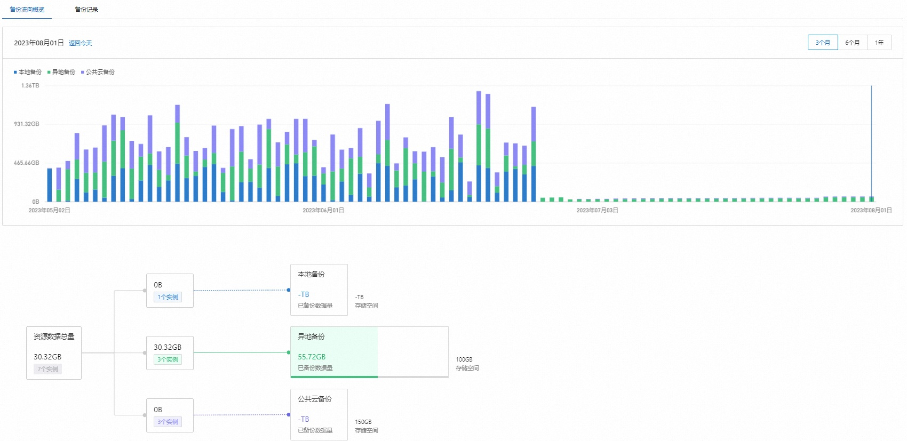

<a id="section-11-2"></a>

## 11.2. 备份记录

当前版本支持运营管理员对单个备份记录，进行查看详情、浏览备份记录内容；支持组织管理员对自己备份计划生成的备份记录进行查看详情、浏览和删除。

**背景信息**

- 运营管理员可以查看备份记录详情、浏览记录。

- 组织管理员可以查看备份记录详情、浏览记录、删除记录。

- RDS本地及异地记录、PolarDB-X本地记录及备份失败的记录只支持查看详情。

- PolarDB-X异地记录、OSS、NAS、ECS、MaxCompute产品支持浏览记录、删除记录。

- 针对存储类产品OSS、NAS、ECS备份记录会展示备份数据量/备份集大小。

**操作步骤**

1. 登录备份管理平台ASR-BR。

2. 在左侧导航栏，单击**备份记录**。

3. 在**备份记录**页面，选择**备份记录**页签。

   - 您可以通过对应的备份计划，查看该备份计划对应的备份记录，具体步骤如下：

     <ol type="a">

     <li>

     在左侧导航栏，单击**备份计划**。

     </li>

     <li>

     在**备份计划**页面，根据相应的查询条件查询对应的备份计划。

     </li>

     </ol>

     <ol type="i" start="100">

     <li>

     单击目标备份计划的计划名称链接。

     </li>

     <li value="500">

     单击**备份记录**页签。

     </li>

     </ol>

   - 您可以通过实例，查看实例所属的备份计划对应的备份记录，具体步骤如下：

     <ol type="a">

     <li>

     在左侧导航栏中单击**实例列表**。

     </li>

     <li>

     在**实例列表**页面，根据相应的查询条件查询对应的实例。

     </li>

     </ol>

     <ol type="i" start="100">

     <li>

     单击目标实例**操作**列的  图标，单击**详情**。

     </li>

     <li value="500">

     单击**备份记录**页签。

     </li>

     </ol>

4. 设置相应的查询条件，单击**查询**。

   您可以查看实例名称、实例的产品类型、备份集的大小、备份的状态、备份的开始时间、耗时、任务进度、备份记录的存储位置是本地还是异地、备份方式等相关信息。

   > **说明**
   >
   > 备份失败的记录无法查看备份文件的大小。

5. 在**操作**列，单击**详情**，可以查看备份记录的详细信息，包括备份的配置等。

   > **说明**
   >
   > 仅**记录状态**为**成功**及**部分成功**的备份记录支持浏览和删除操作。

   单击**浏览**，可以查看备份记录对应的备份集内存储的数据信息。

   单击**删除**，可以删除备份记录及对应的备份集数据。

   > **说明**
   >
   > - 浏览PolarDB-X异地备份记录，将会显示备份记录对应的备份集中库表的信息。
   >
   > - 浏览OSS、NAS、ECS文件备份记录，将会显示备份记录对应的备份集中起始文件到结束文件的列表；单击**列表**，将进一步展开备份集中全部的文件信息。
   >
   >   对于NAS、ECS文件的备份记录，当单目录大小超过900GB或文件数量超过300万时，不支持浏览操作。
   >
   > - 浏览ECS整机备份记录，将会显示记录中各个云盘的元数据信息。
   >
   > - 浏览MaxCompute备份记录，将会显示备份集中存储的表、资源、函数数据信息。

<a id="section-12"></a>

# 12.恢复任务

<a id="section-12-1"></a>

## 12.1. 新建常规恢复任务

常规恢复主要用于日常的普通恢复，例如数据还原、误删数据恢复等。

**前提条件**

- 只有组织备份管理员才可以新建常规恢复任务。

- 已创建备份计划且已完成实例的首次备份。

**操作步骤**

1. 登录备份管理平台ASR-BR。

2. 在左侧导航栏，单击**恢复任务**。

3. 单击**新建**。

4. 在**基本信息**配置向导页面设置相关参数，单击**下一步**。

   <table>
     <tr>
       <th width="121">配置</th>
       <th>描述</th>
     </tr>
     <tr>
       <td>恢复任务名称</td>
       <td>恢复任务的名称由中文、英文、数字、短划线（-）、下划线（_）或半角句号（.）组成，长度为4~20个字节。</td>
     </tr>
     <tr>
       <td>恢复任务描述</td>
       <td>可选。请输入对恢复任务的描述，以便于识别。</td>
     </tr>
     <tr>
       <td>实例类型</td>
       <td>请选择待恢复实例的类型。</td>
     </tr>
     <tr>
       <td>恢复任务类型</td>
       <td>在本场景中请选择<strong>常规恢复</strong>。</td>
     </tr>
     <tr>
       <td>恢复方式</td>
       <td>只有<strong>实例类型</strong>为<strong>云服务器 ECS</strong>时，才需要配置该参数。<br>• <strong>快照恢复</strong>：当ECS实例的备份方式为快照备份时，支持该恢复方式。<br>• <strong>文件恢复</strong>：当ECS实例的备份方式为文件备份时，支持该恢复方式。</td>
     </tr>
   </table>

5. 在**选择实例**配置向导页面，**备份实例**列表选择实例，单击**下一步**。

   > **说明**
   >
   > **备份实例**列表中只显示备份成功的实例。

6. 在**选择记录**配置向导页面选择**按备份记录**或**按时间节点**进行恢复，单击**下一步**。

   - 按备份记录恢复：单击**按备份记录**页签，在**操作**列中单击**选择**，选择目标备份记录。

   - 按时间节点恢复：单击**按时间节点**页签，在**操作**列中单击**选择**，设置实例正常运行的某个时间点，实例将恢复至该时间点时的状态。

     > **说明**
     >
     > - 只有RDS实例和PolarDB实例支持**按时间节点**恢复。
     >
     > - 对于PolarDB-X 1.0异地记录、OSS、NAS、ECS、MaxCompute备份记录，在选择记录时，单击**浏览**，可以查看备份记录中存储的数据内容。

7. 在**配置实例**配置向导页面，单击**操作**列中的**配置**，配置相关参数，单击**确定**，单击**下一步**。RDS、PolarDB-X 1.0恢复的参数说明如下表所示。

   **分类**

   **配置**

   **描述**

   默认为新建型恢复，不可修改。新建型恢复是指在主中

   **恢复方式**

   心重新创建一个实例。

   恢复的新实例在主中心所属的地域，不可修改。

   **地域名称**

   恢复的新实例在主中心所属的可用区。

   **可用区**

   **基本信息**

   恢复的新实例在主中心所属的组织。

   **组织名称**

   恢复的新实例在主中心所属的资源集。

   **资源集**

   自定义一个可识别的实例名称，ASR-BR会自动在主中心创建一个RDS恢复实例。由中文或英文开头，名称只

   **实例名称**

   能包含中文、英文、数字、短划线（-）、下划线（_），长度为2~64个字节。

   恢复的新实例的网络连接类型。

   **网络连接类型**

   默认为备份实例的网络类型，不可修改。

   恢复的新实例的网络类型。

   - **经典网络**：经典网络中的云服务在网络上不进行隔离，只能依靠云服务自身的安全组或白名单策略来阻挡非法访问。

   **网络类型**

   - **专有网络**：专有网络帮助您在阿里云上构建出一个隔离的网络环境。 选择**专有网络**时，请确保已创建专有网络和交换机。

   **网络类型**

   **网络类型**是**专有网络**时，才需要配置该参数。

   **专有网络**

   恢复的新实例所属的专有网络。

   **网络类型**是**专有网络**时，才需要配置该参数。

   **交换机可用区**

   恢复的新实例所属的交换机所在的区域。

   **网络类型**是**专有网络**时，才需要配置该参数。

   **交换机**

   恢复的新实例所属的交换机。

   默认为备份实例的规格参数，该参数不支持修改。

   **规格参数**

   请保持默认值：**mysql**。

   **数据库类型**

   **RDS规格参数**

   请选择RDS的实例规格。

   > **说明**

   **规格参数**

   > **说明**

   > 只有PolarDB-X 1.0实例需要配置该参

   > 新实例的RDS实例规格请和源实例保持一致。

   > 数。

   请设置RDS实例的存储空间，单位为GB。

   **存储空间**

   OSS、NAS的参数说明如下表所示。

   **分类**

   **配置**

   **描述**

   恢复方式包括新建型恢复和覆盖型恢复。

   - **新建型恢复**：在主中心重新创建一个实例。

   **恢复方式**

   - **覆盖型恢复**：恢复后覆盖原有的实例。

   恢复的新实例在主中心所属的地域，不可修改。

   **地域名称**

   恢复的新实例在主中心所属的组织。

   **组织名称**

   **基本信息**

   **资源集**

   恢复的新实例在主中心所属的资源集。

   - 如果是覆盖型恢复，请选择主中心需要被覆盖的实例。

   **Bucket名称**或**文件系统**

   - 如果是新建型恢复，请自定义一个可识别的实例名

   **名称**

   称，ASR-BR会自动在主中心创建一个恢复实例。实例名称由小写字母或数字开头和结尾，只能包含小写字母、数字、短划线（-），长度为3~35个字节。

   **实例类型**为**OSS**时，需要配置该参数。

   设置OSS的目录名称。OSS将自动创建该目录并将文件

   **恢复至Prefix**

   恢复至该目录。如果该参数为空，默认恢复至Bucket的根目录。

   **实例类型**为**NAS**时，需要配置该参数。

   **文件路径**

   待恢复文件所在的路径。

   **实例类型**为**OSS**时，需要配置该参数。文件规则包括如下：

   - **包含所有**：恢复**文件路径**中所有文件。

   **文件规则**

   - **包含以下**：只恢复**文件列表**中的文件。

   - **排除以下**：恢复**文件列表**以外的其他文件。

   请填写文件夹名称或文件名称，每行填写一个路径。

   **文件列表**

   当**文件规则**为**包含以下**或**排除以下**时，才需要填写该参数。

   **恢复规则**

   **实例类型**为OSS时，如果需要恢复指定时间范围的OSS Object，可以配置**恢复开始时间**和**恢复结束时间**。

   > **说明**
   >
   > 恢复时将会根据该时间范围进行文件恢复。
   >
   > - 如果只填写**恢复开始时间**，那么将恢复该备份集中**恢复开始时间**到**当前时间**范围的全部文件。

   **恢复文件时间范围**

   > - 如果还填写了恢复结束时间，那么将恢复该备份集中**恢复开始时间**到**恢复结束时间**的全部文件。
   >
   > - 如果都不填写，则恢复该备份集全部文件。

   **实例类型**为OSS时，您可以根据实际的带宽情况，配置

   **恢复并发数配置**

   恢复任务的读写并发数。

   默认为备份实例的规格参数，该参数不可修改。

   **规格参数**

   ECS文件恢复的参数说明如下表所示。

   **分类**

   **配置**

   **描述**

   恢复方式选择**覆盖型恢复**，恢复后覆盖原有的实例。

   **恢复方式**

   恢复的新实例在主中心所属的地域，不可修改。

   **地域名称**

   恢复的新实例在主中心所属的可用区。

   **可用区**

   **恢复目的端**

   恢复的新实例在主中心所属的组织。

   **组织名称**

   恢复的新实例在主中心所属的资源集。

   **资源集**

   请选择主中心需要被覆盖的实例。

   **目标实例**

   单击**选择**，选择文件恢复至的文件夹。

   **目标路径**

   显示HBR客户端的安装状态。

   **客户端安装状态**

   如果状态为**未安装**，单击**安装**，系统自动安装客户端。

   选择客户端在ECS实例内的安装路径。

   > **说明**

   **客户端安装路径**

   > - 不选安装路径时，默认安装至 `/root` 下。
   >
   > - 当**客户端安装状态**为**已安装**时，显示客户端的安装路径。

   **客户端安装**

   显示已安装的客户端版本号。

   **客户端版本号**

   当**客户端安装状态**为**未安装**时，显示为<strong>-</strong>。

   显示已安装的客户端的心跳保活时间。

   **心跳保活时间**

   当**客户端安装状态**为**未安装**时，显示为<strong>-</strong>。

   文件规则包括如下：

   - **包含所有**：恢复**文件路径**中所有文件。

   **文件规则**

   - **包含以下**：只恢复**文件列表**中的文件。

   - **排除以下**：恢复**文件列表**以外的其他文件。

   **恢复文件规则**

   单击**浏览**选择文件夹名称或文件名称。

   **文件列表**

   当**文件规则**为**包含以下**或**排除以下**时，才需要填写该参数。

   ECS快照恢复的参数说明如下表所示。

   | 分类 | 配置 | 操作描述 |
   | --- | --- | --- |

   根据对应的备份计划选择恢复规则：

   - **按整机恢复**

   **恢复规则**

   **恢复规则**

   - **按指定云盘恢复**

   <ol type="i">

   <li>

   单击**操作**列**编辑**。

   </li>

   <li>

   下拉选择云盘种类后单击**确定**。

   </li>

   </ol>

   默认为新建型恢复，不可修改。新建型恢复是指在主中

   **恢复方式**

   心重新创建一个实例。

   恢复的新实例在主中心所属的地域，不可修改。

   **地域名称**

   恢复的新实例在主中心所属的可用区。

   **可用区**

   恢复的新实例在主中心所属的组织。

   **组织名称**

   恢复的新实例在主中心所属的资源集。

   **资源集**

   **基本信息**

   **恢复规则**为**按整机恢复**时，需要配置该参数。

   自定义一个可识别的实例名称，ASR-BR会自动在主中

   **实例名称**

   心创建一个恢复实例。由中文或英文开头，名称只能包含中文、英文、数字、短划线（-）、下划线（_）或半角冒号（:），长度为2~64个字节。

   **恢复规则**为**按整机恢复**时，需要配置该参数。

   **主机名**

   恢复的新实例的主机名称，请设置一个方便识别的主机名称。

   **恢复规则**为**按指定云盘恢复**时，需要配置该参数。

   **挂载实例**

   选择云盘挂载的实例。

   恢复的新实例所属网络的类型，目前仅支持**专有网络。**

   **网络类型**

   **专有网络**

   恢复的新实例所属的专有网络。

   **网络类型**

   恢复的新实例所属的交换机。

   **交换机**

   > **说明**
   >
   > **恢复规则**为**按整机恢复**时，才需要配置该

   恢复的新实例所属的安全组。

   **安全组**

   > 参数。

   请输入私网IP，指定的IP地址必须在所选择的虚拟交换

   **私有IP**

   机网段内。

   <table>
     <tr>
       <td rowspan="4">规格参数</td>
       <td>实例系列</td>
       <td>下拉选择恢复的新实例。</td>
     </tr>
     <tr>
       <td>实例规格</td>
       <td>勾选恢复的新实例的实例规格。</td>
     </tr>
     <tr>
       <td>镜像类型</td>
       <td>请选择恢复任务时使用的镜像：<br>• 公共镜像<br>• 自定义镜像<br>• 共享自定义镜像</td>
     </tr>
     <tr>
       <td><strong>公共镜像</strong>/<strong>自定义镜像</strong>/<strong>共</strong>享的自定义镜像</td>
       <td>请根据<strong>镜像类型</strong>选择具体的镜像。<br>说明<br>• 当前页存在该镜像时，支持模糊搜索。<br>• 当前页不存在该镜像时，需要输入全部镜像名称，按回车键进行搜索。</td>
     </tr>
   </table>

   MaxCompute恢复的参数说明如下表所示。

   <table>
     <tr>
       <th>分类</th>
       <th>名称</th>
       <th>描述</th>
     </tr>
     <tr>
       <td rowspan="6">基本信息</td>
       <td>恢复方式</td>
       <td>MaxCompute支持覆盖型恢复。<strong>覆盖型恢复</strong>：如果是非分区表，则删除对应的表进行重建。如果是分区表，则删除对应的分区进行重建。</td>
     </tr>
     <tr>
       <td>地域名称</td>
       <td>恢复的新实例在主中心所属的地域，不可修改。</td>
     </tr>
     <tr>
       <td>组织名称</td>
       <td>恢复的新实例在主中心所属的组织。</td>
     </tr>
     <tr>
       <td>资源集</td>
       <td>恢复的新实例在主中心所属的资源集。</td>
     </tr>
     <tr>
       <td>实例名称</td>
       <td>自定义一个可识别的实例名称，ASR-BR会自动在主中心创建一个恢复实例。由中文或英文开头，名称只能包含英文、数字、下划线（_），长度为2~64个字节。</td>
     </tr>
     <tr>
       <td>集群</td>
       <td>选择待恢复的MaxCompute集群。</td>
     </tr>
     <tr>
       <td>基础配置</td>
       <td>恢复内容</td>
       <td>• 表恢复：支持选择单个或多个表。<br>• 项目恢复：默认会恢复备份记录中的TABLE、RESOURCE、FUNCTION类型的所有数据。</td>
     </tr>
   </table>

8. 根据需要选择是否立即启动恢复任务，确认恢复任务的信息无误后，单击**确认提交**。

   - 勾选**立即启动**：恢复任务创建完毕后，立即启动恢复任务。

   - 去勾选**立即启动**：恢复任务创建完毕后，需要手工启动恢复任务，具体参见启动恢复任务。

<a id="section-12-2"></a>

## 12.2. 启动恢复任务

创建恢复任务时如果未选择**立即启动**，您需要手工启动恢复任务。

**前提条件**

只有**任务状态**为**未启动**的恢复任务才能执行启动操作。

**操作步骤**

1. 登录备份管理控制台。

2. 在左侧导航栏中选择**恢复任务**。

3. 在**恢复任务**页面顶部的**任务状态**搜索框中选择**未启动**，单击**查询**。

4. 在恢复任务列表中选择目标任务，单击**操作**列中的  图标，选择**启动**。

<a id="section-12-3"></a>

## 12.3. 停止恢复任务

您可以停止任务状态是**恢复中**的任务。

**前提条件**

恢复任务的状态是**恢复中**。

**操作影响**

恢复中的任务手工停止后会导致恢复失败，无其他影响。

**操作步骤**

1. 登录备份管理控制台。

2. 在左侧导航栏中选择**恢复任务**。

3. 在**恢复任务**页面顶部的**任务状态**搜索框中选择**恢复中**，单击**查询**。

4. 在恢复任务列表中选择目标任务，单击**操作**列中的  图标，选择**停止**。

<a id="section-12-4"></a>

## 12.4. 查看恢复任务

您可以查看所有恢复任务的状态、恢复任务的详情、以及恢复实例的详情。

**操作步骤**

1. 登录备份管理控制台。

2. 在左侧导航栏中单击**恢复任务**。

3. 根据任务名称、恢复类型、实例类型或任务状态，查询相关的恢复任务。在恢复任务列表中查看恢复任务的恢复类型、实例类型、创建时间以及任务的状态。

4. 单击恢复任务的名称链接，可以查看恢复任务的详情，包括恢复任务的基本信息、恢复实例的信息及恢复结果。

5. 单击恢复实例**操作**列中的  图标，单击**详情**，可以查看恢复实例的详情。

<a id="section-12-5"></a>

## 12.5. 查看恢复事件

您可以在恢复任务详情中查看恢复实例的事件信息。

1. 登录备份管理控制台。

2. 在左侧导航栏中单击**恢复任务**。

3. 根据任务名称、恢复类型、实例类型、任务状态，查询相关的恢复任务。

4. 单击恢复任务的名称链接。

5. 单击**恢复事件**页签，根据开始时间、结束时间或事件状态查询相应的日志。

6. 在**操作**列中单击**日志**，查看具体的日志信息。

7. 单击对应事件左侧的  图标，您可以查看各个实例事件的子事件及其状态。单击子事件右侧的  图标

   可查看子事件日志信息。

   - **成功**

   - **已取消**

     子事件被执行取消操作后，会显示此状态。

   - **失败**、**超时**、**已停止**

     子事件状态为以上三种时，可单击子事件右侧的  图标进行事件重试操作。

     > **重要**
     >
     > 该操作属于事件运维操作，正常不需要操作，如有最新的同一事件执行成功了，对于旧的事件请不要执行重试操作。

   - **等待开始**、**运行中**、**同步中**

     子事件状态为以上三种时，可单击子事件右侧的  图标进行事件取消操作。执行取消操作后，子事件

     状态会变为**已取消**。

     > **重要**
     >
     > 该操作属于事件运维操作，正常不需要操作。该操作不可逆，请谨慎操作。

<a id="section-13"></a>

# 13.VMware备份恢复

<a id="section-13-1"></a>

## 13.1. 安装备份网关虚拟机

本章节介绍通过OVA文件部署的方式，在EXSI中安装备份网关。

**前提条件**

已下载安装备份网关的OVA文件asrbr-vmware-appliance.ova。

**背景信息**

- 备份管理平台ASR-BR目前仅支持vCenter Server 5.5、6.0、6.5和6.7版本。

- 备份网关是安装在vCenter中的一台虚拟机，通过RabbitMQ和hbr-console组件通信，并直接调用vCenter API执行生成快照、备份、恢复等操作。在执行虚拟机备份、本地恢复、云上恢复和云迁移等场景中，都需要使用备份网关。

**操作步骤**

1. 在浏览器中输入EXSI的IP地址，输入登录的用户名和密码，单击**登录**。

2. 在左侧导航栏中单击**虚拟机**，单击**创建/注册虚拟机**。

3. 在**新建虚拟机**对话框中，创建类型选择**从OVF或OVA文件部署虚拟机**，单击**下一页**。

   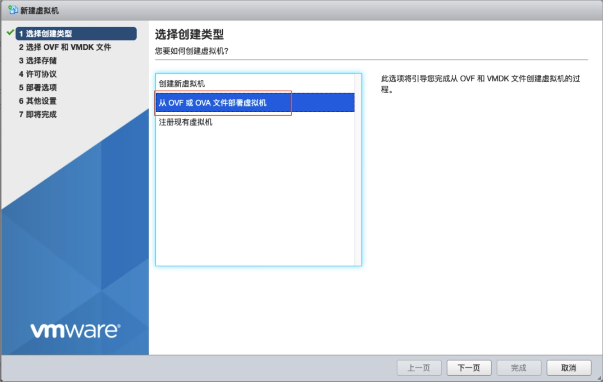

4. 为该虚拟机输入名称，选择OVA文件**asrbr-vmware-appliance.ova**，单击**下一页**。

   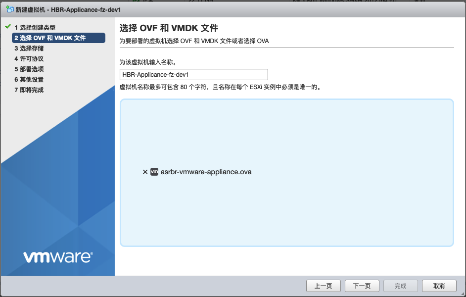

5. 选择存储类型和存储数据，单击**下一页**。

   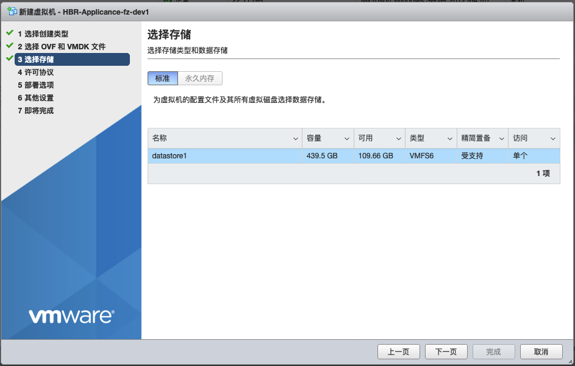

6. **部署选项**配置向导页面保持默认配置，单击**下一页**。

   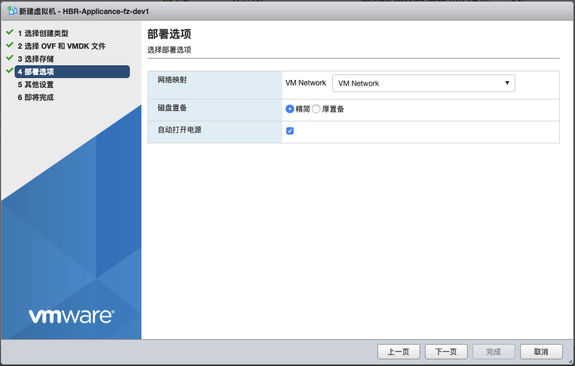

7. 在**其他设置**配置向导页面配置相关参数，单击**下一页**。

   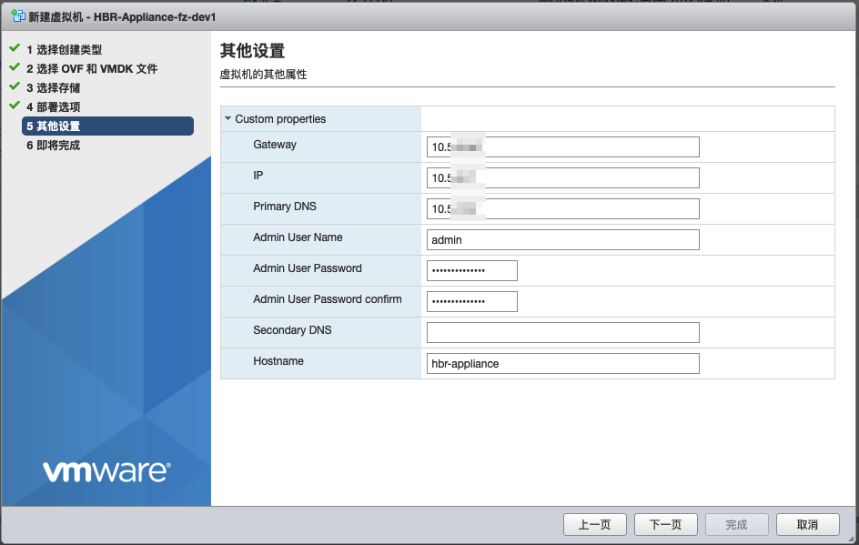

8. 在**即将完成**配置向导页面单击**完成**。

9. 在**近期任务**中查看任务状态，当状态为**成功完成**，表示虚拟机部署完成。

   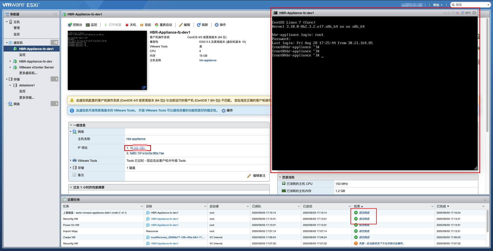

0. 部署完成后，启动部署的虚拟机。

<a id="section-13-2"></a>

## 13.2. 注册备份网关

您需要在ASR-BR上获取备份网关相应的激活码信息，然后再注册备份网关。

**获取激活码**

1. 组织管理员登录备份管理平台ASR-BR。

2. 在左侧导航栏中选择**系统管理** > **vCenter管理**。

3. 单击**激活码**，查看激活码信息。

   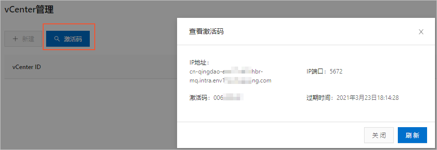

**注册备份网关**

1. 在浏览器中输入备份网关虚拟机的访问地址，格式为 `IP`地址`:8011` 。

2. 在注册对话框中输入相关参数，参数说明如下表所示。

   | 名称 | 描述 |
   | --- | --- |
   | 主机地址 | 激活码页面对应的<strong>IP地址</strong>。 |

   | 主机端口 | 激活码页面对应的<strong>IP端口</strong>。 |
   | --- | --- |
   | 激活码 | 激活码页面对应的<strong>激活码</strong>。 |

   > **说明**
   >
   > 如果vCenter环境与专有云环境未互配DNS，主机地址需要填写IP地址。

3. 单击**注册**。

<a id="section-13-3"></a>

## 13.3. 新建vCenter

vCenter是VMware的管理平台，用来操作和管理虚拟机。

**前提条件**

只有备份的实例类型包含VMware时，才需要配置该功能。

**操作步骤**

1. 组织管理员登录备份管理控制台。

2. 在左侧导航栏中选择**系统管理** > **vCenter管理**。

3. 单击**新建**。

4. 在**新建vCenter**对话框中设置相关参数，参数说明如下表所示。

   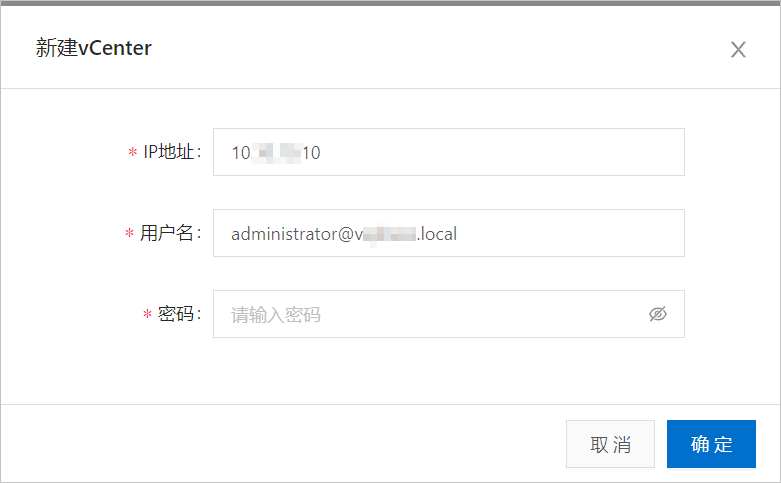

   <table>
     <tr>
       <th width="76">名称</th>
       <th>描述</th>
     </tr>
     <tr>
       <td>IP地址</td>
       <td>vCenter的IP地址。</td>
     </tr>
     <tr>
       <td>用户名</td>
       <td>登录vCenter的用户名，格式为<code> Single Sign-On</code>用户名<code>@Single </code> <code>Sign-On</code>域名<code> </code>。</td>
     </tr>
     <tr>
       <td>密码</td>
       <td>登录vCenter的密码，即SSO配置页面中设置的Single Sign-On密码。</td>
     </tr>
   </table>

   

5. 单击**确定**。

<a id="section-13-4"></a>

## 13.4. 新建虚拟机备份计划

新建备份计划，将VMware虚拟机中的磁盘数据备份到备份仓库中。

1. 组织管理员登录备份管理平台ASR-BR。

2. 在左侧导航栏中，单击**备份计划**。

3. 在备份计划页面，单击**新建**。

4. 在**基本信息**配置向导页面，填写备份计划的基本信息，单击**下一步**。

   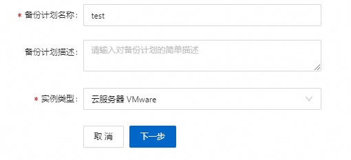

5. 在**选择实例**配置向导页面，选择对应的vCenter ID， 选择待备份的虚拟机，单击  图标。单击**下一步**。

   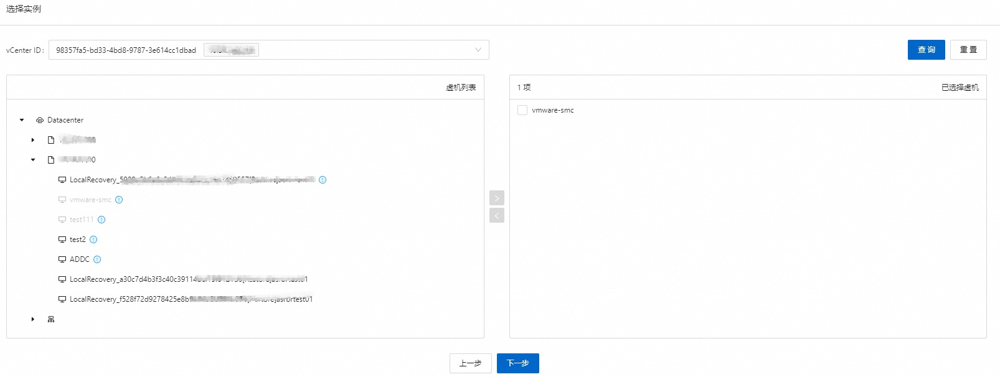

6. 在**配置实例**配置向导页面，参考下表配置实例参数，单击**下一步**。

   <table>
     <tr>
       <th width="89">参数名称</th>
       <th>描述</th>
     </tr>
     <tr>
       <td>备份网关</td>
       <td>下拉选择备份的网关Client：<br>• <strong>默认策略</strong>：系统会根据每个客户指的负载情况选择HBR的一个备份网关来执行备份计划。<br>• 其他备份网关：也可以选择其他已经注册的备份网关。</td>
     </tr>
     <tr>
       <td>传输方式</td>
       <td>• <strong>Lan-Free传输备份数据</strong>（默认）：备份时将硬盘热挂载到备份网关上已通过数据网络（Lan-Free）传输备份数据。<br>• <strong>LAN传输备份数据</strong>：备份时使用LAN网络备份数据。<br>说明如果vCenter不支持Lan-Free网络时，在数据备份时会自动切换为LAN传输方式进行备份数据。</td>
     </tr>
     <tr>
       <td>快照方式</td>
       <td>• <strong>标准快照</strong>：使用VMware软件快照进行普通备份。<br>• <strong>系统静默快照</strong>（默认）：使用VMware Tools工具进行静默备份。<br>说明如果无法挂载或者没有安装VMwar Tools工具，在备份时会自动切换为标准快照的方式进行备份。</td>
     </tr>
   </table>

7. 在**备份策略**配置向导页面，参考下表设置备份策略。单击**下一步**。

   > **说明**
   >
   > 如果全量备份和增量备份的备份任务执行时间存在重合时，会优先执行全量备份任务。

   **备份策略**

   **参数名称**

   **配置**

   指间隔几天备份一次，请输入整

   **时间间隔**

   数。

   选择执行备份任务的时间。

   **备份时间**

   请选择已创建的异地备份仓库。如果没有您所需的备份仓库，请单

   **备份仓库**

   击**创建备份仓库**链接进行创建。

   **全量**

   备份数据在本地备份仓库保留的最长天数。例如设置的最长天数是

   **保存天数**

   7，则系统只保存近7天的备份数据，过期的备份数据会被删除。

   <table>
     <tr>
       <td rowspan="3">永久增量</td>
       <td>周期类型</td>
       <td>您可以根据需要设置每隔多少天或每隔多少小时对数据进行增量备份。<br>• <strong>按天执行</strong>：备份的时间间隔为天。<br>• <strong>按小时执行</strong>：备份的时间间隔为小时。</td>
     </tr>
     <tr>
       <td>时间间隔</td>
       <td>输入整数，单位：天/小时。</td>
     </tr>
     <tr>
       <td>备份时间</td>
       <td>选择执行增量备份任务的时间。</td>
     </tr>
   </table>

   > **说明**
   >
   > 如果需要增量备份，请确保虚拟机已启用数据块修改跟踪技术（CBT），启用方法请参见在虚拟机上启用或禁用更改块跟踪 (Changed Block Tracking, CBT) (1020128)。

8. 确认备份信息无误后，根据需要选择是否立即启动，单击**确认提交**。

   - 选中**立即启动**复选框：备份计划创建完毕后，立即对备份计划中的实例进行备份。

   - 取消选中**立即启动**复选框：备份计划创建完毕后，暂时不启动备份，您需要手工启动备份计划，具体参见启动备份计划。

<a id="section-13-5"></a>

## 13.5. 恢复VMware虚拟机

当VMware虚拟机出现故障时，您可以通过之前的备份记录，将VMware的虚拟机恢复至云上ECS或本地vCenter环境。

1. 组织管理员登录备份管理平台ASR-BR。

2. 在左侧导航栏中选择**恢复任务**。

3. 在备份计划页面，单击**新建**。

4. 在**基本信息**配置向导页面配置相关参数，单击**下一步**。

   <table>
     <tr>
       <th width="121">名称</th>
       <th>描述</th>
     </tr>
     <tr>
       <td>恢复任务名称</td>
       <td>自定义的恢复任务名称。恢复任务的名称由中文、英文、数字、短划线（-）、下划线（_）或英文半角句号（.）组成，长度为4~20个字符，或2~10个中文汉字。</td>
     </tr>
     <tr>
       <td>恢复任务描述</td>
       <td>请输入对恢复任务的简单描述，便于识别。</td>
     </tr>
     <tr>
       <td>实例类型</td>
       <td>选择恢复任务的实例类型，本场景中请选择<strong>云服务器 VMware</strong>。</td>
     </tr>
     <tr>
       <td>恢复任务类型</td>
       <td>VMware的恢复类型包括本地恢复和云上恢复。<br>• <strong>本地恢复</strong>：将VMware虚拟机恢复到本地的vCenter环境。<br>• <strong>云上恢复</strong>：将VMware虚拟机恢复至专有云ECS实例。</td>
     </tr>
   </table>

   

5. 在**选择实例**配置向导页面，**备份实例**列表选择实例，单击

   图标，单击**下一步**。

   > **说明**
   >
   > **备份实例**列表中只显示备份成功的实例。

6. 在**选择记录**配置向导页面，单击**按备份记录**页签，在**操作**列中单击**选择**，选择目标备份记录。单击**下一步**。

7. 在**配置实例**配置向导页面，单击**操作**列中的**配置**，配置相关参数，单击**确定**，单击**下一步**。

   **恢复任务类型**为**云上恢复**时，相关参数说明如下表所示。

   **分类**

   **名称**

   **描述**

   选择恢复的新实例在主中心所属的地域，不可修改。

   **地域名称**

   选择恢复的新实例在主中心所属的组织。

   **组织名称**

   选择恢复的新实例在主中心所属的资源集。

   **资源集**

   恢复的新实例在主中心所属的可用区。

   **可用区**

   **基本信息**

   请自定义一个可识别的主机名称。

   **主机名**

   请自定义一个可识别的实例名称，ASR-BR会自动在主中心创建一个ECS实例。由中文或英文开头，名称只能包含中文、英文、数字、短划线（-）、下划线（_）、

   **实例名称**

   英文半角句号（.）或英文半角冒号（:），长度为2~128个字符，或1~64个中文汉字。

   恢复的新实例的网络类型。

   - **经典网络**：经典网络中的云服务在网络上不进行隔离，只能依靠云服务自身的安全组或白名单策略来阻挡非法访问。

   **经典网络**/**专有网络**

   - **专有网络**：专有网络帮助您在阿里云上构建出一个隔离的网络环境。 选择**专有网络**时，请确保已创建专有网络和交换机。

   **网络类型**

   选择恢复的新实例在主中心所属的交换机。

   **交换机**

   选择恢复的新实例所属的安全组。

   **安全组**

   请输入私网IP，指定的IP地址必须在所选择的虚拟交换

   **私有IP**

   机网段内。

   下拉选择系统已有的实例系列。

   **实例系列**

   选择恢复的新实例的实例规格。

   **实例规格**

   请根据实际需求，选择恢复的新实例的云盘类型：

   - **高效云盘**：高效云盘适用于需要稳定、持久性存储同时性能要求一般的场景。

   - **SSD云盘**：SSD云硬盘适用于对 I/O 性能有较高要求的场景。

   **云盘类型**

   **规格参数**

   - **高性能云盘**：高性能云硬盘适用于高数据可靠性要求、普通中度性能要求的中小型应用和 MySQL、SQL Server等中小型关系数据库应用的场景。

   - **普通性能云盘**：普通云硬盘适用于数据不经常访问的低 I/O 负载的业务场景。

   根据需要选择恢复后是否启动系统。

   **恢复后启动系统**

   根据需要选择是否创建系统镜像。若选择创建系统镜像，主中心ECS会根据新实例中的所有磁盘（包括系统

   **创建系统镜像**

   盘和数据盘）的数据创建一个镜像。

   **恢复任务类型**为**本地恢复**时，相关参数说明如下表所示。

   | 名称 | 描述 |
   | --- | --- |
   | vCenter地址 | 选择虚拟机恢复的目标vCenter地址。 |
   | 恢复地址 | 选择虚拟机恢复的目标地址。 |
   | 计算节点 | 选择虚拟机恢复后所使用的计算节点。 |
   | 存储位置 | 选择虚拟机恢复后的存储位置。 |
   | 网络位置 | 选择虚拟机恢复后的网络位置。 |

8. 确认基本信息和恢复实例的配置都正确，单击**确认提交**，根据需要选择是否立即启动。

   - 选中**立即启动**：恢复任务创建完毕后，立即启动恢复任务。

   - 取消选中**立即启动**：恢复任务创建完毕后，需要手工启动恢复任务，具体参见启动恢复任务。

<a id="section-14"></a>

# 14.系统管理

<a id="section-14-1"></a>

## 14.1. 管理存储池组

您可以创建、编辑、删除存储池组和存储池。

**创建存储池组、存储池**

创建存储池组和存储池操作请参见创建存储池。

> **说明**
>
> 对于企业版V3.18.1之前创建的存储池，将按照存储池的endpoint自动合并为新的存储池组，存储池组名称以“AUTO_MERGE_STORAGE_POOL_GROUP_id”开头。

**编辑存储池**

1. 运营管理员登录备份管理平台ASR-BR。

2. 在左侧导航栏中选择**系统管理** > **存储池组管理**。

3. 在存储池组列表中，单击存储池组名称，进入存储池列表。

4. 在存储池列表中，在相应存储池的**操作**列中单击  图标 ，选择**编辑**。

5. 在**编辑存储池**弹窗中，可编辑**AccessKey ID**、**AccessKey Secret**、**存储池名称**、**存储空间**、**授权组织**、**存储池描述**，编辑完成后单击**确定**。

**删除存储池**

> **说明**
>
> 只有未关联备份仓库的存储池，才可以被删除。因此删除存储池前需要先删除对应的备份计划，再删除对应的备份仓库，最后删除存储池。

1. 运营管理员登录备份管理平台ASR-BR。

2. 在左侧导航栏中选择**系统管理** > **存储池组管理**。

3. 在存储池组列表中，单击存储池组名称，进入存储池列表。

4. 在存储池列表中，在相应存储池的**操作**列中单击  图标 ，选择**删除**。

5. 在弹出的对话框中单击**确认**。

**编辑存储池组**

1. 运营管理员登录备份管理平台ASR-BR。

2. 在左侧导航栏中选择**系统管理** > **存储池组管理**。

3. 在存储池组列表中，单击目标存储池组**操作**列的  图标 ，选择**编辑**。

4. 在**编辑存储池组**弹窗中，可编辑**存储池组名称**、**存储空间**，编辑完成后单击**确定**。

**删除存储池组**

> **说明**
>
> 只有不包含存储池的存储池组才能被删除。

1. 运营管理员登录备份管理平台ASR-BR。

2. 在左侧导航栏中选择**系统管理** > **存储池组管理**。

3. 在存储池组列表中，单击目标存储池组**操作**列的  图标，选择**删除**。

4. 在弹出的对话框中单击**确认**。

<a id="section-14-2"></a>

## 14.2. 自备份管理

<a id="section-14-2-1"></a>

### 14.2.1. 设置元数据的备份策略

您可以设置自备份策略，定期将备份系统的元数据备份至灾备存储池中。以便在备份系统数据丢失或者损毁时，及时进行恢复。

1. 运营管理员登录备份管理平台ASR-BR。

2. 在左侧导航栏中选择**系统管理** > **自备份管理**。

3. 在**备份策略**页面，单击**创建**，设置相关参数，参数说明如下表所示。

   <table>
     <tr>
       <th width="89">配置</th>
       <th>描述</th>
     </tr>
     <tr>
       <td>周期</td>
       <td>设置备份的间隔周期。您可以在文本框右侧的下拉列表中设置周期的单位，包括时、天。<br>说明周期的最小值为10分钟。</td>
     </tr>
     <tr>
       <td>保存时长</td>
       <td>请设置备份的元数据在存储池中的保留时长。建议设置为7天。<br>重要超过保存时长的数据将被删除。</td>
     </tr>
     <tr>
       <td>存储池</td>
       <td>请选择相应的存储池。如果没有对应的存储池，请单击右侧的<strong>创建存储池</strong>，具体步骤请参见创建存储池。</td>
     </tr>
     <tr>
       <td>bucket</td>
       <td>请填写存储池中用于存储备份的元数据的bucket名称。<br>重要请记住该bucket名称，当云重建恢复时，您需要输入该bucket名称。</td>
     </tr>
   </table>

4. 单击**创建**。

<a id="section-14-2-2"></a>

### 14.2.2. 查看元数据备份记录

您可以查看备份的元数据记录的详细信息，包括开始时间、结束时间、过期时间、备份状态、备份集大小、文件名称。

1. 运营管理员登录备份管理控制台。

2. 在左侧导航栏中选择**系统管理** > **自备份管理**。

3. 单击**备份记录**页签，您可以查看备份的元数据记录的详细信息，包括开始时间、结束时间、过期时间、备份状态、备份集大小、文件名称。

4. （可选）如果需要删除某条元数据备份记录和对应的备份数据集，请在**操作**列中，单击**删除**。在确认对话框中单击**确定**。

   > **说明**
   >
   > 只有运营管理员才能执行删除操作。

<a id="section-14-3"></a>

## 14.3. 灾难恢复

存在主、备两套云系统，当生产云故障或因为灾难导致生产云损毁，生产云ASR-BR无法使用时，您可以在另外一套云系统或灾备云重新部署ASR-BR，通过灾难恢复功能将ASR-BR备份到灾备云的数据在另外一套云系统恢复。使用灾难恢复功能不影响当前云备份和恢复功能。

**使用场景**

只有遇到以下两种场景时，才支持使用此功能。

- 需要把备份到异地存储池的数据跨云恢复到备用阿里云专有云。

- 生产云发生故障或灾难，需要进行数据恢复。

**前提条件**

在进行灾难恢复之前，需要配置**自备份管理**策略，将ASR-BR的元数据备份到异地的存储池，同时记录下存储池的OSS地址、使用的AK、SK以及存储ASR-BR元数据的Bucket。保证在灾难恢复时，通过这些信息，可以查找到可供ASR-BR自身恢复的元数据集。

**操作步骤**

1. 新建灾难恢复任务。

   <ol type="i">

   <li>

   运营管理员登录备份管理平台ASR-BR。

   </li>

   <li>

   在左侧导航栏，选择**系统管理** > **灾难恢复**。

   </li>

   <li>

   在**灾难恢复**页面，单击**创建**。

   </li>

   <li>

   在**恢复元数据**对话框中，从**存储池**下拉列表选择存储池，在**bucket**输入框填写存储了ASR-BR元数据的Bucket，单击**检索**。在检索结果中选择需要恢复的元数据备份记录，单击**启动**。

   启动成功后，在**灾难恢复**列表形成一条状态为**队列中**的记录。

   </li>

   <li>

   等待元数据自动恢复，此时**状态**从**队列中**流转为**运行中**。

   </li>

   <li>

   元数据自动恢复完成后，**操作步骤**将会从**ASR-BR元数据恢复**流转成**组织订正**，同时状态变成**运行中**。

   </li>

   </ol>

2. 组织订正。

   <ol type="i">

   <li>

   当**操作步骤**为<strong>组织订正，</strong>单击**操作**列  图标，单击**组织订正**。

   </li>

   <li>

   在**组织订正**对话框中，在**新组织名称**列表下拉列表选择订正后的组织。

   默认匹配名称相同的组织。

   > **说明**
   >
   > 旧组织和新组织只能一对一订正。

   </li>

   <li>

   单击**确定**。

   **操作步骤**将会从**组织订正**流转为**元数据订正**，状态将流转为**队列中**。

   </li>

   <li>

   等待**元数据订正**任务执行，状态跳转成**运行中**。元数据订正完成后，**操作步骤**将从**元数据订正**流转为**用户数据灾难恢复**。

   </li>

   <li>

   之后各个组织的组织管理员进行各个组织数据灾难恢复。

   </li>

   </ol>

3. 各个组织数据灾难恢复。

   <ol type="i">

   <li>

   组织管理员登录备份管理平台ASR-BR。

   </li>

   <li>

   在左侧导航栏，单击**恢复任务**。

   </li>

   <li>

   在**恢复任务**页面，单击**新建**。

   </li>

   <li>

   在**基本信息**配置向导页面设置恢复任务的名称，选择待恢复的实例类型，恢复任务类型选择**灾难恢复**，单击**下一步**。

   </li>

   <li>

   在**选择实例**配置向导页面，**备份实例**列表选择实例，单击  图标，单击**下一步**。

   > **说明**
   >
   > **备份实例**列表中只显示备份成功的实例。

   </li>

   <li>

   在**选择记录**配置向导页面选择**按备份记录**进行恢复，单击**下一步**。

   按备份记录恢复：单击按备份记录页签，在操作列中单击选择，选择目标备份记录。

   > **说明**
   >
   > 灾难恢复场景下，选择存储位置为本地的备份记录可能会恢复失败。

   </li>

   <li>

   在**配置实例**配置向导页面，单击**操作**列中的**配置**，配置相关参数，参数说明请参见新建常规恢复任务。单击**确定**，单击**下一步**。

   </li>

   <li>

   根据需要选择是否立即启动恢复任务，确认恢复任务的信息无误后，单击**确认提交**。

   - 选择**立即启动**：恢复任务创建完毕后，立即启动恢复任务。

   - 取消选择**立即启动**：恢复任务创建完毕后，需要手工启动恢复任务，具体参见启动恢复任务。

   </li>

   </ol>

4. 完成灾难恢复任务。

   <ol type="i">

   <li>

   各组织实例恢复完成后，运营管理员登录备份管理平台ASR-BR。

   </li>

   <li>

   在左侧导航栏，选择**系统管理** > **灾难恢复**。

   </li>

   <li>

   单击目标**操作**列  图标，单击**结束任务**。

   操作步骤将流转为**数据清理中**，状态将流转为**队列中**，等待清理任务执行。

   </li>

   <li>

   数据清理任务执行时，状态将流转成**运行中**。数据清理完成后，整个灾难恢复流程结束，**操作步骤**将流转为**灾难恢复结束**，状态流转为**完成**。

   </li>

   </ol>

<a id="section-14-4"></a>

## 14.4. 授权管理

<a id="section-14-4-1"></a>

### 14.4.1. 查看License授权项

如果使用ASR-BR过程中提示License不足，或无法备份某些实例类型，请在授权统计页面检查您是否已购买相应的License授权。

1. 登录备份管理平台ASR-BR。

2. 在左侧导航栏中选择**系统管理** > **授权管理**。

3. 在**授权统计**页面，查看您当前购买的授权类型、授权总量、授权使用量和授权剩余量等相关信息。授权相关说明如下表所示。

   | 授权规格名称 | 授权项描述 | 授权使用量计算方式 |
   | --- | --- | --- |
   | 存储授权（通用型） | 授权存储类产品的备份数据的容量。 | 备份计划状态为运行中和备份中的OSS、ECS文件、ECS整机、NAS、VMware、MaxCompute的备份数据容量总和。<br>说明<br>• 如果单独购买了大数据或ECS整机的授权，则优先使用大数据和ECS整机中的配额。<br>• 如果没有购买大数据或ECS整机的授权，您也可以使用该授权规格，创建MaxCompute和ECS整机的备份计划。 |
   | 存储类（ECS整机） | 授权ECS整机备份和云盘备份的备份数据容量。 | 备份计划状态为运行中和备份中，备份方式为<strong>云盘备份</strong>的ECS备份数据容量总和。 |
   | 大数据 | 授权MaxCompute的备份数据容量。 | 备份计划状态为运行中和备份中的MaxCompute备份数据容量总和。 |
   | 数据库授权 | 授权RDS和PolarDB-X的备份集的存储容量。 | 备份计划状态为运行中和备份中的RDS和PolarDB-X的备份集的存储容量总和。 |
   | 统一备份管控平台 | 授权是否允许异地备份，如果License中没有购买该授权项，您只能执行本地备份。 | 不对备份容量进行控制。 |

4. 如果您申请了新的License，请单击**同步License**，将最新的License授权项同步到ASR-BR。

<a id="section-14-4-2"></a>

### 14.4.2. 给各组织分配授权

运营管理员可以给各个组织设置配额。合理的分配和管理各组织的授权使用量，避免某些组织使用太多资源，影响其他组织正常使用资源。默认不限制配额。

**背景信息**

- 当组织配额的使用量达到80%，ASR-BR会发布告警。

- 当组织配额的使用量达到100%，ASR-BR会发布告警。此时当前组织对该授权对应的云产品有使用限制，不能创建新的备份计划，也不能启动备份计划以及立即备份。为了不影响备份计划正常使用，建议您执行如下操作：

  - 运营管理员增加新的授权。

  - 停止相应授权规格的部分备份计划，释放已使用授权。

**操作步骤**

1. 运营管理员登录备份管理控制台。

2. 在左侧导航栏中选择**系统管理** > **授权管理**。

3. 单击**授权分配**页签。

4. 在**组织**下拉列表中选择目标组织，单击**查询**。查看该组织各授权类型的最大使用量、当前使用量、剩余量等信息。

5. 在对应组织的**操作**列中，单击**授权**。

6. 在**授权配置**对话框中，配置该组织相应授权类型的最大使用量，单击**确定**。

<a id="section-15"></a>

# 15.运维管理

<a id="section-15-1"></a>

## 15.1. 告警管理

<a id="section-15-1-1"></a>

### 15.1.1. 查看告警记录

您需要定期查看告警记录，并处理相关告警。

**背景信息**

- 系统管理员可以查看所有的告警记录。

- 组织管理员可以查看本组织下的告警记录。

**操作步骤**

1. 登录备份管理平台ASR-BR。

2. 在左侧导航栏选择**运维管理 > 告警列表**。

3. （可选）您可以单击顶部菜单栏的  图标，查看最新的5条告警。单击**查看更多**，进入**告警列表**页面，

   查看更多告警记录。

   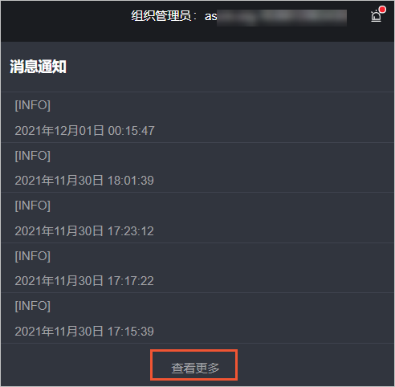

   > **说明**
   >
   > 图标上出现红点，表示有未读的告警记录。
   >
   > 

4. 在**告警列表**页面，根据**告警级别**、**告警对象类别**、**业务类型**、**组织**筛选对应的告警记录。

   在**告警内容**列即可查看具体的告警内容。

<a id="section-15-1-2"></a>

### 15.1.2. 告警记录标为已读

您可以将已处理的告警记录标为已读，系统将不再告警这些已读的记录。

**背景信息**

当顶部菜单栏的  图标出现红点时，表示有未读的告警记录。

**操作步骤**

1. 登录备份管理平台ASR-BR。

2. 在左侧导航栏中选择**运维管理 > 告警列表**。

3. 根据**告警级别**、**告警对象类别**、**业务类型**或**组织**查询相关的告警记录。

4. 单击目标告警记录**操作**列  ，然后单击**标为已读**。

5. 在弹出的**标记已读**对话框中单击**确定**。

6. （可选）您也可以批量标记已读，步骤如下：

   <ol type="i">

   <li>

   勾选目标告警记录后，单击**批量已读**。

   </li>

   <li>

   在弹出的**批量已读**对话框中单击**确定**。

   </li>

   </ol>

<a id="section-15-1-3"></a>

### 15.1.3. 删除告警记录

您可以删除已经处理的告警记录。

**操作步骤**

1. 登录备份管理平台ASR-BR。

2. 在左侧导航栏中选择**运维管理 > 告警列表**。

3. 根据**告警级别**、**告警对象类别**、**业务类型**或**组织**查询相关的告警记录。

4. 单击目标告警记录**操作**列  ，然后单击**删除**。

5. 在弹出的**删除**对话框中单击**确定**。

6. （可选）您也可以批量删除告警记录，步骤如下：

   <ol type="i">

   <li>

   勾选目标告警记录后，单击**批量删除**。

   </li>

   <li>

   在弹出的**批量删除消息**对话框中单击**确定**。

   </li>

   </ol>

<a id="section-15-2"></a>

## 15.2. 流控配置

目前流控配置按照时间段控制实例源端向备份仓库备份时的流量阈值，包含云产品流控配置和VMware流控配置。根据配置的限流值和当前流量值进行比较判断是否需要扩容。

**背景信息**

由于当前限流服务仅支持物理级别的限流，在物理机上各个备份引擎混部，会导致各个引擎之间互相争抢流量。针对这种情况ASR-BR提供分时段限流能力，并且针对不同的引擎设置不同的限流阈值，与客户业务错开流量高峰，保证客户所有业务正常运行。运营管理员可以进行云产品流控配置，组织管理员可以进行VMware流控配置。

**云产品流控配置**

1. 运营管理员登录备份管理平台ASR-BR。

2. 在左侧导航栏中选择**运维管理** > **流控配置**。

3. 在**云产品**页签，单击右上角**修改配置**设置相关参数，单击**提交**。

4. 单击限流值配置区域右上角  ，可以隐藏限流值配置内容。单击右上角  可显示限流值配置内容。

5. 单击**修改配置**后，在时间段旁边会出现  ，单击  可以修改已有时间段，单击**新增时间段**可以增加新的时

   间段，配置完后单击**确定**，可以看到修改后各个时间段的产品限流信息。

   > **说明**
   >
   > 各个时段限流配置独立相互不影响，不同存储池限流配置单独配置互不影响。

   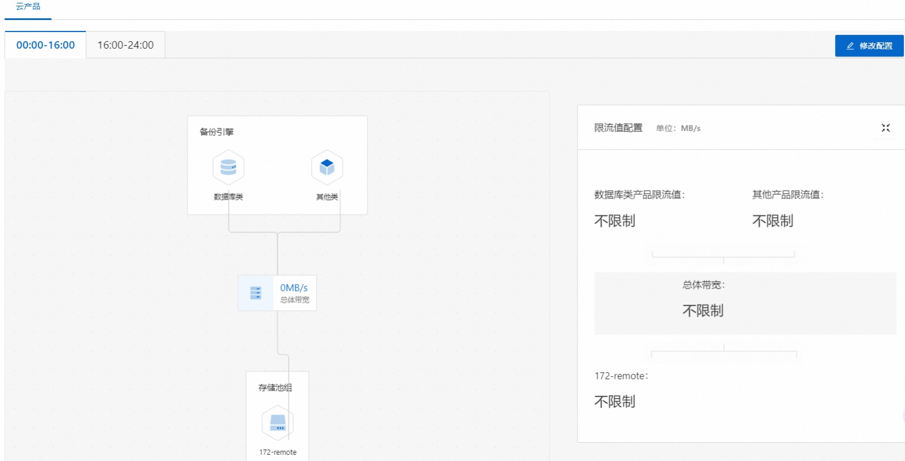

   <table>
     <tr>
       <th width="168">配置</th>
       <th>描述</th>
     </tr>
     <tr>
       <td>数据库类产品限流值</td>
       <td>非必填，设置生产中心向备份引擎备份数据库类产品数据时的流量阈值。最小值为1 MB/s，最大值为：备份引擎数量*2560 MB/s。<br>说明<strong>数据库类产品限流值</strong>不能超过<strong>存储池组限流值</strong>的总和，也不能超过<strong>总体带宽</strong>的数值。</td>
     </tr>
     <tr>
       <td>其他产品限流值</td>
       <td>非必填，设置生产中心向备份引擎备份其他产品数据时的流量阈值。最小值为1 MB/s，最大值为：备份引擎数量*2560 MB/s。</td>
     </tr>
     <tr>
       <td>总体带宽</td>
       <td>必填，设置生产中心向备份引擎备份数据时的总体带宽阈值，ASR-BR会保证所有备份任务使用带宽之和不会大于该设定值。最小值为1 MB/s，最大值为：备份引擎数量*2560 MB/s。</td>
     </tr>
     <tr>
       <td>存储池组限流值</td>
       <td>非必填，设置生产中心向备份引擎存储池备份数据时的流量阈值。最小值为1 MB/s，最大值为：备份引擎数量*2560 MB/s。<br>说明<strong>存储池组限流值</strong>的总和不能超过<strong>总体带宽</strong>的数值，必须大于<strong>数据库类产品限流</strong><strong>值</strong>的数值。</td>
     </tr>
   </table>

**VMware流控配置**

1. 组织管理员登录备份管理平台ASR-BR。

2. 在左侧导航栏中选择**运维管理** > **流控配置**。

3. 在**VMware**页签，设置相关参数，单击**确定**。

   <table>
     <tr>
       <th width="89">名称</th>
       <th>描述</th>
     </tr>
     <tr>
       <td>版本</td>
       <td>保持默认值即可。</td>
     </tr>
     <tr>
       <td>流量阈值</td>
       <td>设置相应时间段主中心向备中心备份VMware数据时的上传流量阈值和下载流量阈值。格式为<code> HH:MM-HH:MM-UKB&#124;HH:MM-HH:MM-DKB </code>。<br>说明<br>• HH:MM-HH:MM表示限速的时间范围。<br>• U表示上传流量。<br>• D表示下载流量。<br>示例：9:00-22:00-U512，表示9:00~22:00期间，上行流量限速512 KB。</td>
     </tr>
     <tr>
       <td>是否开启</td>
       <td>如果不开启，则不限制生产中心向备份仓库备份时的流量。</td>
     </tr>
   </table>

<a id="section-15-3"></a>

## 15.3. 引擎监控

您可以查看流量监控、CPU监控、内存监控、负载监控的数据，如果发现流量太大或使用率过高，及时采取措施规避风险。

1. 运营管理员登录备份管理平台ASR-BR。

2. 在左侧导航栏中选择**运维管理** > **引擎监控**。

   > **说明**
   >
   > - 监控页面展示最近1小时的监控数据。
   >
   > - 打开左上角**开启自动刷新**开关，系统每60s自动刷新一次监控数据；关闭开关，选择时间范围和对应的主机，单击**查询**，可以查询某个备份引擎的主机在某个时间范围的监控数据。

3. 在**流量监控**页面查看备份引擎（HBR-agent和Gulltoppr）相应主机的接收流量和发送流量。

   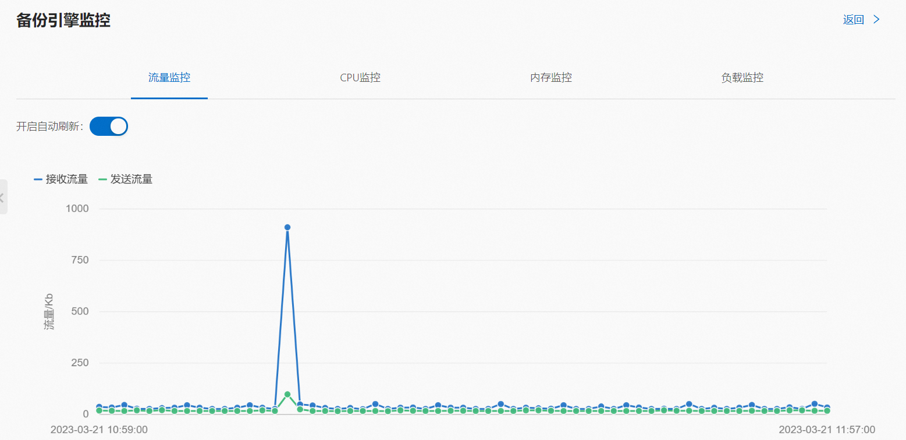

4. 在**CPU监控**页面查看备份引擎的CPU平均使用率和最大使用率。

   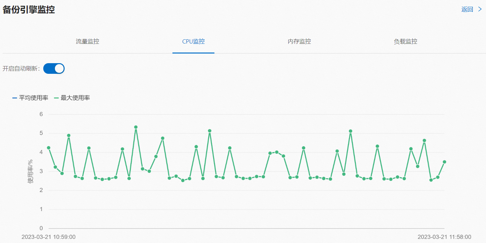

5. 在**内存监控**页面查看备份引擎的内存平均使用率和最大使用率。

   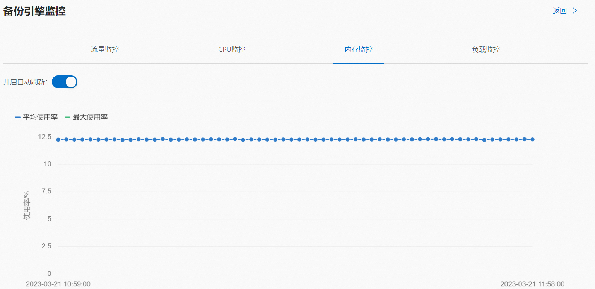

6. 在**负载监控**页面查看备份引擎的负载每分钟、每5分钟、每15分钟的平均使用率和最大使用率，在**负载选项**中可以切换**平均使用率**和**最大使用率**。

   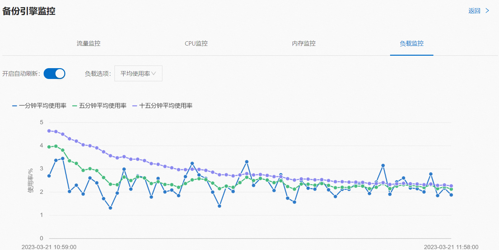

<a id="section-15-4"></a>

## 15.4. 资源统计

您可以从仓库资源和组织资源两个维度分别查看空间使用量、备份计划数量等相关信息。

**背景信息**

- 运营管理员能查看所有组织的相关资源统计。

- 组织管理员只能查看本组织的相关资源统计。

**操作步骤**

1. 登录备份管理平台ASR-BR。

2. 在左侧导航栏中选择**系统管理** > **资源统计**。

3. 分别单击**仓库资源**或**组织资源**页签，选择日期，单击**查询**。

   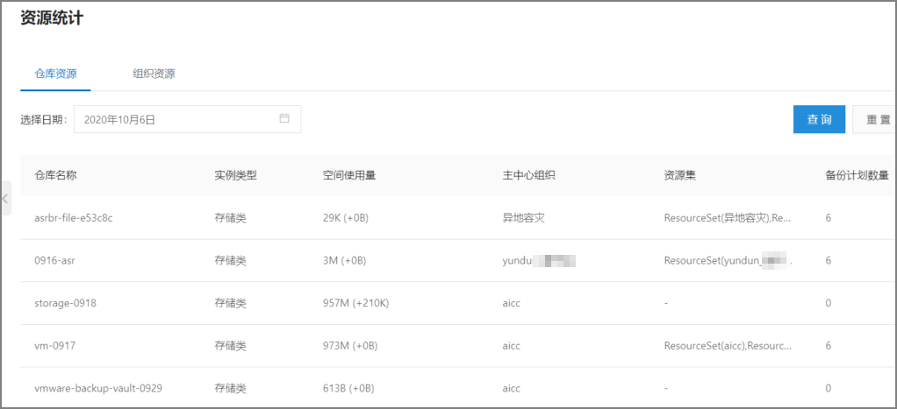

   仓库资源列表的字段说明如下表所示。

   | 名称 | 描述 |
   | --- | --- |
   | 仓库名称 | 备份仓库的名称。 |
   | 空间使用量 | 显示该备份仓库已使用的空间大小。括号里的值表示当天新增的空间使用量。 |
   | 组织 | 显示使用了该备份仓库的组织。 |
   | 资源集 | 显示使用了该备份仓库的资源集。 |
   | 备份计划数量 | 显示使用了该备份仓库的备份计划数量。 |

   组织资源列表的字段说明如下表所示。

   <table>
     <tr>
       <th width="121">名称</th>
       <th>描述</th>
     </tr>
     <tr>
       <td>组织</td>
       <td>组织名称。</td>
     </tr>
     <tr>
       <td>空间使用量</td>
       <td>显示该组织中的备份实例已使用的备份仓库空间大小。括号里的值表示当天新增的空间使用量。</td>
     </tr>
     <tr>
       <td>实例数量</td>
       <td>显示该组织在备份计划中的实例数量。</td>
     </tr>
     <tr>
       <td>备份计划数量</td>
       <td>显示该组织的备份计划数量。</td>
     </tr>
   </table>

<a id="section-15-5"></a>

## 15.5. 查看操作日志

操作日志记录了系统中所有的操作，包括备份计划和备份恢复的创建、删除和执行情况等。

**操作步骤**

1. 登录备份管理控制台。

2. 在左侧导航栏选择**运维管理** > **日志管理**。

3. 根据操作用户、操作模块、操作级别、操作类型、开始时间或结束时间查询所需的日志。日志列表的参数解释如下表所示。

   | 名称 | 描述 |
   | --- | --- |
   | 操作模块 | ASR-BR系统的模块。 |
   | 操作级别 | 日志的级别，分为紧急、警报、错误、警告、消息。 |
   | 操作类型 | 日志记录的操作类型。 |

<a id="section-15-6"></a>

## 15.6. 参数配置

在V3.14之前版本的备份管理平台ASR-BR中，MaxCompute产品创建备份计划时需要添加运行项目。为简化配置、方便统一管理，V3.14版本开始修改为运营管理员统一配置，在运维管理下的参数配置页面统一设置备份计划的运行项目。

**背景信息**

- 配置参数需要具备运营管理员权限。

- 不做配置备份时，默认使用当前备份实例作为运行项目。

- 参数配置仅适用于MaxCompute实例<strong>。</strong>

- 配额（Quota）是MaxCompute的计算资源池，为MaxCompute SQL、MapReduce、Spark、Mars、PAI等计算作业提供所需计算资源（CPU及内存）。

**前提条件**

- 已安装MaxCompute客户端安装包（Github），如果没有安装包请联系备份产研团队获取。

- 配置实例的数据版本类型必须为2.0，项目空间的数据类型属性参数定义如下：

  - `setproject odps.sql.type.system.odps2=true;` ：打开MaxCompute 2.0数据类型。

  - `setproject odps.sql.decimal.odps2=true;` ：打开Decimal 2.0数据类型。

  - `setproject odps.sql.hive.compatible=false;` ：关闭Hive兼容模式。

**操作步骤**

1. 运营管理员登录备份管理平台ASR-BR。

2. 在左侧导航栏，选择**运维管理** > **参数配置。**

3. 下拉选择需要配置的**MaxCompute实例**，单击**添加**。

   > **说明**
   >
   > 也支持输入MaxCompute实例名称进行模糊查询。如果界面提示实例数据类型不是2.0添加失败时，请参考下述步骤进行修改。

4. （可选）修改MaxCompute实例的数据版本类型。

   <ol type="i">

   <li>

   配置MaxCompute客户端。

   <ol type="a">

   <li>

   安装MaxCompute客户端安装包后，会得到**bin**、**conf**、**lib**和**plugins**文件夹。

   </li>

   <li>

   进入**conf**文件夹，配置**odps_config.ini**文件。

   **odps_config.ini**文件中使用井号（#）作为注释。必填参数说明如下。

   **参数**

   **描述**

   **获取方式**

   <ol type="a">

   <li>

   登录Apsara Uni-manager运营控制台。

   </li>

   <li>

   在顶部菜单中选择**产品**。

   </li>

   </ol>

   <ol type="i" start="100">

   <li>

   在左侧导航栏中选择**大数据计算**。

   </li>

   </ol>

   访问的目标MaxCompute项

   **project_name**

   <ol type="i" start="500">

   <li>

   在大数据计算区域选择**数据计算与分析 > 云原生**

   </li>

   </ol>

   目名称。

   **大数据计算服务 MaxCompute**。

   <ol type="a" start="5">

   <li>

   在左侧导航栏中单击**Project管理**，在**Project管理**页面中通过组织选择需要作为Quota的MaxCompute实例。

   </li>

   </ol>

   MaxCompute实例的

   **access_id**

   AccessKey ID。

   MaxCompute实例的

   **access_key**

   AccessKey Secret。

   <ol type="a">

   <li>

   登录Apsara Uni-manager运营控制台。

   </li>

   <li>

   在顶部菜单栏，选择**企业 > 资源管理 > 组织管理**。

   </li>

   </ol>

   <ol type="i" start="100">

   <li>

   在搜索框搜索对应的组织，单击**管理AccessKey**拿到对应的AK、SK。

   </li>

   </ol>

   <table>
     <tr>
       <td>end_point</td>
       <td>MaxCompute服务的连接地址。</td>
       <td>a. 登录Apsara Uni-manager运维控制台。<br>b. 在顶部菜单栏，选择<strong>平台运维 &gt; 飞天基础运维平</strong><strong>台 &gt; 资源管理</strong>。<br>c. 在<strong>飞天基础运维平台</strong>的左侧导航栏中选择<strong>运维工具</strong><strong>&gt; 服务注册变量大盘</strong>。<br>d. 下拉选择<strong>服务</strong>，在搜索框中输入<code> odps-</code><br><code>service-frontend </code>，单击。<br>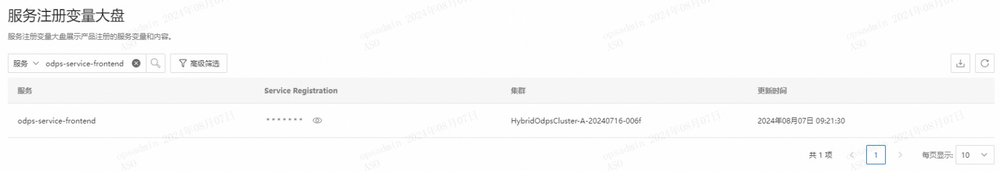<br>e. 单击<strong>Service Registration</strong>列的，再单击内<br>容，查找并保存<strong>odps_frontend_server.endpoint</strong>的值。<br>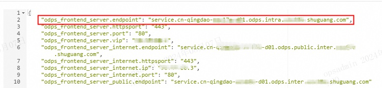<br>f. <strong>end_point</strong>的格式为http://<em>上一步记录的值</em>/api，例如：http://service.cn-qingdao-xxx-d01.odps.intra.xxx.shuguang.com/api。</td>
     </tr>
   </table>

   </li>

   </ol>

   </li>

   <li>

   修改实例数据类型。

   <ol type="a">

   <li>

   登录ODPS需要配置的项目Project。

   </li>

   <li>

   执行以下命令，修改参数值。

   <ol type="a">

   <li>

   `setproject odps.sql.type.system.odps2=true;` ：打开MaxCompute 2.0数据类型。

   </li>

   <li>

   `setproject odps.sql.decimal.odps2=true;` ：打开Decimal 2.0数据类型。

   </li>

   </ol>

   <ol type="i" start="100">

   <li>

   `setproject odps.sql.hive.compatible=false;` ：关闭Hive兼容模式。

   </li>

   </ol>

   </li>

   </ol>

   <ol type="i" start="100">

   <li>

   如果返回OK，表示修改成功。

   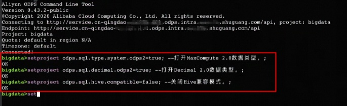

   </li>

   </ol>

   </li>

   <li>

   执行以下命令，查看修改是否生效。

   ```text
    setproject; 
   ```

   <ol type="a">

   <li>

   回显内容会显示修改后的值，如果与修改的值一致表示已生效。

   

   > **说明**
   >
   > 图片为示例，请依次查看并确认修改的参数值是否已生效。

   </li>

   </ol>

   </li>

   </ol>

5. 在**备份管理平台**的**参数配置**页面重新选择MaxCompute实例，单击**添加**即可。

<a id="section-15-7"></a>

## 15.7. 事件管理

事件管理界面支持查看所有事件记录。

**背景条件**

- 组织管理员：可以对自己发起的事件进行运维管理及查看。

- 运营管理员：可以对系统所有的事件进行运维管理及查看。

**操作步骤**

1. 登录备份管理平台ASR-BR。

2. 在左侧导航栏，选择**运维管理** > **事件管理**。

3. 根据**事件类型**、**事件状态**、**开始时间**或**结束时间**查询相应的事件。

4. 在**操作**列中单击**日志**，可查看具体的日志信息。

5. 单击对应事件左侧的  图标，您可以查看各个实例事件的子事件及其状态。

6. 单击子事件右侧的  图标可查看子事件日志信息。

   - **成功**

   - **已取消**

     子事件被执行取消操作后，会显示此状态。

   - **失败**、**超时**、**已停止**

     子事件状态为以上三种时，可单击子事件右侧的  图标进行事件重试操作。

     > **重要**
     >
     > 该操作属于事件运维操作，正常不需要操作，如有最新的同一事件执行成功了，对于旧的事件请不要执行重试操作。

   - **等待开始**、**执行中**、**同步中**

     子事件状态为以上三种时，可单击子事件右侧的  图标进行事件取消操作。执行取消操作后，子事件

     状态会变为**已取消**。

     > **重要**
     >
     > 该操作属于事件运维操作，正常不需要操作。该操作不可逆，请谨慎操作。

<a id="section-16"></a>

# 16.备份最佳实践

<a id="section-16-1"></a>

## 16.1. 数据库类云产品备份最佳实践

<a id="section-16-1-1"></a>

### 16.1.1. RDS备份

本文介绍数据库产品RDS的备份策略和转储速度的相关说明。

**备份策略设置**

**备份策略**

RDS产品备份策略类型有两种：

- 全量备份模式：只能恢复备份时间点的数据。

- 全量+日志备份模式：可恢复任意时间点数据。

> **说明**
>
> RDS产品备份策略建议设置全量+日志备份模式，每周设置两天进行全量备份，既节约了带宽和存储容量，也可以保证数据尽可能不丢失。

**备份时间**

- 多个RDS实例备份，设置的备份时间尽量分散到每天。

  > **说明**
  >
  > 为了更好的利用带宽，同时并发数最好保证在5～6个。

- 尽量选择业务低峰期的时间段进行备份。

  > **说明**
  >
  > RDS的Mysql和PostgreSQL类型从备库备份，SQLServer从主库备份。

- 如果需要在当天执行备份，请提前10分钟设置备份策略。

**保存时间**

如果RDS备份同时设置了本地备份和异地备份，本地备份保存时间可以设置为7天；异地备份可以根据业务数据的重要性设置保存时间，异地保存时间可以设置在30天以上。

**备份转储速度**

RDS异地备份分两个步骤进行：

1. RDS云内备份：将备份的数据文件上传到云内OSS。其中，单个备份任务最大速度为55MBps。

2. RDS跨云备份：将云内OSS的数据跨云复制到云外OSS。

   跨云复制速度计算方式如下。

   - 未设置限速：单个任务上传速度为40Mbps。

   - 设置限速：限速大于等于400MBps，单个任务上传速度为40Mbps；限速speed小于400MBps, 单个任务上传速度为speed/10。

**限速场景**以下场景需要限速：

- 除了备份RDS以外，还需要备份OSS、NAS等存储类应用，并且备份的量比较大。

- 同时并发的备份任务数量超过6个时，需要根据允许分配给RDS备份的带宽量进行限速。

<a id="section-16-1-2"></a>

### 16.1.2. PolarDB-X 1.0备份

本文介绍数据库产品PolarDB-X 1.0的备份策略和转储速度的相关说明。

**备份策略设置**

**备份策略**

PolarDB-X 1.0产品备份模式分为两种：快速备份和一致性备份。

- 快速备份：保证单个RDS数据一致性，无法保证数据的全局一致性。

- 一致性备份：会对分布式事务进行秒级的锁定操作，RT存在亚秒级抖动，建议在业务低峰期进行。恢复时，只能选择备份集进行恢复。

> **说明**
>
> 快速备份适用于常规备份和恢复，一致性备份适用于对数据一致性有严格要求的行业以及在线核心交易类业务。

**备份时间**

一周至少备份两次保证有可恢复的数据集。

> **说明**
>
> 如果需要在当天执行备份，请提前10分钟设置备份策略。

**保存时间**

- 本地备份保存时间可以设置为7天。

- 异地根据业务数据的重要性设置保存时间，异地保存时间可以在30天以上。

**备份转储速度**

参考RDS产品备份转储速度。

**限速场景**

参考RDS产品限速场景。

<a id="section-16-2"></a>

## 16.2. 文件类存储产品备份最佳实践

<a id="section-16-2-1"></a>

### 16.2.1. OSS备份

本文介绍OSS的备份速度和限速场景的相关说明。

**备份速度和配置**

OSS备份的性能和文件大小以及并发数的选择有关，针对不同文件大小，推荐采用如下的并发数配置进行备份。

| 平均文件大小 | 并发数配置 | 备份速度 |
| --- | --- | --- |
| &lt;64KB | 128读 256写 | &lt;110MB |
| 64KB ~ 128KB | 128读 128写 | 100MB ~ 350MB |
| 128KB ~ 256KB | 64读 128写 | 150MB ~ 350MB |
| 256KB ~ 512KB | 64读 64写 | 200MB ~ 450MB |
| 512KB ~ 2MB | 32读 32写 | 300MB ~ 400MB |
| &gt; 2MB | 默认配置(8读32写) | &gt;100MB |

备份周期根据相应的OSS备份速率进行估算配置。

在OSS备份数据量比较大的场景下，可以通过配置Prefix和筛选文件时间段拆分实例到多个备份计划，进而提高备份扫描效率。

OSS备份除了第一次备份是全量备份，后续的备份都通过重删进行增量备份。

对于CDS-OSS实例，清单功能可以有效的提高增量备份的效率。当Bucket内的数据量大于1亿时，推荐打开清单功能进行备份。

**限速场景**

备份作为旁路系统，在建设时，尽量避免对业务的影响。在备份时，OSS受限于SLB 5Gb的最大流量限制，因此建议采用如下措施。

- 针对企业版V3.16以上版本，在对OSS进行备份时，为OSS创建一个独立的备份VIP，在创建备份计划时通过Endpoint进行配置，可保证在备份时对业务无影响。

- 进行数据备份时，根据实际带宽情况进行限流。

<a id="section-16-2-2"></a>

### 16.2.2. NAS备份

本文介绍NAS的备份速度和限速场景的相关说明。

**备份速度**

NAS备份仅支持NFS协议。建议所创建的每个NAS备份任务单个目录下的文件及子目录数量之和不超过800万。NAS备份的速度和文件大小有关，配置备份周期时请根据实际数据量和备份速度进行评估。

NAS不同文件大小的NAS备份速度如下。

| 文件大小 | 平均处理速度 | 单日备份数据量(24小时计算) |
| --- | --- | --- |
| 32KB | 13MB/s | 1TB |
| 64KB | 21MB/s | 1.73TB |
| 256KB | 53MB/s | 4.36TB |
| 512KB | 82MB/s | 6.75TB |
| 1MB | 138MB/s | 11.37TB |

**限速场景**

进行数据备份时，根据实际带宽情况进行限流。

<a id="section-16-2-3"></a>

### 16.2.3. ECS文件备份

本文介绍ECS文件备份的备份速度。

**备份速度**

不同的ECS云盘类型，备份速度不一样，其中高性能云盘≈高效云盘>普通性能云盘≈SSD。

ECS文件备份时会占用ECS的资源，备份速度和资源使用具体如下。

| 平均文件大小 | 传输速度 | CPU使用量 | 限流10MB后CPU使用 |
| --- | --- | --- | --- |
| 32KB | 19MBps | 100%～240% | 40%-70% |
| 64KB | 27MBps | 200%～240% | 32%～60% |
| 256KB | 92MBps | 160%～240% | 16%-40% |
| &gt;=512KB | 120MBps | 160%/240% | 16%-28% |

在创建ECS备份计划时：

1. 在不限速的情况下，确保ECS的规格至少为4C4G。如果ECS的CPU规格小于4C，对ECS文件备份进行限流在10MB以内。

2. 备份内存使用量为1GB-2GB之间，确保ECS的内存至少有1GB空闲。

<a id="section-16-2-4"></a>

### 16.2.4. ECS整机备份

本文介绍ECS整机备份的异地转储速度。

**异地转储速度**

ECS整机备份，首先由EBS将快照写入到本地OSS，然后将本地OSS的快照数据通过EBS服务读出写入到异地灾备存储中。其中，EBS 1.0单盘快照速度为13MBps，CDS-EBS单盘快照速度为32MBps。

异地转储速度为90MBps。设置备份策略时，根据实际备份数据量酌情估算。

<a id="section-16-3"></a>

## 16.3. 大数据类产品备份最佳实践

<a id="section-16-3-1"></a>

### 16.3.1. MaxCompute备份

本文介绍MaxCompute备份时的相关数据。

- MaxCompute在备份时，以分片或者表的纬度将数据切分成256MB的分片，一个分片作为一个任务上传，任务会打散到多台大数据计算节点上执行。

- 每个任务占用0.7个配额，上传速度大小为2-3MBps，平均每个配额可提供3.6MBps的上传速度。

- 当并发的任务数大于配额时，任务将排队执行。

- 两台备份物理机的情况下，MaxCompute备份的最大吞吐约为300MBps（更多的物理机将提供更多的备份吞吐）。

<a id="section-16-4"></a>

## 16.4. 混合云备份最佳实践

<a id="section-16-4-1"></a>

### 16.4.1. 提前准备

专有云企业版数据支持通过ASR-BR备份至阿里云公共云OSS。

**前提条件**

- 已开通阿里云公共云账号。

- 已开通阿里云公共云专有网络。

- 已开通阿里云公共云高速通道服务。

- 已开通阿里云公共云OSS服务。

- 已开通专有云企业版租户侧DNS产品。

- 专有云OpsDNS打开针对公共云OSS域名的Forward（重定向）能力。

**网络打通**

**配置公网域名解析能力**

将专有云数据备份到公共云时，专有云备份服务（部署在经典网络）通过公共云OSS的Endpoint调用OSS接口并写入备份数据，因此要求专有云经典网络拥有公网域名解析能力，需要在OpsDNS上开启域名Forward能力。

> **说明**
>
> 目前专有云OpsDNS服务默认没有开启Forward能力，需要联系专有云技术支持评估安全风险并开启OpsDNS的Forward能力。

**专有云边界安全防护**

目前专有云备份服务部署在专有云经典网络。为了确保安全，客户必须在云平台边界部署云外防火墙，并配置SNAT能力，需要配置的SNAT地址请参见网络约束。除了上述经典网络地址以外，还需要配置Ops.opsDNS服务，确保OpsDNS的转发查找能力可以访问公共云服务。

**专有云和公共云网络互联**

1. 在公共云创建一个边界路由器（VBR），通过CEN实例连通公共云上的管控VPC。

2. 公共云管控VPC内开通云服务及Private Zone，提供API调用能力。

3. 使用物理专线连通专有云平台和公共云侧VBR，并使用防火墙对专有云平台进行安全防护。

4. 专有云备份服务位于专有云内，使用OpsDNS进行OSS域名查找，通过专线将备份数据写入到公共云OSS。

   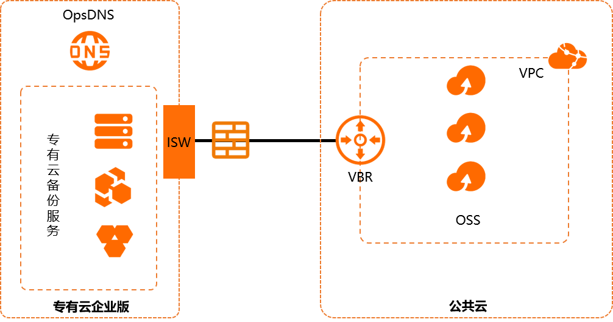

> **说明**
>
> 具体操作请参见混合云网络通：混合云管理（专有云企业版）专线场景联通中“公共云侧操作”。

<a id="section-16-4-2"></a>

### 16.4.2. 混合云网络通：混合云管理（专有云企业版）专线场景联通

本次实践将基于专有云企业版混合云业务场景，利用专线线路打通混合云管理平台调用公共云接口的能力，管理公共云。

**前提条件**

- 已开通阿里公共云账号。

- 已开通阿里公共云专有网络。

- 已开通阿里公共云高速通道服务。

- 已开通专有云企业版租户侧DNS产品。

**背景信息**

联通后将具备以下能力：

- 专有云租户侧DNS负责将公共云域名转发至公共云VPC内的Private Zone进行查找。

- 利用专有云平台物理专线的路径，混合云管理平台联通阿里公共云VPC内的API接口Endpoint，调用OpenAPI管理公共云。

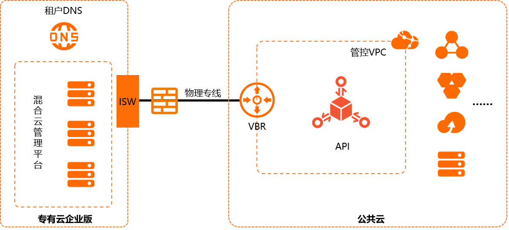

> **说明**
>
> 本文所涉及的IP地址均为示例，您需要根据实际的使用情况进行更改。

**公共云侧操作**

1. 在高速通道控制台创建独享专线连接，详细步骤请参见申请经典模式。

2. 创建边界路由器，详细步骤请参见申请经典模式。

3. 创建BGP邻居并填写对端专有云内BGP邻居IP地址。详细步骤请参见配置和管理BGP。

4. 创建CEN实例并设置PrivateZone。详细步骤请参见设置PrivateZone服务访问。

5. 登录到云解析DNS控制台，添加设置的PrivateZone，详细步骤请参见添加Zone及PrivateZone解析记录。

   > **说明**
   >
   > 对于已添加的Zone，其**记录数**下的数值代表该私有域名的PrivateZone解析记录数量。单击Zone名称，可以进入解析记录控制台，为该私有域名添加PrivateZone解析记录。

6. 在云解析DNS控制台为PrivateZone关联VPC。详细步骤请参见关联/解关联VPC。

7. 通过内网调用API。

设置域名之后，各个产品可以通过统一云管平台（ASCM）去调用公共云的Endpoint。

**专有云侧操作**

1. 配置出口网络设备路由协议。

   - ISW上通过静态路由方式。

     登录专有云出口设备ISW，执行以下命令。

     ```text
     ip route-static [$IP] [$IP_Prefix] [$GW_IP] preference 10 ------将公共云侧云服务和PrivateZone地址段路由指向公共云侧接入点
     ```

     > **说明**
     >
     > - [$IP]：公共云侧云服务和PrivateZone地址段路由。
     >
     > - [$IP_Prefix]：地址段路由对应的掩码。
     >
     > - [$GW_IP]：公共云侧接入点IP。

   - ISW上通过BGP路由方式。

     如果云平台出口设备是通过BGP和公共云侧通信，需要在相关配置中设置专有云侧的混合云管理平台地址段路由和公共云侧云服务及Private Zone地址段路由。

2. 配置租户DNS。

   <ol type="i">

   <li>

   登录域名控制台。

   </li>

   <li>

   单击左侧导航栏中的**内网DNS解析管理**。

   </li>

   <li>

   单击**全局转发配置**。

   </li>

   <li>

   单击**添加域**名后，填写相关配置。

   <table>
     <tr>
       <th width="138">名称</th>
       <th>描述</th>
     </tr>
     <tr>
       <td>全局转发域名</td>
       <td>填写公共云内网API Endpoint域名，与前文添加PrivateZon内配置的一致。</td>
     </tr>
     <tr>
       <td>转发模式</td>
       <td>选择强制转发模式。</td>
     </tr>
     <tr>
       <td>转发目的IP列表</td>
       <td>填写公共云侧创建的内网PrivateZone服务地址。</td>
     </tr>
   </table>

   </li>

   </ol>

<a id="section-16-4-3"></a>

### 16.4.3. 创建混合云备份存储池

本文介绍创建混合云备份存储池的具体操作，存储池组位置需要选择阿里云公共云。

**前提条件**

- 已完成提前准备中的网络打通操作。

- 已开通阿里云公共云OSS服务，且OSS账号拥有以下OSS权限：

  ```text
  oss:PutBucket
  oss:ListObjects
  oss:GetBucketAcl
  oss:GetBucketInfo
  oss:GetBucketLifecycle
  oss:PutBucketLifecycle
  oss:DeleteBucketLifecycle
  oss:ListMultipartUploads
  oss:PutObject
  oss:GetObject
  oss:DeleteObject
  oss:ListParts
  oss:RestoreObject
  oss:AbortMultipartUpload
  ```

- 只有备份运营管理员可以创建存储池。

**操作步骤**

1. 登录备份管理平台ASR-BR。

2. 在左侧导航栏中选择**系统管理 > 存储池组管理**。

3. 单击**创建存储池组**，在**添加存储池组**对话框中设置相关参数，完成后单击**确定**。

   > **说明**
   >
   > 存储池组总数量不能超过16个。

   

   <table>
     <tr>
       <th width="154">配置项</th>
       <th>说明</th>
     </tr>
     <tr>
       <td>存储池组名称</td>
       <td>请设置一个容易识别的存储池组名称，例如“公共云存储池组”。<br>说明<br>• 名称由中文、英文、数字、短划线（-）、下划线（_）组成，长度小于64个字符，大小写敏感。</td>
     </tr>
     <tr>
       <td>存储介质</td>
       <td>可支持OSS、CDS-OSS、MINIOSS、PanguStor、SDS。</td>
     </tr>
     <tr>
       <td>存储池组位置</td>
       <td>请选择该存储池组的位置。<br>• <strong>本地</strong>：存储池组在本站点。<br>• <strong>异地</strong>：存储池组在异地的站点。<br>• <strong>阿里云公共云</strong>：存储池组在阿里云公共云。</td>
     </tr>
     <tr>
       <td>endpoint</td>
       <td>输入endpoint地址，可填写存储介质对应的域名或IP地址。<br>说明<br>• endpoint网络必须能够连通。<br>• 不支持IPv6地址。<br>• 如果采用NAT需要添加端口映射，可以在域名或IP之后加上英文冒号和端<br><br>口号，格式为<code> </code>&lt;endpoint&gt;:&lt;端口号&gt;<code> </code>。</td>
     </tr>
     <tr>
       <td><strong>存储空间</strong>（可选）</td>
       <td>设置存储池组的存储空间大小，单位为TB。<br>说明<br>• 存储池组下所有存储池的存储空间总和不能超过此值，否则无法创建出存储池。<br>• 不填代表不限制。</td>
     </tr>
   </table>

4. 在存储池组列表中单击存储池组名称，进入存储池列表。

5. 在页面左上角单击**创建存储池**，在**添加存储池**对话框中设置相关参数。

   

   <table>
     <tr>
       <th width="185">配置项</th>
       <th>描述</th>
     </tr>
     <tr>
       <td>存储池名称</td>
       <td>请设置一个容易识别的存储池名称，例如“公共云存储池”。<br>说明名称由中文、英文、数字、短划线（-）、下划线（_）组成，长度小于64个字符，大小写敏感。</td>
     </tr>
     <tr>
       <td>存储空间</td>
       <td>设置存储池的最大存储空间，单位为TB。</td>
     </tr>
     <tr>
       <td>AccessKey ID</td>
       <td>访问目的端存储账号对应的AccessKey ID。<br>说明该组AccessKey ID和AccessKey Secret至少需要有读写存储权限。</td>
     </tr>
     <tr>
       <td>AccessKey Secret</td>
       <td>访问目的端存储账号对应的AccessKey Secret。</td>
     </tr>
     <tr>
       <td>授权组织</td>
       <td>选择授权的一级组织名称，支持全选。</td>
     </tr>
     <tr>
       <td>回收站</td>
       <td>选填，自定义输入回收站名称。当该存储池下需要创建重删存储仓库或镜像仓库时，该参数必填。<br>说明当创建重删存储仓库或镜像仓库时，填写的回收站Bucket存在会直接使用，不存在将创建一个对应名称的Bucket使用。</td>
     </tr>
     <tr>
       <td><strong>存储池描述</strong>（可选）</td>
       <td>请对存储池进行简要描述，便于区分。</td>
     </tr>
   </table>

6. 单击**确定**。

<a id="section-16-4-4"></a>

### 16.4.4. 创建混合云备份仓库

本文介绍创建混合云备份仓库的具体操作，存储位置需要选择阿里云公共云。

**前提条件**

- 已创建混合云备份存储池，具体请参见创建混合云备份存储池。

- 创建备份仓库的组织备份管理员或组织备份操作员的所在组织，必须归属在存储池授权的一级组织中，否则存储池不可见。

**背景信息**

- 每个存储池只能创建一个数据库类备份仓库，且创建后不能修改。

- 一个存储池中可以创建多个存储类备份仓库、多个重删存储类备份仓库。

- RDS和PolarDB-X 1.0使用相同的数据库备份仓库。

- 组织备份管理员和组织备份操作员可以创建数据库备份仓库、存储类备份仓库和重删存储类备份仓库。

**操作步骤**

1. 登录备份管理平台ASR-BR。

2. 在左侧导航栏中单击**备份仓库**。

3. 在**备份仓库**页面，单击**新建**。

4. 在**新建备份仓库**对话框中填写相关参数，具体说明如下。

   

   <table>
     <tr>
       <th width="154">参数名称</th>
       <th>配置说明</th>
     </tr>
     <tr>
       <td>仓库名称</td>
       <td>请设置一个方便识别的备份仓库名称，例如公共云备份仓库。<br>说明<br>• 该名称创建成功后不可修改。<br>• 名称只能包含小写字母、数字、中文或短划线（-），且不能以短划线（-）开头。名称长度为3~35个字符。</td>
     </tr>
     <tr>
       <td><strong>仓库描述</strong>（可选）</td>
       <td>输入对仓库的简单描述。</td>
     </tr>
     <tr>
       <td>备份产品类型</td>
       <td>设置该仓库备份的产品类型。<br>• <strong>数据库类</strong>：目前支持RDS、PolarDB和PolarDB-X 1.0。<br>• <strong>存储类</strong>：目前支持OSS、ECS、NAS、。<br>• <strong>表格存储</strong>：目前支持OTS（TableStore备份）。<br>• <strong>重删存储类</strong>：目前支持MaxCompute。</td>
     </tr>
     <tr>
       <td>开启Https</td>
       <td>设置创建备份仓库、备份数据到备份仓库时，使用HTTP或HTTPS协议。默认开启HTTPS协议，可手动关闭。<br>说明<br>• 只有当<strong>备份产品类型</strong>选择<strong>数据库类</strong>、<strong>存储类</strong>和<strong>表格存储</strong>时，才需要配置该参数。<br>• 如果和OSS的HTTPS端口未打通，建议关闭<strong>开启Https</strong>开关。</td>
     </tr>
     <tr>
       <td>存储位置</td>
       <td>设置备份数据存储的位置。<br>• <strong>本地</strong>：将备份数据存储在云内的OSS。<br>• <strong>异地</strong>：将备份数据存储在其他阿里云的OSS。<br>• <strong>阿里云公共云</strong>：将备份数据存储在阿里云公共云的OSS。<br>说明当<strong>备份产品类型</strong>为<strong>表格存储</strong>时，<strong>存储位置</strong>只支持<strong>异地</strong>。</td>
     </tr>
     <tr>
       <td>存储池</td>
       <td>请选择该备份仓库所属的存储池。</td>
     </tr>
     <tr>
       <td>Bucket名称</td>
       <td>如果用户填写了Bucket，那将直接使用该Bucket作为备份仓库。同时填写的Bucket名称必须是OSS内已经存在的Bucket名称。<br>说明如果选择的存储池没有创建Bucket权限，则必须填写。</td>
     </tr>
     <tr>
       <td>存储大小</td>
       <td>设置备份仓库的存储大小，单位为GB。<br>说明如果所选存储池设定了存储空间大小，则备份仓库的存储大小不能超过该值。</td>
     </tr>
   </table>

5. 单击**确定**。

   > **说明**
   >
   > 如果创建存储仓库失败，可能是存储资源不足，请及时扩容后再重新创建。

**执行结果**

ASR-BR会自动在对应存储池中创建一个OSS Bucket，用于存储业务数据的备份。

<a id="section-16-4-5"></a>

### 16.4.5. 创建备份计划

通过创建备份计划，ASR-BR会定期将实例中的数据备份至备份仓库中。

**前提条件**

- 只有组织备份管理员和组织备份操作员能创建备份计划，备份运营管理员不支持创建备份计划。

- 已创建备份仓库，具体参见创建备份仓库。

- 备份恢复MaxCompute前，请确保已开启MaxCompute的外部表功能，且已部署MaxCompute联合计算增强包（Spark on MaxCompute）。

- 创建ECS实例备份计划，请确保ECS实例已安装ECS云助手且状态正常。

- （可选）创建MaxCompute备份计划前，请配置MaxCompute实例参数，会使用指定项目的cu进行备份，防止备份时影响业务。具体操作请参见参数配置；如果不配置，将使用当前项目的cu进行备份，同时在配置实例时会出现缺少运行项目的提示。

**背景信息**

- ASR-BR会备份RDS数据及用户信息、权限、规格等元数据信息。

- ASR-BR支持备份NFS和SMB协议的NAS实例。

- ASR-BR会备份MaxCompute的Table、Function、Resource和Project的元数据信息（Quota信息、集群信息、VPC信息、安全信息等）。

- ASR-BR目前支持的ADB数据库类型包括C8、H20、C20、B7，其他类型暂不支持。

- ASR-BR备份OTS表时，仅支持表名不超过100个字符的OTS表，如果需要备份表名超过100个字符的OTS表，请联系ASR-BR产研团队评估处理。

**操作步骤**

1. 登录备份管理平台ASR-BR。

2. 在左侧导航栏，单击**备份计划**。

3. 在**备份计划**页面，单击**新建**。

4. 在**基本信息**配置向导页面，填写备份计划的基本信息，单击**下一步**。

   <table>
     <tr>
       <th width="186">名称</th>
       <th>描述</th>
     </tr>
     <tr>
       <td>备份计划名称</td>
       <td>自定义备份计划的名称。<br>说明名称只能包含中文、英文、数字、短划线（-）、下划线（_）或英文半角句号（.），长度为4-128个字符或2-64个汉字。</td>
     </tr>
     <tr>
       <td><strong>备份计划描述</strong>（可选）</td>
       <td>对备份计划的简单描述，方便识别。</td>
     </tr>
     <tr>
       <td>实例类型</td>
       <td>选择待备份实例的产品类型。<br>说明创建OTS备份计划时，请选择<strong>表格存储 TableStore</strong>。</td>
     </tr>
     <tr>
       <td>备份方式</td>
       <td>只有ECS实例需要配置该参数。<br>• <strong>快照备份</strong>：备份ECS整个实例或ECS云盘。<br>• <strong>文件备份</strong>：备份ECS的文件。</td>
     </tr>
   </table>

5. 在**选择实例**配置向导页面，选择待备份的某个实例，单击**下一步**。

   > **说明**
   >
   > - 待备份的实例的状态必须为**使用中**。
   >
   > - 一个备份计划只能包含一个实例。
   >
   > - 实例类型为RDS、PolarDB、PolarDB-X、ADB时，一个实例只能加入一个备份计划，即无法选择保护状态为**保护中**的实例。
   >
   > - 1个OSS Bucket支持加入多个备份计划中。
   >
   > - 1个NAS实例支持加入多个备份计划中。
   >
   > - 1个ECS实例，支持分别加入文件备份的备份计划和云盘备份的备份计划。
   >
   > - 备份方式为文件备份的ECS实例，支持加入多个备份计划中。
   >
   > - 由于一个OTS实例下会存在多个表，因此当实例类型为TableStore时，在**OTS表**列可以查看该实例下有几个表。

6. （可选）选择OTS表。只有填写**基本信息**时填写的**实例类型**为**表格存储 TableStore**，需要执行该步骤，其他实例类型的备份计划请跳过。

   <ol type="i">

   <li>

   在左侧区域勾选左侧待选择的表名称。

   > **说明**
   >
   > 单个实例最多同时备份两张表，因此选择OTS表的时候，如果选择的表数小于等于两张表时，会同时备份两张表数据；如果选择的表的数量大于两张表时，需要排队等待备份。

   </li>

   <li>

   单击  ，将已经选择的OTS表添加到右侧区域。

   </li>

   <li>

   单击**下一步**。

   </li>

   </ol>

7. （可选）在**安装客户端**页面，配置安装HBR客户端的相关参数。配置完成后单击**下一步**。

   > **说明**
   >
   > - 仅执行ECS文件备份，且**备份方式**选择**文件备份**时需要执行本步骤。
   >
   > - 安装客户端操作依赖ECS云助手，请确保ECS实例已安装ECS云助手且状态正常。

   <table>
     <tr>
       <th>实例类型</th>
       <th>名称</th>
       <th>描述</th>
     </tr>
     <tr>
       <td rowspan="4">ECS（文件备份）</td>
       <td>客户端安装路<strong>径</strong>（可选）</td>
       <td>选择客户端在ECS实例内的安装路径。<br>说明<br>不选安装路径时，默认安装至<code> /root </code>下。</td>
     </tr>
     <tr>
       <td>客户端CPU核心使用数</td>
       <td>系统自动显示当前ECS实例的CPU核心数，根据需要设置客户端使用的CPU核心数。客户端启动备份任务时，会根据设置的CPU核心使用数来分配备份任务。<br>说明CPU核数越大，占用宿主机资源越多，对宿主机性能影响越大，建议评估后设置，防止对业务造成影响。</td>
     </tr>
     <tr>
       <td>客户端最大工作线程数</td>
       <td>系统默认设置的最大工作线程数为10，可根据实际需要修改。客户端启动备份任务时，会根据设置的最大工作线程数分配备份任务。<br>说明线程数越大，占用宿主机资源越多，对宿主机性能影响越大，建议评估后设置，防止对业务造成影响。</td>
     </tr>
     <tr>
       <td>客户端安装状<strong>态</strong>（可选）</td>
       <td><strong>客户端CPU核心使用数</strong>和<strong>客户端最大工作线程数</strong>设置完成后，单击<strong>安装</strong>开始安装客户端。单击<strong>刷新</strong>可实时刷新安装状态，等待安装状态为<strong>已安装</strong>，可执行下一步操作，系统自动会进行连通性测试。<br>说明<br>• 客户端安装后支持卸载和编辑<strong>客户端CPU核心使用</strong><strong>数</strong>和<strong>客户端最大工作线程数</strong>。<br>• 安装客户端页面右侧区域会展示客户端的安装信息，包括客户端安装状态、客户端版本号、心跳保活时间、客户端CPU核心使用数、客户端最大工作线程数。心跳保活时间正常时，您可以执行卸载或连通性测试操作；心跳保活时间异常时，您可以执行卸载或重新安装操作。<br>• 如果ECS实例已安装过客户端，下一次创建备份计划时，会显示客户端安装状态为<strong>已安装</strong>。</td>
     </tr>
   </table>

8. 在**配置实例**页面，配置相关参数。配置完成后单击**下一步**。

   > **说明**
   >
   > 创建RDS、PolarDB、OTS和PolarDB-X备份计划时请忽略该步骤。

   | 实例类型 | 名称 | 描述 |
   | --- | --- | --- |

   单击<strong>浏览，</strong>在**浏览目录**页面选择待备份的文件目录。

   **浏览目录**页面显示当前Bucket的文件目录，您可以选择待备份的文件。

   > **说明**
   >
   > - 不配置默认备份Bucket中的所有文件。

   **OSS Prefix**（可选）

   > - **OSS Prefix**的值以正斜线（/）分隔和结尾，不能包含如下字符：尖括号（<>）、反斜线（\\）、竖线（|）、冒号（:）、引号（"）、星号（\*）、问号（?）。
   >
   > - 如果OSS Bucket中的文件太大，为了提高备份效率，您可以创建多个备份计划，每个备份计划中指定待备份的文件。

   选择备份文件筛选策略。

   - **全部**：备份**OSS Prefix**中的所有文件。

   - **按时间范围**：备份最后修改时间为指定时间范围的对象。

   **备份文件筛选策**

   - **按最近天数**：备份最后修改时间为最近几天的对象。

   **略**

   > **说明**
   >
   > 周期性备份时，会以每次备份周期的开始时间计算最近的天数。

   当**备份文件筛选策略**选择**按时间范围**时，需要填写筛选文件开始时间点和结束时间点，备份指定时间范围内上传到OSS的对象。

   > **说明**

   **筛选文件时间范**

   > - 备份时，将会根据对象的最后修改时间和该时间范围进行过

   **围**

   > 滤备份，只有最后修改时间在该时间范围的对象才会备份到异地。
   >
   > - 筛选文件时间范围不能为空。

   当**备份文件筛选策略**选择**按时间范围**时，需要设置**筛选最近天数**的数值，备份时将根据对象的最后修改时间结合备份开始时间和最近天数进行文件

   **筛选最近天数**

   筛选。

   在备份OSS时，允许配置从源端读数据和向目的端写数据的并发数。请根据Bucket文件数量和文件平均大小，进行并发数选择。选择**默认**时，系统会采用最小的并发数。

   **备份并发数**

   > **说明**
   >
   > 系统会根据当前备份系统限流、Bucket文件总数量、平均文件大小，为您推荐合适的备份并发数配置。

   **对象存储 OSS**

   该参数仅支持CDS-OSS实例类型。

   开启清单功能后，ASR-BR将为您创建一个仅有OSS读写权限的自定义RAM角色用于配置、生成OSS清单。备份时，将使用OSS清单文件进行备份。

   **清单功能**

   > **说明**
   >
   > 开启清单功能后，在增量备份时将使用OSS清单进行增量文件获取，无须遍历文件。推荐1亿对象以上的Bucket使用OSS清单功能进行备份。

   仅在**清单功能**开启时需要配置。用于设置OSS清单文件存放的目标

   **存储清单**

   Bucket。

   **Bucket**

   仅在**清单功能**开启时需要配置。用于设置OSS清单文件生成在目标

   **清单报告存储路**

   Bucket的指定目录。如果不填写，则默认放在根路径下。

   **径**

   仅在**清单功能**开启时需要配置。用于设置每次备份后，OSS清单文件的清理策略。默认策略为备份后删除所有清单。

   **清单清理策略**

   > **说明**
   >
   > 支持三种策略：备份后删除所有清单、备份后删除当前清单、不删除。

   如果您需要使用其他的OSS Endpoint进行源端OSS的数据读取，可以将**OSS Endpoint**切换成**自定义**并填写对应的OSS Endpoint。推荐配置非业务的OSS Endpoint进行备份。

   > **说明**

   **OSS Endpoint**（可

   > - 不配置使用默认的OSS Endpoint读取源端OSS数据。

   选）

   > - 系统会根据当前备份系统限流预估备份流量，请注意检查备份流量是否会影响业务流量。
   >
   > - 使用自定义的OSS Endpoint进行备份前，请确认该OSS Endpoint可以读取到源端需要备份的Bucket。

   展示预估的备份速度、第一次全量备份时间、后续增量备份时间，仅供参

   **备份情况预估**

   考。

   - **按整机备份**：备份整个ECS实例。

   **备份类型**

   - **按指定云盘备份**：备份ECS的云盘。**备份类型**选择**按指定云盘备份**后，在**云盘列表**处单击**浏览**选择一个或多个云盘。

   **ECS**（快照备份）

   关闭（默认）：优先创建快照一致性组，当不满足创建快照一致性组条件或其他原因导致创建快照一致性组失败时，则会自动降级创建普通快照。

   开启：强制创建快照一致性组，当不满足创建快照一致性组条件或其他原因导致创建快照一致性组失败时，则不会降级创建普通快照，此次备份也

   **创建快照一致性**

   会以失败结束。

   **组**

   > **说明**
   >
   > 如果没有特殊业务需要，请谨慎开启。

   选择待备份文件所在的路径，具体填写规则请参见界面帮助。

   **备份文件路径**

   包括如下3个选项：

   - **包含所有**：**备份文件路径**中的所有文件。

   **备份文件策略**

   - **排除以下**：**备份文件路径**中的除**ECS文件列表**以外的文件。

   - **包含以下**：只备份符合**ECS文件列表**规则的文件。

   **ECS**（文件备份）

   结合**备份文件策略**设置待备份的文件，具体填写规则请参见界面帮助。

   **ECS文件列表**

   设置不同时间段，生产中心向备份仓库备份时的最大传输速率，具体填写规则请参见界面示例。

   **流量阈值**（可

   您可以根据业务的高峰期和低谷期设置不同的流量阈值，比如在业务低谷

   选）

   期将流量阈值设置大一点，在业务高峰期将流量阈值设置小一点，以免占用太多带宽。

   待备份NAS文件的绝对路径，且不支持通配符\*。

   **文件路径**

   **NAS**

   允许配置从源端读数据和向目的端写数据的并发数。请根据NAS文件数量

   **备份并发数**

   和文件平均大小，进行并发数选择。

   目前支持**表备份**和**项目备份**两种备份方式。

   - **表备份**：支持选择备份单表和多表。

   **备份资源**

   - **项目备份**：会备份该项目中的所有表、资源、FUNCTION。可以通过白名单或黑名单进行筛选。

   **MaxCompute**

   **临时表前缀**（可

   表名大小写不敏感，不能有特殊字符，只能包含a~z、A~Z、数字和下划

   选）

   线（_）。建议以字母开头，名称的长度不超过128字节。

   下拉选择备份的网关Client：

   - **默认策略**：系统会根据每个客户指的负载情况选择HBR的一个备份网

   **备份网关**

   关来执行备份计划。

   - 其他备份网关：也可以选择其他已经注册的备份网关。

   - **Lan-Free传输备份数据**（默认）：备份时将硬盘热挂载到备份网关上已通过数据网络（Lan-Free）传输备份数据。

   - **LAN传输备份数据**：备份时使用LAN网络备份数据。

   **云服务器**

   **传输方式**

   > **说明**

   **VMware**

   > 如果vCenter不支持Lan-Free网络时，在数据备份时会自动切换为LAN传输方式进行备份数据。

   - **标准快照**：使用VMware软件快照进行普通备份。

   - **系统静默快照**（默认）：使用VMware Tools工具进行静默备份。

   > **说明**

   **快照类型**

   > 如果无法挂载或者没有安装VMware Tools工具，在备份时会自动切换为标准快照的方式进行备份。

9. 在**备份策略**配置向导页面，配置备份策略。单击**下一步**。

   > **说明**
   >
   > 不同实例类型支持的备份策略参数有差异，请根据界面提示和下表的参数解释进行配置。

   备份策略参数说明如下表所示。

   | 配置 | 描述 |
   | --- | --- |
   | 备份策略 | 不同实例类型支持的备份策略有差异，具体如下：<br>• <strong>全量</strong>：按设置的周期定期将数据库中所有数据进行备份。 该方式只能恢复备份时间点的数据。RDS实例支持该方式。<br>• <strong>全量+日志</strong>：按设置的周期进行全量备份，同时会实时备份实例产生的增量日志文件。该方式可以恢复任意时间点的数据。RDS、PolarDB、PolarDB-X实例支持该方式。<br>• <strong>永久增量</strong>：第一次全量备份。OSS实例支持该方式，其中OSS后续以文件为维度进行增量备份。<br>• <strong>全量（重删）</strong>：按设置的周期进行全量备份，备份过程中对数据进行重删。ECS（文件备份）、NAS支持该方式。<br>• <strong>增量（重删）</strong>：第一次备份为全量备份，后续为增量备份，备份过程中，HBR以Bucket为维度对数据进行重删。MaxCompute实例支持该方式。<br>• <strong>全量+增量</strong>：根据设置的全量备份和增量备份的时间间隔，分别进行全量备份和增量备份。ECS（云盘备份）整机备份支持该方式。 |
   | 备份模式 | 只有实例类型为PolarDB-X时支持该参数。<br>• <strong>快速备份</strong>：保证单个RDS数据一致性，无法保证数据的全局一致性。日常业务常规备份恢复建议选择该方式。<br>• <strong>一致性备份</strong>：保证PolarDB-X内的各RDS数据库之间数据一致性。对数据一致性有严格要求的行业、在线核心交易类业务建议选择该方式。<br>重要一致性备份请在业务低峰期进行。因为会对分布式事务进行秒级的锁定操作，RT存在亚秒级抖动。 |
   | 周期类型 | • <strong>按周执行</strong>：RDS实例支持该周期类型。<br>• <strong>按天执行</strong>：OSS、ECS（文件备份）、NAS、MaxCompute实例支持该周期类型。 |
   | 星期选择 | 请选择在星期几进行备份，建议有间隔的选择，例如选择周一、周四和周日。<br>说明RDS实例支持该方式。为了保证数据安全，请每周至少选择两天。如果是全量+日志备份模式，建议每周只备份两次，可以有效地节约带宽和存储使用量。 |
   | <strong>时间间隔</strong> （永久增量） | 请设置两次备份之间的时间间隔。OSS、NAS、ECS（云盘备份）、MaxCompute实例<strong>备份策略</strong>选择<strong>永久增量</strong>时支持配置该参数。<br>说明系统自动预估OSS实例第一次全量备份需要的天数，并推荐备份时间间隔大于该时间。 |
   | <strong>时间间隔</strong>（增量） | 请设置两次增量备份之间的时间间隔。仅实例类型为Elasticsearch实例且<strong>备份策略</strong>选择<strong>全量+增量</strong>时支持该参数。 |
   | <strong>时间间隔</strong>（全量） | 仅实例类型为Elasticsearch实例且<strong>备份策略</strong>选择<strong>全量+增量</strong>时支持该参数。请设置两次全量备份之间的时间间隔。 <strong>时间间隔（全量）</strong>设置要大于<strong>时间间隔（增量）</strong> |
   | <strong>时间间隔</strong>（全量重删） | ECS（文件备份）<strong>备份策略</strong>选择<strong>全量（重删）</strong>时支持配置该参数。 |
   | <strong>备份时间</strong>（增量） | 首次执行备份的时间，后续按设置的时间间隔执行备份。请选择业务相对空闲的时候进行备份。<br>说明<br>• OSS、RDS、ECS（文件备份）、PolarDB-X或MaxCompute实例支持该方式。<br>• 设置的备份时间请比当前时间至少晚一小时。如果设置的备份时间距离当前时间不足一小时，实例当天可能不会进行备份，需要等到下次备份周期时才会备份。 |
   | 存储位置 | 请设置备份数据保存的位置，<strong>异地</strong>和<strong>阿里云公共云</strong>不支持同时选择。<br>• <strong>本地</strong>：将备份数据保存至生产中心的备份仓库。<br>• <strong>异地</strong>：将备份数据保存至其他数据中心的备份仓库。<br>• <strong>阿里云公共云</strong>：将备份数据保存至阿里云公共云的备份仓库。 |
   | 备份仓库（本地） | OSS、NAS、MaxCompute和ECS（文件备份）支持配置该参数。请选择已创建的本地备份仓库。如果没有您所需的备份仓库，请单击<strong>创建备份仓库</strong>进行创建。 |
   | 保存天数（本地） | 备份数据在本地备份仓库保留的最长天数。缺省值是7，支持输入7-730的整数。<br>说明过期的备份数据会被删除。 |
   | 备份仓库（异地） | OSS、NAS、MaxCompute、RDS、PolarDB和ECS（文件备份）支持配置该参数。请选择已创建的异地备份仓库。如果没有您所需的备份仓库，请单击<strong>创建备份仓库</strong>链接进行创建。 |
   | 保存天数（异地） | 备份数据在异地备份仓库保留的最长天数。缺省值是7，支持输入7-1460的整数。<br>说明过期的备份数据会被删除。 |
   | 备份仓库（公共云） | 请选择已创建的阿里云公共云备份仓库。如果没有您所需的备份仓库，请单击<strong>创建备份仓库</strong>链接进行创建。 |
   | <strong>保存天数</strong>/<strong>数据备</strong><strong>份保留天数</strong>（公共云） | 备份数据在阿里云公共云备份仓库保留的最长天数。缺省值是7，支持输入7-1460的整数。<br>说明过期的备份数据会被删除。 |
   | 开启日志备份 | 默认关闭，打开后可保留日志数据。<br>说明如果本地日志备份关闭，则异地转储的日志备份必须关闭。 |
   | 日志备份保留天数 | 打开<strong>开启日志备份</strong>功能后，需要配置该参数。配置的天数需要小于等于<strong>数据备份保留天数</strong>的参数值。 |

   ECS云盘备份的备份策略参数说明如下表所示。

   **步骤**

   **配置**

   **描述**

   您可以根据需要设置每隔多少天或每隔多少小时对云盘进行备份。

   **周期类型**

   - **按天执行**：备份的时间间隔为天。

   - **按小时执行**：备份的时间间隔为小时。

   请设置两次备份之间的时间间隔。

   - 如果周期类型选择**按天执行**，时间间隔为天。

   **时间间隔**

   **备份策略（本地）**

   - 如果周期类型选择**按小时执行**，时间间隔为小时。

   首次执行备份的时间，后续按时间间隔执行增量备份。

   **备份时间**

   请选择业务相对空闲的时候进行备份。

   备份数据在本地备份仓库保留的最长天数。例如设置的最长天数是7，则系统只保存近7天的备份数据，过期的

   **保存天数**

   备份数据会被删除。

   请设置异地备份的备份策略。

   - **永久增量**：第一次备份为全量备份，后续为增量备份。

   **备份策略**

   - **全量+增量**：根据设置的全量备份和增量备份的时间间隔，分别进行全量备份和增量备份。

   默认为<strong>备份策略（本地）</strong>中设置的时间间隔。

   **时间间隔（增量）**

   当备份策略是**全量+增量**时才支持该参数。仅支持**按天**

   **周期类型（全量）**

   **执行**，请保持默认。

   **备份策略（异地）**

   当备份策略是**全量+增量**时才支持该参数。

   您可以指定全量备份的间隔天数，最小值为7。

   **时间间隔（全量）**

   增量备份的时间间隔默认和<strong>备份策略（本地）</strong>中的保持一致。

   系统自动填充，请保持默认。

   **备份时间**

   请选择已创建的异地备份仓库。如果没有您所需的备份

   **备份仓库（异地）**

   仓库，请单击**创建备份仓库**链接进行创建。

   备份数据在异地备份仓库保留的最长天数。

   **保存天数（异地）**

0. 确认备份信息无误后，根据需要选择是否立即启动该备份计划，单击**确认提交**。

   - 选中**立即启动**复选框：备份计划创建完毕后，立即启动备份计划。

   - 取消选中**立即启动**复选框：备份计划创建完毕后，暂时不启动，您需要手工启动备份计划。具体操作，请参见启动备份计划。

<a id="section-17"></a>

# 17.常见问题

<a id="section-17-1"></a>

## 17.1. 如何删除存储池

存储池是指存储备份数据的物理集群，因此不能直接删除存储池；本文将介绍删除存储池的顺序以及操作。

**解决方案**

只有未关联备份仓库的存储池，才可以被删除。因此删除存储池前需要先删除对应的备份计划，再删除对应的备份仓库，最后删除存储池。

> **重要**
>
> 删除存储池后，与该存储池相关的功能都将不可用，请谨慎操作。

**操作步骤**

1. **删除备份计划**：

   <ol type="i">

   <li>

   以组织管理员登录备份管理平台ASR-BR。

   </li>

   <li>

   在左侧导航栏中单击**备份计划**。

   </li>

   <li>

   在计划名称的输入框中输入备份计划的名称，计划状态选择**已停止**，单击**查询**。

   </li>

   <li>

   单击**操作**列  ，单击**删除**。

   </li>

   <li>

   在弹出的提示框上单击**确认**。

   </li>

   </ol>

2. **删除备份仓库**：

   <ol type="i">

   <li>

   在左侧导航栏中单击**备份仓库**。

   </li>

   <li>

   在仓库名称的输入框中输入备份仓库的名称，单击**查询**。

   </li>

   <li>

   单击**操作**列  ，单击**删除**。

   </li>

   <li>

   在弹出的提示框上单击**确认**。

   </li>

   </ol>

3. **删除存储池**：

   <ol type="i">

   <li>

   以运营管理员登录备份管理平台ASR-BR。

   </li>

   <li>

   在左侧导航栏中单击**系统管理 > 存储池组管理**。

   </li>

   <li>

   在存储池组名称输入框中输入存储池所在存储池组的名称，单击**查询**。

   </li>

   <li>

   单击**存储池组**列的存储池组名称，进入**存储池管理**页面。

   </li>

   <li>

   单击要删除存储池操作列的  ，单击**删除**。

   </li>

   <li>

   在弹出的提示框上单击**确认**。

   > **说明**
   >
   > 如果要删除存储池组，需要保证其包含的存储池已经全部删除。

   </li>

   </ol>

<a id="section-17-2"></a>

## 17.2. 如何查看ECS快照大小

本章节介绍如何查看ECS快照大小的方法，帮助用户合理规划OSS Bucket空间。

**操作步骤**

1. 登录备份管理平台ASR-BR。

2. 在左侧导航栏中选择**备份计划**。

3. 在**备份计划**页面，单击实例是ECS的备份计划名称，进入计划详情页面。

4. 单击**备份记录**页签，显示该备份计划的所有实例的备份记录。

5. 单击  ，展开备份记录可以查看**备份集大小**、**云盘备份状态**、**数据备份类型**、**存储位置**等信息。

   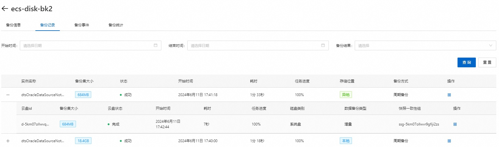

<a id="section-17-3"></a>

## 17.3. 如何解决普通用户登录备份页面报错

本文介绍创建普通用户后如何为普通用户绑定对应的角色，从而获取角色相应的权限。

**问题现象**

普通用户登录ASR-BR页面时报错，显示无权限操作。

**可能原因**

普通用户没有对应的权限，无法登录ASR-BR，因此无法查看其页面。角色和角色相应权限请参见角色和权限说明。

**解决方案**

1. 以运营管理员登录运营控制台。

2. 在顶部菜单中选择**企业**。

3. 在左侧导航栏中选择**人员管理 > 用户管理**。

4. 下拉选择普通用户所在的组织，在搜索框中输入普通用户的用户名，单击  。

5. 单击普通用户**操作**列  ，选择**角色授权**。

6. 参考角色和权限说明给普通用户选择对应的角色，将对应的权限绑定给该普通用户。

   > **说明**
   >
   > 支持选择多个角色。

7. 单击**确定**。

**验证结果**

1. 以绑定好权限的普通用户登录备份管理平台ASR-BR。

2. 查看备份管理平台页面是否报错。

   - 页面显示正常，但是没有数据；请切换到该普通用户所在的组织下，如果还是没有数据，请确认是否有业务数据。

   - 页面显示报错，请联系备份产研团队定位处理。

<a id="section-17-4"></a>

## 17.4. 如何解决创建存储池时密钥错误或AccessDenied

本文介绍创建存储池时的报错问题如何解决。

**问题现象**

用root身份跳转后的运营管理员，无法创建存储池，提示密钥错误或AccessDenied。

**可能原因**

添加存储池时填写的**AccessKey ID**和**AccessKey Secret**错误。

> **说明**
>
> 因为添加存储池时填写的**AccessKey ID**和**AccessKey Secret**是目的端的AK/SK，并且具有读写存储权限。因此请提前获取到正确的目的端（OSS、CDS-OSS、MINIOSS、PanguStor、SDS）的AccessKey ID和AccessKey Secret。

**解决方案**

> **说明**
>
> 由于目前ASR-BR支持的备份目的端介质都是支持OSS协议的存储介质，因此可以通过ossutil验证填写的AK、SK是否有读写OSS权限。

1. 在OSS官网下载ossutil：安装ossutil。

2. 将ossutil上传到StandardAsrbrCluster的asrbr-backup.Backup# VM内的asrbr-backup docker中。

3. 执行以下命令，修改权限。

   

4. 执行以下命令，配置ossutil连接目的端，测试网络连通性。

   

   ossutil连接的目的端oss endpoint、AK、SK。（将ossutil上传到asrbr-backup docker中也可以验证asrbr管控到目的端网络的连通性。）

5. 通过ossutil执行以下命令，确定权限。

   ```text
   ./ossutil64 ls [-s] [--limited-num] [--marker] 
   ```

   | 选项 | 说明 |
   | --- | --- |
   | -s | 列举结果仅返回Bucket的名称。 |
   | --limited-num | 设定返回结果的最大个数。您可以使用此项结合<strong>marker</strong>对返回结果进行分页展示。 |
   | --marker | 列举名称字母序排在marker之后的Bucket。 |

   - 如果没有报错，则说明该AK/SK权限满足要求，可以正常使用。

   - 如果报错，则说明该AK/SK无访问OSS权限；请再选择合适的AK/SK参考以上步骤验证无报错后再填入存储池进行创建。

**验证方式**

> **说明**
>
> 以下步骤以已经创建好存储池组为背景介绍，如果没有存储池组，请先创建存储池组。请参见创建存储池。

1. 以运营管理员登录运营控制台。

2. 在左侧导航栏中选择**系统管理** > **存储池组管理**。

3. 在存储池组名称的搜索框中输入存储池组名称，单击**查询**。

4. 单击存储池组**操作**列的**添加存储池**。

5. 填写对应的参数值。

   <table>
     <tr>
       <th width="185">配置项</th>
       <th>描述</th>
     </tr>
     <tr>
       <td>存储池名称</td>
       <td>请设置一个容易识别的存储池名称，例如“公共云存储池”。<br>说明名称由中文、英文、数字、短划线（-）、下划线（_）组成，长度小于64个字符，大小写敏感。</td>
     </tr>
     <tr>
       <td>存储空间</td>
       <td>设置存储池的最大存储空间，单位为TB。</td>
     </tr>
     <tr>
       <td>AccessKey ID</td>
       <td>访问目的端存储账号对应的AccessKey ID。<br>说明该组AccessKey ID和AccessKey Secret至少需要有读写存储权限。</td>
     </tr>
     <tr>
       <td>AccessKey Secret</td>
       <td>访问目的端存储账号对应的AccessKey Secret。</td>
     </tr>
     <tr>
       <td>授权组织</td>
       <td>选择授权的一级组织名称，支持全选。</td>
     </tr>
     <tr>
       <td>回收站</td>
       <td>选填，自定义输入回收站名称。当该存储池下需要创建重删存储仓库或镜像仓库时，该参数必填。<br>说明当创建重删存储仓库或镜像仓库时，填写的回收站Bucket存在会直接使用，不存在将创建一个对应名称的Bucket使用。</td>
     </tr>
     <tr>
       <td><strong>存储池描述</strong>（可选）</td>
       <td>请对存储池进行简要描述，便于区分。</td>
     </tr>
   </table>

6. 单击**确定**。

   - 如果创建成功，则问题处理结束。

   - 如果创建失败，请联系备份研发团队定位处理。

<a id="section-17-5"></a>

## 17.5. 如何解决ASR-BR页面报错

本章节介绍当ASR-BR菜单页面显示异常时如何解决。

**问题现象**

ASR-BR的菜单显示500错误信息，菜单显示异常。

**可能原因**

HBR服务没有正常运行。

**解决方案**

1. 登录Apsara Uni-manager运维控制台。

2. 在页面顶部菜单栏中，选择**平台运维 > 资源管理**，进入飞天基础运维平台。

3. 在左侧导航栏中，选择**资源管理 > 产品集群运维**。

4. 在**产品集群运维**页面，在**产品 | 集群**搜索框中输入ASRBR，找到对应的集群，单击**集群详情**。

5. 在**集群详情**页面，单击**hbr-console**服务。

   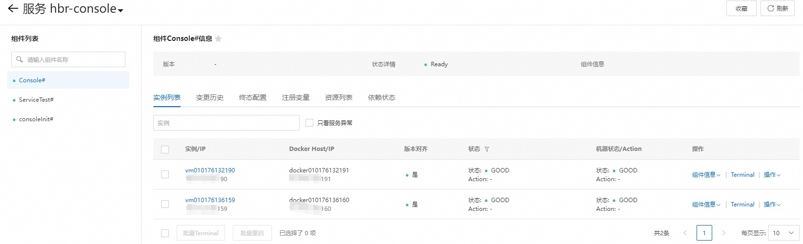

6. 单击实例/IP，进入**机器详情**页面。

7. 单击组件为<strong>Console#</strong>的操作列**重启**。

8. 在弹出的**操作确认提示**框上输入**RESTART**后，单击**确定**。

9. 等待重启成功后，根据验证结果的步骤查看页面是否正常。

**验证结果**

1. 登录备份管理平台ASR-BR，会以当前账号登录备份管理平台ASR-BR。

2. 打开任意ASR-BR菜单页面，查看页面是否存在500报错。

   - 页面显示正常，问题处理结束。

   - 页面提示500报错，请联系研发团队定位处理。

<a id="section-18"></a>

# 18.附录

<a id="section-18-1"></a>

## 18.1. 在ECS上安装HBR-Agent

ECS异地备份需要在主中心ECS实例上安装HBR-Agent客户端。

**背景信息**

主中心需要做异地备份和异地恢复的ECS实例上，都需要安装HBR-Agent。

**操作步骤**

1. 获取hbr服务地址。

   <ol type="i">

   <li>

   登录备中心的Apsara Uni-manager运维控制台。

   </li>

   <li>

   在顶部菜单栏选择**平台运维 > 飞天基础运维平台 > 资源管理**。

   </li>

   <li>

   在飞天基础运维平台的左侧导航栏中，单击**运维工具** > **基础数据管理** > **底座元数据管理** > **服务注册变量大盘**。

   </li>

   <li>

   在左上角下拉框中选择**服务**，在搜索框中分别输入“rds-ddr-proxy”和“hbr-rabbitmq”，单击搜索按钮。

   </li>

   <li>

   在**rds-ddr-proxy**服务的**Service Registration**列单击  图标，再单击内容，会出现注册变量弹

   窗。

   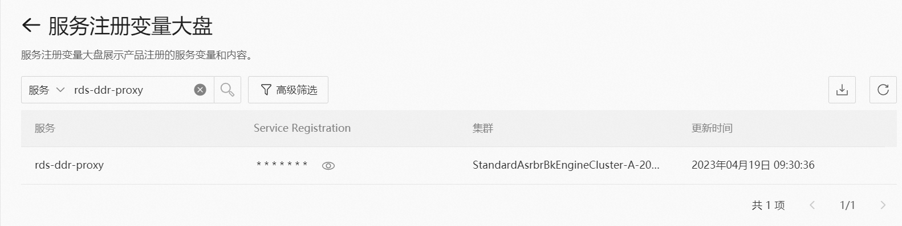

   在注册变量弹窗中查看**asr.resource.domain**的值：

   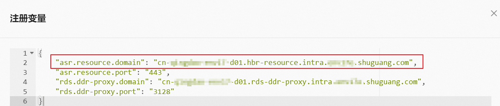

   </li>

   <li>

   在**hbr-rabbitmq**服务的**Service Registration**列单击  图标，再单击内容，会出现注册变量弹

   窗。

   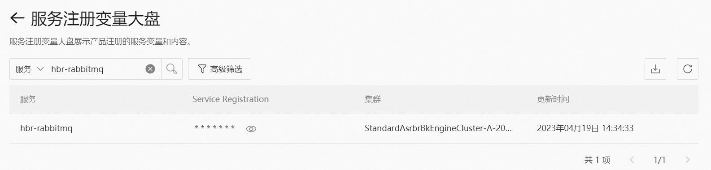

   在注册变量弹窗中查看**hbr.rabbitmq.domain**的值：

   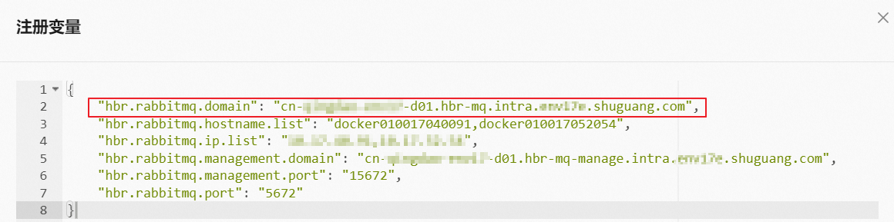

   </li>

   </ol>

2. 在主中心的ECS实例中下载HBR-Agent安装包。

   - linux环境中下载安装包的命令如下：

     ```bash
     curl -O --basic -u guest:guest 
     http://<hbr_resource_host>/download/<hbragent_filename>
     ```

     > **说明**
     >
     > &lt;hbr_resource_host>的值请替换为步骤1中**asr.resource.domain**的值。
     >
     > &lt;hbragent_filename>的值请填写HBR Agent的安装包名称，具体如下：
     >
     > - 32位操作系统：hbr-install-2.0.0-linux-32bit.tar.gz
     >
     > - 64位操作系统：hbr-install-2.0.0-linux-64bit.tar.gz

   - Windows环境中，请在浏览器中输入如下地址下载安装包。

     ```xml
     <hbr_resource_host>/download/<hbragent_filename>
     ```

     在弹出的对话框中，输入用户名*guest*，密码*guest*。

     > **说明**
     >
     > &lt;hbr_resource_host>的值请替换为步骤1中**asr.resource.domain**的值。
     >
     > &lt;hbragent_filename>请填写HBR Agent的安装包名称，具体如下：
     >
     > - 32位操作系统：hbr-install-2.0.0-windows-32bit.zip
     >
     > - 64位操作系统：hbr-install-2.0.0-windows-64bit.zip

3. 解压缩安装包。

4. 安装HBR-Agent。

   - 在Linux环境中执行如下命令：

   - 在Linux环境中执行如下命令

     ```text
     ./setup -m ApsaraStack -h<hbr_amqp_host>
     ```

     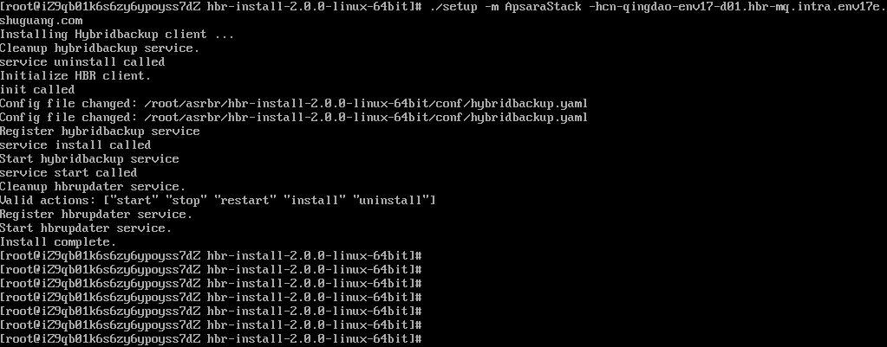

   - 在Windows环境中执行如下命令：

     ```xml
     <hbragent_filename> /TYPE=ApsaraStack /host= <hbr_amqp_host>/SUPPRESSMSGBOXES /VERY
     SILENT
     ```

     > **说明**
     >
     > &lt;hbr_amqp_host>请替换为步骤1中获取的**hbr.rabbitmq.domain**的值。
     >
     > &lt;hbragent_filename>请填写HBR Agent的安装包名称，具体如下：
     >
     > - 32位操作系统：hbr-install-2.0.0-windows-32bit.zip
     >
     > - 64位操作系统：hbr-install-2.0.0-windows-64bit.zip

5. 检查HBR服务运行正常。

   - Linux环境：执行如下命令检查HBR服务。

     ```text
     ps aux | grep hbr
     ```

     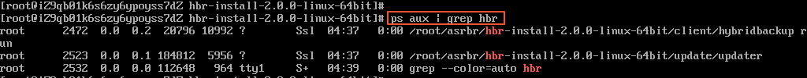

   - Windows环境：在任务管理器中查看**hybridbackup**服务的状态为**正在运行**。

<a id="section-18-2"></a>

## 18.2. 使用备份仓库存储级联功能的前置操作

本章节会介绍在使用备份仓库存储级联功能的简介，网络要求、约束条件以及初始化操作。

<a id="section-18-2-1"></a>

### 18.2.1. 备份仓库存储级联功能描述

备份仓库是指在存储池上规划的逻辑存储空间，用于存储用户的备份数据。备份仓库的存储级联功能允许用户根据备份需要，对备份仓库创建一个异地的镜像仓库，备份仓库中的数据将会使用OSS跨域/云复制能力，自动将数据复制到镜像仓库中，实现备份数据保存多地，恢复时允许用户选择任意仓库恢复。

**网络条件**

- 保证ASR-BR相关组件和多个目的端的OSS存储网络连通，详情请参见网络约束。

- 根据OSS跨域/云复制的需要，保证多个目的端的OSS存储之间网络连通，并可以正常进行数据复制，其中：

  - OSS跨域复制：请根据客户现场网络建设情况，结合多Region场景网络并网方案进行操作。

  - OSS跨云复制：需要保证源端云的OSS可以通过域名正常访问目的端云的OSS，同时可以进行数据复制。

    - 如果使用DNS规则配置方案，则要保证源端云部署DNS产品，并在源端云的租户侧DNS和OpsDNS上配置相应的DNS域名转发规则并进行并网。具体DNS配置规则及回滚方案请工单咨询相关技术人员。

    - 如果使用其他方式实现域名转发和网络连通，请根据客户现场情况和安全要求重新评估。

**约束条件**

- ASR-BR相关组件和多个目的端的OSS存储网络连通，且数据复制的两端OSS产品网络连通且跨域/云复制能力可以正常使用。详情请参见网络约束。

- 对于跨域复制，在ASR-BR控制台上需要对数据复制的两个存储池（即备份仓库&镜像仓库所属的存储池）的相关信息进行填写，其中包括云名称、云Region、Location；对于跨云复制，需要填写云名称、云Region、Location、代理用户的UID。

- 使用备份仓库创建镜像仓库之前，请分别配置好备份仓库和镜像仓库所属的存储池回收站。

- 目前仅支持OSS 1.0、CDS-OSS和PanguStor三种存储介质的数据复制，MiniOSS和SDS不支持。同时OSS 1.0仅支持复制到OSS 1.0，CDS-OSS和PanguStor之间允许互相复制。

- 对于备份存储端，如果存在OSS 1.0和CDS-OSS两个集群并开启迁移模式时，则无法支持存储级联功能。如果有此需求，请提工单联系研发团队提供解决方案。

<a id="section-18-2-2"></a>

### 18.2.2. 控制台的初始化操作

为保证数据可以从备份仓库同步至镜像仓库，需要做一次性的人工配置，也属于初始化操作。异地跨云同步分为源端和目的端，初始化操作步骤不一致，请注意确认所处的环境属于源端还是目的端，防止操作错误耗费时间。

**目的端（镜像仓库端）操作步骤**

1. 在目的端创建代理用户并授权。

   > **说明**
   >
   > 仅跨云复制需要操作该步骤。

   <ol type="i">

   <li>

   登录目的端Apsara Uni-manager运营控制台。

   </li>

   <li>

   在顶部菜单中选择**企业 > 权限管理 > 角色授权**。

   </li>

   <li>

   单击**创建自定义角色**。

   </li>

   <li>

   输入角色名称，其他参数保持默认。

   </li>

   <li>

   展开高级创建，单击**创建RAM授权**。

   </li>

   <li>

   输入角色名称，其他参数保持默认，单击**创建RAM授权并配置**。

   </li>

   <li>

   单击**权限管理**页签，单击**添加权限策略**。

   </li>

   <li>

   单击**创建权限策略**，自定义策略名称，策略内容按照以下内容填入。

   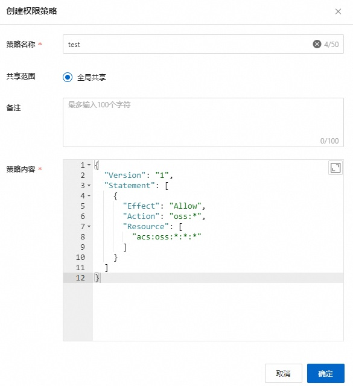

   ```json
   {
    "Version": "1",
    "Statement": [
    {
    "Effect": "Allow",
    "Action": "oss:*",
    "Resource": [
    "acs:oss:*:*:*"
    ]
    }
    ]
   }
   ```

   </li>

   <li>

   单击**确定**。

   </li>

   <li>

   勾选上一步创建的权限策略，单击**确定**。

   </li>

   </ol>

2. 创建用户组。

   > **说明**
   >
   > PanguStor只有用户，没有用户组，请跳过该步骤。

   <ol type="i">

   <li>

   在左侧导航栏中选择**人员管理 > 用户组管理**。

   </li>

   <li>

   单击**创建用户组**。

   </li>

   <li>

   自定义用户组名和组织，角色授权必须包含上一步创建的RAM授权角色。

   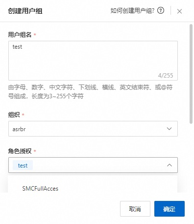

   </li>

   <li>

   单击**确定**。

   </li>

   </ol>

3. 创建代理用户。

   <ol type="i">

   <li>

   在左侧导航栏中选择**人员管理 > 用户管理**。

   </li>

   <li>

   单击**创建用户**。

   </li>

   <li>

   组织必须选择上一步所选的组织，其他参数用户自己根据实际情况填写。

   </li>

   <li>

   单击**确定**，系统会创建一个AccessKey信息，请保存并记录，后续会用到。

   </li>

   <li>

   单击创建成功用户**操作**列**查看**。

   </li>

   <li>

   查看并记录该用户的UID，后续会用到。

   </li>

   <li>

   单击该用户**操作**列  > **用户组管理**，单击**加入用户组**。

   > **说明**
   >
   > PanguStor只有用户，没有用户组，请跳过该步骤。

   </li>

   <li>

   勾选上一步创建的用户组，单击**确定**。

   </li>

   </ol>

4. 设置代理用户权限。

   <ol type="i">

   <li>

   登录目的端Apsara Uni-manager运维控制台。

   </li>

   <li>

   在顶部菜单中选择**产品运维 > 存储运维 > OSS运维OSS赤冀**。

   </li>

   <li>

   在左侧导航栏中选择**服务运维-OSS > OCM名单管理**。

   </li>

   <li>

   单击**添加**，输入上一步保存的代理用户UID，**type**选择**as_sync_admin**，单击**添加**，单击**Yes**。

   </li>

   </ol>

5. 获取云参数。

   <ol type="i">

   <li>

   在左侧导航栏中选择**服务运维-OSS > 同步管理 > 跨云同步配置**。

   </li>

   <li>

   选择相应的Cluster，单击**查看本朵云参数**。

   </li>

   <li>

   复制并保存每个Cluster的本朵云名称、本朵云Region、本朵云Region域名、最底部的Location，4个参数的值，后续会用到。

   > **说明**
   >
   > 需要记录每个Cluster下的参数值。

   </li>

   </ol>

6. 在ASR-BR控制台上配置跨域/云复制授权。

   <ol type="i">

   <li>

   登录目的端Apsara Uni-manager运营控制台。

   </li>

   <li>

   在顶部菜单栏中选择**产品 > 容灾 > 备份管理平台ASR-BR**。

   </li>

   <li>

   在左侧导航栏中选择**系统管理 > 存储池组管理**。

   </li>

   <li>

   找到目的端对应的存储池，单击**操作**列**跨云/云复制授权**。

   </li>

   <li>

   输入目的端的云名称、云Region、Location，和代理用户的PrimaryKey，单击**确认**。

   > **说明**
   >
   > 如果是作为跨域复制的目的端，则代理用户的PrimaryKey不用填，如果是作为跨云复制的目的端，则代理用户的PrimaryKey必填。

   </li>

   </ol>

**源端（备份仓库端）操作步骤**

1. 登录源端Apsara Uni-manager运维控制台。

2. 在顶部菜单中选择**产品运维 > 存储运维 > OSS运维OSS赤冀**。

3. 在左侧导航栏中选择**服务运维-OSS > 同步管理 > 跨云同步配置**。

4. 单击**新增**，输入在目的端保存的每个Cluster的本朵云名称、本朵云Region、本朵云Region域名、最底部的Location的参数值和AccessKey信息。

   > **说明**
   >
   > 目的端获取的每个Cluster的参数值都要在源端新增。

5. 登录源端Apsara Uni-manager运营控制台。

6. 在顶部菜单中选择**产品 > 容灾 > 备份管理平台ASR-BR**。

7. 在左侧导航栏中选择**系统管理 > 存储池组管理**。

8. 单击**操作**列**跨域/云复制授权**。

9. 输入源端的云名称、云Region、Location，单击**确认**。

<a id="section-18-3"></a>

## 18.3. 为组织配置ASR-BR服务角色

本文介绍如何为相应组织配置ASR-BR服务角色。

**操作步骤**

1. 登录Apsara Uni-manager运营控制台。

2. 在顶部菜单栏，单击**配置**。

3. 在左侧导航栏，单击**RAM服务角色**。

4. 在**RAM服务角色列表**页面，单击**创建RAM服务角色**。

5. 在**RAM服务角色创建**页面，在**服务名称**下拉列表选择**备份管理平台 ASR-BR**，在**授权组织名称**中选择相应的组织名称。

6. 单击**确定**。

<a id="section-18-4"></a>

## 18.4. 网络约束

异地备份主备模式下，需要与用户的网络之间做好对接。

> 两朵云的网络连通、NTP时钟对齐、DNS转发规则设定，请参见 *阿里云专有云企业版部署*
>
> **说明**
>
> *指南* 中的异地备份章节。

<a id="section-18-5"></a>

## 18.5. 统计组织资源集级别资源用量

ASR-BR会采用定时推送的方式，在每天凌晨1点将前一天的备份数据以实例维度进行统计推送，实现T+1的延迟推送，统计每个产品每个实例备份数据大小，按照组织、资源集维度展示在OMS计量管理平台。

**背景信息**

ASR-BR作为统一备份管理平台，会对云产品按照周期进行备份，也会关注备份的数据量，也为了更好的备份体验，ASR-BR接入OMS平台统一计量，给以统一的计量体验。

**操作步骤**

1. 登录Apsara Uni-manager运营控制台。

2. 在顶部菜单选择**运营 > 资源运营 > 对云资源的运营管理管控**。

3. 在左侧导航栏中选择**计量管理**。

4. 选择云产品为**备份管理平台ASR-BR**，设置组织、资源集以及其他的查询条件，单击**搜索**。

   > **说明**
   >
   > 计量统计实现了基于租户维度的资源隔离，实现最小权限化，不会越权查看其他租户的计量数据。

   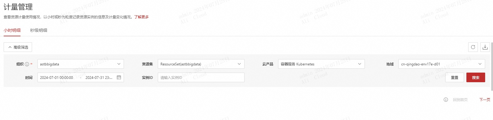

<a id="section-18-6"></a>

## 18.6. SMB协议NAS的备份与恢复

<a id="section-18-6-1"></a>

### 18.6.1. 使用SMB协议备份NAS

**前提条件**

- 在创建NAS SMB协议文件系统的地域，已有可用的云服务器ECS（Windows），由于Linux系统对SMB协议的兼容程度较低，备份引擎暂时未做支持。

- 已创建NAS SMB协议文件系统，并获取到文件系统的挂载点地址。

- 网络连通：

  - 检查文件系统白名单，确保云服务器ECS（Windows）已经被授予访问该SMB协议文件系统的权限。

  - 确保端口445处于打开状态，SMB协议文件系统将通过TCP端口445通信。如果端口445未打开，请在目标ECS实例的安全组中添加关于端口445的安全组规则。

- 针对ASR-BR来说，备份NAS SMB协议文件系统是对挂载在ECS下的共享文件系统进行备份。

**操作步骤**

> **说明**
>
> 请确保在挂载每台Windows服务器时执行一次即可，不需要在每次挂载时都执行一次。

1. 准备环境。

   <ol type="i">

   <li>

   登录Apsara Uni-manager运营控制台。

   </li>

   <li>

   通过VNC Viewer或者远程连接方式连接到ECS实例。

   </li>

   <li>

   开启Workstation服务。

   <ol type="a">

   <li>

   选择**所有程序 > 附件 > 运行**或使用快捷键Win+R，输入services.msc进入本地服务。

   </li>

   <li>

   在服务中找到Workstation，确认状态为**正在运行**，启动类型为**自动**。正常情况下，Workstation服务默认为启动状态。

   </li>

   </ol>

   <ol type="i" start="100">

   <li>

   开启TCP/IP NetBIOS Helper服务。

   <ol type="a">

   <li>

   打开**网络与共享中心**，单击主机所连网络。

   </li>

   <li>

   单击**属性**，双击**Internet 协议版本 4**进入属性框，单击**高级**。

   </li>

   </ol>

   <ol type="i" start="100">

   <li>

   在**高级TCP IP设置**对话框中，选择**WINS > 启用TCP/IP上的NetBIOS**。

   </li>

   <li value="500">

   选择**所有程序 > 附件 > 运行**或使用快捷键Win+R，输入services.msc进入本地服务。

   </li>

   </ol>

   <ol type="a" start="5">

   <li>

   在服务中找到TCP/IP NetBIOS Helper，确认状态为**正在运行**，启动类型为**自动**。正常情况下，TCP/IP NetBIOS Helper服务默认为启动状态。

   </li>

   </ol>

   </li>

   </ol>

   </li>

   </ol>

2. 挂载NAS SMB协议文件系统。

   <ol type="i">

   <li>

   登录Apsara Uni-manager运营控制台。

   </li>

   <li>

   在顶部菜单中选择**产品 > 存储 > 文件存储 NAS**。

   </li>

   <li>

   在左侧导航栏中选择**文件系统 > 文件系统列表**。

   </li>

   <li>

   在**文件系统列表**页面，单击**创建文件系统**。

   </li>

   <li>

   输入文件系统名称，**协议类型**选择**SMB**，其他参数会自动填充，单击**提交**。

   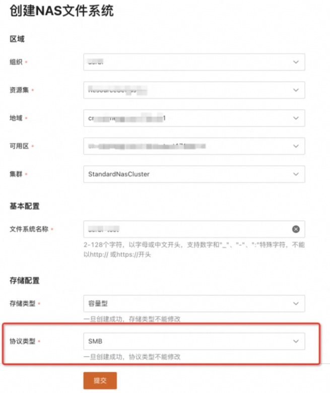

   </li>

   <li>

   单击**操作**列**管理**，单击**挂载使用**。

   </li>

   <li>

   单击**添加挂载点**，设置参数后单击**确定**，并记录挂载命令。

   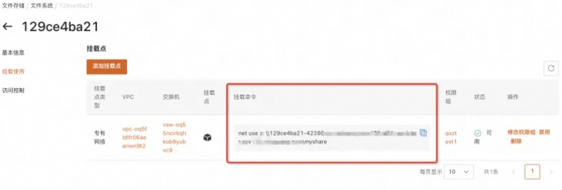

   </li>

   </ol>

3. 手动挂载文件系统。

   <ol type="i">

   <li>

   挂载文件系统。

   <ol type="a">

   <li>

   连接到ECS实例。

   </li>

   <li>

   打开cmd命令行窗口，执行以下命令挂载SMB文件系统。

   ```text
   net use Z: \\file-system-id.region.nas.aliyuncs.com\myshare
   ```

   | 参数 | 说明 |
   | --- | --- |
   | Z | 当前Windows系统上要挂载的目标盘符，如果有冲突，或者挂载了多个NAS文件系统，则按字母顺序递减盘符。 |
   | file-system-id.region.nas.aliyuncs.com | • 创建SMB文件系统时系统自动生成的挂载点地址，请根据实际值替换。<br>• 也可以单击目标文件系统，然后单击<strong>挂载使用</strong>，将<br>鼠标放置在挂载地址列的图标上获取挂载点地<br>址。 |
   | myshare | SMB的共享名称，不允许变更。 |

   </li>

   </ol>

   </li>

   <li>

   确认NAS SMB协议文件系统挂载成功。

   <ol type="a">

   <li>

   执行以下命令。

   ```text
   net use
   ```

   </li>

   <li>

   如果回显包含以下类似信息，说明挂载成功。挂载成功后，您可以在ECS上访问NAS SMB协议文件系统，执行读取或写入操作。

   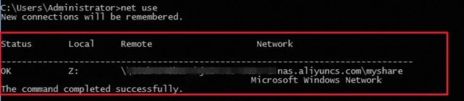

   </li>

   </ol>

   </li>

   </ol>

4. 安装ECS（windows）备份客户端。

   <ol type="i">

   <li>

   登录Apsara Uni-manager运营控制台。

   </li>

   <li>

   在顶部菜单中选择**产品 > 容灾 > 备份管理平台ASR-BR**。

   </li>

   <li>

   在左侧导航栏中单击**备份计划**。

   </li>

   <li>

   在**备份计划**页面，单击**新建**。

   </li>

   <li>

   在**基本信息**阶段，选择**实例类型**为**云服务器 ECS**，**备份方式**选择<strong>文件备份，</strong>单击**下一步**。

   </li>

   <li>

   在**选择实例**阶段，勾选相应的ECS实例，单击**下一步**。

   </li>

   <li>

   在**安装客户端**阶段，选择客户端安装的路径，单击**安装**。

   </li>

   <li>

   安装成功后，连接ECS根据安装目录查看客户端安装及服务可以查看运行的备份客户端，如下图所示，即表示安装成功。单击**下一步**。

   </li>

   </ol>

5. 授予备份客户端备份SMB NAS权限。

   <ol type="i">

   <li>

   连接ECS实例。

   </li>

   <li>

   使用组合键Win+R，打开运行工具后输入services.msc，单击**确定**。

   </li>

   <li>

   在服务中Aliyun Cloud Hybrid Backup Service。单击右键选择**属性**。

   </li>

   <li>

   在对话框中，选择**登录**页签。

   </li>

   <li>

   选中**此账号**，通过浏览方式输入账号和密码。单击确定。该账号必须具备以下权限。

   - 对该NAS文件系统有完全访问权限。

   - 具有本地管理员权限。

   - 拥有以服务身份登录权限。

     > **说明**
     >
     > 具体操作请参见安装客户端时如何选择组件和账号？。

   </li>

   <li>

   单击重新启动，重启Aliyun Cloud Hybrid Backup Service服务。

   </li>

   </ol>

6. 继续步骤四创建SMB NA备份计划。

   <ol type="i">

   <li>

   在**配置实例**阶段，选择备份文件路径为：\\\\file-system-id.region.nas.aliyuncs.com\\myshare。

   </li>

   <li>

   单击**下一步**，参考创建备份计划配置备份策略。直至备份计划创建完成。

   </li>

   </ol>

7. 在**备份记录**页签可以查看备份结果。

<a id="section-18-6-2"></a>

### 18.6.2. 使用SMB协议恢复NAS

使用SMB协议恢复NAS时，由于ECS文件只支持覆盖型恢复，建议恢复时，使用一个新的SMB NAS挂载到ECS内进行覆盖恢复。防止原SMB NAS的数据直接被备份数据覆盖导致数据丢失。

**前提条件**

- 在创建NAS SMB协议文件系统的地域，已有可用的云服务器ECS（Windows），由于Linux系统对SMB协议的兼容程度较低，备份引擎暂时未做支持。

- 已创建NAS SMB协议文件系统，并获取到文件系统的挂载点地址。

- 网络连通：

  - 检查文件系统白名单，确保云服务器ECS（Windows）已经被授予访问该SMB协议文件系统的权限。

  - 确保端口445处于打开状态，SMB协议文件系统将通过TCP端口445通信。如果端口445未打开，请在目标ECS实例的安全组中添加关于端口445的安全组规则。

- 针对ASR-BR来说，备份NAS SMB协议文件系统是对挂载在ECS下的共享文件系统进行备份。恢复时，由于ECS文件只支持覆盖型恢复，建议恢复SMB NAS时，使用一个新的SMB NAS挂载到ECS内进行覆盖恢复。防止原SMB NAS的数据直接被备份数据覆盖导致数据丢失。

**操作步骤**

1. 登录备份管理平台ASR-BR。

2. 在左侧导航栏中选择**恢复任务**，单击**恢复任务/新建**。

3. 在**基本信息阶**段，配置参数后，单击**下一步**。

   <table>
     <tr>
       <th width="121">配置</th>
       <th>描述</th>
     </tr>
     <tr>
       <td>恢复任务名称</td>
       <td>恢复任务的名称由中文、英文、数字、短划线（-）、下划线（_）或半角句号（.）组成，长度为4~20个字节。</td>
     </tr>
     <tr>
       <td>恢复任务描述</td>
       <td>可选。请输入对恢复任务的描述，以便于识别。</td>
     </tr>
     <tr>
       <td>实例类型</td>
       <td>选择<strong>云服务器 ECS</strong>。</td>
     </tr>
     <tr>
       <td>恢复任务类型</td>
       <td>在本场景中请选择<strong>常规恢复</strong>。</td>
     </tr>
     <tr>
       <td>恢复方式</td>
       <td>• <strong>云盘恢复</strong>：当ECS实例的备份方式为云盘备份时，支持该恢复方式。<br>• <strong>文件恢复</strong>：当ECS实例的备份方式为文件备份时，支持该恢复方式。</td>
     </tr>
   </table>

4. 在**选择实例**阶段，勾选需要恢复的实例，单击**下一步**。

5. 在**选择记录**阶段，勾选之前的备份记录，单击**确定**。

6. 在**配置实例**阶段，设置目的端和客户端。然后单击**下一步**。

   <ol type="i">

   <li>

   在**恢复目的端**阶段，选择要恢复的目标实例。单击**下一步**。

   </li>

   <li>

   在**客户端安装**阶段，若挂载了要恢复的SMB协议文件系统的ECS实例没有安装备份客户端，那么需要安装。安装完成后，单击**下一步**。

   </li>

   <li>

   在**恢复文件规则**阶段，请手动输入本地存放恢复文件的路径。单击**下一步**。

   </li>

   </ol>

7. 完成恢复任务创建，等待恢复任务执行成功后，参考查看恢复任务可查看恢复结果。

<a id="section-18-7"></a>

## 18.7. 异地备份

**异地备份（ASR-BR）产品使用限制**

**数据库类备份限制**

- 云数据库RDS SQLServer版启用透明数据加密（TDE）功能后，不支持恢复。

- 云数据库RDS MySQL版启用透明数据加密（TDE）功能后，不支持跨地域恢复以及云重建恢复。

- 云数据库RDS、云原生分布式数据库PolarDB-X、云原生数据仓库AnalyticDB MySQL版3.0产品使用本地备份记录进行恢复时，必须确保原实例没有被删除。

**存储类备份限制**

- 创建OSS新建型恢复任务时，会创建新的Bucket，容量默认使用原备份Bucket的容量，但是并不会实际占用存储空间。

- 每个文件存储NAS备份任务包含的文件数量不能超过5000万，单个目录下的文件及子目录数量之和不能超过800万。

- 云服务器ECS文件备份支持备份的数据规模取决于内存资源。在4 GB可用系统内存的情况下，可备份的最大文件数量为100万个，总数据量为8 TB。

- 云服务器ECS文件备份，建议使用双核及以上64位CPU，并配备8 GB以上的可用内存的云服务器。如果目录下的文件数量达千万级别以上，建议配备16 GB的可用内存。

**对象存储OSS使用限制**

- ASR-BR目前不支持备份VPC OSS。

- 需要备份的OSS，如果设置了Bucket授权策略，请保证该授权策略允许ASR-BR服务有OSS文件可读权限。

- 针对OSS内动态文件（在备份过程中文件仍在追加写、分片上传、或者覆盖写）备份场景：

  - 如果该文件是小文件(小于25MB)，备份时发现文件发生变化且ETag前后不一致，那将会尝试备份更新后的文件，备份结果请以最后成功备份出去的数据量为准。

  - 如果该文件是大文件(大于25MB)，由于备份大文件时是分段读取并备份，备份时发现文件发生变化且ETag前后不一致，备份结果请以实际备份出去的数据量为准。

    - 对于旧文件将”尽可能备份“，即已经备份成功的”旧文件“连续分段仍会存入备份仓库中，并认为”旧文件“备份成功，且备份任务将认为该文件备份成功。

    - ”新文件“将不再备份，等待下次备份触发”新文件“备份。

**MaxCompute备份限制**

- MaxCompute备份时，必须已启用外表功能。

- MaxCompute备份时，必须已购买MaxCompute联合计算增强包。

**云服务器ECS整机或云盘备份限制**

- 仅支持云盘崩溃一致性备份。

- 不支持跨云盘建立LVM或SoftRAID。

- 不支持加密云盘的备份恢复。

- 最多仅支持保留64个本地快照。

- 对云盘进行备份时，如果手动创建快照，可能导致备份失败。

- 快照一致性组最多支持16块盘打快照，数据量最大为32TB。
