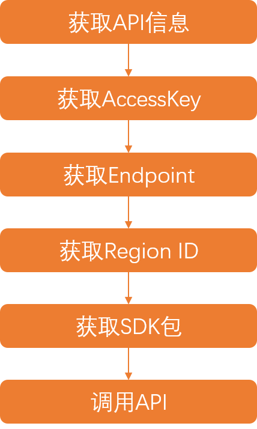
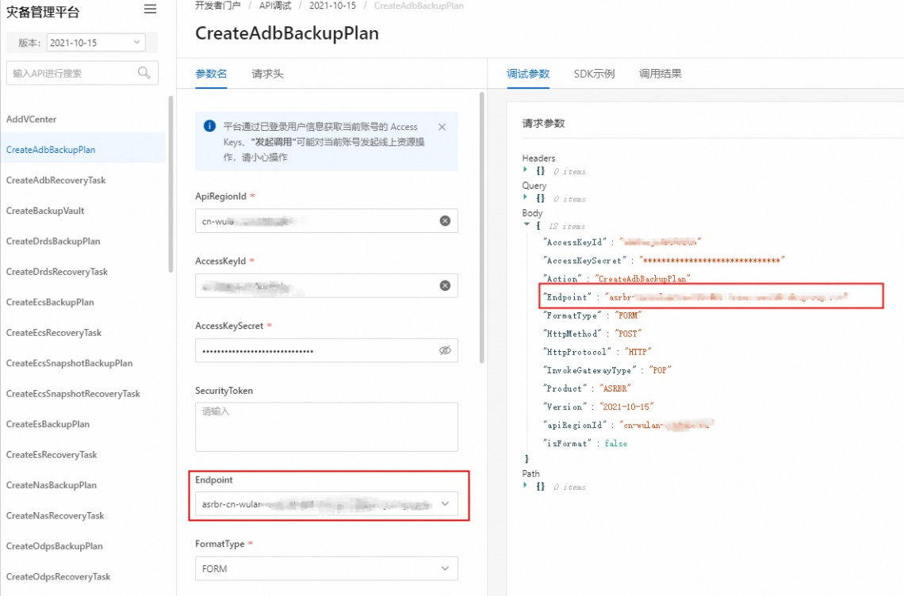
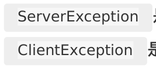

阿里云  
专有云  
备份管理平台  
开发指南  
产品版本：V3.18.6  
文档版本：20250611

**目录**

- [1.API调用流程说明](#section-1)
- [2.准备工作](#section-2)
    - [2.1. 获取AccessKey](#section-2-1)
    - [2.2. 获取API信息及其Endpoint](#section-2-2)
    - [2.3. 通过POP网关调用专有云API](#section-2-3)
- [3.Java SDK调用示例](#section-3)
    - [3.1. 安装Java SDK](#section-3-1)
    - [3.2. 设置身份验证凭证](#section-3-2)
    - [3.3. 发起调用请求](#section-3-3)
    - [3.4. 错误处理](#section-3-4)
- [4.API参考](#section-4)
    - [4.1. 初始化云实例信息](#section-4-1)
        - [4.1.1. InitCloudInfo](#section-4-1-1)
    - [4.2. 备份仓库](#section-4-2)
        - [4.2.1. CreateBackupVault](#section-4-2-1)
        - [4.2.2. DescribeVaultUseageDetail](#section-4-2-2)
        - [4.2.3. DescribeBackupVault](#section-4-2-3)
        - [4.2.4. DescribeBackupVaultList](#section-4-2-4)
    - [4.3. 备份计划](#section-4-3)
        - [4.3.1. 安装ECS客户端](#section-4-3-1)
            - [4.3.1.1. InstallEcsClient](#section-4-3-1-1)
        - [4.3.2. 创建备份计划](#section-4-3-2)
            - [4.3.2.1. CreateAdbBackupPlan](#section-4-3-2-1)
            - [4.3.2.2. CreateDrdsBackupPlan](#section-4-3-2-2)
            - [4.3.2.3. CreateEsBackupPlan](#section-4-3-2-3)
            - [4.3.2.4. CreateEcsBackupPlan](#section-4-3-2-4)
            - [4.3.2.5. CreateEcsSnapshotBackupPlan](#section-4-3-2-5)
            - [4.3.2.6. CreateNasBackupPlan](#section-4-3-2-6)
            - [4.3.2.7. CreateOdpsBackupPlan](#section-4-3-2-7)
            - [4.3.2.8. CreateOssBackupPlan](#section-4-3-2-8)
            - [4.3.2.9. CreateRdsBackupPlan](#section-4-3-2-9)
        - [4.3.3. 管理备份计划](#section-4-3-3)
            - [4.3.3.1. DeleteBackupPlan](#section-4-3-3-1)
            - [4.3.3.2. DescribeBackupPlanList](#section-4-3-3-2)
            - [4.3.3.3. DescribeBackupPlan](#section-4-3-3-3)
            - [4.3.3.4. DisableBackupPlan](#section-4-3-3-4)
            - [4.3.3.5. EnableBackupPlan](#section-4-3-3-5)
            - [4.3.3.6. ExecuteBackupPlan](#section-4-3-3-6)
            - [4.3.3.7. ModifyBackupPolicy](#section-4-3-3-7)
    - [4.4. 备份记录](#section-4-4)
        - [4.4.1. DescribeBackupInstanceRecordList](#section-4-4-1)
    - [4.5. 恢复任务](#section-4-5)
        - [4.5.1. 创建恢复任务](#section-4-5-1)
            - [4.5.1.1. CreateAdbRecoveryTask](#section-4-5-1-1)
            - [4.5.1.2. CreateDrdsRecoveryTask](#section-4-5-1-2)
            - [4.5.1.3. CreateEcsRecoveryTask](#section-4-5-1-3)
            - [4.5.1.4. CreateEcsSnapshotRecoveryTask](#section-4-5-1-4)
            - [4.5.1.5. CreateEsRecoveryTask](#section-4-5-1-5)
            - [4.5.1.6. CreateNasRecoveryTask](#section-4-5-1-6)
            - [4.5.1.7. CreateOdpsRecoveryTask](#section-4-5-1-7)
            - [4.5.1.8. CreateOssRecoveryTask](#section-4-5-1-8)
            - [4.5.1.9. CreateRdsRecoveryTask](#section-4-5-1-9)
        - [4.5.2. 管理恢复任务](#section-4-5-2)
            - [4.5.2.1. DescribeRecoverableDiskList](#section-4-5-2-1)
            - [4.5.2.2. DescribeRecoverableDrdsDbEngine](#section-4-5-2-2)
            - [4.5.2.3. DescribeRecoverableDrdsDbSepc](#section-4-5-2-3)
            - [4.5.2.4. DescribeRecoverableInstanceList](#section-4-5-2-4)
            - [4.5.2.5. DescribeRecoverableInstanceRecordList](#section-4-5-2-5)
            - [4.5.2.6. DescribeRecoveryTaskList](#section-4-5-2-6)
            - [4.5.2.7. DescribeRecoveryTask](#section-4-5-2-7)
            - [4.5.2.8. DisableRecoveryTask](#section-4-5-2-8)
            - [4.5.2.9. EnableRecoveryTask](#section-4-5-2-9)
            - [4.5.2.10. RestartRecoveryTask](#section-4-5-2-10)
            - [4.5.2.11. DescribeAvailableRecoveryTime](#section-4-5-2-11)
    - [4.6. VMware备份、恢复、迁移](#section-4-6)
        - [4.6.1. CreateVmwareBackupPlan](#section-4-6-1)
        - [4.6.2. CreateVmwareLocalRecovery](#section-4-6-2)
        - [4.6.3. CreateVmwareRestoreToCloud](#section-4-6-3)
        - [4.6.4. DescribeVmwareBackupPlanList](#section-4-6-4)
        - [4.6.5. DescribeVmwareBackupPlan](#section-4-6-5)
    - [4.7. vCenter管理](#section-4-7)
        - [4.7.1. AddVCenter](#section-4-7-1)
        - [4.7.2. ModifyvCenterInfo](#section-4-7-2)
        - [4.7.3. DeleteVCenter](#section-4-7-3)
        - [4.7.4. DescribeVCenterComputeResourceList](#section-4-7-4)
        - [4.7.5. DescribeVCenterDataCenterList](#section-4-7-5)
        - [4.7.6. DescribeVCenterList](#section-4-7-6)
        - [4.7.7. DescribeVCenterNetworkList](#section-4-7-7)
        - [4.7.8. DescribeVCenterRegisterCode](#section-4-7-8)
        - [4.7.9. DescribeVCenterStorageResourceList](#section-4-7-9)
    - [4.8. 存储池管理](#section-4-8)
        - [4.8.1. DescribeStoragePoolList](#section-4-8-1)

<a id="section-1"></a>

# 1.API调用流程说明

阿里云专有云支持通过POP网关调用备份管理平台ASR-BR的API。

**流程图**

备份管理平台ASR-BR的API调用流程如下图所示。



**调用步骤**

1. 获取API信息。

   API信息请参见API参考。

2. 获取AccessKey ID和AccessKey Secret，获取方式请参见获取AccessKey。

3. 获取备份管理平台ASR-BR的Endpoint和Region ID，获取方式请参见获取API信息及其Endpoint。

4. 获取备份管理平台ASR-BR的SDK包和SDK核心库，获取方法请参见通过POP网关调用专有云API。

5. 调用备份管理平台ASR-BR的API。

   > **说明**
   >
   > 调用API的用户必须具有组织备份管理员角色，如果需要为用户添加角色，请参见*备份管理平台ASR-BR用户指南*中的**系统管理** > **权限管理**操作。

<a id="section-2"></a>

# 2.准备工作

<a id="section-2-1"></a>

## 2.1. 获取AccessKey

本文介绍获取AccessKey ID和AccessKey Secret的具体操作。

**背景信息**

AccessKey通过使用AccessKey ID和AccessKey Secret对称加密，实现验证某个请求发送者的身份的功能。其中AccessKey ID用于标识用户，AccessKey Secret是用户用于加密签名的字符串。

**获取AccessKey**

Apsara Uni-manager运营控制台提供了个人AccessKey和组织AccessKey。推荐使用个人账号AccessKey调用接口。

> **说明**
>
> - 只有运营管理员和一级组织管理员可以获取组织AccessKey。
>
> - **获取个人账号AccessKey时，请确保登录的用户具备组织备份管理员角色，否则可能导致接口调用失败。**

**获取个人账号AccessKey**

1. 登录Apsara Uni-manager运营控制台。

2. 在系统界面右上角，单击当前登录用户头像，单击**个人信息**。

3. 在**AccessKey**区域，您可以查看个人账户的AccessKey信息。

   

   > **重要**
   >
   > AccessKey ID和AccessKey Secret是您访问云资源时的密钥，具有该账号完整的权限，请您妥善保管。

**获取组织AccessKey**

> **警告**
>
> 个人账号AccessKey是由Apsara Uni-manager运营控制台权限体系管控的受限AccessKey，组织AccessKey相对权限较大，需要管理员确认操作的安全性。

1. 管理员登录Apsara Uni-manager运营控制台。

2. 在顶部菜单栏，单击**企业**。

3. 在左侧导航栏中，选择**资源管理** > **组织管理**。

4. 在组织结构中，单击目标一级组织名称。

5. 单击**管理Accesskey**。

6. 在弹出的对话框中，查看组织AccessKey信息。

<a id="section-2-2"></a>

## 2.2. 获取API信息及其Endpoint

首先，您需要了解产品开放API接口的相关信息，包括产品名称（code）、开放API接口名称、API版本。

**背景信息**

Apsara Uni-manager运营控制台API目录中的API信息仅供调用参考，具体API的使用方式需要参见ASR-BR的开发指南。如果发生不一致情况，以开发指南支持情况为准。

**操作步骤**

1. 登录Apsara Uni-manager运营控制台。

2. 在顶部菜单栏选择**产品 > 开发工具 > API与工具 > 开发者门户**。

3. 在**开发者门户**页面，选择**API集成** > **API调试**。

   

4. 在左侧导航栏中选择**灾备管理平台**。

5. 在**版本**下拉列表中，选择目标API版本。

6. 在下方API列表中可浏览当前版本的所有API接口。

7. 选中对应接口，在参数名下获取ASR-BR的POP Endpoint和RegionId等接口信息。

   

<a id="section-2-3"></a>

## 2.3. 通过POP网关调用专有云API

通过POP Java SDK访问产品域名，需要了解该产品调用方式（RPC或ROA）。

**前提条件**

目前专有云推荐使用CommonRequest进行调用，可以在Apsara Uni-manager运营控制台**产品** > **应用服务** > **开发者门户**，选择**API集成** > **SDK示例**查看推荐SDK版本以及示例代码。

> **重要**
>
> 不建议直接从SDK中心下载SDK到专有云场景下使用，公有云的SDK不一定支持专有云的API，可能存在兼容性问题，请谨慎使用！

**CommonRequest调用示例**

RPC调用，示例接口信息：产品（ASR-BR）、接口（CreateAdbBackupPlan）、版本（2021-10-15）。

调用示例如下：

```java
import com.aliyuncs.CommonRequest;
import com.aliyuncs.CommonResponse;
import com.aliyuncs.DefaultAcsClient;
import com.aliyuncs.IAcsClient;
import com.aliyuncs.exceptions.ClientException;
import com.aliyuncs.exceptions.ServerException;
import com.aliyuncs.profile.DefaultProfile;
public class CreateAdbBackupPlan {
    public static void main(String[] args) {
        // 创建DefaultAcsClient实例并初始化
        DefaultProfile profile = DefaultProfile.getProfile(
                // 您的地域ID
                "<your-region<YOUR-REGION-ID>      // 从环境变量获取RAM账号的AccessKey ID
                System.getenv("ALIBABA_CLOUD_ACCESS_KEY_ID"),
                // 从环境变量获取RAM账号的AccessKey ID
                System.getenv("ALIBABA_CLOUD_ACCESS_KEY_SECRET"));
        IAcsClient client = new DefaultAcsClient(profile);
        // 创建API请求并设置参数
        CommonRequest request = new CommonRequest();
        request.setSysDomain("asrbr.aliyuncs.com");
        request.setSysVersion("2021-10-15");
        request.setSysAction("CreateAdbBackupPlan");
        request.putQueryParameter("PageNumber", "1");
        request.putQueryParameter("PageSize", "30");
        try {
            CommonResponse response = client.getCommonResponse(request);
            System.out.println(response.getData());
        } catch (ServerException e) {
            // TODO Auto-generated catch block
            e.printStackTrace();
        } catch (ClientException e) {
            // TODO Auto-generated catch block
            e.printStackTrace();
        }
    }
}
```

ROA调用，示例接口信息：产品（ASR-BR）接口（CreateAdbBackupPlan）版本（2021-10-15）。

调用示例如下：

```java
import com.aliyuncs.CommonRequest;
import com.aliyuncs.CommonResponse;
import com.aliyuncs.DefaultAcsClient;
import com.aliyuncs.IAcsClient;
import com.aliyuncs.exceptions.ClientException;
import com.aliyuncs.exceptions.ServerException;
import com.aliyuncs.profile.DefaultProfile;
public class CreateAdbBackupPlan {
    public static void main(String[] args) {
        // 创建DefaultAcsClient实例并初始化
        DefaultProfile profile = DefaultProfile.getProfile(
                // 您的地域ID
                "<your-region<YOUR-REGION-ID>      // 从环境变量获取RAM账号的AccessKey ID
                System.getenv("ALIBABA_CLOUD_ACCESS_KEY_ID"),
                // 从环境变量获取RAM账号的AccessKey ID
                System.getenv("ALIBABA_CLOUD_ACCESS_KEY_SECRET"));
        IAcsClient client = new DefaultAcsClient(profile);
        // 创建API请求并设置参数
        CommonRequest request = new CommonRequest();
        request.setSysDomain("asrbr.aliyuncs.com");
        request.setSysVersion("2021-10-15");
        request.setSysUriPattern("/clusters");
        try {
            CommonResponse response = client.getCommonResponse(request);
            System.out.println(response.getData());
        } catch (ServerException e) {
            // TODO Auto-generated catch block
            e.printStackTrace();
        } catch (ClientException e) {
            // TODO Auto-generated catch block
            e.printStackTrace();
        }
    }
}
```

> **重要**
>
> 使用HTTPS协议访问OpenAPI时，SDK会默认开启校验SSL/TLS 证书有效性，若您代码环境没有证书环境，则会报错证书校验失败。
>
> 为保障生产环境通信安全，建议您保持开启，若在测试环境必须忽略证书校验，可以通过以下参数设置：
>
> Java
>
> ```text
> HttpClientConfig clientConfig = HttpClientConfig.getDefault();
> // 设置不校验服务端证书
> clientConfig.setIgnoreSSLCerts(true)
> ```

<a id="section-3"></a>

# 3.Java SDK调用示例

<a id="section-3-1"></a>

## 3.1. 安装Java SDK

本文介绍如何安装备份管理平台ASR-BR的Java SDK。

**环境准备**

阿里云专有云Java SDK需要使用1.8及后续版本的JDK。

**安装阿里云专有云Java SDK**

如果您使用Apache Maven来管理Java项目，只需在项目的pom.xml中导入JAR文件。

调用Java SDK必须安装SDK核心库以及ASR-BR的SDK包。其中，SDK核心库推荐使用4.5.17及以上版本，SDK的版本为1.0.0。

以下为Java pom文件设置示例。

```xml
<dependencies>
    <!--必须要的依赖-->
    <dependency>
        <groupId>com.aliyun</groupId>
        <artifactId>aliyun-java-sdk-asrbr</artifactId>
        <version>1.0.0</version>
    </dependency>
    <dependency>
        <groupId>com.aliyun</groupId>
        <artifactId>aliyun-java-sdk-core</artifactId>
        <version>4.6.0</version>
    </dependency>
</dependencies>
```

<a id="section-3-2"></a>

## 3.2. 设置身份验证凭证

使用阿里云专有云SDK访问阿里云专有云服务时，您需要提供授权的账号进行身份验证。

Java SDK支持通过AccessKey进行身份验证，获取AccessKey ID和AccessKey Secret的方法请参见获取AccessKey，获取Endpoint的方法请参见获取Endpoint，获取Region ID的方法请参见获取Region ID。

使用AccessKey作为访问凭据时，需要在初始化Client时设置凭证。

> **重要**
>
> 请确保包含AccessKey的代码不会泄漏（例如提交到外部公开的GitHub项目），否则将会危害您的信息安全。

```text
//配置请求Endpoint
DefaultProfile.addEndpoint(
    "<EndpointName>",    //请替换为您实际的Endpoint名称：ASRBR
    "<RegionId>",      //请替换为您实际的地域ID
    "<ProductCode>",     //请替换为您实际的产品CODE：ASRBR
    "<Endpoint>"        //请替换为您实际的产品请求域名
);
//配置⾝份验证凭证
DefaultProfile profile = DefaultProfile.getProfile(
    "<yourRegionID>",          // 请替换为您实际的地域ID
    "<yourAccessKeyID>",       // 请替换为您实际的AccessKey ID
    "<yourAccessKeySecret>"    // 请替换为您实际的AccessKey Secret
);
```

> **说明**
>
> - 以上代码示例中 `<yourRegionID>` 、 `<yourAccessKeyID>` 、 `<yourAccessKeySecret>` 均为可变参数，需要替换为其实际值，尖括号（<>）在最终代码中不保留。
>
> - 请使用具备组织备份管理员角色的用户调用备份管理平台ASR-BR的API。

<a id="section-3-3"></a>

## 3.3. 发起调用请求

本文介绍如何使用Java SDK发起请求。

**操作步骤**

1. 新建一个AcsClient。

   ```text
   DefaultAcsClient client = new DefaultAcsClient(profile);
   ```

2. 创建请求。

   

   请求类的命名规范为 ${apiName}Request ，其中<strong>${apiName}</strong>为API名称，例如CreateEcsSnapshotBackupPlan。

   ```text
   CreateEcsSnapshotBackupPlanRequest request = new 
   CreateEcsSnapshotBackupPlanRequest();
   ```

3. 发起调用并处理应答。

   ```text
   // 发起请求，查看结果
   AcsResponse response = client.getAcsResponse(request);
   ```

**完整调用示例**

以下代码为备份管理平台ASR-BR的 `CreateEcsSnapshotBackupPlan` 接口调用示例。

```java
import com.alibaba.fastjson.JSON;
import com.aliyuncs.AcsResponse;
import com.aliyuncs.DefaultAcsClient;
import com.aliyuncs.asrbr.model.v20211015.*;
import com.aliyuncs.exceptions.ClientException;
import com.aliyuncs.profile.DefaultProfile;

import java.util.ArrayList;
import java.util.HashMap;
import java.util.List;
import java.util.Map;

public class TestBackupApi {
    public static void main(String[] args) throws ClientException {

        //配置请求Endpoint
        DefaultProfile.addEndpoint(
            "<EndpointName>",    //请替换为您实际的Endpoint名称：ASRBR
            "<RegionId>",      //请替换为您实际的地域ID
            "<ProductCode>",     //请替换为您实际的产品CODE：ASRBR
            "<Endpoint>"        //请替换为您实际的产品请求域名
        );
        //配置⾝份验证凭证
        DefaultProfile profile = DefaultProfile.getProfile(
            "<yourRegionID>",         // 请替换为您实际的地域ID
            "<yourAccessKeyID>",      // 请替换为您实际的AccessKeyID
            "<yourAccessKeySecret>",  // 请替换为您实际的AccessKeySecret
        );
    //构建调⽤Client
        DefaultAcsClient client = new DefaultAcsClient(profile);

        //创建ECS整机备份计划
        //构造请求参数
        CreateEcsSnapshotBackupPlanRequest request = new 
CreateEcsSnapshotBackupPlanRequest() ;
        request.setClientToken("12asd-dfsdfest1201123123-100aa0111");
        request.setPlanName("udmecs-backup");
        //构造备份实例    
        Map<Object,Object> backupInstance = new HashMap<>();
        backupInstance.put("instanceId","i-q1f0********89b5");
        request.setBackupInstance(backupInstance);
        //构造备份策略
        List<Integer> preferredBackupPeriodList = new ArrayList<>();
        preferredBackupPeriodList.add(2);
        Map<Object,Object> backupPolicy = new HashMap<>();
        backupPolicy.put("preferredBackupPeriod",preferredBackupPeriodList);
        backupPolicy.put("preferredBackupTime",System.currentTimeMillis());
        backupPolicy.put("vaultId","c59f9c6b-********9a686a26");
        backupPolicy.put("backupRetentionPeriod",8);
        List<Integer> preferredBackupPeriodFullList = new ArrayList<>();
        preferredBackupPeriodFullList.add(7);
        backupPolicy.put("preferredBackupPeriodFull",preferredBackupPeriodFullList);
        backupPolicy.put("preferredCycleType","BY_DAY");
        request.setBackupPolicy(backupPolicy);

        //调⽤API
        AcsResponse response = client.getAcsResponse(request);
    }

}
```

<a id="section-3-4"></a>

## 3.4. 错误处理

在使用Java SDK时，当服务端或者SDK端出错时，SDK会返回相应的异常信息。这些异常信息中会包含具体的错误信息，包括错误码（Error Code）和错误消息（Error Message）。

一般情况下，您不需要根据Java SDK返回的错误进行处理。您只需要根据服务端的错误提示处理服务端错误即可。



- ServerException 是服务端错误信息。

- ClientException 是SDK端错误信息。

例如，当出现如下错误时，您可以根据具体的错误信息，修改AccessKey的ID即可。

```text
com.aliyuncs.exceptions.ClientException: InvalidAccessKeyId.NotFound : Specified accesskey is not found.
```

如果您需要对SDK的错误进行处理，可以参考如下示例编写代码：

```java
try {
    AcsResponse response = client.getAcsResponse(request);
    // 处理Response
    // ...
} catch (ClientException e) {
    // 这⾥可以添加您⾃⼰的错误处理逻辑
    // 例如，打印具体的错误信息
    System.out.println("ErrorCode=" + e.getErrCode());
    System.out.println("ErrorMessage=" + e.getErrMsg());
    e.printStackTrace();
} catch (ServerException e) {
    e.printStackTrace();
}
```

<a id="section-4"></a>

# 4.API参考

<a id="section-4-1"></a>

## 4.1. 初始化云实例信息

<a id="section-4-1-1"></a>

### 4.1.1. InitCloudInfo

调用InitCloudInfo初始化云实例信息。

**请求头**

该接口使用公共请求头，无特殊请求头。请参见公共请求参数文档。

**请求参数**

| 参数名称 | 类型 | 位置 | 是否必选 | 示例 | 说明 |
| --- | --- | --- | --- | --- | --- |
| Organizati onId | Integ er | Quer y | 否 | 2 | 组织ID。 |
| ResourceG roupId | Integ er | Quer y | 否 | 32 | 资源集ID |
| ClientToke n | Strin g | Quer y | 是 | 123e4567\*\*\*\*\*\*\*\*554400 00 | 保证请求幂等性。从您的客户端生成一个参数值，确保不同请求间该参数值唯一。ClientToken只支持ASCII字符，且不能超过64个字符。 |
| AccessKey | Strin g | Body | 是 | wsdf2321df\*\*\*\*\*\* | 组织AccessKey。 |
| AccessSec ret | Strin g | Body | 是 | wuqyewyriuiwe\*\*\*\*\* | 组织AccessSecret |

**返回数据**

| 参数名称 | 类型 | 示例 | 说明 |
| --- | --- | --- | --- |
| requestId | String | C8B26B44-0189-443E-9816-\*\*\*\*\*\*\* | 请求ID。 |
| success | Boolean | true | 本次请求是否成功。 |
| code | String | 200 | 状态码。 200：调用正常。 |
| errorMessage | String | InternalFailure | 错误提示信息。 |
| errorCode | String | 500 | 错误码。 |
| path | String | /asrbr/\*/\* | 请求路径。 |
| cost | Long | 20 | 接口耗时，单位毫秒（ms）。 |
| cloudInfo | Struct |  | 云实例信息。 |
| -cloudId | String | d202309c-0c20-44e2-9e02-bacf\*\*\*\*\*\* | 云实例ID。 |

**示例**

请求示例

```text
http(s)://[Endpoint]/?Action=InitCloudInfo
&ClientToken=123e4567********55440000
&AccessKey=wsdf2321df******
&AccessSecret=wuqyewyriuiwe*****
&公共请求参数
```

正常返回示例

`JSON`  格式

```json
{
 "Path":"/asrbr/*/*",
 "RequestId":"C8B26B44-0189-443E-9816-*******",
 "CloudInfo":{
  "CloudId":"d202309c-0c20-44e2-9e02-bacf******"
 },
 "ErrorCode":"500",
 "ErrorMessage":"InternalFailure",
 "Code":"200",
 "Cost":20,
 "Success":true
}
```

`XML`  格式

```xml
<Path>/asrbr/*/*</Path>
<RequestId>C8B26B44-0189-443E-9816-*******</RequestId>
<CloudInfo>
 <CloudId>d202309c-0c20-44e2-9e02-bacf******</CloudId>
</CloudInfo>
<ErrorCode>500</ErrorCode>
<ErrorMessage>InternalFailure</ErrorMessage>
<Code>200</Code>
<Cost>20</Cost>
<Success>true</Success>
```

<a id="section-4-2"></a>

## 4.2. 备份仓库

<a id="section-4-2-1"></a>

### 4.2.1. CreateBackupVault

调用CreateBackupVault创建备份仓库。

**请求头**

该接口使用公共请求头，无特殊请求头。请参见公共请求参数文档。

**请求参数**

| 参数名称 | 类型 | 位置 | 是否必选 | 示例 | 说明 |
| --- | --- | --- | --- | --- | --- |
| Organizati onId | Integ er | Query | 否 | 1234 | 组织ID |
| Resource GroupId | Integ er | Query | 否 | 16253egdcf | 资源集ID |
| ClientToke n | Strin g | Body | 是 | 123e4567\*\*\*\*\*\*\*\*55440 000 | 保证请求幂等性。从您的客户端生成一个参数值，确保不同请求间该参数值唯一。ClientToken只支持ASCII字符，且不能超过64个字符。 |
| VaultNam e | Strin g | Body | 是 | asrbr_vault | 备份仓库名称。 |
| InstanceT ype | Strin g | Body | 是 | OSS | 实例类型。包括OSS、ECS、NAS、ADB、RDS、PolarDB-X、MaxCompute、Elasticsearch及VMware。 |
| StorageSp ace | Long | Body | 是 | 2048 | 存储空间大小，单位：byte。 |
| StorageId | Strin g | Body | 是 | 123e4567-e89b-12d3-a456-4266\*\*\*\*\*\*\*\*\* | 存储池ID。 |
| UseHttps | Integ er | Body | 否 | 1 | 是否是https仓库。 |
| VaultType | Strin g | Body | 否 | OSS | 存储类型，支持OSS/MINIOSS/CDS_OSS/PANGUSTOR/SDS。 默认：OSS。 |
| Descriptio n | Strin g | Body | 否 | test | 仓库描述。 |

**返回数据**

| 参数名称 | 类型 | 示例 | 说明 |
| --- | --- | --- | --- |
| requestId | String | C8B26B44-0189-443E-9816-\*\*\*\*\*\*\* | 请求ID。 |
| success | Boolean | true | 本次请求是否成功。 |
| code | String | 200 | 状态码。 200：调用正常。 |
| errorMessage | String | failed | 错误提示信息。 |
| errorCode | String | 403 | 错误码。 403：没有权限。 |
| path | String | /asrbr/\*/\* | 请求路径。 |
| cost | Long | 32 | 接口耗时，单位毫秒（ms）。 |
| backupVaultIn ner | Struct |  | 备份仓库信息。 |
| -products | String | OSS | 支持存储的备份产品。 |
| -vaultId | String | efa6d59b-83492342399\*\*\*\*\* \*\*\*\*\*\* | 仓库ID。 |
| -vaultName | String | asrbr_vault | 备份仓库名称。 |
| -status | String | success | 仓库状态。<br>• creating：创建中<br>• success：成功<br>• failed：失败<br>• unavailable：不可用 |
| -vaultType | String | OSS | 存储类型，支持OSS/MINIOSS/CDS_OSS/PANGUSTOR/SDS。 默认：OSS。 |
| -storageId | String | efa6d59b-8288-48c2-8ef5-46\*\*\*\*\*\*\*\*\*\*\* | 存储池ID。 |
| -storageName | String | storage pool | 存储池名称。 |
| -storageSpace | Long | 2048 | 存储空间，单位：byte。 |
| -ossEndpoint | String | oss-cn-hangzhou\*\*\*\*\*\*\*\*\* | 存储endpoint。 |
| -organizationId | Integer | 2 | 组织ID。 |
| -organizationN ame | String | test | 组织名称。 |
| -creator | String | ascm-org-16678\*\*\*\*\*\*\*\*\*\*\* | 创建人。 |
| -ctime | Long | 1677825909000 | 创建时间，单位毫秒（ms）。 |

**示例**

请求示例

```text
http(s)://[Endpoint]/?Action=CreateBackupVault
&ClientToken=123e4567********55440000
&VaultName=asrbr_vault
&InstanceType=OSS
&StorageSpace=2048
&StorageId=123e4567-e89b-12d3-a456-4266*********
&公共请求参数
```

正常返回示例

`JSON`  格式

```json
{
 "Path":"/asrbr/*/*",
 "BackupVaultInner":{
  "Status":"success",
  "OrganizationName":"test",
  "Products":"OSS",
  "VaultName":"asrbr_vault",
  "OrganizationId":2,
  "Creator":"ascm-org-16678***********",
  "VaultId":"efa6d59b-83492342399***********",
  "StorageId":"efa6d59b-8288-48c2-8ef5-46***********",
  "VaultType":"OSS",
  "OssEndpoint":"oss-cn-hangzhou*********",
  "StorageName":"storage pool",
  "StorageSpace":"2048",
  "Ctime":1677825909000
 },
 "RequestId":"C8B26B44-0189-443E-9816-*******",
 "ErrorCode":"403",
 "ErrorMessage":"failed",
 "Code":"200",
 "Cost":32,
 "Success":true
}
```

`XML`  格式

```xml
<Path>/asrbr/*/*</Path>
<BackupVaultInner>
 <Status>success</Status>
 <OrganizationName>test</OrganizationName>
 <Products>OSS</Products>
 <VaultName>asrbr_vault</VaultName>
 <OrganizationId>2</OrganizationId>
 <Creator>ascm-org-16678***********</Creator>
 <VaultId>efa6d59b-83492342399***********</VaultId>
 <StorageId>efa6d59b-8288-48c2-8ef5-46***********</StorageId>
 <VaultType>OSS</VaultType>
 <OssEndpoint>oss-cn-hangzhou*********</OssEndpoint>
 <StorageName>storage pool</StorageName>
 <StorageSpace>2048</StorageSpace>
 <Ctime>1677825909000</Ctime>
</BackupVaultInner>
<RequestId>C8B26B44-0189-443E-9816-*******</RequestId>
<ErrorCode>403</ErrorCode>
<ErrorMessage>failed</ErrorMessage>
<Code>200</Code>
<Cost>32</Cost>
<Success>true</Success>
```

<a id="section-4-2-2"></a>

### 4.2.2. DescribeVaultUseageDetail

调用DescribeVaultUseageDetail查看仓库使用详情。

**请求头**

该接口使用公共请求头，无特殊请求头。请参见公共请求参数文档。

**请求参数**

| 参数名称 | 类型 | 位置 | 是否必选 | 示例 | 说明 |
| --- | --- | --- | --- | --- | --- |
| Organizati onId | Strin g | Query | 否 | 2 | 组织ID。 |
| VaultNam e | Strin g | Query | 否 | backup-vault | 仓库名称。 |
| PageNum | Integ er | Query | 否 | 1 | 分页页数。 |
| PageSize | Integ er | Query | 否 | 2 | 每页返回的数据个数。 |

**返回数据**

| 参数名称 | 类型 | 示例 | 说明 |
| --- | --- | --- | --- |
| Data | Array |  | 返回数据。 |
| -VaultName | String | backup-vault | 仓库名称。 |
| -OrganizationId | Integer | 4 | 组织ID。 |
| -OrganizationN ame | String | current-org | 组织名称。 |
| -UsedStorageC apacity | Long | 204800000 | 已使用存储。单位：byte。 |
| -AvailableStora geCapacity | Long | 102400000 | 可用存储。单位：byte。 |
| -ParentOrganiz ationId | Integer | 2 | 上级组织ID。 |
| -ParentOrganiz ationName | String | backup-test | 上级组织名称。 |
| -RootOrganizati onId | Integer | 1 | 根组织ID。 |
| RequestId | String | C8B26B44-0189-443E-9816-\*\*\*\*\*\*\* | 请求ID。 |
| Success | Boolean | true | 本次请求是否成功。 |
| Code | String | 200 | 状态码。 200：调用正常。 |
| Message | String | success | 错误提示信息。 |
| PageNum | Integer | 1 | 分页页数。 |
| PageSize | Integer | 10 | 每页返回的数据个数。 |
| TotalSize | Integer | 1 | 总数据量。 |

**示例**

请求示例

```text
http(s)://[Endpoint]/?Action=DescribeVaultUseageDetail
&公共请求参数
```

正常返回示例

`JSON`  格式

```json
{
 "RequestId":"C8B26B44-0189-443E-9816-*******",
 "Message":"success",
 "PageNum":1,
 "PageSize":10,
 "Data":{
  "OrganizationName":"current-org",
  "RootOrganizationId":1,
  "UsedStorageCapacity":204800000,
  "ParentOrganizationId":2,
  "VaultName":"backup-vault",
  "ParentOrganizationName":"backup-test",
  "OrganizationId":4,
  "AvailableStorageCapacity":102400000
 },
 "TotalSize":1,
 "Code":"200",
 "Success":true
}
```

`XML`  格式

```xml
<RequestId>C8B26B44-0189-443E-9816-*******</RequestId>
<Message>success</Message>
<PageNum>1</PageNum>
<PageSize>10</PageSize>
<Data>
 <OrganizationName>current-org</OrganizationName>
 <RootOrganizationId>1</RootOrganizationId>
 <UsedStorageCapacity>204800000</UsedStorageCapacity>
 <ParentOrganizationId>2</ParentOrganizationId>
 <VaultName>backup-vault</VaultName>
 <ParentOrganizationName>backup-test</ParentOrganizationName>
 <OrganizationId>4</OrganizationId>
 <AvailableStorageCapacity>102400000</AvailableStorageCapacity>
</Data>
<TotalSize>1</TotalSize>
<Code>200</Code>
<Success>true</Success>
```

<a id="section-4-2-3"></a>

### 4.2.3. DescribeBackupVault

调用DescribeBackupVault查看备份仓库。

**请求头**

该接口使用公共请求头，无特殊请求头。请参见公共请求参数文档。

**请求参数**

| 参数名称 | 类型 | 位置 | 是否必选 | 示例 | 说明 |
| --- | --- | --- | --- | --- | --- |
| Organizati onId | Integ er | Query | 否 | 12 | 组织ID |
| Resource GroupId | Integ er | Query | 否 | 21 | 资源集ID |
| VaultId | Strin g | Query | 是 | c59f9c6b-effd-4d5c-841b-c14d9\*\*\*\* | 备份仓库ID。 |

**返回数据**

| 参数名称 | 类型 | 示例 | 说明 |
| --- | --- | --- | --- |
| requestId | String | C8B26B44-0189-443E-9816-\*\*\*\*\*\*\* | 请求ID。 |
| success | Boolean | true | 本次请求是否成功。 |
| code | String | 200 | 状态码。 200：调用正常。 |
| errorMessage | String | Not Found Backup Vault for current operate. | 错误提示信息。 |
| errorCode | String | BackupVaultNotFo und | 错误码。 |
| path | String | /asrbr/\*/\* | 请求路径。 |
| cost | Long | 20 | 接口耗时，单位毫秒（ms）。 |
| backupVaultIn ner | Struct |  | 备份仓库信息。 |
| -products | String | \["OSS", "ECS", "VMWARE", "ADB"\] | 支持备份产品。 |
| -vaultId | String | c59f9c6b-effd-4d5c-841b-c14d9\*\*\*\* | 备份仓库ID。 |
| -vaultName | String | backup-vault | 备份仓库名称。 |
| -status | String | success | 仓库状态。<br>• creating：创建中<br>• success：成功<br>• failed：失败<br>• unavailable：不可用 |
| -vaultType | String | OSS | 存储类型，支持OSS/MiniOSS。 默认：OSS。 |
| -storageId | String | efa6d59b-8288-48c2-8ef5-46\*\*\*\*\*\*\*\*\*\*\* | 存储池ID。 |
| -storageName | String | storage pool | 存储池名称。 |
| -storageSpace | Long | 20 | 存储空间，单位：（TB）。 |
| -ossEndpoint | String | oss-cn-hangzhou\*\*\*\*\*\*\*\*\* | 存储endpoint。 |
| -organizationId | Integer | 2 | 组织ID。 |
| -organizationN ame | String | test | 组织名称。 |
| -creator | String | ascm-org-16678\*\*\*\*\*\*\*\*\*\*\* | 创建人。 |
| -ctime | Long | 1677825909000 | 创建时间，单位毫秒（ms）。 |
| -usedCapacity | Long | 612 | 备份仓库使用容量 |
| -storageLocatio n | String | LOCAL | 存储池存储位置，默认：REMOTE。<br>• LOCAL：本地<br>• REMOTE：异地 |
| -replicationVaul tNum | Integer | 5 | 镜像仓库数量 |
| -usedCapacityP ercentage | String | 0.0000% | 仓库使用占比 |
| -storagePoolCa pacity | Long | 10 | 存储池容量 |
| -storagePoolUs edCapacity | Long | 612 | 存储池使用容量 |
| -storagePoolPer centage | String | 0.0000% | 存储池使用占比 |
| -lastModifier | String | admin | 最后一次修改用户 |
| -description | String | test | 描述 |
| -useHttps | Integer | 1 | 是否使用https |
| -mtime | Long | 1705403404000 | 修改时间 |

**示例**

请求示例

```text
http(s)://[Endpoint]/?Action=DescribeBackupVault
&VaultId=c59f9c6b-effd-4d5c-841b-c14d9****
&公共请求参数
```

正常返回示例 `JSON`  格式

```json
{
 "path":"/asrbr/*/*",
 "code":"200",
 "cost":20,
 "requestId":"C8B26B44-0189-443E-9816-*******",
 "success":true,
 "backupVaultInner":{
  "vaultType":"OSS",
  "ossEndpoint":"oss-cn-hangzhou*********",
  "creator":"ascm-org-16678***********",
  "organizationName":"test",
  "usedCapacityPercentage":"0.0000%",
  "vaultId":"c59f9c6b-effd-4d5c-841b-c14d9****",
  "usedCapacity":612,
  "storageLocation":"LOCAL",
  "lastModifier":"admin",
  "description":"test",
  "mtime":1705403404000,
  "replicationVaultNum":5,
  "products":"[\"OSS\", \"ECS\", \"VMWARE\", \"ADB\"]",
  "storageName":"storage pool",
  "organizationId":2,
  "storagePoolPercentage":"0.0000%",
  "vaultName":"backup-vault",
  "storagePoolCapacity":10,
  "storageSpace":20,
  "useHttps":1,
  "ctime":1677825909000,
  "storagePoolUsedCapacity":612,
  "status":"success",
  "storageId":"efa6d59b-8288-48c2-8ef5-46***********"
 },
 "errorMessage":"Not Found Backup Vault for current operate.",
 "errorCode":"BackupVaultNotFound"
}
```

`XML`  格式

```xml
<path>/asrbr/*/*</path>
<code>200</code>
<cost>20</cost>
<requestId>C8B26B44-0189-443E-9816-*******</requestId>
<success>true</success>
<backupVaultInner>
 <vaultType>OSS</vaultType>
 <ossEndpoint>oss-cn-hangzhou*********</ossEndpoint>
 <creator>ascm-org-16678***********</creator>
 <organizationName>test</organizationName>
 <usedCapacityPercentage>0.0000%</usedCapacityPercentage>
 <vaultId>c59f9c6b-effd-4d5c-841b-c14d9****</vaultId>
 <usedCapacity>612</usedCapacity>
 <storageLocation>LOCAL</storageLocation>
 <lastModifier>admin</lastModifier>
 <description>test</description>
 <mtime>1705403404000</mtime>
 <replicationVaultNum>5</replicationVaultNum>
 <products>[&quot;OSS&quot;, &quot;ECS&quot;, &quot;VMWARE&quot;, &quot;ADB&quot;]</products>
 <storageName>storage pool</storageName>
 <organizationId>2</organizationId>
 <storagePoolPercentage>0.0000%</storagePoolPercentage>
 <vaultName>backup-vault</vaultName>
 <storagePoolCapacity>10</storagePoolCapacity>
 <storageSpace>20</storageSpace>
 <useHttps>1</useHttps>
 <ctime>1677825909000</ctime>
 <storagePoolUsedCapacity>612</storagePoolUsedCapacity>
 <status>success</status>
 <storageId>efa6d59b-8288-48c2-8ef5-46***********</storageId>
</backupVaultInner>
<errorMessage>Not Found Backup Vault for current operate.</errorMessage>
<errorCode>BackupVaultNotFound</errorCode>
```

<a id="section-4-2-4"></a>

### 4.2.4. DescribeBackupVaultList

查看备份仓库列表

**请求头**

该接口使用公共请求头，无特殊请求头。请参见公共请求参数文档。

**请求参数**

| 参数名称 | 类型 | 位置 | 是否必选 | 示例 | 说明 |
| --- | --- | --- | --- | --- | --- |
| Organizati onId | Integ er | Query | 否 | 1 | 组织ID |
| Resource GroupId | Integ er | Query | 否 | 2 | 资源集ID |
| InstanceT ype | Strin g | Query | 否 | OSS | 实例类型。 OSS、ECS、NAS、ADB、RDS、DRDS、ODPS、ES（ElasticSearch）及VMware。 |
| Status | Strin g | Query | 否 | success | 仓库状态。 creating：创建中。 success：成功。failed：失败。unavailable：不可用。 |
| StorageLo cation | Strin g | Query | 否 | REMOTE | 存储池存储位置， 默认：REMOTE LOCAL：本地REMOTE：异地 |
| VaultType | Strin g | Query | 否 | OSS | 仓库类型：<br>• OSS<br>• MINIOSS<br>• CDS-OSS<br>• SDS<br>• PANGUSTOR |
| VaultNam e | Strin g | Query | 否 | test | 仓库名称 |
| PageNum | Integ er | Query | 否 | 1 | 分页页数。 |
| PageSize | Integ er | Query | 否 | 10 | 分页数据数。 |

**返回数据**

| 参数名称 | 类型 | 示例 | 说明 |
| --- | --- | --- | --- |
| data | Array |  | 返回数据。 |
| -products | String | \[ "OSS", "ECS", "VMWARE", "ADB"\] | 支持备份产品。 |
| -vaultId | String | c59f9c6b-effd-4d5c-841b-c14d9\*\*\*\* | 备份仓库ID。 |
| -vaultName | String | backup-vault | 备份仓库名称。 |
| -status | String | success | 仓库状态。 creating：创建中。 success：成功。 failed：失败。 unavailable：不可用。 |
| -vaultType | String | OSS | 存储类型，支持OSS/MINIOSS/PANGUSTOR/CDS-OSS/SDS。默认：OSS。 |
| -storageId | String | efa6d59b-8288-48c2-8ef5-46\*\*\*\*\*\*\*\*\*\*\* | 存储池ID。 |
| -storageName | String | storage pool | 存储池名称。 |
| -storageSpace | String | 200 | 存储空间，单位：（TB）。 |
| -ossEndpoint | String | oss-cn-hangzhou\*\*\*\*\*\*\*\*\* | 存储endpont。 |
| -organizationId | Integer | 12 | 组织ID。 |
| -organizationN ame | String | test | 组织名称。 |
| -creator | String | ascm-org-16678\*\*\*\*\*\*\*\*\*\*\* | 创建人。 |
| -ctime | Long | 1677825909000 | 创建时间，单位毫秒（ms）。 |
| -usedCapacity | String | 1024 | 使用空间，单位：byte。 |
| -storageLocatio n | String | local | 存储位置 |
| -bucketName | String | lengjuetest | 备份仓库名称 |
| -usedCapacityP ercentage | String | 32 | 仓库使用占比 |
| -storagePoolPer centage | String | 55 | 存储池使用占比 |
| -ddrType | String | HBR | 数据转储类型：<br>• GULLTOPPR<br>• HBR<br>• DEDUPLICATION |
| -replicationVaul tNum | Integer | 56 | 镜像仓库数量 |
| requestId | String | C8B26B44-0189-443E-9816-\*\*\*\*\*\*\* | 请求ID。 |
| success | Boolean | true | 本次请求是否成功。 |
| code | String | 200 | 状态码。 200：调用正常。 |
| errorMessage | String | Not Found Backup Vault for current operate. | 错误提示信息。 |
| errorCode | String | BackupVaultNotFo und | 错误码。 |
| path | String | /asrbr/\*/\* | 请求路径。 |
| cost | Long | 20 | 接口耗时，单位毫秒（ms）。 |
| pageNum | Integer | 1 | 分页页数。 |
| pageSize | Integer | 10 | 分页数据数。 |
| totalSize | Integer | 50 | 总数据量。 |

**示例**

请求示例

```text
http(s)://[Endpoint]/?Action=DescribeBackupVaultList
&公共请求参数
```

正常返回示例

`JSON`  格式

```json
{
 "path":"/asrbr/*/*",
 "code":"200",
 "cost":20,
 "totalSize":50,
 "data":{
  "vaultType":"OSS",
  "bucketName":"lengjuetest",
  "ossEndpoint":"oss-cn-hangzhou*********",
  "creator":"ascm-org-16678***********",
  "organizationName":"test",
  "usedCapacityPercentage":"32",
  "vaultId":"c59f9c6b-effd-4d5c-841b-c14d9****",
  "usedCapacity":"1024",
  "storageLocation":"local",
  "replicationVaultNum":56,
  "ddrType":"HBR",
  "products":"[            \"OSS\",            \"ECS\",            \"VMWARE\",           
\"ADB\"]",
  "storageName":"storage pool",
  "organizationId":12,
  "storagePoolPercentage":"55",
  "vaultName":"backup-vault",
  "storageSpace":"200",
  "ctime":1677825909000,
  "status":"success",
  "storageId":"efa6d59b-8288-48c2-8ef5-46***********"
 },
 "requestId":"C8B26B44-0189-443E-9816-*******",
 "success":true,
 "errorMessage":"Not Found Backup Vault for current operate.",
 "errorCode":"BackupVaultNotFound",
 "pageSize":10,
 "pageNum":1
}
```

`XML`  格式

```xml
<path>/asrbr/*/*</path>
<code>200</code>
<cost>20</cost>
<totalSize>50</totalSize>
<data>
 <vaultType>OSS</vaultType>
 <bucketName>lengjuetest</bucketName>
 <ossEndpoint>oss-cn-hangzhou*********</ossEndpoint>
 <creator>ascm-org-16678***********</creator>
 <organizationName>test</organizationName>
 <usedCapacityPercentage>32</usedCapacityPercentage>
 <vaultId>c59f9c6b-effd-4d5c-841b-c14d9****</vaultId>
 <usedCapacity>1024</usedCapacity>
 <storageLocation>local</storageLocation>
 <replicationVaultNum>56</replicationVaultNum>
 <ddrType>HBR</ddrType>
 <products>[
            &quot;OSS&quot;,
            &quot;ECS&quot;,
            &quot;VMWARE&quot;,
            &quot;ADB&quot;
]</products>
  <storageName>storage pool</storageName>
  <organizationId>12</organizationId>
  <storagePoolPercentage>55</storagePoolPercentage>
  <vaultName>backup-vault</vaultName>
  <storageSpace>200</storageSpace>
  <ctime>1677825909000</ctime>
  <status>success</status>
  <storageId>efa6d59b-8288-48c2-8ef5-46***********</storageId>
 </data>
 <requestId>C8B26B44-0189-443E-9816-*******</requestId>
 <success>true</success>
 <errorMessage>Not Found Backup Vault for current operate.</errorMessage>
 <errorCode>BackupVaultNotFound</errorCode>
 <pageSize>10</pageSize>
 <pageNum>1</pageNum>
```

<a id="section-4-3"></a>

## 4.3. 备份计划

<a id="section-4-3-1"></a>

### 4.3.1. 安装ECS客户端

<a id="section-4-3-1-1"></a>

#### 4.3.1.1. InstallEcsClient

调用InstallEcsClient安装ECS文件备份客户端。

**请求头**

该接口使用公共请求头，无特殊请求头。请参见公共请求参数文档。

**请求参数**

| 参数名称 | 类型 | 位置 | 是否必选 | 示例 | 说明 |
| --- | --- | --- | --- | --- | --- |
| Organizati onId | Integ er | Query | 否 | 12 | 组织ID |
| Resource GroupId | Integ er | Query | 否 | 32 | 资源集ID |
| ClientToke n | Strin g | Query | 是 | 123e4567\*\*\*\*\*\*\*\*55440 000 | 保证请求幂等性。从您的客户端生成一个参数值，确保不同请求间该参数值唯一。ClientToken只支持ASCII字符，且不能超过64个字符。 |
| InstanceId | Strin g | Query | 是 | i-rtstedsfsd\*\*\*\*\*\*\*\* | 实例ID。 |
| InstallPath | Strin g | Query | 否 | /root/ | 安装路径（绝对路径），建议安装在数据盘路径。 |
| MaxCpuC ore | Integ er | Query | 否 | 1 | 最大使用CPU， 默认：1。 |
| MaxWorke r | Integ er | Query | 否 | 10 | 最大工作线程， 默认：10。 |

**返回数据**

| 参数名称 | 类型 | 示例 | 说明 |
| --- | --- | --- | --- |
| requestId | String | C8B26B44-0189-443E-9816-\*\*\*\*\*\*\* | 请求ID。 |
| success | Boolean | true | 本次请求是否成功。 |
| code | String | 200 | 状态码。 200：调用正常。 |
| errorMessage | String | InternalFailure | 错误提示信息。 |
| errorCode | String | 500 | 错误码。 |
| path | String | /asrbr/\*/\* | 请求路径。 |
| cost | Long | 20 | 接口耗时，单位毫秒（ms）。 |
| data | Struct |  | 客户端信息。 |
| -errorCode | String | 500 | 错误码 |
| -errorMessage | String | false | 接口返回错误信息 |
| -exitCode | String | 400 | 退出code |
| -invokeId | String | t-rg43883drsg8ow | 调用ID |
| -output | String | success | 测试结果输出 |
| -status | String | RUNNING | 客户端状态。 |

**示例**

请求示例

```text
http(s)://[Endpoint]/?Action=InstallEcsClient
&ClientToken=123e4567********55440000
&InstanceId=i-rtstedsfsd********
&公共请求参数
```

正常返回示例

`JSON`  格式

```json
{
 "path":"/asrbr/*/*",
 "code":"200",
 "cost":20,
 "data":{
  "invokeId":"t-rg43883drsg8ow",
  "output":"success",
  "errorMessage":"false",
  "errorCode":"500",
  "exitCode":"400",
  "status":"RUNNING"
 },
 "requestId":"C8B26B44-0189-443E-9816-*******",
 "success":true,
 "errorMessage":"InternalFailure",
 "errorCode":"500"
}
```

`XML`  格式

```xml
<path>/asrbr/*/*</path>
<code>200</code>
<cost>20</cost>
<data>
 <invokeId>t-rg43883drsg8ow</invokeId>
 <output>success</output>
 <errorMessage>false</errorMessage>
 <errorCode>500</errorCode>
 <exitCode>400</exitCode>
 <status>RUNNING</status>
</data>
<requestId>C8B26B44-0189-443E-9816-*******</requestId>
<success>true</success>
<errorMessage>InternalFailure</errorMessage>
<errorCode>500</errorCode>
```

<a id="section-4-3-2"></a>

### 4.3.2. 创建备份计划

<a id="section-4-3-2-1"></a>

#### 4.3.2.1. CreateAdbBackupPlan

调用CreateAdbBackupPlan创建ADB备份计划。

**请求头**

该接口使用公共请求头，无特殊请求头。请参见公共请求参数文档。

**请求参数**

| 参数名称 | 类型 | 位置 | 是否必选 | 示例 | 说明 |
| --- | --- | --- | --- | --- | --- |
| Organizati onId | Integ er | Query | 否 | 1 | 组织ID |
| Resource GroupId | Integ er | Query | 否 | 2 | 资源集ID |
| ClientToke n | Strin g | Query | 是 | 123e4567\*\*\*\*\*\*\*\*55440 000 | 保证请求幂等性。从您的客户端生成一个参数值，确保不同请求间该参数值唯一。ClientToken只支持ASCII字符，且不能超过64个字符。 |
| PlanName | Strin g | Query | 是 | ADB备份计划 | 备份计划名称。 |
| Descriptio n | Strin g | Body | 否 | ADB备份计划 | 描述 |
| BackupIns tance | Json | Body | 是 | {"instanceId": "am-c3kn4r00sh\*\*\*\*\*" } | 备份实例信息。instanceId：备份实例ID。 |
| BackupPol icy | Json | Body | 是 | \[ {"preferredBackupPeriod": \[ "Thursday","Sunday"\], "preferredBackupTime": "19:00Z-20:00Z", "backupRetentionPeriod ": 7, "preferredCycleType": "BY_WEEK", "vaultId": "47c5862e-978b-\*\*\*\*\*\*\*" } \] | 备份策略。<br>• preferredBackupPerio d：备份周期，取值\["Monday"：星期一,"Tuesday"：星期二，"Wednesday"：星期三，"Thursday"：星期四，"Friday"：星期五，"Saturday"：星期六，"Sunday"：星期日\]。<br>• preferredBackupTime：备份执行时间，UTC时间段。<br>• backupRetentionPerio d：备份保存时长，单位:天。<br>• preferredCycleType：备份周期类型。<br>• vaultId：备份仓库ID。 |
| EnableSta rt | Boole an | Body | 否 | true | 是否马上运行：<br>• true<br>• false |

**返回数据**

| 参数名称 | 类型 | 示例 | 说明 |
| --- | --- | --- | --- |
| requestId | String | C8B26B44-0189-443E-9816-\*\*\*\*\*\*\* | 请求ID。 |
| success | Boolean | true | 本次请求是否成功。 |
| code | String | 200 | 状态码。 200：调用正常。 |
| errorMessage | String | failed | 错误提示信息。 |
| errorCode | String | 403 | 错误码。 403：没有权限。 |
| path | String | /asrbr/\*/\* | 请求路径。 |
| cost | Long | 32 | 接口耗时，单位毫秒（ms）。 |
| backupPlanInn er | Struct |  | 备份计划信息。 |
| -planId | String | 108e46be-c321-4694-9c2d-b478b\*\*\*\*\*\*\* | 备份计划ID。 |
| -planName | String | adb-test | 备份计划名称。 |
| -status | String | CREATING | 备份计划状态。<br>• NOT_RUN：没有运行<br>• CREATING：创建中<br>• CREATED：创建成功<br>• STARTING：启动中<br>• RUNNING：运行中<br>• BACKING_UP：备份中<br>• STOPPING：停止中<br>• STOPPED：已停止<br>• DELETED： 已删除<br>• DELETING：删除中 |
| -backupType | String | ECS_FILE | 备份类型。当实例类型为ECS时显示。<br>• ECS_FILE：ECS文件。<br>• ECS_DISK：ECS云盘。 |
| -instanceType | String | ADB | 实例类型。 OSS、ECS、NAS、ADB、RDS、PolarDB-X、MaxCompute、Elasticsearch及VMware。 |
| -nextBackupTi me | Long | 1677825909000 | 下次备份时间，单位毫秒（ms）。 |
| -lastResult | String | NOT_RUN | 最近一次备份结果。<br>• NOT_RUN：未运行<br>• BACKUPING：运行中<br>• SUCCESS：成功<br>• PART_FINISHED：部分完成<br>• FAILED：失败<br>• MIGRATING：迁移中<br>• BLOCKED：已阻塞 |
| -organizationId | Integer | 12 | 组织ID。 |
| -organizationN ame | String | test | 组织名称。 |
| -regionId | String | cn-hangzhou\*\*\*\*\*\* | 区域ID。 |
| -regionName | String | cn-hangzhou\*\*\*\*\* | 区域名称。 |
| -creator | String | ascm-org-\*\*\*\* | 创建人。 |
| -creatorId | Integer | 5612 | 创建人ID。 |
| -ctime | Long | 1677825909000 | 创建时间，单位毫秒（ms）。 |
| -mtime | Long | 1677825909000 | 修改时间，单位毫秒（ms）。 |

**示例**

请求示例

```text
http(s)://[Endpoint]/?Action=CreateAdbBackupPlan
&ClientToken=123e4567********55440000
&PlanName=ADB备份计划
&BackupInstance={"instanceId": "am-c3kn4r00sh*****" }
&BackupPolicy=[ { "preferredBackupPeriod": [ "Thursday","Sunday" ], 
"preferredBackupTime": "19:00Z-20:00Z", "backupRetentionPeriod": 7, 
"preferredCycleType": "BY_WEEK", "vaultId": "47c5862e-978b-*******" } ]
&公共请求参数
```

正常返回示例

`JSON`  格式

```json
{
 "path":"/asrbr/*/*",
 "code":"200",
 "cost":32,
 "requestId":"C8B26B44-0189-443E-9816-*******",
 "success":true,
 "errorMessage":"failed",
 "errorCode":"403",
 "backupPlanInner":{
  "creator":"ascm-org-****",
  "organizationName":"test",
  "lastResult":"NOT_RUN",
  "instanceType":"ADB",
  "regionName":"cn-hangzhou*****",
  "nextBackupTime":1677825909000,
  "creatorId":5612,
  "planName":"adb-test",
  "mtime":1677825909000,
  "backupType":"ECS_FILE",
  "organizationId":12,
  "regionId":"cn-hangzhou******",
  "ctime":1677825909000,
  "planId":"108e46be-c321-4694-9c2d-b478b*******",
  "status":"CREATING"
 }
}
```

`XML`  格式

```xml
<path>/asrbr/*/*</path>
<code>200</code>
<cost>32</cost>
<requestId>C8B26B44-0189-443E-9816-*******</requestId>
<success>true</success>
<errorMessage>failed</errorMessage>
<errorCode>403</errorCode>
<backupPlanInner>
 <creator>ascm-org-****</creator>
 <organizationName>test</organizationName>
 <lastResult>NOT_RUN</lastResult>
 <instanceType>ADB</instanceType>
 <regionName>cn-hangzhou*****</regionName>
 <nextBackupTime>1677825909000</nextBackupTime>
 <creatorId>5612</creatorId>
 <planName>adb-test</planName>
 <mtime>1677825909000</mtime>
 <backupType>ECS_FILE</backupType>
 <organizationId>12</organizationId>
 <regionId>cn-hangzhou******</regionId>
 <ctime>1677825909000</ctime>
 <planId>108e46be-c321-4694-9c2d-b478b*******</planId>
 <status>CREATING</status>
</backupPlanInner>
```

<a id="section-4-3-2-2"></a>

#### 4.3.2.2. CreateDrdsBackupPlan

调用CreateDrdsBackupPlan创建PolarDB-X备份计划。

**请求头**

该接口使用公共请求头，无特殊请求头。请参见公共请求参数文档。

**请求参数**

| 参数名称 | 类型 | 位置 | 是否必选 | 示例 | 说明 |
| --- | --- | --- | --- | --- | --- |
| Organizati onId | Integ er | Query | 否 | 12233 | 组织ID |
| Resource GroupId | Integ er | Query | 否 | 34455 | 资源集ID |
| ClientToke n | Strin g | Query | 是 | 123e4567\*\*\*\*\*\*\*\*55440 000 | 保证请求幂等性。从您的客户端生成一个参数值，确保不同请求间该参数值唯一。ClientToken只支持ASCII字符，且不能超过64个字符。 |
| PlanName | Strin g | Query | 是 | PolarDB-X备份计划 | 备份计划名称。 |
| Descriptio n | Strin g | Body | 否 | DRDS备份计划 | 描述 |
| BackupIns tance | Json | Body | 是 | { "instanceId": "drdsusrz38g\*\*\*\*", } | 备份实例信息。instanceId：备份实例ID。 |
| BackupPol icy | Json | Body | 是 | \[ {"backupMode":"CONSIST ENT", "preferredBackupPeriod": \[ "Monday", "Friday" \], "preferredBackupTime": "19:00Z-20:00Z" , "backupRetentionPeriod ": 7, "preferredCycleType": "BY_WEEK", "vaultId": "47c5862e-978b-48fc-a\*\*\*\*\*\*\*\*" } \] | 备份策略。<br>• preferredBackupPerio d：备份周期，取值\["Monday"：星期一,"Tuesday"：星期二，"Wednesday"：星期三，"Thursday"：星期四，"Friday"：星期五，"Saturday"：星期六，"Sunday"：星期日\]。<br>• preferredBackupTime：备份执行时间，UTC时间段。<br>• backupRetentionPerio d：备份保存时长，单位为天。<br>• preferredCycleType：备份周期类型。<br>• vaultId：备份仓库ID。 |
| EnableSta rt | Boole an | Body | 否 | true | 是否马上运行：<br>• true<br>• false |

**返回数据**

| 参数名称 | 类型 | 示例 | 说明 |
| --- | --- | --- | --- |
| requestId | String | C8B26B44-0189-443E-9816-\*\*\*\*\*\*\* | 请求ID。 |
| success | Boolean | true | 本次请求是否成功。 |
| code | String | 200 | 状态码。 200：调用正常。 |
| errorMessage | String | failed | 错误提示信息。 |
| errorCode | String | 403 | 错误码。 403：没有权限。 |
| path | String | /asrbr/\*/\* | 请求路径。 |
| cost | Long | 20 | 接口耗时，单位毫秒（ms）。 |
| backupPlanInn er | Struct |  | 备份计划信息。 |
| -planId | String | 108e46be-c321-4694-9c2d-b478b\*\*\*\*\*\*\* | 备份计划ID。 |
| -planName | String | PolarDB-X备份计划 | 备份计划名称。 |
| -status | String | CREATING | 备份计划状态。<br>• NOT_RUN：没有运行<br>• CREATING：创建中<br>• CREATED：创建成功<br>• STARTING：启动中<br>• RUNNING：运行中<br>• BACKING_UP：备份中<br>• STOPPING：停止中<br>• STOPPED：已停止<br>• DELETED： 已删除<br>• DELETING：删除中 |
| -backupType | String |  | 备份类型。当实例类型为ECS时显示。<br>• ECS_FILE：ECS文件。<br>• ECS_DISK：ECS云盘。 |
| -instanceType | String | PolarDB-X | 实例类型。包含OSS、ECS、NAS、ADB、RDS、PolarDB-X、MaxCompute、Elasticsearch及VMware。 |
| -nextBackupTi me | Long | 1677825909000 | 下次备份时间，单位毫秒（ms）。 |
| -lastResult | String | NOT_RUN | 最近一次备份结果。<br>• NOT_RUN：未运行<br>• BACKUPING：运行中<br>• SUCCESS：成功<br>• PART_FINISHED：部分完成<br>• FAILED：失败<br>• MIGRATING：迁移中<br>• BLOCKED：已阻塞 |
| -organizationId | Integer | 12 | 组织ID。 |
| -organizationN ame | String | test | 组织名称。 |
| -regionId | String | cn-hangzhou\*\*\*\*\*\* | 区域ID。 |
| -regionName | String | cn-hangzhou\*\*\*\*\*\* | 区域名称。 |
| -creator | String | ascm-org-\*\*\*\* | 创建人。 |
| -creatorId | Integer | 5612 | 创建人ID。 |
| -ctime | Long | 1677825909000 | 创建时间，单位毫秒（ms）。 |
| -mtime | Long | 1677825909000 | 修改时间，单位毫秒（ms）。 |

**示例**

请求示例

```text
http(s)://[Endpoint]/?Action=CreateDrdsBackupPlan
&ClientToken=123e4567********55440000
&PlanName=PolarDB-X备份计划
&BackupInstance={
        "instanceId": "drdsusrz38g****",
}
&BackupPolicy=[ { "backupMode":"CONSISTENT", "preferredBackupPeriod": [ "Monday", "Friday" ], "preferredBackupTime":"19:00Z-20:00Z" , "backupRetentionPeriod": 7, 
"preferredCycleType": "BY_WEEK", "vaultId": "47c5862e-978b-48fc-a********" } ]
&公共请求参数
```

正常返回示例

`JSON`  格式

```json
{
 "Path":"/asrbr/*/*",
 "BackupPlanInner":{
  "Status":"CREATING",
  "OrganizationName":"test",
  "VaultName":"backup-vault",
  "CreatorId":5612,
  "PlanId":"108e46be-c321-4694-9c2d-b478b*******",
  "Mtime":1677825909000,
  "OrganizationId":12,
  "Creator":"ascm-org-****",
  "PlanName":"PolarDB-X备份计划",
  "VaultId":"c59f9c6b-effd-4d5c-841b-c14d9****",
  "NextBackupTime":1677825909000,
  "RegionName":"cn-hangzhou******",
  "Ctime":1677825909000,
  "BackupType":"",
  "LastResult":"NOT_RUN",
  "RegionId":"cn-hangzhou******",
  "InstanceType":"PolarDB-X"
 },
 "RequestId":"C8B26B44-0189-443E-9816-*******",
 "ErrorCode":"403",
 "ErrorMessage":"failed",
 "Code":"200",
 "Cost":20,
 "Success":true
}
```

`XML`  格式

```xml
<Path>/asrbr/*/*</Path>
<BackupPlanInner>
 <Status>CREATING</Status>
 <OrganizationName>test</OrganizationName>
 <VaultName>backup-vault</VaultName>
 <CreatorId>5612</CreatorId>
 <PlanId>108e46be-c321-4694-9c2d-b478b*******</PlanId>
 <Mtime>1677825909000</Mtime>
 <OrganizationId>12</OrganizationId>
 <Creator>ascm-org-****</Creator>
 <PlanName>PolarDB-X备份计划</PlanName>
 <VaultId>c59f9c6b-effd-4d5c-841b-c14d9****</VaultId>
 <NextBackupTime>1677825909000</NextBackupTime>
 <RegionName>cn-hangzhou******</RegionName>
 <Ctime>1677825909000</Ctime>
 <BackupType  />
 <LastResult>NOT_RUN</LastResult>
 <RegionId>cn-hangzhou******</RegionId>
 <InstanceType>PolarDB-X</InstanceType>
</BackupPlanInner>
<RequestId>C8B26B44-0189-443E-9816-*******</RequestId>
<ErrorCode>403</ErrorCode>
<ErrorMessage>failed
</ErrorMessage>
<Code>200</Code>
<Cost>20</Cost>
<Success>true</Success>
```

<a id="section-4-3-2-3"></a>

#### 4.3.2.3. CreateEsBackupPlan

调用CreateEsBackupPlan创建Elasticsearch备份计划。

**请求头**

该接口使用公共请求头，无特殊请求头。请参见公共请求参数文档。

**请求参数**

| 参数名称 | 类型 | 位置 | 是否必选 | 示例 | 说明 |
| --- | --- | --- | --- | --- | --- |
| Organizati onId | Integ er | Query | 否 | 12 | 组织ID |
| Resource GroupId | Integ er | Query | 否 | 32 | 资源集ID |
| ClientToke n | Strin g | Query | 是 | 123e4567\*\*\*\*\*\*\*\*55440 000 | 保证请求幂等性。从您的客户端生成一个参数值，确保不同请求间该参数值唯一。ClientToken只支持ASCII字符，且不能超过64个字符。 |
| PlanName | Strin g | Query | 是 | Elasticsearch备份 | 备份计划名称。 |
| Descriptio n | Strin g | Body | 否 | test | 描述 |
| BackupIns tance | Json | Body | 是 | { "instanceId": "source-6-8-\*\*\*\*\*\*\*\*\*", "userName":"admin", "passWord":"\*\*\*\*\*\*\*" } | 备份实例信息。<br>• instanceId：备份实例ID。<br>• userName：Elasticsearch访问用户名称。<br>• passWord：Elasticsearch访问密码。 |
| BackupPol icy | Json | Body | 是 | \[ {"preferredBackupPeriod": \[ 1 \], "preferredBackupTime": 1666072782336, "backupRetentionPeriod ": 7, "preferredCycleType": "BY_DAY", "vaultId": "47c5862e-978b-48fc-a\*\*\*\*", "preferredBackupPeriod Full": \[ 3 \], vaultId:"213aawwwq"} \] | 备份策略。<br>• preferredBackupPerio d：备份周期，取值为整数，例如取值为1表示每天备份一次。<br>• preferredBackupTime：备份执行时间。<br>• backupRetentionPerio d：备份保留时长，单位为天。<br>• preferredCycleType：备份周期类型，取值BY_HOUR为按小时，BY_DAY为按天。<br>• vaultId：备份仓库ID。<br>• preferredBackupPerio dFull：全量备份周期。 |
| EnableSta rt | Boole an | Body | 否 | true | 是否马上运行：<br>• true<br>• false |

**返回数据**

| 参数名称 | 类型 | 示例 | 说明 |
| --- | --- | --- | --- |
| requestId | String | C8B26B44-0189-443E-9816-\*\*\*\*\*\*\* | 请求ID。 |
| success | Boolean | true | 本次请求是否成功。 |
| code | String | 200 | 状态码。 200：调用正常。 |
| errorMessage | String | failed | 错误提示信息。 |
| errorCode | String | 403 | 错误码。 403：没有权限。 |
| path | String | /asrbr/\*/\* | 请求路径。 |
| cost | Long | 20 | 接口耗时，单位毫秒（ms）。 |
| backupPlanInn er | Struct |  | 备份计划信息。 |
| -planId | String | 108e46be-c321-4694-9c2d-b478b\*\*\*\*\*\*\* | 备份计划ID。 |
| -planName | String | Elasticsearch备份 | 备份计划名称。 |
| -status | String | RUNNING | 备份计划状态。<br>• NOT_RUN：没有运行<br>• CREATING：创建中<br>• CREATED：创建成功<br>• STARTING：启动中<br>• RUNNING：运行中<br>• BACKING_UP：备份中<br>• STOPPING：停止中<br>• STOPPED：已停止<br>• DELETED： 已删除<br>• DELETING：删除中 |
| -backupType | String |  | 备份类型。当实例类型为ECS时显示。<br>• ECS_FILE：ECS文件。<br>• ECS_DISK：ECS云盘。 |
| -instanceType | String | Elasticsearch | 实例类型。包括OSS、ECS、NAS、ADB、RDS、PolarDB-X、MaxCompute、Elasticsearch及VMware。 |
| -nextBackupTi me | Long | 1677825909000 | 下次备份时间，单位毫秒（ms）。 |
| -lastResult | String | SUCCESS | 最近一次备份结果。<br>• NOT_RUN：未运行<br>• BACKUPING：运行中<br>• SUCCESS：成功<br>• PART_FINISHED：部分完成<br>• FAILED：失败<br>• MIGRATING：迁移中<br>• BLOCKED：已阻塞 |
| -organizationId | Integer | 12 | 组织ID。 |
| -organizationN ame | String | test | 组织名称。 |
| -regionId | String | cn-hangzhou\*\*\*\*\*\* | 区域ID。 |
| -regionName | String | cn-hangzhou\*\*\*\*\*\* | 区域名称。 |
| -creator | String | ascm-org-\*\*\*\*\*\*\* | 创建人。 |
| -creatorId | Integer | 5612 | 创建人ID。 |
| -ctime | Long | 1677825909000 | 创建时间，单位毫秒（ms）。 |
| -mtime | Long | 1677825909000 | 修改时间，单位毫秒（ms）。 |

**示例**

请求示例

```text
http(s)://[Endpoint]/?Action=CreateEsBackupPlan
&ClientToken=123e4567********55440000
&PlanName=Elasticsearch备份
&BackupInstance= {
        "instanceId": "source-6-8-*********",
        "userName":"admin",
        "passWord":"*******"
    }
&BackupPolicy=[ { "preferredBackupPeriod": [ 1 ], "preferredBackupTime": 1666072782336, 
"backupRetentionPeriod": 7, "preferredCycleType": "BY_DAY", "vaultId": "47c5862e-978b-48fc-a****", "preferredBackupPeriodFull": [ 3 ], vaultId:"213aawwwq"} ]
&公共请求参数
```

正常返回示例 `JSON`  格式

```json
{
 "Path":"/asrbr/*/*",
 "BackupPlanInner":{
  "Status":"RUNNING",
  "OrganizationName":"test",
  "VaultName":"backup-vault",
  "CreatorId":5612,
  "PlanId":"108e46be-c321-4694-9c2d-b478b*******",
  "Mtime":1677825909000,
  "OrganizationId":12,
  "Creator":"ascm-org-*******",
  "PlanName":"Elasticsearch备份",
  "VaultId":"c59f9c6b-effd-4d5c-841b-c14d9****",
  "NextBackupTime":1677825909000,
  "RegionName":"cn-hangzhou******",
  "Ctime":1677825909000,
  "BackupType":"",
  "LastResult":"SUCCESS",
  "RegionId":"cn-hangzhou******",
  "InstanceType":"Elasticsearch"
 },
 "RequestId":"C8B26B44-0189-443E-9816-*******",
 "ErrorCode":"403",
 "ErrorMessage":"failed",
 "Code":"200",
 "Cost":20,
 "Success":true
}
```

`XML`  格式

```xml
<Path>/asrbr/*/*</Path>
<BackupPlanInner>
 <Status>RUNNING</Status>
 <OrganizationName>test</OrganizationName>
 <VaultName>backup-vault</VaultName>
 <CreatorId>5612</CreatorId>
 <PlanId>108e46be-c321-4694-9c2d-b478b*******</PlanId>
 <Mtime>1677825909000</Mtime>
 <OrganizationId>12</OrganizationId>
 <Creator>ascm-org-*******</Creator>
 <PlanName>Elasticsearch备份</PlanName>
 <VaultId>c59f9c6b-effd-4d5c-841b-c14d9****</VaultId>
 <NextBackupTime>1677825909000</NextBackupTime>
 <RegionName>cn-hangzhou******</RegionName>
 <Ctime>1677825909000</Ctime>
 <BackupType  />
 <LastResult>SUCCESS</LastResult>
 <RegionId>cn-hangzhou******</RegionId>
 <InstanceType>Elasticsearch</InstanceType>
</BackupPlanInner>
<RequestId>C8B26B44-0189-443E-9816-*******</RequestId>
<ErrorCode>403</ErrorCode>
<ErrorMessage>failed</ErrorMessage>
<Code>200</Code>
<Cost>20</Cost>
<Success>true</Success>
```

<a id="section-4-3-2-4"></a>

#### 4.3.2.4. CreateEcsBackupPlan

调用CreateEcsBackupPlan创建ECS备份计划。

**请求头**

该接口使用公共请求头，无特殊请求头。请参见公共请求参数文档。

**请求参数**

| 参数名称 | 类型 | 位置 | 是否必选 | 示例 | 说明 |
| --- | --- | --- | --- | --- | --- |
| Organizati onId | Integ er | Query | 否 | 1234 | 组织ID |
| Resource GroupId | Integ er | Query | 否 | 2234 | 资源集ID |
| ClientToke n | Strin g | Query | 是 | 123e4567\*\*\*\*\*\*\*\*55440 000 | 保证请求幂等性。从您的客户端生成一个参数值，确保不同请求间该参数值唯一。ClientToken只支持ASCII字符，且不能超过64个字符。 |
| PlanName | Strin g | Query | 是 | ECS文件备份计划 | 备份计划名称。 |
| Descriptio n | Strin g | Body | 否 | ECS备份计划 | 描述 |
| BackupIns tance | Json | Body | 是 | { "instanceId": "i-nn901lg2s5pb\*\*\*\*\*", "prefix": "/", "excludeFileList": \["/home" \], "speedLimit": "6:12:5120\|12:18:2560"} | 备份实例信息。<br>• instanceId：实例ID。<br>• prefix：备份目录。<br>• excludeFileList：排除文件列表。<br>• speedLimit：实例备份限速。 |
| BackupPol icy | Json | Body | 是 | \[ {"preferredBackupPeriod": \[ 1 \], "preferredBackupTime": 1666062748312, "backupRetentionPeriod ": 7, "preferredCycleType": "BY_DAY", "vaultId": "47c5862e-978b-48fc-a831\*\*\*" } \] | 备份策略。<br>• preferredBackupPerio d：备份周期，取值为整数，例如取值为1表示每天备份一次。<br>• preferredBackupTime：备份执行时间。<br>• backupRetentionPerio d：备份保留时长，单位为天。<br>• preferredCycleType：备份周期类型，取值BY_HOUR为按小时，BY_DAY为按天。<br>• vaultId：备份仓库ID。 |
| EnableSta rt | Boole an | Body | 否 | true | 是否马上运行：<br>• true<br>• false |

**返回数据**

| 参数名称 | 类型 | 示例 | 说明 |
| --- | --- | --- | --- |
| requestId | String | C8B26B44-0189-443E-9816-\*\*\*\*\*\*\* | 请求ID。 |
| success | Boolean | true | 本次请求是否成功。 |
| code | String | 200 | 状态码。 200：调用正常。 |
| errorMessage | String | failed | 错误提示信息。 |
| errorCode | String | 403 | 错误码。 403：没有权限。 |
| path | String | /asrbr/\*/\* | 请求路径。 |
| cost | Long | 20 | 接口耗时，单位毫秒（ms）。 |
| backupPlanInn er | Struct |  | 备份计划信息。 |
| -planId | String | 108e46be-c321-4694-9c2d-b478b\*\*\*\*\*\*\* | 备份计划ID。 |
| -planName | String | ECS文件备份计划 | 备份计划名称。 |
| -status | String | CREATING | 备份计划状态。<br>• NOT_RUN：没有运行<br>• CREATING：创建中<br>• CREATED：创建成功<br>• STARTING：启动中<br>• RUNNING：运行中<br>• BACKING_UP：备份中<br>• STOPPING：停止中<br>• STOPPED：已停止<br>• DELETED： 已删除<br>• DELETING：删除中 |
| -backupType | String | ECS_FILE | 备份类型。<br>• ECS_FILE：ECS文件。<br>• ECS_DISK：ECS云盘。 |
| -instanceType | String | ECS | 实例类型。包含OSS、ECS、NAS、ADB、RDS、PolarDB-X、MaxCompute、Elasticsearch及VMware。 |
| -nextBackupTi me | Long | 1677825909000 | 下次备份时间，单位毫秒（ms）。 |
| -lastResult | String | NOT_RUN | 最近一次备份结果。<br>• NOT_RUN：未运行<br>• BACKUPING：运行中<br>• SUCCESS：成功<br>• PART_FINISHED：部分完成<br>• FAILED：失败<br>• MIGRATING：迁移中<br>• BLOCKED：已阻塞 |
| -organizationId | Integer | 12 | 组织ID。 |
| -organizationN ame | String | test | 组织名称。 |
| -regionId | String | cn-hangzhou\*\*\*\*\*\* | 区域ID。 |
| -regionName | String | cn-hangzhou\*\*\*\*\*\* | 区域名称。 |
| -creator | String | ascm-org-\*\*\*\* | 创建人。 |
| -creatorId | Integer | 5612 | 创建人ID。 |
| -ctime | Long | 1677825909000 | 创建时间，单位毫秒（ms）。 |
| -mtime | Long | 1677825909000 | 修改时间，单位毫秒（ms）。 |

**示例**

请求示例

```text
http(s)://[Endpoint]/?Action=CreateEcsBackupPlan
&ClientToken=123e4567********55440000
&PlanName=ECS⽂件备份计划
&BackupInstance={
        "instanceId": "i-nn901lg2s5pb*****",
        "prefix": "/",
        "excludeFileList": [
            "/home"
        ],
        "speedLimit": "6:12:5120|12:18:2560"
    }
&BackupPolicy=[ { "preferredBackupPeriod": [ 1 ], "preferredBackupTime": 1666062748312, 
"backupRetentionPeriod": 7, "preferredCycleType": "BY_DAY", "vaultId": "47c5862e-978b-48fc-a831***" } ]
&公共请求参数
```

正常返回示例

`JSON`  格式

```json
{
 "Path":"/asrbr/*/*",
 "BackupPlanInner":{
  "Status":"CREATING",
  "OrganizationName":"test",
  "VaultName":"backup-vault",
  "CreatorId":5612,
  "PlanId":"108e46be-c321-4694-9c2d-b478b*******",
  "Mtime":1677825909000,
  "OrganizationId":12,
  "Creator":"ascm-org-****",
  "PlanName":"ECS⽂件备份计划",
  "VaultId":"c59f9c6b-effd-4d5c-841b-c14d9****",
  "NextBackupTime":1677825909000,
  "RegionName":"cn-hangzhou******",
  "Ctime":1677825909000,
  "BackupType":"ECS_FILE",
  "LastResult":"NOT_RUN",
  "RegionId":"cn-hangzhou******",
  "InstanceType":"ECS"
 },
 "RequestId":"C8B26B44-0189-443E-9816-*******",
 "ErrorCode":"403",
 "ErrorMessage":"failed",
 "Code":"200",
 "Cost":20,
 "Success":true
}
```

`XML`  格式

```xml
<Path>/asrbr/*/*</Path>
<BackupPlanInner>
 <Status>CREATING</Status>
 <OrganizationName>test</OrganizationName>
 <VaultName>backup-vault</VaultName>
 <CreatorId>5612</CreatorId>
 <PlanId>108e46be-c321-4694-9c2d-b478b*******</PlanId>
 <Mtime>1677825909000</Mtime>
 <OrganizationId>12</OrganizationId>
 <Creator>ascm-org-****</Creator>
 <PlanName>ECS⽂件备份计划</PlanName>
 <VaultId>c59f9c6b-effd-4d5c-841b-c14d9****</VaultId>
 <NextBackupTime>1677825909000</NextBackupTime>
 <RegionName>cn-hangzhou******</RegionName>
 <Ctime>1677825909000</Ctime>
 <BackupType>ECS_FILE</BackupType>
 <LastResult>NOT_RUN</LastResult>
 <RegionId>cn-hangzhou******</RegionId>
 <InstanceType>ECS</InstanceType>
</BackupPlanInner>
<RequestId>C8B26B44-0189-443E-9816-*******</RequestId>
<ErrorCode>403</ErrorCode>
<ErrorMessage>failed</ErrorMessage>
<Code>200</Code>
<Cost>20</Cost>
<Success>true</Success>
```

<a id="section-4-3-2-5"></a>

#### 4.3.2.5. CreateEcsSnapshotBackupPlan

调用CreateEcsSnapshotBackupPlan备份ECS快照。

**请求头**

该接口使用公共请求头，无特殊请求头。请参见公共请求参数文档。

**请求参数**

| 参数名称 | 类型 | 位置 | 是否必选 | 示例 | 说明 |
| --- | --- | --- | --- | --- | --- |
| Organizati onId | Integ er | Query | 否 | 12 | 组织ID |
| Resource GroupId | Integ er | Query | 否 | 13 | 资源集ID |
| ClientToke n | Strin g | Query | 是 | 123e4567\*\*\*\*\*\*\*\*55440 000 | 保证请求幂等性。从您的客户端生成一个参数值，确保不同请求间该参数值唯一。ClientToken只支持ASCII字符，且不能超过64个字符。 |
| PlanName | Strin g | Query | 是 | ECS快照备份 | 备份计划名称。 |
| Descriptio n | Strin g | Body | 否 | ECS快照备份任务 | 描述 |
| BackupIns tance | Json | Body | 是 | { "instanceId": "i-nn901lg2uex8\*\*\*\*\*\*", } | 备份实例信息。instanceId：实例ID。 |
| BackupPol icy | Json | Body | 是 | \[ {"preferredBackupPeriod": \[ 3 \], "preferredBackupTime": 1666072782336, "backupRetentionPeriod ": 7, "preferredCycleType": "BY_DAY", "vaultId": "47c5862e-978b-48fc-a\*\*\*\*" } \] | 备份策略。<br>• preferredBackupPerio d：备份周期，取值为整数，例如取值为3表示每三天备份一次。<br>• preferredBackupTime：备份执行时间。<br>• backupRetentionPerio d：备份保留时长，单位为天。<br>• preferredCycleType：备份周期类型，取值BY_HOUR为按小时，BY_DAY为按天。<br>• vaultId：备份仓库ID。 |
| EnableSta rt | Boole an | Body | 否 | true | 是否立即运行：<br>• true<br>• false |

**返回数据**

| 参数名称 | 类型 | 示例 | 说明 |
| --- | --- | --- | --- |
| requestId | String | C8B26B44-0189-443E-9816-\*\*\*\*\*\*\* | 请求ID。 |
| success | Boolean | true | 本次请求是否成功。 |
| code | String | 200 | 状态码。 200：调用正常。 |
| errorMessage | String | failed | 错误提示信息。 |
| errorCode | String | 403 | 错误码。 403：没有权限。 |
| path | String | /asrbr/\*/\* | 请求路径。 |
| cost | Long | 20 | 接口耗时，单位毫秒（ms）。 |
| backupPlanInn er | Struct |  | 备份计划信息。 |
| -planId | String | 108e46be-c321-4694-9c2d-b478b\*\*\*\*\*\*\* | 备份计划ID。 |
| -planName | String | ECS快照备份 | 备份计划名称。 |
| -status | String | CREATING | 备份计划状态。<br>• NOT_RUN：没有运行<br>• CREATING：创建中<br>• CREATED：创建成功<br>• STARTING：启动中<br>• RUNNING：运行中<br>• BACKING_UP：备份中<br>• STOPPING：停止中<br>• STOPPED：已停止<br>• DELETED： 已删除<br>• DELETING：删除中 |
| -backupType | String | ECS_DISK | 备份类型。<br>• ECS_FILE：ECS文件。<br>• ECS_DISK：ECS云盘。 |
| -instanceType | String | ECS | 实例类型。包括OSS、ECS、NAS、ADB、RDS、PolarDB-X、MaxCompute、Elasticsearch及VMware。 |
| -nextBackupTi me | Long | 1677825909000 | 下次备份时间，单位毫秒（ms）。 |
| -lastResult | String | SUCCESS | 最近一次备份结果。<br>• NOT_RUN：未运行<br>• BACKUPING：运行中<br>• SUCCESS：成功<br>• PART_FINISHED：部分完成<br>• FAILED：失败<br>• MIGRATING：迁移中<br>• BLOCKED：已阻塞 |
| -organizationId | Integer | 12 | 组织ID。 |
| -organizationN ame | String | test | 组织名称。 |
| -regionId | String | cn-hangzhou\*\*\*\*\*\* | 区域ID。 |
| -regionName | String | cn-hangzhou\*\*\*\*\*\* | 区域名称。 |
| -resourceGroup Id | Integer | 3 | 资源集ID。 |
| -resourceGroup Name | String | ResourceSet(test) | 资源集名称。 |
| -creator | String | ascm-org-\*\*\*\*\*\*\* | 创建人。 |
| -creatorId | Integer | 5612 | 创建人ID。 |
| -ctime | Long | 1677825909000 | 创建时间，单位毫秒（ms）。 |
| -mtime | Long | 1677825909000 | 修改时间，单位毫秒（ms）。 |

**示例**

请求示例

```text
http(s)://[Endpoint]/?Action=CreateEcsSnapshotBackupPlan
&ClientToken=123e4567********55440000
&PlanName=ECS快照备份
&BackupInstance= {
        "instanceId": "i-nn901lg2uex8******",
    }
&BackupPolicy=[ { "preferredBackupPeriod": [ 3 ], "preferredBackupTime": 1666072782336, 
"backupRetentionPeriod": 7, "preferredCycleType": "BY_DAY", "vaultId": "47c5862e-978b-48fc-a****" } ]
&公共请求参数
```

正常返回示例

`JSON`  格式

```json
{
 "Path":"/asrbr/*/*",
 "BackupPlanInner":{
  "Status":"CREATING",
  "OrganizationName":"test",
  "ResourceGroupId":3,
  "VaultName":"backup-vault",
  "CreatorId":5612,
  "PlanId":"108e46be-c321-4694-9c2d-b478b*******",
  "Mtime":1677825909000,
  "OrganizationId":12,
  "Creator":"ascm-org-*******",
  "PlanName":"ECS快照备份",
  "VaultId":"c59f9c6b-effd-4d5c-841b-c14d9****",
  "NextBackupTime":1677825909000,
  "RegionName":"cn-hangzhou******",
  "Ctime":1677825909000,
  "BackupType":"ECS_DISK",
  "LastResult":"SUCCESS",
  "RegionId":"cn-hangzhou******",
  "InstanceType":"ECS",
  "ResourceGroupName":"ResourceSet(test)"
 },
 "RequestId":"C8B26B44-0189-443E-9816-*******",
 "ErrorCode":"403",
 "ErrorMessage":"failed",
 "Code":"200",
 "Cost":20,
 "Success":true
}
```

`XML`  格式

```xml
<Path>/asrbr/*/*</Path>
<BackupPlanInner>
 <Status>CREATING</Status>
 <OrganizationName>test</OrganizationName>
 <ResourceGroupId>3</ResourceGroupId>
 <VaultName>backup-vault</VaultName>
 <CreatorId>5612</CreatorId>
 <PlanId>108e46be-c321-4694-9c2d-b478b*******</PlanId>
 <Mtime>1677825909000</Mtime>
 <OrganizationId>12</OrganizationId>
 <Creator>ascm-org-*******</Creator>
 <PlanName>ECS快照备份</PlanName>
 <VaultId>c59f9c6b-effd-4d5c-841b-c14d9****</VaultId>
 <NextBackupTime>1677825909000</NextBackupTime>
 <RegionName>cn-hangzhou******</RegionName>
 <Ctime>1677825909000</Ctime>
 <BackupType>ECS_DISK</BackupType>
 <LastResult>SUCCESS</LastResult>
 <RegionId>cn-hangzhou******</RegionId>
 <InstanceType>ECS</InstanceType>
 <ResourceGroupName>ResourceSet(test)</ResourceGroupName>
</BackupPlanInner>
<RequestId>C8B26B44-0189-443E-9816-*******</RequestId>
<ErrorCode>403</ErrorCode>
<ErrorMessage>failed</ErrorMessage>
<Code>200</Code>
<Cost>20</Cost>
<Success>true</Success>
```

<a id="section-4-3-2-6"></a>

#### 4.3.2.6. CreateNasBackupPlan

调用CreateNasBackupPlan创建NAS备份计划。

**请求头**

该接口使用公共请求头，无特殊请求头。请参见公共请求参数文档。

**请求参数**

| 参数名称 | 类型 | 位置 | 是否必选 | 示例 | 说明 |
| --- | --- | --- | --- | --- | --- |
| Organizati onId | Integ er | Query | 否 | 12 | 组织ID |
| Resource GroupId | Integ er | Query | 否 | 23 | 资源集ID |
| ClientToke n | Strin g | Query | 是 | 123e4567\*\*\*\*\*\*\*\*55440 000 | 保证请求幂等性。从您的客户端生成一个参数值，确保不同请求间该参数值唯一。ClientToken只支持ASCII字符，且不能超过64个字符。 |
| PlanName | Strin g | Query | 是 | NAS备份 | 备份计划名称。 |
| Descriptio n | Strin g | Body | 否 | test | 描述 |
| BackupIns tance | Json | Body | 是 | { "instanceId": "171a64\*\*\*\*\*\*", "prefix": "/" } | 备份实例信息。<br>• instanceId：实例ID。<br>• prefix：备份目录。 |
| BackupPol icy | Json | Body | 是 | \[ {"preferredBackupPeriod": \[ 3 \], "preferredBackupTime": 1666072782336, "backupRetentionPeriod ": 7, "preferredCycleType": "BY_DAY", "vaultId": "47c5862e-978b-48fc-a831\*\*\*\*\*" } \] | 备份策略。<br>• preferredBackupPerio d：备份周期，取值为整数，例如取值为1表示每天备份一次。<br>• preferredBackupTime：备份执行时间。<br>• backupRetentionPerio d：备份保留时长，单位为天。<br>• preferredCycleType：备份周期类型，取值BY_HOUR为按小时，BY_DAY为按天。<br>• vaultId：备份仓库ID。 |
| EnableSta rt | Boole an | Body | 否 | true | 是否马上运行：<br>• true<br>• false |

**返回数据**

| 参数名称 | 类型 | 示例 | 说明 |
| --- | --- | --- | --- |
| requestId | String | C8B26B44-0189-443E-9816-\*\*\*\*\*\*\* | 请求ID。 |
| success | Boolean | true | 本次请求是否成功。 |
| code | String | 200 | 状态码。 200：调用正常。 |
| errorMessage | String | failed | 错误提示信息。 |
| errorCode | String | 403 | 错误码。 403：没有权限。 |
| path | String | /asrbr/\*/\* | 请求路径。 |
| cost | Long | 20 | 接口耗时，单位毫秒（ms）。 |
| backupPlanInn er | Struct |  | 备份计划信息。 |
| -planId | String | 108e46be-c321-4694-9c2d-b478b\*\*\*\*\*\*\* | 备份计划ID。 |
| -planName | String | NAS备份 | 备份计划名称。 |
| -status | String | RUNNING | 备份计划状态。<br>• NOT_RUN：没有运行<br>• CREATING：创建中<br>• CREATED：创建成功<br>• STARTING：启动中<br>• RUNNING：运行中<br>• BACKING_UP：备份中<br>• STOPPING：停止中<br>• STOPPED：已停止<br>• DELETED： 已删除<br>• DELETING：删除中 |
| -backupType | String |  | 备份类型。当实例类型为ECS时显示。<br>• ECS_FILE：ECS文件。<br>• ECS_DISK：ECS云盘。 |
| -instanceType | String | NAS | 实例类型。包括OSS、ECS、NAS、ADB、RDS、PolarDB-X、MaxCompute、Elasticsearch及VMware。 |
| -nextBackupTi me | Long | 1677825909000 | 下次备份时间，单位毫秒（ms）。 |
| -lastResult | String | SUCCESS | 最近一次备份结果。<br>• NOT_RUN：未运行<br>• BACKUPING：运行中<br>• SUCCESS：成功<br>• PART_FINISHED：部分完成<br>• FAILED：失败<br>• MIGRATING：迁移中<br>• BLOCKED：已阻塞 |
| -vaultId | String | c59f9c6b-effd-4d5c-841b-c14d9\*\*\*\* | 备份仓库ID。 |
| -vaultName | String | backup-vault | 备份仓库名称。 |
| -organizationId | Integer | 12 | 组织ID。 |
| -organizationN ame | String | test | 组织名称。 |
| -regionId | String | cn-hangzhou\*\*\*\*\*\* | 区域ID。 |
| -regionName | String | cn-hangzhou\*\*\*\*\*\* | 区域名称。 |
| -creator | String | ascm-org-\*\*\*\*\*\*\* | 创建人。 |
| -creatorId | Integer | 5612 | 创建人ID。 |
| -ctime | Long | 1677825909000 | 创建时间，单位毫秒（ms）。 |
| -mtime | Long | 1677825909000 | 修改时间，单位毫秒（ms）。 |

**示例**

请求示例

```text
http(s)://[Endpoint]/?Action=CreateNasBackupPlan
&ClientToken=123e4567********55440000
&PlanName=NAS备份
&BackupInstance={
        "instanceId": "171a64******",
        "prefix": "/"
    }
&BackupPolicy=[ { "preferredBackupPeriod": [ 3 ], "preferredBackupTime": 1666072782336, 
"backupRetentionPeriod": 7, "preferredCycleType": "BY_DAY", "vaultId": "47c5862e-978b-48fc-a831*****" } ]
&公共请求参数
```

正常返回示例

`JSON`  格式

```json
{
 "Path":"/asrbr/*/*",
 "BackupPlanInner":{
  "Status":"RUNNING",
  "OrganizationName":"test",
  "VaultName":"backup-vault",
  "CreatorId":5612,
  "PlanId":"108e46be-c321-4694-9c2d-b478b*******",
  "Mtime":1677825909000,
  "OrganizationId":12,
  "Creator":"ascm-org-*******",
  "PlanName":"NAS备份",
  "VaultId":"c59f9c6b-effd-4d5c-841b-c14d9****",
  "NextBackupTime":1677825909000,
  "RegionName":"cn-hangzhou******",
  "Ctime":1677825909000,
  "BackupType":"",
  "LastResult":"SUCCESS",
  "RegionId":"cn-hangzhou******",
  "InstanceType":"NAS"
 },
 "RequestId":"C8B26B44-0189-443E-9816-*******",
 "ErrorCode":"403",
 "ErrorMessage":"failed",
 "Code":"200",
 "Cost":20,
 "Success":true
}
```

`XML`  格式

```xml
<Path>/asrbr/*/*</Path>
<BackupPlanInner>
 <Status>RUNNING</Status>
 <OrganizationName>test</OrganizationName>
 <VaultName>backup-vault</VaultName>
 <CreatorId>5612</CreatorId>
 <PlanId>108e46be-c321-4694-9c2d-b478b*******</PlanId>
 <Mtime>1677825909000</Mtime>
 <OrganizationId>12</OrganizationId>
 <Creator>ascm-org-*******</Creator>
 <PlanName>NAS备份</PlanName>
 <VaultId>c59f9c6b-effd-4d5c-841b-c14d9****</VaultId>
 <NextBackupTime>1677825909000</NextBackupTime>
 <RegionName>cn-hangzhou******</RegionName>
 <Ctime>1677825909000</Ctime>
 <BackupType  />
 <LastResult>SUCCESS</LastResult>
 <RegionId>cn-hangzhou******</RegionId>
 <InstanceType>NAS</InstanceType>
</BackupPlanInner>
<RequestId>C8B26B44-0189-443E-9816-*******</RequestId>
<ErrorCode>403</ErrorCode>
<ErrorMessage>failed</ErrorMessage>
<Code>200</Code>
<Cost>20</Cost>
<Success>true</Success>
```

<a id="section-4-3-2-7"></a>

#### 4.3.2.7. CreateOdpsBackupPlan

调用CreateOdpsBackupPlan创建MaxCompute备份计划。

**请求头**

该接口使用公共请求头，无特殊请求头。请参见公共请求参数文档。

**请求参数**

| 参数名称 | 类型 | 位置 | 是否必选 | 示例 | 说明 |
| --- | --- | --- | --- | --- | --- |
| Organizati onId | Integ er | Query | 否 | 32 | 组织ID |
| Resource GroupId | Integ er | Query | 否 | 31 | 资源集ID |
| ClientToke n | Strin g | Query | 是 | 123e4567\*\*\*\*\*\*\*\*55440 000 | 保证请求幂等性。从您的客户端生成一个参数值，确保不同请求间该参数值唯一。ClientToken只支持ASCII字符，且不能超过64个字符。 |
| PlanName | Strin g | Query | 是 | MaxCompute备份 | 备份计划名称。 |
| Descriptio n | Strin g | Body | 否 | test | 描述 |
| BackupIns tance | Json | Body | 是 | { "instanceId": "bigdata\*\*\*\*", "specifyProject":"test", "dataTypeVersion":"2.0"} | 备份实例信息。<br>• instanceId：实例ID。<br>• specifyProject：运行项目。<br>• dataTypeVersion：运行项目数据类型。 |
| BackupPol icy | Json | Body | 是 | \[ {"preferredBackupPeriod": \[ 3 \], "preferredBackupTime": 1666072782336, "backupRetentionPeriod ": 7, "preferredCycleType": "BY_DAY", "vaultId": "47c5862e-978b-48fc-a831\*\*\*\*\*" } \] | 备份策略。<br>• preferredBackupPerio d：备份周期，取值为整数，例如取值为3表示每三天备份一次。<br>• preferredBackupTime：备份执行时间。<br>• backupRetentionPerio d：备份保留时长，单位为天。<br>• preferredCycleType：备份周期类型，取值BY_HOUR为按小时，BY_DAY为按天。<br>• vaultId：备份仓库ID。 |
| EnableSta rt | Boole an | Body | 否 | true | 是否马上运行：<br>• true<br>• false |

**返回数据**

| 参数名称 | 类型 | 示例 | 说明 |
| --- | --- | --- | --- |
| requestId | String | C8B26B44-0189-443E-9816-\*\*\*\*\*\*\* | 请求ID。 |
| success | Boolean | true | 本次请求是否成功。 |
| code | String | 200 | 状态码。 200：调用正常。 |
| errorMessage | String | failed | 错误提示信息。 |
| errorCode | String | 403 | 错误码。 403：没有权限。 |
| path | String | /asrbr/\*/\* | 请求路径。 |
| cost | Long | 20 | 接口耗时，单位毫秒（ms）。 |
| backupPlanInn er | Struct |  | 备份计划信息。 |
| -planId | String | 108e46be-c321-4694-9c2d-b478b\*\*\*\*\*\*\* | 备份计划ID。 |
| -planName | String | MaxCompute备份 | 备份计划名称。 |
| -status | String | CREATING | 备份计划状态。<br>• NOT_RUN：没有运行<br>• CREATING：创建中<br>• CREATED：创建成功<br>• STARTING：启动中<br>• RUNNING：运行中<br>• BACKING_UP：备份中<br>• STOPPING：停止中<br>• STOPPED：已停止<br>• DELETED： 已删除<br>• DELETING：删除中 |
| -backupType | String |  | 备份类型。当实例类型为ECS时显示。<br>• ECS_FILE：ECS文件。<br>• ECS_DISK：ECS云盘。 |
| -instanceType | String | MaxCompute | 实例类型。包括OSS、ECS、NAS、ADB、RDS、PolarDB-X、MaxCompute、Elasticsearch及VMware。 |
| -nextBackupTi me | Long | 1677825909000 | 下次备份时间，单位毫秒（ms）。 |
| -lastResult | String | SUCCESS | 最近一次备份结果。<br>• NOT_RUN：未运行<br>• BACKUPING：运行中<br>• SUCCESS：成功<br>• PART_FINISHED：部分完成<br>• FAILED：失败<br>• MIGRATING：迁移中<br>• BLOCKED：已阻塞 |
| -organizationId | Integer | 12 | 组织ID。 |
| -organizationN ame | String | test | 组织名称。 |
| -regionId | String | cn-hangzhou\*\*\*\*\*\* | 区域ID。 |
| -regionName | String | cn-hangzhou\*\*\*\*\*\* | 区域名称。 |
| -creator | String | ascm-org-\*\*\*\*\*\*\* | 创建人。 |
| -creatorId | Integer | 5612 | 创建人ID。 |
| -ctime | Long | 1677825909000 | 创建时间，单位毫秒（ms）。 |
| -mtime | Long | 1677825909000 | 修改时间，单位毫秒（ms）。 |

**示例**

请求示例

```text
http(s)://[Endpoint]/?Action=CreateOdpsBackupPlan
&ClientToken=123e4567********55440000
&PlanName=MaxCompute备份
&BackupInstance={
        "instanceId": "bigdata****",
        "specifyProject":"test",
        "dataTypeVersion":"2.0"
    }
&BackupPolicy=[ { "preferredBackupPeriod": [ 3 ], "preferredBackupTime": 1666072782336, 
"backupRetentionPeriod": 7, "preferredCycleType": "BY_DAY", "vaultId": "47c5862e-978b-48fc-a831*****" } ]
&公共请求参数
```

正常返回示例

`JSON`  格式

```json
{
 "Path":"/asrbr/*/*",
 "BackupPlanInner":{
  "Status":"CREATING",
  "OrganizationName":"test",
  "VaultName":"backup-vault",
  "CreatorId":5612,
  "PlanId":"108e46be-c321-4694-9c2d-b478b*******",
  "Mtime":1677825909000,
  "OrganizationId":12,
  "Creator":"ascm-org-*******",
  "PlanName":"MaxCompute备份",
  "VaultId":"c59f9c6b-effd-4d5c-841b-c14d9****",
  "NextBackupTime":1677825909000,
  "RegionName":"cn-hangzhou******",
  "Ctime":1677825909000,
  "BackupType":"",
  "LastResult":"SUCCESS",
  "RegionId":"cn-hangzhou******",
  "InstanceType":"MaxCompute"
 },
 "RequestId":"C8B26B44-0189-443E-9816-*******",
 "ErrorCode":"403",
 "ErrorMessage":"failed",
 "Code":"200",
 "Cost":20,
 "Success":true
}
```

`XML`  格式

```xml
<Path>/asrbr/*/*</Path>
<BackupPlanInner>
 <Status>CREATING</Status>
 <OrganizationName>test</OrganizationName>
 <VaultName>backup-vault</VaultName>
 <CreatorId>5612</CreatorId>
 <PlanId>108e46be-c321-4694-9c2d-b478b*******</PlanId>
 <Mtime>1677825909000</Mtime>
 <OrganizationId>12</OrganizationId>
 <Creator>ascm-org-*******</Creator>
 <PlanName>MaxCompute备份</PlanName>
 <VaultId>c59f9c6b-effd-4d5c-841b-c14d9****</VaultId>
 <NextBackupTime>1677825909000</NextBackupTime>
 <RegionName>cn-hangzhou******</RegionName>
 <Ctime>1677825909000</Ctime>
 <BackupType  />
 <LastResult>SUCCESS</LastResult>
 <RegionId>cn-hangzhou******</RegionId>
 <InstanceType>MaxCompute</InstanceType>
</BackupPlanInner>
<RequestId>C8B26B44-0189-443E-9816-*******</RequestId>
<ErrorCode>403</ErrorCode>
<ErrorMessage>failed</ErrorMessage>
<Code>200</Code>
<Cost>20</Cost>
<Success>true</Success>
```

<a id="section-4-3-2-8"></a>

#### 4.3.2.8. CreateOssBackupPlan

调用CreateOssBackupPlan创建OSS备份计划。

**请求头**

该接口使用公共请求头，无特殊请求头。请参见公共请求参数文档。

**请求参数**

| 参数名称 | 类型 | 位置 | 是否必选 | 示例 | 说明 |
| --- | --- | --- | --- | --- | --- |
| Organizati onId | Integ er | Query | 否 | 32 | 组织ID |
| Resource GroupId | Integ er | Query | 否 | 41 | 资源集ID |
| ClientToke n | Strin g | Query | 是 | 123e4567\*\*\*\*\*\*\*\*55440 000 | 保证请求幂等性。从您的客户端生成一个参数值，确保不同请求间该参数值唯一。ClientToken只支持ASCII字符，且不能超过64个字符。 |
| PlanName | Strin g | Query | 是 | OSS备份 | 备份计划名称。 |
| Descriptio n | Strin g | Body | 否 | test | 描述 |
| BackupIns tance | Json | Body | 是 | { "instanceId": "bucket-\*\*\*\*\*", "prefix": "/test" } | 备份实例信息。<br>• instanceId：实例ID。<br>• prefix：备份目录。 |
| BackupPol icy | Json | Body | 是 | \[ {"preferredBackupPeriod": \[ 1 \], "preferredBackupTime": 1666169989013, "backupRetentionPeriod ": 7, "preferredCycleType": "BY_DAY", "vaultId": "47c5862e-978b-48fc-a831\*\*\*\*\*\*\*" } \] | 备份策略。<br>• preferredBackupPerio d：备份周期，取值为整数，例如取值为1表示每天备份一次。<br>• preferredBackupTime：备份执行时间。<br>• backupRetentionPerio d：备份保留时长，单位为天。<br>• preferredCycleType：备份周期类型，取值BY_HOUR为按小时，BY_DAY为按天。<br>• vaultId：备份仓库ID。 |
| EnableSta rt | Boole an | Body | 否 | true | 是否马上运行：<br>• true<br>• false |

**返回数据**

| 参数名称 | 类型 | 示例 | 说明 |
| --- | --- | --- | --- |
| requestId | String | C8B26B44-0189-443E-9816-\*\*\*\*\*\*\* | 请求ID。 |
| success | Boolean | true | 本次请求是否成功。 |
| code | String | 200 | 状态码。 200：调用正常。 |
| errorMessage | String | failed | 错误提示信息。 |
| errorCode | String | 403 | 错误码。 403：没有权限。 |
| path | String | /asrbr/\*/\* | 请求路径。 |
| cost | Long | 20 | 接口耗时，单位毫秒（ms）。 |
| backupPlanInn er | Struct |  | 备份计划信息。 |
| -planId | String | 108e46be-c321-4694-9c2d-b478b\*\*\*\*\*\*\* | 备份计划ID。 |
| -planName | String | OSS备份 | 备份计划名称。 |
| -status | String | RUNNING | 备份计划状态。<br>• NOT_RUN：没有运行<br>• CREATING：创建中<br>• CREATED：创建成功<br>• STARTING：启动中<br>• RUNNING：运行中<br>• BACKING_UP：备份中<br>• STOPPING：停止中<br>• STOPPED：已停止<br>• DELETED： 已删除<br>• DELETING：删除中 |
| -backupType | String |  | 备份类型。当实例类型为ECS时显示。<br>• ECS_FILE：ECS文件。<br>• ECS_DISK：ECS云盘。 |
| -instanceType | String | OSS | 实例类型。包括OSS、ECS、NAS、ADB、RDS、PolarDB-X、MaxCompute、Elasticsearch及VMware。 |
| -nextBackupTi me | Long | 1677825909000 | 下次备份时间，单位毫秒（ms）。 |
| -lastResult | String | SUCCESS | 最近一次备份结果。<br>• NOT_RUN：未运行<br>• BACKUPING：运行中<br>• SUCCESS：成功<br>• PART_FINISHED：部分完成<br>• FAILED：失败<br>• MIGRATING：迁移中<br>• BLOCKED：已阻塞 |
| -organizationId | Integer | 12 | 组织ID。 |
| -organizationN ame | String | test | 组织名称。 |
| -regionId | String | cn-hangzhou\*\*\*\*\*\* | 区域ID。 |
| -regionName | String | cn-hangzhou\*\*\*\*\*\* | 区域名称。 |
| -creator | String | ascm-org-\*\*\*\*\*\*\*\* | 创建人。 |
| -creatorId | Integer | 5612 | 创建人ID。 |
| -ctime | Long | 1677825909000 | 创建时间，单位毫秒（ms）。 |
| -mtime | Long | 1677825909000 | 修改时间，单位毫秒（ms）。 |

**示例**

请求示例

```text
http(s)://[Endpoint]/?Action=CreateOssBackupPlan
&ClientToken=123e4567********55440000
&PlanName=OSS备份
&BackupInstance={
        "instanceId": "bucket-*****",
        "prefix": "/test"
    }
&BackupPolicy=[

{ "preferredBackupPeriod": [ 1 ], "preferredBackupTime": 1666169989013, 
"backupRetentionPeriod": 7, "preferredCycleType": "BY_DAY", "vaultId": "47c5862e-978b-48fc-a831*******" }

]
&公共请求参数
```

正常返回示例

`JSON`  格式

```json
{
 "Path":"/asrbr/*/*",
 "BackupPlanInner":{
  "Status":"RUNNING",
  "OrganizationName":"test",
  "VaultName":"backup-vault",
  "CreatorId":5612,
  "PlanId":"108e46be-c321-4694-9c2d-b478b*******",
  "Mtime":1677825909000,
  "OrganizationId":12,
  "Creator":"ascm-org-********",
  "PlanName":"OSS备份",
  "VaultId":"c59f9c6b-effd-4d5c-841b-c14d9****",
  "NextBackupTime":1677825909000,
  "RegionName":"cn-hangzhou******",
  "Ctime":1677825909000,
  "BackupType":"",
  "LastResult":"SUCCESS",
  "RegionId":"cn-hangzhou******",
  "InstanceType":"OSS"
 },
 "RequestId":"C8B26B44-0189-443E-9816-*******",
 "ErrorCode":"403",
 "ErrorMessage":"failed",
 "Code":"200",
 "Cost":20,
 "Success":true
}
```

`XML`  格式

```xml
<Path>/asrbr/*/*</Path>
<BackupPlanInner>
 <Status>RUNNING</Status>
 <OrganizationName>test</OrganizationName>
 <VaultName>backup-vault</VaultName>
 <CreatorId>5612</CreatorId>
 <PlanId>108e46be-c321-4694-9c2d-b478b*******</PlanId>
 <Mtime>1677825909000</Mtime>
 <OrganizationId>12</OrganizationId>
 <Creator>ascm-org-********</Creator>
 <PlanName>OSS备份</PlanName>
 <VaultId>c59f9c6b-effd-4d5c-841b-c14d9****</VaultId>
 <NextBackupTime>1677825909000</NextBackupTime>
 <RegionName>cn-hangzhou******</RegionName>
 <Ctime>1677825909000</Ctime>
 <BackupType  />
 <LastResult>SUCCESS</LastResult>
 <RegionId>cn-hangzhou******</RegionId>
 <InstanceType>OSS</InstanceType>
</BackupPlanInner>
<RequestId>C8B26B44-0189-443E-9816-*******</RequestId>
<ErrorCode>403</ErrorCode>
<ErrorMessage>failed</ErrorMessage>
<Code>200</Code>
<Cost>20</Cost>
<Success>true</Success>
```

<a id="section-4-3-2-9"></a>

#### 4.3.2.9. CreateRdsBackupPlan

调用CreateRdsBackupPlan创建RDS备份计划。

**请求头**

该接口使用公共请求头，无特殊请求头。请参见公共请求参数文档。

**请求参数**

| 参数名称 | 类型 | 位置 | 是否必选 | 示例 | 说明 |
| --- | --- | --- | --- | --- | --- |
| Organizati onId | Integ er | Query | 否 | 32 | 组织ID |
| Resource GroupId | Integ er | Query | 否 | 31 | 资源集ID |
| ClientToke n | Strin g | Query | 是 | 123e4567\*\*\*\*\*\*\*\*55440 000 | 保证请求幂等性。从您的客户端生成一个参数值，确保不同请求间该参数值唯一。ClientToken只支持ASCII字符，且不能超过64个字符。 |
| PlanName | Strin g | Query | 是 | RDS备份 | 备份计划名称。 |
| Descriptio n | Strin g | Body | 否 | test | 描述 |
| BackupIns tance | Json | Body | 是 | { "instanceId": "rm-c3kkw34\*\*\*\*\*\*\*\*\*", } | 备份实例信息。instanceId：实例ID。 |
| BackupPol icy | Json | Body | 是 | \[ {"preferredBackupPeriod": \[ "Thursday","Sunday"\], "preferredBackupTime": "19:00Z-20:00Z", "backupRetentionPeriod ": 7, "preferredCycleType": "BY_WEEK", "vaultId": "df4d9ba9-9a15-4c96-981b-d2\*\*\*\*\*\*" } \] | 备份策略。<br>• preferredBackupPerio d：备份周期，取值\["Monday"：星期一,"Tuesday"：星期二，"Wednesday"：星期三，"Thursday"：星期四，"Friday"：星期五，"Saturday"：星期六，"Sunday"：星期日\]。<br>• preferredBackupTime：备份执行时间，UTC时间。<br>• backupRetentionPerio d：备份保留时长，单位为天。<br>• preferredCycleType：备份周期类型，取值BY_WEEK为按周执行。<br>• vaultId：备份仓库ID。 |
| EnableSta rt | Boole an | Body | 否 | true | 是否马上运行：<br>• true<br>• false |

**返回数据**

| 参数名称 | 类型 | 示例 | 说明 |
| --- | --- | --- | --- |
| requestId | String | C8B26B44-0189-443E-9816-\*\*\*\*\*\*\* | 请求ID。 |
| success | Boolean | true | 本次请求是否成功。 |
| code | String | 200 | 状态码。 200：调用正常。 |
| errorMessage | String | failed | 错误提示信息。 |
| errorCode | String | 403 | 错误码。 403：没有权限。 |
| path | String | /asrbr/\*/\* | 请求路径。 |
| cost | Long | 20 | 接口耗时，单位毫秒（ms）。 |
| backupPlanInn er | Struct |  | 备份计划信息。 |
| -planId | String | 108e46be-c321-4694-9c2d-b478b\*\*\*\*\*\*\* | 备份计划ID。 |
| -planName | String | RDS备份 | 备份计划名称。 |
| -status | String | RUNNING | 备份计划状态。<br>• NOT_RUN：没有运行<br>• CREATING：创建中<br>• CREATED：创建成功<br>• STARTING：启动中<br>• RUNNING：运行中<br>• BACKING_UP：备份中<br>• STOPPING：停止中<br>• STOPPED：已停止<br>• DELETED： 已删除<br>• DELETING：删除中 |
| -backupType | String |  | 备份类型。当实例类型为ECS时显示。<br>• ECS_FILE：ECS文件。<br>• ECS_DISK：ECS云盘。 |
| -instanceType | String | RDS | 实例类型。包括OSS、ECS、NAS、ADB、RDS、PolarDB-X、MaxCompute、Elasticsearch及VMware。 |
| -nextBackupTi me | Long | 1677825909000 | 下次备份时间，单位毫秒（ms）。 |
| -lastResult | String | SUCCESS | 最近一次备份结果。<br>• NOT_RUN：未运行<br>• BACKUPING：运行中<br>• SUCCESS：成功<br>• PART_FINISHED：部分完成<br>• FAILED：失败<br>• MIGRATING：迁移中<br>• BLOCKED：已阻塞 |
| -organizationId | Integer | 12 | 组织ID。 |
| -organizationN ame | String | test | 组织名称。 |
| -regionId | String | cn-hangzhou\*\*\*\*\*\* | 区域ID。 |
| -regionName | String | cn-hangzhou\*\*\*\*\*\* | 区域名称。 |
| -creator | String | ascm-org-\*\*\*\*\*\*\*\* | 创建人。 |
| -creatorId | Integer | 5612 | 创建人ID。 |
| -ctime | Long | 1677825909000 | 创建时间，单位毫秒（ms）。 |
| -mtime | Long | 1677825909000 | 修改时间，单位毫秒（ms）。 |

**示例**

请求示例

```text
http(s)://[Endpoint]/?Action=CreateRdsBackupPlan
&ClientToken=123e4567********55440000
&PlanName=RDS备份
&BackupInstance={
        "instanceId": "rm-c3kkw34*********",
    }
&BackupPolicy=[ { "preferredBackupPeriod": [ "Thursday","Sunday" ], 
"preferredBackupTime": "19:00Z-20:00Z", "backupRetentionPeriod": 7, 
"preferredCycleType": "BY_WEEK", "vaultId": "df4d9ba9-9a15-4c96-981b-d2******" } ]
&公共请求参数
```

正常返回示例

`JSON`  格式

```json
{
 "Path":"/asrbr/*/*",
 "BackupPlanInner":{
  "Status":"RUNNING",
  "OrganizationName":"test",
  "VaultName":"backup-vault",
  "CreatorId":5612,
  "PlanId":"108e46be-c321-4694-9c2d-b478b*******",
  "Mtime":1677825909000,
  "OrganizationId":12,
  "Creator":"ascm-org-********",
  "PlanName":"RDS备份",
  "VaultId":"c59f9c6b-effd-4d5c-841b-c14d9****",
  "NextBackupTime":1677825909000,
  "RegionName":"cn-hangzhou******",
  "Ctime":1677825909000,
  "BackupType":"",
  "LastResult":"SUCCESS",
  "RegionId":"cn-hangzhou******",
  "InstanceType":"RDS"
 },
 "RequestId":"C8B26B44-0189-443E-9816-*******",
 "ErrorCode":"403",
 "ErrorMessage":"failed",
 "Code":"200",
 "Cost":20,
 "Success":true
}
```

`XML`  格式

```xml
<Path>/asrbr/*/*</Path>
<BackupPlanInner>
 <Status>RUNNING</Status>
 <OrganizationName>test</OrganizationName>
 <VaultName>backup-vault</VaultName>
 <CreatorId>5612</CreatorId>
 <PlanId>108e46be-c321-4694-9c2d-b478b*******</PlanId>
 <Mtime>1677825909000</Mtime>
 <OrganizationId>12</OrganizationId>
 <Creator>ascm-org-********</Creator>
 <PlanName>RDS备份</PlanName>
 <VaultId>c59f9c6b-effd-4d5c-841b-c14d9****
 </VaultId>
 <NextBackupTime>1677825909000</NextBackupTime>
 <RegionName>cn-hangzhou******</RegionName>
 <Ctime>1677825909000</Ctime>
 <BackupType  />
 <LastResult>SUCCESS</LastResult>
 <RegionId>cn-hangzhou******</RegionId>
 <InstanceType>RDS</InstanceType>
</BackupPlanInner>
<RequestId>C8B26B44-0189-443E-9816-*******</RequestId>
<ErrorCode>403</ErrorCode>
<ErrorMessage>failed</ErrorMessage>
<Code>200</Code>
<Cost>20</Cost>
<Success>true</Success>
```

<a id="section-4-3-3"></a>

### 4.3.3. 管理备份计划

<a id="section-4-3-3-1"></a>

#### 4.3.3.1. DeleteBackupPlan

调用DeleteBackupPlan删除备份计划。

**请求头**

该接口使用公共请求头，无特殊请求头。请参见公共请求参数文档。

**请求参数**

| 参数名称 | 类型 | 位置 | 是否必选 | 示例 | 说明 |
| --- | --- | --- | --- | --- | --- |
| Organizati onId | Integ er | Query | 否 | 12 | 组织ID |
| Resource GroupId | Integ er | Query | 否 | 32 | 资源集ID |
| PlanId | Strin g | Query | 是 | 108e46be-c321-4694-9c2d-b478b\*\*\*\*\*\*\* | 备份计划ID。 |
| InstanceId | Strin g | Query | 否 | rm-ss23d7fgd\*\*\*\*\*\*\*\* | 实例ID。 |

**返回数据**

| 参数名称 | 类型 | 示例 | 说明 |
| --- | --- | --- | --- |
| requestId | String | C8B26B44-0189-443E-9816-\*\*\*\*\*\*\* | 请求ID。 |
| success | Boolean | true | 本次请求是否成功。 |
| code | String | 200 | 状态码。 200：调用正常。 |
| errorMessage | String | failed | 错误提示信息。 |
| errorCode | String | 403 | 错误码。 403：没有权限。 |
| path | String | /asrbr/\*/\* | 请求路径。 |
| cost | Long | 20 | 接口耗时，单位毫秒（ms）。 |
| data | Struct |  | 返回结果。 |
| -result | Boolean | true | 删除备份计划结果。<br>• true：成功<br>• false：失败 |

**示例**

请求示例

```text
http(s)://[Endpoint]/?Action=DeleteBackupPlan
&PlanId=108e46be-c321-4694-9c2d-b478b*******
&公共请求参数
```

正常返回示例

`JSON`  格式

```json
{
 "Path":"/asrbr/*/*",
 "RequestId":"C8B26B44-0189-443E-9816-*******",
 "Data":{
  "Result":true
 },
 "ErrorCode":"403",
 "ErrorMessage":"failed",
 "Code":"200",
 "Cost":20,
 "Success":true
}
```

`XML`  格式

```xml
<Path>/asrbr/*/*</Path>
<RequestId>C8B26B44-0189-443E-9816-*******</RequestId>
<Data>
 <Result>true</Result>
</Data>
<ErrorCode>403</ErrorCode>
<ErrorMessage>failed</ErrorMessage>
<Code>200</Code>
<Cost>20</Cost>
<Success>true</Success>
```

<a id="section-4-3-3-2"></a>

#### 4.3.3.2. DescribeBackupPlanList

调用DescribeBackupPlanList查看备份计划列表。

**请求头**

该接口使用公共请求头，无特殊请求头。请参见公共请求参数文档。

**请求参数**

| 参数名称 | 类型 | 位置 | 是否必选 | 示例 | 说明 |
| --- | --- | --- | --- | --- | --- |
| Organizati onId | Integ er | Query | 否 | 21 | 组织ID |
| Resource GroupId | Integ er | Query | 否 | 22 | 资源集ID |
| PlanId | Strin g | Query | 否 | 108e46be-c321-4694-9c2d-b478b\*\*\*\*\*\*\* | 备份计划ID。 |
| InstanceT ype | Strin g | Query | 否 | OSS | 实例类型。包括OSS、ECS、NAS、ADB、RDS、PolarDB-X、MaxCompute、Elasticsearch及VMware。 |
| InstanceId | Strin g | Query | 否 | oss-test | 实例ID |
| InstanceN ame | Strin g | Query | 否 | ASDE | 实例名称 |
| PlanName | Strin g | Query | 否 | OSS备份 | 备份计划名称。 |
| VaultId | Strin g | Query | 否 | qwrr3 | 仓库ID |
| Status | Strin g | Query | 否 | RUNNING | 备份计划状态。<br>• NOT_RUN：没有运行<br>• CREATING：创建中<br>• CREATED：创建成功<br>• STARTING：启动中<br>• RUNNING：运行中<br>• BACKING_UP：备份中<br>• STOPPING：停止中<br>• STOPPED：已停止<br>• DELETED： 已删除<br>• DELETING：删除中 |
| PageNum | Integ er | Query | 否 | 1 | 分页页数。 |
| PageSize | Integ er | Query | 否 | 10 | 每页返回的数据个数。 |

**返回数据**

| 参数名称 | 类型 | 示例 | 说明 |
| --- | --- | --- | --- |
| data | Array |  | 返回结果。 |
| -planId | String | 108e46be-c321-4694-9c2d-b478b\*\*\*\*\*\*\* | 备份计划信息。 |
| -planName | String | OSS备份 | 备份计划名称。 |
| -status | String | RUNNING | 备份计划状态。<br>• NOT_RUN：没有运行<br>• CREATING：创建中<br>• CREATED：创建成功<br>• STARTING：启动中<br>• RUNNING：运行中<br>• BACKING_UP：备份中<br>• STOPPING：停止中<br>• STOPPED：已停止<br>• DELETED： 已删除<br>• DELETING：删除中 |
| -backupType | String |  | ECS备份类型，只有ECS时必填。<br>• ECS_DISK：云盘备份<br>• ECS_FILE：文件备份 |
| -instanceType | String | OSS | 实例类型。包括OSS、ECS、NAS、ADB、RDS、PolarDB-X、MaxCompute、Elasticsearch及VMware。 |
| -nextBackupTi me | Long | 1677825909000 | 下次备份时间，单位毫秒（ms）。 |
| -lastResult | String | SUCCESS | 最近一次备份结果。<br>• NOT_RUN：未运行<br>• BACKUPING：运行中<br>• SUCCESS：成功<br>• PART_FINISHED：部分完成<br>• FAILED：失败<br>• MIGRATING：迁移中<br>• BLOCKED：已阻塞 |
| -organizationId | Integer | 12 | 组织ID。 |
| -organizationN ame | String | test | 组织名称。 |
| -regionId | String | cn-hangzhou\*\*\*\*\*\* | 区域ID。 |
| -regionName | String | cn-hangzhou\*\*\*\*\*\* | 区域名称。 |
| -resourceGroup Id | Integer | 4 | 资源集ID。 |
| -resourceGroup Name | String | ResourceSet(test) | 资源集名称。 |
| -creator | String | ascm-org-\*\*\*\*\*\*\* | 创建人。 |
| -creatorId | Integer | 5612 | 创建人ID。 |
| -ctime | Long | 1677825909000 | 创建时间，单位毫秒（ms）。 |
| -mtime | Long | 1677825909000 | 修改时间，单位毫秒（ms）。 |
| -instanceId | String | 69987589-\*\*\*\*-437b-9013-2391\*\*\*\* | 实例ID |
| -instanceName | String | oss-test | 实例名称 |
| -storageLocatio n | String | EMOTE | 存储位置：<br>• EMOTE：代表异地<br>• PUBLIC_CLOUD：阿里公共云 |
| -localStorageLo cation | String | LOCAL | 异地存储位置，取值LOCAL |
| -description | String | 备份计划列表详情 | 描述 |
| requestId | String | C8B26B44-0189-443E-9816-\*\*\*\*\*\*\* | 请求ID。 |
| success | Boolean | true | 本次请求是否成功。 |
| code | String | 200 | 状态码。 200：调用正常。 |
| errorMessage | String | Not Found BackupPlan for current operate. | 错误提示信息。 |
| errorCode | String | BackupPlanNotFou nd | 错误码。 |
| path | String | /asrbr/\*/\* | 请求路径。 |
| cost | Long | 20 | 接口耗时，单位毫秒（ms）。 |
| pageNum | Integer | 1 | 分页页数。 |
| pageSize | Integer | 10 | 每页返回的数据个数。 |
| totalSize | Integer | 50 | 总数据量。 |

**示例**

请求示例

```text
http(s)://[Endpoint]/?Action=DescribeBackupPlanList
&公共请求参数
```

正常返回示例

`JSON`  格式

```json
{
 "Path":"/asrbr/*/*",
 "RequestId":"C8B26B44-0189-443E-9816-*******",
 "PageNum":1,
 "PageSize":10,
 "Data":{
  "Status":"RUNNING",
  "OrganizationName":"test",
  "ResourceGroupId":4,
  "VaultName":"backup-vault",
  "CreatorId":5612,
  "PlanId":"108e46be-c321-4694-9c2d-b478b*******",
  "Mtime":1677825909000,
  "OrganizationId":12,
  "Creator":"ascm-org-*******",
  "PlanName":"OSS备份",
  "VaultId":"c59f9c6b-effd-4d5c-841b-c14d9****",
  "NextBackupTime":1677825909000,
  "RegionName":"cn-hangzhou******",
  "Ctime":1677825909000,
  "BackupType":"",
  "LastResult":"SUCCESS",
  "RegionId":"cn-hangzhou******",
  "InstanceType":"OSS",
  "ResourceGroupName":"ResourceSet(test)"
 },
 "ErrorCode":"BackupPlanNotFound",
 "ErrorMessage":"Not Found BackupPlan for current operate.",
 "TotalSize":50,
 "Code":"200",
 "Cost":20,
 "Success":true
}
```

`XML`  格式

```xml
<Path>/asrbr/*/*</Path>
<RequestId>C8B26B44-0189-443E-9816-*******</RequestId>
<PageNum>1</PageNum>
<PageSize>10</PageSize>
<Data>
 <Status>RUNNING</Status>
 <OrganizationName>test</OrganizationName>
 <ResourceGroupId>4</ResourceGroupId>
 <VaultName>backup-vault</VaultName>
 <CreatorId>5612</CreatorId>
 <PlanId>108e46be-c321-4694-9c2d-b478b*******</PlanId>
 <Mtime>1677825909000</Mtime>
 <OrganizationId>12</OrganizationId>
 <Creator>ascm-org-*******</Creator>
 <PlanName>OSS备份</PlanName>
 <VaultId>c59f9c6b-effd-4d5c-841b-c14d9****</VaultId>
 <NextBackupTime>1677825909000</NextBackupTime>
 <RegionName>cn-hangzhou******</RegionName>
 <Ctime>1677825909000</Ctime>
 <BackupType  />
 <LastResult>SUCCESS</LastResult>
 <RegionId>cn-hangzhou******</RegionId>
 <InstanceType>OSS</InstanceType>
 <ResourceGroupName>ResourceSet(test)</ResourceGroupName>
</Data>
<ErrorCode>BackupPlanNotFound</ErrorCode>
<ErrorMessage>Not Found BackupPlan for current operate.</ErrorMessage>
<TotalSize>50</TotalSize>
<Code>200</Code>
<Cost>20</Cost>
<Success>true</Success>
```

<a id="section-4-3-3-3"></a>

#### 4.3.3.3. DescribeBackupPlan

查看备份计划详情

**请求头**

该接口使用公共请求头，无特殊请求头。请参见公共请求参数文档。

**请求参数**

| 参数名称 | 类型 | 位置 | 是否必选 | 示例 | 说明 |
| --- | --- | --- | --- | --- | --- |
| Organizati onId | Integ er | Query | 否 | 32 | 组织ID |
| Resource GroupId | Integ er | Query | 否 | 2 | 资源集ID |
| PlanId | Strin g | Query | 是 | d202309c-0c20-44e2-9e02-bacf\*\*\*\*\*\* | 备份计划ID。 |

**返回数据**

| 参数名称 | 类型 | 示例 | 说明 |
| --- | --- | --- | --- |
| requestId | String | C8B26B44-0189-443E-9816-\*\*\*\*\*\*\* | 请求ID。 |
| success | Boolean | true | 本次请求是否成功。 |
| code | String | 200 | 状态码。 200：调用正常。 |
| errorMessage | String | Not Found BackupPlan for current operate. | 错误提示信息。 |
| errorCode | String | BackupPlanNotFou nd | 错误码。 |
| path | String | /asrbr/\*/\* | 请求路径。 |
| cost | Long | 20 | 接口耗时，单位毫秒（ms）。 |
| backupPlanDe tailInner | Struct |  | 备份计划详情。 |
| -backupPolicyLi st | Array |  | 备份策略集合 |
| --preferredBack upPeriod | String | \["2"\] | 备份周期。 RDS、DRDS：\["SUNDAY"、"MONDAY"\]，每周日、周三备份。 其他产品：\["2"\]，2天或小时。 |
| --preferredBack upPeriodFull | String | \["7"\] | 全量备份备份周期。 |
| --backupRetenti onPeriod | Integer | 14 | 备份保存时长。单位：天。 |
| --policyType | String | INCREMENTAL | 备份策略类型：<br>• 全量备：FULL。<br>• 增量备份：INCREMENTAL。<br>• 全量+增量：FULL_INCREMENTAL。 |
| --preferredBack upTime | String | 1677815157665 | 备份执行时间，UTC时间。 RDS、DRDS：10:00Z-11:00Z(UTC时间)。 其他：1677576600519，单位毫秒（ms）。 |
| --preferredBack upType | String | BY_TIME | 备份保存类型，BY_TIME：按时间。 |
| --preferredCycle Type | String | BY_INTERVAL | 备份间隔：<br>• BY_HOUR：按小时。<br>• BY_INTERVAL：按天。 |
| --vaultId | String | 1231---231231231236 | 仓库ID |
| --vaultName | String | asd | 仓库名称 |
| --backupMode | String | normal | 备份模式 |
| --storagePositio n | String | LOCAL | 存储位置:<br>• REMOTE：代表异地<br>• LOCAL：代表本地 |
| --logBackupRete ntionPeriod | Integer | 2 | 日志备份保留时长，单位：天。 |
| -planId | String | d202309c-0c20-44e2-9e02-bacf\*\*\*\*\*\* | 备份计划ID。 |
| -planName | String | NAS备份 | 备份计划名称。 |
| -status | String | RUNNING | 备份计划状态。<br>• NOT_RUN：没有运行。<br>• CREATING：创建中。<br>• CREATED：创建成功。<br>• STARTING：启动中。<br>• RUNNING：运行中<br>• BACKING_UP：备份中。<br>• STOPPING：停止中<br>• STOPPED：已停止。<br>• DELETED： 已删除。<br>• DELETING：删除中。 |
| -backupType | String | ECSFILE | 备份类型。<br>• ECSFILE：ECS文件。<br>• ECSDISK：ECS云盘。 |
| -instanceType | String | NAS | 实例类型。 OSS、ECS、NAS、ADB、RDS、DRDS、ODPS、ES（ElasticSearch）及VMware。 |
| -nextBackupTi me | Long | 1677825909000 | 下次备份时间，单位毫秒（ms）。 |
| -lastResult | String | SUCCESS | 最近一次备份结果。<br>• NOT_RUN：未运行。<br>• BACKUPING：运行中。<br>• SUCCESS：成功。<br>• PART_FINISHED：部分完成。<br>• FAILED：失败。<br>• MIGRATING：迁移中。<br>• BLOCKED：已阻塞。 |
| -lastBackupTim e | Long | 1677825909000 | 最后备份时间 |
| -organizationId | Integer | 12 | 组织ID。 |
| -organizationN ame | String | test | 组织名称。 |
| -regionId | String | cn-hangzhou\*\*\*\*\*\* | 区域ID。 |
| -regionName | String | cn-hangzhou\*\*\*\*\*\* | 区域名称。 |
| -resourceGroup Id | Integer | 4 | 资源集ID。 |
| -resourceGroup Name | String | ResourceSet(test) | 资源集名称。 |
| -creator | String | ascm-org-\*\*\*\*\*\*\*\* | 创建人。 |
| -creatorId | Integer | 5612 | 创建人ID。 |
| -ctime | Long | 1677825909000 | 创建时间，单位毫秒（ms）。 |
| -mtime | Long | 1677825909000 | 修改时间，单位毫秒（ms）。 |
| -instance | Struct |  | 备份实例信息。 |
| --whitelist | String | "\*bacup-test,\*temp-table" | 白名单列表 |
| --blacklist | String | "temp-arst,black-tes" | 黑名单列表 |
| --instanceId | String | 1ase4\*\*\*\*\*\* | 实例ID。 |
| --instanceName | String | 1ase4\*\*\*\*\*\* | 实例名称。 |
| --instanceBacku pType | String | UDM_ECS | ECS实例备份类型。<br>• UDM_ECSV：ECS整机备份。<br>• UDM_ECSV_DISK：ECS云盘备份。 |
| --prefix | String | /root/ | 备份目录。 |
| --speedLimit | String | 8:10:10240\|12:18: 5120 | ECS文件备份限速配置项。 |
| --cloudDiskList | String | \["d-sddgerttr224\*\*\*\*\*\* "\] | ECS快照备份，指定云盘列表。 |
| --consistentLeve l | String | CRASH | ECS快照备份一致性级别。 CRASH：崩溃一致性。 |
| --instanceResou rcesType | String | CATALOG | 默认值：\["CATALOG"\] ，取值范围：<br>• CATALOG：项目备份，默认会备份项目中存在的TABLE、RESOURCE、FUNCTION类型的所有数据，允许配置黑名单或者白名单来控制备份的表。<br>• TABLE：表备份，会根据白名单进行备份，表备份必须传输白名单列表参数。 |
| --specifyProject | String | test | 指定备份项目 |
| --tempTablePref ix | String | awd | 临时表名前缀，表名大小写不敏感，不能有特殊字符，只能包含a~z、A~Z、数字和下划线（_）。建议以字母开头，名称的长度不超过64字节。 |

**示例**

请求示例

```text
http(s)://[Endpoint]/?Action=DescribeBackupPlan
&PlanId=d202309c-0c20-44e2-9e02-bacf******
&公共请求参数
```

正常返回示例

`JSON`  格式

```json
{
 "path":"/asrbr/*/*",
 "code":"200",
 "cost":20,
 "requestId":"C8B26B44-0189-443E-9816-*******",
 "success":true,
 "backupPlanDetailInner":{
  "creator":"ascm-org-********",
  "resourceGroupName":"ResourceSet(test)",
  "organizationName":"test",
  "lastResult":"SUCCESS",
  "instanceType":"NAS",
  "regionName":"cn-hangzhou******",
  "nextBackupTime":1677825909000,
  "creatorId":5612,
  "planName":"NAS备份",
  "mtime":1677825909000,
  "backupType":"ECSFILE",
  "lastBackupTime":1677825909000,
  "organizationId":12,
  "regionId":"cn-hangzhou******",
  "-backupPolicyList":{
   "preferredBackupPeriod":"[\"2\"]",
   "preferredBackupTime":"1677815157665",
   "vaultName":"asd",
   "logBackupRetentionPeriod":2,
   "vaultId":"1231---231231231236",
   "backupMode":"normal",
   "policyType":"INCREMENTAL",
   "storagePosition":"LOCAL",
   "backupRetentionPeriod":14,
   "preferredBackupPeriodFull":"[\"7\"]",
   "preferredCycleType":"BY_INTERVAL",
   "preferredBackupType":"BY_TIME"
  },
  "ctime":1677825909000,
  "planId":"d202309c-0c20-44e2-9e02-bacf******",
  "resourceGroupId":4,
  "-instance":{
   "tempTablePrefix":"awd",
   "instanceId":"1ase4******",
   "consistentLevel":"CRASH",
   "instanceResourcesType":"CATALOG",
   "instanceName":"1ase4******",
   "prefix":"/root/",
   "cloudDiskList":"[\"d-sddgerttr224******\"]",
   "blacklist":"\"temp-arst,black-tes\"",
   "whitelist":"\"*bacup-test,*temp-table\"",
   "speedLimit":"8:10:10240|12:18:5120",
   "instanceBackupType":"UDM_ECS",
   "specifyProject":"test"
  },
  "status":"RUNNING"
 },
 "errorMessage":"Not Found BackupPlan for current operate.",
 "errorCode":"BackupPlanNotFound"
}
```

`XML`  格式

```xml
<path>/asrbr/*/*</path>
<code>200</code>
<cost>20</cost>
<requestId>C8B26B44-0189-443E-9816-*******</requestId>
<success>true</success>
<backupPlanDetailInner>
 <creator>ascm-org-********</creator>
 <resourceGroupName>ResourceSet(test)</resourceGroupName>
 <organizationName>test</organizationName>
 <lastResult>SUCCESS</lastResult>
 <instanceType>NAS</instanceType>
 <regionName>cn-hangzhou******</regionName>
 <nextBackupTime>1677825909000</nextBackupTime>
 <creatorId>5612</creatorId>
 <planName>NAS备份</planName>
 <mtime>1677825909000</mtime>
 <backupType>ECSFILE</backupType>
 <lastBackupTime>1677825909000</lastBackupTime>
 <organizationId>12</organizationId>
 <regionId>cn-hangzhou******</regionId>
 <-backupPolicyList>
  <preferredBackupPeriod>[&quot;2&quot;]</preferredBackupPeriod>
  <preferredBackupTime>1677815157665</preferredBackupTime>
  <vaultName>asd</vaultName>
  <logBackupRetentionPeriod>2</logBackupRetentionPeriod>
  <vaultId>1231---231231231236</vaultId>
  <backupMode>normal</backupMode>
  <policyType>INCREMENTAL</policyType>
  <storagePosition>LOCAL</storagePosition>
  <backupRetentionPeriod>14</backupRetentionPeriod>
  <preferredBackupPeriodFull>[&quot;7&quot;]</preferredBackupPeriodFull>
  <preferredCycleType>BY_INTERVAL</preferredCycleType>
  <preferredBackupType>BY_TIME</preferredBackupType>
 </-backupPolicyList>
 <ctime>1677825909000</ctime>
 <planId>d202309c-0c20-44e2-9e02-bacf******</planId>
 <resourceGroupId>4</resourceGroupId>
 <-instance>
  <tempTablePrefix>awd</tempTablePrefix>
  <instanceId>1ase4******</instanceId>
  <consistentLevel>CRASH</consistentLevel>
  <instanceResourcesType>CATALOG</instanceResourcesType>
  <instanceName>1ase4******</instanceName>
  <prefix>/root/</prefix>
  <cloudDiskList>[&quot;d-sddgerttr224******&quot;]</cloudDiskList>
  <blacklist>&quot;temp-arst,black-tes&quot;</blacklist>
  <whitelist>
&quot;*bacup-test,*temp-table&quot;</whitelist>
   <speedLimit>8:10:10240|12:18:5120</speedLimit>
   <instanceBackupType>UDM_ECS</instanceBackupType>
   <specifyProject>test</specifyProject>
  </-instance>
  <status>RUNNING</status>
 </backupPlanDetailInner>
 <errorMessage>Not Found BackupPlan for current operate.</errorMessage>
 <errorCode>BackupPlanNotFound</errorCode>
```

<a id="section-4-3-3-4"></a>

#### 4.3.3.4. DisableBackupPlan

调用DisableBackupPlan停止备份计划。

**请求头**

该接口使用公共请求头，无特殊请求头。请参见公共请求参数文档。

**请求参数**

| 参数名称 | 类型 | 位置 | 是否必选 | 示例 | 说明 |
| --- | --- | --- | --- | --- | --- |
| Organizati onId | Integ er | Query | 否 | 12 | 组织ID |
| Resource GroupId | Integ er | Query | 否 | 2 | 资源集ID |
| PlanId | Strin g | Query | 是 | d202309c-0c20-44e2-9e02-bacf\*\*\*\*\*\* | 备份计划ID。 |

**返回数据**

| 参数名称 | 类型 | 示例 | 说明 |
| --- | --- | --- | --- |
| requestId | String | C8B26B44-0189-443E-9816-\*\*\*\*\*\*\* | 请求ID。 |
| success | Boolean | true | 本次请求是否成功。 |
| code | String | 200 | 状态码。 200：调用正常。 |
| errorMessage | String | Not Found BackupPlan for current operate. | 错误提示信息。 |
| errorCode | String | BackupPlanNotFou nd | 错误码。 |
| path | String | /asrbr/\*/\* | 请求路径。 |
| cost | Long | 20 | 接口耗时，单位毫秒（ms）。 |
| backupPlanInn er | Struct |  | 计划详情。 |
| -result | Boolean | true | 请求结果。<br>• true：成功<br>• false：失败 |
| -planId | String | d202309c-0c20-44e2-9e02-bacf\*\*\*\*\*\* | 备份计划ID。 |
| -state | String | STOPPED | 备份计划状态。<br>• NOT_RUN：没有运行<br>• CREATING：创建中<br>• CREATED：创建成功<br>• STARTING：启动中<br>• RUNNING：运行中<br>• BACKING_UP：备份中<br>• STOPPING：停止中<br>• STOPPED：已停止<br>• DELETED： 已删除<br>• DELETING：删除中 |

**示例**

请求示例

```text
http(s)://[Endpoint]/?Action=DisableBackupPlan
&PlanId=d202309c-0c20-44e2-9e02-bacf******
&公共请求参数
```

正常返回示例

`JSON`  格式

```json
{
 "Path":"/asrbr/*/*",
 "BackupPlanInner":{
  "State":"STOPPED",
  "PlanId":"d202309c-0c20-44e2-9e02-bacf******",
  "Result":true
 },
 "RequestId":"C8B26B44-0189-443E-9816-*******",
 "ErrorCode":"BackupPlanNotFound",
 "ErrorMessage":"Not Found BackupPlan for current operate.",
 "Code":"200",
 "Cost":20,
 "Success":true
}
```

`XML`  格式

```xml
<Path>/asrbr/*/*</Path>
<BackupPlanInner>
 <State>STOPPED</State>
 <PlanId>d202309c-0c20-44e2-9e02-bacf******</PlanId>
 <Result>true</Result>
</BackupPlanInner>
<RequestId>C8B26B44-0189-443E-9816-*******</RequestId>
<ErrorCode>BackupPlanNotFound</ErrorCode>
<ErrorMessage>Not Found BackupPlan for current operate.</ErrorMessage>
<Code>200</Code>
<Cost>20</Cost>
<Success>true</Success>
```

<a id="section-4-3-3-5"></a>

#### 4.3.3.5. EnableBackupPlan

调用EnableBackupPlan启动备份计划。

**请求头**

该接口使用公共请求头，无特殊请求头。请参见公共请求参数文档。

**请求参数**

| 参数名称 | 类型 | 位置 | 是否必选 | 示例 | 说明 |
| --- | --- | --- | --- | --- | --- |
| PlanId | Strin g | Query | 是 | d202309c-0c20-44e2-9e02-bacf\*\*\*\*\*\* | 备份计划ID。 |

**返回数据**

| 参数名称 | 类型 | 示例 | 说明 |
| --- | --- | --- | --- |
| RequestId | String | C8B26B44-0189-443E-9816-\*\*\*\*\*\*\* | 请求ID。 |
| Success | Boolean | true | 本次请求是否成功。 |
| Code | String | 200 | 状态码。 200：调用正常。 |
| ErrorMessage | String | Not Found BackupPlan for current operate. | 错误提示信息。 |
| ErrorCode | String | BackupPlanNotFou nd | 错误码。 |
| Path | String | /asrbr/\*/\* | 请求路径。 |
| Cost | Long | 20 | 接口耗时，单位毫秒（ms）。 |
| BackupPlanInn er | Struct |  | 备份计划详情。 |
| -Result | Boolean | true | 请求结果。<br>• true：成功<br>• false：失败 |
| -PlanId | String | d202309c-0c20-44e2-9e02-bacf\*\*\*\*\*\* | 备份计划ID。 |
| -State | String | RUNNING | 备份计划状态。<br>• NOT_RUN：没有运行<br>• CREATING：创建中<br>• CREATED：创建成功<br>• STARTING：启动中<br>• RUNNING：运行中<br>• BACKING_UP：备份中<br>• STOPPING：停止中<br>• STOPPED：已停止<br>• DELETED： 已删除<br>• DELETING：删除中 |

**示例**

请求示例

```text
http(s)://[Endpoint]/?Action=EnableBackupPlan
&PlanId=d202309c-0c20-44e2-9e02-bacf******
&公共请求参数
```

正常返回示例 `JSON`  格式

```json
{
 "Path":"/asrbr/*/*",
 "BackupPlanInner":{
  "State":"RUNNING",
  "PlanId":"d202309c-0c20-44e2-9e02-bacf******",
  "Result":true
 },
 "RequestId":"C8B26B44-0189-443E-9816-*******",
 "ErrorCode":"BackupPlanNotFound",
 "ErrorMessage":"Not Found BackupPlan for current operate.",
 "Code":"200",
 "Cost":20,
 "Success":true
}
```

`XML`  格式

```xml
<Path>/asrbr/*/*</Path>
<BackupPlanInner>
 <State>RUNNING</State>
 <PlanId>d202309c-0c20-44e2-9e02-bacf******</PlanId>
 <Result>true</Result>
</BackupPlanInner>
<RequestId>C8B26B44-0189-443E-9816-*******</RequestId>
<ErrorCode>BackupPlanNotFound</ErrorCode>
<ErrorMessage>Not Found BackupPlan for current operate.</ErrorMessage>
<Code>200</Code>
<Cost>20</Cost>
<Success>true</Success>
```

<a id="section-4-3-3-6"></a>

#### 4.3.3.6. ExecuteBackupPlan

调用ExecuteBackupPlan立即执行备份计划。

**请求头**

该接口使用公共请求头，无特殊请求头。请参见公共请求参数文档。

**请求参数**

| 参数名称 | 类型 | 位置 | 是否必选 | 示例 | 说明 |
| --- | --- | --- | --- | --- | --- |
| Organizati onId | Integ er | Query | 否 | 21 | 组织ID |
| Resource GroupId | Integ er | Query | 否 | 322 | 资源集ID |
| PlanId | Strin g | Query | 是 | d202309c-0c20-44e2-9e02-bacf\*\*\*\*\*\* | 备份计划ID。 |
| InstanceId | Strin g | Query | 否 | i-deriqa1\*\*\*\*\*\*\*\* | 备份实例ID。 |

**返回数据**

| 参数名称 | 类型 | 示例 | 说明 |
| --- | --- | --- | --- |
| requestId | String | C8B26B44-0189-443E-9816-\*\*\*\*\*\*\* | 请求ID。 |
| success | Boolean | true | 本次请求是否成功。 |
| code | String | 200 | 状态码。 200：调用正常。 |
| errorMessage | String | Not Found BackupPlan for current operate. | 错误提示信息。 |
| errorCode | String | BackupPlanNotFou nd | 错误码。 |
| path | String | /asrbr/\*/\* | 请求路径。 |
| cost | Long | 20 | 接口耗时，单位毫秒（ms）。 |
| backupPlanInn er | Struct |  | 备份计划详情。 |
| -result | Boolean | true | 请求结果。<br>• true：成功<br>• false：失败 |
| -planId | String | d202309c-0c20-44e2-9e02-bacf\*\*\*\*\*\* | 备份计划ID。 |
| -state | String | RUNNING | 备份计划状态。<br>• NOT_RUN：没有运行<br>• CREATING：创建中<br>• CREATED：创建成功<br>• STARTING：启动中<br>• RUNNING：运行中<br>• BACKING_UP：备份中<br>• STOPPING：停止中<br>• STOPPED：已停止<br>• DELETED： 已删除<br>• DELETING：删除中 |

**示例**

请求示例

```text
http(s)://[Endpoint]/?Action=ExecuteBackupPlan
&PlanId=d202309c-0c20-44e2-9e02-bacf******
&公共请求参数
```

正常返回示例

`JSON`  格式

```json
{
 "path":"/asrbr/*/*",
 "code":"200",
 "cost":20,
 "requestId":"C8B26B44-0189-443E-9816-*******",
 "success":true,
 "errorMessage":"Not Found BackupPlan for current operate.",
 "errorCode":"BackupPlanNotFound",
 "backupPlanInner":{
  "result":true,
  "planId":"d202309c-0c20-44e2-9e02-bacf******",
  "state":"RUNNING"
 }
}
```

`XML`  格式

```xml
<path>/asrbr/*/*</path>
<code>200</code>
<cost>20</cost>
<requestId>C8B26B44-0189-443E-9816-*******</requestId>
<success>true</success>
<errorMessage>Not Found BackupPlan for current operate.</errorMessage>
<errorCode>BackupPlanNotFound</errorCode>
<backupPlanInner>
 <result>true</result>
 <planId>d202309c-0c20-44e2-9e02-bacf******</planId>
 <state>RUNNING</state>
</backupPlanInner>
```

<a id="section-4-3-3-7"></a>

#### 4.3.3.7. ModifyBackupPolicy

调用ModifyBackupPolicy修改备份策略。

**请求头**

该接口使用公共请求头，无特殊请求头。请参见公共请求参数文档。

**请求参数**

| 参数名称 | 类型 | 位置 | 是否必选 | 示例 | 说明 |
| --- | --- | --- | --- | --- | --- |
| Organizati onId | Integ er | Query | 否 | 12 | 组织ID |
| Resource GroupId | Integ er | Query | 否 | 32 | 资源集ID |
| PlanId | Strin g | Query | 是 | d202309c-0c20-44e2-9e02-bacf\*\*\*\*\*\* | 备份计划ID。 |
| BackupPol icy | Json | Body | 是 | \[ {"preferredBackupPeriod":\[ 1 \], "preferredBackupTime": 1669918794351, "backupRetentionPeriod ":10, "preferredBackupPeriod Full":\[ 8 \], "preferredCycleType":"B Y_DAY","vaultId":"123as qwqweqw\*\*\*\*\*"} \] | 备份策略。<br>• preferredBackupPerio d：备份周期，RDS、PolarDB-X及ADB取值\["Monday"：星期一,"Tuesday"：星期二，"Wednesday"：星期三，"Thursday"：星期四，"Friday"：星期五，"Saturday"：星期六，"Sunday"：星期日\]；其他产品取值为整数，例如取值为1表示每天备份一次。<br>• preferredBackupTime：备份执行时间。RDS、PolarDB-X及ADB取值为UTC时间段，例如：10:00Z-11:00Z；其他产品取值为时间戳，例如：1669918794351。<br>• backupRetentionPerio d：备份保留时长，单位为天。<br>• preferredCycleType：备份周期类型，取值BY_HOUR为按小时，BY_DAY为按天。<br>• preferredBackupPerio dFull：全量备份周期。<br>• vaultId：备份仓库ID |

**返回数据**

| 参数名称 | 类型 | 示例 | 说明 |
| --- | --- | --- | --- |
| requestId | String | C8B26B44-0189-443E-9816-\*\*\*\*\*\*\* | 请求ID。 |
| success | Boolean | true | 本次请求是否成功。 |
| code | String | 200 | 状态码。 200：调用正常。 |
| errorMessage | String | Not Found BackupPlan for current operate. | 错误提示信息。 |
| errorCode | String | BackupPlanNotFou nd | 错误码。 |
| path | String | /asrbr/\*/\* | 请求路径。 |
| cost | Long | 20 | 接口耗时，单位毫秒（ms）。 |
| backupPlanDe tailInner | Struct |  | 备份计划详情。 |
| -backupPolicyLi st | Array |  | 备份策略集合 |
| --preferredBack upPeriod | String | 2 | 备份周期。<br>• RDS、PolarDB-X：\["SUNDAY"、"MONDAY"\]，每周日、周三备份<br>• 其他产品：\["2"\]，2天或小时 |
| --preferredBack upPeriodFull | String | 7 | 全量备份备份周期。 |
| --backupRetenti onPeriod | Integer | 14 | 备份保存时长。单位：天。 |
| --policyType | String | INCREMENTAL | 备份策略类型。<br>• 全量备份：FULL<br>• 增量备份：INCREMENTAL<br>• 全量+增量：FULL_INCREMENTAL |
| --preferredBack upTime | String | 1677825909000 | 备份执行时间，UTC时间。<br>• RDS、PolarDB-X：10:00Z-11:00Z(UTC时间)<br>• 其他：1677576600519，单位毫秒（ms） |
| --preferredBack upType | String | BY_TIME | 备份保存类型。 BY_TIME：按时间。 |
| --preferredCycle Type | String | BY_INTERVAL | 备份间隔。<br>• BY_HOUR：按小时<br>• BY_INTERVAL：按天 |
| --vaultId | String | c59f9c6b-effd-4d5c-841b-c14d9a686a26 | 仓库ID |
| --vaultName | String | lengjuetest | 仓库名称 |
| --storagePositio n | String | LOCATION | 存储位置，用于判断本地/异地策略。<br>• LOCATION：本地<br>• REMOTE：异地<br>• PUBLIC_CLOUD：阿里公共云 |
| --backupMode | String | ALL | 备份模式 |
| --logBackupRete ntionPeriod | Integer | 23 | 备份日志保留时长。 |
| -planId | String | d202309c-0c20-44e2-9e02-bacf\*\*\*\*\*\* | 备份计划ID。 |
| -planName | String | NAS备份 | 备份计划名称。 |
| -status | String | RUNNING | 备份计划状态。<br>• NOT_RUN：没有运行<br>• CREATING：创建中<br>• CREATED：创建成功<br>• STARTING：启动中<br>• RUNNING：运行中<br>• BACKING_UP：备份中<br>• STOPPING：停止中<br>• STOPPED：已停止<br>• DELETED：已删除<br>• DELETING：删除中 |
| -backupType | String |  | ECS备份类型。当实例类型为ECS时显示。<br>• ECS_FILE：ECS文件<br>• ECS_DISK：ECS云盘 |
| -instanceType | String | NAS | 实例类型。包括OSS、ECS、NAS、ADB、RDS、PolarDB-X、MaxCompute、Elasticsearch及VMware。 |
| -nextBackupTi me | Long | 1677825909000 | 下次备份时间，单位毫秒（ms）。 |
| -lastResult | Integer | 1 | 最近一次备份结果。<br>• NOT_RUN：未运行<br>• BACKUPING：运行中<br>• SUCCESS：成功<br>• PART_FINISHED：部分完成<br>• FAILED：失败<br>• MIGRATING：迁移中<br>• BLOCKED：已阻塞 |
| -organizationId | Integer | 12 | 组织ID。 |
| -organizationN ame | String | test | 组织名称。 |
| -regionId | String | cn-hangzhou\*\*\*\*\*\* | 区域ID。 |
| -regionName | String | cn-hangzhou\*\*\*\*\*\* | 区域名称。 |
| -resourceGroup Id | Integer | 4 | 资源集ID。 |
| -resourceGroup Name | String | ResourceSet(test) | 资源集名称。 |
| -creator | String | ascm-org-\*\*\*\*\*\*\*\* | 创建人。 |
| -creatorId | Integer | 5612 | 创建人ID。 |
| -ctime | Long | 1677825909000 | 创建时间，单位毫秒（ms）。 |
| -mtime | Long | 1677825909000 | 修改时间，单位毫秒（ms）。 |

**示例**

请求示例

```text
http(s)://[Endpoint]/?Action=ModifyBackupPolicy
&PlanId=d202309c-0c20-44e2-9e02-bacf******
&BackupPolicy=[

{ "preferredBackupPeriod":[ 1 ], "preferredBackupTime":1669918794351, 
"backupRetentionPeriod":10, "preferredBackupPeriodFull":[ 8 ], 
"preferredCycleType":"BY_DAY","vaultId":"123asqwqweqw*****"}

]
&公共请求参数
```

正常返回示例

`JSON`  格式

```json
{
 "path":"/asrbr/*/*",
 "code":"200",
 "cost":20,
 "requestId":"C8B26B44-0189-443E-9816-*******",
 "success":true,
 "backupPlanDetailInner":{
  "creator":"ascm-org-********",
  "resourceGroupName":"ResourceSet(test)",
  "organizationName":"test",
  "lastResult":1,
  "instanceType":"NAS",
  "regionName":"cn-hangzhou******",
  "nextBackupTime":1677825909000,
  "creatorId":5612,
  "planName":"NAS备份",
  "mtime":1677825909000,
  "backupType":"",
  "organizationId":12,
  "regionId":"cn-hangzhou******",
  "-backupPolicyList":{
   "preferredBackupPeriod":"2",
   "preferredBackupTime":"1677825909000",
   "vaultName":"lengjuetest",
   "logBackupRetentionPeriod":23,
   "vaultId":"c59f9c6b-effd-4d5c-841b-c14d9a686a26",
   "backupMode":"ALL",
   "policyType":"INCREMENTAL",
   "storagePosition":"LOCATION",
   "backupRetentionPeriod":14,
   "preferredBackupPeriodFull":"7",
   "preferredCycleType":"BY_INTERVAL",
   "preferredBackupType":"BY_TIME"
  },
  "ctime":1677825909000,
  "planId":"d202309c-0c20-44e2-9e02-bacf******",
  "resourceGroupId":4,
  "status":"RUNNING"
 },
 "errorMessage":"Not Found BackupPlan for current operate.",
 "errorCode":"BackupPlanNotFound"
}
```

`XML`  格式

```xml
<path>/asrbr/*/*</path>
<code>200</code>
<cost>20</cost>
<requestId>C8B26B44-0189-443E-9816-*******</requestId>
<success>true</success>
<backupPlanDetailInner>
 <creator>ascm-org-********</creator>
 <resourceGroupName>ResourceSet(test)</resourceGroupName>
 <organizationName>test</organizationName>
 <lastResult>1</lastResult>
 <instanceType>NAS</instanceType>
 <regionName>cn-hangzhou******</regionName>
 <nextBackupTime>1677825909000</nextBackupTime>
 <creatorId>5612</creatorId>
 <planName>NAS备份</planName>
 <mtime>1677825909000</mtime>
 <backupType  />
 <organizationId>12</organizationId>
 <regionId>cn-hangzhou******</regionId>
 <-backupPolicyList>
  <preferredBackupPeriod>2</preferredBackupPeriod>
  <preferredBackupTime>1677825909000</preferredBackupTime>
  <vaultName>lengjuetest</vaultName>
  <logBackupRetentionPeriod>23</logBackupRetentionPeriod>
  <vaultId>c59f9c6b-effd-4d5c-841b-c14d9a686a26</vaultId>
  <backupMode>ALL</backupMode>
  <policyType>INCREMENTAL</policyType>
  <storagePosition>LOCATION</storagePosition>
  <backupRetentionPeriod>14</backupRetentionPeriod>
  <preferredBackupPeriodFull>7</preferredBackupPeriodFull>
  <preferredCycleType>BY_INTERVAL</preferredCycleType>
  <preferredBackupType>BY_TIME</preferredBackupType>
 </-backupPolicyList>
 <ctime>1677825909000</ctime>
 <planId>d202309c-0c20-44e2-9e02-bacf******</planId>
 <resourceGroupId>4</resourceGroupId>
 <status>RUNNING</status>
</backupPlanDetailInner>
<errorMessage>Not Found BackupPlan for current operate.</errorMessage>
<errorCode>BackupPlanNotFound</errorCode>
```

<a id="section-4-4"></a>

## 4.4. 备份记录

<a id="section-4-4-1"></a>

### 4.4.1. DescribeBackupInstanceRecordList

调用DescribeBackupInstanceRecordList查看备份实例记录列表。

**请求头**

该接口使用公共请求头，无特殊请求头。请参见公共请求参数文档。

**请求参数**

| 参数名称 | 类型 | 位置 | 是否必选 | 示例 | 说明 |
| --- | --- | --- | --- | --- | --- |
| Organizati onId | Integ er | Query | 否 | 21 | 组织ID |
| Resource GroupId | Integ er | Query | 否 | 332 | 资源集ID |
| PlanId | Strin g | Query | 否 | d202309c-0c20-44e2-9e02-bacf\*\*\*\*\*\* | 备份计划ID。 |
| InstanceId | Strin g | Query | 否 | rm-sf234dsfellre0\*\*\*\*\*\* | 实例ID。 |
| InstanceT ype | Strin g | Query | 否 | RDS | 实例类型。包括OSS、ECS、NAS、ADB、RDS、PolarDB-X、MaxCompute、Elasticsearch及VMware。 |
| Result | Strin g | Query | 否 | SUCCESS | 记录结果状态 |
| MinBeginT ime | Long | Query | 否 | 170025634 | 最小开始时间 |
| MaxBegin Time | Long | Query | 否 | 192202365 | 最大开始时间 |
| PageNum | Integ er | Query | 否 | 1 | 分页页码。 |
| PageSize | Integ er | Query | 否 | 10 | 分页记录数。 |

**返回数据**

| 参数名称 | 类型 | 示例 | 说明 |
| --- | --- | --- | --- |
| data | Array |  | 返回数据。 |
| -recordId | Integer | 1 | 记录ID。 |
| -planId | String | d202309c-0c20-44e2-9e02-bacf\*\*\*\*\*\* | 备份计划ID。 |
| -planRecordId | String | fghres26s58-0189-4sdf-88hj-\*\*\*\*\*\*\* | 备份计划记录ID。 |
| -backupMode | String | QUICK | DRDS备份模式。 CONSISTENCY：一致性备份。 QUICK：快速备份。 |
| -backupType | String | ECS_FILE | ECS备份类型<br>• ECS_DISK：云盘<br>• ECS_FILE：文件 |
| -backupDataTy pe | String | string | 备份数据类型 |
| -beginTime | Long | 1677825909000 | 备份开始时间。 |
| -endTime | Long | 1677825909000 | 备份结束时间。 |
| -ctime | Long | 1677825909000 | 创建时间。 |
| -expireDate | Long | 1677825909000 | 过期时间。 |
| -expireStatus | Integer | 0 | 过期状态。 0：未过期。 1：已过期。 |
| -instanceId | String | rm-sf234dsfellre0\*\*\*\*\* \* | 实例ID。 |
| -instanceName | String | rm-sf234dsfellre0\*\*\*\*\* \* | 实例名称。 |
| -progress | Integer | 10000 | 备份进度。 10000代表100%。 |
| -snapshotId | String | s-000020swb2\*\*\*\*\*\* \*\*\*\* | 快照ID。 |
| -snapshotHash | String | b0f20b06ab5\*\*\*\*\*\* \*\*\*\*\*322e34faa9a | 快照Hash值。 |
| -vaultId | String | 4a0b3d3d\*\*\*\*\*\*\*\*7 9a12620b | 备份仓库ID。 |
| -result | String | SUCCESS | 备份记录结果。<br>• IN_QUEUE(0)：队列中<br>• BACKUPING(1)：备份中<br>• SUCCESS(2)：备份完成<br>• FAILED(3)：备份失败<br>• UNABLE(4)：过期失效<br>• PARTIAL_COMPLETE(5)：备份部分完成<br>• BLOCKED(6)：阻塞<br>• DELETED(7)：已删除<br>• DELETEDING(8)：删除中<br>• DELETED_FAILED(9)：删除失败<br>• CANCELED(10)： 已取消<br>• EXECUTE_INIT(11)：立即备份初始化状态 |
| -size | Long | 1024 | 备份集大小。单位：byte。 |
| -replication | Boolean | true | 是否使用镜像复制：<br>• ture：是<br>• false：否 |
| -storageLocatio n | String | REMOTE | 备份位置。<br>• LOCAL：本地<br>• REMOTE：异地 |
| -containSystem Disk | Integer | 0 | 是否包含系统盘。<br>• 0：否<br>• 1：是 |
| requestId | String | C8B26B44-0189-443E-9816-\*\*\*\*\*\*\* | 请求ID。 |
| success | Boolean | true | 本次请求是否成功。 |
| code | String | 200 | 状态码。 200：调用正常。 |
| errorMessage | String | failed | 错误提示信息。 |
| errorCode | String | 403 | 错误码。 403：没有权限。 |
| path | String | /asrbr/\*/\* | 请求路径。 |
| cost | Long | 100 | 接口耗时，单位毫秒（ms）。 |
| pageNum | Integer | 1 | 分页页数。 |
| pageSize | Integer | 10 | 每页返回的数据个数。 |
| totalSize | Integer | 20 | 数据总量。 |

**示例**

请求示例

```text
http(s)://[Endpoint]/?Action=DescribeBackupInstanceRecordList
&公共请求参数
```

正常返回示例

`JSON`  格式

```json
{
 "path":"/asrbr/*/*",
 "code":"200",
 "cost":100,
 "totalSize":20,
 "data":{
  "replication":"",
  "snapshotId":"s-000020swb2**********",
  "instanceName":"rm-sf234dsfellre0******",
  "vaultId":"4a0b3d3d********79a12620b",
  "snapshotHash":"b0f20b06ab5***********322e34faa9a",
  "storageLocation":"REMOTE",
  "backupType":"ECS_FILE",
  "recordId":1,
  "result":"SUCCESS",
  "planRecordId":"fghres26s58-0189-4sdf-88hj-*******",
  "backupDataType":"string",
  "instanceId":"rm-sf234dsfellre0******",
  "size":1024,
  "backupMode":"QUICK",
  "ctime":1677825909000,
  "progress":10000,
  "planId":"d202309c-0c20-44e2-9e02-bacf******",
  "expireDate":1677825909000,
  "expireStatus":0,
  "containSystemDisk":0,
  "beginTime":1677825909000,
  "endTime":1677825909000
 },
 "requestId":"C8B26B44-0189-443E-9816-*******",
 "success":true,
 "errorMessage":"failed",
 "errorCode":"403",
 "pageSize":10,
 "pageNum":1
}
```

`XML`  格式

```xml
<path>/asrbr/*/*</path>
<code>200</code>
<cost>100</cost>
<totalSize>20</totalSize>
<data>
 <replication  />
 <snapshotId>s-000020swb2**********</snapshotId>
 <instanceName>rm-sf234dsfellre0******</instanceName>
 <vaultId>4a0b3d3d********79a12620b</vaultId>
 <snapshotHash>b0f20b06ab5***********322e34faa9a</snapshotHash>
 <storageLocation>REMOTE</storageLocation>
 <backupType>ECS_FILE</backupType>
 <recordId>1</recordId>
 <result>SUCCESS</result>
 <planRecordId>fghres26s58-0189-4sdf-88hj-*******</planRecordId>
 <backupDataType>string</backupDataType>
 <instanceId>rm-sf234dsfellre0******</instanceId>
 <size>1024</size>
 <backupMode>QUICK</backupMode>
 <ctime>1677825909000</ctime>
 <progress>10000</progress>
 <planId>d202309c-0c20-44e2-9e02-bacf******</planId>
 <expireDate>1677825909000</expireDate>
 <expireStatus>0</expireStatus>
 <containSystemDisk>0</containSystemDisk>
 <beginTime>1677825909000</beginTime>
 <endTime>1677825909000</endTime>
</data>
<requestId>C8B26B44-0189-443E-9816-*******</requestId>
<success>true</success>
<errorMessage>failed</errorMessage>
<errorCode>403</errorCode>
<pageSize>10</pageSize>
<pageNum>1</pageNum>
```

<a id="section-4-5"></a>

## 4.5. 恢复任务

<a id="section-4-5-1"></a>

### 4.5.1. 创建恢复任务

<a id="section-4-5-1-1"></a>

#### 4.5.1.1. CreateAdbRecoveryTask

调用CreateAdbRecoveryTask创建ADB恢复任务。

**请求头**

该接口使用公共请求头，无特殊请求头。请参见公共请求参数文档。

**请求参数**

| 参数名称 | 类型 | 位置 | 是否必选 | 示例 | 说明 |
| --- | --- | --- | --- | --- | --- |
| Organizati onId | Integ er | Query | 否 | 1 | 组织ID |
| Resource GroupId | Integ er | Query | 否 | 2 | 资源集ID |
| ClientToke n | Strin g | Query | 是 | 123e4567\*\*\*\*\*\*\*\*55440 000 | 保证请求幂等性。从您的客户端生成一个参数值，确保不同请求间该参数值唯一。ClientToken只支持ASCII字符，且不能超过64个字符。 |
| TaskName | Strin g | Query | 是 | adb-task | 恢复任务名称。 |
| Descriptio n | Strin g | Body | 否 | ADB恢复任务 | 描述 |
| RecoveryI nstance | Json | Body | 是 | { "instanceId":"am-c3k97d2k8yn\*\*\*", "recordId":"1", "recoveryInstanceName":"adb-restore", "vpcId":"vpc-q1fxs39dm3\*\*\*", "vSwitchId":"vsw-q1flt5ccjklh3pz\*\*\*\*", "organizationId":2, "resourceGroupId":4, "zoneId":"azone-\*\*\*\*\*\*\*\*" } | 恢复任务实例信息。<br>• instanceId：备份实例ID<br>• recordId：备份记录ID<br>• recoveryInstanceNam e：恢复实例名称<br>• vpcId：专有网络ID<br>• vSwitchId：交换机ID<br>• organizationId：组织ID<br>• resourceGroupId：资源集ID<br>• zoneId：可用区ID |
| EnableSta rt | Boole an | Body | 否 | true | 是否马上运行：<br>• true<br>• false |

**返回数据**

| 参数名称 | 类型 | 示例 | 说明 |
| --- | --- | --- | --- |
| requestId | String | C8B26B44-0189-443E-9816-\*\*\*\*\*\*\* | 请求ID。 |
| success | Boolean | true | 本次请求是否成功。 |
| code | String | 200 | 状态码。 200：调用正常。 |
| errorMessage | String | failed | 错误提示信息。 |
| errorCode | String | 403 | 错误码。 403：没有权限。 |
| path | String | /asrbr/\*/\* | 请求路径。 |
| cost | Long | 32 | 接口耗时，单位毫秒（ms）。 |
| recoveryTaskI nner | Struct |  | 恢复任务信息。 |
| -taskId | String | d202309c-0c20-44e2-9e02-bacf\*\*\*\*\*\* | 恢复任务ID。 |
| -taskName | String | adb-task | 恢复任务名称。 |
| -instanceType | String | ADB | 实例类型。包括OSS、ECS、NAS、ADB、RDS、PolarDB-X、MaxCompute、Elasticsearch及VMware。 |
| -status | String | RECOVERYING | 恢复任务状态。<br>• NOT_RUN：未运行<br>• RECOVERYING：恢复中<br>• FAILED：恢复失败<br>• SUCCESS：成功<br>• STOPPED：停止<br>• PART_FINISHED：部分成功 |
| -instanceNum | Integer | 1 | 实例数量。 |
| -organizationId | Integer | 2 | 组织ID。 |
| -organizationN ame | String | test | 组织名称。 |
| -recoveryType | String | ECS_FILE | 恢复类型。当实例类型为ECS时显示。<br>• ECS_FILE：ECS文件。<br>• ECS_DISK：ECS云盘。 |
| -regionId | String | cn-hangzhou\*\*\*\*\*\* | 区域ID。 |
| -regionName | String | cn-hangzhou\*\*\*\*\* | 区域名称。 |
| -creator | String | ascm-org-\*\*\*\* | 创建人。 |
| -creatorId | Integer | 5612 | 创建人ID。 |
| -ctime | Long | 1677825909000 | 创建时间，单位毫秒（ms）。 |
| -deleted | Integer | 0 | 是否删除。<br>• 0：否。<br>• 1：是。 |
| -beginTime | Long | 1677825909000 | 开始时间，单位毫秒（ms）。 |
| -endTime | Long | 1677825909000 | 结束时间，单位毫秒（ms）。 |
| -mtime | Long | 1677825909000 | 修改时间，单位毫秒（ms）。 |

**示例**

请求示例

```text
http(s)://[Endpoint]/?Action=CreateAdbRecoveryTask
&ClientToken=123e4567********55440000
&TaskName=adb-task
&RecoveryInstance={
        "instanceId":"am-c3k97d2k8yn***",
        "recordId":"1",
        "recoveryInstanceName":"adb-restore",
        "vpcId":"vpc-q1fxs39dm3***",
        "vSwitchId":"vsw-q1flt5ccjklh3pz****",
        "organizationId":2,
        "resourceGroupId":4,
        "zoneId":"azone-********"
    }
&公共请求参数
```

正常返回示例

`JSON`  格式

```json
{
 "path":"/asrbr/*/*",
 "code":"200",
 "cost":32,
 "requestId":"C8B26B44-0189-443E-9816-*******",
 "success":true,
 "errorMessage":"failed",
 "errorCode":"403",
 "recoveryTaskInner":{
  "creator":"ascm-org-****",
  "instanceNum":1,
  "organizationName":"test",
  "instanceType":"ADB",
  "regionName":"cn-hangzhou*****",
  "creatorId":5612,
  "mtime":1677825909000,
  "recoveryType":"ECS_FILE",
  "organizationId":2,
  "deleted":0,
  "regionId":"cn-hangzhou******",
  "ctime":1677825909000,
  "taskName":"adb-task",
  "beginTime":1677825909000,
  "endTime":1677825909000,
  "taskId":"d202309c-0c20-44e2-9e02-bacf******",
  "status":"RECOVERYING"
 }
}
```

`XML`  格式

```xml
<path>/asrbr/*/*</path>
<code>200</code>
<cost>32</cost>
<requestId>C8B26B44-0189-443E-9816-*******</requestId>
<success>true</success>
<errorMessage>failed</errorMessage>
<errorCode>403</errorCode>
<recoveryTaskInner>
 <creator>ascm-org-****</creator>
 <instanceNum>1</instanceNum>
 <organizationName>test</organizationName>
 <instanceType>ADB</instanceType>
 <regionName>cn-hangzhou*****</regionName>
 <creatorId>5612</creatorId>
 <mtime>1677825909000</mtime>
 <recoveryType>ECS_FILE</recoveryType>
 <organizationId>2</organizationId>
 <deleted>0</deleted>
 <regionId>cn-hangzhou******</regionId>
 <ctime>1677825909000</ctime>
 <taskName>adb-task</taskName>
 <beginTime>1677825909000</beginTime>
 <endTime>1677825909000</endTime>
 <taskId>d202309c-0c20-44e2-9e02-bacf******</taskId>
 <status>RECOVERYING</status>
</recoveryTaskInner>
```

<a id="section-4-5-1-2"></a>

#### 4.5.1.2. CreateDrdsRecoveryTask

调用CreateDrdsRecoveryTask创建PolarDB-X恢复任务。

**请求头**

该接口使用公共请求头，无特殊请求头。请参见公共请求参数文档。

**请求参数**

| 参数名称 | 类型 | 位置 | 是否必选 | 示例 | 说明 |
| --- | --- | --- | --- | --- | --- |
| Organizati onId | Integ er | Query | 否 | 123421 | 组织ID |
| Resource GroupId | Integ er | Query | 否 | 12456 | 资源集ID |
| ClientToke n | Strin g | Query | 是 | 123e4567\*\*\*\*\*\*\*\*55440 000 | 保证请求幂等性。从您的客户端生成一个参数值，确保不同请求间该参数值唯一。ClientToken只支持ASCII字符，且不能超过64个字符。 |
| TaskName | Strin g | Query | 是 | PolarDB-X恢复 | 恢复任务名称。 |
| Descriptio n | Strin g | Body | 否 | DRDS恢复计划 | 描述 |
| RecoveryI nstance | Json | Body | 是 | {"instanceId":"drdsusrz30 8\*\*\*", "recordId":"1", "recoveryInstanceName":"drdsrestore-test", "vpcId":"vpc-q1fxs39dm3cc2wk6jcut0 ", "vSwitchId":"vsw-q1flt5ccjklh38qxm51pz", "organizationId":2, "resourceGroupId":4, "dbInstanceSpec":"mysq l.x4.large.2", "dbInstanceStorage":20 0, "engine":"mysql", "engineVersion":"5.7", "zoneId":"azone-atest-0923421" } | 恢复任务实例信息。<br>• instanceId：备份实例ID。<br>• recordId：备份记录ID。<br>• recoveryInstanceNam e：恢复实例名称。<br>• vpcId：专有网络ID。<br>• vSwitchId：交换机ID。<br>• organizationId：组织ID。<br>• resourceGroupId：资源集ID。<br>• dbInstanceSpec：数据库实例规格。<br>• dbInstanceStorage：数据库实例存储。<br>• engine：数据库引擎类型。<br>• engineVersion：数据库引擎版本。<br>• zoneId：可用区ID。 |
| EnableSta rt | Boole an | Body | 否 | true | 是否马上运行：<br>• true<br>• false |

**返回数据**

| 参数名称 | 类型 | 示例 | 说明 |
| --- | --- | --- | --- |
| requestId | String | C8B26B44-0189-443E-9816-\*\*\*\*\*\*\* | 请求ID。 |
| success | Boolean | true | 本次请求是否成功。 |
| code | String | 200 | 状态码。 200：调用正常。 |
| errorMessage | String | failed | 错误提示信息。 |
| errorCode | String | 403 | 错误码。 403：没有权限。 |
| path | String | /asrbr/\*/\* | 请求路径。 |
| cost | Long | 10 | 接口耗时，单位毫秒（ms）。 |
| RecoveryTaskI nner | Struct |  | 恢复任务信息。 |
| -taskId | String | d202309c-0c20-44e2-9e02-bacf\*\*\*\*\*\* | 恢复任务ID。 |
| -taskName | String | PolarDB-X恢复 | 恢复任务名称。 |
| -instanceType | String | PolarDB-X | 实例类型。包含OSS、ECS、NAS、ADB、RDS、PolarDB-X、MaxCompute、Elasticsearch及VMware。 |
| -status | String | RECOVERYING | 恢复任务状态。<br>• NOT_RUN：未运行<br>• RECOVERYING：恢复中<br>• FAILED：恢复失败<br>• SUCCESS：成功<br>• STOPPED： 停止<br>• PART_FINISHED：部分成功 |
| -instanceNum | Integer | 1 | 实例数量。 |
| -organizationId | Integer | 12 | 组织ID。 |
| -organizationN ame | String | test | 组织名称。 |
| -recoveryType | String |  | 恢复类型。当实例类型为ECS时显示。<br>• ECS_FILE：ECS文件。<br>• ECS_DISK：ECS云盘。 |
| -regionId | String | cn-hangzhou\*\*\*\*\* | 区域ID。 |
| -regionName | String | cn-hangzhou\*\*\*\*\* | 区域名称。 |
| -creator | String | ascm-org-\*\*\*\* | 创建人。 |
| -creatorId | Integer | 5612 | 创建人ID。 |
| -ctime | Long | 1677825909000 | 创建时间，单位毫秒（ms）。 |
| -deleted | Integer | 0 | 是否删除。<br>• 0：否。<br>• 1：是。 |
| -beginTime | Long | 1677825909000 | 开始时间，单位毫秒（ms）。 |
| -endTime | Long | 1677825909000 | 结束时间，单位毫秒（ms）。 |
| -mtime | Long | 1677825909000 | 修改时间，单位毫秒（ms）。 |

**示例**

请求示例

```text
http(s)://[Endpoint]/?Action=CreateDrdsRecoveryTask
&ClientToken=123e4567********55440000
&TaskName=PolarDB-X恢复
&RecoveryInstance={
"instanceId":"drdsusrz308***",
"recordId":"1",
"recoveryInstanceName":"drdsrestore-test",
"vpcId":"vpc-q1fxs39dm3cc2wk6jcut0",
"vSwitchId":"vsw-q1flt5ccjklh38qxm51pz",
"organizationId":2,
"resourceGroupId":4,
"dbInstanceSpec":"mysql.x4.large.2",
"dbInstanceStorage":200,
"engine":"mysql",
"engineVersion":"5.7",
"zoneId":"azone-atest-0923421"
}
&公共请求参数
```

正常返回示例

`JSON`  格式

```json
{
 "path":"/asrbr/*/*",
 "code":"200",
 "cost":10,
 "requestId":"C8B26B44-0189-443E-9816-*******",
 "success":true,
 "errorMessage":"failed",
 "errorCode":"403",
 "RecoveryTaskInner":{
  "creator":"ascm-org-****",
  "instanceNum":1,
  "organizationName":"test",
  "instanceType":"PolarDB-X",
  "regionName":"cn-hangzhou*****",
  "creatorId":5612,
  "mtime":1677825909000,
  "recoveryType":"",
  "organizationId":12,
  "deleted":0,
  "regionId":"cn-hangzhou*****",
  "ctime":1677825909000,
  "taskName":"PolarDB-X恢复",
  "beginTime":1677825909000,
  "endTime":1677825909000,
  "taskId":"d202309c-0c20-44e2-9e02-bacf******",
  "status":"RECOVERYING"
 }
}
```

`XML`  格式

```xml
<path>/asrbr/*/*</path>
<code>200</code>
<cost>10</cost>
<requestId>C8B26B44-0189-443E-9816-*******</requestId>
<success>true</success>
<errorMessage>failed</errorMessage>
<errorCode>403</errorCode>
<RecoveryTaskInner>
 <creator>ascm-org-****</creator>
 <instanceNum>1</instanceNum>
 <organizationName>test</organizationName>
 <instanceType>PolarDB-X</instanceType>
 <regionName>cn-hangzhou*****</regionName>
 <creatorId>5612</creatorId>
 <mtime>1677825909000</mtime>
 <recoveryType  />
 <organizationId>12</organizationId>
 <deleted>0</deleted>
 <regionId>cn-hangzhou*****</regionId>
 <ctime>1677825909000</ctime>
 <taskName>PolarDB-X恢复</taskName>
 <beginTime>1677825909000</beginTime>
 <endTime>1677825909000</endTime>
 <taskId>d202309c-0c20-44e2-9e02-bacf******</taskId>
 <status>RECOVERYING</status>
</RecoveryTaskInner>
```

<a id="section-4-5-1-3"></a>

#### 4.5.1.3. CreateEcsRecoveryTask

调用CreateEcsRecoveryTask创建ECS恢复任务。

**请求头**

该接口使用公共请求头，无特殊请求头。请参见公共请求参数文档。

**请求参数**

| 参数名称 | 类型 | 位置 | 是否必选 | 示例 | 说明 |
| --- | --- | --- | --- | --- | --- |
| Organizati onId | Integ er | Query | 否 | 12 | 组织ID |
| Resource GroupId | Integ er | Query | 否 | 13 | 资源集ID |
| ClientToke n | Strin g | Query | 是 | 123e4567\*\*\*\*\*\*\*\*55440 000 | 保证请求幂等性。从您的客户端生成一个参数值，确保不同请求间该参数值唯一。ClientToken只支持ASCII字符，且不能超过64个字符。 |
| TaskName | Strin g | Query | 是 | ecs-task | 恢复任务名称。 |
| TaskType | Strin g | Query | 否 | REGULAR | 任务类型 |
| Descriptio n | Strin g | Body | 否 | ECS恢复任务 | 描述 |
| RecoveryI nstance | Json | Body | 是 | { "recordId":"1", "instanceId":"i-q1f01emdyy9a\*\*\*\*\*\*\*", "targetPrefix":"/", "recoveryInstanceId":"i-q1f01em9an\*\*\*" } | 恢复任务实例信息。<br>• instanceId：备份实例ID。<br>• recordId：备份记录ID。<br>• targetPrefix：目标端目录。<br>• recoveryInstanceId：覆盖实例ID。 |
| IsDisaster Recovery | Boole an | Query | 否 | false | 是否是灾难恢复：<br>• true：是<br>• false：否 |
| EnableSta rt | Boole an | Body | 否 | true | 是否马上运行：<br>• true<br>• false |

**返回数据**

| 参数名称 | 类型 | 示例 | 说明 |
| --- | --- | --- | --- |
| requestId | String | C8B26B44-0189-443E-9816-\*\*\*\*\*\*\* | 请求ID。 |
| success | Boolean | true | 本次请求是否成功。 |
| code | String | 200 | 状态码。 200：调用正常。 |
| errorMessage | String | failed | 错误提示信息。 |
| errorCode | String | 403 | 错误码。 403：没有权限。 |
| path | String | /asrbr/\*/\* | 请求路径。 |
| cost | Long | 10 | 接口耗时，单位毫秒（ms）。 |
| recoveryTaskI nner | Struct |  | 恢复任务信息。 |
| -taskId | String | d202309c-0c20-44e2-9e02-bacf\*\*\*\*\*\* | 恢复任务ID。 |
| -taskName | String | ecs-task | 恢复任务名称。 |
| -instanceType | String | ECS | 实例类型。包括OSS、ECS、NAS、ADB、RDS、PolarDB-X、MaxCompute、Elasticsearch及VMware。 |
| -status | String | RECOVERYING | 恢复任务状态。<br>• NOT_RUN：未运行<br>• RECOVERYING：恢复中<br>• FAILED：恢复失败<br>• SUCCESS：成功<br>• STOPPED：停止<br>• PART_FINISHED：部分成功 |
| -instanceNum | Integer | 1 | 实例数量。 |
| -organizationId | Integer | 12 | 组织ID。 |
| -organizationN ame | String | test | 组织名称。 |
| -recoveryType | String | ECS_FILE | 恢复类型。<br>• ECS_FILE：ECS文件。<br>• ECS_DISK：ECS云盘。 |
| -regionId | String | cn-hangzhou\*\*\*\*\* | 区域ID。 |
| -regionName | String | cn-hangzhou\*\*\*\*\* | 区域名称。 |
| -creator | String | ascm-org-\*\*\*\*\*\* | 创建人。 |
| -creatorId | Integer | 5612 | 创建人ID。 |
| -ctime | Long | 1677825909000 | 创建时间，单位毫秒（ms）。 |
| -deleted | Integer | 0 | 是否删除。<br>• 0：否。<br>• 1：是。 |
| -beginTime | Long | 1677825909000 | 开始时间，单位毫秒（ms）。 |
| -endTime | Long | 1677825909000 | 结束时间，单位毫秒（ms）。 |
| -mtime | Long | 1677825909000 | 修改时间，单位毫秒（ms）。 |

**示例**

请求示例

```text
http(s)://[Endpoint]/?Action=CreateEcsRecoveryTask
&ClientToken=123e4567********55440000
&TaskName=ecs-task
&RecoveryInstance={
        "recordId":"1",
        "instanceId":"i-q1f01emdyy9a*******",
        "targetPrefix":"/",
        "recoveryInstanceId":"i-q1f01em9an***"
    }
&公共请求参数
```

正常返回示例

`JSON`  格式

```json
{
 "Path":"/asrbr/*/*",
 "RequestId":"C8B26B44-0189-443E-9816-*******",
 "RecoveryTaskInner":{
  "Status":"RECOVERYING",
  "OrganizationName":"test",
  "RecoveryType":"ECS_FILE",
  "TaskId":"d202309c-0c20-44e2-9e02-bacf******",
  "EndTime":1677825909000,
  "CreatorId":5612,
  "BeginTime":1677825909000,
  "Mtime":1677825909000,
  "OrganizationId":12,
  "Creator":"ascm-org-******",
  "InstanceNum":1,
  "TaskName":"ecs-task",
  "RegionName":"cn-hangzhou*****",
  "Ctime":1677825909000,
  "RegionId":"cn-hangzhou*****",
  "Deleted":0,
  "InstanceType":"ECS"
 },
 "ErrorCode":"403",
 "ErrorMessage":"failed",
 "Code":"200",
 "Cost":10,
 "Success":true
}
```

`XML`  格式

```xml
<Path>/asrbr/*/*
</Path>
<RequestId>C8B26B44-0189-443E-9816-*******</RequestId>
<RecoveryTaskInner>
 <Status>RECOVERYING</Status>
 <OrganizationName>test</OrganizationName>
 <RecoveryType>ECS_FILE</RecoveryType>
 <TaskId>d202309c-0c20-44e2-9e02-bacf******
 </TaskId>
 <EndTime>1677825909000</EndTime>
 <CreatorId>5612</CreatorId>
 <BeginTime>1677825909000</BeginTime>
 <Mtime>1677825909000</Mtime>
 <OrganizationId>12</OrganizationId>
 <Creator>ascm-org-******</Creator>
 <InstanceNum>1</InstanceNum>
 <TaskName>ecs-task</TaskName>
 <RegionName>cn-hangzhou*****</RegionName>
 <Ctime>1677825909000</Ctime>
 <RegionId>cn-hangzhou*****</RegionId>
 <Deleted>0</Deleted>
 <InstanceType>ECS</InstanceType>
</RecoveryTaskInner>
<ErrorCode>403</ErrorCode>
<ErrorMessage>failed</ErrorMessage>
<Code>200</Code>
<Cost>10</Cost>
<Success>true</Success>
```

<a id="section-4-5-1-4"></a>

#### 4.5.1.4. CreateEcsSnapshotRecoveryTask

调用CreateEcsSnapshotRecoveryTask恢复ECS快照。

**请求头**

该接口使用公共请求头，无特殊请求头。请参见公共请求参数文档。

**请求参数**

| 参数名称 | 类型 | 位置 | 是否必选 | 示例 | 说明 |
| --- | --- | --- | --- | --- | --- |
| Organizati onId | Integ er | Query | 否 | 12 | 组织ID |
| Resource GroupId | Integ er | Query | 否 | 13 | 资源集ID |
| ClientToke n | Strin g | Query | 是 | 123e4567\*\*\*\*\*\*\*\*55440 000 | 保证请求幂等性。从您的客户端生成一个参数值，确保不同请求间该参数值唯一。ClientToken只支持ASCII字符，且不能超过64个字符。 |
| TaskName | Strin g | Query | 是 | ECS快照恢复 | 恢复任务名称。 |
| TaskType | Strin g | Query | 否 | REGULAR | 恢复类型：<br>• 常规恢复：REGULAR<br>• 灾难恢复：DISASTER |
| Descriptio n | Strin g | Body | 否 | 快照恢复 | 描述 |
| RecoveryI nstance | Json | Body | 是 | { "recordId":"3", "instanceId":"i-q1f01emdyy9a\*\*\*\*\*\*\*", "recoveryInstanceId":"i-q1f01gxfpx1\*\*\*", "diskId":"d-q1f01emdyy9a\*\*\*\*", "diskCategory":"cloud_ef ficiency", "recoveryInstanceName":"test-backup" } | 恢复任务实例信息。<br>• instanceId：备份实例ID。<br>• recordId：备份记录ID。<br>• recoveryInstanceId：云盘挂载实例ID。<br>• diskId：云盘ID。<br>• diskCategory：云盘类型。取值cloud_efficiency为高效云盘，cloud_pperf为高性能云盘，cloud_ssd为SSD盘，cloud_sperf为普通性能云盘。<br>• recoveryInstanceNam e：云盘挂载实例名称。 |
| IsDisaster Recovery | Boole an | Query | 否 | true | 是否是灾难恢复：<br>• true：是<br>• false：否 |
| EnableSta rt | Boole an | Body | 否 | true | 是否马上运行：<br>• true<br>• false |

**返回数据**

| 参数名称 | 类型 | 示例 | 说明 |
| --- | --- | --- | --- |
| requestId | String | C8B26B44-0189-443E-9816-\*\*\*\*\*\*\* | 请求ID。 |
| success | Boolean | true | 本次请求是否成功。 |
| code | String | 200 | 状态码。 200：调用正常。 |
| errorMessage | String | failed | 错误提示信息。 |
| errorCode | String | 403 | 错误码。 403：没有权限。 |
| path | String | /asrbr/\*/\* | 请求路径。 |
| cost | Long | 20 | 接口耗时，单位毫秒（ms）。 |
| recoveryTaskI nner | Struct |  | 恢复任务信息。 |
| -taskId | String | d202309c-0c20-44e2-9e02-bacf\*\*\*\*\*\* | 恢复任务ID。 |
| -taskName | String | ECS快照恢复 | 恢复任务名称。 |
| -instanceType | String | ECS | 实例类型。包括OSS、ECS、NAS、ADB、RDS、PolarDB-X、MaxCompute、Elasticsearch及VMware。 |
| -status | String | RECOVERYING | 恢复任务状态。<br>• NOT_RUN：未运行<br>• RECOVERYING：恢复中<br>• FAILED：恢复失败<br>• SUCCESS：成功<br>• STOPPED： 停止<br>• PART_FINISHED：部分成功 |
| -instanceNum | Integer | 1 | 实例数量。 |
| -organizationId | Integer | 12 | 组织ID。 |
| -organizationN ame | String | test | 组织名称。 |
| -recoveryType | String | ECS_DISK | 恢复类型。<br>• ECS_FILE：ECS文件。<br>• ECS_DISK：ECS云盘。 |
| -regionId | String | cn-hangzhou-\*\*\*\*\*\*\*\* | 区域ID。 |
| -regionName | String | cn-hangzhou-\*\*\*\*\*\*\*\* | 区域名称。 |
| -creator | String | ascm-org-\*\*\*\*\*\* | 创建人。 |
| -creatorId | Integer | 5612 | 创建人ID。 |
| -ctime | Long | 1677825909000 | 创建时间，单位毫秒（ms）。 |
| -deleted | Integer | 0 | 是否删除。<br>• 0：否。<br>• 1：是。 |
| -beginTime | Long | 1677825909000 | 开始时间，单位毫秒（ms）。 |
| -endTime | Long | 1677825909000 | 结束时间，单位毫秒（ms）。 |
| -mtime | Long | 1677825909000 | 修改时间，单位毫秒（ms）。 |

**示例**

请求示例

```text
http(s)://[Endpoint]/?Action=CreateEcsSnapshotRecoveryTask
&ClientToken=123e4567********55440000
&TaskName=ECS快照恢复
&RecoveryInstance={
        "recordId":"3",
        "instanceId":"i-q1f01emdyy9a*******",
        "recoveryInstanceId":"i-q1f01gxfpx1***",
        "diskId":"d-q1f01emdyy9a****",
        "diskCategory":"cloud_efficiency",
        "recoveryInstanceName":"test-backup"
    }
&公共请求参数
```

正常返回示例

`JSON`  格式

```json
{
 "Path":"/asrbr/*/*",
 "RequestId":"C8B26B44-0189-443E-9816-*******",
 "RecoveryTaskInner":{
  "Status":"RECOVERYING",
  "OrganizationName":"test",
  "RecoveryType":"ECS_DISK",
  "TaskId":"d202309c-0c20-44e2-9e02-bacf******",
  "EndTime":1677825909000,
  "CreatorId":5612,
  "BeginTime":1677825909000,
  "Mtime":1677825909000,
  "OrganizationId":12,
  "Creator":"ascm-org-******",
  "InstanceNum":1,
  "TaskName":"ECS快照恢复",
  "RegionName":"cn-hangzhou-********",
  "Ctime":1677825909000,
  "RegionId":"cn-hangzhou-********",
  "Deleted":0,
  "InstanceType":"ECS"
 },
 "ErrorCode":"403",
 "ErrorMessage":"failed",
 "Code":"200",
 "Cost":20,
 "Success":true
}
```

`XML`  格式

```xml
<Path>/asrbr/*/*</Path>
<RequestId>C8B26B44-0189-443E-9816-*******</RequestId>
<RecoveryTaskInner>
 <Status>RECOVERYING</Status>
 <OrganizationName>test</OrganizationName>
 <RecoveryType>ECS_DISK</RecoveryType>
 <TaskId>d202309c-0c20-44e2-9e02-bacf******</TaskId>
 <EndTime>1677825909000</EndTime>
 <CreatorId>5612</CreatorId>
 <BeginTime>1677825909000</BeginTime>
 <Mtime>1677825909000</Mtime>
 <OrganizationId>12</OrganizationId>
 <Creator>ascm-org-******</Creator>
 <InstanceNum>1</InstanceNum>
 <TaskName>ECS快照恢复</TaskName>
 <RegionName>cn-hangzhou-********</RegionName>
 <Ctime>1677825909000</Ctime>
 <RegionId>cn-hangzhou-********</RegionId>
 <Deleted>0</Deleted>
 <InstanceType>ECS</InstanceType>
</RecoveryTaskInner>
<ErrorCode>403</ErrorCode>
<ErrorMessage>failed</ErrorMessage>
<Code>200</Code>
<Cost>20</Cost>
<Success>true</Success>
```

<a id="section-4-5-1-5"></a>

#### 4.5.1.5. CreateEsRecoveryTask

调用CreateEsRecoveryTask创建Elasticsearch恢复任务。

**请求头**

该接口使用公共请求头，无特殊请求头。请参见公共请求参数文档。

**请求参数**

| 参数名称 | 类型 | 位置 | 是否必选 | 示例 | 说明 |
| --- | --- | --- | --- | --- | --- |
| Organizati onId | Integ er | Query | 否 | 12 | 组织ID |
| Resource GroupId | Integ er | Query | 否 | 32 | 资源集ID |
| ClientToke n | Strin g | Query | 是 | 123e4567\*\*\*\*\*\*\*\*55440 000 | 保证请求幂等性。从您的客户端生成一个参数值，确保不同请求间该参数值唯一。ClientToken只支持ASCII字符，且不能超过64个字符。 |
| TaskName | Strin g | Query | 是 | Elasticsearch恢复任务 | 恢复任务名称。 |
| TaskType | Strin g | Query | 否 | REGULAR | 恢复类型：<br>• 常规恢复：REGULAR<br>• 灾难恢复：DISASTER |
| Descriptio n | Strin g | Body | 否 | test | 描述 |
| RecoveryI nstance | Json | Body | 是 | { "recordId":"1", "instanceId":"source-6-8-\*\*\*\*\*\*\*\*\*", "recoveryInstanceId":"ta rget-6-8-\*\*\*\*\*" } | 恢复任务实例信息。<br>• instanceId：备份实例ID。<br>• recordId：备份记录ID。<br>• recoveryInstanceId：覆盖实例ID。 |
| IsDisaster Recovery | Boole an | Query | 否 | true | 是否是灾难恢复：<br>• true：是<br>• false：否 |
| EnableSta rt | Boole an | Body | 否 | true | 是否马上运行：<br>• true<br>• false |

**返回数据**

| 参数名称 | 类型 | 示例 | 说明 |
| --- | --- | --- | --- |
| requestId | String | C8B26B44-0189-443E-9816-\*\*\*\*\*\*\* | 请求ID。 |
| success | Boolean | true | 本次请求是否成功。 |
| code | String | 200 | 状态码。 200：调用正常。 |
| errorMessage | String | failed | 错误提示信息。 |
| errorCode | String | 403 | 错误码。 403：没有权限。 |
| path | String | /asrbr/\*/\* | 请求路径。 |
| cost | Long | 20 | 接口耗时，单位毫秒（ms）。 |
| recoveryTaskI nner | Struct |  | 恢复任务信息。 |
| -taskId | String | d202309c-0c20-44e2-9e02-bacf\*\*\*\*\*\* | 恢复任务ID。 |
| -taskName | String | Elasticsearch恢复任务 | 恢复任务名称。 |
| -instanceType | String | Elasticsearch | 实例类型。包括OSS、ECS、NAS、ADB、RDS、PolarDB-X、MaxCompute、Elasticsearch及VMware。 |
| -status | String | RECOVERYING | 恢复任务状态。<br>• NOT_RUN：未运行<br>• RECOVERYING：恢复中<br>• FAILED：恢复失败<br>• SUCCESS：成功<br>• STOPPED：停止<br>• PART_FINISHED：部分成功 |
| -instanceNum | Integer | 1 | 实例数量。 |
| -organizationId | Integer | 12 | 组织ID。 |
| -organizationN ame | String | test | 组织名称。 |
| -recoveryType | String |  | 恢复类型。当实例类型为ECS时显示。<br>• ECS_FILE：ECS文件。<br>• ECS_DISK：ECS云盘。 |
| -regionId | String | cn-hangzhou-\*\*\*\*\*\*\*\* | 区域ID。 |
| -regionName | String | cn-hangzhou-\*\*\*\*\*\*\*\* | 区域名称。 |
| -creator | String | ascm-org-\*\*\*\*\*\*\*\*\*\* | 创建人。 |
| -creatorId | Integer | 5612 | 创建人ID。 |
| -ctime | Long | 1677825909000 | 创建时间，单位毫秒（ms）。 |
| -deleted | Integer | 0 | 是否删除。<br>• 0：否。<br>• 1：是。 |
| -beginTime | Long | 1677825909000 | 开始时间，单位毫秒（ms）。 |
| -endTime | Long | 1677825909000 | 结束时间，单位毫秒（ms）。 |
| -mtime | Long | 1677825909000 | 修改时间，单位毫秒（ms）。 |

**示例**

请求示例

```text
http(s)://[Endpoint]/?Action=CreateEsRecoveryTask
&ClientToken=123e4567********55440000
&TaskName=Elasticsearch恢复任务
&RecoveryInstance={
        "recordId":"1",
        "instanceId":"source-6-8-*********",
        "recoveryInstanceId":"target-6-8-*****"
    }
&公共请求参数
```

正常返回示例

`JSON`  格式

```json
{
 "Path":"/asrbr/*/*",
 "RequestId":"C8B26B44-0189-443E-9816-*******",
 "RecoveryTaskInner":{
  "Status":"RECOVERYING",
  "OrganizationName":"test",
  "RecoveryType":"",
  "TaskId":"d202309c-0c20-44e2-9e02-bacf******",
  "EndTime":1677825909000,
  "CreatorId":5612,
  "BeginTime":1677825909000,
  "Mtime":1677825909000,
  "OrganizationId":12,
  "Creator":"ascm-org-**********",
  "InstanceNum":1,
  "TaskName":"Elasticsearch恢复任务",
  "RegionName":"cn-hangzhou-********",
  "Ctime":1677825909000,
  "RegionId":"cn-hangzhou-********",
  "Deleted":0,
  "InstanceType":"Elasticsearch"
 },
 "ErrorCode":"403",
 "ErrorMessage":"failed",
 "Code":"200",
 "Cost":20,
 "Success":true
}
```

`XML`  格式

```xml
<Path>/asrbr/*/*
</Path>
<RequestId>C8B26B44-0189-443E-9816-*******</RequestId>
<RecoveryTaskInner>
 <Status>RECOVERYING</Status>
 <OrganizationName>test</OrganizationName>
 <RecoveryType  />
 <TaskId>d202309c-0c20-44e2-9e02-bacf******</TaskId>
 <EndTime>1677825909000</EndTime>
 <CreatorId>5612</CreatorId>
 <BeginTime>1677825909000</BeginTime>
 <Mtime>1677825909000</Mtime>
 <OrganizationId>12</OrganizationId>
 <Creator>ascm-org-**********</Creator>
 <InstanceNum>1</InstanceNum>
 <TaskName>Elasticsearch恢复任务</TaskName>
 <RegionName>cn-hangzhou-********</RegionName>
 <Ctime>1677825909000</Ctime>
 <RegionId>cn-hangzhou-********</RegionId>
 <Deleted>0</Deleted>
 <InstanceType>Elasticsearch</InstanceType>
</RecoveryTaskInner>
<ErrorCode>403</ErrorCode>
<ErrorMessage>failed</ErrorMessage>
<Code>200</Code>
<Cost>20</Cost>
<Success>true</Success>
```

<a id="section-4-5-1-6"></a>

#### 4.5.1.6. CreateNasRecoveryTask

调用CreateNasRecoveryTask创建NAS恢复任务。

**请求头**

该接口使用公共请求头，无特殊请求头。请参见公共请求参数文档。

**请求参数**

| 参数名称 | 类型 | 位置 | 是否必选 | 示例 | 说明 |
| --- | --- | --- | --- | --- | --- |
| Organizati onId | Integ er | Query | 否 | 23 | 组织ID |
| Resource GroupId | Integ er | Query | 否 | 31 | 资源集ID |
| ClientToke n | Strin g | Query | 是 | 123e4567\*\*\*\*\*\*\*\*55440 000 | 保证请求幂等性。从您的客户端生成一个参数值，确保不同请求间该参数值唯一。ClientToken只支持ASCII字符，且不能超过64个字符。 |
| TaskName | Strin g | Query | 是 | NAS恢复 | 恢复任务名称。 |
| TaskType | Strin g | Query | 否 | REGULAR | 恢复类型：<br>• 常规恢复：REGULAR<br>• 灾难恢复：DISASTER |
| Descriptio n | Strin g | Body | 否 | test | 描述 |
| RecoveryI nstance | Json | Body | 是 | { "recordId":"1", "instanceId":"15bf74\*\*\*\* ", "targetPrefix":"/", "recoveryInstanceId":"1 9d824\*\*\*\*" } | 恢复任务实例信息。<br>• instanceId：备份实例ID。<br>• recordId：备份记录ID。<br>• targetPrefix：目的端目录。<br>• recoveryInstanceId：覆盖实例ID。 |
| IsDisaster Recovery | Boole an | Query | 否 | true | 是否是灾难恢复：<br>• true：是<br>• false：否 |
| EnableSta rt | Boole an | Body | 否 | true | 是否马上运行：<br>• true<br>• false |

**返回数据**

| 参数名称 | 类型 | 示例 | 说明 |
| --- | --- | --- | --- |
| requestId | String | C8B26B44-0189-443E-9816-\*\*\*\*\*\*\* | 请求ID。 |
| success | Boolean | true | 本次请求是否成功。 |
| code | String | 200 | 状态码。 200：调用正常。 |
| errorMessage | String | failed | 错误提示信息。 |
| errorCode | String | 403 | 错误码。 403：没有权限。 |
| path | String | /asrbr/\*/\* | 请求路径。 |
| cost | Long | 20 | 接口耗时，单位毫秒（ms）。 |
| recoveryTaskI nner | Struct |  | 恢复任务信息。 |
| -taskId | String | d202309c-0c20-44e2-9e02-bacf\*\*\*\*\*\* | 恢复任务ID。 |
| -taskName | String | NAS恢复 | 恢复任务名称。 |
| -instanceType | String | NAS | 实例类型。包括OSS、ECS、NAS、ADB、RDS、PolarDB-X、MaxCompute、Elasticsearch及VMware。 |
| -status | String | RECOVERYING | 恢复任务状态。<br>• NOT_RUN：未运行<br>• RECOVERYING：恢复中<br>• FAILED：恢复失败<br>• SUCCESS：成功<br>• STOPPED： 停止<br>• PART_FINISHED：部分成功 |
| -instanceNum | Integer | 1 | 实例数量。 |
| -organizationId | Integer | 12 | 组织ID。 |
| -organizationN ame | String | test | 组织名称。 |
| -recoveryType | String |  | 恢复类型。当实例类型为ECS时显示。<br>• ECS_FILE：ECS文件。<br>• ECS_DISK：ECS云盘。 |
| -regionId | String | cn-hangzhou-\*\*\*\*\*\*\*\* | 区域ID。 |
| -regionName | String | cn-hangzhou-\*\*\*\*\*\*\*\* | 区域名称。 |
| -creator | String | ascm-org-\*\*\*\*\*\*\* | 创建人。 |
| -creatorId | Integer | 5612 | 创建人ID。 |
| -ctime | Long | 1677825909000 | 创建时间，单位毫秒（ms）。 |
| -deleted | Integer | 0 | 是否删除。<br>• 0：否。<br>• 1：是。 |
| -beginTime | Long | 1677825909000 | 开始时间，单位毫秒（ms）。 |
| -endTime | Long | 1677825909000 | 结束时间，单位毫秒（ms）。 |
| -mtime | Long | 1677825909000 | 修改时间，单位毫秒（ms）。 |

**示例**

请求示例

```text
http(s)://[Endpoint]/?Action=CreateNasRecoveryTask
&ClientToken=123e4567********55440000
&TaskName=NAS恢复
&RecoveryInstance={
        "recordId":"1",
        "instanceId":"15bf74****",
        "targetPrefix":"/",
        "recoveryInstanceId":"19d824****"
    }
&公共请求参数
```

正常返回示例

`JSON`  格式

```json
{
 "Path":"/asrbr/*/*",
 "RequestId":"C8B26B44-0189-443E-9816-*******",
 "RecoveryTaskInner":{
  "Status":"RECOVERYING",
  "OrganizationName":"test",
  "RecoveryType":"",
  "TaskId":"d202309c-0c20-44e2-9e02-bacf******",
  "EndTime":1677825909000,
  "CreatorId":5612,
  "BeginTime":1677825909000,
  "Mtime":1677825909000,
  "OrganizationId":12,
  "Creator":"ascm-org-*******",
  "InstanceNum":1,
  "TaskName":"NAS恢复",
  "RegionName":"cn-hangzhou-********",
  "Ctime":1677825909000,
  "RegionId":"cn-hangzhou-********",
  "Deleted":0,
  "InstanceType":"NAS"
 },
 "ErrorCode":"403",
 "ErrorMessage":"failed",
 "Code":"200",
 "Cost":20,
 "Success":true
}
```

`XML`  格式

```xml
<Path>/asrbr/*/*</Path>
<RequestId>C8B26B44-0189-443E-9816-*******</RequestId>
<RecoveryTaskInner>
 <Status>RECOVERYING</Status>
 <OrganizationName>test</OrganizationName>
 <RecoveryType  />
 <TaskId>d202309c-0c20-44e2-9e02-bacf******</TaskId>
 <EndTime>1677825909000</EndTime>
 <CreatorId>5612</CreatorId>
 <BeginTime>1677825909000</BeginTime>
 <Mtime>1677825909000</Mtime>
 <OrganizationId>12</OrganizationId>
 <Creator>ascm-org-*******</Creator>
 <InstanceNum>1</InstanceNum>
 <TaskName>NAS恢复</TaskName>
 <RegionName>cn-hangzhou-********</RegionName>
 <Ctime>1677825909000</Ctime>
 <RegionId>cn-hangzhou-********</RegionId>
 <Deleted>0</Deleted>
 <InstanceType>NAS</InstanceType>
</RecoveryTaskInner>
<ErrorCode>403</ErrorCode>
<ErrorMessage>failed</ErrorMessage>
<Code>200</Code>
<Cost>20</Cost>
<Success>true</Success>
```

<a id="section-4-5-1-7"></a>

#### 4.5.1.7. CreateOdpsRecoveryTask

调用CreateOdpsRecoveryTask创建MaxCompute恢复任务。

**请求头**

该接口使用公共请求头，无特殊请求头。请参见公共请求参数文档。

**请求参数**

| 参数名称 | 类型 | 位置 | 是否必选 | 示例 | 说明 |
| --- | --- | --- | --- | --- | --- |
| Organizati onId | Integ er | Query | 否 | 32 | 组织ID |
| Resource GroupId | Integ er | Query | 否 | 43 | 资源集ID |
| ClientToke n | Strin g | Query | 是 | 123e4567\*\*\*\*\*\*\*\*55440 000 | 保证请求幂等性。从您的客户端生成一个参数值，确保不同请求间该参数值唯一。ClientToken只支持ASCII字符，且不能超过64个字符。 |
| TaskName | Strin g | Query | 是 | MaxCompute恢复 | 恢复任务名称。 |
| TaskType | Strin g | Query | 否 | REGULAR | 恢复类型：<br>• 常规恢复：REGULAR<br>• 灾难恢复：DISASTER |
| Descriptio n | Strin g | Body | 否 | test | 描述 |
| RecoveryI nstance | Json | Body | 是 | { "recordId":"3", "instanceId":"odps-q1f01em\*\*\*\*", "recoveryInstanceId":"od ps-q1f01gxfp\*\*\*\*\*\*\*" } | 恢复任务实例信息。<br>• instanceId：备份实例ID。<br>• recordId：备份记录ID。<br>• recoveryInstanceId：覆盖实例ID。 |
| IsDisaster Recovery | Boole an | Query | 否 | true | 是否是灾难恢复：<br>• true：是<br>• false：否 |
| EnableSta rt | Boole an | Body | 否 | true | 是否马上运行：<br>• true<br>• false |

**返回数据**

| 参数名称 | 类型 | 示例 | 说明 |
| --- | --- | --- | --- |
| requestId | String | C8B26B44-0189-443E-9816-\*\*\*\*\*\*\* | 请求ID。 |
| success | Boolean | true | 本次请求是否成功。 |
| code | String | 200 | 状态码。 200：调用正常。 |
| errorMessage | String | failed | 错误提示信息。 |
| errorCode | String | 403 | 错误码。 403：没有权限。 |
| path | String | /asrbr/\*/\* | 请求路径。 |
| cost | Long | 20 | 接口耗时，单位毫秒（ms）。 |
| recoveryTaskI nner | Struct |  | 恢复任务信息。 |
| -taskId | String | d202309c-0c20-44e2-9e02-bacf\*\*\*\*\*\* | 恢复任务ID。 |
| -taskName | String | MaxCompute恢复 | 恢复任务名称。 |
| -instanceType | String | MaxCompute | 实例类型。包括OSS、ECS、NAS、ADB、RDS、PolarDB-X、MaxCompute、Elasticsearch及VMware。 |
| -status | String | RECOVERYING | 恢复任务状态。<br>• NOT_RUN：未运行<br>• RECOVERYING：恢复中<br>• FAILED：恢复失败<br>• SUCCESS：成功<br>• STOPPED：停止<br>• PART_FINISHED：部分成功 |
| -instanceNum | Integer | 1 | 实例数量。 |
| -organizationId | Integer | 12 | 组织ID。 |
| -organizationN ame | String | test | 组织名称。 |
| -recoveryType | String |  | 恢复类型。当实例类型为ECS时显示。<br>• ECS_FILE：ECS文件。<br>• ECS_DISK：ECS云盘。 |
| -regionId | String | cn-hangzhou-\*\*\*\*\*\*\*\* | 区域ID。 |
| -regionName | String | cn-hangzhou-\*\*\*\*\*\*\*\* | 区域名称。 |
| -creator | String | ascm-org-\*\*\*\*\*\*\*\*\*\*\*\*\*\* | 创建人。 |
| -creatorId | Integer | 5612 | 创建人ID。 |
| -ctime | Long | 1677825909000 | 创建时间，单位毫秒（ms）。 |
| -deleted | Integer | 0 | 是否删除。<br>• 0：否。<br>• 1：是。 |
| -beginTime | Long | 1677825909000 | 开始时间，单位毫秒（ms）。 |
| -endTime | Long | 1677825909000 | 结束时间，单位毫秒（ms）。 |
| -mtime | Long | 1677825909000 | 修改时间，单位毫秒（ms）。 |

**示例**

请求示例

```text
http(s)://[Endpoint]/?Action=CreateOdpsRecoveryTask
&ClientToken=123e4567********55440000
&TaskName=MaxCompute恢复
&RecoveryInstance={
        "recordId":"3",
        "instanceId":"odps-q1f01em****",
        "recoveryInstanceId":"odps-q1f01gxfp*******"
    }
&公共请求参数
```

正常返回示例

`JSON`  格式

```json
{
 "Path":"/asrbr/*/*",
 "RequestId":"C8B26B44-0189-443E-9816-*******",
 "RecoveryTaskInner":{
  "Status":"RECOVERYING",
  "OrganizationName":"test",
  "RecoveryType":"",
  "TaskId":"d202309c-0c20-44e2-9e02-bacf******",
  "EndTime":1677825909000,
  "CreatorId":5612,
  "BeginTime":1677825909000,
  "Mtime":1677825909000,
  "OrganizationId":12,
  "Creator":"ascm-org-**************",
  "InstanceNum":1,
  "TaskName":"MaxCompute恢复",
  "RegionName":"cn-hangzhou-********",
  "Ctime":1677825909000,
  "RegionId":"cn-hangzhou-********",
  "Deleted":0,
  "InstanceType":"MaxCompute"
 },
 "ErrorCode":"403",
 "ErrorMessage":"failed",
 "Code":"200",
 "Cost":20,
 "Success":true
}
```

`XML`  格式

```xml
<Path>/asrbr/*/*</Path>
<RequestId>C8B26B44-0189-443E-9816-*******</RequestId>
<RecoveryTaskInner>
 <Status>RECOVERYING</Status>
 <OrganizationName>test</OrganizationName>
 <RecoveryType  />
 <TaskId>d202309c-0c20-44e2-9e02-bacf******</TaskId>
 <EndTime>1677825909000</EndTime>
 <CreatorId>5612</CreatorId>
 <BeginTime>1677825909000</BeginTime>
 <Mtime>1677825909000</Mtime>
 <OrganizationId>12</OrganizationId>
 <Creator>ascm-org-**************</Creator>
 <InstanceNum>1</InstanceNum>
 <TaskName>MaxCompute恢复</TaskName>
 <RegionName>cn-hangzhou-********</RegionName>
 <Ctime>1677825909000</Ctime>
 <RegionId>cn-hangzhou-********</RegionId>
 <Deleted>0</Deleted>
 <InstanceType>MaxCompute</InstanceType>
</RecoveryTaskInner>
<ErrorCode>403</ErrorCode>
<ErrorMessage>failed</ErrorMessage>
<Code>200</Code>
<Cost>20</Cost>
<Success>true</Success>
```

<a id="section-4-5-1-8"></a>

#### 4.5.1.8. CreateOssRecoveryTask

调用CreateOssRecoveryTask创建OSS恢复任务。

**请求头**

该接口使用公共请求头，无特殊请求头。请参见公共请求参数文档。

**请求参数**

| 参数名称 | 类型 | 位置 | 是否必选 | 示例 | 说明 |
| --- | --- | --- | --- | --- | --- |
| Organizati onId | Integ er | Query | 否 | 32 | 组织ID |
| Resource GroupId | Integ er | Query | 否 | 43 | 资源集ID |
| ClientToke n | Strin g | Query | 是 | 123e4567\*\*\*\*\*\*\*\*55440 000 | 保证请求幂等性。从您的客户端生成一个参数值，确保不同请求间该参数值唯一。ClientToken只支持ASCII字符，且不能超过64个字符。 |
| TaskName | Strin g | Query | 是 | OSS恢复 | 恢复任务名称。 |
| TaskType | Strin g | Query | 否 | REGULAR | 恢复类型：<br>• 常规恢复：REGULAR<br>• 灾难恢复：DISASTER |
| Descriptio n | Strin g | Body | 否 | test | 描述 |
| RecoveryI nstance | Json | Body | 是 | { "instanceId":"bucket-test\*\*\*\*\*", "recordId":"1", "recoveryInstanceName":"restore-\*\*\*\*", "recoveryInstanceId":"re store-\*\*\*\*", "targetPrefix":"recovery/" } | 恢复任务实例信息。<br>• instanceId：备份实例ID。<br>• recordId：备份记录ID。<br>• recoveryInstanceNam e：覆盖恢复实例名称。<br>• recoveryInstanceId：覆盖恢复实例ID。<br>• targetPrefix：目的端目录。 |
| IsDisaster Recovery | Boole an | Query | 否 | true | 是否是灾难恢复：<br>• true：是<br>• false：否 |
| EnableSta rt | Boole an | Body | 否 | true | 是否马上运行：<br>• true<br>• false |

**返回数据**

| 参数名称 | 类型 | 示例 | 说明 |
| --- | --- | --- | --- |
| requestId | String | C8B26B44-0189-443E-9816-\*\*\*\*\*\*\* | 请求ID。 |
| success | Boolean | true | 本次请求是否成功。 |
| code | String | 200 | 状态码。 200：调用正常。 |
| errorMessage | String | failed | 错误提示信息。 |
| errorCode | String | 403 | 错误码。 403：没有权限。 |
| path | String | /asrbr/\*/\* | 请求路径。 |
| cost | Long | 20 | 接口耗时，单位毫秒（ms）。 |
| recoveryTaskI nner | Struct |  | 恢复任务信息。 |
| -taskId | String | d202309c-0c20-44e2-9e02-bacf\*\*\*\*\*\* | 恢复任务ID。 |
| -taskName | String | OSS恢复 | 恢复任务名称。 |
| -instanceType | String | OSS | 实例类型。包括OSS、ECS、NAS、ADB、RDS、PolarDB-X、MaxCompute、Elasticsearch及VMware。 |
| -status | String | RECOVERYING | 恢复任务状态。<br>• NOT_RUN：未运行<br>• RECOVERYING：恢复中<br>• FAILED：恢复失败<br>• SUCCESS：成功<br>• STOPPED：停止<br>• PART_FINISHED：部分成功 |
| -instanceNum | Integer | 1 | 实例数量。 |
| -organizationId | Integer | 12 | 组织ID。 |
| -organizationN ame | String | test | 组织名称。 |
| -recoveryType | String |  | 恢复类型。当实例类型为ECS时显示。<br>• ECS_FILE：ECS文件。<br>• ECS_DISK：ECS云盘。 |
| -regionId | String | cn-hangzhou-\*\*\*\*\*\*\*\* | 区域ID。 |
| -regionName | String | cn-hangzhou-\*\*\*\*\*\*\*\* | 区域名称。 |
| -creator | String | ascm-org-\*\*\*\*\*\*\*\*\* | 创建人。 |
| -creatorId | Integer | 5612 | 创建人ID。 |
| -ctime | Long | 1677825909000 | 创建时间，单位毫秒（ms）。 |
| -deleted | Integer | 0 | 是否删除。<br>• 0：否。<br>• 1：是。 |
| -beginTime | Long | 1677825909000 | 开始时间，单位毫秒（ms）。 |
| -endTime | Long | 1677825909000 | 结束时间，单位毫秒（ms）。 |
| -mtime | Long | 1677825909000 | 修改时间，单位毫秒（ms）。 |

**示例**

请求示例

```text
http(s)://[Endpoint]/?Action=CreateOssRecoveryTask
&ClientToken=123e4567********55440000
&TaskName=OSS恢复
&RecoveryInstance={
        "instanceId":"bucket-test*****",
        "recordId":"1",
        "recoveryInstanceName":"restore-****",
        "recoveryInstanceId":"restore-****",
        "targetPrefix":"recovery/"
    }
&公共请求参数
```

正常返回示例

`JSON`  格式

```json
{
 "Path":"/asrbr/*/*",
 "RequestId":"C8B26B44-0189-443E-9816-*******",
 "RecoveryTaskInner":{
  "Status":"RECOVERYING",
  "OrganizationName":"test",
  "RecoveryType":"",
  "TaskId":"d202309c-0c20-44e2-9e02-bacf******",
  "EndTime":1677825909000,
  "CreatorId":5612,
  "BeginTime":1677825909000,
  "Mtime":1677825909000,
  "OrganizationId":12,
  "Creator":"ascm-org-*********",
  "InstanceNum":1,
  "TaskName":"OSS恢复",
  "RegionName":"cn-hangzhou-********",
  "Ctime":1677825909000,
  "RegionId":"cn-hangzhou-********",
  "Deleted":0,
  "InstanceType":"OSS"
 },
 "ErrorCode":"403",
 "ErrorMessage":"failed",
 "Code":"200",
 "Cost":20,
 "Success":true
}
```

`XML`  格式

```xml
<Path>/asrbr/*/*</Path>
<RequestId>C8B26B44-0189-443E-9816-*******</RequestId>
<RecoveryTaskInner>
 <Status>RECOVERYING</Status>
 <OrganizationName>test</OrganizationName>
 <RecoveryType  />
 <TaskId>d202309c-0c20-44e2-9e02-bacf******
 </TaskId>
 <EndTime>1677825909000</EndTime>
 <CreatorId>5612</CreatorId>
 <BeginTime>1677825909000</BeginTime>
 <Mtime>1677825909000</Mtime>
 <OrganizationId>12</OrganizationId>
 <Creator>ascm-org-*********</Creator>
 <InstanceNum>1</InstanceNum>
 <TaskName>OSS恢复</TaskName>
 <RegionName>cn-hangzhou-********</RegionName>
 <Ctime>1677825909000</Ctime>
 <RegionId>cn-hangzhou-********</RegionId>
 <Deleted>0</Deleted>
 <InstanceType>OSS</InstanceType>
</RecoveryTaskInner>
<ErrorCode>403</ErrorCode>
<ErrorMessage>failed</ErrorMessage>
<Code>200</Code>
<Cost>20</Cost>
<Success>true</Success>
```

<a id="section-4-5-1-9"></a>

#### 4.5.1.9. CreateRdsRecoveryTask

调用CreateRdsRecoveryTask创建RDS恢复任务。

**请求头**

该接口使用公共请求头，无特殊请求头。请参见公共请求参数文档。

**请求参数**

| 参数名称 | 类型 | 位置 | 是否必选 | 示例 | 说明 |
| --- | --- | --- | --- | --- | --- |
| Organizati onId | Integ er | Query | 否 | 32 | 组织ID |
| Resource GroupId | Integ er | Query | 否 | 21 | 资源集ID |
| ClientToke n | Strin g | Query | 是 | 123e4567\*\*\*\*\*\*\*\*55440 000 | 保证请求幂等性。从您的客户端生成一个参数值，确保不同请求间该参数值唯一。ClientToken只支持ASCII字符，且不能超过64个字符。 |
| TaskName | Strin g | Query | 是 | RDS恢复 | 恢复任务名称。 |
| TaskType | Strin g | Query | 否 | REGULAR | 恢复类型：<br>• 常规恢复：REGULAR<br>• 灾难恢复：DISASTER |
| Descriptio n | Strin g | Body | 否 | test | 描述 |
| RecoveryI nstance | Json | Body | 是 | { "instanceId":"rm-c3ksc7g4\*\*\*\*\*\*\*", "recordId":"1", "recoveryInstanceName":"rds-restore", "vpcId":"vpc-q1fxs39dm3cc\*\*\*\*\*", "vSwitchId":"vsw-q1flt5ccjklh38\*\*\*\*\*\*", "organizationId":2, "resourceGroupId":4, "zoneId":"zone-a-\*\*\*\*\*\*\*\*\*\*" } | 恢复任务实例信息。<br>• instanceId：备份实例ID。<br>• recordId：备份记录ID。<br>• recoveryInstanceNam e：恢复实例名称。<br>• vpcId：专有网络ID。<br>• vSwitchId：虚拟机ID。<br>• organizationId：组织ID。<br>• resourceGroupId：资源集ID。<br>• zoneId：可用区ID。 |
| IsDisaster Recovery | Boole an | Query | 否 | true | 是否是灾难恢复：<br>• true：是<br>• false：否 |
| EnableSta rt | Boole an | Body | 否 | true | 是否马上运行：<br>• true<br>• false |

**返回数据**

| 参数名称 | 类型 | 示例 | 说明 |
| --- | --- | --- | --- |
| requestId | String | C8B26B44-0189-443E-9816-\*\*\*\*\*\*\* | 请求ID。 |
| success | Boolean | true | 本次请求是否成功。 |
| code | String | 200 | 状态码。 200：调用正常。 |
| errorMessage | String | failed | 错误提示信息。 |
| errorCode | String | 403 | 错误码。 403：没有权限。 |
| path | String | /asrbr/\*/\* | 请求路径。 |
| cost | Long | 20 | 接口耗时，单位毫秒（ms）。 |
| recoveryTaskI nner | Struct |  | 恢复任务信息。 |
| -taskId | String | d202309c-0c20-44e2-9e02-bacf\*\*\*\*\*\* | 恢复任务ID。 |
| -taskName | String | RDS恢复 | 恢复任务名称。 |
| -instanceType | String | RDS | 实例类型。包括OSS、ECS、NAS、ADB、RDS、PolarDB-X、MaxCompute、Elasticsearch及VMware。 |
| -status | String | RECOVERYING | 恢复任务状态。<br>• NOT_RUN：未运行<br>• RECOVERYING：恢复中<br>• FAILED：恢复失败<br>• SUCCESS：成功<br>• STOPPED： 停止<br>• PART_FINISHED：部分成功 |
| -instanceNum | Integer | 1 | 实例数量。 |
| -organizationId | Integer | 12 | 组织ID。 |
| -organizationN ame | String | test | 组织名称。 |
| -recoveryType | String |  | 恢复类型。当实例类型为ECS时显示。<br>• ECS_FILE：ECS文件。<br>• ECS_DISK：ECS云盘。 |
| -regionId | String | cn-hangzhou-\*\*\*\*\*\*\*\* | 区域ID。 |
| -regionName | String | cn-hangzhou-\*\*\*\*\*\*\*\* | 区域名称。 |
| -creator | String | ascm-org-\*\*\*\*\*\*\*\*\*\* | 创建人。 |
| -creatorId | Integer | 5612 | 创建人ID。 |
| -ctime | Long | 1677825909000 | 创建时间，单位毫秒（ms）。 |
| -deleted | Integer | 0 | 是否删除。<br>• 0：否。<br>• 1：是。 |
| -beginTime | Long | 1677825909000 | 开始时间，单位毫秒（ms）。 |
| -endTime | Long | 1677825909000 | 结束时间，单位毫秒（ms）。 |
| -mtime | Long | 1677825909000 | 修改时间，单位毫秒（ms）。 |

**示例**

请求示例

```text
http(s)://[Endpoint]/?Action=CreateRdsRecoveryTask
&ClientToken=123e4567********55440000
&TaskName=RDS恢复
&RecoveryInstance={
        "instanceId":"rm-c3ksc7g4*******",
        "recordId":"1",
        "recoveryInstanceName":"rds-restore",
        "vpcId":"vpc-q1fxs39dm3cc*****",
        "vSwitchId":"vsw-q1flt5ccjklh38******",
        "organizationId":2,
        "resourceGroupId":4,
        "zoneId":"zone-a-**********"
    }
&公共请求参数
```

正常返回示例

`JSON`  格式

```json
{
 "Path":"/asrbr/*/*",
 "RequestId":"C8B26B44-0189-443E-9816-*******",
 "RecoveryTaskInner":{
  "Status":"RECOVERYING",
  "OrganizationName":"test",
  "RecoveryType":"",
  "TaskId":"d202309c-0c20-44e2-9e02-bacf******",
  "EndTime":1677825909000,
  "CreatorId":5612,
  "BeginTime":1677825909000,
  "Mtime":1677825909000,
  "OrganizationId":12,
  "Creator":"ascm-org-**********",
  "InstanceNum":1,
  "TaskName":"RDS恢复",
  "RegionName":"cn-hangzhou-********",
  "Ctime":1677825909000,
  "RegionId":"cn-hangzhou-********",
  "Deleted":0,
  "InstanceType":"RDS"
 },
 "ErrorCode":"403",
 "ErrorMessage":"failed",
 "Code":"200",
 "Cost":20,
 "Success":true
}
```

`XML`  格式

```xml
<Path>/asrbr/*/*</Path>
<RequestId>C8B26B44-0189-443E-9816-*******</RequestId>
<RecoveryTaskInner>
 <Status>RECOVERYING</Status>
 <OrganizationName>test</OrganizationName>
 <RecoveryType  />
 <TaskId>d202309c-0c20-44e2-9e02-bacf******</TaskId>
 <EndTime>1677825909000</EndTime>
 <CreatorId>5612</CreatorId>
 <BeginTime>1677825909000</BeginTime>
 <Mtime>1677825909000</Mtime>
 <OrganizationId>12</OrganizationId>
 <Creator>ascm-org-**********</Creator>
 <InstanceNum>1</InstanceNum>
 <TaskName>RDS恢复</TaskName>
 <RegionName>cn-hangzhou-********</RegionName>
 <Ctime>1677825909000</Ctime>
 <RegionId>cn-hangzhou-********</RegionId>
 <Deleted>0</Deleted>
 <InstanceType>RDS</InstanceType>
</RecoveryTaskInner>
<ErrorCode>403</ErrorCode>
<ErrorMessage>failed</ErrorMessage>
<Code>200</Code>
<Cost>20</Cost>
<Success>true</Success>
```

<a id="section-4-5-2"></a>

### 4.5.2. 管理恢复任务

<a id="section-4-5-2-1"></a>

#### 4.5.2.1. DescribeRecoverableDiskList

调用DescribeRecoverableDiskList查看可恢复云盘列表。

**请求头**

该接口使用公共请求头，无特殊请求头。请参见公共请求参数文档。

**请求参数**

| 参数名称 | 类型 | 位置 | 是否必选 | 示例 | 说明 |
| --- | --- | --- | --- | --- | --- |
| RecordId | Strin g | Query | 是 | 3 | ECS备份记录ID。 |

**返回数据**

| 参数名称 | 类型 | 示例 | 说明 |
| --- | --- | --- | --- |
| Data | Array |  | 返回数据。 |
| -DiskId | String | d-asdfew134ss\*\*\*\*\*\* \*\*\* | 云盘ID。 |
| -DiskName | String | 系统盘 | 云盘名称。 |
| -StorageSpace | Long | 2048000000 | 云盘存储大小，单位：byte。 |
| -DiskType | String | system | 云盘类型。<br>• system：系统盘<br>• data：数据盘 |
| -ConsistentLev el | String | CRASH | 一致性级别。CRASH：崩溃一致性。 |
| -BackupDataTy pe | String | FULL | 备份数据方式。<br>• FULL：全量<br>• INCREMENTAL：增量 |
| -StorageLocatio n | String | LOCAL | 存储位置。<br>• LOCAL：本地<br>• REMOTE：异地 |
| -DiskCategory | String | cloud_efficiency | 云盘规格。<br>• cloud_efficiency：高效云盘<br>• cloud_pperf：高性能云盘<br>• cloud_ssd：SSD盘<br>• cloud_sperf：普通性能云盘 |
| RequestId | String | C8B26B44-0189-443E-9816-\*\*\*\*\*\*\* | 请求ID。 |
| Success | Boolean | true | 本次请求是否成功。 |
| Code | String | 200 | 状态码。200：调用正常。 |
| ErrorMessage | String | The request is missing a ecsRecordId parameter. | 错误提示信息。 |
| ErrorCode | String | MissingParam.EcsR ecordId | 错误码。 |
| Path | String | /asrbr/\*/\* | 请求路径。 |
| Cost | Long | 20 | 接口耗时，单位毫秒（ms）。 |

**示例**

请求示例

```text
http(s)://[Endpoint]/?Action=DescribeRecoverableDiskList
&RecordId=3
&公共请求参数
```

正常返回示例

`JSON`  格式

```json
{
 "Path":"/asrbr/*/*",
 "RequestId":"C8B26B44-0189-443E-9816-*******",
 "Data":{
  "DiskType":"system",
  "ConsistentLevel":"CRASH",
  "StorageSpace":2048000000,
  "DiskCategory":"cloud_efficiency",
  "DiskName":"系统盘",
  "StorageLocation":"LOCAL",
  "BackupDataType":"FULL",
  "DiskId":"d-asdfew134ss*********"
 },
 "ErrorCode":"MissingParam.EcsRecordId",
 "ErrorMessage":"The request is missing a ecsRecordId parameter.",
 "Code":"200",
 "Cost":20,
 "Success":true
}
```

`XML`  格式

```xml
<Path>/asrbr/*/*</Path>
<RequestId>C8B26B44-0189-443E-9816-*******</RequestId>
<Data>
 <DiskType>system</DiskType>
 <ConsistentLevel>CRASH</ConsistentLevel>
 <StorageSpace>2048000000</StorageSpace>
 <DiskCategory>cloud_efficiency</DiskCategory>
 <DiskName>系统盘</DiskName>
 <StorageLocation>LOCAL</StorageLocation>
 <BackupDataType>FULL</BackupDataType>
 <DiskId>d-asdfew134ss*********</DiskId>
</Data>
<ErrorCode>MissingParam.EcsRecordId</ErrorCode>
<ErrorMessage>The request is missing a ecsRecordId parameter.</ErrorMessage>
<Code>200</Code>
<Cost>20</Cost>
<Success>true</Success>
```

<a id="section-4-5-2-2"></a>

#### 4.5.2.2. DescribeRecoverableDrdsDbEngine

调用DescribeRecoverableDrdsDbEngine查看可恢复PolarDB-X DB引擎。

**请求头**

该接口使用公共请求头，无特殊请求头。请参见公共请求参数文档。

**请求参数**

| 参数名称 | 类型 | 位置 | 是否必选 | 示例 | 说明 |
| --- | --- | --- | --- | --- | --- |
| Organizati onId | Integ er | Query | 否 | 23 | 组织ID |
| Resource GroupId | Integ er | Query | 否 | 43 | 资源集ID |
| InstanceId | Strin g | Query | 是 | drdswesd\*\*\*\*\*\* | 实例ID。 |

**返回数据**

| 参数名称 | 类型 | 示例 | 说明 |
| --- | --- | --- | --- |
| data | Array |  | 返回数据。 |
| -engineVersion s | String | 5.6 | 引擎版本，支持5.6、5.7版本。 |
| -engine | String | mysql | 引擎类型，仅支持mysql。 |
| requestId | String | C8B26B44-0189-443E-9816-\*\*\*\*\*\*\* | 请求ID。 |
| success | Boolean | true | 本次请求是否成功。 |
| code | String | 200 | 状态码。 200：调用正常。 |
| errorMessage | String | The parameter of instanceId is null. | 错误提示信息。 |
| errorCode | String | InstanceIdIsNull | 错误码。 |
| path | String | /asrbr/\*/\* | 请求路径。 |
| cost | Long | 20 | 接口耗时，单位毫秒（ms）。 |

**示例**

请求示例

```text
http(s)://[Endpoint]/?Action=DescribeRecoverableDrdsDbEngine
&InstanceId=drdswesd******
&公共请求参数
```

正常返回示例

`JSON`  格式

```json
{
 "Path":"/asrbr/*/*",
 "RequestId":"C8B26B44-0189-443E-9816-*******",
 "Data":{
  "Engine":"mysql",
  "EngineVersions":"5.6"
 },
 "ErrorCode":"InstanceIdIsNull",
 "ErrorMessage":"The parameter of instanceId is null.",
 "Code":"200",
 "Cost":20,
 "Success":true
}
```

`XML`  格式

```xml
<Path>/asrbr/*/*</Path>
<RequestId>C8B26B44-0189-443E-9816-*******</RequestId>
<Data>
 <Engine>mysql</Engine>
 <EngineVersions>5.6</EngineVersions>
</Data>
<ErrorCode>InstanceIdIsNull</ErrorCode>
<ErrorMessage>The parameter of instanceId is null.</ErrorMessage>
<Code>200</Code>
<Cost>20</Cost>
<Success>true</Success>
```

<a id="section-4-5-2-3"></a>

#### 4.5.2.3. DescribeRecoverableDrdsDbSepc

调用DescribeRecoverableDrdsDbSepc查看可恢复PolarDB-X DB规格。

**请求头**

该接口使用公共请求头，无特殊请求头。请参见公共请求参数文档。

**请求参数**

| 参数名称 | 类型 | 位置 | 是否必选 | 示例 | 说明 |
| --- | --- | --- | --- | --- | --- |
| Organizati onId | Integ er | Query | 否 | 32 | 组织ID |
| Resource GroupId | Integ er | Query | 否 | 23 | 资源集ID |
| NetworkT ype | Strin g | Query | 是 | CLASSIC | 网络类型。<br>• VPC：VPC网络<br>• CLASSIC：经典网络 |
| Engine | Strin g | Query | 是 | mysql | 引擎类型，仅支持mysql。 |
| EngineVer sion | Strin g | Query | 是 | 5.7 | 引擎版本，支持5.6、5.7版本。 |

**返回数据**

| 参数名称 | 类型 | 示例 | 说明 |
| --- | --- | --- | --- |
| data | Array |  | 返回数据。 |
| -dbInstanceCla ss | String | mysql.x4.\*\*\*\*\*\* | db实例类型。 |
| -category | String | HighAvailability | 规格。 HighAvailability：高可用。 |
| -engine | String | mysql | 引擎类型，仅支持mysql。 |
| -engineVersion | String | 5.7 | 引擎版本，支持5.6、5.7版本。 |
| -networkType | String | VPC | 网络类型。<br>• VPC：VPC网络<br>• CLASSIC：经典网络 |
| -storageType | String | local_ssd | 存储类型 |
| -storageStep | Integer | 5 | 存储选择间距 |
| -minStorage | Integer | 5 | 最小存储 |
| -maxStorage | Integer | 2000 | 最大存储 |
| requestId | String | C8B26B44-0189-443E-9816-\*\*\*\*\*\*\* | 请求ID。 |
| success | Boolean | true | 本次请求是否成功。 |
| code | String | 200 | 状态码。 200：调用正常。 |
| errorMessage | String | The request is missing a DbInstanceSpec parameter. | 错误提示信息。 |
| errorCode | String | MissingParam.DbIn stanceSpec | 错误码。 |
| path | String | /asrbr/\*/\* | 请求路径。 |
| cost | Long | 20 | 接口耗时，单位毫秒（ms）。 |

**示例**

请求示例

```text
http(s)://[Endpoint]/?Action=DescribeRecoverableDrdsDbSepc
&NetworkType=CLASSIC
&Engine=mysql
&EngineVersion=5.7
&公共请求参数
```

正常返回示例

`JSON`  格式

```json
{
 "path":"/asrbr/*/*",
 "code":"200",
 "cost":20,
 "data":{
  "engineVersion":"5.7",
  "dbInstanceClass":"mysql.x4.******",
  "engine":"mysql",
  "storageType":"local_ssd",
  "minStorage":5,
  "storageStep":5,
  "category":"HighAvailability",
  "networkType":"VPC",
  "maxStorage":2000
 },
 "requestId":"C8B26B44-0189-443E-9816-*******",
 "success":true,
 "errorMessage":"The request is missing a DbInstanceSpec parameter.",
 "errorCode":"MissingParam.DbInstanceSpec"
}
```

`XML`  格式

```xml
<Path>/asrbr/*/*</Path>
<RequestId>C8B26B44-0189-443E-9816-*******</RequestId>
<Data>
 <engineVersion>5.7</engineVersion>
 <availableStatus>1</availableStatus>
 <dbInstanceClass>mysql.x4.******</dbInstanceClass>
 <engine>mysql</engine>
 <category>HighAvailability</category>
 <networkType>VPC</networkType>
</Data>
<ErrorCode>MissingParam.DbInstanceSpec</ErrorCode>
<ErrorMessage>The request is missing a DbInstanceSpec parameter.</ErrorMessage>
<Code>200</Code>
<Cost>20</Cost>
<Success>true</Success>
```

<a id="section-4-5-2-4"></a>

#### 4.5.2.4. DescribeRecoverableInstanceList

调用DescribeRecoverableInstanceList查看可恢复实例列表。

**请求头**

该接口使用公共请求头，无特殊请求头。请参见公共请求参数文档。

**请求参数**

| 参数名称 | 类型 | 位置 | 是否必选 | 示例 | 说明 |
| --- | --- | --- | --- | --- | --- |
| Organizati onId | Integ er | Query | 否 | 32 | 组织ID |
| Resource GroupId | Integ er | Query | 否 | 21 | 资源集ID |
| InstanceT ype | Strin g | Query | 是 | OSS | 实例类型。包括OSS、ECS、NAS、ADB、RDS、PolarDB-X、MaxCompute、Elasticsearch及VMware。 |
| RecoveryT ype | Strin g | Query | 否 | ECS_FILE | ECS恢复类型。当实例类型为ECS时填写。<br>• ECS_FILE：ECS文件<br>• ECS_DISK：ECS云盘 |
| PageNum | Integ er | Query | 否 | 1 | 分页页数。 |
| PageSize | Integ er | Query | 否 | 10 | 每页返回的数据个数。 |
| IsDisaster Recovery | Boole an | Query | 否 | true | 是否是灾难恢复：<br>• true：是<br>• false：否 |

**返回数据**

| 参数名称 | 类型 | 示例 | 说明 |
| --- | --- | --- | --- |
| data | Array |  | 返回数据。 |
| -formerName | String | 测试实例 | 实例曾用名。 |
| -instanceId | String | test-bucket | 实例ID。 |
| -metaInfo | String | "metaInfo": {"architecture": "x86_64", "clusterId": "", "zoneId": "cn-qingdao-env17-amtest17001-a" } | 元数据信息，根据产品定制返回。 |
| requestId | String | C8B26B44-0189-443E-9816-\*\*\*\*\*\*\* | 请求ID。 |
| success | Boolean | true | 本次请求是否成功。 |
| code | String | 200 | 状态码。 200：调用正常。 |
| errorMessage | String | The request is missing a recoveryType parameter. | 错误提示信息。 |
| errorCode | String | MissingParam.Reco veryType | 错误码。 |
| path | String | /asrbr/\*/\* | 请求路径。 |
| cost | Long | 20 | 接口耗时，单位毫秒（ms）。 |
| pageNum | Integer | 1 | 分页页数。 |
| pageSize | Integer | 10 | 每页返回的数据个数。 |
| totalSize | Integer | 50 | 总数据量。 |

**示例**

请求示例

```text
http(s)://[Endpoint]/?Action=DescribeRecoverableInstanceList
&InstanceType=OSS
&公共请求参数
```

正常返回示例

`JSON`  格式

```json
{
 "path":"/asrbr/*/*",
 "code":"200",
 "cost":20,
 "totalSize":50,
 "data":{
  "metaInfo":"\"metaInfo\": {                    \"architecture\": \"x86_64\",          
\"clusterId\": \"\",                    \"zoneId\": \"cn-qingdao-env17-amtest17001-a\"  
}",
  "instanceId":"test-bucket",
  "formerName":"测试实例"
 },
 "requestId":"C8B26B44-0189-443E-9816-*******",
 "success":true,
 "errorMessage":"The request is missing a recoveryType parameter.",
 "errorCode":"MissingParam.RecoveryType",
 "pageSize":10,
 "pageNum":1
}
```

`XML`  格式

```xml
<path>/asrbr/*/*</path>
<code>200</code>
<cost>20</cost>
<totalSize>50</totalSize>
<data>
 <metaInfo>&quot;metaInfo&quot;: {
                    &quot;architecture&quot;: &quot;x86_64&quot;,
                    &quot;clusterId&quot;: &quot;&quot;,
                    &quot;zoneId&quot;: &quot;cn-qingdao-env17-amtest17001-a&quot;
                }</metaInfo>
  <instanceId>test-bucket</instanceId>
  <formerName>测试实例</formerName>
 </data>
 <requestId>C8B26B44-0189-443E-9816-*******</requestId>
 <success>true</success>
 <errorMessage>The request is missing a recoveryType parameter.</errorMessage>
 <errorCode>MissingParam.RecoveryType</errorCode>
 <pageSize>10</pageSize>
 <pageNum>1</pageNum>
```

<a id="section-4-5-2-5"></a>

#### 4.5.2.5. DescribeRecoverableInstanceRecordList

调用DescribeRecoverableInstanceRecordList查看可以恢复实例记录列表。

**请求头**

该接口使用公共请求头，无特殊请求头。请参见公共请求参数文档。

**请求参数**

| 参数名称 | 类型 | 位置 | 是否必选 | 示例 | 说明 |
| --- | --- | --- | --- | --- | --- |
| Organizati onId | Integ er | Query | 否 | 32 | 组织ID |
| Resource GroupId | Integ er | Query | 否 | 2 | 资源集ID |
| InstanceId | Strin g | Query | 是 | i-edsewr32\*\*\*\*\*\*\*\*\* | 实例ID。 |
| InstanceT ype | Strin g | Query | 是 | ECS | 实例类型。包括OSS、ECS、NAS、ADB、RDS、PolarDB-X、MaxCompute、Elasticsearch及VMware。 |
| RecoveryT ype | Strin g | Query | 否 | ECS_FILE | ECS恢复类型。当实例类型为ECS时填写。<br>• ECS_FILE：ECS文件<br>• ECS_DISK：ECS云盘 |
| PageNum | Integ er | Query | 否 | 1 | 分页页数。 |
| PageSize | Integ er | Query | 否 | 10 | 每页返回的数据个数。 |
| IsDisaster Recovery | Boole an | Query | 否 | true | 是否是灾难恢复：<br>• true：是<br>• false：否 |

**返回数据**

| 参数名称 | 类型 | 示例 | 说明 |
| --- | --- | --- | --- |
| data | Array |  | 返回数据。 |
| -instanceResou rcesType | String | rds | 实例资源类型 |
| -recordId | String | ASD26B44-0189-443E-9816-\*\*\*\*\*\*\* | 记录ID。 |
| -planId | String | d202309c-0c20-44e2-9e02-bacf\*\*\*\*\*\* | 备份计划ID。 |
| -planRecordId | String | fghres26s58-0189-4sdf-88hj-\*\*\*\*\*\*\* | 备份计划记录ID。 |
| -backupMode | String | QUICK | PolarDB-X备份模式。<br>• CONSISTENCY：一致性备份<br>• QUICK：快速备份 |
| -beginTime | Long | 1677825909000 | 备份开始时间。 |
| -endTime | Long | 1677825909000 | 备份结束时间。 |
| -ctime | Long | 1677825909000 | 创建时间。 |
| -expireDate | Long | 1677825909000 | 过期时间。 |
| -expireStatus | Integer | 0 | 过期状态。<br>• 0：未过期<br>• 1：已过期 |
| -instanceId | String | rm-sf234dsfellre0\*\*\*\*\* \* | 实例ID。 |
| -instanceName | String | rm-sf234dsfellre0\*\*\*\*\* \* | 实例名称。 |
| -jobId | String | j-sa33ds4345\*\*\*\*\*\*\* | 备份任务ID。 |
| -prefix | String | /root/ | 备份文件目录。 |
| -progress | Integer | 10000 | 备份进度。 10000代表100%。 |
| -snapshotId | String | s-000020swb2p\*\*\*\*\* \*\*\*\*\* | 快照ID。 |
| -snapshotHash | String | b0f20b06ab5219\*\* \*\*\*\*\*\*\*\*847a2322e 34faa9a | 快照Hash值。 |
| -vaultId | String | 4a0b3d3d-2\*\*\*\*\*\*\*\*79a12620 b | 备份仓库ID。 |
| -result | String | SUCCESS | 备份记录结果。<br>• INQUEUE(0)：队列中<br>• BACKUPING(1)：备份中<br>• SUCCESS(2)：备份完成<br>• FAILED(3)：备份失败<br>• UNABLE(4)：过期失效<br>• PARTIAL_COMPLETE(5)：备份部分完成<br>• BLOCKED(6)：阻塞<br>• DELETED(7)：已删除<br>• DELETEDING(8)：删除中<br>• DELETEDFAILED(9)：删除失败<br>• CANCELED(10)： 已取消<br>• EXECUTE_INIT(11)：立即备份初始化状态 |
| -size | Long | 1024 | 备份集大小。单位：byte。 |
| -storageLocatio n | String | REMOTE | 备份位置。<br>• LOCAL：本地<br>• REMOTE：异地 |
| -containSystem Disk | Integer | 1 | 是否包含系统盘。<br>• 0：否<br>• 1：是 |
| requestId | String | C8B26B44-0189-443E-9816-\*\*\*\*\*\*\* | 请求ID。 |
| success | Boolean | true | 本次请求是否成功。 |
| code | String | 200 | 状态码。 200：调用正常。 |
| errorMessage | String | The request is missing a recoveryType parameter. | 错误提示信息。 |
| errorCode | String | MissingParam.Reco veryType | 错误码。 |
| path | String | /asrbr/\*/\* | 请求路径。 |
| cost | Long | 20 | 接口耗时，单位毫秒（ms）。 |
| pageNum | Integer | 1 | 分页页数。 |
| pageSize | Integer | 10 | 每页返回的数据个数。 |
| totalSize | Integer | 50 | 总数据量。 |

**示例**

请求示例

```text
http(s)://[Endpoint]/?Action=DescribeRecoverableInstanceRecordList
&InstanceId=i-edsewr32*********
&InstanceType=ECS
&公共请求参数
```

正常返回示例

`JSON`  格式

```json
{
 "Path":"/asrbr/*/*",
 "RequestId":"C8B26B44-0189-443E-9816-*******",
 "PageNum":1,
 "PageSize":10,
 "Data":{
  "Progress":10000,
  "PlanRecordId":"fghres26s58-0189-4sdf-88hj-*******",
  "EndTime":1677825909000,
  "ExpireDate":1677825909000,
  "InstanceId":"rm-sf234dsfellre0******",
  "Size":1024,
  "PlanId":"d202309c-0c20-44e2-9e02-bacf******",
  "BackupMode":"QUICK",
  "ExpireStatus":0,
  "BeginTime":1677825909000,
  "Prefix":"/root/",
  "VaultId":"4a0b3d3d-2********79a12620b",
  "SnapshotHash":"b0f20b06ab5219**********847a2322e34faa9a",
  "Result":"SUCCESS",
  "InstanceName":"rm-sf234dsfellre0******",
  "SnapshotId":"s-000020swb2p**********",
  "Ctime":1677825909000,
  "RecordId":"ASD26B44-0189-443E-9816-*******",
  "StorageLocation":"REMOTE",
  "JobId":"j-sa33ds4345*******",
  "ContainSystemDisk":1
 },
 "ErrorCode":"MissingParam.RecoveryType",
 "ErrorMessage":"The request is missing a recoveryType parameter.",
 "TotalSize":50,
 "Code":"200",
 "Cost":20,
 "Success":true
}
```

`XML`  格式

```xml
<Path>/asrbr/*/*</Path>
<RequestId>C8B26B44-0189-443E-9816-*******</RequestId>
<PageNum>1</PageNum>
<PageSize>10</PageSize>
<Data>
 <Progress>10000</Progress>
 <PlanRecordId>fghres26s58-0189-4sdf-88hj-*******</PlanRecordId>
 <EndTime>1677825909000</EndTime>
 <ExpireDate>1677825909000</ExpireDate>
 <InstanceId>rm-sf234dsfellre0******</InstanceId>
 <Size>1024</Size>
 <PlanId>d202309c-0c20-44e2-9e02-bacf******</PlanId>
 <BackupMode>QUICK</BackupMode>
 <ExpireStatus>0</ExpireStatus>
 <BeginTime>1677825909000</BeginTime>
 <Prefix>/root/</Prefix>
 <VaultId>4a0b3d3d-2********79a12620b</VaultId>
 <SnapshotHash>b0f20b06ab5219**********847a2322e34faa9a</SnapshotHash>
 <Result>SUCCESS</Result>
 <InstanceName>rm-sf234dsfellre0******</InstanceName>
 <SnapshotId>s-000020swb2p**********</SnapshotId>
 <Ctime>1677825909000</Ctime>
 <RecordId>ASD26B44-0189-443E-9816-*******</RecordId>
 <StorageLocation>REMOTE</StorageLocation>
 <JobId>j-sa33ds4345*******</JobId>
 <ContainSystemDisk>1</ContainSystemDisk>
</Data>
<ErrorCode>MissingParam.RecoveryType</ErrorCode>
<ErrorMessage>The request is missing a recoveryType parameter.</ErrorMessage>
<TotalSize>50</TotalSize>
<Code>200</Code>
<Cost>20</Cost>
<Success>true</Success>
```

<a id="section-4-5-2-6"></a>

#### 4.5.2.6. DescribeRecoveryTaskList

调用DescribeRecoveryTaskList查看恢复任务列表。

**请求头**

该接口使用公共请求头，无特殊请求头。请参见公共请求参数文档。

**请求参数**

| 参数名称 | 类型 | 位置 | 是否必选 | 示例 | 说明 |
| --- | --- | --- | --- | --- | --- |
| Organizati onId | Integ er | Query | 否 | 21 | 组织ID |
| Resource GroupId | Integ er | Query | 否 | 22 | 资源集ID |
| InstanceT ype | Strin g | Query | 否 | ECS | 实例类型。包括OSS、ECS、NAS、ADB、RDS、PolarDB-X、MaxCompute、Elasticsearch及VMware。 |
| TaskName | Strin g | Query | 否 | ECS恢复 | 恢复任务名称。 |
| Status | Strin g | Query | 否 | SUCCESS | 恢复任务状态。<br>• NOT_RUN：未运行<br>• RECOVERYING：恢复中<br>• FAILED：恢复失败<br>• SUCCESS：成功<br>• STOPPED： 停止<br>• PART_FINISHED：部分成功 |
| TaskType | Strin g | Query | 否 | REGULAR | 任务类型。<br>• REGULAR：常规恢复<br>• DISASTER：灾难恢复<br>• LOCAL：VMware本地恢复<br>• CLOUD：VMware云上恢复 |
| PageNum | Integ er | Query | 否 | 1 | 分页页数。 |
| PageSize | Integ er | Query | 否 | 10 | 每页返回的数据个数。 |

**返回数据**

| 参数名称 | 类型 | 示例 | 说明 |
| --- | --- | --- | --- |
| data | Array |  | 返回数据。 |
| -taskId | String | d202309c-0c20-44e2-9e02-bacf\*\*\*\*\*\* | 恢复任务ID。 |
| -taskName | String | ECS恢复 | 恢复任务名称。 |
| -instanceType | String | ECS | 实例类型。包括OSS、ECS、NAS、ADB、RDS、PolarDB-X、MaxCompute、Elasticsearch及VMware。 |
| -status | String | SUCCESS | 恢复任务状态。<br>• NOT_RUN：未运行<br>• RECOVERYING：恢复中<br>• FAILED：恢复失败<br>• SUCCESS：成功<br>• STOPPED： 停止<br>• PART_FINISHED：部分成功 |
| -instanceNum | Integer | 1 | 实例数量。 |
| -organizationId | Integer | 12 | 组织ID。 |
| -organizationN ame | String | test | 组织名称。 |
| -recoveryType | String | ECS_FILE | ECS恢复类型。当实例类型为ECS时显示。<br>• ECS_FILE：ECS文件<br>• ECS_DISK：ECS云盘 |
| -regionId | String | cn-hangzhou\*\*\*\*\* | 区域ID。 |
| -regionName | String | cn-hangzhou\*\*\*\*\* | 区域名称。 |
| -creator | String | ascm-org-\*\*\*\*\*\* | 创建人。 |
| -creatorId | Integer | 5612 | 创建人ID。 |
| -ctime | Long | 1677825909000 | 创建时间，单位毫秒（ms）。 |
| -deleted | Integer | 0 | 是否删除。<br>• 0：否<br>• 1：是 |
| -beginTime | Long | 1677825909000 | 开始时间，单位毫秒（ms）。 |
| -endTime | Long | 1677825909000 | 结束时间，单位毫秒（ms）。 |
| -mtime | Long | 1677825909000 | 修改时间，单位毫秒（ms）。 |
| -description | String | test | 描述 |
| -taskType | String | REGULAR | 恢复任务类型：<br>• 常规恢复：REGULAR<br>• 灾难恢复：DISASTER<br>• 本地恢复：LOCAL<br>• 云上恢复：CLOUD |
| requestId | String | C8B26B44-0189-443E-9816-\*\*\*\*\*\*\* | 请求ID。 |
| success | Boolean | true | 本次请求是否成功。 |
| code | String | 200 | 状态码。 200：调用正常。 |
| errorMessage | String | The product does not support. | 错误提示信息。 |
| errorCode | String | ProductNotSupport | 错误码。 |
| path | String | /asrbr/\*/\* | 请求路径。 |
| cost | Long | 20 | 接口耗时，单位毫秒（ms）。 |
| pageNum | Integer | 1 | 分页页数。 |
| pageSize | Integer | 10 | 每页返回的数据个数。 |
| totalSize | Integer | 50 | 总数据量。 |

**示例**

请求示例

```text
http(s)://[Endpoint]/?Action=DescribeRecoveryTaskList
&公共请求参数
```

正常返回示例

`JSON`  格式

```json
{
 "path":"/asrbr/*/*",
 "code":"200",
 "cost":20,
 "totalSize":50,
 "data":{
  "creator":"ascm-org-******",
  "instanceNum":1,
  "organizationName":"test",
  "instanceType":"ECS",
  "regionName":"cn-hangzhou*****",
  "creatorId":5612,
  "description":"test",
  "mtime":1677825909000,
  "recoveryType":"ECS_FILE",
  "organizationId":12,
  "taskType":"REGULAR",
  "deleted":0,
  "regionId":"cn-hangzhou*****",
  "ctime":1677825909000,
  "taskName":"ECS恢复",
  "beginTime":1677825909000,
  "endTime":1677825909000,
  "taskId":"d202309c-0c20-44e2-9e02-bacf******",
  "status":"SUCCESS"
 },
 "requestId":"C8B26B44-0189-443E-9816-*******",
 "success":true,
 "errorMessage":"The product does not support.",
 "errorCode":"ProductNotSupport",
 "pageSize":10,
 "pageNum":1
}
```

`XML`  格式

```xml
<path>/asrbr/*/*</path>
<code>200</code>
<cost>20</cost>
<totalSize>50</totalSize>
<data>
 <creator>ascm-org-******</creator>
 <instanceNum>1</instanceNum>
 <organizationName>test</organizationName>
 <instanceType>ECS</instanceType>
 <regionName>cn-hangzhou*****</regionName>
 <creatorId>5612</creatorId>
 <description>test</description>
 <mtime>1677825909000</mtime>
 <recoveryType>ECS_FILE</recoveryType>
 <organizationId>12</organizationId>
 <taskType>REGULAR</taskType>
 <deleted>0</deleted>
 <regionId>cn-hangzhou*****</regionId>
 <ctime>1677825909000</ctime>
 <taskName>ECS恢复</taskName>
 <beginTime>1677825909000</beginTime>
 <endTime>1677825909000</endTime>
 <taskId>d202309c-0c20-44e2-9e02-bacf******</taskId>
 <status>SUCCESS</status>
</data>
<requestId>C8B26B44-0189-443E-9816-*******</requestId>
<success>true</success>
<errorMessage>The product does not support.</errorMessage>
<errorCode>ProductNotSupport</errorCode>
<pageSize>10</pageSize>
<pageNum>1</pageNum>
```

<a id="section-4-5-2-7"></a>

#### 4.5.2.7. DescribeRecoveryTask

查看恢复任务

**请求头**

该接口使用公共请求头，无特殊请求头。请参见公共请求参数文档。

**请求参数**

| 参数名称 | 类型 | 位置 | 是否必选 | 示例 | 说明 |
| --- | --- | --- | --- | --- | --- |
| Organizati onId | Integ er | Query | 否 | 12 | 组织ID |
| Resource GroupId | Integ er | Query | 否 | 22 | 资源集ID |
| TaskId | Strin g | Query | 是 | d202309c-0c20-44e2-9e02-bacf\*\*\*\*\*\* | 恢复任务ID。 |

**返回数据**

| 参数名称 | 类型 | 示例 | 说明 |
| --- | --- | --- | --- |
| requestId | String | C8B26B44-0189-443E-9816-\*\*\*\*\*\*\* | 请求ID。 |
| success | Boolean | true | 本次请求是否成功。 |
| code | String | 200 | 状态码。 200：调用正常。 |
| errorMessage | String | The request is missing a taskId parameter. | 错误提示信息。 |
| errorCode | String | MissingParam.Task Id | 错误码。 |
| path | String | /asrbr/\*/\* | 请求路径。 |
| cost | Long | 20 | 接口耗时，单位毫秒（ms）。 |
| recoveryTaskI nner | Struct |  | 恢复任务信息。 |
| -recoveryInstan ces | Array |  | 恢复实例集合。 |
| --instanceId | String | i-sidllewqw12\*\*\*\*\*\*\* | 原实例ID。 |
| --instanceName | String | i-sidllewqw12\*\*\*\*\*\*\* | 原实例名称。 |
| --recoveryInstan ceId | String | i-wdlsfgolpo9\*\*\*\*\*\*\* | 恢复实例ID。 |
| --recoveryInstan ceName | String | i-wdlsfgolpo9\*\*\*\*\*\*\* | 恢复实例名称。 |
| --backupPlanRe cordId | String | 2 | 备份计划记录ID。 |
| --regionId | String | cn-hangzhou\*\*\*\*\* | 区域ID。 |
| --regionName | String | cn-hangzhou\*\*\*\*\* | 区域名称。 |
| --organizationId | Integer | 12 | 组织ID。 |
| --organizationN ame | String | test | 组织名称。 |
| --resourceGroup Id | Integer | 4 | 组织集ID。 |
| --resourceGroup Name | String | ResourceSet(test) | 资源集名称。 |
| --progress | Long | 10000 | 实例恢复进度,10000代表100%。 |
| --beginTime | Long | 1677825909000 | 恢复开始时间。 |
| --endTime | Long | 1677825909000 | 恢复结束时间。 |
| --result | String | SUCCESS | 恢复结果。<br>• NOT_RUN：未运行。<br>• RECOVERYING：恢复中。<br>• SUCCESS： 成功。<br>• FAILED：失败。<br>• PENDING：队列中。<br>• CREATING： 创建中。<br>• CREATED：已创建。<br>• STOPPING：停止中。<br>• STARTING：启动中。<br>• DELETING：删除中。<br>• DELETED：已删除。<br>• STOPPED：已停止。<br>• CANCELED：已取消。<br>• PART_FINISHED：部分成功。 |
| --taskInstanceId | String | 12343asgdg\*\*\* | 任务实例ID |
| -taskId | String | d202309c-0c20-44e2-9e02-bacf\*\*\*\*\*\* | 恢复任务ID。 |
| -taskName | String | ECS恢复 | 恢复任务名称。 |
| -instanceType | String | ECS | 实例类型。 OSS、ECS、NAS、ADB、RDS、DRDS、ODPS、ES（ElasticSearch）及VMware。 |
| -status | String | SUCCESS | 恢复任务状态。<br>• NOT_RUN：未运行。<br>• RECOVERYING：恢复中。<br>• FAILED：恢复失败。<br>• SUCCESS：成功。<br>• STOPPED： 停止。<br>• PART_FINISHED：部分成功。 |
| -progress | Long | 30 | 恢复进度 |
| -instanceNum | Integer | 1 | 实例数量。 |
| -organizationId | Integer | 12 | 组织ID。 |
| -organizationN ame | String | test | 组织名称。 |
| -recoveryType | String | ECS_FILE | ECS恢复类型。 ECS_FILE：ECS文件。ECS_DISK：ECS云盘。 |
| -taskType | String | REGULAR | 任务类型：<br>• 常规恢复：REGULAR<br>• 灾难恢复：DISASTER<br>• 本地恢复：LOCAL<br>• 云上恢复：CLOUD |
| -regionId | String | cn-hangzhou\*\*\*\*\* | 区域ID。 |
| -regionName | String | cn-hangzhou\*\*\*\*\* | 区域名称。 |
| -creator | String | ascm-org-\*\*\*\*\*\* | 创建人。 |
| -creatorId | Integer | 5612 | 创建人ID。 |
| -ctime | Long | 1677825909000 | 创建时间，单位毫秒（ms）。 |
| -deleted | Integer | 0 | 是否删除。 0：否。 1：是。 |
| -beginTime | Long | 1677825909000 | 开始时间，单位毫秒（ms）。 |
| -endTime | Long | 1677825909000 | 结束时间，单位毫秒（ms）。 |
| -mtime | Long | 1677825909000 | 修改时间，单位毫秒（ms）。 |
| -description | String | test | 描述 |

**示例**

请求示例

```text
http(s)://[Endpoint]/?Action=DescribeRecoveryTask
&TaskId=d202309c-0c20-44e2-9e02-bacf******
&公共请求参数
```

正常返回示例

`JSON`  格式

```json
{
 "path":"/asrbr/*/*",
 "code":"200",
 "cost":20,
 "requestId":"C8B26B44-0189-443E-9816-*******",
 "success":true,
 "errorMessage":"The request is missing a taskId parameter.",
 "errorCode":"MissingParam.TaskId",
 "recoveryTaskInner":{
  "creator":"ascm-org-******",
  "instanceNum":1,
  "organizationName":"test",
  "instanceType":"ECS",
  "regionName":"cn-hangzhou*****",
  "creatorId":5612,
  "description":"test",
  "mtime":1677825909000,
  "recoveryType":"ECS_FILE",
  "-recoveryInstances":{
   "backupPlanRecordId":"2",
   "resourceGroupName":"ResourceSet(test)",
   "organizationName":"test",
   "instanceName":"i-sidllewqw12*******",
   "regionName":"cn-hangzhou*****",
   "taskInstanceId":"12343asgdg***",
   "organizationId":12,
   "result":"SUCCESS",
   "instanceId":"i-sidllewqw12*******",
   "regionId":"cn-hangzhou*****",
   "recoveryInstanceId":"i-wdlsfgolpo9*******",
   "progress":10000,
   "resourceGroupId":4,
   "beginTime":1677825909000,
   "endTime":1677825909000,
   "recoveryInstanceName":"i-wdlsfgolpo9*******"
  },
  "organizationId":12,
  "taskType":"REGULAR",
  "deleted":0,
  "regionId":"cn-hangzhou*****",
  "progress":30,
  "ctime":1677825909000,
  "taskName":"ECS恢复",
  "beginTime":1677825909000,
  "endTime":1677825909000,
  "taskId":"d202309c-0c20-44e2-9e02-bacf******",
  "status":"SUCCESS"
 }
}
```

`XML`  格式

```xml
<path>/asrbr/*/*</path>
<code>200</code>
<cost>20</cost>
<requestId>C8B26B44-0189-443E-9816-*******
</requestId>
<success>true</success>
<errorMessage>The request is missing a taskId parameter.</errorMessage>
<errorCode>MissingParam.TaskId</errorCode>
<recoveryTaskInner>
 <creator>ascm-org-******</creator>
 <instanceNum>1</instanceNum>
 <organizationName>test</organizationName>
 <instanceType>ECS</instanceType>
 <regionName>cn-hangzhou*****</regionName>
 <creatorId>5612</creatorId>
 <description>test</description>
 <mtime>1677825909000</mtime>
 <recoveryType>ECS_FILE</recoveryType>
 <-recoveryInstances>
  <backupPlanRecordId>2</backupPlanRecordId>
  <resourceGroupName>ResourceSet(test)</resourceGroupName>
  <organizationName>test</organizationName>
  <instanceName>i-sidllewqw12*******</instanceName>
  <regionName>cn-hangzhou*****</regionName>
  <taskInstanceId>12343asgdg***</taskInstanceId>
  <organizationId>12</organizationId>
  <result>SUCCESS</result>
  <instanceId>i-sidllewqw12*******</instanceId>
  <regionId>cn-hangzhou*****</regionId>
  <recoveryInstanceId>i-wdlsfgolpo9*******</recoveryInstanceId>
  <progress>10000</progress>
  <resourceGroupId>4</resourceGroupId>
  <beginTime>1677825909000</beginTime>
  <endTime>1677825909000</endTime>
  <recoveryInstanceName>i-wdlsfgolpo9*******</recoveryInstanceName>
 </-recoveryInstances>
 <organizationId>12</organizationId>
 <taskType>REGULAR</taskType>
 <deleted>0</deleted>
 <regionId>cn-hangzhou*****</regionId>
 <progress>30</progress>
 <ctime>1677825909000</ctime>
 <taskName>ECS恢复</taskName>
 <beginTime>1677825909000</beginTime>
 <endTime>1677825909000</endTime>
 <taskId>d202309c-0c20-44e2-9e02-bacf******</taskId>
 <status>SUCCESS</status>
</recoveryTaskInner>
```

<a id="section-4-5-2-8"></a>

#### 4.5.2.8. DisableRecoveryTask

调用DisableRecoveryTask停止恢复任务。

**请求头**

该接口使用公共请求头，无特殊请求头。请参见公共请求参数文档。

**请求参数**

| 参数名称 | 类型 | 位置 | 是否必选 | 示例 | 说明 |
| --- | --- | --- | --- | --- | --- |
| Organizati onId | Integ er | Query | 否 | 1 | 组织ID |
| Resource GroupId | Integ er | Query | 否 | 2 | 资源集ID |
| TaskId | Strin g | Query | 是 | d202309c-0c20-44e2-9e02-bacf\*\*\*\*\*\* | 恢复任务ID。 |

**返回数据**

| 参数名称 | 类型 | 示例 | 说明 |
| --- | --- | --- | --- |
| requestId | String | C8B26B44-0189-443E-9816-\*\*\*\*\*\*\* | 请求ID。 |
| success | Boolean | true | 本次请求是否成功。 |
| code | String | 200 | 状态码。 200：调用正常。 |
| errorMessage | String | The parameter of recoveryTask is null. | 错误提示信息。 |
| errorCode | String | RecoveryTaskIsNull | 错误码。 |
| path | String | /asrbr/\*/\* | 请求路径。 |
| cost | Long | 20 | 接口耗时，单位毫秒（ms）。 |
| recoveryTaskI nner | Struct |  | 恢复任务信息。 |
| -status | String | STOPPED | 恢复任务状态。<br>• NOT_RUN：未运行<br>• RECOVERYING：恢复中<br>• FAILED：恢复失败<br>• SUCCESS：成功<br>• STOPPED： 停止<br>• STOPPING：停止中<br>• PART_FINISHED：部分成功 |
| -taskId | String | d202309c-0c20-44e2-9e02-bacf\*\*\*\*\*\* | 恢复任务ID。 |

**示例**

请求示例

```text
http(s)://[Endpoint]/?Action=DisableRecoveryTask
&TaskId=d202309c-0c20-44e2-9e02-bacf******
&公共请求参数
```

正常返回示例

`JSON`  格式

```json
{
 "Path":"/asrbr/*/*",
 "RequestId":"C8B26B44-0189-443E-9816-*******",
 "RecoveryTaskInner":{
  "Status":"STOPPED",
  "TaskId":"d202309c-0c20-44e2-9e02-bacf******"
 },
 "ErrorCode":"RecoveryTaskIsNull",
 "ErrorMessage":"The parameter of recoveryTask is null.",
 "Code":"200",
 "Cost":20,
 "Success":true
}
```

`XML`  格式

```xml
<Path>/asrbr/*/*</Path>
<RequestId>C8B26B44-0189-443E-9816-*******</RequestId>
<RecoveryTaskInner>
 <Status>STOPPED</Status>
 <TaskId>d202309c-0c20-44e2-9e02-bacf******</TaskId>
</RecoveryTaskInner>
<ErrorCode>RecoveryTaskIsNull</ErrorCode>
<ErrorMessage>The parameter of recoveryTask is null.</ErrorMessage>
<Code>200</Code>
<Cost>20</Cost>
<Success>true</Success>
```

<a id="section-4-5-2-9"></a>

#### 4.5.2.9. EnableRecoveryTask

调用EnableRecoveryTask启动恢复任务。

**请求头**

该接口使用公共请求头，无特殊请求头。请参见公共请求参数文档。

**请求参数**

| 参数名称 | 类型 | 位置 | 是否必选 | 示例 | 说明 |
| --- | --- | --- | --- | --- | --- |
| Organizati onId | Integ er | Query | 否 | 12 | 组织ID |
| Resource GroupId | Integ er | Query | 否 | 32 | 资源集ID |
| TaskId | Strin g | Query | 是 | d202309c-0c20-44e2-9e02-bacf\*\*\*\*\*\* | 恢复任务ID。 |

**返回数据**

| 参数名称 | 类型 | 示例 | 说明 |
| --- | --- | --- | --- |
| requestId | String | C8B26B44-0189-443E-9816-\*\*\*\*\*\*\* | 请求ID。 |
| success | Boolean | true | 本次请求是否成功。 |
| code | String | 200 | 状态码。 200：调用正常。 |
| errorMessage | String | The parameter of recoveryTask is null. | 错误提示信息。 |
| errorCode | String | RecoveryTaskIsNull | 错误码。 |
| path | String | /asrbr/\*/\* | 请求路径。 |
| cost | Long | 20 | 接口耗时，单位毫秒（ms）。 |
| recoveryTaskI nner | Struct |  | 恢复任务信息。 |
| -status | String | RECOVERYING | 恢复任务状态。<br>• NOT_RUN：未运行<br>• RECOVERYING：恢复中<br>• FAILED：恢复失败<br>• SUCCESS：成功<br>• STOPPED： 停止<br>• PART_FINISHED：部分成功 |
| -taskId | String | d202309c-0c20-44e2-9e02-bacf\*\*\*\*\*\* | 恢复任务ID。 |

**示例**

请求示例

```text
http(s)://[Endpoint]/?Action=EnableRecoveryTask
&TaskId=d202309c-0c20-44e2-9e02-bacf******
&公共请求参数
```

正常返回示例

`JSON`  格式

```json
{
 "Path":"/asrbr/*/*",
 "RequestId":"C8B26B44-0189-443E-9816-*******",
 "RecoveryTaskInner":{
  "Status":"RECOVERYING",
  "TaskId":"d202309c-0c20-44e2-9e02-bacf******"
 },
 "ErrorCode":"RecoveryTaskIsNull",
 "ErrorMessage":"The parameter of recoveryTask is null.",
 "Code":"200",
 "Cost":20,
 "Success":true
}
```

`XML`  格式

```xml
<Path>/asrbr/*/*</Path>
<RequestId>C8B26B44-0189-443E-9816-*******</RequestId>
<RecoveryTaskInner>
 <Status>RECOVERYING</Status>
 <TaskId>d202309c-0c20-44e2-9e02-bacf******</TaskId>
</RecoveryTaskInner>
<ErrorCode>RecoveryTaskIsNull</ErrorCode>
<ErrorMessage>The parameter of recoveryTask is null.</ErrorMessage>
<Code>200</Code>
<Cost>20</Cost>
<Success>true</Success>
```

<a id="section-4-5-2-10"></a>

#### 4.5.2.10. RestartRecoveryTask

调用RestartRecoveryTask重试恢复任务。

**请求头**

该接口使用公共请求头，无特殊请求头。请参见公共请求参数文档。

**请求参数**

| 参数名称 | 类型 | 位置 | 是否必选 | 示例 | 说明 |
| --- | --- | --- | --- | --- | --- |
| Organizati onId | Integ er | Query | 否 | 32 | 组织ID |
| Resource GroupId | Integ er | Query | 否 | 33 | 资源集ID |
| TaskId | Strin g | Query | 是 | d202309c-0c20-44e2-9e02-bacf\*\*\*\*\*\* | 恢复任务ID。 |

**返回数据**

| 参数名称 | 类型 | 示例 | 说明 |
| --- | --- | --- | --- |
| requestId | String | C8B26B44-0189-443E-9816-\*\*\*\*\*\*\* | 请求ID。 |
| success | Boolean | true | 本次请求是否成功。 |
| code | String | 200 | 状态码。 200：调用正常。 |
| errorMessage | String | The parameter of recoveryTask is null. | 错误提示信息。 |
| errorCode | String | RecoveryTaskIsNull | 错误码。 |
| path | String | /asrbr/\*/\* | 请求路径。 |
| cost | Long | 20 | 接口耗时，单位毫秒（ms）。 |
| recoveryTaskI nner | Struct |  | 恢复任务详情。 |
| -status | String | RECOVERYING | 恢复任务状态。<br>• NOT_RUN：未运行<br>• RECOVERYING：恢复中<br>• FAILED：恢复失败<br>• SUCCESS：成功<br>• STOPPED： 停止<br>• PART_FINISHED：部分成功 |
| -taskId | String | d202309c-0c20-44e2-9e02-bacf\*\*\*\*\*\* | 恢复任务ID。 |

**示例**

请求示例

```text
http(s)://[Endpoint]/?Action=RestartRecoveryTask
&TaskId=d202309c-0c20-44e2-9e02-bacf******
&公共请求参数
```

正常返回示例

`JSON`  格式

```json
{
 "Path":"/asrbr/*/*",
 "RequestId":"C8B26B44-0189-443E-9816-*******",
 "RecoveryTaskInner":{
  "Status":"RECOVERYING",
  "TaskId":"d202309c-0c20-44e2-9e02-bacf******"
 },
 "ErrorCode":"RecoveryTaskIsNull",
 "ErrorMessage":"The parameter of recoveryTask is null.",
 "Code":"200",
 "Cost":20,
 "Success":true
}
```

`XML`  格式

```xml
<Path>/asrbr/*/*</Path>
<RequestId>C8B26B44-0189-443E-9816-*******</RequestId>
<RecoveryTaskInner>
 <Status>RECOVERYING</Status>
 <TaskId>d202309c-0c20-44e2-9e02-bacf******</TaskId>
</RecoveryTaskInner>
<ErrorCode>RecoveryTaskIsNull</ErrorCode>
<ErrorMessage>The parameter of recoveryTask is null.</ErrorMessage>
<Code>200</Code>
<Cost>20</Cost>
<Success>true</Success>
```

<a id="section-4-5-2-11"></a>

#### 4.5.2.11. DescribeAvailableRecoveryTime

调用DescribeAvailableRecoveryTime查看RDS可恢复时间。

**请求头**

该接口使用公共请求头，无特殊请求头。请参见公共请求参数文档。

**请求参数**

| 参数名称 | 类型 | 位置 | 是否必选 | 示例 | 说明 |
| --- | --- | --- | --- | --- | --- |
| Organizati onId | Integ er | Query | 否 | 32 | 组织ID |
| Resource GroupId | Integ er | Query | 否 | 12 | 资源集ID |
| InstanceId | Strin g | Query | 是 | rm-ad23dsflkj43\*\*\*\*\*\*\* | 实例ID。 |
| Location | Strin g | Query | 是 | REMOTE | 选取恢复位置。<br>• LOCAL：本地<br>• REMOTE：异地 |

**返回数据**

| 参数名称 | 类型 | 示例 | 说明 |
| --- | --- | --- | --- |
| requestId | String | C8B26B44-0189-443E-9816-\*\*\*\*\*\*\* | 请求ID。 |
| success | Boolean | true | 本次请求是否成功。 |
| code | String | 200 | 状态码。 200：调用正常。 |
| errorMessage | String | failed | 错误提示信息。 |
| errorCode | String | 403 | 错误码。 403：没有权限。 |
| path | String | /asrbr/\*/\* | 请求路径。 |
| cost | Long | 20 | 接口耗时，单位毫秒（ms）。 |
| recoveryTimeI nner | Struct |  | 返回结果。 |
| -instanceId | String | rm-ad2343er\*\*\*\*\*\*\* | 实例ID。 |
| -recoveryBegin Time | Long | 1677825909000 | 恢复起始时间。 |
| -recoveryEndTi me | Long | 1677825909000 | 恢复截止时间。 |

**示例**

请求示例

```text
http(s)://[Endpoint]/?Action=DescribeAvailableRecoveryTime
&InstanceId=rm-ad23dsflkj43*******
&Location=REMOTE
&公共请求参数
```

正常返回示例

`JSON`  格式

```json
{
 "Path":"/asrbr/*/*",
 "RequestId":"C8B26B44-0189-443E-9816-*******",
 "RecoveryTimeInner":{
  "RecoveryEndTime":1677825909000,
  "RecoveryBeginTime":1677825909000,
  "InstanceId":"rm-ad2343er*******"
 },
 "ErrorCode":"403",
 "ErrorMessage":"failed",
 "Code":"200",
 "Cost":20,
 "Success":true
}
```

`XML`  格式

```xml
<Path>/asrbr/*/*</Path>
<RequestId>C8B26B44-0189-443E-9816-*******</RequestId>
<RecoveryTimeInner>
 <RecoveryEndTime>1677825909000</RecoveryEndTime>
 <RecoveryBeginTime>1677825909000</RecoveryBeginTime>
 <InstanceId>rm-ad2343er*******</InstanceId>
</RecoveryTimeInner>
<ErrorCode>403</ErrorCode>
<ErrorMessage>failed</ErrorMessage>
<Code>200</Code>
<Cost>20</Cost>
<Success>true</Success>
```

<a id="section-4-6"></a>

## 4.6. VMware备份、恢复、迁移

<a id="section-4-6-1"></a>

### 4.6.1. CreateVmwareBackupPlan

调用CreateVmwareBackupPlan创建VMware备份计划。

**请求头**

该接口使用公共请求头，无特殊请求头。请参见公共请求参数文档。

**请求参数**

| 参数名称 | 类型 | 位置 | 是否必选 | 示例 | 说明 |
| --- | --- | --- | --- | --- | --- |
| Organizati onId | Integ er | Query | 否 | 32 | 组织ID |
| Resource GroupId | Integ er | Query | 否 | 31 | 资源集ID |
| ClientToke n | Strin g | Query | 是 | 123e4567\*\*\*\*\*\*\*\*55440 000 | 保证请求幂等性。从您的客户端生成一个参数值，确保不同请求间该参数值唯一。ClientToken只支持ASCII字符，且不能超过64个字符。 |
| PlanName | Strin g | Query | 是 | VMware备份 | 备份计划名称。 |
| Descriptio n | Strin g | Body | 否 | test | 描述 |
| BackupIns tance | Json | Body | 是 | {"datacenterName":"data center", "instanceName":"smj_an 23_x86", "clusterName":"asrbr_cl uster", "vcenterId":"90c83761-148b-4aa9-968c-4\*\*\*\*\*\*", "serverId":"svr-00001xuhgg\*\*\*\*\*\*" } | 备份实例信息。<br>• datacenterName：虚拟机所属数据中心名称。<br>• instanceName：虚拟机名称。<br>• clusterName：虚拟机所属集群名称。<br>• vcenterId：vCenter ID。<br>• serverId：服务ID。 |
| BackupPol icy | Json | Body | 是 | {"preferredBackupPeriod":\[ 1 \], "preferredBackupTime": 1669800995050, "vaultId":"952dab58-c8a1-4868-89b4-67\*\*\*\*\*", "backupRetentionPeriod ":7 } | 备份策略。<br>• preferredBackupPerio d：备份周期，取值为整数，例如取值为1表示每天备份一次。<br>• preferredBackupTime：备份执行时间。<br>• backupRetentionPerio d：备份保留时长，单位为天。<br>• vaultId：备份仓库ID。 |
| Increment alPolicy | Json | Body | 否 | {"preferredBackupPeriod":\[ 1 \], "preferredBackupTime": 1669800995050, "vaultId":"952dab58-c8a1-4868-89b4-67\*\*\*\*\*", "backupRetentionPeriod ":7 } | 增量备份策略 |

**返回数据**

| 参数名称 | 类型 | 示例 | 说明 |
| --- | --- | --- | --- |
| requestId | String | C8B26B44-0189-443E-9816-\*\*\*\*\*\*\* | 请求ID。 |
| success | Boolean | true | 本次请求是否成功。 |
| code | String | 200 | 状态码。 200：调用正常。 |
| errorMessage | String | failed | 错误提示信息。 |
| errorCode | String | 403 | 错误码。 403：没有权限。 |
| path | String | /asrbr/\*/\* | 请求路径。 |
| cost | Long | 20 | 接口耗时，单位毫秒（ms）。 |
| backupPlanInn er | Struct |  | 备份计划信息。 |
| -planId | String | 108e46be-c321-4694-9c2d-b478b\*\*\*\*\*\*\* | 备份计划ID。 |
| -planName | String | VMware备份 | 备份计划名称。 |
| -status | String | RUNNING | 备份计划状态。<br>• NOT_RUN：没有运行<br>• CREATING：创建中<br>• CREATED：创建成功<br>• STARTING：启动中<br>• RUNNING：运行中<br>• BACKING_UP：备份中<br>• STOPPING：停止中<br>• STOPPED：已停止<br>• DELETED：已删除<br>• DELETING：删除中 |
| -backupType | String |  | 备份类型。当实例类型为ECS时显示。<br>• ECS_FILE：ECS文件。<br>• ECS_DISK：ECS云盘。 |
| -instanceType | String | VMware | 实例类型。包括OSS、ECS、NAS、ADB、RDS、PolarDB-X、MaxCompute、Elasticsearch及VMware。 |
| -nextBackupTi me | Long | 1677825909000 | 下次备份时间，单位毫秒（ms）。 |
| -lastResult | String | SUCCESS | 最近一次备份结果。<br>• NOT_RUN：未运行<br>• BACKUPING：运行中<br>• SUCCESS：成功<br>• PART_FINISHED：部分完成<br>• FAILED：失败<br>• MIGRATING：迁移中<br>• BLOCKED：已阻塞 |
| -organizationId | Integer | 12 | 组织ID。 |
| -organizationN ame | String | test | 组织名称。 |
| -regionId | String | cn-hangzhou\*\*\*\*\*\* | 区域ID。 |
| -regionName | String | cn-hangzhou\*\*\*\*\*\* | 区域名称。 |
| -resourceGroup Id | Integer | 3 | 资源集ID。 |
| -resourceGroup Name | String | ResourceSet(test) | 资源集名称。 |
| -creator | String | ascm-org-\*\*\*\*\*\*\*\*\* | 创建人。 |
| -creatorId | Integer | 5612 | 创建人ID。 |
| -ctime | Long | 1677825909000 | 创建时间，单位毫秒（ms）。 |
| -mtime | Long | 1677825909000 | 修改时间，单位毫秒（ms）。 |

**示例**

请求示例

```text
http(s)://[Endpoint]/?Action=CreateVmwareBackupPlan
&ClientToken=123e4567********55440000
&PlanName=VMware备份
&BackupInstance={
        "datacenterName":"datacenter",
        "instanceName":"smj_an23_x86",
        "clusterName":"asrbr_cluster",
        "vcenterId":"90c83761-148b-4aa9-968c-4******",
        "serverId":"svr-00001xuhgg******"
    }
&BackupPolicy={
        "preferredBackupPeriod":[
            1
        ],
        "preferredBackupTime":1669800995050,
        "vaultId":"952dab58-c8a1-4868-89b4-67*****",
        "backupRetentionPeriod":7
    }
&公共请求参数
```

正常返回示例

`JSON`  格式

```json
{
 "Path":"/asrbr/*/*",
 "BackupPlanInner":{
  "Status":"RUNNING",
  "OrganizationName":"test",
  "ResourceGroupId":3,
  "VaultName":"backup-vault",
  "CreatorId":5612,
  "PlanId":"108e46be-c321-4694-9c2d-b478b*******",
  "Mtime":1677825909000,
  "OrganizationId":12,
  "Creator":"ascm-org-*********",
  "PlanName":"VMware备份",
  "VaultId":"c59f9c6b-effd-4d5c-841b-c14d9****",
  "NextBackupTime":1677825909000,
  "RegionName":"cn-hangzhou******",
  "Ctime":1677825909000,
  "BackupType":"",
  "LastResult":"SUCCESS",
  "RegionId":"cn-hangzhou******",
  "InstanceType":"VMware",
  "ResourceGroupName":"ResourceSet(test)"
 },
 "RequestId":"C8B26B44-0189-443E-9816-*******",
 "ErrorCode":"403",
 "ErrorMessage":"failed",
 "Code":"200",
 "Cost":20,
 "Success":true
}
```

`XML`  格式

```xml
<Path>/asrbr/*/*</Path>
<BackupPlanInner>
 <Status>RUNNING</Status>
 <OrganizationName>test</OrganizationName>
 <ResourceGroupId>3</ResourceGroupId>
 <VaultName>backup-vault
 </VaultName>
 <CreatorId>5612</CreatorId>
 <PlanId>108e46be-c321-4694-9c2d-b478b*******</PlanId>
 <Mtime>1677825909000</Mtime>
 <OrganizationId>12</OrganizationId>
 <Creator>ascm-org-*********</Creator>
 <PlanName>VMware备份</PlanName>
 <VaultId>c59f9c6b-effd-4d5c-841b-c14d9****</VaultId>
 <NextBackupTime>1677825909000</NextBackupTime>
 <RegionName>cn-hangzhou******</RegionName>
 <Ctime>1677825909000</Ctime>
 <BackupType  />
 <LastResult>SUCCESS</LastResult>
 <RegionId>cn-hangzhou******</RegionId>
 <InstanceType>VMware</InstanceType>
 <ResourceGroupName>ResourceSet(test)</ResourceGroupName>
</BackupPlanInner>
<RequestId>C8B26B44-0189-443E-9816-*******</RequestId>
<ErrorCode>403</ErrorCode>
<ErrorMessage>failed</ErrorMessage>
<Code>200</Code>
<Cost>20</Cost>
<Success>true</Success>
```

<a id="section-4-6-2"></a>

### 4.6.2. CreateVmwareLocalRecovery

调用CreateVmwareLocalRecovery创建VMware本地恢复。

**请求头**

该接口使用公共请求头，无特殊请求头。请参见公共请求参数文档。

**请求参数**

| 参数名称 | 类型 | 位置 | 是否必选 | 示例 | 说明 |
| --- | --- | --- | --- | --- | --- |
| Organizati onId | Integ er | Query | 否 | 32 | 组织ID |
| Resource GroupId | Integ er | Query | 否 | 41 | 资源集ID |
| ClientToke n | Strin g | Query | 是 | 123e4567\*\*\*\*\*\*\*\*55440 000 | 保证请求幂等性。从您的客户端生成一个参数值，确保不同请求间该参数值唯一。ClientToken只支持ASCII字符，且不能超过64个字符。 |
| TaskName | Strin g | Query | 是 | VMware本地恢复 | 恢复任务名称。 |
| Descriptio n | Strin g | Body | 否 | test | 描述 |
| RecoveryI nstance | Json | Body | 是 | { "recordId":2, "path":{"computeResourceName ":"asrbrDatacenter/host/asrbrCluster", "locationName":"asrbrD atacenter", "datacenterName":"asrb rDatacenter", "resourcePoolId":"resgro up\*\*\*", "networkMoReference":" network\*\*\*\*\*", "datastoreName":"asrbr Datacenter/host/asrbrCl uster/Resources/Datasto re\*\*\*", "datastoreId":"datastore -\*\*\*\*\*", "folderId":"group-\*\*\*\*\*\*"}, "instanceId":"52e53ab8-2f7d-0385-f662-1e\*\*\*\*\*\*", "instanceName":"smj_an 23\*\*\*\*\*", "vcenterId":"90c83761-148b-4aa9-968c-4fb8\*\*\*\*\*\*\*\*", "serverId":"svr-00001xuhgga\*\*\*\*\*\*\*\*\*"} } | 恢复任务实例信息。<br>• recordId：备份记录ID。<br>• instanceId：备份虚拟机实例ID。<br>• instanceName：备份虚拟机实例名称。<br>• vcenterId：添加的vCenter ID。<br>• serverId：添加的vcenter服务ID。<br>• path：虚拟机恢复地址信息。<br>• computeResourceNa me：计算资源（集群）名称。<br>• locationName：数据中心名称。<br>• datacenterName：数据中心名称。<br>• resourcePoolId：资源池ID。<br>• networkMoReference：网络模块。<br>• datastoreName：存储名称。<br>• datastoreId：存储ID。<br>• folderId：目录ID。 |

**返回数据**

| 参数名称 | 类型 | 示例 | 说明 |
| --- | --- | --- | --- |
| requestId | String | C8B26B44-0189-443E-9816-\*\*\*\*\*\*\* | 请求ID。 |
| success | Boolean | true | 本次请求是否成功。 |
| code | String | 200 | 状态码。 200：调用正常。 |
| errorMessage | String | failed | 错误提示信息。 |
| errorCode | String | 403 | 错误码。 403：没有权限。 |
| path | String | /asrbr/\*/\* | 请求路径。 |
| cost | Long | 20 | 接口耗时，单位毫秒（ms）。 |
| recoveryTaskI nner | Struct |  | 恢复任务信息。 |
| -taskId | String | d202309c-0c20-44e2-9e02-bacf\*\*\*\*\*\* | 恢复任务ID。 |
| -taskName | String | VMware本地恢复 | 恢复任务名称。 |
| -instanceType | String | VMware | 实例类型。包括OSS、ECS、NAS、ADB、RDS、PolarDB-X、MaxCompute、Elasticsearch及VMware。 |
| -status | String | RECOVERYING | 恢复任务状态。<br>• NOT_RUN：未运行<br>• RECOVERYING：恢复中<br>• FAILED：恢复失败<br>• SUCCESS：成功<br>• STOPPED：停止<br>• PART_FINISHED：部分成功 |
| -instanceNum | Integer | 1 | 实例数量。 |
| -organizationId | Integer | 12 | 组织ID。 |
| -organizationN ame | String | test | 组织名称。 |
| -recoveryType | String |  | 恢复类型。当实例类型为ECS时显示。<br>• ECS_FILE：ECS文件。<br>• ECS_DISK：ECS云盘。 |
| -regionId | String | cn-hangzhou-\*\*\*\*\*\*\*\* | 区域ID。 |
| -regionName | String | cn-hangzhou-\*\*\*\*\*\*\*\* | 区域名称。 |
| -creator | String | ascm-org-\*\*\*\*\*\*\*\*\* | 创建人。 |
| -creatorId | Integer | 5612 | 创建人ID。 |
| -ctime | Long | 1677825909000 | 创建时间，单位毫秒（ms）。 |
| -deleted | Integer | 0 | 是否删除。<br>• 0：否。<br>• 1：是。 |
| -beginTime | Long | 1677825909000 | 开始时间，单位毫秒（ms）。 |
| -endTime | Long | 1677825909000 | 结束时间，单位毫秒（ms）。 |
| -mtime | Long | 1677825909000 | 修改时间，单位毫秒（ms）。 |

**示例**

请求示例

```text
http(s)://[Endpoint]/?Action=CreateVmwareLocalRecovery
&ClientToken=123e4567********55440000
&TaskName=VMware本地恢复
&RecoveryInstance={
        "recordId":2,
        "path":{
            "computeResourceName":"asrbrDatacenter/host/asrbrCluster",
            "locationName":"asrbrDatacenter",
            "datacenterName":"asrbrDatacenter",
            "resourcePoolId":"resgroup***",
            "networkMoReference":"network*****",
            "datastoreName":"asrbrDatacenter/host/asrbrCluster/Resources/Datastore***",
            "datastoreId":"datastore-*****",
            "folderId":"group-******"
        },
        "instanceId":"52e53ab8-2f7d-0385-f662-1e******",
        "instanceName":"smj_an23*****",
        "vcenterId":"90c83761-148b-4aa9-968c-4fb8********",
        "serverId":"svr-00001xuhgga*********"
    }
}
&公共请求参数
```

正常返回示例

`JSON`  格式

```json
{
 "Path":"/asrbr/*/*",
 "RequestId":"C8B26B44-0189-443E-9816-*******",
 "RecoveryTaskInner":{
  "Status":"RECOVERYING",
  "OrganizationName":"test",
  "RecoveryType":"",
  "TaskId":"d202309c-0c20-44e2-9e02-bacf******",
  "EndTime":1677825909000,
  "CreatorId":5612,
  "BeginTime":1677825909000,
  "Mtime":1677825909000,
  "OrganizationId":12,
  "Creator":"ascm-org-*********",
  "InstanceNum":1,
  "TaskName":"VMware本地恢复",
  "RegionName":"cn-hangzhou-********",
  "Ctime":1677825909000,
  "RegionId":"cn-hangzhou-********",
  "Deleted":0,
  "InstanceType":"VMware"
 },
 "ErrorCode":"403",
 "ErrorMessage":"failed",
 "Code":"200",
 "Cost":20,
 "Success":true
}
```

`XML`  格式

```xml
<Path>/asrbr/*/*</Path>
<RequestId>C8B26B44-0189-443E-9816-*******</RequestId>
<RecoveryTaskInner>
 <Status>RECOVERYING</Status>
 <OrganizationName>test</OrganizationName>
 <RecoveryType  />
 <TaskId>d202309c-0c20-44e2-9e02-bacf******</TaskId>
 <EndTime>1677825909000</EndTime>
 <CreatorId>5612</CreatorId>
 <BeginTime>1677825909000</BeginTime>
 <Mtime>1677825909000</Mtime>
 <OrganizationId>12</OrganizationId>
 <Creator>ascm-org-*********</Creator>
 <InstanceNum>1</InstanceNum>
 <TaskName>VMware本地恢复</TaskName>
 <RegionName>cn-hangzhou-********</RegionName>
 <Ctime>1677825909000</Ctime>
 <RegionId>cn-hangzhou-********</RegionId>
 <Deleted>0</Deleted>
 <InstanceType>VMware</InstanceType>
</RecoveryTaskInner>
<ErrorCode>403</ErrorCode>
<ErrorMessage>failed</ErrorMessage>
<Code>200</Code>
<Cost>20</Cost>
<Success>true</Success>
```

<a id="section-4-6-3"></a>

### 4.6.3. CreateVmwareRestoreToCloud

调用CreateVmwareRestoreToCloud创建VMware恢复上云。

**请求头**

该接口使用公共请求头，无特殊请求头。请参见公共请求参数文档。

**请求参数**

| 参数名称 | 类型 | 位置 | 是否必选 | 示例 | 说明 |
| --- | --- | --- | --- | --- | --- |
| Organizati onId | Integ er | Query | 否 | 32 | 组织ID |
| Resource GroupId | Integ er | Query | 否 | 2 | 资源集ID |
| ClientToke n | Strin g | Query | 是 | 123e4567\*\*\*\*\*\*\*\*55440 000 | 保证请求幂等性。从您的客户端生成一个参数值，确保不同请求间该参数值唯一。ClientToken只支持ASCII字符，且不能超过64个字符。 |
| TaskName | Strin g | Query | 是 | VMware恢复上云 | 恢复任务名称。 |
| Descriptio n | Strin g | Body | 否 | test | 描述 |
| RecoveryI nstance | Json | Body | 是 | { "recordId":2, "securityGroupId":"sg-q1f01emdyy96\*\*\*\*\*", "organizationId":4, "instanceId":"52e53ab8-2f7d-0385-f662-1e9\*\*\*\*\*\*", "classic":"ecs.sn2ne.larg e", "instanceName":"smj_an 23\*\*\*", "vSwitchId":"vsw-q1flt5ccjklh38\*\*\*\*\*\*", "vpcId":"vpc-q1fxs39dm3\*\*\*\*\*", "restoreHostName":"rest oretoecs", "resourceGroupId":3, "diskCategory":"cloud_ef ficiency", "recoveryInstanceName":"restoretoecs" } | 恢复任务实例信息。<br>• recordId：备份记录ID。<br>• securityGroupId：安全组ID。<br>• organizationId：组织ID。<br>• instanceId：备份实例ID。<br>• classic：ECS实例规格。<br>• instanceName：虚拟机名称。<br>• vSwitchId：交换机ID。<br>• vpcId：专有网络ID。<br>• restoreHostName：主机名称。<br>• resourceGroupId：资源集ID。<br>• diskCategory：云盘类型，取值cloud_efficiency为高效云盘，cloud_pperf为高性能云盘，cloud_ssd为SSD盘，cloud_sperf为普通性能云盘。<br>• recoveryInstanceNam e：恢复实例名称。 |

**返回数据**

| 参数名称 | 类型 | 示例 | 说明 |
| --- | --- | --- | --- |
| requestId | String | C8B26B44-0189-443E-9816-\*\*\*\*\*\*\* | 请求ID。 |
| success | Boolean | true | 本次请求是否成功。 |
| code | String | 200 | 状态码。 200：调用正常。 |
| errorMessage | String | failed | 错误提示信息。 |
| errorCode | String | 403 | 错误码。 403：没有权限。 |
| path | String | /asrbr/\*/\* | 请求路径。 |
| cost | Long | 20 | 接口耗时，单位毫秒（ms）。 |
| recoveryTaskI nner | Struct |  | 恢复任务信息。 |
| -taskId | String | d202309c-0c20-44e2-9e02-bacf\*\*\*\*\*\* | 恢复任务ID。 |
| -taskName | String | VMware恢复上云 | 恢复任务名称。 |
| -instanceType | String | VMware | 实例类型。包括OSS、ECS、NAS、ADB、RDS、PolarDB-X、MaxCompute、Elasticsearch及VMware。 |
| -status | String | RECOVERYING | 恢复任务状态。<br>• NOT_RUN：未运行<br>• RECOVERYING：恢复中<br>• FAILED：恢复失败<br>• SUCCESS：成功<br>• STOPPED： 停止<br>• PART_FINISHED：部分成功 |
| -instanceNum | Integer | 1 | 实例数量。 |
| -organizationId | Integer | 12 | 组织ID。 |
| -organizationN ame | String | test | 组织名称。 |
| -recoveryType | String |  | 恢复类型。当实例类型为ECS时显示。<br>• ECS_FILE：ECS文件。<br>• ECS_DISK：ECS云盘。 |
| -regionId | String | cn-hangzhou-\*\*\*\*\*\*\*\* | 区域ID。 |
| -regionName | String | cn-hangzhou-\*\*\*\*\*\*\*\* | 区域名称。 |
| -creator | String | ascm-org-\*\*\*\*\*\*\*\*\* | 创建人。 |
| -creatorId | Integer | 5612 | 创建人ID。 |
| -ctime | Long | 1677825909000 | 创建时间，单位毫秒（ms）。 |
| -deleted | Integer | 0 | 是否删除。<br>• 0：否。<br>• 1：是。 |
| -beginTime | Long | 1677825909000 | 开始时间，单位毫秒（ms）。 |
| -endTime | Long | 1677825909000 | 结束时间，单位毫秒（ms）。 |
| -mtime | Long | 1677825909000 | 修改时间，单位毫秒（ms）。 |

**示例**

请求示例

```text
http(s)://[Endpoint]/?Action=CreateVmwareRestoreToCloud
&ClientToken=123e4567********55440000
&TaskName=VMware恢复上云
&RecoveryInstance={
        "recordId":2,
        "securityGroupId":"sg-q1f01emdyy96*****",
        "organizationId":4,
        "instanceId":"52e53ab8-2f7d-0385-f662-1e9******",
        "classic":"ecs.sn2ne.large",
        "instanceName":"smj_an23***",
        "vSwitchId":"vsw-q1flt5ccjklh38******",
        "vpcId":"vpc-q1fxs39dm3*****",
        "restoreHostName":"restoretoecs",
        "resourceGroupId":3,
        "diskCategory":"cloud_efficiency",
        "recoveryInstanceName":"restoretoecs"
    }
&公共请求参数
```

正常返回示例

`JSON`  格式

```json
{
 "Path":"/asrbr/*/*",
 "RequestId":"C8B26B44-0189-443E-9816-*******",
 "RecoveryTaskInner":{
  "Status":"RECOVERYING",
  "OrganizationName":"test",
  "RecoveryType":"",
  "TaskId":"d202309c-0c20-44e2-9e02-bacf******",
  "EndTime":1677825909000,
  "CreatorId":5612,
  "BeginTime":1677825909000,
  "Mtime":1677825909000,
  "OrganizationId":12,
  "Creator":"ascm-org-*********",
  "InstanceNum":1,
  "TaskName":"VMware恢复上云",
  "RegionName":"cn-hangzhou-********",
  "Ctime":1677825909000,
  "RegionId":"cn-hangzhou-********",
  "Deleted":0,
  "InstanceType":"VMware"
 },
 "ErrorCode":"403",
 "ErrorMessage":"failed",
 "Code":"200",
 "Cost":20,
 "Success":true
}
```

`XML`  格式

```xml
<Path>/asrbr/*/*</Path>
<RequestId>C8B26B44-0189-443E-9816-*******</RequestId>
<RecoveryTaskInner>
 <Status>RECOVERYING</Status>
 <OrganizationName>test</OrganizationName>
 <RecoveryType  />
 <TaskId>d202309c-0c20-44e2-9e02-bacf******</TaskId>
 <EndTime>1677825909000</EndTime>
 <CreatorId>5612</CreatorId>
 <BeginTime>1677825909000</BeginTime>
 <Mtime>1677825909000</Mtime>
 <OrganizationId>12</OrganizationId>
 <Creator>ascm-org-*********</Creator>
 <InstanceNum>1</InstanceNum>
 <TaskName>VMware恢复上云</TaskName>
 <RegionName>cn-hangzhou-********</RegionName>
 <Ctime>1677825909000</Ctime>
 <RegionId>cn-hangzhou-********</RegionId>
 <Deleted>0</Deleted>
 <InstanceType>VMware</InstanceType>
</RecoveryTaskInner>
<ErrorCode>403</ErrorCode>
<ErrorMessage>failed</ErrorMessage>
<Code>200</Code>
<Cost>20</Cost>
<Success>true</Success>
```

<a id="section-4-6-4"></a>

### 4.6.4. DescribeVmwareBackupPlanList

调用DescribeVmwareBackupPlanList查看VMware备份计划列表。

**请求头**

该接口使用公共请求头，无特殊请求头。请参见公共请求参数文档。

**请求参数**

| 参数名称 | 类型 | 位置 | 是否必选 | 示例 | 说明 |
| --- | --- | --- | --- | --- | --- |
| Organizati onId | Integ er | Query | 否 | 1 | 组织ID |
| Resource GroupId | Integ er | Query | 否 | 2 | 资源集ID |
| PlanName | Strin g | Query | 否 | VMware备份 | 备份计划名称。 |

**返回数据**

| 参数名称 | 类型 | 示例 | 说明 |
| --- | --- | --- | --- |
| data | Array |  | 返回数据。 |
| -planId | String | d202309c-0c20-44e2-9e02-bacf\*\*\*\*\*\* | 备份计划ID。 |
| -planName | String | VMware备份 | 备份计划名称。 |
| -status | String | RUNNING | 备份计划状态。<br>• NOT_RUN：没有运行<br>• CREATING：创建中<br>• CREATED：创建成功<br>• STARTING：启动中<br>• RUNNING：运行中<br>• BACKING_UP：备份中<br>• STOPPING：停止中<br>• STOPPED：已停止<br>• DELETED： 已删除<br>• DELETING：删除中 |
| -backupType | String |  | ECS备份类型。当实例类型为ECS时显示。<br>• ECS_FILE：ECS文件<br>• ECS_DISK：ECS云盘 |
| -instanceType | String | VMware | 实例类型。包括OSS、ECS、NAS、ADB、RDS、PolarDB-X、MaxCompute、Elasticsearch及VMware。 |
| -nextBackupTi me | Long | 1677825909000 | 下次备份时间，单位毫秒（ms）。 |
| -lastResult | String | SUCCESS | 最近一次备份结果。<br>• NOT_RUN：未运行<br>• BACKUPING：运行中<br>• SUCCESS：成功<br>• PART_FINISHED：部分完成<br>• FAILED：失败<br>• MIGRATING：迁移中<br>• BLOCKED：已阻塞 |
| -organizationId | Integer | 12 | 组织ID。 |
| -organizationN ame | String | test | 组织名称。 |
| -regionId | String | cn-hangzhou\*\*\*\*\*\* | 区域ID。 |
| -regionName | String | cn-hangzhou\*\*\*\*\*\* | 区域名称。 |
| -resourceGroup Id | Integer | 4 | 资源集ID。 |
| -resourceGroup Name | String | ResourceSet(test) | 资源集名称。 |
| -creator | String | ascm-org-\*\*\*\*\*\*\*\* | 创建人。 |
| -creatorId | Integer | 5612 | 创建人ID。 |
| -ctime | Long | 1677825909000 | 创建时间，单位毫秒（ms）。 |
| -mtime | Long | 1677825909000 | 修改时间，单位毫秒（ms）。 |
| requestId | String | C8B26B44-0189-443E-9816-\*\*\*\*\*\*\* | 请求ID。 |
| success | Boolean | true | 本次请求是否成功。 |
| code | String | 200 | 状态码。 200：调用正常。 |
| errorMessage | String | Not Found BackupPlan for current operate. | 错误提示信息。 |
| errorCode | String | BackupPlanNotFou nd | 错误码。 |
| path | String | /asrbr/\*/\* | 请求路径。 |
| cost | Long | 20 | 接口耗时，单位毫秒（ms）。 |
| pageNum | Integer | 1 | 分页页数。 |
| pageSize | Integer | 10 | 每页返回的数据个数。 |
| totalSize | Integer | 10 | 总数据量。 |

**示例**

请求示例

```text
http(s)://[Endpoint]/?Action=DescribeVmwareBackupPlanList
&公共请求参数
```

正常返回示例

`JSON`  格式

```json
{
 "Path":"/asrbr/*/*",
 "RequestId":"C8B26B44-0189-443E-9816-*******",
 "PageNum":1,
 "PageSize":10,
 "Data":{
  "Status":"RUNNING",
  "OrganizationName":"test",
  "ResourceGroupId":4,
  "VaultName":"backup-vault",
  "CreatorId":5612,
  "PlanId":"d202309c-0c20-44e2-9e02-bacf******",
  "Mtime":1677825909000,
  "OrganizationId":12,
  "Creator":"ascm-org-********",
  "PlanName":"VMware备份",
  "VaultId":"c59f9c6b-effd-4d5c-841b-c14d9****",
  "NextBackupTime":1677825909000,
  "RegionName":"cn-hangzhou******",
  "Ctime":1677825909000,
  "BackupType":"",
  "LastResult":"SUCCESS",
  "RegionId":"cn-hangzhou******",
  "InstanceType":"VMware",
  "ResourceGroupName":"ResourceSet(test)"
 },
 "ErrorCode":"BackupPlanNotFound",
 "ErrorMessage":"Not Found BackupPlan for current operate.",
 "TotalSize":10,
 "Code":"200",
 "Cost":20,
 "Success":true
}
```

`XML`  格式

```xml
<Path>/asrbr/*/*</Path>
<RequestId>C8B26B44-0189-443E-9816-*******</RequestId>
<PageNum>1</PageNum>
<PageSize>10</PageSize>
<Data>
 <Status>RUNNING</Status>
 <OrganizationName>test</OrganizationName>
 <ResourceGroupId>4</ResourceGroupId>
 <VaultName>backup-vault</VaultName>
 <CreatorId>5612</CreatorId>
 <PlanId>d202309c-0c20-44e2-9e02-bacf******</PlanId>
 <Mtime>1677825909000</Mtime>
 <OrganizationId>12</OrganizationId>
 <Creator>ascm-org-********</Creator>
 <PlanName>VMware备份</PlanName>
 <VaultId>c59f9c6b-effd-4d5c-841b-c14d9****</VaultId>
 <NextBackupTime>1677825909000</NextBackupTime>
 <RegionName>cn-hangzhou******</RegionName>
 <Ctime>1677825909000</Ctime>
 <BackupType  />
 <LastResult>SUCCESS</LastResult>
 <RegionId>cn-hangzhou******</RegionId>
 <InstanceType>VMware</InstanceType>
 <ResourceGroupName>ResourceSet(test)</ResourceGroupName>
</Data>
<ErrorCode>BackupPlanNotFound</ErrorCode>
<ErrorMessage>Not Found BackupPlan for current operate.</ErrorMessage>
<TotalSize>10</TotalSize>
<Code>200</Code>
<Cost>20</Cost>
<Success>true</Success>
```

<a id="section-4-6-5"></a>

### 4.6.5. DescribeVmwareBackupPlan

调用DescribeVmwareBackupPlan查看VMware备份计划。

**请求头**

该接口使用公共请求头，无特殊请求头。请参见公共请求参数文档。

**请求参数**

| 参数名称 | 类型 | 位置 | 是否必选 | 示例 | 说明 |
| --- | --- | --- | --- | --- | --- |
| Organizati onId | Integ er | Quer y | 否 | 1 | 组织ID |
| ResourceG roupId | Integ er | Quer y | 否 | 2 | 资源集ID |
| PlanId | Strin g | Quer y | 是 | d202309c-0c20-44e2-9e02-bacf\*\*\*\*\*\* | 备份计划ID。 |

**返回数据**

| 参数名称 | 类型 | 示例 | 说明 |
| --- | --- | --- | --- |
| requestId | String | C8B26B44-0189-443E-9816-\*\*\*\*\*\*\* | 请求ID。 |
| success | Boolean | true | 本次请求是否成功。 |
| code | String | 200 | 状态码。 200：调用正常。 |
| errorMessage | String | Not Found BackupPlan for current operate. | 错误提示信息。 |
| errorCode | String | BackupPlanNotFou nd | 错误码。 |
| path | String | /asrbr/\*/\* | 请求路径。 |
| cost | Long | 20 | 接口耗时，单位毫秒（ms）。 |
| data | Struct |  | 返回数据。 |
| -backupPolicyLi st | Array |  | 备份策略集合 |
| --preferredBack upPeriod | String | 2 | 备份周期。<br>• RDS、PolarDB-X：\["SUNDAY"、"MONDAY"\]，每周日、周三备份<br>• 其他产品：\["2"\]，2天或小时 |
| --preferredBack upPeriodFull | String | 7 | 全量备份备份周期。 |
| --backupRetenti onPeriod | Integer | 14 | 备份保存时长。单位：天。 |
| --policyType | String | INCREMENTAL | 备份策略类型。<br>• 全量备份：FULL<br>• 增量备份：INCREMENTAL<br>• 全量+增量：FULL_INCREMENTAL |
| --preferredBack upTime | String | 1677825909000 | 备份执行时间，UTC时间。<br>• RDS、PolarDB-X：10:00Z-11:00Z(UTC时间)<br>• 其他：1677576600519，单位毫秒（ms） |
| --preferredBack upType | String | BY_TIME | 备份保存类型。 BY_TIME：按时间。 |
| --preferredCycle Type | String | BY_INTERVAL | 备份间隔。<br>• BY_HOUR：按小时<br>• BY_INTERVAL：按天 |
| --vaultId | String | d202309c-0c20-44e2-9e02- | 仓库ID |
| --vaultName | String | ASRBR | 仓库名称 |
| -planId | String | d202309c-0c20-44e2-9e02-bacf\*\*\*\*\*\* | 备份计划ID。 |
| -planName | String | VMware备份 | 备份计划名称。 |
| -status | String | RUNNING | 备份计划状态。<br>• NOT_RUN：没有运行<br>• CREATING：创建中<br>• CREATED：创建成功<br>• STARTING：启动中<br>• RUNNING：运行中<br>• BACKING_UP：备份中<br>• STOPPING：停止中<br>• STOPPED：已停止<br>• DELETED： 已删除<br>• DELETING：删除中 |
| -backupType | String |  | ECS备份类型。当实例类型为ECS时展示。<br>• ECS_FILE：ECS文件<br>• ECS_DISK：ECS云盘 |
| -instanceType | String | VMware | 实例类型。包括OSS、ECS、NAS、ADB、RDS、PolarDB-X、MaxCompute、Elasticsearch及VMware。 |
| -nextBackupTi me | Long | 1677825909000 | 下次备份时间，单位毫秒（ms）。 |
| -lastResult | String | SUCCESS | 最近一次备份结果。<br>• NOT_RUN：未运行<br>• BACKUPING：运行中<br>• SUCCESS：成功<br>• PART_FINISHED：部分完成<br>• FAILED：失败<br>• MIGRATING：迁移中<br>• BLOCKED：已阻塞 |
| -organizationId | Integer | 12 | 组织ID。 |
| -organizationN ame | String | test | 组织名称。 |
| -regionId | String | cn-hangzhou\*\*\*\*\*\* | 区域ID。 |
| -regionName | String | cn-hangzhou\*\*\*\*\*\* | 区域名称。 |
| -resourceGroup Id | Integer | 4 | 资源集ID。 |
| -resourceGroup Name | String | ResourceSet(test) | 资源集名称。 |
| -creator | String | ascm-org-\*\*\*\*\*\*\*\* | 创建人。 |
| -creatorId | Integer | 5612 | 创建人ID。 |
| -ctime | Long | 1677825909000 | 创建时间，单位毫秒（ms）。 |
| -mtime | Long | 1677825909000 | 修改时间，单位毫秒（ms）。 |
| -instance | Struct |  | 备份实例。 |
| --instanceId | String | vm-as312wer1\*\*\*\*\*\* | 实例ID。 |
| --instanceName | String | vm-as312wer1\*\*\*\*\*\* | 实例名称。 |

**示例**

请求示例

```text
http(s)://[Endpoint]/?Action=DescribeVmwareBackupPlan
&PlanId=d202309c-0c20-44e2-9e02-bacf******
&公共请求参数
```

正常返回示例

`JSON`  格式

```json
{
 "path":"/asrbr/*/*",
 "code":"200",
 "cost":20,
 "data":{
  "creator":"ascm-org-********",
  "resourceGroupName":"ResourceSet(test)",
  "organizationName":"test",
  "lastResult":"SUCCESS",
  "instanceType":"VMware",
  "regionName":"cn-hangzhou******",
  "nextBackupTime":1677825909000,
  "creatorId":5612,
  "planName":"VMware备份",
  "mtime":1677825909000,
  "backupType":"",
  "organizationId":12,
  "regionId":"cn-hangzhou******",
  "-backupPolicyList":{
   "preferredBackupPeriod":"2",
   "preferredBackupTime":"1677825909000",
   "vaultName":"ASRBR",
   "vaultId":"d202309c-0c20-44e2-9e02-",
   "policyType":"INCREMENTAL",
   "backupRetentionPeriod":14,
   "preferredBackupPeriodFull":"7",
   "preferredCycleType":"BY_INTERVAL",
   "preferredBackupType":"BY_TIME"
  },
  "ctime":1677825909000,
  "planId":"d202309c-0c20-44e2-9e02-bacf******",
  "resourceGroupId":4,
  "-instance":{
   "instanceId":"vm-as312wer1******",
   "instanceName":"vm-as312wer1******"
  },
  "status":"RUNNING"
 },
 "requestId":"C8B26B44-0189-443E-9816-*******",
 "success":true,
 "errorMessage":"Not Found BackupPlan for current operate.",
 "errorCode":"BackupPlanNotFound"
}
```

`XML`  格式

```xml
<path>/asrbr/*/*</path>
<code>200</code>
<cost>20</cost>
<data>
 <creator>ascm-org-********</creator>
 <resourceGroupName>ResourceSet(test)</resourceGroupName>
 <organizationName>test</organizationName>
 <lastResult>SUCCESS</lastResult>
 <instanceType>VMware</instanceType>
 <regionName>cn-hangzhou******</regionName>
 <nextBackupTime>1677825909000</nextBackupTime>
 <creatorId>5612</creatorId>
 <planName>VMware备份</planName>
 <mtime>1677825909000</mtime>
 <backupType  />
 <organizationId>12</organizationId>
 <regionId>cn-hangzhou******</regionId>
 <-backupPolicyList>
  <preferredBackupPeriod>2</preferredBackupPeriod>
  <preferredBackupTime>1677825909000</preferredBackupTime>
  <vaultName>ASRBR</vaultName>
  <vaultId>d202309c-0c20-44e2-9e02-</vaultId>
  <policyType>INCREMENTAL</policyType>
  <backupRetentionPeriod>14</backupRetentionPeriod>
  <preferredBackupPeriodFull>7</preferredBackupPeriodFull>
  <preferredCycleType>BY_INTERVAL</preferredCycleType>
  <preferredBackupType>BY_TIME</preferredBackupType>
 </-backupPolicyList>
 <ctime>1677825909000</ctime>
 <planId>d202309c-0c20-44e2-9e02-bacf******</planId>
 <resourceGroupId>4</resourceGroupId>
 <-instance>
  <instanceId>vm-as312wer1******</instanceId>
  <instanceName>vm-as312wer1******</instanceName>
 </-instance>
 <status>RUNNING</status>
</data>
<requestId>C8B26B44-0189-443E-9816-*******</requestId>
<success>true</success>
<errorMessage>Not Found BackupPlan for current operate.</errorMessage>
<errorCode>BackupPlanNotFound</errorCode>
```

<a id="section-4-7"></a>

## 4.7. vCenter管理

<a id="section-4-7-1"></a>

### 4.7.1. AddVCenter

添加vCenter

**请求头**

该接口使用公共请求头，无特殊请求头。请参见公共请求参数文档。

**请求参数**

| 参数名称 | 类型 | 位置 | 是否必选 | 示例 | 说明 |
| --- | --- | --- | --- | --- | --- |
| Organizati onId | Integ er | Query | 否 | 1 | 组织ID |
| Resource GroupId | Integ er | Query | 否 | 2 | 资源集ID |
| ClientToke n | Strin g | Query | 是 | 123e4567-e89b-12d3-a456-426655440000 | 保证请求幂等性。从您的客户端生成一个参数值，确保不同请求间该参数值唯一。ClientToken只支持ASCII字符，且不能超过64个字符。 |
| Host | Strin g | Query | 是 | 192.168.\*.\* | vCenter主机地址。 |
| Password | Strin g | Body | 是 | \*\*\*\*\*\*\*\*\*\*\* | vCenter登录用户名。 |
| UserName | Strin g | Body | 是 | admin\*\*\*\*\*\*\*\*\* | vCenter登录密码。 |

**返回数据**

| 参数名称 | 类型 | 示例 | 说明 |
| --- | --- | --- | --- |
| requestId | String | C8B26B44-0189-443E-9816-\*\*\*\*\*\*\* | 请求ID。 |
| success | Boolean | true | 本次请求是否成功。 |
| code | String | 200 | 状态码。 200：调用正常。 |
| errorMessage | String | failed | 错误提示信息。 |
| errorCode | String | 403 | 错误码。 403：没有权限。 |
| path | String | /asrbr/\*/\* | 请求路径。 |
| cost | Long | 32 | 接口耗时，单位毫秒（ms）。 |
| vcenterInfo | Struct |  | vCenter信息。 |
| -host | String | 192.168.\*.\* | vCenter主机地址。 |
| -serverId | String | svr-00001xuhggafmr\*\* \*\*\*\*\*\* | vCenter服务ID。 |
| -vCenterId | String | 90c83761-148b-4aa9-968c-4fb84\*\*\*\*\* | vCenter ID。 |
| -serverStatus | String | ACTIVE | vCenter服务状态。 |
| -userName | String | admin\*\*\*\*\*\*\*\*\* | vCenter登录用户名。 |

**示例**

请求示例

```text
http(s)://[Endpoint]/?Action=AddVCenter
&ClientToken=123e4567-e89b-12d3-a456-426655440000
&Host=192.168.*.*
&Password=***********
&UserName=admin*********
&公共请求参数
```

正常返回示例

`JSON`  格式

```json
{
 "path":"/asrbr/*/*",
 "code":"200",
 "cost":32,
 "requestId":"C8B26B44-0189-443E-9816-*******",
 "success":true,
 "errorMessage":"failed",
 "errorCode":"403",
 "vcenterInfo":{
  "vCenterId":"90c83761-148b-4aa9-968c-4fb84*****",
  "serverStatus":"ACTIVE",
  "host":"192.168.*.*",
  "userName":"admin*********",
  "serverId":"svr-00001xuhggafmr********"
 }
}
```

`XML`  格式

```xml
<Path>/asrbr/*/*</Path><RequestId>C8B26B44-0189-443E-9816-*******</RequestId><VcenterInfo><-vCenterId>90c83761-148b-4aa9-968c-4fb84*****</-vCenterId><-ServerStatus>ACTIVE</-ServerStatus><-Host>192.168.*.*</-Host><-ServerId>svr-00001xuhggafmr********</-ServerId>
<-UserName>admin*********</-UserName></VcenterInfo><ErrorCode>403</ErrorCode><ErrorMessage>failed</ErrorMessage><Code>200</Code><Cost>32</Cost><Success>true</Success>
```

<a id="section-4-7-2"></a>

### 4.7.2. ModifyvCenterInfo

修改vCenter信息

**请求头**

该接口使用公共请求头，无特殊请求头。请参见公共请求参数文档。

**请求参数**

| 参数名称 | 类型 | 位置 | 是否必选 | 示例 | 说明 |
| --- | --- | --- | --- | --- | --- |
| Organizati onId | Integ er | Query | 否 | 21 | 组织ID |
| Resource GroupId | Integ er | Query | 否 | 32 | 资源集ID |
| VCenterId | Strin g | Query | 是 | 98357fa5-\*\*\*\*-4bd8-9787-3e614cc\*\*\*\* | VCenterID |
| Host | Strin g | Body | 是 | 192.168.\*.\* | vCenter地址。 |
| Password | Strin g | Body | 是 | \*\*\*\*\*\*\*\*\*\*\*\* | vCenter访问密码。 |
| UserName | Strin g | Body | 是 | admin\*\*\*\*\*\*\*\*\* | vCenter用户名。 |

**返回数据**

| 参数名称 | 类型 | 示例 | 说明 |
| --- | --- | --- | --- |
| requestId | String | C8B26B44-0189-443E-9816-\*\*\*\*\*\*\* | 请求ID。 |
| success | Boolean | true | 本次请求是否成功。 |
| code | String | 200 | 状态码。 200：调用正常。 |
| errorMessage | String | The vcenter not found. | 错误提示信息。 |
| errorCode | String | VcenterNotExists | 错误码。 |
| path | String | /asrbr/\*/\* | 请求路径。 |
| cost | Long | 20 | 接口耗时，单位毫秒（ms）。 |
| data | String | success | 返回结果。 |

**示例**

请求示例

```text
http(s)://[Endpoint]/?Action=ModifyvCenterInfo
&VCenterId=98357fa5-****-4bd8-9787-3e614cc****
&Host=192.168.*.*
&Password=************
&UserName=admin*********
&公共请求参数
```

正常返回示例

`JSON`  格式

```json
{
 "Path":"/asrbr/*/*",
 "RequestId":"C8B26B44-0189-443E-9816-*******",
 "Data":"success",
 "ErrorCode":"VcenterNotExists",
 "ErrorMessage":"The vcenter not found.",
 "Code":"200",
 "Cost":"20",
 "Success":"true"
}
```

`XML`  格式

```xml
<Path>/asrbr/*/*</Path>
<RequestId>C8B26B44-0189-443E-9816-*******</RequestId>
<Data>success</Data>
<ErrorCode>VcenterNotExists</ErrorCode>
<ErrorMessage>The vcenter not found.</ErrorMessage>
<Code>200</Code>
<Cost>20</Cost>
<Success>true</Success>
```

<a id="section-4-7-3"></a>

### 4.7.3. DeleteVCenter

调用DeleteVCenter删除vCenter。

**请求头**

该接口使用公共请求头，无特殊请求头。请参见公共请求参数文档。

**请求参数**

| 参数名称 | 类型 | 位置 | 是否必选 | 示例 | 说明 |
| --- | --- | --- | --- | --- | --- |
| Organizati onId | Integ er | Query | 否 | 32 | 组织ID |
| Resource GroupId | Integ er | Query | 否 | 23 | 资源集ID |
| VCenterId | Strin g | Query | 是 | 90c83761-148b-4aa9-968c-4fb84\*\*\*\*\* | VCenterID |

**返回数据**

| 参数名称 | 类型 | 示例 | 说明 |
| --- | --- | --- | --- |
| requestId | String | C8B26B44-0189-443E-9816-\*\*\*\*\*\*\* | 请求ID。 |
| success | Boolean | true | 本次请求是否成功。 |
| code | String | 200 | 状态码。 200：调用正常。 |
| errorMessage | String | failed | 错误提示信息。 |
| errorCode | String | 403 | 错误码。 403：没有权限。 |
| path | String | /asrbr/\*/\* | 请求路径。 |
| cost | Long | 20 | 接口耗时，单位毫秒（ms）。 |
| data | Struct |  | 返回结果。 |
| -result | Boolean | true | 删除结果。<br>• true：成功<br>• false：失败 |

**示例**

请求示例

```text
http(s)://[Endpoint]/?Action=DeleteVCenter
&vCenterId=90c83761-148b-4aa9-968c-4fb84*****
&公共请求参数
```

正常返回示例

`JSON`  格式

```json
{
 "Path":"/asrbr/*/*",
 "RequestId":"C8B26B44-0189-443E-9816-*******",
 "Data":{
  "Result":true
 },
 "ErrorCode":"403",
 "ErrorMessage":"failed",
 "Code":"200",
 "Cost":20,
 "Success":true
}
```

`XML`  格式

```xml
<Path>/asrbr/*/*</Path>
<RequestId>C8B26B44-0189-443E-9816-*******</RequestId>
<Data>
 <Result>true</Result>
</Data>
<ErrorCode>403</ErrorCode>
<ErrorMessage>failed</ErrorMessage>
<Code>200</Code>
<Cost>20</Cost>
<Success>true</Success>
```

<a id="section-4-7-4"></a>

### 4.7.4. DescribeVCenterComputeResourceList

调用DescribeVCenterComputeResourceList查看vCenter计算资源列表。

**请求头**

该接口使用公共请求头，无特殊请求头。请参见公共请求参数文档。

**请求参数**

| 参数名称 | 类型 | 位置 | 是否必选 | 示例 | 说明 |
| --- | --- | --- | --- | --- | --- |
| Organizati onId | Integ er | Query | 否 | 2 | 组织ID |
| Resource GroupId | Integ er | Query | 否 | 1 | 资源集ID |
| VCenterId | Strin g | Query | 是 | 98357fa5-bd33-4bd8-9787-3e614cc1dbad | VCenterID |
| DataCent erPath | Strin g | Query | 是 | asrbrDatacenter | 数据中心地址。 |
| purpose | Strin g | Query | 否 | restore | 查询目的 |

**返回数据**

| 参数名称 | 类型 | 示例 | 说明 |
| --- | --- | --- | --- |
| requestId | String | C8B26B44-0189-443E-9816-\*\*\*\*\*\*\* | 请求ID。 |
| success | Boolean | true | 本次请求是否成功。 |
| code | String | 200 | 状态码。 200：调用正常。 |
| errorMessage | String | The parameter of vcenterId is empty. | 错误提示信息。 |
| errorCode | String | VcenterIdIsEmpty | 错误码。 |
| path | String | /asrbr/\*/\* | 请求路径。 |
| cost | Long | 20 | 接口耗时，单位毫秒（ms）。 |
| pageNum | Integer | 1 | 分页页数。 |
| pageSize | Integer | 10 | 每页返回的数据个数。 |
| totalSize | Integer | 50 | 总数据量。 |
| data | Struct |  | 返回数据。 |
| -inventories | Array |  | 资源列表。 |
| --moId | String | domain-c8 | 模块ID。 |
| --computeResou rceName | String | asrbr集群 | 计算资源名称。 |
| --computeResou rcePath | String | asrbrDatacenter/ho st/asrbr集群 | 计算资源路径。 |
| --type | String | ClusterComputeRe source | 资源类型。 |
| --properties | Struct |  | 属性信息。 |
| ---hasHost | Boolean | true | 是否有地址。 |
| ---resourcePoolId | String | resgroup-\*\*\*\*\* | 资源池ID。 |
| -totalCount | String | 50 | 总数据量。 |

**示例**

请求示例

```text
http(s)://[Endpoint]/?Action=DescribeVCenterComputeResourceList
&VCenterId=98357fa5-bd33-4bd8-9787-3e614cc1dbad
&DataCenterPath=asrbrDatacenter
&公共请求参数
```

正常返回示例

`JSON`  格式

```json
{
 "Path":"/asrbr/*/*",
 "RequestId":"C8B26B44-0189-443E-9816-*******",
 "PageNum":1,
 "PageSize":10,
 "Data":{
  "TotalCount":"50",
  "-Inventories":{
   "Type":"ClusterComputeResource",
   "ComputeResourceName":"asrbr集群",
   "MoId":"domain-c8",
   "ComputeResourcePath":"asrbrDatacenter/host/asrbr集群",
   "--Properties":{
    "HasHost":true,
    "ResourcePoolId":"resgroup-*****"
   }
  }
 },
 "ErrorCode":"VcenterIdIsEmpty",
 "ErrorMessage":"The parameter of vcenterId is empty.",
 "TotalSize":50,
 "Code":"200",
 "Cost":20,
 "Success":true
}
```

`XML`  格式

```xml
<Path>/asrbr/*/*</Path>
<RequestId>C8B26B44-0189-443E-9816-*******</RequestId>
<PageNum>1</PageNum>
<PageSize>10</PageSize>
<Data>
 <TotalCount>50</TotalCount>
 <-Inventories>
  <Type>ClusterComputeResource</Type>
  <ComputeResourceName>asrbr集群</ComputeResourceName>
  <MoId>domain-c8</MoId>
  <ComputeResourcePath>asrbrDatacenter/host/asrbr集群</ComputeResourcePath>
  <--Properties>
   <HasHost>true</HasHost>
   <ResourcePoolId>resgroup-*****</ResourcePoolId>
  </--Properties>
 </-Inventories>
</Data>
<ErrorCode>VcenterIdIsEmpty</ErrorCode>
<ErrorMessage>The parameter of vcenterId is empty.</ErrorMessage>
<TotalSize>50</TotalSize>
<Code>200</Code>
<Cost>20</Cost>
<Success>true</Success>
```

<a id="section-4-7-5"></a>

### 4.7.5. DescribeVCenterDataCenterList

调用DescribeVCenterDataCenterList查看vCenter数据中心列表。

**请求头**

该接口使用公共请求头，无特殊请求头。请参见公共请求参数文档。

**请求参数**

| 参数名称 | 类型 | 位置 | 是否必选 | 示例 | 说明 |
| --- | --- | --- | --- | --- | --- |
| Organizati onId | Integ er | Query | 否 | 1 | 组织ID |
| Resource GroupId | Integ er | Query | 否 | 2 | 资源集ID |
| VCenterId | Strin g | Query | 是 | v-test12s\*\*\*\* | VCenter ID |

**返回数据**

| 参数名称 | 类型 | 示例 | 说明 |
| --- | --- | --- | --- |
| requestId | String | C8B26B44-0189-443E-9816-\*\*\*\*\*\*\* | 请求ID。 |
| success | Boolean | true | 本次请求是否成功。 |
| code | String | 200 | 状态码。 200：调用正常。 |
| errorMessage | String | The parameter of vcenterId is empty. | 错误提示信息。 |
| errorCode | String | VcenterIdIsEmpty | 错误码。 |
| path | String | /asrbr/\*/\* | 请求路径。 |
| cost | Long | 20 | 接口耗时，单位毫秒（ms）。 |
| pageNum | Integer | 1 | 分页页数。 |
| pageSize | Integer | 10 | 每页返回的数据个数。 |
| totalSize | Integer | 5 | 总数据量。 |
| data | Struct |  | 返回数据。 |
| -inventories | Array |  | 资源列表。 |
| --moId | String | datacenter-3 | 模块ID。 |
| --dataCenterPat h | String | asrbrDatacenter | 数据中心地址。 |
| --dataCenterNa me | String | asrbrDatacenter | 数据中心名称。 |
| --type | String | Datacenter | 资源类型。 |
| --properties | Struct |  | 属性信息。 |
| ---folderId | String | group-v4 | 文件夹ID。 |
| ---hasHost | Boolean | false | 是否有地址。 |
| -totalCount | String | 5 | 总数据量。 |

**示例**

请求示例

```text
http(s)://[Endpoint]/?Action=DescribeVCenterDataCenterList
&VCenterId=v-test12s****
&公共请求参数
```

正常返回示例

`JSON`  格式

```json
{
 "Path":"/asrbr/*/*",
 "RequestId":"C8B26B44-0189-443E-9816-*******",
 "PageNum":1,
 "PageSize":10,
 "Data":{
  "TotalCount":"5",
  "-Inventories":{
   "Type":"Datacenter",
   "DataCenterPath":"asrbrDatacenter",
   "MoId":"datacenter-3",
   "DataCenterName":"asrbrDatacenter",
   "--Properties":{
    "FolderId":"group-v4",
    "HasHost":false
   }
  }
 },
 "ErrorCode":"VcenterIdIsEmpty",
 "ErrorMessage":"The parameter of vcenterId is empty.",
 "TotalSize":5,
 "Code":"200",
 "Cost":20,
 "Success":true
}
```

`XML`  格式

```xml
<Path>/asrbr/*/*</Path>
<RequestId>C8B26B44-0189-443E-9816-*******</RequestId>
<PageNum>1</PageNum>
<PageSize>10</PageSize>
<Data>
 <TotalCount>5</TotalCount>
 <-Inventories>
  <Type>Datacenter</Type>
  <DataCenterPath>asrbrDatacenter</DataCenterPath>
  <MoId>datacenter-3</MoId>
  <DataCenterName>asrbrDatacenter</DataCenterName>
  <--Properties>
   <FolderId>group-v4</FolderId>
   <HasHost>false</HasHost>
  </--Properties>
 </-Inventories>
</Data>
<ErrorCode>VcenterIdIsEmpty</ErrorCode>
<ErrorMessage>The parameter of vcenterId is empty.</ErrorMessage>
<TotalSize>5</TotalSize>
<Code>200</Code>
<Cost>20</Cost>
<Success>true</Success>
```

<a id="section-4-7-6"></a>

### 4.7.6. DescribeVCenterList

调用DescribeVCenterList查看vCenter集合。

**请求头**

该接口使用公共请求头，无特殊请求头。请参见公共请求参数文档。

**请求参数**

| 参数名称 | 类型 | 位置 | 是否必选 | 示例 | 说明 |
| --- | --- | --- | --- | --- | --- |
| Organizati onId | Integ er | Query | 否 | 12 | 组织ID |
| Resource GroupId | Integ er | Query | 否 | 2 | 资源集ID |
| PageNum | Integ er | Query | 否 | 1 | 分页页数。 |
| PageSize | Integ er | Query | 否 | 10 | 每页返回的数据个数。 |

**返回数据**

| 参数名称 | 类型 | 示例 | 说明 |
| --- | --- | --- | --- |
| data | Array |  | 返回数据。 |
| -host | String | 192.168.\*.\* | vCenter地址。 |
| -serverId | String | svr-00001xuhggafmr\*\* \*\*\*\*\* | vCenter服务ID。 |
| -serverStatus | String | ACTIVE | vCenter服务状态。<br>• UNKNOWN：未知状态<br>• ACTIVE：活跃状态 |
| -userName | String | admin\*\*\*\*\*\*\*\*\* | vCenter登录用户名。 |
| -vCenterId | String | 90c83761\*\*\*\*\*\*\*\*4 44daa69 | vCenter ID。 |
| requestId | String | C8B26B44-0189-443E-9816-\*\*\*\*\*\*\* | 请求ID。 |
| success | Boolean | true | 本次请求是否成功。 |
| code | String | 200 | 状态码。 200：调用正常。 |
| errorMessage | String | The vcenter not found. | 错误提示信息。 |
| errorCode | String | VcenterNotExists | 错误码。 |
| path | String | /asrbr/\*/\* | 请求路径。 |
| cost | Long | 20 | 接口耗时，单位毫秒（ms）。 |
| pageNum | Integer | 1 | 分页页数。 |
| pageSize | Integer | 10 | 每页返回的数据个数。 |
| totalSize | Integer | 50 | 总数据量。 |

**示例**

请求示例

```text
http(s)://[Endpoint]/?Action=DescribeVCenterList
&公共请求参数
```

正常返回示例

`JSON`  格式

```json
{
 "Path":"/asrbr/*/*",
 "RequestId":"C8B26B44-0189-443E-9816-*******",
 "PageNum":1,
 "PageSize":10,
 "Data":{
  "vCenterId":"90c83761********444daa69",
  "ServerId":"svr-00001xuhggafmr*******",
  "UserName":"admin*********",
  "ServerStatus":"ACTIVE",
  "Host":"192.168.*.*"
 },
 "ErrorCode":"VcenterNotExists",
 "ErrorMessage":"The vcenter not found.",
 "TotalSize":50,
 "Code":"200",
 "Cost":20,
 "Success":true
}
```

`XML`  格式

```xml
<Path>/asrbr/*/*</Path>
<RequestId>C8B26B44-0189-443E-9816-*******</RequestId>
<PageNum>1</PageNum>
<PageSize>10</PageSize>
<Data>
 <vCenterId>90c83761********444daa69</vCenterId>
 <ServerId>svr-00001xuhggafmr*******</ServerId>
 <UserName>admin*********</UserName>
 <ServerStatus>ACTIVE</ServerStatus>
 <Host>192.168.*.*</Host>
</Data>
<ErrorCode>VcenterNotExists</ErrorCode>
<ErrorMessage>The vcenter not found.</ErrorMessage>
<TotalSize>50</TotalSize>
<Code>200</Code>
<Cost>20</Cost>
<Success>true</Success>
```

<a id="section-4-7-7"></a>

### 4.7.7. DescribeVCenterNetworkList

调用DescribeVCenterNetworkList查看vCenter网络列表。

**请求头**

该接口使用公共请求头，无特殊请求头。请参见公共请求参数文档。

**请求参数**

| 参数名称 | 类型 | 位置 | 是否必选 | 示例 | 说明 |
| --- | --- | --- | --- | --- | --- |
| Organizati onId | Integ er | Query | 否 | 1 | 组织ID |
| Resource GroupId | Integ er | Query | 否 | 2 | 资源集ID |
| VCenterId | Strin g | Query | 是 | 0ac81caa170858459101 27329e0034 | VCenterID |
| ClusterNa mePath | Strin g | Query | 是 | asrbrDatacenter/host/as rbr集群 | vCenter集群地址。 |

**返回数据**

| 参数名称 | 类型 | 示例 | 说明 |
| --- | --- | --- | --- |
| requestId | String | C8B26B44-0189-443E-9816-\*\*\*\*\*\*\* | 请求ID。 |
| success | Boolean | true | 本次请求是否成功。 |
| code | String | 200 | 状态码。 200：调用正常。 |
| errorMessage | String | The vcenter not found. | 错误提示信息。 |
| errorCode | String | VcenterNotExists | 错误码。 |
| path | String | /asrbr/\*/\* | 请求路径。 |
| cost | Long | 20 | 接口耗时，单位毫秒（ms）。 |
| pageNum | Integer | 1 | 分页页数。 |
| pageSize | Integer | 10 | 每页返回的数据个数。 |
| totalSize | Integer | 1 | 总数据量。 |
| data | Struct |  | 返回数据。 |
| -inventories | Array |  | 资源列表。 |
| --networkMoRef erence | String | network-16 | 网络模块。 |
| --name | String | VM Network | 网络名称。 |
| --path | String | asrbrDatacenter/ho st/asrbr集群/Resources/VM Network | 网络地址。 |
| --type | String | Network | 资源类型。 |
| --properties | Struct |  | 属性信息。 |
| ---hasHost | Boolean | true | 是否有地址。 |
| ---capacity | String | 3840506068992 | 存储规格。 |
| ---freeSpace | String | 2294717349888 | 剩余空间。 |
| -totalCount | String | 1 | 总数据量。 |

**示例**

请求示例

```text
http(s)://[Endpoint]/?Action=DescribeVCenterNetworkList
&VCenterId=0ac81caa17085845910127329e0034
&ClusterNamePath=asrbrDatacenter/host/asrbr集群
&公共请求参数
```

正常返回示例

`JSON`  格式

```json
{
 "Path":"/asrbr/*/*",
 "RequestId":"C8B26B44-0189-443E-9816-*******",
 "PageNum":1,
 "PageSize":10,
 "Data":{
  "TotalCount":"1",
  "-Inventories":{
   "Path":"asrbrDatacenter/host/asrbr集群/Resources/VM Network",
   "Type":"Network",
   "NetworkMoReference":"network-16",
   "Name":"VM Network",
   "--Properties":{
    "Capacity":"3840506068992",
    "FreeSpace":"2294717349888",
    "HasHost":true
   }
  }
 },
 "ErrorCode":"VcenterNotExists",
 "ErrorMessage":"The vcenter not found.",
 "TotalSize":1,
 "Code":"200",
 "Cost":20,
 "Success":true
}
```

`XML`  格式

```xml
<Path>/asrbr/*/*</Path>
<RequestId>C8B26B44-0189-443E-9816-*******</RequestId>
<PageNum>1</PageNum>
<PageSize>10</PageSize>
<Data>
 <TotalCount>1</TotalCount>
 <-Inventories>
  <Path>asrbrDatacenter/host/asrbr集群/Resources/VM Network</Path>
  <Type>Network</Type>
  <NetworkMoReference>network-16</NetworkMoReference>
  <Name>VM Network</Name>
  <--Properties>
   <Capacity>3840506068992</Capacity>
   <FreeSpace>2294717349888</FreeSpace>
   <HasHost>true</HasHost>
  </--Properties>
 </-Inventories>
</Data>
<ErrorCode>VcenterNotExists</ErrorCode>
<ErrorMessage>The vcenter not found.</ErrorMessage>
<TotalSize>1</TotalSize>
<Code>200</Code>
<Cost>20</Cost>
<Success>true</Success>
```

<a id="section-4-7-8"></a>

### 4.7.8. DescribeVCenterRegisterCode

调用DescribeVCenterRegisterCode查看vCenter注册码。

**请求头**

该接口使用公共请求头，无特殊请求头。请参见公共请求参数文档。

**请求参数**

| 参数名称 | 类型 | 位置 | 是否必选 | 示例 | 说明 |
| --- | --- | --- | --- | --- | --- |
| Organizati onId | Integ er | Query | 否 | 12 | 组织ID |
| Resource GroupId | Integ er | Query | 否 | 21 | 资源集ID |

**返回数据**

| 参数名称 | 类型 | 示例 | 说明 |
| --- | --- | --- | --- |
| requestId | String | C8B26B44-0189-443E-9816-\*\*\*\*\*\*\* | 请求ID。 |
| success | Boolean | true | 本次请求是否成功。 |
| code | String | 200 | 状态码。 200：调用正常。 |
| errorMessage | String | InternalFailure | 错误提示信息。 |
| errorCode | String | 500 | 错误码。 |
| path | String | /asrbr/\*/\* | 请求路径。 |
| cost | Long | 20 | 接口耗时，单位毫秒（ms）。 |
| data | Struct |  | 返回数据。 |
| -expireTime | Long | 1677825909000 | 过期时间，单位毫秒（ms）。 |
| -rabbitMqHost | String | cn-hangzhou.hbr-mq\*\*\*\*\*\* | 注册码获取地址。 |
| -rabbitMqPort | Long | 5628 | 注册码获取端口。 |
| -token | String | 00YN\*\*\*\*\* | 注册码。 |

**示例**

请求示例

```text
http(s)://[Endpoint]/?Action=DescribeVCenterRegisterCode
&公共请求参数
```

正常返回示例

`JSON`  格式

```json
{
 "Path":"/asrbr/*/*",
 "RequestId":"C8B26B44-0189-443E-9816-*******",
 "Data":{
  "RabbitMqHost":"cn-hangzhou.hbr-mq******",
  "Token":"00YN*****",
  "ExpireTime":1677825909000,
  "RabbitMqPort":5628
 },
 "ErrorCode":"500",
 "ErrorMessage":"InternalFailure",
 "Code":"200",
 "Cost":20,
 "Success":true
}
```

`XML`  格式

```xml
<Path>/asrbr/*/*</Path>
<RequestId>C8B26B44-0189-443E-9816-*******</RequestId>
<Data>
 <RabbitMqHost>cn-hangzhou.hbr-mq******</RabbitMqHost>
 <Token>00YN*****</Token>
 <ExpireTime>1677825909000</ExpireTime>
 <RabbitMqPort>5628</RabbitMqPort>
</Data>
<ErrorCode>500</ErrorCode>
<ErrorMessage>InternalFailure</ErrorMessage>
<Code>200</Code>
<Cost>20</Cost>
<Success>true</Success>
```

<a id="section-4-7-9"></a>

### 4.7.9. DescribeVCenterStorageResourceList

调用DescribeVCenterStorageResourceList查看vCenter存储资源列表。

**请求头**

该接口使用公共请求头，无特殊请求头。请参见公共请求参数文档。

**请求参数**

| 参数名称 | 类型 | 位置 | 是否必选 | 示例 | 说明 |
| --- | --- | --- | --- | --- | --- |
| Organizati onId | Integ er | Query | 否 | 12 | 组织ID |
| Resource GroupId | Integ er | Query | 否 | 13 | 资源集ID |
| VCenterId | Strin g | Query | 是 | 0ac81caa170858459101 27329e0034 | VCenterID |
| ClusterNa mePath | Strin g | Query | 是 | asrbrDatacenter/host/as rbr集群 | vCenter集群地址。 |

**返回数据**

| 参数名称 | 类型 | 示例 | 说明 |
| --- | --- | --- | --- |
| requestId | String | C8B26B44-0189-443E-9816-\*\*\*\*\*\*\* | 请求ID。 |
| success | Boolean | true | 本次请求是否成功。 |
| code | String | 200 | 状态码。 200：调用正常。 |
| errorMessage | String | The vcenter not found. | 错误提示信息。 |
| errorCode | String | VcenterNotExists | 错误码。 |
| path | String | /asrbr/\*/\* | 请求路径。 |
| cost | Long | 20 | 接口耗时，单位毫秒（ms）。 |
| pageNum | Integer | 1 | 分页页数。 |
| pageSize | Integer | 10 | 每页返回的数据个数。 |
| totalSize | Integer | 1 | 总数据量。 |
| data | Struct |  | 返回数据。 |
| -inventories | Array |  | 资源列表。 |
| --datastoreId | String | datastore-14 | 存储ID。 |
| --name | String | datastore | 存储名称。 |
| --datastoreNam e | String | asrbrDatacenter/ho st/asrbr集群/Resources/datas tore | 存储路径。 |
| --type | String | Datastore | 资源类型。 |
| --properties | Struct |  | 属性信息。 |
| ---hasHost | Boolean | false | 是否有地址。 |
| ---capacity | String | 3840506068992 | 存储规格，单位：byte。 |
| ---freeSpace | String | 2294717349888 | 剩余空间，单位：byte。 |
| -totalCount | String | 1 | 总数据量。 |

**示例**

请求示例

```text
http(s)://[Endpoint]/?Action=DescribeVCenterStorageResourceList
&VCenterId=0ac81caa17085845910127329e0034

&ClusterNamePath=asrbrDatacenter/host/asrbr集群
&公共请求参数
```

正常返回示例

`JSON`  格式

```json
{
 "Path":"/asrbr/*/*",
 "RequestId":"C8B26B44-0189-443E-9816-*******",
 "PageNum":1,
 "PageSize":10,
 "Data":{
  "TotalCount":"1",
  "-Inventories":{
   "Type":"Datastore",
   "DatastoreId":"datastore-14",
   "DatastoreName":"asrbrDatacenter/host/asrbr集群/Resources/datastore",
   "Name":"datastore",
   "--Properties":{
    "Capacity":"3840506068992",
    "FreeSpace":"2294717349888",
    "HasHost":false
   }
  }
 },
 "ErrorCode":"VcenterNotExists",
 "ErrorMessage":"The vcenter not found.",
 "TotalSize":1,
 "Code":"200",
 "Cost":20,
 "Success":true
}
```

`XML`  格式

```xml
<Path>/asrbr/*/*</Path>
<RequestId>C8B26B44-0189-443E-9816-*******</RequestId>
<PageNum>1</PageNum>
<PageSize>10</PageSize>
<Data>
 <TotalCount>1</TotalCount>
 <-Inventories>
  <Type>Datastore</Type>
  <DatastoreId>datastore-14</DatastoreId>
  <DatastoreName>asrbrDatacenter/host/asrbr集群/Resources/datastore</DatastoreName>
  <Name>datastore</Name>
  <--Properties>
   <Capacity>3840506068992</Capacity>
   <FreeSpace>2294717349888</FreeSpace>
   <HasHost>false</HasHost>
  </--Properties>
 </-Inventories>
</Data>
<ErrorCode>VcenterNotExists</ErrorCode>
<ErrorMessage>The vcenter not found.</ErrorMessage>
<TotalSize>1</TotalSize>
<Code>200</Code>
<Cost>20</Cost>
<Success>true</Success>
```

<a id="section-4-8"></a>

## 4.8. 存储池管理

<a id="section-4-8-1"></a>

### 4.8.1. DescribeStoragePoolList

调用DescribeStoragePoolList查看存储池列表。

**请求头**

该接口使用公共请求头，无特殊请求头。请参见公共请求参数文档。

**请求参数**

| 参数名称 | 类型 | 位置 | 是否必选 | 示例 | 说明 |
| --- | --- | --- | --- | --- | --- |
| Name | Strin g | Query | 否 | storage pool | 存储池名称。 |

**返回数据**

| 参数名称 | 类型 | 示例 | 说明 |
| --- | --- | --- | --- |
| StoragePool | Array |  | 存储池信息。 |
| -StorageId | String | efa6d59b-8288-48c2-8ef5-46\*\*\*\*\*\*\*\*\*\*\* | 存储池ID。 |
| -Name | String | storage pool | 存储池名称。 |
| -Endpoint | String | oss-cn-hangzhou\*\*\*\*\*\*\*\*\* | 存储地址。 |
| -AccessKeyId | String | sdflee123\*\*\*\*\*\*\*\* | 访问AK。 |
| -StorageType | String | OSS | 存储类型，支持OSS/MiniOSS。默认：OSS。 |
| -TrashBucket | String | trusn-des12fr\*\*\*\*\*\*\* | 回收站。 |
| -RegionId | String | cn-hangzhou\*\*\*\*\* | 区域ID。 |
| -Authority | String | owner | 用户权限。owner：管理者。 |
| -StorageCapaci ty | Long | 20 | 存储空间，单位：（TB）。 |
| -UsedCapacity | Long | 8695761428 | 使用空间。单位：（byte）。 |
| -Description | String | 存储数据 | 存储池描述。 |
| RequestId | String | C8B26B44-0189-443E-9816-\*\*\*\*\*\*\* | 请求ID。 |
| Success | Boolean | true | 本次请求是否成功。 |
| Code | String | 200 | 状态码。200：调用正常。 |
| ErrorMessage | String | Not Found StoragePool for current operate. | 错误提示信息。 |
| ErrorCode | String | StoragePoolNotFou nd | 错误码。 |
| Path | String | /asrbr/\*/\* | 请求路径。 |
| Cost | Long | 20 | 接口耗时，单位毫秒（ms）。 |
| PageNum | Integer | 1 | 分页页数。 |
| PageSize | Integer | 10 | 每页返回的数据个数。 |
| TotalSize | Integer | 50 | 总数据量。 |

**示例**

请求示例

```text
http(s)://[Endpoint]/?Action=DescribeStoragePoolList
&公共请求参数
```

正常返回示例

`JSON`  格式

```json
{
 "Path":"/asrbr/*/*",
 "StoragePool":{
  "StorageType":"OSS",
  "Description":"存储数据",
  "Endpoint":"oss-cn-hangzhou*********",
  "StorageCapacity":20,
  "Authority":"owner",
  "AccessKeyId":"sdflee123********",
  "TrashBucket":"trusn-des12fr*******",
  "RegionId":"cn-hangzhou*****",
  "UsedCapacity":8695761428,
  "StorageId":"efa6d59b-8288-48c2-8ef5-46***********",
  "Name":"storage pool"
 },
 "RequestId":"C8B26B44-0189-443E-9816-*******",
 "PageNum":1,
 "PageSize":10,
 "ErrorCode":"StoragePoolNotFound",
 "ErrorMessage":"Not Found StoragePool for current operate.",
 "TotalSize":50,
 "Code":"200",
 "Cost":20,
 "Success":true
}
```

`XML`  格式

```xml
<Path>/asrbr/*/*</Path>
<StoragePool>
 <StorageType>OSS</StorageType>
 <Description>存储数据</Description>
 <Endpoint>oss-cn-hangzhou*********</Endpoint>
 <StorageCapacity>20</StorageCapacity>
 <Authority>owner</Authority>
 <AccessKeyId>sdflee123********</AccessKeyId>
 <TrashBucket>trusn-des12fr*******</TrashBucket>
 <RegionId>cn-hangzhou*****</RegionId>
 <UsedCapacity>8695761428</UsedCapacity>
 <StorageId>efa6d59b-8288-48c2-8ef5-46***********</StorageId>
 <Name>storage pool</Name>
</StoragePool>
<RequestId>C8B26B44-0189-443E-9816-*******</RequestId>
<PageNum>1</PageNum>
<PageSize>10</PageSize>
<ErrorCode>StoragePoolNotFound</ErrorCode>
<ErrorMessage>Not Found StoragePool for current operate.</ErrorMessage>
<TotalSize>50</TotalSize>
<Code>200</Code>
<Cost>20</Cost>
<Success>true</Success>
```
