阿里云  
专有云  
备份管理平台  
运维指南  
产品版本：V3.18.6  
文档版本：20250611

**目录**

- [1.概述](#section-1)
- [2.角色和权限说明](#section-2)
- [3.产品架构](#section-3)
    - [3.1. 系统架构（单Region场景）](#section-3-1)
    - [3.2. 系统架构（多Region场景）](#section-3-2)
    - [3.3. 组件架构](#section-3-3)
    - [3.4. 产品组件清单](#section-3-4)
    - [3.5. 部署架构](#section-3-5)
- [4.日志说明](#section-4)
    - [4.1. 日志路径](#section-4-1)
    - [4.2. 日志查看方式](#section-4-2)
    - [4.3. 日志详细字段说明](#section-4-3)
- [5.日常巡检](#section-5)
- [6.告警处理](#section-6)
    - [6.1. tianjimon相关告警](#section-6-1)
        - [6.1.1. ASR-BR告警列表](#section-6-1-1)
        - [6.1.2. check_backup_disk](#section-6-1-2)
        - [6.1.3. tjmon_alerts_srs-client_check_ctk_quota](#section-6-1-3)
        - [6.1.4. tjmon_alerts_srs-client_check_cat_iptables_syslog](#section-6-1-4)
        - [6.1.5. tjmon_alerts_srs_client_check_service_status](#section-6-1-5)
        - [6.1.6. tjmon_alerts_srs_client_check_nf_conntrack](#section-6-1-6)
        - [6.1.7. tjmon_asrbr-backup-application_proc_restart_alarm](#section-6-1-7)
        - [6.1.8. tjmon_asrbr-backup-application_proc_not_exist_alarm](#section-6-1-8)
        - [6.1.9. tjmon_asrbr-backup-service_available_alarm](#section-6-1-9)
        - [6.1.10. tjmon_hbr-console-application_proc_restart_alarm](#section-6-1-10)
        - [6.1.11. tjmon_hbr-console-application_proc_not_exist_alarm](#section-6-1-11)
        - [6.1.12. tjmon_hbr-console-service_available_alarm](#section-6-1-12)
        - [6.1.13. tjmon_pop-aliyun-com-application_proc_restart_alarm](#section-6-1-13)
        - [6.1.14. tjmon_pop-aliyun-com-application_proc_not_exist_alarm](#section-6-1-14)
        - [6.1.15. tjmon_pop-aliyun-com-service_available_alarm](#section-6-1-15)
        - [6.1.16. tjmon_pop-api-aliyun-com-application_proc_restart_alarm](#section-6-1-16)
        - [6.1.17. tjmon_pop-api-aliyun-com-application_proc_not_exist_alarm](#section-6-1-17)
        - [6.1.18. tjmon_pop-api-aliyun-com-service_available_alarm](#section-6-1-18)
    - [6.2. 备份计划相关告警](#section-6-2)
        - [6.2.1. 告警项说明](#section-6-2-1)
        - [6.2.2. BACKUP_START_INSTANCE_POLICY_FAILED](#section-6-2-2)
        - [6.2.3. BACKUP_STOP_FAILED](#section-6-2-3)
        - [6.2.4. BACKUP_ENABLE_FAILED](#section-6-2-4)
        - [6.2.5. BACKUP_CREATE_INSTANCE_BACKUP_PLAN_FAILED](#section-6-2-5)
        - [6.2.6. BACKUP_STOP_INSTANCE_POLICY_FAILED](#section-6-2-6)
        - [6.2.7. BACKUP_EXCUTE_INSTANCE_BACKUP_FAILED](#section-6-2-7)
        - [6.2.8. BACKUP_SYNC_INSTANCE_BACKUP_RECORD_FAILED](#section-6-2-8)
        - [6.2.9. BACKUP_SYNC_INSTANCE_BACKUP_RECORD_BOLCKED](#section-6-2-9)
        - [6.2.10. BACKUP_MODIFY_INSTANCE_POLICY_FAILED](#section-6-2-10)
        - [6.2.11. ECS_DISK_BK_START_INSTANCE_POLICY_FAILED](#section-6-2-11)
        - [6.2.12. ECS_DISK_BK_STOP_FAILED](#section-6-2-12)
        - [6.2.13. ECS_DISK_BK_ENABLE_FAILED](#section-6-2-13)
        - [6.2.14. ECS_DISK_BK_STOP_INSTANCE_POLICY_FAILED](#section-6-2-14)
        - [6.2.15. ECS_DISK_BK_CREATE_INSTANCE_BACKUP_PLAN_FAILED](#section-6-2-15)
        - [6.2.16. ECS_DISK_BK_EXCUTE_INSTANCE_BACKUP_FAILED](#section-6-2-16)
        - [6.2.17. ECS_DISK_BK_SYNC_INSTANCE_BACKUP_RECORD_FAILED](#section-6-2-17)
        - [6.2.18. ECS_DISK_BK_SYNC_INSTANCE_BACKUP_RECORD_BLOCKED](#section-6-2-18)
        - [6.2.19. ECS_DISK_BK_MODIFY_INSTANCE_POLICY_FAILED](#section-6-2-19)
    - [6.3. 恢复任务相关告警](#section-6-3)
        - [6.3.1. 告警项说明](#section-6-3-1)
        - [6.3.2. RECOVERY_CREATE_TASK_FAILED](#section-6-3-2)
        - [6.3.3. RECOVERY_START_TASK_FAILED](#section-6-3-3)
        - [6.3.4. RECOVERY_REDO_INSTANCE_FAILED](#section-6-3-4)
        - [6.3.5. RECOVERY_REDO_TASK_FAILED](#section-6-3-5)
        - [6.3.6. RECOVERY_UPDATE_RECOVERY_TASK_FAILED](#section-6-3-6)
        - [6.3.7. RECOVERY_UPDATE_RECOVERY_INSTANCE_TASK_FAILED](#section-6-3-7)
    - [6.4. 授权相关告警](#section-6-4)
        - [6.4.1. 告警项说明](#section-6-4-1)
        - [6.4.2. LICENSE_REACH_THRESHOD_REMIND_MSG](#section-6-4-2)
        - [6.4.3. LICENSE_NOT_ENOUGH_REMIND_MSG](#section-6-4-3)
        - [6.4.4. LICENSE_STOP_ALL_PLAN_REMIND_MSG](#section-6-4-4)
        - [6.4.5. LICENSE_SYNC_REMIND_MSG](#section-6-4-5)
        - [6.4.6. HBR_LITE_LICENSE_NOT_ENOUGH_REMIND_MSG](#section-6-4-6)
        - [6.4.7. HBR_LITE_LICENSE_REACH_THRESHOD_REMIND_MSG](#section-6-4-7)
    - [6.5. 存储类相关告警](#section-6-5)
        - [6.5.1. 告警项说明](#section-6-5-1)
        - [6.5.2. STORAGE_POOL_CHECK_STORAGE_POOL_SIZE_CAPACITY_USED_UP](#section-6-5-2)
        - [6.5.3. STORAGE_POOL_CHECK_STORAGE_POOL_SIZE_CINSUFFICIENT_MARGIN](#section-6-5-3)
        - [6.5.4. USE_MORE_THAN_70](#section-6-5-4)
        - [6.5.5. USE_MORE_THAN_90](#section-6-5-5)
        - [6.5.6. CAPACITY_USED_UP](#section-6-5-6)
        - [6.5.7. ABNORMAL_STATUS](#section-6-5-7)
    - [6.6. 其它告警](#section-6-6)
        - [6.6.1. 告警项说明](#section-6-6-1)
        - [6.6.2. META_DB_METADATA_BACKUP_FAILED](#section-6-6-2)
        - [6.6.3. META_DB_METADATA_BACKUP_OUT_OF_PERIOD](#section-6-6-3)
        - [6.6.4. META_DB_METADATA_DATABASE_UPDATE_FAILED](#section-6-6-4)
        - [6.6.5. META_DB_METADATA_BACKUP_MANAGE_FAILED](#section-6-6-5)
        - [6.6.6. LICENSE_CHECK_LICENSE_SIZE_CAPACITY_USED_UP](#section-6-6-6)
        - [6.6.7. LICENSE_CHECK_LICENSE_SIZE_CAPACITY_INSUFFICIENT_MARGIN](#section-6-6-7)
- [7.小型化场景扩容](#section-7)
    - [7.1. 扩容HBR](#section-7-1)
    - [7.2. 扩容](#section-7-2)
- [8.常见问题](#section-8)
    - [8.1. 如何解决混合云备份失败](#section-8-1)
        - [8.1.1. 现象描述](#section-8-1-1)
        - [8.1.2. 在ECS上安装HBR-Agent](#section-8-1-2)
    - [8.2. 如何解决ECS备份失败](#section-8-2)
    - [8.3. 如何解决ASR-BR页面报错](#section-8-3)
    - [8.4. 如何解决ECS文件备份或恢复失败](#section-8-4)
    - [8.5. 如何解决创建备份仓库失败](#section-8-5)
    - [8.6. 如何解决普通用户登录备份页面报错](#section-8-6)
    - [8.7. 如何解决创建存储池时密钥错误或AccessDenied](#section-8-7)
- [9.高危操作](#section-9)
- [10.故障处理](#section-10)
    - [10.1. 建立故障响应机制](#section-10-1)
    - [10.2. 明确各类型故障责任人](#section-10-2)
    - [10.3. 故障处理办法](#section-10-3)
    - [10.4. 常见故障处理](#section-10-4)
        - [10.4.1. ECS文件备份时服务异常](#section-10-4-1)
        - [10.4.2. 磁盘不足导致备份不可用](#section-10-4-2)
        - [10.4.3. 部署或升级时出现服务未达终态](#section-10-4-3)
- [11.附录](#section-11)
    - [11.1. 登录终端机器](#section-11-1)

<a id="section-1"></a>

# 1.概述

本文介绍备份管理平台ASR-BR运维的目的、要求、注意事项、以及寻求帮助的方式。

**目的**

本手册指导维护人员对进行预防性地维护，确保系统长期稳定运行。维护人员可以根据本手册的指导，处理维护过程中发现的系统问题。如果根据本手册无法解决系统问题，请寻求阿里云工程师的技术支持。

**要求**

- 维护人员必须拥有IT行业技能，包括计算机网络知识、计算机操作知识、问题分析排查能力。

- 维护人员必须经过阿里云系统岗前培训，学习必要的阿里云系统知识，包括但不限于系统原理、组网、特性使用和维护工具的使用。

> **重要**
>
> 在维护操作过程中，维护人员务必遵守操作规章，确保人身安全和系统安全。对用户数据严格保密，未经用户书面许可，禁止复制、传播用户数据。

**注意事项**

为了系统的稳定运行，避免意外事故的发生，维护人员需遵循以下事项：

- 分层分权管理：

  对网络、设备、系统、数据实行分层分权管理，相应业务的维护人员仅拥有完成自身角色任务相对应的权限，防止越权操作而引起系统故障。

- 系统安全：

  - 在对系统进行任何操作前，需清楚地了解操作的结果，避免危险操作影响系统运行。

  - 在操作过程中遇到的问题，需清楚记录以便问题排查和故障处理。

- 人身和数据安全：

  - 操作电气设备时，必须根据设备要求做好安全措施。

  - 需使用安全的设备接入业务网络。

  - 未经授权，严禁对数据进行复制和传播。

**寻求帮助**

维护人员在系统维护过程中，需要相关帮助，可以联系阿里云技术支持获取帮助。

<a id="section-2"></a>

# 2.角色和权限说明

ASR-BR平台支持系统默认角色及自定义角色两种角色访问，本文着重介绍四种系统默认角色备份（运营管理员、组织管理员、资源监察员及组织资源监察员）登录方式和权限。

**角色概要介绍**

运营管理员、组织管理员、资源监察员和组织资源监察员的角色登录方式如下表所示。

<table>
  <tr>
    <th width="138">角色</th>
    <th>登录方式</th>
  </tr>
  <tr>
    <td>运营管理员</td>
    <td>通过运营管理员登录Apsara Uni-manager运营控制台，选择root组织跳转登录备份管理平台ASR-BR。</td>
  </tr>
  <tr>
    <td>组织管理员</td>
    <td>• 通过组织管理员登录Apsara Uni-manager运营控制台，选择所属组织跳转登录备份管理平台ASR-BR。<br>• 通过运营管理员登录Apsara Uni-manager运营控制台，选择非root组织跳转登录备份管理平台ASR-BR。</td>
  </tr>
  <tr>
    <td>资源监察员</td>
    <td>通过资源监察员登录Apsara Uni-manager运营控制台，选择任一组织跳转登录备份管理平台ASR-BR。</td>
  </tr>
  <tr>
    <td>组织资源监察员</td>
    <td>通过组织资源监察员登录Apsara Uni-manager运营控制台，选择所属组织跳转登录备份管理平台ASR-BR。</td>
  </tr>
</table>

**角色权限说明**

运营管理员、组织管理员、资源监察员和组织资源监察员在备份管理平台ASR-BR上的操作权限如下表所示。

> **说明**
>
> - 运营管理员和资源监察员操作权限的范围为全部组织。
>
> - 组织管理员和组织资源监察员操作权限的范围为所属组织及下级组织。

**功能**

**操作**

**运营管理员**

**组织管理员**

**资源监察员**

**组织资源监察员**

概览

查看

支持

支持

支持

支持

实例列表

查看

支持

支持

支持

支持

创建

不支持

支持

不支持

不支持

数据浏览

支持

支持

支持

支持

备份仓库

删除

不支持

支持

不支持

不支持

修改

支持

支持

不支持

不支持

详情

支持

支持

支持

支持

创建

不支持

支持

不支持

不支持

查询/查看

支持

支持

支持

支持

备份计划

配置/立即备份

不支持

支持

不支持

不支持

删除

不支持

支持

不支持

不支持

事件处理

不支持

支持

不支持

不支持

查询/详情

支持

支持

支持

支持

浏览

支持

支持

支持

支持

备份记录

删除

不支持

支持

不支持

不支持

创建

不支持

支持

不支持

不支持

恢复任务

事件处理

不支持

支持

不支持

不支持

告警列表

处理

支持

支持

不支持

仅支持查看

创建

支持

存储池管理

编辑

支持

仅支持查看

仅支持查看

仅支持查看

删除

支持

创建/修改/取消

支持

不支持

不支持

不支持

自备份管理

自备份记录删除

支持

不支持

不支持

不支持

灾难恢复

创建/处理

支持

不支持

不支持

不支持

vCenter管理

创建

不支持

支持

不支持

不支持

同步授权

支持

不支持

授权管理

仅支持查看

仅支持查看

授权分配

支持

支持

支持VMware备份网关流控配

流控配置

支持

仅支持查看

仅支持查看

置

引擎监控

支持

支持

支持

支持

资源统计

支持

支持

支持

支持

运维管理

日志管理

支持

支持

支持

支持

参数配置

支持

不支持

不支持

不支持

事件管理

支持

支持

仅支持查看

仅支持查看

<a id="section-3"></a>

# 3.产品架构

<a id="section-3-1"></a>

## 3.1. 系统架构（单Region场景）

本文介绍备份管理平台单Region场景的系统架构。

备份管理平台的逻辑架构如下图所示。

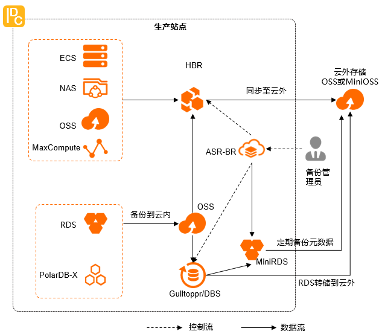

> **说明**
>
> 生产站点只支持阿里云企业版。

生产站点部署的备份组件包括：asrbr.StandardAsrBr、asrbr.StandardAsrbrBkEngine、dbs.dbs_base。

云外存储的备份仓库支持阿里云OSS协议的存储。包括：

- 独立部署到客户IDC机房的MiniOSS

- 敏捷版OSS或MiniOSS

- 企业版OSS

为了保证在生产云损毁的情况下可以恢复客户备份的数据，可在ASR-BR设置自备份策略，定期地将备份元数据信息备份到指定的OSS Bucket中，建议保存在异地的OSS Bucket中。当生产站点发生损毁时，恢复备份元数据信息后再恢复业务数据。

<a id="section-3-2"></a>

## 3.2. 系统架构（多Region场景）

本文介绍备份管理平台在多Region场景中的系统架构。

在多Region场景中，备份管理平台的逻辑架构如下图所示。

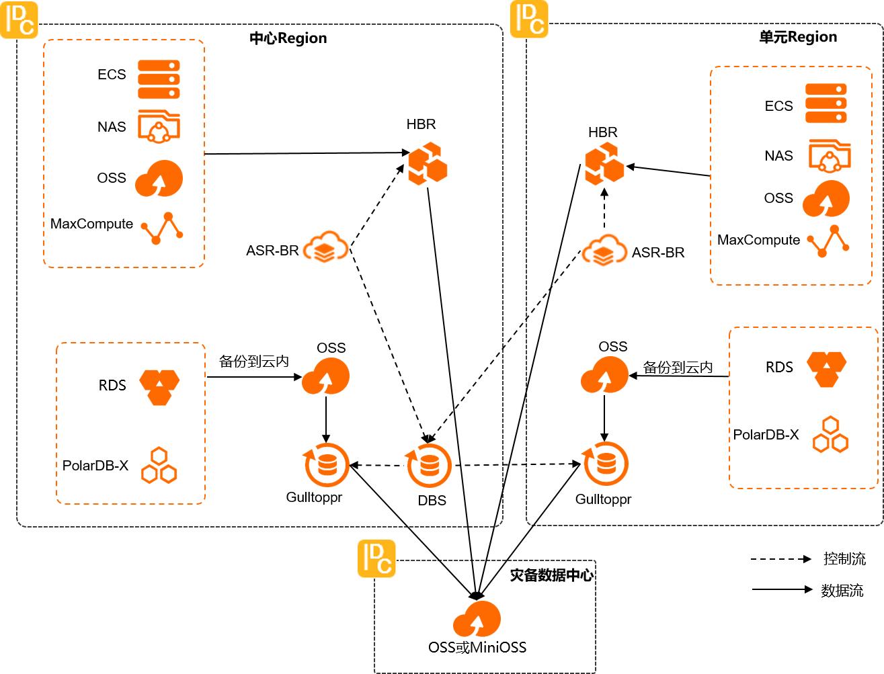

架构说明如下：

- 备份组件asrbr.StandardAsrBr和asrbr.StandardAsrbrBkEngine部署在需要备份的地域，dbs.dbs_base部署在中心地域。

- 备份管理员登录各地域的备份管理控制台，对该地域的产品执行备份。

<a id="section-3-3"></a>

## 3.3. 组件架构

ASR-BR产品组件清单如下表所示：

**服务（Service）**

**介绍**

**SR**

数据库转储引擎

Gulltoppr

service-rds-gulltoppr

数据库转储引擎元数据初始化

DbInit

- ECS文件备份、整机代理服务、服务代理以及Agent下载服务

DdrProxy

- RDS-SQLServer恢复

service-rds-ddr-proxy

纯软输出场景下ECS整机代理服务

DdrProxyDocker

管控后端服务

service-asrbr-backup

Backup

管控前端服务

service-asrbr-portal

Portal

OSS、NAS备份引擎

Agent

ECS整机备份引擎

Backupworker

service-hbr-agent

纯软输出场景下ECS整机备份引擎

BackupworkerDocker

<table>
  <tr>
    <td>service-hbr-storage</td>
    <td>Storage</td>
    <td>提供OSS协议头以及重复数据删除服务</td>
  </tr>
  <tr>
    <td rowspan="2">service-hbr-backend</td>
    <td>Backend</td>
    <td>存储类产品过期数据删除服务</td>
  </tr>
  <tr>
    <td>BackendDocker</td>
    <td>纯软输出场景下ECS整机备份过期数据删除服务</td>
  </tr>
  <tr>
    <td>service-hbr-console</td>
    <td>Console</td>
    <td>HBR管控，用于提供存储类产品备份/恢复OpenAPI，供Backup调用</td>
  </tr>
  <tr>
    <td>service-hbr-rabbitmq</td>
    <td>RabbitMQ</td>
    <td>ECS备份、VMware备份Console与备份Agent交互的消息队列</td>
  </tr>
  <tr>
    <td rowspan="3">service-external-utils</td>
    <td>Backend</td>
    <td>ASR-BR后台服务</td>
  </tr>
  <tr>
    <td>MMA</td>
    <td>MaxCompute备份恢复工具</td>
  </tr>
  <tr>
    <td>TrafficControl</td>
    <td>流控组件</td>
  </tr>
</table>

<a id="section-3-4"></a>

## 3.4. 产品组件清单

ASR-BR产品组件清单如下表所示：

<table>
  <tr>
    <th>服务（Service）</th>
    <th>SR</th>
    <th>介绍</th>
  </tr>
  <tr>
    <td rowspan="2">service-rds-gulltoppr</td>
    <td>Gulltoppr</td>
    <td>数据库转储引擎</td>
  </tr>
  <tr>
    <td>DbInit</td>
    <td>数据库转储引擎元数据初始化</td>
  </tr>
  <tr>
    <td rowspan="2">service-rds-ddr-proxy</td>
    <td>DdrProxy</td>
    <td>• ECS文件备份、整机代理服务以及Agent下载服务<br>• RDS-SQLServer恢复</td>
  </tr>
  <tr>
    <td>DdrProxyDocker</td>
    <td>纯软输出场景下ECS整机代理服务</td>
  </tr>
  <tr>
    <td>service-asrbr-backup</td>
    <td>Backup</td>
    <td>管控后端服务</td>
  </tr>
  <tr>
    <td>service-asrbr-portal</td>
    <td>Portal</td>
    <td>管控前端服务</td>
  </tr>
  <tr>
    <td rowspan="3">service-hbr-agent</td>
    <td>Agent</td>
    <td>OSS、NAS备份引擎</td>
  </tr>
  <tr>
    <td>Backupworker</td>
    <td>ECS整机备份引擎</td>
  </tr>
  <tr>
    <td>BackupworkerDocker</td>
    <td>纯软输出场景下ECS整机备份引擎</td>
  </tr>
  <tr>
    <td>service-hbr-storage</td>
    <td>Storage</td>
    <td>提供OSS协议头以及重复数据删除服务</td>
  </tr>
  <tr>
    <td rowspan="2">service-hbr-backend</td>
    <td>Backend</td>
    <td>存储类产品过期数据删除服务</td>
  </tr>
  <tr>
    <td>BackendDocker</td>
    <td>纯软输出场景下ECS整机备份过期数据删除服务</td>
  </tr>
  <tr>
    <td>service-hbr-console</td>
    <td>Console</td>
    <td>HBR管控，用于提供存储类产品备份/恢复OpenAPI，供Backup调用</td>
  </tr>
  <tr>
    <td>service-hbr-rabbitmq</td>
    <td>RabbitMQ</td>
    <td>在ECS备份和VMware备份场景中，负责Console与备份Agent交互的消息队列</td>
  </tr>
  <tr>
    <td rowspan="3">service-external-utils</td>
    <td>Backend</td>
    <td>ASR-BR后台服务</td>
  </tr>
  <tr>
    <td>MMA</td>
    <td>MaxCompute备份恢复工具</td>
  </tr>
  <tr>
    <td>TrafficControl</td>
    <td>流控组件</td>
  </tr>
</table>

<a id="section-3-5"></a>

## 3.5. 部署架构

本文介绍备份管理平台ASR-BR各组件的部署说明。

<table>
  <tr>
    <th>服务组件</th>
    <th>服务角色组件</th>
    <th>部署说明</th>
  </tr>
  <tr>
    <td>service-rds-gulltoppr</td>
    <td>Gulltoppr#</td>
    <td>集群部署，Gulltoppr为双节点部署，主节点负责转储任务下发，负责RDS、PolarDB-X 1.0异地转储。</td>
  </tr>
  <tr>
    <td>service-rds-ddr-proxy</td>
    <td>DdrProxy#</td>
    <td>集群部署，DdrProxy为双节点部署，主要负责ECS文件备份/恢复、ECS整机恢复及sql server备份和恢复代理以及ECS文件备份客户端Agent安装。</td>
  </tr>
  <tr>
    <td>service-asrbr-backup</td>
    <td>Backup#</td>
    <td>集群部署，Backup为双节点部署，asr-br管控后端服务。</td>
  </tr>
  <tr>
    <td>service-asrbr-portal</td>
    <td>Portal#</td>
    <td>集群部署，Portal为双节点部署，asr-br管控前端服务。</td>
  </tr>
  <tr>
    <td rowspan="2">service-hbr-agent</td>
    <td>Agent#</td>
    <td>集群部署，Agent为双节点部署，主要负责OSS、NAS备份和恢复。</td>
  </tr>
  <tr>
    <td>Backupworker#</td>
    <td>集群部署，Backupworker为双节点部署，主要负责ECS整机备份。</td>
  </tr>
  <tr>
    <td>service-hbr-storage</td>
    <td>Storage#</td>
    <td>集群部署，Storage为双节点部署，实现OSS协议的重删存储，主要用于MaxCompute、ElasticSearch on k8s等产品备份到OSS场景，实现数据重删。</td>
  </tr>
  <tr>
    <td>service-hbr-backend</td>
    <td>Backend#</td>
    <td>集群部署，Backend为双节点部署，主要负责hbr备份存储仓库中过期数据清理及数据巡检。</td>
  </tr>
  <tr>
    <td>service-hbr-console</td>
    <td>Console#</td>
    <td>集群部署，Console为双节点部署，hbr产品的管控层，提供openAPI能力，实现存储类产品备份计划及恢复任务的下发。</td>
  </tr>
  <tr>
    <td>service-hbr-rabbitmq</td>
    <td>HBRRabbitMQ#</td>
    <td>集群部署，HBRRabbitMQ为双节点部署，hbr产品内部消息队列组件，负责hbr-console与备份引擎（例如：backupworker、vmware备份引擎）的消息传递。</td>
  </tr>
  <tr>
    <td rowspan="3">service-external-utils</td>
    <td>Backend#</td>
    <td>集群部署，Backend为双节点部署，负责大数据备份生成snapshot、大数据备份过期数据删除、自备份等功能。</td>
  </tr>
  <tr>
    <td>TrafficControl#</td>
    <td>集群部署，TrafficControl为双节点部署，asr-br流控客户端，负责流控数据上报及流控配置。</td>
  </tr>
  <tr>
    <td>mma#</td>
    <td>集群部署，TrafficControl为双节点部署，MaxCompute大数据备份迁移工具，负责MaxCompute备份的任务编排。</td>
  </tr>
</table>

<a id="section-4"></a>

# 4.日志说明

<a id="section-4-1"></a>

## 4.1. 日志路径

ASR-BR日志路径如下表所示：

**日志路径**

**说明**

**SR**

数据库备份日志

/home/bifrost/log/gulltoppr.log

数据库备份上传日志

Gulltoppr

/home/bifrost/log/gulltoppr_uploader.log

访问日志

/home/bifrost/log/gulltoppr_access.log

下载日志

/log/proxy/nginx/download.log

代理日志

DdrProxy

/log/proxy/nginx/proxy.log

错误日志

/log/proxy/nginx/error.log

代理日志

/alidata/logs/proxy.log

DdrProxyDocker

错误日志

/alidata/logs/error.log

管控应用日志

/alidata/logs/asrbr-backup/asrbr-backup.log

Backup

错误日志

/alidata/logs/asrbr-backup/asrbr-backup-error.log

访问日志

/var/log/nginx/access.log

Portal

错误日志

/var/log/nginx/error.log

OSS和NAS备份/恢复与管控交互日志

/log/hbr/agent/hbr-agent-as.log

OSS或者NAS备份job日志

/log/hbr/agent/${datetime}/(oss)_backup_job_${datetime}.log

Agent

OSS或者NAS备份task日志

/log/hbr/agent/${datetime}/(oss)_backup_task_${datetime}.log

OSS或者NAS恢复job日志

/log/hbr/agent/${date}/(oss)_restore_job_${datetime}.log

OSS或者NAS恢复task日志

/log/hbr/agent/${datetime}/(oss)_restore_task_${datetime}.log

ECS整机备份和恢复任务分发日志

/log/hbr/backupworker/dispatcher.log

磁盘备份任务控制日志

/log/hbr/backupworker/ecs-disk-task.log

整机备份任务控制日志

Backupworker

/log/hbr/backupworker/ecs-task.log

ECS整机备份从EBS读取块存储数据日志

/log/hbr/backupworker/${date}/ebsplugin_${datetime}.log

ECS整机备份向备份存储写数据日志

/log/hbr/backupworker/${date}/ids_${datetime}.log

HBR接口层日志

/alidata/logs/hbr-console-as.log

Console

HBR调用审计日志

/alidata/logs/audit.log

过期数据删除任务调度日志

/log/hbr/backend/dispatcher/prune-scan_${datetime}.log

Backend

巡检备份仓库需要被过期删除的job日志

/log/hbr/backend/sched/scan/${datetime}/prune-scan_${datetime}.log

备份仓库过期数据删除日志的数据

/log/hbr/backend/sched/prune/${datetime}/prune-scan_${datetime}.log

重复数据删除审计日志

/log/hbr/storage/${ip}-audit.log

请求日志

Storage

/log/hbr/storage/${date}/minioss_${datetime}_1.log

重复数据删除日志

/log/hbr/storage/prune_data/${date}/cmd_prune_${datetime}.log

记录MaxCompute生成版本功能、自备份功能相关INFO

/alidata/logs/asrbr-backend-platform/asrbr-backend-platform.log

日志

Backend

记录MaxCompute生成版本功能、自备份功能相关

/alidata/logs/asrbr-backend-platform/asrbr-backend-platform-error.log

ERROR日志

记录MaxCompute备份工具备份/恢复MaxCompute任

MMA

/alidata/logs/mma/ com.aliyun.odps.mma.log

务日志

记录物理机整体上传下载流量日志

/log/traffic/nc_traffic.log

记录存储池组具体流量日志

TrafficControl

/log/traffic/trace_by_iptables.log

记录流控管控启动日志

/log/traffic/ASRBR_tc_start.log

<a id="section-4-2"></a>

## 4.2. 日志查看方式

本文介绍ASR-BR中的日志分类、使用场景以及查看方法。

ASR-BR平台提供两种日志的查看：接口调用日志和事件调用日志。这两种日志的说明如下表所示：

| 日志类别 | 说明 | 全局唯一标识 | 查看方式 |
| --- | --- | --- | --- |
| 接口调用日志 | ASR-BR管控对外提供OpenAPI，前端对后端的接口请求调用，都对接口返回RequestId参数，作为调用链路唯一标识。 | requestId | 获取requestId，查看对应的接口调用日志 |
| 事件调用日志 | 事件是ASR-BR异步业务流转的基本单元，由一个或一组事件完成一个动作或者操作，事件几乎涵盖ASR-BR每个操作，备份计划、恢复任务、迁移计划以及备份仓库等模块操作，都是被事件所承载。事件调用日志可用于查看具体的事件失败原因。 | eventId | 获取eventId，查看对应的事件调用日志。 |

**获取requestId**

本文以RDS产品日志备份列表接口报错为例：

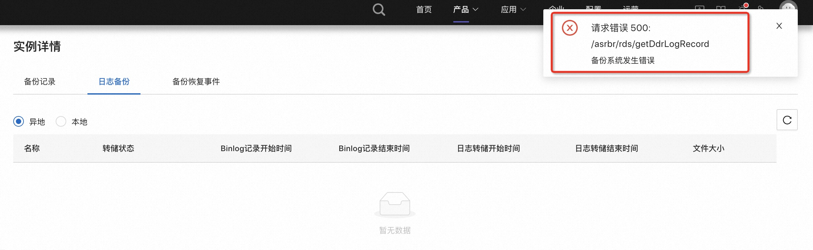

1. 打开F12，开发者工具，调成开发者模式，选择**Network**，查看请求记录。

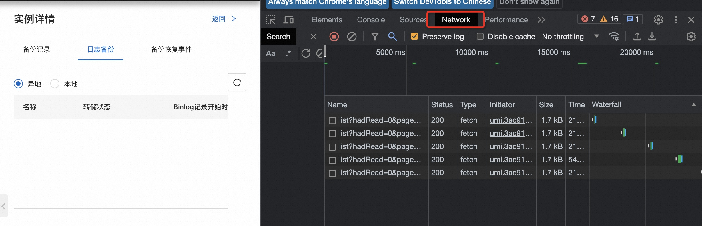

2. 重新单击报错的按钮，可以在右侧看到该请求记录。

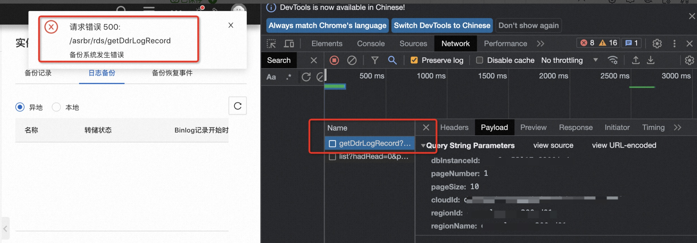

3. 选中要看的请求记录，即可看到下图信息。

> **说明**
>
> - Headers：可以查看该请求所有请求信息，包括：Url、Header等信息。
>
> - Payload：可以查看该请求的请求参数信息。
>
> - Preview/Response：该请求的返回信息，后者是经过格式化的，前者是没有格式化的。

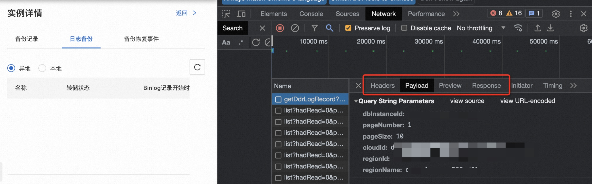

4. 单击**Response**页签，即可查看requestId。

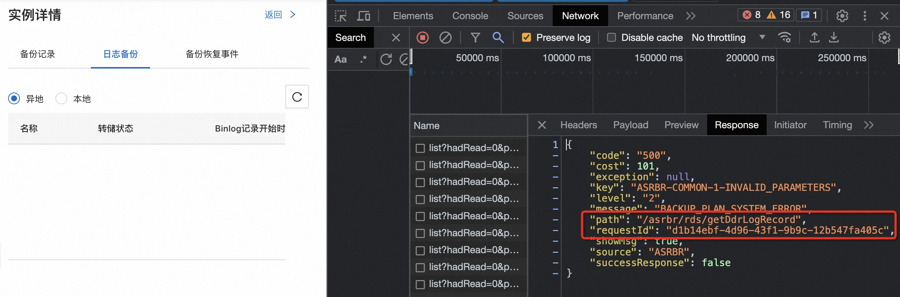

**获取eventId**

本文以备份计划为例。

1. 在备份事件页面，打开F12，开发者工具，调成开发者模式，单击**Network**。

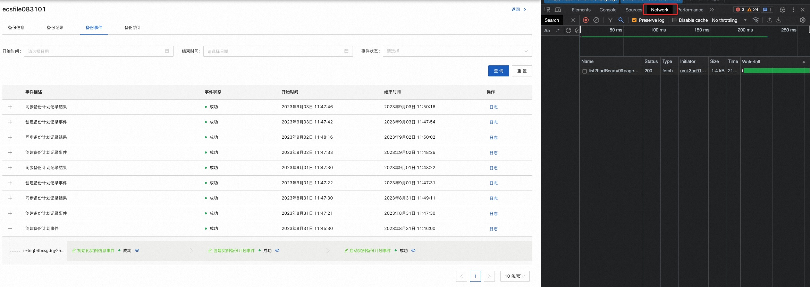

2. 单击子事件后面的  图标即查看事件执行日志请求，打开**Payload**，即可看到eventId。

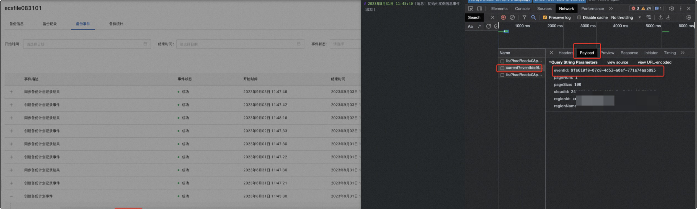

**查看日志**

1. 登录终端机器

2. 分别登录两台VM或者docker，执行以下命令。

```bash
cd /alidata/logs/asrbr-backup/

grep -r "d1b14ebf-4d96-43f1-9b9c-12b547fa405c" asrbr-backup.log
```

> **说明**
>
> grep-r后需要改成报错的requestId或eventId.

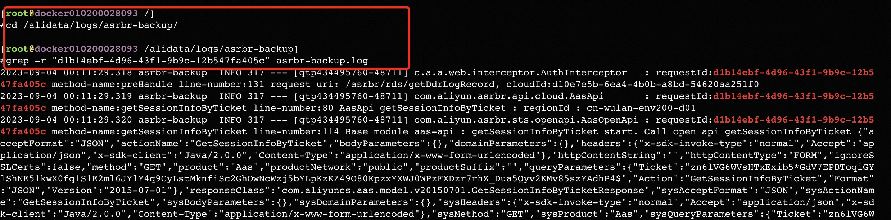

3. 查看有Error标识的日志。

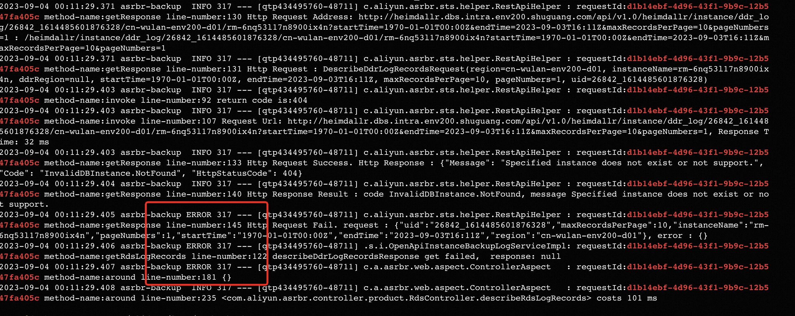

4. 通过vi或者vim命令，打开对应的日志文件查看具体的报错信息，示例如下。

```text
vi asrbr-backup.log

输入/d1b14ebf-4d96-43f1-9b9c-12b547fa405c，查找"d1b14ebf-4d96-43f1-9b9c-12b547fa405c"
输入“N”,可以查找下⼀个,直到找到报错信息。
```

> **说明**
>
> 请根据报错的requestId或eventId进行查找。

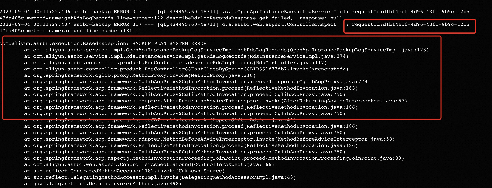

> **说明**
>
> - asrbr-backup日志会保留最近14天的日志，历史日志存放在/alidata/logs/asrbr-backup/bak目录下，可通过对应的日期查找对应的日志记录。
>
> - 可以使用  `cd /alidata/logs/asrbr-backup/bak` 命令进行查找。

<a id="section-4-3"></a>

## 4.3. 日志详细字段说明

- **/home/bifrost/log/gulltoppr.log**数据库备份日志，日志样例如下：

  ```text
  2023-03-13 17:34:27.078 INFO service/metric.go:70 
  |METRIC|gulltoppr[host=10.172.3.11]cpu=0.10,mem_used=21.77M,sys_alloc=72.89M,heap_sys=62.56M,heap
  _alloc=2.73M,heap_inuse=4.09M,stack_sys=1.34M,stack_inuse=1.34M,num_gc=0,all_num_gc=54,pause_ns=0,live_objects=6461,goroutines=20,rea
  tflow=0.00M/s,ma
  x_netflow=1125.00M/s
  ```

  对应Key的说明如下：

  | Key | 说明 |
  | --- | --- |
  | datetime | 日志打印时间 |
  | level | 日志打印级别：<br>• INFO：信息<br>• WARN：警告<br>• ERROR：错误 |
  | file | 日志打印的位置，文件名称和行数 |
  | detail | 日志详细信息，包含任务分发和处理信息、metric信息、服务运行信息等 |

- **/home/bifrost/log/gulltoppr_uploader.log**

  将备份数据（备份集和binlog日志）转储到异地备份存储中调用OSS接口详细日志，日志样例如下：

  ```text
  2023-04-09 11:21:17.491 INFO service/upload_framework.go:96 put new upload ddr_job[custins_id=2211,ddr_region=3ce97352-54df-****-bdff-b2f*****a87ff,sr
  c_type=log,src_id=25057,failed_count=0,error_type=0,hostins_id=2643,logname=mysql-bin.000184]
  ```

  对应Key的说明如下：

  | Key | 说明 |
  | --- | --- |
  | datetime | 日志打印时间 |
  | level | 日志打印级别：<br>• INFO：信息<br>• WARN：警告<br>• ERROR：错误 |
  | file | 日志打印的位置，文件名称和行数 |
  | detail | 调用OSS接口详细日志信息 |

- **/home/bifrost/log/gulltoppr_access.log**

  gulltoppr的请求日志，日志样例如下：

  ```text
  2023/04/08 23:40:53 10.66.5.5:30800 - - "GET /api/v1.0/gulltoppr/ddr_job?identity=log_25056 HTTP/1.1" 200 0 52.036µs
  2023/04/08 23:40:53 10.66.5.5:30800 - - "GET /api/v1.0/gulltoppr/ddr_job?identity=log_25142 HTTP/1.1" 200 0 53.315µs
  2023/04/08 23:40:53 10.66.5.5:30800 - - "GET /api/v1.0/gulltoppr/ddr_job?identity=log_25143 HTTP/1.1" 200 0 34.057µs
  2023/04/08 23:40:53 10.66.5.5:30800 - - "GET /api/v1.0/gulltoppr/ddr_job?identity=log_25226 HTTP/1.1" 200 0 34.037µs
  2023/04/08 23:40:53 10.66.5.5:30800 - - "GET /api/v1.0/gulltoppr/ddr_job?identity=log_25227 HTTP/1.1" 200 0 44.289µs
  2023/04/08 23:40:53 10.66.5.5:30800 - - "GET /api/v1.0/gulltoppr/ddr_job?identity=log_25310 HTTP/1.1" 200 0 38.049µs
  2023/04/08 23:40:53 10.66.5.5:30800 - - "GET /api/v1.0/gulltoppr/ddr_job?identity=log_25311 HTTP/1.1" 200 0 40.916µs
  ```

  对应Key的说明如下：

  | Key | 说明 |
  | --- | --- |
  | datetime | 日志打印时间 |
  | ip:port | 客户端IP地址和端口号 |
  | method | 请求方式 |
  | uri | 请求URI |
  | protocol | HTTP协议 |
  | code | 返回类型：200、404、500 |
  | size | 返回Body大小 |
  | time | 该请求消耗时长 |

- **/log/proxy/nginx/download.log**

  下载日志，日志样例如下：

  ```text
  127.0.0.1 - - [10/Apr/2023:07:25:33 +0800] "GET /download/nginx_status HTTP/1.1" 200 0 "-" "curl/7.29.0" "-" 0.000 -
  127.0.0.1 - - [10/Apr/2023:07:25:43 +0800] "GET /download/nginx_status HTTP/1.1" 200 0 "-" "curl/7.29.0" "-" 0.000 -
  127.0.0.1 - - [10/Apr/2023:07:25:53 +0800] "GET /download/nginx_status HTTP/1.1" 200 0 "-" "curl/7.29.0" "-" 0.000 -
  127.0.0.1 - - [10/Apr/2023:07:26:03 +0800] "GET /download/nginx_status HTTP/1.1" 200 0 "-" "curl/7.29.0" "-" 0.000 -
  ```

  对应Key的说明如下：

  | Key | 说明 |
  | --- | --- |
  | remote_addr | 客户端IP地址 |
  | remote_user | 用户 |
  | time_local | 打印日志时间 |
  | request | 请求Method |
  | status | 状态 |
  | body_bytes_sent | 返回Body大小 |
  | http_referer | 请求该接口的页面 |
  | http_user_agent | 用户Agent |
  | http_x_forwarded_for | 请求头信息 |
  | request_time | 请求时长 |
  | upstream_response_time | 转发请求时返回时长 |

- **/log/proxy/nginx/proxy.log或/alidata/logs/proxy.log**

  代理转发日志，日志样例如下：

  ```text
  10.158.78.137 - - [10/Apr/2023:15:15:20 +0800] "GET http://hbr-00001z80hn560pnhh9r6.oss-cn-hangzhou-arm-***-
  a.****.ops.arm.com/alibackup%2Fkeys%2Fbf784c9cf9888c26994e0ad745644b6a9c3bf5d734188ff81ca16961980e7333 HTTP/1.1" 200 457 "-" 
  "aliyun-sdk-go/v2.1.8 (Linux/4.19.90-23.28.v2101.ky10.aarch64/aarch64;go
  1.13.14)" "-" 0.002 0.00210.158.78.137 - - [10/Apr/2023:15:15:20 +0800] "GET http://hbr-00001z80hn560pnhh9r6.oss-cn-hangzhou-arm-d01-a.env58.ops.arm.com/?encoding-type=url&marker=&max-keys=1000&prefix=alibackup%2Fkeys%2F HTTP/1.1" 200 729 "-" "aliyun-sdk-
  go/v2.1.8 (Linux/4.19.90-23.28.v2101.ky10.aarch64/aarch64;go1.13.14)" "-" 0.
  002 0.002
  ```

  对应Key的说明如下：

  | Key | 说明 |
  | --- | --- |
  | remote_addr | 客户端IP地址 |
  | remote_user | 用户 |
  | time_local | 打印日志时间 |
  | request | 请求Method |
  | status | 状态 |
  | body_bytes_sent | 返回Body大小 |
  | http_referer | 请求该接口的页面 |
  | http_user_agent | 用户Agent |
  | http_x_forwarded_for | 请求头信息 |
  | request_time | 请求时长 |
  | upstream_response_time | 转发请求时返回时长 |

- **/log/proxy/nginx/error.log或/alidata/logs/error.log**

  错误日志，日志样例如下：

  ```text
  2023/04/11 12:57:16 [error] 42612#42612: *6882153 upstream timed out (110: Connection timed out) while connecting to upstream, clie
  nt: 10.158.78.37, serv
  er: , request: "HEAD http://hbr-00001z80hn560pnhh9r6.oss-cn-hangzhou-arm-***-
  a.****.ops.arm.com/alibackup%2Fdata%2F83%2F83954317484b63d32b0f76a7eae8fb69
  93b5d5fe89aac48bf5601c8889b9ac55?objectMeta HTTP/1.1", upstream: 
  "http://10.158.72.28:80/alibackup%2Fdata%2F83%2F83954317484b63d32b0f76a7eae8fb6993b5d5fe
  89aac48bf5601c8889b9ac55?objectMeta", host: "hbr-00001z80hn560pnhh9r6.oss-cn-hangzhou-arm-d01-a.env58.ops.arm.com"
  2023/04/11 12:58:08 [error] 42612#42612: *6920698 upstream timed out (110: Connection timed out) while connecting to upstream, clie
  nt: 10.158.78.157, ser
  ver: , request: "HEAD http://hbr-00001z80hn560pnhh9r6.oss-cn-hangzhou-arm-***-
  a.****.ops.arm.com/alibackup%2Fdata%2F60%2F60da507b6aacdc60b8ce95d5c458b3c
  9eabafbbefe24739d69439e7cec93a049?objectMeta HTTP/1.1", upstream: 
  "http://10.158.72.28:80/alibackup%2Fdata%2F60%2F60da507b6aacdc60b8ce95d5c458b3c9eabafbb
  efe24739d69439e7cec93a049?objectMeta", host: "hbr-00001z80hn560pnhh9r6.oss-cn-hangzhou-arm-d01-a.env58.ops.arm.com"
  ```

  对应Key的说明请参考Nginx的错误日志说明。

- **/alidata/logs/asrbr-backup/asrbr-backup.log或/alidata/logs/asrbr-backup/asrbr-backup-error.log**

  ASR-BR备份管控后端业务日志和错误日志，日志样例如下：

  ```text
  2023-04-11 00:00:01.945 asrbr-backup INFO 142 --- [listener-pool_4] c.a.a.web.listener.AsrbrEventListener : requestId:5d2f7882-
  898a-****-9eb0-81****f3fc82af2 method-name:retryEventByStatus line-number:430
  retryEventByStatus total = 0, Update count = 0,status:CREATING
  2023-04-11 00:00:01.948 asrbr-backup INFO 142 --- [listener-pool_2] c.a.a.listener.HbrAlarmMonitorListener : requestId:b86bd34d-b0a
  1-****-98bf-2f****c8c31d method-name:lambda$runnable$3 line-number:99
  HbrAlarmMonitorListener lock get failure
  2023-04-11 00:00:01.949 asrbr-backup INFO 142 --- [listener-pool_2] c.a.a.listener.HbrAlarmMonitorListener : requestId:b86bd34d-b0a
  1-****-98bf-2f7****8c31d method-name:lambda$runnable$3 line-number:182
  HbrAlarmMonitorListener complete.
  ```

  对应Key的说明如下：

  | Key | 说明 |
  | --- | --- |
  | time_local | 打印日志时间 |
  | app | 此处为asrbr-backup |
  | pid | 进程ID |
  | level | 日志的等级 |
  | thread | 线程池名称 |
  | class | 类名称 |
  | requestId | 请求ID |
  | method-name | 方法名称 |
  | line-number | 行号 |
  | detail | 日志详细信息 |

- **/var/log/nginx/access.log**

  请求日志，日志样例如下：

  ```text
  10.172.17.106 - - [10/Apr/2023:10:09:48 +0800] "GET /asrbr/message/list?
  hadRead=0&pageNum=1&pageSize=5&type=global&useName=littleBell&organizationId=3&cloudId=e8001bbb-62dc-****-853e-
  a8eaf****f3f&regionId=cn-neimeng-arm172-d01&regionName=cn-neimeng-****-d01 HTTP/1.1" 200 5442 "https://asrbr-
  portal.****.cloud.arm.com/" "Mozilla/5.0 (Macintosh; Intel Mac OS X 10_15_7) AppleWebKit/537.36 (KHTML, like Gecko) Chrome/*.*.*.* 
  Safari/537.36" "10.172.1.1"
  10.172.17.106 - - [10/Apr/2023:10:09:48 +0800] "GET /asrbr/dashboard/plan/record?cloudId=e8001bbb-62dc-4d27-****-
  a8eaf****f3f&regionId=cn-neimeng-****-d01&regionName=cn-neimeng-****-d01 HTTP/1.1" 200 308 "https://asrbr-
  portal.****.cloud.arm.com/" "Mozilla/5.0 (Macintosh; Intel Mac OS X 10_15_7) AppleWebKit/537.36 (KHTML, like Gecko) Chrome/*.*.*.* 
  Safari/537.36" "10.172.1.1"
  ```

  对应Key的说明如下：

  | Key | 说明 |
  | --- | --- |
  | remote_addr | 客户端IP地址 |
  | remote_user | 用户 |
  | time_local | 打印日志时间 |
  | request | 请求Method |
  | status | 状态 |
  | body_bytes_sent | 返回Body大小 |
  | http_referer | 请求该接口的页面 |
  | http_user_agent | 用户Agent |
  | http_x_forwarded_for | 请求头信息 |

- **/var/log/nginx/error.log**

  错误日志，日志样例如下：

  ```text
  2023/04/11 12:57:16 [error] 42612#42612: *6882153 upstream timed out (110: Connection timed out) while connecting to upstream, clie
  nt: 10.158.78.37, serv
  er: , request: "HEAD http://hbr-00001z80hn560pnhh9r6.oss-cn-hangzhou-arm-d01-
  a.****.ops.arm.com/alibackup%2Fdata%2F83%2F83954317484b63d32b0f76a7eae8fb69
  93b5d5fe89aac48bf5601c8889b9ac55?objectMeta HTTP/1.1", upstream: 
  "http://10.158.72.28:80/alibackup%2Fdata%2F83%2F83954317484b63d32b0f76a7eae8fb6993b5d5fe
  89aac48bf5601c8889b9ac55?objectMeta", host: "hbr-00001z80hn560pnhh9r6.oss-cn-hangzhou-arm-d01-a.env58.ops.arm.com"
  2023/04/11 12:58:08 [error] 42612#42612: *6920698 upstream timed out (110: Connection timed out) while connecting to upstream, clie
  nt: 10.158.78.157, ser
  ver: , request: "HEAD http://hbr-00001z80hn560pnhh9r6.oss-cn-hangzhou-arm-d01-
  a.****.ops.arm.com/alibackup%2Fdata%2F60%2F60da507b6aacdc60b8ce95d5c458b3c
  9eabafbbefe24739d69439e7cec93a049?objectMeta HTTP/1.1", upstream: 
  "http://10.158.72.28:80/alibackup%2Fdata%2F60%2F60da507b6aacdc60b8ce95d5c458b3c9eabafbb
  efe24739d69439e7cec93a049?objectMeta", host: "hbr-00001z80hn560pnhh9r6.oss-cn-hangzhou-arm-d01-a.****.ops.arm.com"
  ```

  对应Key的说明请参考Nginx的错误日志说明。

- **/log/hbr/agent/hbr-agent-as.log**

  OSS、NAS备份业务运行日志，日志样例如下：

  ```text
  2023-04-11 03:26:27.561 INFO --- [Thread-14] c.a.h.m.m.c.HbrOssRestoreTaskConsumer : OssRestoreJobMsgHandler, 
  topic:HBR_OSS_RESTORE_TASK, tag:null, message:
  {"accessKeySecret":"*****se5a3Iv******ApOZf******=","ownerId":1808978880764210,"resticPassword":"bYrr********3Qn1u****==","restoreId"
  00002017u7itwdfx113f","snapshotId":"9eefabfba7d40f7446aa00b939dbeb4f741cb49e9f46a629d8a2509b9f71409f","targetAccessKeySecret":"","tas
  :"rk_d55dc465-14d6-4a0d-9895-2a4f169f1b75"}
  2023-04-11 03:26:27.561 INFO --- [Thread-14] c.a.hbr.service.OssRestoreJobService : Run oss restore task start : OssRestoreTask(own
  erId=180897****764210, restoreId=r-0000****u7itwdfx113f, taskId=rk_d55dc465-****-4a0d-9895-2a4f169f1b75, 
  snapshotId=9eefa****0f7446aa00b****b49e9f46a629d8a****9f71409f)
  2023-04-11 03:26:27.562 INFO --- [Thread-14] com.alicloud.hbr.service.BaseJobService : Start oss_restore_task job rk_d55dc465-
  14d6-****-9895-2a4f1****1b75
  ```

  对应Key的说明如下：

  | Key | 说明 |
  | --- | --- |
  | datetime | 打印日志时间 |
  | level | 日志打印级别：<br>• INFO：信息<br>• WARN：警告<br>• ERROR：错误 |
  | thread | 线程名称 |
  | class | 类名称 |
  | detail | 详细信息 |

- **/log/hbr/agent/${datetime}/(oss)_backup_job_${datetime}.log**

  OSS、NAS备份时，汇总备份任务信息，日志样例如下：

  ```text
  2023/04/11 00:56:36 [INFO][null] hbr/cmd_oss_job.go:23 main.glob..func23 1 Aliyun ids service, Platform: linux, Arch: amd64, 
  Build: not set, Ver
  sion: oss-backupagent-v3.15xR-57-g8398783
  2023/04/11 00:56:36 [INFO][null] config/config.go:308 config.Load 1 Loading application config from 
  /opt/alibabacloud/hbr/agent/bin/application.cfg
  2023/04/11 00:56:36 [INFO][null] config/config.go:321 config.Load 1 Application config loadded: {Env:staging 
  ContextEncryption:true Region:cn-qingdao-****-d01 VpcId: ResourceAccountInfo:{AccountID:0 AccountName: Credential:
  {AccessKeyID:*******B**** AccessKeySecret:*****mMN******QY4hs****}} ServiceAccountInfo:{AccountID:0 AccountName: Credential:
  {AccessKeyID:*******B**** AccessKeySecret:*******Nh7********4hs****}} StsEndpoint:sts.inter.env66.shuguang.com SlrAccountInfo:{Acco
  untID:1000000070 AccountName: Credential:{AccessKeyID:*******dE1j**** AccessKeySecret:*******PKY1G*****6Wf****}} MNS:{AccountInfo:{
  AccountID:0 AccountName: Credential:{AccessKeyID: AccessKeySecret:}} Endpoint: MaxDeQueueCount:0 BackupJobHandler:0 BackupTaskHandl
  er:0 RestoreJobHandler:0 RestoreTaskHandler:0 CancelTaskHandler:0} OSS:{Endpoint:oss-cn-qingdao-env66-d01-
  a.intra.env66.shuguang.com OSSAccount:[{AccountID:999999999 AccountName:aliyuntest Credential:{AccessKeyID:*******RnB**** 
  AccessKeySecret:*******bmM*****QY4hs****}}]} OTS:{AccountInfo:{AccountID:0 AccountName: Credential:{AccessKeyID:*******ul**** Acces
  sKeySecret:******O0k*******}} Endpoint:http://hbragentots.cn-qingdao-****-d01.ots.inter.env66.shuguang.com 
  InstanceName:hbragentots BackupTableName:backup_tasks RestoreTableName:restore_tasks OssBackupTableName:oss_b=ackup_tasks OssRestor
  eTableName:oss_restore_tasks ConfigTableName:} Redis:{Address: Password: DB:0} NAS:{MountPrefix:/share HeartBeatPath: MountRetryCou
  nt:0 MountRetryInterval:0} Cache:{Path:/data/cache} POP:{AccountInfo:{AccountID:146290*****13436 AccountName: Credential:
  {AccessKeyID:*******nB**** AccessKeySecret:*******2wy***4hs****}} Protocol:https Endpoint:cn-qingdao-env66-d01-
  pop.hbr.intra.****.shuguang.com} Internal:{LimiterGetInterval:0 MaxSubTasks:0 HeartBeatTimeoutInMinutes:0}}
  ```

  对应Key的说明如下：

  | Key | 说明 |
  | --- | --- |
  | datetime | 打印日志时间 |
  | level | 日志打印级别：<br>• INFO：信息<br>• WARN：警告<br>• ERROR：错误 |
  | thread | 线程名称 |
  | file | 文件 |
  | class | 类名称 |
  | detail | 详细信息 |

- **/log/hbr/agent/${datetime}/(oss)_backup_task_${datetime}.log**

  OSS、NAS备份时，备份任务执行详细信息，日志样例如下：

  ```text
  2023/04/11 17:22:19 [INFO][null] ossjob/ossbackuptask.go:38 ossjob.(*OssBackupTask).Run 1 Execute sub oss task : OssBackupTask: {OwnerId : 12702709
  15256910, RestoreId : j-00001yy24rb9hha80trn, TaskId: oss_tk_aa254c50-****-4ec9-9768-f473****67b5, SnapshotId : oss://asrbr-
  test.oss-cn-qingdao-****-d01
  -a.intra.e****.shuguang.com/}
  2023/04/11 17:22:21 [INFO][null] ossjob/ossbackuptask.go:196 ossjob.(*OssBackupTask).runTask 1 execute oss backup task : 
  oss_tk_aa254c50-7441-4ec9-9
  768-f473b16967b5
  2023/04/11 17:22:21 [INFO][null] ossjob/ossbackuptask.go:241 ossjob.(*OssBackupTask).runTask 1 ExecuteBackupTask : ( repository: 
  ali:http://oss-cn-h
  angzhou.aliyuncs.com:9803/qixiu-test-asrbr-storage, parentsnapshot : 
  32eb5464abf25ec6199c4dc670c0fe2779e9f1521462c1f460193167dd4e3b67, clientId: OSS_asrb
  r-test, retention: %!d(string=7), path: oss://asrbr-test.oss-cn-qingdao-env66-d01-a.intra.env66.shuguang.com/, extended map[]
  2023/04/11 17:22:21 [INFO][null] ossjob/ossbackuptask.go:267 ossjob.(*OssBackupTask).runTask 1 InventoryInfo : {UseInventory:false 
  InventoryId: OssB
  ucketDestination:{AccountId:0 Bucket: Format: Prefix: RoleArn:} CleanupPolicy:}
  ```

  对应Key的说明如下：

  | Key | 说明 |
  | --- | --- |
  | datetime | 打印日志时间 |
  | level | 日志打印级别：<br>• INFO：信息<br>• WARN：警告<br>• ERROR：错误 |
  | thread | 线程名称 |
  | file | 文件 |
  | class | 类名称 |
  | detail | 详细信息 |

- **/log/hbr/agent/${datetime}/(oss)_restore_job_${datetime}.log**

  OSS、NAS恢复时，汇总备份任务信息，日志样例如下：

  ```text
  2023/04/11 11:26:09 [INFO][null] ossjob/ossrestorejob.go:186 ossjob.(*OssRestoreJob).Run 1 input oss endpoint: oss00fb-cn-neimeng-arm172-d01-a.env172.ops.arm.com, target: oss://asrbr-renew-2.oss00fb-cn-neimeng-****-d01-a.****.ops.arm.com/
  2023/04/11 11:26:09 [INFO][null] ossjob/ossrestorejob.go:194 ossjob.(*OssRestoreJob).Run 1 OssRestoreJob start: OssRestoreJob {"Sen
  derType":"METAQ","OwnerId":1808****80764210,"VaultId":"","RestoreId":"r-
  0000201****twdfx113f","SnapshotId":"9eefabfba7d4****9d8a2509****1409f","ExpireTime":1681187168,"Option":
  {"ResticPassword":"*****","ClientId":"OSS_arm-oss-test","Repository":"ali:http://oss-cn-neimeng-****-d01-a.e****.ops.arm.com/hbr-
  00002017u7itvby6agk1","Target":"oss://asrbr-renew-2.oss00fb-cn-neimeng-****-d01-
  a.****.ops.arm.com/","ExcludeList":null,"IncludeList":null,"AccessKeyId":"***********0ubX12","AccessKeySecret":"*****","TargetBucket"
  rbr-renew-2","TargetPrefix":"","TargetAccessKeyId":"","TargetAccessKeySecret":"*****","RestoreAccountId":0,"OssEndpoint":"oss00fb-c
  n-neimeng-****-d01-a.****.ops.arm.com","ExternalOptions":"{\"OssRCCSetting\":
  {\"MaxBackends\":64,\"BlobReadWorkers\":64,\"BlobCopyWorkers\":64,\"BlobUploadWorkers\":64,\"ObjWorkers\":64}}"}}
  ```

  对应Key的说明如下：

  | Key | 说明 |
  | --- | --- |
  | datetime | 打印日志时间 |
  | level | 日志打印级别：<br>• INFO：信息<br>• WARN：警告<br>• ERROR：错误 |
  | thread | 线程名称 |
  | file | 文件 |
  | class | 类名称 |
  | detail | 详细信息 |

- **/log/hbr/agent/${datetime}/(oss)_restore_task_${datetime}.log**

  OSS、NAS备份时，备份任务执行详细信息，日志样例如下：

  ```text
  2023/04/11 11:26:28 [INFO][null] ossjob/ossrestoretask.go:36 ossjob.(*OssRestoreTask).Run 1 Execute sub snapshot task : OwnerId : 
  18089****764210, RestoreId : r-00002017u7****x113f, TaskId: rk_d55dc465-14d6-****-9895-2a4f****1b75, SnapshotId : 9eefa****6aa0****
  dbeb4f74****9f46a6****a2
  509b9f71409f
  2023/04/11 11:26:32 [INFO][null] ossjob/ossrestoretask.go:87 ossjob.(*OssRestoreTask).executeTask 1 receive task rk_d55dc465-14d6-4
  a0d-9895-2a4f1
  69f1b75 have already been dispatched, skip it.
  2023/04/11 11:26:32 [INFO][null] hbr/cmd_oss_job.go:92 main.start_oss_job 1 Job run successful.
  2023/04/11 11:26:32 [INFO][null] hbr/lock.go:112 main.unlockAll 1 unlocking 0 locks
  ```

  对应Key的说明如下：

  | Key | 说明 |
  | --- | --- |
  | datetime | 打印日志时间 |
  | level | 日志打印级别：<br>• INFO：信息<br>• WARN：警告<br>• ERROR：错误 |
  | thread | 线程名称 |
  | file | 文件 |
  | class | 类名称 |
  | detail | 详细信息 |

- **/log/hbr/backupworker/dispatcher.log**

  ECS整机备份分发日志，日志样例如下：

  ```text
  time="2022-12-13T20:43:45.488322643+08:00" level=info msg="registering tasks" file=task.go gid=1 line=26 pid=6
  time="2022-12-13T20:43:45.488358024+08:00" level=info msg="Registered cmd task for worker type ECS_LONG_TERM_TASK" file=task.go 
  gid=1 line=54 pid=6
  time="2022-12-13T20:43:45.488399429+08:00" level=info msg="Registered cmd task for worker type ECS_DISK_LONG_TERM_TASK" 
  file=task.go gid=1 line=54 pid=6
  time="2022-12-13T20:43:45.488417925+08:00" level=info msg="HTTP server is listening on port: 31080" file=router.go gid=78 line=43 p
  id=6
  time="2022-12-13T20:43:45.488436443+08:00" level=info msg="initializing worker factory, workerConfig: [{Disable:false Type:ECS_LONG
  _TERM_TASK Sources:[rabbitmq] YamlFile:/hbr/backupworker/dispatcher-config/ecs_task.yaml MaxTasks:4 Image: Version: Namespace: 
  MessageType: Queue: Topic: RoutingKey:ecs-backup-long-term-job} {Disable:false Type:ECS_DISK_LONG_TERM_TASK Sources:[rabbitmq] 
  YamlFile:/hbr/backupworker/dispatcher-config/ecs_disk_task.yaml MaxTasks:1 Image: Version: Namespace: MessageType: Queue: Topic: 
  RoutingKey:ecs-disk-backup-long-term-job}]: " file=worker.go gid=1 line=31 pid=6
  time="2022-12-13T20:43:45.488626245+08:00" level=info msg="registering worker, type: ECS_LONG_TERM_TASK, source: rabbitmq" file=cre
  ator.go gid=1 line=16
  pid=6
  ```

  对应Key的说明如下：

  | Key | 说明 |
  | --- | --- |
  | time | 打印日志时间 |
  | level | 日志打印级别：<br>• info：信息<br>• warn：警告<br>• error：错误 |
  | msg | 日志详细信息 |
  | file | 打印日志的文件 |
  | gid | 组ID |
  | line | 打印日志所在行数 |
  | pid | 进程ID |

- **/log/hbr/backupworker/${date}/ids_${datetime}.log**

  ECS整机备份时，将数据存储到备份存储日志，日志样例如下：

  ```text
  time="2023-03-26T15:59:14.20895596+08:00" level=info msg="index block count:242" file=hbrdiskstorage_writer.go gid=1 line=191 pid=4
  0772
  time="2023-03-26T15:59:14.22116667+08:00" level=info msg="save section data index 0 with id 
  ad199e36d2459b415612a549f90320fbb89ffe1d3cb15746711d6230b8459
  373" file=hbrdiskstorage_writer.go gid=1 line=213 pid=40772
  time="2023-03-26T15:59:14.229168656+08:00" level=info msg="save all data index id : 
  5486b53ee473f3097166971be5ccd516d41d85c1e7b34a918262fcd48acd6e58" fil
  e=hbrdiskstorage_writer.go gid=1 line=231 pid=40772
  time="2023-03-26T15:59:14.239181069+08:00" level=info msg="Save root blob 
  98a6c74556bdaaaabddd1ab81318aabbba90869d1267e9f33caba8ada8b474ac, data length 9
  4063, all count 1402, unique count 1402" file=blobcache_oss_saver.go gid=78 line=96 pid=40772
  ```

  对应Key的说明如下：

  | Key | 说明 |
  | --- | --- |
  | time | 打印日志时间 |
  | level | 日志打印级别：<br>• info：信息<br>• warn：警告<br>• error：错误 |
  | msg | 日志详细信息 |
  | file | 打印日志的文件 |
  | gid | 组ID |
  | line | 打印日志所在行数 |
  | pid | 进程ID |

- **/log/hbr/backupworker/${date}/ebsplugin_${datetime}.log**

  ECS整机备份时，从EBS读取快照数据详细日志，日志样例如下：

  ```text
  time="2023-03-26T15:59:14.871798405+08:00" level=info msg="Start to run ids command: '/hbr/backupworker/bin/idsagent' instance_back
  up --clientid 'ecs-i-9
  zq053zljc3qt1hhdhzb' --jobid 'j-00001zpqr32cr93ba5wj' --taskid 'j-00001zpqr32cr93ba5wj' --executionid '611708bd-36c5-4861-95b3-b572
  35b664ab' --instanceid
   'i-9zq053zljc3qt1hhdhzb' --retention '7' --snapshotdbkey '611708bd-36c5-4861-95b3-b57235b664ab' --source-type UDM_ECS --tag 
  'ECS:SNAPSHOT'" file=runner.
  go gid=39 line=61 pid=42360
  time="2023-03-26T15:59:15.311995901+08:00" level=info msg="Runner returns with no error" file=runner.go gid=39 line=79 pid=42360
  ```

  对应Key的说明如下：

  | Key | 说明 |
  | --- | --- |
  | time | 打印日志时间 |
  | level | 日志打印级别：<br>• info：信息<br>• warn：警告<br>• error：错误 |
  | msg | 日志详细信息 |
  | file | 打印日志的文件 |
  | gid | 组ID |
  | line | 打印日志所在行数 |
  | pid | 进程ID |

- **/log/hbr/backupworker/ecs-disk-task.log**

  ECS整机备份时，云盘备份控制端信息，日志样例如下：

  ```text
  time="2023-03-26T15:59:06.052366124+08:00" level=info msg="PUT /api/ids/v1/job/j-00001zpqr32crb2ce7vo/execution/6bab2a96-c9f2-4145-
  9564-0db191ea8ee9/prog
  ress 200 (2.986639ms)" file=middleware.go gid=197 line=32 pid=40735 requestID=e2475463-6b2e-413e-8b31-d3b017899a54
  time="2023-03-26T15:59:07.903097574+08:00" level=info msg="PUT /api/ids/v1/job/j-00001zpqr32crb2ce7vo/execution/6bab2a96-c9f2-4145-
  9564-0db191ea8ee9/snap
  shot from 127.0.0.1 Go-http-client/1.1" file=middleware.go gid=197 line=23 pid=40735 requestID=4727a1f4-6a4d-4e3b-b826-
  5207fd268fa3
  time="2023-03-26T15:59:07.903379462+08:00" level=info msg="creating snapshot. jobID: j-00001zpqr32crb2ce7vo, executionID: 6bab2a96-
  c9f2-4145-9564-0db191e
  a8ee9, snapshot: {SnapshotId:s-9zq06ml5kj027d4o365k}" file=handler.go gid=197 line=263 pid=40735
  ```

  对应Key的说明如下：

  | Key | 说明 |
  | --- | --- |
  | time | 打印日志时间 |
  | level | 日志打印级别：<br>• info：信息<br>• warn：警告<br>• error：错误 |
  | msg | 日志详细信息 |
  | file | 打印日志的文件 |
  | gid | 组ID |
  | line | 打印日志所在行数 |
  | pid | 进程ID |

- **/log/hbr/backupworker/ecs-task.log**

  ECS整机备份时，整机备份控制信息，日志样例如下：

  ```text
  time="2023-02-21T15:44:12.188951254+08:00" level=info msg="no hbr.config.txt file, ignored\n" file=config.go gid=1 line=237 pid=124
  174
  time="2023-02-21T15:44:12.18899049+08:00" level=info msg="no hbr.config file, ignored\n" file=config.go gid=1 line=237 pid=124174
  time="2023-02-21T15:44:12.189027857+08:00" level=info msg="no need to set cpu procs, maxProcs=-1, maxCPUs=32" file=config.go gid=1 
  line=200 pid=124174
  time="2023-02-21T15:44:12.189070122+08:00" level=info msg="job status report is enabled..." file=run.go gid=1 line=103 pid=124174
  time="2023-02-21T15:44:12.18913558+08:00" level=info msg="Init new worker mode" file=worker.go gid=1 line=147 pid=124174
  time="2023-02-21T15:44:12.189213511+08:00" level=info msg="Creating new MNS listener for message 
  ExecuteEcsLongTermBackupTaskMessage" file=dispatcherlist
  ```

  对应Key的说明如下：

  | Key | 说明 |
  | --- | --- |
  | time | 打印日志时间 |
  | level | 日志打印级别：<br>• info：信息<br>• warn：警告<br>• error：错误 |
  | msg | 日志详细信息 |
  | file | 打印日志的文件 |
  | gid | 组ID |
  | line | 打印日志所在行数 |
  | pid | 进程ID |

- **/alidata/logs/hbr-console-as.log**

  hbr-console详细日志信息，日志样例如下：

  ```text
  2023-04-11 00:00:00.072 INFO --- [DubboServerHandler-10.66.8.109:20880-thread-196] c.alicloud.hbr.bootstrap.aop.LogAspect : request
  Id:[9D00CC48-1392-4FCF-B49E-0B854B3ABB43] accountId:[999999999] describeAgentHostInfo [customer] 
  {"accessKeyId":"********RnB****","akMfaPresent":false,"appIp":"10.66.28.53","callerBid":26842,"callerParentId":26842,"callerType":"cu
  er","callerUid":999999999,"ownerId":999999999,"proxyOriginalSecurityTransport":false,"proxyTrustTransportInfo":false,"requestId":"9D0
  8-1392-****-B49E-
  0B******BB43","securityTransport":true,"serviceProxyCall":false,"stsTokenCallerBid":0,"stsTokenCallerUid":0,"stsTokenPlayerUid":0,"us
  countId":0}
  2023-04-11 00:00:17.991 INFO --- [DubboServerHandler-10.66.8.109:20880-thread-196] c.alicloud.hbr.bootstrap.aop.LogAspect : request
  Id:[AE9CC8E9-CEDB-462E-A498-AB1BC704EDB5] accountId:[1018771697088368] describeRestoreJobs [AssumedRoleUser] 
  {"accessKeyId":"STS.*****b4j*******CAUK****","akMfaPresent":false,"appIp":"10.66.28.53","callerBid":0,"callerParentId":0,"callerType"
  sumedRoleUser","callerUid":0,"filters":[{"key":"RestoreId","values":["r-
  00001yy2bemy32ttelq2"]}],"ownerId":1018771697088368,"pageNumber":1,"pageSize":10,"proxyOriginalSecurityTransport":false,"proxyTrustTr
  ortInfo":false,"requestId":"AE9CC8E9-CEDB-****-A498-
  AB1B******B5","restoreType":"OSS","securityToken":"******Ft5B6yfSjI0****+tLw5DeaFT********RsHDGAXt*****g+nGtX6/gci*****svs","security
  sport":true,"serviceProxyCall":false,"stsTokenCallerBid":26842,"stsTokenCallerUid":1018771697088368,"stsTokenPlayerUid":1000000061,"u
  ccountId":0}
  ```

  对应Key的说明如下：

  | Key | 说明 |
  | --- | --- |
  | time | 打印日志时间 |
  | level | 日志打印级别：<br>• info：信息<br>• warn：警告<br>• error：错误 |
  | thread | 线程信息 |
  | class | Java类 |
  | requestId | 请求ID |
  | accountId | 用户ID |
  | requestName | 请求名称 |
  | callerType | 访问者账号类型：<br>• AssumedRoleUser：角色token<br>• custorm：云账号 |
  | msg | 详情 |

- **/alidata/logs/audit.log**

  hbr-console审计日志，日志样例如下：

  ```text
  2023-04-11 00:00:00.072 describeAgentHostInfo [customer] 
  {"accessKeyId":"********B****","akMfaPresent":false,"appIp":"10.66.28.53","callerBid":26842,"callerParentId":26842,"callerType":"cust
  ","callerUid":999999999,"ownerId":999999999,"proxyOriginalSecurityTransport":false,"proxyTrustTransportInfo":false,"requestId":"9D00C
  1392-****-B49E-
  0B8*****BB43","securityTransport":true,"serviceProxyCall":false,"stsTokenCallerBid":0,"stsTokenCallerUid":0,"stsTokenPlayerUid":0,"us
  countId":0}
  2023-04-11 00:00:17.991 describeRestoreJobs [AssumedRoleUser] 
  {"accessKeyId":"STS.3******tR5j*****CAUK****","akMfaPresent":false,"appIp":"10.66.28.53","callerBid":0,"callerParentId":0,"callerType
  ssumedRoleUser","callerUid":0,"filters":[{"key":"RestoreId","values":["r-
  00001yy2bemy32ttelq2"]}],"ownerId":1018771697088368,"pageNumber":1,"pageSize":10,"proxyOriginalSecurityTransport":false,"proxyTrustTr
  ortInfo":false,"requestId":"AE9CC8E9-CEDB-462E-****-
  AB1B*****EDB5","restoreType":"OSS","securityToken":"CAIShwJ4T*******uMA9bi+MuA","securityTransport":true,"serviceProxyCall":false,"st
  enCallerBid":26842,"stsTokenCallerUid":101877169****368,"stsTokenPlayerUid":1000000061,"userAccountId":0}
  ```

  对应Key的说明如下：

  | Key | 说明 |
  | --- | --- |
  | callerType | 访问者账号类型：<br>• AssumedRoleUser：角色token<br>• custorm：云账号 |
  | time | 打印日志时间 |
  | requestName | 请求接口名称 |
  | msg | 请求参数 |

- **/log/hbr/backend/dispatcher/prune-scan_${datetime}.log**

  过期数据删除任务调度日志，日志样例如下：

  ```text
  time="2023-03-15T01:44:44.996444703+08:00" level=info msg="found default layout at alibackup" file=backend/layout.go gid=1 line=136
  pid=98332
  time="2023-03-15T01:44:44.996535469+08:00" level=info msg="layout detected: <DefaultLayout>" file=backend/layout.go gid=1 line=187 
  pid=98332
  time="2023-03-15T01:44:44.996584527+08:00" level=info msg="succeeded to open repo [ali:http://oss-cn-qingdao-env66-d01-a.intra.env6
  6.shuguang.com/hbr-000
  01yy24r9sj7k7zjv2], enable_read_source_speed_limiter=false, SpeedLimiter=" file=common/storage.go gid=1 line=102 pid=98332
  time="2023-03-15T01:44:44.996650409+08:00" level=info msg="compression env : " file=repository/repository.go gid=1 line=123 
  pid=98332
  time="2023-03-15T01:44:44.996689832+08:00" level=info msg="New Repo with compression algorithm 1 (0 disabled, 1 snappy, 2 Lz4, 3 
  Gzip, 4 Zstd)" file=repo
  sitory/repository.go gid=1 line=158 pid=98332
  ```

  对应Key的说明如下：

  | Key | 说明 |
  | --- | --- |
  | time | 打印日志时间 |
  | level | 日志打印级别<br>• info：信息<br>• warn：警告<br>• error：错误 |
  | msg | 日志详细信息 |
  | file | 打印日志的文件 |
  | gid | 组ID |
  | line | 打印日志所在行数 |
  | pid | 进程ID |

- **/log/hbr/backend/sched/scan/${datetime}/prune-scan_${datetime}.log**

  巡检备份仓库需要被过期删除的job日志，日志样例如下：

  ```text
  time="2023-04-07T17:25:33.395009079+08:00" level=info msg="job pool is full" file=sched/schedulejob.go gid=64 line=251 pid=1
  time="2023-04-07T17:26:03.395421975+08:00" level=warning msg="failed to submit new job, retrying again. error: job pool is full" 
  file=sched/schedulejob.g
  o gid=64 line=146 pid=1
  time="2023-04-07T17:26:03.396932235+08:00" level=info msg="got new vault to schedule, vault ID: hbr-00001yy2bemwzq5kp9tt" file=sche
  d/schedulejob.go gid=6
  4 line=112 pid=1
  time="2023-04-07T17:26:03.403204467+08:00" level=info msg="trying to dispatch Job from vault &{Model:{ID:26702 CreatedAt:2023-04-
  07 17:24:30.964 +0800 CS
  T UpdatedAt:2023-04-07 17:24:30.964 +0800 CST DeletedAt:{Time:0001-01-01 00:00:00 +0000 UTC Valid:false}} Status:New BucketSize:950
  30276332 VaultId:hbr-0
  0001yy2bemwzq5kp9tt RoundId:1680859470 SchedulerName:prune-scan-sched VaultName:file-local-nohttps1_REMOTE_Hiv9X Description: Vault
  RegionId: VaultType:ST
  ANDARD ChargeType: VaultStorageClass:STANDARD VaultStatusMessage: Endpoint:oss-cn-qingdao-env66-d01-a.intra.env66.shuguang.com Vaul
  tUrl:ali:http://oss-cn
  -qingdao-env66-d01-a.intra.env66.shuguang.com/hbr-00001yy2bemwzq5kp9tt BucketName:hbr-00001yy2bemwzq5kp9tt 
  AccessCode:ymn2fi8ox8VK****/VtCLQ== AccessKeyI
  d:******rbuc**** AccessKeySecret:******ny**********rsXJF****/qRs= ResourceAccountId:101877****088368 OwnerId:10187****7088368 Reaso
  n:}" fil
  e=sched/schedulejob.go gid=64 line=239 pid=1
  ```

  对应Key的说明如下：

  | Key | 说明 |
  | --- | --- |
  | time | 打印日志时间 |
  | level | 日志打印级别：<br>• info：信息<br>• warn：警告<br>• error：错误 |
  | msg | 日志详细信息 |
  | file | 打印日志的文件 |
  | gid | 组ID |
  | line | 打印日志所在行数 |
  | pid | 进程ID |

- **/log/hbr/backend/sched/prune/${datetime}/prune-scan_${datetime}.log**

  备份仓库过期数据删除日志的数据，日志样例如下：

  ```text
  time="2023-04-08T02:55:03.289664635+08:00" level=info msg="leader is : a34a13065.cloud.a13.amtest66" file=leader/leaderelection.go 
  gid=132 line=62 pid=1
  time="2023-04-08T03:25:03.157249765+08:00" level=info msg="get hostname : a34a13064.cloud.a13.amtest66" 
  file=leader/leaderelection.go gid=105 line=24 pid=1
  time="2023-04-08T03:25:03.167086812+08:00" level=info msg="leader selection sql paras: 
  hbr_backend_sched:a34a13064.cloud.a13.amtest66:10800" file=db/lead
  er.go gid=105 line=103 pid=1
  time="2023-04-08T03:25:03.168197661+08:00" level=info msg="leader is : a34a13065.cloud.a13.amtest66" file=leader/leaderelection.go 
  gid=105 line=62 pid=1
  time="2023-04-08T03:25:03.289965686+08:00" level=info msg="get hostname : a34a13064.cloud.a13.amtest66" 
  file=leader/leaderelection.go gid=132 line=24 pid
  =1
  time="2023-04-08T03:25:03.321939853+08:00" level=info msg="leader selection sql paras: 
  hbr_backend_sched:a34a13064.cloud.a13.amtest66:10800" file=db/lead
  er.go gid=132 line=103 pid=1
  ```

  对应Key的说明如下：

  | Key | 说明 |
  | --- | --- |
  | time | 打印日志时间 |
  | level | 日志打印级别：<br>• info：信息<br>• warn：警告<br>• error：错误 |
  | msg | 日志详细信息 |
  | file | 打印日志的文件 |
  | gid | 组ID |
  | line | 打印日志所在行数 |
  | pid | 进程ID |

- **/log/hbr/storage/${ip}-audit.log**

  大数据产品备份时写入到备份存储的审计日志，日志样例如下：

  ```json
  {"level":"info","ts":1675755171.5768666,"msg":"2023-02-07T07:32:51.576853762Z","Remote Host":"10.66.97.90","User Agent":"ANCHASHI-S
  CAN(a0bc6bd8-a6b9-11ed-91b9-0242ac11000e)","Request ID":"","AccessKey ID":"","Time":"2023-02-
  07T07:32:51.576853762Z","API":"GetObjectMeta","Bucket":"qixiu-test-asrbr-
  rds","Object":"odps_mma/export_objects/4ec1b50cdd954b95bc38e3fe86d714ee/DATA/test1/config/","StatusCode":"Forbidden","StatusCode":403

  {"level":"info","ts":1675755172.5090332,"msg":"2023-02-07T07:32:52.509020708Z","Remote Host":"10.66.97.90","User Agent":"aliyun-sdk
  -java/3.10.2(Mac OS X/
  10.16/x86_64;1.8.0_291)","Request ID":"","AccessKey ID":"","Time":"2023-02-
  07T07:32:52.509020708Z","API":"GetObjectMeta","Bucket":"qixiu-test-asrbr-rds",
  "Object":"odps_mma/export_objects/4ec1b50cdd954b95bc38e3fe86d714ee/DATA/test1/config/.odps/","StatusCode":"Forbidden","StatusCode":40

  {"level":"info","ts":1675755172.6266901,"msg":"2023-02-07T07:32:52.62668112Z","Remote Host":"10.66.97.90","User Agent":"aliyun-sdk-
  java/3.10.2(Mac OS X/1
  0.16/x86_64;1.8.0_291)","Request ID":"","AccessKey ID":"","Time":"2023-02-
  07T07:32:52.62668112Z","API":"GetObjectMeta","Bucket":"qixiu-test-asrbr-rds","O
  bject":"odps_mma/export_objects/4ec1b50cdd954b95bc38e3fe86d714ee/DATA/test1/config/","StatusCode":"Forbidden","StatusCode":403}
  ```

  对应Key的说明如下：

  | Key | 说明 |
  | --- | --- |
  | level | 日志打印级别：<br>• info：信息<br>• warn：警告<br>• error：错误 |
  | ts | 打印日志时间 |
  | msg | 日志详细信息 |
  | Remote Host | 调用方日志信息 |
  | User Agent | 客户端用户Agent |
  | Request ID | 请求ID |
  | Time | 调用时间 |
  | API | OSS请求接口信息 |
  | Bucket | Bucket名称 |
  | Object | 对象名称 |
  | StatusCode | 返回状态 |

- **/log/hbr/storage/${date}/minioss_${datetime}_1.log**

  大数据产品备份时写入到备份存储的请求日志，日志样例如下：

  ```text
  time="2023-04-08T10:05:00.175843511+08:00" level=info msg="\nAPI: DeleteObject(bucket=asrbr-dedup-b1edysrman, 
  object=odps_mma/export_objects/e7d89c5_LOCA
  L_test_cao1/DATA/test_cao1/bank_data_transactional/.odps/20230407022131275g1ztpy9/M1_0_0-0_1_TableSink1)\tTime: 10:05:00 CST 
  04/08/2023\nRemoteHost: 10.6
  6.97.100\nUserAgent: aliyun-sdk-java/3.10.2(Linux/4.19.91-007.ali4000.alios7.x86_64/amd64;1.8.0_152)\tWARNING: Delete object 
  [asrbr-dedup-b1edysrman odps
  _mma/export_objects/e7d89c5_LOCAL_test_cao1/DATA/test_cao1/bank_data_transactional/.odps/20230407022131275g1ztpy9/M1_0_0-0_1_TableS
  ink1]\t" file=fs-v2.go
   gid=253206 line=419 pid=1
  ```

  对应Key的说明如下：

  | Key | 说明 |
  | --- | --- |
  | time | 打印日志时间 |
  | level | 日志打印级别：<br>• info：信息<br>• warn：警告<br>• error：错误 |
  | msg | 日志详细信息 |
  | file | 打印日志的文件 |
  | gid | 组ID |
  | line | 打印日志所在行数 |
  | pid | 进程ID |

- **/log/hbr/storage/prune_data/${date}/cmd_prune_${datetime}.log**

大数据产品备份时重复数据删除日志，日志样例如下：

```text
time="2023-04-11T06:00:01.683287396+08:00" level=info msg="\nAPI: prune(bucket=asrbr-dedup-z8qgkojcia)\tTime: 06:00:01 CST 04/11/2023
\tINFO: Download db
file start\t" file=kv_rocks.go gid=1 line=269 pid=45
time="2023-04-11T06:00:01.683397039+08:00" level=info msg="\nAPI: prune(bucket=asrbr-dedup-z8qgkojcia)\tTime: 06:00:01 CST 04/11/2023
\tINFO: vaultInfo :
&{VaultInfo:{VaultURL:ali:oss-cn-qingdao-****-d01-a.intra.****.shuguang.com/asrbr-dedup-z8qgkojciahttp://oss-cn-qingdao-****-d01-a.intra.****.shuguan
g.com/asrbr-dedup-z8qgkojcia AccessCode: AccessKeyID:*******Hr**** AccessKeySecret:********I3o******yF**** ProxyConfig:<nil> 
ResourceAccountID:
0 RegionID:} StorageClass:}\t" file=kv_rocks.go gid=1 line=217 pid=45
```

对应Key的说明如下：

| Key | 说明 |
| --- | --- |
| time | 打印日志时间 |
| level | 日志打印级别<br>• info：信息<br>• warn：警告<br>• error：错误 |
| msg | 日志详细信息 |
| file | 打印日志的文件 |
| gid | 组ID |
| line | 打印日志所在行数 |
| pid | 进程ID |

- **/alidata/logs/asrbr-backend-platform/asrbr-backend-platform.log /asrbr-backend-platform-error.log**

  记录MaxCompute生成版本功能、自备份功能相关INFO日志，日志样例：

```text
2023-07-27 00:00:01.130 asrbr-backend-platform  WARN 16 --- [listener-pool_4] c.a.a.w.l.SyncOdpsDataReadListener      : 
requestId:e9060656-1877-****-ae0a-d****649d56f method-name:lambda$runnable$0 line-number:214
syncOdpsDataReadListener copyBatchNo is existed, skip read .copyDataRecordQuery:CopyDataRecordQuery(id=null, 
parentRecordIdIsEmpty=is empty, parentRecordIdNotEmpty=null, fileNameIsEmpty=null, fileNameNotEmpty=null, inMultiStatus=null, notInMultiStatus=null, gtId=null, gteId=null, lteId=null)
```

日志说明：

| Key | 说明 |
| --- | --- |
| datetime | 日志执行时间 |
| application name | 应用名称 |
| Log Level | 日志级别INFO：信息日志 WARN：告警日志 ERROR：错误日志 |
| PID | 进程号 |
| Thread Id | 线程号 |
| Class Name | 执行类 |
| requestId | 请求ID |
| method-name | 方法名 |
| line-number | 日志行数 |
| message | 业务日志信息 |

- **/alidata/logs/mma/com.aliyun.odps.mma.log**

记录MaxCompute备份工具备份/恢复MaxCompute的任务日志，日志样例：

```text
2023-07-26 18:29:21.248  INFO 28 --- [Thread-8] c.a.odps.mma.meta.DataSourceMetaLoader   : save 0 new dbs to database
```

日志说明：

| Key | 说明 |
| --- | --- |
| datetime | 日志执行时间 |
| Log Level | 日志级别INFO：信息日志 WARN：告警日志 ERROR：错误日 |
| PID | 进程号 |
| Thread Id | 线程号 |
| Class Name | 执行类 |
| message | 业务日志信息 |

- /log/traffic/nc_traffic.log

记录物理机整体上传下载流量日志，日志样例：

```text
8010    0   912 0   1688652192563   2023-07-06 22:03:12
140 0   0   0   1688652312639   2023-07-06 22:05:12
84  0   0   0   1688652432729   2023-07-06 22:07:12
96  0   7   0   1688652552801   2023-07-06 22:09:12
177 0   0   0   1688652672861   2023-07-06 22:11:12
133 0   0   0   1688652792939   2023-07-06 22:13:12
129 0   5   0   1688652913051   2023-07-06 22:15:13
563 0   0   0   1688653033118   2023-07-06 22:17:13
192 0   3   0   1688653153193   2023-07-06 22:19:13
556 0   656 0   1688653273289   2023-07-06 22:21:13
562 0   0   0   1688653393350   2023-07-06 22:23:13
177 0   0   0   1688653513425   2023-07-06 22:25:13
177 0   1895    0   1688653633513   2023-07-06 22:27:13
```

日志说明：

| Key | 说明 |
| --- | --- |
| all_download_traffic | 机器下载流量，单位KB/s |
| download_ratio | 机器下载流量水位，单位100 \* 100% |
| all_upload_traffic | 机器上传流量，单位KB/s |
| upload_ratio | 机器上传流量水位，单位100 \* 100% |
| Class Name | 时间戳 |
| message | 时间 |

- **/log/traffic/trace_by_iptables.log**

记录存储池组具体流量日志，日志样例：

```text
Average speed of 10.200.2.1 is 0 KB/s in 30 at 2023-07-10 05:21:20
Average speed of oss-cn-hangzhou.aliyuncs.com:9800 is 0 KB/s in 30 at 2023-07-10 05:21:20
Average speed of 10.200.5.2 is 0 KB/s in 30 at 2023-07-10 05:21:20
Average speed of oss-cn-wulan-e****-d01-a.intra.****.shuguang.com is 1 KB/s in 30 at 2023-07-10 05:23:20
```

日志说明：

| Key | 说明 |
| --- | --- |
| message | 某个存储池组所有端口的上传流量速度，格式：Average speed of &lt;存储池组ip地址&gt; is &lt;速度&gt; in &lt;观察时间（单位s）&gt; at &lt;起始观察时间&gt; |

- **/log/traffic/ASRBR_tc_start.log**

记录流控管控的启动日志，日志样例：

```text
07-27 00:00:22 INFO 140196223977280 moniter.py:113 Average speed of 10.200.2.1 is 0 KB/s in 30 at 2023-07-27 00:00:22

07-27 00:00:22 INFO 140196223977280 utils.py:14 Execute cmd:[iptables -nvxL -t filter | grep 'ASRBR traffic control rule for 
10.200.5.2.' |  awk
 '{print $2}']
 returns out:[0
0
]
 returns err:[None]
07-27 00:00:22 INFO 140196223977280 moniter.py:113 Average speed of 10.200.5.2 is 0 KB/s in 30 at 2023-07-27 00:00:22

07-27 00:00:22 INFO 140196223977280 utils.py:14 Execute cmd:[iptables -nvxL -t filter | grep 'ASRBR traffic control rule for oss-cn-hangzhou.ali
yuncs.com:9800.' |  awk '{print $2}']
 returns out:[0
]
 returns err:[None]
```

日志说明：

| Key | 说明 |
| --- | --- |
| asctime | 日志执行时间 |
| levelname | 日志级别INFO：信息日志 WARN：告警日志 ERROR：错误日志 |
| thread | 线程号 |
| filename | 代码文件名 |
| lineno | 代码行 |
| message | 业务日志信息 |

<a id="section-5"></a>

# 5.日常巡检

**备份日常巡检**

使用备份运营管理员登录备份管理平台ASR-BR，在左侧导航栏单击**备份记录**，查看最近的备份记录是否有失败的情况。

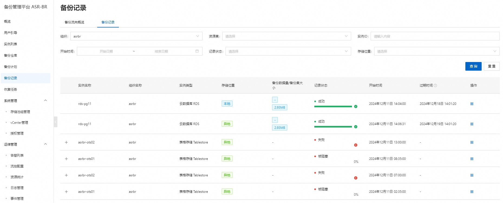

> **说明**
>
> 针对ECS、OSS、NAS备份，单击操作列  图标，选择**详情**，查看失败的原因，及时发现问题。

**带宽使用量巡检**

在标准化部署场景下，备份运营管理员登录备份管理平台ASR-BR，在左侧导航栏单击**运维管理 > 引擎监控**，查看当前备份引擎的发送流量。

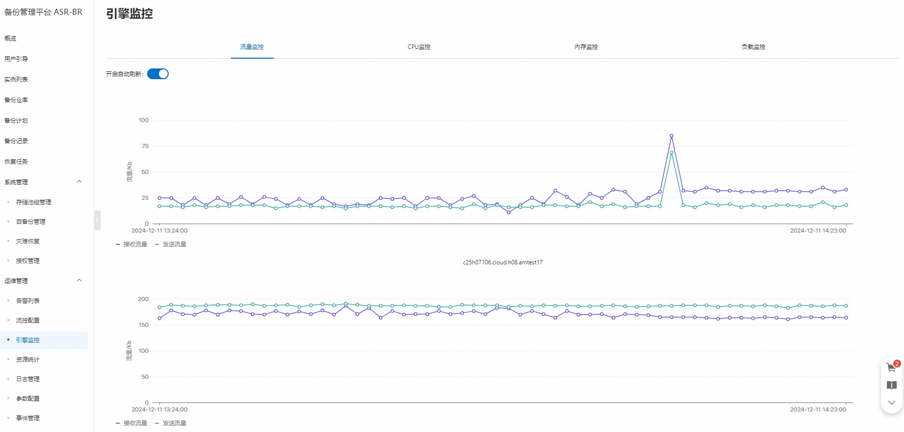

> **说明**
>
> - 轻量化（小型化）部署场景不支持查看带宽使用量巡检。
>
> - 如果两台引擎的流量之和达到备份的限流值的90%（具体请在**运维管理 > 流控配置**中查看），可参考以下操作：
>
>   - 在备份带宽允许的情况下调整备份的限流值。
>
>   - 调整备份策略，降低备份频率或者减少备份实例数量。
>
>   - 如果已经使用了备份带宽的80%，可以考虑扩容带宽。

**存储池使用量巡检**

备份运营管理员登录备份管理平台ASR-BR，单击**系统管理** > **存储池组管理**，单击最左侧对应的存储池组名称来查看存储池组中存储池使用量。

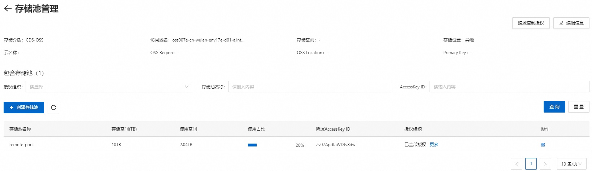

> **说明**
>
> 如果存储池使用量已经达到整个存储空间的80%以上，建议及时扩容存储空间，或者调整备份策略保存天数，及时删除数据。

**监控告警巡检**

备份运营管理员或者组织备份管理员登录备份管理平台ASR-BR，单击**运维管理 > 告警列表**，处理上报的告警信息。

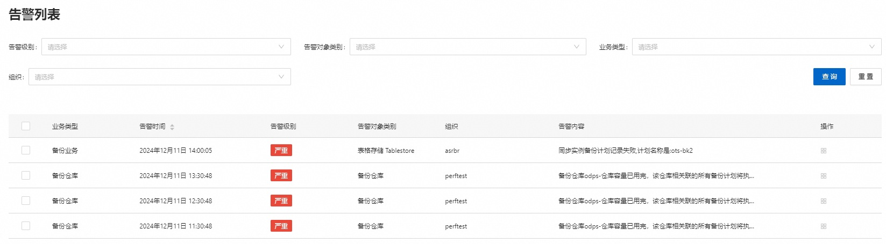

**自备份巡检**

使用备份运营管理员登录备份管理平台ASR-BR，单击**系统管理 > 自备份管理**，检查系统是否开启了自备份管理。如果未开启自备份管理，需要手动开启自备份管理，并配置相应的策略；如果已开启自备份管理，检查历史的自备份是否成功。

<a id="section-6"></a>

# 6.告警处理

<a id="section-6-1"></a>

## 6.1. tianjimon相关告警

<a id="section-6-1-1"></a>

### 6.1.1. ASR-BR告警列表

| 告警名称 | 告警描述 | 告警来源 | 告警级别 | 告警产品 |
| --- | --- | --- | --- | --- |
| tjmon_asrbr-portal-application_proc_restart_alarm | asrbr-portal应用进程重启告警 | Tianjimon | P1 | asrbr |
| tjmon_asrbr-portal-application_proc_not_exist_alarm | asrbr-portal应用进程不存在告警 | Tianjimon | P1 | asrbr |
| check_backup_disk | asrbr-backup服务所在机器的磁盘使用超过70%告警 | Tianjimon | P1 | asrbr |
| tjmon_asrbr-portal-service_available_alarm | asrbr-portal服务可用性告警 | Tianjimon | P1 | asrbr |
| tjmon_asrbr-backup-application_proc_restart_alarm | asrbr-backup应用进程重启告警 | Tianjimon | P1 | asrbr |
| tjmon_asrbr-backup-application_proc_not_exist_alarm | asrbr-backup应用不存在告警 | Tianjimon | P1 | asrbr |
| tjmon_asrbr-backup-service_available_alarm | asrbr-backup服务可用性告警 | Tianjimon | P1 | asrbr |

<a id="section-6-1-2"></a>

### 6.1.2. check_backup_disk

此告警主要检测asrbr-backup服务所在机器的磁盘使用情况，当出现此告警时，表示asrbr-backup服务所在机器的磁盘使用率过高，需要排查处理。

**告警属性**

| 告警名称 | 监控项 | 告警来源 | 告警级别 | 告警产品 | 执行周期 | 触发条件 |
| --- | --- | --- | --- | --- | --- | --- |
| check_backup_disk | tjmon_check_ba ckup_disk | Tianjimon | P1 | asrbr | 每60秒执行一次。 | p1_expressin\|$status==1 |

**适用版本**

适用于企业版v3.16以上版本。

**告警原因**

日志文件占用率过高。

**告警影响**

当磁盘使用率达100%时，会导致asrbr-backup服务异常，服务无法访问。

**处理方法**

> **警告**
>
> 所有告警处理方法涉及到修改产品任何配置，均需要走生产变更流程确认方案的可行性以及流程规范性，若属紧急应急范畴需客户与TAM同时同意方可执行，否则不允许直接执行处理方法的任何步骤。

1. 登录飞天基础运维平台（V2）。

2. 在左侧导航栏，选择**运维** > **服务运维**。

3. 在**服务运维**页面，搜索asrbr-backup服务。在搜索结果操作列单击**运维**。

4. 选择**所在集群**页签，单击集群名称。

5. 在**集群详情**页**服务管理**页签，查看asrbr-backup服务所在的vm状态是否正常。

   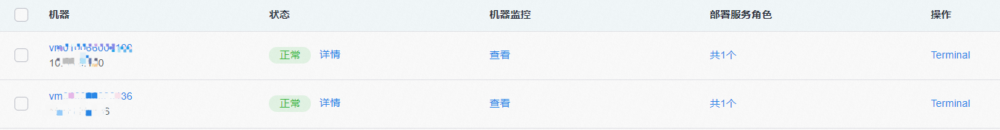

> **说明**
>
> 该告警上报时，asrbr-backup服务所在的vm状态为非正常状态。

6. 单击状态非正常的vm操作列的**Terminal**，登录机器。

7. 执行如下命令，查看机器磁盘使用情况。如果根目录使用率超过70%，考虑通过清理日志文件解决。

   ```text
   df -h
   ```

   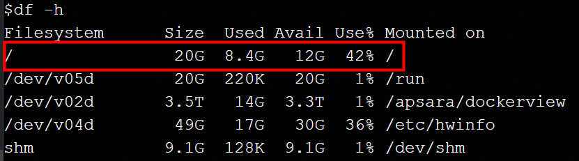

8. 执行如下命令，查看日志中占用量较大的文件或目录。

   ```bash
   cd /alidata/logs/asrbr-backup/
   du -sh * | grep G
   ```

   

9. 手动清理日志。

   <ol type="i">

   <li>

   执行 `rm -rf bak/` 命令清理bak目录下历史日志。

   </li>

   <li>

   如果asrbr-backup.log占用日志大于5GB以上，则使用 `echo "" > asrbr-back.log` 命令进行清理。

   </li>

   </ol>

> **说明**
>
> 如果上述步骤未能解决告警问题，请提工单（服务请求单）联系阿里云技术支持提供支持。

<a id="section-6-1-3"></a>

### 6.1.3. tjmon_alerts_srs-client_check_ctk_quota

此告警主要检测srs-client服务的ctk_session使用情况，出现此告警表示ctk_session使用比例过高，将会导致srs-client服务无法正常运行。

**告警属性**

<table>
  <tr>
    <td>告警项</td>
    <td>监控项</td>
    <td>告警来源</td>
    <td>告警级别</td>
    <td>告警产品</td>
    <td>触发条件</td>
    <td>执行周期</td>
  </tr>
  <tr>
    <td>tjmon_alerts_srs-client_check_ctk_q uota</td>
    <td>tjmon_table_srs-client_check_ctk_q uota</td>
    <td>tianjimon</td>
    <td>P1</td>
    <td>asrbr</td>
    <td>p1_expressin|$coll ection_flag!=0</td>
    <td>每60s执行一次</td>
  </tr>
</table>

**适用版本**

适用于专有云企业版v3.12及后续版本。

**告警原因**

ctk_session使用比例过高。

**告警影响**

将会导致srs-client服务无法正常运行。

**处理方法**

> **警告**
>
> 所有告警处理方法涉及到修改产品任何配置，均需要走生产变更流程确认方案的可行性以及流程规范性，若属紧急应急范畴需客户与TAM同时同意方可执行，否则不允许直接执行处理方法的任何步骤。

**v3.16以前版本**

需要先检查SRS是否关闭，然后关闭告警。

- 如果是飞天基础运维平台上报。

  <ol type="i">

  <li>

  登录飞天基础运维平台。

  </li>

  <li>

  选择**运维** > **集群运维**，在**Project**搜索srs，选择**管理** > **服务部署**。

  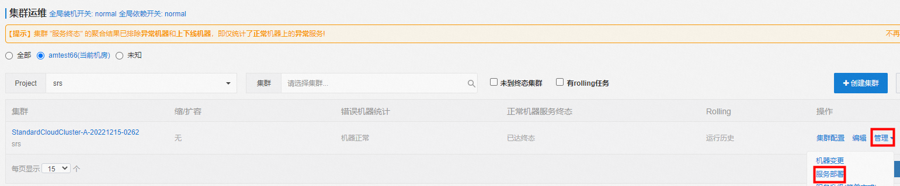

  </li>

  <li>

  查看是否部署了srs-master。

  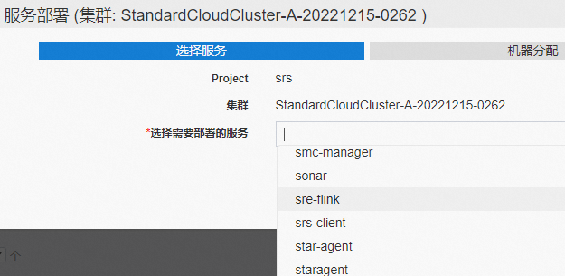

  - 如果没有部署srs-master服务，请根据现场局点的版本选择附录中的处理文档关闭告警。

  - 如果部署了srs-master服务，继续执行下面步骤。

  </li>

  </ol>

- 如果是Apsara Uni-manager运维控制台上报。

  <ol type="i">

  <li>

  登录Apsara Uni-manager运维控制台。

  </li>

  <li>

  查看**产品运维**下是否有**SRS管理**。

  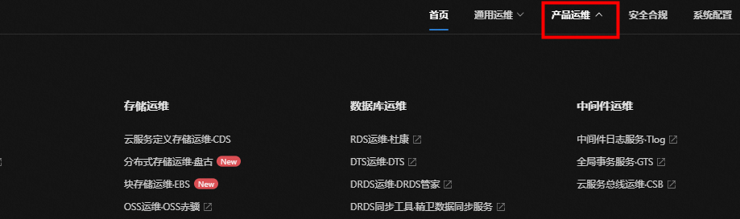

  - 如果存在SRS管理页面，进入页面查看SRS是否处于开启状态。

    - 如果开启，请联系产研进行处理。

    - 如果关闭，请根据现场局点的版本选择附录中的处理文档进行关闭告警。

  - 如果没有SRS管理页面，需要到srs-master.Server#容器中确认。

    <ol type="a">

    <li>

    登录srs-master.Server#容器。

    <ol type="a">

    <li>

    登录飞天基础运维平台。

    </li>

    <li>

    搜索服务srs-master，在服务所在集群右侧单击**Dashboard**。

    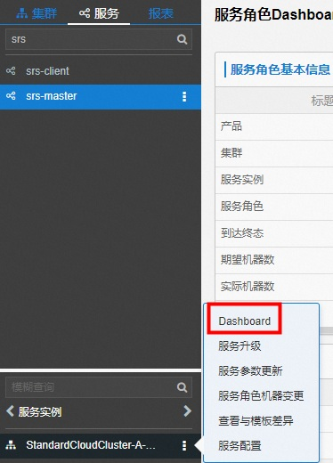

    </li>

    </ol>

    <ol type="i" start="100">

    <li>

    在**服务角色列表**区域，找到<strong>Server#</strong>并在所在行右侧单击**详情**。

    </li>

    <li value="500">

    在**机器信息**区域，任意机器右侧单击**终端**，登录机器。

    

    </li>

    </ol>

    <ol type="a" start="5">

    <li>

    执行如下命令，登录容器。

    ```bash
    docker exec -it `docker ps | grep server | awk '{print $1}'` bash
    ```

    </li>

    </ol>

    </li>

    <li>

    执行如下命令，查看SRS状态是否关闭。

    ```bash
    curl --connect-timeout 10 -s -u $secure_defaultUser_accesskey_id:$secure_defaultUser_accesskey_secret 
    '127.0.0.1:8088/statess'
    ```

    系统显示如下类似结果，请根据实际情况确认。

    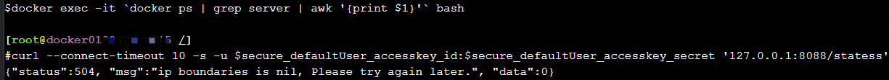

    - 如果返回值为'{"status":200, "msg":"success", "data":0}'，或者'{"status":504, "msg":"xxxxxx", "data":0}'时，表示SRS为关闭状态，请根据现场局点的版本选择附录中的处理文档进行关闭告警。

    - 其他返回值，请联系产研处理。

    </li>

    </ol>

  </li>

  </ol>

**v3.16及后续版本**

检查并修改ctk配置。

1. 登录飞天基础运维平台。

2. 搜索服务srs-client，在服务所在集群右侧单击**Dashboard**。

   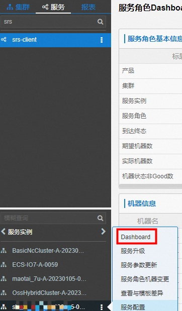

3. 在**服务角色列表**区域，找到<strong>srs-client#</strong>并在所在行右侧单击**详情**。

4. 在**机器信息**区域，任意机器右侧单击**终端**，登录机器。

   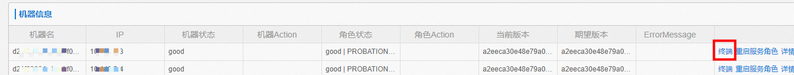

5. 执行如下命令，查看文件是否存在以及文件内容是否为空。

   ```bash
   cat /proc/net/ctk_current_conn_count
   cat /proc/sys/net/ipv4/ctk_session/conn_max_count
   ```

   - 如果文件不存在，请提工单（服务请求单）联系网络侧产研进行处理。

   - 如果文件存在，分别查看ctk_current_conn_count和conn_max_count字段值，确认ctk_current_conn_count/conn_max_count是否超过了60%。

     - 如果超过60%，表示当前网络压力较大，建议等待一段时间观察一下。

       > **说明**
       >
       > 如果长时间存在该情况，请提工单（服务请求单）联系网络侧产研确认是否需要增加conn_max_count字段值以及增加多少。

     - 如果未超过60%，请提工单（服务请求单）联系网络侧产研进行处理。

> **说明**
>
> 如果上述步骤未解决告警问题，请提工单（服务请求单）联系阿里云技术支持。

<a id="section-6-1-4"></a>

### 6.1.4. tjmon_alerts_srs-client_check_cat_iptables_syslog

此告警主要检测srs-client服务的srs_iptables.drop日志中是否存在丢包记录，出现此告警表示存在丢包记录，对服务无影响，需要关注丢包信息，检查丢包情况。

**告警属性**

<table>
  <tr>
    <td>告警项</td>
    <td>监控项</td>
    <td>告警来源</td>
    <td>告警级别</td>
    <td>告警产品</td>
    <td>触发条件</td>
    <td>执行周期</td>
  </tr>
  <tr>
    <td>tjmon_alerts_srs-client_check_cat_ip tables_syslog</td>
    <td>tjmon_table_srs-client_check_cat_ip tables_syslog</td>
    <td>tianjimon</td>
    <td>P1</td>
    <td>asrbr</td>
    <td>p1_expressin|$coll ection_flag!=0</td>
    <td>每60s执行一次</td>
  </tr>
</table>

**适用版本**

适用于专有云企业版v3.12及后续版本。

**告警原因**

存在丢包记录。

**告警影响**

对服务无影响，需要关注丢包信息，检查丢包情况。

**处理方法**

> **警告**
>
> 所有告警处理方法涉及到修改产品任何配置，均需要走生产变更流程确认方案的可行性以及流程规范性，若属紧急应急范畴需客户与TAM同时同意方可执行，否则不允许直接执行处理方法的任何步骤。

**v3.16以前版本**

需要先检查SRS是否关闭，然后关闭告警。

- 如果是飞天基础运维平台上报。

  <ol type="i">

  <li>

  登录飞天基础运维平台。

  </li>

  <li>

  在左侧导航栏选择**首页**，搜索srs-master服务，查看是否部署了srs-master服务。

  - 如果搜索不到，说明没有部署srs-master服务，请根据现场局点的版本选择附录中的处理文档关闭告警。

  - 如果能搜索到，说明部署了srs-master服务，继续执行下面步骤。

  </li>

  </ol>

- 如果是Apsara Uni-manager运维控制台上报。

  <ol type="i">

  <li>

  登录Apsara Uni-manager运维控制台。

  </li>

  <li>

  查看**产品运维**下是否有**SRS管理**。

  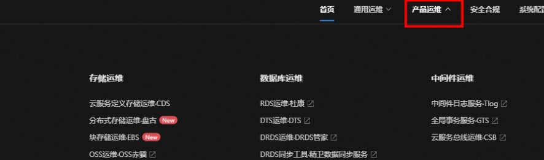

  - 如果存在**SRS管理**页面，进入页面查看SRS是否开启。

    - 如果开启，请联系产研处理。

    - 如果关闭，请根据现场局点的版本选择附录中的处理文档进行关闭告警。

  - 如果没有**SRS管理**页面，需要到srs-master.Server#容器中确认。

    <ol type="a">

    <li>

    登录srs-master.Server#容器。

    <ol type="a">

    <li>

    登录飞天基础运维平台。

    </li>

    <li>

    在左侧导航栏选择**首页**，搜索srs-master服务，单击搜索结果右侧的详情。

    </li>

    </ol>

    <ol type="i" start="100">

    <li>

    在**服务管理**页面选择**服务实例**页签，在集群**操作**列单击**详情**。

    </li>

    <li value="500">

    在组件列表中选择<strong>Server#</strong>组件。

    </li>

    </ol>

    <ol type="a" start="5">

    <li>

    在**实例列表**页签任意机器右侧**操作**列单击**Terminal**，登录机器。

    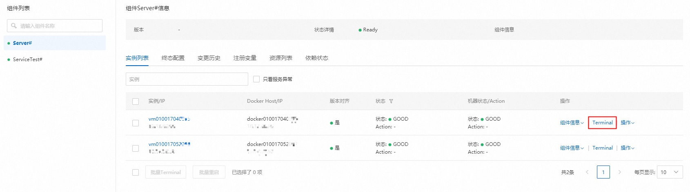

    </li>

    <li>

    执行如下命令，登录容器。

    ```bash
    docker exec -it `docker ps | grep server | awk '{print $1}'` bash
    ```

    </li>

    </ol>

    </li>

    <li>

    执行如下命令，查看SRS状态是否关闭。

    ```bash
    curl --connect-timeout 10 -s -u $secure_defaultUser_accesskey_id:$secure_defaultUser_accesskey_secret 
    '127.0.0.1:8088/statess'
    ```

    系统显示如下类似结果，请根据实际情况确认。

    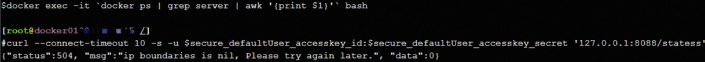

    - 如果返回值为'{"status":200, "msg":"success", "data":0}'，或者'{"status":504, "msg":"xxxxxx", "data":0}'时，表示SRS为关闭状态，请根据现场局点的版本选择附录中的处理文档进行关闭告警。

    - 其他返回值，请联系产研处理。

    </li>

    </ol>

  </li>

  </ol>

**v3.16及后续版本**

检查丢包情况。

1. 登录飞天基础运维平台。

2. 

3. 

4. 

5. 通过查询日志，查看丢包的源地址。

   ```bash
   cat /var/log/srs_iptables.drop.log
   ```

   系统显示如下类似结果：

   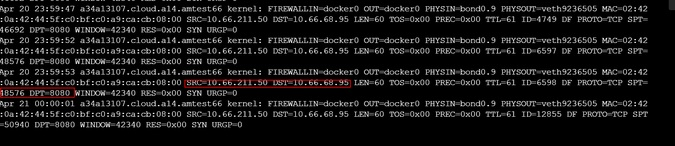

6. 执行如下命令，查看可信地址集合。

   ```text
   ipset test ipset_srs ${丢包源地址}
   ```

   

   - 如果报文在可信地址集合丢包：

     - 如果偶发丢包（几条丢包日志）：可能是session超时导致，可以忽略。

     - 如果持续丢包，请先关闭SRS并联系产研排查。

   - 如果报文不在可信地址集合丢包：

     - 查看朱雀规划确认丢包的源地址段是否在规划内、是否是非标扩容的地址段（例如RAMA直接扩容地址段），如果是则先关闭SRS，再将地址加入SRS白名单，确定SRS可以采集到该地址段后开启SRS。

     - 如果确认不是规划的地址段，考虑添加到黑名单中。

> **说明**
>
> 如果上述步骤未解决告警问题，请提工单（服务请求单）联系阿里云技术支持。

<a id="section-6-1-5"></a>

### 6.1.5. tjmon_alerts_srs_client_check_service_status

此告警主要检测srs_client服务可用性，出现此告警表示srs-client服务不可用。对于v3.16以前版本，现场凡是打开的局点均需要关闭。如果出现告警，需要先检查SRS是否关闭，然后关闭告警。v3.16及后续版本需要通过排查client日志进行处理。

**告警属性**

<table>
  <tr>
    <td>告警项</td>
    <td>监控项</td>
    <td>告警来源</td>
    <td>告警级别</td>
    <td>告警产品</td>
    <td>触发条件</td>
    <td>执行周期</td>
  </tr>
  <tr>
    <td>tjmon_alerts_srs_cl ient_check_service _status</td>
    <td>tjmon_table_srs_cli ent_check_service_status</td>
    <td>tianjimon</td>
    <td>P1</td>
    <td>asrbr</td>
    <td>p1_expressin|$coll ection_flag!=0</td>
    <td>每60s执行一次</td>
  </tr>
</table>

**适用版本**

适用于专有云企业版v3.12及后续版本。

**告警原因**

srs-client服务不可用。

**告警影响**

将会导致srs-client服务无法正常运行。

**处理方法**

> **警告**
>
> 所有告警处理方法涉及到修改产品任何配置，均需要走生产变更流程确认方案的可行性以及流程规范性，若属紧急应急范畴需客户与TAM同时同意方可执行，否则不允许直接执行处理方法的任何步骤。

**v3.16以前版本**

需要先检查SRS是否关闭，然后关闭告警。

- 如果是飞天基础运维平台上报。

  <ol type="i">

  <li>

  登录飞天基础运维平台。

  </li>

  <li>

  在左侧导航栏选择**首页**，搜索srs-master服务，查看是否部署了srs-master服务。

  - 如果搜索不到，说明没有部署srs-master服务，请根据现场局点的版本选择附录中的处理文档关闭告警。

  - 如果能搜索到，说明部署了srs-master服务，继续执行下面步骤。

  </li>

  </ol>

- 如果是Apsara Uni-manager运维控制台上报。

  <ol type="i">

  <li>

  登录Apsara Uni-manager运维控制台。

  </li>

  <li>

  查看**产品运维**下是否有**SRS管理**。

  

  - 如果存在**SRS管理**页面，进入页面查看SRS是否开启。

    - 如果开启，请联系产研处理。

    - 如果关闭，请根据现场局点的版本选择附录中的处理文档进行关闭告警。

  - 如果没有**SRS管理**页面，需要到srs-master.Server#容器中确认。

    <ol type="a">

    <li>

    登录srs-master.Server#容器。

    <ol type="a">

    <li>

    登录飞天基础运维平台。

    </li>

    <li>

    在左侧导航栏选择**首页**，搜索srs-master服务，单击搜索结果右侧的详情。

    </li>

    </ol>

    <ol type="i" start="100">

    <li>

    在**服务管理**页面选择**服务实例**页签，在集群**操作**列单击**详情**。

    </li>

    <li value="500">

    在组件列表中选择<strong>Server#</strong>组件。

    </li>

    </ol>

    <ol type="a" start="5">

    <li>

    在**实例列表**页签任意机器右侧**操作**列单击**Terminal**，登录机器。

    

    </li>

    <li>

    执行如下命令，登录容器。

    ```bash
    docker exec -it `docker ps | grep server | awk '{print $1}'` bash
    ```

    </li>

    </ol>

    </li>

    <li>

    执行如下命令，查看SRS状态是否关闭。

    ```bash
    curl --connect-timeout 10 -s -u $secure_defaultUser_accesskey_id:$secure_defaultUser_accesskey_secret 
    '127.0.0.1:8088/statess'
    ```

    系统显示如下类似结果，请根据实际情况确认。

    

    - 如果返回值为'{"status":200, "msg":"success", "data":0}'，或者'{"status":504, "msg":"xxxxxx", "data":0}'时，表示SRS为关闭状态，请根据现场局点的版本选择附录中的处理文档进行关闭告警。

    - 其他返回值，请联系产研处理。

    </li>

    </ol>

  </li>

  </ol>

**v3.16及后续版本**

1. 登录飞天基础运维平台。

2. 

3. 

4. 

5. 需要通过排查client启动日志进行处理，请收集日志异常信息并联系产研处理。

   日志路径： `/cloud/app/srs-client/srs-client#/srsclient_post_check_app/current/log/tianji/stderr`

> **说明**
>
> 如果上述步骤未解决告警问题，请提工单（服务请求单）联系阿里云技术支持。

<a id="section-6-1-6"></a>

### 6.1.6. tjmon_alerts_srs_client_check_nf_conntrack

此告警主要检测srs-client服务的nf_conntrack session使用情况，出现此告警表示nf_conntrack session使用比例过高，将会导致srs-client服务无法正常运行。

**告警属性**

<table>
  <tr>
    <td>告警项</td>
    <td>监控项</td>
    <td>告警来源</td>
    <td>告警级别</td>
    <td>告警产品</td>
    <td>触发条件</td>
    <td>执行周期</td>
  </tr>
  <tr>
    <td>tjmon_alerts_srs_cl ient_check_nf_con ntrack</td>
    <td>tjmon_table_srs_cli ent_check_nf_conn track</td>
    <td>tianjimon</td>
    <td>P1</td>
    <td>asrbr</td>
    <td>p1_expressin|$coll ection_flag!=0</td>
    <td>每60s执行一次</td>
  </tr>
</table>

**适用版本**

适用于专有云企业版v3.16及后续版本。

**告警原因**

nf_conntrack session使用比例过高，超过60%。

**告警影响**

将会导致srs-client服务无法正常运行。

**处理方法**

> **警告**
>
> 所有告警处理方法涉及到修改产品任何配置，均需要走生产变更流程确认方案的可行性以及流程规范性，若属紧急应急范畴需客户与TAM同时同意方可执行，否则不允许直接执行处理方法的任何步骤。

**v3.16以前版本**

需要先检查SRS是否关闭，然后关闭告警。

- 如果是飞天基础运维平台上报。

  <ol type="i">

  <li>

  登录飞天基础运维平台。

  </li>

  <li>

  在左侧导航栏选择**首页**，搜索srs-master服务，查看是否部署了srs-master服务。

  - 如果搜索不到，说明没有部署srs-master服务，请根据现场局点的版本选择附录中的处理文档关闭告警。

  - 如果能搜索到，说明部署了srs-master服务，继续执行下面步骤。

  </li>

  </ol>

- 如果是Apsara Uni-manager运维控制台上报。

  <ol type="i">

  <li>

  登录Apsara Uni-manager运维控制台。

  </li>

  <li>

  查看**产品运维**下是否有**SRS管理**。

  

  - 如果存在**SRS管理**页面，进入页面查看SRS是否开启。

    - 如果开启，请联系产研处理。

    - 如果关闭，请根据现场局点的版本选择附录中的处理文档进行关闭告警。

  - 如果没有**SRS管理**页面，需要到srs-master.Server#容器中确认。

    <ol type="a">

    <li>

    登录srs-master.Server#容器。

    <ol type="a">

    <li>

    登录飞天基础运维平台。

    </li>

    <li>

    在左侧导航栏选择**首页**，搜索srs-master服务，单击搜索结果右侧的详情。

    </li>

    </ol>

    <ol type="i" start="100">

    <li>

    在**服务管理**页面选择**服务实例**页签，在集群**操作**列单击**详情**。

    </li>

    <li value="500">

    在组件列表中选择<strong>Server#</strong>组件。

    </li>

    </ol>

    <ol type="a" start="5">

    <li>

    在**实例列表**页签任意机器右侧**操作**列单击**Terminal**，登录机器。

    

    </li>

    <li>

    执行如下命令，登录容器。

    ```bash
    docker exec -it `docker ps | grep server | awk '{print $1}'` bash
    ```

    </li>

    </ol>

    </li>

    <li>

    执行如下命令，查看SRS状态是否关闭。

    ```bash
    curl --connect-timeout 10 -s -u $secure_defaultUser_accesskey_id:$secure_defaultUser_accesskey_secret 
    '127.0.0.1:8088/statess'
    ```

    系统显示如下类似结果，请根据实际情况确认。

    

    - 如果返回值为'{"status":200, "msg":"success", "data":0}'，或者'{"status":504, "msg":"xxxxxx", "data":0}'时，表示SRS为关闭状态，请根据现场局点的版本选择附录中的处理文档进行关闭告警。

    - 其他返回值，请联系产研处理。

    </li>

    </ol>

  </li>

  </ol>

**v3.16及后续版本**

检查并修改nf_conntreack配置。

1. 登录飞天基础运维平台。

2. 

3. 

4. 

5. 执行如下命令，查看文件是否存在以及文件内容是否为空。

   ```bash
   cat /proc/sys/net/nf_conntrack_max
   cat /proc/sys/net/netfilter/nf_conntrack_count
   ```

   - 如果文件不存在，请提工单（服务请求单）联系负责操作系统镜像的产研进行处理。

   - 如果文件存在，请执行以下步骤。

6. 检查/home/admin/srs-client/conf/configured_info.json文件是否存在以及内容是否为空。

   - 如果不存在，请联系产研确认原因。

   - 如果存在，请分别查看nf_conntrack_count和nf_conntrack_max字段值，确认nf_conntrack_count/nf_conntrack_max是否超过了60%。

     - 如果超过了60%，表示当前网络压力较大，建议等待一段时间观察一下。

       > **说明**
       >
       > 如果长时间存在该情况，请提工单（服务请求单）联系网络侧产研确认是否需要增加nf_conntrack_max字段值以及增加多少。

     - 如果未超过60%，请联系产研确认处理。

> **说明**
>
> 如果上述步骤未解决告警问题，请提工单（服务请求单）联系阿里云技术支持。

<a id="section-6-1-7"></a>

### 6.1.7. tjmon_asrbr-backup-application_proc_restart_alarm

此告警主要用于检测asrbr-backup服务的java进程是否频繁重启，当出现此告警时，表示asrbr-backup服务的java进程频繁重启，可能会导致asrbr服务中断。

**告警属性**

| 告警名称 | 监控项 | 告警来源 | 告警级别 | 告警产品 | 执行周期 | 触发条件 |
| --- | --- | --- | --- | --- | --- | --- |
| tjmon_asrbr-backup-application_proc_res tart_alarm | tjmon_asrbr-backup-check_application_pr oc_state_cluster_ser verrole | Tianjimon | P1 | asrbr | 每60秒执行一次。 | p1_expressin\|$_status==1 |

**适用版本**

适用于企业版v3.16以上版本。

**告警原因**

asrbr-backup服务的java进程频繁重启。

**告警影响**

- 单节点异常，只影响负载均衡，服务可以正常访问。

- 两个应用节点都异常时，会导致服务访问不了。

**处理方法**

> **警告**
>
> 所有告警处理方法涉及到修改产品任何配置，均需要走生产变更流程确认方案的可行性以及流程规范性，若属紧急应急范畴需客户与TAM同时同意方可执行，否则不允许直接执行处理方法的任何步骤。

1. 登录飞天基础运维平台（V2）。

2. 在左侧导航栏，选择**运维** > **服务运维**。

3. 在**服务运维**页面，搜索asrbr-backup服务。在搜索结果操作列单击**运维**。

4. 选择**所在集群**页签，单击集群名称。

5. 在**集群详情**页**服务管理**页签，查看asrbr-backup服务所在的vm状态是否正常。

   

   该告警上报时，asrbr-backup服务所在的vm状态为非正常状态。尝试通过重启SR解决。

6. 重启SR完成后，单击状态非正常的vm操作列的**Terminal**，登录机器。

7. 登录asrbr-backup.Backup#容器。

   <ol type="i">

   <li>

   执行如下命令，查看容器ID。

   ```bash
   docker ps | grep backup
   ```

   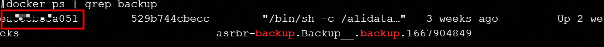

   </li>

   <li>

   执行如下命令，登录容器。

   ```bash
   docker exec -it ${CONTAINER ID} bash
   ```

   </li>

   </ol>

8. 执行如下命令，查看java进程是否频繁重启。

   ```text
   ps -eo pid,lstart,etime,cmd | grep java
   ```

   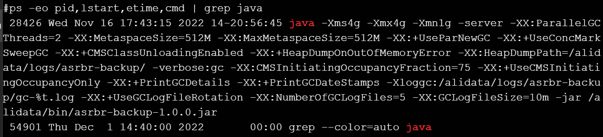

   - 如上图所示，表示进程状态正常。

   - 如果进程频繁重启，考虑通过重启容器解决。

9. 执行如下命令，重启容器。

   ```bash
   docker stop ${CONTAINER ID}
   docker start ${CONTAINER ID}
   ```

0. 待容器重启完成后，查看asrbr-backup服务状态，状态正常说明问题解决。如果问题依然存在，需要通过排查日志。

   java进程日志路径： `alidata/logs/asrbr-backup`

> **说明**
>
> 如果上述步骤未解决告警问题，请提工单（服务请求单）联系阿里云技术支持。

<a id="section-6-1-8"></a>

### 6.1.8. tjmon_asrbr-backup-application_proc_not_exist_alarm

此告警主要用于检测asrbr-backup服务的java进程是否存在，当出现此告警时，表示asrbr-backup服务的java进程不存在，可能会导致asrbr服务中断。

**告警属性**

| 告警名称 | 监控项 | 告警来源 | 告警级别 | 告警产品 | 执行周期 | 触发条件 |
| --- | --- | --- | --- | --- | --- | --- |
| tjmon_asrbr-backup-application_proc_not_exi st_alarm | tjmon_asrbr-backup-check_application _proc_state_cluste r_serverrole | Tianjimon | P1 | asrbr | 每60秒执行一次。 | p1_expressin\|$_status== 2 |

**适用版本**

适用于企业版v3.16以上版本。

**告警原因**

asrbr-backup服务的java进程不存在。

**告警影响**

- 单节点异常，只影响负载均衡，服务可以正常访问。

- 两个应用节点都异常时，会导致服务访问不了。

**处理方法**

> **警告**
>
> 所有告警处理方法涉及到修改产品任何配置，均需要走生产变更流程确认方案的可行性以及流程规范性，若属紧急应急范畴需客户与TAM同时同意方可执行，否则不允许直接执行处理方法的任何步骤。

1. 登录飞天基础运维平台（V2）。

2. 在左侧导航栏，选择**运维** > **服务运维**。

3. 在**服务运维**页面，搜索asrbr-backup服务。在搜索结果操作列单击**运维**。

4. 选择**所在集群**页签，单击集群名称。

5. 在**集群详情**页**服务管理**页签，查看asrbr-backup服务所在的vm状态是否正常。

   

   该告警上报时，asrbr-backup服务所在的vm状态为非正常状态。尝试通过重启SR解决。

6. 重启SR完成后，单击状态非正常的vm操作列的**Terminal**，登录机器。

7. 登录asrbr-backup.Backup#容器。

   <ol type="i">

   <li>

   执行如下命令，查看容器ID。

   ```bash
   docker ps | grep backup
   ```

   

   </li>

   <li>

   执行如下命令，登录容器。

   ```bash
   docker exec -it ${CONTAINER ID} bash
   ```

   </li>

   </ol>

8. 执行如下命令，查看java进程是否存在。

   ```text
   ps -ef | grep java
   ```

   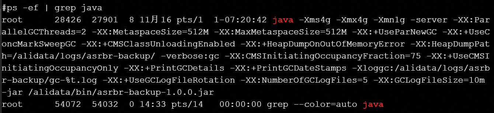

   - 如上图所示，表示java进程存在。

   - 如果java进程不存在，考虑通过重启容器解决。

9. 执行如下命令，重启容器。

   ```bash
   docker stop ${CONTAINER ID}
   docker start ${CONTAINER ID}
   ```

0. 待容器重启完成后，查看asrbr-backup服务状态，状态正常说明问题解决。如果问题依然存在，需要通过排查日志。

   java进程日志路径： `alidata/logs/asrbr-backup`

> **说明**
>
> 如果上述步骤未解决告警问题，请提工单（服务请求单）联系阿里云技术支持。

<a id="section-6-1-9"></a>

### 6.1.9. tjmon_asrbr-backup-service_available_alarm

此告警主要是用于检测asrbr-backup服务状态，当出现此告警时表示服务状态异常，可能会导致asrbr-backup服务无法访问。

**告警属性**

| 告警名称 | 监控项 | 告警来源 | 告警级别 | 告警产品 | 执行周期 | 触发条件 |
| --- | --- | --- | --- | --- | --- | --- |
| tjmon_asrbr-backup-service_available_alarm | tjmon_asrbr-backup-check_service_avai lable_cluster_serve rrole | Tianjimon | P1 | asrbr | 每60秒执行一次。 | p1_expressin\|$_error_flag ==1 |

**适用版本**

适用于企业版v3.16以上版本。

**告警原因**

asrbr-backup服务java进程状态异常。

**告警影响**

- 单节点异常，只影响负载均衡，服务可以正常访问。

- 两个应用节点都异常时，会导致服务访问不了。

**处理方法**

> **警告**
>
> 所有告警处理方法涉及到修改产品任何配置，均需要走生产变更流程确认方案的可行性以及流程规范性，若属紧急应急范畴需客户与TAM同时同意方可执行，否则不允许直接执行处理方法的任何步骤。

1. 登录飞天基础运维平台。

2. 在左侧导航栏，选择**资源管理 > 产品集群运维**。

3. 进入集群详情页面，选择**服务列表**页签，单击asrbr-backup。

   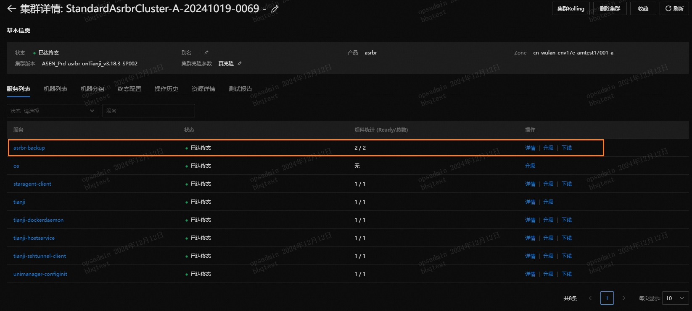

4. 进入**组件详情**页面，选择<strong>Backup#</strong>组件。

5. 进入**实例列表**页签，在机器列表中查看vm状态是否正常。

   > **说明**
   >
   > 该告警上报时，asrbr-backup服务所在的vm状态为非正常状态。尝试通过重启SR解决。

   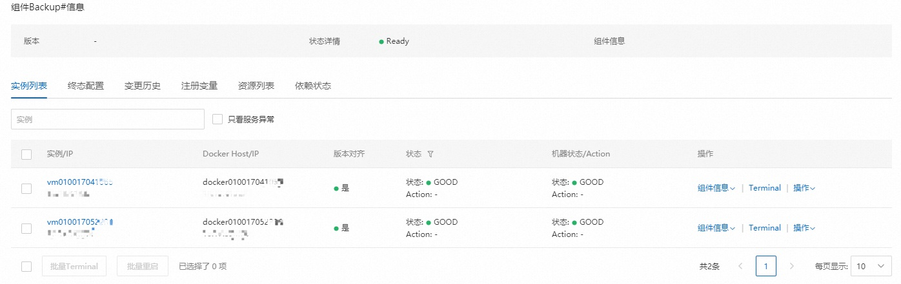

6. 重启SR完成后，单击状态非正常的vm操作列的**Terminal**，登录机器。

7. 登录asrbr-backup.Backup#容器。

   <ol type="i">

   <li>

   执行如下命令，查看容器ID。

   ```bash
   docker ps | grep backup
   ```

   

   </li>

   <li>

   执行如下命令，登录容器。

   ```bash
   docker exec -it <容器ID> /bin/bash
   ```

   </li>

   </ol>

8. 执行如下命令，查看java进程是否存在。

   ```text
   ps -ef | grep java
   ```

   

   - 如上图所示，表示java进程存在。

   - 如果java进程不存在，考虑通过重启容器解决。

9. 执行如下命令，重启容器。

   ```bash
   docker stop <容器ID>
   docker start <容器ID>
   ```

0. 待容器重启完成后，查看asrbr-backup服务状态，状态正常说明问题解决。如果问题依然存在，需要通过排查日志。

   - java进程日志路径： `alidata/logs/asrbr-backup`

   - 容器日志查询命令： docker logs `<`容器`ID>`

> **说明**
>
> 如果上述步骤未解决告警问题，请提工单（服务请求单）联系阿里云技术支持。

<a id="section-6-1-10"></a>

### 6.1.10. tjmon_hbr-console-application_proc_restart_alarm

此告警主要用于检测hbr-console服务的java进程是否频繁重启。当出现此告警时，表示hbr-console服务的java进程频繁重启，可能会导致asrbr服务中断。

**告警属性**

<table>
  <tr>
    <td>告警名称</td>
    <td>监控项</td>
    <td>告警来源</td>
    <td>告警级别</td>
    <td>告警产品</td>
    <td>执行周期</td>
    <td>触发条件</td>
  </tr>
  <tr>
    <td>tjmon_hbr-console-application_proc_restart _alarm</td>
    <td>tjmon_hbr-console-check_application_proc_state_cluster_serverrole</td>
    <td>tianjimon</td>
    <td>P1</td>
    <td>asrbr</td>
    <td>每60秒执行一次</td>
    <td>p1_expressin|$_status==1</td>
  </tr>
</table>

**适用版本**

适用于专有云企业版v3.16及后续版本。

**告警原因**

hbr-console服务的java进程频繁重启。

**告警影响**

- 单节点异常，只影响负载均衡，服务可以正常访问。

- 两个应用节点都异常时，会导致服务访问不了。

**处理方法**

> **警告**
>
> 所有告警处理方法涉及到修改产品任何配置，均需要走生产变更流程确认方案的可行性以及流程规范性，若属紧急应急范畴需客户与TAM同时同意方可执行，否则不允许直接执行处理方法的任何步骤。

1. 登录飞天基础运维平台。

2. 在左侧导航栏，选择**首页**。搜索“hbr-console”服务，在搜索结果右侧单击**详情**。

   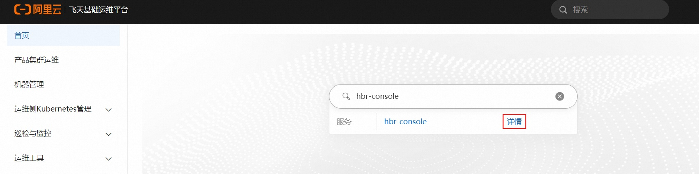

3. 进入**服务管理**页面，选择**服务实例**页签，在**操作**列单击**详情**。

4. 在**组件列表**中，选择<strong>Console#</strong>组件。

5. 在**实例列表**页签中查看机器状态是否正常。

   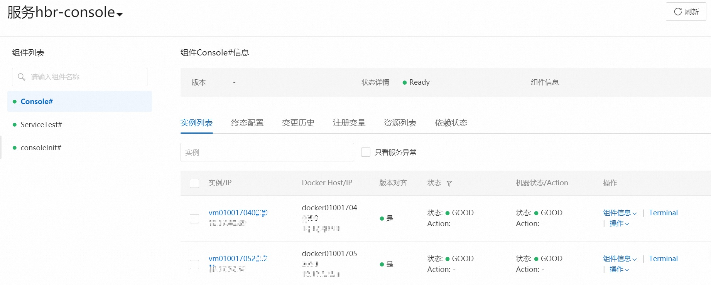

   - 如果机器状态异常，在机器**操作**列单击**操作** > **重启**，重启SR后执行以下操作。

   - 如果机器状态正常继续执行以下操作。

6. 单击机器**操作**列的**Terminal**，登录机器。

7. 登录hbr-console.Console#容器。

   <ol type="i">

   <li>

   执行如下命令，查看容器ID。

   ```bash
   docker ps
   ```

   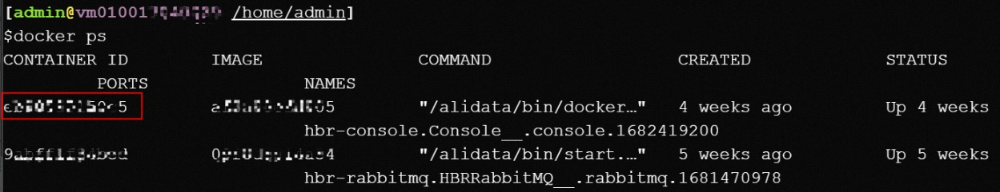

   </li>

   <li>

   执行如下命令，登录容器。

   ```bash
   docker exec -it <容器ID> /bin/bash
   ```

   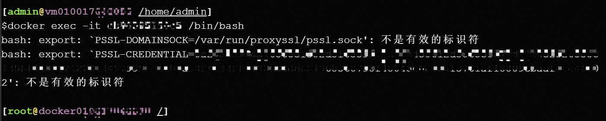

   </li>

   </ol>

8. 执行如下命令，查看java进程是否频繁重启。如果进程频繁重启，考虑通过重启容器解决。

   ```text
   ps -eo pid,lstart,etime,cmd | grep java
   ```

   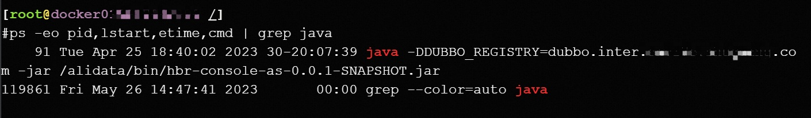

   如上图所示，表示进程状态正常。

9. 执行 `exit` 命令退出容器。

0. 执行如下命令，重启容器。

   ```bash
   docker stop <容器ID>
   docker start <容器ID>
   ```

1. 待容器重启完成后，查看hbr-console服务状态，状态正常说明问题解决。如果问题依然存在，需要排查日志，根据日志中的报错信息处理。

   - java进程日志路径： `alidata/logs/`

   - 容器日志查询命令： docker logs `<`容器`ID>`

> **说明**
>
> 如果上述步骤未解决告警问题，请提工单（服务请求单）联系阿里云技术支持。

<a id="section-6-1-11"></a>

### 6.1.11. tjmon_hbr-console-application_proc_not_exist_alarm

此告警主要用于检测hbr-console服务的java进程是否存在。当出现此告警时，表示hbr-console服务的java进程不存在，可能会导致asrbr服务中断。

**告警属性**

<table>
  <tr>
    <td>告警名称</td>
    <td>监控项</td>
    <td>告警来源</td>
    <td>告警级别</td>
    <td>告警产品</td>
    <td>执行周期</td>
    <td>触发条件</td>
  </tr>
  <tr>
    <td>tjmon_hbr-console-application_proc_not_exi st_alarm</td>
    <td>tjmon_hbr-console-check_application _proc_state_clust er_serverrole</td>
    <td>tianjimon</td>
    <td>P1</td>
    <td>asrbr</td>
    <td>每60秒执行一次</td>
    <td>p1_expressin|$_status==2</td>
  </tr>
</table>

**适用版本**

适用于专有云企业版v3.16及后续版本。

**告警原因**

hbr-console服务的java进程不存在。

**告警影响**

- 单节点异常，只影响负载均衡，服务可以正常访问。

- 两个应用节点都异常时，会导致服务访问不了。

**处理方法**

> **警告**
>
> 所有告警处理方法涉及到修改产品任何配置，均需要走生产变更流程确认方案的可行性以及流程规范性，若属紧急应急范畴需客户与TAM同时同意方可执行，否则不允许直接执行处理方法的任何步骤。

1. 登录飞天基础运维平台。

2. 在产品列表中搜索“asrbr”服务，单击\*\*\*AsrbrBkEngine\*\*\*\*的**集群详情**。

   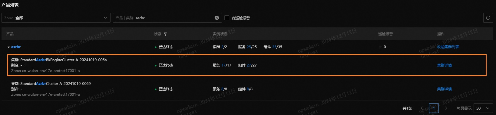

3. 在**服务列表**页签，单击“hbr-console”进入组件详情页面。

4. 在**组件列表**中，选择<strong>Console#</strong>组件。

5. 在**实例列表**页签中查看机器状态是否正常。

   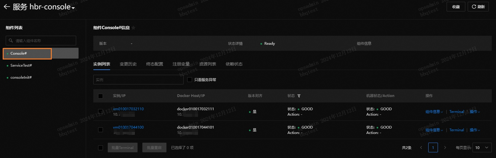

   - 如果机器状态异常，在机器**操作**列单击**操作** > **重启**，重启SR后执行以下操作。

   - 如果机器状态正常继续执行以下操作。

6. 单击机器**操作**列的**Terminal**，登录机器。

7. 登录hbr-console.Console#容器。

   <ol type="i">

   <li>

   执行如下命令，查看容器ID。

   ```bash
   docker ps
   ```

   

   </li>

   <li>

   执行如下命令，登录容器。

   ```bash
   docker exec -it <容器ID> /bin/bash
   ```

   

   </li>

   </ol>

8. 执行如下命令，查看java进程是否存在。如果java进程不存在，考虑通过重启容器解决。

   ```text
   ps -ef | grep java
   ```

   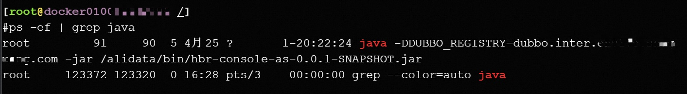

   如上图所示，表示java进程存在。

9. 执行 `exit` 命令退出容器。

0. 执行如下命令，重启容器。

   ```bash
   docker stop <容器ID>
   docker start <容器ID>
   ```

1. 待容器重启完成后，查看hbr-console服务状态，状态正常说明问题解决。如果问题依然存在，需要排查日志，根据日志中的报错信息处理。

   - java进程日志路径： `alidata/logs/`

   - 容器日志查询命令： docker logs `<`容器`ID>`

> **说明**
>
> 如果上述步骤未解决告警问题，请提工单（服务请求单）联系阿里云技术支持。

<a id="section-6-1-12"></a>

### 6.1.12. tjmon_hbr-console-service_available_alarm

此告警主要是用于检测hbr-console服务状态，当出现此告警时表示服务状态异常，可能会导致hbr-console服务无法访问。

**告警属性**

<table>
  <tr>
    <td>告警名称</td>
    <td>监控项</td>
    <td>告警来源</td>
    <td>告警级别</td>
    <td>告警产品</td>
    <td>执行周期</td>
    <td>触发条件</td>
  </tr>
  <tr>
    <td>tjmon_hbr-console-service_available_alarm</td>
    <td>tjmon_hbr-console-check_service_avai lable_cluster_serve rrole</td>
    <td>tianjimon</td>
    <td>P1</td>
    <td>asrbr</td>
    <td>每60秒执行一次</td>
    <td>p1_expressin|$_error_flag ==1</td>
  </tr>
</table>

**适用版本**

适用于专有云企业版v3.16及后续版本。

**告警原因**

hbr-console服务java进程状态异常。

**告警影响**

- 单节点异常，只影响负载均衡，服务可以正常访问。

- 两个应用节点都异常时，会导致服务访问不了。

**处理方法**

> **警告**
>
> 所有告警处理方法涉及到修改产品任何配置，均需要走生产变更流程确认方案的可行性以及流程规范性，若属紧急应急范畴需客户与TAM同时同意方可执行，否则不允许直接执行处理方法的任何步骤。

1. 登录飞天基础运维平台。

2. 在产品列表中搜索“asrbr”服务，单击\*\*\*AsrbrBkEngine\*\*\*\*的**集群详情**。

   

3. 在**服务列表**页签，单击“hbr-console”进入组件详情页面。

4. 在**组件列表**中，选择<strong>Console#</strong>组件。

5. 在**实例列表**页签中查看机器状态是否正常。

   

   - 如果机器状态异常，在机器**操作**列单击**操作** > **重启**，重启SR后执行以下操作。

   - 如果机器状态正常继续执行以下操作。

6. 单击机器**操作**列的**Terminal**，登录机器。

7. 登录hbr-console.Console#容器。

   <ol type="i">

   <li>

   执行如下命令，查看容器ID。

   ```bash
   docker ps
   ```

   

   </li>

   <li>

   执行如下命令，登录容器。

   ```bash
   docker exec -it <容器ID> /bin/bash
   ```

   

   </li>

   </ol>

8. 执行如下命令，查看java进程是否存在。如果java进程不存在，考虑通过重启容器解决。

   ```text
   ps -ef | grep java
   ```

   

   如上图所示，表示java进程存在。

9. 执行 `exit` 命令退出容器。

0. 执行如下命令，重启容器。

   ```bash
   docker stop <容器ID>
   docker start <容器ID>
   ```

1. 待容器重启完成后，查看hbr-console服务状态，状态正常说明问题解决。如果问题依然存在，需要排查日志，根据日志中的报错信息处理。

   - java进程日志路径： `alidata/logs/`

   - 容器日志查询命令： docker logs `<`容器`ID>`

> **说明**
>
> 如果上述步骤未解决告警问题，请提工单（服务请求单）联系阿里云技术支持。

<a id="section-6-1-13"></a>

### 6.1.13. tjmon_pop-aliyun-com-application_proc_restart_alarm

此告警主要用于检测PopAliyunCom组件的java进程是否频繁重启，当出现此告警时，表示PopAliyunCom组件的java进程频繁重启，PopAliyunCom组件不可用。

**告警属性**

<table>
  <tr>
    <td>告警名称</td>
    <td>监控项</td>
    <td>告警来源</td>
    <td>告警级别</td>
    <td>告警产品</td>
    <td>执行周期</td>
    <td>触发条件</td>
  </tr>
  <tr>
    <td>tjmon_pop-aliyun-com-application_proc_restart _alarm</td>
    <td>tjmon_pop-aliyun-com-check_application_proc_state_cluster_serverrole</td>
    <td>tianjimon</td>
    <td>P1</td>
    <td>asrbr</td>
    <td>每60秒执行一次</td>
    <td>p1_expressin|$_status==1</td>
  </tr>
</table>

**适用版本**

适用于专有云企业版v3.16及后续版本。

**告警原因**

PopAliyunCom组件的java进程频繁重启。

**告警影响**

- 单节点异常，只影响负载均衡，服务可以正常访问。

- 两个应用节点都异常时，会导致服务访问不了。

**处理方法**

> **警告**
>
> 所有告警处理方法涉及到修改产品任何配置，均需要走生产变更流程确认方案的可行性以及流程规范性，若属紧急应急范畴需客户与TAM同时同意方可执行，否则不允许直接执行处理方法的任何步骤。

1. 登录飞天基础运维平台。

2. 在左侧导航栏，选择**产品集群运维**。搜索asrbr，在搜索结果**操作**列单击**集群详情**。

   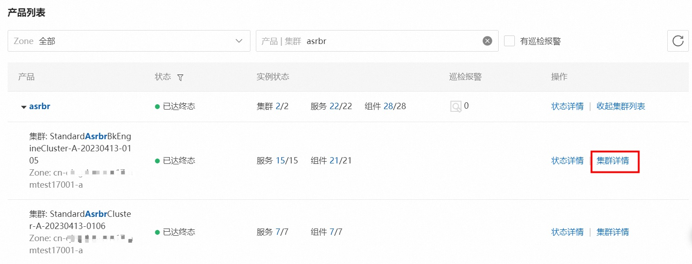

3. 在**服务列表**页签，单击**webapp-datapop**服务名称。

4. 在**组件列表**中，选择<strong>PopAliyunCom#</strong>组件。

5. 在**实例列表**页签中查看机器状态是否正常。

   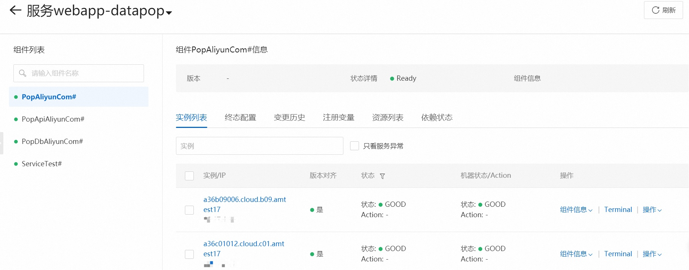

   - 如果机器状态异常，在机器**操作**列单击**操作** > **重启**，重启SR后执行以下操作。

   - 如果机器状态正常继续执行以下操作。

6. 单击机器**操作**列的**Terminal**，登录机器。

7. 登录webapp-datapop.PopAliyunCom#容器。

   <ol type="i">

   <li>

   执行如下命令，查看容器ID。

   ```bash
   docker ps
   ```

   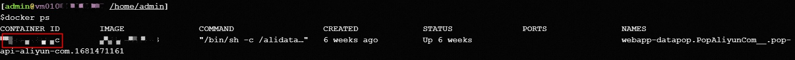

   </li>

   <li>

   执行如下命令，登录容器。

   ```bash
   docker exec -it <容器ID> /bin/bash
   ```

   

   </li>

   </ol>

8. 执行如下命令，查看java进程是否频繁重启。如果进程频繁重启，考虑通过重启容器解决。

   ```text
   ps -eo pid,lstart,etime,cmd | grep java
   ```

   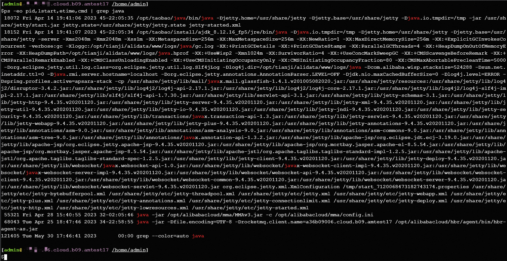

   如上图所示，表示进程状态正常。

9. 执行 exit 命令退出容器。

0. 执行如下命令，重启容器。

   ```bash
   docker stop <容器ID>
   docker start <容器ID>
   ```

1. 待容器重启完成后，查看PopAliyunCom组件状态，状态正常说明问题解决。如果问题依然存在，需要通过排查日志。

   

   - java进程日志路径： alidata/logs/

   - 容器日志查询命令： docker logs `<`容器`ID>`

> **说明**
>
> 如果上述步骤未解决告警问题，请提工单（服务请求单）联系阿里云技术支持。

<a id="section-6-1-14"></a>

### 6.1.14. tjmon_pop-aliyun-com-application_proc_not_exist_alarm

此告警主要用于检测PopAliyunCom组件的java进程是否存在，当出现此告警时，表示PopAliyunCom组件的java进程不存在，PopAliyunCom组件不可用。

**告警属性**

<table>
  <tr>
    <td>告警名称</td>
    <td>监控项</td>
    <td>告警来源</td>
    <td>告警级别</td>
    <td>告警产品</td>
    <td>执行周期</td>
    <td>触发条件</td>
  </tr>
  <tr>
    <td>tjmon_pop-aliyun-com-application_proc_not_exi st_alarm</td>
    <td>tjmon_pop-aliyun-com-check_application _proc_state_clust er_serverrole</td>
    <td>tianjimon</td>
    <td>P1</td>
    <td>asrbr</td>
    <td>每60秒执行一次</td>
    <td>p1_expressin|$_status==2</td>
  </tr>
</table>

**适用版本**

适用于专有云企业版v3.16及后续版本。

**告警原因**

PopAliyunCom组件的java进程不存在。

**告警影响**

- 单节点异常，只影响负载均衡，服务可以正常访问。

- 两个应用节点都异常时，会导致服务访问不了。

**处理方法**

> **警告**
>
> 所有告警处理方法涉及到修改产品任何配置，均需要走生产变更流程确认方案的可行性以及流程规范性，若属紧急应急范畴需客户与TAM同时同意方可执行，否则不允许直接执行处理方法的任何步骤。

1. 登录飞天基础运维平台。

2. 在左侧导航栏，选择**产品集群运维**。搜索asrbr，在搜索结果**操作**列单击**集群详情**。

   

3. 在**服务列表**页签，单击**webapp-datapop**服务名称。

4. 在**组件列表**中，选择<strong>PopAliyunCom#</strong>组件。

5. 在**实例列表**页签中查看机器状态是否正常。

   

   - 如果机器状态异常，在机器**操作**列单击**操作** > **重启**，重启SR后执行以下操作。

   - 如果机器状态正常继续执行以下操作。

6. 单击机器**操作**列的**Terminal**，登录机器。

7. 登录webapp-datapop.PopAliyunCom#容器。

   <ol type="i">

   <li>

   执行如下命令，查看容器ID。

   ```bash
   docker ps
   ```

   

   </li>

   <li>

   执行如下命令，登录容器。

   ```bash
   docker exec -it <容器ID> /bin/bash
   ```

   

   </li>

   </ol>

8. 执行如下命令，查看java进程是否存在。如果java进程不存在，考虑通过重启容器解决。

   ```text
   ps -ef | grep java
   ```

   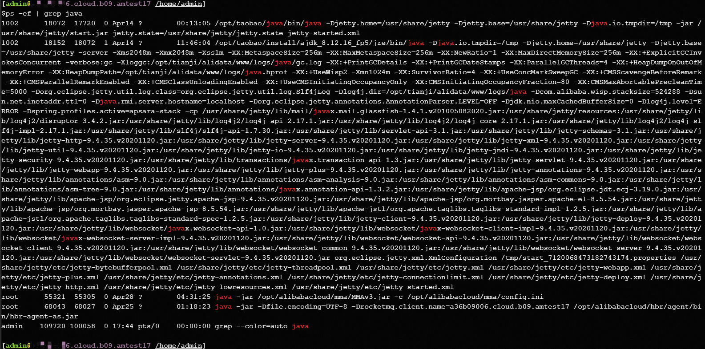

   如上图所示，表示java进程存在。

9. 执行 exit 命令退出容器。

0. 执行如下命令，重启容器。

   ```bash
   docker stop <容器ID>
   docker start <容器ID>
   ```

1. 待容器重启完成后，查看PopAliyunCom组件状态，状态正常说明问题解决。如果问题依然存在，需要通过排查日志。

   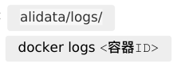

   - java进程日志路径： alidata/logs/

   - 容器日志查询命令： docker logs `<`容器`ID>`

> **说明**
>
> 如果上述步骤未解决告警问题，请提工单（服务请求单）联系阿里云技术支持。

<a id="section-6-1-15"></a>

### 6.1.15. tjmon_pop-aliyun-com-service_available_alarm

此告警主要是用于检测PopAliyunCom组件状态，当出现此告警时表示PopAliyunCom组件状态异常。

**告警属性**

<table>
  <tr>
    <td>告警名称</td>
    <td>监控项</td>
    <td>告警来源</td>
    <td>告警级别</td>
    <td>告警产品</td>
    <td>执行周期</td>
    <td>触发条件</td>
  </tr>
  <tr>
    <td>tjmon_pop-aliyun-com-service_available_alarm</td>
    <td>tjmon_pop-aliyun-com-check_service_avai lable_cluster_serve rrole</td>
    <td>tianjimon</td>
    <td>P1</td>
    <td>asrbr</td>
    <td>每60秒执行一次</td>
    <td>p1_expressin|$_error_flag ==1</td>
  </tr>
</table>

**适用版本**

适用于专有云企业版v3.16及后续版本。

**告警原因**

PopAliyunCom组件java进程状态异常。

**告警影响**

- 单节点异常，只影响负载均衡，服务可以正常访问。

- 两个应用节点都异常时，会导致服务访问不了。

**处理方法**

> **警告**
>
> 所有告警处理方法涉及到修改产品任何配置，均需要走生产变更流程确认方案的可行性以及流程规范性，若属紧急应急范畴需客户与TAM同时同意方可执行，否则不允许直接执行处理方法的任何步骤。

1. 登录飞天基础运维平台。

2. 在左侧导航栏，选择**产品集群运维**。搜索asrbr，在搜索结果**操作**列单击**集群详情**。

   

3. 在**服务列表**页签，单击**webapp-datapop**服务名称。

4. 在**组件列表**中，选择<strong>PopAliyunCom#</strong>组件。

5. 在**实例列表**页签中查看机器状态是否正常。

   

   - 如果机器状态异常，在机器**操作**列单击**操作** > **重启**，重启SR后执行以下操作。

   - 如果机器状态正常继续执行以下操作。

6. 单击机器**操作**列的**Terminal**，登录机器。

7. 登录webapp-datapop.PopAliyunCom#容器。

   <ol type="i">

   <li>

   执行如下命令，查看容器ID。

   ```bash
   docker ps
   ```

   

   </li>

   <li>

   执行如下命令，登录容器。

   ```bash
   docker exec -it <容器ID> /bin/bash
   ```

   

   </li>

   </ol>

8. 执行如下命令，查看java进程是否存在。如果java进程不存在，考虑通过重启容器解决。

   ```text
   ps -ef | grep java
   ```

   

   如上图所示，表示java进程存在。

9. 执行 exit 命令退出容器。

0. 执行如下命令，重启容器。

   ```bash
   docker stop <容器ID>
   docker start <容器ID>
   ```

1. 待容器重启完成后，查看PopAliyunCom组件状态，状态正常说明问题解决。如果问题依然存在，需要通过排查日志。

   

   - java进程日志路径： alidata/logs/

   - 容器日志查询命令： docker logs `<`容器`ID>`

> **说明**
>
> 如果上述步骤未解决告警问题，请提工单（服务请求单）联系阿里云技术支持。

<a id="section-6-1-16"></a>

### 6.1.16. tjmon_pop-api-aliyun-com-application_proc_restart_alarm

此告警主要用于检测PopApiAliyunCom组件的java进程是否频繁重启，当出现此告警时，表示PopApiAliyunCom组件的java进程频繁重启，PopApiAliyunCom组件不可用。

**告警属性**

<table>
  <tr>
    <td>告警名称</td>
    <td>监控项</td>
    <td>告警来源</td>
    <td>告警级别</td>
    <td>告警产品</td>
    <td>执行周期</td>
    <td>触发条件</td>
  </tr>
  <tr>
    <td>tjmon_pop-api-aliyun-com-application_proc_restart _alarm</td>
    <td>tjmon_pop-api-aliyun-com-check_application_proc_state_cluster_serverrole</td>
    <td>tianjimon</td>
    <td>P1</td>
    <td>asrbr</td>
    <td>每60秒执行一次</td>
    <td>p1_expressin|$_status==1</td>
  </tr>
</table>

**适用版本**

适用于专有云企业版v3.16及后续版本。

**告警原因**

PopApiAliyunCom组件的java进程频繁重启。

**告警影响**

- 单节点异常，只影响负载均衡，服务可以正常访问。

- 两个应用节点都异常时，会导致服务访问不了。

**处理方法**

> **警告**
>
> 所有告警处理方法涉及到修改产品任何配置，均需要走生产变更流程确认方案的可行性以及流程规范性，若属紧急应急范畴需客户与TAM同时同意方可执行，否则不允许直接执行处理方法的任何步骤。

1. 登录飞天基础运维平台。

2. 在左侧导航栏，选择**产品集群运维**。搜索asrbr，在搜索结果**操作**列单击**集群详情**。

   

3. 在**服务列表**页签，单击**webapp-datapop**服务名称。

4. 在**组件列表**中，选择<strong>PopApiAliyunCom#</strong>组件。

5. 在**实例列表**页签中查看机器状态是否正常。

   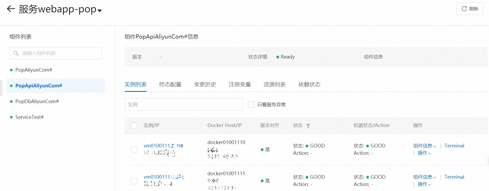

   - 如果机器状态异常，在机器**操作**列单击**操作** > **重启**，重启SR后执行以下操作。

   - 如果机器状态正常继续执行以下操作。

6. 单击机器**操作**列的**Terminal**，登录机器。

7. 登录webapp-datapop.PopApiAliyunCom#容器。

   <ol type="i">

   <li>

   执行如下命令，查看容器ID。

   ```bash
   docker ps
   ```

   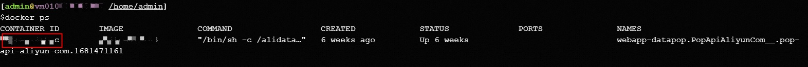

   </li>

   <li>

   执行如下命令，登录容器。

   ```bash
   docker exec -it <容器ID> /bin/bash
   ```

   

   </li>

   </ol>

8. 执行如下命令，查看java进程是否频繁重启。如果进程频繁重启，考虑通过重启容器解决。

   ```text
   ps -eo pid,lstart,etime,cmd | grep java
   ```

   

   如上图所示，表示进程状态正常。

9. 执行 exit 命令退出容器。

0. 执行如下命令，重启容器。

   ```bash
   docker stop <容器ID>
   docker start <容器ID>
   ```

1. 待容器重启完成后，查看PopApiAliyunCom组件状态，状态正常说明问题解决。如果问题依然存在，需要排查日志，根据日志中的错误信息处理。

   

   - java进程日志路径： alidata/logs/

   - 容器日志查询命令： docker logs `<`容器`ID>`

> **说明**
>
> 如果上述步骤未解决告警问题，请提工单（服务请求单）联系阿里云技术支持。

<a id="section-6-1-17"></a>

### 6.1.17. tjmon_pop-api-aliyun-com-application_proc_not_exist_alarm

此告警主要用于检测PopApiAliyunCom组件的java进程是否存在，当出现此告警时，表示PopApiAliyunCom组件的java进程不存在，PopApiAliyunCom组件不可用。

**告警属性**

<table>
  <tr>
    <td>告警名称</td>
    <td>监控项</td>
    <td>告警来源</td>
    <td>告警级别</td>
    <td>告警产品</td>
    <td>执行周期</td>
    <td>触发条件</td>
  </tr>
  <tr>
    <td>tjmon_pop-api-aliyun-com-application_proc_not_exi st_alarm</td>
    <td>tjmon_pop-api-aliyun-com-check_application _proc_state_clust er_serverrole</td>
    <td>tianjimon</td>
    <td>P1</td>
    <td>asrbr</td>
    <td>每60秒执行一次</td>
    <td>p1_expressin|$_status==2</td>
  </tr>
</table>

**适用版本**

适用于专有云企业版v3.16及后续版本。

**告警原因**

PopApiAliyunCom组件的java进程不存在。

**告警影响**

- 单节点异常，只影响负载均衡，服务可以正常访问。

- 两个应用节点都异常时，会导致服务访问不了。

**处理方法**

> **警告**
>
> 所有告警处理方法涉及到修改产品任何配置，均需要走生产变更流程确认方案的可行性以及流程规范性，若属紧急应急范畴需客户与TAM同时同意方可执行，否则不允许直接执行处理方法的任何步骤。

1. 登录飞天基础运维平台。

2. 在左侧导航栏，选择**产品集群运维**。搜索asrbr，在搜索结果**操作**列单击**集群详情**。

   

3. 在**服务列表**页签，单击**webapp-datapop**服务名称。

4. 在**组件列表**中，选择<strong>PopApiAliyunCom#</strong>组件。

5. 在**实例列表**页签中查看机器状态是否正常。

   

   - 如果机器状态异常，在机器**操作**列单击**操作** > **重启**，重启SR后执行以下操作。

   - 如果机器状态正常继续执行以下操作。

6. 单击机器**操作**列的**Terminal**，登录机器。

7. 登录webapp-datapop.PopApiAliyunCom#容器。

   <ol type="i">

   <li>

   执行如下命令，查看容器ID。

   ```bash
   docker ps
   ```

   

   </li>

   <li>

   执行如下命令，登录容器。

   ```bash
   docker exec -it <容器ID> /bin/bash
   ```

   

   </li>

   </ol>

8. 执行如下命令，查看java进程是否存在。如果java进程不存在，考虑通过重启容器解决。

   ```text
   ps -ef | grep java
   ```

   

   如上图所示，表示java进程存在。

9. 执行 exit 命令退出容器。

0. 执行如下命令，重启容器。

   ```bash
   docker stop <容器ID>
   docker start <容器ID>
   ```

1. 待容器重启完成后，查看PopApiAliyunCom组件状态，状态正常说明问题解决。如果问题依然存在，需要排查日志，根据日志中的错误信息处理。

   

   - java进程日志路径： alidata/logs/

   - 容器日志查询命令： docker logs `<`容器`ID>`

> **说明**
>
> 如果上述步骤未解决告警问题，请提工单（服务请求单）联系阿里云技术支持。

<a id="section-6-1-18"></a>

### 6.1.18. tjmon_pop-api-aliyun-com-service_available_alarm

此告警主要是用于检测PopApiAliyunCom组件状态，当出现此告警时表示PopApiAliyunCom组件状态异常。

**告警属性**

<table>
  <tr>
    <td>告警名称</td>
    <td>监控项</td>
    <td>告警来源</td>
    <td>告警级别</td>
    <td>告警产品</td>
    <td>执行周期</td>
    <td>触发条件</td>
  </tr>
  <tr>
    <td>tjmon_pop-api-aliyun-com-service_available_alarm</td>
    <td>tjmon_pop-api-aliyun-com-check_service_avai lable_cluster_serve rrole</td>
    <td>tianjimon</td>
    <td>P1</td>
    <td>asrbr</td>
    <td>每60秒执行一次</td>
    <td>p1_expressin|$_error_flag ==1</td>
  </tr>
</table>

**适用版本**

适用于专有云企业版v3.16及后续版本。

**告警原因**

PopApiAliyunCom组件java进程状态异常。

**告警影响**

- 单节点异常，只影响负载均衡，服务可以正常访问。

- 两个应用节点都异常时，会导致服务访问不了。

**处理方法**

> **警告**
>
> 所有告警处理方法涉及到修改产品任何配置，均需要走生产变更流程确认方案的可行性以及流程规范性，若属紧急应急范畴需客户与TAM同时同意方可执行，否则不允许直接执行处理方法的任何步骤。

1. 登录飞天基础运维平台。

2. 在左侧导航栏，选择**产品集群运维**。搜索asrbr，在搜索结果**操作**列单击**集群详情**。

   

3. 在**服务列表**页签，单击**webapp-datapop**服务名称。

4. 在**组件列表**中，选择<strong>PopApiAliyunCom#</strong>组件。

5. 在**实例列表**页签中查看机器状态是否正常。

   

   - 如果机器状态异常，在机器**操作**列单击**操作** > **重启**，重启SR后执行以下操作。

   - 如果机器状态正常继续执行以下操作。

6. 单击机器**操作**列的**Terminal**，登录机器。

7. 登录webapp-datapop.PopApiAliyunCom#容器。

   <ol type="i">

   <li>

   执行如下命令，查看容器ID。

   ```bash
   docker ps
   ```

   

   </li>

   <li>

   执行如下命令，登录容器。

   ```bash
   docker exec -it <容器ID> /bin/bash
   ```

   

   </li>

   </ol>

8. 执行如下命令，查看java进程是否存在。如果java进程不存在，考虑通过重启容器解决。

   ```text
   ps -ef | grep java
   ```

   

   如上图所示，表示java进程存在。

9. 执行 exit 命令退出容器。

0. 执行如下命令，重启容器。

   ```bash
   docker stop <容器ID>
   docker start <容器ID>
   ```

1. 待容器重启完成后，查看PopApiAliyunCom组件状态，状态正常说明问题解决。如果问题依然存在，需要排查日志，根据日志中的错误信息处理。

   

   - java进程日志路径： alidata/logs/

   - 容器日志查询命令： docker logs `<`容器`ID>`

> **说明**
>
> 如果上述步骤未解决告警问题，请提工单（服务请求单）联系阿里云技术支持。

<a id="section-6-2"></a>

## 6.2. 备份计划相关告警

<a id="section-6-2-1"></a>

### 6.2.1. 告警项说明

| 告警名称 | 告警描述 | 告警来源 | 告警级别 | 告警产品 |
| --- | --- | --- | --- | --- |
| BACKUP_START_INSTANCE_POLICY_FAILED | 启动实例备份策略失败告警 | asrbr-backup | P2 | asrbr |
| BACKUP_STOP_FAILED | 停止备份计划失败告警 | asrbr-backup | P2 | asrbr |
| BACKUP_ENABLE_FAILED | 启动备份计划失败告警 | asrbr-backup | P2 | asrbr |
| BACKUP_CREATE_INSTANCE_BACKUP_PLAN _FAILED | 创建实例备份计划失败告警 | asrbr-backup | P2 | asrbr |
| BACKUP_STOP_INSTANCE_POLICY_FAILED | 停止实例备份计划失败告警 | asrbr-backup | P2 | asrbr |
| BACKUP_EXCUTE_INSTANCE_BACKUP_FAIL ED | 实例立即备份失败告警 | asrbr-backup | P2 | asrbr |
| BACKUP_SYNC_INSTANCE_BACKUP_RECOR D_FAILED | 同步实例备份记录失败告警 | asrbr-backup | P2 | asrbr |
| BACKUP_SYNC_INSTANCE_BACKUP_RECOR D_BOLCKED | 同步实例备份记录被阻塞告警 | asrbr-backup | P2 | asrbr |
| BACKUP_MODIFY_INSTANCE_POLICY_FAILE D | 修改实例备份策略失败告警 | asrbr-backup | P2 | asrbr |
| ECS_DISK_BK_START_INSTANCE_POLICY_FA ILED | ECS整机备份启动实例备份计划失败告警 | asrbr-backup | P2 | asrbr |
| ECS_DISK_BK_STOP_FAILED | ECS整机备份停止备份计划失败告警 | asrbr-backup | P2 | asrbr |
| ECS_DISK_BK_ENABLE_FAILED | ECS整机备份启动备份计划失败告警 | asrbr-backup | P2 | asrbr |
| ECS_DISK_BK_STOP_INSTANCE_POLICY_FAI LED | ECS整机备份停止实例备份计划失败告警 | asrbr-backup | P2 | asrbr |
| ECS_DISK_BK_CREATE_INSTANCE_BACKUP_PLAN_FAILED | ECS整机备份创建实例备份计划失败告警 | asrbr-backup | P2 | asrbr |
| ECS_DISK_BK_EXCUTE_INSTANCE_BACKUP_FAILED | ECS整机备份执行实例备份计划失败告警 | asrbr-backup | P2 | asrbr |
| ECS_DISK_BK_SYNC_INSTANCE_BACKUP_RE CORD_FAILED | ECS整机备份同步实例备份记录失败告警 | asrbr-backup | P2 | asrbr |
| ECS_DISK_BK_SYNC_INSTANCE_BACKUP_RE CORD_BLOCKED | ECS整机备份同步实例备份记录被阻塞告警 | asrbr-backup | P2 | asrbr |
| ECS_DISK_BK_MODIFY_INSTANCE_POLICY_F AILED | ECS整机备份修改实例备份策略失败告警 | asrbr-backup | P2 | asrbr |

<a id="section-6-2-2"></a>

### 6.2.2. BACKUP_START_INSTANCE_POLICY_FAILED

此告警主要用于检测启动实例备份策略的执行状态。当出现此告警时，表示备份策略启动失败，实例无法进行正常备份。

**告警属性**

<table>
  <tr>
    <td>告警名称</td>
    <td>告警来源</td>
    <td>告警级别</td>
    <td>告警产品</td>
    <td>执行周期</td>
    <td>触发条件</td>
  </tr>
  <tr>
    <td>BACKUP_START_INSTAN CE_POLICY_FAILED</td>
    <td>asrbr-backup</td>
    <td>P2</td>
    <td>asrbr</td>
    <td>非周期性执行</td>
    <td>启动实例备份策略时，调用数据库、HBR接口失败等</td>
  </tr>
</table>

**适用版本**

适用于专有云企业版v3.12及后续版本。

**告警原因**

调用数据库、HBR的接口失败或其他原因，导致启动实例备份策略失败。

**告警影响**

备份策略启动失败，实例无法进行正常备份。

**处理方法**

> **警告**
>
> 所有告警处理方法涉及到修改产品任何配置，均需要走生产变更流程确认方案的可行性以及流程规范性，若属紧急应急范畴需客户与TAM同时同意方可执行，否则不允许直接执行处理方法的任何步骤。

1. 登录备份管理控制台。

2. 在左侧导航栏，单击**备份计划**。

3. 根据告警信息中的备份计划名称 `${planName}` ，找到对应的备份计划，单击计划名称。

   

4. 选择**备份事件**页签，单击事件前面的  图标，可以展开所有的子事件。

5. 在子事件右侧单击  按钮，查看相应的事件日志。

   - 如果日志有明确报错信息，根据报错信息进行处理。

   - 如果日志没有明确报错，执行以下操作：

     <ol type="a">

     <li>

     刷新列表，按F12键，单击事件前面的  图标，打开子事件列表，查看当前事件的event_id。

     </li>

     <li>

     登录asrbr-backup.Backup#终端机器。

     </li>

     </ol>

     <ol type="i" start="100">

     <li>

     执行 `cd /alidata/logs/asrbr-backup/` 命令查看asrbr-backup.log。

     > **说明**
     >
     > 如果是历史日志，可以到bak目录下查看。

     

     </li>

     <li value="500">

     执行 `grep -r "<event_id>" asrbr-backup.log` 命令搜索日志，命令中 `<event_id>` 需要替换为上述步骤查询到的event_id，根据日志中的具体报错信息处理。

     </li>

     </ol>

> **说明**
>
> 如果上述步骤未解决告警问题，请提工单（服务请求单）联系阿里云技术支持。

<a id="section-6-2-3"></a>

### 6.2.3. BACKUP_STOP_FAILED

此告警主要用于检测停止备份计划的状态。当出现此告警时，表示备份计划停止失败，实例可能依然在备份中，需要及时处理。

**告警属性**

<table>
  <tr>
    <td>告警名称</td>
    <td>告警来源</td>
    <td>告警级别</td>
    <td>告警产品</td>
    <td>执行周期</td>
    <td>触发条件</td>
  </tr>
  <tr>
    <td>BACKUP_STOP_FAILED</td>
    <td>asrbr-backup</td>
    <td>P2</td>
    <td>asrbr</td>
    <td>非周期性执行</td>
    <td>停止备份计划</td>
  </tr>
</table>

**适用版本**

适用于专有云企业版v3.12及后续版本。

**告警原因**

备份计划停止失败，可能由于调用其他业务接口失败等。

**告警影响**

备份计划停止失败，实例可能依然在备份中，需要及时处理。

**处理方法**

> **警告**
>
> 所有告警处理方法涉及到修改产品任何配置，均需要走生产变更流程确认方案的可行性以及流程规范性，若属紧急应急范畴需客户与TAM同时同意方可执行，否则不允许直接执行处理方法的任何步骤。

1. 登录备份管理控制台。

2. 在左侧导航栏，单击**备份计划**。

3. 根据告警信息中的备份计划名称 `${planName}` ，找到对应的备份计划，单击计划名称。

   

4. 选择**备份事件**页签，单击事件前面的  图标，可以展开所有的子事件。

5. 在子事件右侧单击  按钮，查看相应的事件日志。

   - 如果日志有明确报错信息，根据报错信息进行处理。

   - 如果日志没有明确报错，执行以下操作：

     <ol type="a">

     <li>

     刷新列表，按F12键，单击事件前面的  图标，打开子事件列表，查看当前事件的event_id。

     </li>

     <li>

     登录asrbr-backup.Backup#终端机器。

     </li>

     </ol>

     <ol type="i" start="100">

     <li>

     执行 `cd /alidata/logs/asrbr-backup/` 命令查看asrbr-backup.log。

     > **说明**
     >
     > 如果是历史日志，可以到bak目录下查看。

     

     </li>

     <li value="500">

     执行 `grep -r "<event_id>" asrbr-backup.log` 命令搜索日志，命令中 `<event_id>` 需要替换为上述步骤查询到的event_id，根据日志中的具体报错信息处理。

     </li>

     </ol>

> **说明**
>
> 如果上述步骤未解决告警问题，请提工单（服务请求单）联系阿里云技术支持。

<a id="section-6-2-4"></a>

### 6.2.4. BACKUP_ENABLE_FAILED

此告警主要用于检测启动备份计划的状态。当出现此告警时，表示备份计划启动失败，实例无法进行正常备份。

**告警属性**

<table>
  <tr>
    <td>告警名称</td>
    <td>告警来源</td>
    <td>告警级别</td>
    <td>告警产品</td>
    <td>执行周期</td>
    <td>触发条件</td>
  </tr>
  <tr>
    <td>BACKUP_ENABLE_FAILE D</td>
    <td>asrbr-backup</td>
    <td>P2</td>
    <td>asrbr</td>
    <td>非周期性执行</td>
    <td>启动实例备份计划时，调用数据库、HBR接口失败等</td>
  </tr>
</table>

**适用版本**

适用于专有云企业版v3.12及后续版本。

**告警原因**

调用数据库、HBR的接口失败或其他原因，导致启动实例备份计划失败。

**告警影响**

备份计划启动失败，实例无法进行正常备份。

**处理方法**

> **警告**
>
> 所有告警处理方法涉及到修改产品任何配置，均需要走生产变更流程确认方案的可行性以及流程规范性，若属紧急应急范畴需客户与TAM同时同意方可执行，否则不允许直接执行处理方法的任何步骤。

1. 登录备份管理控制台。

2. 在左侧导航栏，单击**备份计划**。

3. 根据告警信息中的备份计划名称 `${planName}` ，找到对应的备份计划，单击计划名称。

   

4. 选择**备份事件**页签，单击事件前面的  图标，可以展开所有的子事件。

5. 在子事件右侧单击  按钮，查看相应的事件日志。

   - 如果日志有明确报错信息，根据报错信息进行处理。

   - 如果日志没有明确报错，执行以下操作：

     <ol type="a">

     <li>

     刷新列表，按F12键，单击事件前面的  图标，打开子事件列表，查看当前事件的event_id。

     </li>

     <li>

     登录asrbr-backup.Backup#终端机器。

     </li>

     </ol>

     <ol type="i" start="100">

     <li>

     执行 `cd /alidata/logs/asrbr-backup/` 命令查看asrbr-backup.log。

     > **说明**
     >
     > 如果是历史日志，可以到bak目录下查看。

     

     </li>

     <li value="500">

     执行 `grep -r "<event_id>" asrbr-backup.log` 命令搜索日志，命令中 `<event_id>` 需要替换为上述步骤查询到的event_id，根据日志中的具体报错信息处理。

     </li>

     </ol>

> **说明**
>
> 如果上述步骤未解决告警问题，请提工单（服务请求单）联系阿里云技术支持。

<a id="section-6-2-5"></a>

### 6.2.5. BACKUP_CREATE_INSTANCE_BACKUP_PLAN_FAILED

此告警主要用于检测创建实例备份计划的执行状态。当出现此告警时，表示实例备份计划创建失败，实例不会进行备份。

**告警属性**

<table>
  <tr>
    <td>告警名称</td>
    <td>告警来源</td>
    <td>告警级别</td>
    <td>告警产品</td>
    <td>执行周期</td>
    <td>触发条件</td>
  </tr>
  <tr>
    <td>BACKUP_CREATE_INSTA NCE_BACKUP_PLAN_FAIL ED</td>
    <td>asrbr-backup</td>
    <td>P2</td>
    <td>asrbr</td>
    <td>非周期性执行</td>
    <td>创建备份计划</td>
  </tr>
</table>

**适用版本**

适用于专有云企业版v3.12及后续版本。

**告警原因**

实例备份计划创建失败，可能由于调用其他业务接口失败等。

**告警影响**

备份计划未创建成功，实例不会进行备份。

**处理方法**

> **警告**
>
> 所有告警处理方法涉及到修改产品任何配置，均需要走生产变更流程确认方案的可行性以及流程规范性，若属紧急应急范畴需客户与TAM同时同意方可执行，否则不允许直接执行处理方法的任何步骤。

1. 登录备份管理控制台。

2. 在左侧导航栏，单击**备份计划**。

3. 根据告警信息中的备份计划名称 `${planName}` ，找到对应的备份计划，单击计划名称。

   

4. 选择**备份事件**页签，单击事件前面的  图标，可以展开所有的子事件。

5. 在子事件右侧单击  按钮，查看相应的事件日志。

   - 如果日志有明确报错信息，根据报错信息进行处理。

   - 如果日志没有明确报错，执行以下操作：

     <ol type="a">

     <li>

     刷新列表，按F12键，单击事件前面的  图标，打开子事件列表，查看当前事件的event_id。

     </li>

     <li>

     登录asrbr-backup.Backup#终端机器。

     </li>

     </ol>

     <ol type="i" start="100">

     <li>

     执行 `cd /alidata/logs/asrbr-backup/` 命令查看asrbr-backup.log。

     > **说明**
     >
     > 如果是历史日志，可以到bak目录下查看。

     

     </li>

     <li value="500">

     执行 `grep -r "<event_id>" asrbr-backup.log` 命令搜索日志，命令中 `<event_id>` 需要替换为上述步骤查询到的event_id，根据日志中的具体报错信息处理。

     </li>

     </ol>

> **说明**
>
> 如果上述步骤未解决告警问题，请提工单（服务请求单）联系阿里云技术支持。

<a id="section-6-2-6"></a>

### 6.2.6. BACKUP_STOP_INSTANCE_POLICY_FAILED

此告警主要用于检测停止备份计划的执行状态。当出现此告警时，表示实例备份计划停止失败，实例可能依然在备份中，需要及时处理。

**告警属性**

<table>
  <tr>
    <td>告警名称</td>
    <td>告警来源</td>
    <td>告警级别</td>
    <td>告警产品</td>
    <td>执行周期</td>
    <td>触发条件</td>
  </tr>
  <tr>
    <td>BACKUP_STOP_INSTANC E_POLICY_FAILED</td>
    <td>asrbr-backup</td>
    <td>P2</td>
    <td>asrbr</td>
    <td>非周期性执行</td>
    <td>停止备份计划失败</td>
  </tr>
</table>

**适用版本**

适用于专有云企业版v3.16及后续版本。

**告警原因**

备份计划停止失败，可能的原因包括调用其他业务接口失败等。

**告警影响**

备份计划停止失败，实例可能依然在备份中。

**处理方法**

> **警告**
>
> 所有告警处理方法涉及到修改产品任何配置，均需要走生产变更流程确认方案的可行性以及流程规范性，若属紧急应急范畴需客户与TAM同时同意方可执行，否则不允许直接执行处理方法的任何步骤。

1. 登录备份管理控制台。

2. 在左侧导航栏，单击**备份计划**。

3. 根据告警信息中的备份计划名称 `${planName}` ，找到对应的备份计划，单击计划名称。

   

4. 选择**备份事件**页签，单击事件前面的  图标，可以展开所有的子事件。

5. 在子事件右侧单击  按钮，查看相应的事件日志。

   - 如果日志有明确报错信息，根据报错信息进行处理。

   - 如果日志没有明确报错，执行以下操作：

     <ol type="a">

     <li>

     刷新列表，按F12键，单击事件前面的  图标，打开子事件列表，查看当前事件的event_id。

     </li>

     <li>

     登录asrbr-backup.Backup#终端机器。

     </li>

     </ol>

     <ol type="i" start="100">

     <li>

     执行 `cd /alidata/logs/asrbr-backup/` 命令查看asrbr-backup.log。

     > **说明**
     >
     > 如果是历史日志，可以到bak目录下查看。

     

     </li>

     <li value="500">

     执行 `grep -r "<event_id>" asrbr-backup.log` 命令搜索日志，命令中 `<event_id>` 需要替换为上述步骤查询到的event_id，根据日志中的具体报错信息处理。

     </li>

     </ol>

> **说明**
>
> 如果上述步骤未解决告警问题，请提工单（服务请求单）联系阿里云技术支持。

<a id="section-6-2-7"></a>

### 6.2.7. BACKUP_EXCUTE_INSTANCE_BACKUP_FAILED

此告警主要用于检测立即备份实例的执行状态。当出现此告警时，表示实例立即备份失败，实例未进行备份，需要检查原因或再执行一次立即备份。

**告警属性**

<table>
  <tr>
    <td>告警名称</td>
    <td>告警来源</td>
    <td>告警级别</td>
    <td>告警产品</td>
    <td>执行周期</td>
    <td>触发条件</td>
  </tr>
  <tr>
    <td>BACKUP_EXCUTE_INSTA NCE_BACKUP_FAILED</td>
    <td>asrbr-backup</td>
    <td>P2</td>
    <td>asrbr</td>
    <td>非周期性执行</td>
    <td>对实例执行立即备份操作</td>
  </tr>
</table>

**适用版本**

适用于专有云企业版v3.16及后续版本。

**告警原因**

立即备份执行失败，可能的原因包括调用其他业务接口失败等。

**告警影响**

立即备份执行失败，实例未进行备份，需要检查原因或再执行一次立即备份。

**处理方法**

> **警告**
>
> 所有告警处理方法涉及到修改产品任何配置，均需要走生产变更流程确认方案的可行性以及流程规范性，若属紧急应急范畴需客户与TAM同时同意方可执行，否则不允许直接执行处理方法的任何步骤。

1. 登录备份管理控制台。

2. 在左侧导航栏，单击**备份计划**。

3. 根据告警信息中的备份计划名称 `${planName}` ，找到对应的备份计划，单击计划名称。

   

4. 选择**备份事件**页签，单击事件前面的  图标，可以展开所有的子事件。

5. 在子事件右侧单击  按钮，查看相应的事件日志。

   - 如果日志有明确报错信息，根据报错信息进行处理。

   - 如果日志没有明确报错，执行以下操作：

     <ol type="a">

     <li>

     刷新列表，按F12键，单击事件前面的  图标，打开子事件列表，查看当前事件的event_id。

     </li>

     <li>

     登录asrbr-backup.Backup#终端机器。

     </li>

     </ol>

     <ol type="i" start="100">

     <li>

     执行 `cd /alidata/logs/asrbr-backup/` 命令查看asrbr-backup.log。

     > **说明**
     >
     > 如果是历史日志，可以到bak目录下查看。

     

     </li>

     <li value="500">

     执行 `grep -r "<event_id>" asrbr-backup.log` 命令搜索日志，命令中 `<event_id>` 需要替换为上述步骤查询到的event_id，根据日志中的具体报错信息处理。

     </li>

     </ol>

> **说明**
>
> 如果上述步骤未解决告警问题，请提工单（服务请求单）联系阿里云技术支持。

<a id="section-6-2-8"></a>

### 6.2.8. BACKUP_SYNC_INSTANCE_BACKUP_RECORD_FAILED

此告警主要用于检测备份记录的同步状态。当出现此告警时，表示备份记录同步失败，未生成备份记录，需要查看失败的原因。

**告警属性**

<table>
  <tr>
    <td>告警名称</td>
    <td>告警来源</td>
    <td>告警级别</td>
    <td>告警产品</td>
    <td>执行周期</td>
    <td>触发条件</td>
  </tr>
  <tr>
    <td>BACKUP_SYNC_INSTANC E_BACKUP_RECORD_FAI LED</td>
    <td>asrbr-backup</td>
    <td>P2</td>
    <td>asrbr</td>
    <td>非周期性执行</td>
    <td>周期性备份或立即备份同步备份记录</td>
  </tr>
</table>

**适用版本**

适用于专有云企业版v3.16及后续版本。

**告警原因**

实例进行备份时失败或在一定时间内未生成jobId。

**告警影响**

备份记录同步失败，未生成备份记录，需要查看失败的原因。

**处理方法**

> **警告**
>
> 所有告警处理方法涉及到修改产品任何配置，均需要走生产变更流程确认方案的可行性以及流程规范性，若属紧急应急范畴需客户与TAM同时同意方可执行，否则不允许直接执行处理方法的任何步骤。

1. 登录备份管理控制台。

2. 在左侧导航栏，单击**备份计划**。

3. 根据告警信息中的备份计划名称 `${planName}` ，找到对应的备份计划，单击计划名称。

   

4. 选择**备份事件**页签，单击事件前面的  图标，可以展开所有的子事件。

5. 在子事件右侧单击  按钮，查看相应的事件日志。

   - 如果日志有明确报错信息，根据报错信息进行处理。

   - 如果日志没有明确报错，执行以下操作：

     <ol type="a">

     <li>

     刷新列表，按F12键，单击事件前面的  图标，打开子事件列表，查看当前事件的event_id。

     </li>

     <li>

     登录asrbr-backup.Backup#终端机器。

     </li>

     </ol>

     <ol type="i" start="100">

     <li>

     执行 `cd /alidata/logs/asrbr-backup/` 命令查看asrbr-backup.log。

     > **说明**
     >
     > 如果是历史日志，可以到bak目录下查看。

     

     </li>

     <li value="500">

     执行 `grep -r "<event_id>" asrbr-backup.log` 命令搜索日志，命令中 `<event_id>` 需要替换为上述步骤查询到的event_id，根据日志中的具体报错信息处理。

     </li>

     </ol>

> **说明**
>
> 如果上述步骤未解决告警问题，请提工单（服务请求单）联系阿里云技术支持。

<a id="section-6-2-9"></a>

### 6.2.9. BACKUP_SYNC_INSTANCE_BACKUP_RECORD_BOLCKED

此告警主要用于检测同步备份记录是否处于Block状态。当出现此告警时，表示同步备份记录处于Block状态，未生成备份记录。

**告警属性**

<table>
  <tr>
    <td>告警名称</td>
    <td>告警来源</td>
    <td>告警级别</td>
    <td>告警产品</td>
    <td>执行周期</td>
    <td>触发条件</td>
  </tr>
  <tr>
    <td>BACKUP_SYNC_INSTANC E_BACKUP_RECORD_BO LCKED</td>
    <td>asrbr-backup</td>
    <td>P2</td>
    <td>asrbr</td>
    <td>非周期性执行</td>
    <td>周期性备份或立即备份同步备份记录</td>
  </tr>
</table>

**适用版本**

适用于专有云企业版v3.16及后续版本。

**告警原因**

在存储类和大数据类实例备份时，实例的其他备份计划正在执行。

**告警影响**

未生成备份记录。

**处理方法**

> **警告**
>
> 所有告警处理方法涉及到修改产品任何配置，均需要走生产变更流程确认方案的可行性以及流程规范性，若属紧急应急范畴需客户与TAM同时同意方可执行，否则不允许直接执行处理方法的任何步骤。

为了避免同步备份记录处于Block状态，执行以下操作调整备份策略的的执行时间。

1. 组织备份管理员登录备份管理控制台。

2. 在左侧导航栏中单击**备份计划**。

3. 在**备份计划**页面，根据相应的查询条件查询对应的备份计划。

4. 单击目标备份计划的计划名称链接。

5. 在**备份信息**页面的**备份策略**区域中，单击右侧的**修改策略**。

   

6. 填写备份策略的参数，单击**确认**。

   

   > **说明**
   >
   > - 不同实例类型的备份策略参数不一样，请根据界面提示进行配置。
   >
   > - ODPS修改备份策略时，存储位置仅支持增加，不支持删除和修改。

> **说明**
>
> 如果上述步骤未解决告警问题，请提工单（服务请求单）联系阿里云技术支持。

<a id="section-6-2-10"></a>

### 6.2.10. BACKUP_MODIFY_INSTANCE_POLICY_FAILED

此告警主要用于检测修改备份策略的执行状态。当出现此告警时，表示备份策略修改失败，继续采用修改之前的备份策略进行备份。

**告警属性**

<table>
  <tr>
    <td>告警名称</td>
    <td>告警来源</td>
    <td>告警级别</td>
    <td>告警产品</td>
    <td>执行周期</td>
    <td>触发条件</td>
  </tr>
  <tr>
    <td>BACKUP_MODIFY_INSTA NCE_POLICY_FAILED</td>
    <td>asrbr-backup</td>
    <td>P2</td>
    <td>asrbr</td>
    <td>非周期性执行</td>
    <td>修改备份策略</td>
  </tr>
</table>

**适用版本**

适用于专有云企业版v3.16及后续版本。

**告警原因**

修改备份策略失败。

**告警影响**

备份策略未修改成功，继续采用修改之前的备份策略进行备份。

**处理方法**

> **警告**
>
> 所有告警处理方法涉及到修改产品任何配置，均需要走生产变更流程确认方案的可行性以及流程规范性，若属紧急应急范畴需客户与TAM同时同意方可执行，否则不允许直接执行处理方法的任何步骤。

1. 登录备份管理控制台。

2. 在左侧导航栏，单击**备份计划**。

3. 根据告警信息中的备份计划名称 `${planName}` ，找到对应的备份计划，单击计划名称。

   

4. 选择**备份事件**页签，单击事件前面的  图标，可以展开所有的子事件。

5. 在子事件右侧单击  按钮，查看相应的事件日志。

   - 如果日志有明确报错信息，根据报错信息进行处理。

   - 如果日志没有明确报错，执行以下操作：

     <ol type="a">

     <li>

     刷新列表，按F12键，单击事件前面的  图标，打开子事件列表，查看当前事件的event_id。

     </li>

     <li>

     登录asrbr-backup.Backup#终端机器。

     </li>

     </ol>

     <ol type="i" start="100">

     <li>

     执行 `cd /alidata/logs/asrbr-backup/` 命令查看asrbr-backup.log。

     > **说明**
     >
     > 如果是历史日志，可以到bak目录下查看。

     

     </li>

     <li value="500">

     执行 `grep -r "<event_id>" asrbr-backup.log` 命令搜索日志，命令中 `<event_id>` 需要替换为上述步骤查询到的event_id，根据日志中的具体报错信息处理。

     </li>

     </ol>

> **说明**
>
> 如果上述步骤未解决告警问题，请提工单（服务请求单）联系阿里云技术支持。

<a id="section-6-2-11"></a>

### 6.2.11. ECS_DISK_BK_START_INSTANCE_POLICY_FAILED

此告警主要用于检测整机备份启动实例备份计划的执行状态。当出现此告警时，表示备份计划启动失败，实例无法进行正常备份。

**告警属性**

<table>
  <tr>
    <td>告警名称</td>
    <td>告警来源</td>
    <td>告警级别</td>
    <td>告警产品</td>
    <td>执行周期</td>
    <td>触发条件</td>
  </tr>
  <tr>
    <td>ECS_DISK_BK_START_IN STANCE_POLICY_FAILED</td>
    <td>asrbr-backup</td>
    <td>P2</td>
    <td>asrbr</td>
    <td>非周期性执行</td>
    <td>整机备份启动实例备份计划失败</td>
  </tr>
</table>

**适用版本**

适用于专有云企业版v3.16及后续版本。

**告警原因**

整机备份启动实例备份计划失败。

**告警影响**

实例无法进行正常备份。

**处理方法**

> **警告**
>
> 所有告警处理方法涉及到修改产品任何配置，均需要走生产变更流程确认方案的可行性以及流程规范性，若属紧急应急范畴需客户与TAM同时同意方可执行，否则不允许直接执行处理方法的任何步骤。

1. 登录备份管理控制台。

2. 在左侧导航栏，单击**备份计划**。

3. 根据告警信息中的备份计划名称 `${planName}` ，找到对应的备份计划，单击计划名称。

   

4. 选择**备份事件**页签，单击事件前面的  图标，可以展开所有的子事件。

5. 在子事件右侧单击  按钮，查看相应的事件日志。

   - 如果日志有明确报错信息，根据报错信息进行处理。

   - 如果日志没有明确报错，执行以下操作：

     <ol type="a">

     <li>

     刷新列表，按F12键，单击事件前面的  图标，打开子事件列表，查看当前事件的event_id。

     </li>

     <li>

     登录asrbr-backup.Backup#终端机器。

     </li>

     </ol>

     <ol type="i" start="100">

     <li>

     执行 `cd /alidata/logs/asrbr-backup/` 命令查看asrbr-backup.log。

     > **说明**
     >
     > 如果是历史日志，可以到bak目录下查看。

     

     </li>

     <li value="500">

     执行 `grep -r "<event_id>" asrbr-backup.log` 命令搜索日志，命令中 `<event_id>` 需要替换为上述步骤查询到的event_id，根据日志中的具体报错信息处理。

     </li>

     </ol>

> **说明**
>
> 如果上述步骤未解决告警问题，请提工单（服务请求单）联系阿里云技术支持。

<a id="section-6-2-12"></a>

### 6.2.12. ECS_DISK_BK_STOP_FAILED

此告警主要用于检测停止整机备份计划的执行状态。当出现此告警时，表示整机备份计划停止失败，仍然在备份。

**告警属性**

<table>
  <tr>
    <td>告警名称</td>
    <td>告警来源</td>
    <td>告警级别</td>
    <td>告警产品</td>
    <td>执行周期</td>
    <td>触发条件</td>
  </tr>
  <tr>
    <td>ECS_DISK_BK_STOP_FAIL ED</td>
    <td>asrbr-backup</td>
    <td>P2</td>
    <td>asrbr</td>
    <td>非周期性执行</td>
    <td>整机备份停止备份计划失败</td>
  </tr>
</table>

**适用版本**

适用于专有云企业版v3.16及后续版本。

**告警原因**

整机备份停止备份计划失败，可能是由于调用三方接口出现问题。

**告警影响**

整机备份未停止。

**处理方法**

> **警告**
>
> 所有告警处理方法涉及到修改产品任何配置，均需要走生产变更流程确认方案的可行性以及流程规范性，若属紧急应急范畴需客户与TAM同时同意方可执行，否则不允许直接执行处理方法的任何步骤。

1. 登录备份管理控制台。

2. 在左侧导航栏，单击**备份计划**。

3. 根据告警信息中的备份计划名称 `${planName}` ，找到对应的备份计划，单击计划名称。

   

4. 选择**备份事件**页签，单击事件前面的  图标，可以展开所有的子事件。

5. 在子事件右侧单击  按钮，查看相应的事件日志。

   - 如果日志有明确报错信息，根据报错信息进行处理。

   - 如果日志没有明确报错，执行以下操作：

     <ol type="a">

     <li>

     刷新列表，按F12键，单击事件前面的  图标，打开子事件列表，查看当前事件的event_id。

     </li>

     <li>

     登录asrbr-backup.Backup#终端机器。

     </li>

     </ol>

     <ol type="i" start="100">

     <li>

     执行 `cd /alidata/logs/asrbr-backup/` 命令查看asrbr-backup.log。

     > **说明**
     >
     > 如果是历史日志，可以到bak目录下查看。

     

     </li>

     <li value="500">

     执行 `grep -r "<event_id>" asrbr-backup.log` 命令搜索日志，命令中 `<event_id>` 需要替换为上述步骤查询到的event_id，根据日志中的具体报错信息处理。

     </li>

     </ol>

> **说明**
>
> 如果上述步骤未解决告警问题，请提工单（服务请求单）联系阿里云技术支持。

<a id="section-6-2-13"></a>

### 6.2.13. ECS_DISK_BK_ENABLE_FAILED

此告警主要用于检测启动整机备份计划的执行状态。当出现此告警时，表示整机备份计划启动失败，整机备份未启动，依然是停止状态。

**告警属性**

<table>
  <tr>
    <td>告警名称</td>
    <td>告警来源</td>
    <td>告警级别</td>
    <td>告警产品</td>
    <td>执行周期</td>
    <td>触发条件</td>
  </tr>
  <tr>
    <td>ECS_DISK_BK_ENABLE_F AILED</td>
    <td>asrbr-backup</td>
    <td>P2</td>
    <td>asrbr</td>
    <td>非周期性执行</td>
    <td>整机备份启动备份计划失败</td>
  </tr>
</table>

**适用版本**

适用于专有云企业版v3.16及后续版本。

**告警原因**

整机备份启动备份计划失败，可能是由于调用三方接口出现问题。

**告警影响**

整机备份未启动。

**处理方法**

> **警告**
>
> 所有告警处理方法涉及到修改产品任何配置，均需要走生产变更流程确认方案的可行性以及流程规范性，若属紧急应急范畴需客户与TAM同时同意方可执行，否则不允许直接执行处理方法的任何步骤。

1. 登录备份管理控制台。

2. 在左侧导航栏，单击**备份计划**。

3. 根据告警信息中的备份计划名称 `${planName}` ，找到对应的备份计划，单击计划名称。

   

4. 选择**备份事件**页签，单击事件前面的  图标，可以展开所有的子事件。

5. 在子事件右侧单击  按钮，查看相应的事件日志。

   - 如果日志有明确报错信息，根据报错信息进行处理。

   - 如果日志没有明确报错，执行以下操作：

     <ol type="a">

     <li>

     刷新列表，按F12键，单击事件前面的  图标，打开子事件列表，查看当前事件的event_id。

     </li>

     <li>

     登录asrbr-backup.Backup#终端机器。

     </li>

     </ol>

     <ol type="i" start="100">

     <li>

     执行 `cd /alidata/logs/asrbr-backup/` 命令查看asrbr-backup.log。

     > **说明**
     >
     > 如果是历史日志，可以到bak目录下查看。

     

     </li>

     <li value="500">

     执行 `grep -r "<event_id>" asrbr-backup.log` 命令搜索日志，命令中 `<event_id>` 需要替换为上述步骤查询到的event_id，根据日志中的具体报错信息处理。

     </li>

     </ol>

> **说明**
>
> 如果上述步骤未解决告警问题，请提工单（服务请求单）联系阿里云技术支持。

<a id="section-6-2-14"></a>

### 6.2.14. ECS_DISK_BK_STOP_INSTANCE_POLICY_FAILED

此告警主要用于检测整机备份时停止实例备份计划的执行状态。当出现此告警时，表示停止实例备份计划失败，整机备份未停止。

**告警属性**

<table>
  <tr>
    <td>告警名称</td>
    <td>告警来源</td>
    <td>告警级别</td>
    <td>告警产品</td>
    <td>执行周期</td>
    <td>触发条件</td>
  </tr>
  <tr>
    <td>ECS_DISK_BK_STOP_INS TANCE_POLICY_FAILED</td>
    <td>asrbr-backup</td>
    <td>P2</td>
    <td>asrbr</td>
    <td>非周期性执行</td>
    <td>整机备份时停止实例备份计划失败</td>
  </tr>
</table>

**适用版本**

适用于专有云企业版v3.16及后续版本。

**告警原因**

整机备份时停止实例备份计划失败，可能是由于调用三方接口出现问题。

**告警影响**

整机备份未停止。

**处理方法**

> **警告**
>
> 所有告警处理方法涉及到修改产品任何配置，均需要走生产变更流程确认方案的可行性以及流程规范性，若属紧急应急范畴需客户与TAM同时同意方可执行，否则不允许直接执行处理方法的任何步骤。

1. 登录备份管理控制台。

2. 在左侧导航栏，单击**备份计划**。

3. 根据告警信息中的备份计划名称 `${planName}` ，找到对应的备份计划，单击计划名称。

   

4. 选择**备份事件**页签，单击事件前面的  图标，可以展开所有的子事件。

5. 在子事件右侧单击  按钮，查看相应的事件日志。

   - 如果日志有明确报错信息，根据报错信息进行处理。

   - 如果日志没有明确报错，执行以下操作：

     <ol type="a">

     <li>

     刷新列表，按F12键，单击事件前面的  图标，打开子事件列表，查看当前事件的event_id。

     </li>

     <li>

     登录asrbr-backup.Backup#终端机器。

     </li>

     </ol>

     <ol type="i" start="100">

     <li>

     执行 `cd /alidata/logs/asrbr-backup/` 命令查看asrbr-backup.log。

     > **说明**
     >
     > 如果是历史日志，可以到bak目录下查看。

     

     </li>

     <li value="500">

     执行 `grep -r "<event_id>" asrbr-backup.log` 命令搜索日志，命令中 `<event_id>` 需要替换为上述步骤查询到的event_id，根据日志中的具体报错信息处理。

     </li>

     </ol>

> **说明**
>
> 如果上述步骤未解决告警问题，请提工单（服务请求单）联系阿里云技术支持。

<a id="section-6-2-15"></a>

### 6.2.15. ECS_DISK_BK_CREATE_INSTANCE_BACKUP_PLAN_FAILED

此告警主要用于检测创建整机备份计划的执行状态。当出现此告警时，表示整机备份计划创建失败，不会进行整机备份。

**告警属性**

<table>
  <tr>
    <td>告警名称</td>
    <td>告警来源</td>
    <td>告警级别</td>
    <td>告警产品</td>
    <td>执行周期</td>
    <td>触发条件</td>
  </tr>
  <tr>
    <td>ECS_DISK_BK_CREATE_I NSTANCE_BACKUP_PLAN _FAILED</td>
    <td>asrbr-backup</td>
    <td>P2</td>
    <td>asrbr</td>
    <td>非周期性执行</td>
    <td>创建整机备份计划失败</td>
  </tr>
</table>

**适用版本**

适用于专有云企业版v3.16及后续版本。

**告警原因**

创建整机备份计划失败，可能是由于调用三方接口出现问题。

**告警影响**

整机备份计划创建失败，不会进行整机备份。

**处理方法**

> **警告**
>
> 所有告警处理方法涉及到修改产品任何配置，均需要走生产变更流程确认方案的可行性以及流程规范性，若属紧急应急范畴需客户与TAM同时同意方可执行，否则不允许直接执行处理方法的任何步骤。

1. 登录备份管理控制台。

2. 在左侧导航栏，单击**备份计划**。

3. 根据告警信息中的备份计划名称 `${planName}` ，找到对应的备份计划，单击计划名称。

   

4. 选择**备份事件**页签，单击事件前面的  图标，可以展开所有的子事件。

5. 在子事件右侧单击  按钮，查看相应的事件日志。

   - 如果日志有明确报错信息，根据报错信息进行处理。

   - 如果日志没有明确报错，执行以下操作：

     <ol type="a">

     <li>

     刷新列表，按F12键，单击事件前面的  图标，打开子事件列表，查看当前事件的event_id。

     </li>

     <li>

     登录asrbr-backup.Backup#终端机器。

     </li>

     </ol>

     <ol type="i" start="100">

     <li>

     执行 `cd /alidata/logs/asrbr-backup/` 命令查看asrbr-backup.log。

     > **说明**
     >
     > 如果是历史日志，可以到bak目录下查看。

     

     </li>

     <li value="500">

     执行 `grep -r "<event_id>" asrbr-backup.log` 命令搜索日志，命令中 `<event_id>` 需要替换为上述步骤查询到的event_id，根据日志中的具体报错信息处理。

     </li>

     </ol>

> **说明**
>
> 如果上述步骤未解决告警问题，请提工单（服务请求单）联系阿里云技术支持。

<a id="section-6-2-16"></a>

### 6.2.16. ECS_DISK_BK_EXCUTE_INSTANCE_BACKUP_FAILED

此告警主要用于检测立即备份整机的执行状态。当出现此告警时，表示整机立即备份失败，未进行整机备份。

**告警属性**

<table>
  <tr>
    <td>告警名称</td>
    <td>告警来源</td>
    <td>告警级别</td>
    <td>告警产品</td>
    <td>执行周期</td>
    <td>触发条件</td>
  </tr>
  <tr>
    <td>ECS_DISK_BK_EXCUTE_I NSTANCE_BACKUP_FAIL ED</td>
    <td>asrbr-backup</td>
    <td>P2</td>
    <td>asrbr</td>
    <td>非周期性执行</td>
    <td>对整机备份执行立即备份操作</td>
  </tr>
</table>

**适用版本**

适用于专有云企业版v3.16及后续版本。

**告警原因**

整机备份执行立即备份失败，可能是由于调用三方接口出现问题。

**告警影响**

立即备份执行失败，未进行整机备份。

**处理方法**

> **警告**
>
> 所有告警处理方法涉及到修改产品任何配置，均需要走生产变更流程确认方案的可行性以及流程规范性，若属紧急应急范畴需客户与TAM同时同意方可执行，否则不允许直接执行处理方法的任何步骤。

1. 登录备份管理控制台。

2. 在左侧导航栏，单击**备份计划**。

3. 根据告警信息中的备份计划名称 `${planName}` ，找到对应的备份计划，单击计划名称。

   

4. 选择**备份事件**页签，单击事件前面的  图标，可以展开所有的子事件。

5. 在子事件右侧单击  按钮，查看相应的事件日志。

   - 如果日志有明确报错信息，根据报错信息进行处理。

   - 如果日志没有明确报错，执行以下操作：

     <ol type="a">

     <li>

     刷新列表，按F12键，单击事件前面的  图标，打开子事件列表，查看当前事件的event_id。

     </li>

     <li>

     登录asrbr-backup.Backup#终端机器。

     </li>

     </ol>

     <ol type="i" start="100">

     <li>

     执行 `cd /alidata/logs/asrbr-backup/` 命令查看asrbr-backup.log。

     > **说明**
     >
     > 如果是历史日志，可以到bak目录下查看。

     

     </li>

     <li value="500">

     执行 `grep -r "<event_id>" asrbr-backup.log` 命令搜索日志，命令中 `<event_id>` 需要替换为上述步骤查询到的event_id，根据日志中的具体报错信息处理。

     </li>

     </ol>

> **说明**
>
> 如果上述步骤未解决告警问题，请提工单（服务请求单）联系阿里云技术支持。

<a id="section-6-2-17"></a>

### 6.2.17. ECS_DISK_BK_SYNC_INSTANCE_BACKUP_RECORD_FAILED

此告警主要用于检测整机备份记录的同步状态。当出现此告警时，表示整机备份记录同步失败，未生成备份记录。

**告警属性**

<table>
  <tr>
    <td>告警名称</td>
    <td>告警来源</td>
    <td>告警级别</td>
    <td>告警产品</td>
    <td>执行周期</td>
    <td>触发条件</td>
  </tr>
  <tr>
    <td>ECS_DISK_BK_SYNC_INS TANCE_BACKUP_RECOR D_FAILED</td>
    <td>asrbr-backup</td>
    <td>P2</td>
    <td>asrbr</td>
    <td>非周期性执行</td>
    <td>整机备份同步备份记录失败</td>
  </tr>
</table>

**适用版本**

适用于专有云企业版v3.16及后续版本。

**告警原因**

进行整机备份时失败或在一定时间内未生成jobId。

**告警影响**

备份记录同步失败，未生成备份记录。

**处理方法**

> **警告**
>
> 所有告警处理方法涉及到修改产品任何配置，均需要走生产变更流程确认方案的可行性以及流程规范性，若属紧急应急范畴需客户与TAM同时同意方可执行，否则不允许直接执行处理方法的任何步骤。

1. 登录备份管理控制台。

2. 在左侧导航栏，单击**备份计划**。

3. 根据告警信息中的备份计划名称 `${planName}` ，找到对应的备份计划，单击计划名称。

   

4. 选择**备份事件**页签，单击事件前面的  图标，可以展开所有的子事件。

5. 在子事件右侧单击  按钮，查看相应的事件日志。

   - 如果日志有明确报错信息，根据报错信息进行处理。

   - 如果日志没有明确报错，执行以下操作：

     <ol type="a">

     <li>

     刷新列表，按F12键，单击事件前面的  图标，打开子事件列表，查看当前事件的event_id。

     </li>

     <li>

     登录asrbr-backup.Backup#终端机器。

     </li>

     </ol>

     <ol type="i" start="100">

     <li>

     执行 `cd /alidata/logs/asrbr-backup/` 命令查看asrbr-backup.log。

     > **说明**
     >
     > 如果是历史日志，可以到bak目录下查看。

     

     </li>

     <li value="500">

     执行 `grep -r "<event_id>" asrbr-backup.log` 命令搜索日志，命令中 `<event_id>` 需要替换为上述步骤查询到的event_id，根据日志中的具体报错信息处理。

     </li>

     </ol>

> **说明**
>
> 如果上述步骤未解决告警问题，请提工单（服务请求单）联系阿里云技术支持。

<a id="section-6-2-18"></a>

### 6.2.18. ECS_DISK_BK_SYNC_INSTANCE_BACKUP_RECORD_BLOCKED

此告警主要用于检测同步整机备份是否处于Block状态。当出现此告警时，表示同步整机备份处于Block状态，本次不会再备份，等待上一个备份计划完成后继续备份。

**告警属性**

<table>
  <tr>
    <td>告警名称</td>
    <td>告警来源</td>
    <td>告警级别</td>
    <td>告警产品</td>
    <td>执行周期</td>
    <td>触发条件</td>
  </tr>
  <tr>
    <td>ECS_DISK_BK_SYNC_INS TANCE_BACKUP_RECOR D_BLOCKED</td>
    <td>asrbr-backup</td>
    <td>P2</td>
    <td>asrbr</td>
    <td>非周期性执行</td>
    <td>整机备份进行周期性备份或者手工备份</td>
  </tr>
</table>

**适用版本**

适用于专有云企业版v3.16及后续版本。

**告警原因**

上一次的备份计划还在执行。

**告警影响**

本次不会再备份，等待上一个备份计划完成后继续备份。

**处理方法**

> **警告**
>
> 所有告警处理方法涉及到修改产品任何配置，均需要走生产变更流程确认方案的可行性以及流程规范性，若属紧急应急范畴需客户与TAM同时同意方可执行，否则不允许直接执行处理方法的任何步骤。

为了避免同步备份记录处于Block状态，执行以下操作调整备份策略的的执行时间。

1. 组织备份管理员登录备份管理控制台。

2. 在左侧导航栏中单击**备份计划**。

3. 在**备份计划**页面，根据相应的查询条件查询对应的备份计划。

4. 单击目标备份计划的计划名称链接。

5. 在**备份信息**页面的**备份策略**区域中，单击右侧的**修改策略**。

   

6. 填写备份策略的参数，单击**确认**。

   

   > **说明**
   >
   > - 不同实例类型的备份策略参数不一样，请根据界面提示进行配置。
   >
   > - ODPS修改备份策略时，存储位置仅支持增加，不支持删除和修改。

> **说明**
>
> 如果上述步骤未解决告警问题，请提工单（服务请求单）联系阿里云技术支持。

<a id="section-6-2-19"></a>

### 6.2.19. ECS_DISK_BK_MODIFY_INSTANCE_POLICY_FAILED

此告警主要用于检测修改整机备份策略的执行状态。当出现此告警时，表示整机备份策略修改失败，继续采用修改之前的备份策略进行备份。

**告警属性**

<table>
  <tr>
    <td>告警名称</td>
    <td>告警来源</td>
    <td>告警级别</td>
    <td>告警产品</td>
    <td>执行周期</td>
    <td>触发条件</td>
  </tr>
  <tr>
    <td>ECS_DISK_BK_MODIFY_I NSTANCE_POLICY_FAILE D</td>
    <td>asrbr-backup</td>
    <td>P2</td>
    <td>asrbr</td>
    <td>非周期性执行</td>
    <td>修改整机备份策略</td>
  </tr>
</table>

**适用版本**

适用于专有云企业版v3.16及后续版本。

**告警原因**

修改整机备份策略时失败。

**告警影响**

整机备份策略未修改成功，继续采用修改之前的备份策略进行备份。

**处理方法**

> **警告**
>
> 所有告警处理方法涉及到修改产品任何配置，均需要走生产变更流程确认方案的可行性以及流程规范性，若属紧急应急范畴需客户与TAM同时同意方可执行，否则不允许直接执行处理方法的任何步骤。

1. 登录备份管理控制台。

2. 在左侧导航栏，单击**备份计划**。

3. 根据告警信息中的备份计划名称 `${planName}` ，找到对应的备份计划，单击计划名称。

   

4. 选择**备份事件**页签，单击事件前面的  图标，可以展开所有的子事件。

5. 在子事件右侧单击  按钮，查看相应的事件日志。

   - 如果日志有明确报错信息，根据报错信息进行处理。

   - 如果日志没有明确报错，执行以下操作：

     <ol type="a">

     <li>

     刷新列表，按F12键，单击事件前面的  图标，打开子事件列表，查看当前事件的event_id。

     </li>

     <li>

     登录asrbr-backup.Backup#终端机器。

     </li>

     </ol>

     <ol type="i" start="100">

     <li>

     执行 `cd /alidata/logs/asrbr-backup/` 命令查看asrbr-backup.log。

     > **说明**
     >
     > 如果是历史日志，可以到bak目录下查看。

     

     </li>

     <li value="500">

     执行 `grep -r "<event_id>" asrbr-backup.log` 命令搜索日志，命令中 `<event_id>` 需要替换为上述步骤查询到的event_id，根据日志中的具体报错信息处理。

     </li>

     </ol>

> **说明**
>
> 如果上述步骤未解决告警问题，请提工单（服务请求单）联系阿里云技术支持。

<a id="section-6-3"></a>

## 6.3. 恢复任务相关告警

<a id="section-6-3-1"></a>

### 6.3.1. 告警项说明

| 告警名称 | 告警描述 | 告警来源 | 告警级别 | 告警产品 |
| --- | --- | --- | --- | --- |
| RECOVERY_CREATE_TASK_FAILED | 实例恢复任务创建失败告警 | asrbr-backup | P2 | asrbr |
| RECOVERY_START_TASK_FAILED | 实例恢复任务启动失败告警 | asrbr-backup | P2 | asrbr |
| RECOVERY_REDO_INSTANCE_FAILED | 恢复任务重试实例任务失败告警 | asrbr-backup | P2 | asrbr |
| RECOVERY_REDO_TASK_FAILED | 恢复任务重试任务失败告警 | asrbr-backup | P2 | asrbr |
| RECOVERY_UPDATE_RECOVERY_TASK_FAIL ED | 恢复任务更新任务结果失败告警 | asrbr-backup | P2 | asrbr |
| RECOVERY_UPDATE_RECOVERY_INSTANCE_TASK_FAILED | 恢复任务更新实例恢复结果失败告警 | asrbr-backup | P2 | asrbr |

<a id="section-6-3-2"></a>

### 6.3.2. RECOVERY_CREATE_TASK_FAILED

此告警主要用于检测创建实例恢复任务的执行状态。当出现此告警时，表示实例恢复任务创建失败，实例无法恢复。

**告警属性**

<table>
  <tr>
    <td>告警名称</td>
    <td>告警来源</td>
    <td>告警级别</td>
    <td>告警产品</td>
    <td>执行周期</td>
    <td>触发条件</td>
  </tr>
  <tr>
    <td>RECOVERY_CREATE_TAS K_FAILED</td>
    <td>asrbr-backup</td>
    <td>P2</td>
    <td>asrbr</td>
    <td>非周期性执行</td>
    <td>创建实例的恢复任务，在异步执行的过程中失败</td>
  </tr>
</table>

**适用版本**

适用于专有云企业版v3.16及后续版本。

**告警原因**

实例恢复任务创建失败。

**告警影响**

实例恢复任务创建失败，实例无法恢复。

**处理方法**

> **警告**
>
> 所有告警处理方法涉及到修改产品任何配置，均需要走生产变更流程确认方案的可行性以及流程规范性，若属紧急应急范畴需客户与TAM同时同意方可执行，否则不允许直接执行处理方法的任何步骤。

1. 登录备份管理控制台。

2. 在左侧导航栏，单击**恢复任务**。

3. 根据告警信息中的任务名称${taskName}，找到对应的恢复任务，单击任务名称。

   

4. 选择**恢复事件**页签，单击事件前面的  图标，可以展开所有的子事件。

5. 在子事件右侧单击  按钮，查看相应的事件日志。

   - 如果日志有明确报错信息，根据报错信息进行处理。

   - 如果日志没有明确报错，执行以下操作：

     <ol type="a">

     <li>

     刷新列表，按F12键，单击事件前面的  图标，打开子事件列表，查看当前事件的event_id。

     </li>

     <li>

     登录asrbr-backup.Backup#终端机器。

     </li>

     </ol>

     <ol type="i" start="100">

     <li>

     执行 `cd /alidata/logs/asrbr-backup/` 命令查看asrbr-backup.log。

     > **说明**
     >
     > 如果是历史日志，可以到bak目录下查看。

     

     </li>

     <li value="500">

     执行 `grep -r "<event_id>" asrbr-backup.log` 命令搜索日志，命令中 `<event_id>` 需要替换为上述步骤查询到的event_id，根据日志中的具体报错信息处理。

     </li>

     </ol>

> **说明**
>
> 如果上述步骤未解决告警问题，请提工单（服务请求单）联系阿里云技术支持。

<a id="section-6-3-3"></a>

### 6.3.3. RECOVERY_START_TASK_FAILED

此告警主要用于检测启动实例恢复任务的执行状态。当出现此告警时，表示实例恢复任务启动失败，实例无法恢复。

**告警属性**

<table>
  <tr>
    <td>告警名称</td>
    <td>告警来源</td>
    <td>告警级别</td>
    <td>告警产品</td>
    <td>执行周期</td>
    <td>触发条件</td>
  </tr>
  <tr>
    <td>RECOVERY_START_TASK _FAILED</td>
    <td>asrbr-backup</td>
    <td>P2</td>
    <td>asrbr</td>
    <td>非周期性执行</td>
    <td>启动实例的恢复任务，在异步执行的过程中失败</td>
  </tr>
</table>

**适用版本**

适用于专有云企业版v3.16及后续版本。

**告警原因**

实例恢复任务启动失败。

**告警影响**

实例恢复任务启动失败，实例无法恢复。

**处理方法**

> **警告**
>
> 所有告警处理方法涉及到修改产品任何配置，均需要走生产变更流程确认方案的可行性以及流程规范性，若属紧急应急范畴需客户与TAM同时同意方可执行，否则不允许直接执行处理方法的任何步骤。

1. 登录备份管理控制台。

2. 在左侧导航栏，单击**恢复任务**。

3. 根据告警信息中的任务名称${taskName}，找到对应的恢复任务，单击任务名称。

   

4. 选择**恢复事件**页签，单击事件前面的  图标，可以展开所有的子事件。

5. 在子事件右侧单击  按钮，查看相应的事件日志。

   - 如果日志有明确报错信息，根据报错信息进行处理。

   - 如果日志没有明确报错，执行以下操作：

     <ol type="a">

     <li>

     刷新列表，按F12键，单击事件前面的  图标，打开子事件列表，查看当前事件的event_id。

     </li>

     <li>

     登录asrbr-backup.Backup#终端机器。

     </li>

     </ol>

     <ol type="i" start="100">

     <li>

     执行 `cd /alidata/logs/asrbr-backup/` 命令查看asrbr-backup.log。

     > **说明**
     >
     > 如果是历史日志，可以到bak目录下查看。

     

     </li>

     <li value="500">

     执行 `grep -r "<event_id>" asrbr-backup.log` 命令搜索日志，命令中 `<event_id>` 需要替换为上述步骤查询到的event_id，根据日志中的具体报错信息处理。

     </li>

     </ol>

> **说明**
>
> 如果上述步骤未解决告警问题，请提工单（服务请求单）联系阿里云技术支持。

<a id="section-6-3-4"></a>

### 6.3.4. RECOVERY_REDO_INSTANCE_FAILED

此告警主要用于检测对恢复失败的实例重新执行恢复操作的执行状态。当出现此告警时，表示再次恢复失败。

**告警属性**

<table>
  <tr>
    <td>告警名称</td>
    <td>告警来源</td>
    <td>告警级别</td>
    <td>告警产品</td>
    <td>执行周期</td>
    <td>触发条件</td>
  </tr>
  <tr>
    <td>RECOVERY_REDO_INSTA NCE_FAILED</td>
    <td>asrbr-backup</td>
    <td>P2</td>
    <td>asrbr</td>
    <td>非周期性执行</td>
    <td>对恢复失败的实例重新进行恢复仍失败</td>
  </tr>
</table>

**适用版本**

适用于专有云企业版v3.16及后续版本。

**告警原因**

实例恢复失败。

**告警影响**

实例无法恢复。

**处理方法**

> **警告**
>
> 所有告警处理方法涉及到修改产品任何配置，均需要走生产变更流程确认方案的可行性以及流程规范性，若属紧急应急范畴需客户与TAM同时同意方可执行，否则不允许直接执行处理方法的任何步骤。

1. 登录备份管理控制台。

2. 在左侧导航栏，单击**恢复任务**。

3. 根据告警信息中的任务名称${taskName}，找到对应的恢复任务，单击任务名称。

   

4. 选择**恢复事件**页签，单击事件前面的  图标，可以展开所有的子事件。

5. 在子事件右侧单击  按钮，查看相应的事件日志。

   - 如果日志有明确报错信息，根据报错信息进行处理。

   - 如果日志没有明确报错，执行以下操作：

     <ol type="a">

     <li>

     刷新列表，按F12键，单击事件前面的  图标，打开子事件列表，查看当前事件的event_id。

     </li>

     <li>

     登录asrbr-backup.Backup#终端机器。

     </li>

     </ol>

     <ol type="i" start="100">

     <li>

     执行 `cd /alidata/logs/asrbr-backup/` 命令查看asrbr-backup.log。

     > **说明**
     >
     > 如果是历史日志，可以到bak目录下查看。

     

     </li>

     <li value="500">

     执行 `grep -r "<event_id>" asrbr-backup.log` 命令搜索日志，命令中 `<event_id>` 需要替换为上述步骤查询到的event_id，根据日志中的具体报错信息处理。

     </li>

     </ol>

> **说明**
>
> 如果上述步骤未解决告警问题，请提工单（服务请求单）联系阿里云技术支持。

<a id="section-6-3-5"></a>

### 6.3.5. RECOVERY_REDO_TASK_FAILED

此告警主要用于检测对恢复失败的任务重新执行恢复操作的执行状态。当出现此告警时，表示再次恢复失败。

**告警属性**

<table>
  <tr>
    <td>告警名称</td>
    <td>告警来源</td>
    <td>告警级别</td>
    <td>告警产品</td>
    <td>执行周期</td>
    <td>触发条件</td>
  </tr>
  <tr>
    <td>RECOVERY_REDO_TASK _FAILED</td>
    <td>asrbr-backup</td>
    <td>P2</td>
    <td>asrbr</td>
    <td>非周期性执行</td>
    <td>对恢复失败的任务重新进行恢复仍失败</td>
  </tr>
</table>

**适用版本**

适用于专有云企业版v3.16及后续版本。

**告警原因**

实例恢复失败。

**告警影响**

实例无法恢复。

**处理方法**

> **警告**
>
> 所有告警处理方法涉及到修改产品任何配置，均需要走生产变更流程确认方案的可行性以及流程规范性，若属紧急应急范畴需客户与TAM同时同意方可执行，否则不允许直接执行处理方法的任何步骤。

1. 登录备份管理控制台。

2. 在左侧导航栏，单击**恢复任务**。

3. 根据告警信息中的任务名称${taskName}，找到对应的恢复任务，单击任务名称。

   

4. 选择**恢复事件**页签，单击事件前面的  图标，可以展开所有的子事件。

5. 在子事件右侧单击  按钮，查看相应的事件日志。

   - 如果日志有明确报错信息，根据报错信息进行处理。

   - 如果日志没有明确报错，执行以下操作：

     <ol type="a">

     <li>

     刷新列表，按F12键，单击事件前面的  图标，打开子事件列表，查看当前事件的event_id。

     </li>

     <li>

     登录asrbr-backup.Backup#终端机器。

     </li>

     </ol>

     <ol type="i" start="100">

     <li>

     执行 `cd /alidata/logs/asrbr-backup/` 命令查看asrbr-backup.log。

     > **说明**
     >
     > 如果是历史日志，可以到bak目录下查看。

     

     </li>

     <li value="500">

     执行 `grep -r "<event_id>" asrbr-backup.log` 命令搜索日志，命令中 `<event_id>` 需要替换为上述步骤查询到的event_id，根据日志中的具体报错信息处理。

     </li>

     </ol>

> **说明**
>
> 如果上述步骤未解决告警问题，请提工单（服务请求单）联系阿里云技术支持。

<a id="section-6-3-6"></a>

### 6.3.6. RECOVERY_UPDATE_RECOVERY_TASK_FAILED

此告警主要用于检测更新恢复任务结果的执行状态。当出现此告警时，表示恢复任务执行结果更新失败。

**告警属性**

<table>
  <tr>
    <td>告警名称</td>
    <td>告警来源</td>
    <td>告警级别</td>
    <td>告警产品</td>
    <td>执行周期</td>
    <td>触发条件</td>
  </tr>
  <tr>
    <td>RECOVERY_UPDATE_RE COVERY_TASK_FAILED</td>
    <td>asrbr-backup</td>
    <td>P2</td>
    <td>asrbr</td>
    <td>非周期性执行</td>
    <td>查看恢复任务的执行结果失败</td>
  </tr>
</table>

**适用版本**

适用于专有云企业版v3.16及后续版本。

**告警原因**

查看恢复任务执行结果时，发生错误。

**告警影响**

恢复任务执行失败。

**处理方法**

> **警告**
>
> 所有告警处理方法涉及到修改产品任何配置，均需要走生产变更流程确认方案的可行性以及流程规范性，若属紧急应急范畴需客户与TAM同时同意方可执行，否则不允许直接执行处理方法的任何步骤。

1. 登录备份管理控制台。

2. 在左侧导航栏，单击**恢复任务**。

3. 根据告警信息中的任务名称${taskName}，找到对应的恢复任务，单击任务名称。

   

4. 选择**恢复事件**页签，单击事件前面的  图标，可以展开所有的子事件。

5. 在子事件右侧单击  按钮，查看相应的事件日志。

   - 如果日志有明确报错信息，根据报错信息进行处理。

   - 如果日志没有明确报错，执行以下操作：

     <ol type="a">

     <li>

     刷新列表，按F12键，单击事件前面的  图标，打开子事件列表，查看当前事件的event_id。

     </li>

     <li>

     登录asrbr-backup.Backup#终端机器。

     </li>

     </ol>

     <ol type="i" start="100">

     <li>

     执行 `cd /alidata/logs/asrbr-backup/` 命令查看asrbr-backup.log。

     > **说明**
     >
     > 如果是历史日志，可以到bak目录下查看。

     

     </li>

     <li value="500">

     执行 `grep -r "<event_id>" asrbr-backup.log` 命令搜索日志，命令中 `<event_id>` 需要替换为上述步骤查询到的event_id，根据日志中的具体报错信息处理。

     </li>

     </ol>

> **说明**
>
> 如果上述步骤未解决告警问题，请提工单（服务请求单）联系阿里云技术支持。

<a id="section-6-3-7"></a>

### 6.3.7. RECOVERY_UPDATE_RECOVERY_INSTANCE_TASK_FAILED

此告警主要用于检测更新实例恢复结果的执行状态。当出现此告警时，表示实例恢复结果更新失败。

**告警属性**

<table>
  <tr>
    <td>告警名称</td>
    <td>告警来源</td>
    <td>告警级别</td>
    <td>告警产品</td>
    <td>执行周期</td>
    <td>触发条件</td>
  </tr>
  <tr>
    <td>RECOVERY_UPDATE_RE COVERY_INSTANCE_TAS K_FAILED</td>
    <td>asrbr-backup</td>
    <td>P2</td>
    <td>asrbr</td>
    <td>非周期性执行</td>
    <td>查看实例恢复结果失败</td>
  </tr>
</table>

**适用版本**

适用于专有云企业版v3.16及后续版本。

**告警原因**

查看实例恢复结果时，发生错误。

**告警影响**

实例恢复失败。

**处理方法**

> **警告**
>
> 所有告警处理方法涉及到修改产品任何配置，均需要走生产变更流程确认方案的可行性以及流程规范性，若属紧急应急范畴需客户与TAM同时同意方可执行，否则不允许直接执行处理方法的任何步骤。

1. 登录备份管理控制台。

2. 在左侧导航栏，单击**恢复任务**。

3. 根据告警信息中的任务名称${taskName}，找到对应的恢复任务，单击任务名称。

   

4. 选择**恢复事件**页签，单击事件前面的  图标，可以展开所有的子事件。

5. 在子事件右侧单击  按钮，查看相应的事件日志。

   - 如果日志有明确报错信息，根据报错信息进行处理。

   - 如果日志没有明确报错，执行以下操作：

     <ol type="a">

     <li>

     刷新列表，按F12键，单击事件前面的  图标，打开子事件列表，查看当前事件的event_id。

     </li>

     <li>

     登录asrbr-backup.Backup#终端机器。

     </li>

     </ol>

     <ol type="i" start="100">

     <li>

     执行 `cd /alidata/logs/asrbr-backup/` 命令查看asrbr-backup.log。

     > **说明**
     >
     > 如果是历史日志，可以到bak目录下查看。

     

     </li>

     <li value="500">

     执行 `grep -r "<event_id>" asrbr-backup.log` 命令搜索日志，命令中 `<event_id>` 需要替换为上述步骤查询到的event_id，根据日志中的具体报错信息处理。

     </li>

     </ol>

> **说明**
>
> 如果上述步骤未解决告警问题，请提工单（服务请求单）联系阿里云技术支持。

<a id="section-6-4"></a>

## 6.4. 授权相关告警

<a id="section-6-4-1"></a>

### 6.4.1. 告警项说明

| 告警名称 | 告警描述 | 告警来源 | 告警级别 | 告警产品 |
| --- | --- | --- | --- | --- |
| LICENSE_REACH_THRESHOD_REMIND_MSG | 授权使用量已经超过授权容量的70%告警 | asrbr-backup | P2 | asrbr |
| LICENSE_NOT_ENOUGH_REMIND_MSG | 授权使用量已经超过授权容量告警 | asrbr-backup | P2 | asrbr |
| LICENSE_STOP_ALL_PLAN_REMIND_MS G | 授权使用量超过授权容量已经持续了30天告警 | asrbr-backup | P2 | asrbr |
| LICENSE_SYNC_REMIND_MSG | 购买的新授权已同步告警 | asrbr-backup | P2 | asrbr |
| HBR_LITE_LICENSE_NOT_ENOUGH_REM IND_MSG | 备份的实例源端大小已经超过授权容量告警 | asrbr-backup | P2 | asrbr |
| HBR_LITE_LICENSE_REACH_THRESHOD _REMIND_MSG | 备份的实例源端大小已经超过授权容量的70%告警 | asrbr-backup | P2 | asrbr |

<a id="section-6-4-2"></a>

### 6.4.2. LICENSE_REACH_THRESHOD_REMIND_MSG

此告警主要用于检测授权使用量是否超过授权容量的70%。当出现此告警时，表示授权使用量已经超过授权容量的70%，授权使用量超过100%以后将不会备份新的实例，旧的实例可以继续备份。

**告警属性**

<table>
  <tr>
    <td>告警名称</td>
    <td>告警来源</td>
    <td>告警级别</td>
    <td>告警产品</td>
    <td>执行周期</td>
    <td>触发条件</td>
  </tr>
  <tr>
    <td>LICENSE_REACH_THRES HOD_REMIND_MSG</td>
    <td>asrbr-backup</td>
    <td>P2</td>
    <td>asrbr</td>
    <td>每天执行一次</td>
    <td>授权使用量已经超过授权容量的70%</td>
  </tr>
</table>

**适用版本**

适用于专有云企业版v3.16及后续版本。

**告警原因**

授权剩余量不足的提醒，使用超过70%开始提醒。

**告警影响**

授权使用量超过100%以后将不会备份新的实例，旧的实例可以继续备份。

**处理方法**

> **警告**
>
> 所有告警处理方法涉及到修改产品任何配置，均需要走生产变更流程确认方案的可行性以及流程规范性，若属紧急应急范畴需客户与TAM同时同意方可执行，否则不允许直接执行处理方法的任何步骤。

授权使用量超过授权容量的70%不影响现有备份计划的使用，最好可以提前判断授权的使用增长量，短期内是否需要购买授权。提供以下两种处理方法：

- 方法一：购买授权。

- 方法二：停止部分现有备份计划。

> **说明**
>
> 如果上述步骤未解决告警问题，请提工单（服务请求单）联系阿里云技术支持。

<a id="section-6-4-3"></a>

### 6.4.3. LICENSE_NOT_ENOUGH_REMIND_MSG

此告警主要用于检测授权使用量是否超过授权容量。当出现此告警时，表示授权使用量已经超过授权容量，不可以对新的实例进行备份，已创建备份计划的实例可以继续备份。

**告警属性**

<table>
  <tr>
    <td>告警名称</td>
    <td>告警来源</td>
    <td>告警级别</td>
    <td>告警产品</td>
    <td>执行周期</td>
    <td>触发条件</td>
  </tr>
  <tr>
    <td>LICENSE_NOT_ENOUGH_REMIND_MSG</td>
    <td>asrbr-backup</td>
    <td>P2</td>
    <td>asrbr</td>
    <td>每天执行一次</td>
    <td>授权使用量已经超过授权容量</td>
  </tr>
</table>

**适用版本**

适用于专有云企业版v3.16及后续版本。

**告警原因**

授权容量被使用完，开始进行告警提醒。

**告警影响**

不可以对新的实例进行备份，已创建备份计划的实例可以继续备份。

**处理方法**

> **警告**
>
> 所有告警处理方法涉及到修改产品任何配置，均需要走生产变更流程确认方案的可行性以及流程规范性，若属紧急应急范畴需客户与TAM同时同意方可执行，否则不允许直接执行处理方法的任何步骤。

授权使用量超过授权容量后，不能对新的实例创建备份计划以及立即备份操作。提供以下两种处理方法：

- 方法一：购买授权。

- 方法二：停止部分现有备份计划。

> **说明**
>
> 如果上述步骤未解决告警问题，请提工单（服务请求单）联系阿里云技术支持。

<a id="section-6-4-4"></a>

### 6.4.4. LICENSE_STOP_ALL_PLAN_REMIND_MSG

此告警主要用于检测授权使用量超过授权容量是否已经持续了30天。当出现此告警时，表示授权使用量超过授权容量已经持续了30天，不可以对新的实例进行备份，将停止相关联实例的所有备份计划。

**告警属性**

<table>
  <tr>
    <td>告警名称</td>
    <td>告警来源</td>
    <td>告警级别</td>
    <td>告警产品</td>
    <td>执行周期</td>
    <td>触发条件</td>
  </tr>
  <tr>
    <td>LICENSE_STOP_ALL_PLA N_REMIND_MSG</td>
    <td>asrbr-backup</td>
    <td>P2</td>
    <td>asrbr</td>
    <td>每天执行一次</td>
    <td>授权使用量超过授权容量已经持续了30天</td>
  </tr>
</table>

**适用版本**

适用于专有云企业版v3.16及后续版本。

**告警原因**

授权使用完连续提醒超过30天，则会停止授权对应的所有产品的备份计划，从而停止备份。

**告警影响**

不可以对新的实例进行备份，将停止相关联实例的所有备份计划。

**处理方法**

> **警告**
>
> 所有告警处理方法涉及到修改产品任何配置，均需要走生产变更流程确认方案的可行性以及流程规范性，若属紧急应急范畴需客户与TAM同时同意方可执行，否则不允许直接执行处理方法的任何步骤。

授权使用量超过授权容量持续了30天，提供以下两种处理方法：

- 方法一：不购买授权。

  重新启动被停止的备份计划，可重新开始备份任务。若不购买新的授权，下一次备份授权使用完，会立即停止所有的备份计划。

- 方法二：购买新授权。

  购买新授权后，重新启动被停止的备份计划，重新开始备份任务。授权使用完时，依然可以支持超期30天延迟处理。超过30天未处理，则会停止授权对应的所有产品的备份计划，从而停止备份。

> **说明**
>
> 如果上述步骤未解决告警问题，请提工单（服务请求单）联系阿里云技术支持。

<a id="section-6-4-5"></a>

### 6.4.5. LICENSE_SYNC_REMIND_MSG

此告警主要用于提醒购买的新授权已同步。当出现此告警时，表示购买的新授权已同步，对备份功能无影响。

**告警属性**

<table>
  <tr>
    <td>告警名称</td>
    <td>告警来源</td>
    <td>告警级别</td>
    <td>告警产品</td>
    <td>执行周期</td>
    <td>触发条件</td>
  </tr>
  <tr>
    <td>LICENSE_SYNC_REMIND_MSG</td>
    <td>asrbr-backup</td>
    <td>P2</td>
    <td>asrbr</td>
    <td>每天执行一次</td>
    <td>购买的新授权已同步</td>
  </tr>
</table>

**适用版本**

适用于专有云企业版v3.16及后续版本。

**告警原因**

购买的新授权同步之后的提醒信息。

**告警影响**

无影响。

**处理方法**

无需处理。

<a id="section-6-4-6"></a>

### 6.4.6. HBR_LITE_LICENSE_NOT_ENOUGH_REMIND_MSG

此告警主要用于检测备份的实例源端大小是否超过授权容量。当出现此告警时，表示备份的实例源端大小已经超过授权容量，不可以对新的实例进行备份，已创建备份计划的实例可以继续备份。

**告警属性**

<table>
  <tr>
    <td>告警名称</td>
    <td>告警来源</td>
    <td>告警级别</td>
    <td>告警产品</td>
    <td>执行周期</td>
    <td>触发条件</td>
  </tr>
  <tr>
    <td>HBR_LITE_LICENSE_NOT _ENOUGH_REMIND_MSG</td>
    <td>asrbr-backup</td>
    <td>P2</td>
    <td>asrbr</td>
    <td>每天执行一次</td>
    <td>备份的实例源端大小已经超过授权容量</td>
  </tr>
</table>

**适用版本**

适用于专有云企业版v3.16及后续版本。

**告警原因**

HBR轻量授权包使用完，开始进行告警提醒。

**告警影响**

不可以对新的实例进行备份，已创建备份计划的实例可以继续备份。

**处理方法**

> **警告**
>
> 所有告警处理方法涉及到修改产品任何配置，均需要走生产变更流程确认方案的可行性以及流程规范性，若属紧急应急范畴需客户与TAM同时同意方可执行，否则不允许直接执行处理方法的任何步骤。

备份的实例源端大小超过授权容量，不能对新的实例创建备份计划以及立即备份操作。提供以下两种处理方法：

- 方法一：进行升级扩容，支持更多数据的备份。

- 方法二：停止部分现有的备份计划。

> **说明**
>
> 如果上述步骤未解决告警问题，请提工单（服务请求单）联系阿里云技术支持。

<a id="section-6-4-7"></a>

### 6.4.7. HBR_LITE_LICENSE_REACH_THRESHOD_REMIND_MSG

此告警主要用于检测备份的实例源端大小是否超过授权容量的70%。当出现此告警时，表示备份的实例源端大小已经超过授权容量的70%，对备份功能无影响。

**告警属性**

<table>
  <tr>
    <td>告警名称</td>
    <td>告警来源</td>
    <td>告警级别</td>
    <td>告警产品</td>
    <td>执行周期</td>
    <td>触发条件</td>
  </tr>
  <tr>
    <td>HBR_LITE_LICENSE_NOT _ENOUGH_REMIND_MSG</td>
    <td>asrbr-backup</td>
    <td>P2</td>
    <td>asrbr</td>
    <td>每天执行一次</td>
    <td>备份的实例源端大小已经超过授权容量的70%</td>
  </tr>
</table>

**适用版本**

适用于专有云企业版v3.16及后续版本。

**告警原因**

HBR轻量授权包剩余量不足的提醒，阈值使用超过70%开始提醒。

**告警影响**

无影响。

**处理方法**

> **警告**
>
> 所有告警处理方法涉及到修改产品任何配置，均需要走生产变更流程确认方案的可行性以及流程规范性，若属紧急应急范畴需客户与TAM同时同意方可执行，否则不允许直接执行处理方法的任何步骤。

备份的实例源端大小超过授权容量的70%，不影响现有备份计划的使用，建议提前判断授权的使用增长量，短期内是否会用完全部授权。提供以下两种处理方法：

- 方法一：进行升级扩容，支持更多数据的备份。

- 方法二：停止部分现有的备份计划。

> **说明**
>
> 如果上述步骤未解决告警问题，请提工单（服务请求单）联系阿里云技术支持。

<a id="section-6-5"></a>

## 6.5. 存储类相关告警

<a id="section-6-5-1"></a>

### 6.5.1. 告警项说明

| 告警名称 | 告警描述 | 告警来源 | 告警级别 | 告警产品 |
| --- | --- | --- | --- | --- |
| STORAGE_POOL_CHECK_STORAGE_POOL_SIZE_CAPACITY_USED_UP | 存储池使用量达到当前存储池容量上限告警 | asrbr-backup | P2 | asrbr |
| STORAGE_POOL_CHECK_STORAGE_POOL_SIZE_CINSUFFICIENT_MARGIN | 存储池使用量达到存储池容量上限的80%告警 | asrbr-backup | P2 | asrbr |
| USE_MORE_THAN_70 | 备份仓库存储容量超过70%告警 | asrbr-backup | P2 | asrbr |
| USE_MORE_THAN_90 | 备份仓库存储容量超过90%告警 | asrbr-backup | P1 | asrbr |
| CAPACITY_USED_UP | 备份仓库存储容量已用尽告警 | asrbr-backup | P1 | asrbr |
| ABNORMAL_STATUS | 备份仓库状态不可用告警 | asrbr-backup | P1 | asrbr |

<a id="section-6-5-2"></a>

### 6.5.2. STORAGE_POOL_CHECK_STORAGE_POOL_SIZE_CAPACITY_USED_UP

此告警主要用于检测备份存储池使用量是否达到用户配置的存储空间上限。当出现此告警时，表示备份存储池使用量已经达到用户配置的存储空间上限，可能会导致备份数据无法写入，所有备份任务全部失败。

**告警属性**

<table>
  <tr>
    <td>告警名称</td>
    <td>告警来源</td>
    <td>告警级别</td>
    <td>告警产品</td>
    <td>执行周期</td>
    <td>触发条件</td>
  </tr>
  <tr>
    <td>STORAGE_POOL_CHECK _STORAGE_POOL_SIZE_CAPACITY_USED_UP</td>
    <td>asrbr-backup</td>
    <td>P2</td>
    <td>asrbr</td>
    <td>每天执行一次</td>
    <td>备份存储池使用量达到用户配置的存储空间上限</td>
  </tr>
</table>

**适用版本**

适用于专有云企业版v3.16及后续版本。

**告警原因**

备份存储池使用量达到用户配置的存储空间上限时进行提醒。

**告警影响**

- 如果存储池真实使用空间已经用完，会导致备份数据无法写入，所有备份任务全部失败。

- 如果设置的存储空间不是真实的逻辑存储空间，备份功能正常使用，会超出用户设置的上限。

**处理方法**

> **警告**
>
> 所有告警处理方法涉及到修改产品任何配置，均需要走生产变更流程确认方案的可行性以及流程规范性，若属紧急应急范畴需客户与TAM同时同意方可执行，否则不允许直接执行处理方法的任何步骤。

- 如果存储池的真实存储空间已经用完，您可以选择以下两种处理方法：

  - 方法一：进行存储扩容。

  - 方法二：修改备份策略，减少备份数据保存周期，降低备份频率。

    <ol type="a">

    <li>

    组织备份管理员登录备份管理控制台。

    </li>

    <li>

    在左侧导航栏中单击**备份计划**。

    </li>

    </ol>

    <ol type="i" start="100">

    <li>

    在**备份计划**页面，根据相应的查询条件查询对应的备份计划。

    </li>

    <li value="500">

    单击目标备份计划的计划名称链接。

    </li>

    </ol>

    <ol type="a" start="5">

    <li>

    在**备份信息**页面的**备份策略**区域中，单击右侧的**修改策略**。

    

    </li>

    <li>

    填写备份策略的参数，单击**确认**。

    

    > **说明**
    >
    > - 不同实例类型的备份策略参数不一样，请根据界面提示进行配置。
    >
    > - ODPS修改备份策略时，存储位置仅支持增加，不支持删除和修改。

    </li>

    </ol>

- 如果存储池还有足够的存储空间，需要备份运营管理员修改存储池的存储大小。

  <ol type="i">

  <li>

  备份运营管理员登录备份管理控制台。

  </li>

  <li>

  在左侧导航栏中选择**系统管理** > **存储池组管理**。

  </li>

  <li>

  在存储池列表中，在相应存储池的**操作**列中单击  图标 ，选择**编辑**。

  </li>

  <li>

  在**编辑存储池**弹窗中，编辑**存储空间**，编辑完成后，单击**确定**。

  </li>

  </ol>

> **说明**
>
> 如果上述步骤未解决告警问题，请提工单（服务请求单）联系阿里云技术支持。

<a id="section-6-5-3"></a>

### 6.5.3. STORAGE_POOL_CHECK_STORAGE_POOL_SIZE_CINSUFFICIENT_MARGIN

此告警主要用于检测备份存储池使用量是否超过用户配置的存储空间上限的80%。当出现此告警时，表示备份存储池使用量已经超过用户配置的存储空间上限的80%，不会影响备份功能，但是需要及时扩容或修改备份配置。

**告警属性**

<table>
  <tr>
    <td>告警名称</td>
    <td>告警来源</td>
    <td>告警级别</td>
    <td>告警产品</td>
    <td>执行周期</td>
    <td>触发条件</td>
  </tr>
  <tr>
    <td>STORAGE_POOL_CHECK _STORAGE_POOL_SIZE_CINSUFFICIENT_MARGIN</td>
    <td>asrbr-backup</td>
    <td>P2</td>
    <td>asrbr</td>
    <td>每天执行一次</td>
    <td>备份存储池使用量超过用户配置的存储空间上限的80%</td>
  </tr>
</table>

**适用版本**

适用于专有云企业版v3.16及后续版本。

**告警原因**

备份存储池使用量超过用户配置的存储空间上限的80%时进行提醒。

**告警影响**

无影响。

**处理方法**

> **警告**
>
> 所有告警处理方法涉及到修改产品任何配置，均需要走生产变更流程确认方案的可行性以及流程规范性，若属紧急应急范畴需客户与TAM同时同意方可执行，否则不允许直接执行处理方法的任何步骤。

- 如果存储池的真实存储空间已经用完，您可以选择以下两种处理方法：

  - 方法一：进行存储扩容。

  - 方法二：修改备份策略，减少备份数据保存周期，降低备份频率。

    <ol type="a">

    <li>

    组织备份管理员登录备份管理控制台。

    </li>

    <li>

    在左侧导航栏中单击**备份计划**。

    </li>

    </ol>

    <ol type="i" start="100">

    <li>

    在**备份计划**页面，根据相应的查询条件查询对应的备份计划。

    </li>

    <li value="500">

    单击目标备份计划的计划名称链接。

    </li>

    </ol>

    <ol type="a" start="5">

    <li>

    在**备份信息**页面的**备份策略**区域中，单击右侧的**修改策略**。

    

    </li>

    <li>

    填写备份策略的参数，单击**确认**。

    

    > **说明**
    >
    > - 不同实例类型的备份策略参数不一样，请根据界面提示进行配置。
    >
    > - ODPS修改备份策略时，存储位置仅支持增加，不支持删除和修改。

    </li>

    </ol>

- 如果存储池还有足够的存储空间，需要备份运营管理员修改存储池的存储大小。

  <ol type="i">

  <li>

  备份运营管理员登录备份管理控制台。

  </li>

  <li>

  在左侧导航栏中选择**系统管理** > **存储池组管理**。

  </li>

  <li>

  在存储池列表中，在相应存储池的**操作**列中单击  图标 ，选择**编辑**。

  </li>

  <li>

  在**编辑存储池**弹窗中，编辑**存储空间**，编辑完成后，单击**确定**。

  </li>

  </ol>

> **说明**
>
> 如果上述步骤未解决告警问题，请提工单（服务请求单）联系阿里云技术支持。

<a id="section-6-5-4"></a>

### 6.5.4. USE_MORE_THAN_70

此告警主要用于检测备份仓库的使用量是否超过备份仓库容量上限的70%。当出现此告警时，表示备份仓库的使用量已经超过备份仓库容量上限的70%，不会影响备份功能，但是需要及时调整备份仓库的存储上限或修改备份策略。

**告警属性**

<table>
  <tr>
    <td>告警名称</td>
    <td>告警来源</td>
    <td>告警级别</td>
    <td>告警产品</td>
    <td>执行周期</td>
    <td>触发条件</td>
  </tr>
  <tr>
    <td>USE_MORE_THAN_70</td>
    <td>asrbr-backup</td>
    <td>P2</td>
    <td>asrbr</td>
    <td>每小时执行一次</td>
    <td>备份仓库的使用量超过备份仓库容量上限的70%</td>
  </tr>
</table>

**适用版本**

适用于专有云企业版v3.16及后续版本。

**告警原因**

备份仓库使用量超过备份仓库容量上限的70%会进行提醒。

**告警影响**

无影响。

**处理方法**

> **警告**
>
> 所有告警处理方法涉及到修改产品任何配置，均需要走生产变更流程确认方案的可行性以及流程规范性，若属紧急应急范畴需客户与TAM同时同意方可执行，否则不允许直接执行处理方法的任何步骤。

- 方法一：调整备份仓库的存储上限。

  <ol type="i">

  <li>

  备份运营管理员登录备份管理控制台。

  </li>

  <li>


  </li>

  <li>


  </li>

  <li>

  修改**存储大小**，修改完成后，单击**确定**。

  

  </li>

  </ol>

- 方法二：修改备份策略，减少备份数据保存周期，降低备份频率。

  <ol type="i">

  <li>

  组织备份管理员登录备份管理控制台。

  </li>

  <li>

  在左侧导航栏中单击**备份计划**。

  </li>

  <li>

  在**备份计划**页面，根据相应的查询条件查询对应的备份计划。

  </li>

  <li>

  单击目标备份计划的计划名称链接。

  </li>

  <li>

  在**备份信息**页面的**备份策略**区域中，单击右侧的**修改策略**。

  

  </li>

  <li>

  填写备份策略的参数，单击**确认**。

  

  > **说明**
  >
  > - 不同实例类型的备份策略参数不一样，请根据界面提示进行配置。
  >
  > - ODPS修改备份策略时，存储位置仅支持增加，不支持删除和修改。

  </li>

  </ol>

> **说明**
>
> 如果上述步骤未解决告警问题，请提工单（服务请求单）联系阿里云技术支持。

<a id="section-6-5-5"></a>

### 6.5.5. USE_MORE_THAN_90

此告警主要用于检测备份仓库的使用量是否超过备份仓库容量上限的90%。当出现此告警时，表示备份仓库的使用量已经超过备份仓库容量上限的90%，不会影响备份功能，但是需要及时调整备份仓库的存储上限或修改备份策略。

**告警属性**

<table>
  <tr>
    <td>告警名称</td>
    <td>告警来源</td>
    <td>告警级别</td>
    <td>告警产品</td>
    <td>执行周期</td>
    <td>触发条件</td>
  </tr>
  <tr>
    <td>USE_MORE_THAN_90</td>
    <td>asrbr-backup</td>
    <td>P1</td>
    <td>asrbr</td>
    <td>每小时执行一次</td>
    <td>备份仓库的使用量超过备份仓库容量上限的90%</td>
  </tr>
</table>

**适用版本**

适用于专有云企业版v3.16及后续版本。

**告警原因**

备份仓库使用量超过备份仓库容量上限的90%会进行提醒。

**告警影响**

无影响。

**处理方法**

> **警告**
>
> 所有告警处理方法涉及到修改产品任何配置，均需要走生产变更流程确认方案的可行性以及流程规范性，若属紧急应急范畴需客户与TAM同时同意方可执行，否则不允许直接执行处理方法的任何步骤。

- 方法一：调整备份仓库的存储上限。

  <ol type="i">

  <li>

  备份运营管理员登录备份管理控制台。

  </li>

  <li>

  在备份管理平台的左侧导航栏中单击**备份仓库**。

  </li>

  <li>

  单击目标备份仓库操作列**修改**。

  </li>

  <li>

  修改**存储大小**，修改完成后，单击**确定**。

  

  </li>

  </ol>

- 方法二：修改备份策略，减少备份数据保存周期，降低备份频率。

  <ol type="i">

  <li>

  组织备份管理员登录备份管理控制台。

  </li>

  <li>

  在左侧导航栏中单击**备份计划**。

  </li>

  <li>

  在**备份计划**页面，根据相应的查询条件查询对应的备份计划。

  </li>

  <li>

  单击目标备份计划的计划名称链接。

  </li>

  <li>

  在**备份信息**页面的**备份策略**区域中，单击右侧的**修改策略**。

  

  </li>

  <li>

  填写备份策略的参数，单击**确认**。

  

  > **说明**
  >
  > - 不同实例类型的备份策略参数不一样，请根据界面提示进行配置。
  >
  > - ODPS修改备份策略时，存储位置仅支持增加，不支持删除和修改。

  </li>

  </ol>

> **说明**
>
> 如果上述步骤未解决告警问题，请提工单（服务请求单）联系阿里云技术支持。

<a id="section-6-5-6"></a>

### 6.5.6. CAPACITY_USED_UP

此告警主要用于检测备份仓库的使用量是否达到备份仓库容量上限。当出现此告警时，表示备份仓库的使用量已经达到备份仓库容量上限，会导致写入到该仓库的备份计划失败，无法进行备份。

**告警属性**

<table>
  <tr>
    <td>告警名称</td>
    <td>告警来源</td>
    <td>告警级别</td>
    <td>告警产品</td>
    <td>执行周期</td>
    <td>触发条件</td>
  </tr>
  <tr>
    <td>CAPACITY_USED_UP</td>
    <td>asrbr-backup</td>
    <td>P1</td>
    <td>asrbr</td>
    <td>每小时执行一次</td>
    <td>备份仓库的使用量达到备份仓库容量上限</td>
  </tr>
</table>

**适用版本**

适用于专有云企业版v3.16及后续版本。

**告警原因**

备份仓库使用量达到备份仓库容量上限会进行提醒。

**告警影响**

写入到该仓库的备份计划将失败，无法进行备份。

**处理方法**

> **警告**
>
> 所有告警处理方法涉及到修改产品任何配置，均需要走生产变更流程确认方案的可行性以及流程规范性，若属紧急应急范畴需客户与TAM同时同意方可执行，否则不允许直接执行处理方法的任何步骤。

- 方法一：调整备份仓库的存储上限。

  <ol type="i">

  <li>

  备份运营管理员登录备份管理控制台。

  </li>

  <li>

  在备份管理平台的左侧导航栏中单击**备份仓库**。

  </li>

  <li>

  单击目标备份仓库操作列**修改**。

  </li>

  <li>

  修改**存储大小**，修改完成后，单击**确定**。

  

  </li>

  </ol>

- 方法二：修改备份策略，减少备份数据保存周期，降低备份频率。

  <ol type="i">

  <li>

  组织备份管理员登录备份管理控制台。

  </li>

  <li>

  在左侧导航栏中单击**备份计划**。

  </li>

  <li>

  在**备份计划**页面，根据相应的查询条件查询对应的备份计划。

  </li>

  <li>

  单击目标备份计划的计划名称链接。

  </li>

  <li>

  在**备份信息**页面的**备份策略**区域中，单击右侧的**修改策略**。

  

  </li>

  <li>

  填写备份策略的参数，单击**确认**。

  

  > **说明**
  >
  > - 不同实例类型的备份策略参数不一样，请根据界面提示进行配置。
  >
  > - ODPS修改备份策略时，存储位置仅支持增加，不支持删除和修改。

  </li>

  </ol>

> **说明**
>
> 如果上述步骤未解决告警问题，请提工单（服务请求单）联系阿里云技术支持。

<a id="section-6-5-7"></a>

### 6.5.7. ABNORMAL_STATUS

此告警主要用于检测备份仓库状态是否不可用。当出现此告警时，表示备份仓库状态不可用，写入到该仓库的备份计划将失败，无法进行备份。

**告警属性**

<table>
  <tr>
    <td>告警名称</td>
    <td>告警来源</td>
    <td>告警级别</td>
    <td>告警产品</td>
    <td>执行周期</td>
    <td>触发条件</td>
  </tr>
  <tr>
    <td>ABNORMAL_STATUS</td>
    <td>asrbr-backup</td>
    <td>P1</td>
    <td>asrbr</td>
    <td>每小时执行一次</td>
    <td>备份仓库无法写入，向备份仓库所在的Bucket写入数据失败</td>
  </tr>
</table>

**适用版本**

适用于专有云企业版v3.16及后续版本。

**告警原因**

备份仓库不可用，无法写入数据。

**告警影响**

写入到该仓库的备份计划将失败，无法进行备份。

**处理方法**

> **警告**
>
> 所有告警处理方法涉及到修改产品任何配置，均需要走生产变更流程确认方案的可行性以及流程规范性，若属紧急应急范畴需客户与TAM同时同意方可执行，否则不允许直接执行处理方法的任何步骤。

1. 查看备份仓库容量是否已经用完。如果已经用完，需要进行扩容；如果未用完，执行下一步检查。

   <ol type="i">

   <li>

   备份运营管理员登录备份管理控制台。

   </li>

   <li>


   </li>

   <li>

   在备份仓库列表中，查看备份仓库的使用情况。

   </li>

   </ol>

2. 检查备份仓库使用的Bucket是否存在。如果存在，需要联系产研确认问题原因；如果不存在，说明Bucket已被删除，需要联系产研处理。

> **说明**
>
> 如果上述步骤未解决告警问题，请提工单（服务请求单）联系阿里云技术支持。

<a id="section-6-6"></a>

## 6.6. 其它告警

<a id="section-6-6-1"></a>

### 6.6.1. 告警项说明

| 告警名称 | 告警描述 | 告警来源 | 告警级别 | 告警产品 |
| --- | --- | --- | --- | --- |
| META_DB_METADATA_BACKUP_FAILED | 元数据备份失败告警 | asrbr-backup | P2 | asrbr |
| META_DB_METADATA_BACKUP_OUT_OF_PERIOD | 元数据备份时间间隔过小告警 | asrbr-backup | P2 | asrbr |
| META_DB_METADATA_DATABASE_UPDAT E_FAILED | 元数据数据库更新失败告警 | asrbr-backup | P2 | asrbr |
| META_DB_METADATA_BACKUP_MANAGE_FAILED | 元数据备份管理失败告警 | asrbr-backup | P2 | asrbr |
| LICENSE_CHECK_LICENSE_SIZE_CAPACIT Y_USED_UP | 当前组织授权信息使用量超过80%告警 | asrbr-backup | P2 | asrbr |
| LICENSE_CHECK_LICENSE_SIZE_CAPACIT Y_INSUFFICIENT_MARGIN | 当前组织授权信息使用量超过授权量告警 | asrbr-backup | P2 | asrbr |

<a id="section-6-6-2"></a>

### 6.6.2. META_DB_METADATA_BACKUP_FAILED

此告警主要用于检测元数据备份的执行状态。当出现此告警时，表示本周期元数据备份失败，如果长时间元数据备份失败，会导致在灾难恢复场景下无法获取最新备份的数据集。

**告警属性**

<table>
  <tr>
    <td>告警名称</td>
    <td>告警来源</td>
    <td>告警级别</td>
    <td>告警产品</td>
    <td>执行周期</td>
    <td>触发条件</td>
  </tr>
  <tr>
    <td>META_DB_METADATA_B ACKUP_FAILED</td>
    <td>asrbr-backup</td>
    <td>P2</td>
    <td>asrbr</td>
    <td>元数据备份时执行</td>
    <td>执行元数据备份未备份成功</td>
  </tr>
</table>

**适用版本**

适用于专有云企业版v3.16及后续版本。

**告警原因**

产品自备份失败。

**告警影响**

如果长时间元数据备份失败，会导致在灾难恢复场景下无法获取最新备份的数据集。

**处理方法**

> **警告**
>
> 所有告警处理方法涉及到修改产品任何配置，均需要走生产变更流程确认方案的可行性以及流程规范性，若属紧急应急范畴需客户与TAM同时同意方可执行，否则不允许直接执行处理方法的任何步骤。

1. 登录Apsara Uni-manager运维控制台。

2. 在顶部菜单栏选择**平台运维 > 飞天基础运维平台 > 资源管理**。

3. 在飞天基础运维平台的左侧导航栏中，选择**产品集群运维**。

4. 在搜索框中输入“asrbr”，在目标集群“**StandardAsrbrCluster**”**操作**列单击**集群详情**。

   

5. 在**服务列表**中单击**asrbr-backup**。

6. 在**组件列表**中选择<strong>Backup#</strong>组件，分别在两个实例的**操作**列中单击**更多** > **重启**，重启SR。

   

7. 分别在两个实例**操作**列中单击**Terminal**，登录终端机器，执行 `docker ps` 命令，获取容器ID。

   

8. 执行如下命令，重启asrbr-backup docker，等待服务状态正常即可。

   ```bash
   docker restart <容器ID>
   ```

> **说明**
>
> 如果上述步骤未解决告警问题，请提工单（服务请求单）联系阿里云技术支持。

<a id="section-6-6-3"></a>

### 6.6.3. META_DB_METADATA_BACKUP_OUT_OF_PERIOD

此告警主要用于检测元数据备份时间间隔是否过小。当出现此告警时，表示备份时间间隔太小，但是不会影响备份功能。

**告警属性**

<table>
  <tr>
    <td>告警名称</td>
    <td>告警来源</td>
    <td>告警级别</td>
    <td>告警产品</td>
    <td>执行周期</td>
    <td>触发条件</td>
  </tr>
  <tr>
    <td>META_DB_METADATA_B ACKUP_OUT_OF_PERIOD</td>
    <td>asrbr-backup</td>
    <td>P2</td>
    <td>asrbr</td>
    <td>元数据备份时执行</td>
    <td>备份元数据结束时间晚于下次备份时间</td>
  </tr>
</table>

**适用版本**

适用于专有云企业版v3.16及后续版本。

**告警原因**

元数据备份时长超出设置的备份周期。

**告警影响**

无影响，但是建议增大备份周期。

**处理方法**

> **警告**
>
> 所有告警处理方法涉及到修改产品任何配置，均需要走生产变更流程确认方案的可行性以及流程规范性，若属紧急应急范畴需客户与TAM同时同意方可执行，否则不允许直接执行处理方法的任何步骤。

1. 备份运营管理员登录备份管理控制台。

2. 在左侧导航栏中选择**系统管理** > **自备份管理**。

3. 在**备份策略**页面，增大备份周期，单击**修改**。

   

> **说明**
>
> 如果上述步骤未解决告警问题，请提工单（服务请求单）联系阿里云技术支持。

<a id="section-6-6-4"></a>

### 6.6.4. META_DB_METADATA_DATABASE_UPDATE_FAILED

此告警主要用于检测更新元数据数据库的执行状态。当出现此告警时，表示数据库更新失败，但是不会影响备份功能。

**告警属性**

<table>
  <tr>
    <td>告警名称</td>
    <td>告警来源</td>
    <td>告警级别</td>
    <td>告警产品</td>
    <td>执行周期</td>
    <td>触发条件</td>
  </tr>
  <tr>
    <td>META_DB_METADATA_D ATABASE_UPDATE_FAILE D</td>
    <td>asrbr-backup</td>
    <td>P2</td>
    <td>asrbr</td>
    <td>元数据备份时执行</td>
    <td>备份元数据完成时，更新本地数据库失败</td>
  </tr>
</table>

**适用版本**

适用于专有云企业版v3.16及后续版本。

**告警原因**

自备份更新失败。

**告警影响**

无影响。

**处理方法**

> **警告**
>
> 所有告警处理方法涉及到修改产品任何配置，均需要走生产变更流程确认方案的可行性以及流程规范性，若属紧急应急范畴需客户与TAM同时同意方可执行，否则不允许直接执行处理方法的任何步骤。

1. 登录Apsara Uni-manager运维控制台。

2. 在顶部菜单栏选择**平台运维 > 飞天基础运维平台 > 资源管理**。

3. 在飞天基础运维平台的左侧导航栏中，选择**产品集群运维**。

4. 在搜索框中输入“asrbr”，在目标集群“**StandardAsrbrCluster**”**操作**列单击**集群详情**。

   

5. 在**服务列表**中单击**asrbr-backup**。

6. 在**组件列表**中选择<strong>Backup#</strong>组件，分别在两个实例的**操作**列中单击**更多** > **重启**，重启SR。

   

7. 分别在两个实例**操作**列中单击**Terminal**，登录终端机器，执行 `docker ps` 命令，获取容器ID。

   

8. 执行如下命令，重启asrbr-backup docker，等待服务状态正常即可。

   ```bash
   docker restart <容器ID>
   ```

> **说明**
>
> 如果上述步骤未解决告警问题，请提工单（服务请求单）联系阿里云技术支持。

<a id="section-6-6-5"></a>

### 6.6.5. META_DB_METADATA_BACKUP_MANAGE_FAILED

此告警主要用于检测自备份时元数据备份管理的执行状态。当出现此告警时，表示元数据备份管理失败，备份任务调度发生未知异常或中断，将导致后续无法进行正常任务调度。

**告警属性**

<table>
  <tr>
    <td>告警名称</td>
    <td>告警来源</td>
    <td>告警级别</td>
    <td>告警产品</td>
    <td>执行周期</td>
    <td>触发条件</td>
  </tr>
  <tr>
    <td>META_DB_METADATA_BA CKUP_MANAGE_FAILED</td>
    <td>asrbr-backup</td>
    <td>P2</td>
    <td>asrbr</td>
    <td>元数据备份时执行</td>
    <td>元数据备份任务调度发生未知异常或中断</td>
  </tr>
</table>

**适用版本**

适用于专有云企业版v3.16及后续版本。

**告警原因**

自备份时更新元数据策略和记录失败。

**告警影响**

导致后续无法进行正常任务调度。

**处理方法**

> **警告**
>
> 所有告警处理方法涉及到修改产品任何配置，均需要走生产变更流程确认方案的可行性以及流程规范性，若属紧急应急范畴需客户与TAM同时同意方可执行，否则不允许直接执行处理方法的任何步骤。

1. 登录Apsara Uni-manager运维控制台。

2. 在顶部菜单栏选择**平台运维 > 飞天基础运维平台 > 资源管理**。

3. 在飞天基础运维平台的左侧导航栏中，选择**产品集群运维**。

4. 在搜索框中输入“asrbr”，在目标集群“**StandardAsrbrCluster**”**操作**列单击**集群详情**。

   

5. 在**服务列表**中单击**asrbr-backup**。

6. 在**组件列表**中选择<strong>Backup#</strong>组件，分别在两个实例的**操作**列中单击**更多** > **重启**，重启SR。

   

7. 分别在两个实例**操作**列中单击**Terminal**，登录终端机器，执行 `docker ps` 命令，获取容器ID。

   

8. 执行如下命令，重启asrbr-backup docker，等待服务状态正常即可。

   ```bash
   docker restart <容器ID>
   ```

> **说明**
>
> 如果上述步骤未解决告警问题，请提工单（服务请求单）联系阿里云技术支持。

<a id="section-6-6-6"></a>

### 6.6.6. LICENSE_CHECK_LICENSE_SIZE_CAPACITY_USED_UP

此告警主要用于检测当前组织授权信息使用量是否超过80%。当出现此告警时，表示当前组织授权信息使用量已超过80%，不会影响备份功能，但是需要及时增加授权。

**告警属性**

<table>
  <tr>
    <td>告警名称</td>
    <td>告警来源</td>
    <td>告警级别</td>
    <td>告警产品</td>
    <td>执行周期</td>
    <td>触发条件</td>
  </tr>
  <tr>
    <td>LICENSE_CHECK_LICENS E_SIZE_CAPACITY_USED_UP</td>
    <td>asrbr-backup</td>
    <td>P2</td>
    <td>asrbr</td>
    <td>每天执行一次</td>
    <td>组织备份的实例源端数据容量超过当前组织授权信息的80%</td>
  </tr>
</table>

**适用版本**

适用于专有云企业版v3.16及后续版本。

**告警原因**

当前组织的授权信息已使用超过80%。

**告警影响**

无影响。

**处理方法**

> **警告**
>
> 所有告警处理方法涉及到修改产品任何配置，均需要走生产变更流程确认方案的可行性以及流程规范性，若属紧急应急范畴需客户与TAM同时同意方可执行，否则不允许直接执行处理方法的任何步骤。

当组织授权信息使用量超过80%，为了避免影响后续备份，提供以下两种处理方法：

- 方法一：联系备份运营管理员，进行分配授权，为当前组织增加授权。

- 方法二：停止该授权下的非核心产品的部分备份计划。

> **说明**
>
> 如果上述步骤未解决告警问题，请提工单（服务请求单）联系阿里云技术支持。

<a id="section-6-6-7"></a>

### 6.6.7. LICENSE_CHECK_LICENSE_SIZE_CAPACITY_INSUFFICIENT_MARGIN

此告警主要用于检测当前组织授权信息使用量是否超过授权量。当出现此告警时，表示当前组织授权信息使用量已超过授权量，会导致无法创建新实例的备份计划，也无法执行立即备份操作。

**告警属性**

<table>
  <tr>
    <td>告警名称</td>
    <td>告警来源</td>
    <td>告警级别</td>
    <td>告警产品</td>
    <td>执行周期</td>
    <td>触发条件</td>
  </tr>
  <tr>
    <td>LICENSE_CHECK_LICENS E_SIZE_CAPACITY_INSUF FICIENT_MARGIN</td>
    <td>asrbr-backup</td>
    <td>P2</td>
    <td>asrbr</td>
    <td>每天执行一次</td>
    <td>组织备份的实例源端数据容量超过当前组织授权信息</td>
  </tr>
</table>

**适用版本**

适用于专有云企业版v3.16及后续版本。

**告警原因**

当前组织的授权信息已使用完。

**告警影响**

当前组织无法创建新实例的备份计划，也无法执行立即备份操作。

**处理方法**

> **警告**
>
> 所有告警处理方法涉及到修改产品任何配置，均需要走生产变更流程确认方案的可行性以及流程规范性，若属紧急应急范畴需客户与TAM同时同意方可执行，否则不允许直接执行处理方法的任何步骤。

当组织授权信息使用量已经用完，为了避免影响后续备份，提供以下两种处理方法：

- 方法一：联系备份运营管理员，进行分配授权，为当前组织增加授权。

- 方法二：停止该授权下的非核心产品的部分备份计划。

> **说明**
>
> 如果上述步骤未解决告警问题，请提工单（服务请求单）联系阿里云技术支持。

<a id="section-7"></a>

# 7.小型化场景扩容

<a id="section-7-1"></a>

## 7.1. 扩容HBR

本文介绍在小型化场景中如何扩容HBR的物理机。

1. 登录备份管理平台ASR-BR，在**备份计划**和**恢复任务**页面，检查并确认没有处于**备份中**或**恢复中**的任务，或者手动停止备份和恢复任务。

2. 登录asrbr-backup容器。

   <ol type="i">

   <li>

   登录Apsara Uni-manager运维控制台。

   </li>

   <li>

   在顶部菜单栏选择**平台运维 > 飞天基础运维平台 > 资源管理**。

   </li>

   <li>

   在飞天基础运维平台的左侧导航栏中，选择**产品集群运维**。

   </li>

   <li>

   在搜索框中输入“asrbr”，在目标集群“**StandardAsrbrCluster**”**操作**列单击**集群详情**。

   

   </li>

   <li>

   在**服务列表**中单击**asrbr-backup**。

   </li>

   <li>

   在**组件列表**中选择<strong>Backup#</strong>组件，在实例列表**操作**列中单击**Terminal**。

   

   </li>

   <li>

   执行如下命令查询容器的ID。

   ```bash
   docker ps
   ```

   

   </li>

   <li>

   执行如下命令进入容器。

   ```bash
   docker exec -it <容器ID> /bin/bash
   ```

   </li>

   </ol>

3. 执行如下命令进入expansion目录。

   ```bash
   cd /alidata/bin/expansion/
   ```

4. 执行脚本 `exportsql.sh` ，导出hbr-console数据到当前目录，文件名称为 `bootstrap.sql` 。

5. 卸载HBR小型化集群“StandardHBRBaseCluster”。

6. 新增部署HBR物理机集群“StandardAsrbrBkEngineCluster”。

7. 待集群StandardAsrbrBkEngineCluster增量部署完成后，将导出的文件 bootstrap.sql ，拷贝至ops机器任意目录下。

8. 获取hbr-console新申请的数据库bootstrapdb连接信息，包括host、port 、user、password、dbname。执行如下命令将ops目录下的hbr-console数据恢复到指定的数据库中。

   ```text
   mysql -h [host] -P[port] -u[user] -p[password] [dbname] < [导出的⽂件] bootstrap.sql
   ```

9. 待恢复成功后，重启**hbr-console**服务。

<a id="section-7-2"></a>

## 7.2. 扩容

扩容场景分为Docker VM扩容和水平扩容。

**扩容Docker VM**

您可以扩容ASR-BR Docker VM的CPU和内存。

1. 登录Apsara Uni-manager运维控制台。

2. 在顶部菜单栏选择**平台运维 > 飞天基础运维平台 > 资源管理**。

3. 在飞天基础运维平台的左侧导航栏中，选择**产品集群运维**。

4. 在搜索框中输入“asrbr”，在目标集群"**StandardAsrbrCluster**"**操作**列单击**集群详情**。

   

5. 单击**终态配置**页签。

6. 在左侧目录树上选择**kv.conf**，单击**显示内容**。在右侧文件中将**ClusterScaleFlag**的值修改为**standard**。

   

7. 在左侧目录树上单击**tag.conf**，在右侧文件中将**ClusterScaleFlag**的值修改为**standard**。

8. 单击**预览并提交**，等待tianji集群Rolling完成。

**水平扩容**

水平扩容的方案请参见通用方案：专有云V3环境Docker VM扩容。

<a id="section-8"></a>

# 8.常见问题

<a id="section-8-1"></a>

## 8.1. 如何解决混合云备份失败

<a id="section-8-1-1"></a>

### 8.1.1. 现象描述

混合云备份失败，需要在主中心ECS实例上安装HBR-Agent客户端。

安装HBR-Agent具体操作请参见在ECS上安装HBR-Agent。

<a id="section-8-1-2"></a>

### 8.1.2. 在ECS上安装HBR-Agent

ECS异地备份需要在主中心ECS实例上安装HBR-Agent客户端。

**背景信息**

主中心需要做异地备份和异地恢复的ECS实例上，都需要安装HBR-Agent。

**操作步骤**

1. 获取hbr服务地址。

   <ol type="i">

   <li>

   登录备中心的Apsara Uni-manager运维控制台。

   </li>

   <li>

   在顶部菜单栏选择**平台运维 > 飞天基础运维平台 > 资源管理**。

   </li>

   <li>

   在飞天基础运维平台的左侧导航栏中，单击**运维工具** > **基础数据管理** > **底座元数据管理** > **服务注册变量大盘**。

   </li>

   <li>

   在左上角下拉框中选择**服务**，在搜索框中分别输入“rds-ddr-proxy”和“hbr-rabbitmq”，单击搜索按钮。

   </li>

   <li>

   在**rds-ddr-proxy**服务的**Service Registration**列单击  图标，再单击内容，会出现注册变量弹窗。

   

   在注册变量弹窗中查看**asr.resource.domain**的值：

   

   </li>

   <li>

   在**hbr-rabbitmq**服务的**Service Registration**列单击  图标，再单击内容，会出现注册变量弹窗。

   

   在注册变量弹窗中查看**hbr.rabbitmq.domain**的值：

   

   </li>

   </ol>

2. 在主中心的ECS实例中下载HBR-Agent安装包。

   - linux环境中下载安装包的命令如下：

     ```bash
     curl -O --basic -u guest:guest http://<hbr_resource_host>/download/<hbragent_filename>
     ```

     > **说明**
     >
     > &lt;hbr_resource_host>的值请替换为步骤1中**asr.resource.domain**的值。
     >
     > &lt;hbragent_filename>的值请填写HBR Agent的安装包名称，具体如下：
     >
     > - 32位操作系统：hbr-install-2.0.0-linux-32bit.tar.gz
     >
     > - 64位操作系统：hbr-install-2.0.0-linux-64bit.tar.gz

   - Windows环境中，请在浏览器中输入如下地址下载安装包。

     ```xml
     <hbr_resource_host>/download/<hbragent_filename>
     ```

     在弹出的对话框中，输入用户名*guest*，密码*guest*。

     > **说明**
     >
     > &lt;hbr_resource_host>的值请替换为步骤1中**asr.resource.domain**的值。
     >
     > &lt;hbragent_filename>请填写HBR Agent的安装包名称，具体如下：
     >
     > - 32位操作系统：hbr-install-2.0.0-windows-32bit.zip
     >
     > - 64位操作系统：hbr-install-2.0.0-windows-64bit.zip

3. 解压缩安装包。

4. 安装HBR-Agent。

   - 在Linux环境中执行如下命令：

     ```text
     ./setup -m ApsaraStack -h<hbr_amqp_host>
     ```

     

   - 在Windows环境中执行如下命令：

     ```xml
     <hbragent_filename> /TYPE=ApsaraStack /host= <hbr_amqp_host>/SUPPRESSMSGBOXES /VERYSILENT
     ```

     > **说明**
     >
     > &lt;hbr_amqp_host>请替换为步骤1中获取的**hbr.rabbitmq.domain**的值。
     >
     > &lt;hbragent_filename>请填写HBR Agent的安装包名称，具体如下：
     >
     > - 32位操作系统：hbr-install-2.0.0-windows-32bit.zip
     >
     > - 64位操作系统：hbr-install-2.0.0-windows-64bit.zip

5. 检查HBR服务运行正常。

   - Linux环境：执行如下命令检查HBR服务。

     ```text
     ps aux | grep hbr
     ```

     

   - Windows环境：在任务管理器中查看**hybridbackup**服务的状态为**正在运行**。

<a id="section-8-2"></a>

## 8.2. 如何解决ECS备份失败

本章节介绍在ECS实例备份失败情况下，如何解决备份失败的问题。

**问题现象**

ECS实例备份失败。

**可能原因**

- ECS实例备份策略中的备份时间设置错误，导致备份任务产生冲突无法备份成功。

- ECS实例不存在。

**解决方案**

- **备份策略的备份时间设置错误：**

  <ol type="i">

  <li>

  登录Apsara Uni-manager运营控制台。

  </li>

  <li>

  在顶部菜单中选择**产品**。

  </li>

  <li>

  在左侧导航栏中选择**容灾与备份**。

  </li>

  <li>

  在**容灾与备份**区域选择**备份服务 > 备份管理平台 ASR-BR**。

  </li>

  <li>

  在左侧导航栏中，单击**备份计划**。

  </li>

  <li>

  在备份计划页面，单击备份失败的ECS计划，进入ECS备份计划页面。

  </li>

  <li>

  在**备份信息**页面的**备份策略**区域中，单击右侧的**修改策略**。

  </li>

  <li>

  将**备份时间**的值修改至原来备份时间后半小时。

  </li>

  <li>

  修改完成后，单击**提交**。

  </li>

  </ol>

- **ECS实例不存在：**

  <ol type="i">

  <li>

  登录Apsara Uni-manager运营控制台。

  </li>

  <li>

  在备份管理平台的左侧导航栏中，单击**实例列表**。

  </li>

  <li>

  在实例列表页面选择**云服务器 ECS**页签，查看是否存在实例。

  - 不存在实例，请联系业务方停止并删除该ECS实例对应的备份计划。

  - 存在实例，请联系备份研发团队重新定位处理。

  </li>

  </ol>

**验证结果**

1. 在**备份计划**的列表中，单击修改备份时间的ECS备份计划**操作**列中的  图标，单击**启动**。

2. 等待备份结果，查看ECS备份是否成功。

   - ECS备份成功，问题处理结束。

   - ECS备份失败，请联系研发团队定位处理。

<a id="section-8-3"></a>

## 8.3. 如何解决ASR-BR页面报错

本章节介绍当ASR-BR菜单页面显示异常时如何解决。

**问题现象**

ASR-BR的菜单显示500错误信息，菜单显示异常。

**可能原因**

HBR服务没有正常运行。

**解决方案**

1. 登录Apsara Uni-manager运维控制台。

2. 在页面顶部菜单栏中，选择**平台运维 > 资源管理**，进入飞天基础运维平台。

3. 在左侧导航栏中，选择**资源管理 > 产品集群运维**。

4. 在**产品集群运维**页面，在**产品 | 集群**搜索框中输入ASRBR，找到对应的集群，单击**集群详情**。

5. 在**集群详情**页面，单击**hbr-console**服务。

   

6. 单击实例/IP，进入**机器详情**页面。

7. 单击组件为<strong>Console#</strong>的操作列**重启**。

8. 在弹出的**操作确认提示**框上输入**RESTART**后，单击**确定**。

9. 等待重启成功后，根据验证结果的步骤查看页面是否正常。

**验证结果**

1. 登录异地备份控制台，会以当前账号登录备份管理平台ASR-BR。

2. 打开任意ASR-BR菜单页面，查看页面是否存在500报错。

   - 页面显示正常，问题处理结束。

   - 页面提示500报错，请联系研发团队定位处理。

<a id="section-8-4"></a>

## 8.4. 如何解决ECS文件备份或恢复失败

本文介绍如何解决覆盖型ECS恢复失败问题。

**问题现象**

- 执行ECS文件备份计划无法停止。

- 执行ECS文件恢复任务失败。

**可能原因**

ASR-BR的小型化版本不支持OSS备份和ECS文件备份，仅支持RDS、DRDS、ADB本地备份和ECS整机备份。

**解决方案**

请购买ASR-BR标准化版本。

<a id="section-8-5"></a>

## 8.5. 如何解决创建备份仓库失败

本文介绍创建备份仓库失败时如何解决。

**问题现象**

- 在ASR-BR页面中备份仓库页面创建备份仓库失败。

- 创建备份仓库失败，导致创建存储池失败。

**可能原因**

- HBR服务没有正常运行。

- 和oss的https端口未打通。

**解决方案**

- **HBR服务没有正常运行解决方案：**

  <ol type="i">

  <li>

  登录Apsara Uni-manager运维控制台。

  </li>

  <li>

  在页面顶部菜单栏中，选择**平台运维 > 资源管理**，进入飞天基础运维平台。

  </li>

  <li>

  在左侧导航栏中，选择**资源管理 > 产品集群运维**。

  </li>

  <li>

  在**产品集群运维**页面，在**产品 | 集群**搜索框中输入ASRBR，找到对应的集群，单击**集群详情**。

  </li>

  <li>

  在**集群详情**页面，单击**hbr-console**服务。

  

  </li>

  <li>

  单击实例/IP，进入**机器详情**页面。

  </li>

  <li>

  单击组件为<strong>Console#</strong>的操作列**重启**。

  </li>

  <li>

  在弹出的**操作确认提示**框上输入**RESTART**后，单击**确定**。

  </li>

  <li>

  等待重启成功后，根据验证结果的步骤重新创建备份仓库。

  </li>

  </ol>

- **和oss的https端口未打通解决方案：**

  <ol type="i">

  <li>

  登录Apsara Uni-manager运营控制台。

  </li>

  <li>

  在顶部菜单中选择**产品**。

  </li>

  <li>

  在左侧导航栏中选择**容灾与备份**。

  </li>

  <li>

  在**容灾与备份**区域选择**备份服务 > 备份管理平台 ASR-BR**。

  </li>

  <li>

  在左侧导航栏中单击**备份仓库**，单击**新建**。

  </li>

  <li>

  在**新建备份仓库**对话框中填写相关参数，具体说明如下。

  > **重要**
  >
  > 请关闭**开启Https**开关。

  

  <table>
    <tr>
      <th width="154">参数名称</th>
      <th>配置说明</th>
    </tr>
    <tr>
      <td>仓库名称</td>
      <td>请设置一个方便识别的备份仓库名称，例如公共云备份仓库。<br>说明<br>• 该名称创建成功后不可修改。<br>• 名称只能包含小写字母、数字、中文或短划线（-），且不能以短划线（-）开头。名称长度为3~35个字符。</td>
    </tr>
    <tr>
      <td><strong>仓库描述</strong>（可选）</td>
      <td>输入对仓库的简单描述。</td>
    </tr>
    <tr>
      <td>备份产品类型</td>
      <td>设置该仓库备份的产品类型。<br>• <strong>数据库类</strong>：目前支持RDS、PolarDB和PolarDB-X 1.0。<br>• <strong>存储类</strong>：目前支持OSS、ECS、NAS、。<br>• <strong>重删存储类</strong>：目前支持MaxCompute。<br>• 表格存储：目前仅支持OTS（TableStore备份）。</td>
    </tr>
    <tr>
      <td>开启Https</td>
      <td>设置创建备份仓库、备份数据到备份仓库时，使用HTTP或HTTPS协议。默认开启HTTPS协议，可手动关闭。<br>说明只有当<strong>备份产品类型</strong>选择<strong>数据库类</strong>、<strong>存储类</strong>时，才需要配置该参数。</td>
    </tr>
    <tr>
      <td>存储位置</td>
      <td>设置备份数据存储的位置。<br>• <strong>本地</strong>：将备份数据存储在云内的OSS。<br>• <strong>异地</strong>：将备份数据存储在其他阿里云的OSS。<br>• <strong>阿里云公共云</strong>：将备份数据存储在阿里云公共云的OSS。</td>
    </tr>
    <tr>
      <td>存储池</td>
      <td>请选择该备份仓库所属的存储池。</td>
    </tr>
    <tr>
      <td>Bucket名称</td>
      <td>如果用户填写了Bucket，那将直接使用该Bucket作为备份仓库。<br>说明如果选择的存储池没有创建Bucket权限，则必须填写。</td>
    </tr>
    <tr>
      <td>存储大小</td>
      <td>设置备份仓库的存储大小，单位为GB。<br>说明如果所选存储池设定了存储空间大小，则备份仓库的存储大小不能超过该值。</td>
    </tr>
  </table>

  </li>

  <li>

  单击**确定**，检查是否能创建成功。

  - 创建成功，问题处理结束。

  - 创建失败，请联系备份产研团队定位处理。

  </li>

  </ol>

**验证结果**

1. 在备份管理平台的左侧导航栏中单击**备份仓库**。

2. 在**备份仓库**页面，重新创建备份仓库，查看是否能创建成功。

   - 创建成功，问题处理结束。

   - 创建失败，请联系备份产研团队定位处理。

<a id="section-8-6"></a>

## 8.6. 如何解决普通用户登录备份页面报错

本文介绍创建普通用户后如何为普通用户绑定对应的角色，从而获取角色相应的权限。

**问题现象**

普通用户登录ASR-BR页面时报错，显示无权限操作。

**可能原因**

普通用户没有对应的权限，无法登录ASR-BR，因此无法查看其页面。角色和角色相应权限请参见角色和权限说明。

**解决方案**

1. 以运营管理员登录运营控制台。

2. 在顶部菜单中选择**企业**。

3. 在左侧导航栏中选择**人员管理 > 用户管理**。

4. 下拉选择普通用户所在的组织，在搜索框中输入普通用户的用户名，单击  。

5. 单击普通用户**操作**列  ，选择**角色授权**。

6. 参考角色和权限说明给普通用户选择对应的角色，将对应的权限绑定给该普通用户。

   > **说明**
   >
   > 支持选择多个角色。

7. 单击**确定**。

**验证结果**

1. 以绑定好权限的普通用户登录异地备份控制台。

2. 查看备份管理平台页面是否报错。

   - 页面显示正常，但是没有数据；请切换到该普通用户所在的组织下，如果还是没有数据，请确认是否有业务数据。

   - 页面显示报错，请联系备份产研团队定位处理。

<a id="section-8-7"></a>

## 8.7. 如何解决创建存储池时密钥错误或AccessDenied

本文介绍创建存储池时的报错问题如何解决。

**问题现象**

用root身份跳转后的运营管理员，无法创建存储池，提示密钥错误或AccessDenied。

**可能原因**

添加存储池时填写的**AccessKey ID**和**AccessKey Secret**错误。

> **说明**
>
> 因为添加存储池时填写的**AccessKey ID**和**AccessKey Secret**是目的端的AK/SK，并且具有读写存储权限。因此请提前获取到正确的目的端（OSS、CDS-OSS、MINIOSS、PanguStor、SDS）的AccessKey ID和AccessKey Secret。

**解决方案**

> **说明**
>
> 由于目前ASR-BR支持的备份目的端介质都是支持OSS协议的存储介质，因此可以通过ossutil验证填写的AK、SK是否有读写OSS权限。

1. 在OSS官网下载ossutil：安装ossutil。

2. 将ossutil上传到StandardAsrbrCluster的asrbr-backup.Backup# VM内的asrbr-backup docker中。

3. 执行以下命令，修改权限。

   chmod +x ossutil

4. 执行以下命令，配置ossutil连接目的端，测试网络连通性。

   ./ossutil config

   ossutil连接的目的端oss endpoint、AK、SK。（将ossutil上传到asrbr-backup docker中也可以验证asrbr管控到目的端网络的连通性。）

5. 通过ossutil执行以下命令，确定权限。

   ```text
   ./ossutil64 ls [-s] [--limited-num] [--marker] 
   ```

   | 选项 | 说明 |
   | --- | --- |
   | -s | 列举结果仅返回Bucket的名称。 |
   | --limited-num | 设定返回结果的最大个数。您可以使用此项结合<strong>marker</strong>对返回结果进行分页展示。 |
   | --marker | 列举名称字母序排在marker之后的Bucket。 |

   - 如果没有报错，则说明该AK/SK权限满足要求，可以正常使用。

   - 如果报错，则说明该AK/SK无访问OSS权限；请再选择合适的AK/SK参考以上步骤验证无报错后再填入存储池进行创建。

**验证方式**

> **说明**
>
> 以下步骤以已经创建好存储池组为背景介绍，如果没有存储池组，请先创建存储池组。请参见创建存储池。

1. 以运营管理员登录异地备份控制台。

2. 在左侧导航栏中选择**系统管理** > **存储池组管理**。

3. 在存储池组名称的搜索框中输入存储池组名称，单击**查询**。

4. 单击存储池组**操作**列的**添加存储池**。

5. 填写对应的参数值。

   <table>
     <tr>
       <th width="185">配置项</th>
       <th>描述</th>
     </tr>
     <tr>
       <td>存储池名称</td>
       <td>请设置一个容易识别的存储池名称，例如“公共云存储池”。<br>说明名称由中文、英文、数字、短划线（-）、下划线（_）组成，长度小于64个字符，大小写敏感。</td>
     </tr>
     <tr>
       <td>存储空间</td>
       <td>设置存储池的最大存储空间，单位为TB。</td>
     </tr>
     <tr>
       <td>AccessKey ID</td>
       <td>访问目的端存储账号对应的AccessKey ID。<br>说明该组AccessKey ID和AccessKey Secret至少需要有读写存储权限。</td>
     </tr>
     <tr>
       <td>AccessKey Secret</td>
       <td>访问目的端存储账号对应的AccessKey Secret。</td>
     </tr>
     <tr>
       <td>授权组织</td>
       <td>选择授权的一级组织名称，支持全选。</td>
     </tr>
     <tr>
       <td>回收站</td>
       <td>选填，自定义输入回收站名称。当该存储池下需要创建重删存储仓库或镜像仓库时，该参数必填。<br>说明当创建重删存储仓库或镜像仓库时，填写的回收站Bucket存在会直接使用，不存在将创建一个对应名称的Bucket使用。</td>
     </tr>
     <tr>
       <td><strong>存储池描述</strong>（可选）</td>
       <td>请对存储池进行简要描述，便于区分。</td>
     </tr>
   </table>

6. 单击**确定**。

   - 如果创建成功，则问题处理结束。

   - 如果创建失败，请联系备份研发团队定位处理。

<a id="section-9"></a>

# 9.高危操作

本文介绍备份管理平台的高危操作，帮助用户更好的预估和避免相关的操作风险。

在使用备份管理平台过程中相关功能模块存在高危操作，可能会对业务备份造成较大影响，建议谨慎操作。同时在使用前请认真了解以下高危操作及其影响。

<table>
  <tr>
    <th>模块分类</th>
    <th>高危操作</th>
    <th>影响</th>
    <th>恢复方案</th>
  </tr>
  <tr>
    <td>备份仓库</td>
    <td>通过其他途径删除备份数据，不是在<strong>备份仓库</strong>页面删除的备份数据。</td>
    <td>备份仓库列表是用于存储备份数据库的备份仓库，从其他途径删除可能导致对应的备份仓库中存储数据损坏，导致备份不可恢复。</td>
    <td>不可恢复。</td>
  </tr>
  <tr>
    <td>存储池组</td>
    <td>在<strong>管理存储池组</strong>页面，删除存储池和存储池组。</td>
    <td>删除存储池后，与该存储池相关的功能都将不可用。</td>
    <td>不可恢复。</td>
  </tr>
  <tr>
    <td>备份记录</td>
    <td>在<strong>备份记录</strong>页面中的<strong>备份记录</strong>页签，删除备份记录。</td>
    <td>备份记录删除相当于删掉这次备份版本，所以操作时一定要反复确认，确认后再删除。</td>
    <td>不可恢复。</td>
  </tr>
  <tr>
    <td rowspan="2">备份计划</td>
    <td>针对已存在的RDS/PolarDB-X 1.0(原DRDS)及ADB 3.0实例，在<strong>备份计划</strong>页面修改其备份策略。</td>
    <td>导致备份管理平台该实例的备份计划出现异常，RDS/PolarDB-X 1.0会延迟同步，而ADB会导致备份失败。</td>
    <td>备份管理平台重新配置备份策略可以修复。</td>
  </tr>
  <tr>
    <td>在备份管理平台中<strong>备份计划</strong>页面设置的ECS整机备份策略与云服务ECS中的快照策略时间点相同。</td>
    <td>导致备份管理平台该实例的备份失败。</td>
    <td>两个平台的快照时间配置不同时间段或者停掉ASCM ECS产品快照策略。</td>
  </tr>
  <tr>
    <td>恢复任务</td>
    <td>针对OSS、NAS、ECS文件，在<strong>恢复任务</strong>页面执行常规恢复任务。</td>
    <td>执行任务后会覆盖原先已有的数据。</td>
    <td>不可恢复。</td>
  </tr>
</table>

<a id="section-10"></a>

# 10.故障处理

本文介绍在使用备份管理平台时遇到故障的处理方案。

<a id="section-10-1"></a>

## 10.1. 建立故障响应机制

维护团队应该建立故障应急响应机制，以保证出现故障或者安全事故后，尽快排除故障，恢复生产。

<a id="section-10-2"></a>

## 10.2. 明确各类型故障责任人

当备份管理平台执行备份计划或恢复任务出现异常时，首先应由驻场运维人员问题进行排查。当驻场运维人员无法解决时，请联系阿里云专有云技术支持工程师处理。

<a id="section-10-3"></a>

## 10.3. 故障处理办法

本文介绍备份运维平台故障处理方法。

维护人员在日常维护中发现系统故障后，可以通过备份管理平台提供的运维指导以及系统日志了解故障详细信息，分析故障原因并解决故障。如遇不能解决的故障，请收集故障信息，包括系统信息、故障现象等，联系阿里云专有云技术支持工程师，并在技术支持工程师的指导下解决问题。

故障解决后，维护人员应及时对问题进行审核复盘、总结改进。

<a id="section-10-4"></a>

## 10.4. 常见故障处理

<a id="section-10-4-1"></a>

### 10.4.1. ECS文件备份时服务异常

针对客户现场ECS文件备份场景，解决对ECS文件进行周期备份过程中，出现连续备份失败问题的处理方法。

**问题描述**

在备份管理平台执行ECS文件备份计划时，出现服务异常导致备份计划执行结果异常。

**使用约束**

- 专有云版本：V3.\*

- 产品：ASRBR

- 适用部署形态：单机房、同城多机房、多Region

**解决方案**

1. 检查ASRBR产品下所有的组件是否都正常。

   <ol type="i">

   <li>

   登录Apsara Uni-manager运维控制台。

   </li>

   <li>

   在顶部菜单栏中选择**平台运维 > 飞天基础运维平台 > 资源管理**。

   </li>

   <li>

   在飞天基础运维平台的左侧导航栏中，选择**产品集群运维**。

   </li>

   <li>

   在**产品 | 集群**搜索框中输入“asrbr”。

   

   </li>

   <li>

   在目标集群**操作**列单击**集群详情**。

   </li>

   <li>

   在**服务列表**页签，查看所有服务的状态是否都已达终态。

   

   - 全部服务均已达终态，表示服务均正常。

   - 有部分服务未达终态，表示未达终态的服务异常，请及时处理异常服务。

   </li>

   </ol>

2. 确认购买相应的备份授权。

   <ol type="i">

   <li>

   登录异地备份控制台。

   </li>

   <li>

   在备份管理平台的左侧导航栏中，单击**系统管理 > 授权管理**。

   </li>

   <li>

   在**授权统计**页签，确认授权规格中存在**存储授权（通用型）**。

   

   > **说明**
   >
   > 存储授权（通用型）即购买支持ECS文件备份的授权。

   </li>

   </ol>

3. ECS文件备份客户端必须安装且服务处于活跃状态。

   <ol type="i">

   <li>

   登录到对应的ECS实例，执行以下命令。

   - Linux系统

     ```text
     ps -ef | grep hbr
     ```

     

   - Windows系统

     开启任务管理器，在任务管理器中找到hbrclient和hbrclientupdater服务。

   </li>

   <li>

   如果未安装，请参考ECS文件备份-HBR Agent手动安装方案进行手动安装。

   </li>

   </ol>

4. 保证ECS实例和HBR RabbitMQ以及rds-ddr-proxy服务网络互通。

   <ol type="i">

   <li>

   查看ECS实例所属安全组规则，确认安全组是否未放通。

   - 如果服务组件的地址在安全组规则中，并且授权策略为允许，则说明网络互通，无需处理。

   - 如果服务组件的地址未在安全组允许的授权策略规则中，则说明网络不通，则需要配置安全组策略进行网络放通。

   </li>

   <li>

   ECS实例的hosts文件或者resolv.conf是否有被修改。

   </li>

   </ol>

   - 如果在hosts文件中有配置服务组件的地址或者服务组件的地址包含在域名解析服务内，则说明正常。

   - 如果服务组件的地址既没有配置在hosts文件中也没有包含在域名解析服务内，则说明网络不通，需要进行网络打通。

**验证结果**

1. 根据排查方法排查出问题，进行相应的解决。

2. 在备份管理平台左侧导航栏中选择**备份计划**。

3. 单击该实例所在备份计划**操作**列  ，单击**启动**。

4. 查看该实例备份计划的备份结果是否成功。

   - 成功，表示ECS文件备份成功。

   - 不成功，表示仍存在异常，请联系阿里云技术支持确认处理。

<a id="section-10-4-2"></a>

### 10.4.2. 磁盘不足导致备份不可用

本文介绍因磁盘太满导致的备份不可用的处理方法。

**问题描述**

在使用备份管理平台时，因为磁盘太满导致备份不可用。

**使用约束**

- 专有云版本：V3.\*

- 产品：ASRBR

- 适用部署形态：单机房、同城多机房、多Region

**解决方案**

> **说明**
>
> 通常磁盘空间不足的原因都是因为服务日志过多而没有得到及时清理，ASRBR产品易出现磁盘空间不足问题的服务组件如下：
>
> - docker部署组件
>
>   - asrbr-backup.Backupt#
>
>   - hbr-console.Console#
>
> - 物理机部署组件
>
>   - hbr-agent.Agent#
>
>   - hbr-agent.Backupworker#
>
>   - hbr-backend.Beckend#

1. 进入asrbr集群详情。

   <ol type="i">

   <li>

   登录Apsara Uni-manager运维控制台。

   </li>

   <li>

   在顶部菜单栏中选择**平台运维 > 飞天基础运维平台 > 资源管理**。

   </li>

   <li>

   在飞天基础运维平台的左侧导航栏中，选择**产品集群运维**。

   </li>

   <li>

   在**产品 | 集群**搜索框中输入“asrbr”。

   

   </li>

   <li>

   在目标集群**操作**列单击**集群详情**。

   </li>

   </ol>

2. 登录asrbr-backup容器。

   <ol type="i">

   <li>

   在**服务列表**中，单击**asrbr-backup**。

   </li>

   <li>

   在**组件列表**中，选择<strong>Backup#</strong>组件，在实例列表**操作**列中单击**Terminal**。

   

   </li>

   <li>

   执行如下命令，查询容器的ID。

   ```bash
   docker ps
   ```

   

   </li>

   <li>

   执行如下命令，进入容器。

   ```bash
   sudo docker exec -it <容器ID> /bin/bash
   ```

   </li>

   </ol>

3. 查看磁盘空间并清理磁盘空间。

   <ol type="i">

   <li>

   执行如下命令，查看磁盘空间。

   ```text
   df -h
   ```

   

   </li>

   <li>

   如果磁盘已用占比达到100%，执行如下命令清理磁盘空间。

   ```bash
   cd /alidata/logs/asrbr-backup

   rm -rf bak/
   ```

   </li>

   <li>

   如果执行上述命令磁盘使用率依然没有太大改观，则执行如下命令。

   ```bash
   cd /alidata/logs/asrbr-backup
   du -sh asrbr-backup.log
   #如果该⽂件⼤⼩GB级⼤⼩甚⾄超过5GB以上，则使⽤如下命令，清空该⽂件。
   echo "" > asrbr-backup.log
   ```

   

   </li>

   </ol>

4. 登录hbr-console容器。

   <ol type="i">

   <li>

   在**服务列表**页签，单击**hbr-console**。

   

   </li>

   <li>

   在**组件列表**中，选择<strong>Console#</strong>组件，在实例列表**操作**列中单击**Terminal**。

   

   </li>

   <li>

   执行如下命令，查询容器的ID。

   ```bash
   docker ps
   ```

   

   </li>

   <li>

   执行如下命令，进入容器。

   ```bash
   sudo docker exec -it <容器ID> /bin/bash
   ```

   </li>

   <li>

   执行如下命令，查看磁盘空间。

   ```text
   df -h
   ```

   

   </li>

   <li>

   清理磁盘空间。

   ```bash
   cd /alidata/logs

   #audit.log.xxxx-xx-xx.log和hbr-console-as.log.x.log
   #按时间顺序由远到近进⾏清理
   rm audit.log.xxxx-xx-xx.log
   rm hbr-console-as.log.x.log
   ```

   

   </li>

   </ol>

5. 登录hbr-agent服务所在物理机。

   > **重要**
   >
   > 以下步骤仅以hbr-agent.Agent#为例说明，其他两个组件操作类似。

   <ol type="i">

   <li>

   在**服务列表**中单击**hbr-agent**。

   </li>

   <li>

   在**组件列表**中选择<strong>Agent#</strong>组件，在实例列表**操作**列中单击**Terminal**。

   

   </li>

   <li>

   执行如下命令查看磁盘空间。

   ```text
   df -h
   ```

   

   </li>

   <li>

   执行如下命令查看hbr各个服务组件日志所占空间。

   ```bash
   cd /flash/log/hbr/
   ls
   du -sh *
   ```

   

   </li>

   <li>

   清理磁盘空间。

   ```bash
   cd agent

   #按照时间顺序，由远到近删除⽇期⽬录
   rm -rf xxxx-xx-xx/
   ```

   

   </li>

   <li>

   请参考步骤5，查看并清理其他两个组件的磁盘空间。

   </li>

   </ol>

**验证结果**

1. 按照解决方案查看并清理磁盘。

2. 登录异地备份控制台。

3. 在备份管理平台左侧导航栏中选择**备份计划**。

4. 单击执行失败的备份计划**操作**列  ，单击**启动**。

5. 查看该备份计划的备份结果是否成功。

   - 成功，表示问题处理结束。

   - 不成功，表示仍存在异常，请联系阿里云技术支持确认处理。

<a id="section-10-4-3"></a>

### 10.4.3. 部署或升级时出现服务未达终态

本文针对部署/升级过程中出现服务不达终态的处理方法。

**问题描述**

在部署或升级过程中，会出现一些组件因为某些原因导致服务不达终态，例如：手动审批。

**使用约束**

- 专有云版本：V3.\*

- 产品：ASRBR

- 适用部署形态：单机房、同城多机房、多Region

**解决方案**

1. 登录Apsara Uni-manager运维控制台。

2. 在顶部菜单栏中选择**平台运维 > 飞天基础运维平台 > 资源管理**。

3. 在飞天基础运维平台的左侧导航栏中，选择**产品集群运维**。

4. 在**产品 | 集群**搜索框中输入“asrbr”。

   

5. 单击**集群详情**，分别查看各个集群所有服务组件的状态。

   

   > **说明**
   >
   > 旧版本中的组件rds-Gulltoppr.Gulltoppr#、webapp-datapop.PopAliyunCom#、webapp-datapop.PopApiAliyunCom#及webapp-datapop.PopDbAliyunCom# 需要进行手动审批。

6. 如果上述组件的状态为**等待审批**状态，则需要进行人工手动审批，通常审批按钮在**操作**列中。

**验证结果**

1. 参考解决方案，手动审批所有需要审批的组件。

2. 登录Apsara Uni-manager运维控制台。

3. 在顶部菜单栏中选择**平台运维 > 飞天基础运维平台 > 资源管理**。

4. 在飞天基础运维平台的左侧导航栏中，选择**产品集群运维**。

5. 在**产品集群运维**页面右上角查看是否还存在未达终态产品。

   - 不存在，问题处理结束，可以继续部署或升级。

   - 存在，请联系阿里云技术支持确认处理。

<a id="section-11"></a>

# 11.附录

<a id="section-11-1"></a>

## 11.1. 登录终端机器

本文介绍登录asrbr-backup.Backup#终端机器的操作步骤。

1. 登录Apsara Uni-manager运维控制台。

2. 在顶部菜单栏选择**平台运维 > 飞天基础运维平台 > 资源管理**。

3. 在飞天基础运维平台的左侧导航栏中，选择**产品集群运维**。

4. 在搜索框中输入“asrbr”，在目标集群“**StandardAsrbrCluster**”**操作**列单击**集群详情**。

   

5. 在**服务列表**中单击**asrbr-backup**。

6. 在**组件列表**中选择<strong>Backup#</strong>组件，在实例列表**操作**列中单击**Terminal**。

   
