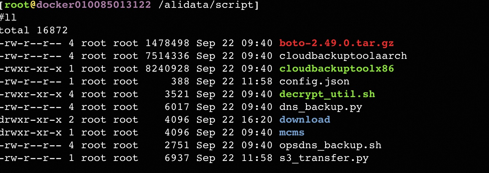
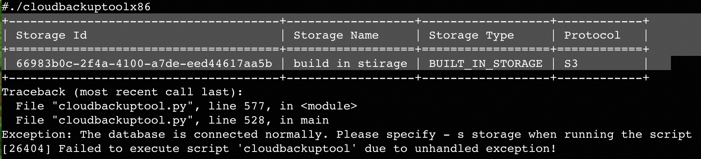
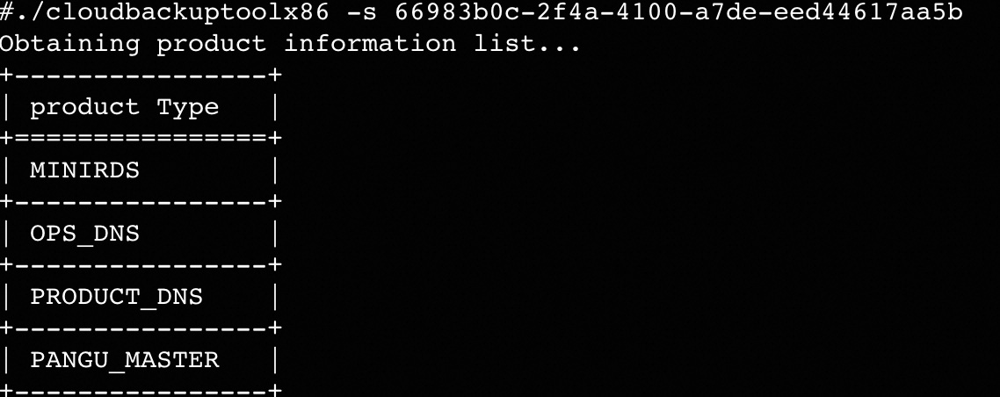
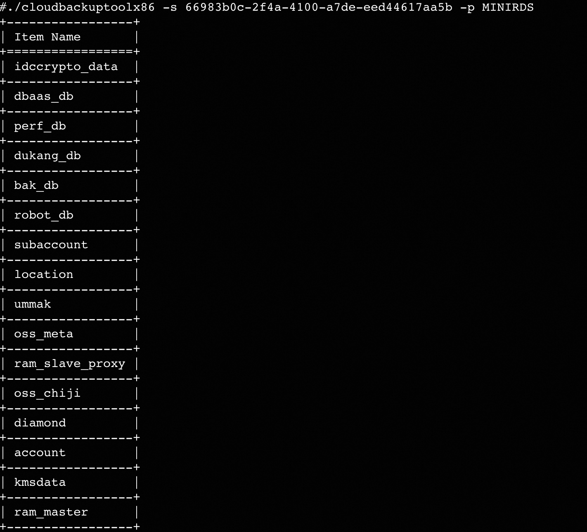
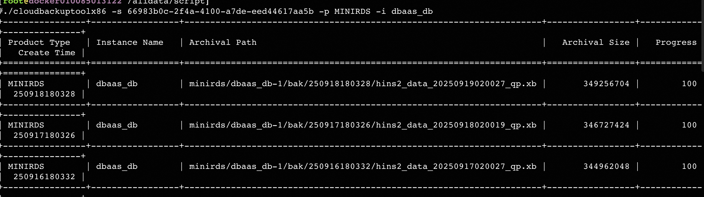
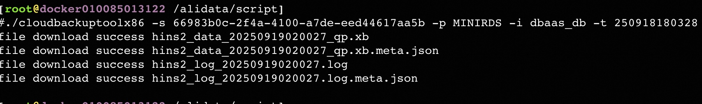
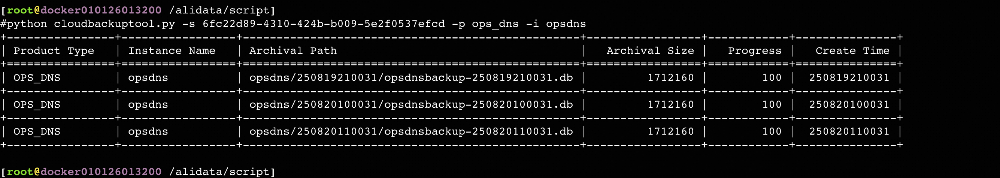
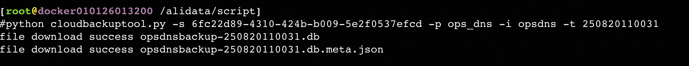
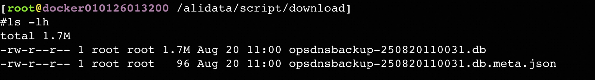

阿里云  
专有云  
灾备管理中心  
云平台备份运维指南  
产品版本：V3.18.6  
文档版本：20251202

**目录**

- [1.目的](#section-1)
- [2.常见运维处理](#section-2)
    - [2.1. 备份数据下载](#section-2-1)

<a id="section-1"></a>

# 1.目的

指导维护人员对云平台备份恢复进行预防维护，确保其能够稳定运行。维护人员可以根据本手册的指导，处理维护过程中发现的问题。如果根据本手册无法解决系统问题，请寻求阿里云工程师的技术支持。

<a id="section-2"></a>

# 2.常见运维处理

<a id="section-2-1"></a>

## 2.1. 备份数据下载

为了确保在任意的情况下(不依赖云平台)都可以管理和下载备份数据，我们会提供通用的工具方便使用者获取到当前的备份存储中的所有备份文件。

进入ftp 服务所在的物理机/容器。在路径/alidata/script 或者/cloud/app/ftpserver/FTPMaster#/ftpserver-master/xxxx_ftpserver_FTPMaster/script/ 下获取cloudbackuptoolx86/cloudbackuptoolaarch 文件。



config.json: 配置文件默认初始化ftp配置过的存储信息

```json
{
  "storage": {
    "storageType": "",     #存储类型 OSS/S3
    "accessKeyId": "",     #存储的ak
    "accessKeySecret": "", #存储的sk
    "ossEndpoint": "",     #存储的endpoint
    "port": 9600,          
    "ossBucket": "",       #存储的bucket
    "ossRegion": "",       #存储的region
    "useSsl" : false
  }
}
```

```text
cloudbackuptoolx86 # 适⽤于X86环境
cloudbackuptoolaarch #适⽤于aarch环境
options:          
        -s storage id            指定存储     
        -p product name      指定产品
        -i instance name         指定实例
        -t create time           指定下载的备份集时间   
        -c config_file           指定config.json⽂件路径
```

**ⅰ. 列出备份集信息**

根据存储池为维度分别列出信息，功能列表如下：

- 列出当前所有的存储信息

- 根据指定的存储信息获取当前存储备份的所有产品列表

- 根据指定的产品信息获取当前存储备份的实例列表信息

- 根据指定的备份集创建时间下载对应的备份集数据

```text
./cloudbackuptoolx86   #执⾏该命令获取当前环境中所有的存储信息
./cloudbackuptoolx86 -s 66983b0c-2f4a-4100-a7de-eed44617aa5b  #根据指定的存储信息获取当前存
储备份的所有产品列表
./cloudbackuptoolx86 -s 66983b0c-2f4a-4100-a7de-eed44617aa5b -p MINIRDS #根据指定的产品信
息获取当前存储备份的实例列表信息
./cloudbackuptoolx86 -s 66983b0c-2f4a-4100-a7de-eed44617aa5b -p MINIRDS -i dbaas_db #根
据指定的实例信息获取当前实例可下载的备份集列表
./cloudbackuptoolx86 -s 66983b0c-2f4a-4100-a7de-eed44617aa5b -p MINIRDS -i dbaas_db -t 
250918180328 #根据指定的备份集创建时间下载对应的备份集信息
```

> **重要**
>
> 当./cloudbackuptoolx86连接失败的时候，需要手动修改config.json内容，配置存储相关的信息，执行
>
> ./cloudbackuptoolx86 -c config.json 连接对应的存储。
>
> 对应的命令即为
>
> ./cloudbackuptoolx86 -c config.json #根据指定的存储信息获取当前存储备份的所有产品列表
>
> ./cloudbackuptoolx86 -c config.json -p MINIRDS #根据指定的产品信息获取当前存储备份的实例列表信息
>
> ./cloudbackuptoolx86 -c config.json -p MINIRDS -i dbaas_db #根据指定的实例信息获取当前实例可下载的备份集列表
>
> ./cloudbackuptoolx86 -c config.json -p MINIRDS -i dbaas_db -t 250918180328 #根据指定的备份集创建时间下载对应的备份集信息











以opsdns举例

备份记录下载脚本cloudbackuptoolx86，：

- 查看opsdns的备份记录cloudbackuptoolx86 -s 6fc22d89-4310-424b-b009-5e2f0537efcd -p ops_dns -i opsdns

  

- 下载最新的备份记录cloudbackuptoolx86 -s 6fc22d89-4310-424b-b009-5e2f0537efcd -p ops_dns -i opsdns -t 250820110031

  

- 下载成功后备份记录位于/alidata/script/download目录下，用于后续的数据恢复：

  
