阿里云  
专有云  
灾备管理中心  
用户指南（异地容灾）  
产品版本：V3.18.3  
文档版本：20241030

**目录**

- [1.异地容灾管理平台ASR-DR概述](#section-1)
- [2.快速入门](#section-2)
    - [2.1. 角色和权限说明](#section-2-1)
    - [2.2. 登录异地容灾管理平台ASR-DR](#section-2-2)
    - [2.3. 容灾场景简介](#section-2-3)
- [3.首页概览](#section-3)
- [4.大屏监控](#section-4)
- [5.实例管理](#section-5)
    - [5.1. 创建实例](#section-5-1)
    - [5.2. 查看实例详情](#section-5-2)
- [6.业务容灾](#section-6)
    - [6.1. 保护组](#section-6-1)
        - [6.1.1. 管理保护组](#section-6-1-1)
            - [6.1.1.1. 新建保护组](#section-6-1-1-1)
            - [6.1.1.2. 重保护](#section-6-1-1-2)
            - [6.1.1.3. 保护组详情](#section-6-1-1-3)
                - [6.1.1.3.1. 查看保护组详情](#section-6-1-1-3-1)
                - [6.1.1.3.2. 查看保护实体的日志](#section-6-1-1-3-2)
                - [6.1.1.3.3. 查看保护组的操作记录](#section-6-1-1-3-3)
                - [6.1.1.3.4. 删除保护实体](#section-6-1-1-3-4)
                - [6.1.1.3.5. 修改保护实体的归属](#section-6-1-1-3-5)
                - [6.1.1.3.6. 修改RDS的只读账号](#section-6-1-1-3-6)
                - [6.1.1.3.7. 修改RDS的高权限账号](#section-6-1-1-3-7)
                - [6.1.1.3.8. 修改过滤表](#section-6-1-1-3-8)
                - [6.1.1.3.9. 管理保护实体账号权限](#section-6-1-1-3-9)
            - [6.1.1.4. 添加同步实体](#section-6-1-1-4)
                - [6.1.1.4.1. 云数据库RDS](#section-6-1-1-4-1)
                - [6.1.1.4.2. 云原生分布式数据库PolarDB-X 1.0](#section-6-1-1-4-2)
                - [6.1.1.4.3. 对象存储OSS](#section-6-1-1-4-3)
                - [6.1.1.4.4. 大数据计算产品](#section-6-1-1-4-4)
                - [6.1.1.4.5. 域名解析DNS（跨云）](#section-6-1-1-4-5)
                - [6.1.1.4.6. 域名解析DNS（云内）](#section-6-1-1-4-6)
                - [6.1.1.4.7. 消息队列MQ](#section-6-1-1-4-7)
                - [6.1.1.4.8. 云数据库Redis版](#section-6-1-1-4-8)
                - [6.1.1.4.9. 云数据库MongoDB版](#section-6-1-1-4-9)
                - [6.1.1.4.10. 云服务器ECS](#section-6-1-1-4-10)
                - [6.1.1.4.11. 数据总线DataHub](#section-6-1-1-4-11)
            - [6.1.1.5. 编辑演练指标](#section-6-1-1-5)
            - [6.1.1.6. 启动保护组](#section-6-1-1-6)
            - [6.1.1.7. 停止保护](#section-6-1-1-7)
            - [6.1.1.8. 查看MaxCompute同步日志](#section-6-1-1-8)
            - [6.1.1.9. 手动同步数据](#section-6-1-1-9)
        - [6.1.2. 切换保护组](#section-6-1-2)
        - [6.1.3. 切回保护组](#section-6-1-3)
    - [6.2. 管理计划](#section-6-2)
        - [6.2.1. 概述](#section-6-2-1)
        - [6.2.2. 管理业务容灾计划](#section-6-2-2)
            - [6.2.2.1. 创建业务容灾计划](#section-6-2-2-1)
            - [6.2.2.2. 查询业务容灾计划](#section-6-2-2-2)
            - [6.2.2.3. 执行业务容灾演练](#section-6-2-2-3)
            - [6.2.2.4. 查看计划执行历史](#section-6-2-2-4)
        - [6.2.3. 管理容灾单元空间](#section-6-2-3)
            - [6.2.3.1. 创建容灾单元空间](#section-6-2-3-1)
            - [6.2.3.2. 切换容灾单元空间](#section-6-2-3-2)
            - [6.2.3.3. 切回容灾单元空间](#section-6-2-3-3)
- [7.告警管理](#section-7)
    - [7.1. 配置告警规则](#section-7-1)
    - [7.2. 查看并导出告警信息](#section-7-2)
    - [7.3. 同步延迟预警配置](#section-7-3)
- [8.系统管理](#section-8)
    - [8.1. 日志管理](#section-8-1)
    - [8.2. 管理云实例](#section-8-2)
- [9.附录](#section-9)
    - [9.1. 创建RAM角色](#section-9-1)
    - [9.2. 获取AccessKey](#section-9-2)
    - [9.3. 获取生产云实例配置信息](#section-9-3)
    - [9.4. 定制数据面SDK实现多Endpoint能力](#section-9-4)

<a id="section-1"></a>

# 1.异地容灾管理平台ASR-DR概述

本文介绍ASR-DR的基础原理和所涉及到的基本概念，以及异地容灾管理平台中的功能模块。

**异地容灾原理概述**

异地容灾管理平台ASR-DR（Apsara Stack Resilience for Disaster Recovery）简称ASR-DR，是一款提供容灾功能的云平台产品，当前支持对象存储OSS、云数据库RDS MySQL 5.6/5.7/8.0、云数据库PolarDB-O 11.2云原生分布式数据库PolarDB-X 1.0、域名解析DNS、消息队列MQ、云数据库Redis版、数据总线Datahub、大数据计算MaxCompute和DataWorks的热备容灾。

通过创建保护组，ASR-DR在生产站点和灾备站点对应资源之间建立一条热备通道，生产站点资源的数据修改会原封不动地异步热备到灾备站点对应的资源之中。生产站点发生故障时，通过故障计划中的故障切换将应用或服务切换到灾备站点上；生产站点故障恢复后，再通过故障计划中的故障回切将业务切换回生产站点，以此来实现业连续性。

**基本概念**

- 保护组：是异地容灾管理平台进行容灾保护的业务对象。用户可以基于应用视角，为某个应用所使用的一组相关资源创建保护组。

- 故障计划：故障场景下预定义的自动化工作流，当灾难或故障发生时通过执行对应工作流自动化的对保护组中的资源进行容灾操作，以保证业务连续性。

- 故障切换：指在主机房掉电或者断网的情况下，进行容灾应用从主机房到灾备机房的计划外转移。

- 故障回切：指在主机房恢复网络或者电力的情况下，进行容灾应用从灾备机房到主机房计划外恢复。

- 演练计划：演练场景下预置计划，也是一个预定义的工作流，其工作流中的各步骤与对应的恢复计划基本相同，目的是对恢复计划进行预演，以保证恢复计划的正确性。

- 演练切换：指在主机房和备机房的电力和网络正常的情况下，进行容灾应用从主机房到灾备机房的计划内迁移。

- 演练回切：指在主机房和灾备机房的电力和网络正常的情况下，进行容灾应用从灾备机房到主机房的计划内回切。

- RPO：Recovery Point Objective，即数据恢复点目标，以时间为单位，即在灾难发生时，系统和数据必须恢复的时间点要求。RPO标志系统能够容忍的最大数据丢失量。系统容忍丢失的数据量越小，RPO的值越小。

- RTO：Recovery Time Objective，即恢复时间目标，以时间为单位，即在灾难发生后，信息系统或业务功能从停止到必须恢复的时间要求。RTO标志系统能够容忍的服务停止的最长时间。系统服务的紧迫性要求越高，RTO的值越小。

**功能说明**

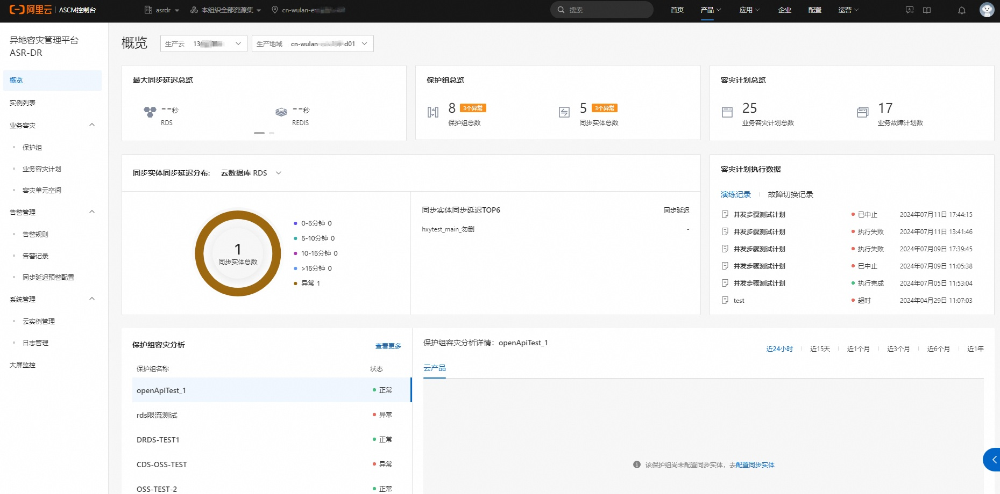

<table>
  <tr>
    <th width="90">功能模块</th>
    <th>描述</th>
  </tr>
  <tr>
    <td>概览</td>
    <td>展示保护组、容灾计划、同步实体信息等。</td>
  </tr>
  <tr>
    <td>实例列表</td>
    <td>展示生产区域和灾备区域的所有实例，实例状态以及实例关联的保护组等信息，使用户能够迅速获取当前集群内实例的状态信息，对集群的健康运行有个总体的了解。</td>
  </tr>
  <tr>
    <td>业务容灾</td>
    <td>包括保护组、业务容灾计划和容灾单元空间的设置。</td>
  </tr>
  <tr>
    <td>告警管理</td>
    <td>系统可以对保护组及计划的各种指标设置告警规则、配置同步延迟预警阈值，并将告警信息通知到告警联系人。通过告警信息，可以了解当前系统是否发生异常，以便发生异常后及时排除故障。</td>
  </tr>
  <tr>
    <td>系统管理</td>
    <td>统一权限管理的核心模块，可以管理云实例和日志信息。</td>
  </tr>
  <tr>
    <td>大屏监控</td>
    <td>在大屏上展示保护组、故障计划、演练计划、云产品保护、告警等概览信息。</td>
  </tr>
</table>

<a id="section-2"></a>

# 2.快速入门

<a id="section-2-1"></a>

## 2.1. 角色和权限说明

本文介绍运营管理员、组织管理员、全局容灾管理员、组织容灾管理员角色的权限说明。

| 角色 | 登录方式 | 权限说明 |
| --- | --- | --- |
| 运营管理员 | 1. 使用运营管理员（如admin）账号登录Apsara Uni-manager运营控制台。<br>2. 在Apsara Uni-manager运营控制台选择root组织跳转登录ASR-DR。 | • 可以添加生产云实例、配置云产品。<br>• 负责云平台全局容灾管理。 |
| 组织管理员 | 1. 使用组织管理员账号登录Apsara Uni-manager运营控制台。<br>2. 在Apsara Uni-manager运营控制台选择所属组织跳转登录ASR-DR。 | • 可以继承运营管理员已添加的生产云实例，不能进行云产品配置。<br>• 只能对本组织及下级组织的云产品进行容灾管理。 |
| 全局容灾管理员 | 1. 使用全局容灾管理员账号登录Apsara Uni-manager运营控制台。<br>2. 在Apsara Uni-manager运营控制台选择所属组织跳转登录ASR-DR。 | • 可以继承运营管理员已添加的生产云实例、配置云产品。<br>• 负责云平台全局容灾管理。 |
| 组织容灾管理员 | 1. 使用组织容灾管理员账号登录Apsara Uni-manager运营控制台。<br>2. 在Apsara Uni-manager运营控制台选择所属组织跳转登录ASR-DR。 | • 可以继承运营管理员已添加的生产云实例，不能进行云产品配置。<br>• 只能对本组织及下级组织的云产品进行容灾管理。 |

<a id="section-2-2"></a>

## 2.2. 登录异地容灾管理平台ASR-DR

本文介绍如何登录ASR-DR控制台。

**前提条件**

- 登录Apsara Uni-manager运营控制台前，确认您已从部署人员处获取Apsara Uni-manager运营控制台的服务域名地址、用户名和密码。

- 推荐使用Chrome浏览器。

- 只有运营管理员、组织管理员、全局容灾管理员、组织容灾管理员能够登录ASR-DR控制台。

**操作场景**

- 在跨云容灾场景中，ASR-DR控制台部署在灾备云，您需要通过灾备云的Apsara Uni-manager运营控制台登录ASR-DR。

- 在跨Region容灾场景中，ASR-DR控制台部署在中心Region，您需要通过中心Region的Apsara Uni-manager运营控制台登录ASR-DR。

- 在自身容灾场景中，您需要通过生产中心的Apsara Uni-manager运营控制台登录ASR-DR。

> **说明**
>
> 首次登录ASR-DR必须进行以下初始配置：
>
> - 配置支持的容灾产品，请参见《*异地容灾管理平台ASR-DR运维指南*》中的”管理云产品信息“章节。
>
> - 配置云实例，请参见管理云实例章节。
>
> - 配置RAM角色，请参见创建RAM角色章节。
>
> - 配置自身容灾，请参见《*异地容灾管理平台ASR-DR运维指南*》中的”管理自身容灾“章节；自身容灾只有跨云容灾场景需要配置，跨Region场景无需配置。

**操作步骤**

1. 在浏览器地址栏中，输入统一云管平台的服务域名地址，按回车键。

   > **说明**
   >
   > - 单击右上角的当前语言可以切换其它语言。

2. 输入正确的用户名及密码。

   请向运营管理员获取登录控制台的用户名和密码。

   > **说明**
   >
   > 首次登录统一云管平台时，需要修改登录用户名的密码，请按照提示完成密码修改。为提高安全性，密码长度必须为10~32位，且至少包含以下两种类型：
   >
   > - 英文大写或小写字母（A~Z、a~z）
   >
   > - 阿拉伯数字（0~9）
   >
   > - 特殊符号（感叹号（!）、at（@）、井号（#）、美元符号（$）、百分号（%）等）

3. 单击**账号登录**。

4. 如果账号已激活MFA多因素认证，请根据以下两种情况进行操作：

   - 管理员强制开启MFA后的首次登录：

     <ol type="a">

     <li>

     在绑定虚拟MFA设备页面中，按页面提示步骤绑定MFA设备。

     </li>

     <li>

     按照步骤2重新输入账号和密码，单击**账号登录**。

     </li>

     </ol>

     <ol type="i" start="100">

     <li>

     输入6位MFA码后单击**认证**。

     </li>

     </ol>

   - 您已开启并绑定MFA：

     输入6位MFA码后单击**认证**。

     > 绑定并开启MFA的操作请参见<strong>《Apsara Uni-manager运营控制台用户指南》</strong>中
     >
     > **说明**
     >
     > 的<strong>《绑定并开启虚拟MFA设备》</strong>章节。

5. 在顶部菜单中选择**产品**。

6. 在左侧导航栏中选择**容灾与备份**。

7. 在**容灾与备份**区域选择**容灾服务 > 异地容灾管理平台 ASR-DR**。

8. 进入异地容灾管理平台，支持按照不同组织、不同资源集以及不同地域显示所有数据，首次登录请先配置云实例。

   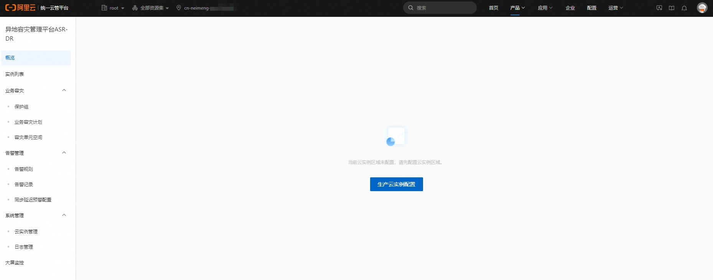

<a id="section-2-3"></a>

## 2.3. 容灾场景简介

专有云企业版支持跨云容灾和跨Region容灾。本文介绍两种容灾场景的能力。

跨云容灾和跨Region容灾的场景介绍如下：

- 跨云容灾：两个云实例之间进行灾备。由生产云向灾备云进行灾备。具体包含如下几种形态：

  - 生产云的中心Region向灾备云的中心Region进行容灾（1：1）。

  - 生产云的单元Region向灾备云的中心Region进行容灾（1：1）。

  - 多个生产云向灾备云的中心Region进行容灾（N：1）。

  - 两地三中心。

- 跨Region容灾：一个云实例下各Region间进行灾备。具体包含如下几种形态：

  - 单元Region向中心Region容灾。

  - 单元Region向单元Region容灾。

  - 中心Region向单元Region容灾（只支持业务故障容灾，不支持中心Region整体断电或断网故障场景）。

两种容灾场景的支持产品及功能如下表所示。

<a id="section-3"></a>

# 3.首页概览

首页以图形与数字结合的形式清晰地展示业务容灾概览。您可以在这里查看实时容灾指标，了解容灾保护组的状态，从而提高容灾管理效率，提升应用业务连续性。

**操作须知**

首次登录异地容灾管理平台时，需要配置生产云实例，如图所示。同时所有业务数据支持分域，可按照组织、资源集和地域展示。

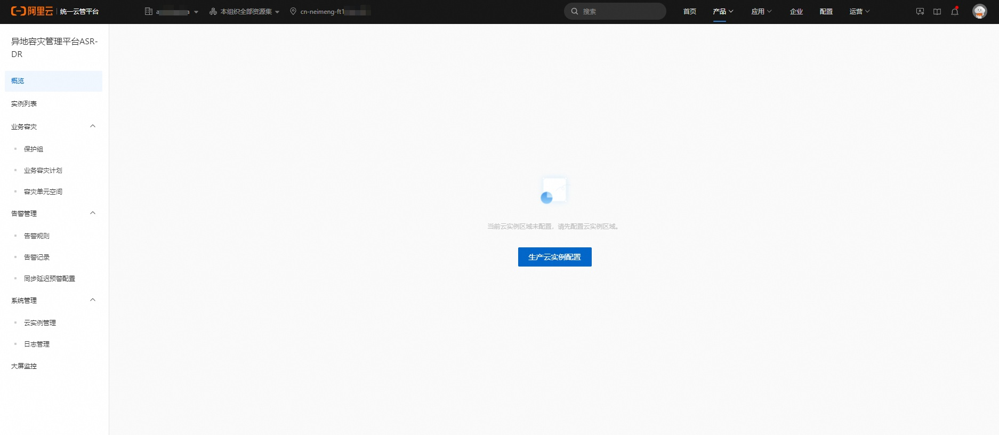

**操作步骤**

1. 登录ASR-DR控制台。

2. 在左侧导航栏中单击**概览**。

3. 在**概览**页面，您可以查看如下信息。

   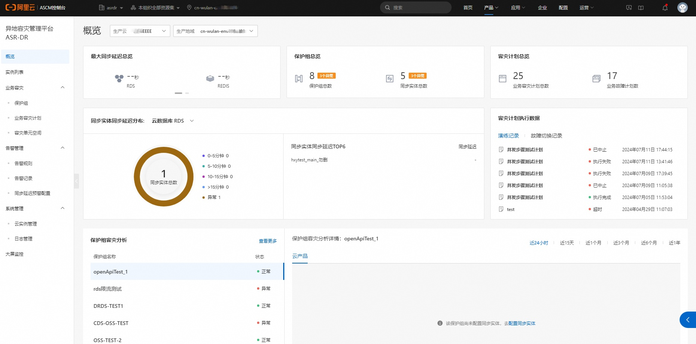

   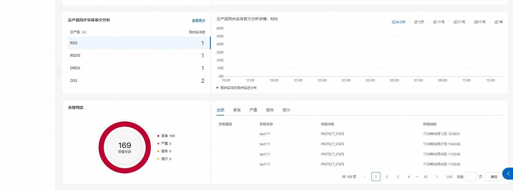

各模块的说明如下表所示。

<table>
  <tr>
    <th width="184">模块</th>
    <th>说明</th>
  </tr>
  <tr>
    <td>最大同步延迟总览</td>
    <td>展示云产品的最大同步延迟。</td>
  </tr>
  <tr>
    <td>保护组总览</td>
    <td>展示保护组总数和异常数、同步实体总数和异常数。</td>
  </tr>
  <tr>
    <td>容灾计划总览</td>
    <td>展示业务容灾计划总数、站点容灾计划总数。</td>
  </tr>
  <tr>
    <td>同步实体同步延迟分布</td>
    <td>• 通过环形图展示同步延迟时长的分布区间。在云产品名称右侧单击图标，支持切换云产品。<br>• 列表化展示同步实体同步延迟TOP6的同步实体名称和同步延迟时间。鼠标悬停在卡片区域，单击<strong>查看更多</strong>跳转至同步实体列表。</td>
  </tr>
  <tr>
    <td>容灾计划执行数据</td>
    <td>包括<strong>演练记录</strong>和<strong>故障切换记录</strong>。<strong>演练记录</strong>页签展示最近的演练状态，<strong>故障切换</strong><strong>记录</strong>页签展示最近的故障切换状态。</td>
  </tr>
  <tr>
    <td>保护组容灾分析</td>
    <td>列表化展示保护组的状态。单击<strong>查看更多</strong>跳转至保护组列表页。</td>
  </tr>
</table>

<table>
  <tr>
    <td>保护组容灾分析详情</td>
    <td>通过折线图展示演练切换/切回和故障切换/切回时，云产品的保护组同步延迟情况支持查看<strong>近24小时</strong>、<strong>近15天</strong>、<strong>近1个月</strong>、<strong>近3个月</strong>、<strong>近6个月</strong>、<strong>近1年</strong>。单击左侧<strong>保护组容灾分析</strong>中的<strong>保护组名称</strong>，即可查看对应的<strong>保护组容灾分析详</strong><strong>情</strong>。<br>说明<br>• 查看时间范围越长，数据采样频率越低。<br>• 新配置的保护组在按月或按年查看时可能会存在一段无数据的情况。</td>
  </tr>
  <tr>
    <td>云产品同步实体容灾分析</td>
    <td>列表化展示所有云产品和对应的同步实体数。单击<strong>查看更多</strong>可跳转至列表页。</td>
  </tr>
  <tr>
    <td>云产品同步实体容灾分析详情</td>
    <td>通过折线图展示同步实体的同步延迟分布和同步延迟平均值，支持查看<strong>近24</strong><strong>小时</strong>、<strong>近15天</strong>、<strong>近1个月</strong>、<strong>近3个月</strong>、<strong>近6个月</strong>、<strong>近1年</strong>。鼠标悬停在同步实体的同步延迟分布区域，显示延迟最大值、最小值、中位值、平均值。<br>说明<br>• 查看时间范围越长，数据采样频率越低。<br>• 新配置的同步实体在按月或按年查看时可能会存在一段时间无数据，无数据的时长最长可达1个月。</td>
  </tr>
  <tr>
    <td>告警预览</td>
    <td>• 通过环形图展示<strong>紧急</strong>、<strong>严重</strong>、<strong>警告</strong>、<strong>提示</strong>四种级别告警的数量。<br>• 在<strong>全部</strong>页签展示所有级别告警详情，切换<strong>紧急</strong>、<strong>严重</strong>、<strong>警告</strong>、<strong>提示</strong>可以筛选相应级别的告警。</td>
  </tr>
</table>

<a id="section-4"></a>

# 4.大屏监控

容灾大屏以图形与数字结合的形式清晰的展示容灾系统的总览，根据容灾计划任务的类型，容灾大屏分为日常态、演练态和故障态。

1. 登录ASR-DR控制台。

2. 在左侧导航栏中单击**大屏监控**。

   在**混合云容灾大屏**页面，根据当前ASR-DR的容灾计划类型显示不同的大屏：

   - 当没有执行容灾计划时，大屏显示**日常态**。

     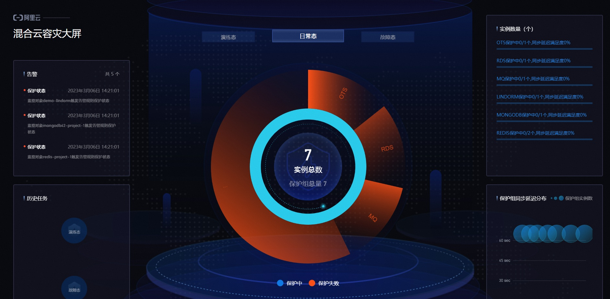

     大屏中各个模块的功能介绍如下表所示。

     | 区域名称 | 功能描述 |
     | --- | --- |
     | 左上方的<strong>告警</strong> | 展示容灾控制台的最近的告警信息。从保护组角度展示满足各个时间段指标的保护组数量。 |
     | 左下方的<strong>历史任务</strong> | 展示演练切换、演练回切、故障切换和故障回切的成功数和失败数，并以环形图展示比例。 |
     | 中间的保护情况统计 | 展示生产云中处于保护中、未保护和保护失败的实例比例、容灾实例的类型、实例总数和保护组总量。 |
     | 右上方的<strong>实例数量</strong> | 展示当前各类型云实例的被保护情况、以及同步延迟满足度。 |
     | 右下方的<strong>保护组同步延迟分布</strong> | 展示每个保护组包含的实例数量和最大同步延迟分布。 |

   - 当执行演练计划时，大屏显示**演练态**。

     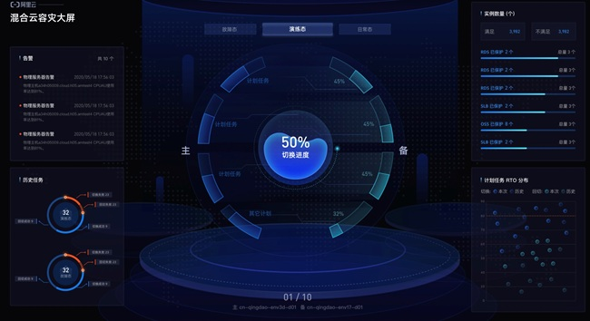

     大屏中各个模块的功能介绍如下表所示，其他区域的功能和日常态的一致，此次不再重复介绍。

     | 区域名称 | 功能描述 |
     | --- | --- |
     | 中间的计划任务进度 | 展示了每个计划任务的切换进度和总进度。 |
     | 右下方的<strong>计划任务RTO分布</strong> | 展示每个当前切换完成的计划任务和历史任务的RTO分布。 |

   - 当执行故障计划时，大屏显示**故障态**。故障态的大屏展示内容和演练态基本一致。

     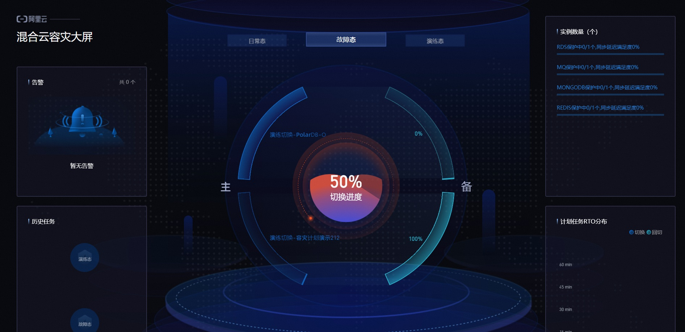

<a id="section-5"></a>

# 5.实例管理

<a id="section-5-1"></a>

## 5.1. 创建实例

您需要在生产站点和灾备站点分别创建待保护的实例，保护组中生产站点和灾备站点的实例数量和实例规格需要完全一致。

1. 分别登录生产站点和灾备站点的Apsara Uni-manager运营控制台。

2. 参见各云产品的用户指南创建云产品实例。各产品在创建实例时需要完成的任务以及注意事项如下表所示。

   | 产品 | 任务 | 注意事项 |
   | --- | --- | --- |
   | 云数据库RDS | 请在生产站点和灾备站点分别创建RDS实例、创建RDS账号、创建数据库。 | • 生产站点业务的RDS实例数量和实例规格要与灾备站点完全一致。<br>• 生产站点业务RDS的网络类型要与灾备站点RDS的网络类型一致，例如都是VPC网络。<br>• 灾备站点的RDS实例中不需要创建数据库，ASR-DR会自动从生产站点的RDS中同步数据库。（敏捷版除外）<br>• 生产站点的实例名称建议与灾备站点的实例名称一致，且与所属业务命名关联，方便后期维护。 |
   | 云原生分布式数据库PolarDB-X 1.0 | 请在生产站点和灾备站点分别创建PolarDB-X 1.0实例、创建账号、关联RDS实例。 | • 生产站点业务的PolarDB-X 1.0实例数量和实例规格要与灾备站点完全一致。<br>• 生产站点PolarDB-X 1.0的网络类型要与灾备站点PolarDB-X 1.0的网络类型一致，例如都是VPC网络。<br>• 生产站点的实例名称建议与灾备站点的实例名称一致，且与所属业务命名关联，方便后期维护。<br>• 灾备站点的PolarDB-X 1.0实例中不需要创建数据库，ASR-DR会自动从生产站点的PolarDB-X 1.0中同步数据库。 |
   | 对象存储OSS<br>说明云产品<strong>对象存储</strong><strong>OSS</strong>页签下的实例列表中的实例类型包括对象存储OSS和对象存储CDS-OSS。 | 请在生产站点和灾备站点分别创建OSS Bucket。 | 生产站点业务的OSS Bucket数量要与灾备站点完全一致。 |
   | 消息队列MQ | 请在生产站点和灾备站点分别创建MQ实例、创建Topic。 | • 生产站点业务的MQ实例数量要与灾备站点完全一致。<br>• 生产站点MQ的Topic名称与灾备站点MQ的Topic名称一致。 |
   | 专有云DNS | 请在生产站点和灾备站点分别创建DNS域名、添加解析。 | • 生产站点业务的DNS的全局内网域名数量要与灾备站点完全一致。<br>• 生产站点DNS域名<strong>解析设置</strong>中的<strong>记录值集合</strong>与灾备站点DNS域名<strong>解析设置</strong>中的<strong>记录值集合</strong>一致。<br>• DNS域名<strong>解析设置</strong>的<strong>负载均衡策略</strong>采用<strong>权重</strong>，并配置主备站点的业务VIP。<br>• <strong>记录值集合</strong>中，请将主记录写在备记录的前面，例如：master-host 100,slave-host 0。 |
   | 域名解析DNS（云内） | 请在生产站点和灾备站点分别创建业务DNS域名和解析记录。 | • 生产站点、灾备站点，在业务DNS域名和解析记录集合要求一致。<br>• DNS域名解析设置的负载均衡策略采用权重，并配置主备站点的业务VIP。 |
   | 大数据计算MaxCompute | 请在生产站点和灾备站点分别创建MaxCompute项目、任务云账号、计算单元。 | • 生产站点业务MaxCompute的计算单元CU数量、存储空间和要与灾备站点一致。<br>• 生产站点MaxCompute的Project名称、任务云账号名称与灾备站点一致。<br>• 生产站点业务DataWorks的Project名称与灾备站点一致。<br>• 生产站点DataWorks的工作空间名称、MaxCompute项目名称建议与灾备站点一致，且与所属业务命名关联，方便后期维护。<br>• 增量同步前请确保生产站点和灾备站点的数据一致。 |
   | 云数据库 Redis | 请在生产站点和灾备站点分别创建Redis实例、创建账号。 | • 只支持社区版4.0、5.0版本；企业版5.0版本。<br>• 实例需申请经典网络地址。 |
   | 云服务器 ECS | 请在生产站点和灾备站点分别创建ECS实例、EBS硬盘、VPC网络。 | • 硬盘：仅支持无代理高性能云盘（IO15）。<br>• 网络：主备站点ECS所在VPC网段不冲突。<br>• 仅支持单机房实例。 |
   | 数据总线 DataHub | 请在生产站点和灾备站点分别创建DataHub实例。 | • 生产站点业务的DataHub实例数量要与灾备站点完全一致。<br>• 生产站点DataHub的Topic名称及Field名称与灾备站点DataHub的Topic名称及Field名称一致。 |

<a id="section-5-2"></a>

## 5.2. 查看实例详情

您可以通过ASR-DR跳转到云产品的控制台查看云产品的实例详情。

**操作步骤**

1. 登录ASR-DR控制台。

2. 在左侧导航栏单击**实例列表**。

3. 在**实例列表**页面，单击**生产地域**或**灾备地域**页签，单击产品页签。

4. 单击实例右侧**操作**列的  图标，单击**详情**。

   系统跳转到云产品控制台页面。

<a id="section-6"></a>

# 6.业务容灾

<a id="section-6-1"></a>

## 6.1. 保护组

<a id="section-6-1-1"></a>

### 6.1.1. 管理保护组

您可以创建、修改和删除保护组，给保护组添加实例，查看保护组详细信息，对保护组进行重保护。

1. 登录ASR-DR控制台。

2. 在左侧导航栏，选择**业务容灾** > **保护组**。

   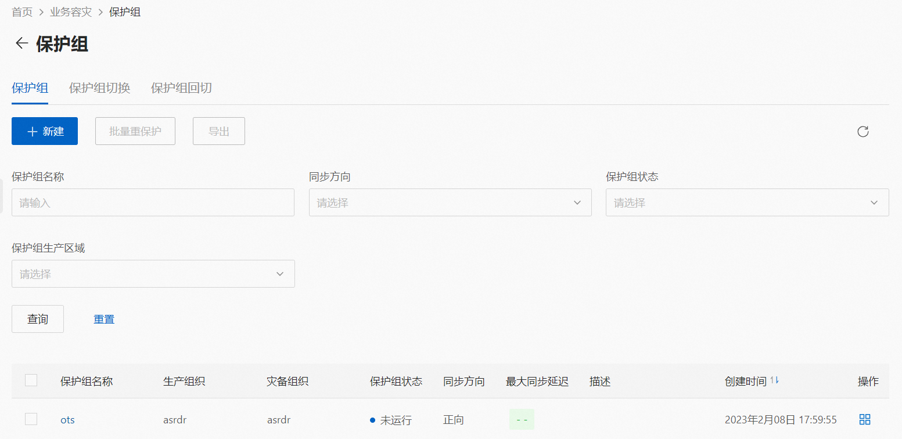

   <table>
     <tr>
       <th width="121">名称</th>
       <th>描述</th>
     </tr>
     <tr>
       <td>保护组状态</td>
       <td>当前保护组的状态分为：<br>• <strong>计划失败</strong>：计划任务的步骤执行失败。<br>• <strong>计划执行中</strong>：保护组所在计划在执行中。<br>• <strong>保护失败</strong>：保护组创建失败；创建失败的保护组可针对具体失败的实体进行重建。<br>• <strong>保护中</strong>：保护组链路创建成功。<br>• <strong>保护启动中</strong>：保护组链路创建中。<br>• <strong>重保护中</strong>：正在对保护组重新建立链路。<br>• <strong>未知</strong>：没有获取到相应的状态。<br>• <strong>停止</strong>：保护组已停止保护。</td>
     </tr>
     <tr>
       <td>同步方向</td>
       <td>保护组的方向，您可以由保护组的方向判断保护组中提供服务的是实例在哪个中心。<br>• <strong>正向</strong>：提供服务的实例在生产云。<br>• <strong>反向</strong>：提供服务的实例在灾备云。</td>
     </tr>
     <tr>
       <td>最大同步延迟</td>
       <td>保护组中所有实体同步延迟的最大值。</td>
     </tr>
   </table>

3. 单击**操作**列中的  图标，您可以执行如下操作：

   - 选择**详情**，查看保护组详细信息，并对保护组中的实例进行管理，具体操作请参见保护组详情章节。

   - 选择**修改**，修改保护组名称和描述。

   - 选择**添加实体**，增加保护组中的实例，具体操作请参见添加同步实体相关章节。

   - 选择**编辑演练指标**，配置云产品的数据同步延迟、切换时长、切回时长等指标的期望值。

   - 选择**重保护**，将保护失败的保护组重新恢复至保护中。

   - 选择**停止保护**，暂时中止某个保护组/保护实体的同步。

     > **说明**
     >
     > 已关联恢复计划或演练计划的保护组不能被删除。
     >
     > 删除保护组后，该保护组下所有资源的主备实体之间的热备通道将被逐一删除，主备实体之间的跨云同步也因此停止，其1:1的映射关系也同时被删除。

   - 选择**删除**，删除不需要的保护组。

<a id="section-6-1-1-1"></a>

#### 6.1.1.1. 新建保护组

保护组是ASR-DR控制台进行容灾保护的业务对象。您可以基于应用视角，为某个应用所使用的一组相关资源创建保护组。

**背景信息**

保护组数量建议在20个以内。

**操作步骤**

1. 登录ASR-DR控制台。

2. 在左侧导航栏选择**业务容灾** > **保护组**。

3. 在保护组页面，单击**新建**。

4. 在**新建保护组**页面，填写保护组基本信息，参数说明如下表所示。

   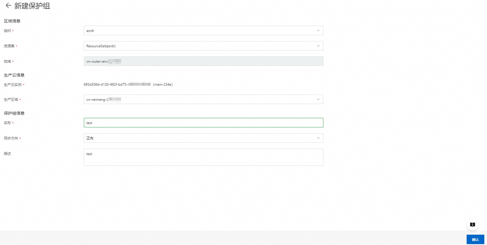

   **区域**

   **参数名称**

   **描述**

   选择保护组数据所在的组织。

   **区域信息**

   **组织**

   > **说明**

   选择待容灾实例所在的资源集。

   **资源集**

   > 区域信息显示的是灾备区域的相关信息。

   选择保护组所在的灾备站点地域。

   **地域**

   系统默认填充，无需填写。

   **生产云实例**

   **生产云信息**

   选择保护组要保护的云产品实例所在的生产站点的地

   **生产区域**

   域。

   自定义保护组名称。名称只能包含中文、英文、数字、短划线（-）、下划线（_）或半角句号（.），长度为

   **名称**

   4~20个字符或2~10个汉字。

   服务进行切换的方向。提供服务的实例为生产站点实例时选择正向，提供服务的实例为灾备站点实例时选择反向。

   **同步方向**

   > **说明**

   **保护组信息**

   > 保护组的方向会随着切换和回切进行动态变化，即正向保护组进行切换后状态会变为反向保护组，反向保护组进行回切后状态会变回正向保护组。

   对保护组的描述信息，方便识别。

   **描述**

5. 单击**确认**，进入<strong>保护组页面，</strong>单击对应保护组的操作列  ，选择**添加实体**。

6. 按照添加同步实体的界面指引进行配置。

   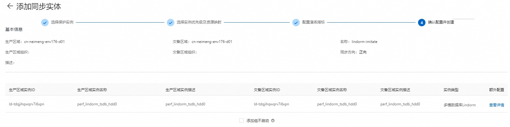

> **说明**
>
> - 各云产品添加同步实体的具体步骤请参见*添加同步实体章节。*
>
> - 选中**添加但不启动**勾选框表示该保护组创建完成之后直接到停止状态，后台不会创建同步链路，不做同步操作，且该保护组只可进行**启动保护组**操作。未勾选则表示保护组创建完成之后，自动进入保护启动状态。

7. 单击**确认**，保护组创建完成。在保护组列表页面单击  图标，查看保护组状态。

<a id="section-6-1-1-2"></a>

#### 6.1.1.2. 重保护

当进行故障切换后，无论生产云状态是否正常，保护组会即刻变成保护失败状态，您需要执行重保护操作，将保护组状态恢复至保护中。

**前提条件**

- 进行故障切换后，保护组状态变为保护失败。

- 如果是初始化过程中保护组状态变成保护失败，则无法进行重保护。

**操作步骤**

1. 登录ASR-DR控制台。

2. 在左侧导航栏，选择**业务容灾**>**保护组**。

3. 选择**保护组状态**为**保护失败**，单击**查询**。

4. 在保护组列表中，单击目标保护组右侧的  图标，单击**重保护**。

5. 在弹出的对话框中单击**确定**。

<a id="section-6-1-1-3"></a>

#### 6.1.1.3. 保护组详情

您可以查看保护组详细信息、操作历史，并对保护组中的实例、关联的计划进行管理。

<a id="section-6-1-1-3-1"></a>

##### 6.1.1.3.1. 查看保护组详情

您可以通过保护组详情查看保护实体的同步延迟监控信息和实体巡检信息。

**操作步骤**

1. 登录ASR-DR控制台。

2. 在左侧导航栏，选择**业务容灾**>**保护组**。

3. 单击保护组右侧的  图标，单击**详情**。

   <table>
     <tr>
       <th width="105">名称</th>
       <th>描述</th>
     </tr>
     <tr>
       <td>状态</td>
       <td>实体状态包括：<br>• 保护启动中<br>• 保护失败<br>• 保护中<br>• 计划执行中<br>• 重保护中<br>• 计划失败<br>• 停止<br>• 未知</td>
     </tr>
     <tr>
       <td>同步策略</td>
       <td>同步策略包括如下两种方式：<br>• <strong>全量同步</strong>：每一次都将所有数据全量同步至灾备云实例。<br>• <strong>增量同步</strong>：只将增量变化的数据同步至灾备云实例。</td>
     </tr>
     <tr>
       <td>优先级</td>
       <td>保护组中设置的优先级。</td>
     </tr>
     <tr>
       <td>同步方向</td>
       <td>数据同步的方向，正向为生产云实例供服务，反向为灾备云实例在提供服务。</td>
     </tr>
     <tr>
       <td>初始化进度</td>
       <td>实体初始化批量数据同步的百分比。</td>
     </tr>
     <tr>
       <td>同步延迟</td>
       <td>当前实体的同步延迟时间。</td>
     </tr>
     <tr>
       <td>获取时间</td>
       <td>当前同步延迟的计算时间。</td>
     </tr>
   </table>

4. 在**保护组详情**页面，单击实体列表中目标实例右侧的  图标，您可以执行如下操作：

   - 单击**详情**，可以查看生产云和灾备云对应实例的基本信息、同步延迟监控信息、额外配置的相关信息、主备实例可达性巡检。

     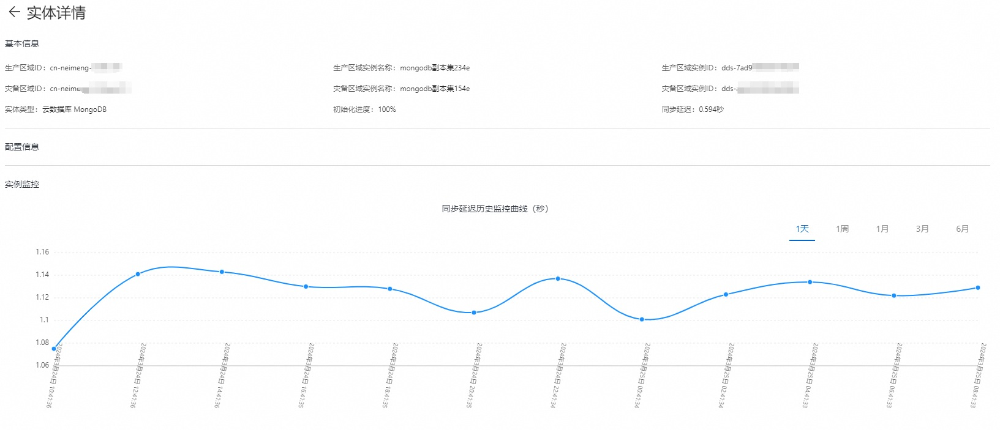

     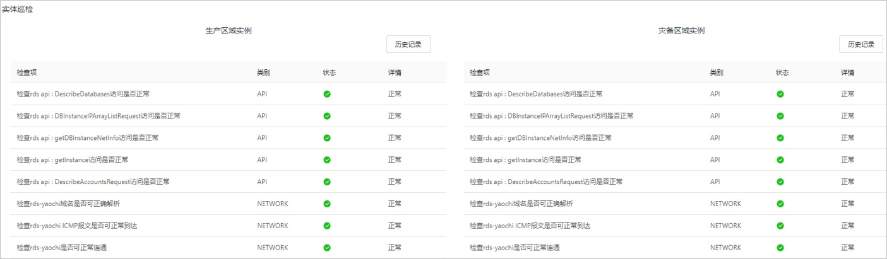

     > **说明**
     >
     > 实体巡检功能默认不开启。若要开启该功能，请评估实际情况，再在后台开启。

     - 不同产品实例在**实体详情**页面显示的基本信息和额外配置的相关信息参数不同，具体参数说明如下表所示。

       **产品**

       **参数**

       **描述**

       主备RDS高权限账号、密码。

       **配置高权限账号**

       创建保护组时配置的生产云RDS中不需要进行容灾保护的数据库

       **过滤表详情**

       和表。

       云数据库 RDS

       创建保护组时，配置的不需要被

       **只读账号**

       ASR-DR设置读写的账号。

       增量同步时，从该同步位点开始

       **增量同步开始位点**

       同步增量数据。

       主备PolarDB-O高权限账号、密

       **配置高权限账号**

       码。

       要同步的数据库、Schema或

       **同步表**

       PolarDB-O

       表。

       增量同步时，从该同步位点开始

       **增量同步开始位点**

       同步增量数据。

       全量同步时，登录灾备云

       **配置信息**

       PolarDB-X数据库的密码。

       创建保护组时配置的生产云PolarDB-X中不需要进行容灾保

       **过滤表详情**

       护的数据库和表。

       云原生分布式数据库PolarDB-X

       创建保护组时，配置的不需要被

       **只读账号**

       ASR-DR设置读写的账号。

       增量同步时，从该同步位点开始

       **增量同步开始位点**

       同步增量数据。

       主备实例同步账号、密码。

       **配置同步账户**

       云原生分布式数据库AnalyticDB MySQL版3.0

       增量同步时，从该同步位点开始

       **增量同步开始位点**

       同步增量数据。

       消息队列 MQ

       需要同步的topic列表。

       **配置消息topic**

       被ASR-DR管理的全局域名。

       **全局域名**

       域名解析DNS（跨云）

       DNS解析记录。

       **记录值**

       DNS TTL值。

       **TTL**

       MaxCompute Project同步对

       **MaxCompute同步映射**

       象。

       大数据计算 MaxCompute

       MaxCompute数据同步策略。

       **策略配置**

       配置云数据库MongoDB数据的同

       **策略配置**

       步策略。

       灾备站点的目标实例，该实例作

       **资源映射**

       为生产站点实例的热备资源。

       云数据库MongoDB

       如果不希望在容灾切换过程中被设置为读写权限，您可以通过该

       **配置只读账号**

       设置过滤这些只读账号。

       生产、灾备实例shard账号名和密

       **配置shard账号**

       码。

       配置云服务器ECS数据的同步策

       **策略配置**

       略。

       在HDR侧提前创建的站点对。

       **选择云站点对**

       生产云和灾备云可以使用的区域

       云服务器 ECS

       **选择可用区**

       信息。

       生产云和灾备云所在的VPC实

       **配置网络**

       例、交换机以及安全组。

       待切换的保护组。

       **选择HDR保护组**

       配置云数据库Redis数据的同步策

       **策略配置**

       略。

       灾备站点的目标实例，该实例作

       **资源映射**

       为生产站点实例的热备资源。

       云数据库Redis

       如果某些Redis账号是只读账号，不希望在容灾切换过程中被设置为读写权限，您可以通过该设置

       **配置只读账号**

       过滤这些只读账号。

       配置云数据库DNS（云内）数据

       **策略配置**

       的同步策略。

       灾备站点的目标实例，该实例作

       **资源映射**

       为生产站点实例的热备资源。

       域名解析信息在DNS（云内）中

       **TTL**

       的存在时间。

       域名解析DNS（云内）

       当前支持**权重**策略。

       **智能解析策略**

       配置权重策略。格式为域名IP地址、空格、权重（0~999），IP地址为基本信息中主机的**记录**

       **记录值**

       **值**列的IP请参见*专有云DNS用户指南*的*全局内网域名配置*。

     - 不同产品实例在**实体巡检**区域中检查项内容不同，各产品检查项如下表所示。

       **产品**

       **检查项**

       **检查dnsService域名是否可正确解析**

       **检查dnsService ICMP报文是否可正常到达**

       **检查dnsService是否可正常连通**

       DNS

       **检查dnsService api : ObtainGlobalAuthZoneListRequest访问是否正常**

       **检查dnsService api : GetInstance访问是否正常**

       **检查ots-ocm域名是否可正确解析**

       **检查ots-ocm ICMP报文是否可正常到达**

       **检查ots-ocm是否可正常连通**

       TableStore

       **检查ots api : GetInstance访问是否正常**

       **检查ots api : Client DescribeTable访问是否正常**

       **检查odps-bcc域名是否可正确解析**

       **检查odps-bcc ICMP报文是否可正常到达**

       **检查odps-bcc是否可正常连通**

       MaxCompute

       **检查odps api : GetProtectGroupRequest访问是否正常**

       **检查odps api : listDataworkInstancesRequest访问是否正常**

       **检查odps api : GepPlanRequest访问是否正常**

       **检查oss-chiji域名是否可正确解析**

       **检查oss-chiji ICMP报文是否可正常到达**

       **检查oss-chiji是否可正常连通**

       OSS

       **检查oss api : GetOcmBucketMetaXmlRequest访问是否正常**

       **检查oss api : GetLocationListRequest访问是否正常**

       **检查drds-manager域名是否可正确解析**

       **检查drds-manager ICMP报文是否可正常到达**

       **检查drds-manager是否可正常连通**

       **检查drds api :**

       PolarDB-X

       **DescribeInstanceAccountsRequest访问是否正常**

       **检查drds api : DescribeDrdsInstanceRequest访问是否正常**

       **检查drds api : DescribeInstanceState访问是否正常**

       **检查rds-yaochi域名是否可正确解析**

       **检查rds-yaochi ICMP报文是否可正常到达检查rds-yaochi是否可正常连通**

       **检查rds api : DescribeAccountsRequest访问是否正常**

       RDS

       **检查rds api : DBInstanceIPArrayListRequest访问是否正常**

       **检查rds api : DescribeDatabases访问是否正常**

       **检查rds api : getInstance访问是否正常**

       **检查rds api : getDBInstanceNetInfo访问是否正常**

       **检查adb3域名是否可正确解析**

       **检查adb3 ICMP报文是否可正常到达**

       **检查adb3是否可正常连通**

       **检查ad3 api : getLinkState访问是否正常**

       **检查ad3 api : getInstanceReplild访问是否正常**

       **检查ad3 api : isInstanceEmpty访问是否正常**

       ADB 3.0

       **检查ad3 api : getInstanceInfo访问是否正常**

       **检查ad3 api : getPhysicallpList访问是否正常**

       **检查ad3 api : getClassicNetInfo访问是否正常**

       **检查ad3 api : getNetInfo访问是否正常**

       **检查ad3 api : listAdb3Instances访问是否正常**

       <table>
         <tr>
           <td rowspan="9">MQ</td>
           <td>检查mq域名是否可正确解析</td>
         </tr>
         <tr>
           <td>检查mq ICMP报文是否可正常到达</td>
         </tr>
         <tr>
           <td>检查mq是否可正常连通</td>
         </tr>
         <tr>
           <td>检查mq api : listInstances访问是否正常</td>
         </tr>
         <tr>
           <td>检查mq api : queryTaskStatus访问是否正常</td>
         </tr>
         <tr>
           <td>检查mq api : listGroups访问是否正常</td>
         </tr>
         <tr>
           <td>检查mq api : listTopics访问是否正常</td>
         </tr>
         <tr>
           <td>检查mq api : listConsumerGroups访问是否正常</td>
         </tr>
         <tr>
           <td>检查mq api : getBaseInstance访问是否正常</td>
         </tr>
       </table>

   - 当网络或者其他原因导致与底层产品失联时实体会保护失败，此时单击**重保护**，系统会查询保护状态，并根据查询结果决定下一个状态。

   - 当主备RDS实例的数据库或Tablestore实例的表发生增减，会导致实体保护失败，恢复方法请参见实体保护失败的处理方法。

<a id="section-6-1-1-3-2"></a>

##### 6.1.1.3.2. 查看保护实体的日志

查看实体日志可以帮助您定位和分析保护失败的原因。

**操作步骤**

1. 登录ASR-DR控制台。

2. 在左侧导航栏选择**业务容灾**>**保护组**。

3. 单击保护组名称或单击保护组右侧的  图标，选择**详情**。

4. 在**保护组详情**页面，单击实例列表中目标实例右侧的  图标，选择**日志**，可以查看主备中心对应实例的日

   志。

   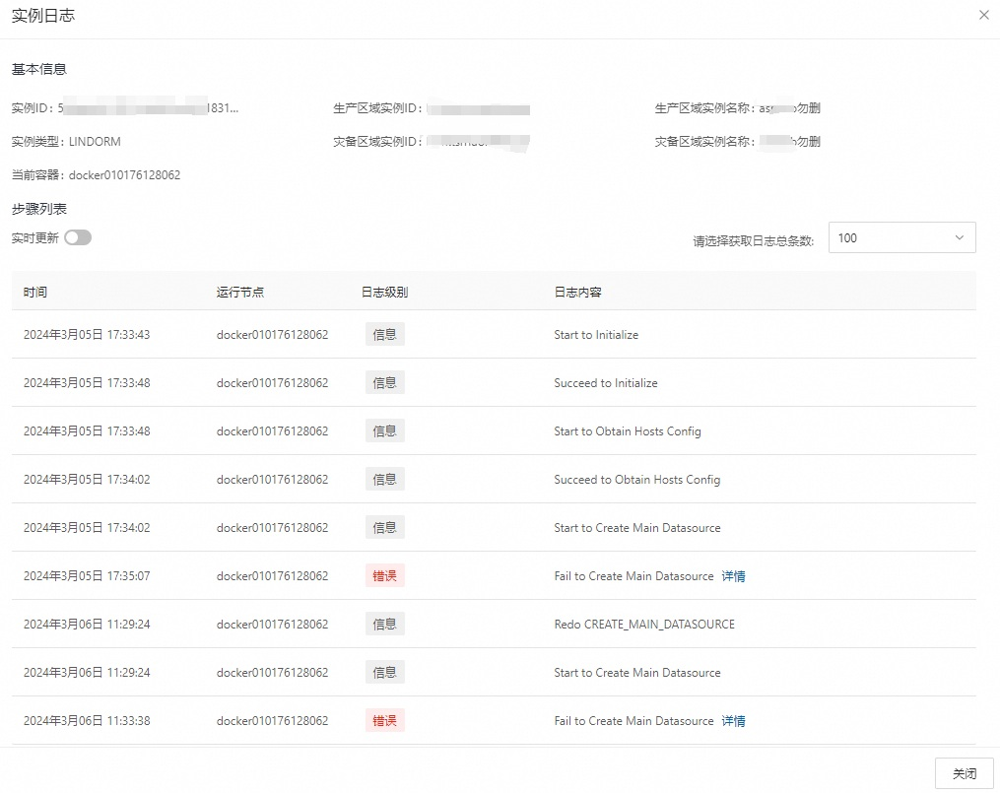

   | 名称 | 描述 |
   | --- | --- |
   | 实时更新 | 打开实时更新开关后，实例的日志信息会10秒更新一次。 |
   | 请选择获取日志总条数 | 单击选择当前页需要展示的日志条数，可选值有100、500和1000。 |
   | 日志级别 | 日志级别包括：<br>• 信息<br>• 错误<br>• 告警 |
   | 运行节点 | 该实体同步链路工作所在节点。 |

<a id="section-6-1-1-3-3"></a>

##### 6.1.1.3.3. 查看保护组的操作记录

您可以查看对该保护组执行的历史操作记录。

1. 登录ASR-DR控制台。

2. 在左侧导航栏选择**业务容灾**>**保护组**。

3. 单击保护组名称，或单击保护组右侧的  图标，选择**详情**。

4. 在**保护组详情**页面，单击**操作历史**页签。

5. 您可以查看对该保护组执行的历史记录，单击**操作**列中的**详情**，可以查看详细信息。

<a id="section-6-1-1-3-4"></a>

##### 6.1.1.3.4. 删除保护实体

您可以将保护组中不再需要容灾保护的实例移除。移除后该实例将不再被保护，相应的容灾链路将断开。

1. 登录ASR-DR控制台。

2. 在左侧导航栏中选择**业务容灾**>**保护组**。

3. 在**保护组**页面，单击目标保护组名称或单击**操作**列的  图标，单击**详情**。

4. 在**保护组详情**页面，单击**保护实体**页签。

5. 单击实例列表中目标实例**操作**列的  图标，单击**删除**。

6. 在弹出的对话框中单击**确定**。

<a id="section-6-1-1-3-5"></a>

##### 6.1.1.3.5. 修改保护实体的归属

在实例所属业务调整，或创建保护组时错误选择了某个实例等场景中，您可以修改保护组实例的归属，将实例移动到其他保护组中。

1. 登录ASR-DR控制台。

2. 在左侧导航栏中选择**业务容灾**>**保护组**。

3. 在**保护组**页面，单击目标保护组名称或单击**操作**列中的  图标，单击**详情**。

4. 在**保护组详情**页面，在实例列表中单击目标实例**操作**列中的  图标，单击**迁移实体**。

5. 选择新保护组，单击**确定**。

   > **说明**
   >
   > 新保护组与当前保护组的生产地域组织、灾备地域组织、同步方向要保持一致。

<a id="section-6-1-1-3-6"></a>

##### 6.1.1.3.6. 修改RDS的只读账号

如果某些RDS账号是只读账号，不希望在容灾切换过程中被设置为读写权限，您可以通过该设置过滤这些只读账号。

**前提条件**

只有RDS和PolarDB-X实例支持该功能。

**操作步骤**

1. 登录ASR-DR控制台。

2. 在左侧导航栏中选择**业务容灾**>**保护组**。

3. 单击保护组名称或单击保护组右侧的  图标，选择**详情**。

4. 在**保护组详情**页面，单击实例列表中目标实例右侧的  图标，选择**修改只读账号**。

5. 在**更新只读账号**对话框中，选择对应的数据库，输入账号名称.

6. 单击**确定**。

<a id="section-6-1-1-3-7"></a>

##### 6.1.1.3.7. 修改RDS的高权限账号

如果RDS控制台上的高权限账号和密码有修改，您需要在ASR-DR同步修改相应实例的高权限账号和密码。

**前提条件**

只有RDS、PolarDB-X、PolarDB-O实例支持该操作。

**操作步骤**

1. 登录ASR-DR控制台。

2. 在左侧导航栏中选择**业务容灾**>**保护组**。

3. 在**保护组**页面，单击目标保护组名称或单击**操作**列的  图标，单击**详情**。

4. 在**保护组详情**页面，单击实例列表中目标实例**操作**列的  图标，单击**修改高权限账号**。

5. 在**修改主备实例高权限账号密码**对话框中，分别设置主中心实例和备中心实例的用户名和密码，单击**修改**。

<a id="section-6-1-1-3-8"></a>

##### 6.1.1.3.8. 修改过滤表

如果容灾保护中的实例新增了数据库或数据表，且该数据库或数据表不需要进行容灾，您需要修改过滤表。

**前提条件**

只有RDS和PolarDB-X实例支持该操作。

**操作步骤**

1. 登录ASR-DR控制台。

2. 在左侧导航栏中选择**业务容灾**>**保护组**。

3. 单击保护组名称或单击保护组右侧的  图标，选择**详情**。

4. 在**保护组详情**页面，在实例列表中，单击目标实例**操作**列中的  图标，单击**修改过滤表**。

5. 在**更新过滤表**对话框中，配置生产站点实例中不需要进行容灾保护的数据库和表，单击**确定**。

<a id="section-6-1-1-3-9"></a>

##### 6.1.1.3.9. 管理保护实体账号权限

通过账号管理功能，您可以查看、修改同步实体主备实例的账号权限，便于实例管理。

**前提条件**

只有RDS和PolarDB实例支持该操作。

**操作步骤**

1. 登录ASR-DR控制台。

2. 在左侧导航栏中选择**业务容灾**>**保护组**。

   

3. 单击保护组名称或单击保护组**操作**列的

   图标，单击**详情**。

   

4. 在**保护组详情**页面，单击**保护实体**页签，单击目标实例**操作**列的

   图标，单击**账号管理**。

5. 在**账号管理**页面，您可查看、修改生产站点实例和灾备站点实例中数据库账号的只读或读写权限。

<a id="section-6-1-1-4"></a>

#### 6.1.1.4. 添加同步实体

完成保护组的创建后，需要添加保护实例才能达到业务容灾的目的，容灾保护实例需要满足相应的条件。

同步实体个数限制如下：

- 所有保护组中的保护实例总数不超过200个。

- 被保护的数据库实例（PolarDB-X关联的RDS+RDS、Redis、MongoDB）总数默认不可超过60个，最大不超过100。如果超过60个，则需要评估DTS是否需要扩容。

- 被保护的HBase实例不超过20个。

- 被保护的OSS Bucket不超过20个。

- 被保护的Tablestore实例不超过20个。

- 被保护的ECS实例不超过50个。

- 被保护的MQ实例不超过20个。

- 被保护的DNS实例不超过20个。

- 被保护的MaxCompute不超过20个。

- 被保护的DataHub不超过20个。

<a id="section-6-1-1-4-1"></a>

##### 6.1.1.4.1. 云数据库RDS

本文介绍RDS的容灾配置，包括前提条件和操作流程。

**前提条件**

| 前提条件 | 说明 |
| --- | --- |
| 已通过Apsara Uni-manager运营控制台在主备云实例各创建了一个RDS实例。 | • 全量同步场景：<br>• 主实例有被同步的数据库。备实例有被同步的同名数据库，但不能有表。<br>• 如果备实例存在非同步的数据库或表，需要配置到<strong>过滤表</strong>中。<br>• 增量同步场景：<br>• 主备实例均有被同步的数据库和表，且数据库名和表名相同。<br>• 如果备实例存在非同步的数据库或表，需要配置到<strong>过滤表</strong>中。<br>• RDS实例没有被PolarDB-X关联。 |
| 已为主备云的实例分别申请内网、外网地址。 | 具体操作，请参见《云数据库RDS用户指南》中的实例管理章节。 |
| 已为主备云的实例分别创建高权限账号和普通账号。 | 具体操作，请参见《云数据库RDS用户指南》中的账号管理章节。 |
| 已经为所属的组织创建数据传输服务的RAM角色。 | 具体操作，请参见创建RAM角色。 |

**配置步骤**

1. 登录ASR-DR控制台。

2. 在左侧导航栏选择**业务容灾** > **保护组**。

3. 在目标保护组的**操作**列单击  ，选择**添加实体**。

4. 在**添加同步实体**页面，**实例类型**选择**云数据库 RDS**。在左侧实体列表中勾选实例ID，单击  图标，

   将实例移动到右侧的实体列表中，单击**下一步**。

   > **说明**
   >
   > 只读实例不允许配置同步实体，实体列表中也不显示只读实例。

5. 进入**选择实例优先级及资源映射**页面，在目标实例的**操作**列单击  ，选择**配置**，根据业务需求进行以下配

   置，配置完成单击**下一步**。具体的配置说明如下表所示。

   <table>
     <tr>
       <th>Config</th>
       <th>配置</th>
       <th>描述</th>
     </tr>
     <tr>
       <td rowspan="4">基础配置</td>
       <td>优先级</td>
       <td>ASR-DR会按照该优先级对资源进行演练或恢复。 数字越小，优先级越高。<br>重要请按照数据依赖关系排优先级，被依赖的云产品优先级高。</td>
     </tr>
     <tr>
       <td>同步策略</td>
       <td>• <strong>全量同步+增量同步</strong>：同步任务创建时刻之前的全部历史数据的同步、同步任务创建时刻之后或者指定时间位点开始进行的数据同步。<br>• <strong>增量同步</strong>：同步任务创建时刻之后或者指定时间位点开始进行的数据同步。<br>说明MySQL引擎增量同步支持选择指定位点，PolarDB引擎增量同步不支持指定时间位点。</td>
     </tr>
     <tr>
       <td>增量同步开始位点（可选）</td>
       <td>如果同步策略为增量同步，需要配置该参数。选择相应的日期和时间，ASR-DR将从该时间点开始同步增量数据。</td>
     </tr>
     <tr>
       <td>资源映射</td>
       <td>灾备站点的目标实例，该实例作为生产站点实例的热备资源。</td>
     </tr>
     <tr>
       <td>配置高权限账号</td>
       <td>主、备中心实例账号用户名、密码</td>
       <td>主、备实例数据库的高权限账号名和密码。<br>• 如果RDS控制台上已创建高权限账号，此处配置为对应的账号即可。<br>• 如果RDS控制台上未创建高权限账号，ASR-DR会根据填写的用户名和密码创建高权限账号。<br>说明<br>• 高权限账号仅用于管理普通账号连接，高权限账号不存在时会由ASR-DR帮您创建（PolarDB-O类型除外，高权限账号需要自行创建，且将作为同步账号使用，密码不可随意修改）。<br>• 要求源端RDS普通权限账号与备端普通权限账号名称一致，如名称不一致，ASR-DR不予管理。</td>
     </tr>
     <tr>
       <td>选择过滤表（可选）</td>
       <td>数据库、配置过滤表</td>
       <td>生产站点或灾备站点RDS中不需要进行容灾保护的数据库和表，可在此处配置数据库名和表名。<br>说明配置过滤表中填星号（*）表示过滤当前库。您也可以选中整库过滤来过滤当前库。</td>
     </tr>
     <tr>
       <td>选择同步对象</td>
       <td>开启数据库账号同步</td>
       <td>开启后将同步库有关的账号同步到目标端，并持续同步这些库有关账号的新增、权限范围变化。<br>说明新增账号在目标端已存在、修改密码、删除账号操作都不会被同步。</td>
     </tr>
     <tr>
       <td>配置只读账号</td>
       <td>数据库、只读账号</td>
       <td>生产站点或灾备站点RDS实例的数据库和对应的账号。容灾切换过程中，ASR-DR默认会设置RDS账号为读写权限。如果某些RDS账号是只读账号，不希望在容灾切换过程中被设置为读写权限，您可以通过该设置过滤这些只读账号。</td>
     </tr>
   </table>

6. 在**配置演练指标**页面，设置云产品的**最大同步延迟期望值（s）**、**切换时长期望值（s）**、**切回时长期望值（s）**，单击**下一步**。

7. 配置完成后可以预览配置，确定无误后单击**确认**，在保护组列表页面单击  图标，查看保护组状态。

   > **说明**
   >
   > 保护组创建完成后，系统会做初始化。初始化完成后请检查保护组状态，如果状态为保护失败，请执行**重保护**。

<a id="section-6-1-1-4-2"></a>

##### 6.1.1.4.2. 云原生分布式数据库PolarDB-X 1.0

本文介绍PolarDB-X 1.0（下文简称PolarDB-X）实例的容灾配置，包括前提条件和操作流程。

**前提条件**

| 前提条件 | 说明 |
| --- | --- |

<table>
  <tr>
    <td>已通过Apsara Uni-manager运营控制台在主备云实例各创建了一个PolarDB-X实例。</td>
    <td>• 备PolarDB-X关联的RDS数量要和主PolarDB-X关联的RDS数量一样。<br>• 备PolarDB-X下不能存在库。<br>• 主备PolarDB-X实例的规格要一致。<br>• PolarDB-X实例所关联的RDS实例不能被其他PolarDB-X实例关联。<br>• 当前不支持表级DDL和库级DDL的变更的同步。<br>• 已经创建数据传输服务的RAM角色。具体操作，请参见创建RAM角色。</td>
  </tr>
  <tr>
    <td>已为生产站点的实例创建数据库。</td>
    <td>数据库中应包含需要同步表，且表是通过check校验的。</td>
  </tr>
</table>

**配置步骤**

1. 登录ASR-DR控制台。

2. 在左侧导航栏选择**业务容灾** > **保护组**。

3. 在目标保护组的**操作**列单击  ，选择**添加实体**。

4. 在**添加同步实体**页面，**实例类型**选择**云原生分布式数据库PolarDB-X**。在左侧实体列表中勾选实例ID，

   单击  图标，将实例移动到右侧的实体列表中，单击**下一步**。

   > **说明**
   >
   > 只读实例不允许配置同步实体，实体列表中也不显示只读实例。

5. 进入**选择实例优先级及资源映射**页面，在目标实例的**操作**列单击  ，选择**配置**，根据业务需求进行以下配

   置，配置完成单击**下一步**。具体的配置说明如下表所示。

   **配置**

   **描述**

   **Config**

   ASR-DR会按照该优先级对资源进行演练或恢复。 数字越小，优先级越高。

   **优先级**

   > **重要**
   >
   > 请按照数据依赖关系排优先级，被依赖的云产品优先级高。

   **全量同步+增量同步**：同步任务创建时刻之前的全部历史数据的同步、同步任务创建时刻之后或者指定时间点开始进行的数据同步。

   **同步策略**

   **基础配置**

   **增量同步**：同步任务创建时刻之后或者指定时间点开始进行的数据同步。

   如果同步策略为增量同步，需要配置该参数。选择相应的

   **增量同步开始位点（可选）**

   日期和时间，ASR-DR将从该时间点开始同步增量数据。

   灾备站点的目标实例，该实例作为生产站点实例的热备资

   **资源映射**

   源。

   生产站点PolarDB-X中不需要进行容灾保护的数据库和表。

   **选择过滤表（可选）**

   **数据库、配置过滤表**

   > **说明**
   >
   > 配置过滤表中填星号（\*）表示过滤当前库。您也可以选中整库过滤来过滤当前库。

   > **重要**
   >
   > V3.18.0版本中**开启数据库账号同步**开关为关闭状态，不支持开启。

   开启后将同步库有关的账号同步到目标端，并持续同步这

   **选择同步对象**

   **开启数据库账号同步**

   些库有关账号的新增、权限范围变化。

   > **说明**
   >
   > 新增账号在目标端已存在、修改密码、删除账号操作都不会被同步。

   灾备PolarDB-X数据库的密码。

   **配置密码**

   **密码**

   生产站点PolarDB-X实例的数据库和对应的账号。

   容灾切换过程中，ASR-DR默认会设置PolarDB-X账号为读写权限。

   **配置只读账号（可**

   **数据库、只读账号**

   **选）**

   如果某些PolarDB-X账号是只读账号，不希望在容灾切换过程中被设置为读写权限，您可以通过该设置过滤这些只读账号。

6. 在**配置演练指标**页面，设置云产品的**最大同步延迟期望值（s）**、**切换时长期望值（s）**、**切回时长期望值（s）**，单击**下一步**。

7. 配置完成后可以预览配置，确定无误后单击**确认**，在保护组列表页面单击  图标，查看保护组状态。

> **说明**
>
> 保护组创建完成后，系统会做初始化。初始化完成后请检查保护组状态，如果状态为保护失败，请执行**重保护**。

<a id="section-6-1-1-4-3"></a>

##### 6.1.1.4.3. 对象存储OSS

本文介绍OSS/CDS-OSS的容灾配置，包括前提条件和操作流程。

**背景信息**

OSS分为OSS 1.0和CDS-OSS，OSS 1.0为原OSS产品，CDS-OSS为云定义存储，一种新的产品形态，CDS-OSS创建的时候必须选择对应的CDS-OSS集群。

以下若未特殊标明是OSS 1.0或CDS-OSS，则表示两者是一致的。

**前提条件**

| 前提条件 | 说明 |
| --- | --- |
| 已通过Apsara Uni-manager运营控制台在主备云实例各创建了一个OSS/CDS-OSS实例。 | • 全量保护场景下，备实例需要为空。<br>• 被保护的OSS Bucket不超过20个。 |

**配置步骤**

1. 登录ASR-DR控制台。

2. 在左侧导航栏选择**业务容灾** > **保护组**。

3. 在目标保护组的**操作**列单击  ，选择**添加实体**。

4. 在**添加同步实体**页面，**实例类型**选择**对象存储OSS**。在左侧实体列表中勾选实例ID，单击  图标，将

   实例移动到右侧的实体列表中，单击**下一步**。

5. 进入**选择实例优先级及资源映射**页面，在目标实例的**操作**列单击  ，选择**配置**，根据业务需求进行以下配

   置，配置完成单击**下一步**。具体的配置说明如下表所示。

   **配置**

   **描述**

   **Config**

   ASR-DR会按照该优先级对资源进行演练或恢复。 数字越小，优先级越高。

   **优先级**

   > **重要**
   >
   > 请按照数据依赖关系排优先级，被依赖的云产品优先级高。

   **全量同步+增量同步**：同步任务创建时刻之前的全部历史数据的同步、同步任务创建时刻之后或者指定时间点开始进行的数据同步。

   **增量同步**：同步任务创建时刻之后或者

   **同步策略**

   指定时间点开始进行的数据同步。

   > **说明**
   >
   > 增量同步不支持指定时间位点。

   **基础配置**

   支持配置为空对全部文件进行同步，或按照指定文件名前缀进行同步。

   > **说明**
   >
   > - 前缀不能以斜线（/）开头。

   **数据同步对象**

   > - 多个前缀以逗号（,）分割。
   >
   > - 同步实体前缀设置后不支持修改。

   选择**数据同步策略**为**增/改同步**或**增/删/**

   **数据同步策略**

   **改同步。**

   选择灾备站点的目标实例，该实例作为

   **资源映射**

   生产站点实例的热备资源。

6. 在**配置演练指标**页面，设置云产品的**最大同步延迟期望值（s）**、**切换时长期望值（s）**、**切回时长期望值（s）**，单击**下一步**。

7. 配置完成后可以预览配置，确定无误后单击**确认**，在保护组列表页面单击  图标，查看保护组状态。

> **说明**
>
> - 保护组创建完成后，系统会做初始化。初始化完成后请检查保护组状态，如果状态为保护失败，请执行**重保护**。
>
> - 针对OSS产品，在创建全量保护组的时候，由于产品方面的限制，在开始全量同步之前需要等待约90~110分钟，之后才会开始进行全量同步。

<a id="section-6-1-1-4-4"></a>

##### 6.1.1.4.4. 大数据计算产品

本文介绍大数据开发治理平台DataWorks和大数据计算服务MaxCompute同步实体的容灾配置流程，包括前提条件和操作流程。

**前提条件**

| 前提条件 | 说明 |
| --- | --- |
| 已通过Apsara Uni-manager运营控制台在主备云实例各创建了一个DataWorks实例。 | • 主DataWorks和备DataWorks均有MaxCompute项目和计算单元。<br>• 主备DataWorks项目名称相同。 |
| 已通过Apsara Uni-manager运营控制台在主备云实例各创建了一个MaxCompute实例。 | • 主备MaxCompute项目中，任务云账号的组织要一致、计算单元CU数量要一致、存储空间要一致，引擎名称要相同。<br>• 被保护的MaxCompute不超过20个。 |

**配置步骤**

大数据计算服务MaxCompute和大数据开发治理平台DataWorks和容灾配置流程基本相同，所以仅以MaxCompute同步实体为例。

1. 登录ASR-DR控制台。

2. 在左侧导航栏选择**业务容灾** > **保护组**。

3. 在目标保护组的**操作**列单击  ，选择**添加实体**。

4. 在**添加同步实体**页面，**实例类型**选择**大数据计算 MaxCompute**。在左侧实体列表中勾选实例ID，单击

    图标，将实例移动到右侧的实体列表中，单击**下一步**。

5. 进入**选择实例优先级及资源映射**页面，在目标实例的**操作**列单击  ，选择**配置**，根据业务需求进行以下配

   置，配置完成单击**下一步**。具体的配置说明如下表所示。

   **配置**

   **描述**

   **Config**

   ASR-DR会按照该优先级对资源进行演练或恢复。 数字越小，优先级越高。

   **优先级**

   > **重要**
   >
   > 请按照数据依赖关系排优先级，被依赖的云产品优先级高。

   **全量同步+增量同步**：同步任务创建时刻之前的全部历史数据的同

   **基础配置**

   步、同步任务创建时刻之后或者指定时间点开始进行的数据同步。

   **增量同步**：同步任务创建时刻开始进行的数据同步。

   **同步策略**

   > **说明**
   >
   > MaxCompute增量同步不支持指定时间位点。

   灾备站点的目标实例，该实例作为

   **资源映射**

   生产站点实例的热备资源。

   DataWorks中需要同步的MaxCompute Project。

   **源MaxCompute项目、目的**

   > **说明**

   **MaxCompute项目**

   > 跨云场景下源端与目的端名称要求一致。

   **MaxCompute同步映射**

   用于对表、资源、函数进行同步过

   **同步策略配置**

   滤。

   每天触发同步时间点。

   **定时触发同步**

   可分为**手动业务**和**手动业务流程**。

   **回调节点类型**

   **策略配置**

   回调节点的ID。

   **回调节点ID**

   可指定DataWorks Project同步的

   **dataworksProject同步策略**

   资源以及触发同步后回调节点ID。

6. 在**配置演练指标**页面，设置云产品的**最大同步延迟期望值（s）**、**切换时长期望值（s）**、**切回时长期望值（s）**，单击**下一步**。

7. 配置完成后可以预览配置，确定无误后单击**确认**，在保护组列表页面单击  图标，查看保护组状态。

> **说明**
>
> 保护组创建完成后，系统会做初始化。初始化完成后请检查保护组状态，如果状态为保护失败，请执行**重保护**。

<a id="section-6-1-1-4-5"></a>

##### 6.1.1.4.5. 域名解析DNS（跨云）

本文介绍域名解析DNS（跨云）同步实体容灾配置，包括前提条件和操作流程。

**前提条件**

| 前提条件 | 说明 |
| --- | --- |
| 已合并管控域 | DNS容灾通过集群同步保证域名解析全局统一。该方案中租户侧DNS充当GSLB，实现流量切换，需要将主备机房的DNS管控打通，形成一个完整的Raft集群，由DNS保证集群中的域名强一致，修改解析域名权重实现业务流量切换。合并管控域操作请参见<em>异地容灾管理平台ASR-DR运维</em><em>指南</em>。 |
| 在主备站点的Apsara Uni-manager运营控制台上已创建好相同的全局域名与主机记录。 | 被保护的DNS实例不超过20个。 |

**配置步骤**

1. 登录ASR-DR控制台。

2. 在左侧导航栏选择**业务容灾** > **保护组**。

3. 在目标保护组的**操作**列单击  ，选择**添加实体**。

4. 在**添加同步实体**页面，**实例类型**选择**域名解析DNS（跨云）**。先选择域名，再在左侧列表中勾选主机记

   录，单击  图标，移动到右侧的列表中，单击**下一步**进入**选择实例优先级及资源映射**页面。

5. 在**选择实例优先级及资源映射**页面，在目标实例的**操作**列单击  ，选择**配置**，根据业务需求进行**基础配**

   **置**和**解析记录配置**，配置完成单击**下一步**。具体的配置说明如下表所示。

   <table>
     <tr>
       <th>Config</th>
       <th>配置</th>
       <th>描述</th>
     </tr>
     <tr>
       <td rowspan="4">基础配置</td>
       <td>优先级</td>
       <td>ASR-DR会按照该优先级对资源进行演练或恢复。数字越小，优先级越高。<br>说明DNS优先级只能配置为1。</td>
     </tr>
     <tr>
       <td>同步策略</td>
       <td>DNS只支持<strong>全量同步+增量同步</strong>。<strong>全量同步+增量同步</strong>：同步任务创建时刻之前的全部历史数据的同步、同步任务创建时刻之后或者指定时间点开始进行的数据同步。</td>
     </tr>
     <tr>
       <td>选择域名</td>
       <td>待保护的DNS的域名。</td>
     </tr>
     <tr>
       <td>资源映射</td>
       <td>灾备站点的目标实例，该实例作为生产站点实例的热备资源。</td>
     </tr>
     <tr>
       <td rowspan="5">解析记录配置</td>
       <td>主机记录</td>
       <td>DNS解析记录，具体信息请参见专有云DNS<em>用户指南</em>的<em>全</em><em>局内网域名配置</em>。</td>
     </tr>
     <tr>
       <td>记录类型</td>
       <td>支持<strong>CNAME-将域名指向另一个域名</strong>和<strong>A-将域名指向一个</strong><strong>IPv4地址</strong>。</td>
     </tr>
     <tr>
       <td>TTL</td>
       <td>域名解析信息在DNS中的存在时间。</td>
     </tr>
     <tr>
       <td>智能解析策略</td>
       <td>当前支持<strong>权重</strong>策略。</td>
     </tr>
     <tr>
       <td>记录值</td>
       <td>配置权重策略。格式为域名（含有结尾半角句号（.）的全限定域名）、空格、权重（0~999），域名信息请参见专有云DNS<em>用户指南</em>的<em>全局内网域名配置</em>。<br>重要主机房的域名请放在前面，备机房的域名请放在后面。</td>
     </tr>
   </table>

6. 在**配置演练指标**页面，设置云产品的**最大同步延迟期望值（s）**、**切换时长期望值（s）**、**切回时长期望值（s）**，单击**下一步**。

7. 配置完成后可以预览配置，确定无误后单击**确认**，在保护组列表页面单击  图标，查看保护组状态。

   > **说明**
   >
   > 保护组创建完成后，系统会做初始化。初始化完成后请检查保护组状态，如果状态为保护失败，请执行**重保护**。

<a id="section-6-1-1-4-6"></a>

##### 6.1.1.4.6. 域名解析DNS（云内）

本文介绍配置域名解析DNS （云内）同步实体的操作流程。在容灾切换过程中，ASR-DR负责在切换过程中调配全局内网域名下VIP对应的DNS权重。

**操作步骤**

1. 登录异地容灾管理平台ASR-DR。

2. 在左侧导航栏中选择**业务容灾** > **保护组**。

3. 在目标保护组的**操作**列单击  ，选择**添加实体**。

4. 在**添加同步实体**页面，**实例类型**选择**域名解析 DNS（云内）**。先选择域名，再勾选下方列表中的主机记

   录，单击  图标，移动到右侧的列表中，单击**下一步**进入**选择实例优先级及资源映射**页面。

5. 在**选择实例优先级及资源映射**页面，在目标实例的**操作**列单击  ，选择**配置**，根据业务需求进行**基础配**

   **置**和**解析记录配置**，确认配置完成后单击**确认**，然后单击**下一步**。具体的配置说明如下表所示。

   **配置**

   **描述**

   **Config**

   ASR-DR会按照该优先级对资源进行演练或恢复。数字越小，优先级越高。

   **优先级**

   > **说明**
   >
   > 优先级只能配置为1。

   只支持**全量同步+增量同步**。

   **全量同步+增量同步**：同步任务创建时刻之前的全部历史

   **同步策略**

   **基础配置**

   数据的同步、同步任务创建时刻之后或者指定时间点开始进行的数据同步。

   待保护的DNS的域名。

   **选择域名**

   灾备站点的目标实例，该实例作为生产站点实例的热备资

   **资源映射**

   源。

   <table>
     <tr>
       <td rowspan="5">解析记录配置</td>
       <td>主机记录</td>
       <td>云内解析记录。</td>
     </tr>
     <tr>
       <td>记录类型</td>
       <td>支持<strong>CNAME-将域名指向另一个域名</strong>和<strong>A-将域名指向一个</strong><strong>IPv4地址</strong>。</td>
     </tr>
     <tr>
       <td>TTL</td>
       <td>域名解析信息在DNS（云内）中的存在时间。</td>
     </tr>
     <tr>
       <td>智能解析策略</td>
       <td>当前支持<strong>权重</strong>策略。</td>
     </tr>
     <tr>
       <td>记录值</td>
       <td>配置权重策略。格式为域名IP地址、空格、权重（0~999），IP地址为基本信息中主机的<strong>记录值</strong>列的IP请参见<em>专有云DNS用户指南</em>的<em>全局内网域名配置</em>。<br>重要主机房的域名请放在前面，备机房的域名请放在后面。</td>
     </tr>
   </table>

6. 在**配置演练指标**页面，设置云产品的**最大同步延迟期望值（s）**、**切换时长期望值（s）**、**切回时长期望值（s）**，单击**下一步**。

7. 配置完成后可以预览配置，确定无误后单击**确认**，在保护组列表页面单击  图标，查看保护组状态。

   > **说明**
   >
   > 保护组创建完成后，系统会做初始化。初始化完成后请检查保护组状态，如果状态为保护失败，请执行**重保护**。

8. （可选）修改解析记录。如果保护中检查主备解析记录不一致时，可执行该操作。

   <ol type="i">

   <li>

   单击操作列  **> 详情**，跳转至<strong>域名解析 DNS（云内）</strong>页面。

   </li>

   <li>

   单击相应域名**操作**列**解析配置**，然后单击**操作**列**修改**。

   </li>

   <li>

   在**记录值**里修改权重，单击**确定**。等待一分钟。

   </li>

   </ol>

<a id="section-6-1-1-4-7"></a>

##### 6.1.1.4.7. 消息队列MQ

本文介绍MQ实例的容灾配置，包括前提条件和操作流程。

**前提条件**

| 前提条件 | 说明 |
| --- | --- |
| 已通过Apsara Uni-manager运营控制台在主备云实例各创建了一个MQ实例、Topic和Group。 | • 主备云实例中的MQ实例通常有相同的名称、Topic和Group。<br>• 创建实例时除了名称和描述外，其他全部默认。<br>• 被保护的MQ实例不超过20个。 |

**配置步骤**

1. 登录ASR-DR控制台。

2. 在左侧导航栏选择**业务容灾** > **保护组**。

3. 在目标保护组的**操作**列单击  ，选择**添加实体**。

4. 在**添加同步实体**页面，**实例类型**选择**消息队列 MQ**。在左侧实体列表中勾选生产站点实例ID，单击 

   图标，将实例移动到右侧的实体列表中，单击**下一步**进入**选择实例优先级及资源映射**页面。

5. 在**选择实例优先级及资源映射**页面，在目标实例的**操作**列单击  ，选择**配置**，根据业务需求进行**基础配**

   **置**和**选择消息Topic**，配置完成单击**下一步**。具体的配置说明如下表所示。

   <table>
     <tr>
       <th>Config</th>
       <th>配置</th>
       <th>描述</th>
     </tr>
     <tr>
       <td rowspan="3">基础配置</td>
       <td>优先级</td>
       <td>ASR-DR会按照该优先级对资源进行演练或恢复。 数字越小，优先级越高。<br>说明MQ优先级只能配置为2。</td>
     </tr>
     <tr>
       <td>同步策略</td>
       <td>MQ只支持<strong>增量同步</strong>，只将增量变化的数据同步至灾备站点实例。从同步实体创建时间点开始同步。<br>说明MQ增量同步不支持指定时间位点。</td>
     </tr>
     <tr>
       <td>资源映射</td>
       <td>灾备站点的目标实例，该实例作为生产站点实例的热备资源。</td>
     </tr>
     <tr>
       <td>选择消息topic</td>
       <td>topic名称</td>
       <td>生产站点待容灾保护的消息Topic。</td>
     </tr>
   </table>

6. 在**配置演练指标**页面，设置云产品的**最大同步延迟期望值（s）**、**切换时长期望值（s）**、**切回时长期望值（s）**，单击**下一步**。

7. 配置完成后可以预览配置，确定无误后单击**确认**，在保护组列表页面单击  图标，查看保护组状态。

   > **说明**
   >
   > 保护组创建完成后，系统会做初始化。初始化完成后请检查保护组状态，如果状态为保护失败，请执行**重保护**。

<a id="section-6-1-1-4-8"></a>

##### 6.1.1.4.8. 云数据库Redis版

本文介绍Redis实例的容灾配置，包括前提条件和操作流程。

**前提条件**

| 前提条件 | 说明 |
| --- | --- |
| 已通过Apsara Uni-manager运营控制台在主备云实例各创建了一个Redis实例。 | 全量同步场景下，主实例有被同步的数据，备实例不能有数据。 |
| 已为主备云的实例分别申请内网、外网地址。 | 具体操作，请参见《云数据库Redis版用户指南》中的“实例管理”章节。 |
| 已为主备云的实例分别创建高权限账号和普通账号。 | 具体操作，请参见《云数据库Redis版用户指南》中的“实例管理 &gt; 账号管理”章节。 |
| 已经为所属的组织创建数据传输服务的RAM角色。 | 具体操作，请参见创建RAM角色。 |

**配置步骤**

1. 登录ASR-DR控制台。

2. 在左侧导航栏选择**业务容灾** > **保护组**。

3. 在目标保护组的**操作**列单击  ，选择**添加实体**。

4. 在**添加同步实体**页面，**实例类型**选择**云数据库 Redis**。在左侧实体列表中勾选生产站点实例ID，单击

    图标，将实例移动到右侧的实体列表中，单击**下一步**进入**选择实例优先级及资源映射**页面。

5. 在**选择实例优先级及资源映射**页面，在目标实例的**操作**列单击  ，选择**配置**，根据业务需求进行以下配

   置，配置完成单击**下一步**。具体的配置说明如下表所示。

   **配置**

   **描述**

   **Config**

   ASR-DR会按照该优先级对资源进行演练或恢复。数字越小，优先级越高。

   **优先级**

   > **重要**
   >
   > 请按照数据依赖关系排优先级，被依赖的云产品优先级高。

   **基础配置**

   仅支持**全量同步+增量同步**。

   **全量同步+增量同步**：同步任务创建时刻之前的全部历史数

   **同步策略**

   据的同步、同步任务创建时刻之后或者指定时间点开始进行的数据同步。

   灾备站点的目标实例，该实例作为生产站点实例的热备资

   **资源映射**

   源。

   > **重要**
   >
   > V3.18.0版本中**开启数据库账号同步**开关为关闭状态，不支持开启。

   开启后将同步库有关的账号同步到目标端，并持续同步这

   **选择同步对象**

   **开启数据库账号同步**

   些库有关账号的新增、权限范围变化。

   > **说明**
   >
   > 新增账号在目标端已存在、修改密码、删除账号操作都不会被同步。

   选择生产站点或灾备站点Redis实例的数据库和对应的账号。

   容灾切换过程中，ASR-DR默认会设置Redis账号为读写权

   **只读账号**

   限。

   **配置只读账号**

   如果某些Redis账号是只读账号，不希望在容灾切换过程中被设置为读写权限，您可以通过该设置过滤这些只读账号。

6. 在**配置演练指标**页面，设置云产品的**最大同步延迟期望值（s）**、**切换时长期望值（s）**、**切回时长期望值（s）**，单击**下一步**。

7. 配置完成后可以预览配置，确定无误后单击**确认**，在保护组列表页面单击  图标，查看保护组状态。

   > **说明**
   >
   > 保护组创建完成后，系统会做初始化。初始化完成后请检查保护组状态，如果状态为保护失败，请执行**重保护**。

<a id="section-6-1-1-4-9"></a>

##### 6.1.1.4.9. 云数据库MongoDB版

本文介绍MongoDB实例的容灾配置，包括前提条件和操作流程。

**前提条件**

| 前提条件 | 说明 |
| --- | --- |
| 已通过Apsara Uni-manager运营控制台在主备云实例各创建了一个MongoDB实例。 | • 全量同步场景：主实例有被同步的数据库，备实例有被同步的同名数据库，但不能有集合。<br>• 增量同步场景：主备实例均有被同步的数据库和集合，且数据库名和集合名称相同。 |
| 已为主备云的实例分别申请内网、外网地址。 | 具体操作，请参见《云数据库MongoDB版用户指南》中的“实例管理”章节。 |
| 已经为所属的组织创建数据传输服务的RAM角色。 | 具体操作，请参见创建RAM角色。 |

**配置步骤**

1. 登录ASR-DR控制台。

2. 在左侧导航栏选择**业务容灾** > **保护组**。

3. 在目标保护组的**操作**列单击  ，选择**添加实体**。

4. 在**添加同步实体**页面，**实例类型**选择**云数据库 MongoDB**。在左侧实体列表中勾选生产站点实例ID，单

   击  图标，将实例移动到右侧的实体列表中，单击**下一步**进入**选择实例优先级及资源映射**页面。

5. 在**选择实例优先级及资源映射**页面，在目标实例的**操作**列单击  ，选择**配置**，根据业务需求进行以下配

   置，配置完成单击**下一步**。具体的配置说明如下表所示。

   **配置**

   **描述**

   **Config**

   ASR-DR会按照该优先级对资源进行演练或恢复。数字越小，优先级越高。

   **优先级**

   > **重要**
   >
   > 请按照数据依赖关系排优先级，被依赖的云产品优先级高。

   **全量同步+增量同步**：同步任务创建时刻之前的全部历史数据的同步、同步任务创建时刻之后或者指定时间点开始

   **基础配置**

   进行的数据同步。

   **同步策略**

   **增量同步**：同步任务创建时刻之后或者指定时间点开始进行的数据同步。

   如果同步策略为增量同步，需要配置该参数。选择相应的

   **增量同步开始位点（可选）**

   日期和时间，ASR-DR将从该时间点开始同步增量数据。

   灾备站点的目标实例，该实例作为生产站点实例的热备资

   **资源映射**

   源。

   在生产站点MongoDB实例中选择需要同步到灾备站点的

   **数据库、同步对象**

   数据库和同步对象，也支持整库同步。

   > **重要**
   >
   > V3.18.0版本中**开启数据库账号同步**开关为关闭状态，不支持开启。

   **选择同步对象**

   开启后将同步库有关的账号同步到目标端，并持续同步这

   **开启数据库账号同步**

   些库有关账号的新增、权限范围变化。

   > **说明**
   >
   > 新增账号在目标端已存在、修改密码、删除账号操作都不会被同步。

   选择生产站点或灾备站点MongoDB实例的数据库和对应的账号。

   容灾切换过程中，ASR-DR默认会设置MongoDB账号为读写权限。

   **配置只读账号**

   **只读账号**

   如果某些MongoDB账号是只读账号，不希望在容灾切换过程中被设置为读写权限，您可以通过该设置过滤这些只读账号。

   当实例架构类型为分片集群时，需要填写主备实例shard的账号和密码。

   配置方式可选自动申请、人工填写。

   - 自动申请：该实例未设置Shard节点的账号密码时，由ASR-DR自动创建

   生产、灾备实例shard账号名和

   - 人工填写：该实例已设置Shard节点的账号密码时，填

   **配置shard账号**

   密码

   写Shard节点的账户密码

   > **说明**
   >
   > 该账号用于同步组件读取Shard上的oplog同步数据。

6. 在**配置演练指标**页面，设置云产品的**最大同步延迟期望值（s）**、**切换时长期望值（s）**、**切回时长期望值（s）**，单击**下一步**。

7. 配置完成后可以预览配置，确定无误后单击**确认**，在保护组列表页面单击  图标，查看保护组状态。

   > **说明**
   >
   > 保护组创建完成后，系统会做初始化。初始化完成后请检查保护组状态，如果状态为保护失败，请执行**重保护**。

<a id="section-6-1-1-4-10"></a>

##### 6.1.1.4.10. 云服务器ECS

本文介绍ECS实例的容灾配置，包括前提条件和操作流程。

**前提条件**

| 前提条件 | 说明 |
| --- | --- |
| • 已通过Apsara Uni-manager运营控制台在生产云创建了一个ECS实例。<br>• 已通过Apsara Uni-manager运营控制台在生产云和灾备云各创建了一个VPC实例。<br>• 已通过HDR完成创建站点对、创建安全组、交换机等操作。 | • ECS使用的云盘只支持高性能（IO15）云盘。<br>• 主备VPC实例的IP网段尽量保持一致，或可按映射匹配。<br>• HDR相关操作请参照HDR用户指南。 |

**配置步骤**

1. 登录ASR-DR控制台。

2. 在左侧导航栏选择**业务容灾** > **保护组**。

3. 在目标保护组的**操作**列单击  ，选择**添加实体**。

4. 在**添加同步实体**页面，**实例类型**选择**云服务器 ECS**。在左侧实体列表中勾选生产站点实例ID，单击

    图标，将实例移动到右侧的实体列表中，单击**下一步**进入**选择实例优先级及资源映射**页面。

5. 在**选择实例优先级及资源映射**页面，在目标实例的**操作**列单击  ，选择**配置**，根据业务需求进行以下配

   置，配置完成单击**下一步**。具体的配置说明如下表所示。

   **配置**

   **描述**

   **Config**

   ASR-DR会按照该优先级对资源进行演练或恢复。数字越小，优先

   **基础配置**

   级越高。

   > 
   >
   > **说**

   **优先级**

   > **重要**

   > **明**

   > 请按照数据依赖关系排优先级，被依赖的云产品优先级高，只

   > 基础配置

   > 能选择3、4、5。

   > 完成后单击**下一步**时，会检查主备两端的HDR授

   仅支持**全量同步+增量同步**。

   > 权，如果授权已成

   **全量同步+增量同步**：同步任务创建时刻之前的全部历史数据的同

   **同步策略**

   > 功，则会

   步、同步任务创建时刻之后或者指定时间位点开始进行的数据同

   > 继续调用

   步。

   > 接口创建组织映射。

   <table>
     <tr>
       <td>选择云站点对</td>
       <td>是否复用站点对</td>
       <td>• 不打开复用站点对功能，请直接单击下一步。<br>• 打开复用站点对功能，勾选对应的云站点对，然后单击下一步。</td>
     </tr>
     <tr>
       <td rowspan="2">选择可用区</td>
       <td>选择生产云可用区</td>
       <td>勾选生产云可用区。</td>
     </tr>
     <tr>
       <td>选择灾备云可用区</td>
       <td>勾选灾备云可用区。</td>
     </tr>
     <tr>
       <td rowspan="6">网络配置</td>
       <td>生产云VPC</td>
       <td>下拉选择提前创建好的生产云VPC实例。</td>
     </tr>
     <tr>
       <td>生产云交换机</td>
       <td>下拉选择提前创建好的生产云所在的交换机。</td>
     </tr>
     <tr>
       <td>生产云安全组</td>
       <td>下拉选择提前创建好的生产云所在的安全组。</td>
     </tr>
     <tr>
       <td>灾备云VPC</td>
       <td>下拉选择提前创建好的灾备云VPC实例。</td>
     </tr>
     <tr>
       <td>灾备云交换机</td>
       <td>下拉选择提前创建好的灾备云所在的交换机。</td>
     </tr>
     <tr>
       <td>灾备云安全组</td>
       <td>下拉选择提前创建好的灾备云所在的安全组。</td>
     </tr>
     <tr>
       <td rowspan="2">选择HDR保护组</td>
       <td>选择已有HDR保护组</td>
       <td>勾选下方的保护组，单击<strong>下一步</strong>。</td>
     </tr>
     <tr>
       <td>新建HDR保护组</td>
       <td>输入保护组名称，预期同步延迟值和保护组宽带，单击<strong>下一步</strong>。<br>说明输入的保护组宽带值必须是8的倍数。</td>
     </tr>
   </table>

6. 在**配置演练指标**页面，设置云产品的**最大同步延迟期望值（s）**、**切换时长期望值（s）**、**切回时长期望值（s）**，单击**下一步**。

7. 配置完成后可以预览配置，确定无误后单击**确认**，在保护组列表页面单击  图标，查看保护组状态。

   > **说明**
   >
   > 保护组创建完成后，系统会做初始化。初始化完成后请检查保护组状态，如果状态为保护失败，请执行**重保护**。

<a id="section-6-1-1-4-11"></a>

##### 6.1.1.4.11. 数据总线DataHub

本文介绍DataHub实例的容灾配置，包括前提条件和操作流程。

**前提条件**

已通过Apsara Uni-manager运营控制台在生产云和灾备云各创建了一个VPC实例。

**操作步骤**

1. 登录ASR-DR控制台。

2. 在左侧导航栏选择**业务容灾** > **保护组**。

3. 在目标保护组的**操作**列单击  ，选择**添加实体**。

4. 在**添加同步实体**页面，**实例类型**选择**数据总线 DataHub**。

5. 在左侧实体列表中勾选生产站点实例ID，单击  图标，将实例移动到右侧的实体列表中，单击**下一**

   **步**。

6. 在**选择实例优先级及资源映射**页面，在目标实例的**操作**列单击  ，选择**配置**，根据业务需求进行以下配

   置，配置完成单击**下一步**。具体的配置说明如下表所示。

   <table>
     <tr>
       <th>Config</th>
       <th>配置</th>
       <th>描述</th>
     </tr>
     <tr>
       <td rowspan="2">基础配置</td>
       <td>优先级</td>
       <td>ASR-DR会按照该优先级对资源进行演练或恢复。数字越小，优先级越高。<br>重要请按照数据依赖关系排优先级，被依赖的云产品优先级高，只能选择3、4、5。</td>
     </tr>
     <tr>
       <td>同步策略</td>
       <td><strong>全量同步+增量同步</strong>：同步任务创建时刻之前的全部历史数据的同步、同步任务创建时刻之后或者指定时间点开始进行的数据同步。<strong>增量同步</strong>：同步任务创建时刻之后或者指定时间点开始进行的数据同步。</td>
     </tr>
     <tr>
       <td rowspan="2">选择topics</td>
       <td>请选择同步模式</td>
       <td>选择执行同步实体时的模式，例如：固定。<br>• 固定：需要确定两端shard保持一致，同步时shard会一对一进行同步；主实例扩容需要停止同步任务，重新创建增量同步任务进行同步。<br>• 轮询：支持两边shard数量不一致，且shard扩缩容同步任务不受影响，目标shard会全部同步。</td>
     </tr>
     <tr>
       <td>请选择Topics</td>
       <td>选择需要同步的Topic及Topic下的Field，目标端需要存在对应的Topic及Field；支持选多个。</td>
     </tr>
   </table>

7. 在**配置演练指标**页面，设置云产品的**最大同步延迟期望值（s）**、**切换时长期望值（s）**、**切回时长期望值（s）**，单击**下一步**。

8. 配置完成后可以预览配置，确定无误后单击**确认**，在保护组列表页面单击  图标，查看保护组状态。

   > **说明**
   >
   > 保护组创建完成后，系统会做初始化。初始化完成后请检查保护组状态，如果状态为保护失败，请执行**重保护**。

<a id="section-6-1-1-5"></a>

#### 6.1.1.5. 编辑演练指标

可以通过配置的方式采集多种指标作为演练结果，对于不达标的结果给出适当的优化建议，帮助客户评估企业容灾架构性能，为快速定位问题解决问题提供有力依据。

**前提条件**

已创建好保护组，请参见新建保护组。

**操作步骤**

1. 登录异地容灾管理平台ASR-DR。

2. 在左侧导航栏中选择**业务容灾 > 保护组**。

3. 在**保护组**页面，输入保护组名称，选择同步方向和保护组状态，单击**查询**。

4. 展示符合条件的保护组后，单击**操作**列  ，单击**编辑演练指标**。

5. 在**编辑演练指标期望值**页面，输入各参数的期望值后，单击**确定**。

   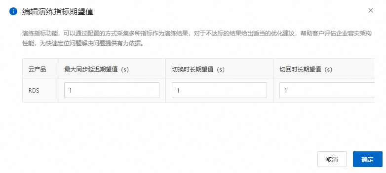

<a id="section-6-1-1-6"></a>

#### 6.1.1.6. 启动保护组

本文介绍启动保护组功能的前提条件、功能说明和操作步骤。

**前提条件**

当前保护组状态为**停止**状态时，可进行**启动保护组**操作。

**功能说明**

- 启动保护组默认自动填充同步实体信息，默认置灰，置灰不可修改。

- 同步配置只允许修改同步策略，其余配置项均不可修改。

> **重要**
>
> 当同步策略发生变化时，由增量同步变更为全量同步时，灾备实例端不允许有数据存在，若有数据，需手动清理灾备实例数据，否则校验不通过。

- 当保护组存在多个同步实体，启动操作覆盖所有同步实体。

- 同步实体启动成功之后，状态到**保护启动中**，创建同步链路，后台进行数据同步。状态正常流转到**保护中**/**保护失败。**

**操作步骤**

1. 登录ASR-DR控制台。

2. 在左侧导航栏，选择**业务容灾**>**保护组**。

3. 选择**停止**状态的保护组，单击目标保护组右侧的  图标，单击**启动保护组**。

4. 在**选择保护实例**页面，直接单击**下一步。**

5. 在<strong>选择实例优先级及资源映射页面，</strong>单击操作列的  图标，选择**配置**，添加同步配置信息。

6. 在配置页面完成配置后单击**下一步**。

> **说明**
>
> - 同步配置只允许修改同步策略，其余配置项均不可修改。
>
> - 云数据库RDS、云原生分布式数据库PolarDB-X、云原生数据仓库AnalyticDB MySQL版启动时，当同步策略为增量同步时，可允许修改同步位点，对象存储OSS允许修改数据同步对象和数据同步策略。

7. 单击**确认**，启动保护组。

<a id="section-6-1-1-7"></a>

#### 6.1.1.7. 停止保护

本文介绍保护组停止保护功能的操作场景说明和操作步骤。

**操作场景**

如果您想要暂时中止某个保护组/保护实体的同步，可以使用停止保护功能。

> **说明**
>
> - 保护组停止后，保护组同步实体仍旧存在，但其主备的同步链路会中断。
>
> - 当保护组存在多个同步实体，停止操作覆盖所有同步实体。
>
> - 停止状态的保护组只允许进行**启动保护组**操作，也可查询同步实体详情信息，详细信息只可进行查询**详情**、**日志**操作。
>
> - 停止状态的保护组可以创建计划，但不可以启动计划。

**前提条件**

- 保护组状态为保护失败或保护中。

- 保护组没有演练计划或故障计划在执行。

**操作步骤**

1. 登录ASR-DR控制台。

2. 在左侧导航栏，选择**业务容灾**>**保护组**。

3. 在保护组列表中，单击目标保护组右侧的  图标，单击**停止保护**。

4. 单击保护组名称或单击保护组操作列的  图标，单击**详情**，确认同步实体状态均为**停止**状态。

<a id="section-6-1-1-8"></a>

#### 6.1.1.8. 查看MaxCompute同步日志

MaxCompute日志比实体日志包含更多信息，可以帮助您定位和分析保护失败的原因。

1. 登录ASR-DR控制台。

2. 在左侧导航栏选择**业务容灾>保护组**。

3. 单击保护组右侧的  图标，选择**详情**。

4. 在**保护组详情**页面，单击实例列表中目标实例右侧的  图标，选择**ODPS日志**，可以查看生产站点、灾

   备站点对应实例的ABM日志。

<a id="section-6-1-1-9"></a>

#### 6.1.1.9. 手动同步数据

生产站点的MaxCompute和DataWorks的数据默认是定时同步至灾备站点。当您急需在灾备站点计算结果时，可以通过手动同步数据，使增量数据立即同步至灾备站点。

1. 登录ASR-DR控制台。

2. 在左侧导航栏选择**业务容灾**>**保护组**。

3. 单击保护组右侧的  图标，选择**详情**。

4. 在**保护组详情**页面，单击实例列表中目标实例右侧的  图标，选择**立即增量同步**。

   触发MaxCompute和DataWorks的数据立即增量同步。

<a id="section-6-1-2"></a>

### 6.1.2. 切换保护组

已经创建好的保护组，支持切换保护组。

**前提条件**

已创建好保护组，请参见新建保护组。

**操作步骤**

1. 登录异地容灾管理平台ASR-DR。

2. 在左侧导航栏中选择**业务容灾 > 保护组**。

3. 在**保护组**页面，输入保护组名称，选择同步方向和保护组状态，单击**查询**。

4. 展示符合条件的保护组后，单击**操作**列  ，单击**启动切换**。

5. 在弹出的提示框上选择具体执行的内容：

   - **预检查**：可以在不真实启动计划的前提下，对当前计划执行预检查，以便提高真实容灾演练的成功率。

   - **全链路**：直接执行切换保护组操作。

6. 单击**确定**。

<a id="section-6-1-3"></a>

### 6.1.3. 切回保护组

已执行切换操作并且切换成功的保护组，支持切回。

**前提条件**

已创建好保护组，请参见新建保护组。

**操作步骤**

1. 登录异地容灾管理平台ASR-DR。

2. 在左侧导航栏中选择**业务容灾 > 保护组**。

3. 在**保护组**页面，输入保护组名称，选择同步方向和保护组状态，单击**查询**。

4. 展示符合条件的保护组后，单击**操作**列  ，单击**启动切回**。

5. 在弹出的提示框上选择具体执行的内容：

   - 预检查：可以在不真实启动计划的前提下，对当前计划执行预检查，以便提高真实容灾演练的成功率。

   - 全链路：直接执行切换保护组操作。

6. 单击**确定**。

<a id="section-6-2"></a>

## 6.2. 管理计划

计划是将保护组中的资源切换或检查操作设置为一系列具有操作顺序的任务。您可以创建独立的保护组切换计划、保护组回切计划、故障切换计划和故障回切计划，也可以创建流程化的演练计划，演练完成后一键下载演练报告。

<a id="section-6-2-1"></a>

### 6.2.1. 概述

计划按生产云是否有故障分为演练计划和故障计划。

**背景信息**

- 演练计划为在生产云和灾备云都正常的情况下对保护组执行的操作。

- 故障计划为生产云或灾备云发生故障时进行的操作。根据故障级别的不同，提供两种故障切换模式，可以在**最小RTO**和**尝试最小RPO**中选择更合适的切换模式，也可以通过修改计划，更改切换模式。

  - 尝试最小RPO：无论是全局性站点级故障、或应用级故障，该模式都会对生产站点做容灾动作，尽可能保障生产站点数据同步完到灾备站点，但全局性站点级故障导致生产站点完全不可用时，调用生产站点管理接口失败，该模式降级，跳过对生产站点做容灾动作。

  - 最小RTO：无论是全局性站点级故障、或应用级故障，该模式为使灾备站点业务快速恢复，不会对生产站点做容灾动作；该模式下不会等待生产站点数据同步完到灾备站点，从而很大可能导致主备数据不一致。

计划按方向分为切换和回切。

**背景信息**

- 切换是使保护组中的资源在生产云停止对外服务，切换到灾备云提供对外服务。

- 回切为切换的逆过程，指的是使保护组中的资源在灾备云停止对外服务，切换到生产云提供对外服务。

- 只有正向保护组能进行切换操作，切换后正向保护组变为反向保护组。

- 只有反向保护组能进行回切操作，回切后反向保护组变为正向保护组。

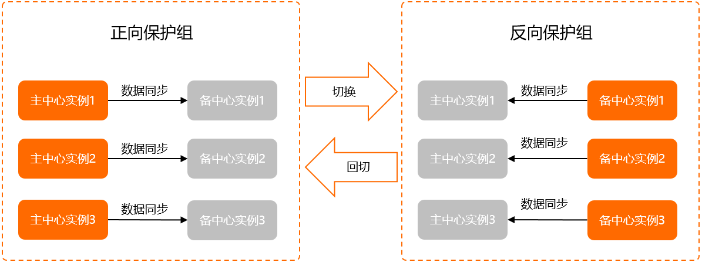

<a id="section-6-2-2"></a>

### 6.2.2. 管理业务容灾计划

介绍如何新建业务容灾计划（演练计划/故障计划），如何查询业务容灾计划以及如何查看容灾计划的执行历史。

<a id="section-6-2-2-1"></a>

#### 6.2.2.1. 创建业务容灾计划

介绍如何创建业务容灾计划，包括演练计划和故障计划；同时可以配置演练或灾难恢复切换/回切时的执行步骤与执行策略。

**前提条件**

已创建保护组，请参见新建保护组。

**操作步骤**

1. 登录异地容灾管理平台ASR-DR。

2. 在左侧导航栏中选择**业务容灾 > 业务容灾计划**。

3. 单击**新建容灾计划**。

4. 在**填写基本信息**阶段，参考下表填写参数值，填写完单击**下一步**。

   **区域**

   **参数名称**

   **描述**

   下拉选择该计划执行的所属组织，与环境上方组织一致。

   - 如果在环境中已选定具体的组织且该组织没有子组织时，该参数值将自动填充。

   **组织**

   - 如果在环境中选择的是根组织（root）或其他组织但有子组织时，需要下拉选择具体的组织。

   下拉选择实例所属的资源集，与环境上方资源集一致。

   **灾备地域信息**

   - 如果在环境中已选定具体的资源集，该参数值将自动填充。

   **资源集**

   - 如果在环境中选择的是本组织全部资源及，需要下拉选择具体的资源集。

   实例所在的灾备站点的地域，系统自动填充。

   **地域**

   选择待执行容灾的生产云实例，系统自动填充。

   **生产云实例**

   **生产地域信息**

   下拉选择实例所在的生产站点的地域。

   **生产地域**

   **由用户自定义，由中文、英文、数字、"_"、"-"、"."组成，必须**

   **计划名称**

   **以大小写字母，数字或中文开头，2~20个字符。**

   自定义勾选该计划的用途和目的：

   - **演练计划**：该计划只能用来做演练，不能做生产地域真实故障

   **容灾计划信**

   时的灾难恢复。

   **息**

   **计划类型**

   - **故障计划**：该计划既可以用来做演练，也可以做生产地域真实故障时的灾难恢复。

   请详细描述该计划的情况。

   **计划描述**

5. 在**选择保护组**阶段，执行以下操作。

   <ol type="i">

   <li>

   在可选择保护组区域勾选需要容灾的保护组。

   </li>

   <li>

   单击  ，将上一步勾选的保护组添加到已选择的保护组区域。

   </li>

   <li>

   确认将所有需要执行的保护组添加成功后，选择**快速排序方式**。

   - 顺序执行：在执行容灾操作时，保护组一个个按照顺序切换。

   - 并发执行：在执行容灾操作时，保护组同时切换。

   </li>

   <li>

   单击**下一步**。

   </li>

   </ol>

6. 在**制定计划**阶段，分为切换阶段和切回阶段两个计划，系统会根据上一步选择的保护组预置一个计划，请确认或修改。然后单击**下一步**。

   - 切换计划和切回计划支持的操作类似，请参考下表操作：

     <table>
       <tr>
         <th width="160">任务名称</th>
         <th>操作步骤</th>
       </tr>
       <tr>
         <td>修改切换/切回计划</td>
         <td>a. 单击，确认切换成功后和切换失败后的操作是否符合要求。<br>• 符合，单击<strong>确认</strong>。<br>• 不符合，请执行下一步。<br>b. 重新选择切换成功后和切换失败后的操作。<br>• 立即：表示切换成功后会立即执行下一步的操作。<br>• 等待固定时间：表示等待设置的时间后再执行下一步的操作或终止计划。<br>• 等待人工操作：表示切换成功后或切换失败后需要手工操作后续的步骤。<br>c. 单击<strong>确认</strong>。</td>
       </tr>
       <tr>
         <td>删除切换/切回计划</td>
         <td>a. 单击。<br>b. 在弹出的提示框上单击<strong>确定</strong>。</td>
       </tr>
       <tr>
         <td>增加人工检查点</td>
         <td>a. 在<strong>选择步骤节点</strong>区域，单击<strong>人工检查点</strong>。<br>b. 单击<strong>+ 添加步骤</strong>。<br>c. 输入检查项，然后选择开始后的操作。<br>d. 单击<strong>确认</strong>。<br>说明人工检查点只有在故障切换时生效，需要人工确认站点故障是否恢复。</td>
       </tr>
     </table>

7. 在**确认信息**阶段，确认设置的所有内容是否有误。

   - 如果有问题，可单击**上一步**修改。

   - 如果没有问题，请单击**提交**。

<a id="section-6-2-2-2"></a>

#### 6.2.2.2. 查询业务容灾计划

目前支持以生产地域、计划类型、容灾计划名称、容灾计划ID的维度查询容灾计划。

**操作步骤**

1. 登录异地容灾管理平台ASR-DR。

2. 在左侧导航栏中选择**业务容灾 > 业务容灾计划**。

3. 下拉选择以哪个维度查询，支持选择**计划类型**、**容灾计划名称**或**容灾计划ID**。

4. 根据选择的维度不同，查询条件也不同，具体请查看下表。

   | 查询维度 | 查询条件 |
   | --- | --- |
   | 计划类型 | 下拉选择<strong>演练计划</strong>或<strong>故障计划</strong>。 |
   | 容灾计划名称 | 输入具体的容灾计划名称后单击。 |
   | 容灾计划ID | 输入具体的容灾计划ID后单击。 |

   > **说明**
   >
   > 也支持高级筛选，将几种查询维度组合起来一起查询。
   >
   > <ol type="i">
   >
   > <li>
   >
   > 单击**高级筛选**。
   >
   > </li>
   >
   > <li>
   >
   > 下拉选择计划类型，输入容灾计划名称和容灾计划ID。
   >
   > </li>
   >
   > <li>
   >
   > 单击**搜索**。
   >
   > </li>
   >
   > </ol>

<a id="section-6-2-2-3"></a>

#### 6.2.2.3. 执行业务容灾演练

演练计划支持界面化查看演练过程，演练结果支持生成演练报告，并一键下载报告。

**前提条件**

已创建业务容灾演练计划，具体操作请参见创建业务容灾计划。

**操作步骤**

1. 登录异地容灾管理平台ASR-DR。

2. 在左侧导航栏选择**业务容灾** > **业务容灾计划**。

3. 在演练计划列表中，单击目标计划**操作**列的**开始演练**。

4. 在弹出的提示框上单击**确定**。

5. 进入**演练计划详情**页面，根据创建的演练计划逐个执行演练任务。

   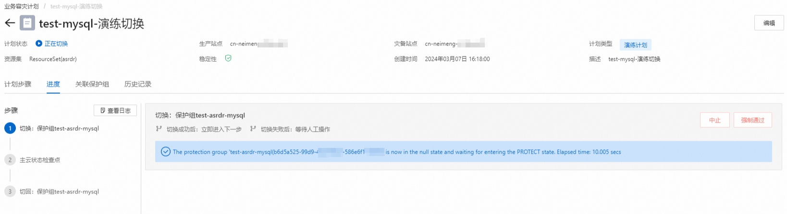

   > **说明**
   >
   > - 演练过程中，单击**中止**，并填写中止原因，将会中止整个演练任务。已中止的任务无法恢复执行，如果还需要执行当前演练任务，需要重新创建演练任务。
   >
   > - 演练过程中，单击**强制通过**，将会跳过当前步骤。

6. 演练完成后，在**历史记录**页签查看演练结果。

   演练概览中展示：

   - 演练成功率：包含**演练成功次数**和**演练总次数**，以及演练成功率百分比。

   - 保护组切换成功率：包含**保护组切换成功数**和**保护组总数**，以及保护组切换成功率百分比。

   - 保护组切回成功率：包含**保护组切回成功数**和**保护组总数**，以及保护组切回成功率百分比。

   - 同步延迟满足率：包含**满足实例数**和**总实例数**，以及同步延迟满足率百分比。

   - 切换时长满足率：包含**满足实例数**和**总实例数**，以及切换时长满足率百分比。

   - 切回时长满足率：包含**满足实例数**和**总实例数**，以及切回时长满足率百分比。

7. 在演练记录**操作**列单击**查看演练总结**。

   > **说明**
   >
   > 已创建报告的演练记录**操作**列，会显示**下载报告**操作。

   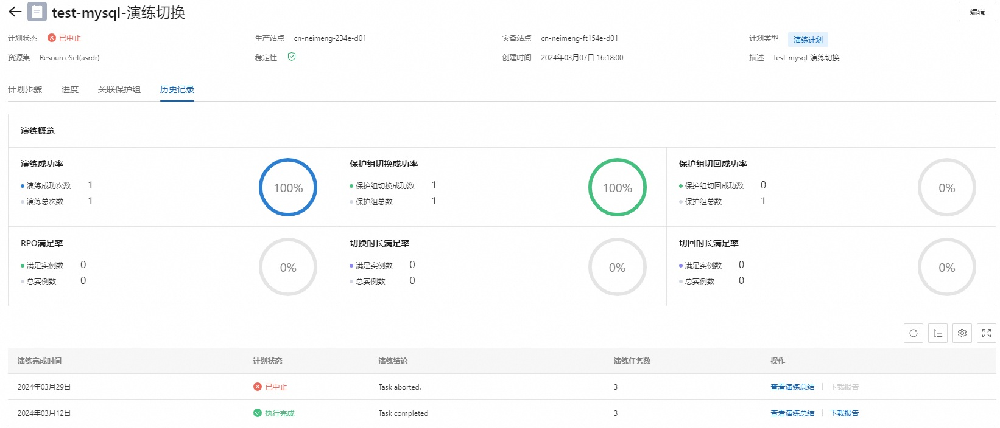

8. 进入**演练总结**页面，根据演练结果，在**演练结论**区域单击**编辑**，填写演练结论。

   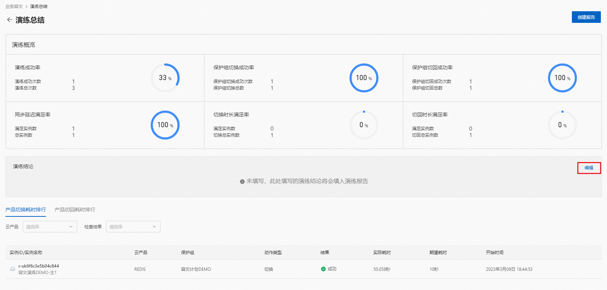

9. 在页面右上角单击**创建报告**，系统自动生成演练报告。单击**下载报告**，导出Word版演练报告。

<a id="section-6-2-2-4"></a>

#### 6.2.2.4. 查看计划执行历史

在计划执行历史页面，支持用户查看灾难演练记录和灾难恢复记录。

**操作步骤**

1. 登录异地容灾管理平台ASR-DR。

2. 在左侧导航栏中选择**业务容灾 > 业务容灾计划**。

3. 单击**计划执行历史**，会跳转至计划执行历史页，演练执行历史以时间倒序的方式展示。

4. 查看灾难演练记录。

   <ol type="i">

   <li>

   在**灾难演练记录**页签，选择以**计划状态**、**演练结论**或**容灾计划名称**维度查询。

   </li>

   <li>

   选择计划状态或演练结论或输入容灾计划名称，单击  。

   </li>

   <li>

   筛选出符合条件的灾难演练记录后，支持查看演练总结或下载报告。

   - 查看演练总结：单击**操作**列**查看演练总结**，进入演练总结页面。

   - 下载报告：当演练报告创建后，单击**操作**列**下载报告**，可将演练报告下载至本地查看。

   </li>

   </ol>

5. 查看灾难恢复记录。

   <ol type="i">

   <li>

   选择**灾难恢复记录**页签，选择以**计划状态**或**容灾计划名称**维度查询。

   </li>

   <li>

   选择计划状态或输入容灾计划名称，单击  。

   </li>

   <li>

   筛选出符合条件的灾难恢复记录。

   </li>

   </ol>

<a id="section-6-2-3"></a>

### 6.2.3. 管理容灾单元空间

针对双活场景，ASR-DR支持业务双活主备模式和业务双活数据读写分离模式。对于业务双活数据读写分离模式，目前只有数据库 RDS和对象存储 OSS两个云产品支持该功能。

**模式介绍**

- 主备模式：无论业务进程在生产站点还是灾备站点，读写操作始终选择同步实体的生产实例。

- 读写分离模式：对于写操作，无论业务进程在生产站点还是灾备站点，始终选择同步实体的生产实例；对于读操作，始终选择就近机房的节点。

<a id="section-6-2-3-1"></a>

#### 6.2.3.1. 创建容灾单元空间

通过将容灾单元空间绑定到保护组，使得切换时只切换该单元空间内的同步实体。一个容灾单元空间不能跨保护组绑定；一个同步实体不能被多个容灾单元空间使用。

**前提条件**

已经定制数据面SDK，具体操作请参见定制数据面SDK实现多Endpoint能力。

**使用场景**

- **双活主备：**

  业务双活，云产品主备。同一业务系统同时部署在两朵云，正常情况下，所有业务系统均使用云产品生产站点的接入点进行读写操作。当生产站点发生故障时，云产品切换到灾备站点，所有业务系统也将接入点切换到灾备站点接入点进行读写操作。

- **双活读写分离：**

  业务双活，云产品主备，灾备站点的云产品提供读服务。同一业务系统同时部署在两朵云，正常情况下，所有业务系统均使用云产品生产站点的接入点进行写操作，主备站点业务系统使用就近机房的云产品接入点进行读操作。当生产站点发生故障时，云产品切换到灾备站点，所有业务系统将接入点切换到灾备站点接入点进行读写操作。

**操作步骤**

1. 登录异地容灾管理平台ASR-DR。

2. 在左侧导航栏中选择**业务容灾 > 容灾单元空间**。

3. 单击**创建容灾单元空间**，参考下表填写参数值。

   | 参数名称 | 描述 |
   | --- | --- |
   | 组织 | 选择该容灾单元空间所属的组织。 |
   | 资源集 | 选择该容灾单元空间所属的资源集。 |
   | 容灾空间单元名称 | 用户自定义，长度限制为 3 ~ 64 个字符，以字母开头，支持数字和"_"、"-"特殊字符。 |
   | 用途 | 描述该容灾单元空间的用途。 |
   | 备注 | 输入该容灾单元空间的其他信息。 |

4. 绑定保护组。

   - 单击**仅创建。**

     <ol type="a">

     <li>

     创建成功后会跳转到容灾单元空间页面，可以看到刚创建的容灾单元空间。单击**操作**列的**绑定保护组**。

     </li>

     <li>

     勾选对应的保护组，单击**确定**。

     </li>

     </ol>

   - 单击**创建，去绑定保护组**。

     <ol type="a">

     <li>

     勾选对应的保护组，单击**确定**。

     </li>

     </ol>

**相关操作**

容灾单元空间创建成功后，您还可以执行以下操作。

| 任务名称 | 操作步骤 |
| --- | --- |
| 查询容灾单元空间 | • 基础筛选：<br>i. 下拉选择<strong>保护组</strong>或<strong>容灾单元空间</strong>，输入保护组名称或容灾单元空间名称。<br>ii. 单击，筛选出符合条件的内容。<br>• 高级筛选：<br>• 单击<strong>高级筛选</strong>。<br>• 输入容灾单元空间名称和保护组名称。<br>• 单击<strong>搜索</strong>。 |
| 刷新容灾单元空间列表 | 单击页面右上角刷新列表。 |
| 调整容灾单元空间列表显示样式 | 单击页面右上角，选择以<strong>默认</strong>形式或<strong>紧凑</strong>形式显示容灾单元空间列表。 |
| 自定义容灾单元空间列表的列字段 | 单击页面右上角，勾选需要显示的列字段。 |
| 全屏显示容灾单元空间页面 | 单击页面右上角，全屏显示容灾单元空间页面。 |

<a id="section-6-2-3-2"></a>

#### 6.2.3.2. 切换容灾单元空间

本章节介绍如何通过切换容灾单元空间，将绑定的保护组中的保护实体一起切换。

**前提条件**

已为容灾单元空间绑定保护组，具体请参加创建容灾单元空间。

**操作步骤**

1. 登录异地容灾管理平台ASR-DR。

2. 在左侧导航栏中选择**业务容灾 > 容灾单元空间**。

3. 在**容灾单元空间**页面，单击相应**操作**列的**切换**。

   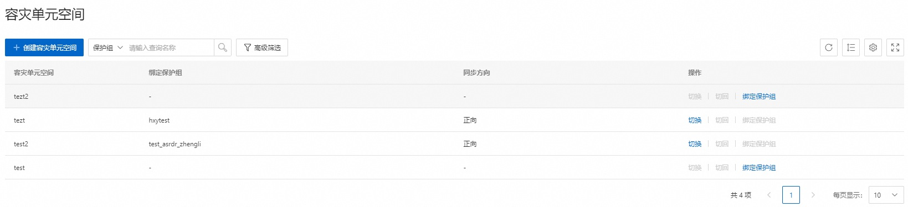

4. 在弹出的提示框上单击**确定**。

<a id="section-6-2-3-3"></a>

#### 6.2.3.3. 切回容灾单元空间

主机房业务功能恢复后，需要将之前切换到备机房的容灾单元空间中的保护实体切回至主机房。

**前提条件**

相应的容灾单元空间切换成功，请参见切换容灾单元空间。

**操作步骤**

1. 登录异地容灾管理平台ASR-DR。

2. 在左侧导航栏中选择**业务容灾 > 容灾单元空间**。

3. 在**容灾单元空间**页面，单击相应**操作**列的**切回**。

4. 在弹出的提示框上单击**确定**。

<a id="section-7"></a>

# 7.告警管理

<a id="section-7-1"></a>

## 7.1. 配置告警规则

ASR-DR控制台发出报警需要遵循一定的规则，您可以根据实际需求创建一个或多个告警规则。

**操作步骤**

1. 登录ASR-DR控制台。

2. 在左侧导航栏选择**告警管理** > **告警规则**。

3. 单击**新建**。

4. 在**新建告警规则**页面，配置相关参数。单击**确定**。

   <table>
     <tr>
       <th width="89">名称</th>
       <th>描述</th>
     </tr>
     <tr>
       <td>规则名称</td>
       <td>自定义告警规则的名称。名称的长度为4-20个字符或2-10个汉字。</td>
     </tr>
     <tr>
       <td>规则描述</td>
       <td>非必填，请输入对告警规则的简单描述。</td>
     </tr>
     <tr>
       <td>组织</td>
       <td>选择容灾实例所在的组织。<br>说明如果您是组织管理员或组织容灾管理员登录，下拉列表中只呈现您管理的组织。</td>
     </tr>
     <tr>
       <td>监控项</td>
       <td>i. 在第一个下拉列表中选择具体的监控指标，支持如下监控项：<br>• 保护组状态<br>• 计划最新状态<br>• 计划RTO<br>• 保护组同步延迟ii. 在第二个下拉列表中选择触发条件。iii. 在第三个下拉列表中选择或输入对应的触发值。</td>
     </tr>
     <tr>
       <td>告警级别</td>
       <td>用户可按严重程度自定义告警级别，分为<strong>警报</strong>、<strong>紧急</strong>、<strong>警告</strong>、<strong>消息</strong>和<strong>错误</strong>。</td>
     </tr>
     <tr>
       <td>告警对象</td>
       <td>在下拉列表中选择接收告警的用户。下拉列表中显示Apsara Uni-manager运营控制台上对应组织的用户。<br>说明如果下拉列表为空，请在Apsara Uni-manager控制台上创建对应组织的用户。</td>
     </tr>
     <tr>
       <td>告警方式</td>
       <td>ASR-DR支持如下告警通知方式：<br>• 邮箱地址：符合该告警规则的告警，ASR-DR会通过邮箱通知告警对象。<br>• 钉钉Token：符合该告警规则的告警，ASR-DR会通过钉钉通知告警对象。<br>• ASO大屏：符合该告警规则的告警，ASR-DR会推送到Apsara Uni-manager运维控制台的监控告警中。</td>
     </tr>
   </table>

5. （可选）告警规则创建成功后，在**告警规则**列表页面，您可以单击某条告警规则右侧的  图标，执行如

   下操作：

   - 选择**停止**，停止使用该告警规则。

   - 选择**修改**，修改该告警规则信息。

   - 选择**删除**，删除该告警规则。

   - 选择**详情**，查看告警规则的基本信息和操作信息。

6. （可选）在**告警规则列表**页面，单击**重置**，ASR-DR会清除查询条件并刷新告警规则列表。

<a id="section-7-2"></a>

## 7.2. 查看并导出告警信息

通过查看告警信息，您可以及时获取异常信息。

**操作步骤**

1. 登录ASR-DR控制台。

2. 在左侧导航栏选择**告警管理**>**告警记录**。

3. 您可以直接查看告警信息或通过设置筛选项查看。

   - 在页面上方配置查询条件，可以自定义查询告警范围。

   - 单击告警ID可以查看单条告警的详细信息。

<a id="section-7-3"></a>

## 7.3. 同步延迟预警配置

您可以设置各产品的同步延迟预警阈值，ASR-DR会根据该阈值计算各产品的同步延迟时间并显示在首页和容灾大屏页面。

1. 登录ASR-DR控制台。

2. 在左侧导航栏，选择**告警管理**>**同步延迟预警配置**。

3. 填写各产品的同步延迟预警阈值（单位秒），单击**确认**。

> **说明**
>
> 该功能只在跨云容灾场景中支持，跨Region容灾场景中不支持该功能。

<a id="section-8"></a>

# 8.系统管理

<a id="section-8-1"></a>

## 8.1. 日志管理

操作日志记录了系统中所有的操作，包括保护组、计划和实例的创建、删除和执行情况等。

**操作步骤**

1. 登录ASR-DR控制台。

2. 在左侧导航栏选择**系统管理**>**日志管理**。

   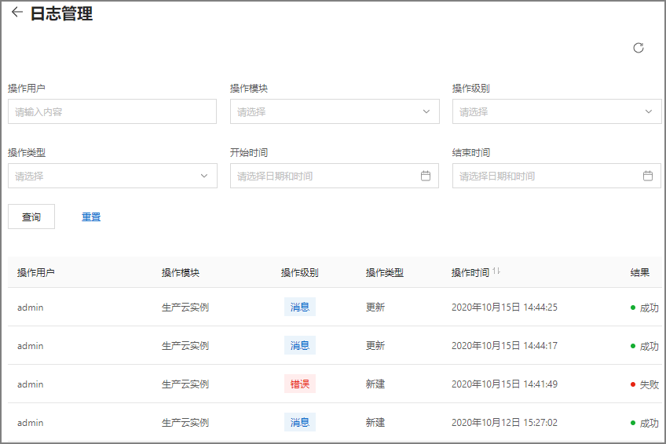

   | 名称 | 描述 |
   | --- | --- |
   | 操作模块 | ASR-DR系统的模块，包括计划、实例、告警、保护组、系统管理等。 |
   | 操作级别 | 日志的级别，分为紧急、警报、错误、警告和消息。 |
   | 操作类型 | 日志记录的操作类型。 |

3. （可选）

   您可以根据操作用户、操作模块、操作级别、操作类型、开始时间或结束时间筛选特定的操作日志。

4. （可选）

   单击**重置**，ASR-DR会清除搜索条件并重新刷新日志列表信息。

<a id="section-8-2"></a>

## 8.2. 管理云实例

用户需要先创建云实例才能配置保护组和容灾计划。云实例是以一级组织为单位进行管理的，一级组织以及其子组织内任意有权限的用户都可以为本组织配置云实例，配置的云实例本组织内可见。

**操作须知**

- 如果只需要在本云的不同Region间做容灾，则只需要配置灾备云实例。

- 用户配置的云实例是一级组织及其子组织内共享的，不同一级组织的用户需要分别配置各自的云实例。

**前提条件**

- 已获取到ASCM组织账号的AccessKey ID和AccessKey Secret，获取方法请参见获取AccessKey。

- 已获取到个人账号的AccessKey ID和AccessKey Secret，获取方法请参见获取AccessKey。

- 已参考《*异地容灾管理平台ASR-DR运维指南*》中的”管理云产品信息“章节，成功配置云产品信息。

**操作步骤**

1. 登录异地容灾管理平台ASR-DR。

2. 在左侧导航栏中选择**系统管理 > 云实例管理**。

3. 单击**添加云实例**，勾选需要添加的云实例，单击**下一步**。

4. 下拉选择资源集，输入主账号AK和SK，单击**提交**。

   > **说明**
   >
   > 主账号AK和SK请输入ASCM组织账号的AccessKey ID和AccessKey Secret。主账号AKSK只要由云实例创建人配置一次即可。

5. 提交后，会提示云实例的用户AccessKey未配置，请输入提前获取的个人账号AK和SK。

   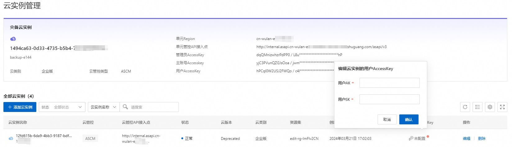

   > **说明**
   >
   > **用户AK**和**用户SK**请输入个人账号的AccessKey ID和AccessKey Secret。

6. 单击**确认**，用户AccessKey列会显示已配置。

   > **说明**
   >
   > **用户AK**和**用户SK**是每个用户都要配置的，不配置无法使用该云实例。

**相关操作**

云实例添加成功后，您还可以执行以下操作。

| 任务名称 | 操作步骤 |
| --- | --- |
| 查询云实例 | 1. 下拉选择云实例状态。<br>2. 选择以云实例名称或云实例ID，输入云实例名称或云实例ID。<br>3. 单击。 |
| 编辑云实例 | 1. 单击<strong>操作</strong>列<strong>编辑</strong>。<br>2. 修改主账号AK和主账号SK，单击<strong>提交</strong>。 |
| 删除云实例 | 1. 单击<strong>操作</strong>列<strong>删除</strong>。<br>2. 在弹出的提示框上单击<strong>删除</strong>。 |
| 刷新云实例列表 | 单击页面右上角刷新列表。 |
| 调整云实例列表显示样式 | 单击页面右上角，选择以<strong>默认</strong>形式或<strong>紧凑</strong>形式显示云实例列表。 |
| 自定义云实例列表的列字段 | 单击页面右上角，勾选需要显示的列字段。 |
| 全屏显示云实例列表页面 | 单击页面右上角，全屏显示云实例页面。 |

<a id="section-9"></a>

# 9.附录

<a id="section-9-1"></a>

## 9.1. 创建RAM角色

您需要分别在生产云和灾备云的Apsara Uni-manager运营控制台上，给待保护实例所在组织创建数据传输（DTS）和异地容灾管理平台（ASR-DR）的RAM服务角色。

**操作步骤**

1. 登录生产云的Apsara Uni-manager运营控制台。

2. 在顶部菜单栏，单击**配置**，在**配置**页面左侧导航栏，单击**RAM服务角色**。

3. 为待保护的RDS对应的组织，创建**数据传输 DTS**服务角色。

   <ol type="i">

   <li>

   单击**创建RAM服务角色**。

   </li>

   <li>

   在**RAM服务角色创建**页面，在**服务名称**下拉列表中选择**数据传输 DTS**，在**授权组织名称**下拉列表中选择待保护RDS对应的组织。

   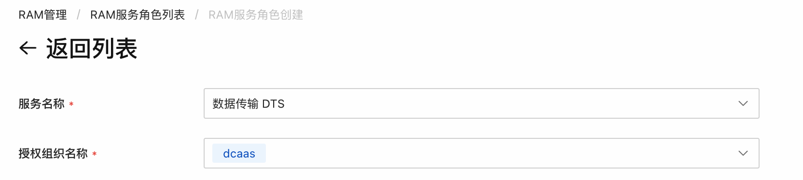

   </li>

   <li>

   单击**确定**。

   </li>

   </ol>

4. 分别为待保护的PolarDB-X和PolarDB对应的组织创建**数据传输 DTS**服务角色，操作步骤请参见步骤3。

5. 分别为待保护实例对应的各个组织创建**异地容灾管理平台 ASR-DR**服务角色，操作步骤请参见步骤3。

   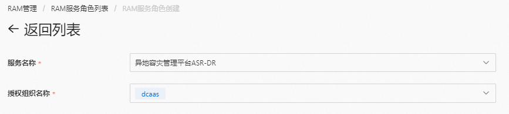

6. 登录灾备云的Apsara Uni-manager运营控制台，重复以上步骤，创建灾备云的RAM服务角色。

<a id="section-9-2"></a>

## 9.2. 获取AccessKey

运营管理员或组织管理员需要分别获取生产、灾备中心对应的个人账号AccessKey或组织AccessKey，并在ASR-DR上配置对应的AccessKey后，才能正常使用ASR-DR。

**前提条件**

只有运营管理员和一级组织管理员可以获取组织AccessKey。

**获取个人账号AccessKey**

获取个人账号AccessKey的方法如下：

1. 登录Apsara Uni-manager运营控制台。

2. 在系统界面右上角，将鼠标悬停在当前登录用户的头像上，单击**个人信息**。

3. 在**阿里云AccessKey**区域，您可以查看个人账户的AccessKey信息。

   

   > **说明**
   >
   > Accesskey ID和AccessKey Secret是您访问云资源时的密钥，具有该账号完整的权限，请您妥善保管。

**获取组织AccessKey**

获取组织AccessKey的方法如下：

1. 管理员登录Apsara Uni-manager运营控制台。

2. 在顶部菜单栏，单击**企业**。

3. 在左侧导航栏中，选择**资源管理 > 组织管理**。

4. 在组织结构中，单击目标一级组织名称。

5. 单击**管理Accesskey**。

6. 在弹出的对话框中，查看组织AccessKey信息。

**获取ASR-DR的AccessKey**

获取ASR-DR的AccessKey的方法如下：

1. 登录Apsara Uni-manager运维控制台。

2. 在顶部菜单栏选择**平台运维 > 飞天基础运维平台 > 资源管理**。

3. 在**飞天基础运维平台**左侧导航栏中，选择**资源管理 > 产品集群运维**。

4. 在搜索框输入“asrdr”，并单击**集群详情**。

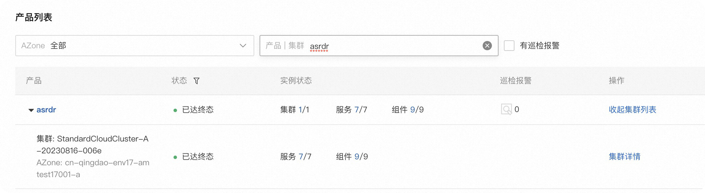

5. 在集群详情页选择**资源详情**页签，选择资源类型为**accesskey**的资源，在**资源申请结果**栏单击  图标即

   可查看asrdr的AK和SK。

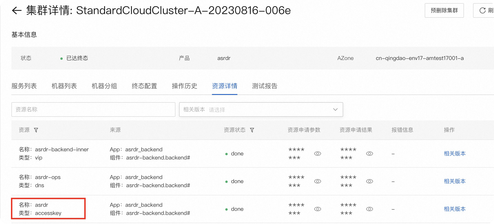

<a id="section-9-3"></a>

## 9.3. 获取生产云实例配置信息

管理员在配置生产云实例时需要填写生产云环境中各云产品的Endpoint地址等信息，本文介绍如何获取这些信息。

1. 登录生产云的飞天基础运维平台。

   在Apsara Uni-manager运维控制台的顶部菜单栏选择**产品运维** > **底座/云平台** > **飞天基础运维平台**。

2. 在飞天基础运维平台的左侧导航栏，选择**运维工具** > **基础数据管理** > **底座元数据管理** > **服务注册变量大盘**。

3. 在左上角下拉框中选择**服务**，在搜索框输入下表中**Service**列的值。在搜索结果中目标服务的**Service**

   **Registration**列单击  图标，再单击内容，会出现注册变量弹窗。在注册变量弹窗中，查看下表中Key

   列参数对应的值。各配置项对应的Service及Key如下表所示。

   | 产品 | 配置项 | Service | Key |
   | --- | --- | --- | --- |
   | Apsara Uni-manager运营控制台（ASCM） | ASCM地址 | oneService | ascm-portal.domain |
   | DTS | DTS地址 | dts-dts | dts.openapi.endpoint |
   | oneConsole | oneConsole地址 | oneService | console.domain |
   | VPC | VPC地址 | vpc-yaochi | vpc-inner.openapi.endpoint |
   | TIANJI | Tianji endpoint | tianji-endpoint | api_server.endpoint |
   | RSM | RSM地址 | rsm | rsm.api.domain |

   **OSS赤骥不加鉴权**

   **inner-api-endpoint**

   **地址**

   **OSS赤骥加鉴权地**

   **oss-chiji**

   **inner-secure-api-endpoint**

   **址**

   OSS

   **OSS赤骥Pop地址**

   **pop-api-endpoint**

   **OSS地址**

   **oss-server**

   **api-endpoint**

   **OTS地址**

   **ocm.pop_endpoint**

   **OCM内部地址**

   **ocm.endpoint**

   **TableStore地址**

   **ocm.pop_tablestore_endpoint**

   **replication地址**

   **repmanager.endpoint**

   **ocm admin**

   **TableStoreOC**

   **ocm.admin_accessid**

   Tablestore

   **accessKeyId**

   **M**

   **ocm admin accessKeySecr**

   **ocm.admin_accesskey**

   **et**

   **super**

   **ocm.super_ots_accessid**

   **accessKeyId**

   **super accessKeySecr**

   **ocm.super_ots_accesskey**

   **et**

   **dns-global-**

   **GTM地址**

   GTM

   **gtm.pop_domain**

   **traffic-manage**

   **RDS地址**

   RDS

   **rds-yaochi**

   **rds.openapi.endpoint**

   **PolarDB-X地址**

   PolarDB-X

   **drds-console**

   **prectrl.api**

   **RAM地址**

   **ram-openapi.endpoint**

   RAM

   **ram-ramService**

   **STS地址**

   **sts-openapi.endpoint**

   **RAM Slave地址**

   r**am-slave.endpoint**

   **MQ AK**

   **onsInnerApiAccessKey**

   **MQ SK**

   **mq-console**

   **onsInnerApiSecretKey**

   MQ

   **MQ地址**

   **console.domain**

   **MQ Router**

   **mq-router**

   **router.onsAddr**

   **OnsAddr地址**

   **DNS CONTROL**

   **dns_control.pop_domain**

   **地址**

   **DNS地址**

   **dns_universal_control.pop_domain**

   DNS

   **dnsService**

   **DNS AK**

   **genesisdns.global_access_key**

   **DNS SK**

   **genesisdns.global_access_secret**

   **BCC API地址**

   **bcc_endpoint**

   **BCC App**

   **super_app_name**

   **apsara-**

   **BCC Key**

   **super_app_key**

   DataWorks

   **bigdata-manager**

   **BCC Password**

   **super_account_secret_key**

   **BCC User**

   **super_account_account**

   **HBASE地址**

   HBase

   **hbase-yaochi**

   **hbase.openapi.endpoint**

   **Lindorm地址**

   LINDORM

   **lindorm**

   **lindorm_pop_endpoint**

   **mongodb-**

   **MongoDB地址**

   MongoDB

   **mongodb.openapi.endpoint**

   **yaochi**

   <table>
     <tr>
       <td>Redis</td>
       <td>Redis地址</td>
       <td>kvstore-yaochi</td>
       <td>kvstore.openapi.endpoint</td>
     </tr>
     <tr>
       <td rowspan="2">Hologres</td>
       <td>Hologres管控地址</td>
       <td rowspan="2">hologres-init</td>
       <td>holo-manager.endpoint</td>
     </tr>
     <tr>
       <td>Hologres-pop地址</td>
       <td>pop_holo_remote_recover_dns</td>
     </tr>
     <tr>
       <td>ECS</td>
       <td>HDR地址</td>
       <td>cds-bcdr</td>
       <td>hdr.openapi.endpoint</td>
     </tr>
   </table>

4. 在飞天基础运维平台的左侧导航栏，选择**产品集群运维**。

5. 进入**产品列表**页面，在查询框中输入 `baseServiceAll` ，在目标集群**操作**列单击**集群详情**。

6. 在**集群详情**页面，单击**终态配置**页签。

7. 选中**kv.conf**文件，单击**显示内容**。

   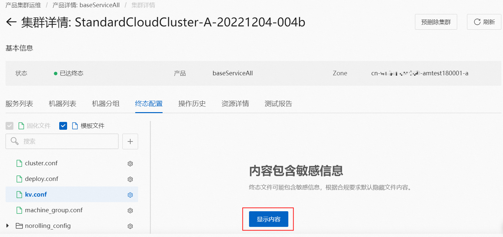

8. 获取**kv.conf**文件内容，通过Key查找并记录相应的值。

   各配置项对应的Key如下表所示。

   产品

   配置项

   Key

   **OSS-POP AK**

   **account.defaultUser.accesskey-id**

   OSS

   **OSS-POP SK**

   **account.defaultUser.accesskey-secret**

   **PolarDB-X RAM ID**

   **account.drds.id**

   **PolarDB-X RAM AK**

   **account.drds.accesskey-id**

   PolarDB-X

   **PolarDB-X RAM SK**

   **account.drds.accesskey-secret**

   **PolarDB-X Zone值**

   **biz_zone**

   **asrdr服务账号AK**

   **account.asr.accesskey-id**

   ASR-DR

   **asrdr服务账号SK**

   **account.asr.accesskey-secret**

   **Tianji ak**

   **account.defaultUser.accesskey-id**

   TIANJI

   **Tianji sk**

   **account.defaultUser.accesskey-secret**

   **LTS鉴权AK**

   **account.asr.accesskey-id**

   LINDORM

   **LTS鉴权SK**

   **account.asr.accesskey-secret**

   > **说明**
   >
   > 如果配置项的Key值是密文值，解密方法如下：
   >
   > <ol type="i">
   >
   > <li>
   >
   > 登录容器。
   >
   > </li>
   >
   > <li>
   >
   > 执行以下命令获取解密后的参数值。
   >
   > ```bash
   > curl --fail --unix-socket /var/run/proxyssl/pssl.sockrest 
   > 'http://host/api/v1/configs' -H 'Content-Type: application/octet-stream' -X POS
   > T -d {"<配置项key>":"<配置项value(密⽂)>"}
   > ```
   >
   > 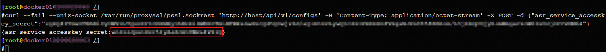
   >
   > </li>
   >
   > </ol>

<a id="section-9-4"></a>

## 9.4. 定制数据面SDK实现多Endpoint能力

目前仅云数据库RDS和对象存储OSS支持读写分离能力。

**前提条件**

已从官网获取到数据面SDK包。

**定制内容**

1. 应用引入多活SDK。

   ```xml
   <dependency>
    <groupId>com.aliyun.asrdr</groupId>
    <artifactId>asrdr-sdk-all</artifactId>
    <version>2.2.0.SNAPSHOT</version>
   </dependency>
   ```

2. 云产品配置变更示例。

   ```text
   # 改造前配置项
   rdsEndpoint=region-shanghai-rds-instance1.com
   # 改造后配置项
   rdsEndpoint=dr-master-a1://rds-instance1.com;dr-master-a2://rds-instance2.com
   ```

3. 应用代码改动，配置改造包含：

   - 从单endpoint变更到多endpoint。

   - 增加业务java进程启动参数-Ddreventcenter=asrdr-xxx.com -Ddrstrategy=2idc3center。

     ```text
     # 改造前业务启动参数
     java -server -Xms4096m -Xmx4096m -Xmn2048m -Xss512k -XX:MetaspaceSize=512m 
     -XX:MaxMetaspaceSize=1024m -XX:SurvivorRatio=8 -XX:+UseConcMarkSweepGC 
     -XX:+UseCMSCompactAtFullCollection -XX:+CMSClassUnloadingEnabled 
     -XX:+HeapDumpOnOutOfMemoryError -XX:HeapDumpPath=/home/admin/logs/java_pid.hprof 
     -jar /home/admin/asrdr/web-3.0.0.jar

     # 改造后业务启动参数
     java -server -Xms4096m -Xmx4096m -Xmn2048m -Xss512k -XX:MetaspaceSize=512m 
     -XX:MaxMetaspaceSize=1024m -XX:SurvivorRatio=8 -XX:+UseConcMarkSweepGC 
     -XX:+UseCMSCompactAtFullCollection -XX:+CMSClassUnloadingEnabled 
     -XX:+HeapDumpOnOutOfMemoryError -XX:HeapDumpPath=/home/admin/logs/java_pid.hprof 
     -jar /home/admin/asrdr/web-3.0.0.jar 
     -Ddreventcenter=asrdr-xxx.com -Ddrstrategy=2idc3center
     ```
