阿里云  
专有云  
灾备管理中心  
运维指南（异地容灾）  
产品版本：V3.18.3  
文档版本：20250121

**目录**

- [1.概述](#section-1)
    - [1.1. 目的](#section-1-1)
    - [1.2. 要求](#section-1-2)
    - [1.3. 注意事项](#section-1-3)
- [2.产品架构](#section-2)
    - [2.1. 组件架构](#section-2-1)
    - [2.2. 服务角色列表](#section-2-2)
- [3.异地容灾运维平台](#section-3)
    - [3.1. 登录异地容灾运维平台](#section-3-1)
    - [3.2. 首页概览](#section-3-2)
    - [3.3. 容灾监控](#section-3-3)
        - [3.3.1. 云平台侧集群状态检查](#section-3-3-1)
        - [3.3.2. 云间网络访问检查](#section-3-3-2)
        - [3.3.3. 同步实体状态](#section-3-3-3)
    - [3.4. 平台基础能力运维](#section-3-4)
        - [3.4.1. 管理云产品信息](#section-3-4-1)
        - [3.4.2. 配置大屏地图](#section-3-4-2)
    - [3.5. 容灾运维](#section-3-5)
        - [3.5.1. 管理同步实体](#section-3-5-1)
            - [3.5.1.1. 单步骤跳过](#section-3-5-1-1)
            - [3.5.1.2. 单步骤重做](#section-3-5-1-2)
            - [3.5.1.3. 配置限流](#section-3-5-1-3)
            - [3.5.1.4. 删除保护组中的保护实体](#section-3-5-1-4)
            - [3.5.1.5. 查看同步实体日志](#section-3-5-1-5)
        - [3.5.2. 执行站点容灾演练](#section-3-5-2)
        - [3.5.3. 执行站点灾难恢复](#section-3-5-3)
        - [3.5.4. 查看站点容灾计划执行历史](#section-3-5-4)
    - [3.6. 管理自身容灾](#section-3-6)
        - [3.6.1. 创建自身容灾](#section-3-6-1)
        - [3.6.2. 执行故障切换](#section-3-6-2)
        - [3.6.3. 执行演练切换](#section-3-6-3)
        - [3.6.4. 查看自身容灾详情](#section-3-6-4)
        - [3.6.5. 解除绑定](#section-3-6-5)
        - [3.6.6. 删除自身容灾](#section-3-6-6)
- [4.运维常用操作](#section-4)
    - [4.1. 登录容器](#section-4-1)
    - [4.2. 登录ASR-DR元数据库](#section-4-2)
- [5.ASR-DR运维](#section-5)
    - [5.1. 日志管理](#section-5-1)
        - [5.1.1. 查看ASR-DR日志](#section-5-1-1)
        - [5.1.2. 修改日志的默认配置](#section-5-1-2)
    - [5.2. 修改ASR-DR的URL地址](#section-5-2)
    - [5.3. 停止ASR-DR节点](#section-5-3)
    - [5.4. 更换JAR包](#section-5-4)
    - [5.5. 配置管理](#section-5-5)
- [6.常见运维处理](#section-6)
    - [6.1. RDS](#section-6-1)
        - [6.1.1. RDS新增数据库和数据表](#section-6-1-1)
        - [6.1.2. 人工切换主备RDS实例](#section-6-1-2)
        - [6.1.3. 人工恢复同步链路](#section-6-1-3)
    - [6.2. DNS](#section-6-2)
        - [6.2.1. 实例日志提示rrSet inconsistent](#section-6-2-1)
        - [6.2.2. 实例日志提示not found record](#section-6-2-2)
        - [6.2.3. 实例日志提示not found zone](#section-6-2-3)
    - [6.3. 云原生数据仓库AnalyticDB MySQL版3.0](#section-6-3)
        - [6.3.1. 重保护失败](#section-6-3-1)
        - [6.3.2. 重新创建同步实体失败](#section-6-3-2)
        - [6.3.3. 创建增量同步实体前置检查](#section-6-3-3)
    - [6.4. PolarDB-X](#section-6-4)
        - [6.4.1. 备实例删除数据库后未生效](#section-6-4-1)
        - [6.4.2. 获取逻辑表的结构时提示表不存在](#section-6-4-2)
        - [6.4.3. 修改PolarDB-X中RDS数据库的最大个数](#section-6-4-3)
        - [6.4.4. 创建PolarDB-X同步链路失败](#section-6-4-4)
        - [6.4.5. 扩容PolarDB-X实例](#section-6-4-5)
    - [6.5. DTS](#section-6-5)
        - [6.5.1. 查看DTS日志](#section-6-5-1)
        - [6.5.2. 同步链路创建失败](#section-6-5-2)
            - [6.5.2.1. 日志提示The specified Instance SourceEndpoint.InstanceID Not Found](#section-6-5-2-1)
            - [6.5.2.2. 日志提示cluster info is null.The input domain and region is invalid](#section-6-5-2-2)
            - [6.5.2.3. 日志提示Specified access key is not found](#section-6-5-2-3)
            - [6.5.2.4. 日志提示InvalidAppId.NotFound](#section-6-5-2-4)
            - [6.5.2.5. 日志提示ram authorized](#section-6-5-2-5)
            - [6.5.2.6. 日志提示open_api_objects长度不足](#section-6-5-2-6)
        - [6.5.3. 预检查异常](#section-6-5-3)
            - [6.5.3.1. 提示拓扑结构不一致](#section-6-5-3-1)
            - [6.5.3.2. 提示CHECK_ERROR_SRC_USER_PSW](#section-6-5-3-2)
            - [6.5.3.3. 提示CHECK_ERROR_DEST_USER_PSW](#section-6-5-3-3)
        - [6.5.4. 增量数据服务异常](#section-6-5-4)
            - [6.5.4.1. 增量数据服务失败](#section-6-5-4-1)
        - [6.5.5. 同步数据异常](#section-6-5-5)
            - [6.5.5.1. 提示store delay xxx second(s)](#section-6-5-5-1)
            - [6.5.5.2. 提示reader连不上dstore](#section-6-5-5-2)
        - [6.5.6. 恢复网络后，DTS任务没有自动恢复](#section-6-5-6)
        - [6.5.7. 如何防止主备中断时间过长导致Binlog日志丢失](#section-6-5-7)
    - [6.6. OSS](#section-6-6)
        - [6.6.1. 手工恢复OSS的同步链路](#section-6-6-1)
        - [6.6.2. OSS保护失败的排查思路](#section-6-6-2)
    - [6.7. MaxCompute](#section-6-7)
        - [6.7.1. ASR-DR中配置MaxCompute项目返回空](#section-6-7-1)
    - [6.8. MQ](#section-6-8)
        - [6.8.1. 查看MQ实例主备端的消息详情](#section-6-8-1)
        - [6.8.2. 使用命令重置消费位点](#section-6-8-2)
- [7.校验容灾产品的数据一致性](#section-7)
    - [7.1. 全量校验并订正RDS和PolarDB-X的数据](#section-7-1)
    - [7.2. 校验PolarDB-X的增量数据](#section-7-2)
    - [7.3. 校验表格存储数据一致性](#section-7-3)
    - [7.4. 校验MaxCompute数据一致性](#section-7-4)
- [8.命令参考](#section-8)
    - [8.1. 如何使用CLISH命令](#section-8-1)
    - [8.2. 命令列表](#section-8-2)
    - [8.3. 同步实体](#section-8-3)
        - [8.3.1. skip-entity](#section-8-3-1)
        - [8.3.2. suspend-entity](#section-8-3-2)
        - [8.3.3. stepover-entity](#section-8-3-3)
        - [8.3.4. reprotect-entity](#section-8-3-4)
        - [8.3.5. redo-entity](#section-8-3-5)
        - [8.3.6. force-switch](#section-8-3-6)
    - [8.4. 云中心](#section-8-4)
        - [8.4.1. del-cloud-instance](#section-8-4-1)
        - [8.4.2. del-cloud-center](#section-8-4-2)
    - [8.5. 保护组](#section-8-5)
        - [8.5.1. create-empty-pg](#section-8-5-1)
        - [8.5.2. show-pg-sync-entity](#section-8-5-2)
        - [8.5.3. delete-pg-shell](#section-8-5-3)
        - [8.5.4. move-sync-entity](#section-8-5-4)
    - [8.6. 容灾计划](#section-8-6)
        - [8.6.1. plan-query](#section-8-6-1)
        - [8.6.2. plan-query-ex](#section-8-6-2)
        - [8.6.3. plan-force-delete](#section-8-6-3)
    - [8.7. VPC](#section-8-7)
        - [8.7.1. vpc-register-app](#section-8-7-1)
        - [8.7.2. vpc-show-registered-app](#section-8-7-2)
        - [8.7.3. vpc-remove-registered-app](#section-8-7-3)
        - [8.7.4. vpc-grant-access](#section-8-7-4)
        - [8.7.5. vpc-show-grant-access](#section-8-7-5)
        - [8.7.6. vpc-cancel-grant-access](#section-8-7-6)
    - [8.8. 云原生分布式数据库PolarDB-X](#section-8-8)
        - [8.8.1. xdm-clear-data](#section-8-8-1)
    - [8.9. 云原生数据仓库AnalyticDB MySQL版3.0](#section-8-9)
        - [8.9.1. adb-force-start-sync](#section-8-9-1)
    - [8.10. 配置相关](#section-8-10)
        - [8.10.1. param-add-param](#section-8-10-1)
        - [8.10.2. param-modify-param](#section-8-10-2)
        - [8.10.3. param-query-param](#section-8-10-3)
        - [8.10.4. param-refresh-param](#section-8-10-4)
        - [8.10.5. param-modify-params](#section-8-10-5)
        - [8.10.6. param-query-params](#section-8-10-6)
    - [8.11. 告警](#section-8-11)
        - [8.11.1. alarm-create](#section-8-11-1)
        - [8.11.2. alarm-query](#section-8-11-2)
        - [8.11.3. send-alarm-msg](#section-8-11-3)
    - [8.12. 告警规则](#section-8-12)
        - [8.12.1. rule-create](#section-8-12-1)
        - [8.12.2. rule-query](#section-8-12-2)
        - [8.12.3. rule-switch](#section-8-12-3)
        - [8.12.4. rule-update](#section-8-12-4)
        - [8.12.5. rule-delete](#section-8-12-5)
    - [8.13. 监控项](#section-8-13)
        - [8.13.1. monitor-item-query](#section-8-13-1)
- [9.附录](#section-9)
    - [9.1. internet-domain、intranet-domain的查找方式](#section-9-1)
    - [9.2. DNS地址查找方式](#section-9-2)
    - [9.3. 配置DNS域名转发](#section-9-3)
    - [9.4. 配置DTS参数](#section-9-4)
    - [9.5. 配置专线信息](#section-9-5)
        - [9.5.1. AddDCInterConnection](#section-9-5-1)
        - [9.5.2. AddExternalConnection](#section-9-5-2)

<a id="section-1"></a>

# 1.概述

本文介绍异地容灾管理平台ASR-DR运维的目的、要求、注意事项、以及寻求帮助的方式。

<a id="section-1-1"></a>

## 1.1. 目的

指导维护人员对ASR-DR进行预防维护，确保其能够稳定运行。维护人员可以根据本手册的指导，处理维护过程中发现的问题。如果根据本手册无法解决系统问题，请寻求阿里云工程师的技术支持。

<a id="section-1-2"></a>

## 1.2. 要求

- 维护人员必须拥有IT行业技能，包括计算机网络知识、计算机操作知识、问题分析排查能力。

- 维护人员必须经过相应培训，学习必要的产品操作知识，包括但不限于各模块工具的使用和维护。

> **重要**
>
> 在维护操作过程中，维护人员务必遵守操作规章，确保人身安全和系统安全。对于用户数据，严格保密，未经用户书面许可，禁止复制、传播用户数据。

<a id="section-1-3"></a>

## 1.3. 注意事项

为了系统运行的稳定，避免意外事故的发生，维护人员需遵循以下事项。

**分层分权管理**

对网络、设备、系统、数据实行分层分权管理，相应业务的维护人员仅拥有完成自身角色任务相对应的权限，防止越权操作而引起系统故障。

**系统安全**

- 在对系统进行任何操作前，需清楚的了解操作的结果，避免危险操作影响系统运行。

- 在操作过程中遇到的问题，需清楚记录以便问题排查和故障处理。

**人身和数据安全:**

- 操作电气设备时，必须根据设备要求做好安全措施。

- 需使用安全的设备接入业务网络。

- 未经授权，严禁对数据进行复制和传播。

**寻求帮助：**

维护人员在系统维护过程中如需相关帮助，可以联系阿里云技术支持获取帮助。

<a id="section-2"></a>

# 2.产品架构

<a id="section-2-1"></a>

## 2.1. 组件架构

本文介绍ASR-DR内部及外部依赖的相关组件。

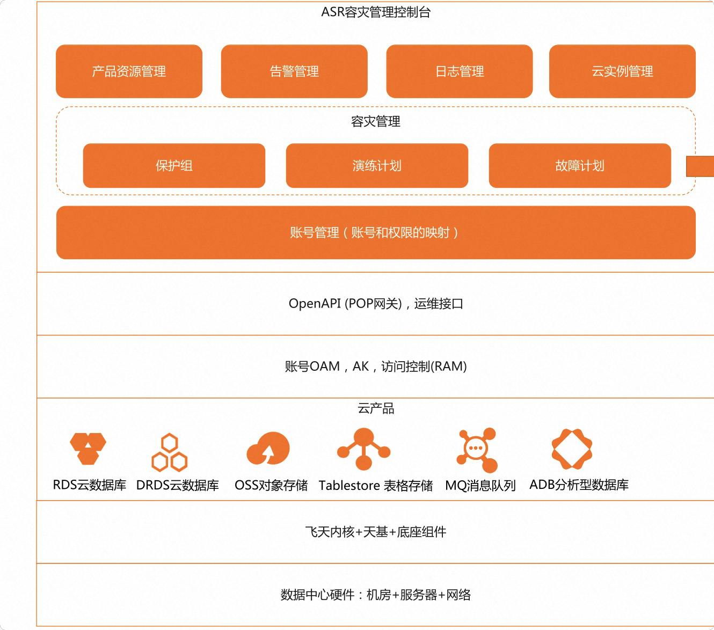

<a id="section-2-2"></a>

## 2.2. 服务角色列表

本文介绍ASR-DR的Project、集群、服务、服务角色的详细信息清单，方便运维人员识别和定位故障。

集群

服务

服务角色

描述

**Project**

asrdr-

asrdr后端服务角色

backend.backend

asrdr数据库初始化

asrdr-

服务角色

backend.dbinit

asrdr-backend

asrdr

asrdrCluster

asrdr-

asrdr后端服务测试

backend.ServiceT

角色

est

asrdr运维平台前端

asrdr-portal.ops-

服务角色

poral

asrdr-portal

asrdr运营平台前端

asrdr-portal.portal

服务角色

<a id="section-3"></a>

# 3.异地容灾运维平台

异地容灾运维平台提供的主要功能包括产品运维、平台基础能力运维和容灾运维。

<a id="section-3-1"></a>

## 3.1. 登录异地容灾运维平台

本文介绍登录ASR-DR异地容灾运维平台的具体操作。

**前提条件**

- 已从部署人员或管理员处获取Apsara Uni-manager运维控制台的访问地址、用户名和密码。

  Apsara Uni-manager运维控制台访问地址格式为*region-id*.ops.console.*intranet-domain-id*。

- 推荐使用Chrome浏览器。

**操作步骤**

1. 打开浏览器。

2. 在地址栏中，输入Apsara Uni-manager运维控制台的访问地址，按回车键。

   

   > **说明**
   >
   > 您可以单击右上角的当前语言切换其它语言。当前支持简体中文、英文、繁体中文三种语言切换。

3. 输入正确的用户名及密码。

   > **说明**
   >
   > 登录Apsara Uni-manager运维控制台的用户名和密码请从部署人员或管理员处获取。

   首次登录Apsara Uni-manager运维控制台时，需要修改登录用户名的密码，请按照提示完成密码修改。

   为提高安全性，密码必须满足以下要求：

   - 必须包含英文大小写字母。

   - 必须包含阿拉伯数字（0~9）。

   - 必须包含特殊符号，包括感叹号（!）、at（@）、井号（#）、美元符号（$）、百分号（%）等。

   - 密码长度为10~20个字符。

4. 单击**账号登录**。

5. 在顶部菜单中选择**平台运维 > 容灾管理 > 异地容灾管理平台ASR-DR**。

<a id="section-3-2"></a>

## 3.2. 首页概览

ASR-DR异地容灾运维平台的首页展示如下信息：授权使用量统计、节点任务负载统计、异常同步实体总量统计、未分配任务统计、带宽使用量和专线流量使用量。

> **重要**
>
> - 在部署ASR-DR异地容灾运维平台时，需要一并配置专线实例信息，若未配置，首页线形图将不能呈现数据。
>
> - 配置专线实例信息请联系阿里云工程师。

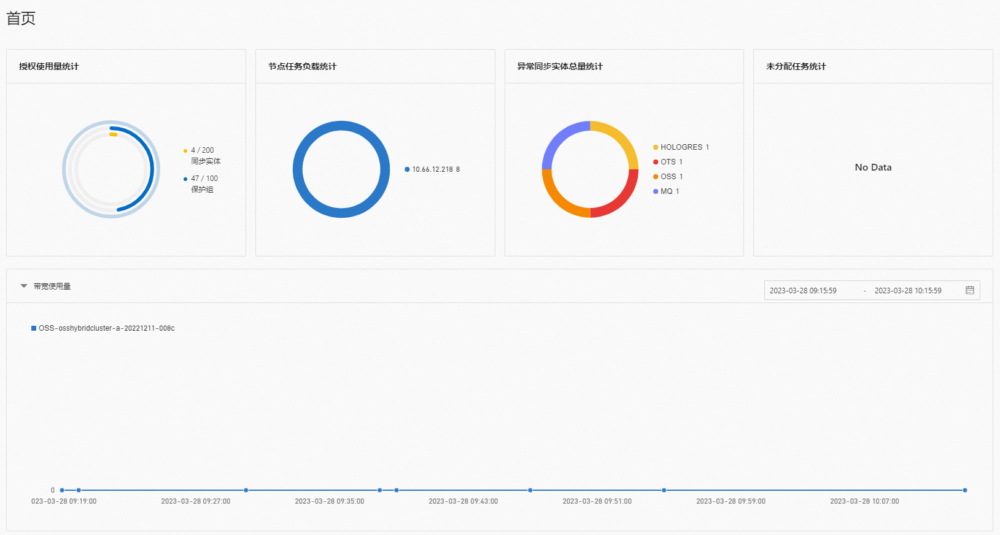

**参数说明**

<table>
  <tr>
    <th width="186">参数</th>
    <th>说明</th>
  </tr>
  <tr>
    <td>授权使用量统计</td>
    <td>以环形图的形式呈现当前保护组和同步实体授权使用量情况，蓝色代表保护组。黄色代表同步实体。分子代表已使用量，分母代表授权总量。</td>
  </tr>
  <tr>
    <td>节点任务负载统计</td>
    <td>以环形图的形式呈现ASR-DR各节点任务分布数量。</td>
  </tr>
  <tr>
    <td>异常同步实体总量统计</td>
    <td>以环形图的形式呈现按照容灾产品统计同步状态为异常状态的同步实体。</td>
  </tr>
  <tr>
    <td>未分配任务统计</td>
    <td>以环形图的形式展示未分配的同步任务。</td>
  </tr>
  <tr>
    <td>带宽使用量</td>
    <td>以线性图呈现云数据库RDS和对象存储OSS的流量带宽使用情况。</td>
  </tr>
  <tr>
    <td>专线流量使用量</td>
    <td>以线形图呈现ASR-DR互联专线实例流入流量和流出流量使用情况。</td>
  </tr>
</table>

<a id="section-3-3"></a>

## 3.3. 容灾监控

<a id="section-3-3-1"></a>

### 3.3.1. 云平台侧集群状态检查

云平台侧集群状态检查包含生产站点和灾备站点的平台检查、容灾产品集群状态检查，异常的检查项会上报至告警统计中，并统计异常级别P1-P4的个数。异常信息也会推送到Apsara Uni-manager运维控制台的告警管理中。

**操作步骤**

1. 登录异地容灾运维平台。

2. 在左侧导航栏选择**容灾监控** > **云平台侧集群状态检查**。

   页面展示告警统计、平台检查结果、容灾产品集群状态检查结果。告警统计中告警级别说明：

   - P1：紧急

   - P2：重要

   - P3：次要

   - P4：提醒

   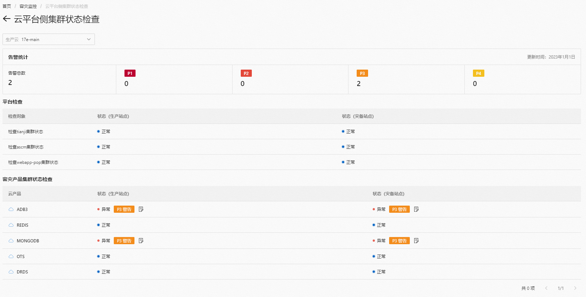

   > **说明**
   >
   > - 切换生产云：在页面上方单击**生产云**下拉框，选择目标生产云。
   >
   > - 查看检查项：对于状态异常的检查项，鼠标悬停在右侧的
   >
   >   图标上，可以查看详细检查项和结
   >
   >   
   >
   >   果。

<a id="section-3-3-2"></a>

### 3.3.2. 云间网络访问检查

云间网络访问检查主要是检查云产品在生产站点和灾备站点之间的域名解析、网络可达、端口连通等。

**操作步骤**

1. 登录异地容灾运维平台。

2. 在左侧导航栏选择**容灾监控** > **云间网络访问检查**。

   页面展示生产站点和灾备站点之间的云产品网络连通状态。

   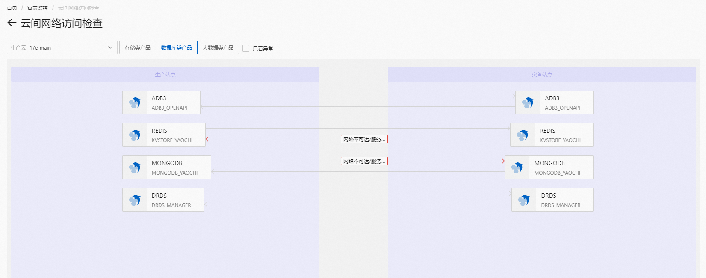

   > **说明**
   >
   > - 切换生产云：在页面上方单击**生产云**下拉框，选择目标生产云。
   >
   > - 筛选产品分类：在页面上方选择**存储类产品**、**数据库类产品**、**大数据类产品**，筛选出所选产品分类的云产品网络连通状态。
   >
   > - 筛选异常云产品：在页面上方勾选**只看异常**，筛选出网络连通状态异常的云产品。

<a id="section-3-3-3"></a>

### 3.3.3. 同步实体状态

同步实体状态主要监控保护组的同步实体数量、同步状态、最大同步延迟时间，以及云产品的同步状态、同步延迟时间、主备实例状态。同步状态异常的保护组会上报告警至告警统计中，并统计异常级别P1-P4的个数。异常信息也会推送到Apsara Uni-manager运维控制台的告警管理中。

**操作步骤**

1. 登录异地容灾运维平台。

2. 在左侧导航栏选择**容灾监控** > **同步实体状态**。

   页面展示告警统计和保护组的名称、同步实体数量、同步状态、最大同步延迟。

   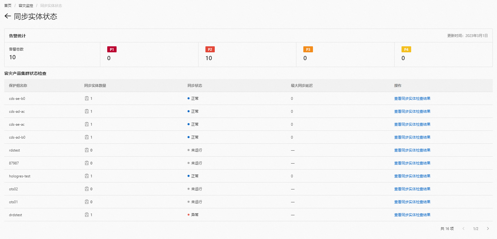

3. 在保护组**操作**列，单击**查看同步实体检查结果**，显示当前保护组中包含的同步实体名称、所属产品、同步状态、同步延迟、同步延迟检查、产品实例状态（生产实例）、产品实例状态（灾备实例）。

<a id="section-3-4"></a>

## 3.4. 平台基础能力运维

本文介绍异地容灾运维平台中平台基础能力运维的四大功能。

在异地容灾运维平台中，平台基础能力运维主要包括六大功能模块：云信息管理、参数配置管理、节点管理、VPC管理、容量管理和数据升级。具体的功能信息如下表所示。

| 功能模块 | 描述 | 说明 | 操作指导 |
| --- | --- | --- | --- |
| 云信息管理 | 获取所有的云实例信息，删除不必要的云实例信息。 | • 在删除之前需要确保云实例下不存在有保护组、计划等实例。<br>• 删除云实例会同时删除云实例所注册的VPC信息、地域配置（含地域支持的容灾产品和状态）和云产品配置等信息。 | • 刷新：单击刷新列表。<br>• 切换展示风格：单击选择<strong>默</strong><br><strong>认</strong>或者<strong>紧凑</strong>型风格展示。<br>• 自定义列字段：单击选择需<br>要在页面展示的字段信息。<br>• 全屏显示列表：单击以全屏<br>模式展示，单击退出全屏<br>模式。 |
| 参数配置管理 | 进行产品参数动态化配置。 | 无 | 1. 在页面选择对应的云产品页签，按照界面提示输入各产品的参数值。<br>2. 单击<strong>提交</strong>。 |

<table>
  <tr>
    <td colspan="2">节点管理</td>
    <td>• 查看当前asrdr集群的节点信息，展示未分配的任务。<br>• 单击<strong>详情</strong>即可看到当前节点正在执行的任务。</td>
    <td>无</td>
    <td>单击<strong>展示未分配任务</strong>，可显示未分配的任务列表。</td>
  </tr>
  <tr>
    <td rowspan="2">VPC管理</td>
    <td>VPC注册信息</td>
    <td><strong>移除</strong>：当前云实例已有VPC注册信息，可以查看、移除对应的VPC注册信息。<strong>注册</strong>：当前云实例没有VPC注册信息，可以注册对应的VPC信息。<strong>校验</strong>：当前VPC授权出错或者VPC类型实例访问失败，可以校验VPC注册信息的有效性，即调用接口查看VPC中appId和地址池Id是否依旧有效。</td>
    <td>无</td>
    <td>• 刷新：单击刷新列表。<br>• 切换展示风格：单击选择<strong>默</strong><br><strong>认</strong>或者<strong>紧凑</strong>型风格展示。<br>• 自定义列字段：单击选择需<br>要在页面展示的字段信息。<br>• 全屏显示列表：单击以全屏<br>模式展示，单击退出全屏<br>模式。</td>
  </tr>
  <tr>
    <td>VPC授权信息</td>
    <td><strong>查看</strong>：若当前云实例已授权，支持查看对应的VPC授权信息。<strong>授权</strong>：若当前云实例未授权，支持对实例进行授权。</td>
    <td>无</td>
    <td>1. 选择云实例和区域名称，输入实例ID。<br>2. 单击<strong>查询</strong>。</td>
  </tr>
  <tr>
    <td colspan="2">容量管理</td>
    <td>用于统计保护组和同步实体的资源使用量。</td>
    <td>无</td>
    <td>无</td>
  </tr>
  <tr>
    <td colspan="2">数据升级</td>
    <td>将保护组数据、容灾计划数据全部升级。</td>
    <td>存量用户在升级后需要做数据升级操作。</td>
    <td>1. 单击<strong>数据升级</strong>。<br>2. 在弹出的提示框上单击<strong>确定</strong>。<br>3. 根据界面提示进行操作。</td>
  </tr>
</table>

<a id="section-3-4-1"></a>

### 3.4.1. 管理云产品信息

需要先在Apsara Uni-manager运维平台完成灾备云和生产云的配置才能在Apsara Uni-manager运营平台使用异地容灾管理平台。在正确添加生产云实例后，您需要配置支持的容灾产品以及对应的地址，ASR-DR才能对生产云的资源实例进行容灾。本文介绍跨云容灾场景的相关配置。

**操作须知**

首次登录Apsara Uni-manager运维平台的异地容灾管理平台时，需要配置灾备云，如图所示。单击**灾备云**区域的**编辑**或者单击列表中**操作**列**编辑**，配置成功后状态会变为运行中。配置参数时请参考操作步骤的表格说明进行配置。

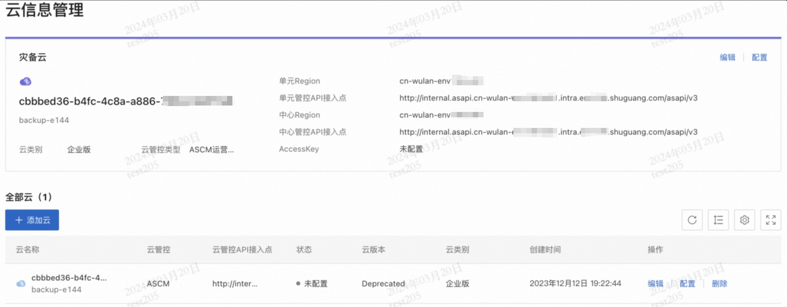

**操作步骤**

1. 登录异地容灾运维平台。

2. 在左侧导航栏中选择**平台基础运维 > 云信息管理**。

3. 单击**添加云**，参考下表填写参数。

   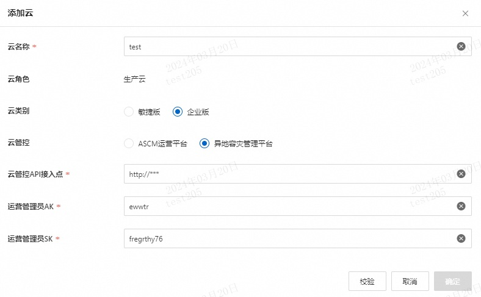

   | 名称 | 描述 |
   | --- | --- |
   | 云名称 | 自定义的云中心名称信息，方便识别。由中文、英文、数字、短划线（-）、下划线（_）或英文句号（.）组成，长度为4~20个字节。 |
   | 云类别 | 请选择生产云的云类别，包括企业版和敏捷版，本场景中请选择<strong>企业版</strong>。 |
   | 云管控 | 请选择生产云的云管控类型，请选择<strong>异地容灾管理平台</strong>。<br>• <strong>ASCM运营平台</strong>：灾备云通过调用API来获取生产云信息。<br>• <strong>异地容灾管理平台</strong>：灾备云通过调用ASR-DR的API来获取生产云信息。<br>说明异地容灾管理平台是推荐客户使用的管控类型。 |
   | 云管控API接入点 | • <strong>云管控</strong>选择<strong>ASCM运营平台</strong>时，填写生产云API的Endpoint地址。<br>• <strong>云管控</strong>选择<strong>异地容灾管理平台</strong>时，填写生产云ASR-DR的Endpoint地址。获取方法请参见获取ASR-DR的Endpoint。 |
   | <strong>运营管理员AK</strong>、<strong>运营</strong>管理员SK | 请输入生产云运营管理员账号的AccessKey ID和AccessKey Secret。获取方法请参见获取AccessKey。 |

4. 单击**校验**，校验成功后单击**确定**。

5. 配置云产品。

   <ol type="i">

   <li>

   单击相应云**操作**列的**配置**，进入**云产品配置**页面。

   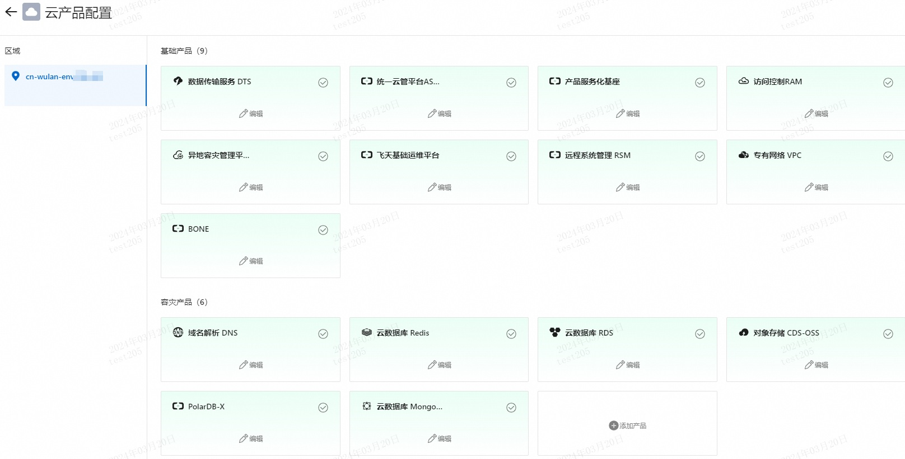

   </li>

   <li>

   在**基础产品**区域，单击对应产品的  图标，配置相关参数，参数说明如下表所示。

   > **重要**
   >
   > - 云实例的管控类型为**ASCM运营平台**时，系统获取的云产品默认配置可能有误，需要您进一步确认，各产品配置信息获取方法请参见获取生产云实例配置信息。
   >
   > - 云实例的管控类型为**异地容灾管理平台**时，系统获取的云产品默认配置是准确的，无需进一步确认。

   | 产品 | 名称 | 描述 |
   | --- | --- | --- |

   用于单点登录、鉴权、资源获取。请填写生产云 `oneService` 服务 `ascm-portal.domain` 的值，获取方

   **ASCM地址**

   法请参见获取生产云实例配置信息。

   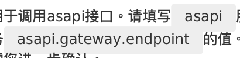

   用于调用asapi接口。请填写 asapi 服

   **统一云管平台**

   **asapi地址**

   务 asapi.gateway.endpoint 的值。ASR-DR自动配置，但仍

   **ASCM**

   需您进一步确认。

   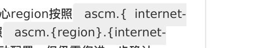

   用于调用ASCM POP接口。中心region按照 ascm.{ internet-

   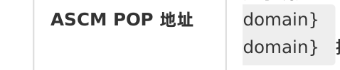

   domain} ，单元region按照 ascm.{region}.{internet-

   domain} 拼写，ASR-DR自动配置，但仍需您进一步确认。

   用于建立数据库产品的同步链路。请填写生产云 `dts-dts` 服

   **DTS地址**

   务 `dts.openapi.endpoint` 的值，ASR-DR自动配置，但仍需您进一步确认。

   请配置为生产云 `dts-dts` 服务 `dts.check.dns:dts.check.port` 的值，获取方法请参

   **数据传输服务 DTS**

   **DTS Check地址**

   见获取生产云实例配置信息。ASR-DR自动配置，但仍需您进一步确认。

   请配置为生产云 `dts-dts` 服务 `dts.check.token` 的值，

   **DTS Check接口凭**

   获取方法请参见获取生产云实例配置信息。ASR-DR自动配置，但

   **证**

   仍需您进一步确认。

   用于查询环境信息。请填写生产云 `oneService` 服

   **产品服务化基座**

   **oneConsole地址**

   务 `console.domain` 的值，获取方法请参见获取生产云实例配置信息。

   用于VPC注册、连接VPC类型的PolarDB-X 1.0、RDS实例。对应生产云 `vpc-yaochi` 服务 `vpc-`

   **专有网络 VPC**

   **VPC地址**

   `inner.openapi.endpoint` 的值，ASR-DR自动配置，但仍需您进一步确认。

   用于验证RAM AK和SK信息。请填写 `ram-ramService` 服务 `ram-openapi.endpoint` 的值，获取方法请参见获取生产云实例配置信息。

   **RAM地址**

   > **重要**
   >
   > 必须配置RAM中心Region地址。

   用于实现RAM鉴权。请填写 `ram-ramService` 服务 `ram-`

   **RAM Slave地址**

   `slave.endpoint` 的值，获取方法请参见获取生产云实例配置信

   **访问控制RAM**

   息。

   用于获取阿里云账号的临时Token。请填写 `ram-ramService` 服务 `sts-openapi.endpoint` 的值，参数的获取方法请参见获取生产云实例配置信息。

   **STS地址**

   > **重要**
   >
   > 必须配置STS中心Region地址。

   asrdr申请的账号的Accesskey ID，通过调用主云RSM来运行相关

   **asrdr AK**

   检查命令。获取方式参见获取AccessKey。

   asrdr申请的账号的AccessKey Secret，通过调用主云RSM来运

   **asrdr SK**

   行相关检查命令。获取方式参见获取AccessKey。

   用于调用ASR-DR的OpenAPI，请填写 `asrdr-backend` 服

   **asrdr api**

   务 `asrdr_api_endpoint` 的值。ASR-DR自动配置，但仍需您

   **endpoint**

   进一步确认。

   **异地容灾管理平台ASR-DR**

   asrdr服务账号的Accesskey ID，用于STS临时Token调用。请填写 `account.asr.accesskey-id` 的值，获取方法请参见获取

   **asrdr服务账号AK**

   生产云实例配置信息。

   asrdr服务账号的AccessKey Secret，用于STS临时Token调用。请填写 `account.asr.accesskey-secret` 的值，获取方法

   **asrdr服务账号SK**

   请参见获取生产云实例配置信息。

   用于调用Tianji POP接口所需的AccessKey Id。请填写 `account.defaultUser.accesskey-id` 的值，获取方法

   **天基ak**

   请参见获取生产云实例配置信息。

   用于调用Tianji POP接口所需的AccessKey Secret。请填写 `account.defaultUser.accesskey-secret` 的值，获取

   **天基sk**

   **飞天基础运维平台**

   方法请参见获取生产云实例配置信息。

   用于调用Tianji的OpenAPI，获取集群状态相关信息。请填写 `tianji-endpoint` 服务 `api_server.endpoint` 的

   **天基endpoint**

   值，ASR-DR自动配置，但仍需您进一步确认。

   用于调用RSM的OpenApi，执行网络检查相关命令。请填

   **远程系统管理**

   写 `rsm` 服务 `rsm.api.domain` 的值，ASR-DR自动配置，

   **RSM地址**

   **RSM**

   但仍需您进一步确认。

   <table>
     <tr>
       <td>BONE</td>
       <td>bone访问地址</td>
       <td>用于调用bone API来检查PaaS平台上部署的产品的跨云网络连通性健康状况。ASR-DR自动配置，但仍需您进一步确认。<strong>bone访</strong><strong>问地址</strong>的拼接规则为：region.api.parthenon.intranet-domain。请根据tianji集群的终态配置中<strong>kv.conf</strong>文件<br><br><br>中<code> </code>region<code> </code>和<code> </code>intranet-domain<code> </code>的值进行确认。</td>
     </tr>
   </table>

   </li>

   <li>

   在**容灾产品**区域，单击  图标，选择容灾产品类型，根据不同的产品类型配置对应参数，参数说明如下表

   所示。

   **产品**

   **名称**

   **描述**

   用于调用OSS同步接口、查询OSS实例。请填写生产云 `oss-server` 服务 `api-endpoint` 的

   **OSS地址**

   值，ASR-DR自动配置，但仍需您进一步确认。

   用于调用OSS POP接口。请填写生产云 `oss-`

   **OSS赤骥Pop地址**

   `chiji` 服务 `pop-api-endpoint` 的值，ASR-DR自动配置，但仍需您进一步确认。

   ASR-DR调用OSS POP接口需要验证AccessKey ID。请填写Apsara Uni-manager运维控制台opsadmin的AK

   **OSS-POP AK**

   值。

   ASR-DR调用OSS POP接口需要验证AccessKey Secret。请填写Apsara Uni-manager运维控制台

   **OSS-POP SK**

   opsadmin的SK值。

   用于授权代理用户访问bucket的权限。获取方法请参见《阿里云 *v3.\*\*\** 部署指南》中**产品容灾配置 > OSS**

   **对象存储 OSS**

   **OSS 代理用户 PK**

   **容灾配置**章节，填写Apsara Uni-manager运营控制台创建的代理用户的UID。

   <table>
     <tr>
       <td rowspan="5">表格存储 Tablestore<br>说明在云管控为ASRDR条件下，会自动注册OTS代理主账号信息。<br>• 在跨云场景，配置生产云会注册两朵云配置，配置顺序需为灾备云 &gt; 生产云。<br>• 在跨region场景，配置生产region会注册两个region配置，配置顺序需为灾备region &gt;生产region。</td>
       <td>OTS Tunnel服务地址</td>
       <td>用于调用Tunnel架构下Tablestore的同步接口。请填写<br>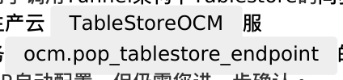<br>生产云 <code> </code>TableStoreOCM<code> </code>服务<code> </code>ocm.pop_tablestore_endpoint<code> </code>的值，ASR-DR自动配置，但仍需您进一步确认。</td>
     </tr>
     <tr>
       <td>OTS代理主账号 PK</td>
       <td>用于授权Tablestore产品访问生产站点实例。获取方法请参见《阿里云<em> v3.***</em> 部署指南》中<strong>产品容灾配置 &gt;</strong> <strong>OTS容灾配置</strong>章节。填写Apsara Uni-manager运营控制台创建的代理一级组织的UID。</td>
     </tr>
     <tr>
       <td>OTS代理主账号 AK</td>
       <td>用于授权Tablestore产品访问生产站点实例。获取方法请参见《阿里云<em> v3.***</em> 部署指南》中<strong>产品容灾配置 &gt;</strong> <strong>OTS容灾配置</strong>章节。填写Apsara Uni-manager运营控制台创建的代理一级组织的Accesskey ID。</td>
     </tr>
     <tr>
       <td>OTS代理主账号 SK</td>
       <td>用于授权Tablestore产品访问生产站点实例。获取方法请参见《阿里云<em> v3.***</em> 部署指南》中<strong>产品容灾配置 &gt;</strong> <strong>OTS容灾配置</strong>章节。填写Apsara Uni-manager运营控制台创建的代理一级组织的Accesskey Secret。</td>
     </tr>
     <tr>
       <td>OTS OCM内部地址</td>
       <td>用于注册Tablestore代理主账号的信息，请填写生产<br>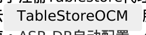<br><br>云<code> </code>TableStoreOCM<code> </code>服务<code> </code>ocm.endpoint<code> </code>的值。ASR-DR自动配置，但仍需您进一步确认。</td>
     </tr>
     <tr>
       <td>云数据库 RDS</td>
       <td>RDS地址</td>
       <td>用于调用RDS实例查询、授权等接口。请填写生产云<code> rds-yaochi </code>服务<code> rds.openapi.endpoint </code>的值，ASR-DR自动配置，但仍需您进一步确认。</td>
     </tr>
     <tr>
       <td>云原生分布式数据库PolarDB-X</td>
       <td>PolarDB-X地址</td>
       <td>用于调用PolarDB-X 1.0实例查询、授权等接口。请填写生产云<code> drds-console </code>服务<code> prectrl.api </code>的值，ASR-DR自动配置，但仍需您进一步确认。</td>
     </tr>
     <tr>
       <td>云原生关系型数据库PolarDB</td>
       <td>PolarDB地址</td>
       <td>用于调用PolarDB实例查询、授权等接口。请填写生产云<code> polardb-yaochi </code>服务<code> polardb.openapi-</code><code>vpc.endpoint </code>的值。获取方法请参见获取生产云实例配置信息。ASR-DR自动配置，但仍需您进一步确认。</td>
     </tr>
   </table>

   用于调用MQ同步接口。请填写生产云 `mq-router` 服

   **MQ Router OnsAddr**

   务 `router.onsAddr` 的值，ASR-DR自动配置，但仍

   **地址**

   需您进一步确认。

   用于调用MQ Topic操作接口。请填写生产云 `mq-`

   **MQ地址**

   `console` 服务 `console.domain` 的值，ASR-DR自动配置，但仍需您进一步确认。

   ASR-DR调用MQ接口需要验证Accesskey ID。请填写生

   **消息队列MQ**

   产云 `mq-console` 服

   **MQ AK**

   务 `onsInnerApiAccessKey` 的值，获取方法请参见获取生产云实例配置信息。

   ASR-DR调用MQ接口需要验证AccessKey Secret。请填写生产云 `mq-console` 服务 `onsInnerApiSecretKey` 地址，获取方法请参

   **MQ SK**

   见获取生产云实例配置信息。

   用于调用DNS Control的接口。请填写生产云 `dnsService` 服

   **DNS CONTROL地址**

   务 `dns_control.pop_domain` 的值，获取方法请参见获取生产云实例配置信息。

   DNS地址主要用于调用DNS操作接口。请填写生产云 `dnsService` 服

   **DNS地址**

   务 `dns_universal_control.pop_domain` 的

   **域名解析 DNS**

   值，ASR-DR自动配置，但仍需您进一步确认。

   ASR-DR调用DNS接口需要验证AccessKey ID。请填写

   **DNS AK**

   Apsara Uni-manager运营控制台容灾组织的AK值。

   ASR-DR调用DNS接口需要验证AccessKey Secret。请填写Apsara Uni-manager运营控制台容灾组织的SK

   **DNS SK**

   值。

   生产云大数据管家的配置中心BCC API。请填写生产云 `bcc-web` 服务 `api.endpoint` 的值，ASR-

   **BCC API地址**

   DR自动配置，但仍需您进一步确认。

   生产云大数据管家的配置中心AppName。请填写生产云 `bcc-web` 服务 `maxgraph-app` 的值，ASR-

   **BCC App**

   DR自动配置，但仍需您进一步确认。

   **大数据开发治理平台DataWorks**

   生产云大数据管家的配置中心AppKey。请填写生产云 `bcc-web` 服务 `maxgraph-key` 的值，ASR-

   **BCC Key**

   DR自动配置，但仍需您进一步确认。

   生产云大数据管家的配置中心AuthUserKey。请填写生产云 `bcc-web` 服务 `maxgraph-passwd` 的

   **BCC Password**

   值，ASR-DR自动配置，但仍需您进一步确认。

   生产云大数据管家的配置中心AuthUser。请填写生产云 `bcc-web` 服务 `maxgraph-user` 的值，ASR-

   **BCC User**

   DR自动配置，但仍需您进一步确认。

   用于调用HBASE实例查询、授权等接口。请填写生产

   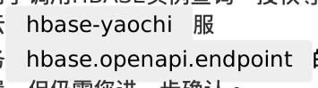

   云 hbase-yaochi 服

   **云数据库 HBase**

   **HBASE地址**

   务 hbase.openapi.endpoint 的值，ASR-DR自动配置，但仍需您进一步确认。

   Lindorm地址主要用于调用Lindorm操作接口。请填写生产云 `lindorm` 服务 `lindorm_pop_endpoint` 的

   **Lindorm地址**

   值，ASR-DR自动配置，但仍需您进一步确认。

   ASR-DR调用LTS接口需要验证Accesskey ID。请填写生产云 `account.asr.accesskey-id` 的值，获取方

   **多模数据库Lindorm**

   **LTS鉴权AK**

   法请参见获取生产云实例配置信息。

   ASR-DR调用LTS接口需要验证AccessKey Secret。请填写生产云 `account.asr.accesskey-secret` 的

   **LTS鉴权SK**

   值，获取方法请参见获取生产云实例配置信息。

   用于调用MongoDB实例查询、授权等接口。请填写生产

   

   

   云 mongodb-yaochi 服务 mongodb.openapi-

   **云数据库 MongoDB**

   **MongoDB地址**

   vpc.endpoint 的值，ASR-DR自动配置，但仍需您进一步确认。

   用于调用Redis实例查询、授权等接口。请填写生产云 `kvstore-yaochi` 服务 `kvstore.openapi-`

   **云数据库 Redis**

   **Redis地址**

   `vpc.endpoint` 的值，ASR-DR自动配置，但仍需您进一步确认。

   用于调用Hologres实例查询、授权等接口。请填写生产

   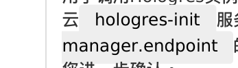

   

   云 hologres-init 服务 holo-

   **Hologres管控地址**

   manager.endpoint 的值，ASR-DR自动配置，但仍需您进一步确认。

   **交互式分析 Hologres**

   用于调用Hologres-pop接口。请填写生产

   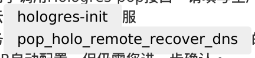

   云 hologres-init 服

   **Hologres-pop地址**

   务 pop_holo_remote_recover_dns 的值，ASR-DR自动配置，但仍需您进一步确认。

   用于调用HDR接口。请填写生产云 `cds-bcdr` 服

   

   **云服务器 ECS**

   **HDR地址**

   务 hdr.openapi.endpoint 的值，ASR-DR自动配置，但仍需您进一步确认。

   用于调用DataHub接口。请填写生产云 `datahub-frontend` 服务

   **数据总线 DataHub**

   **DataHub 地址**

   的 `datahub_frontend.endpoint` 的值，ASR-DR自动配置，但仍需您进一步确认。

   </li>

   <li>

   把所有产品配置完后，可以返回至**云信息管理页**面执行其他操作。

   </li>

   </ol>

**相关操作**

添加云成功后，您还可以执行以下操作。

<table>
  <tr>
    <th width="89">任务名称</th>
    <th>操作步骤</th>
  </tr>
  <tr>
    <td>编辑云</td>
    <td>1. 单击<strong>操作</strong>列<strong>编辑</strong>。<br>2. 在编辑弹框中修改相应参数值。<br>3. 修改完成后单击<strong>校验</strong>，校验通过后单击<strong>确定</strong>。</td>
  </tr>
  <tr>
    <td>删除云</td>
    <td>1. 单击<strong>操作</strong>列<strong>删除</strong>。<br>2. 在弹出提示框上单击<strong>确定</strong>。</td>
  </tr>
</table>

<a id="section-3-4-2"></a>

### 3.4.2. 配置大屏地图

本章节介绍用户如何配置大屏所用的容灾地域，配置后的地域信息将在大屏上显示异地容灾的数据。

**场景描述**

- **异地容灾**：异地主备容灾方案在政务、能源、交通、医保等行业应用广泛，适用于以下场景。

  - 业务连续性要求较高。

  - 不依赖数据强一致。

  - 要求具备区域性故障防范能力。

  - 城市相距百公里以上。

- **三地两中心**：两地三中心容灾方案主要应用于金融行业，适用于以下场景。

  - 需要防范城市级大范围自然灾害。

  - 具备区域性故障防范能力。

  - 要求关键业务数据同步延迟约等于0。

  - 预算充足。

**操作步骤**

1. 登录异地容灾运维平台。

2. 在左侧导航栏中选择**平台基础运维 > 大屏地图配置**。

3. 单击**新建容灾地域**，参考下表配置参数值。

   | 参数名称 | 说明 |
   | --- | --- |
   | 地域 ID | 下拉选择所在地域的ID。 |
   | 地域名称 | 请输入地域的名称，例如<strong>杭州机房</strong>。 |
   | 所在城市 | 下拉选择地域所处的城市。 |
   | 可用区 | 系统自动生成。 |

4. 单击**确定**。

**其他操作**

新建容灾地域成功后，您还可以执行以下操作。

<table>
  <tr>
    <th width="122">任务名称</th>
    <th>操作步骤</th>
  </tr>
  <tr>
    <td>编辑容灾地域</td>
    <td>1. 单击<strong>操作</strong>列<strong>编辑</strong>。<br>2. 重新输入<strong>地域名称</strong>或<strong>所在城市</strong>。<br>3. 单击<strong>确定</strong>。</td>
  </tr>
  <tr>
    <td>删除容灾地域</td>
    <td>1. 单击<strong>操作</strong>列<strong>删除</strong>。<br>2. 在弹出的提示框上单击<strong>确定</strong>。</td>
  </tr>
</table>

<a id="section-3-5"></a>

## 3.5. 容灾运维

本文介绍容灾运维的两大功能模块及其说明。

容灾运维主要包括同步实体管理和计划管理两大功能模块，具体的功能信息如下表所示。

<table>
  <tr>
    <td>功能模块</td>
    <td></td>
    <td>描述</td>
    <td>说明</td>
  </tr>
  <tr>
    <td colspan="2">同步实体管理</td>
    <td>可以查看保护组列表和详情，针对不需要使用的保护组和保护实体进行删除；查看当前同步实体的任务执行列表、执行步骤详情、单步骤执行日志；进行单步骤重做和单步骤跳过。</td>
    <td>• 单步骤<strong>重做</strong>是指同步实体执行过程中某子步骤执行失败，可以选择重做当前步骤，重试当前步骤继续执行。<br>• 单步骤<strong>跳过</strong>是指同步实体执行过程中某子步骤持续性执行失败，当前步骤如若不影响后续流程，可以选择跳过当前步骤，从下一步骤继续执行。</td>
  </tr>
  <tr>
    <td rowspan="4">计划管理</td>
    <td>演练切换</td>
    <td rowspan="4">可以查看演练计划和故障计划的执行实例、针对已完成的实例进行删除；查看执行实例详情信息、计划步骤详情、计划子步骤执行日志；进行单步骤重做和单步骤跳过和强切。</td>
    <td rowspan="4"><strong>强切</strong>是指计划执行过程中某子步骤持续性执行失败，选择跳过所有非必要步骤。<br>说明这种操作一般在主端发生故障的场景下使用，即所有关于主端的步骤都会一次性跳过。</td>
  </tr>
  <tr>
    <td>演练回切</td>
  </tr>
  <tr>
    <td>故障切换</td>
  </tr>
  <tr>
    <td>故障回切</td>
  </tr>
</table>

<a id="section-3-5-1"></a>

### 3.5.1. 管理同步实体

<a id="section-3-5-1-1"></a>

#### 3.5.1.1. 单步骤跳过

在同步实体管理和计划管理中单步骤跳过的方式相同，此处以同步实体中的单步骤跳过为例介绍如何进行单步骤跳过。

**操作步骤**

1. 登录异地容灾运维平台。

2. 在左侧导航栏中选择**容灾运维 > 同步实体管理**。

3. 在保护组列表选中目标实例单击**详情**。

4. 在**保护组详情**页面查看同步实体信息，单击右侧操作栏的**任务**。

   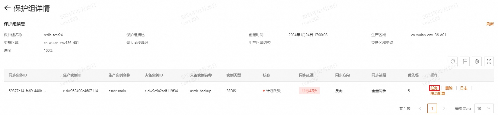

5. 在任务详情页单击左侧符号，即可查看执行步骤详情。

   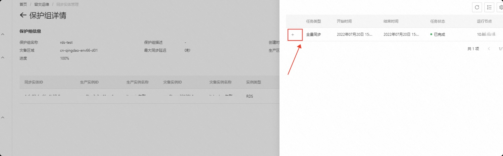

6. 在步骤详情页面找到**任务状态**为**失败**的步骤，在右侧操作栏选择**跳过。**

7. 单步骤跳过后，该步骤的**运行状态**会变成**跳过**。

   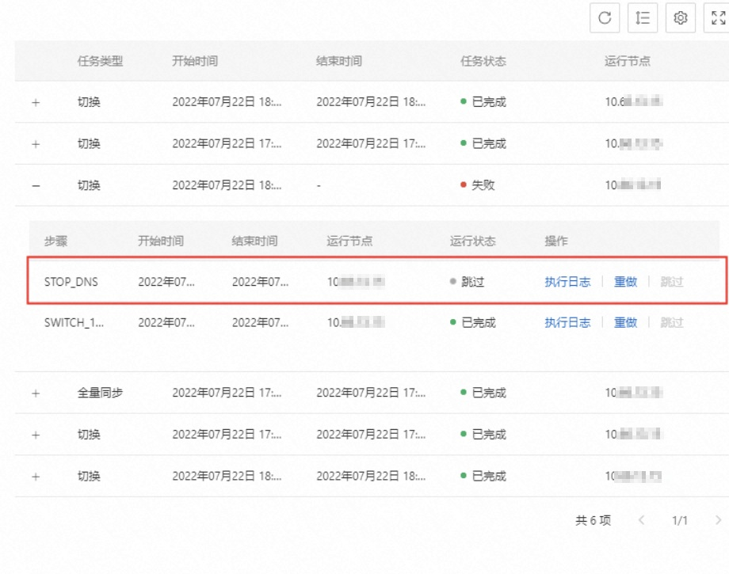

**相关操作**

在同步实体管理页面，您还可以执行以下操作。

<table>
  <tr>
    <th width="122">任务名称</th>
    <th>操作步骤</th>
  </tr>
  <tr>
    <td>高级搜索</td>
    <td>1. 选择主云列表，输入保护组ID和保护组名称，然后选择同步方向。<br>2. 单击<strong>搜索</strong>。如果搜索条件有误，单击<strong>重置</strong>可清空搜索条件。</td>
  </tr>
  <tr>
    <td>刷新列表</td>
    <td>单击刷新列表。</td>
  </tr>
  <tr>
    <td>切换展示风格</td>
    <td>单击选择<strong>默认</strong>或者<strong>紧凑</strong>型风格展示。</td>
  </tr>
  <tr>
    <td>自定义列字段</td>
    <td>单击选择需要在页面展示的字段信息。</td>
  </tr>
  <tr>
    <td>全屏显示列表</td>
    <td>单击以全屏模式展示，单击退出全屏模式。</td>
  </tr>
</table>

<a id="section-3-5-1-2"></a>

#### 3.5.1.2. 单步骤重做

在同步实体管理和计划管理中单步骤重做的方式相同，此处以同步实体中的单步骤重做为例介绍如何进行单步骤重做。

**操作步骤**

1. 登录异地容灾运维平台。

2. 在左侧导航栏中选择**容灾运维 > 同步实体管理**。

3. 在保护组列表选中目标实例单击**详情**。

4. 在**保护组详情**页面查看同步实体信息，单击右侧操作栏的**任务。**

   

5. 在任务详情页单击左侧符号，即可查看执行步骤详情。

   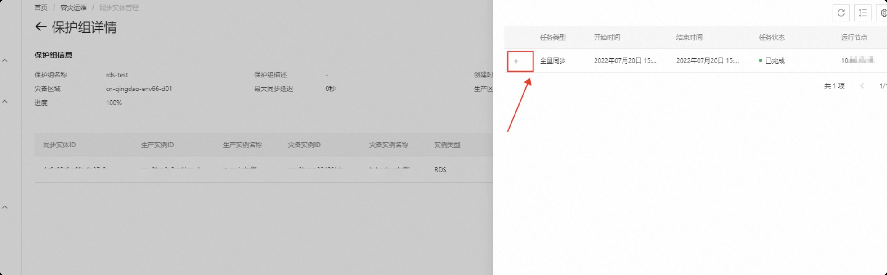

6. 在步骤详情页面找到**任务状态**为**失败**的步骤，在右侧操作栏选择**重做**。

   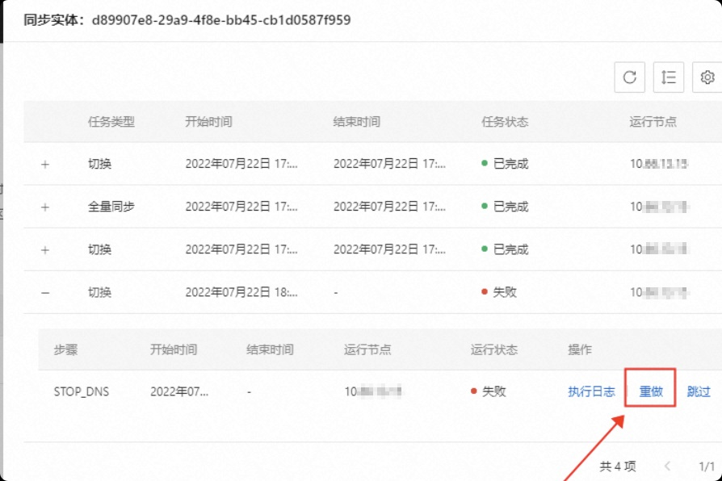

7. 重做成功后，该步骤的**运行状态**会变成**已完成**。

**相关操作**

在同步实体管理页面，您还可以执行以下操作。

<table>
  <tr>
    <th width="122">任务名称</th>
    <th>操作步骤</th>
  </tr>
  <tr>
    <td>高级搜索</td>
    <td>1. 选择主云列表，输入保护组ID和保护组名称，然后选择同步方向。<br>2. 单击<strong>搜索</strong>。如果搜索条件有误，单击<strong>重置</strong>可清空搜索条件。</td>
  </tr>
  <tr>
    <td>刷新列表</td>
    <td>单击刷新列表。</td>
  </tr>
  <tr>
    <td>切换展示风格</td>
    <td>单击选择<strong>默认</strong>或者<strong>紧凑</strong>型风格展示。</td>
  </tr>
  <tr>
    <td>自定义列字段</td>
    <td>单击选择需要在页面展示的字段信息。</td>
  </tr>
  <tr>
    <td>全屏显示列表</td>
    <td>单击以全屏模式展示，单击退出全屏模式。</td>
  </tr>
</table>

<a id="section-3-5-1-3"></a>

#### 3.5.1.3. 配置限流

目前仅支持实例类型是OSS和RDS的实例进行限流配置。

**操作步骤**

1. 登录异地容灾运维平台。

2. 在左侧导航栏中选择**容灾运维 > 同步实体管理**。

3. 单击实例类型为OSS或RDS的保护组**操作**列**详情**。

4. 在**保护组详情**页面单击**操作**列**限流配置**。

   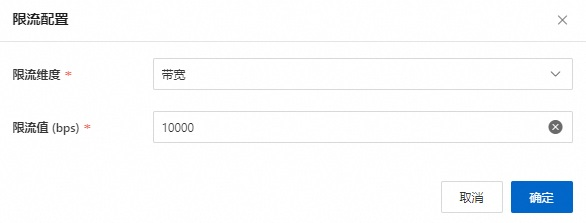

5. 参考下表设置参数，设置完成后单击**确定**。

   <table>
     <tr>
       <th width="89">参数名称</th>
       <th>描述</th>
     </tr>
     <tr>
       <td>限流维度</td>
       <td>下拉选择限制数据流量的维度：<br>• 带宽：信号所占据的频带宽度。<br>• QPS：每秒处理的请求数。</td>
     </tr>
     <tr>
       <td>任务类型</td>
       <td>下拉选择任务类型：<br>• 增量复制：只限制新增的数据量。<br>• 历史复制：限制所有的数据量。<br>说明只有实例类型为OSS时，才需要配置该参数，实例类型为RDS时无需配置。</td>
     </tr>
     <tr>
       <td>限流值</td>
       <td>自定义输入限制的阈值。</td>
     </tr>
   </table>

<a id="section-3-5-1-4"></a>

#### 3.5.1.4. 删除保护组中的保护实体

介绍如何删除保护组中的实体。

**操作步骤**

1. 登录异地容灾运维平台。

2. 在左侧导航栏中选择**容灾运维 > 同步实体管理**。

3. 在保护组列表选中目标实例单击**详情**。

4. 在**保护组详情**页面，单击相应实体**操作**列的**删除**。

5. 在弹出的提示框上单击**确定**。

<a id="section-3-5-1-5"></a>

#### 3.5.1.5. 查看同步实体日志

在容灾演练或容灾灾难恢复过程中会产生很多日志，本章节介绍如何查看保护组中同步实体的日志。

**操作步骤**

1. 登录异地容灾运维平台。

2. 在左侧导航栏中选择**容灾运维 > 同步实体管理**。

3. 在保护组列表选中目标实例单击**详情**。

4. 在**保护组**详情页面，单击**操作**列的**日志**，在页面右侧可查看日志信息。

5. 需要关闭日志信息时，单击**确定**或**取消**。

<a id="section-3-5-2"></a>

### 3.5.2. 执行站点容灾演练

模拟所有站点设备全部故障需要将所有业务进行切换演练，执行绑定提前创建好的容灾计划，机房切换时会批量执行这些容灾计划。

**前提条件**

已创建容灾计划，请参见创建业务容灾计划。

**操作步骤**

1. 登录异地容灾运维平台。

2. 在左侧导航栏中选择**容灾运维 > 站点容灾演练**。

3. 绑定容灾计划。

   <ol type="i">

   <li>

   单击**绑定容灾计划**。

   </li>

   <li>

   勾选需要执行的演练计划，支持同时选择多个容灾计划。

   </li>

   <li>

   单击**确定**，绑定后的容灾计划将在**站点容灾演练**页面显示。

   </li>

   </ol>

4. 设置执行顺序。

   <ol type="i">

   <li>

   将鼠标放至执行顺序列的数字上，单击  。

   </li>

   <li>

   输入0~9的整数，数字越小执行优先级越高，数字相同的计划将同时执行。

   </li>

   <li>

   单击**确定**。

   </li>

   </ol>

5. 启动切换计划。

   <ol type="i">

   <li>

   单击页面右上角**启动所有切换**。

   </li>

   <li>

   在弹出的提示框上单击**确定**。

   </li>

   <li>

   此时所有计划开始从主到备的切换阶段。

   </li>

   <li>

   所有计划主到备的切换完成后，进入等待回切状态，此时单击**开始切回**，进入从备到主的切回阶段。

   </li>

   <li>

   所有计划从备到主的切回阶段完成后，对应地域的业务恢复正常。

   </li>

   </ol>

**相关操作**

在站点容灾演练页面支持您进行以下操作。

<table>
  <tr>
    <th width="122">任务名称</th>
    <th>操作步骤</th>
  </tr>
  <tr>
    <td>查看计划详情</td>
    <td>1. 单击计划名称，进入<strong>计划详情</strong>页面。<br>2. 查看该计划的详情。<br>• 在<strong>计划步骤</strong>页签查看容灾计划的执行步骤。<br>• 在<strong>进度</strong>页签查看切换进度：<br>• 如果需要通知容灾演练进度，单击<strong>中止</strong>，在弹出的弹框上确认需要中止的任务。<br>• 如果遇到异常并且不影响演练结果，单击<strong>强制通过</strong>，在弹出的提示框上单击<strong>强制</strong><strong>通过</strong>。<br>• 在<strong>关联保护组</strong>页签查看该计划关联的保护组，以及每个保护组包含的实例。<br>• 在<strong>历史记录</strong>页签查看<strong>演练概览</strong>，包括<strong>演练成功率</strong>、<strong>保护组切换成功率</strong>、<strong>保护组切回</strong><strong>成功率</strong>、<strong>PRO满足率</strong>、<strong>切换时长满足率</strong>和<strong>切回时满足率</strong>。</td>
  </tr>
  <tr>
    <td>查看演练总结</td>
    <td>在<strong>计划详情</strong>页面，单击<strong>查看演练总结</strong>。</td>
  </tr>
  <tr>
    <td>下载报告</td>
    <td>在<strong>计划详情</strong>页面，单击<strong>下载报告</strong>，可以将演练报告下载至本地查看。</td>
  </tr>
  <tr>
    <td>解绑容灾计划</td>
    <td>• 批量解除绑定容灾计划<br>i. 在<strong>站点容灾演练</strong>页面，勾选需要解除绑定的容灾计划。ii. 单击页面下方的<strong>解除绑定</strong>。iii. 在弹出的提示框上单击<strong>确定</strong>。<br>• 解除绑定单个容灾计划<br>i. 在<strong>站点容灾演练</strong>页面，单击<strong>操作</strong>列<strong>解除绑定</strong>。ii. 在弹出的提示框上单击<strong>确定</strong>。</td>
  </tr>
</table>

<a id="section-3-5-3"></a>

### 3.5.3. 执行站点灾难恢复

针对真实的站点设备全部故障需要将所有业务进行切换的场景，执行绑定提前创建好的容灾计划，机房切换时会批量执行这些容灾计划。

**前提条件**

已创建容灾计划，请参见创建业务容灾计划。

**操作步骤**

1. 登录异地容灾运维平台。

2. 在左侧导航栏中选择**容灾运维 > 站点灾难恢复**。

3. 绑定容灾计划。

   <ol type="i">

   <li>

   单击**绑定容灾计划**。

   </li>

   <li>

   勾选需要绑定的故障计划，可同时选择多个。

   </li>

   <li>

   单击确定。

   </li>

   </ol>

4. 设置执行顺序。

   <ol type="i">

   <li>

   将鼠标放至执行顺序列的数字上，单击  。

   </li>

   <li>

   输入0~9的整数，数字越小执行优先级越高，数字相同的计划将同时执行。

   </li>

   <li>

   单击**确定**。

   </li>

   </ol>

5. 启动切换计划。

   <ol type="i">

   <li>

   单击页面右上角**启动所有切换**。

   </li>

   <li>

   在弹出的提示框上单击**确定**。

   </li>

   <li>

   此时所有计划开始从主到备的切换阶段。

   </li>

   <li>

   所有计划主到备的切换完成后，进入等待回切状态，此时单击**开始切回**，进入从备到主的切回阶段。

   </li>

   <li>

   所有计划从备到主的切回阶段完成后，对应地域的业务恢复正常。

   </li>

   </ol>

**相关操作**

在站点灾难恢复页面支持您进行以下操作。

<table>
  <tr>
    <th width="122">任务名称</th>
    <th>操作步骤</th>
  </tr>
  <tr>
    <td>查看计划详情</td>
    <td>1. 单击计划名称，进入<strong>计划详情</strong>页面。<br>2. 查看该计划的详情。<br>• 在<strong>计划步骤</strong>页签查看容灾计划的执行步骤。<br>• 在<strong>进度</strong>页签查看切换进度：<br>• 如果需要通知容灾演练进度，单击<strong>中止</strong>，在弹出的弹框上确认需要中止的任务。<br>• 如果遇到异常并且不影响演练结果，单击<strong>强制通过</strong>，在弹出的提示框上单击<strong>强制</strong><strong>通过</strong>。<br>• 在<strong>关联保护组</strong>页签查看该计划关联的保护组，以及每个保护组包含的实例。<br>• 在<strong>历史记录</strong>页签查看<strong>演练概览</strong>，包括<strong>演练成功率</strong>、<strong>保护组切换成功率</strong>、<strong>保护组切回</strong><strong>成功率</strong>、<strong>PRO满足率</strong>、<strong>切换时长满足率</strong>和<strong>切回时满足率</strong>。</td>
  </tr>
  <tr>
    <td>查看演练总结</td>
    <td>在<strong>计划详情</strong>页面，单击<strong>查看演练总结</strong>。</td>
  </tr>
  <tr>
    <td>下载报告</td>
    <td>在<strong>计划详情</strong>页面，单击<strong>下载报告</strong>，可以将演练报告下载至本地查看。</td>
  </tr>
  <tr>
    <td>解绑容灾计划</td>
    <td>• 批量解除绑定容灾计划<br>i. 在<strong>站点灾难恢复</strong>页面，勾选需要解除绑定的容灾计划。ii. 单击页面下方的解除绑定。iii. 在弹出的提示框上单击<strong>确定</strong>。<br>• 解除绑定单个容灾计划<br>i. 在<strong>站点灾难恢复</strong>页面，单击<strong>操作</strong>列<strong>解除绑定</strong>。ii. 在弹出的提示框上单击<strong>确定</strong>。</td>
  </tr>
</table>

<a id="section-3-5-4"></a>

### 3.5.4. 查看站点容灾计划执行历史

本文介绍用户如何查看站点容灾计划的计划步骤、进度、关联的保护组以及历史执行记录。

**前提条件**

已创建站点容灾演练计划或站点灾难恢复计划。

**操作步骤**

1. 登录异地容灾运维平台。

2. 在左侧导航栏中选择**容灾运维 > 站点计划执行历史**。

   > **说明**
   >
   > 已经执行过的站点容灾计划，会在**站点计划执行历史**页面自动生成一条执行记录，计划名称开头为AUTO_CREATE_REGION_PLAN的记录就是系统自动生成的<em>。</em>

   - 查看灾难演练记录。

     <ol type="a">

     <li>

     选择**灾难演练记录**页签。

     </li>

     <li>

     单击计划名称，进入计划详情页面。

     </li>

     </ol>

     <ol type="i" start="100">

     <li>

     在计划详情页面可以看到**计划步骤**、**进度**、**关联保护组**和**历史记录**。

     <table>
       <tr>
         <th width="105">计划详情项</th>
         <th>说明</th>
       </tr>
       <tr>
         <td>计划步骤</td>
         <td>在计划详情页面选择<strong>计划步骤</strong>页签，可以查看该计划执行切换/切回时的所有步骤。<br>• 如果该计划的<strong>计划状态</strong>是<strong>执行完成</strong>，在<strong>计划步骤</strong>页签单击<strong>开始演</strong><strong>练</strong>，可以重新执行该计划。<br>• 如果该计划的计划类型是演练计划，在<strong>计划步骤</strong>页签单击<strong>转为故</strong><strong>障计划</strong>，再单击提示框上的<strong>确定</strong>，即可转换该计划的计划类型。</td>
       </tr>
       <tr>
         <td>进度</td>
         <td>a. 在计划详情页面选择<strong>进度</strong>页签。<br>说明在<strong>灾难演练记录</strong>页签，单击<strong>操作</strong>列<strong>详情</strong>，可以直接进入<strong>进</strong><strong>度</strong>页面。<br>可以查看该计划执行切换/切回时所耗费的时长、以及详细进度。<br>b. 在进度页签左侧区域，可以查看每个步骤的耗时；单击<strong>查看日</strong><strong>志</strong>，即可查看每个步骤执行时所记录的日志信息。<br>c. 单击左侧区域的某个步骤，在右侧会显示该步骤的详细进度。<br>d. 单击列表前，即可查看该步骤下的子步骤信息。</td>
       </tr>
       <tr>
         <td>关联保护组</td>
         <td>在计划详情页面选择<strong>关联保护组</strong>页签，可以查看该计划关联的所有保护组状态、实例数量等信息。</td>
       </tr>
     </table>

     <table>
       <tr>
         <td>历史记录</td>
         <td>a. 在计划详情页面选择<strong>历史记录</strong>页签。在<strong>演练概览</strong>区域统计并显示该计划的<strong>演练成功率</strong>、<strong>保护组切换成</strong><strong>功率</strong>、<strong>保护组切回成功率</strong>、<strong>RPO满足率</strong>、<strong>切换时长满足率</strong>以及<strong>切回时长满足率</strong>。<br>b. 单击<strong>历史记录</strong>下方列表中的<strong>查看演练总结</strong>。<br>说明在<strong>灾难演练记录</strong>页签，单击<strong>操作</strong>列<strong>查看演练总结</strong>，可以直接进入演练总结页面。<br>• 在概览可以查看统计的<strong>演练成功率</strong>、<strong>保护组切换成功率</strong>、<strong>保护</strong><strong>组切回成功率</strong>、<strong>RPO满足率</strong>、<strong>切换时长满足率</strong>以及<strong>切回时长</strong><strong>满足率</strong>。<br>• 在演练结论区域可以看到在Apsara Uni-manager运营控制台所填写的演练结论。<br>• 在<strong>产品切换耗时排行</strong>/<strong>产品切回耗时排行</strong>页签，会按照耗时由短到长的顺序显示。<br>c. 单击<strong>下载报告</strong>，可以将演练报告下载至本地查看。只有<strong>计划状态</strong>是<strong>执行完成</strong>并且在运营控制台完成报告创建操作后，才支持下载报告。</td>
       </tr>
     </table>

     </li>

     </ol>

   - 查看灾难恢复记录。

     <ol type="a">

     <li>

     选择**灾难恢复记录**页签。

     </li>

     <li>

     单击计划名称，进入计划详情页面。

     </li>

     </ol>

     <ol type="i" start="100">

     <li>

     在计划详情页面可以看到**计划步骤**、**进度**、**关联保护组**和**历史记录**。

     <table>
       <tr>
         <th width="105">计划详情项</th>
         <th>说明</th>
       </tr>
       <tr>
         <td>计划步骤</td>
         <td>在计划详情页面选择<strong>计划步骤</strong>页签，可以查看该计划执行切换/切回时的所有步骤。<br>• 如果该计划的<strong>计划状态</strong>是<strong>执行完成</strong>，在<strong>计划步骤</strong>页签单击<strong>开始演</strong><strong>练</strong>，可以重新执行该计划。<br>• 在<strong>计划步骤</strong>页签单击<strong>开始故障切换</strong>，再单击提示框上的<strong>确定</strong>，即可启动该计划执行切换操作。</td>
       </tr>
       <tr>
         <td>进度</td>
         <td>a. 在计划详情页面选择<strong>进度</strong>页签。<br>说明在<strong>灾难恢复记录</strong>页签，单击<strong>操作</strong>列<strong>详情</strong>，可以直接进入<strong>进</strong><strong>度</strong>页面。<br>可以查看该计划执行切换/切回时所耗费的时长、以及详细进度。<br>b. 在进度页签左侧区域，可以查看每个步骤的耗时；单击<strong>查看日</strong><strong>志</strong>，即可查看每个步骤执行时所记录的日志信息。<br>c. 单击左侧区域的某个步骤，在右侧会显示该步骤的详细进度。<br>d. 单击列表前，即可查看该步骤下的子步骤信息。</td>
       </tr>
       <tr>
         <td>关联保护组</td>
         <td>在计划详情页面选择<strong>关联保护组</strong>页签，可以查看该计划关联的所有保护组状态、实例数量等信息。</td>
       </tr>
       <tr>
         <td>历史记录</td>
         <td>支持查看灾难恢复记录。</td>
       </tr>
     </table>

     </li>

     </ol>

<a id="section-3-6"></a>

## 3.6. 管理自身容灾

介绍自身容灾创建、查看详情、解除绑定的指导步骤。

<a id="section-3-6-1"></a>

### 3.6.1. 创建自身容灾

自身容灾创建成功后，仅支持在备ASR-DR执行故障切换和演练切换操作。

**前提条件**

- 生产云购买且部署异地容灾管理平台ASR-DR。

- 生产云与灾备云建立ASR-DR自身容灾关系。

**操作步骤**

1. 登录异地容灾运维平台。

2. 在左侧导航栏中选择**自身容灾管理**。

3. 单击**创建自身容灾**，下拉选择容灾云和容灾区域。

4. 单击**创建并配置**。如果不需要立即配置容灾参数，请单击**创建**。

   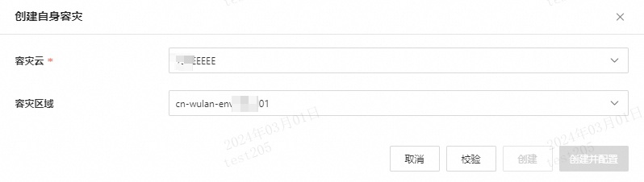

5. 单击**校验**，输入校验值。

6. 校验成功后单击**创建并配置**，也可以单击**创建**后再配置。

7. 配置成功后**状态**为**配置完成**如下图所示。

<a id="section-3-6-2"></a>

### 3.6.2. 执行故障切换

当业务在灾备云运行期间出现故障时，需要通过自身容灾切换将业务切回生产云时，本章节介绍在异地容灾管理平台如何执行故障切换操作，以及如何查看故障切换步骤和切换进度。

**背景信息**

当业务在灾备站点对外提供服务期间，发生全局站点级故障时（如灾备站点断网或断电），灾备站点ASR-DR无法访问和使用，从而无法将业务从灾备站点回切到生产站点，这种情况下可以通过ASR-DR自身容灾能力，将ASR-DR切换至生产站点继续使用，在生产站点的ASR-DR上执行故障切换，将业务切回到生产站点，达到容灾业务连续性的目的。

**前提条件**

已创建并配置自身容灾，请参见创建自身容灾。

**操作步骤**

1. 登录灾备站点的异地容灾运维平台。

2. 在左侧导航栏中单击**自身容灾管理**。

3. 执行故障切换。

   - 单击对应生产云自身容灾**操作**列的**故障切换**，

   - 单击对应生产云自身容灾**操作**列的**查看详情**，在自身容灾详情页面单击**启动故障切换**。

4. 启动故障切换后登录生产站点的运维控制台，参考查看自身容灾详情查看切换步骤和切换进度。

   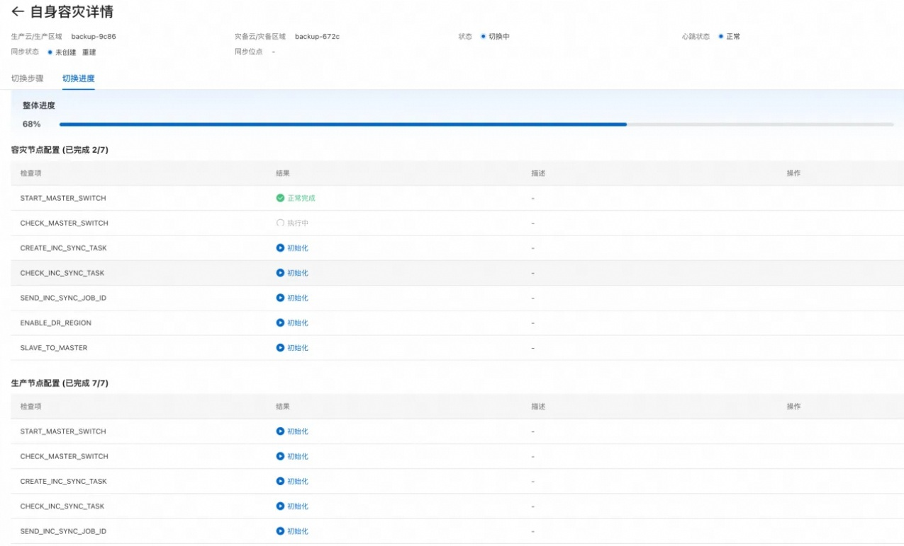

<a id="section-3-6-3"></a>

### 3.6.3. 执行演练切换

针对ASR-DR部署在灾备云，在业务切换到灾备云运行期间，当灾备云故障时业务不能被切回到生产云，所以提供自身容灾能力来解决该问题。执行演练切换操作，提高发生故障时故障切换的成功率。

**背景信息**

当业务在灾备站点对外提供服务期间，发生全局站点级故障时（如灾备站点断网或断电），灾备站点ASR-DR无法访问和使用，从而无法将业务从灾备站点回切到生产站点，这种情况下可以通过ASR-DR自身容灾能力，将ASR-DR切换至生产站点继续使用，在生产站点的ASR-DR上执行故障切换，将业务切回到生产站点，达到容灾业务连续性的目的。

**前提条件**

已创建并配置自身容灾，请参见创建自身容灾。

**操作步骤**

1. 登录灾备站点的异地容灾运维平台。

2. 在左侧导航栏中单击**自身容灾管理**。

3. 执行演练切换。

   - 单击对应生产云自身容灾**操作**列的**演练切换**。

   - 单击对应生产云自身容灾**操作**列的**查看详情**，在自身容灾详情页面单击**启动演练切换**。

4. 启动演练切换后登录生产站点的运维控制台，参考查看自身容灾详情查看切换步骤和切换进度。

   

<a id="section-3-6-4"></a>

### 3.6.4. 查看自身容灾详情

在生产站点可以查看故障切换和演练切换的步骤和切换进度。

**操作步骤**

1. 登录异地容灾运维平台。

2. 在左侧导航栏中选择**自身容灾管理**。

3. 在自身容灾页面会展示容灾列表。

4. 单击**操作**列**查看详情**，会展示容灾基本信息、切换步骤和切换进度。

<a id="section-3-6-5"></a>

### 3.6.5. 解除绑定

**操作步骤**

1. 登录异地容灾运维平台。

2. 在左侧导航栏中选择**自身容灾管理**。

3. 在自身容灾页面真实创建成功的容灾列表。

4. 单击**操作**列**解除绑定**，在弹出的提示框上单击**确定**。解除绑定后自身容灾的状态为未配置，支持重新配置或删除操作。

   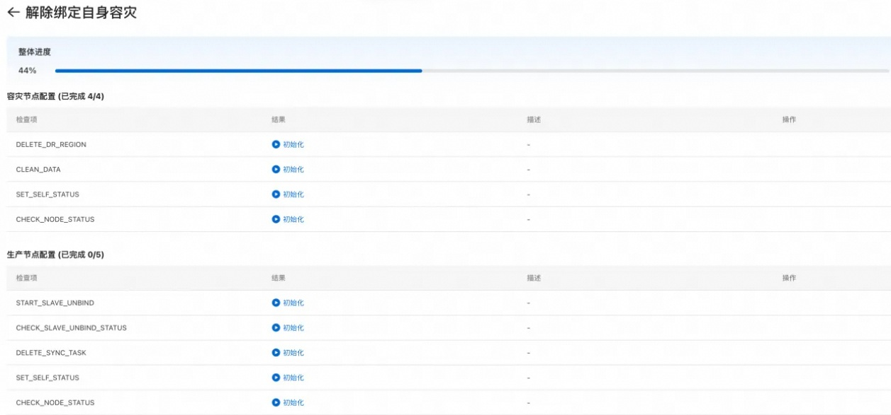

   > **说明**
   >
   > 解除绑定请在备ASRDR上执行。

<a id="section-3-6-6"></a>

### 3.6.6. 删除自身容灾

仅支持删除未配置的自身容灾。例如：刚创建未配置的自身容灾或者已配置但解除绑定的自身容灾。

**操作步骤**

1. 登录异地容灾运维平台。

2. 在左侧导航栏中选择**自身容灾管理**。

3. 在自身容灾页面真实创建成功的容灾列表。

4. 单击**操作**列**删除**，在弹出的提示框上单击**确定**。

<a id="section-4"></a>

# 4.运维常用操作

<a id="section-4-1"></a>

## 4.1. 登录容器

本文以登录ASR-DR容器为例介绍登录容器的步骤，登录其他容器的操作步骤类似，您只需要替换相应的服务和服务角色即可。

**背景信息**

本文用到的相应容器列举如下。

| 产品 | 服务 | 服务角色 |
| --- | --- | --- |
| ASR-DR | asrdr | asrdr-backend.backend# |
| POP | webapp-pop | webapp-pop.PopAliyunCom# |
| PolarDB-X | drds-console | drds-console.DrdsConsole# |
| DTS | dts-dts | • dts-dts.DtsPortal#<br>• dts-dts.DtsMaster# |
| OSS | oss-chiji | oss-chiji.ChijiOssAll# |

**操作步骤**

1. 登录终端。

   <ol type="i">

   <li>

   登录Apsara Uni-manager运维控制台。

   </li>

   <li>

   在顶部菜单栏选择**平台运维 > 飞天基础运维平台 > 资源管理**。

   </li>

   <li>

   在**飞天基础运维平台**左侧导航栏中，选择**资源管理 > 产品集群运维**。

   </li>

   <li>

   在**产品列表**页面的**产品 | 集群**搜索框中输入asrdr，在目标集群**操作**列单击**集群详情**。

   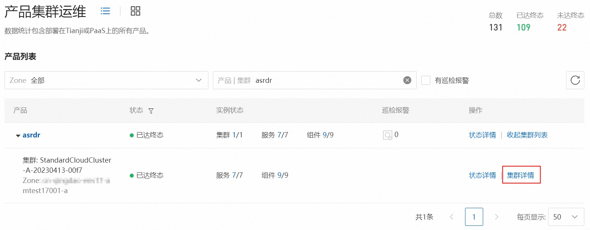

   </li>

   <li>

   在**服务列表**中单击**asrdr-backend**服务。

   </li>

   <li>

   在**组件列表**中选择<strong>backend#</strong>组件。在**实例列表**中，单击某台机器**操作**列中的**Terminal**。

   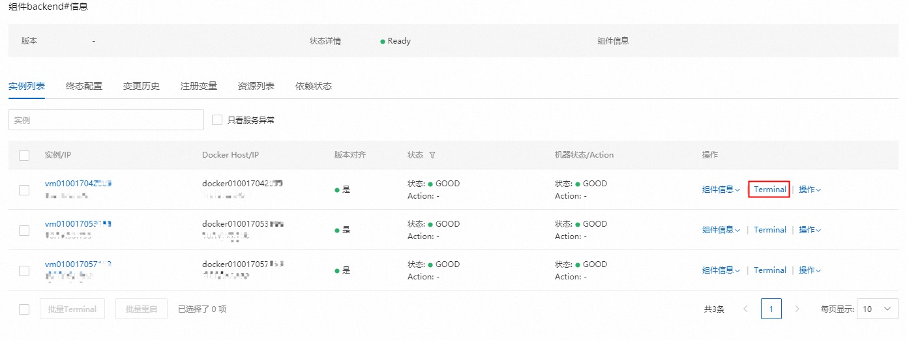

   </li>

   </ol>

2. 执行如下命令查询容器的ID。

   ```bash
   docker ps
   ```

   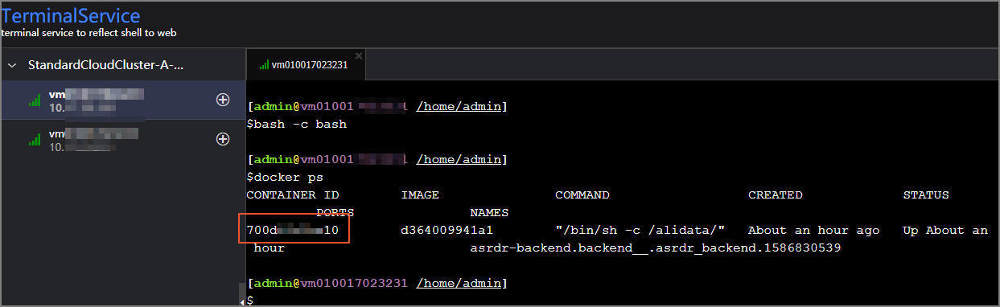

3. 执行如下命令进入容器。

   ```bash
   docker exec -it <容器ID> /bin/bash
   ```

   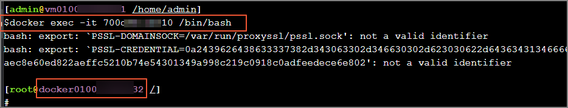

<a id="section-4-2"></a>

## 4.2. 登录ASR-DR元数据库

在飞天基础运维平台获取元数据库的登录信息后，通过OPS服务器登录ASR-DR元数据库。

1. 登录Apsara Uni-manager运维控制台。

2. 在顶部菜单栏选择**平台运维 > 飞天基础运维平台 > 资源管理**。

3. 在**飞天基础运维平台**左侧导航栏中，选择**资源管理 > 产品集群运维**。

4. 在**产品列表**页面的**产品 | 集群**搜索框中输入asrdr，在目标集群**操作**列单击**集群详情**。

   

5. 选择**资源详情**页签，在资源名称输入框中输入**asrdr_v2**，确认**类型**为**db**后，在资源申请结果列单击  图

   标然后单击数据库信息，查看并记录数据库的登录信息。记录后关闭资源申请结果，单击  隐藏数据库信

   息。

   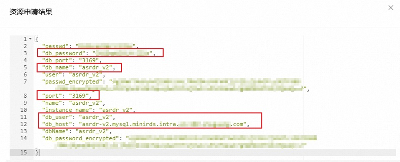

6. 登录OPS服务器，具体步骤请参见专有云如何登录OPS服务器。

7. 根据数据库连接信息登录ASR-DR元数据库。

   ```text
   mysql -h <host> -P<port> -u<user> -p<password> <dbname>
   ```

   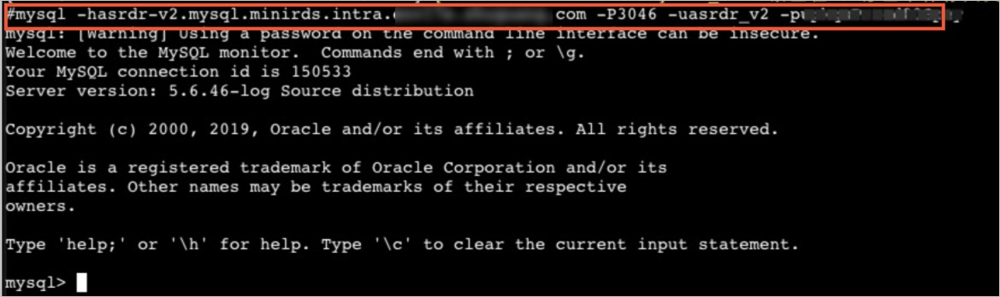

<a id="section-5"></a>

# 5.ASR-DR运维

<a id="section-5-1"></a>

## 5.1. 日志管理

<a id="section-5-1-1"></a>

### 5.1.1. 查看ASR-DR日志

通过查看日志，您可以了解具体的错误信息。

1. 登录ASR-DR容器，具体步骤请参见登录容器。

2. 执行如下命令进入日志的文件夹路径。

   ```bash
   cd /opt/tianji/log/
   ```

3. 执行 `ll` 命令查看日志文件列表。日志文件的用途如下表所示。

   | 日志文件 | 描述 |
   | --- | --- |
   | api.log | ASR-DR调用云产品API的日志 |
   | asrdr-audit.log | 审计日志 |
   | complete.log | 整合的日志，包括所有日志信息 |
   | framework.log | 后端框架日志 |
   | gateway.log | 网关日志，即前端的请求日志 |
   | machine-error.log | 状态机错误日志 |
   | machine.log | 状态机日志 |
   | service-error.log | 服务错误日志 |
   | service.log | 服务日志 |

4. 根据ASR-DR控制台上实例日志的时间，选择对应日期的log文件，并查看日志。

   > **说明**
   >
   > - 不带日期的文件即为当天的日志。
   >
   > - 如果当前日志中没有查到错误信息，您可以切换到ASR-DR的其他容器查看操作日志，操作步骤类似。

5. （可选）您可以根据时间搜索具体的日志信息，命令格式如下。

   ```text
   /<时间>
   ```

   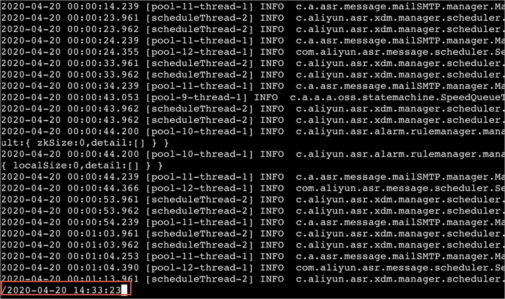

6. （可选）执行以下内容，清理日志；如果日志占用太多容器空间，可以定时清理无用日志。

   执行crontab -e，修改定时任务。

   ```text
   增加：0 1 * * * find /home/admin/logs/ -mtime +7 -type f -name "*.log*" -exec rm -f {} \
   ;表示每天1点清理，删除7天以上的⽇志。
   ```

<a id="section-5-1-2"></a>

### 5.1.2. 修改日志的默认配置

您可以在logback文件中配置日志的等级、日志的输出方式、保存时间、日志是否输出。

**操作步骤**

1. 登录ASR-DR容器，具体步骤请参见登录容器。

2. 备份 `/alidata/bin/start` 文件，以便有异常时进行回滚操作。

   ```text
   cp /alidata/bin/start /alidata/bin/start.bak
   ```

3. 在/alidata/bin目录下创建logback-spring.xml文件，用于配置日志信息。

   ```bash
   cd /alidata/bin
   vim logback-spring.xml
   ```

4. 执行 `vim` 编辑 `/alidata/bin/start` 文件，在java启动命令中增加 `--logging.config=<logback-spring.xml>` 。类似如下：

   ```text
   修改前：
   java ${JAVA_OPTS} -jar /home/admin/asrdr/web-3.0.0.jar --server.port=8888 --
   spring.profiles.active=prod &
   修改后：
   java ${JAVA_OPTS} -jar /home/admin/asrdr/web-3.0.0.jar --server.port=8888 --
   spring.profiles.active=prod --logging.config=/logback-spring.xml &
   ```

   > **说明**
   >
   > &lt;logback-spring.xml>为日志文件的路径。

5. 重启ASR-DR容器。

   ```bash
   # 如果在容器中，则退出docker
   exit
   # 重启docker，容器ID是进入容器时选择的ID
   docker restart <容器ID>
   ```

6. 检查日志的输出是否符合预期。

**回滚方案**

1. 恢复 `/alidata/bin/start` 文件的配置。

   ```text
   # 恢复原备份的start⽂件
   mv /alidata/bin/start.bak /alidata/bin/start
   ```

2. 重启ASR-DR容器。

   ```bash
   # 如果在容器中，则退出docker
   exit
   # 重启docker，容器ID是进入容器时选择的ID
   docker restart <容器ID>
   ```

<a id="section-5-2"></a>

## 5.2. 修改ASR-DR的URL地址

本文介绍V3.12.0 SP005~SP007版本，从Apsara Uni-manager运营控制台跳转到ASR-DR控制台时URL地址不正确的解决办法。

**问题现象**

从Apsara Uni-manager运营控制台跳转到ASR-DR控制台时，ASR-DR的URL地址不正确，无法跳转。

**问题原因**

当Apsara Uni-manager运营控制台为V3.12.0 SP005~SP007版本时，数据库中默认配置的ASR-DR的URL地址为V3.13.0版本ASR-DR的URL配置，需要修改为V3.12.0版本的ASR-DR的URL配置。

**操作步骤**

1. 登录Apsara Uni-manager运营控制台的数据库。具体操作，请参见登录ASR-DR元数据库。

2. 执行如下命令，选择basic数据库。

   ```text
   use basic;
   ```

3. 执行如下命令，查询当前配置。

   ```sql
   select * from identifier_info where identifier = 'asrdr';
   ```

   ```sql
   select * from exposed_resource where identifier='asrdr';
   ```

   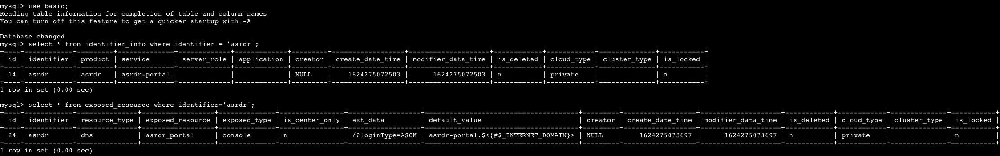

4. 执行如下命令，更新配置。

   ```sql
   update identifier_info set service = 'asrdr-backend',is_locked = 'y'  where 
   identifier='asrdr';
   ```

   ```sql
   update exposed_resource set exposed_resource = 'asrdr',is_locked='y' where 
   identifier='asrdr';
   ```

   ```sql
   update exposed_resource set ext_data='' ,default_value='asrdr.$<{#$_INTERNET_DOMAIN}>' where identifier='asrdr';
   ```

5. 在Apsara Uni-manager运营控制台跳转ASR-DR控制台，验证能正常跳转和登录。

<a id="section-5-3"></a>

## 5.3. 停止ASR-DR节点

ASR-DR采用集群3节点部署，前端请求会通过LB负载到任意节点。问题排查需要在3个ASR-DR查看，排查过程较麻烦。所以在排查问题时，建议关停2个ASR-DR节点，日志将在单点运行的ASR-DR容器中。

**风险**

- 请确保没有正在运维中的演练计划或故障计划，如果计划在运行中，执行该操作，可能导致发生节点切换，增加RTO。

- 保护组将会运行到同一节点，如果保护组数量较大（超过200个时），单节点的负荷会较大。

**方案一：停止容器**

> **说明**
>
> 关停容器会导致飞天基础运维平台检查ASR-DR不到终态。

1. 登录ASR-DR容器，具体请参见登录容器。

2. 执行如下命令进入目录。

   ```bash
   cd /cloud/app/asrdr-portal/portal#
   ```

3. 执行如下命令，停止asrdr-backend容器。

   ```text
   /cloud/tool/tianji/tjc stop asrdr-backend.backend#
   ```

   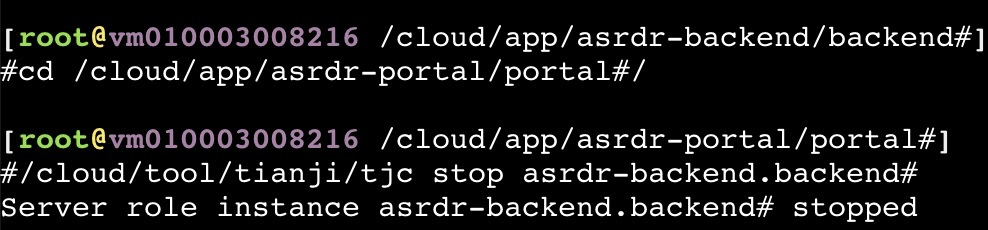

**方案二：停止进程**

1. 登录ASR-DR容器，具体请参见登录容器。

2. 备份 `/alidata/bin/check_app.sh` 文件，以便后期执行回滚操作。

   ```text
   cp /alidata/bin/check_app.sh /alidata/bin/check_appbak.sh
   ```

3. 修改 `/alidata/bin/check_app.sh` 文件，将 `exit $?` 修改为 `exit 0` 。

4. 执行如下命令获取ASR-DR进程的PID，并结束ASR-DR进程。

   ```text
   ps aux | grep <asrdr进程>
   ```

   ```text
   kill -9 <pid>
   ```

   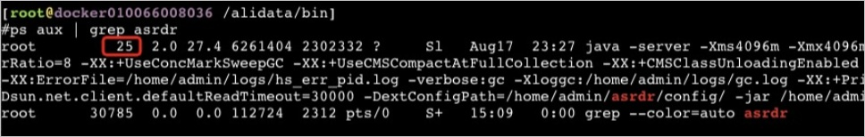

5. 如果是V3.13.0之前的版本，您还需要执行如下命令结束nginx进程。

   ```text
   ps aux | grep <nginx进程>
   ```

   ```text
   kill -9 <pid>
   ```

**回滚方案**

**方案一的回滚**

1. 登录ASR-DR容器，具体请参见登录容器。

2. 执行如下命令进入目录。

   ```bash
   cd /cloud/app/asrdr-portal/portal#
   ```

3. 执行如下命令，停止asrdr-backend容器。

   ```text
   /cloud/tool/tianji/tjc stop asrdr-backend.backend#
   ```

**方案二的回滚**

1. 用备份的 `/alidata/bin/check_app.sh` 文件，替换当前的 `check_app.sh` 文件。

2. 重启asrdr-backend容器。

   ```bash
   # 如果在容器中，则退出docker
   exit
   # 重启docker，容器ID是进入容器时选择的ID
   docker restart <容器ID>
   ```

<a id="section-5-4"></a>

## 5.4. 更换JAR包

客户现场发现的问题，研发工程师修复代码后，可以用新的JAR包替换现场的JAR包，来修复现场的问题。

**背景信息**

- 通过JAR重新打包会使JAR包增大，对功能没有影响。

- 通过JAR打包后，Springboot启动时会出现log4j和logback依赖冲突。您可以在 `BOOT-INF/lib/` 目录下删除 `slf4j-log4j12` 这个JAR包，重新压缩来解决该问题。

**操作步骤**

1. 登录ASR-DR容器，具体请参见登录容器。

2. 执行如下命令备份 `/home/admin/asrdr/web-3.0.0.jar` 文件。

   ```text
   mv /home/admin/asrdr/web-3.0.0.jar /home/admin/web-3.0.0.jar.bak
   ```

3. 将新的 `web-3.0.0.jar` 文件拷贝到 `/home/admin/asrdr` 路径下。

4. 重启ASR-DR容器。

   ```bash
   # 退出docker（如果在容器中）
   exit
   # 重启docker，容器ID是进入容器时选择的ID
   docker restart <容器ID>
   ```

**回滚方案**

1. 登录ASR-DR容器，具体请参见登录容器。

2. 删除 `/home/admin/asrdr` 路径下的 `web-3.0.0.jar` 。

   ```text
   rm -rf ./web-3.0.0.jar
   ```

3. 用之前备份的 `web-3.0.0.jar.bak` 文件替换 `web-3.0.0.jar` 文件。

4. 重启ASR-DR容器。

   ```bash
   # 退出docker（如果在容器中）
   exit
   # 重启docker，容器ID是进入容器时选择的ID
   docker restart <容器ID>
   ```

<a id="section-5-5"></a>

## 5.5. 配置管理

本文介绍如何修改灾备站点容灾产品的相关配置以及ASR-DR的系统配置。

**操作步骤**

1. 登录ASR-DR容器，具体步骤请参见登录容器。

2. 执行如下命令进入配置的目录。

   ```bash
   cd /home/admin/asrdr/config
   ```

   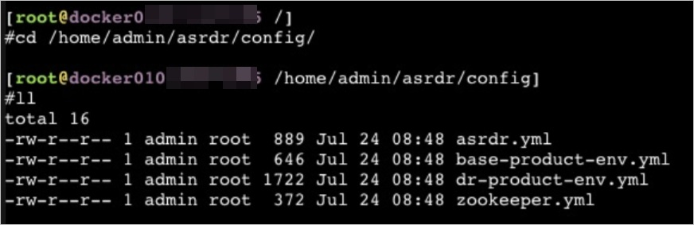

3. 执行如下命令修改相关配置文件，配置文件示例请参见ASR-DR相关配置、基本产品配置、容灾产品配置和ZooKeeper配置。

   ```text
   vi xxx.yml
   ```

4. 登录ASR-DR元数据库，执行如下命令清除配置参数。登录元数据库的步骤请参见登录ASR-DR元数据库。

   ```text
   delete from t_base_param;
   ```

5. 重启容器。

   ```bash
   # 如果在容器中，请退出Docker
   exit
   # 重启Docker，容器ID是进入容器时选择的ID
   docker restart <容器ID>
   ```

6. 重复步骤1~5，直到所有容器均修改完毕。

**ASR-DR相关配置**

```text
## ASR-DR相关配置 ##
##################

# 基础信息
baseinfo:
  product-name: asrdr
  service-name: asrdr-backend
 #  asrdr的服务地址
  domain: ${web_server_host}
  #  asrdr的⻚⾯地址
  portal-domain: ${asrdr_portal_domain}
  version: 3.15.0

# ASR-DR的机器IP列表
node:
  ip: ${node_list}

# ASR-DR RAM账号
user:
  accesskey-id: ${asrdr_aliyun_user_accesskey_id}
  accesskey-secret: ${asrdr_aliyun_user_accesskey_secret}
  id: ${asrdr_aliyun_user_id}
  name: ${asrdr_aliyun_user_mail}

# ASR-DR 服务账号
service:
  use-sts-token: ${use_sts_token:true}
  accesskey-id: ${asr_service_accesskey_id}
  accesskey-secret: ${asr_service_accesskey_secret}
  id: ${asr_service_id}

# ASR-DR产品和保护组个数的配额限制
quota:
  protect-group: 200
  entity: 200
  dts: 60
  oss: 20
  ots: 20
  mq: 20
  dns: 20
  odps: 20
  adb: 20
  ads: 20

application:
  # 检查等待最⼤同步延迟时间，单位分钟
  checkmaxrpo: 30

event:
 # 是否是测试节点
  test-node: false
  # 节点是否做任务的负载均衡
  need-do-lb: false
```

**基本产品配置**

```text
region: ${region_id}

ans:
  env:
    domain: ${ans_enpoint}
    port: 8010
  test: false

# 备云相关参数
ascm:
  env:
    ascm-gateway: ${ascm_gateway}
    ascm-portal: ${ascm_portal}
    user-accesskey-id: ${ascm_default_user_ak}
    user-accesskey-secret: ${ascm_default_user_sk}
    one-console-domain: ${one_console}
  test: false

# 未⽤
aso:
  env:
    plat-monitor:
      domain: asoendpoint
      port: 8092
  test: false
  
### DTS相关信息
dts:
  env:
    domain: ${dts_openapi_endpoint}
  # 是否使⽤主端的DTS
  use-maincloud-dts: false
  test: false

### RAM相关信息
ram:
  env:
    domain: ${ram_endpoint}
    sts-domain: ${sts_endpoint}
  test: false

### VPC相关信息
vpc:
  env:
    domain: ${vpc_inner_endpoint}
  test: false
```

**容灾产品配置**

```text
region: ${region_id}

###RDS产品环境信息
rds:
  env:
    domain: ${rds_openapi_endpoint}
  test: false

### PolarDB-X产品环境信息
drds:
  env:
    domain: ${drds_endpoint}
    zone: ${drds_zone}
    service-accesskey-id: ${drds_ram_ak}
    service-accesskey-secret: ${drds_ram_sk}
  test: false

### ADS产品环境信息
ads:
  env:
    domain: ${ads_openapi_endpoint}
  test: false

### ADB3.0产品环境信息
adb3:
  env:
    domain: ${adb3_openapi_endpoint}
  test: false

### OSS产品环境信息
oss:
  env:
    cloud-type: private
    cloud-id: ${cloud_unique_id}
    domain: ${oss_server_endpoint}
    chiji-domain: ${oss_chiji_endpoint}
    chiji-https-domain: ${oss_chiji_https_endpoint}
    chiji-pop-domain: ${oss_chiji_pop}
    service-accesskey-id: ${default_user_ak}
    service-accesskey-secret: ${default_user_sk}
  test: false

###Tablestore产品环境信息
ots:
  env:
    domain: ${ots_ocm_pop_endpoint}
    repmanager-domain: http://${ots_repmanager_endpoint}
  test: false

### MQ产品环境信息
mq:
  env:
    domain: http://${mq_client_ons_addr}
    ons-address: ${ons_addr}
    user-accesskey-id: ${mq_system_ak}
    user-accesskey-secret: ${mq_system_sk}
    # 使⽤消费模式或同步模式
    use-consume-mode: false
  test: false

### 租户侧DNS产品环境信息
appdns:
  env:
    domain: ${genesisdns_endpoint}
    user-accesskey-id: ${genesisdns_ak}
    user-accesskey-secret: ${genesisdns_sk}
    gtm_pop_endpoint: ${gtm_pop_endpoint}
  test: false

### ⼤数据管家产品环境信息
bcc:
  env:
    domain: https://${bcc_endpoint}
    app-name: ${bcc_app_name}
    app-user: ${bcc_auth_user}
    app-key: ${bcc_app_key}
    app-password: ${bcc_app_passwd}
  test: false
```

**ZooKeeper配置**

```text
zookeeper:
  asr:
    root: ${zookeeper_node}
  conn:
    timeout: 300000
  executor:
    number: 3
    waitTimeOut: 30000
    ttl: 30000
  server:
    endpoints: 
```

```text
${zookeeper_zk1}:${zookeeper_port},${zookeeper_zk2}:${zookeeper_port},${zookeeper_zk3}:${zoo
```

```text
eper_port}
zkui:
    userName: root
    passWord: root
    loginMessage: Please login using username and password.
```

<a id="section-6"></a>

# 6.常见运维处理

<a id="section-6-1"></a>

## 6.1. RDS

<a id="section-6-1-1"></a>

### 6.1.1. RDS新增数据库和数据表

本文介绍如何对容灾保护中的RDS实例进行新增数据库和数据表，避免保护失败。

**背景信息**

容灾演练切换后，RDS的同步链路变成增量链路。DTS的增量同步链路不支持同步数据库结构。因此，在执行新增数据库和数据表时，需人工对ASR-DR及DTS的相关数据进行修改。

**场景一：源端新增数据库，且该数据库需要容灾保护**

1. 手动在备端新增数据库，并创建表结构。对同步账号授予读写权限。

   > **说明**
   >
   > - MySQL 5.7版本的同步账号为asr_sync_account。
   >
   > - MySQL 5.6版本的同步账号为dtssyncwriter。

2. 手动在主端创建数据库，并创建表结构。对同步账号授予读写权限。

   ASR-DR检查到源端或备端新增了库，保护状态会从**保护中**变为**保护失败**。

3. 在ASR-DR控制台的保护组列表中，单击目标保护组右侧的  图标，选择**重保护**。

   对应实体会进入重保护状态，并自动将该数据库加入同步对象中，等待进入保护中状态。由于DTS会启动新的任务去同步新增的数据库，直到子任务同步完成并合入原有主任务，此过程大概需要20分钟，因此需要观察DTS链路是否成功合入。

**场景二：源端新增数据库，且该数据库不需要容灾保护**

该场景不需修改同步对象，但需要修改ASR-DR数据库中的整库过滤标记。主备两端均需要给同步账号授予新增数据库的读写权限。

1. 手动在备端新增数据库，并创建表结构。对同步账号授予读写权限。

   > **说明**
   >
   > - MySQL 5.7版本的同步账号为asr_sync_account。
   >
   > - MySQL 5.6版本的同步账号为dtssyncwriter。

2. 手动在主端创建数据库，并创建表结构。对同步账号授予读写权限。

3. 在ASR-DR控制台设置过滤表，具体操作请参见*异地容灾管理平台ASR-DR用户指南*中的**业务容灾** > **修改过滤表**章节。

   > **说明**
   >
   > V3.15.0及之后的版本支持在ASR-DR控制台设置过滤表。
   >
   > V3.15.0之前的版本请通过如下方法修改：
   >
   > <ol type="i">
   >
   > <li>
   >
   > 登录ASR-DR数据库，具体请参见登录ASR-DR元数据库。
   >
   > </li>
   >
   > <li>
   >
   > 修改**t_am_rdsSyncEntity**的**rwAccounts**字段。在**rwAccounts**字段添加 `,`新增的数据库`.-.*`
   >
   > </li>
   >
   > </ol>


> 。
>
> **rwAccounts**字段是按 数据库`.`账号`.*` 的格式构造，\*表示该数据库整库被过滤。账号字段目前全部为短划线（-）。多个数据库之间用英文半角逗号（,）隔开。
>
> <ol type="i" start="3">
>
> <li>
>
> 检查是否已成功修改，如果没有修改成功，请关闭ASR-DR服务后再修改。
>
> </li>
>
> <li>
>
> 重启ASR-DR服务。
>
> </li>
>
> </ol>

**场景三：源端新增数据库，且需要容灾保护部分表**

1. 手动在备端新增数据库，并创建表结构。对同步账号授予读写权限。

   > **说明**
   >
   > - MySQL 5.7版本的同步账号为asr_sync_account。
   >
   > - MySQL 5.6版本的同步账号为dtssyncwriter。

2. 手动在主端创建数据库，并创建表结构。对同步账号授予读写权限。

3. 在ASR-DR控制台设置过滤表，具体操作请参见*异地容灾管理平台ASR-DR用户指南*中的**业务容灾** > **修改过滤表**章节。

   > **说明**
   >
   > 仅V3.15.0及之后的版本支持在ASR-DR控制台设置过滤表。

**场景四：保护中的数据库新增表，且该表不需要容灾保护**

1. 手动在主端创建表。

2. 停止ASR-DR节点，具体请参见停止ASR-DR节点。

   > **说明**
   >
   > 新增表之后，ASR-DR会定时将新增表加入同步对象中，DTS会将新增表加入同步对象进行同步。因此该场景下为了不让ASR-DR误将新增表作为同步表，您需要先停止ASR-DR节点。

3. 在ASR-DR控制台设置过滤表，具体操作请参见*异地容灾管理平台ASR-DR用户指南*中的**业务容灾** > **修改过滤表**章节。

   > **说明**
   >
   > 仅V3.15.0及之后的版本支持在ASR-DR控制台设置过滤表。

**场景五：保护中的数据库新增表，且该表需要容灾保护**

在主端新增表之后，您需要在备端创建表结构。

> **说明**
>
> 新增表之后，ASR-DR会定时将新增表加入同步对象中，DTS会将新增表加入同步对象进行同步。因此该场景下您不需要修改ASR-DR的配置。

<a id="section-6-1-2"></a>

### 6.1.2. 人工切换主备RDS实例

当生产站点的RDS故障，且ASR-DR故障时，您可以手工将业务切换至灾备站点的RDS。

**背景信息**

- 切换是指生产站点的RDS故障时，将业务切换至灾备站点的RDS。

- 切回是指执行切换后，当灾备站点的RDS故障，将业务从灾备站点的RDS切回至生产站点的RDS。

本文以人工切换的操作为例。

人工切回的操作步骤类似，您需要在生产站点的RDS实例执行如下操作。

**操作步骤**

1. 将灾备站点的RDS实例的账号权限改为**读写**。

   <ol type="i">

   <li>

   登录灾备站点的Apsara Uni-manager运营控制台。

   </li>

   <li>

   在顶部菜单栏中选择**产品 > 数据库 > 云数据库 RDS**。

   </li>

   <li>

   在左侧导航栏中选择**实例列表**，在RDS实例列表中单击目标实例的**实例ID/名称**。

   </li>

   <li>

   在左侧导航栏单击**账号管理**。

   </li>

   <li>

   选择业务使用的账号，在**操作**列中单击**修改权限**。

   </li>

   <li>

   在**已授权数据库**区域，为账号授权数据库的**读写**权限。

   </li>

   <li>

   单击**确定**。

   </li>

   </ol>

2. 检查灾备站点的RDS实例是否可以正常写入数据。

<a id="section-6-1-3"></a>

### 6.1.3. 人工恢复同步链路

当生产站点和灾备站点的RDS实例恢复正常，但是ASR-DR故障，无法短时间恢复的情况下，您可以人工恢复同步链路。

1. 将灾备RDS实例的账号权限改为**只读**。

   <ol type="i">

   <li>

   登录灾备站点的Apsara Uni-manager运营控制台。

   </li>

   <li>

   在顶部菜单栏选择**产品 > 数据库 > 云数据库 RDS 版**。

   </li>

   <li>

   在左侧导航栏中单击**实例列表**，在RDS实例列表中单击目标实例的**实例ID/名称**。

   </li>

   <li>

   在左侧导航栏单击**账号管理**。

   </li>

   <li>

   选择业务使用的账号，在**操作**列中单击**重置账号权限**。

   </li>

   <li>

   在弹出的页面中输入数据库账号的密码，单击**确定**。

   </li>

   <li>

   在**已授权数据库**区域，为账号授权数据库的**只读**权限。

   </li>

   <li>

   单击**确定**。

   </li>

   </ol>

2. 将主RDS实例的账号权限改为**读写**。具体操作步骤参考上一步。

3. 登录灾备站点的DTS控制台，配置主RDS到备RDS的数据同步任务。具体操作步骤请参见*DTS用户指南*中的**数据同步**>**数据同步配置案例**>**RDS MySQL实例间的数据同步**章节。

4. 人工检查同步链路是否正常、数据同步是否正常。

<a id="section-6-2"></a>

## 6.2. DNS

<a id="section-6-2-1"></a>

### 6.2.1. 实例日志提示rrSet inconsistent

本文介绍当DNS实例日志提示rrSet inconsistent时的原因和处理方法。

**问题现象**

在保护组列表中查看**保护组状态**为**保护失败**。在保护组详情中查看实例日志，日志内容为**rrSet inconsistent**。

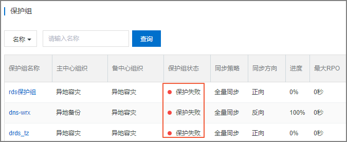

**可能原因**

生产站点DNS的域名解析记录和灾备站点DNS的域名解析记录不一致。

**解决方案**

1. 登录生产站点的DNS控制台，查看DNS域名的**记录集合**。

   <ol type="i">

   <li>

   选择对应的域名，单击**操作**列中的

   图标，单击**解析配置**。

   

   </li>

   <li>

   在**解析设置**页面，单击**操作**列中的

   图标，单击**修改**。

   

   </li>

   <li>

   查看**记录值集合**的值。

   </li>

   </ol>

2. 登录灾备站点的DNS控制台，将DNS域名的**记录值集合**修改为与生产站点一致，操作方法请参见上一步。

3. 登录灾备站点的ASR-DR，在**保护组详情**页面，单击实体列表中目标实例右侧的

   图标，单击**恢复**。

   

   保护组重新进入**保护中**。

<a id="section-6-2-2"></a>

### 6.2.2. 实例日志提示not found record

本文介绍当DNS实例日志提示not found record时的原因和处理方法。

**问题现象**

在保护组列表中查看**保护组状态**为**保护失败**。在保护组详情中查看DNS实例日志，日志内容为**not found record, zoneId: xxx, rrName: xxx, cloudType: xxx**。

**可能原因**

生产站点或灾备站点DNS域名的主机记录未配置。

- cloudType：表示生产站点或灾备站点。MAIN表示生产站点，BACKUP表示灾备站点。

- zoneId：表示对应的DNS实例的ID。

- rrName：表示主机记录的名称。

**解决方案**

1. 根据**cloudType**提示，登录生产站点或灾备站点的DNS控制台。

2. 选择对应的域名，单击**操作**列**解析配置**。

3. 在**解析设置**页面，单击右上角的**添加解析记录**，添加主机记录。

   > **说明**
   >
   > 主机记录中的**记录值集合**要和对端DNS的**记录值集合**保持一致。

4. 登录灾备站点的ASR-DR，在**保护组详情**页面，单击实体列表中目标实例**操作**列的

   图标，单击**恢复**。

   

   保护组重新进入**保护中**。

<a id="section-6-2-3"></a>

### 6.2.3. 实例日志提示not found zone

本文介绍当DNS实例日志提示not found zone时的原因和处理方法。

**问题现象**

在保护组列表中查看**保护组状态**为**保护失败**。在保护组详情中查看DNS实例日志，日志内容为**not found zone xxx cloudType: xxx**。


**可能原因**

在生产站点或灾备站点无法查询到对应的DNS域名实例。

- cloudType：表示生产站点或灾备站点。MAIN表示生产站点，BACKUP表示灾备站点。

- zone：表示对应的DNS实例名称。

**解决方案**

1. 根据**cloudType**提示，登录生产站点或灾备站点的DNS控制台。

2. 创建和对端一致的DNS域名实例。

3. 添加和对端一致的主机记录和解析记录。

4. 登录灾备站点的ASR-DR，在**保护组详情**页面，单击实体列表中目标实例**操作**列中的

   图标，单击**恢复**。

   

   保护组重新进入**保护中**。

<a id="section-6-3"></a>

## 6.3. 云原生数据仓库AnalyticDB MySQL版3.0

<a id="section-6-3-1"></a>

### 6.3.1. 重保护失败

本文介绍云原生数据仓库AnalyticDB MySQL版3.0（简称ADB3.0）实例执行重保护后，保护失败的处理方法。

**问题现象**

暂停同步链路后，执行**重保护**操作，保护组的状态为保护失败。

**问题原因**

重启同步链路的过程中，源端的ADB3.0实例会基于历史位点（上一次切换的位点）来判断主备实例的同步位点信息，导致链路失败。

**处理方案**

1. 登录Apsara Uni-manager运维控制台。

2. 在顶部菜单栏选择**产品运维** > **数据库运维** > **RDS运维·杜康**。

3. 在左侧导航栏中选择**实例管理**>**实例列表**。

4. 根据主端ADB3.0的集群ID搜索到对应的实例，单击**实例简述**列为**专享/analyticdb/主实例/P4**的实例名称。

5. 在**实例详情**页面的左侧导航栏中单击**基本信息（旧版）**，在**实例信息**区域，查看并记录实例ID，单击**打开console**。

   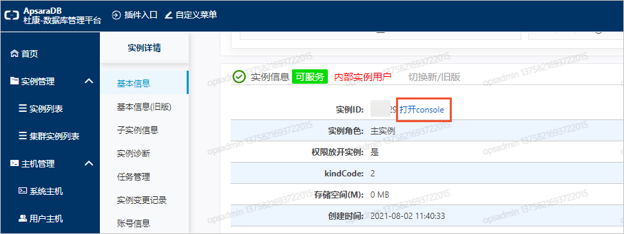

6. 参考步骤3和步骤4，查看备端ADB3.0的实例ID，即repliId。

7. 在主端AnalyticDB Console控制台的左侧导航栏，单击**SQL Editor**，执行如下命令。提示 `gap exist` 的错误。

   ```text
   replication master start <备实例的repliId>
   ```

   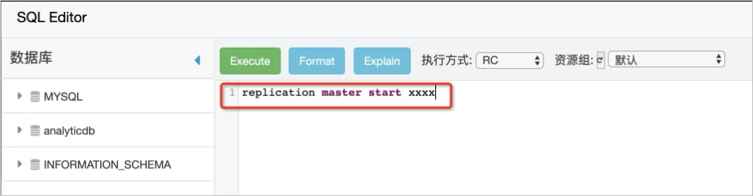

8. 连接meta库执行如下命令。

   ```text
   delete from replication_switch_info;
   ```

   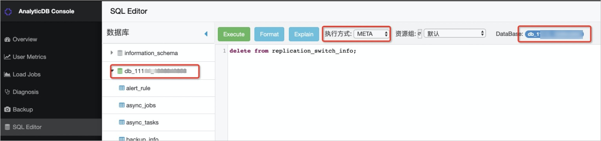

9. 在ASR-DR控制台，对目标实例执行**重试**操作。

   <ol type="i">

   <li>

   在保护组列表中，单击目标保护组名称。

   </li>

   <li>

   在**保护组详情**页面，单击实例列表中目标实例右侧的  图标，单击**重试**。

   </li>

   </ol>

<a id="section-6-3-2"></a>

### 6.3.2. 重新创建同步实体失败

本文介绍重新创建云原生数据仓库AnalyticDB MySQL版3.0（简称ADB3.0）同步实体后，保护失败的处理方法。

**问题现象**

在ASR-DR上删除保护组中的ADB3.0实例，重新添加实体，保护组的状态为保护失败。

**问题原因**

删除同步实体时，历史任务没有清理干净。

**处理方案**

1. 登录Apsara Uni-manager运维控制台。

2. 在顶部菜单栏选择**产品运维** > **数据库运维** > **RDS运维·杜康**。

3. 在左侧导航栏中选择**实例管理**>**实例列表**。

4. 根据主端ADB3.0的集群ID搜索到对应的实例，单击**实例简述**列为**专享/analyticdb/主实例/P4**的实例名称。

5. 在**实例详情**页面的左侧导航栏中单击**基本信息（旧版）**，在**实例信息**区域，查看并记录实例ID，单击**打开console**。

   

6. 参考步骤3和步骤4，查看备端ADB3.0的实例ID，即repliId。

7. 在主端AnalyticDB Console控制台的左侧导航栏，单击**SQL Editor**，执行如下命令。提示 `gap exist` 的错误。

   ```sql
   select * from ation_schema.kepler_meta_cluster_replication_task where is_masteinformr =1 and slave_cluster_name=<备实例的repliId>
   ```

   若存在记录，则说明历史任务没有清理干净。

8. 执行如下命令清理历史任务。

   ```text
   replication master destroy slave <备实例的repliId>
   ```

9. 在ASR-DR控制台，对目标实例执行**重试**操作。

   <ol type="i">

   <li>

   在保护组列表中，单击目标保护组名称。

   </li>

   <li>

   在**保护组详情**页面，单击实例列表中目标实例右侧的  图标，单击**重试**。

   </li>

   </ol>

<a id="section-6-3-3"></a>

### 6.3.3. 创建增量同步实体前置检查

本文介绍创建云原生数据仓库AnalyticDB MySQL版3.0（简称ADB 3.0）增量同步实体的前置检查操作。其中增量同步的前提是主备实例已成功执行全量同步，所以需要检查是否全量同步。

**处理方案**

1. 登录Apsara Uni-manager运维控制台。

2. 在顶部菜单栏选择**产品运维** > **数据库运维** > **RDS运维·杜康**。

3. 登录主端AnalyticDB Console。

   <ol type="i">

   <li>

   在左侧导航栏中，选择**实例管理**>**实例列表**。

   </li>

   <li>

   根据主端ADB 3.0的集群ID搜索对应的实例，单击**实例简述**列为**专享/analyticdb/主实例/P4**的用户实例名称。

   </li>

   <li>

   在**实例详情**页面的左侧导航栏中，单击**基本信息（旧版）**。

   在**实例信息**区域，查看并记录**实例ID**，即repliId。

   </li>

   <li>

   单击**打开console**。

   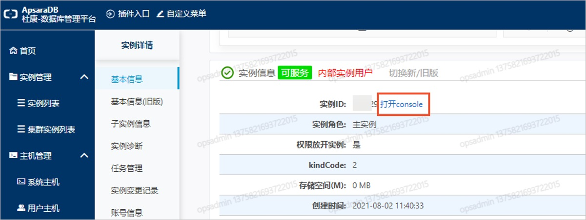

   </li>

   </ol>

4. 查看备端ADB 3.0的实例ID，即repliId，并登录备端AnalyticDB Console，具体操作请参见步骤2。

5. 查看主备端实例Cluster Name和Status。

   <ol type="i">

   <li>

   在主备端AnalyticDB Console左侧导航栏中，单击**SQL Editor**。

   </li>

   <li>

   在**执行方式**下拉框中选择**META**。

   </li>

   <li>

   在**数据库**区域，单击以**db**开头的数据库名。

   </li>

   <li>

   执行如下命令，并记录主备端实例的 `MASTER_CLUSTER_NAME` 、 `SLAVE_CLUSTER_NAME` 和 `STATUS` 字段对应的值。

   ```sql
   select * from cluster_replication_task;
   ```

   主备端实例中存在记录 `MASTER_CLUSTER_NAME` 和 `SLAVE_CLUSTER_NAME` 字段的值分别和主备端实例的repliId保持一致，或者分别和备主端实例的repliId保持一致， `STATUS` 字段的值为**FINISH**，否则不能创建增量链路。

   </li>

   </ol>

<a id="section-6-4"></a>

## 6.4. PolarDB-X

<a id="section-6-4-1"></a>

### 6.4.1. 备实例删除数据库后未生效

本文介绍备PolarDB-X实例删除数据库后未生效的处理方案。

**问题现象**

在备PolarDB-X实例上，删除数据库未生效。

**问题原因**

PolarDB-X的元数据没有同步。

**处理方案**

重启备PolarDB-X实例。

<a id="section-6-4-2"></a>

### 6.4.2. 获取逻辑表的结构时提示表不存在

本文介绍ASR-DR无法获取PolarDB-X逻辑表的结构，提示表不存在的处理方案。

**问题现象**

ASR-DR无法获取PolarDB-X逻辑表的结构，已成功添加的表，提示表不存在。

**问题原因**

PolarDB-X的元数据没有同步。

**处理方案**

1. 在PolarDB-X实例的数据库中，执行如下命令删除该逻辑表。

   ```text
   drop table if exists <table_name>;
   ```

   > **说明**
   >
   > &lt;table_name>请根据实际情况替换为具体的表占位符。

2. 重新创建该逻辑表。

<a id="section-6-4-3"></a>

### 6.4.3. 修改PolarDB-X中RDS数据库的最大个数

PolarDB-X默认最多能创建30个RDS数据库，您可以在配置文件中修改CreateDrdsDB的值，调整最大个数。

1. 登录PolarDB-X的 `drds-console.DrdsConsole#` 服务角色所在的容器，具体操作步骤请参见登录容器。

2. 执行如下命令进入CreateDrdsDB文件所在目录。

   ```bash
   cd /home/admin/pop/apis #临时⽂件路径
   # or
   cd /home/admin/etc/batch/apis/ #永久⽂件路径

   ls | grep CreateDrdsDB 
   vim 2017-10-16-CreateDrdsDB.xml
   ```

   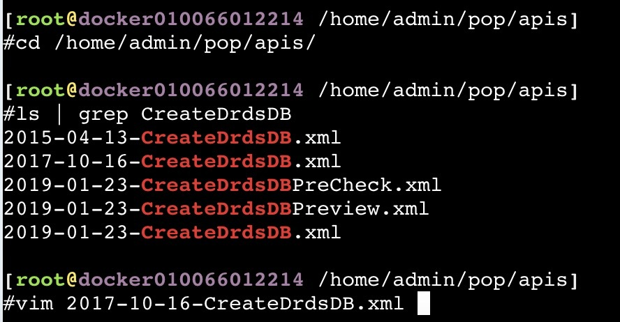

3. 执行 `vim` 命令，编辑 `CreateDrdsDB.xml` 文件，修改**CreateDrdsDB**的**maxNumber**的值。

   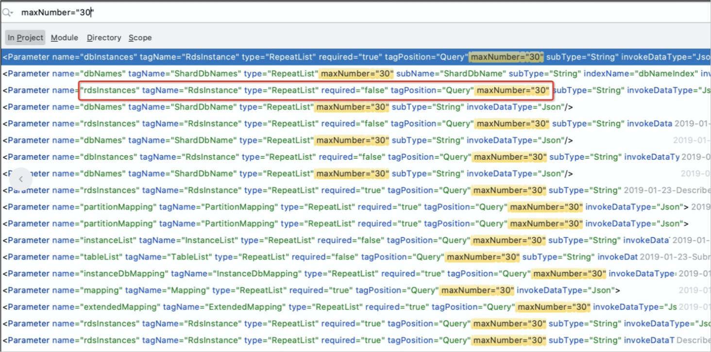

4. 进入 `/home/admin/pop` ，执行如下命令使修改生效。

   ```text
   java -jar batch.jar
   ```

<a id="section-6-4-4"></a>

### 6.4.4. 创建PolarDB-X同步链路失败

本文介绍创建PolarDB-X同步链路失败或无法修改同步实例的处理方案。

**问题现象**

ASR-DR创建PolarDB-X同步链路失败，日志中提示DescribeDrdsShardingDbs接口超时。

**处理方案**

1. 登录Apsara Uni-manager运维控制台。

2. 在顶部菜单中选择**产品运维 > 数据库运维 > DRDS运维·DRDS管家**。

3. 在左侧导航栏中选择**系统管理**>**参数配置**。

4. 单击**Console**页签。

5. 在搜索框中输入support_use_rtools_diamond，单击**support_use_rtools_diamond**右侧**操作**列中的**修改**。

   > **说明**
   >
   > 如果无法搜索到该KEY，请单击**创建**，**FIRST_KEY**设置为support_use_rtools_diamond，**VALUE**设置为false。

6. 将**VALUE**的值修改为false。单击**OK**。

   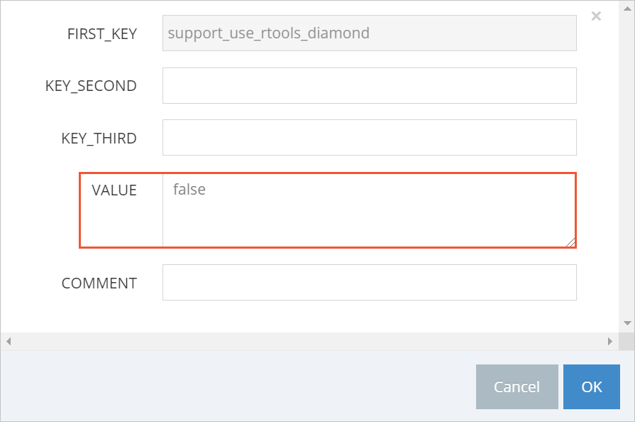

<a id="section-6-4-5"></a>

### 6.4.5. 扩容PolarDB-X实例

本文介绍如何对保护中的PolarDB-X实例进行扩容数据库。

1. 登录ASR-DR，确保ASR-DR没有在执行演练切换、演练回切、故障切换或故障回切。

2. 分别登录主备PolarDB-X控制台。请在主备两端同名的数据库先后执行平滑扩容操作。

   不要求顺序，但操作时间点不要相差太大。等待主备两端PolarDB-X实例显示平滑扩容任务成功，如下图所示。

   

3. 在ASR-DR控制台，找到主备实例所在的保护组，记下当前的同步延迟时间，并删除该保护组里对应的保护实例（如果保护组里只有一个保护实例，则删除保护组），记下该删除时间点T1。

4. 在PolarDB-X控制台，选择一个流量低峰时点，分别对主备PolarDB-X实例执行扩容切换操作。

   等待两端切换完成，如下图所示。

   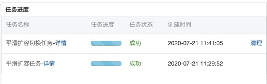

5. 在ASR-DR控制台，新建或选择已有的一个增量保护组，将扩容的PolarDB-X添加其中，同步位点使用步骤3里记录的删除时间点T1减去步骤3记录的同步延迟时间。静待PolarDB-X保护实体进入保护中的状态。

6. 确认主备PolarDB-X的数据一致后，分别在主备PolarDB-X控制台，单击步骤4的图上的**清理**。

<a id="section-6-5"></a>

## 6.5. DTS

<a id="section-6-5-1"></a>

### 6.5.1. 查看DTS日志

在定位数据库产品容灾问题时，您需要查看DTS的Master日志、Portal日志或Node节点的日志。

**查看Master日志**

1. 登录 `dts-dts.DtsMaster#` 服务角色所在的容器，具体登录步骤请参见登录容器。

2. 在 `/dts/master/logs/master.log` 目录下，查看日志。

   ```text
   # 使⽤搜索，即可定位到⼤部分常⻅错误
   grep --color=auto -n -e 'keyword' /dts/master/logs/master.log
   ```

**查看Portal日志**

1. 登录 `dts-dts.DtsPortal#` 服务角色所在的容器，具体登录步骤请参见登录容器。

2. 在 `/dts/portal/logs/portal.log` 目录下，查看日志。

**查看DTS Node节点的日志**

1. 登录Apsara Uni-manager运维控制台。

2. 在顶部菜单中选择**产品运维 > 数据库运维 > DTS运维·DTS**。

3. 查找Node节点的IP地址。

   <ol type="i">

   <li>

   **在任务列表**中，单击类型为**同步**的目标任务名。

   </li>

   <li>

   在**任务详情**页面，单击**同步**区域的**详情**。

   </li>

   <li>

   查看Node节点的IP地址。

   </li>

   </ol>

4. 通过OPS服务器或飞天基础运维平台的Terminal登录DTS Node。

   ```bash
   ssh <DTS Node节点的IP>
   ```

5. 在 `/cloud/app/dts-dts/DtsNode#/dts_node/current/run/<taskId>` 目录下查看log和config文件。

   ```bash
   cd /cloud/app/dts-dts/DtsNode#/dts_node/current/run/<taskId>
   ```

   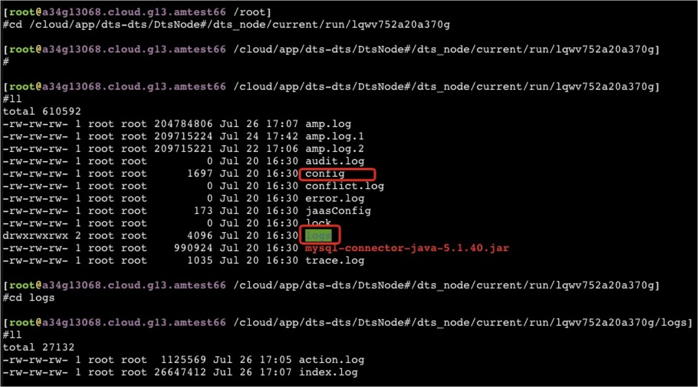

<a id="section-6-5-2"></a>

### 6.5.2. 同步链路创建失败

<a id="section-6-5-2-1"></a>

#### 6.5.2.1. 日志提示The specified Instance SourceEndpoint.InstanceID Not Found

本文介绍DTS日志提示The specified Instance SourceEndpoint.InstanceID Not Found的处理方案。

**问题现象**

ASR-DR创建数据库产品的同步链路失败，查看DTS的Portal日志，提示 `The specified Instance SourceEndpoint.InstanceID Not Found` 。

**问题原因**

该问题通常是由于DTS的region_pattern配置错误。排查方法如下：

1. 登录DTS控制台。

2. 在左侧导航栏单击**数据同步**。

3. 创建一个RDS的同步作业，具体操作步骤请参见*数据传输用户指南*。

4. 在**操作**列中单击**配置同步链路**。

5. 在**选择同步通道的源及目标实例**配置向导页面，查看实例ID的可选列表中是否存在目标地域的实例。例如下图中，实例列表中并没有显示对应地区的实例。

**处理方案**

1. 登录rmdb数据库。

   <ol type="i">

   <li>

   登录Apsara Uni-manager运维控制台。

   </li>

   <li>

   在顶部菜单栏选择**平台运维 > 飞天基础运维平台 > 资源管理**。

   </li>

   <li>

   在**飞天基础运维平台**左侧导航栏中，选择**资源管理 > 产品集群运维**。

   </li>

   <li>

   在**产品列表**中搜索dts，在目标集群**操作**列单击**集群详情**。

   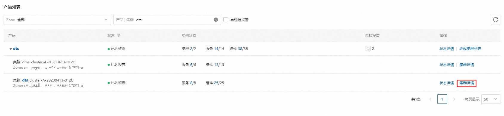

   </li>

   <li>

   选择**资源详情**页签，找到**名称**为**rmdb**、**类型**为**db**的资源，在**资源申请结果**列单击  图标，查看并记录

   数据库的登录信息。

   </li>

   <li>

   登录OPS服务器，具体步骤请参见专有云如何登录OPS服务器。

   </li>

   <li>

   根据数据库连接信息登录rmdb数据库。

   ```text
   mysql -h <host> -P<port> -u<user> -p<password> <dbname>
   ```

   </li>

   </ol>

2. 检查数据表中region和region_pattern的配置是否正确。正确的配置类似如下。

   具体的配置方法请参见《阿里云专有云企业版部署指南》中的**异地容灾部署**章节。

   ```sql
   select * from region_pattern;
   ```

   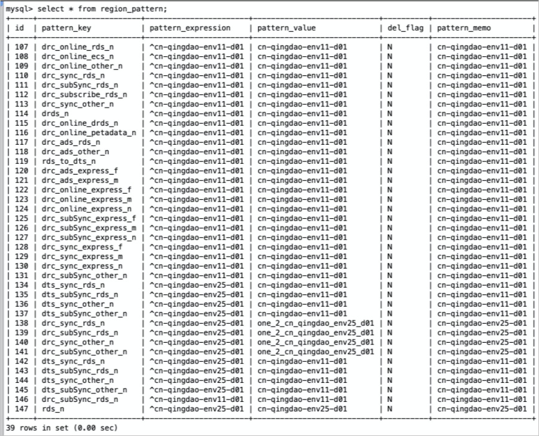

<a id="section-6-5-2-2"></a>

#### 6.5.2.2. 日志提示cluster info is null.The input domain and region is invalid

本文介绍DTS日志提示cluster info is null.The input domain and region is invalid的处理方案。

**问题现象**

ASR-DR创建数据库产品的同步链路失败，查看DTS的Portal日志，提示类似如下信息。

```json
[{"success":false,"msg":"cluster info is null.The input domain and region is 
invalid.","code":404,"data":null}]
```

**问题原因**

DTS跨云同步配置错误。

**处理方案**

1. 登录rmdb数据库。

   <ol type="i">

   <li>

   登录Apsara Uni-manager运维控制台。

   </li>

   <li>

   在顶部菜单栏选择**平台运维 > 飞天基础运维平台 > 资源管理**。

   </li>

   <li>

   在**飞天基础运维平台**左侧导航栏中，选择**资源管理 > 产品集群运维**。

   </li>

   <li>

   在**产品列表**中搜索dts，在目标集群**操作**列单击**集群详情**。

   

   </li>

   <li>

   选择**资源详情**页签，找到**名称**为**rmdb**、**类型**为**db**的资源，在**资源申请结果**列单击  图标，查看并记录

   数据库的登录信息。

   </li>

   <li>

   登录OPS服务器，具体步骤请参见专有云如何登录OPS服务器。

   </li>

   <li>

   根据数据库连接信息登录rmdb数据库。

   ```text
   mysql -h <host> -P<port> -u<user> -p<password> <dbname>
   ```

   </li>

   </ol>

2. 检查数据表中region和region_pattern的配置是否正确。例如Region的写法是否有问题（下划线和横线的区别），是否缺少记录。正确的配置类似如下图。

   具体的配置方法请参见《阿里云专有云企业版部署指南》中的**异地容灾部署** > **容灾配置** > **产品容灾配置** > **RDS和PolarDB-X跨云容灾配置**章节。

   ```sql
   select * from region_pattern;
   ```

   

<a id="section-6-5-2-3"></a>

#### 6.5.2.3. 日志提示Specified access key is not found

本文介绍DTS日志提示Specified access key is not found的处理方案。

**问题现象**

ASR-DR创建数据库产品的同步链路失败，查看DTS的Portal日志，搜索接口请求的Request ID，或者搜索**dts console**， 提示 `Specified access key is not found` 。

**问题原因**

- 如果是跨云容灾场景，可能原因是dts-portal配置的对端AccessKey不正确。

- 如果是跨Region容灾场景，可能原因是中心Region的UMMAK向单元Region同步时出现问题。重建UMMAK的同步链路即可。

**处理方案-跨云容灾场景**

1. 登录生产站点DtsPortal#服务角色所在的容器，具体操作请参见登录容器。

2. 检查 `/dts/portal/application.properties` 文件中配置的灾备站点的AccessKey是否正确。如果不正确，请修改为正确的AccessKey。

**处理方案-跨Region容灾场景**

1. 在单元Region，登录baseService-umm-ak服务对应的UMMAK数据库。

   <ol type="i">

   <li>

   登录Apsara Uni-manager运维控制台。

   </li>

   <li>

   在顶部菜单栏选择**平台运维 > 飞天基础运维平台 > 资源管理**。

   </li>

   <li>

   在**飞天基础运维平台**左侧导航栏中，选择**资源管理 > 产品集群运维**。

   </li>

   <li>

   在**产品列表**中搜索baseServiceAll，在目标集群**操作**列单击**集群详情**。

   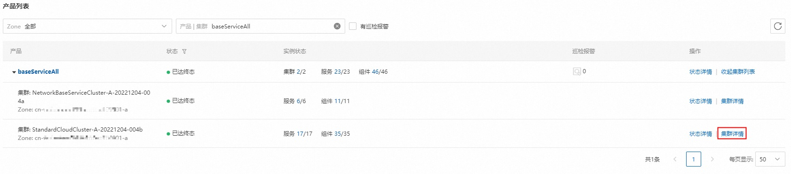

   </li>

   <li>

   选择**资源详情**页签，找到**名称**为**ummak**、**类型**为**db**的资源，在**资源申请结果**列单击  图标，查看并记

   录数据库的登录信息。

   </li>

   <li>

   登录OPS服务器，具体步骤请参见专有云如何登录OPS服务器。

   </li>

   <li>

   根据数据库连接信息登录ummak数据库。

   ```text
   mysql -h <host> -P<port> -u<user> -p<password> <dbname>
   ```

   </li>

   </ol>

2. 执行如下命令清除所有表。

   ```text
   truncate table ***
   ```

3. 在单元Region的飞天基础运维平台，重启<strong>baseService-umm-ak.UmmInit#</strong>服务角色，将会重新生成umm-ak DTS任务。

   <ol type="i">

   <li>

   在**飞天基础运维平台**左侧导航栏中，选择**资源管理 > 产品集群运维**。

   </li>

   <li>

   在**产品列表**中搜索baseServiceAll，在目标集群**操作**列单击**集群详情**。

   

   </li>

   <li>

   在服务列表中单击**baseService-umm-ak**服务。

   </li>

   <li>

   选择<strong>UmmInit#</strong>组件，在对应机器的**操作**列中，单击**操作** > **重启**。

   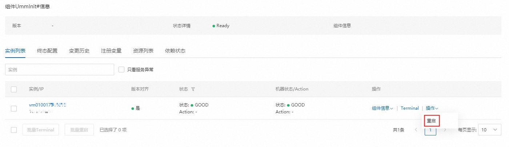

   </li>

   </ol>

<a id="section-6-5-2-4"></a>

#### 6.5.2.4. 日志提示InvalidAppId.NotFound

本文介绍DTS日志提示InvalidAppId.NotFound的处理方案。

**问题现象**

ASR-DR创建数据库产品的同步链路失败，查看DTS的Portal日志，提示 `InvalidAppId.NotFound` 。

**问题原因**

App没有在灾备站点的VPC数据库注册成功。

**处理方案**

1. 在ASR-DR的元数据库的**t_base_vpc_entity**表中查询app_id的值。登录ASR-DR元数据库的步骤请参见登录ASR-DR元数据库。

   

2. 登录vpc-controller的数据库。

   <ol type="i">

   <li>

   登录Apsara Uni-manager运维控制台。

   </li>

   <li>

   在顶部菜单栏选择**平台运维 > 飞天基础运维平台 > 资源管理**。

   </li>

   <li>

   在**飞天基础运维平台**左侧导航栏中，选择**资源管理 > 产品集群运维**。

   </li>

   <li>

   在**产品列表**中搜索vpc，在目标集群**操作**列单击**集群详情**。

   

   </li>

   <li>

   选择**资源详情**页签，找到**名称**为**vpcregiondb**、**类型**为**db**的资源，在**资源申请结果**列单击  图标，查

   看并记录数据库的登录信息。

   </li>

   <li>

   登录OPS服务器，具体步骤请参见专有云如何登录OPS服务器。

   </li>

   <li>

   根据数据库连接信息登录vpc-controller数据库。

   ```text
   mysql -h <host> -P<port> -u<user> -p<password> <dbname>
   ```

   </li>

   </ol>

3. 执行如下命令查看app、app_address_pool、app_server、app_access数据表中是否有ASR-DR配置的数据。

   如果在vpc-controller数据库中没有查到上述SQL的相关信息，表明VPC的注册信息过期或者没有注册成功。请继续执行步骤4。

   ```sql
   select * from app where app_id='app-9nh4****h1qursq' and is_deleted=0\G;

   # available_count最好为0
   select * from app_address_pool where app_id='app-9nh4n****1qursq' and is_deleted=0\G;

   # 根据asrdr的docker数量确定，如果asrdr服务的docker数量为3，则有3条记录
   select * from app_server where app_id='app-9nh4n****h1qursq' and is_deleted=0\G;

   # 其中mapping ip/port，是在经典⽹络中去访问vpc的地址
   select * from app_access where app_id='app-9nh4n****h1qursq' and is_deleted=0\G;
   ```

   > **说明**
   >
   > app_id的值请替换为步骤1中获取的app_id。

4. 登录DTS的**dtsdb**数据库。

   <ol type="i">

   <li>

   登录Apsara Uni-manager运维控制台。

   </li>

   <li>

   在顶部菜单栏选择**平台运维 > 飞天基础运维平台 > 资源管理**。

   </li>

   <li>

   在**飞天基础运维平台**左侧导航栏中，选择**资源管理 > 产品集群运维**。

   </li>

   <li>

   在**产品列表**中搜索dts，在目标集群**操作**列单击**集群详情**。

   

   </li>

   <li>

   选择**资源详情**页签，找到**名称**为**dtsdb**、**类型**为**db**的资源，在**资源申请结果**列单击  图标，查看并记录

   数据库的登录信息。

   </li>

   <li>

   登录OPS服务器，具体步骤请参见专有云如何登录OPS服务器。

   </li>

   <li>

   根据数据库连接信息登录dtsdb数据库。

   ```text
   mysql -h <host> -P<port> -u<user> -p<password> <dbname>
   ```

   </li>

   </ol>

5. 在dts_mapping_app、dts_mapping_server和dts_mapping_pool数据表中删除旧的VPC注册信息。

6. 重启DTS的portal、master、node、cm和DrcSv4mysql服务。

<a id="section-6-5-2-5"></a>

#### 6.5.2.5. 日志提示ram authorized

本文介绍DTS日志提示ram authorized的处理方案。

**问题现象**

ASR-DR创建数据库产品的同步任务失败，查看DTS的Portal日志，提示 `ram authorized` 。

**问题原因**

Apsara Uni-manager运营控制台上，对应的组织没有创建数据传输服务（DTS）的RAM服务角色。

**处理方案**

1. 登录Apsara Uni-manager运营控制台，选择**配置** > **RAM服务角色**。

   

2. 在服务名称搜索 数据传输服务 ，查看对应的组织是否已创建该RAM服务角色。

   - 如果不存在相应的RAM服务角色，请给对应的组织创建**数据传输 DTS**服务的RAM服务角色。具体操作步骤请参见*异地容灾管理平台ASR-DR用户指南*。

   - 如果存在相应的RAM服务角色，请联系运维工程师进行处理。

<a id="section-6-5-2-6"></a>

#### 6.5.2.6. 日志提示open_api_objects长度不足

本文介绍DTS日志提示Data truncation: Data too long for column 'open_api_objects'的处理方案。

**问题现象**

ASR-DR创建数据库产品的同步链路失败，查看DTS的Portal日志，提示 `Data truncation: Data too long for column 'open_api_objects'` 。

**问题原因**

同步的对象太大。

**处理方案**

1. 登录DTS的dtsdb数据库。

   <ol type="i">

   <li>

   登录Apsara Uni-manager运维控制台。

   </li>

   <li>

   在顶部菜单栏选择**平台运维 > 飞天基础运维平台 > 资源管理**。

   </li>

   <li>

   在**飞天基础运维平台**左侧导航栏中，选择**资源管理 > 产品集群运维**。

   </li>

   <li>

   在**产品列表**中搜索dts，在目标集群**操作**列单击**集群详情**。

   

   </li>

   <li>

   选择**资源详情**页签，找到**名称**为**dtsdb**、**类型**为**db**的资源，在**资源申请结果**列单击  图标，查看并记录

   数据库的登录信息。

   </li>

   <li>

   登录OPS服务器，具体步骤请参见专有云如何登录OPS服务器。

   </li>

   <li>

   根据数据库连接信息登录dtsdb数据库。

   ```text
   mysql -h <host> -P<port> -u<user> -p<password> <dbname>
   ```

   </li>

   </ol>

2. 执行如下命令修改open_api_objects的值。

   ```sql
   ALTER TABLE migration_job_param MODIFY open_api_objects MEDIUMTEXT ; 
   ALTER TABLE migration_job MODIFY RESERVED MEDIUMTEXT ;
   ```

<a id="section-6-5-3"></a>

### 6.5.3. 预检查异常

<a id="section-6-5-3-1"></a>

#### 6.5.3.1. 提示拓扑结构不一致

本文介绍DTS预检查失败，提示拓扑结构不一致的处理方案。

**问题现象**


在DTS运维控制台，同步任务**预检查**失败，提示 拓扑结构不一致 的错误。

**问题解决**

1. 登录Apsara Uni-manager运维控制台。

2. 在顶部菜单中选择**产品运维 > 数据库运维 > DTS运维·DTS**。

3. 在任务列表中，单击类型为**同步**的目标任务名。

4. 在**任务详情**页面，单击**预检查**区域的**详情**。

5. 在**预检查**页面，单击**检查项**页签，屏蔽拓扑结构的检查项。

6. 单击**基本信息**页签，单击**重启**。

<a id="section-6-5-3-2"></a>

#### 6.5.3.2. 提示CHECK_ERROR_SRC_USER_PSW

本文介绍DTS预检查失败，提示CHECK_ERROR_SRC_USER_PSW的处理方案。

**问题现象**

DTS预检查失败，提示 `CHECK_ERROR_SRC_USER_PSW` 。

**处理方案**

1. 在Node所在的节点日志中查看error.log信息，具体操作步骤请参见查看DTS Node节点的日志。

2. 将 `/cloud/app/dts-dts/DtsNode#/dts_node/current/jar` 目录下的 `console.jar` 拷贝到task所在目录，执行如下命令获取destUsr和destPsw。

   ```bash
   cp /cloud/app/dts-dts/DtsNode#/dts_node/current/jar/console.jar /cloud/app/dts-
   dts/DtsNode#/dts_node/current/run/<taskId>/
   cd /cloud/app/dts-dts/DtsNode#/dts_node/current/run/<taskId>
   java -jar console.jar -e -print
   ```

   

3. 根据上一步中获取的destDbInst、destUsr和destPsw信息，执行 `telnet <destDbInst>` 命令查看网络是否能正常连接。

   如果网络无法正常连接，请执行如下步骤。

4. 重启DTS的Portal、Master、Node、Cm和DrcSv4mysql服务。

<a id="section-6-5-3-3"></a>

#### 6.5.3.3. 提示CHECK_ERROR_DEST_USER_PSW

本文介绍DTS预检查时，目的端连通性检查失败，提示CHECK_ERROR_DEST_USER_PSW的处理方案。

**问题现象**

DTS预检查时，目的端连通性检查失败，提示 `CHECK_ERROR_DEST_USER_PSW` 。

**问题原因**

- 数据库实例的账号、密码错误。

- 数据库实例的白名单中没有添加DTS的IP地址。

  DTS在创建同步任务时，默认会自动把自己的IP地址增加到数据库实例的白名单中。但如果源端数据库的白名单中已存在该IP地址，而目标端数据库的白名单中没有该IP地址。DTS不会在目标端数据库的白名单中再增加该IP地址。所以需要确保源端和目标端数据库的白名单中，都添加DTS的IP地址。

**处理方案**

手动在源端和目标端数据库的白名单中，添加DTS的IP地址。设置白名单的方法请参见*云数据库RDS 用户指南*中的**设置白名单**章节。

<a id="section-6-5-4"></a>

### 6.5.4. 增量数据服务异常

<a id="section-6-5-4-1"></a>

#### 6.5.4.1. 增量数据服务失败

本文介绍增量数据服务失败的处理方案。

**问题现象**

1. DTS运维控制台的任务详情中，预检查显示完成，增量数据服务显示失败。

   

2. 单击**增量数据服务**区域的**详情**，**DReader**和**DStore**的页面有信息。

**处理方案**

1. 查看DTS的Master日志，在日志中查看topic_group是否被删除。具体操作步骤请参见查看Master日志。

   

2. 如果日志中发现topic_group被删除。请在DTS运维控制台重启增量数据服务。

   <ol type="i">

   <li>

   在DTS运维控制台，单击目标任务名称。

   </li>

   <li>

   在任务详情页面的**增量数据服务**区域，单击**详情**。

   </li>

   <li>

   在增量数据服务页面单击**重启（重建）**。

   

   </li>

   </ol>

<a id="section-6-5-5"></a>

### 6.5.5. 同步数据异常

<a id="section-6-5-5-1"></a>

#### 6.5.5.1. 提示store delay xxx second(s)

本文介绍DTS任务的同步步骤中，状态显示store delay xxx second(s)的处理方案。

**问题现象**

DTS任务的**同步**步骤中，状态显示 `store delay xxx second(s)` 。

**问题原因**

源端数据库没有写入数据。

<a id="section-6-5-5-2"></a>

#### 6.5.5.2. 提示reader连不上dstore

本文介绍DTS同步数据失败，提示reader连不上dstore的处理方案。

**问题现象**

DTS同步数据失败，任务的**同步**步骤中，提示 `reader`连不上`dstore` 。

**问题原因**

源数据库修改了密码，但DTS同步任务的Topic中，配置的源数据库密码不会自动更新，导致同步失败。

**处理方案**

1. 登录DTS控制台。

2. 单击目标任务名称。

3. 单击**修改源实例密码**。

4. 根据界面提示输入旧密码和新密码，单击**确定**。

<a id="section-6-5-6"></a>

### 6.5.6. 恢复网络后，DTS任务没有自动恢复

本文介绍网络恢复后，DTS任务没有自动恢复的处理方案。

**问题现象**

网络中断，恢复网络后，DTS的同步任务没有自动恢复。

**处理方案**

1. 登录Apsara Uni-manager运维控制台。

2. 在顶部菜单中选择**产品运维 > 数据库运维 > DTS运维·DTS**。

3. 在任务列表中，单击目标任务，在**任务详情**页面，单击**同步**区域的**详情**。

4. 在**同步**页面，单击**重启**。

5. 等DTS恢复正常后，在ASR-DR控制台对目标保护实体执行重保护操作。

   <ol type="i">

   <li>

   在ASR-DR控制台的左侧导航栏，选择**业务容灾**>**保护组**。

   </li>

   <li>

   在保护组列表中，单击目标保护组右侧的  图标，选择**重保护**。

   </li>

   </ol>

   > **说明**
   >
   > 如果网络中断超过18个小时，则Binlog可能丢失，此时，重保护只能重新建立全量链路。

<a id="section-6-5-7"></a>

### 6.5.7. 如何防止主备中断时间过长导致Binlog日志丢失

您可以在RDS运维控制台上修改Binlog的本地保留时间，防止主备中断时间过长，导致Binlog日志丢失。

**背景信息**

RDS默认会将Binlog日志保留18小时。您可以在RDS运维控制台上修改Binlog的备份策略。

**操作步骤**

1. 登录Apsara Uni-manager运维控制台。

2. 在顶部菜单栏选择**产品运维** > **数据库运维** > **RDS运维·杜康**。

3. 在左侧导航栏中选择**实例管理**>**实例列表**。单击目标实例名称。

4. 在**实例详情**的左侧导航栏中，单击**备份策略**。

5. 在**BINLOG备份ID**区域，单击**修改BINLOG备份策略**，设置**本地保留时间**。

6. 单击**提交**。

<a id="section-6-6"></a>

## 6.6. OSS

<a id="section-6-6-1"></a>

### 6.6.1. 手工恢复OSS的同步链路

当主备OSS恢复正常，但是ASR-DR故障，无法短时间恢复的情况下，需要人工恢复OSS的同步链路。

1. 登录OSS控制台。

   在Apsara Uni-manager运营控制台的顶部菜单栏，选择**产品**>**存储**>**对象存储OSS**。

2. 在Bucket列表中单击目标Bucket。

3. 手动创建跨云同步链路。

   > **说明**
   >
   > 如果同步链路已存在，则忽略该步骤。

   <ol type="i">

   <li>

   单击**基础设置**页签，在**跨云复制**区域，单击**开启同步**。

   </li>

   <li>

   在跨云复制面板配置数据同步的各项参数。

   <table>
     <tr>
       <th width="138">配置</th>
       <th>说明</th>
     </tr>
     <tr>
       <td>源Bucket地域</td>
       <td>显示源Bucket所在地域。</td>
     </tr>
     <tr>
       <td>源Bucket</td>
       <td>显示源Bucket名称。</td>
     </tr>
     <tr>
       <td>同步目标云</td>
       <td>输入目标云名称。</td>
     </tr>
     <tr>
       <td>同步目标云地址</td>
       <td>输入目标云Location。</td>
     </tr>
     <tr>
       <td>目标Bucket</td>
       <td>填写目标Bucket名称。</td>
     </tr>
     <tr>
       <td>数据同步对象</td>
       <td>选择数据同步的对象。<br>• 全部文件进行同步：同步Bucket内所有文件。<br>• 指定文件名前缀进行同步：设置指定文件名前缀，可同步包含指定前缀的文件。单击添加可添加最多10个前缀。</td>
     </tr>
     <tr>
       <td>数据同步策略</td>
       <td>选择数据同步的策略。<br>• 增/改同步：仅将该Bucket内新增和更新的数据同步到目标Bucket。<br>• 增/删/改同步：将该Bucket的所有数据，包括新增、更新、删除操作同步到目标Bucket。</td>
     </tr>
     <tr>
       <td>同步历史数据</td>
       <td>选择是否同步设置跨云复制前Bucket已有的历史数据。<br>• 同步：将历史数据同步至目标Bucket。<br>• 不同步：仅同步设置跨云复制后上传或更新的文件。</td>
     </tr>
   </table>

   </li>

   <li>

   单击**确定**保存配置。

   等待3分钟左右，同步链路从**开启中**变为**运行中**。

   </li>

   </ol>

4. 检查主备Bucket的数据是否一致。

<a id="section-6-6-2"></a>

### 6.6.2. OSS保护失败的排查思路

本文介绍OSS保护失败的排查思路。

当OSS保护失败时，您可以从以下几方面去排查是否存在问题：

1. 检查源端OSS和备端OSS之间是否存在同步链路。

   如果同步链路不存在，则在ASR-DR的日志中查找 `getAddBucketReplicationRequest` 关键字，确认链路是否添加成功。如果添加失败，请联系ASR-DR产品研发工程师协助处理。

2. 检查ASR-DR上配置的OSS Endpoint是否正确。查看配置的方法请参见*异地容灾管理平台ASR-DR用户指南*。

3. 检查chiji的版本大于等于v3.10 hotfix。

   > **说明**
   >
   > v3.10 hotfix版本修复了OSS加速接口的问题。

   <ol type="i">

   <li>

   登录<strong>oss-chiji.ChijiOssAll#</strong>服务角色所在的容器，具体请参见登录容器。

   </li>

   <li>

   查看 `/home/admin/admin_portal/ocm/ocm_cmd` 的 `setHistorySyncStatus` 参数的配置，正确的配置类似如下图所示。

   如果配置没有问题，继续执行下一步。

   

   </li>

   <li>

   退出容器，在生产站点的 `/cloud/log/oss-chiji/ChijiOssAll#/chiji_oss_all/logs` 目录中查看与ASR-DR日志里request_id相同的日志，重点看**ReplCloudService**类的日志。

   如果日志显示类似如下信息，可能原因是chiji的版本低。

   ```json
   {   "msg": "[system error] Failed to run cmd reload_sync_worker.py --sbucket=asrdr-321e-01 --slocation=oss-cn-****-d02-a --dbucket=asrdr-33e-10 --dlocation=oss-cn-****-
   d01-a! ERRORMSG = (255)exception run dsu failed!\n\n, pls contact chiji support, request_id: 601ef3f7-4cc3-****8f2c4cf22fbf",   "code": -1,   "format_version": "1.0",   
   "success": false,   "request_id": "601ef3f7-****-8f2c4cf22fbf",   "value": {} }
   ```

   </li>

   </ol>

4. 如果chiji的版本是匹配的，请查看加速接口的日志。如果日志显示成功，但返回200，请联系OSS产品技术支持解决相关问题。

   

<a id="section-6-7"></a>

## 6.7. MaxCompute

<a id="section-6-7-1"></a>

### 6.7.1. ASR-DR中配置MaxCompute项目返回空

本文介绍配置MaxCompute项目时无法获取项目信息的处理方案。

**问题现象**

在ASR-DR的**添加实体**功能中，选择了主备DataWorks项目后，在选择MaxCompute项目时，查询不到MaxCompute项目信息。如下图所示。

**问题原因**

MaxCompute和DataWorks需要满足如下要求，才允许建立容灾备份关系。

- 生产站点DataWorks的Project名称与灾备站点一致。

- 生产站点MaxCompute的Project名称、任务云账号名称与灾备站点一致。

**处理方案**

1. 配置主备DataWorks的Project名称，确保一致。具体操作请参见*DataWorks用户指南*。

2. 配置主备MaxCompute的Project名称和任务云账号名称，确保一致。具体操作请参见*MaxCompute用户指南*。

<a id="section-6-8"></a>

## 6.8. MQ

<a id="section-6-8-1"></a>

### 6.8.1. 查看MQ实例主备端的消息详情

本文介绍ASR-DR无法查看MQ实例主备端消息消费和消息同步详情的处理方案。

**问题现象**

在ASR-DR无法查看MQ实例主备端消息消费和消息同步的详情。

**问题原因**

当前ASR-DR不具备此能力。

**处理方案**

1. 登录主备端mq-broker.DeployBroker#容器，具体操作，请参见登录容器。

2. 执行如下命令，查看消息消费和消息同步的详情。

   ```text
   sh rmq/bin/mqadmin consumerProgress -g <实例id>%<groupId> -t <实例id>%<topic>
   ```

   

   参数说明如下所示。

   | 参数 | 描述 |
   | --- | --- |
   | Broker Offset | 主端所有消息。 |
   | Consumer Offset | 已经消费的所有消息。 |
   | Diff | 还未被消费的消息。 |
   | LastTime | 最后消费时间。 |
   | Diff Total | 未被消费消息总数。 |

<a id="section-6-8-2"></a>

### 6.8.2. 使用命令重置消费位点

主备切换后，备端查询已消费的消息数显示从0开始，或与主端相差较大时，您需要重置消费位点。

**问题现象**

当在ASR-DR执行主备切换后，在备端的消费者消费到大量重复消息，查看Consumer Offset是从0开始，或者与主端的Consumer Offset相差较大。查询Consumer Offset的具体操作，请参见查看MQ实例主备端的消息详情。

**问题原因**

MQ重置消费位点失败，主端的消费位点未被同步到备端，导致备端消费者在消息开始同步的时重新消费，备端将消费到大量重复的消息。

**处理方案**

1. 登录主备端mq-broker.DeployBroker#容器。具体操作，请参见登录容器。

2. 执行如下命令，重置消费位点。

   ```xml
   sh rmq/bin/mqadmin resetOffsetByTime -g <实例id>%<groupId> -f true -s now -t <实例id>%
   <topic>
   ```

<a id="section-7"></a>

# 7.校验容灾产品的数据一致性

本章节主要介绍在容灾切换过程中，当切换失败导致数据不一致、数据丢失时的处理方法。

<a id="section-7-1"></a>

## 7.1. 全量校验并订正RDS和PolarDB-X的数据

您可以通过备机房的DTS对RDS和PolarDB-X的数据库进行数据全量校验，并订正不一致的数据。

**背景信息**

> **重要**
>
> 全量校验是对RDS和PolarDB-X的数据库进行全量数据遍历，该方式会影响数据库性能，请在业务低峰期联系现场运维工程师进行操作。

1. 登录备机房的Apsara Uni-manager运维控制台。

2. 在顶部菜单中选择**产品运维 > 数据库运维 > DTS运维·DTS**。

3. 在**DTS运维平台**的任务列表中查看DTS同步任务。单击任务名链接。

4. 在**任务详情**页面，单击右上角的**全量校验**。

5. 在**添加校验**页面配置相关参数，除了**是否订正**和**线程数**，其他参数请保持默认值。

   > **说明**
   >
   > - **是否订正**：请开启订正。
   >
   > - **线程数**：校验的并发数。线程数建议小于5，以免对数据库的压力过大。

6. 单击**添加**。

7. 在**任务列表**页面，单击上一步创建的校验任务的任务名。

8. 在**任务详情**页，单击**一致性校验**区域中的**详情**，查看校验的基本信息。

   在**基本信息**页面，单击**运行参数**后的**修改**，修改命令行参数，参数解释如下表所示。

   | 名称 | 全称 | 描述 |
   | --- | --- | --- |
   | -c | --config | 必选。配置文件路径。 |
   | -x | --fix | 校验并订正。<br>说明订正数据差异必须指定该选项，默认关闭。 |
   | -a | --server | DTS元数据库汇报选项，开启后会汇报进度和差异信息到数据库。默认为关闭。 |
   | -l | --log | 指定日志、差异记录、订正sql 写入的文件路径。默认为程序所在路径。 |
   | -b | --batch | 数据切片大小。默认值：3000，不建议修改。 |
   | -A | --againbatch | 复检切片大小。请保留默认值300，不建议修改。 |
   | -m | --max | 单表最大差异上限，当差异超过该值，退出该表校验。默认值10000。<br>说明如果是异构数据源校验，建议适当调大该值。 |
   | -p | --process | 指定校验线程池大小，与连接数同大小。默认值：4。云上建议2，集团建议7。 |
   | -n | --nokey | 数据量小于该值的无唯一索引表才会被校验，RDS隐式索引被当作唯一索引处理。 该值过大可能导致慢sql 产生。默认值：10000， |
   | -U | --upload | 与<strong>-a</strong>参数配合使用，指定上传到DTS元数据库中的差异最大值。默认值：300。 |
   | -jobId | --jobId | 指定校验任务的jobId，DTS任务的唯一id。 |
   | -encrypt | --encrypt | 配置文件采用DTS加密，与<strong>-jobId</strong> 配合使用。 |
   | -L | --level | 与<strong>-x</strong>参数配合使用，指定订正级别。多个订正级别之间用正斜线（/）分隔。例如：insert/update/delete。 |
   | -ignore | --ignore | 暂不支持该参数。忽略级别，source/target/diff 的组合。 |
   | -multiple | --multiple | 目的库使用等值查询，适用于分表到单表校验。无法校验目的多数据。 |
   | -trim | --trim | 字符串对比忽略末尾空格，默认关闭。 |
   | -singleindex | --singleindex | 使用单索引校验，适用于联合索引第一个字段有很高的区分度。默认关闭。oracle 开启该模式，查询性能有明显提升。 |
   | -avoidCycle | --avoidCycle | 与<strong>-x</strong> 配合使用，开启防循环订正。默认关闭。 |
   | -d | --diff | 校验上一次的差异。 |
   | -record | --record | 校验上一次数据库记录的差异。 |

9. 在**一致性校验**的**校验对象**页签中查看校验结果。

   > **说明**
   >
   > 有差异的表，在**Diff Row**中单击
   >
   > 图标可以查看差异详情。
   >
   > 

   您也可以通过日志查看校验结果，日志说明如下表所示。

   | 场景 | 日志路径 | 备注 |
   | --- | --- | --- |
   | 查询差异详情 | DTS运行节点机器/校验程序日志目录/diff | • On master： 仅在源库存在的记录，仅仅打印索引。<br>• On slave：仅在目的存在的记录，仅仅打印索引。<br>• Different：源db和目的db索引相同，打印索引和差异字段，以及数据类型。 |
   | 查询订正SQL | DTS运行节点机器/校验程序日志目录/sql | 无 |
   | 查询当前差异信息 | DTS运行节点机器/校验程序日志目录/fullcheck.log | 如果界面的校验进度很慢，差异结果没有汇报，您可以在该日志中搜索WARN，该日志记录了差异记录的主键，可以通过源库和目的库人工对比数据。 |
   | 查询具体的运行记录和报错信息 | DTS运行节点机器/校验程序日志目录/fullcheck.log | 如果要看对应的SQL执行详情，请在命令行加上参数 -g，所有的执行sql都会在日志里打印。 |

<a id="section-7-2"></a>

## 7.2. 校验PolarDB-X的增量数据

通过在备机房DTS创建PolarDB-X数据订阅，可以增量校验PolarDB-X数据差异。

**操作步骤**

1. 登录备机房的DTS控制台。

2. 在左侧导航栏，单击**数据订阅**。

3. 单击页面右上角的**创建数据订阅**。在弹出的对话框中，选择地区、实例类型并填写要创建的实例数量。

   > 在本对话框中，您可以查看到总实例数、已创建的实例数和可创建实例的实例数信息。
   >
   > **说明**

4. 单击**创建**。

5. 在数据订阅列表中，找到刚创建的数据订阅实例，单击**操作**列的**配置订阅通道**。

6. 配置源库信息。

   

   <table>
     <tr>
       <th>类别</th>
       <th>配置</th>
       <th>说明</th>
     </tr>
     <tr>
       <td>无</td>
       <td>订阅名称</td>
       <td>DTS会自动生成一个订阅名称，建议配置具有业务意义的名称（无唯一性要求），便于后续识别。</td>
     </tr>
     <tr>
       <td rowspan="7">源库信息</td>
       <td>实例类型</td>
       <td>固定为<strong>DRDS实例</strong>，不可变更。</td>
     </tr>
     <tr>
       <td>数据库类型</td>
       <td>固定为<strong>DRDS</strong>，不可变更。</td>
     </tr>
     <tr>
       <td>实例地区</td>
       <td>创建数据订阅实例时已指定，不可变更。</td>
     </tr>
     <tr>
       <td>DRDS实例ID</td>
       <td>选择待订阅的云原生分布式数据库PolarDB-X实例ID。</td>
     </tr>
     <tr>
       <td>数据库名称</td>
       <td>选择云原生分布式数据库PolarDB-X实例中待订阅的数据库。</td>
     </tr>
     <tr>
       <td>数据库账号</td>
       <td>填入云原生分布式数据库PolarDB-X实例的数据库账号。</td>
     </tr>
     <tr>
       <td>数据库密码</td>
       <td>填入该数据库账号的密码。</td>
     </tr>
   </table>

7. 上述配置完成后，单击**授权白名单并进入下一步**。

8. 配置需要订阅的数据类型和订阅对象。

   <table>
     <tr>
       <th width="186">配置</th>
       <th>说明</th>
     </tr>
     <tr>
       <td>需要订阅的数据类型</td>
       <td>• 数据更新订阅已选择对象的增量数据更新，包含数据的INSERT、DELETE和UPDATE操作。<br>• 结构更新订阅整个实例所有对象的结构创建、删除及修改，您需要使用数据订阅客户端过滤所需的数据。<br>说明<br>• 不支持整库订阅，只支持表级别订阅。<br>• 订阅任务配置完成后，不支持修改订阅对象，如果需要新增订阅的表，需要新建订阅任务。</td>
     </tr>
     <tr>
       <td>订阅对象</td>
       <td>在<strong>订阅对象</strong>框中单击选择需要订阅的表，单击图标将其移动至<strong>已选择对象</strong>框。</td>
     </tr>
     <tr>
       <td>源库无法连接重试时间</td>
       <td>默认重试12小时，您也可以自定义重试时间。如果DTS在设置的时间内重新连接上源库，订阅任务将自动恢复。否则，订阅任务将失败。<br>说明由于连接重试期间，DTS将收取任务运行费用，建议您根据业务需要自定义重试时间，或者在源库实例释放后尽快释放DTS实例。</td>
     </tr>
   </table>

9. 上述配置完成后，单击页面右下角的**保存并预检查**。

   > **说明**
   >
   > - 在订阅任务正式启动之前，会先进行预检查。只有预检查通过后，才能成功启动订阅任务。
   >
   > - 如果预检查失败，您可以单击具体检查项后的
   >
   >   查看失败详情，并根据提示修复后重新进行预
   >
   >   
   >
   >   检查。

0. 在**预检查**对话框中显示**预检查通过**后，关闭**预检查**对话框。

   配置完成后，数据订阅通道会进入初始化阶段（约持续1分钟左右），初始化完成后即可执行新增消费组和消费订阅数据的操作。

<a id="section-7-3"></a>

## 7.3. 校验表格存储数据一致性

您可以在MaxCompute创建外部表，将Tablestore的数据便引入到MaxCompute后，通过脚本查看数据是否一致。

**背景信息**

分别在主中心和备中心执行如下操作。

**在MaxCompute完成准备工作**

1. 登录MaxCompute控制台。

   在Apsara Uni-manager运营控制台的顶部菜单栏中选择**产品 > 大数据计算 > 云原生大数据计算服务MaxCompute**。

2. 创建云账号。

   <ol type="i">

   <li>

   在MaxCompute左侧导航栏中单击**任务云账号**，在右侧单击**新建云账号**。

   </li>

   <li>

   在**新建云账号**对话框中，设置云账号的名称和所属组织，单击**确认**。

   </li>

   </ol>

3. 创建计算单元管理。

   <ol type="i">

   <li>

   在MaxCompute左侧导航栏中单击**配额组管理**，在右侧单击**创建**。

   </li>

   <li>

   设置相关参数，单击**提交**。

   > **说明**
   >
   > 具体参数解释请参见 **《MaxCompute用户指南》**。

   </li>

   </ol>

4. 创建计算引擎。

   <ol type="i">

   <li>

   在MaxCompute左侧导航栏单击**Project管理**，在右侧单击**创建MaxCompute项目**。

   </li>

   <li>

   填写好相关的项目信息，单击**提交**，完成MaxCompute项目的创建。

   > **说明**
   >
   > 具体参数解释请参见 **《MaxCompute用户指南》**。

   </li>

   </ol>

**在DataWorks查询Tablestore数据条数**

1. 登录DataWorks控制台。

   在Apsara Uni-manager运营控制台的顶部菜单栏中选择**产品 > 大数据服务 > 大数据开发治理平台DataWorks** 。

2. <strong>可选：</strong>首次使用DataWorks时请添加MaxCompute引擎。

   <ol type="i">

   <li>

   在DataWorks的顶部菜单栏中单击

   图标。

   

   </li>

   <li>

   在左侧导航栏中单击**项目配置**，在**计算引擎信息**中，**MaxCompute项目名称**选择对应的MaxCompute项目。

   

   </li>

   </ol>

3. 在DataWorks的**DataStudio**页面新建业务流程。

   

4. 创建外部表。

   <ol type="i">

   <li>

   展开已创建的业务流程，右键单击**MaxCompute**，选择**新建 > ODPS SQL**。

   </li>

   <li>

   在**新建节点**对话框中，设置节点名称和目标文件夹，单击**提交**。

   </li>

   <li>

   创建一张MaxCompute的数据表，关联到Tablestore的某一张表。

   ```sql
   set odps.sql.hive.compatible=true;

   set odps.sql.external.table.enable=true;

   CREATE EXTERNAL TABLE IF NOT EXISTS ots_external_table
   (--（1）
   id string,    
   name string  
   )
   STORED BY 'com.aliyun.odps.TableStoreStorageHandler'-- (2)
   WITH SERDEPROPERTIES (-- (3)
   'tablestore.columns.mapping'=':id, :name',-- (4)
   'tablestore.table.name'='test'-- (5)
   )
   LOCATION 'tablestore://<your_AccessKeyID>:<your_AccessKeySecret>@<YOUR_ENDPOINT>';-- 
   (6)

   select count(*) as sum from ots_external_table;
   ```

   | 标号 | 名称 | 描述 |
   | --- | --- | --- |
   | （1） | id string, name string | 表字段。 |
   | （2） | com.aliyun.odps.TableStoreSto rageHandler | MaxCompute内置的处理Tablestore数据的StorageHandler，定义了MaxCompute和Tablestore的交互，相关逻辑由MaxCompute实现。 |
   | （3） | SERDEPROPERITES | 可以理解为提供参数选项的接口，在使用TableStoreStorageHandler时，有两个必须指定的选项，分别是tablestore.columns.mapping和tablestore.table.name。 |
   | （4） | tablestore.columns.mapping | 必填选项。MaxCompute将要访问的 Tablestore表的列，包括主键和属性列。 其中，带<code> : </code>的表示Tablestore主键，例如本示例中的 <code> :vid  </code>与<code> :gt </code>，其他均为属性列。在指定映射的时候，用户必须提供指定Tablestore表的所有主键，属性列无需全部提供，可以只提供需要通过MaxCompute来访问的属性列。 |
   | （5） | tablestore.table.name | 需要访问的Tablestore表名。 如果指定的Tablestore表名错误（不存在），则会报错。MaxCompute不会主动创建Tablestore表。 |
   | （6） | LOCATION | 指定访问的Tablestore的实例信息，包括AccessKey ID、AccessKey Secrect和endpoint。 |

   </li>

   </ol>

5. 单击

   图标执行脚本，查看主中心Tablestore的数据条数。

   

   

6. 在备中心执行以上步骤，如果备中心查询的数据条数和主中心一致，说明主备中心的Tablestore数据条数一致。

<a id="section-7-4"></a>

## 7.4. 校验MaxCompute数据一致性

校验MaxCompute数据一致性前需要提工单，找到研发同学获取校验工具，使用工具创建任务后，执行任务然后查看数据是否一致。

**操作步骤**

1. 创建任务。

   使用接口/task/create，传入如下参数。

   ```json
   {
    "srcRegionId": "cn-wulan-env200-d01",
    "srcInstanceId": "",
    "srcVpcId": "",
    "srcIp": "service.cn-wulan-env200-d01.odps.inter.env200.shuguang.com",
    "srcPort": 80,
    "srcAccountName": "nUYGMfdPj5Pz27Bn",
    "srcPassword": "0udAuvuQmUyFCOJknUcMbxVQMBdhgg",
    "dstRegionId": "cn-qingdao-env33-d01",
    "dstInstanceId": "",
    "dstVpcId": "",
    "dstIp": "service.cn-qingdao-env33-d01.odps.env33.com",
    "dstPort": 80,
    "dstAccountName": "6a3F0hFBKZow1iBK",
    "dstPassword": "qIGHPdTxdGOPBBi7Qh9FljXJfod5ty",
    "productName": "ODPS",
    "compareObjectList": [
    {
    "dbName": "consistency_test",
    "compareTables": [
    {
    "tableName": "t_1m"
    },
    {
    "tableName": "t_10m"
    },
    {
    "tableName": "t_100m"
    },
    {
    "tableName": "t_1g"
    },
    {
    "tableName": "t_10g"
    },
    {
    "tableName": "t_100g"
    }
    ]
    }
    ],
    "timeout": 600000,
    "taskType": "STANDARD"
   }
   ```

   如果返回结果如下所示，则表示创建成功。

   

2. 启动任务。

   使用接口/task/start，传入如下参数。

   ```json
   {
    "taskId" : 253687010591954944
   }
   ```

   返回结果如下，表明启动成功：

   

   RUNNING/ARCHIVED并调用接口，返回结果均为：

   

3. 查看执行结果，执行结果成功或失败请参考下表。

   | 场景 | 说明 | 回写内容 |
   | --- | --- | --- |

   <table>
     <tr>
       <td>任务成功完成</td>
       <td>说明任务已经执行完成，一致性校验成功，并正确显示各个子步骤的状态。</td>
       <td><code>{</code><br><code>"result": "SUCCESS",</code><br><code>"code": "200",</code><br><code>"nodeHost": "U-6MXK0F1Q-1934.local",</code><br><code>"nodeIp": "127.0.0.1",</code><br><code>"data": {</code><br><code>"task": {</code><br><code>"taskId": 253687010591954944,</code><br><code>"success": true,</code><br><code>"taskStatus": "FINISHED",</code><br><code>"checkTotal": 0,</code><br><code>"successTotal": 0,</code><br><code>"failTotal": 0,</code><br><code>"startTime": 1692183383554,</code><br><code>"costTime": 254385,</code><br><code>"stepStatus": [</code><br><code>{</code><br><code>"stepName": "PRECHECK",</code><br><code>"status": "FINISHED"</code><br><code>},</code><br><code>{</code><br><code>"stepName": "CHECKROWCOUNT",</code><br><code>"status": "FINISHED"</code><br><code>},</code><br><code>{</code><br><code>"stepName": "CHECKDATA",</code><br><code>"status": "FINISHED"</code><br><code>}</code><br><code>],</code><br><code>"detailLog": ""</code><br><code>}</code><br><code>}</code><br><code>}</code></td>
     </tr>
   </table>

   <table>
     <tr>
       <td>超时导致失败</td>
       <td>可以正确显示任务的失败原因为Timeout。</td>
       <td><code>{</code><br><code>"result": "SUCCESS",</code><br><code>"code": "200",</code><br><code>"nodeHost": "U-6MXK0F1Q-1934.local",</code><br><code>"nodeIp": "127.0.0.1",</code><br><code>"data": {</code><br><code>"task": {</code><br><code>"taskId": 253687010591954944,</code><br><code>"success": false,</code><br><code>"taskStatus": "FAILED",</code><br><code>"checkTotal": 0,</code><br><code>"successTotal": 0,</code><br><code>"failTotal": 0,</code><br><code>"startTime": 1692185149634,</code><br><code>"costTime": 60714,</code><br><code>"stepStatus": [</code><br><code>{</code><br><code>"stepName": "PRECHECK",</code><br><code>"status": "FINISHED"</code><br><code>},</code><br><code>{</code><br><code>"stepName": "CHECKROWCOUNT",</code><br><code>"status": "FINISHED"</code><br><code>},</code><br><code>{</code><br><code>"stepName": "CHECKDATA",</code><br><code>"status": "RUNNING"</code><br><code>}</code><br><code>],</code><br><code>"detailLog": "Timeout"</code><br><code>}</code><br><code>}</code><br><code>}</code></td>
     </tr>
   </table>

   <table>
     <tr>
       <td>表缺失导致预校验失败</td>
       <td>在子步骤状态中可以正确地显示在预校验时失败，失败原因为“获取目标端表结构失败”。</td>
       <td><code>{</code><br><code>"result": "SUCCESS",</code><br><code>"code": "200",</code><br><code>"nodeHost": "U-6MXK0F1Q-1934.local",</code><br><code>"nodeIp": "127.0.0.1",</code><br><code>"data": {</code><br><code>"task": {</code><br><code>"taskId": 253687010591954944,</code><br><code>"success": false,</code><br><code>"taskStatus": "FAILED",</code><br><code>"checkTotal": 0,</code><br><code>"successTotal": 0,</code><br><code>"failTotal": 0,</code><br><code>"startTime": 1692185454492,</code><br><code>"costTime": 6246,</code><br><code>"stepStatus": [</code><br><code>{</code><br><code>"stepName": "PRECHECK",</code><br><code>"status": "FAILED"</code><br><code>},</code><br><code>{</code><br><code>"stepName": "CHECKROWCOUNT",</code><br><code>"status": ""</code><br><code>},</code><br><code>{</code><br><code>"stepName": "CHECKDATA",</code><br><code>"status": ""</code><br><code>}</code><br><code>],</code> <code> "detailLog": "</code>获取目标端表结构失败<code>"</code><code>}</code><br><code>}</code><br><code>}</code></td>
     </tr>
   </table>

   <table>
     <tr>
       <td>表行数不一致导致失败</td>
       <td>在返回结果中，任务状态为失败，子步骤CHECKROWCOUNT状态为失败，并成功显示失败原因。</td>
       <td><code>{</code><br><code>"result": "SUCCESS",</code><br><code>"code": "200",</code><br><code>"nodeHost": "U-6MXK0F1Q-1934.local",</code><br><code>"nodeIp": "127.0.0.1",</code><br><code>"data": {</code><br><code>"task": {</code><br><code>"taskId": 253687010591954944,</code><br><code>"success": false,</code><br><code>"taskStatus": "FAILED",</code><br><code>"checkTotal": 0,</code><br><code>"successTotal": 0,</code><br><code>"failTotal": 0,</code><br><code>"startTime": 1692196225091,</code><br><code>"costTime": 16451,</code><br><code>"stepStatus": [</code><br><code>{</code><br><code>"stepName": "PRECHECK",</code><br><code>"status": "FINISHED"</code><br><code>},</code><br><code>{</code><br><code>"stepName": "CHECKROWCOUNT",</code><br><code>"status": "FAILED"</code><br><code>},</code><br><code>{</code><br><code>"stepName": "CHECKDATA",</code><br><code>"status": ""</code><br><code>}</code><br><code>],</code> <code> "detailLog": "</code>目标端表<code>:t_1m,</code>数据行<code>:4095,</code>和源端数据行<code>:4096 </code>不一致<code>"</code><code>}</code><br><code>}</code><br><code>}</code></td>
     </tr>
   </table>

   <table>
     <tr>
       <td>表数据不一致导致失败</td>
       <td>任务状态为失败，子步骤CHECKDATA状态为失败，并成功显示失败原因。</td>
       <td><code>{</code><br><code>"result": "SUCCESS",</code><br><code>"code": "200",</code><br><code>"nodeHost": "U-6MXK0F1Q-1934.local",</code><br><code>"nodeIp": "127.0.0.1",</code><br><code>"data": {</code><br><code>"task": {</code><br><code>"taskId": 253687010591954944,</code><br><code>"success": false,</code><br><code>"taskStatus": "FAILED",</code><br><code>"checkTotal": 0,</code><br><code>"successTotal": 0,</code><br><code>"failTotal": 0,</code><br><code>"startTime": 1692196609544,</code><br><code>"costTime": 15402,</code><br><code>"stepStatus": [</code><br><code>{</code><br><code>"stepName": "PRECHECK",</code><br><code>"status": "FINISHED"</code><br><code>},</code><br><code>{</code><br><code>"stepName": "CHECKROWCOUNT",</code><br><code>"status": "FINISHED"</code><br><code>},</code><br><code>{</code><br><code>"stepName": "CHECKDATA",</code><br><code>"status": "FAILED"</code><br><code>}</code><br><code>],</code> <code> "detailLog": "</code>源端、目标端校验表<code>t_1m</code>的校验值不匹配，源端<code>6ab792ad</code>，目标端<code>c9256398"</code><code>}</code><br><code>}</code><br><code>}</code></td>
     </tr>
   </table>

**相关操作**

| 任务名称 | 说明 | 操作内容 |
| --- | --- | --- |
| 重试任务 | • 重试任务的功能可以在任务失败时进行调用，调用后只会启动未开始运行的子任务，因此测试需要关注该功能是否正常。<br>• 重试任务时会重新在源端创建t_1m表，确保该表与目标端一致，并调用/task/retry接口进行重试，获取任务执行结果。<br>• 此时，任务状态为成功，且耗时为13778毫秒，是只对t_1m表进行一致性校验的时间，表明重试功能正常。 | <code>{</code><br><code>"result": "SUCCESS",</code><br><code>"code": "200",</code><br><code>"nodeHost": "U-6MXK0F1Q-1934.local",</code><br><code>"nodeIp": "127.0.0.1",</code><br><code>"data": {</code><br><code>"task": {</code><br><code>"taskId": 253687010591954944,</code><br><code>"success": true,</code><br><code>"taskStatus": "FINISHED",</code><br><code>"checkTotal": 0,</code><br><code>"successTotal": 0,</code><br><code>"failTotal": 0,</code><br><code>"startTime": 1692197074880,</code><br><code>"costTime": 13778,</code><br><code>"stepStatus": [</code><br><code>{</code><br><code>"stepName": "PRECHECK",</code><br><code>"status": "FINISHED"</code><br><code>},</code><br><code>{</code><br><code>"stepName": "CHECKROWCOUNT",</code><br><code>"status": "FINISHED"</code><br><code>},</code><br><code>{</code><br><code>"stepName": "CHECKDATA",</code><br><code>"status": "FINISHED"</code><br><code>}</code><br><code>],</code><br><code>"detailLog": ""</code><br><code>}</code><br><code>}</code><br><code>}</code><br>返回结果：<br><code>{</code><br><code>"timestamp": 1692201556515,</code><br><code>"status": 500,</code><br><code>"error": "Internal Server Error",</code><br><code>"message": "The status of consistency</code><br><code>is invalid",</code><br><code>"path": "/asr-web/task/retry"</code><br><code>}</code> |
| 停止功能 | 该接口只能在任务状态为RUNNING时调用。启动任务，并调用接口/task/stop，任务状态为STOPPED，在子步骤CHECKROWCOUNT执行过程中停止。 | <code>{</code><br><code>"result": "SUCCESS",</code><br><code>"code": "200",</code><br><code>"nodeHost": "U-6MXK0F1Q-1934.local",</code><br><code>"nodeIp": "127.0.0.1",</code><br><code>"data": {</code><br><code>"task": {</code><br><code>"taskId": 253687010591954944,</code><br><code>"success": false,</code><br><code>"taskStatus": "STOPPED",</code><br><code>"checkTotal": 0,</code><br><code>"successTotal": 0,</code><br><code>"failTotal": 0,</code><br><code>"startTime": 1692198894885,</code><br><code>"costTime": 7747,</code><br><code>"stepStatus": [</code><br><code>{</code><br><code>"stepName": "PRECHECK",</code><br><code>"status": "FINISHED"</code><br><code>},</code><br><code>{</code><br><code>"stepName": "CHECKROWCOUNT",</code><br><code>"status": "STOPPED"</code><br><code>},</code><br><code>{</code><br><code>"stepName": "CHECKDATA",</code><br><code>"status": ""</code><br><code>}</code><br><code>],</code><br><code>"detailLog": "stopped"</code><br><code>}</code><br><code>}</code><br><code>}</code><br>返回结果：<br><code>{</code><br><code>"timestamp": 1692201618671,</code><br><code>"status": 500,</code><br><code>"error": "Internal Server Error",</code><br><code>"message": "The status of consistency</code><br><code>is invalid",</code><br><code>"path": "/asr-web/task/stop"</code><br><code>}</code> |

<table>
  <tr>
    <td>删除功能</td>
    <td>当任务状态不是RUNNING时调用/task/delete，任务状态为ARCHIVED。</td>
    <td><code>{</code><br><code>"result": "SUCCESS",</code><br><code>"code": "200",</code><br><code>"nodeHost": "U-6MXK0F1Q-1934.local",</code><br><code>"nodeIp": "127.0.0.1",</code><br><code>"data": {</code><br><code>"task": {</code><br><code>"taskId": 253687010591954944,</code><br><code>"success": false,</code><br><code>"taskStatus": "ARCHIVED",</code><br><code>"checkTotal": 0,</code><br><code>"successTotal": 0,</code><br><code>"failTotal": 0,</code><br><code>"startTime": 1692198894885,</code><br><code>"costTime": 7747,</code><br><code>"stepStatus": [</code><br><code>{</code><br><code>"stepName": "PRECHECK",</code><br><code>"status": "FINISHED"</code><br><code>},</code><br><code>{</code><br><code>"stepName": "CHECKROWCOUNT",</code><br><code>"status": "STOPPED"</code><br><code>},</code><br><code>{</code><br><code>"stepName": "CHECKDATA",</code><br><code>"status": ""</code><br><code>}</code><br><code>],</code><br><code>"detailLog": "stopped"</code><br><code>}</code><br><code>}</code><br><code>}</code><br>返回结果：<br><code>{</code><br><code>"timestamp": 1692201760347,</code><br><code>"status": 500,</code><br><code>"error": "Internal Server Error",</code><br><code>"message": "The status of consistency</code><br><code>is invalid",</code><br><code>"path": "/asr-web/task/delete"</code><br><code>}</code></td>
  </tr>
</table>

<a id="section-8"></a>

# 8.命令参考

<a id="section-8-1"></a>

## 8.1. 如何使用CLISH命令

当ASR-DR出现异常，ASR-DR控制台无法登录时，运维人员可以通过命令行进行后台操作。

> **警告**
>
> 操作前，请确保已深刻了解每个命令行的作用和可能带来的后果。
>
> 命令行操作的危险系数较高，需要谨慎操作。只有当ASR-DR系统出现异常，网页无法修复时才进行后台命令行操作。

1. 登录ASR-DR容器。具体操作，请参见登录容器。

2. 执行如下命令启动交互命令。

   ```bash
   cd /alidata/bin/
   ```

   ```text
   java -jar clish-3.0.0.jar
   ```

3. 输入待执行的命令。

<a id="section-8-2"></a>

## 8.2. 命令列表

本文介绍ASR-DR运维的命令列表。

**同步实体**

| 名称 | 描述 |
| --- | --- |
| skip-entity | 跳过当前同步实体执行计划步骤。 |
| suspend-entity | 暂停同步实体。 |
| stepover-entity | 同步实体单步骤跳过。 |
| reprotect-entity | 同步实体重保护。 |
| redo-entity | 同步实体重做。 |
| force-switch | 强制切换。 |

**云中心**

| 名称 | 描述 |
| --- | --- |
| del-cloud-instance | 删除用户与云实例的关联关系。 |
| del-cloud-center | 删除云中心。 |

**保护组**

| 名称 | 描述 |
| --- | --- |
| create-empty-pg | 创建空保护组。 |
| show-pg-sync-entity | 查看指定保护组包含的同步实体。 |
| delete-pg-shell | 删除保护组。 |
| move-sync-entity | 将同步实例搬迁到指定保护组ID里。 |

**容灾计划**

| 名称 | 描述 |
| --- | --- |
| plan-query | 查询容灾计划的详细信息。 |
| plan-query-ex | 查询容灾计划任务的详细信息。 |
| plan-force-delete | 强制删除计划，包括正在运行中的计划。 |

**VPC**

| 名称 | 描述 |
| --- | --- |
| vpc-register-app | 注册VPC应用。 |
| vpc-show-registered-app | 查询已注册的VPC应用。 |
| vpc-remove-registered-app | 移除已注册的VPC应用。 |
| vpc-grant-access | 实例访问授权。 |
| vpc-show-grant-access | 查看指定VPC实例的授权列表。 |
| vpc-cancel-grant-access | 取消实例访问授权。 |

**云原生分布式数据库PolarDB-X**

| 名称 | 描述 |
| --- | --- |
| xdm-clear-data | 清理xdm的数据。 |

**云原生数据仓库AnalyticDB MySQL版3.0**

| 名称 | 描述 |
| --- | --- |
| adb-force-start-sync | 强制启动同步链路。 |

**配置相关**

| 名称 | 描述 |
| --- | --- |
| param-add-param | 添加配置信息。 |
| param-modify-param | 修改配置信息。 |
| param-query-param | 查询配置信息。 |
| param-refresh-param | 刷新配置信息。 |
| param-modify-params | 修改产品的配置信息。 |
| param-query-params | 查询产品的配置信息。 |

**告警**

| 名称 | 描述 |
| --- | --- |
| alarm-create | 创建告警实例。 |
| alarm-query | 查询告警信息。 |
| send-alarm-msg | 发送告警信息。 |

**告警规则**

| 名称 | 描述 |
| --- | --- |
| rule-create | 创建告警规则。 |
| rule-query | 查询告警规则。 |
| rule-switch | 启用或停用告警规则。 |
| rule-update | 更新告警规则。 |
| rule-delete | 删除告警规则。 |

**监控项**

| 名称 | 描述 |
| --- | --- |
| monitor-item-query | 查询监控项。 |

<a id="section-8-3"></a>

## 8.3. 同步实体

<a id="section-8-3-1"></a>

### 8.3.1. skip-entity

您可以使用skip-entity给同步实体发送跳过当前同步实体执行计划步骤指令。

**命令语法**

```text
skip-entity [-eid] string
```

**参数解释**

| 名称 | 是否必选 | 描述 |
| --- | --- | --- |
| -eid | 是 | 同步实体的ID。 |

**示例**

```text
skip-entity -eid 5e81a414-4d88-4de3-9921-f1ef51f******
```

<a id="section-8-3-2"></a>

### 8.3.2. suspend-entity

您可以使用suspend-entity暂停同步实体。

**命令语法**

```text
suspend-entity [-eid] string
```

**参数解释**

| 名称 | 是否必选 | 描述 |
| --- | --- | --- |
| -eid | 是 | 同步实体的ID。 |

**示例**

```text
suspend-entity -eid 45eadd00-68a4-462d-85fb-c81bb******
```

<a id="section-8-3-3"></a>

### 8.3.3. stepover-entity

您可以使用stepover-entity执行同步实体单步骤跳过。

**命令语法**

```text
stepover-entity [-eid] string
```

**参数解释**

| 名称 | 是否必选 | 描述 |
| --- | --- | --- |
| -eid | 是 | 同步实体的ID。 |

**示例**

```text
stepover-entity -eid 45eadd00-68a4-462d-85fb-c81bb******
```

<a id="section-8-3-4"></a>

### 8.3.4. reprotect-entity

您可以使用reprotect-entity执行同步实体重保护。

**命令语法**

```text
reprotect-entity [-eid] string
```

**参数解释**

| 名称 | 是否必填 | 描述 |
| --- | --- | --- |
| -eid | 是 | 同步实体的ID。 |

**示例**

```text
reprotect-entity -eid 45eadd00-68a4-462d-85fb-c81bbd******
```

<a id="section-8-3-5"></a>

### 8.3.5. redo-entity

您可以使用redo-entity执行同步实体重做。

**命令语法**

```text
redo-entity [-eid] string
```

**参数解释**

| 名称 | 是否必填 | 描述 |
| --- | --- | --- |
| -eid | 是 | 同步实体的ID。 |

**示例**

```text
redo-entity -eid 45eadd00-68a4-462d-85fb-c81bbd******
```

<a id="section-8-3-6"></a>

### 8.3.6. force-switch

您可以使用force-switch强制切换同步实体。

**命令语法**

```text
force-switch [-sid] string
```

**参数解释**

| 名称 | 是否必填 | 描述 |
| --- | --- | --- |
| -sid | 是 | 同步实体的ID。 |

**示例**

```text
force-switch -sid 45eadd00-68a4-462d-85fb-c81bb****** 
```

<a id="section-8-4"></a>

## 8.4. 云中心

<a id="section-8-4-1"></a>

### 8.4.1. del-cloud-instance

您可以使用del-cloud-instance删除用户与云实例的关联关系。

**命令语法**

```text
del-cloud-instance [-uid] string [-cid] string
```

**参数解释**

| 名称 | 是否必填 | 描述 |
| --- | --- | --- |
| -uid | 是 | 用户的ID。 |
| -cid | 是 | 云实例的ID。 |

**示例**

```text
del-cloud-instance -uid 5003 -cid bc982df6-f193-4aab-a6e2-b8b240******
```

<a id="section-8-4-2"></a>

### 8.4.2. del-cloud-center

您可以使用del-cloud-center删除云中心。

**命令语法**

```text
del-cloud-center [-cid] string
```

**参数解释**

| 名称 | 是否必填 | 描述 |
| --- | --- | --- |
| -cid | 是 | 待删除云中心的ID。 |

**示例**

```text
del-cloud-center -cid e6671a7c-26af-4737-b930-1b37a5******
```

<a id="section-8-5"></a>

## 8.5. 保护组

<a id="section-8-5-1"></a>

### 8.5.1. create-empty-pg

您可以使用create-empty-pg创建空的保护组。

**命令语法**

```text
create-empty-pg [-pname] string [-morgid] int [-borgid] int [-mcid] string [-bcid] string 
[-mrid] string [-brid] string [-d] string [-D] string
```

**参数解释**

| 名称 | 是否必填 | 描述 |
| --- | --- | --- |
| -pname | 是 | 保护组名称。 |
| -morgid | 是 | 生产站点组织的ID。 |
| -borgid | 是 | 灾备站点组织的ID。 |
| -mcid | 是 | 生产站点的ID。 |
| -bcid | 是 | 灾备站点的ID。 |
| -mrid | 是 | 生产站点地域的ID。 |
| -brid | 是 | 灾备站点地域的ID。 |
| -d | 是 | 同步方向，参数说明如下：<br>• FORWARD：正向。<br>• REVERSE：反向。 |
| -D | 是 | 描述信息 |

**示例**

```text
create-empty-pg -pname pgClish -morgid 30 -borgid 3 -mcid d132c3b0-4299-4d0a-9962-
350***** -bcid 61f1f331-76df-43be-8bf2-856e75d***** -mrid cn-qingdao-*****-d01 -brig cn-qingdao-*****-d01 -d FORWARD -D testGroupBuileby****
```

<a id="section-8-5-2"></a>

### 8.5.2. show-pg-sync-entity

您可以使用show-pg-sync-entity查看指定保护组包含的同步实体。

**命令语法**

```text
show-pg-sync-entity [-pgId] string
```

**参数解释**

| 名称 | 是否必填 | 描述 |
| --- | --- | --- |
| -pgId | 是 | 保护组的ID。 |

**示例**

```text
show-pg-sync-entity -pgId 0f0cc4dc-c95f-47cb-b8b4-1a72e2******
```

<a id="section-8-5-3"></a>

### 8.5.3. delete-pg-shell

您可以使用delete-pg-shell删除保护组，不删除同步实例，同步实例变为游离态。

**命令语法**

```text
delete-pg-shell [-pgId] string
```

**参数解释**

| 名称 | 是否必填 | 描述 |
| --- | --- | --- |
| -pgId | 是 | 保护组的ID。 |

**示例**

```text
delete-pg-shell -pgId cb973344-3a7d-49f5-8517-6245bd******
```

<a id="section-8-5-4"></a>

### 8.5.4. move-sync-entity

您可以使用move-sync-entity将同步实例搬迁到指定保护组ID里。

**命令语法**

```text
move-sync-entity [-sid] string [-pgId] string [-p] int
```

**参数解释**

| 名称 | 是否必填 | 描述 |
| --- | --- | --- |
| -pgId | 是 | 保护组的ID。 |
| -sid | 是 | 同步实体ID。 |
| -p | 是 | 优先级。 |

**示例**

```text
move-sync-entity -sid 5e81a414-4d88-4de3-9921-f1ef51f***** -pgId 472481ee-717c-41bc-b3b8-192631f***** -p 3
```

<a id="section-8-6"></a>

## 8.6. 容灾计划

<a id="section-8-6-1"></a>

### 8.6.1. plan-query

您可以通过plan-query查询容灾计划的详细信息。

**命令语法**

**plan-query [-pid] string**

**参数解释**

| 名称 | 是否必选 | 描述 |
| --- | --- | --- |
| -pid | 是 | 容灾计划的Id。 |

**示例**

**plan-query -pid 375c09d5-e803-4770-a3ec-\*\*\*\*\*fa4358**

<a id="section-8-6-2"></a>

### 8.6.2. plan-query-ex

您可以通过plan-query-ex查询容灾计划的执行详细信息。

**命令语法**

**plan-query-ex [-pid] string**

**参数解释**

| 名称 | 是否必选 | 描述 |
| --- | --- | --- |
| -pid | 是 | 容灾计划的Id。 |

**示例**

**plan-query-ex -pid 375c09d5-e803-4770-a3ec-b37fa4\*\*\*\*\***

<a id="section-8-6-3"></a>

### 8.6.3. plan-force-delete

您可以使用plan-force-delete强制删除容灾计划，包括正在运行中的计划。

**命令语法**

```text
plan-force-delete [-pid] string
```

**参数解释**

| 名称 | 是否必选 | 描述 |
| --- | --- | --- |
| -pid | 是 | 容灾计划的ID。 |

**示例**

```text
plan-force-delete -pid f67e0b29-519a-433d-bf8f-b38fb4******
```

<a id="section-8-7"></a>

## 8.7. VPC

<a id="section-8-7-1"></a>

### 8.7.1. vpc-register-app

ASR-DR需要访问VPC时，您可以使用vpc-register-app向VPC注册。

**命令语法**

```text
vpc-register-app [-c] string [r] string [-ips] strings
```

**参数解释**

| 名称 | 是否必填 | 描述 |
| --- | --- | --- |
| -c | 是 | 云实例的ID。 |
| -r | 是 | 地域的ID。 |
| -ips | 是 | 注册的IP，为JSON数组格式。 |

**示例**

```text
vpc-register-app -c ff28e461-fbec-449e-8d33-94d7f0****** -r cn-******-***-d01 -ips []
```

<a id="section-8-7-2"></a>

### 8.7.2. vpc-show-registered-app

您可以使用vpc-show-registered-app查询已注册VPC应用的信息。

**命令语法**

```text
vpc-show-registered-app [-c] string [-r] string
```

**参数解释**

| 名称 | 是否必填 | 描述 |
| --- | --- | --- |
| -c | 是 | 云实例的ID。 |
| -r | 是 | 地域的ID。 |

**示例**

```text
vpc-show-registered-app -c ff28e461-fbec-449e-8d33-94d7f0****** -r cn-*****-***-d01
```

<a id="section-8-7-3"></a>

### 8.7.3. vpc-remove-registered-app

您可以使用vpc-remove-registered-app移除已注册的VPC应用。

**命令语法**

```text
vpc-remove-registered-app [-c] string [-r] string
```

**参数解释**

| 名称 | 是否必填 | 描述 |
| --- | --- | --- |
| -c | 是 | 云实例的ID。 |
| -r | 是 | 地域的ID。 |

**示例**

```text
vpc-remove-registered-app -c ff28e461-fbec-449e-8d33-94d7f0****** -r cn-*****-***-d01
```

<a id="section-8-7-4"></a>

### 8.7.4. vpc-grant-access

您可以使用vpc-grant-access为VPC实例添加访问授权。

**命令语法**

```text
vpc-grant-access [-v] string [-i] string [-p] string [-r] string [-c] string
```

**参数解释**

| 名称 | 是否必填 | 描述 |
| --- | --- | --- |
| -v | 是 | 实例所在VPC网络的ID。 |
| -i | 是 | 目标容灾产品实例的ID。 |
| -p | 是 | 实例端口。 |
| -r | 是 | 地域的ID。 |
| -c | 是 | 云实例的ID。 |

**示例**

```text
vpc-grant-access -v vpc-7qc0ujuxfw838m9n****** -i rm-7qcv3h8q497****** -p 3306 -r cn-****
*-***-d01 -c a37eb466-cc43-4347-9e96-5685dbc*****
```

<a id="section-8-7-5"></a>

### 8.7.5. vpc-show-grant-access

您可以使用vpc-show-grant-access查看指定VPC实例授权列表。

**命令语法**

```text
vpc-show-grant-access [-c] string [-i] string [-r] string
```

**参数解释**

| 名称 | 是否必填 | 描述 |
| --- | --- | --- |
| -c | 是 | 云实例的ID。 |
| -i | 是 | 实例的ID。 |
| -r | 是 | 地域的ID。 |

**示例**

```text
vpc-show-grant-access -c a37eb466-cc43-4347-9e96-5685dbc1**** -i rm-7qcv3h8q497****** -r cn-*****-***-d01
```

<a id="section-8-7-6"></a>

### 8.7.6. vpc-cancel-grant-access

您可以使用vpc-cancel-grant-access取消实例的访问授权。

**命令语法**

```text
vpc-cancel-grant-access [-c] string [-v] string [-i] string [-p] string [-r] string
```

**参数解释**

| 名称 | 是否必填 | 描述 |
| --- | --- | --- |
| -c | 是 | 云实例的ID。 |
| -v | 是 | 目标容灾产品实例所在VPC网络的ID。 |
| -i | 是 | 目标容灾产品实例的ID。 |
| -p | 是 | 实例端口。 |
| -r | 是 | 地域的ID。 |

**示例**

```text
vpc-cancel-grant-access -c a37eb466-cc43-4347-9e96-5685dbc1**** -v vpc-
7qc0ujuxfw838m9n****** -i rm-7qcv3h8q497****** -p 3306 -r cn-*****-***-d01
```

<a id="section-8-8"></a>

## 8.8. 云原生分布式数据库PolarDB-X

<a id="section-8-8-1"></a>

### 8.8.1. xdm-clear-data

您可以使用xdm-clear-data清理xdm的数据。

**命令语法**

```text
xdm-clear-data [-c] string [-r] string [-i] string [-t] string
```

**参数解释**

| 名称 | 是否必填 | 描述 |
| --- | --- | --- |
| -c | 是 | 云实例ID。 |
| -r | 是 | 地域ID。 |
| -i | 是 | 云产品实例ID。 |
| -t | 是 | 云产品实例类型。 |

**示例**

```text
xdm-clear-data -c a37eb466-cc43-4347-9e96-5685dbc1**** -r cn-*****-****-d01 -i rm-
7qczre4wb67****** -t ADB
```

<a id="section-8-9"></a>

## 8.9. 云原生数据仓库AnalyticDB MySQL版3.0

<a id="section-8-9-1"></a>

### 8.9.1. adb-force-start-sync

您可以使用adb-force-start-sync强制启动同步链路。

**命令语法**

```text
adb-force-start-sync [-r] string [-c] string [-i] string [-pk] string [-oppId] string
```

**参数解释**

| 名称 | 是否必填 | 描述 |
| --- | --- | --- |
| -r | 是 | 地域ID。 |
| -c | 是 | 云实例ID。 |
| -i | 是 | 产品实例的ID。 |
| -pk | 是 | 用户的Primary Key。 |
| -oppId | 是 | 目的端的集群ID。 |

**示例**

```text
adb-force-start-sync -i drdsusrzl1****** -r cn-*****-***-d01 -c a624e61c-c37e-4771-be06-1d725cd2**** -pk 1223333 -oppId 6aYxs
```

<a id="section-8-10"></a>

## 8.10. 配置相关

<a id="section-8-10-1"></a>

### 8.10.1. param-add-param

您可以使用param-add-param为产品添加配置信息。

**命令语法**

```text
param-add-param [-pdn] string [-pn] string [-pv] string
```

**参数解释**

| 名称 | 是否必填 | 描述 |
| --- | --- | --- |
| -pdn | 是 | 产品名称。 |
| -pn | 是 | 属性名称。 |
| -pv | 是 | 属性值。 |

**示例**

```text
param-add-param -pdn OSS -pn timeout -pv 10000
```

<a id="section-8-10-2"></a>

### 8.10.2. param-modify-param

您可以使用param-modify-param修改产品的配置信息。

**命令语法**

```text
param-modify-param [-pdn] string [-pn] string [-pv] string
```

**参数解释**

| 名称 | 是否必填 | 描述 |
| --- | --- | --- |
| -pdn | 是 | 产品名称。 |
| -pn | 是 | 属性名称。 |
| -pv | 是 | 属性值。 |

**示例**

```text
param-modify-param -pdn OSS -pn timeout -pv 60000
```

<a id="section-8-10-3"></a>

### 8.10.3. param-query-param

您可以使用param-query-param查询产品的配置信息。

**命令语法**

```text
param-query-param [-pdn] string [-pn] string
```

**参数解释**

| 名称 | 是否必填 | 描述 |
| --- | --- | --- |
| -pdn | 是 | 产品名称。 |
| -pn | 是 | 属性名称。 |

**示例**

```text
param-query-param -pdn OSS -pn timeout
```

<a id="section-8-10-4"></a>

### 8.10.4. param-refresh-param

您可以使用param-refresh-param刷新产品的配置信息。

**命令语法**

```text
param-refresh-param [-pdn] string [-pn] string
```

**参数解释**

| 名称 | 是否必填 | 描述 |
| --- | --- | --- |
| -pdn | 是 | 产品名称。 |
| -pn | 是 | 属性名称。 |

**示例**

```text
param-refresh-param -pdn OSS -pn timeout 
```

<a id="section-8-10-5"></a>

### 8.10.5. param-modify-params

您可以使用param-modify-params修改产品下所有配置信息。

**命令语法**

```text
param-modify-params [-pj] string
```

**参数解释**

| 名称 | 是否必填 | 描述 |
| --- | --- | --- |
| -pj | 是 | 产品中所有属性值的JSON数组集合。格式如下：<code> [{"product":"</code>产品名称<code>","params":{"</code>配置项名称<code>":"</code>配置信息<code>","</code>配置项名称<code>":"</code>配置信息<code>"}}] </code><br>多个配置信息间以英文半角逗号（,）隔开。 |

**示例**

```text
param-modify-params -pj '[{"product":"oss","params":
{"apiRetryCount":"5","apiRetryDelay":"40000"}}]'
```

<a id="section-8-10-6"></a>

### 8.10.6. param-query-params

您可以使用param-query-params查询产品下所有配置信息。

**命令语法**

```text
param-query-params [-pdn] string 
```

**参数解释**

| 名称 | 是否必填 | 描述 |
| --- | --- | --- |
| -pdn | 是 | 产品名称。 |

**示例**

```text
param-query-params -pdn OSS
```

<a id="section-8-11"></a>

## 8.11. 告警

<a id="section-8-11-1"></a>

### 8.11.1. alarm-create

您可以使用alarm-create创建一条告警。

**命令语法**

**alarm-create [-r] string [-alarmObjId] string [-c] string**

**参数解释**

| 名称 | 是否必选 | 描述 |
| --- | --- | --- |
| -r | 是 | 告警规则ID。 |
| -alarmObjId | 是 | 告警对象信息。数组的 JSON对象，格式如下：<br><code>[\"objectId1\",\"objectId2\"]</code> |
| -c | 是 | 告警内容。 |

**示例**

**alarm-create -r 72b079c4-ce56-45cb-8dae-\*\*\*\*\* -alarmObjId [\\"ef894d5d-3dee-4e6a-b989-e946ede\*\*\*\*\*\\"] -c test**

<a id="section-8-11-2"></a>

### 8.11.2. alarm-query

您可以使用alarm-query查询告警信息。

**命令语法**

**alarm-query [-n] string [--monitorId] string [-alarmObjName] string [-l] string [-st] string [-et] string [-c] string**

**参数解释**

| 名称 | 是否必选 | 描述 |
| --- | --- | --- |
| -n | 否 | 告警规则名称。 |
| --monitorId | 否 | 监视项ID。 |
| -alarmObjName | 否 | 告警对象名称。 |
| -l | 否 | 告警规则等级，数值类型。您可以选择以下几种等级：<br>• 1：FATAL。<br>• 2：ERROR。<br>• 3：WARNING。<br>• 4：INFO。 |
| -st | 否 | 告警开始时间，格式为Unix时间戳。<br>说明您可以通过相关工具将时间转换为Unix时间戳，单位为毫秒。 |
| -et | 否 | 告警结束时间，格式为Unix时间戳。 |
| -c | 否 | 云实例ID。 |

**示例**

**alarm-query -n testRule --monitorId PROTECT_STATE -l 2 -alarmObjName otsTest -st "2021-11-25 00:00:00" -et "2021-11-25 23:59:59" -c 6ca60a24-2d3d-4221-b5d3-b7998d5\*\*\*\*\***

<a id="section-8-11-3"></a>

### 8.11.3. send-alarm-msg

您可以通过send-alarm-msg给告警通知人发送告警信息。

**命令语法**

**send-alarm-msg [--monitorId] string [-l] string [-alarmObjName] string [-lookAddr] string [-c] string [--notifyType] string [--notifyUserIds] string**

**参数解释**

| 名称 | 是否必选 | 描述 |
| --- | --- | --- |
| --monitorId | 是 | 监视项ID。 |
| -l | 是 | 告警级别，数值类型。包括：<br>• 1：FATAL<br>• 2：ERROR<br>• 3：WARNING<br>• 4：INFO |
| -alarmObjName | 是 | 告警对象名称。 |
| -lookAddr | 是 | 告警详情的地址，用户看到告警后，可通过该地址查看告警详情。 |
| -c | 是 | 告警内容。 |
| --notifyType | 是 | 告警通知的类型，数据使用JSON数组格式。选项包括：<br>• ASO<br>• ANS_DING<br>• ANS_EMAIL<br>• ANS_SMS |
| --notifyUserIds | 是 | 告警通知人的PrimaryKey。数据使用JSON数组格式。 |

**示例**

**send-alarm-msg --monitorId PROTECT_STATE -l 2 -alarmObjName testObj -lookAddr WWW.example.COM -c example --notifyType [\\"ANS_EMAIL\\"] --notifyUserIds [\\"2638\*\*\*\*\*888\\"]**

<a id="section-8-12"></a>

## 8.12. 告警规则

<a id="section-8-12-1"></a>

### 8.12.1. rule-create

您可以通过rule-create创建告警规则。

**命令语法**

**rule-create [-n] string [-c] string [--deptId] string [--monitorId] string [-o] string [-v] string [-d] string [-l] string [--notifyUserIds] string [--notifyType] string**

**参数解释**

| 名称 | 是否必选 | 描述 |
| --- | --- | --- |
| -n | 是 | 告警规则名称。 |
| -c | 是 | 云实例ID。 |
| --deptId | 是 | 组织ID。 |
| --monitorId | 是 | 监听类型。 |
| -o | 是 | 比较符，例如等号（=）。 |
| -v | 是 | 匹配值。 |
| -d | 是 | 告警规则的描述。 |
| -l | 是 | 告警级别，数值类型。包括：<br>• 1：FATAL<br>• 2：ERROR<br>• 3：WARNING<br>• 4：INFO |
| --notifyUserIds | 是 | 告警通知人的用户名，使用JSON数组格式。 |
| --notifyType | 是 | 告警通知的类型，使用JSON数组格式。选项包括：<br>• ASO<br>• ANS_DING<br>• ANS_EMAIL<br>• ANS_SMS |

**示例**

**rule-create -n testRule -c 6ca60a24-2d3d-4221-b5d3-b7998d5\*\*\*\*\* --deptId 3 --monitorId PROTECT_STATE -o = -v PROTECT_FAIL -d 测试描述 -l 2 --notifyUserIds [\\"ExampleUser\\"] --notifyType [\\"ANS_EMAIL\\"]**

<a id="section-8-12-2"></a>

### 8.12.2. rule-query

您可以通过rule-query查询告警规则。

**命令语法**

**rule-query [-n] string [-l] string [--deptId] string [--monitorId] string [-s] string [-c] string**

**参数解释**

| 名称 | 是否必选 | 描述 |
| --- | --- | --- |
| -n | 是 | 告警规则名称。 |
| -l | 否 | 告警级别，数值类型。包括：<br>• 1：FATAL<br>• 2：ERROR<br>• 3：WARNING<br>• 4：INFO |
| --deptId | 否 | 组织ID。 |
| --monitorId | 否 | 监视项的ID。 |
| -s | 否 | 规则状态，包括：<br>• STOPPED<br>• RUNNING |
| -c | 否 | 云实例ID。 |

**示例**

**rule-query -n testRule -s RUNNING -l 2 --deptIds [\\"20\\"] --monitorId PROTECT_STATE -c 6ca60a24-2d3d-4221-b5d3-b7998\*\*\*\*2c4**

<a id="section-8-12-3"></a>

### 8.12.3. rule-switch

您可以通过rule-switch启用或停用告警规则。

**命令语法**

**rule-switch [-rid] string [-s] string**

**参数解释**

| 名称 | 是否必选 | 描述 |
| --- | --- | --- |
| -rid | 是 | 告警规则ID。 |
| -s | 是 | 启用或停用告警规则。<br>• RUNNING：启用<br>• STOPPED：停用 |

**示例**

**rule-switch -rid 72b079c4-ce56-45cb-\*\*\*-71b94f7e6f9c -s STOPPED**

<a id="section-8-12-4"></a>

### 8.12.4. rule-update

您可以通过rule-update更新告警规则。

**命令语法**

**rule-update [-r] string [-n] string [--deptId] string [--monitorId] string [-o] string] [-v] string [-d] string [-l] string [--notifyUserIds] string [--notifyType] string [-u] string**

**参数解释**

| 名称 | 是否必选 | 描述 |
| --- | --- | --- |
| -r | 是 | 告警规则ID。 |
| -n | 是 | 告警规则名称。 |
| --deptId | 是 | 组织ID。 |
| --monitorId | 是 | 监控项 |
| -o | 是 | 比较符，例如等号（=）。 |
| -v | 是 | 匹配值。 |
| -d | 是 | 告警规则的描述。 |
| -l | 是 | 告警级别，数值类型。包括：<br>• 1：FATAL<br>• 2：ERROR<br>• 3：WARNING<br>• 4：INFO |
| --notifyUserIds | 是 | 告警通知人的用户名，使用JSON数组格式。 |
| --notifyType | 是 | 告警通知的类型，使用JSON数组格式。选项包括：<br>• ASO<br>• ANS_DING<br>• ANS_EMAIL<br>• ANS_SMS |
| -u | 是 | 用户ID。 |

**示例**

**rule-update -n testRuleNew --deptId 20 --monitorId PROTECT_STATE -o = -v PROTECT_FAIL -d 测试描述 -l 2 --notifyUserIds [\\"testUser\\"] --notifyType [\\"ANS_EMAIL\\"] -r 76df66ad-ecdb-4b35-ac50-9\*\*\*\*\*\*31e886 -u 123456789**

<a id="section-8-12-5"></a>

### 8.12.5. rule-delete

您可以通过rule-delete删除告警规则。

**命令语法**

**rule-delete [-r] string [-u] string**

**参数解释**

| 名称 | 是否必选 | 描述 |
| --- | --- | --- |
| -r | 是 | 告警规则ID。 |
| -u | 是 | 用户ID。 |

**示例**

**rule-delete -r 9c8bdc83-3a32-4ae0-\*\*\*\*-e8b7b1c31124 -u 123456789**

<a id="section-8-13"></a>

## 8.13. 监控项

<a id="section-8-13-1"></a>

### 8.13.1. monitor-item-query

您可以通过monitor-item-query查询监控项。

**命令语法**

**monitor-item-query**

**示例**

**monitor-item-query**

<a id="section-9"></a>

# 9.附录

<a id="section-9-1"></a>

## 9.1. internet-domain、intranet-domain的查找方式

本文介绍internet-domain、intranet-domain的查找方式。

**操作步骤**

1. 登录Apsara Uni-manager运维控制台。

2. 在顶部菜单栏选择**平台运维 > 飞天基础运维平台 > 资源管理**。

3. 在**飞天基础运维平台**左侧导航栏中，选择**资源管理 > 产品集群运维**。

4. 进入**产品列表**页面，在查询框中输入 `baseServiceAll` ，在目标集群**操作**列单击**集群详情**。

5. 在**集群详情**页面，单击**终态配置**页签。

6. 选中**kv.conf**文件，单击**显示内容**。

   

7. 在**kv.conf**文件中获取internet-domain和intranet-domain的值。

<a id="section-9-2"></a>

## 9.2. DNS地址查找方式

本文介绍DNS地址的查找方式。

1. 登录Apsara Uni-manager运维控制台。

2. 在顶部菜单栏选择**平台运维 > 飞天基础运维平台 > 资源管理**。

3. 在**飞天基础运维平台**左侧导航栏中，选择**资源管理 > 产品集群运维**。

4. 在**产品列表**中搜索dnsProduct，在目标集群**操作**列单击**集群详情**。

   

5. 单击**终态配置**页签，选择 `services/dnsService/user/dns.conf` 文件。

   

6. 单击**显示内容**，其中anycastVip为dns的NameServer IP，与DNS管控界面ServerIP一致。

> **说明**
>
> internetIps字段的前2个IP为DNS发起forward的源，这些IP分别绑定在bindServerRole容器中，通常情况下只有2个IP。

<a id="section-9-3"></a>

## 9.3. 配置DNS域名转发

两朵云做主备容灾时，需要在生产端和灾备端分别配置域名访问，打通域名解析功能，本文指导用户如何配置DNS域名访问。

> **重要**
>
> 在配置过程中由于添加生产端opsDns到生产端的dnsProduct的转发需要修改tianji配置文件并rolling tianji集群，自动化配置风险较高，因此需要用户手动配置。其他内容会自动配置。

**前提条件**

- 生产端和灾备端网络已打通。

- 生产端已成功部署，并在容器内生成DNS配置文件。

> **说明**
>
> 如果前提条件不满足，请参考手动配置DNS转发进行配置。

**自动化配置两端DNS域名转发**

1. 获取生产端opsadmin的AK/SK和pop-vip-ops。

   <ol type="i">

   <li>

   以opsadmin登录Apsara Uni-manager运维控制台。

   

   </li>

   <li>

   单击右上角

   ，单击**个人信息**。

   </li>

   <li>

   获取opsadmin的AK/SK。

   

   </li>

   <li>

   在菜单栏中选择**平台运维 > 飞天基础运维平台 > 资源管理**。

   </li>

   <li>

   在**产品集群运维**页面，输入webappAll，查看StandardCloudCluster集群详情。

   </li>

   <li>

   单击**操作**列**集群详情**，在集群详情页面单击**资源详情**。

   

   </li>

   <li>

   查看pop-vip-ops的资源详情，单击资源申请结果，获取并保存vip_ip的值。

   

   > **说明**
   >
   > 如果生产端的pop-vip-ops发生了变化，需要重新rolling生产端asrdr集群。

   在灾备端ASR-DR容器内执行以下命令。

   pop_vip_ops，ops_admin_ak，ops_admin_sk替换成上述步骤获取到的值，生产端到灾备端的DNS转发规则和IP白名单配置完成，灾备端到生产端的DNS转发规则和IP白名单配置完成。

   ```text
   python alidata/bin/dns/auto_config_dns.py asrdr -v {pop_vip_ops} -a {ops_admin_ak} -s
   {ops_admin_sk}
   ```

   </li>

   <li>

   在本端ASR-DR容器的/home/admin/asrdr/config/dns/dns_conf.{regionId}.ops获取内容。

   </li>

   </ol>

2. 新增OPS-DNS到本云租户DNS的转发规则。

   <ol type="i">

   <li>

   登录至Apsara Uni-manager运维控制台。

   </li>

   <li>

   在菜单栏中选择**平台运维 > 飞天基础运维平台 > 资源管理**。

   </li>

   <li>

   在**产品集群运维**页面，输入tianji，搜索tianji集群。

   </li>

   <li>

   单击**操作**列**集群详情**，在集群详情页面单击**终态配置**。

   </li>

   <li>

   在左侧搜索框中输入dns_zone.conf.jj2，单击显示内容，将步骤一获取到的dns_conf. {regionId}.ops内容添加到该文件中。

   内容格式如下所示：

   ```text
   zone_forwarders:
     - zone: 对端云internet-domain
       forwarders:
       - 本云租户DNS nameserver地址
       - 本云租户DNS nameserver地址
     - zone: 对端云intranet-domain
       forwarders:
       - 本云租户DNS nameserver地址
       - 本云租户DNS nameserver地址
   ```

   

   </li>

   <li>

   添加后单击**预览并提交**。

   </li>

   <li>

   单击**集群Rolling**。

   </li>

   <li>

   待tianji集群rolling完成后，为使tianji配置生效，下面两种方式选择一种执行：

   - 进入ops1/2的dnsslave容器中分别执行：/root/opsbuild/deploy.py （执行该命令前要请关闭BGP进程，否则在执行deploy.py期间会重启named，导致云平台域名解析一段时间不可用，通常情况下是秒级，对云平台无大影响，但存在小概率deploy卡住的情况存在，建议关闭进程。操作：通过ps aux | grep bgp过滤下，并kill -9。）

   - 逐一重启DnsSlave#节点。（必须等待前一个重启到终态后再重启下一个。）

   - 如果主云是同城容灾双机房，B机房也需要配置转发规则，执行上面使tianji配置生效的操作。

   </li>

   </ol>

3. 检查执行结果。

   <ol type="i">

   <li>

   在Apsara Uni-manager运维控制台，选择**安全管理 > 网络安全 > 网络安全管理中心**。

   </li>

   <li>

   在左侧导航栏中选择**东西向安全管理 > DNS转发规则**。

   </li>

   <li>

   登录Apsara Uni-manager运营控制台，选择**产品 > 网络 > 云上网络 > 云解析 DNS**。

   </li>

   <li>

   在**云内全局域名**页面，选择**全局转发配置**页签。

   </li>

   <li>

   tianji集群rolling成功，dns_zone.conf.jj2固化成功。

   </li>

   </ol>

**手动配置DNS转发**

1. 将生产端/home/admin/asrdr/config/dns/路径下的dns配置文件dns_conf.{des_region}，拷贝到灾备端ASR-DR容器/home/admin/asrdr/config/dns/下。（如果生产端没有部署ASR-DR，可以按照配置文件格式及命名规则将文件放至指定目录。）

2. 在灾备端的ASR-DR容器里执行以下命令。

   ```text
   python /alidata/bin/dns/auto_config_dns.py manual -r des_region
   # des_region⽬标端region
   ```

   当前操作在灾备端ASR-DR执行，仅完成灾备端到生产端的DNS转发规则和ip白名单配置

3. 在本端ASR-DR容器的/home/admin/asrdr/config/dns/dns_conf.{regionId}.ops获取内容。

4. 参考上述步骤在生产端ASR-DR容器再执行一遍。

5. 新增OPS-DNS到本云租户DNS的转发规则。

   <ol type="i">

   <li>

   登录至Apsara Uni-manager运维控制台。

   </li>

   <li>

   在菜单栏中选择**平台运维 > 飞天基础运维平台 > 资源管理**。

   </li>

   <li>

   在**产品集群运维**页面，输入tianji，搜索tianji集群。

   </li>

   <li>

   单击**操作**列**集群详情**，在集群详情页面单击**终态配置**。

   </li>

   <li>

   在左侧搜索框中输入dns_zone.conf.jj2，单击显示内容，将步骤三获取到的dns_conf. {regionId}.ops内容添加到该文件中。

   内容格式如下所示：

   ```text
   zone_forwarders:
     - zone: 对端云internet-domain
       forwarders:
       - 本云租户DNS nameserver地址
       - 本云租户DNS nameserver地址
     - zone: 对端云intranet-domain
       forwarders:
       - 本云租户DNS nameserver地址
       - 本云租户DNS nameserver地址
   ```

   

   </li>

   <li>

   添加后单击**预览并提交**。

   </li>

   <li>

   单击**集群Rolling**。

   </li>

   <li>

   待tianji集群rolling完成后，为使tianji配置生效，下面两种方式选一种执行即可：

   - 进入ops1/2的dnsslave容器中分别执行：/root/opsbuild/deploy.py （执行该命令前要请关闭BGP进程，否则在执行deploy.py期间会重启named，导致云平台域名解析一段时间不可用，通常情况下是秒级，对云平台无大影响，但存在小概率deploy卡住的情况存在，建议关闭进程。操作：通过ps aux | grep bgp过滤下，并kill -9）

   - 逐一重启DnsSlave#节点。（必须等待前一个重启到终态后再重启下一个）

   - 如果主云是同城容灾双机房，B机房也需要配置转发规则，执行上面使tianji配置生效的操作。

   </li>

   </ol>

6. 检查执行结果。

   <ol type="i">

   <li>

   在Apsara Uni-manager运维控制台，选择**安全管理 > 网络安全 > 网络安全管理中心**。

   </li>

   <li>

   在左侧导航栏中选择**东西向安全管理 > DNS转发规则**。

   </li>

   <li>

   登录Apsara Uni-manager运营控制台，选择**产品 > 网络 > 云上网络 > 云解析 DNS**。

   </li>

   <li>

   在**云内全局域名**页面，选择**全局转发配置**页签。

   </li>

   <li>

   tianji集群rolling成功，dns_zone.conf.jj2固化成功。

   </li>

   </ol>

<a id="section-9-4"></a>

## 9.4. 配置DTS参数

两朵云做主备容灾时，数据库类产品需要对DTS进行相关配置。本文指导用户如何配置DTS。

**前提条件**

- 生产端和灾备端网络已打通。

- 生产端已成功部署ASRDR，并在容器内生成DTS SQL模板文件。

> **说明**
>
> 如果前提条件无法满足，请参考手动配置本端DTS进行配置。

**自动化配置本端DTS**

1. 获取生产端opsadmin的AK/SK和pop_ops_vip。

   <ol type="i">

   <li>

   以opsadmin登录Apsara Uni-manager运维控制台。

   

   </li>

   <li>

   单击右上角

   ，单击**个人信息**。

   </li>

   <li>

   获取opsadmin的AK/SK。

   

   </li>

   <li>

   在菜单栏中选择**平台运维 > 飞天基础运维平台 > 资源管理**。

   </li>

   <li>

   在**产品集群运维**页面，输入webappAll，查看StandardCloudCluster集群详情。

   </li>

   <li>

   单击**操作**列**集群详情**，在集群详情页面单击**资源详情**。

   

   </li>

   <li>

   查看ops的资源详情，单击资源申请结果，获取vip_ip的值。

   

   </li>

   </ol>

2. 登录灾备ASR-DR容器，请参见登录容器。

3. 在灾备端容器内执行以下命令。

   ```text
   python alidata/bin/dts/dts_new/auto_config_dts.py asrdr -v {pop_ops_vip} -a 
   {ops_admin_ak} -s {ops_admin_sk}
   ```

   pop_ops_vip、ops_admin_ak和 ops_admin_sk替换成上述步骤获取到的值，脚本执行完成后会在灾备端DTS数据库插入生产端相关信息。

4. 在灾备端DTS数据库内执行以下命令，查看DTS数据库。

   ```sql
   select * from region_pattern where pattern_expression = '^区域ID'\G
   ```

   

   ```sql
   select * from config where config_code = 'cross_cloud_internet_check_flag';
   ```

   

   ```sql
   select * from region_list where REGIONS like '%区域ID%'\G
   ```

   

   ```sql
   select * from dts_region_info where region = '区域ID'\G
   ```

   

**手动配置本端DTS**

> **说明**
>
> 如果灾备端ASRDR容器无法访问生产端asrdr-backend申请的asrdr-backend-ops对应的VIP，建议手动配置本端DTS。

1. 将生产端asrdr容器里DTS的SQL模板/home/admin/asrdr/config/dts/dts_conf.{des_region}，拷贝到灾备端端asrdr容器/home/admin/asrdr/config/dts/下。

2. 在灾备端容器内执行以下命令。

   ```text
   python alidata/bin/dts/dts_new/auto_config_dts.py manual -r {des_region}
   # des_region⽬标region
   ```

   执行脚本时，会自动替换{current_region}，运行过程会输出实际执行的sql语句。

   

3. 在灾备端DTS数据库内执行以下命令，查看DTS数据库。

   ```sql
   select * from region_pattern where pattern_expression = '^区域ID'\G
   ```

   

   ```sql
   select * from config where config_code = 'cross_cloud_internet_check_flag';
   ```

   

   ```sql
   select * from region_list where REGIONS like '%区域ID%'\G
   ```

   

   ```sql
   select * from dts_region_info where region = '区域ID'\G
   ```

   

<a id="section-9-5"></a>

## 9.5. 配置专线信息

配置专线信息需在部署ASR-DR运维平台时一并完成，若未配置，首页线形图将不能呈现数据。配置专线信息的具体步骤如下所示。

1. 下载脚本到本地并解压

   

2. 本地连接环境 VPN， 连接步骤请参考 sgvpn 使用文档 ：sudo sgvpn con -e 128E -f。

> **说明**
>
> 直接在环境中导入则无需连接VPN。

3. 配置 nrm_domain

   <ol type="i">

   <li>

   在任意门-环境元数据查询处，选择目标环境，在service搜索框输入 "baseService-network-base" 进行查询取值。 数据库登

   

   </li>

   <li>

   将上一步获取的nrm_domain的值替换到脚本中的domain.py中。

   </li>

   </ol>


4. 导入DCI专线和互联专线数据。

> **说明**
>
> - DCI专线数据以json格式写入Connections/DCInterConnections.json文件，互联专线数据以json格式写入Connections/ExternalConnections.json文件。
>
> - DCI专线数据和互联专线数据都支持对象结构形式和数组形式。
>
> - 具体的参数说明请参照AddDCInterConnection和AddExternalConnection。


5. 执行脚本python importConnections2db.py。


SR登录

<a id="section-9-5-1"></a>

### 9.5.1. AddDCInterConnection

**API描述**

调用该接口新增DCI专线实例。

**URL**

http://{nrm_endpoint}/nbs/api/AddDCInterConnection

**请求方式**

GET/POST

**Product**

Nbs

**Version**

2021-02-19

**请求参数**

| 名称 | 类型 | 是否必选 | 示例值 | 描述 | 备注 |
| --- | --- | --- | --- | --- | --- |
| Name | str | 是 | test | 名称 |  |
| ConnectTyp e | str | 是 | InterDo main | DCI专线的类型，包含同城 、域间两种类型，对应同城容灾和多region 场景 | InterDomain:域间专线IntraDomain:同城容灾 |
| Region | str | 是 | cn-qingdao -env66-d01 | 专线接入设备所属Region |  |
| Idc | str | 是 | amtest1 1 | 专线接入设备所在的机房 |  |
| LineOperato r | str | 否 | test | DCI专线运营商属性 |  |
| AccessDevic eId | str | 是 | ASW-A3-5-H09.AM TEST66 | 专线接入的边界网络设备 |  |
| PhysicalPort | str | 是 | Port-01 | 专线接入的物理接口 |  |
| PortType | str | 是 | test | 专线接入的物理接口类型 | 手动输入 |
| Bandwidth | Int | 否 | 10000 | 接入的带宽，单位M |  |
| ConnectMod e | str | 是 | DirectCo nnect | 标明专线两侧的互联类型，直连、经过防火墙 | DirectConnect:直连Firewall:防火墙 |
| FwMode | str | 否 | CloudFir ewall | 使用防火墙的类型，包含云防火墙及用户防火墙两类 | 如防火墙为True，可根据需要补充填写防火墙类型CloudFirewall:云防火墙UserFirewall:用户防火墙Other:其他 |
| FwName | str | 否 | test | 防火墙名称 | 如防火墙为True，可根据需要补充填写防火墙相关名称 |
| FwDesc | str | 否 | test | 防火墙备注 | 如防火墙为True，可根据需要补充填写防火墙相关备注 |
| PeerRegion | str | 否 | cn-qingdao -env-d02 | 对端 Region | 如 ConnectType 为InterDomain（域间专线）时需要填写对端 Region |
| PeerIdc | str | 否 | amtest6 6 | 对端设备机房 | 如 ConnectType 为InterDomain（域间专线）时需要填写对端机房 |
| PeerAccess DeviceId | str | 是 | CSW-VM-VPC-G1-1.AMTES T66 | 对端设备 |  |
| PeerPhysica lPort | str | 是 | port_02 | 对端设备端口 |  |
| PeerPortTyp e | str | 是 | test | 对端设备端口类型 |  |
| LocalIp | str | 是 | 1.1.1.1/30 | 本端IP地址 | Route 模式，书写格式为IP/掩码，例如：1.1.X.X/30 |
| PeerIp | str | 是 | 2.2.2.2/30 | 对端IP地址 | Route 模式，书写格式为IP/掩码，例如：1.1.X.X/30 |
| ConnectStat us | int | 是 | 1 | 专线的启用状态 | 1:启用0：禁用 |
| Description | str | 否 | xxxxxxx | 备注 | 用来记录一些非标信息 |

**返回数据**

| 名称 | 类型 | 示例值 | 描述 |
| --- | --- | --- | --- |
| RequestId | String | 0ED8D006-F706-4D23-88ED-E11ED28DCAC0 | 请求ID |
| Success | bool | true/false | 正常响应标识 |
| Code | str | 0 | 自定义响应状态码 |
| Message | str | success | 提示信息 |

**示例**

**请求示例**

http://127.0.0.1:5050/nbs/api/AddDCInterConnection?

```text
Name=LIGANG_03&ConnectType=LocalCity&Region=cn-qingdao-env66-
```

```text
d01&Idc=amtest11&LineOperator=china&AccessDeviceId=ASW-A3-5-H09.AMTEST66&PhysicalPort=Port-
```

```text
04&PortType=unkown&Bandwidth=10000&ConnectMode=Firewall&FwMode=CloudFirewall&FwName=firewall-
```

```text
01&FwDesc=test for firewall&PeerIdc=amtest66&PeerAccessDeviceId=CSW-VM-VPC-G1-
```

```text
1.AMTEST66&PeerPhysicalPort=Port-
```

```text
002&PeerPortType=unkown&LocalIp=1.1.X.X/30&PeerIp=2.2.2.2/30&ConnectStatus=1&Description=just for 
```

test!!!&PeerRegion=cn-qingdao-env-d02

**正常响应**


```text
 "Code": "0",
```

```text
 "Message": "success",
```

```text
 "RequestId": "bc56d938-e1b7-412c-a665-ba9a6f4a3ef5",
```

```text
 "Success": true
```

}

**无数据/操作失败**

{

```text
 "Message": "no data/update/delete",
```

```text
 "Code": "4002",
```

```text
 "RequestId": "d006a01a-3d87-4971-a3fc-bb4cb2823799",
```

```text
 "Success": true
```

}

**异常响应**

40x，50x

{

```text
 "Code": "InternalError",
```

```text
 "Message": "The request processing has failed: [Errno 32] Broken pipe",
```

```text
 "RequestId": "2554a594-41a2-4346-93ac-5ac179f8b70f",
```

```text
 "Success": false,
```

```text
 "cost": 1,
```

```text
 "eagleEyeTraceId": "2554a594-41a2-4346-93ac-5ac179f8b70f",
```

```text
 "errCode": "ASO_NETWORK_INTERNALERROR",
```

```text
 "errMessage": "程序处理异常，请检查后端服务",
```

```text
 "errTitle": "程序处理异常",
```

```text
 "requestURI": "/slalink/fulllink/classic/idcinfo/IDCList",
```

```text
 "responseVersion": "v1",
```

```text
 "serviceRole": "baseServiceAll.baseService-network-base.nrm#",
```

```text
 "success": false
```

}

> **说明**
>
> - 可根据响应中的 Success 为 true 还是 false 判断响应是否正常。
>
> - 获取数据列表的 api，虽然 Success 为 true，但仍需要判断 Data 是否为空列表（数组）[] 再进行取值渲染。可判断 Code 是否等于“0”进行渲染数据，“0”代表正常返回列表数据，非“0”代表数据列表为空, 无 Data 字段。
>
> - 由于 POP 不支持下载 API，导出或下载文件均需直接访问 API 的 url。

**错误码**

<table>
  <tr>
    <td>HttpCode</td>
    <td>错误码</td>
    <td>错误信息</td>
  </tr>
  <tr>
    <td>40x</td>
    <td>ParameterError</td>
    <td>参数格式错误</td>
  </tr>
  <tr>
    <td>40x</td>
    <td>MissingParameter</td>
    <td>参数缺失</td>
  </tr>
  <tr>
    <td>500</td>
    <td>InternalError</td>
    <td>程序处理异常</td>
  </tr>
  <tr>
    <td>400</td>
    <td>UniqueError</td>
    <td>条目重复</td>
  </tr>
  <tr>
    <td>400</td>
    <td>DBError</td>
    <td>数据读写异常</td>
  </tr>
  <tr>
    <td>400</td>
    <td>Existing</td>
    <td>数据已存在</td>
  </tr>
  <tr>
    <td>400</td>
    <td>NotExisting</td>
    <td>数据不存在</td>
  </tr>
</table>

<a id="section-9-5-2"></a>

### 9.5.2. AddExternalConnection

**API描述**

该接口用于新增互联专线实例。

**URL**

http://{nrm_endpoint}/nbs/api/AddDCInterConnection

**请求方式**

GET/POST

**Product**

Nbs

**Version**

2021-02-19

**请求参数**

| 名称 | 类型 | 是否必选 | 示例值 | 描述 | 备注 | asrdr运维平台使用该接口补充说明 |
| --- | --- | --- | --- | --- | --- | --- |
| Name | str | 是 | test | 名称 |  | （可自由命名) |
| ConnectT ype | str | 是 | toInternet | 互联专线的类型 | toIdc:至-IDC toInternet:至-互联网 | 默认：Resilience |
| Region | str | 是 | cn-qingdao-env66-d01 | 专线接入设备所属 Region |  | 备机房reginId（若单机房，则主备信息一致） |
| Idc | str | 是 | amtest11 | 专线接入设备所在的机房 |  | 备机房idc信息（若单机房，则主备信息一致） |
| LineOpera tor | str | 否 | test | DCI专线运营商属性 |  | （可为空） |
| AccessDe viceId | str | 是 | ASW-A3-5-H09.AMTES T66 | 专线接入的边界网络设备 |  | 备机房边界网络设备（若单机房，则主备信息一致） |
| PhysicalP ort | str | 是 | Port-01 | 专线接入的物理接口 |  | 备机房端口（若单机房，则主备信息一致） |
| PortType | str | 否 | test | 专线接入的物理接口类型 | 手动输入 | （可为空） |
| Bandwidt h | Int | 否 | 10000 | 接入的带宽，单位M |  | （可为空） |
| ConnectM ode | str | 是 | DirectConn ect | 标明专线两侧的互联类型，直连、经过防火墙 | DirectConnect:直连Firewall:防火墙 | 默认：DirectConnect |
| FwMode | str | 否 | CloudFirew all | 使用防火墙的类型，包含云防火墙及用户防火墙两类 | 如防火墙为True，可根据需要补充填写防火墙类型<br>CloudFirewall:云防火墙<br>UserFirewall:用户防火墙Other:其他 | （可为空） |
| FwName | str | 否 | test | 防火墙名称 | 如防火墙为True，可根据需要补充填写防火墙相关名称 | （可为空） |
| FwDesc | str | 否 | test | 防火墙备注 | 如防火墙为True，可根据需要补充填写防火墙相关备注 | （可为空） |
| PeerRegio n | str | 否 | cn-qingdao-env-d02 | 对端 Region | 如ConnectType为InterDomain（域间专线）时需要填写对端Region | 主机房reginId（若单机房，则主备信息一致） |
| PeerIdc | str | 否 | amtest66 | 对端设备机房 | 如ConnectType为InterDomain（域间专线）时需要填写对端机房 | 主机房id（若单机房，则主备信息一致） |
| PeerAcces sDeviceId | str | 是 | CSW-VM-VPC-G1-1.AMTEST6 6 | 对端设备 |  | 主机房设备名称（若单机房，则主备信息一致） |
| PeerPhysi calPort | str | 是 | port_02 | 对端设备端口 |  | 主机房物理端口（若单机房，则主备信息一致） |
| PeerPortT ype | str | 否 | test | 对端设备端口类型 |  | （可为空） |
| LocalIp | str | 否 | 1.1.1.1/30 | 本端IP地址 | Route 模式，书写格式为IP/掩码，例如：1.1.X.X/30 | （可随便填，注意格式） |
| PeerIp | str | 否 | 2.2.2.2/30 | 对端IP地址 | Route 模式，书写格式为IP/掩码，例如：1.1.X.X/30 | （可随便填，注意格式） |
| ConnectSt atus | int | 是 | 1 | 专线的启用状态 | 1:启用0：禁用 | 默认：1 |
| Descriptio n | str | 否 | xxxxxxx | 备注 | 用来记录一些非标信息 | （可为空） |

**返回数据**

| 名称 | 类型 | 示例值 | 描述 |
| --- | --- | --- | --- |
| RequestId | String | 0ED8D006-F706-4D23-88ED-E11ED28DCAC0 | 请求ID |
| Success | bool | true/false | 正常响应标识 |
| Code | str | 0 | 自定义响应状态码 |
| Message | str | success | 提示信息 |

**示例**

**请求示例**

```text
 http://127.0.0.1:5050/nbs/api/AddExternalConnection?
```

```text
Name=LIGANG_01&ConnectType=toInternet&Region=cn-qingdao-env-
```

```text
d01&Idc=amtest11&LineOperator=china&AccessDeviceId=ASW-A3-4-H09.AMTEST66&PhysicalPort=Port-
```

```text
01&PortType=unkown&Bandwidth=10000&ConnectMode=Firewall&FwMode=CloudFirewall&FwName=firewall-
```

```text
01&FwDesc=test for firewall&PeerAccessDeviceId=HSW-02&PeerPhysicalPort=Port-
```

`002&PeerPortType=unkown&LocalIp=1.1.X.X/30&ConnectStatus=1&Description=just for test` !!!

**正常响应**

```json
 { 
  "Code": "0", 
  "Message": "success", 
  "RequestId": "bc56d938-e1b7-412c-a665-ba9a6f4a3ef5", 
  "Success": true 
 } 
```

**无数据/操作失败**

```json
 { 
  "Message": "no data/update/delete", 
  "Code": "4002", 
  "RequestId": "d006a01a-3d87-4971-a3fc-bb4cb2823799", 
  "Success": true 
 } 
```

**异常响应**40x，50x

```json
 { 
  "Code": "InternalError", 
  "Message": "The request processing has failed: [Errno 32] Broken pipe", 
  "RequestId": "2554a594-41a2-4346-93ac-5ac179f8b70f", 
  "Success": false, 
  "cost": 1, 
  "eagleEyeTraceId": "2554a594-41a2-4346-93ac-5ac179f8b70f", 
  "errCode": "ASO_NETWORK_INTERNALERROR", 
```

`"errMessage": "`程序处理异常，请检查后端服务`",   "errTitle": "`程序处理异常`",`

```text
  "requestURI": "/slalink/fulllink/classic/idcinfo/IDCList", 
  "responseVersion": "v1", 
  "serviceRole": "baseServiceAll.baseService-network-base.nrm#", 
  "success": false 
 } 
```

> **说明**
>
> - 可根据响应中的 Success 为 true 还是 false 判断响应是否正常。
>
> - 获取数据列表的 API，虽然 Success 为 true，但仍需要判断 Data 是否为空列表（数组）[] 再进行取值渲染。可判断 Code 是否等于“0”进行渲染数据，“0”代表正常返回列表数据，非“0”代表数据列表为空，无 Data 字段。
>
> - 由于POP不支持下载api，导出或下载文件均需直接访问api的url。

**错误码**

<table>
  <tr>
    <td>HttpCode</td>
    <td>错误码</td>
    <td>错误信息</td>
  </tr>
  <tr>
    <td>40x</td>
    <td>ParameterError</td>
    <td>参数格式错误</td>
  </tr>
  <tr>
    <td>40x</td>
    <td>MissingParameter</td>
    <td>参数缺失</td>
  </tr>
  <tr>
    <td>500</td>
    <td>InternalError</td>
    <td>程序处理异常</td>
  </tr>
  <tr>
    <td>400</td>
    <td>UniqueError</td>
    <td>条目重复</td>
  </tr>
  <tr>
    <td>400</td>
    <td>DBError</td>
    <td>数据读写异常</td>
  </tr>
  <tr>
    <td>400</td>
    <td>Existing</td>
    <td>数据已存在</td>
  </tr>
  <tr>
    <td>400</td>
    <td>NotExisting</td>
    <td>数据不存在</td>
  </tr>
</table>
