阿里云  
专有云  
同城容灾管理平台  
运维指南  
产品版本：V3.18.6  
文档版本：20250611

**目录**

- [1.概述](#section-1)
    - [1.1. 运维简介](#section-1-1)
    - [1.2. 运维架构](#section-1-2)
    - [1.3. 角色列表](#section-1-3)
- [2.ASR平台运维操作](#section-2)
    - [2.1. 快速入门](#section-2-1)
        - [2.1.1. 登录ASR控制台](#section-2-1-1)
        - [2.1.2. 查看平台监控项](#section-2-1-2)
            - [2.1.2.1. 产品监控](#section-2-1-2-1)
            - [2.1.2.2. 同步监控](#section-2-1-2-2)
        - [2.1.3. 查看平台检查项](#section-2-1-3)
            - [2.1.3.1. 环境检查](#section-2-1-3-1)
            - [2.1.3.2. 产品检查](#section-2-1-3-2)
    - [2.2. 核心告警处理](#section-2-2)
        - [2.2.1. 告警项说明](#section-2-2-1)
        - [2.2.2. inspect_db_resource](#section-2-2-2)
        - [2.2.3. drei_product](#section-2-2-3)
        - [2.2.4. rpo_check](#section-2-2-4)
            - [2.2.4.1. 概述](#section-2-2-4-1)
            - [2.2.4.2. rpo_check（RDS）](#section-2-2-4-2)
            - [2.2.4.3. rpo_check（OSS）](#section-2-2-4-3)
        - [2.2.5. sync_check](#section-2-2-5)
            - [2.2.5.1. 概述](#section-2-2-5-1)
            - [2.2.5.2. sync_check（MiddleWareAll）](#section-2-2-5-2)
            - [2.2.5.3. sync_check（minirds-mt/rds）](#section-2-2-5-3)
            - [2.2.5.4. sync_check（SLB）](#section-2-2-5-4)
            - [2.2.5.5. sync_check（Kafka）](#section-2-2-5-5)
            - [2.2.5.6. sync_check（Elasticsearch）](#section-2-2-5-6)
        - [2.2.6. inspect_product_cluster_aplus](#section-2-2-6)
        - [2.2.7. inspect_product_cluster_version](#section-2-2-7)
        - [2.2.8. inspect_product_variable](#section-2-2-8)
        - [2.2.9. inspect_product_cluster_deploy](#section-2-2-9)
        - [2.2.10. 附录](#section-2-2-10)
            - [2.2.10.1. 登录Apsara Uni-manager运营控制台](#section-2-2-10-1)
            - [2.2.10.2. 登录Apsara Uni-manager运维控制台](#section-2-2-10-2)
            - [2.2.10.3. 登录容器](#section-2-2-10-3)
            - [2.2.10.4. 登录xuanyuan数据库](#section-2-2-10-4)
            - [2.2.10.5. 登录飞天基础运维平台系统](#section-2-2-10-5)
            - [2.2.10.6. 备库重搭](#section-2-2-10-6)
            - [2.2.10.7. 登录异常实例](#section-2-2-10-7)
- [3.云产品运维操作](#section-3)
    - [3.1. TianJi](#section-3-1)
        - [3.1.1. 终态检查](#section-3-1-1)
    - [3.2. DNS](#section-3-2)
        - [3.2.1. 数据一致性检查](#section-3-2-1)
        - [3.2.2. 域名解析服务检查](#section-3-2-2)
        - [3.2.3. dnsslave路由发布情况检查](#section-3-2-3)
        - [3.2.4. 三机房部署后置检查](#section-3-2-4)
    - [3.3. MiniRDS](#section-3-3)
        - [3.3.1. 任务检查](#section-3-3-1)
        - [3.3.2. 实例容灾检查](#section-3-3-2)
        - [3.3.3. 实例状态检查](#section-3-3-3)
    - [3.4. RDS](#section-3-4)
        - [3.4.1. 任务检查](#section-3-4-1)
        - [3.4.2. 实例容灾检查](#section-3-4-2)
        - [3.4.3. 实例状态检查](#section-3-4-3)
    - [3.5. SLB](#section-3-5)
        - [3.5.1. LVS状态检查](#section-3-5-1)
        - [3.5.2. proxy状态检查](#section-3-5-2)
        - [3.5.3. keyserver状态检查](#section-3-5-3)
    - [3.6. OSS](#section-3-6)
        - [3.6.1. 检查是否有location不在主机房的bucket](#section-3-6-1)
    - [3.7. ECS](#section-3-7)
        - [3.7.1. nc状态检查](#section-3-7-1)
    - [3.8. ASO](#section-3-8)
        - [3.8.1. 流量检查](#section-3-8-1)
        - [3.8.2. 告警检查](#section-3-8-2)
- [4.常见问题](#section-4)
    - [4.1. 如何解决ASR备机房VIP资源异常的问题](#section-4-1)
- [5.附录](#section-5)
    - [5.1. 查看ASR日志](#section-5-1)
    - [5.2. 登录容器](#section-5-2)
    - [5.3. 登录tianji-sshtunnel数据库](#section-5-3)
    - [5.4. 登录oss_meta数据库](#section-5-4)
    - [5.5. 登录houyi-reg数据库](#section-5-5)
    - [5.6. 主备表配置不一致的订正方法](#section-5-6)

<a id="section-1"></a>

# 1.概述

<a id="section-1-1"></a>

## 1.1. 运维简介

同城容灾管理平台ASR（Apsara Stack Resilience）是一款专注于混合容灾备份与恢复的云平台产品，可用于保障企业的数据安全和业务连续性。本文介绍同城容灾管理平台运维的目的、要求、注意事项和寻求帮助的途径。

**目的**

本手册主要指导维护人员同城容灾管理平台ASR进行预防性的维护，确保系统长期稳定运行。维护人员可以根据本手册的指导，处理维护过程中发现的系统问题。如果根据本手册无法解决系统问题，请寻求阿里云工程师的技术支持。

**要求**

- 运维人员必须拥有IT行业技能，包括计算机网络知识、计算机操作知识、问题分析排查能力。

- 运维人员必须经过阿里云系统岗前培训，具备必要的阿里云系统知识，包括但不限于系统原理、组网、特性使用和维护工具的使用。

> **重要**
>
> 在维护操作过程中，运维人员务必遵守操作规章，确保人身安全和系统安全。对用户数据严格保密，未经用户书面许可，禁止复制、传播用户数据。

**注意事项**

为了系统的稳定运行，避免意外事故的发生，运维人员需要遵循以下事项：

- 分层分权管理

  对网络、设备、系统、数据实行分层分权管理，相应业务的运维人员仅拥有完成自身角色任务相对应的权限，防止越权操作而引起系统故障。

- 系统安全

  - 在对系统进行任何操作前，需要清楚地了解操作的结果，避免危险操作影响系统运行。

  - 在操作过程中遇到的问题，需要清楚记录，以便问题排查和故障处理。

- 人身和数据安全

  - 操作电气设备时，必须根据设备要求做好安全措施。

  - 需使用安全的设备接入业务网络。

  - 未经授权，严禁对数据进行复制和传播。

**寻求帮助**

运维人员在系统维护过程中，如果需要相关帮助，请联系阿里云技术支持。

<a id="section-1-2"></a>

## 1.2. 运维架构

本文介绍同城容灾管理平台ASR相关运维操作概况。

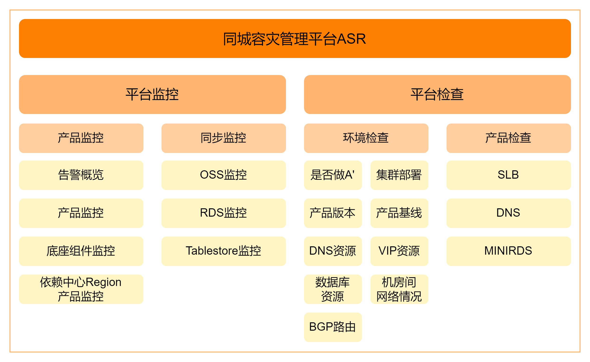

同城容灾管理平台ASR运维操作主要包括：

- 平台监控：提供产品监控和同步监控功能。

  - 产品监控：支持监控云产品或者组件在主备机房的运行状态、告警情况以及有哪些产品是双活。

  - 同步监控：查看RDS、OSS、Tablestore的数据同步延迟满足度、同步正常实例数、同步异常实例数，以及各实例的同步延迟时间等。

- 平台检查：提供环境检查和产品检查功能。

  - 环境检查：检查项包括是否做A'、集群部署、产品版本、产品基线、DNS资源、VIP资源、数据库资源、机房间网络情况、BGP路由，查看各检查项是否满足容灾的条件。

  - 产品检查：检查SLB、DNS、MINIRDS的产品状态。

<a id="section-1-3"></a>

## 1.3. 角色列表

本文描述同城容灾管理平台ASR不同角色支持的运维操作。

登录方式

容灾场景登录

日常场景登录

角色

高级运维

普通运维

访客

系统管理员

产品运维员

查看告警

不支持

不支持

不支持

不支持

不支持

产品监控

支持

支持

支持

支持

支持

同步监控

不支持

不支持

不支持

不支持

不支持

主机房

环境检查

支持

支持

支持

支持

支持

产品检查

支持

支持

支持

支持

支持

查看告警

支持

支持

支持

支持

支持

产品监控

支持

支持

支持

支持

支持

备机房

同步监控

支持

支持

支持

支持

支持

环境检查

支持

支持

支持

支持

支持

产品检查

支持

支持

支持

支持

支持

<a id="section-2"></a>

# 2.ASR平台运维操作

<a id="section-2-1"></a>

## 2.1. 快速入门

<a id="section-2-1-1"></a>

### 2.1.1. 登录ASR控制台

同城容灾管理平台ASR针对日常运维、容灾逃逸和租户运营场景提供了三种登录方式。

> **说明**
>
> 后续文档中同城容灾管理平台ASR简称ASR控制台。

**前提条件**

- 使用日常运维登录时，您已从部署人员或管理员处获取Apsara Uni-manager运维控制台的访问地址、用户名和密码。

  Apsara Uni-manager运维控制台访问地址格式为<em>&lt;region-id></em>.ops.console.*&lt;intranet-domain-id>*。

- 使用容灾逃逸登录时，您已从部署人员或管理员处获取ASR的访问地址、用户名和密码。

  > **说明**
  >
  > - 主机房故障时需登录备机房ASR，备机房故障登录主机房ASR，两者域名不同。
  >
  > - ASR备机房的访问地址格式为asr-xs-&lt;region-id>.console.&lt;intranet-domain-id>.com/user/login。
  >
  > - ASR主机房的访问地址格式为asr-xm-&lt;region-id>.console.&lt;intranet-domain-id>.com/user/login。

- 使用租户运营场景登录时，您已从部署人员处获取Apsara Uni-manager运营控制台的服务域名地址。

**日常运维登录**

如果您需要通过ASR控制台对云产品和环境执行日常的监控和检查，您可以通过Apsara Uni-manager运维控制台跳转到同城容灾管理平台ASR。当您通过**运维管理员**身份登录时，可以进行平台监控、平台检查和在线演练；通过**产品运维员**角色登录时可以进行平台监控和平台检查。

1. 打开浏览器。

2. 在地址栏中，输入Apsara Uni-manager运维控制台的访问地址，按回车键。

   

   > **说明**
   >
   > 您可以单击右上角的当前语言切换其它语言。当前支持简体中文、英文、繁体中文三种语言切换。

3. 输入正确的用户名及密码。

   > **说明**
   >
   > - 登录Apsara Uni-manager运维控制台的用户名和密码请从部署人员或管理员处获取。
   >
   > - 若连续输入密码错误三次，系统将启动图片验证码登录功能；若连续输入错误五次，账户将被锁定，请联系管理员进行激活。

   首次登录Apsara Uni-manager运维控制台时，需要修改登录用户名的密码，请按照提示完成密码修改。

   为提高安全性，密码必须满足以下要求：

   - 必须包含英文大小写字母。

   - 必须包含阿拉伯数字（0~9）。

   - 必须包含特殊符号，包括感叹号（!）、at（@）、井号（#）、美元符号（$）、百分号（%）等。

   - 密码长度为10~20个字符。

4. 单击**账号登录**。

5. 在顶部菜单中选择**平台运维 > 容灾管理 > 同城容灾管理平台ASR（主机房）**。

6. 在顶部菜单中选择**平台运维 > 容灾管理 > 同城容灾管理平台ASR（备机房）**。

**容灾逃逸登录**

如果您需要执行故障模拟、灾难恢复等容灾相关功能，请通过如下方式进行登录：

1. 在浏览器地址栏中，输入同城容灾管理平台ASR的访问地址，单击回车键。

   > **说明**
   >
   > - 主机房故障时需登录备机房ASR，备机房故障登录主机房ASR，两者域名不同。
   >
   > - ASR备机房的访问地址格式为asr-xs-&lt;region-id>.console.&lt;intranet-domain-id>.com/user/login。
   >
   > - ASR主机房的访问地址格式为asr-xm-&lt;region-id>.console.&lt;intranet-domain-id>.com/user/login。

   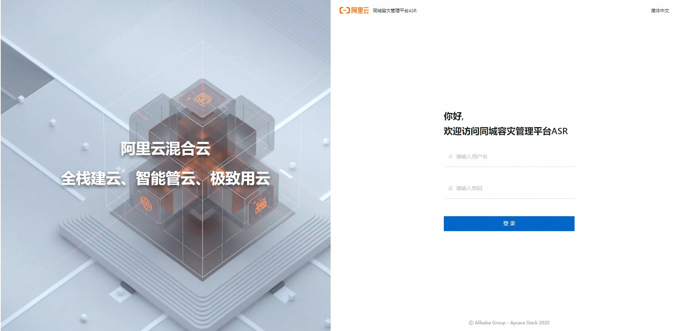

   > **说明**
   >
   > 您可以单击右上角的当前语言下拉切换语言，支持简体中文、English和繁體中文。

2. 输入正确的用户名和密码。

   > **说明**
   >
   > 登录ASR的用户名和密码请从部署人员或管理员处获取。

3. 单击**登录**。

**租户运营登录**

如果您需要按业务应用维度恢复单块业务与容灾演练，可通过登录Apsara Uni-manager运营控制台创建保护组。

**操作步骤**

1. 在浏览器地址栏中，输入Apsara Uni-manager运营控制台的服务域名地址，按回车键。

   

   > **说明**
   >
   > - 单击页面右上角的当前语言可以切换其它语言。
   >
   > - 授权登录是第三方认证中配置了全局IdP设置才会显示，且“授权登录”名称用户可按需自定义。

2. 输入正确的用户名及密码。

   > **说明**
   >
   > - 请向运营管理员获取登录控制台的用户名和密码。
   >
   > - 首次登录Apsara Uni-manager运营控制台时，需要修改登录用户名的密码，请按照提示完成密码修改。为提高安全性，密码长度必须为10~32位，且包含英文字母大小写、阿拉伯数字和特殊符号（感叹号（!）、at（@）、井号（#）、美元符号（$）、百分号（%）等）。

3. 单击**账号登录**。

4. 如果账号已激活MFA多因素认证，请根据以下两种情况进行操作：

   - **管理员强制开启MFA后的首次登录**

     <ol type="a">

     <li>

     在绑定虚拟MFA设备页面中，按页面提示步骤绑定MFA设备。

     </li>

     <li>

     按照步骤2重新输入账号和密码，单击**账号登录**。

     </li>

     </ol>

     <ol type="i" start="100">

     <li>

     输入6位MFA码后单击**认证**。

     </li>

     </ol>

   - **您已开启并绑定MFA**

     输入6位MFA码后单击**认证**。

     > **说明**
     >
     > 绑定并开启MFA的操作请参见管理多因素认证。

5. 在顶部菜单中选择**产品**。

6. 在左侧导航栏中选择**容灾与备份**。

7. 在**容灾与备份**区域选择**容灾服务 > 同城容灾管理平台 ASR**。

<a id="section-2-1-2"></a>

### 2.1.2. 查看平台监控项

<a id="section-2-1-2-1"></a>

#### 2.1.2.1. 产品监控

本文介绍产品监控的检查方法和期望结果。

**监控方法**

1. 登录同城容灾管理平台ASR（主机房）或同城容灾管理平台ASR（备机房），登录方法请参见登录ASR控制台。

2. 在左侧导航栏中选择**平台监控 > 产品监控**。

3. 在**产品监控**页面，可以查看所有产品的**功能状态**、**主服务位置**、**巡检结果**等监控项信息，以及部分产品的**容灾实例数**和容灾库存水位信息。

   > **说明**
   >
   > 查看监控项信息需要确保数据更新时间与实际查看时间一致。

**期望结果**

期望所有列无标红项。若存在异常，则需要根据错误信息排查解决问题，或提单联系阿里云技术支持修复。

<a id="section-2-1-2-2"></a>

#### 2.1.2.2. 同步监控

本文介绍同步监控的检查方法和期望结果。

**监控方法**

1. 登录备机房ASR控制台。

2. 在左侧导航栏中选择**平台监控** > **同步监控**。

3. 在同步监控页面，可以查看云数据库Redis、云数据库RDS版、云原生分布式数据库PolarDB-X 2.0、云原生关系型数据库PolarDB、表格存储Tablestore、对象存储OSS、云数据库MongoDB、实时数仓Hologres、云原生数据仓库AnalyticDB PostgreSQL版的**数据同步延迟满足度**和**实例数据同步情况**。对于同步异常的实例，会以红色显示在实例列表顶端。

   > **说明**
   >
   > 查看监控项信息需要确保数据更新时间与实际查看时间一致。

**期望结果**

数据同步延迟满足度为100%。

> **说明**
>
> 若不满足要求，则需要对标红的实例排查解决同步延迟问题，或提单联系阿里云技术支持修复。

<a id="section-2-1-3"></a>

### 2.1.3. 查看平台检查项

<a id="section-2-1-3-1"></a>

#### 2.1.3.1. 环境检查

本文介绍环境检查的检查方法和各个检查项的期望结果。

**检查方法**

1. 登录备机房ASR控制台。

2. 在左侧导航栏选择**平台检查** > **环境检查**。

3. 在**环境检查**页面，分别在**是否做A'**、**集群部署**、**产品版本**、**产品基线**、**DNS资源**、**VIP资源**、**数据库资源**、**机房间网络情况**、**BGP路由**等检查项右上角单击**立即检查**，查看检查结果。

**期望结果**

- **是否做A'**：产品在重新部署或升级后，主机房需要对该产品做A'，即Rolling，去重新感知机房最新的配置。

  期望未做A'产品列表为空。

- **集群部署**：检查产品对应Feature主备集群部署形态。右边存在滚动条，可下拉查看所有产品。

  期望无标红项。

  > **说明**
  >
  > - 标黄项解读：该feature目前为非对等部署，但备集群不要求必须部署，可忽略。
  >
  > - 标红项解读：该feature目前为非对等部署，且备集群要求必须部署，必须处理。

- **产品版本**：检查各产品主备机房的版本是否一致，如果版本不一致，ASR会显示该产品为异常产品，需要将该产品主备机房的版本升级到相同的版本，以免造成容灾切换失败。

  期望异常产品数为0。

  > **说明**
  >
  > 默认折叠正常产品项，只显示异常产品数，可根据需要选择数据展示结果。

- **产品基线**：检查环境中的基线配置和tianji中的基线配置是否相同。如果有异常，请检查相关的配置。

  期望产品基线变量检查通过。

- **DNS资源**：从tianji中获取产品的DNS资源信息，根据资源信息下的域名获取实际对应的VIP，再根据实际VIP和tianji资源信息中的VIP进行对比。如果两者不一致，则比对结果比对结果显示为异常，请检查并修改相应配置。

  期望异常产品数为0。

  > **说明**
  >
  > 默认折叠正常产品项，只显示异常产品数，可根据需要选择数据展示结果。

- **VIP资源**：从tianji中获取到产品的VIP资源信息，根据资源信息中的VIP信息到SLB中查询该VIP所对应的RealServer IP，再根据RealServer IP和VIP资源信息中NCList做比对。如果两者不一致，ASR界面上会将相应的RealServer IP标红，请检查并修改相应配置。

  期望异常产品数为0。

  > **说明**
  >
  > 默认折叠正常产品项，只显示异常产品数，可根据需要选择数据展示结果。

- **数据库资源**：从tianji中获取产品的数据库资源信息，根据该信息连接对应的数据库，检查数据库主库的read-only属性。如果为只读，ASR会显示该产品状态为异常，请修改该数据库的配置。

  期望异常产品数为0。

  > **说明**
  >
  > 默认折叠正常产品项，只显示异常产品数，可根据需要选择数据展示结果。

- **机房间网络情况**：检查SLB和VPC相关网段的路由发布是否正常。如果状态显示异常，请联系运维人员或提单修复。

  期望异常产品数为0。

  > **说明**
  >
  > 默认折叠正常产品项，只显示异常产品数，可根据需要选择数据展示结果。

- **BGP路由**：检查OPS-DNS、专有云DNS、SLB、VPC的BGP路由信息发布情况。如果状态显示异常，请联系运维人员或提单修复。

  期望异常产品数为0。

  > **说明**
  >
  > 默认折叠正常产品项，只显示异常产品数，可根据需要选择数据展示结果。

<a id="section-2-1-3-2"></a>

#### 2.1.3.2. 产品检查

本文介绍产品检查的检查方法和期望结果。

**检查方法**

1. 登录备机房ASR控制台。

2. 在左侧导航栏选择**平台检查 > 产品检查**。

3. 在**产品检查**页面，分别在**负载均衡 SLB**、**底座域名解析**、**元数据库**三个产品右上角单击**立即检查**，查看产品检查结果。

**期望结果**

负载均衡SLB、底座域名解析DNS、元数据库MINIRDS产品检查项状态正常。

> **说明**
>
> 若存在异常项，请重点关注该检查项的**错误信息**列中的内容，根据错误信息排查解决问题，或提单联系阿里云技术支持修复。

<a id="section-2-2"></a>

## 2.2. 核心告警处理

<a id="section-2-2-1"></a>

### 2.2.1. 告警项说明

本文列出同城容灾的告警项说明。

| 告警项 | 告警说明 | 告警级别 | 告警详情 |
| --- | --- | --- | --- |
| inspect_db_resourc e | 元数据库的连接异常或读写状态是只读状态。 | P2 | 请参见inspect_db_resource。 |
| drei_product | 检查核心底座云产品DNS、SLB、MiniRDS的容灾切换能力。 | P2 | 请参见drei_product。 |
| rpo_check | RDS或OSS同步延迟时间超过阈值或同步中断。 | P2 | • 告警产品为RDS，请参见rpo_check（RDS）。<br>• 告警产品为OSS，请参见rpo_check（OSS）。 |
| sync_check | 云产品容灾巡检异常。 | P2 | • 告警产品为MiddleWareAll，请参见sync_check（MiddleWareAll）。<br>• 告警产品为minirds-mt/rds，请参见sync_check（minirds-mt/rds）。<br>• 告警产品为TableStore/TableStoreInner，请参见sync_check（TableStore/TableStore Inner）。<br>• 告警产品为SLB，sync_check（SLB）。<br>• 告警产品为Kafka，请参见sync_check（Kafka）。<br>• 告警产品为Elasticsearch，请参见sync_check（Elasticsearch）。 |
| inspect_product_cl uster_aplus | 云产品集群未做A'。 | P2 | 请参见inspect_product_cluster_aplus。 |
| inspect_product_cl uster_version | 主备机房产品版本不一致。 | P2 | 请参见inspect_product_cluster_version。 |
| inspect_product_va riable | 产品基线变量检查未通过。 | P2 | 请参见inspect_product_variable。 |
| inspect_product_cl uster_deploy | 存在非对等部署的云产品。 | P2 | 请参见inspect_product_cluster_deploy。 |

<a id="section-2-2-2"></a>

### 2.2.2. inspect_db_resource

此告警点主要检测元数据库连接情况或者元数据库的读写状态，出现此告警表示元数据库连接失败或者元数据库状态为只读状态，可能会导致数据无法写入，影响依赖产品的正常运行。

**告警属性**

| 告警ID | 监控项 | 告警来源 | 告警级别 | 告警产品 | 触发条件 | 执行周期 |
| --- | --- | --- | --- | --- | --- | --- |
| inspect_d b_resour ce | inspect_d b_resour ce | Bcmc# | P2 | bcmc | 实例主库状态或读写状态异常 | 每30分钟执行一次 |

**适用版本**

适用于专有云企业版v3.14及后续版本。

**告警原因**

- 实例状态异常。

- 实例读写状态异常。

**告警影响**

可能会导致数据无法写入，影响依赖产品的正常运行。

**处理方法**

> **警告**
>
> 所有告警处理方法涉及到修改产品任何配置，均需要走生产变更流程确认方案的可行性以及流程规范性，若属紧急应急范畴需客户与TAM同时同意方可执行，否则不允许直接执行处理方法的任何步骤。

1. 登录飞天基础运维平台。

2. 在**飞天基础运维平台**左侧导航栏中，选择**产品集群运维**。

3. 在产品列表中查询bcmc，在主集群**操作**列单击**集群详情**。

4. 在服务列表中单击**bcmc**服务名称。

5. 选择<strong>Bcmc#</strong>组件。

6. 切换至**资源列表**页签，找到**名称**和**类型**分别为**asr**和**db**的资源，在其**资源申请结果**列中查看db_host、user、db_password、db_port、db_name的取值。

7. 登录上报告警所在机器。

8. 执行如下命令，检查数据库是否可以正常连接。

   > **说明**
   >
   > 请在环境内有MySQL客户端的地方执行登录数据库命令。

   ```text
   mysql -h${db_host} -u${user} -p${db_password} -P${db_port} -D${db_name}
   ```

   系统显示如下类似结果，表示连接正常，请根据实际情况确认。

   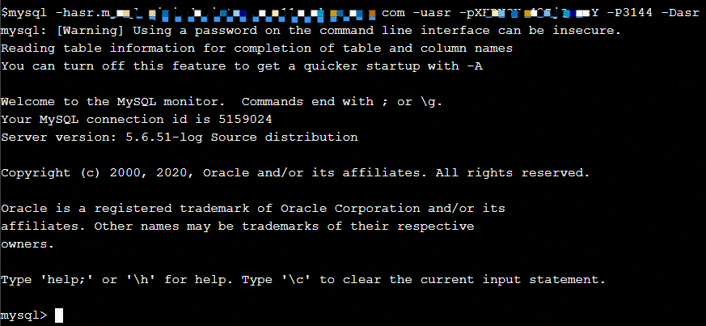

   > **说明**
   >
   > 如果数据库连接失败，请联系RDS产研团队处理。

9. 执行如下SQL语句，查看数据库读写状态。

   ```text
   show global variables like "read_only";
   ```

   系统显示如下类似结果，请根据实际情况确认。

   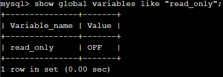

   - 如果**read_only**显示**ON**，表示状态只读，需要修改只读状态。

     执行如下SQL语句，修改只读状态。

     ```text
     set global read_only = 0;
     ```

0. 根据告警信息获取异常实例名称。

1. 登录杜康数据库管理平台。

2. 查看实例详细报错信息，如果是实例未启动连接失败，需要重启实例。

   <ol type="i">

   <li>

   进入告警实例所在主机。

   </li>

   <li>

   执行如下命令，查看并记录启动异常实例的命令。

   ```bash
   cat /etc/init.d/mysql | grep ${端⼝号}
   ```

   系统显示如下类似结果，请根据实际情况确认。

   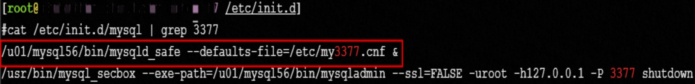

   </li>

   <li>

   执行如下命令，启动异常实例。

   ```text
   /u01/mysql56/bin/mysqld_safe --defaults-file=/etc/my${端⼝号}.cnf &
   ```

   </li>

   <li>

   执行如下命令，并查看实例是否启动成功。

   ```text
   ps aux|grep ${端⼝号}
   ```

   系统显示如下类似结果，请根据实际情况确认。

   > **说明**
   >
   > 如果实例启动失败，请联系RDS产研团队处理。

   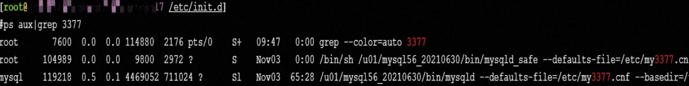

   </li>

   </ol>

> **说明**
>
> 如果上述步骤未解决告警问题，请提工单（服务请求单）联系阿里云技术支持。

<a id="section-2-2-3"></a>

### 2.2.3. drei_product

此告警点主要检测minirds实例是否可切换、实例主备同步是否有延迟，是否存在单可用区实例、minirds集群中serviceTest#的状态。出现此告警表示存在以上任意一个以及多个情况。

**告警属性**

| 告警ID | 监控项 | 告警来源 | 告警级别 | 告警产品 | 触发条件 | 执行周期 |
| --- | --- | --- | --- | --- | --- | --- |
| drei_prod uct | drei_prod uct | Bcmc# | P2 | minirds-mt | 触发条件有多种，例如：<br>• 实例连接失败。<br>• 主备同步延迟。<br>• 单可用区存在实例。<br>• 备机房存在实例。<br>• minirds集群中serviceTest#未达终态。 | 每30分钟执行一次 |

**适用版本**

适用于专有云企业版v3版本。

**告警原因**

触发该告警的原因有很多种，例如：

- 实例连接失败。

- 主备同步延迟。

- 单可用区存在实例。

- 备机房存在实例。

- minirds集群中serviceTest#未达终态。

**告警影响**

由于存在多种告警原因，所以告警影响也不尽相同，例如：

- 实例连接失败，可能会导致minirds数据库无法访问。

- 主备同步延迟，在主备同步延迟很大的情况下，如果主机房挂掉，会有数据丢失的风险。

- minirds集群中serviceTest#未达终态，可能会导致集群中的功能以及业务受到影响。

**处理方法**

> **警告**
>
> 所有告警处理方法涉及到修改产品任何配置，均需要走生产变更流程确认方案的可行性以及流程规范性，若属紧急应急范畴需客户与TAM同时同意方可执行，否则不允许直接执行处理方法的任何步骤。

**备机房存在实例处理方法**

如果备机房存在实例，这种一般不用处理，实例会自动做可用区对齐，自动切回到主机房。

**单可用区存在实例处理方法**

如果有单可用区实例，需要进行实例的单变双操作。

1. 登录主机房的minirds-integrator.RebuildSlave容器。

2. 进入该容器执行如下命令，将conf.yml.j2文件复制到指定目录。

   ```bash
   docker cp conf.yml.j2 ${容器ID}:/meta/usr/local/rds/rebuild/conf.yml.j2
   ```

   conf.yml.j2配置文件如下：

   ```text
   # conf.yml.j2
   db:
     host: {{db_dbaas_host}}
     port: {{db_dbaas_port}}
     user_name: {{db_dbaas_user}}
     password: {{db_dbaas_password}}
     db_name: {{db_dbaas_name}}
   cluster:
     cluster_name: {{CLUSTER_NAME}}
     db_type: {{DB_TYPE}}
     db_version: {{DB_VERSION}}
     site_name: {{SITE_NAME}}
     ips: ""                        
     max_tasks: 10                #并⾏的任务数
     ins_names: ""                  #需要重搭的实例名 逗号分隔 必需指定不然不⼯作
   api:
     rdsapi: {{RDS_API_URL}}
   timeout: {{TIMEOUT}}
   ```

3. 联系阿里云技术支持获取rebuild文件并解压，将所有文件复制到RebuildSlave容器。

   ```bash
   docker cp ${rebuild⽂件名}:/usr/local/rds/rebuild/
   ```

4. 复制完成后，执行如下命令，重启RebuildSlave容器。

   ```bash
   docker stop ${容器ID}
   docker start ${容器ID}
   ```

**不可切换实例、主备同步延迟、实例连接失败处理方法**

1. 根据告警信息获取异常实例名称。

2. 登录杜康数据库管理平台。

3. 查看实例详细报错信息。

   <ol type="i">

   <li>

   如果是实例连接失败，请参见inspect_db_resource进行处理。

   </li>

   <li>

   如果是主备同步延迟，请参见备库重搭进行处理。

   </li>

   <li>

   如果是不可切换实例，请参见备库重搭进行处理。

   </li>

   </ol>

**minirds集群中serviceTest#未达终态**

1. 登录飞天基础运维平台。

2. 在**产品集群运维**中查看minirds-maotai集群中serviceTest#组件是否已达终态。

3. 如果serviceTest#组件未达终态，考虑通过重启解决。

> **说明**
>
> 如果上述步骤未解决告警问题，请提工单（服务请求单）联系阿里云技术支持。

<a id="section-2-2-4"></a>

### 2.2.4. rpo_check

<a id="section-2-2-4-1"></a>

#### 2.2.4.1. 概述

rpo_check告警主要用于检测RDS或OSS的同步延迟状态，当同步延迟时间超过阈值或同步中断时出现该告警，不同产品出现该告警的处理方式不同。

- 告警产品为RDS，请参见rpo_check（RDS）。

- 告警产品为OSS，请参见rpo_check（OSS）。

<a id="section-2-2-4-2"></a>

#### 2.2.4.2. rpo_check（RDS）

此告警点主要检测RDS容灾实例的同步延迟状态，出现此告警表示RDS的同步延迟时间超过阈值或同步中断，可能会导致数据丢失或容灾切换失败。本文档主要描述告警产品为RDS时的rpo_check告警项相关信息。

**告警属性**

<table>
  <tr>
    <td>告警ID</td>
    <td>监控项名称</td>
    <td>告警来源</td>
    <td>告警级别</td>
    <td>告警产品</td>
    <td>触发条件</td>
    <td>执行周期</td>
  </tr>
  <tr>
    <td>rpo_check</td>
    <td>rpo_check</td>
    <td>Bcmc#</td>
    <td>P2</td>
    <td>RDS</td>
    <td>RDS容灾实例的同步延迟超过用户设定的阈值，或同步延迟中断</td>
    <td>1分钟执行一次</td>
  </tr>
</table>

**适用版本**

适用于专有云企业版v3.12及后续版本。

**告警原因**

当dr_service检查RDS产品实例同步延迟时，出现连接异常或执行SQL报错，RPO缺省值为负数，具体原因请参见下表。

| 引擎 | 缺省值 | 原因 |
| --- | --- | --- |
| mysql | -1 | • slave连接失败。<br>• 执行sql报错。<br>• Seconds_Behind_Master值为null。 |
| pgsql | -1/-2 | • 连接dbaas执行sql报错。<br>• 获取aurora的账号信息失败。<br>• 从库连接失败/不可用。<br>• pglog_diff为null。 |
| mongo | -2 | • 主备库连接失败/不可用。 |
| redis | -1/-2 | • 执行sql报错。<br>• slave连不上。 |

**告警影响**

同步延迟监控状态异常，可能会导致：

- 同步延迟过高，主节点故障时可能会导致数据丢失过多。

- 备实例访问不通，容灾切换失败，或切换后实例无法使用。

**处理方法**

> **警告**
>
> 所有告警处理方法涉及到修改产品任何配置，均需要走生产变更流程确认方案的可行性以及流程规范性，若属紧急应急范畴需客户与TAM同时同意方可执行，否则不允许直接执行处理方法的任何步骤。

1. 登录Apsara Uni-manager运维控制台。

2. 在顶部菜单栏选择**产品运维** > **数据库运维** > **RDS运维·杜康**。

3. 在**杜康数据库管理平台**左侧导航栏中，选择**系统管理** > **容灾管理** > **容灾切换**。

4. 在**容灾切换**页面查看异常详情，并联系RDS运维人员修复异常项。

   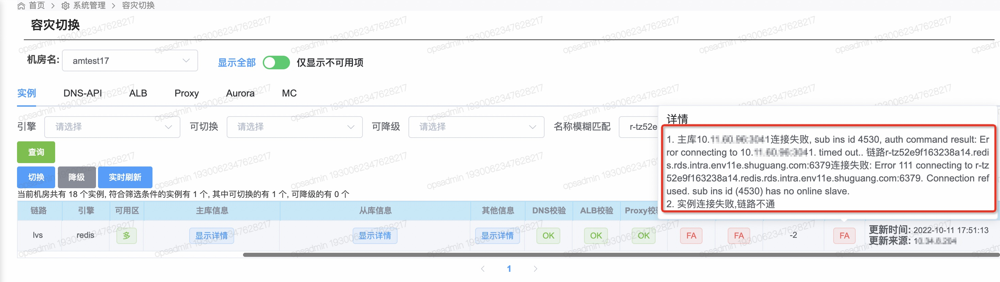

   - 如果实例未启动，需要重启实例。

     <ol type="a">

     <li>

     进入告警实例主节点所在主机。

     > **说明**
     >
     > 以下步骤以mysql实例异常为例。

     </li>

     <li>

     执行如下命令，如果未能找到实例进程，则说明实例未启动。

     ```text
     ps aux | grep ${端⼝号}
     ```

     </li>

     </ol>

     <ol type="i" start="100">

     <li>

     执行如下命令，查看并记录启动异常实例的命令。

     ```bash
     cat /etc/init.d/mysql | grep ${端⼝号}
     ```

     系统显示如下类似结果，请根据实际情况确认。

     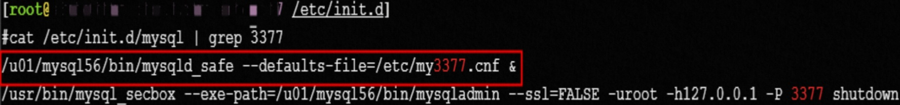

     </li>

     <li value="500">

     执行如下命令，启动异常实例。

     ```text
     /u01/mysql56/bin/mysqld_safe --defaults-file=/etc/my${端⼝号}.cnf &
     ```

     </li>

     </ol>

     <ol type="a" start="5">

     <li>

     执行如下命令，并查看实例是否启动成功。

     ```text
     ps aux|grep ${端⼝号}
     ```

     系统显示如下类似结果，请根据实际情况确认。

     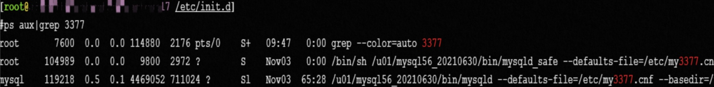

     > **说明**
     >
     > 如果实例启动失败或其他异常情况，请联系RDS运维人员处理。

     </li>

     </ol>

> **说明**
>
> 如果上述步骤未解决告警问题，请提工单（服务请求单）联系阿里云技术支持。

<a id="section-2-2-4-3"></a>

#### 2.2.4.3. rpo_check（OSS）

此告警点主要检测OSS容灾实例的同步延迟状态，出现此告警表示OSS的同步延迟时间超过阈值或同步中断，可能会导致数据丢失或容灾切换失败。本文档主要描述告警产品为OSS时的rpo_check告警项相关信息。

**告警属性**

<table>
  <tr>
    <td>告警ID</td>
    <td>监控项名称</td>
    <td>告警来源</td>
    <td>告警级别</td>
    <td>告警产品</td>
    <td>触发条件</td>
    <td>执行周期</td>
  </tr>
  <tr>
    <td>rpo_check</td>
    <td>rpo_check</td>
    <td>Bcmc#</td>
    <td>P2</td>
    <td>OSS</td>
    <td>OSS容灾实例的同步延迟超过用户设定的阈值，或同步延迟中断</td>
    <td>1分钟执行一次</td>
  </tr>
</table>

**适用版本**

适用于专有云企业版v3.12及后续版本。

**告警原因**

QPS过高、消息堆积。

**告警影响**

同步延迟监控状态异常，可能会导致：

- 同步延迟过高，主节点故障时可能会导致数据丢失过多。

- 备实例访问不通，容灾切换失败，或切换后实例无法使用。

**处理方法**

> **警告**
>
> 所有告警处理方法涉及到修改产品任何配置，均需要走生产变更流程确认方案的可行性以及流程规范性，若属紧急应急范畴需客户与TAM同时同意方可执行，否则不允许直接执行处理方法的任何步骤。

1. 检查同步边是否打开。

   <ol type="i">

   <li>

   登录飞天基础运维平台。

   </li>

   <li>

   在**飞天基础运维平台**页面的左侧导航栏中，选择**产品集群运维**。

   </li>

   <li>

   在产品列表中查询oss，在集群**操作**列单击**集群详情**。

   </li>

   <li>

   在**服务列表**页面，单击**oss-ocm-server**服务。

   </li>

   <li>

   选择<strong>OcmServer#</strong>组件。

   </li>

   <li>

   在机器列表中，单击实例**操作**列的**Terminal**，登录oss-ocm-server.OcmServer#终端机器。

   </li>

   <li>

   进入 `/cloud/app/oss-ocm-server/OcmServer#/ocm_server/current` 目录。

   </li>

   <li>

   执行如下命令获取OCM_CMD的accessID和accessKey。

   ```bash
   cat ocm_conf.json | grep -A 10 "accessID"
   ```

   </li>

   <li>

   执行如下命令获取master_ocm_host。

   ```bash
   cat ocm_conf.json | grep master_ocm_host
   ```

   </li>

   <li>

   执行如下配置命令，其中accessID、accessKey和master_ocm_host为上述步骤获取的值。

   ```text
   ./ocm_cmd config --id=${accessID} --key=${accessKey} --host ${master_ocm_host}
   ```

   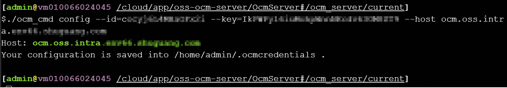

   </li>

   <li>

   执行如下命令，检查&lt;BucketSyncMeta>标签下的内容符合预期。

   ```text
   ./ocm_cmd gbm bucketName
   ```

   > **说明**
   >
   > 检查项及预期：
   >
   > <ol type="a">
   >
   > <li>
   >
   > 同步边是否存在：存在&lt;BucketSyncMeta>标签说明同步边存在。
   >
   > </li>
   >
   > <li>
   >
   > 同步方向是否符合预期：&lt;BucketSyncMeta>标签下，存在&lt;SrcBucket>、&lt;SrcLocation>、&lt;DestBucket>、&lt;DestLocation>标签，并且符合预期：
   >
   > <ol type="a">
   >
   > <li>
   >
   > &lt;SrcBucket>、&lt;SrcLocation>的值分别与&lt;BucketMeta>标签下&lt;Name>、&lt;Location>标签值一致。
   >
   > </li>
   >
   > <li>
   >
   > &lt;DestBucket>、&lt;DestLocation>的值与对端机房信息一致。
   >
   > </li>
   >
   > </ol>
   >
   > </li>
   >
   > </ol>
   >
   > <ol type="i" start="100">
   >
   > <li>
   >
   > 同步状态是否正常：&lt;BucketSyncMeta>标签下，&lt;SyncStatus>标签值为0或1。
   >
   > </li>
   >
   > </ol>

   执行结果示例如下。

   ```xml
   <?xml version="1.0" encoding="UTF-8"?>
   <BucketMeta>
     <Name>wd-test</Name>
     <Owner>1276207919333070</Owner>
     <Application>file</Application>
     <Location>oss-cn-qingdao-env9b-amtest52002-b</Location>
     <CreateTime>Thu, 17 Dec 2020 06:09:29 GMT</CreateTime>
     <CacheTime>1608534489</CacheTime>
     <Comment></Comment>
     <Acl>public-read-write</Acl>
     <BucketStatus>ok</BucketStatus>
     <BucketMode>default</BucketMode>
     <RequestPayer>BucketOwner</RequestPayer>
     <BucketPolicy>
       <LogBucket></LogBucket>
       <LogPrefix></LogPrefix>
       <Location>oss-cn-qingdao-env9b-amtest52002-b</Location>
       <DisallowEmptyRefer>false</DisallowEmptyRefer>
       <WhiteReferrerList />
       <CommonHeaderList />
       <AccessAllowedTypeList />
       <MimeTypeConfig>
         <MimeTypeRules />
       </MimeTypeConfig>
       <BucketChargeType>
         <FlowChargeType>PayByTraffic</FlowChargeType>
       </BucketChargeType>
       <CacheControlConfiguration />
       <MaxImageSize>-1</MaxImageSize>
       <UrlRewriteScript></UrlRewriteScript>
       <CompatMask>4</CompatMask>
       <TransferAccType></TransferAccType>
       <SourceProtectSuffix>*</SourceProtectSuffix>
       <IAMPolicy></IAMPolicy>
       <EnableDualCluster>false</EnableDualCluster>
       <IndexFile></IndexFile>
       <ErrorFile></ErrorFile>
       <SysObjectTagsStr></SysObjectTagsStr>
       <DataRedundancyType>0</DataRedundancyType>
       <ObjectHashFunction>NULL</ObjectHashFunction>
       <ObjectOverwriteCond>ALL</ObjectOverwriteCond>
       <AuthorizationConfiguration />
     </BucketPolicy>
     <CORSConfiguration />
     <BucketFlowLimits>
       <MaxQps>-1</MaxQps>
       <MaxSendFlow>-1</MaxSendFlow>
       <MaxRecvFlow>-1</MaxRecvFlow>
       <MaxIntranetQps>-1</MaxIntranetQps>
       <MaxIntranetSendFlow>-1</MaxIntranetSendFlow>
       <MaxIntranetRecvFlow>-1</MaxIntranetRecvFlow>
       <MaxTotalQps>-1</MaxTotalQps>
       <MaxIntranetTotalQps>-1</MaxIntranetTotalQps>
     </BucketFlowLimits>
     <BucketUserQos>
       <MaxHourExtranetSendFlow>-1</MaxHourExtranetSendFlow>
       <MaxDayExtranetSendFlow>-1</MaxDayExtranetSendFlow>
       <MaxHourIntranetSendFlow>-1</MaxHourIntranetSendFlow>
       <MaxDayIntranetSendFlow>-1</MaxDayIntranetSendFlow>
       <StorageCapacity>1073741824</StorageCapacity>
     </BucketUserQos>
     <BID>26842</BID>
     <StorageType>standard</StorageType>
     <DualClusterStatus>1</DualClusterStatus>
     <BucketSyncMeta>
       <SyncStatus>1</SyncStatus>
       <SyncSubStatus>0</SyncSubStatus>
       <SyncHistoryStatus>1024</SyncHistoryStatus>
       <SyncAcl>0</SyncAcl>
       <SyncBackupStatus>0</SyncBackupStatus>
       <CreateTime>1608189511</CreateTime>
       <ModifyTime>1608189637</ModifyTime>
       <SrcBucket>wd-test</SrcBucket>
       <SrcLocation>oss-cn-qingdao-env9b-amtest52002-b</SrcLocation>
       <DestBucket>wd-test</DestBucket>
       <DestLocation>oss-cn-qingdao-env9b-d01-a</DestLocation>
       <HistoryCpt></HistoryCpt>
       <HistoryMpartKeyCpt></HistoryMpartKeyCpt>
       <HistoryUploadIdCpt></HistoryUploadIdCpt>
       <HistoryObjectSyncEnabled>true</HistoryObjectSyncEnabled>
       <Type>0</Type>
       <TransferType>0</TransferType>
       <VipProxy></VipProxy>
       <Speed>0</Speed>
       <ScanType>1</ScanType>
       <SubNum>0</SubNum>
       <ScheduleType>0</ScheduleType>
       <ScheduleBandwidth>0</ScheduleBandwidth>
       <RuleId></RuleId>
       <Version>5c665d30e017456e840fa11358f9ff97</Version>
       <NeedPartitionList>false</NeedPartitionList>
       <IsQpsTask>false</IsQpsTask>
       <IgnoreNewFileForHistory>true</IgnoreNewFileForHistory>
     </BucketSyncMeta>
     <BucketSyncMeta>
       <SyncStatus>4</SyncStatus>
       <SyncSubStatus>1</SyncSubStatus>
       <SyncHistoryStatus>768</SyncHistoryStatus>
       <SyncAcl>0</SyncAcl>
       <SyncBackupStatus>0</SyncBackupStatus>
       <CreateTime>1608185369</CreateTime>
       <ModifyTime>1608190889</ModifyTime>
       <SrcBucket>wd-test</SrcBucket>
       <SrcLocation>oss-cn-qingdao-env9b-d01-a</SrcLocation>
       <DestBucket>wd-test</DestBucket>
       <DestLocation>oss-cn-qingdao-env9b-amtest52002-b</DestLocation>
       <HistoryCpt></HistoryCpt>
       <HistoryMpartKeyCpt></HistoryMpartKeyCpt>
       <HistoryUploadIdCpt></HistoryUploadIdCpt>
       <HistoryObjectSyncEnabled>true</HistoryObjectSyncEnabled>
       <Type>0</Type>
       <TransferType>0</TransferType>
       <VipProxy></VipProxy>
       <Speed>0</Speed>
       <ScanType>1</ScanType>
       <SubNum>0</SubNum>
       <ScheduleType>0</ScheduleType>
       <ScheduleBandwidth>0</ScheduleBandwidth>
       <RuleId></RuleId>
       <Version>b6dbaeb845fb4c23bed94c5d717fa00e</Version>
       <NeedPartitionList>false</NeedPartitionList>
       <IsQpsTask>false</IsQpsTask>
       <IgnoreNewFileForHistory>true</IgnoreNewFileForHistory>
     </BucketSyncMeta>
     <BucketVpcipBindList />
     <Tagging>
       <TagSet />
     </Tagging>
   </BucketMeta>
   ```

   </li>

   </ol>

2. 检查OSS RPO值是否正常。

   <ol type="i">

   <li>

   登录飞天基础运维平台。

   </li>

   <li>

   在**飞天基础运维平台**页面的左侧导航栏中，选择**产品集群运维**。

   </li>

   <li>

   在产品列表中查询oss，在集群**操作**列单击**集群详情**。

   </li>

   <li>

   在**服务列表**页面，单击**oss-chiji-agent**服务。

   </li>

   <li>

   选择<strong>ChijiAgent#</strong>组件。

   </li>

   <li>

   在机器列表中，单击某台机器**操作**列中的**Terminal**，登录oss-chiji-agent.ChijiAgent#终端机器。

   </li>

   <li>

   执行如下命令，计算OSS RPO的值。

   ```text
   /apsara/deploy/dsu GetSyncTaskProgress 源location#⽬标location#源bucket#⽬标bucket
   ```

   > **说明**
   >
   > 命令中的源location、目标location、源bucket、目标bucket需要替换为步骤1中&lt;SrcLocation>、&lt;DestLocation>、&lt;SrcBucket>、&lt;DestBucket>标签的值。

   - 执行结果中 `new file last sync time` 为最近一次文件同步时间，当前时间减去该值则为OSS RPO值。

   - 若同步边正常，OSS RPO过大，常见原因是QPS过高、消息堆积造成，联系OSS运维人员处理。

   </li>

   </ol>

> **说明**
>
> 如果上述步骤未解决告警问题，请提工单（服务请求单）联系阿里云技术支持。

<a id="section-2-2-5"></a>

### 2.2.5. sync_check

<a id="section-2-2-5-1"></a>

#### 2.2.5.1. 概述

sync_check告警主要用于检测容灾实例的容灾状态，当云产品容灾巡检异常时出现该告警，不同产品出现该告警的处理方式不同。

- 告警产品为MiddleWareAll，请参见sync_check（MiddleWareAll）。

- 告警产品为minirds-mt/rds，请参见sync_check（minirds-mt/rds）。

- 告警产品为TableStore/TableStoreInner，请参见sync_check（TableStore/TableStoreInner）。

- 告警产品为SLB，请参见sync_check（SLB）。

- 告警产品为Kafka，请参见sync_check（Kafka）。

- 告警产品为Elasticsearch，请参见sync_check（Elasticsearch）。

<a id="section-2-2-5-2"></a>

#### 2.2.5.2. sync_check（MiddleWareAll）

此告警点主要检测MiddleWareAll容灾实例的容灾状态，出现此告警表示MiddleWareAll容灾巡检异常，可能会导致容灾切换失败或依赖的云产品容灾能力异常。本文档主要描述告警产品为MiddleWareAll时的sync_check告警项相关信息。

**告警属性**

<table>
  <tr>
    <td>告警ID</td>
    <td>监控项名称</td>
    <td>告警来源</td>
    <td>告警级别</td>
    <td>告警产品</td>
    <td>触发条件</td>
    <td>执行周期</td>
  </tr>
  <tr>
    <td>sync_check</td>
    <td>sync_check</td>
    <td>Bcmc#</td>
    <td>P2</td>
    <td>middleWar eAll</td>
    <td>ASR上MiddleWar eAll容灾巡检异常</td>
    <td>1分钟执行一次</td>
  </tr>
</table>

**适用版本**

适用于专有云企业版v3.12及后续版本。

**告警原因**

- MiddleWareAll中vipserver组件的distroThreshold阈值默认是0.7。

- MiddleWareAll产品不到终态。

**告警影响**

MiddleWareAll容灾状态异常，可能会导致：

- 容灾切换失败。

- 依赖MiddleWareAll产品的云产品容灾能力异常。

**处理方法**

> **警告**
>
> 所有告警处理方法涉及到修改产品任何配置，均需要走生产变更流程确认方案的可行性以及流程规范性，若属紧急应急范畴需客户与TAM同时同意方可执行，否则不允许直接执行处理方法的任何步骤。

**vipserver组件的distroThreshold阈值配置错误的处理方法**

1. 登录middleWare-vipserver.Server#容器。

2. 执行如下命令查看distroThreshold的值，默认为0.7。

   ```bash
   curl -s http://vipserver.tbsite.net/vipserver/api/switches | python -m json.tool
   ```

   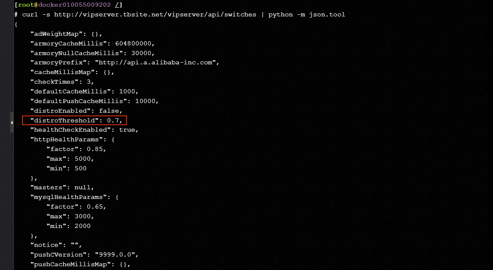

3. 执行如下命令修改distroThreshold值为0.45。

   ```text
   curl-s"http://${diamond_host}/diamond-server/basestone.do?method=syncUpdateAll"-d 'dataId=com.taobao.vipserver.switches&group=VIPSERVER_GROUP&content=
   {"distroThreshold":0.45}'
   ```

   > **说明**
   >
   > diamond_host查询方法：
   >
   > <ol type="i">
   >
   > <li>
   >
   > 登录飞天基础运维平台。
   >
   > </li>
   >
   > <li>
   >
   > 在**飞天基础运维平台**左侧导航栏中，选择**产品集群运维**。
   >
   > </li>
   >
   > <li>
   >
   > 在产品列表中查询middleWareAll，在**操作**列单击**集群详情**。
   >
   > </li>
   >
   > <li>
   >
   > 在服务列表中单击**middleWare-diamond**服务名称。
   >
   > </li>
   >
   > <li>
   >
   > 切换至**注册变量**页签中查询diamond_host取值。
   >
   > </li>
   >
   > </ol>

4. 执行如下命令验证distroThreshold的值为0.45。

   ```bash
   curl -s http://vipserver.tbsite.net/vipserver/api/switches | python -m json.tool
   ```

**MiddleWareAll产品不到终态的处理方法**

1. 登录飞天基础运维平台。

2. 在**飞天基础运维平台**左侧导航栏中，选择**产品集群运维**。

3. 在产品列表中查询middleWareAll，在**操作**列单击**集群详情**。

4. 在服务列表中，单击未达终态的服务名称。

5. 在组件列表中，选择异常的组件，在机器**操作**列中单击**操作** > **重启**。

> **说明**
>
> 如果上述步骤未解决告警问题，请提工单（服务请求单）联系阿里云技术支持。

<a id="section-2-2-5-3"></a>

#### 2.2.5.3. sync_check（minirds-mt/rds）

此告警点主要检测minirds-mt/rds容灾实例的容灾状态，出现此告警表示minirds-mt/rds容灾巡检异常，可能会导致数据丢失、实例无法容灾切换或实例访问异常。本文档主要描述告警产品为minirds-mt/rds时的sync_check告警项相关信息。

**告警属性**

| 告警ID | 监控项名称 | 告警来源 | 告警级别 | 告警产品 | 触发条件 | 执行周期 |
| --- | --- | --- | --- | --- | --- | --- |
| sync_check | sync_check | Bcmc# | P2 | • minirds-mt<br>• rds | ASR控制台上minirds-mt/rds容灾巡检异常 | 1分钟执行一次 |

**适用版本**

适用于专有云企业版v3.12及后续版本。

**告警原因**

- 实例同步状态异常

  minirds-mt/rds实例主备数据差异较大，导致主备之间需要的同步时间较长或不再同步。

- sshtunnel不通

  bcmc中部分产品的容灾切换和容灾巡检脚本需要打通到产品SR的SSH通道，以便于登录到SR容器中执行容灾巡检和容灾切换。

  由于产品基线sshtunnel配置缺失或配置错误、tianji-sshtunnel产品问题以及其他问题，导致bcmc到产品SR的SSH通道没有正常打通，从而导致bcmc容灾巡检脚本执行异常。

**告警影响**

minirds-mt/rds容灾状态异常，可能会导致：

- 主备同步延迟过大，主节点故障时可能会导致数据丢失。

- 实例无法容灾切换，主节点故障时，实例无法自动切换到备节点，影响可用性。

- 实例访问异常，依赖该实例的云产品或应用运行异常。

**处理方法**

> **警告**
>
> 所有告警处理方法涉及到修改产品任何配置，均需要走生产变更流程确认方案的可行性以及流程规范性，若属紧急应急范畴需客户与TAM同时同意方可执行，否则不允许直接执行处理方法的任何步骤。

**实例同步状态异常的处理方法**

处理方法以RDS产品为例。

1. 登录Apsara Uni-manager运维控制台。

2. 在顶部菜单栏选择**产品运维** > **数据库运维** > **RDS运维·杜康**。

3. 进入杜康数据库管理平台，在左侧导航栏单击**系统管理**。

4. 在**系统管理**界面左侧导航栏选择**容灾管理** > **容灾切换**，在**从库最大延迟**列中查看实例延迟时间。

   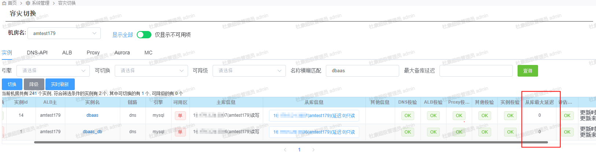

   > **说明**
   >
   > - 若延迟时间大于0，小于60，等待主备数据同步。
   >
   > - 若延迟时间小于-1，需要联系TAM支持人员做实例备库重搭。
   >
   > - 若延迟时间为正整数，数值较大，且没有降低的趋势，则联系数据库运维人员检查。

**sshtunnel不通的处理方法**

处理方法以MiniRDS产品为例。

1. 检查对端服务MiniRDS的sshd进程是否开启。

   <ol type="i">

   <li>

   登录MiniRDS服务容器。

   </li>

   <li>

   执行 `ps -ef|grep sshd` 检测sshd进程。

   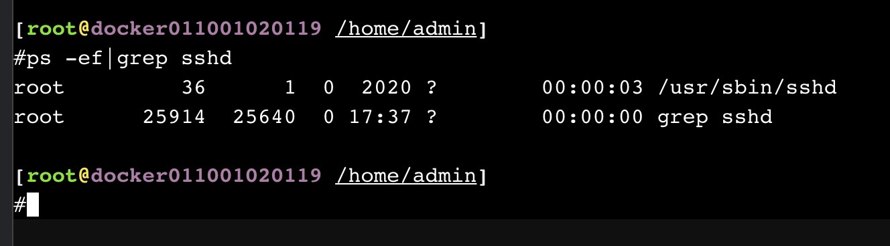

   - 如果ssh的进程未启动，可以手动执行 `/usr/sbin/sshd` 来启动sshd进程。

   - 如果容器中sshd进程不存在，通过 `yum install sshd` 安装sshd插件。

   </li>

   </ol>

2. 修改bcmc集群sshtunnel配置。

   <ol type="i">

   <li>

   登录飞天基础运维平台。

   </li>

   <li>

   在**飞天基础运维平台**左侧导航栏中，选择**产品集群运维**。

   </li>

   <li>

   在**产品列表**中查询bcmc，在目标集群**操作**列单击**集群详情**。

   </li>

   <li>

   进入**集群详情**页面，切换至**终态配置**页签。

   </li>

   <li>

   修改 `/services/tianji-sshtunnel-client/user/SSHTunnelClient/ssh_tunnel_bcmc.conf` 文件。添加FromProduct、FromClusterType、FromServerRole、FromService、FromUser、ToProduct、ToClusterType、ToServerRole、ToService、ToUser信息，修改完成后提交变更。

   > **说明**
   >
   > FromClusterType、FromServerRole注意区分单元与中心，中心使用BcmcCluster、Bcmc，单元使用Bcmc4GeneralCluster、Bcmc4General，代码示例：
   >
   > ```text
   > - FromProduct: bcmc
   >   //FromClusterType: Bcmc4GeneralCluster //注意：中⼼使⽤BcmcCluster，单元使⽤Bcmc4
   > GeneralCluster
   >   //FromServerRole: Bcmc4General //注意：中⼼使⽤Bcmc，单元使⽤Bcmc4General
   >   FromClusterType: BcmcCluster
   >   FromServerRole: Bcmc
   >   FromService: bcmc
   >   FromUser: root
   >   ToProduct: minirds-mt //需要打通的产品
   >   ToClusterType: maotai_7u //需要打通的产品集群类型
   >   ToServerRole: Aurora //需要打通的产品的ServerRole
   >   ToService: minirds-maotai //需要打通的产品的Service
   >   ToUser: root
   > ```

   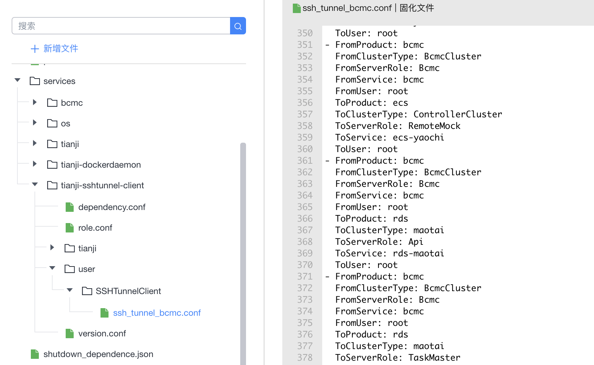

   </li>

   </ol>

3. 验证SSH隧道已打通。

   <ol type="i">

   <li>

   登录bcmc.Bcmc#容器。

   </li>

   <li>

   在目录 `/home/admin/bcmc/config` 下执行 `cat MINIRDS.py | grep "CURRENT_IP_LIST"` ，获取minirds-maotai的IP列表，如下图所示。

   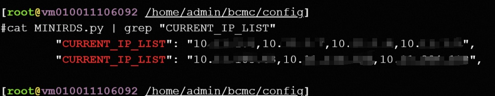

   </li>

   <li>

   手动执行 `ssh <ip`地址`>` 命令，上一步IP列表中的IP都是通的。

   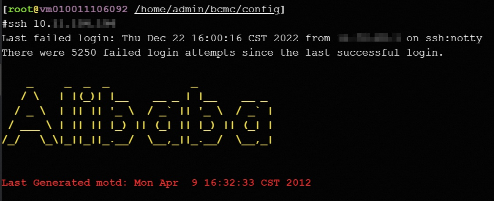

   </li>

   </ol>

> **说明**
>
> 如果上述步骤未解决告警问题，请提工单（服务请求单）联系阿里云技术支持。

<a id="section-2-2-5-4"></a>

#### 2.2.5.4. sync_check（SLB）

此告警点主要检测SLB容灾实例的容灾状态，出现此告警表示SLB容灾巡检异常，可能会导致实例无法容灾切换或流量无法正常转发。本文档主要描述告警产品为SLB时的sync_check告警项相关信息。

**告警属性**

<table>
  <tr>
    <td>告警ID</td>
    <td>监控项名称</td>
    <td>告警来源</td>
    <td>告警级别</td>
    <td>告警产品</td>
    <td>触发条件</td>
    <td>执行周期</td>
  </tr>
  <tr>
    <td>sync_check</td>
    <td>sync_check</td>
    <td>Bcmc#</td>
    <td>P2</td>
    <td>slb</td>
    <td>ASR控制台上SLB容灾巡检异常</td>
    <td>1分钟执行一次</td>
  </tr>
</table>

**适用版本**

适用于专有云企业版v3.12及后续版本。

**告警原因**

- SSH隧道异常

  由于产品基线sshtunnel配置缺失或配置错误，tianji-sshtunnel产品bug问题以及其他问题，导致bcmc到产品SR的SSH通道没有正常打通，从而导致bcmc容灾巡检脚本执行异常。

  bcmc需要打通到主备机房slb-controller.SlbControlMaster#容器的SSH免密隧道，SSH隧道不通会报错。

- 异常实例监听不为0

  实例在转发面LVS上的配置信息和管控数据库中记录的信息不一致导致的，需要修复异常监听实例。

**告警影响**

SLB容灾状态异常，可能会导致：

- 实例无法容灾切换。

- 流量无法正常转发，依赖SLB的云产品或应用运行异常。

**处理方法**

> **警告**
>
> 所有告警处理方法涉及到修改产品任何配置，均需要走生产变更流程确认方案的可行性以及流程规范性，若属紧急应急范畴需客户与TAM同时同意方可执行，否则不允许直接执行处理方法的任何步骤。

**SSH隧道异常的处理方法**

1. 检查对端服务SLB的sshd进程是否开启。

   <ol type="i">

   <li>

   登录SLB服务容器。

   </li>

   <li>

   执行 `ps -ef|grep sshd` 检测sshd进程。

   

   - 如果ssh的进程未启动，可以手动执行 `/usr/sbin/sshd` 来启动sshd进程。

   - 如果容器中sshd进程不存在，通过 `yum install sshd` 安装sshd插件。

   </li>

   </ol>

2. 修改bcmc集群sshtunnel配置。

   <ol type="i">

   <li>

   登录飞天基础运维平台。

   </li>

   <li>

   在**飞天基础运维平台**左侧导航栏中，选择**产品集群运维**。

   </li>

   <li>

   在**产品列表**中查询bcmc，在目标集群**操作**列单击**集群详情**。

   </li>

   <li>

   进入**集群详情**页面，切换至**终态配置**页签。

   </li>

   <li>

   修改 `/services/tianji-sshtunnel-client/user/SSHTunnelClient/ssh_tunnel_bcmc.conf` 文件。添加FromProduct、FromClusterType、FromServerRole、FromService、FromUser、ToProduct、ToClusterType、ToServerRole、ToService、ToUser信息，修改完成后提交变更。

   > **说明**
   >
   > FromClusterType、FromServerRole注意区分单元与中心，中心使用BcmcCluster、Bcmc，单元使用Bcmc4GeneralCluster、Bcmc4General，代码示例：
   >
   > ```text
   > - FromProduct: bcmc
   >   //FromClusterType: Bcmc4GeneralCluster //注意：中⼼使⽤BcmcCluster，单元使⽤Bcmc4
   > GeneralCluster
   >   //FromServerRole: Bcmc4General //注意：中⼼使⽤Bcmc，单元使⽤Bcmc4General
   >   FromClusterType: BcmcCluster
   >   FromServerRole: Bcmc
   >   FromService: bcmc
   >   FromUser: root
   >   ToProduct: slb //需要打通的产品
   >   ToClusterType: slb_controller_Cluster //需要打通的产品集群类型
   >   ToServerRole: SlbControlMaster //需要打通的产品的ServerRole
   >   ToService: slb-controller //需要打通的产品的Service
   >   ToUser: root
   > ```

   

   </li>

   </ol>

3. 验证SSH隧道已打通。

   <ol type="i">

   <li>

   登录bcmc.Bcmc#容器。

   </li>

   <li>

   在目录 `/home/admin/bcmc/config` 下执行 `cat SLB.py | grep "slb_control_master_iplist"` ，获取slb-controller.SlbControlMaster#的IP列表，如下图所示。

   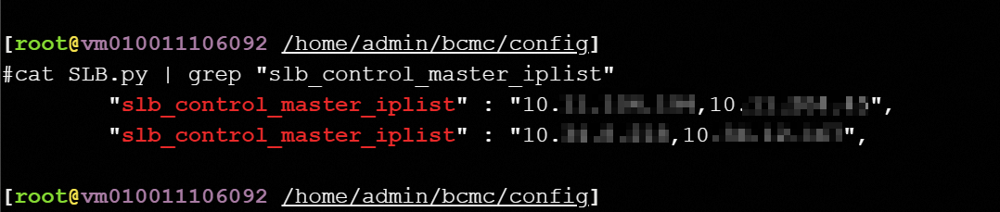

   </li>

   <li>

   手动执行 `ssh <ip`地址`>` 命令，上一步IP列表中的IP都是通的。

   

   </li>

   </ol>

**异常实例监听不为0的处理方法**

1. 排查健康检查问题。

   <ol type="i">

   <li>

   登录slb-controller.SlbAg#容器。

   </li>

   <li>

   执行如下命令运行健康检查脚本，主要的健康检查脚本存放路径 `/deploy/alimonitor/script` 。

   ```text
   python checkHealth.py
   ```

   

   </li>

   <li>

   检查 `/home/slb/ag/slb-test_run.log` 日志，找到error信息，检查导致健康检查失败的关键字。

   </li>

   </ol>

2. 排查异常的lb问题。

   <ol type="i">

   <li>

   登录xuanyuan数据库。

   </li>

   <li>

   执行如下命令检查异常的lb信息。查看北向数据的lb的status（异常情况包括provisioning、init、configuring）和版本号是否一致。

   ```sql
   select * from loadbalancer where current_version != target_version or (status not in ("active", "deleted")) limit 100;
   ```

   </li>

   <li>

   执行如下命令检查南向数据是否生成。查看南向数据的status（正常为Created）和版本号是否一致。

   ```sql
   select * from network_conf where instance_id like '%lb_global_id%' \G
   ```

   </li>

   <li>

   执行如下命令检查binding的生成情况。查看LvsGroup、lvs的status和版本号是否一致。

   ```sql
   select * from network_conf_binding where network_conf_instance_id like "%xxxx%" \G
   ```

   > **说明**
   >
   > 命令中xxxx需要替换为network_conf表的instance_id。

   </li>

   <li>

   执行如下命令检查event事件。

   ```sql
   select * from event where source_instance_id like '%lb_global_id%' \G
   ```

   通过event的request_id把事件的tree打印出来。

   ```text
   info admin detail_event event_id ${instance_id}
   ```

   - 北向数据存在，network_conf和binding数据不存在，一般表示lb创建失败，还未下发到南向。

   - 北向数据存在，network_conf数据存在，binding表的数据不存在，一般表示lb创建成功，但是未下发到转发设备上。

   - 北向数据存在，network_conf和binding数据存在，一般表示lb创建成功，配置已下发到转发设备上。

   </li>

   </ol>

3. 排查异常的vip问题。

   <ol type="i">

   <li>

   登录xuanyuan数据库。

   </li>

   <li>

   执行如下命令检查异常的vip信息。查看北向数据的vip的status（异常情况包括configuring_fail、configuring、stopping、stopping_fail、starting、starting_fail）和版本号是否一致。

   ```sql
   select * from vip where current_version != target_version or (status not in ("running","stopped")) limit 100;
   ```

   </li>

   <li>

   执行如下命令检查南向数据是否生成。查看南向数据的status（正常为Created）和版本号是否一致。

   ```sql
   select * from network_conf where instance_id like '%listener_id%' \G
   ```

   </li>

   <li>

   执行如下命令检查binding的生成情况。查看LvsGroup、lvs的status和版本号是否一致。

   ```sql
   select * from network_conf_binding where network_conf_instance_id like "%xxxx%" \G
   ```

   > **说明**
   >
   > 命令中xxxx需要替换为network_conf表的instance_id。

   </li>

   <li>

   执行如下命令检查event事件。

   ```sql
   select * from event where source_instance_id like '%listener_id%'\G
   ```

   通过event的request_id把事件的tree打印出来。

   ```text
   info admin detail_event event_id ${instance_id}
   ```

   - 北向数据存在，network_conf和binding数据不存在，一般表示vip创建失败，还未下发到南向。

   - 北向数据存在，network_conf数据存在，binding表的数据不存在，一般表示vip创建成功，但是未下发到转发设备上。

   - 北向数据存在，network_conf和binding数据存在，一般表示vip创建成功，配置已下发到转发设备上。

   </li>

   </ol>

4. 根据排查的原因联系SLB运维人员协助解决。

> **说明**
>
> 如果上述步骤未解决告警问题，请提工单（服务请求单）联系阿里云技术支持。

<a id="section-2-2-5-5"></a>

#### 2.2.5.5. sync_check（Kafka）

此告警点主要检测Kafka容灾实例的容灾状态，出现此告警表示Kafka容灾巡检异常，可能会导致数据丢失、实例无法容灾切换或实例访问异常。本文档主要描述告警产品为Kafka时的sync_check告警项相关信息。

**告警属性**

<table>
  <tr>
    <td>告警ID</td>
    <td>监控项名称</td>
    <td>告警来源</td>
    <td>告警级别</td>
    <td>告警产品</td>
    <td>触发条件</td>
    <td>执行周期</td>
  </tr>
  <tr>
    <td>sync_check</td>
    <td>sync_check</td>
    <td>Bcmc#</td>
    <td>P2</td>
    <td>kafka</td>
    <td>ASR控制台上Kafka容灾巡检异常</td>
    <td>1分钟执行一次</td>
  </tr>
</table>

**适用版本**

适用于专有云企业版v3.16及后续版本。

**告警原因**

当前Kafka集群还未进行容灾配置，需要完成Kafka集群的容灾配置。

**告警影响**

Kafka容灾状态异常，可能会导致：

- 主备未配置数据同步，主节点故障时可能会导致数据丢失。

- 实例无法容灾切换。

- 实例访问异常，依赖该实例的应用运行异常。

**处理方法**

> **警告**
>
> 所有告警处理方法涉及到修改产品任何配置，均需要走生产变更流程确认方案的可行性以及流程规范性，若属紧急应急范畴需客户与TAM同时同意方可执行，否则不允许直接执行处理方法的任何步骤。

**确认报错信息**

在ASR控制台**平台监控** > **产品监控**页面中，Kafka**容灾能力**监控项提示**No disaster recovery instance**，且**主节点位置**为**未获取到**。

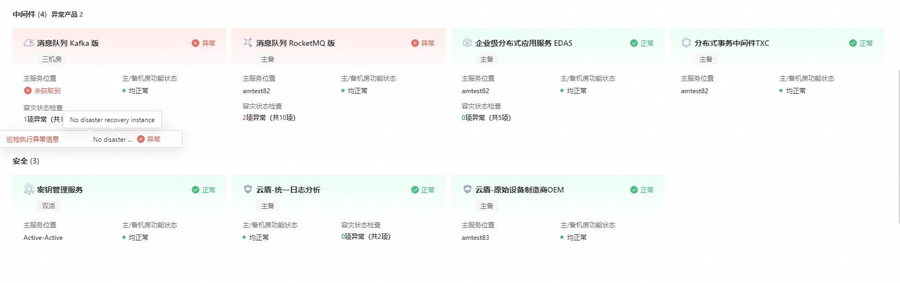

**前提条件**

环境中至少需要有2个Kafka集群和2个Replicator，且需要满足以下条件：

- 2个Kafka集群需要分布在主备不同的机房（不同AZ）。

- 2个Replicator需要分布在主备不同的机房（不同AZ）。

- Kafka集群必须先成功创建出VIP，且需要做容灾配置的两个Kafka集群的VIP类型需要一致。VIP类型为AnyTunnel或SingleTunnel，如果是创建SingleTunnel VIP，需要保证两个Kafka集群选择同一个VPC。

**处理步骤**

1. 登录Apsara Uni-manager运营控制台。

2. 在顶部菜单栏选择**产品 > 中间件 > 消息队列 Kafka 版**。

3. 进入**消息队列Kafka版**页面，在左侧菜单栏**实例列表**中确认实例满足前提条件。

4. 在左侧菜单栏**容灾集群列表**中，创建容灾实例。

   <ol type="i">

   <li>

   单击**创建容灾集群**。

   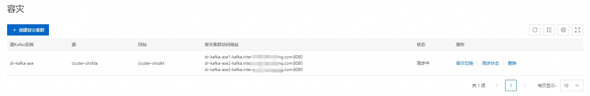

   </li>

   <li>

   填写**容灾集群名称**，单击**下一步**。

   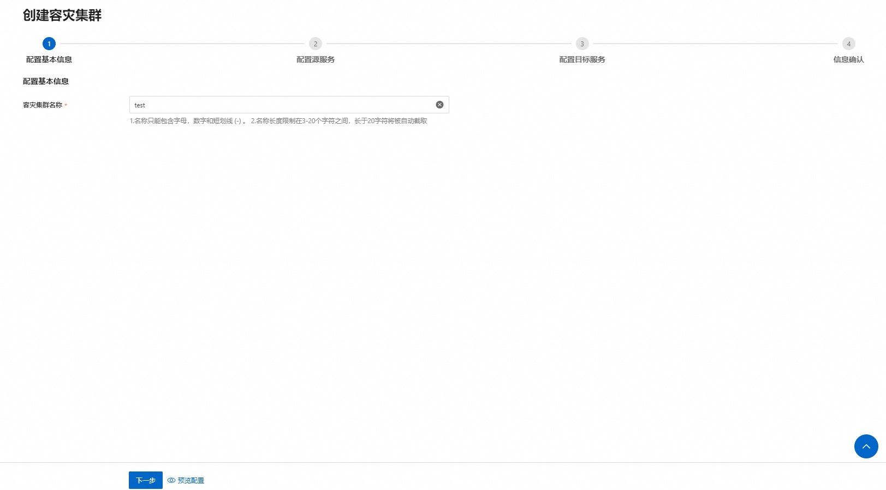

   </li>

   <li>

   在**源Kafka实例**中选择主Kafka集群实例，在**源KafkaReplicator实例**中选择主Replicator实例，单击**下一步**。

   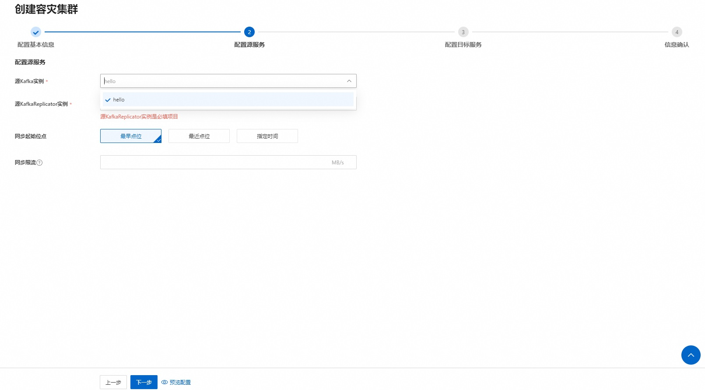

   </li>

   <li>

   在**目标Kafka实例**中选择备Kafka集群实例，在**目标KafkaReplicator实例**中选择备Replicator实例，单击**创建**。

   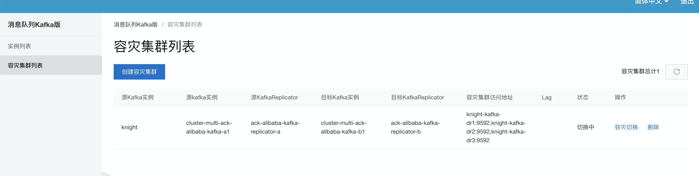

   </li>

   </ol>

> **说明**
>
> 如果上述步骤未解决告警问题，请提工单（服务请求单）联系阿里云技术支持。

<a id="section-2-2-5-6"></a>

#### 2.2.5.6. sync_check（Elasticsearch）

此告警点主要检测Elasticsearch容灾实例的容灾状态，出现此告警表示Elasticsearch容灾巡检异常，可能会导致数据丢失、实例无法容灾切换或实例访问异常。本文档主要描述告警产品为Elasticsearch时的sync_check告警项相关信息。

**告警属性**

<table>
  <tr>
    <td>告警ID</td>
    <td>监控项名称</td>
    <td>告警来源</td>
    <td>告警级别</td>
    <td>告警产品</td>
    <td>触发条件</td>
    <td>执行周期</td>
  </tr>
  <tr>
    <td>sync_check</td>
    <td>sync_check</td>
    <td>Bcmc#</td>
    <td>P2</td>
    <td>elasticsear ch</td>
    <td>ASR控制台上Elasticsear ch容灾巡检异常</td>
    <td>1分钟执行一次</td>
  </tr>
</table>

**适用版本**

适用于专有云企业版v3.16及后续版本。

**告警原因**

当前Elasticsearch集群还未进行容灾配置，需要完成Elasticsearch集群的容灾配置。

**告警影响**

Elasticsearch容灾状态异常，可能会导致：

- 主备未配置数据同步，主节点故障时可能会导致数据丢失。

- 实例无法容灾切换。

- 实例访问异常，依赖该实例的应用运行异常。

**处理方法**

> **警告**
>
> 所有告警处理方法涉及到修改产品任何配置，均需要走生产变更流程确认方案的可行性以及流程规范性，若属紧急应急范畴需客户与TAM同时同意方可执行，否则不允许直接执行处理方法的任何步骤。

**确认报错信息**

在ASR控制台**平台监控** > **产品监控**页面中，Elasticsearch的容灾状态监测异常。

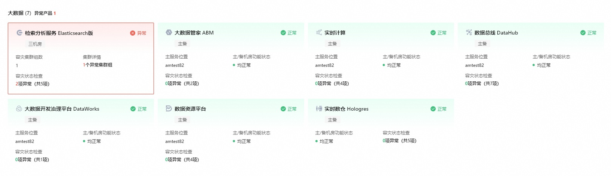

**前提条件**

在Apsara Uni-manager运维控制台创建用户asr_es，并给该用户授予elasticsearch_read角色权限。

**处理步骤**

1. 使用asr_es用户登录Apsara Uni-manager运维控制台。

2. 在顶部菜单栏选择**产品运维** > **大数据运维** > **elasticsearch搜索服务管控**。

3. 进入**ESSEN**控制台，在左侧导航栏**实例管理**中，单击**创建实例**。

4. 在**基础配置**页面中，选择版本，单击**下一步**。

5. 在**集群配置**页面中，填写集群信息，单击**下一步**。

6. 在**网络及系统配置**页面中，网络类型选择**专有网络(any tunnel)**，并设置登录密码，单击**开始创建**。

7. 参考上述操作在主机房和备机房各创建一个集群，设置相同的登录密码。

8. 在ops1机器上执行以下命令运行ES_ha_init.py脚本。

   ```text
   # ${masterInstance} 表示主集群instanceID ; ${slaveInstance} 表示备集群instanceID ; 
   ${masterNamespace} 表示主集群所在命名空间 ; ${slaveNamespace} 表示备集群所在命名空间 ;
   ${masterIDC} 表示主机房IDC名称 ; ${slaveIDC} 表示备机房IDC名称 ; ${UserDomain} 表示⽤户⾃定
   义的⽤来访问es集群的域名

   /home/tops/bin/python ES_ha_init.py -mi ${masterInstance} -si ${slaveInstance} -mn ${
   masterNamespace} -sn ${slaveNamespace} -md ${masterIDC} -sd ${slaveIDC} -d ${UserDomain}

   示例: /home/tops/bin/python ES_ha_init.py -mi es-a -si es-b -mn xdcr-test-a -sn xdcr-test-b -md amtest17 -sd amtest34 -d es-visit.xdcr-test.intra.env11e.shuguang.com
   ```

   > **说明**
   >
   > 脚本使用注意事项 :
   >
   > - 已经被设置为备集群的实例不允许再被设置为主集群实例。
   >
   > - 已经绑定IP的域名默认不允许使用，可以添加-f参数，强制使用指定的域名。
   >
   > - 查询当前的容灾实例列表： `/home/tops/bin/python ES_ha_init.py -a list` 。
   >
   > - 在刚增量部署完es容灾服务之后，在未创建es容灾实例的情况下，asr的容灾巡检页面可能会报错，可以执行 `/home/tops/bin/python ES_ha_init.py -a init` 命令触发相关数据库的数据源配置初始化。

**注意事项**

- 不允许创建“.”开头或者“security-auditlog”开头的索引（该类型的索引不会进行数据同步）。

- 备机房删除index会触发同步，因此无法删除；而主机房如果删除index，备机房的index会同步删除。

- client要求设置DNS缓存尽可能短（不能超过10秒）。

- 断电回切时，需要先在（断电前的）主机房执行如下命令开启同步链路，提前触发数据同步，避免容灾切换时一直block在数据同步阶段。

  ```bash
  # 开启同步链路（可以在asr上校验数据同步链路是否配置成功） ${masterInstance} 表示主集群
  instanceID ; ${user} 表示备集群实例⽤户名 ; ${password} 表示备集群实例⽤户密码 ; ${slaveClusterMgmtVip} 表示备集群实例的管理域域名

  curl -XPOST -u ${user}:${password} 
  ${slaveClusterMgmtVip}:9200/_xdcr/${masterInstance}?excludes=.*,security-auditlog*

  kibana⽩屏操作（断电前的主集群）：
  POST /_xdcr/${masterInstance}?excludes=.*,security-auditlog*


  # 查看数据同步进度(当查询结果的第三列和第四列的数据⼀致时说明数据同步完成）${user} 表示备集群实例⽤
  户名 ; ${password} 表示备集群实例⽤户密码 ; ${slaveClusterMgmtVip} 表示备集群实例的管理域域名

  curl -u ${user}:${password} ${slaveClusterMgmtVip}:9200/_cat/xdcr?
  h=repository,index,localGCP,remoteGCP

  kibana⽩屏操作（备集群）：
  GET /_cat/xdcr?h=repository,index,localGCP,remoteGCP
  ```

- 断网回切时，除需要先在（断网前的）主机房手动配置开启同步链路之外，还可能需要将主机房索引index删除，触发一次全量同步（根据现场是否可以接受主备集群部分数据不一致判断）。

> **说明**
>
> 如果上述步骤未解决告警问题，请提工单（服务请求单）联系阿里云技术支持。

<a id="section-2-2-6"></a>

### 2.2.6. inspect_product_cluster_aplus

此告警点主要检测同城容灾主机房产品集群是否做了A'，出现此告警表示存在产品集群未做A'，可能会导致容灾切换失败。

**告警属性**

| 告警ID | 监控项名称 | 告警来源 | 告警级别 | 告警产品 | 触发条件 | 执行周期 |
| --- | --- | --- | --- | --- | --- | --- |
| inspect_pro duct_cluste r_aplus | inspect_pro duct_cluste r_aplus | Bcmc# | P2 | bcmc | 同城容灾主机房集群未执行A'操作 | 30分钟执行一次 |

**适用版本**

适用于专有云企业版v3.14及后续版本。

**告警原因**

除ECS计算集群、存储集群外，其他所有在备机房部署的集群，其对应的主机房集群均需要做A'操作。

> **说明**
>
> 只在主机房部署而未在备机房部署的集群，不需要做A'操作。

**告警影响**

云产品未完成同城容灾部署，容灾切换失败。

**处理方法**

> **警告**
>
> 所有告警处理方法涉及到修改产品任何配置，均需要走生产变更流程确认方案的可行性以及流程规范性，若属紧急应急范畴需客户与TAM同时同意方可执行，否则不允许直接执行处理方法的任何步骤。

1. 针对双机房部署的集群中主集群未做A'的产品执行A'操作。

   > **重要**
   >
   > 注意事项：
   >
   > - 执行A'之前，请确保主备集群都已到达终态。
   >
   > - 基础中间件（middleWareAll、dauthProduct、aliware-taokeeper、middleware-dncs），必须在产品到达终态后立刻执行A'操作。
   >
   > - 执行A'过程中，产品有先后顺序，请严格按照产品A'提交顺序进行。
   >
   > - MQ、OSS、Tablestore产品执行A'会有业务闪断，操作前需要跟客户申请变更窗口。

   - 产品A'提交顺序

     A'操作是集群级别的，建议顺序提交，即等待前一个提交命令返回成功，并在TianJi上观察到开始rolling后，再继续提交下一个集群的升级。集群提交顺序如下：

     > **重要**
     >
     > - 不在表格内的集群，可以在RDS集群提交后提交，BCMC集群最后提交A'操作。
     >
     > - MiniRDS在执行A'操作时会自动下发跨机房备库重搭，重搭过程不影响数据库实例读写，可以第一个提交，同时并发提交其他集群。备库重搭时间会比较久，并且会有一定概率的迁移失败，现场操作人员需要密切监控MiniRDS和RDS的运维控制台，观察是否有中断或失败的迁移任务，如有请及时处理。

     | 顺序ID | 产品 | 集群（现场请以实际为准） |
     | --- | --- | --- |
     | 1 | tianji | tianji-A-e68c |
     | 2 | minirds-mt | • integrator-A-20200212-e682<br>• maotai-A-20200212-e681 |
     | 3 | baseServiceAll | StandardCloudCluster-A |
     | 4 | webappAll | StandardCloudCluster |
     | 5 | vnet | VnetCluster |
     | 6 | xnet2 | Xnet2Cluster |
     | 7 | ram | BasicCluster |
     | 8 | qitian | qitianCluster |
     | 9 | opsapi | opsapiCluster |
     | 10 | tongque | tongqueCluster |
     | 11 | asa | asaCluster |
     | 12 | aso | asoCluster |
     | 13 | slb | • slbCluster<br>• slb_yaochi_Cluster |
     | 14 | vpc | • vpcAzoneCluster<br>• vpcRegionCluster<br>• vpcRegionXnetCluster<br>• vpcYaochiCluster |
     | 15 | ecs | • ECS-controller-A-e68d<br>• ECS-controller-A-e68f |
     | 16 | oss | OssHybridCluster<br>重要如果您不想全量Bucket做同城容灾，请先不要执行OSS的A'操作，具体方案请联系OSS研发团队获取。 |
     | 17 | rds | • brain<br>• kvstore-yaochi<br>• maotai<br>• nosql-cleaneye<br>• pgsql<br>• ppassql<br>• proxy<br>• rds-dr-service<br>• rds-yaochi<br>• redis |
     | 18 | On PaaS产品 | 根据现场On PaaS产品而定。 |
     | 19 | bcmc | BcmcCluster-A |

   - On Tianji产品A'操作

     <ol type="a">

     <li>

     登录主机房ops1机器。

     </li>

     <li>

     执行如下命令，更新主机房的集群配置。

     ```bash
     cd  /apsarapangu/disk3/u_disk/upgrade_tools/tianji_zhuque_sdk
     ./upgrade_A_to_Aplus.py -z [$ZONE] -p [$PROJECT] -c [$CLUSTER] --tianjiCltConfig 
     [$TIANJICLTCONFIG]
     ```

     > **说明**
     >
     > - 参数说明：
     >
     >   - $ZONE：主机房集群所在的Zone。
     >
     >   - $PROJECT：主机房集群所在的project的名称。
     >
     >   - $CLUSTER：主机房集群的名称。
     >
     >   - $TIANJICLTCONFIG：tianji_clt配置文件（固定目录）。
     >
     > - 命令示例：
     >
     >   ```bash
     >   cd  /apsarapangu/disk3/u_disk/upgrade_tools/tianji_zhuque_sdk
     >   ./upgrade_A_to_Aplus.py -z cn-haikou-xxxx-xxxx-a -p tianji -c tianji-A-c8df  --tianjiCltConfig 
     >   /cloud/data/bootstrap_controller/BootstrapController#/bootstrap_controlle
     >   /tianji_dest.conf
     >   ```

     </li>

     </ol>

   - On PaaS产品A'操作（适用于v3.17之前版本）

     <ol type="a">

     <li>

     下载arkctl工具。

     </li>

     <li>

     执行以下命令，获取环境中的所有On PaaS产品。

     ```text
     arkctl product list -iz
     ```

     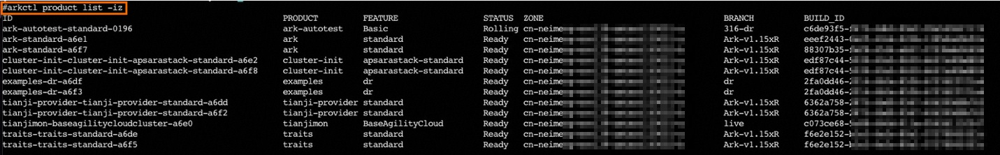

     </li>

     </ol>

     <ol type="i" start="100">

     <li>

     执行以下命令，查看产品是否处于rolling状态。

     ```text
     arkctl product rolling ${id}
     ```

     > **说明**
     >
     > id是上一步查询出来的产品ID。

     

     </li>

     <li value="500">

     执行如下命令，查看产品是否处于Ready状态。

     ```text
     arkctl product list -iz
     ```

     如果查询结果显示Ready状态，则说明部署成功。

     </li>

     </ol>

   - On PaaS产品A'操作（适用于v3.17及之后版本）

     <ol type="a">

     <li>

     下载arkctl工具。

     </li>

     <li>

     执行以下命令，获取环境中的所有On PaaS产品。

     ```text
     arkctl product list -iz
     ```

     

     </li>

     </ol>

     <ol type="i" start="100">

     <li>

     执行以下命令检查haApsaraStack变量的值如果为 `true` ，则直接返回成功；如果为 `false` ，则继续执行A'操作。

     ```text
     arkctl dr aplus ${id}
     ```

     > **说明**
     >
     > id是上一步查询出来的产品ID。

     </li>

     </ol>

2. 重新执行是否做A'检查，期望**未做A'产品列表**为空。

> **说明**
>
> 如果上述步骤未解决告警问题，请提工单（服务请求单）联系阿里云技术支持。

<a id="section-2-2-7"></a>

### 2.2.7. inspect_product_cluster_version

此告警点主要检测主备机房产品版本是否一致，出现此告警表示主备机房产品版本不一致，可能会导致容灾切换失败或切换后云产品功能变化。

**告警属性**

<table>
  <tr>
    <td>告警ID</td>
    <td>监控项名称</td>
    <td>告警来源</td>
    <td>告警级别</td>
    <td>告警产品</td>
    <td>触发条件</td>
    <td>执行周期</td>
  </tr>
  <tr>
    <td>inspect_pro duct_cluste r_version</td>
    <td>inspect_pro duct_cluste r_version</td>
    <td>Bcmc#</td>
    <td>P2</td>
    <td>bcmc</td>
    <td>主备机房产品版本不一致</td>
    <td>30分钟执行一次</td>
  </tr>
</table>

**适用版本**

适用于专有云企业版v3.14及后续版本。

**告警原因**

在同城容灾场景下，容灾的云产品必须要保证主备机房产品版本保持一致，不一致的产品会上报异常。

**告警影响**

产品集群版本检查状态异常，可能会导致：

- 容灾切换失败。

- 切换后，云产品功能变化。

**处理方法**

> **警告**
>
> 所有告警处理方法涉及到修改产品任何配置，均需要走生产变更流程确认方案的可行性以及流程规范性，若属紧急应急范畴需客户与TAM同时同意方可执行，否则不允许直接执行处理方法的任何步骤。

针对主备机房部署版本不一致的云产品，请联系TAM支持人员升级产品版本。

<a id="section-2-2-8"></a>

### 2.2.8. inspect_product_variable

此告警点主要检测tianji API获取的bcmc依赖的基线变量与bcmc渲染出来的基线变量是否一致，出现此告警表示基线变量不一致，可能会导致容灾切换失败。

**告警属性**

<table>
  <tr>
    <td>告警ID</td>
    <td>监控项名称</td>
    <td>告警来源</td>
    <td>告警级别</td>
    <td>告警产品</td>
    <td>触发条件</td>
    <td>执行周期</td>
  </tr>
  <tr>
    <td>inspect_pro duct_varia ble</td>
    <td>inspect_pro duct_varia ble</td>
    <td>Bcmc#</td>
    <td>P2</td>
    <td>bcmc</td>
    <td>ASR控制台上产品基线变量检查不通过</td>
    <td>30分钟执行一次</td>
  </tr>
</table>

**适用版本**

适用于专有云企业版v3.14及后续版本。

**告警原因**

由于云产品升级、扩容，或云产品服务发生了迁移，从而导致通过tianji API获取的bcmc依赖的基线变量与bcmc渲染出来的基线变量不一致。

> **说明**
>
> - tianji API获取的bcmc依赖的基线变量可参考 `/opt/tianji/conf.tmpl` 目录下 `application-conf-opposite.yml` 和 `application-conf.yml` 文件。
>
> - bcmc中渲染出来的基线变量可参考 `/alidata/conf/antx.properties` 文件。

**告警影响**

容灾切换失败。

**处理方法**

> **警告**
>
> 所有告警处理方法涉及到修改产品任何配置，均需要走生产变更流程确认方案的可行性以及流程规范性，若属紧急应急范畴需客户与TAM同时同意方可执行，否则不允许直接执行处理方法的任何步骤。

- 如果某产品执行过扩容操作，会导致bcmc的基线变量发生变化，需要重新rolling bcmc并重新渲染。

  <ol type="i">

  <li>

  登录飞天基础运维平台。

  </li>

  <li>

  在**飞天基础运维平台**左侧导航栏中，选择**产品集群运维**。

  </li>

  <li>

  在**产品列表**中查询bcmc，在目标集群**操作**列单击**集群详情**。

  </li>

  <li>

  进入**集群详情**页面，切换至**终态配置**页签。

  </li>

  <li>

  修改kv.conf文件，在kv.conf文件最后一行末尾处按回车键，然后单击**预览并提交**。

  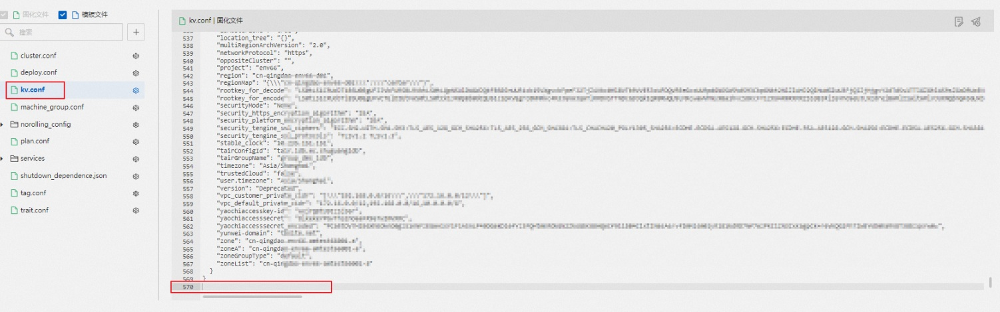

  </li>

  <li>

  在预览窗口中输入描述，单击**提交**。

  </li>

  </ol>

- 如果bcmc本该获取到某产品备机房集群的变量却获取到主机房集群的变量，那可能是该产品最近做过增量部署，需要检查bcmc集群配置中的serviceid.conf文件，删除对应的配置。

  <ol type="i">

  <li>

  登录飞天基础运维平台。

  </li>

  <li>

  在**飞天基础运维平台**左侧导航栏中，选择**产品集群运维**。

  </li>

  <li>

  在**产品列表**中查询bcmc，在目标集群**操作**列单击**集群详情**。

  </li>

  <li>

  进入**集群详情**页面，切换至**终态配置**页签。

  </li>

  <li>

  在serviceid.conf文件中删除对应产品的配置行。

  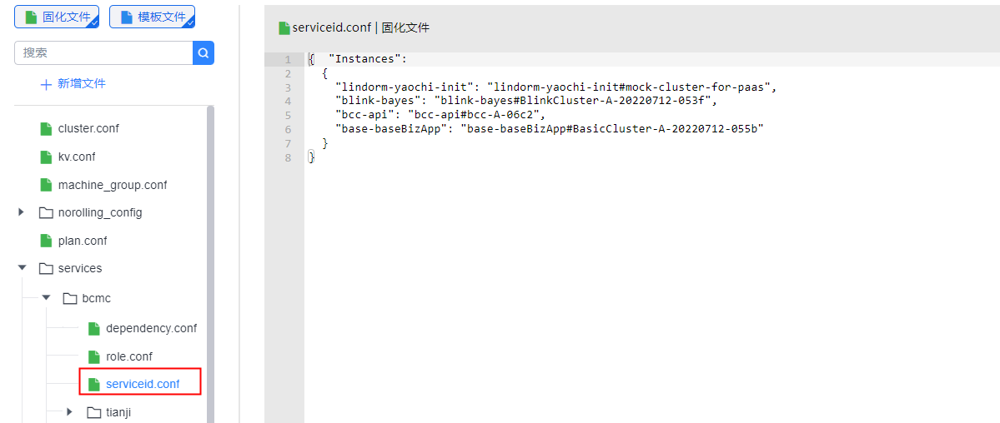

  </li>

  </ol>

> **说明**
>
> 如果上述步骤未解决告警问题，请提工单（服务请求单）联系阿里云技术支持。

<a id="section-2-2-9"></a>

### 2.2.9. inspect_product_cluster_deploy

此告警点主要检测主备机房云产品集群是否对等部署，出现此告警表示检测到非对等部署的云产品，可能会导致容灾切换失败、切换后云产品访问异常或云产品负载过高。

**告警属性**

<table>
  <tr>
    <td>告警ID</td>
    <td>监控项名称</td>
    <td>告警来源</td>
    <td>告警级别</td>
    <td>告警产品</td>
    <td>触发条件</td>
    <td>执行周期</td>
  </tr>
  <tr>
    <td>inspect_pro duct_cluste r_deploy</td>
    <td>inspect_pro duct_cluste r_deploy</td>
    <td>Bcmc#</td>
    <td>P2</td>
    <td>bcmc</td>
    <td>主备机房云产品集群部署不对等</td>
    <td>30分钟执行一次</td>
  </tr>
</table>

**适用版本**

适用于专有云企业版v3.14及后续版本。

**告警原因**

在同城容灾的场景下，除个别支持非对等容灾的产品外，需要做容灾的云产品必须要保证主备机房云产品版本保持一致、云产品集群对等部署，检查到非对等部署的云产品会上报异常。

> **说明**
>
> 支持非对等部署的产品清单：RDS、Redis、OSS、ECS、MaxCompute<strong>。</strong>

**告警影响**

集群部署检查状态异常，可能会导致：

- 容灾切换失败。

- 切换后，非对等部署的云产品访问异常。

- 切换后，云产品负载过高。

**处理方法**

> **警告**
>
> 所有告警处理方法涉及到修改产品任何配置，均需要走生产变更流程确认方案的可行性以及流程规范性，若属紧急应急范畴需客户与TAM同时同意方可执行，否则不允许直接执行处理方法的任何步骤。

联系现场TAM支持人员确认云产品部署是否有误，若部署有误则增量部署集群后重新发起检查，若部署无误则忽略异常。

<a id="section-2-2-10"></a>

### 2.2.10. 附录

<a id="section-2-2-10-1"></a>

#### 2.2.10.1. 登录Apsara Uni-manager运营控制台

本文主要向您介绍如何登录Apsara Uni-manager运营控制台。

**前提条件**

- 登录Apsara Uni-manager运营控制台前，确认您已从部署人员处获取Apsara Uni-manager运营控制台的服务域名地址。

- 推荐使用Chrome浏览器。

**操作步骤**

1. 在浏览器地址栏中，输入Apsara Uni-manager运营控制台的服务域名地址，按回车键。

   

   > **说明**
   >
   > - 单击页面右上角的当前语言可以切换其它语言。

2. 输入正确的用户名及密码。

   > **说明**
   >
   > - 请向运营管理员获取登录控制台的用户名和密码。
   >
   > - 首次登录Apsara Uni-manager运营控制台时，需要修改登录用户名的密码，请按照提示完成密码修改。为提高安全性，密码长度必须为10~32位，且包含英文字母大小写、阿拉伯数字和特殊符号（感叹号（!）、at（@）、井号（#）、美元符号（$）、百分号（%）等）。

3. 单击**账号登录**。

4. 如果账号已激活MFA多因素认证，请根据以下两种情况进行操作：

   - **管理员强制开启MFA后的首次登录**

     <ol type="a">

     <li>

     在绑定虚拟MFA设备页面中，按页面提示步骤绑定MFA设备。

     </li>

     <li>

     按照步骤2重新输入账号和密码，单击**账号登录**。

     </li>

     </ol>

     <ol type="i" start="100">

     <li>

     输入6位MFA码后单击**认证**。

     </li>

     </ol>

   - **您已开启并绑定MFA**

     输入6位MFA码后单击**认证**。

     > **说明**
     >
     > 绑定并开启MFA的操作请参见管理多因素认证。

**相关操作**

**忘记密码**

1. 用户忘记登录密码时，单击密码输入框下方的**忘记密码**。

2. 在忘记密码页面，输入**账户名**、**邮箱**和验证码后，单击**确认**。

   

   > **说明**
   >
   > - 账户名请输入当前账号的用户名，邮箱请输入注册账号的Email地址。
   >
   > - 重置密码的链接将发至邮箱，进入链接后用户可输入新密码。

<a id="section-2-2-10-2"></a>

#### 2.2.10.2. 登录Apsara Uni-manager运维控制台

本文介绍运维工程师等相关用户如何登录到Apsara Uni-manager运维控制台。

**前提条件**

- 已从部署人员或管理员处获取Apsara Uni-manager运维控制台的访问地址、用户名和密码。

  Apsara Uni-manager运维控制台访问地址格式为*region-id*.ops.console.*intranet-domain-id*。

- 推荐使用Chrome浏览器。

**操作步骤**

1. 打开浏览器。

2. 在地址栏中，输入Apsara Uni-manager运维控制台的访问地址，按回车键。

   

   > **说明**
   >
   > 您可以单击右上角的当前语言切换其它语言。当前支持简体中文、英文、繁体中文三种语言切换。

3. 输入正确的用户名及密码。

   > **说明**
   >
   > 登录Apsara Uni-manager运维控制台的用户名和密码请从部署人员或管理员处获取。

   首次登录Apsara Uni-manager运维控制台时，需要修改登录用户名的密码，请按照提示完成密码修改。

   为提高安全性，密码必须满足以下要求：

   - 必须包含英文大小写字母。

   - 必须包含阿拉伯数字（0~9）。

   - 必须包含特殊符号，包括感叹号（!）、at（@）、井号（#）、美元符号（$）、百分号（%）等。

   - 密码长度为10~20个字符。

4. 单击**账号登录**。

<a id="section-2-2-10-3"></a>

#### 2.2.10.3. 登录容器

本文介绍登录容器的具体操作步骤，以登录bcmc<em>.</em>Bcmc<strong>#</strong>容器为例。

**操作步骤**

1. 登录终端。

   <ol type="i">

   <li>

   登录Apsara Uni-manager运维控制台。

   </li>

   <li>

   在顶部菜单栏选择**平台运维 > 飞天基础运维平台 > 资源管理**。

   </li>

   <li>

   在**飞天基础运维平台**左侧导航栏中，选择**资源管理 > 产品集群运维**。

   </li>

   <li>

   在**产品集群运维**页面，搜索bcmc服务。

   </li>

   <li>

   在目标集群的**操作**列，单击**集群详情**。

   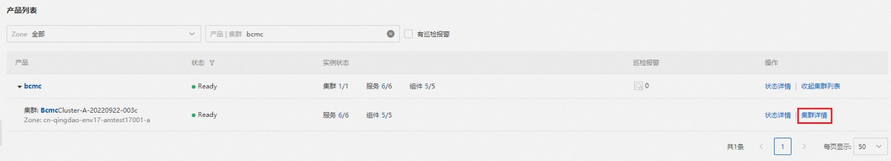

   </li>

   <li>

   在服务列表中，单击**bcmc**。

   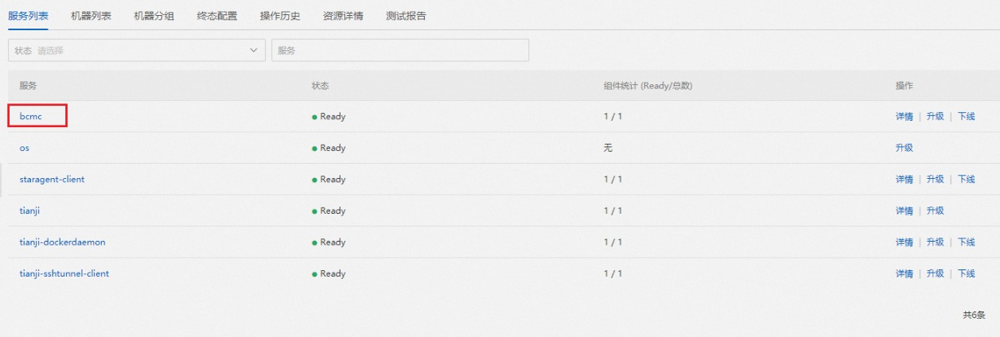

   </li>

   <li>

   选择<strong>Bcmc#</strong>组件，在**实例列表**页签下，单击实例**操作**列的**Terminal**。

   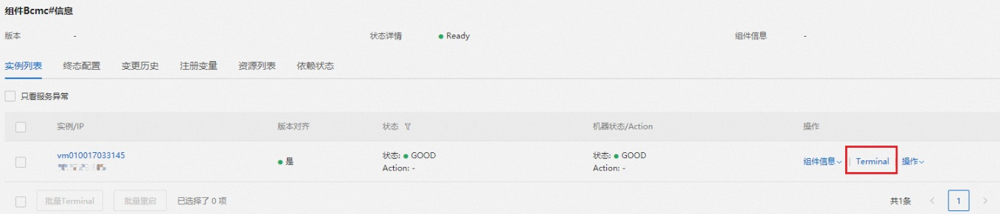

   </li>

   </ol>

2. 执行如下命令查询容器的ID。

   ```bash
   docker ps
   ```

   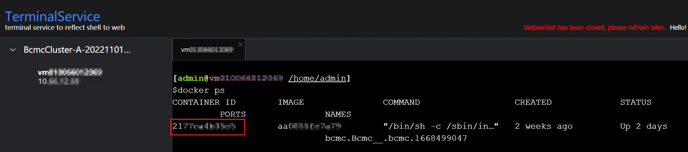

3. 执行如下命令进入容器。

   ```bash
   docker exec -it <容器ID> /bin/bash
   ```

   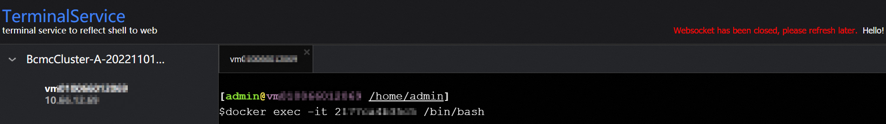

<a id="section-2-2-10-4"></a>

#### 2.2.10.4. 登录xuanyuan数据库

本文介绍登录SLB的xuanyuan数据库的具体操作。

1. 登录Apsara Uni-manager运维控制台。

2. 在顶部菜单栏选择**平台运维 > 飞天基础运维平台 > 资源管理**。

3. 在**飞天基础运维平台**左侧导航栏中，选择**资源管理 > 产品集群运维**。

4. 在产品列表中查询slb，在slbCluster-A集群**操作**列单击**集群详情**。

5. 在服务列表中单击**slb-controller**服务名称。

6. 选择<strong>SlbControlMaster#</strong>组件。

7. 切换至**资源列表**页签，找到**名称**和**类型**分别为**xuanyuan**和**db**的资源，在其**资源申请结果**列中查看db_host、user、db_password、db_port、db_name的取值。

   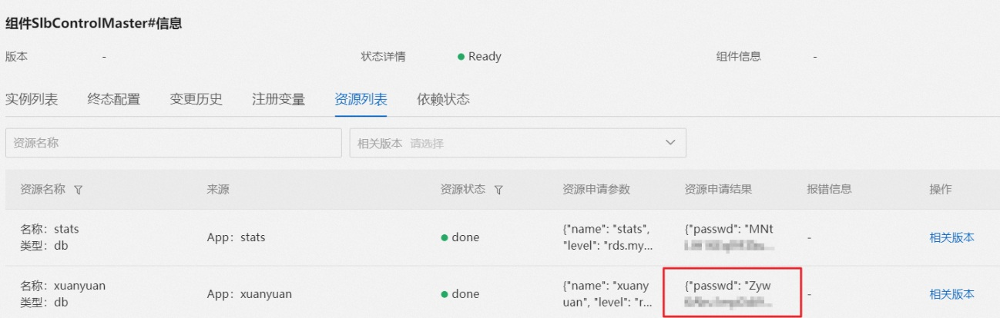

8. 切换至**实例列表**页签，在任一实例的**操作**列单击**Terminal**。

9. 执行如下命令，登录xuanyuan数据库。db_host、user、db_password、db_port、db_name的取值请参见步骤7。

   ```text
   mysql -h${db_host} -u${user} -p${db_password} -P${db_port} -D${db_name}
   ```

<a id="section-2-2-10-5"></a>

#### 2.2.10.5. 登录飞天基础运维平台系统

本文介绍运维工程师等相关用户如何登录飞天基础运维平台系统。

**前提条件**

- 已从部署人员或管理员处获取Apsara Uni-manager运维控制台的访问地址、用户名和密码。

Apsara Uni-manager运维控制台访问地址格式为<em>region-id.</em>ops.asconsole.*intranet-domain-id*。

- 推荐使用Chrome浏览器。

**操作步骤**

1. 打开浏览器。

2. 在地址栏中，输入Apsara Uni-manager运维控制台访问地址，按回车键。

   > **说明**
   >
   > 您可以单击右上角的下拉列表切换语言。

3. 输入正确的用户名及密码。

   > **说明**
   >
   > 登录Apsara Uni-manager运维控制台的用户名和密码请从部署人员或管理员处获取。

   首次登录Apsara Uni-manager运维控制台时，需要修改登录用户名的密码，请按照提示完成密码修改。

   为提高安全性，密码必须满足以下要求：

   - 必须包含英文大小写字母。

   - 必须包含阿拉伯数字（0~9）。

   - 必须包含特殊符号，包括感叹号（!）、at（@）、井号（#）、美元符号（$）、百分号（%）等。

   - 密码长度为10~20个字符。

4. 单击**登录**。

5. 在顶部菜单栏，选择**平台运维** > **飞天基础运维平台** > **资源管理**。

<a id="section-2-2-10-6"></a>

#### 2.2.10.6. 备库重搭

本文为您介绍备库重搭的操作方法，帮助您更快了解备库重搭。

**操作步骤**

1. **查看异常实例基本信息、链路类型、端口和主库IP信息**

1. 登录杜康数据库管理平台。

2. 选择**实例管理**> **实例列表**，单击需要操作的实例，进入实例详情页面。

   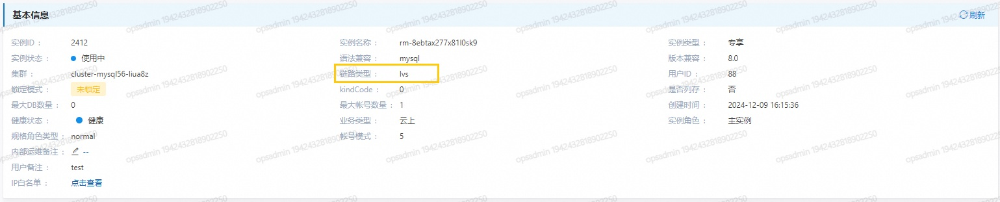

   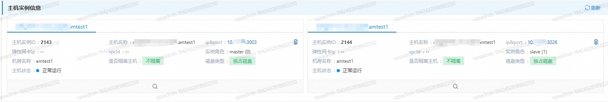

   - 如果是DNS链路类型，登录实例所在主机，执行如下命令查看是否解析正确。如果解析失败，联系产研同学协助解决。

     ```text
     dig ${域名}
     ```

   - 如果是lvs链路类型，确认机房信息IP与主实例机器IP是否一致。如果不一致，请停止操作并联系产研同学协助解决。

2. **主备库read_only参数检查**

1. 登录主库，请参见登录异常实例。

2. 执行如下SQL语句，查看主库的读写状态。

   <ol type="i">

   <li>

   当结果显示为ON，即为主库异常。

   ```text
    show variables like 'read_only'; 
   ```

   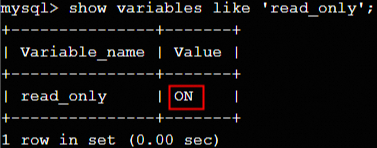

   </li>

   <li>

   执行如下SQL语句，把read_only参数设置为OFF。

   ```text
    set global read_only = 0; 
   ```

   </li>

   </ol>

3. 登录备库。

4. 执行如下SQL语句，查看备库的读写状态。

   <ol type="i">

   <li>

   当结果显示为OFF，即为备库异常。

   ```text
    show variables like 'read_only'; 
   ```

   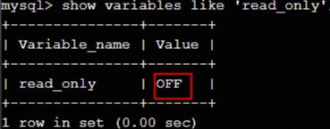

   </li>

   <li>

   执行如下SQL语句，把read_only参数设置为ON。

   ```text
    set global read_only = 1; 
   ```

   </li>

   </ol>

3. **方案实施**

1. 登录杜康数据库管理平台。

2. 选择**实例管理**> **实例列表**，单击需要操作的实例。

3. 选择**备份策略**> **创建临时备份**，在弹出的窗口中，选择**FULL**> **主库物理备份**> **点击查看**> **确定**。

   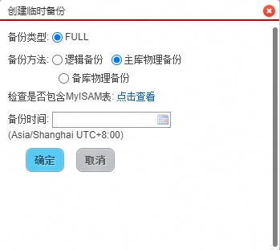

   > **说明**
   >
   > 必须为不存在MyISAM表。

4. 单击**备份恢复**，确认能够看到主库的临时备份，说明已经完成。（18小时内即可）

   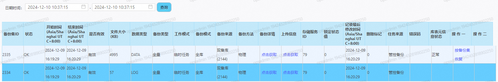

5. 在**基本信息**页面最下方，单击**重搭[备库重搭|节点重搭]**，在弹出的窗口中，勾选**是否强制主库备份**，选择对应的主机，选择重搭方式。

   > **说明**
   >
   > 本地重搭表示在原备库所在的主机上重搭，跨机表示重选主机。

   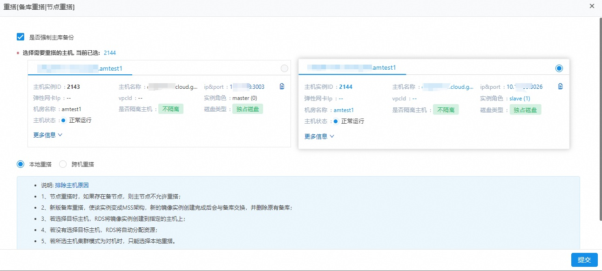

6. 单击**提交**。

7. 单击**任务管理**，观察任务进度，直到任务完成。

   > **说明**
   >
   > 如果存在失败任务，联系产研同学协助解决。

8. 登录异常实例。

9. 执行如下SQL语句，查看返回结果。

   ```text
   show slave status\G
   ```

   系统显示如下类似结果，表示重搭成功。

   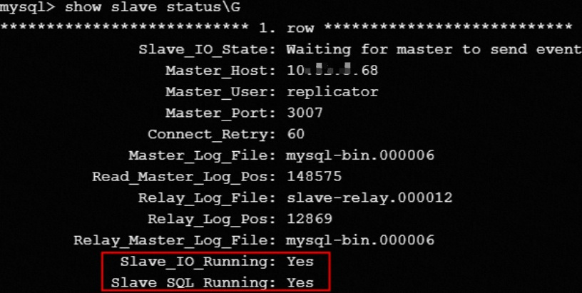

<a id="section-2-2-10-7"></a>

#### 2.2.10.7. 登录异常实例

本文为您介绍如何登录异常实例的操作方法。

**操作步骤**

1. 登录杜康数据库管理平台。

2. 选择**实例管理** > **实例列表**，找到异常的实例名并进入实例详情页面。

3. 在**主机实例信息**区域，查看并记录异常实例的**主机名称**和**ip&port**。

   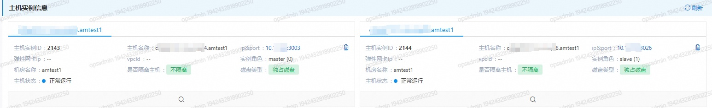

4. 登录飞天基础运维平台。

5. 在首页搜索主机名称，单击**Terminal**，进入异常节点。

   

6. 执行如下命令，登录异常实例。

   ```bash
   sudo my ${port}
   ```

   > **说明**
   >
   > 如果是root用户，可不用 `sudo` 命令。

   系统显示如下类似结果：

   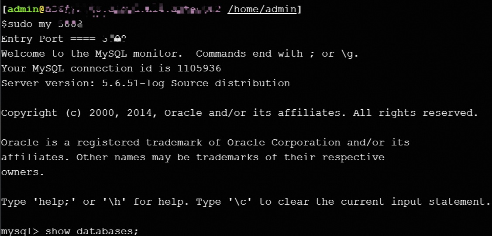

7. 显示 `mysql>` 表示登录成功。

<a id="section-3"></a>

# 3.云产品运维操作

<a id="section-3-1"></a>

## 3.1. TianJi

<a id="section-3-1-1"></a>

### 3.1.1. 终态检查

本文介绍在飞天基础运维平台查看产品终态情况的检查方法和期望结果。

**检查方法**

1. 登录Apsara Uni-manager运维控制台。

2. 在顶部菜单栏选择**平台运维 > 飞天基础运维平台 > 资源管理**。

3. 在**飞天基础运维平台**左侧导航栏中，选择**资源管理 > 产品集群运维**。

4. 在**产品集群运维**页面，查看主备机房产品终态情况。

   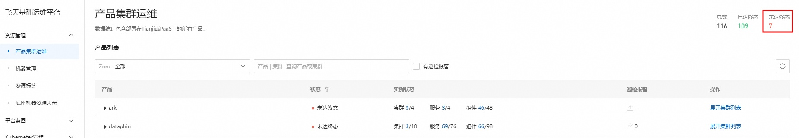

**期望结果**

未达终态：0个。

> **说明**
>
> 若不满足要求，则需要排查解决问题，或提单联系阿里云技术支持修复。

<a id="section-3-2"></a>

## 3.2. DNS

<a id="section-3-2-1"></a>

### 3.2.1. 数据一致性检查

本文介绍DNS数据一致性检查的检查方法和期望结果。

**检查方法**

1. 检查主机房dnsslave数据一致性。

   <ol type="i">

   <li>

   登录主机房ops1或ops2的DnsSlave服务容器。

   </li>

   <li>

   将脚本localIdc_slave_and_slave_compare.py拷贝至 `/root/opsbuild/tools/dataConsistCheck/` ，执行以下命令检查主机房ops1和ops2数据一致性。

   ```text
   python /root/opsbuild/tools/dataConsistCheck/localIdc_slave_and_slave_compare.py
   ```

   </li>

   </ol>

2. 检查主机房etcd与dnsslave数据一致性。

   <ol type="i">

   <li>

   登录主机房ops.OpsDnsSlave#服务容器。

   </li>

   <li>

   将脚本localIdc_etcd_and_slave_compare.py拷贝至 `/root/opsbuild/tools/dataConsistCheck/` ，执行以下命令检查主机房etcd与dnsslave数据一致性。

   ```text
   python /root/opsbuild/tools/dataConsistCheck/localIdc_etcd_and_slave_compare.py
   ```

   </li>

   </ol>

3. 检查主/备机房etcd集群数据一致性。

   <ol type="i">

   <li>

   登录主/备机房ops.OpsDnsSlave#服务容器。

   </li>

   <li>

   将脚本masterIdcEtcd_and_secondIdcEtcd_compare.py拷贝至 `/root/opsbuild/tools/dataConsistCheck/` ，执行以下命令检查主/备机房etcd集群数据一致性。

   ```text
   python 
   /root/opsbuild/tools/dataConsistCheck/masterIdcEtcd_and_secondIdcEtcd_compare.py
   ```

   </li>

   </ol>

4. 检查备机房etcd与dnsslave数据一致性。

   <ol type="i">

   <li>

   登录备机房ops.OpsDnsSlave#服务容器。

   </li>

   <li>

   将脚本localIdc_etcd_and_slave_compare.py拷贝至 `/root/opsbuild/tools/dataConsistCheck/` ，执行以下命令检查备机房etcd与dnsslave数据一致性。

   ```text
   python /root/opsbuild/tools/dataConsistCheck/localIdc_etcd_and_slave_compare.py
   ```

   </li>

   </ol>

**期望结果**

1. 命令执行结果类似下图，在ops1和ops2上获取到当前zone的rr数量一致。

   > **说明**
   >
   > - rr是Resource Records的缩写。
   >
   > - 当前zone在ops1和ops2上的rr数量不一致时，高亮显示差异，格式为：rr:{'ops1': [],'ops2':[]}。
   >
   > - bcmc-minirds-check是ASR测试域名。如果命令执行结果中高亮提示bcmc-minirds-check存在差异，请忽略不计。

   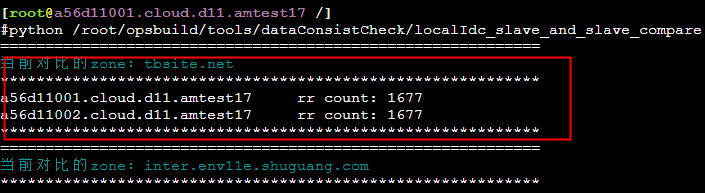

2. 命令执行结果类似下图，在etcd集群中、ops1和ops2上获取到当前zone的rr数量一致。

   > **说明**
   >
   > 当etcd和ops1上的rr数量不一致时，高亮显示差异，格式为：rr:{'ops1':[],'etcd':[]}。

   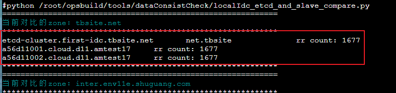

3. 命令执行结果类似下图，在两个etcd集群中获取到当前zone的rr数量一致。

   > **说明**
   >
   > 当两个etcd集群中的rr数量不一致时，高亮显示差异，格式为：rr:{'FirstEtcd':[],'SecondEtcd': []}。

   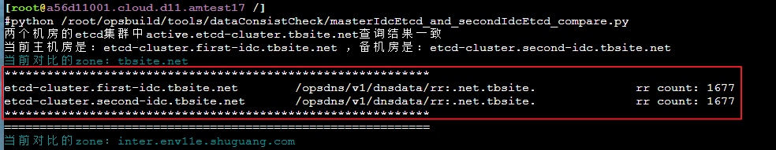

4. 命令执行结果类似下图，在etcd集群中、ops1和ops2上获取到当前zone的rr数量一致。

   > **说明**
   >
   > 当etcd和ops1上的rr数量不一致时，高亮显示差异，格式为：rr:{'ops1':[],'etcd':[]}。

   

> **说明**
>
> 若不满足要求，则需要排查解决问题，或提单联系阿里云技术支持修复。

<a id="section-3-2-2"></a>

### 3.2.2. 域名解析服务检查

本文介绍检查DNS域名解析服务是否能解析IP地址的检查方法和期望结果。

**检查方法**

分别在主备机房的ops1和ops2机器执行 `dig +short dnsapi1.tbsite.net` ，查看是否可以正常解析出IP地址。

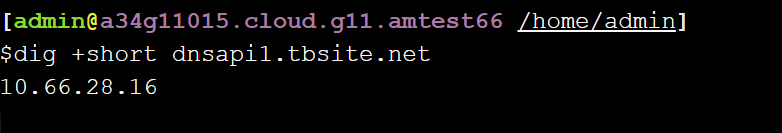

**期望结果**

正确解析IP地址。

> **说明**
>
> 若不满足要求，则需要排查解决问题，或提单联系阿里云技术支持修复。

<a id="section-3-2-3"></a>

### 3.2.3. dnsslave路由发布情况检查

本文介绍dnsslave路由发布情况的检查方法。

**检查方法**

1. 获取anycastVip。

   <ol type="i">

   <li>

   登录Apsara Uni-manager运维控制台。

   </li>

   <li>

   在顶部菜单栏选择**平台运维 > 飞天基础运维平台 > 资源管理**。

   </li>

   <li>

   在**飞天基础运维平台**左侧导航栏中，选择**资源管理 > 产品集群运维**。

   </li>

   <li>

   在**产品集群运维**页面，分别在主备机房中查询tianji集群，单击**操作**列的**集群详情**。

   </li>

   <li>

   切换至**终态配置**页签，查看 `/services/ops/user/dns.conf` 文件，获取anycastVip。

   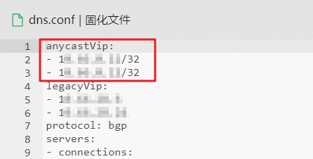

   </li>

   </ol>

2. 检查主备机房anycastVip路由。

   <ol type="i">

   <li>

   分别登录主备机房所有的dnsslave容器。

   </li>

   <li>

   执行 `ps -ef | grep -E "ospf|bgp"` 查看当前运行的是ospf还是bgp，如下图所示：

   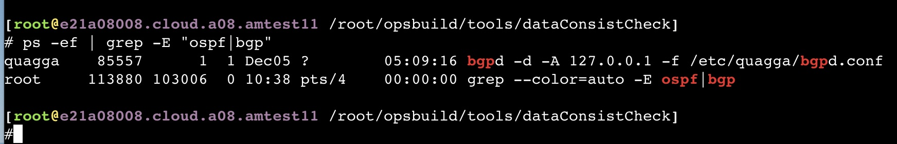

   </li>

   <li>

   检查ospf或bgp配置是否包含anycastVip相关的路由信息，若存在则符合预期。以bgp配置为例，如下图所示：

   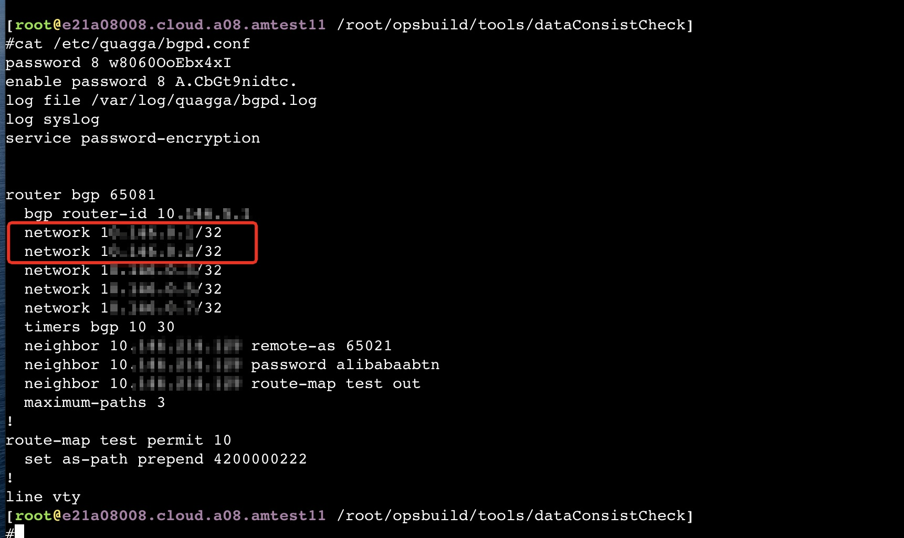

   </li>

   <li>

   检查anycastVip lo挂载情况。执行 `ip a | grep lo` , 输出结果中存在anycastVip则符合预期，如下图所示：

   

   </li>

   </ol>

**期望结果**

命令输出结果中包含anycastVip相关的信息。

<a id="section-3-2-4"></a>

### 3.2.4. 三机房部署后置检查

本文介绍三机房部署的后置检查操作。

**检查方法**

1. 检查主备机房集群dnsapiVip是否下发。

   <ol type="i">

   <li>

   登录Apsara Uni-manager运维控制台。

   </li>

   <li>

   在顶部菜单栏选择**平台运维 > 飞天基础运维平台 > 资源管理**。

   </li>

   <li>

   在**飞天基础运维平台**左侧导航栏中，选择**资源管理 > 产品集群运维**。

   </li>

   <li>

   在**产品集群运维**页面，分别在主备机房中查询tianji集群，单击**操作**列的**集群详情**。

   </li>

   <li>

   切换至**终态配置**页签，查看 `/services/ops/user/dns.conf` 文件，检查是否有规划dnsapiVip。若存在dnsapiVip则符合预期，如下图所示：

   

   </li>

   </ol>

2. 检查opsdns etcd集群。

   <ol type="i">

   <li>

   分别登录三个机房所有的ops.OpsDnsEtcd#容器。

   </li>

   <li>

   执行命令 `ETCDCTL_API=3 etcdctl ---endpoints=http://{docker ip}:2379 member list` 。查看输出结果包含三个机房所有的etcd节点，则符合预期，命令执行结果如下图所示：

   > **说明**
   >
   > docker ip为etcd容器IP。

   

   </li>

   </ol>

3. 检查主备机房dnsapiVip路由。

   <ol type="i">

   <li>

   分别登录主备机房所有的dnsslave容器。

   </li>

   <li>

   执行 `ps -ef | grep -E "ospf|bgp"` 查看当前运行的是ospf还是bgp，如下图所示：

   

   </li>

   <li>

   检查ospf或bgp配置是否包含dnsapiVip相关的路由信息，若存在则符合预期。以bgp为例，如下图所示：

   

   </li>

   <li>

   检查dnsapiVip lo挂载情况。执行 `ip a | grep lo` , 输出结果中存在dnsapiVip则符合预期，如下图所示：

   

   </li>

   </ol>

**期望结果**

1. 主备机房规划了dnsapiVip。

2. 命令输出结果包含三个机房所有的etcd节点。

3. 命令输出结果中存在dnsapiVip。

<a id="section-3-3"></a>

## 3.3. MiniRDS

<a id="section-3-3-1"></a>

### 3.3.1. 任务检查

本文介绍MiniRDS任务状态的检查方法和期望结果。

**检查方法**

1. 登录Apsara Uni-manager运维控制台。

2. 在顶部菜单栏选择**平台运维** > **管控服务运维** > **元数据库运维·Mini杜康**。

3. 进入Mini杜康数据库管理平台，在左侧导航栏选择**任务管理**，依次选择**中断的任务**/**等待的任务**/**临时关闭的任务**/**暂停的任务**/**运行的任务**，查看列表中任务详情。

   

**期望结果**

**中断的任务**/**等待的任务**/**临时关闭的任务**/**暂停的任务**/**运行的任务**各项均无任务<strong>。</strong>

> **说明**
>
> 若不满足要求，则需要排查解决问题，或提单联系阿里云技术支持修复。

<a id="section-3-3-2"></a>

### 3.3.2. 实例容灾检查

本文介绍MiniRDS实例容灾状态检查的检查方法和期望结果。

**检查方法**

1. 登录Apsara Uni-manager运维控制台。

2. 在顶部菜单栏选择**平台运维** > **管控服务运维** > **元数据库运维·Mini杜康**。

3. 进入Mini杜康数据库管理平台，在左侧导航栏单击**系统管理。**

4. 在**系统管理**界面左侧导航栏选择**容灾管理**>**容灾切换**，在下方列表中查询实例状态。

   

**期望结果**

- 除dbaas_db外，所有**实例可用**、**可切换**状态为**OK**，且从库最大**延迟**的值大于等于0，小于60。

- **主库信息**为**读写**状态，**从库信息**为**只读**状态。

> **说明**
>
> 若不满足要求，则需要排查解决问题，或提单联系阿里云技术支持修复。

<a id="section-3-3-3"></a>

### 3.3.3. 实例状态检查

本文介绍MiniRDS实例状态检查的方法和期望结果。

**检查方法**

1. 登录Apsara Uni-manager运维控制台。

2. 在顶部菜单栏选择**平台运维** > **管控服务运维** > **元数据库运维·Mini杜康**。

3. 进入Mini杜康数据库管理平台，在左侧导航栏选择**实例管理**>**实例列表**，根据**CPU**/**QPS**/**连接数**/**磁盘使用率**分别排序，查看实例各项信息。

   

**期望结果**

所有实例**CPU**/**QPS**/**连接数**/**磁盘使用率**均小于或等于50%**。**

> **说明**
>
> 若不满足要求，则建议根据现场实际情况决定是否需要扩容，或提单联系阿里云技术支持处理。

<a id="section-3-4"></a>

## 3.4. RDS

<a id="section-3-4-1"></a>

### 3.4.1. 任务检查

本文介绍RDS任务状态检查的方法和期望结果。

**检查方法**

1. 登录Apsara Uni-manager运维控制台。

2. 在顶部菜单栏选择**产品运维** > **数据库运维** > **RDS运维·杜康**。

3. 进入杜康数据库管理平台，在左侧导航栏单击**任务管理**，依次选择**中断的任务**/**等待的任务**/**临时关闭的任务**/**暂停的任务**/**运行的任务**，查看列表中任务详情。

   

**期望结果**

**中断的任务**/**等待的任务**/**临时关闭的任务**/**暂停的任务**/**运行的任务**各项均无任务。

> **说明**
>
> 若不满足要求，则需要排查解决问题，或提单联系阿里云技术支持修复。

<a id="section-3-4-2"></a>

### 3.4.2. 实例容灾检查

本文介绍RDS实例容灾检查的检查方法和期望结果。

**检查方法**

1. 登录Apsara Uni-manager运维控制台。

2. 在顶部菜单栏选择**产品运维** > **数据库运维** > **RDS运维·杜康**。

3. 进入杜康数据库管理平台，在左侧导航栏单击**系统管理**。

4. 在**系统管理**界面左侧导航栏选择**容灾管理**>**容灾切换**，在下方列表中查询实例状态。

   

**期望结果**

所有**实例可用**、**可切换**状态**OK**，且从库最大**延迟**的值大于等于0，小于60。

> **说明**
>
> 若不满足要求，则需要排查解决问题，或提单联系阿里云技术支持修复。

<a id="section-3-4-3"></a>

### 3.4.3. 实例状态检查

本文介绍RDS实例状态检查的方法和期望结果。

**检查方法**

1. 登录Apsara Uni-manager运维控制台。

2. 在顶部菜单栏选择**产品运维** > **数据库运维** > **RDS运维·杜康**。

3. 进入杜康数据库管理平台，在左侧导航栏单击**实例管理**>**实例列表**，根据**CPU**/**QPS**/**连接数**/**磁盘使用率**分别排序，查看实例各项信息。

   

**期望结果**

所有实例**CPU**/**QPS**/**连接数**/**磁盘使用率**均**小于或等于50%**。

> **说明**
>
> 若不满足要求，则建议根据现场实际情况决定是否需要扩容，或提单联系阿里云技术支持处理。

<a id="section-3-5"></a>

## 3.5. SLB

<a id="section-3-5-1"></a>

### 3.5.1. LVS状态检查

本文介绍LVS状态检查方法和期望结果。

**检查方法**

1. 登录slb-controller.SlbAg#容器。

2. 使用cli执行如下命令。

   ```text
   list admin lb_node
   ```

   

**期望结果**

**configuration**均为**Enabled**，**online_status**均为**online**。

> **说明**
>
> 若不满足要求，则需要排查解决问题，或提单联系阿里云技术支持修复。

<a id="section-3-5-2"></a>

### 3.5.2. proxy状态检查

本文介绍proxy状态的检查方法和期望结果。

**检查方法**

1. 登录slb-controller.SlbAg#容器。

2. 使用cli执行下述命令。

   ```text
   list admin proxy
   ```

   

**期望结果**

**configuration**均为**Enabled**，**online_status**均为**online**。

> **说明**
>
> 若不满足要求，则需要排查解决问题，或提单联系阿里云技术支持修复。

<a id="section-3-5-3"></a>

### 3.5.3. keyserver状态检查

本文介绍keyserver状态的检查方法和期望结果。

**检查方法**

1. 登录slb-controller.SlbAg#容器。

2. 使用cli执行下述命令。

   ```text
   list admin keyserver
   ```

   

**期望结果**

**status**均为**online**。

> **说明**
>
> 若不满足要求，则需要排查解决问题，或提单联系阿里云技术支持修复。

<a id="section-3-6"></a>

## 3.6. OSS

<a id="section-3-6-1"></a>

### 3.6.1. 检查是否有location不在主机房的bucket

本文介绍检查bucket的location是否都在主机房的检查方法和期望结果。

**检查方法**

1. 登录oss_meta数据库。

2. 通过 `select cluster,location from location_table;` ，查看主机房location对应的机房集群。

   

3. 通过 `select name,location from oss_meta_bucket where location <>"{`主机房`location}";` ，查看location不在主机房的bucket列表。

   

**期望结果**

查询结果为空。

> **说明**
>
> - 结果为空意味着所有的bucket的location都在主机房。
>
> - 若不满足要求，则需要排查解决问题，或提单联系阿里云技术支持修复。

<a id="section-3-7"></a>

## 3.7. ECS

<a id="section-3-7-1"></a>

### 3.7.1. nc状态检查

本文介绍nc状态的检查方法和期望结果。

**检查方法**

1. 登录ecs的houyi-reg数据库。

2. 执行 `select id,ip,status,hostname,biz_status from nc;` 命令查看所有nc状态。

   

**期望结果**

所有nc状态都是free。

> **说明**
>
> 若不满足要求，则需要排查解决问题，或提单联系阿里云技术支持修复。

<a id="section-3-8"></a>

## 3.8. ASO

<a id="section-3-8-1"></a>

### 3.8.1. 流量检查

本文介绍网络设备端口状态、流量的检查方法和期望结果。

**检查方法**

1. 登录Apsara Uni-manager运维控制台。

2. 在顶部菜单栏选择**产品运维** > **网络运维** > **网络运维控制台**。

3. 在网络运维控制台左侧菜单栏选择**基础网络**>**网元管理**。

4. 在设备列表中单击ISW或MSW的设备名称。

   

5. 查看端口**管理状态**和**操作状态**。

   

6. 单击端口名称，查看端口流量。

   

**期望结果**

端口**管理状态**和**操作状态**全部为**Up**，流量正常。

> **说明**
>
> 若不满足要求，则需要排查解决问题，或提单联系阿里云技术支持修复。

<a id="section-3-8-2"></a>

### 3.8.2. 告警检查

本文介绍Apsara Uni-manager运维控制台上告警的查看方法和期望结果。

**检查方法**

1. 登录Apsara Uni-manager运维控制台。

2. 在顶部菜单栏选择**监控告警 > 告警管理 > 告警概览**。

3. 查看告警详情。

**期望结果**

无告警。

> **说明**
>
> 若不满足要求，则需要排查解决问题，或提单联系阿里云技术支持修复。

<a id="section-4"></a>

# 4.常见问题

<a id="section-4-1"></a>

## 4.1. 如何解决ASR备机房VIP资源异常的问题

本章节介绍如何查看主备机房记录的IP值以及对于异常情况如何处理的解决方案。

**问题描述**

ASR备机房vip资源异常，表现为部分节点可以Ping通，部分节点无法Ping通，并且部分节点在服务运维中无法搜索到对应的vip资源。

**可能原因**

- 飞天基础运维平台中资源大盘查到的nc_list比同城管理平台ASR的RealServer IP多。

- 飞天基础运维平台中资源大盘查到的nc_list比同城管理平台ASR的RealServer IP少。

- 飞天基础运维平台中资源大盘查到的nc_list和同城管理平台ASR的RealServer IP一样多，仅仅是比对结果异常。

**解决方案**

1. 查看主备机房记录的IP值。

   <ol type="i">

   <li>

   登录运维控制台。

   </li>

   <li>

   在顶部菜单中选择**平台运维 > 容灾管理 > 同城容灾管理平台ASR（备机房）**。

   </li>

   <li>

   在左侧菜单中选择**平台检查 > 环境检查**。

   </li>

   <li>

   在**VIP资源**区域，将鼠标放置在**资源名称**为**remotemock**的**RealServer IP**列。

   </li>

   </ol>

2. 在资源大盘中查找并记录NC中的IP地址。

   <ol type="i">

   <li>

   在顶部菜单中选择**平台运维 > 飞天基础运维平台 > 资源管理**。

   </li>

   <li>

   在左侧导航栏中单击**运维工具 > 资源大盘**。

   </li>

   <li>

   在**资源大盘**页面选择**集群**，输入ECS，单击  。

   </li>

   <li>

   单击类型为vip同时Name为上一步服务名称的Result列，查看nc_list的IP。

   

   - 如果天基查到的nc_list比同城管理平台ASR的SLB查到的多，则需要在飞天基础运维平台里面查看nc里面多出来的IP对应的机器是否属于这个服务，如果属于，需要SLB将realserver加上去。

   - 如果天基查到的nc_list比同城管理平台ASR的SLB查到的少，则需要在天基里面查看下多出来的IP的机器是不是属于这个服务，如果是，可能是天基资源申请的问题，需要飞天基础运维平台那边订正。请联系飞天基础运维平台的产品团队定位处理。

   - 如果天基查到的nc_list比同城管理平台ASR的SLB查到的一样多，则需要联系具体异常的产品团队定位处理。

   </li>

   </ol>

3. 添加RealServer。

   > **警告**
   >
   > 添加或移除RealServer需与对应VIP归属产品或客户进行确认方可执行，一般核实无误后进行操作无业务影响，误操作风险较高容易中断业务。确认可执行后请联系SLB团队协助添加或移除RealServer。

**验证结果**

1. 登录运维控制台。

2. 在顶部菜单中选择**平台运维 > 容灾管理 > 同城容灾管理平台ASR（备机房）**。

3. 在左侧菜单中选择**平台检查 > 环境检查**。

4. 在**VIP资源**区域，查看**比对结果**列是否已正常。

   - 比对结果正常，问题处理结束。

   - 比对结果异常，请联系服务异常的产品团队定位处理。

<a id="section-5"></a>

# 5.附录

<a id="section-5-1"></a>

## 5.1. 查看ASR日志

本文介绍ASR相关日志的所在目录和查看方法。

**操作步骤**

1. 登录bcmc.Bcmc#容器。

2. 选择需要查看的日志文件，日志文件说明详见下表。

   | 日志文件 | 描述 |
   | --- | --- |
   | /home/admin/bcmc/logs/error.log | bcmc错误日志。 |
   | /home/admin/bcmc/logs/info.log | bcmc运行日志。 |
   | /home/admin/bcmc/logs/scripts/script.log | bcmc执行脚本日志。 |
   | /home/admin/bcmc/scripts/{产品名}/logs/{产品名}_synccheck.log | 各产品脚本巡检日志。 |
   | /home/admin/bcmc/scripts/{产品名}/logs/{产品名}_switch.log | 各产品切换日志。 |

   > **说明**
   >
   > 不带日期的日志文件为当天的日志文件。

3. 查看日志，以查看bcmc错误日志为例。

   <ol type="i">

   <li>

   执行 `cd /home/admin/bcmc/logs/` 进入日志所在目录。

   </li>

   <li>

   执行 `ll` 查看目录中的所有文件。

   

   </li>

   <li>

   执行 `vim error.log` 查看错误日志详情。

   

   </li>

   <li>

   执行 `/2022-12-15 00:04:03` 可以搜索具体时间的日志详情。

   

   > **说明**
   >
   > 时间以实际需要进行修改。

   </li>

   <li>

   执行 `:q` 退出日志详情查看页面。

   

   </li>

   </ol>

<a id="section-5-2"></a>

## 5.2. 登录容器

本文介绍登录容器的具体操作步骤，以登录bcmc<em>.</em>Bcmc<strong>#</strong>容器为例。

**操作步骤**

1. 登录终端。

   <ol type="i">

   <li>

   登录Apsara Uni-manager运维控制台。

   </li>

   <li>

   在顶部菜单栏选择**平台运维 > 飞天基础运维平台 > 资源管理**。

   </li>

   <li>

   在**飞天基础运维平台**左侧导航栏中，选择**资源管理 > 产品集群运维**。

   </li>

   <li>

   在**产品集群运维**页面，搜索bcmc服务。

   </li>

   <li>

   在目标集群的**操作**列，单击**集群详情**。

   

   </li>

   <li>

   在服务列表中，单击**bcmc**。

   

   </li>

   <li>

   选择<strong>Bcmc#</strong>组件，在**实例列表**页签下，单击实例**操作**列的**Terminal**。

   

   </li>

   </ol>

2. 执行如下命令查询容器的ID。

   ```bash
   docker ps
   ```

   

3. 执行如下命令进入容器。

   ```bash
   docker exec -it <容器ID> /bin/bash
   ```

   

<a id="section-5-3"></a>

## 5.3. 登录tianji-sshtunnel数据库

本文介绍登录tianji-sshtunnel数据库的具体操作。

1. 登录Apsara Uni-manager运维控制台。

2. 在顶部菜单栏选择**平台运维 > 飞天基础运维平台 > 资源管理**。

3. 在**飞天基础运维平台**左侧导航栏中，选择**资源管理 > 产品集群运维**。

4. 在产品列表中查询tianji，在主集群**操作**列单击**集群详情**。

5. 在服务列表中单击**tianji-sshtunnel**服务名称。

6. 选择<strong>SSHTunnelMaster#</strong>组件。

7. 切换至**资源列表**页签，找到**名称**和**类型**分别为**sshtunnel**和**db**的资源，在其**资源申请结果**列中查看db_host、user、db_password、db_port、db_name的取值。

8. 切换至**实例列表**页签，在任一实例的**操作**列单击**Terminal**。

9. 执行如下命令，登录tianji-sshtunnel数据库。db_host、user、db_password、db_port、db_name的取值请参见步骤7。

   ```text
   mysql -h${db_host} -u${user} -p${db_password} -P${db_port} -D${db_name}
   ```

<a id="section-5-4"></a>

## 5.4. 登录oss_meta数据库

本文介绍登录oss_meta数据库的具体操作。

1. 登录Apsara Uni-manager运维控制台。

2. 在顶部菜单栏选择**平台运维 > 飞天基础运维平台 > 资源管理**。

3. 在**飞天基础运维平台**左侧导航栏中，选择**资源管理 > 产品集群运维**。

4. 在产品列表中查询oss，在主集群**操作**列单击**集群详情**。

5. 在服务列表中单击**oss-ocm-server**服务名称。

6. 选择<strong>DBInit#</strong>组件。

7. 切换至**资源列表**页签，找到**名称**和**类型**分别为**oss_meta**和**db**的资源，在其**资源申请结果**列中查看db_host、user、db_password、db_port、db_name的取值。

   

8. 切换至**实例列表**页签，在任一实例的**操作**列单击**Terminal**。

9. 执行如下命令，登录oss_meta数据库。db_host、user、db_password、db_port、db_name的取值请参见步骤7。

   ```text
   mysql -h${db_host} -u${user} -p${db_password} -P${db_port} -D${db_name}
   ```

<a id="section-5-5"></a>

## 5.5. 登录houyi-reg数据库

本文介绍登录ecs的houyi-reg数据库的具体操作。

1. 登录Apsara Uni-manager运维控制台。

2. 在顶部菜单栏选择**平台运维 > 飞天基础运维平台 > 资源管理**。

3. 在**飞天基础运维平台**左侧导航栏中，选择**资源管理 > 产品集群运维**。

4. 在产品列表中查询ecs，在ECS-controller-A集群**操作**列单击**集群详情**。

5. 在服务列表中单击**ecs-houyi**服务名称。

6. 选择<strong>Regionmaster#</strong>组件。

7. 切换至**资源列表**页签，找到**名称**和**类型**分别为**houyi_reg**和**db**的资源，在其**资源申请结果**列中查看db_host、user、db_password、db_port、db_name的取值。

8. 切换至**实例列表**页签，在任一实例的**操作**列单击**Terminal**。

9. 执行如下命令，登录houyi_reg数据库。db_host、user、db_password、db_port、db_name的取值请参见步骤7。

   ```text
   mysql -h${db_host} -u${user} -p${db_password} -P${db_port} -D${db_name}
   ```

<a id="section-5-6"></a>

## 5.6. 主备表配置不一致的订正方法

本文介绍MaxVersions或者TTL不一致、Stream开关不一致的订正方法。

**背景描述**

- **MaxVersions或者TTL不一致**

  一般是用户建表后，业务运行过程中，调整了MaxVersion或TTL配置。

  - 如果主集群MaxVersions或TTL比备集群小（TTL的-1视为最大值，表示不过期），那么备集群上保留的数据更多，直接订正备的MaxVersions和TTL。

  - 如果主集群MaxVersions或TTL比备集群大（TTL的-1视为最大值，表示不过期），那么备集群上可能已经存在数据不全的问题。需要确认是否需要重新全量同步一次，还是直接订正备集群配置。

- **Stream开关不一致**

  一般是主集群上Stream打开了（用于增量导出任务等），备集群上没有打开。直接订正备集群，打开Stream功能。

**前提条件**

已完成产品状态检查的前置操作：

1. 登录ots集群的TableStore.PortalAgServer#终端机器。

2. 使用admin用户解压new_ots_replication_tool.tar.gz工具包。

**订正方法**

1. 进入 `new_ots_replication_tool` 目录。

2. 执行以下命令修改备集群配置。

   > **说明**
   >
   > 命令中需要指定实例名、表名，每次修改一个表的配置，仅修改备集群，不影响主集群。

   ```text
   ./rep_checker.py sync_table_meta_for_secondary 实例名 表名
   ```

   执行结果示例：

   ```text
   $./rep_checker.py sync_table_meta_for_secondary lt-ots-test00 test001
   secondary cluster: ots-ssd-B-20210813-00a6, table: _tBTC6DyGWKYBrHKstl#test001, set T
   TL to 86400000
   OK!
   ```
