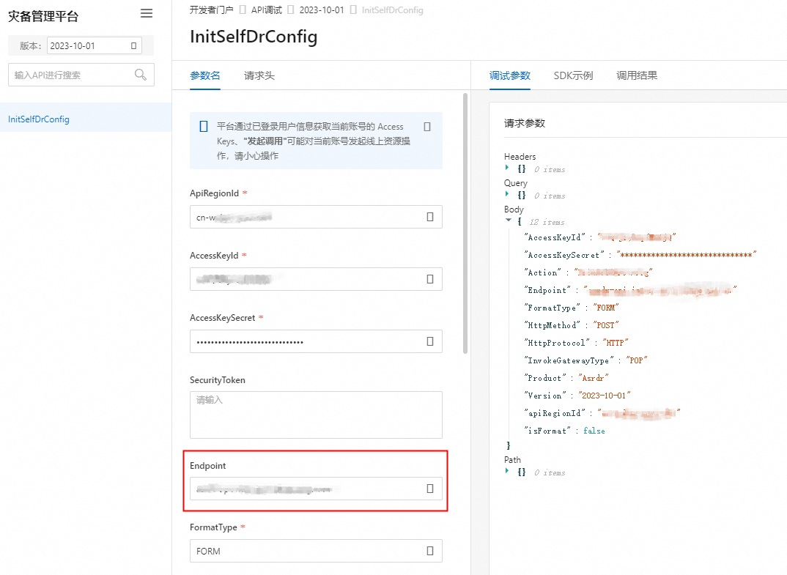
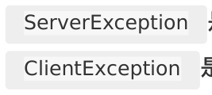

阿里云  
专有云  
异地容灾管理平台  
开发指南  
产品版本：V3.18.6  
文档版本：20250611

**目录**

- [1.API调用流程说明](#section-1)
- [2.准备工作](#section-2)
    - [2.1. 获取AccessKey](#section-2-1)
    - [2.2. 获取API信息及其Endpoint](#section-2-2)
    - [2.3. 通过POP网关调用专有云API](#section-2-3)
- [3.Java SDK调用示例](#section-3)
    - [3.1. 安装Java SDK](#section-3-1)
    - [3.2. 设置身份验证凭证](#section-3-2)
    - [3.3. 发起调用请求](#section-3-3)
    - [3.4. 错误处理](#section-3-4)
- [4.API参考](#section-4)
    - [4.1. 云实例](#section-4-1)
        - [4.1.1. 云实例管理](#section-4-1-1)
            - [4.1.1.1. ListSupportProducts](#section-4-1-1-1)
            - [4.1.1.2. DescribeCloudInstance](#section-4-1-1-2)
            - [4.1.1.3. DescribeCloudCredentials](#section-4-1-1-3)
            - [4.1.1.4. SaveCloudCredentials](#section-4-1-1-4)
            - [4.1.1.5. DescribeCloudInstanceByPage](#section-4-1-1-5)
            - [4.1.1.6. DescribeLocalCloudInstance](#section-4-1-1-6)
            - [4.1.1.7. DescribeLocalRegion](#section-4-1-1-7)
            - [4.1.1.8. ListRegions](#section-4-1-1-8)
            - [4.1.1.9. RemoveCloudInstance](#section-4-1-1-9)
    - [4.2. 保护组](#section-4-2)
        - [4.2.1. 保护组管理](#section-4-2-1)
            - [4.2.1.1. CreateProtectGroup](#section-4-2-1-1)
            - [4.2.1.2. UpdateProtectGroup](#section-4-2-1-2)
            - [4.2.1.3. RemoveProtectGroup](#section-4-2-1-3)
            - [4.2.1.4. DescribeProtectGroup](#section-4-2-1-4)
            - [4.2.1.5. ListProtectGroup](#section-4-2-1-5)
            - [4.2.1.6. StartProtectGroup](#section-4-2-1-6)
            - [4.2.1.7. StopProtectGroup](#section-4-2-1-7)
            - [4.2.1.8. ReprotectProtectGroup](#section-4-2-1-8)
            - [4.2.1.9. GetStartupProtectGroupDetail](#section-4-2-1-9)
        - [4.2.2. 同步实体管理](#section-4-2-2)
            - [4.2.2.1. AddSyncEntity](#section-4-2-2-1)
            - [4.2.2.2. RemoveSyncEntity](#section-4-2-2-2)
        - [4.2.3. 保护组切换](#section-4-2-3)
            - [4.2.3.1. DescribeProtectGroupSwitch](#section-4-2-3-1)
            - [4.2.3.2. DescribeProtectGroupSwitchInstance](#section-4-2-3-2)
            - [4.2.3.3. StartProtectGroupSwitch](#section-4-2-3-3)
    - [4.3. 容灾计划](#section-4-3)
        - [4.3.1. 计划管理](#section-4-3-1)
            - [4.3.1.1. DeleteRecoveryPlan](#section-4-3-1-1)
            - [4.3.1.2. GetRecoveryPlan](#section-4-3-1-2)
            - [4.3.1.3. ListRecoveryPlanByPage](#section-4-3-1-3)
            - [4.3.1.4. SaveRecoveryPlan](#section-4-3-1-4)
        - [4.3.2. 计划执行](#section-4-3-2)
            - [4.3.2.1. ExecRecoveryTask](#section-4-3-2-1)
            - [4.3.2.2. AbortRecoveryTask](#section-4-3-2-2)
            - [4.3.2.3. GetRecoveryTask](#section-4-3-2-3)
            - [4.3.2.4. GetRecoveryPlanSnapshot](#section-4-3-2-4)
            - [4.3.2.5. CompleteSequence](#section-4-3-2-5)
            - [4.3.2.6. ListRecoveryTaskDataByPage](#section-4-3-2-6)
            - [4.3.2.7. RerunSequence](#section-4-3-2-7)
            - [4.3.2.8. SkipSequence](#section-4-3-2-8)

<a id="section-1"></a>

# 1.API调用流程说明

阿里云专有云支持通过POP网关调用异地容灾管理平台ASR-DR的API。

**流程图**

异地容灾管理平台ASR-DR的API调用流程如下图所示。


**调用步骤**

1. 获取API信息。

   API信息请参见API参考。

2. 获取AccessKey ID和AccessKey Secret，获取方式请参见获取AccessKey。

3. 获取异地容灾管理平台ASR-DR的Endpoint和Region ID，获取方式请参见获取API信息及其Endpoint。

4. 获取异地容灾管理平台ASR-DR的SDK包和SDK核心库，获取方法请参见通过POP网关调用专有云API。

5. 调用异地容灾管理平台ASR-DR的API。

   > **说明**
   >
   > - 只支持用户账号调用，调用API的用户必须具有运营管理员、组织管理员、全局容灾管理员、组织容灾管理员任一角色。

<a id="section-2"></a>

# 2.准备工作

<a id="section-2-1"></a>

## 2.1. 获取AccessKey

本文介绍获取AccessKey ID和AccessKey Secret的具体操作。

**背景信息**

AccessKey通过使用AccessKey ID和AccessKey Secret对称加密，实现验证某个请求发送者的身份的功能。其中AccessKey ID用于标识用户，AccessKey Secret是用户用于加密签名的字符串。

**获取AccessKey**

Apsara Uni-manager运营控制台提供了个人AccessKey和组织AccessKey。推荐使用个人账号AccessKey调用接口。

> **说明**
>
> - 只有运营管理员和一级组织管理员可以获取组织AccessKey。
>
> - **获取个人账号AccessKey时，请确保登录的用户具备运营管理员、组织管理员、全局容灾管理员、组织容灾管理员任一角色，否则可能导致接口调用失败。**

**获取个人账号AccessKey**

1. 登录Apsara Uni-manager运营控制台。

2. 在系统界面右上角，单击当前登录用户头像，单击**个人信息**。

3. 在**AccessKey**区域，您可以查看个人账户的AccessKey信息。

   

   > **重要**
   >
   > AccessKey ID和AccessKey Secret是您访问云资源时的密钥，具有该账号完整的权限，请您妥善保管。

**获取组织AccessKey**

> **警告**
>
> 个人账号AccessKey是由Apsara Uni-manager运营控制台权限体系管控的受限AccessKey，组织AccessKey相对权限较大，需要管理员确认操作的安全性。

1. 管理员登录Apsara Uni-manager运营控制台。

2. 在顶部菜单栏，单击**企业**。

3. 在左侧导航栏中，选择**资源管理** > **组织管理**。

4. 在组织结构中，单击目标一级组织名称。

5. 单击**管理Accesskey**。

6. 在弹出的对话框中，查看组织AccessKey信息。

<a id="section-2-2"></a>

## 2.2. 获取API信息及其Endpoint

首先，您需要了解产品开放API接口的相关信息，包括产品名称（code）、开放API接口名称、API版本。

**背景信息**

Apsara Uni-manager运营控制台API目录中的API信息仅供调用参考，具体API的使用方式需要参见ASR-DR的开发指南。如果发生不一致情况，以开发指南支持情况为准。

**操作步骤**

1. 登录Apsara Uni-manager运营控制台。

2. 在顶部菜单栏选择**产品 > 开发工具 > API与工具 > 开发者门户**。

3. 在**开发者门户**页面，选择**API集成** > **API调试**。

   

4. 在左侧导航栏中选择**灾备管理平台**。

5. 在**版本**下拉列表中，选择目标API版本。

6. 在下方API列表中可浏览当前版本的所有API接口。

7. 选中对应接口，在参数名下获取ASR-DR的POP Endpoint和其他接口信息。

   

<a id="section-2-3"></a>

## 2.3. 通过POP网关调用专有云API

通过POP Java SDK访问产品域名，需要了解该产品调用方式（RPC或ROA）。

**前提条件**

目前专有云推荐使用CommonRequest进行调用，可以在Apsara Uni-manager运营控制台**产品** > **应用服务** > **开发者门户**，选择**API集成** > **SDK示例**查看推荐SDK版本以及示例代码。

> **重要**
>
> 不建议直接从SDK中心下载SDK到专有云场景下使用，公有云的SDK不一定支持专有云的API，可能存在兼容性问题，请谨慎使用！

**CommonRequest调用示例**

RPC调用，示例接口信息：产品（ASR-DR）、接口（InitSelfDrConfig）、版本（2023-10-01）。

调用示例如下：

```java
import com.aliyuncs.CommonRequest;
import com.aliyuncs.CommonResponse;
import com.aliyuncs.DefaultAcsClient;
import com.aliyuncs.IAcsClient;
import com.aliyuncs.exceptions.ClientException;
import com.aliyuncs.exceptions.ServerException;
import com.aliyuncs.profile.DefaultProfile;
public class InitSelfDrConfig {
    public static void main(String[] args) {
        // 创建DefaultAcsClient实例并初始化
        DefaultProfile profile = DefaultProfile.getProfile(
                // 您的地域ID
                "<your-region-id>",
                // 从环境变量获取RAM账号的AccessKey ID
                System.getenv("ALIBABA_CLOUD_ACCESS_KEY_ID"),
                // 从环境变量获取RAM账号的AccessKey ID
                System.getenv("ALIBABA_CLOUD_ACCESS_KEY_SECRET"));
        IAcsClient client = new DefaultAcsClient(profile);
        // 创建API请求并设置参数
        CommonRequest request = new CommonRequest();
        request.setSysDomain("ASRDR.aliyuncs.com");
        request.setSysVersion("2023-10-01");
        request.setSysAction("InitSelfDrConfig");
        request.putQueryParameter("PageNumber", "1");
        request.putQueryParameter("PageSize", "30");
        try {
            CommonResponse response = client.getCommonResponse(request);
            System.out.println(response.getData());
        } catch (ServerException e) {
            // TODO Auto-generated catch block
            e.printStackTrace();
        } catch (ClientException e) {
            // TODO Auto-generated catch block
            e.printStackTrace();
        }
    }
}
```

ROA调用，示例接口信息：产品（ASR-DR）接口（InitSelfDrConfig）版本（2023-10-01）。

调用示例如下：

```java
import com.aliyuncs.CommonRequest;
import com.aliyuncs.CommonResponse;
import com.aliyuncs.DefaultAcsClient;
import com.aliyuncs.IAcsClient;
import com.aliyuncs.exceptions.ClientException;
import com.aliyuncs.exceptions.ServerException;
import com.aliyuncs.profile.DefaultProfile;
public class InitSelfDrConfig {
    public static void main(String[] args) {
        // 创建DefaultAcsClient实例并初始化
        DefaultProfile profile = DefaultProfile.getProfile(
                // 您的地域ID
                "<your-region-id>",
                // 从环境变量获取RAM账号的AccessKey ID
                System.getenv("ALIBABA_CLOUD_ACCESS_KEY_ID"),
                // 从环境变量获取RAM账号的AccessKey ID
                System.getenv("ALIBABA_CLOUD_ACCESS_KEY_SECRET"));
        IAcsClient client = new DefaultAcsClient(profile);
        // 创建API请求并设置参数
        CommonRequest request = new CommonRequest();
        request.setSysDomain("ASRDR.aliyuncs.com");
        request.setSysVersion("2023-10-01");
        request.setSysUriPattern("/clusters");
        try {
            CommonResponse response = client.getCommonResponse(request);
            System.out.println(response.getData());
        } catch (ServerException e) {
            // TODO Auto-generated catch block
            e.printStackTrace();
        } catch (ClientException e) {
            // TODO Auto-generated catch block
            e.printStackTrace();
        }
    }
}
```

> **重要**
>
> 使用HTTPS协议访问OpenAPI时，SDK会默认开启校验SSL/TLS 证书有效性，若您代码环境没有证书环境，则会报错证书校验失败。
>
> 为保障生产环境通信安全，建议您保持开启，若在测试环境必须忽略证书校验，可以通过以下参数设置：
>
> Java
>
> ```text
> HttpClientConfig clientConfig = HttpClientConfig.getDefault();
> // 设置不校验服务端证书
> clientConfig.setIgnoreSSLCerts(true)
> ```

<a id="section-3"></a>

# 3.Java SDK调用示例

<a id="section-3-1"></a>

## 3.1. 安装Java SDK

本文介绍如何安装异地容灾管理平台ASR-DR的Java SDK。

**环境准备**

阿里云专有云Java SDK需要使用1.8及后续版本的JDK。

**安装阿里云专有云Java SDK**

如果您使用Apache Maven来管理Java项目，只需在项目的pom.xml中导入JAR文件。

调用Java SDK必须安装SDK核心库以及ASR-DR的SDK包。其中，SDK核心库推荐使用4.5.17及以上版本，SDK的版本为1.0.0。

以下为Java pom文件设置示例。

```xml
<dependencies>
    <!--必须要的依赖-->
    <dependency>
        <groupId>com.aliyun</groupId>
        <artifactId>aliyun-java-sdk-asrdr</artifactId>
        <version>1.0.0</version>
    </dependency>
    <dependency>
        <groupId>com.aliyun</groupId>
        <artifactId>aliyun-java-sdk-core</artifactId>
        <version>4.6.0</version>
    </dependency>
</dependencies>
```

<a id="section-3-2"></a>

## 3.2. 设置身份验证凭证

使用阿里云专有云SDK访问阿里云专有云服务时，您需要提供授权的账号进行身份验证。

Java SDK支持通过AccessKey进行身份验证，获取AccessKey ID和AccessKey Secret的方法请参见获取AccessKey，获取Endpoint的方法请参见获取Endpoint，获取Region ID的方法请参见获取Region ID。

使用AccessKey作为访问凭据时，需要在初始化Client时设置凭证。

> **重要**
>
> 请确保包含AccessKey的代码不会泄漏（例如提交到外部公开的GitHub项目），否则将会危害您的信息安全。

```text
//配置请求Endpoint
DefaultProfile.addEndpoint(
    "<EndpointName>",    //请替换为您实际的Endpoint名称：Asrdr
    "<RegionId>",      //请替换为您实际的地域ID
    "<ProductCode>",     //请替换为您实际的产品CODE：Asrdr
    "<Endpoint>"        //请替换为您实际的产品请求域名
);
//配置⾝份验证凭证
DefaultProfile profile = DefaultProfile.getProfile(
    "<yourRegionID>",         // 请替换为您实际的地域ID
    "<yourAccessKeyID>",      // 请替换为您实际的AccessKeyID
    "<yourAccessKeySecret>",  // 请替换为您实际的AccessKeySecret
);
```

> **说明**
>
> - 以上代码示例中 `<yourRegionID>` 、 `<yourAccessKeyID>` 、 `<yourAccessKeySecret>` 均为可变参数，需要替换为其实际值，尖括号（<>）在最终代码中不保留。
>
> - 请使用具备运营管理员、组织管理员、全局容灾管理员、组织容灾管理员任一角色的用户调用异地容灾管理平台ASR-DR的API。

<a id="section-3-3"></a>

## 3.3. 发起调用请求

本文介绍如何使用Java SDK发起请求。

**操作步骤**

1. 新建一个AcsClient。

   ```text
   DefaultAcsClient client = new DefaultAcsClient(profile);
   ```

2. 创建请求。

   

   请求类的命名规范为 ${apiName}Request ，其中<strong>${apiName}</strong>为API名称，例如DescribeBackupCloud。

   ```text
   DescribeBackupCloudRequest request = new DescribeBackupCloudRequest();
   ```

3. 发起调用并处理应答。

   ```java
   // 发起请求，查看结果
   DescribeBackupCloudResponse response = client.getAcsResponse(request);
   System.out.println(response.getData());
   ```

**完整调用示例**

以下代码为异地容灾管理平台ASR-DR的 `DescribeBackupCloud` 接口调用示例。

```java
import com.aliyuncs.asrdr.model.v20220209.*;
import com.aliyuncs.exceptions.ClientException;
import com.aliyuncs.http.MethodType;
import com.chenxue.product.api.base.ApiBaseInfo;
import com.chenxue.product.api.base.ProductBaseApi;
import com.google.gson.Gson;
import org.slf4j.Logger;
import org.slf4j.LoggerFactory;

public class AsrdrApi extends ProductBaseApi {

    public void listPlanInstance(String planId, ApiBaseInfo apiBaseInfo) throws ClientException {
      try {        
        //配置请求Endpoint
        DefaultProfile.addEndpoint(
            "<EndpointName>",    //请替换为您实际的Endpoint名称：Asrdr
            "<RegionId>",      //请替换为您实际的地域ID
            "<ProductCode>",     //请替换为您实际的产品CODE：Asrdr
            "<Endpoint>"        //请替换为您实际的产品请求域名
        );
        //配置⾝份验证凭证
        DefaultProfile profile = DefaultProfile.getProfile(
            "<yourRegionID>",         // 请替换为您实际的地域ID
            "<yourAccessKeyID>",      // 请替换为您实际的AccessKeyID
            "<yourAccessKeySecret>",  // 请替换为您实际的AccessKeySecret
        );
        // 构造客户端
        DefaultAcsClient client = new DefaultAcsClient(profile);
        //构造请求参数
        DescribeBackupCloudRequest request = new DescribeBackupCloudRequest();
        request.setMethod(MethodType.GET);
        request.setVersion("2022-02-09");
        request.setActionName("DescribeBackupCloud");
        //调⽤API
        DescribeBackupCloudResponse response = client.getAcsResponse(request);
        System.out.println(response.getData());
        
      } 
    }
}
```

<a id="section-3-4"></a>

## 3.4. 错误处理

在使用Java SDK时，当服务端或者SDK端出错时，SDK会返回相应的异常信息。这些异常信息中会包含具体的错误信息，包括错误码（Error Code）和错误消息（Error Message）。

一般情况下，您不需要根据Java SDK返回的错误进行处理。您只需要根据服务端的错误提示处理服务端错误即可。



- ServerException 是服务端错误信息。

- ClientException 是SDK端错误信息。

例如，当出现如下错误时，您可以根据具体的错误信息，修改AccessKey的ID即可。

```text
com.aliyuncs.exceptions.ClientException: InvalidAccessKeyId.NotFound : Specified accesskey is not found.
```

如果您需要对SDK的错误进行处理，可以参考如下示例编写代码：

```java
try {
    AcsResponse response = client.getAcsResponse(request);
    // 处理Response
    // ...
} catch (ClientException e) {
    // 这⾥可以添加您⾃⼰的错误处理逻辑
    // 例如，打印具体的错误信息
    System.out.println("ErrorCode=" + e.getErrCode());
    System.out.println("ErrorMessage=" + e.getErrMsg());
    e.printStackTrace();
} catch (ServerException e) {
    e.printStackTrace();
}
```

<a id="section-4"></a>

# 4.API参考

<a id="section-4-1"></a>

## 4.1. 云实例

<a id="section-4-1-1"></a>

### 4.1.1. 云实例管理

<a id="section-4-1-1-1"></a>

#### 4.1.1.1. ListSupportProducts

用于查询ASRDR在指定地域支持的云产品列表。

**请求头**

该接口使用公共请求头，无特殊请求头。请参见公共请求参数文档。

**请求参数**

| 参数名称 | 类型 | 位置 | 是否必选 | 示例 | 说明 |
| --- | --- | --- | --- | --- | --- |
| AsrMainClo udInstance Id | Strin g | Quer y | 否 | f8f72032-5e49-4a38-9750-f8a9\*\*\*\*4bca | ASRDR公共参数：生产云实例ID，无需赋值。 |
| AsrMainRe gionId | Strin g | Quer y | 否 | cn-hangzhou | ASRDR公共参数：生产地域ID，无需赋值。 |
| Departme nt | Strin g | Quer y | 否 | 3 | API参数：组织ID，仅可传入当前请求人可见的组织ID，对于One Console控制台，一般传入页面吊顶处选中的组织ID。<br>• 查询或修改资源时，决定资源查询<strong>主账号（租户）</strong>范围。如果查询或修改的资源不在该组织所属的主账号，接口报资源找不到错误。若不传，则查询当前用户直属组织所属主账号的资源。<br>• 新建资源时，决定该资源所属的<strong>主账号（租户）</strong>；若不传，则资源归属到当前用户直属组织所属的主账号。 |
| ResourceG roup | Strin g | Quer y | 否 | 3 | API参数：资源集ID，仅可传入当前请求人可见的资源集ID，对于One Console控制台，一般传入页面吊顶处选中的资源集ID。<br>• 查询或修改资源时，决定资源查询<strong>资源组</strong>范围。如查询或修改的资源不在该资源组，接口报资源找不到错误。若不传，则返回当前用户所有可见资源组的资源；<br>• 新建资源时，决定该资源所属的<strong>资源组</strong>；若不传，则资源不归属到任何资源组。 |
| RegionId | Strin g | Quer y | 否 | cn-hangzhou | API参数：资源地域ID，仅可传入当前请求人可见的地域ID，对于One Console控制台，一般传入页面吊顶处选中的地域ID。<br>• 查询或修改资源时，决定资源查询<strong>地域</strong>范围。如查询或修改的资源不在该地域，接口报资源找不到错误。如不传，则返回处理该接口请求的节点当前所在地域的资源。<br>• 新建资源时，决定该资源所属的<strong>地域</strong>；若不传，则资源归属到处理该接口请求的节点当前所在地域。 |
| CloudInsta nceId | Strin g | Quer y | 是 | ffe1\*\*\*\*\*\*\*\*6d6d | 云实例ID。 |
| RgnId | Strin g | Quer y | 是 | cn_\*\*\*_01 | 地域ID。 |

**返回数据**

| 参数名称 | 类型 | 示例 | 说明 |
| --- | --- | --- | --- |
| data | String | \["RDS", "ECS"\] | 支持的云产品列表。 |
| requestId | String | 75ef\*\*\*\*\*\*\*\*dafe8 | 请求ID。 |
| result | String | SUCCESS | 请求结果：<br>• SUCCESS：成功<br>• FAILED：失败此字段为兼容字段，含义与success字段相同，建议使用success字段。 |
| success | Boolean | true | 请求是否成功。 |
| code | String | 200 | 响应状态代码。 |
| nodeHost | String | B-W0Y1\*\*\*R-1914.local | 处理该请求的节点名称。 |
| nodeIp | String | 127.0.0.1 | 处理该请求的节点IP。 |

**示例**

请求示例

```text
http(s)://[Endpoint]/?Action=ListSupportProducts
&CloudInstanceId=ffe1********6d6d
&RgnId=cn_***_01
&公共请求参数
```

正常返回示例

`JSON`  格式

```json
{
 "result":"SUCCESS",
 "nodeHost":"B-W0Y1***R-1914.local",
 "code":"200",
 "data":"[\"RDS\", \"ECS\"]",
 "requestId":"75ef********dafe8",
 "success":true,
 "nodeIp":"127.0.0.1"
}
```

`XML`  格式

```xml
<result>SUCCESS</result>
<nodeHost>B-W0Y1***R-1914.local</nodeHost>
<code>200</code>
<data>[&quot;RDS&quot;, &quot;ECS&quot;]</data>
<requestId>75ef********dafe8</requestId>
<success>true</success>
<nodeIp>127.0.0.1</nodeIp>
```

<a id="section-4-1-1-2"></a>

#### 4.1.1.2. DescribeCloudInstance

用于查询云实例详情。

**请求头**

该接口使用公共请求头，无特殊请求头。请参见公共请求参数文档。

**请求参数**

| 参数名称 | 类型 | 位置 | 是否必选 | 示例 | 说明 |
| --- | --- | --- | --- | --- | --- |
| AsrMainClo udInstance Id | Strin g | Quer y | 否 | f8f72032-5e49-4a38-9750-f8\*\*\*\*\*04bca | ASRDR公共参数：生产云实例ID，无需赋值。 |
| AsrMainRe gionId | Strin g | Quer y | 否 | cn-hangzhou | ASRDR公共参数：生产地域ID，无需赋值。 |
| Departme nt | Strin g | Quer y | 否 | 3 | API参数：组织ID，仅可传入当前请求人可见的组织ID，对于One Console控制台，一般传入页面吊顶处选中的组织ID。<br>• 查询或修改资源时，决定资源查询<strong>主账号（租户）</strong>范围。如果查询或修改的资源不在该组织所属的主账号，接口报资源找不到错误。若不传，则查询当前用户直属组织所属主账号的资源。<br>• 新建资源时，决定该资源所属的<strong>主账号（租户）</strong>；若不传，则资源归属到当前用户直属组织所属的主账号。 |
| ResourceG roup | Strin g | Quer y | 否 | 3 | API参数：资源集ID，仅可传入当前请求人可见的资源集ID，对于One Console控制台，一般传入页面吊顶处选中的资源集ID。<br>• 查询或修改资源时，决定资源查询<strong>资源组</strong>范围。如查询或修改的资源不在该资源组，接口报资源找不到错误。若不传，则返回当前用户所有可见资源组的资源；<br>• 新建资源时，决定该资源所属的<strong>资源组</strong>；若不传，则资源不归属到任何资源组。 |
| RegionId | Strin g | Quer y | 否 | cn-hangzhou | API参数：资源地域ID，仅可传入当前请求人可见的地域ID，对于One Console控制台，一般传入页面吊顶处选中的地域ID。<br>• 查询或修改资源时，决定资源查询<strong>地域</strong>范围。如查询或修改的资源不在该地域，接口报资源找不到错误。如不传，则返回处理该接口请求的节点当前所在地域的资源。<br>• 新建资源时，决定该资源所属的<strong>地域</strong>；若不传，则资源归属到处理该接口请求的节点当前所在地域。 |
| CloudInsta nceId | Strin g | Quer y | 是 | ffe1\*\*\*\*\*\*\*\*6d6d | 云实例ID。 |

**返回数据**

| 参数名称 | 类型 | 示例 | 说明 |
| --- | --- | --- | --- |
| requestId | String | b870\*\*\*\*\*\*\*\*433d | 请求ID。 |
| result | String | SUCCESS | 请求结果：<br>• SUCCESS：成功<br>• FAILED：失败此字段为兼容字段，含义与success字段相同，建议使用success字段。 |
| success | Boolean | true | 请求是否成功。 |
| code | String | 200 | 响应状态代码。 |
| nodeHost | String | B-W0Y\*\*\*6R-1914.local | 处理该请求的节点名称。 |
| nodeIp | String | 127.0.0.1 | 处理该请求的节点IP。 |
| data | Struct |  | 资源详细信息。 |
| -aliyunAccount Uid | String | 178511195726779 6 | 资源所属主账号UID。 |
| -ownerUid | String | 239724\*\*\*\*\*88687 32 | 资源所有者UID。 |
| -creator | String | 2397245\*\*\*\*88687 32 | 资源创建者UID。 |
| -lastModifier | String | 23972451\*\*\*\*6873 2 | 资源最后修改者UID。 |
| -resourceRegio nId | String | cn-hangzhou | 资源所属地域ID。 |
| -resourceGroup Id | String | 103 | 资源所属资源组ID。 |
| -createdDate | Long | 1713514782222 | 资源创建时间。 |
| -lastModifiedDa te | Long | 1713514782222 | 资源最后修改时间。 |
| -instanceId | String | e25\*\*\*8c-a02a-455c-b957-8dc\*\*\*\*4ef58 | 资源实例ID。 |
| -instanceName | String | XXX | 资源实例名称。 |
| -pk | String | 339944229200627 712 | 云实例主键。 |
| -cloudUniqueId | String | 0179 | 云唯一ID。 |
| -cloudOsType | String | ENTERPRISE | 云实例版本类型，只支持专有云企业版，取值为ENTERPRISE。 |
| -version | String | 1.0.0 | 云版本号。 |
| -consoleType | String | ASCM | 云管控类型：<br>• ASCM: 使用运营管理平台的API作为云管控，云管控API接入点填写API接入点，一般用于本云跨地域容灾场景。<br>• ASRDR: 使用异地容灾管理平台的API作为云管控，云管控API接入点填写ASRDR的API接入点，一般用于跨云容灾场景。 |
| -consoleApiEnd point | String | http://internal.API.c n-<em>XXXXXXX</em> | 云管控API接入点，根据云管控类型决定。 |
| -adminCredenti alsId | String | 3399442255\*\*\*\*32 32 | 云管控管理员凭据ID。使用运营管理员账号登录<strong>该云实例所对应云的</strong><strong>ASCM</strong>，从个人信息页面获取AccessKey ID和AccessKey Secret录入后自动生成凭据ID。 |
| -accountCrede ntialsId | String | 3399442290\*\*\*\*72 00 | 云管控主账号凭据ID。使用组织管理员账号登录<strong>该云实例所对应云的</strong><strong>ASCM</strong>，从“企业-组织管理”页面获取一级组织的AccessKey ID和AccessKey Secret录入后自动生成凭据ID。 |
| -internetDomai n | String | inter.example.com | 因特网域名。 |
| -intranetDomai n | String | intra.example.com | 内部网域名。 |
| -status | String | REGULAR | 云实例状态：<br>• REGULAR：正常状态<br>• NOT_CONFIGURED：未配置状态<br>• UNINITIALIZED：未初始化状态（系统首次登录时，未录入管理员凭据时的状态） |

**示例**

请求示例

```text
http(s)://[Endpoint]/?Action=DescribeCloudInstance
&CloudInstanceId=ffe1********6d6d
&公共请求参数
```

正常返回示例

`JSON`  格式

```json
{
 "result":"SUCCESS",
 "nodeHost":"B-W0Y***6R-1914.local",
 "code":"200",
 "data":{
  "cloudUniqueId":"0179",
  "creator":"2397245****8868732",
  "lastModifiedDate":1713514782222,
  "instanceName":"XXX",
  "consoleApiEndpoint":"http://internal.API.cn-XXXXXXX",
  "resourceRegionId":"cn-hangzhou",
  "lastModifier":"23972451****68732",
  "adminCredentialsId":"3399442255****3232",
  "version":"1.0.0",
  "cloudOsType":"ENTERPRISE",
  "createdDate":1713514782222,
  "instanceId":"e25***8c-a02a-455c-b957-8dc****4ef58",
  "aliyunAccountUid":"1785111957267796",
  "internetDomain":"inter.example.com",
  "resourceGroupId":"103",
  "pk":"339944229200627712",
  "intranetDomain":"intra.example.com",
  "ownerUid":"239724*****8868732",
  "accountCredentialsId":"3399442290****7200",
  "consoleType":"ASCM",
  "status":"REGULAR"
 },
 "requestId":"b870********433d",
 "success":true,
 "nodeIp":"127.0.0.1"
}
```

`XML`  格式

```xml
<result>SUCCESS</result>
<nodeHost>B-W0Y***6R-1914.local</nodeHost>
<code>200</code>
<data>
 <cloudUniqueId>0179</cloudUniqueId>
 <creator>2397245****8868732</creator>
 <lastModifiedDate>1713514782222</lastModifiedDate>
 <instanceName>XXX</instanceName>
 <consoleApiEndpoint>http://internal.API.cn-XXXXXXX</consoleApiEndpoint>
 <resourceRegionId>cn-hangzhou</resourceRegionId>
 <lastModifier>23972451****68732</lastModifier>
 <adminCredentialsId>3399442255****3232</adminCredentialsId>
 <version>1.0.0</version>
 <cloudOsType>ENTERPRISE</cloudOsType>
 <createdDate>1713514782222</createdDate>
 <instanceId>e25***8c-a02a-455c-b957-8dc****4ef58</instanceId>
 <aliyunAccountUid>1785111957267796</aliyunAccountUid>
 <internetDomain>inter.example.com</internetDomain>
 <resourceGroupId>103</resourceGroupId>
 <pk>339944229200627712</pk>
 <intranetDomain>intra.example.com</intranetDomain>
 <ownerUid>239724*****8868732</ownerUid>
 <accountCredentialsId>3399442290****7200</accountCredentialsId>
 <consoleType>ASCM</consoleType>
 <status>REGULAR</status>
</data>
<requestId>b870********433d</requestId>
<success>true</success>
<nodeIp>127.0.0.1</nodeIp>
```

<a id="section-4-1-1-3"></a>

#### 4.1.1.3. DescribeCloudCredentials

用于查询云实例的各种凭据数据。

**请求头**

该接口使用公共请求头，无特殊请求头。请参见公共请求参数文档。

**请求参数**

| 参数名称 | 类型 | 位置 | 是否必选 | 示例 | 说明 |
| --- | --- | --- | --- | --- | --- |
| AsrMainClo udInstance Id | Strin g | Quer y | 否 | f8f72032-5e49-4a38-9750-f8a\*\*\*\*\*4bca | ASRDR公共参数：生产云实例ID，无需赋值。 |
| AsrMainRe gionId | Strin g | Quer y | 否 | cn-hangzhou | ASRDR公共参数：生产地域ID，无需赋值。 |
| Departme nt | Strin g | Quer y | 否 | 3 | API参数：组织ID，仅可传入当前请求人可见的组织ID，对于One Console控制台，一般传入页面吊顶处选中的组织ID。<br>• 查询或修改资源时，决定资源查询<strong>主账号（租户）</strong>范围。如果查询或修改的资源不在该组织所属的主账号，接口报资源找不到错误。若不传，则查询当前用户直属组织所属主账号的资源。<br>• 新建资源时，决定该资源所属的<strong>主账号（租户）</strong>；若不传，则资源归属到当前用户直属组织所属的主账号。 |
| ResourceG roup | Strin g | Quer y | 否 | 3 | API参数：资源集ID，仅可传入当前请求人可见的资源集ID，对于One Console控制台，一般传入页面吊顶处选中的资源集ID。<br>• 查询或修改资源时，决定资源查询<strong>资源组</strong>范围。如查询或修改的资源不在该资源组，接口报资源找不到错误。若不传，则返回当前用户所有可见资源组的资源；<br>• 新建资源时，决定该资源所属的<strong>资源组</strong>；若不传，则资源不归属到任何资源组。 |
| RegionId | Strin g | Quer y | 否 | cn-hangzhou | API参数：资源地域ID，仅可传入当前请求人可见的地域ID，对于One Console控制台，一般传入页面吊顶处选中的地域ID。<br>• 查询或修改资源时，决定资源查询<strong>地域</strong>范围。如查询或修改的资源不在该地域，接口报资源找不到错误。如不传，则返回处理该接口请求的节点当前所在地域的资源。<br>• 新建资源时，决定该资源所属的<strong>地域</strong>；若不传，则资源归属到处理该接口请求的节点当前所在地域。 |
| CloudInsta nceId | Strin g | Quer y | 是 | ffe1\*\*\*\*\*\*\*\*6d6d | 云实例ID。 |
| Credential sLevel | Strin g | Quer y | 是 | user | 凭据级别：<br>• user：子账号凭据<br>• account：主账号凭据<br>• admin：运营管理员凭据 |

**返回数据**

| 参数名称 | 类型 | 示例 | 说明 |
| --- | --- | --- | --- |
| requestId | String | b870\*\*\*\*\*\*\*\*433d | 请求ID。 |
| result | String | SUCCESS | 请求结果，取值含义如下：<br>• SUCCESS：成功<br>• FAILED：失败此字段为兼容字段，含义与success字段相同，建议使用success字段。 |
| success | Boolean | ture | 请求是否成功。 |
| code | String | 200 | 响应状态代码。 |
| nodeHost | String | B-W0Y\*\*\*6R-1914.local | 处理该请求的节点名称。 |
| nodeIp | String | 127.0.0.1 | 处理该请求的节点IP。 |
| data | Struct |  | 云实例凭据详情。 |
| -aliyunAccount Uid | String | 1785111\*\*\*67796 | 资源所属主账号UID。 |
| -ownerUid | String | 2397\*\*\*\*18988687 32 | 资源所有者UID。 |
| -creator | String | 2397\*\*\*\*18988687 32 | 资源创建者UID。 |
| -resourceRegio nId | String | 2397\*\*\*\*18988687 32 | 资源所属地域ID。 |
| -resourceGroup Id | String | 103 | 资源所属资源组ID。 |
| -createdDate | Long | 1713514782222 | 资源创建时间。 |
| -lastModifiedDa te | Long | 1713514782222 | 资源最后修改时间。 |
| -id | String | 339944\*\*\*\*\*31872 00 | 云管控主账号凭据ID。使用组织管理员账号登录该云实例所对应云的ASCM，从“企业 &gt; 组织管理”页面获取一级组织的AccessKey ID和AccessKey Secret录入后自动生成凭据ID。 |
| -type | String | security-token | 凭据类型：<br>• access-key: AccessKey ID &amp; AccessKey Secret<br>• security-token: STS Token |
| -accessKeyId | String | AC4Gr9N\*\*\*\*77grR | The AccessKey ID。 |
| -accessKeySecr et | String | cTJNbuS\*\*\*\*\*TVwy KkV5I | The AccessKey Secret，已经经过脱敏处理，并非真实的AccessKey Secret，不能直接使用。 |
| -securityToken | String | cTJNbuS3qE2\*\*\*\*\*\* \*\*wyKkV5I | The STS Token，已经经过脱敏处理，并非真实的STS Token，不能直接使用。 |

**示例**

请求示例

```text
http(s)://[Endpoint]/?Action=DescribeCloudCredentials
&CloudInstanceId=ffe1********6d6d
&CredentialsLevel=user
&公共请求参数
```

正常返回示例

`JSON`  格式

```json
{
 "result":"SUCCESS",
 "nodeHost":"B-W0Y***6R-1914.local",
 "code":"200",
 "data":{
  "accessKeyId":"AC4Gr9N****77grR",
  "securityToken":"cTJNbuS3qE2********wyKkV5I",
  "creator":"2397****1898868732",
  "accessKeySecret":"cTJNbuS*****TVwyKkV5I",
  "createdDate":1713514782222,
  "lastModifiedDate":1713514782222,
  "aliyunAccountUid":"1785111***67796",
  "resourceRegionId":"2397****1898868732",
  "resourceGroupId":"103",
  "id":"339944*****3187200",
  "ownerUid":"2397****1898868732",
  "type":"security-token"
 },
 "requestId":"b870********433d",
 "success":false,
 "nodeIp":"127.0.0.1"
}
```

`XML`  格式

```xml
<result>SUCCESS</result>
<nodeHost>B-W0Y***6R-1914.local</nodeHost>
<code>200</code>
<data>
 <accessKeyId>AC4Gr9N****77grR</accessKeyId>
 <securityToken>cTJNbuS3qE2********wyKkV5I</securityToken>
 <creator>2397****1898868732</creator>
 <accessKeySecret>cTJNbuS*****TVwyKkV5I</accessKeySecret>
 <createdDate>1713514782222</createdDate>
 <lastModifiedDate>1713514782222</lastModifiedDate>
 <aliyunAccountUid>1785111***67796</aliyunAccountUid>
 <resourceRegionId>2397****1898868732</resourceRegionId>
 <resourceGroupId>103</resourceGroupId>
 <id>339944*****3187200</id>
 <ownerUid>2397****1898868732</ownerUid>
 <type>security-token</type>
</data>
<requestId>b870********433d</requestId>
<success>false</success>
<nodeIp>127.0.0.1</nodeIp>
```

<a id="section-4-1-1-4"></a>

#### 4.1.1.4. SaveCloudCredentials

用于保存云实例凭据。

**请求头**

该接口使用公共请求头，无特殊请求头。请参见公共请求参数文档。

**请求参数**

| 参数名称 | 类型 | 位置 | 是否必选 | 示例 | 说明 |
| --- | --- | --- | --- | --- | --- |
| AsrMainClo udInstance Id | Strin g | Quer y | 否 | f8f72032-5e49-4a38-9750-f8a9\*\*\*\*\*bca | ASRDR公共参数：生产云实例ID，无需赋值。 |
| AsrMainRe gionId | Strin g | Quer y | 否 | cn-hangzhou | ASRDR公共参数：生产地域ID，无需赋值。 |
| Departme nt | Strin g | Quer y | 否 | 3 | API参数：组织ID，仅可传入当前请求人可见的组织ID，对于One Console控制台，一般传入页面吊顶处选中的组织ID。<br>• 查询或修改资源时，决定资源查询<strong>主账号（租户）</strong>范围。如果查询或修改的资源不在该组织所属的主账号，接口报资源找不到错误。若不传，则查询当前用户直属组织所属主账号的资源。<br>• 新建资源时，决定该资源所属的<strong>主账号（租户）</strong>；若不传，则资源归属到当前用户直属组织所属的主账号。 |
| ResourceG roup | Strin g | Quer y | 否 | 3 | API参数：资源集ID，仅可传入当前请求人可见的资源集ID，对于One Console控制台，一般传入页面吊顶处选中的资源集ID。<br>• 查询或修改资源时，决定资源查询<strong>资源组</strong>范围。如查询或修改的资源不在该资源组，接口报资源找不到错误。若不传，则返回当前用户所有可见资源组的资源；<br>• 新建资源时，决定该资源所属的<strong>资源组</strong>；若不传，则资源不归属到任何资源组。 |
| RegionId | Strin g | Quer y | 否 | cn-hangzhou | API参数：资源地域ID，仅可传入当前请求人可见的地域ID，对于One Console控制台，一般传入页面吊顶处选中的地域ID。<br>• 查询或修改资源时，决定资源查询<strong>地域</strong>范围。如查询或修改的资源不在该地域，接口报资源找不到错误。如不传，则返回处理该接口请求的节点当前所在地域的资源。<br>• 新建资源时，决定该资源所属的<strong>地域</strong>；若不传，则资源归属到处理该接口请求的节点当前所在地域。 |
| CloudInsta nceId | Strin g | Body | 是 | ffe1\*\*\*\*\*\*\*\*6d6 | 云实例ID。 |
| Credential sLevel | Strin g | Body | 是 | user | 凭据等级，目前仅支持保存<code> user </code>等级凭据。 |
| Credential sAccessKe yId | Strin g | Body | 是 | AC4Gr9N\*\*\*7grR | The AccessKey ID，用普通用户登录<strong>该云实例所对应云的</strong><strong>ASCM</strong>，从个人信息页面获取。 |
| Credential sAccessKe ySecret | Strin g | Body | 是 | cTJNbuS3qE2La\*\*\*\*\*\*HTV wyKkV5I | The AccessKey Secret，用普通用户登录<strong>该云实例所对应</strong><strong>云的ASCM</strong>，从个人信息页面获取。 |

**返回数据**

| 参数名称 | 类型 | 示例 | 说明 |
| --- | --- | --- | --- |
| requestId | String | b870\*\*\*\*\*\*\*\*433d | 请求ID。 |
| result | String | SUCCESS | 请求结果，取值含义如下：<br>• SUCCESS：成功<br>• FAILED：失败此字段为兼容字段，含义与success字段相同，建议使用success字段。 |
| success | Boolean | true | 请求是否成功。 |
| code | String | 200 | 响应状态代码。 |
| nodeHost | String | B-W0Y\*\*\*6R-1914.local | 处理该请求的节点名称。 |
| nodeIp | String | 127.0.0.1 | 处理该请求的节点IP。 |
| data | Struct |  | 云实例凭据详情。 |
| -aliyunAccount Uid | String | 1785111\*\*\*67796 | 资源所属主账号UID。 |
| -ownerUid | String | 2397\*\*\*\*18988687 32 | 资源所有者UID。 |
| -creator | String | 2397\*\*\*\*18988687 32 | 资源创建者UID。 |
| -resourceRegio nId | String | region_01 | 资源所属地域ID。 |
| -resourceGroup Id | String | 103 | 资源所属资源组ID。 |
| -createdDate | Long | 1713514782222 | 资源创建时间。 |
| -lastModifiedDa te | Long | 1713514782222 | 资源最后修改时间。 |
| -id | String | 339944229\*\*\*\*\*\*2 00 | 凭据ID。 |
| -type | String | security-token | 凭据类型：<br>• access-key：AccessKey ID &amp; AccessKey Secret<br>• security-token：STS Token |
| -accessKeyId | String | CU\*\*\*\*\*\*\*\*Yh | The AccessKey ID。 |
| -accessKeySecr et | String | ClHm\*\*\*\*\*\*\*\*Xxqf | The AccessKey Secret，已经经过脱敏处理，并非真实的Access Key Secret，不能直接使用。 |
| -securityToken | String | cTJNbu\*\*\*\*\*\*\*\*rQj4 WwHTVwyKkV5I | The STS Token，已经经过脱敏处理，并非真实的STS Token，不能直接使用。 |

**示例**

请求示例

```text
http(s)://[Endpoint]/?Action=SaveCloudCredentials
&CloudInstanceId=ffe1********6d6
&CredentialsLevel=user
&CredentialsAccessKeyId=AC4Gr9N***7grR
&CredentialsAccessKeySecret=cTJNbuS3qE2La******HTVwyKkV5I
&公共请求参数
```

正常返回示例

`JSON`  格式

```json
{
 "result":"SUCCESS",
 "nodeHost":"B-W0Y***6R-1914.local",
 "code":"200",
 "data":{
  "accessKeyId":"CU********Yh",
  "securityToken":"cTJNbu********rQj4WwHTVwyKkV5I",
  "creator":"2397****1898868732",
  "accessKeySecret":"ClHm********Xxqf",
  "createdDate":1713514782222,
  "lastModifiedDate":1713514782222,
  "aliyunAccountUid":"1785111***67796",
  "resourceRegionId":"region_01",
  "resourceGroupId":"103",
  "id":"339944229******200",
  "ownerUid":"2397****1898868732",
  "type":"security-token"
 },
 "requestId":"b870********433d",
 "success":"",
 "nodeIp":"127.0.0.1"
}
```

`XML`  格式

```xml
<result>SUCCESS</result>
<nodeHost>B-W0Y***6R-1914.local</nodeHost>
<code>200</code>
<data>
 <accessKeyId>CU********Yh</accessKeyId>
 <securityToken>cTJNbu********rQj4WwHTVwyKkV5I</securityToken>
 <creator>2397****1898868732</creator>
 <accessKeySecret>ClHm********Xxqf</accessKeySecret>
 <createdDate>1713514782222</createdDate>
 <lastModifiedDate>1713514782222</lastModifiedDate>
 <aliyunAccountUid>1785111***67796</aliyunAccountUid>
 <resourceRegionId>region_01</resourceRegionId>
 <resourceGroupId>103</resourceGroupId>
 <id>339944229******200</id>
 <ownerUid>2397****1898868732</ownerUid>
 <type>security-token</type>
</data>
<requestId>b870********433d</requestId>
<success  />
<nodeIp>127.0.0.1</nodeIp>
```

<a id="section-4-1-1-5"></a>

#### 4.1.1.5. DescribeCloudInstanceByPage

用于分页查询云实例。

**请求头**

该接口使用公共请求头，无特殊请求头。请参见公共请求参数文档。

**请求参数**

| 参数名称 | 类型 | 位置 | 是否必选 | 示例 | 说明 |
| --- | --- | --- | --- | --- | --- |
| AsrMainClo udInstance Id | Strin g | Quer y | 否 | f8f72032-5e49-4a38-9750-f8a\*\*\*\*\*4bca | ASRDR公共参数：生产云实例ID，无需赋值。 |
| AsrMainRe gionId | Strin g | Quer y | 否 | cn-hangzhou | ASRDR公共参数：生产地域ID，无需赋值。 |

<table>
  <tr>
    <td>Departme nt</td>
    <td>Strin g</td>
    <td>Quer y</td>
    <td>否</td>
    <td>3</td>
    <td>API参数：组织ID，仅可传入当前请求人可见的组织ID，对于One Console控制台，一般传入页面吊顶处选中的组织ID。<br>• 查询或修改资源时，决定资源查询<strong>主账号（租户）</strong>范围。如果查询或修改的资源不在该组织所属的主账号，接口报资源找不到错误。若不传，则查询当前用户直属组织所属主账号的资源。<br>• 新建资源时，决定该资源所属的<strong>主账号（租户）</strong>；若不传，则资源归属到当前用户直属组织所属的主账号。</td>
  </tr>
  <tr>
    <td>ResourceG roup</td>
    <td>Strin g</td>
    <td>Quer y</td>
    <td>否</td>
    <td>3</td>
    <td>API参数：资源集ID，仅可传入当前请求人可见的资源集ID，对于One Console控制台，一般传入页面吊顶处选中的资源集ID。<br>• 查询或修改资源时，决定资源查询<strong>资源组</strong>范围。如查询或修改的资源不在该资源组，接口报资源找不到错误。若不传，则返回当前用户所有可见资源组的资源；<br>• 新建资源时，决定该资源所属的<strong>资源组</strong>；若不传，则资源不归属到任何资源组。</td>
  </tr>
  <tr>
    <td>RegionId</td>
    <td>Strin g</td>
    <td>Quer y</td>
    <td>否</td>
    <td>cn-hangzhou</td>
    <td>API参数：资源地域ID，仅可传入当前请求人可见的地域ID，对于One Console控制台，一般传入页面吊顶处选中的地域ID。<br>• 查询或修改资源时，决定资源查询<strong>地域</strong>范围。如查询或修改的资源不在该地域，接口报资源找不到错误。如不传，则返回处理该接口请求的节点当前所在地域的资源。<br>• 新建资源时，决定该资源所属的<strong>地域</strong>；若不传，则资源归属到处理该接口请求的节点当前所在地域。</td>
  </tr>
  <tr>
    <td>InstanceN ame</td>
    <td>Strin g</td>
    <td>Quer y</td>
    <td>否</td>
    <td>XXX</td>
    <td>要查询的云实例名称，支持模糊查询，英文大小写不敏感。</td>
  </tr>
  <tr>
    <td>InstanceId</td>
    <td>Strin g</td>
    <td>Quer y</td>
    <td>否</td>
    <td>383********53c7</td>
    <td>要查询的云实例ID，精确查询。</td>
  </tr>
  <tr>
    <td>Status</td>
    <td>Strin g</td>
    <td>Quer y</td>
    <td>否</td>
    <td>REGULAR</td>
    <td>要查询的云实例状态，精确查询，多个用英文<code> , </code>分割。</td>
  </tr>
  <tr>
    <td>PageNum</td>
    <td>Integ er</td>
    <td>Quer y</td>
    <td>是</td>
    <td>55</td>
    <td>分页页码，从1开始计数。</td>
  </tr>
  <tr>
    <td>PageSize</td>
    <td>Integ er</td>
    <td>Quer y</td>
    <td>是</td>
    <td>5</td>
    <td>分页数据量。</td>
  </tr>
  <tr>
    <td>Sort</td>
    <td>Strin g</td>
    <td>Quer y</td>
    <td>否</td>
    <td>createdDate</td>
    <td>排序字段，目前仅支持createdDate。</td>
  </tr>
  <tr>
    <td>Order</td>
    <td>Strin g</td>
    <td>Quer y</td>
    <td>否</td>
    <td>DESC</td>
    <td>排序方式：<br>• DESC：倒序(默认值)<br>• ASC：正序</td>
  </tr>
</table>

**返回数据**

| 参数名称 | 类型 | 示例 | 说明 |
| --- | --- | --- | --- |
| requestId | String | 4383\*\*\*\*\*\*\*\*53c7 | 请求ID。 |
| result | String | SUCCESS | 请求结果：<br>• SUCCESS：成功<br>• FAILED：失败此字段为兼容字段，含义与success字段相同，建议使用success字段。 |
| success | Boolean | true | 请求是否成功。 |
| code | String | 200 | 响应状态代码。 |
| nodeHost | String | B-W0Y\*\*\*\*R-1914.local | 处理该请求的节点名称。 |
| nodeIp | String | 127.0.0.1 | 处理该请求的节点IP。 |
| data | Struct |  | 资源详细信息。 |
| -rows | Array |  | 每行信息。 |
| --aliyunAccount Uid | String | 1785111\*\*\*67796 | 资源所属租户ID。 |
| --ownerUid | String | 2397\*\*\*\*18988687 32 | 资源所有者UID。 |
| --creator | String | 2397\*\*\*\*18988687 32 | 资源创建者UID。 |
| --lastModifier | String | 2397\*\*\*\*18988687 32 | 资源最后修改者UID。 |
| --resourceRegio nId | String | region_01 | 资源所属地域ID。 |
| --resourceGroup Id | String | 103 | 资源所属资源组ID。 |
| --createdDate | Long | 1713514782222 | 资源创建时间。 |
| --lastModifiedDa te | Long | 1713514782222 | 资源最后修改时间。 |
| --instanceId | String | ffe1\*\*\*\*\*\*\*\*6d6 | 实例ID。 |
| --instanceName | String | OSS1 | 实例名称。 |
| --pk | String | 339944\*\*\*\*\*\*6277 12 | 云实例主键。 |
| --cloudUniqueId | String | 0179 | 云唯一ID。 |
| --cloudOsType | String | ENTERPRISE | 云实例版本类型，只支持专有云企业版，取值为ENTERPRISE。 |
| --version | String | 1.0.0 | 版本号。 |
| --consoleType | String | ASCM | 云管控类型：<br>• ASCM：使用运营管理平台的API作为云管控，云管控API接入点填写API接入点，一般用于本云跨地域容灾场景。<br>• ASRDR：使用异地容灾管理平台的API作为云管控，云管控API接入点填写ASRDR的API接入点，一般用于跨云容灾场景。 |
| --consoleApiEnd point | String | http://internal.API-XXXXXX | 云管控API接入点，根据云管控类型决定。 |
| --adminCredenti alsId | String | 339944225551583 232 | 云管控管理员凭据ID。使用运营管理员账号登录<strong>该云实例所对应云的</strong><strong>ASCM</strong>，从个人信息页面获取AccessKey ID和AccessKey Secret录入后自动生成凭据ID。 |
| --accountCrede ntialsId | String | 339944229083187 200 | 云管控主账号凭据ID。使用组织管理员账号登录<strong>该云实例所对应云的</strong><strong>ASCM</strong>，从“企业-组织管理”页面获取一级组织的AccessKey ID和AccessKey Secret录入后自动生成凭据ID。 |
| --internetDomai n | String | inter.example.com | 因特网域名。 |
| --intranetDomai n | String | intra.example.com | 内部网域名。 |
| --status | String | REGULAR | 云实例状态：<br>• REGULAR：正常状态<br>• NOT_CONFIGURED：未配置状态<br>• UNINITIALIZED：未初始化状态（系统首次登录时，未录入管理员凭据时的状态） |
| -pageNum | Integer | 4 | 分页页码。 |
| -pageSize | Integer | 5 | 分页数据量。该字段为分页期望数量，值与入参中的对应参数值相同，实际返回的<code> rows </code>长度可能回小于这个数据量，表示已经到了最后一页。 |
| -total | Integer | 20 | 满足查询条件的数据总数。 |

**示例**

请求示例

```text
http(s)://[Endpoint]/?Action=DescribeCloudInstanceByPage
&PageNum=55
&PageSize=5
&公共请求参数
```

正常返回示例

`JSON`  格式

```json
{
 "result":"SUCCESS",
 "nodeHost":"B-W0Y****R-1914.local",
 "code":"200",
 "data":{
  "total":20,
  "-rows":{
   "cloudUniqueId":"0179",
   "creator":"2397****1898868732",
   "lastModifiedDate":1713514782222,
   "instanceName":"OSS1",
   "consoleApiEndpoint":"http://internal.API-XXXXXX",
   "resourceRegionId":"region_01",
   "lastModifier":"2397****1898868732",
   "adminCredentialsId":"339944225551583232",
   "version":"1.0.0",
   "cloudOsType":"ENTERPRISE",
   "createdDate":1713514782222,
   "instanceId":"ffe1********6d6",
   "aliyunAccountUid":"1785111***67796",
   "internetDomain":"inter.example.com",
   "resourceGroupId":"103",
   "pk":"339944******627712",
   "intranetDomain":"intra.example.com",
   "ownerUid":"2397****1898868732",
   "accountCredentialsId":"339944229083187200",
   "consoleType":"ASCM",
   "status":"REGULAR"
  },
  "pageSize":5,
  "pageNum":4
 },
 "requestId":"4383********53c7",
 "success":true,
 "nodeIp":"127.0.0.1"
}
```

`XML`  格式

```xml
<result>SUCCESS</result>
<nodeHost>B-W0Y****R-1914.local</nodeHost>
<code>200</code>
<data>
 <total>20</total>
 <-rows>
  <cloudUniqueId>0179</cloudUniqueId>
  <creator>2397****1898868732</creator>
  <lastModifiedDate>1713514782222</lastModifiedDate>
  <instanceName>OSS1</instanceName>
  <consoleApiEndpoint>http://internal.API-XXXXXX</consoleApiEndpoint>
  <resourceRegionId>region_01</resourceRegionId>
  <lastModifier>2397****1898868732</lastModifier>
  <adminCredentialsId>339944225551583232</adminCredentialsId>
  <version>1.0.0</version>
  <cloudOsType>ENTERPRISE</cloudOsType>
  <createdDate>1713514782222</createdDate>
  <instanceId>ffe1********6d6</instanceId>
  <aliyunAccountUid>1785111***67796</aliyunAccountUid>
  <internetDomain>inter.example.com</internetDomain>
  <resourceGroupId>103</resourceGroupId>
  <pk>339944******627712</pk>
  <intranetDomain>intra.example.com</intranetDomain>
  <ownerUid>2397****1898868732</ownerUid>
  <accountCredentialsId>339944229083187200</accountCredentialsId>
  <consoleType>ASCM</consoleType>
  <status>REGULAR</status>
 </-rows>
 <pageSize>5</pageSize>
 <pageNum>4</pageNum>
</data>
<requestId>4383********53c7</requestId>
<success>true</success>
<nodeIp>127.0.0.1</nodeIp>
```

<a id="section-4-1-1-6"></a>

#### 4.1.1.6. DescribeLocalCloudInstance

用于查询ASRDR所在云的的云实例。

**请求头**

该接口使用公共请求头，无特殊请求头。请参见公共请求参数文档。

**请求参数**

| 参数名称 | 类型 | 位置 | 是否必选 | 示例 | 说明 |
| --- | --- | --- | --- | --- | --- |
| AsrMainClo udInstance Id | Strin g | Quer y | 否 | f8f72032-5e49-4a38-9750-f8a9\*\*\*\*\*bca | ASRDR公共参数：生产云实例ID，无需赋值。 |
| AsrMainRe gionId | Strin g | Quer y | 否 | cn-hangzhou | ASRDR公共参数：生产地域ID，无需赋值。 |
| Departme nt | Strin g | Quer y | 否 | 3 | API参数：组织ID，仅可传入当前请求人可见的组织ID，对于One Console控制台，一般传入页面吊顶处选中的组织ID。<br>• 查询或修改资源时，决定资源查询<strong>主账号（租户）</strong>范围。如果查询或修改的资源不在该组织所属的主账号，接口报资源找不到错误。若不传，则查询当前用户直属组织所属主账号的资源。<br>• 新建资源时，决定该资源所属的<strong>主账号（租户）</strong>；若不传，则资源归属到当前用户直属组织所属的主账号。 |
| ResourceG roup | Strin g | Quer y | 否 | 3 | API参数：资源集ID，仅可传入当前请求人可见的资源集ID，对于One Console控制台，一般传入页面吊顶处选中的资源集ID。<br>• 查询或修改资源时，决定资源查询<strong>资源组</strong>范围。如查询或修改的资源不在该资源组，接口报资源找不到错误。若不传，则返回当前用户所有可见资源组的资源；<br>• 新建资源时，决定该资源所属的<strong>资源组</strong>；若不传，则资源不归属到任何资源组。 |
| RegionId | Strin g | Quer y | 否 | cn-hangzhou | API参数：资源地域ID，仅可传入当前请求人可见的地域ID，对于One Console控制台，一般传入页面吊顶处选中的地域ID。<br>• 查询或修改资源时，决定资源查询<strong>地域</strong>范围。如查询或修改的资源不在该地域，接口报资源找不到错误。如不传，则返回处理该接口请求的节点当前所在地域的资源。<br>• 新建资源时，决定该资源所属的<strong>地域</strong>；若不传，则资源归属到处理该接口请求的节点当前所在地域。 |

**返回数据**

| 参数名称 | 类型 | 示例 | 说明 |
| --- | --- | --- | --- |
| requestId | String | b870\*\*\*\*\*\*\*\*433d | 请求ID。 |
| result | String | SUCCESS | 请求结果，取值含义如下：<br>• SUCCESS：成功<br>• FAILED：失败此字段为兼容字段，含义与success字段相同，建议使用success字段。 |
| success | Boolean | true | 请求是否成功。 |
| code | String | 200 | 响应状态代码。 |
| nodeHost | String | B-W0Y\*\*\*6R-1914.local | 处理该请求的节点名称。 |
| nodeIp | String | 127.0.0.1 | 处理该请求的节点IP。 |
| data | Struct |  | 资源详细信息。 |
| -aliyunAccount Uid | String | 17851119\*\*\*\*7796 | 资源所属租户ID。 |
| -ownerUid | String | 2397245\*\*\*\*\*8687 32 | 资源所有者UID。 |
| -creator | String | 2397245\*\*\*\*\*8687 32 | 资源创建者UID。 |
| -lastModifier | String | 2397245\*\*\*\*\*8687 32 | 资源最后修改者UID。 |
| -resourceRegio nId | String | cn-hangzhou | 资源所属地域ID。 |
| -resourceGroup Id | String | 103 | 资源所属资源组ID。 |
| -createdDate | Long | 1713514782222 | 资源创建时间。 |
| -lastModifiedDa te | Long | 1713514782222 | 资源最后修改时间。 |
| -instanceId | String | e250008c-a02a-455c-\*\*\*\*-8dcb6ea4ef58 | 实例ID。 |
| -instanceName | String | XXX | 实例名称。 |
| -pk | String | 339\*\*\*\*292006277 12 | 云实例主键。 |
| -cloudUniqueId | String | 0179 | 云唯一ID。 |
| -cloudOsType | String | ENTERPRISE | 云实例版本类型，只支持专有云企业版，取值为ENTERPRISE。 |
| -version | String | 1.0.0 | 版本号。 |
| -consoleType | String | ASRDR | 云管控类型：<br>• ASCM：使用运营管理平台的API作为云管控，云管控API接入点填写API接入点，一般用于本云跨地域容灾场景。<br>• ASRDR：使用异地容灾管理平台的API作为云管控，云管控API接入点填写ASRDR的API接入点，一般用于跨云容灾场景。 |
| -consoleApiEnd point | String | http://internal.API-XXXXXX | 云管控API接入点，根据云管控类型决定。 |
| -adminCredenti alsId | String | 339944225\*\*\*\*832 32 | 云管控管理员凭据ID。使用运营管理员账号登录<strong>该云实例所对应云的</strong><strong>ASCM</strong>，从个人信息页面获取AccessKey ID和AccessKey Secret录入后自动生成凭据ID。 |
| -accountCrede ntialsId | String | 339944225\*\*\*\*832 32 | 云管控主账号凭据ID。使用组织管理员账号登录<strong>该云实例所对应云的</strong><strong>ASCM</strong>，从“企业-组织管理”页面获取一级组织的AccessKey ID和AccessKey Secret录入后自动生成凭据ID。 |
| -internetDomai n | String | inter.example.com | 因特网域名。 |
| -intranetDomai n | String | intra.example.com | 内部网域名。 |
| -status | String | REGULAR | 云实例状态：<br>• REGULAR：正常状态<br>• NOT_CONFIGURED：未配置状态<br>• UNINITIALIZED：未初始化状态（系统首次登录时，未录入管理员凭据时的状态） |

**示例**

请求示例

```text
http(s)://[Endpoint]/?Action=DescribeLocalCloudInstance
&公共请求参数
```

正常返回示例

`JSON`  格式

```json
{
 "result":"SUCCESS",
 "nodeHost":"B-W0Y***6R-1914.local",
 "code":"200",
 "data":{
  "cloudUniqueId":"0179",
  "creator":"2397245*****868732",
  "lastModifiedDate":1713514782222,
  "instanceName":"XXX",
  "consoleApiEndpoint":"http://internal.API-XXXXXX",
  "resourceRegionId":"cn-hangzhou",
  "lastModifier":"2397245*****868732",
  "adminCredentialsId":"339944225****83232",
  "version":"1.0.0",
  "cloudOsType":"ENTERPRISE",
  "createdDate":1713514782222,
  "instanceId":"e250008c-a02a-455c-****-8dcb6ea4ef58",
  "aliyunAccountUid":"17851119****7796",
  "internetDomain":"inter.example.com",
  "resourceGroupId":"103",
  "pk":"339****29200627712",
  "intranetDomain":"intra.example.com",
  "ownerUid":"2397245*****868732",
  "accountCredentialsId":"339944225****83232",
  "consoleType":"ASRDR",
  "status":"REGULAR"
 },
 "requestId":"b870********433d",
 "success":"",
 "nodeIp":"127.0.0.1"
}
```

`XML`  格式

```xml
<result>SUCCESS</result>
<nodeHost>B-W0Y***6R-1914.local</nodeHost>
<code>200</code>
<data>
 <cloudUniqueId>0179</cloudUniqueId>
 <creator>2397245*****868732</creator>
 <lastModifiedDate>1713514782222</lastModifiedDate>
 <instanceName>XXX</instanceName>
 <consoleApiEndpoint>http://internal.API-XXXXXX</consoleApiEndpoint>
 <resourceRegionId>cn-hangzhou</resourceRegionId>
 <lastModifier>2397245*****868732</lastModifier>
 <adminCredentialsId>339944225****83232</adminCredentialsId>
 <version>1.0.0</version>
 <cloudOsType>ENTERPRISE</cloudOsType>
 <createdDate>1713514782222</createdDate>
 <instanceId>e250008c-a02a-455c-****-8dcb6ea4ef58</instanceId>
 <aliyunAccountUid>17851119****7796</aliyunAccountUid>
 <internetDomain>inter.example.com</internetDomain>
 <resourceGroupId>103</resourceGroupId>
 <pk>339****29200627712</pk>
 <intranetDomain>intra.example.com</intranetDomain>
 <ownerUid>2397245*****868732</ownerUid>
 <accountCredentialsId>339944225****83232</accountCredentialsId>
 <consoleType>ASRDR</consoleType>
 <status>REGULAR</status>
</data>
<requestId>b870********433d</requestId>
<success  />
<nodeIp>127.0.0.1</nodeIp>
```

<a id="section-4-1-1-7"></a>

#### 4.1.1.7. DescribeLocalRegion

用于查询ASRDR所在的地域。

**请求头**

该接口使用公共请求头，无特殊请求头。请参见公共请求参数文档。

**请求参数**

| 参数名称 | 类型 | 位置 | 是否必选 | 示例 | 说明 |
| --- | --- | --- | --- | --- | --- |
| AsrMainClo udInstance Id | Strin g | Quer y | 否 | f8f72032-5e49-4a38-9750-f8a\*\*\*\*\*04bca | ASRDR公共参数：生产云实例ID，无需赋值。 |
| AsrMainRe gionId | Strin g | Quer y | 否 | cn-hangzhou | ASRDR公共参数：生产地域ID，无需赋值。 |
| Departme nt | Strin g | Quer y | 否 | 3 | API参数：组织ID，仅可传入当前请求人可见的组织ID，对于One Console控制台，一般传入页面吊顶处选中的组织ID。<br>• 查询或修改资源时，决定资源查询<strong>主账号（租户）</strong>范围。如果查询或修改的资源不在该组织所属的主账号，接口报资源找不到错误。若不传，则查询当前用户直属组织所属主账号的资源。<br>• 新建资源时，决定该资源所属的<strong>主账号（租户）</strong>；若不传，则资源归属到当前用户直属组织所属的主账号。 |
| ResourceG roup | Strin g | Quer y | 否 | 3 | API参数：资源集ID，仅可传入当前请求人可见的资源集ID，对于One Console控制台，一般传入页面吊顶处选中的资源集ID。<br>• 查询或修改资源时，决定资源查询<strong>资源组</strong>范围。如查询或修改的资源不在该资源组，接口报资源找不到错误。若不传，则返回当前用户所有可见资源组的资源；<br>• 新建资源时，决定该资源所属的<strong>资源组</strong>；若不传，则资源不归属到任何资源组。 |

<table>
  <tr>
    <td>RegionId</td>
    <td>Strin g</td>
    <td>Quer y</td>
    <td>否</td>
    <td>cn-hangzhou</td>
    <td>API参数：资源地域ID，仅可传入当前请求人可见的地域ID，对于One Console控制台，一般传入页面吊顶处选中的地域ID。<br>• 查询或修改资源时，决定资源查询<strong>地域</strong>范围。如查询或修改的资源不在该地域，接口报资源找不到错误。如不传，则返回处理该接口请求的节点当前所在地域的资源。<br>• 新建资源时，决定该资源所属的<strong>地域</strong>；若不传，则资源归属到处理该接口请求的节点当前所在地域。</td>
  </tr>
</table>

**返回数据**

| 参数名称 | 类型 | 示例 | 说明 |
| --- | --- | --- | --- |
| requestId | String | b870\*\*\*\*\*\*\*\*433d | 请求ID。 |
| result | String | SUCCESS | 请求结果，取值含义如下：<br>• SUCCESS：成功<br>• FAILED：失败此字段为兼容字段，含义与success字段相同，建议使用success字段。 |
| success | Boolean | true | 请求是否成功。 |
| code | String | 200 | 响应状态代码。 |
| nodeHost | String | B-W0Y\*\*\*6R-1914.local | 处理该请求的节点名称。 |
| nodeIp | String | 127.0.0.1 | 处理该请求的节点IP。 |
| data | Struct |  | 返回数据。 |
| -pk | String | 33994\*\*\*\*2006277 12 | 区域数据在ASRDR的主键。 |
| -regionId | String | cn-hangzhou | 区域ID。 |
| -regionName | String | region_01 | 区域名称。 |
| -regionType | String | CENTRAL | 区域类型。<br>• CENTRAL：中心地域<br>• UNIT：单元地域 |
| -consoleType | String | ASRDR | 云管控类型：<br>• ASCM：使用运营管理平台的API作为云管控，云管控API接入点填写API接入点，一般用于本云跨地域容灾场景。<br>• ASRDR：使用异地容灾管理平台的API作为云管控，云管控API接入点填写ASRDR的API接入点，一般用于跨云容灾场景。 |
| -consoleApiEnd point | String | http://internal.APIle.cn-xxxxxxx | 云管控API接入点，根据云管控类型决定。 |
| -cloudInstance | Struct |  | 云实例详细信息。 |
| --aliyunAccount Uid | String | 1785111\*\*\*\*67796 | 资源所属租户ID。 |
| --ownerUid | String | 2397\*\*\*\*\*8988687 32 | 资源所有者UID。 |
| --creator | String | 2397\*\*\*\*\*8988687 32 | 资源创建者UID。 |
| --lastModifier | String | 2397\*\*\*\*\*8988687 32 | 资源最后修改者UID。 |
| --resourceRegio nId | String | region_01 | 资源所属地域ID。 |
| --resourceGroup Id | String | 103 | 资源所属资源组ID。 |
| --createdDate | Long | 1713514782222 | 资源创建时间。 |
| --lastModifiedDa te | Long | 1713514782222 | 资源最后修改时间。 |
| --instanceId | String | e250008c-a02a-455c-b957-8d\*\*\*\*\*ef58 | 资源实例ID。 |
| --instanceName | String | XXX | 资源实例名称。 |
| --pk | String | 339944229200627 712 | 云实例主键。 |
| --cloudUniqueId | String | 0179 | 云唯一ID。 |
| --cloudOsType | String | ENTERPRISE | 云实例版本类型，只支持专有云企业版，取值为ENTERPRISE。 |
| --version | String | 1.0.0 | 云实例版本号。 |
| --consoleType | String | ASRDR | 云管控类型：<br>• ASCM：使用运营管理平台的API作为云管控，云管控API接入点填写API接入点，一般用于本云跨地域容灾场景。<br>• ASRDR：使用异地容灾管理平台的API作为云管控，云管控API接入点填写ASRDR的API接入点，一般用于跨云容灾场景。 |
| --consoleApiEnd point | String | http://internal.exa mple.cn-xxxxxxx | 云管控API接入点，根据云管控类型决定。 |
| --adminCredenti alsId | String | 339944225551583 232 | 云管控管理员凭据ID。使用运营管理员账号登录<strong>该云实例所对应云的</strong><strong>ASCM</strong>，从个人信息页面获取AccessKey ID和AccessKey Secret录入后自动生成凭据ID。 |
| --accountCrede ntialsId | String | 339944225551583 232 | 云管控主账号凭据ID。使用组织管理员账号登录<strong>该云实例所对应云的</strong><strong>ASCM</strong>，从“企业-组织管理”页面获取一级组织的AccessKey ID和AccessKey Secret录入后自动生成凭据ID。 |
| --internetDomai n | String | inter.example.com | 因特网域名。 |
| --intranetDomai n | String | intra.example.com | 内部网域名。 |
| --status | String | REGULAR | 云实例状态：<br>• REGULAR：正常状态<br>• NOT_CONFIGURED：未配置状态<br>• UNINITIALIZED：未初始化状态（系统首次登录时，未录入管理员凭据时的状态） |

**示例**

请求示例

```text
http(s)://[Endpoint]/?Action=DescribeLocalRegion
&公共请求参数
```

正常返回示例

`JSON`  格式

```json
{
 "result":"SUCCESS",
 "nodeHost":"B-W0Y***6R-1914.local",
 "code":"200",
 "data":{
  "regionId":"cn-hangzhou",
  "regionType":"CENTRAL",
  "consoleApiEndpoint":"http://internal.example.cn-xxxxxxx",
  "regionName":"region_01",
  "pk":"33994****200627712",
  "-cloudInstance":{
   "cloudUniqueId":"0179",
   "creator":"2397*****898868732",
   "lastModifiedDate":1713514782222,
   "instanceName":"XXX",
   "consoleApiEndpoint":"http://internal.example.cn-xxxxxxx",
   "resourceRegionId":"region_01",
   "lastModifier":"2397*****898868732",
   "adminCredentialsId":"339944225551583232",
   "version":"1.0.0",
   "cloudOsType":"ENTERPRISE",
   "createdDate":1713514782222,
   "instanceId":"e250008c-a02a-455c-b957-8d*****ef58",
   "aliyunAccountUid":"1785111****67796",
   "internetDomain":"inter.example.com",
   "resourceGroupId":"103",
   "pk":"339944229200627712",
   "intranetDomain":"intra.example.com",
   "ownerUid":"2397*****898868732",
   "accountCredentialsId":"339944225551583232",
   "consoleType":"ASRDR",
   "status":"REGULAR"
  },
  "consoleType":"ASRDR"
 },
 "requestId":"b870********433d",
 "success":true,
 "nodeIp":"127.0.0.1"
}
```

`XML`  格式

```xml
<result>SUCCESS</result>
<nodeHost>B-W0Y***6R-1914.local</nodeHost>
<code>200</code>
<data>
 <regionId>cn-hangzhou</regionId>
 <regionType>CENTRAL</regionType>
 <consoleApiEndpoint>http://internal.example.cn-xxxxxxx</consoleApiEndpoint>
 <regionName>region_01</regionName>
 <pk>33994****200627712</pk>
 <-cloudInstance>
  <cloudUniqueId>0179</cloudUniqueId>
  <creator>2397*****898868732</creator>
  <lastModifiedDate>1713514782222</lastModifiedDate>
  <instanceName>XXX</instanceName>
  <consoleApiEndpoint>http://internal.example.cn-xxxxxxx</consoleApiEndpoint>
  <resourceRegionId>region_01</resourceRegionId>
  <lastModifier>2397*****898868732</lastModifier>
  <adminCredentialsId>339944225551583232</adminCredentialsId>
  <version>1.0.0</version>
  <cloudOsType>ENTERPRISE</cloudOsType>
  <createdDate>1713514782222</createdDate>
  <instanceId>e250008c-a02a-455c-b957-8d*****ef58</instanceId>
  <aliyunAccountUid>1785111****67796</aliyunAccountUid>
  <internetDomain>inter.example.com</internetDomain>
  <resourceGroupId>103</resourceGroupId>
  <pk>339944229200627712</pk>
  <intranetDomain>intra.example.com</intranetDomain>
  <ownerUid>2397*****898868732</ownerUid>
  <accountCredentialsId>339944225551583232</accountCredentialsId>
  <consoleType>ASRDR</consoleType>
  <status>REGULAR</status>
 </-cloudInstance>
 <consoleType>ASRDR</consoleType>
</data>
<requestId>b870********433d</requestId>
<success>true</success>
<nodeIp>127.0.0.1</nodeIp>
```

<a id="section-4-1-1-8"></a>

#### 4.1.1.8. ListRegions

用于查询云实例的可用地域。

**请求头**

该接口使用公共请求头，无特殊请求头。请参见公共请求参数文档。

**请求参数**

| 参数名称 | 类型 | 位置 | 是否必选 | 示例 | 说明 |
| --- | --- | --- | --- | --- | --- |
| AsrMainClo udInstance Id | Strin g | Quer y | 否 | f8f72032-5e49-4a38-9750-f8a9\*\*\*\*4bca | ASRDR公共参数：生产云实例ID，无需赋值。 |
| AsrMainRe gionId | Strin g | Quer y | 否 | cn-hangzhou | ASRDR公共参数：生产地域ID，无需赋值。 |
| Departme nt | Strin g | Quer y | 否 | 3 | API参数：组织ID，仅可传入当前请求人可见的组织ID，对于One Console控制台，一般传入页面吊顶处选中的组织ID。<br>• 查询或修改资源时，决定资源查询<strong>主账号（租户）</strong>范围。如果查询或修改的资源不在该组织所属的主账号，接口报资源找不到错误。若不传，则查询当前用户直属组织所属主账号的资源。<br>• 新建资源时，决定该资源所属的<strong>主账号（租户）</strong>；若不传，则资源归属到当前用户直属组织所属的主账号。 |
| ResourceG roup | Strin g | Quer y | 否 | 3 | API参数：资源集ID，仅可传入当前请求人可见的资源集ID，对于One Console控制台，一般传入页面吊顶处选中的资源集ID。<br>• 查询或修改资源时，决定资源查询<strong>资源组</strong>范围。如查询或修改的资源不在该资源组，接口报资源找不到错误。若不传，则返回当前用户所有可见资源组的资源；<br>• 新建资源时，决定该资源所属的<strong>资源组</strong>；若不传，则资源不归属到任何资源组。 |
| RegionId | Strin g | Quer y | 否 | cn-hangzhou | API参数：资源地域ID，仅可传入当前请求人可见的地域ID，对于One Console控制台，一般传入页面吊顶处选中的地域ID。<br>• 查询或修改资源时，决定资源查询<strong>地域</strong>范围。如查询或修改的资源不在该地域，接口报资源找不到错误。如不传，则返回处理该接口请求的节点当前所在地域的资源。<br>• 新建资源时，决定该资源所属的<strong>地域</strong>；若不传，则资源归属到处理该接口请求的节点当前所在地域。 |
| CloudInsta nceId | Strin g | Quer y | 是 | 383\*\*\*\*\*\*\*\*53c7 | 云实例ID。 |

**返回数据**

| 参数名称 | 类型 | 示例 | 说明 |
| --- | --- | --- | --- |
| data | Array |  | 返回数据。 |
| -pk | String | 33994\*\*\*\*2006277 12 | 区域数据在ASRDR的主键。 |
| -regionId | String | cn-hangzhou | 区域ID。 |
| -regionName | String | region_01 | 区域名称。 |
| -regionType | String | UNIT | 区域类型。<br>• CENTRAL: 中心地域<br>• UNIT: 单元地域 |
| -consoleType | String | ASRDR | 云管控类型：<br>• ASCM: 使用运营管理平台的API作为云管控，云管控API接入点填写API接入点，一般用于本云跨地域容灾场景。<br>• ASRDR: 使用异地容灾管理平台的API作为云管控，云管控API接入点填写ASRDR的API接入点，一般用于跨云容灾场景。 |
| -consoleApiEnd point | String | http://internal.exa mple-XXXXXX | 地域云管控API接入点地址。 |
| -cloudInstance | Struct |  | 云实例详细信息。 |
| --aliyunAccount Uid | String | 1785111\*\*\*\*67796 | 资源所属租户ID。 |
| --ownerUid | String | 2397\*\*\*\*\*8988687 32 | 资源所有者UID。 |
| --creator | String | 2397\*\*\*\*\*8988687 32 | 资源创建者UID。 |
| --lastModifier | String | 2397\*\*\*\*\*8988687 32 | 资源最后修改者UID。 |
| --resourceRegio nId | String | region_01 | 资源所属地域ID。 |
| --resourceGroup Id | String | 103 | 资源所属资源组ID。 |
| --createdDate | Long | 1713514782222 | 资源创建时间。 |
| --lastModifiedDa te | Long | 1713514782222 | 资源最后修改时间。 |
| --instanceId | String | e250008c-a02a-455c-b957-8d\*\*\*\*\*ef58 | 实例ID。 |
| --instanceName | String | XXX | 实例名称。 |
| --pk | String | 339944229200627 712 | 云实例主键。 |
| --cloudUniqueId | String | 0179 | 云唯一ID。 |
| --cloudOsType | String | ENTERPRISE | 云实例版本类型，只支持专有云企业版，取值为ENTERPRISE。 |
| --version | String | 1.0.0 | 版本号。 |
| --consoleType | String | ASCM | 云管控类型：<br>• ASCM: 使用运营管理平台的API作为云管控，云管控API接入点填写API接入点，一般用于本云跨地域容灾场景。<br>• ASRDR: 使用异地容灾管理平台的API作为云管控，云管控API接入点填写ASRDR的API接入点，一般用于跨云容灾场景。 |
| --consoleApiEnd point | String | http://internal.exa mple-XXXXXX | 云管控API接入点，根据云管控类型决定。 |
| --adminCredenti alsId | String | 339944225551583 232 | 云管控管理员凭据ID。使用运营管理员账号登录<strong>该云实例所对应云的</strong><strong>ASCM</strong>，从个人信息页面获取AccessKey ID和AccessKey Secret录入后自动生成凭据ID。 |
| --accountCrede ntialsId | String | 339944225551583 232 | 云管控主账号凭据ID。使用组织管理员账号登录<strong>该云实例所对应云的</strong><strong>ASCM</strong>，从“企业-组织管理”页面获取一级组织的AccessKey ID和AccessKey Secret录入后自动生成凭据ID。 |
| --internetDomai n | String | inter.example.com | 因特网域名。 |
| --intranetDomai n | String | intra.example.com | 内部网域名。 |
| --status | String | REGULAR | 云实例状态：<br>• REGULAR: 正常状态<br>• NOT_CONFIGURED: 未配置状态<br>• UNINITIALIZED: 未初始化状态（系统首次登录时，未录入管理员凭据时的状态） |
| requestId | String | 4383\*\*\*\*\*\*\*\*53c7 | 请求ID。 |
| result | String | SUCCESS | 请求结果，取值含义如下：<br>• SUCCESS：成功<br>• FAILED：失败此字段为兼容字段，含义与success字段相同，建议使用success字段。 |
| success | Boolean | true | 请求是否成功。 |
| code | String | 200 | 响应状态代码。 |
| nodeHost | String | B-W0Y\*\*\*\*R-1914.local | 处理该请求的节点名称。 |
| nodeIp | String | 127.0.0.1 | 处理该请求的节点IP。 |

**示例**

请求示例

```text
http(s)://[Endpoint]/?Action=ListRegions
&CloudInstanceId=383********53c7
&公共请求参数
```

正常返回示例

`JSON`  格式

```json
{
 "result":"SUCCESS",
 "nodeHost":"B-W0Y****R-1914.local",
 "code":"200",
 "data":{
  "regionId":"cn-hangzhou",
  "regionType":"UNIT",
  "consoleApiEndpoint":"http://internal.example-XXXXXX",
  "regionName":"region_01",
  "pk":"33994****200627712",
  "-cloudInstance":{
   "cloudUniqueId":"0179",
   "creator":"2397*****898868732",
   "lastModifiedDate":1713514782222,
   "instanceName":"XXX",
   "consoleApiEndpoint":"http://internal.example-XXXXXX",
   "resourceRegionId":"region_01",
   "lastModifier":"2397*****898868732",
   "adminCredentialsId":"339944225551583232",
   "version":"1.0.0",
   "cloudOsType":"ENTERPRISE",
   "createdDate":1713514782222,
   "instanceId":"e250008c-a02a-455c-b957-8d*****ef58",
   "aliyunAccountUid":"1785111****67796",
   "internetDomain":"inter.example.com",
   "resourceGroupId":"103",
   "pk":"339944229200627712",
   "intranetDomain":"intra.example.com",
   "ownerUid":"2397*****898868732",
   "accountCredentialsId":"339944225551583232",
   "consoleType":"ASCM",
   "status":"REGULAR"
  },
  "consoleType":"ASRDR"
 },
 "requestId":"4383********53c7",
 "success":true,
 "nodeIp":"127.0.0.1"
}
```

`XML`  格式

```xml
<result>SUCCESS</result>
<nodeHost>B-W0Y****R-1914.local</nodeHost>
<code>200</code>
<data>
 <regionId>cn-hangzhou</regionId>
 <regionType>UNIT</regionType>
 <consoleApiEndpoint>http://internal.API.cn-
region**.example.com/API/v3</consoleApiEndpoint>
 <regionName>region_01</regionName>
 <pk>33994****200627712</pk>
 <-cloudInstance>
  <cloudUniqueId>0179</cloudUniqueId>
  <creator>2397*****898868732</creator>
  <lastModifiedDate>1713514782222</lastModifiedDate>
  <instanceName>XXX</instanceName>
  <consoleApiEndpoint>http://internal.API.cn-
region**.example.com/API/v3APIsoleApiEndpoint>
  <resourceRegionId>region_01</resourceRegionId>
  <lastModifier>2397*****898868732</lastModifier>
  <adminCredentialsId>339944225551583232</adminCredentialsId>
  <version>1.0.0</version>
  <cloudOsType>ENTERPRISE</cloudOsType>
  <createdDate>1713514782222</createdDate>
  <instanceId>e250008c-a02a-455c-b957-8d*****ef58</instanceId>
  <aliyunAccountUid>1785111****67796</aliyunAccountUid>
  <internetDomain>inter.example.com</internetDomain>
  <resourceGroupId>103</resourceGroupId>
  <pk>339944229200627712</pk>
  <intranetDomain>intra.example.com</intranetDomain>
  <ownerUid>2397*****898868732</ownerUid>
  <accountCredentialsId>339944225551583232</accountCredentialsId>
  <consoleType>ASCM</consoleType>
  <status>REGULAR</status>
 </-cloudInstance>
 <consoleType>ASRDR</consoleType>
</data>
<requestId>4383********53c7</requestId>
<success>true</success>
<nodeIp>127.0.0.1</nodeIp>
```

<a id="section-4-1-1-9"></a>

#### 4.1.1.9. RemoveCloudInstance

用于删除云实例。

**请求头**

该接口使用公共请求头，无特殊请求头。请参见公共请求参数文档。

**请求参数**

| 参数名称 | 类型 | 位置 | 是否必选 | 示例 | 说明 |
| --- | --- | --- | --- | --- | --- |
| AsrMainClo udInstance Id | Strin g | Quer y | 否 | f8f72032-5e49-4a38-9750-f8a9\*\*\*\*4bca | ASRDR公共参数：生产云实例ID，无需赋值。 |
| AsrMainRe gionId | Strin g | Quer y | 否 | cn-hangzhou | ASRDR公共参数：生产地域ID，无需赋值。 |
| Departme nt | Strin g | Quer y | 否 | 3 | API参数：组织ID，仅可传入当前请求人可见的组织ID，对于One Console控制台，一般传入页面吊顶处选中的组织ID。<br>• 查询或修改资源时，决定资源查询<strong>主账号（租户）</strong>范围。如果查询或修改的资源不在该组织所属的主账号，接口报资源找不到错误。若不传，则查询当前用户直属组织所属主账号的资源。<br>• 新建资源时，决定该资源所属的<strong>主账号（租户）</strong>；若不传，则资源归属到当前用户直属组织所属的主账号。 |
| ResourceG roup | Strin g | Quer y | 否 | 3 | API参数：资源集ID，仅可传入当前请求人可见的资源集ID，对于One Console控制台，一般传入页面吊顶处选中的资源集ID。<br>• 查询或修改资源时，决定资源查询<strong>资源组</strong>范围。如查询或修改的资源不在该资源组，接口报资源找不到错误。若不传，则返回当前用户所有可见资源组的资源；<br>• 新建资源时，决定该资源所属的<strong>资源组</strong>；若不传，则资源不归属到任何资源组。 |

<table>
  <tr>
    <td>RegionId</td>
    <td>Strin g</td>
    <td>Quer y</td>
    <td>否</td>
    <td>cn-hangzhou</td>
    <td>API参数：资源地域ID，仅可传入当前请求人可见的地域ID，对于One Console控制台，一般传入页面吊顶处选中的地域ID。<br>• 查询或修改资源时，决定资源查询<strong>地域</strong>范围。如查询或修改的资源不在该地域，接口报资源找不到错误。如不传，则返回处理该接口请求的节点当前所在地域的资源。<br>• 新建资源时，决定该资源所属的<strong>地域</strong>；若不传，则资源归属到处理该接口请求的节点当前所在地域。</td>
  </tr>
  <tr>
    <td>CloudInsta nceId</td>
    <td>Strin g</td>
    <td>Quer y</td>
    <td>是</td>
    <td>ffe1********6d6d</td>
    <td>云实例ID。</td>
  </tr>
</table>

**返回数据**

| 参数名称 | 类型 | 示例 | 说明 |
| --- | --- | --- | --- |
| requestId | String | 75ef\*\*\*\*\*\*\*\*dafe8 | 请求ID。 |
| result | String | SUCCESS | 请求结果，取值含义如下：<br>• SUCCESS：成功<br>• FAILED：失败此字段为兼容字段，含义与success字段相同，建议使用success字段。 |
| success | Boolean | true | 请求是否成功。 |
| code | String | 200 | 响应状态代码。 |
| nodeHost | String | B-W0Y1\*\*\*R-1914.local | 处理该请求的节点名称。 |
| nodeIp | String | 127.0.0.1 | 处理该请求的节点IP。 |

**示例**

请求示例

```text
http(s)://[Endpoint]/?Action=RemoveCloudInstance
&CloudInstanceId=ffe1********6d6d
&公共请求参数
```

正常返回示例

`JSON`  格式

```json
{
 "result":"SUCCESS",
 "nodeHost":"B-W0Y1***R-1914.local",
 "code":"200",
 "requestId":"75ef********dafe8",
 "success":true,
 "nodeIp":"127.0.0.1"
}
```

`XML`  格式

```xml
<result>SUCCESS</result>
<nodeHost>B-W0Y1***R-1914.local</nodeHost>
<code>200</code>
<requestId>75ef********dafe8</requestId>
<success>true</success>
<nodeIp>127.0.0.1</nodeIp>
```

<a id="section-4-2"></a>

## 4.2. 保护组

<a id="section-4-2-1"></a>

### 4.2.1. 保护组管理

<a id="section-4-2-1-1"></a>

#### 4.2.1.1. CreateProtectGroup

用于创建保护组。

**请求头**

该接口使用公共请求头，无特殊请求头。请参见公共请求参数文档。

**请求参数**

| 参数名称 | 类型 | 位置 | 是否必选 | 示例 | 说明 |
| --- | --- | --- | --- | --- | --- |
| AsrMainClo udInstance Id | Strin g | Quer y | 否 | f8f72032-5e49-4a38-9750-f8a\*\*\*\*\*4bca | ASRDR公共参数：生产云实例ID。<br>• 查询或修改资源时，决定资源查询所属<strong>生产云实</strong><strong>例</strong>范围。如查询的资源所属的生产云实例与该参数值不同，接口报资源找不到错误。<br>• 新建资源时，决定该资源所属的<strong>生产云实例</strong>。 |
| AsrMainRe gionId | Strin g | Quer y | 否 | cn-hangzhou | ASRDR公共参数：生产地域ID。<br>• 查询或修改资源时，决定资源查询所属<strong>生产地域</strong>范围。如查询的资源所属的生产云地域与该参数值不同，接口报资源找不到错误。<br>• 新建资源时，决定该资源所属的<strong>生产地域</strong>。 |
| Departme nt | Strin g | Quer y | 否 | 3 | API参数：组织ID，仅可传入当前请求人可见的组织ID，对于One Console控制台，一般传入页面吊顶处选中的组织ID。<br>• 查询或修改资源时，决定资源查询<strong>主账号（租户）</strong>范围。如查询或修改的资源不在该组织所属的主账号，接口报资源找不到错误。若不传，则查询当前用户直属组织所属主账号的资源。<br>• 新建资源时，决定该资源所属的<strong>主账号（租户）</strong>。若不传，则资源归属到当前用户直属组织所属的主账号。 |
| ResourceG roup | Strin g | Quer y | 否 | 3 | API参数：资源集ID，仅可传入当前请求人可见的资源集ID，对于One Console控制台，一般传入页面吊顶处选中的资源集ID。<br>• 查询或修改资源时，决定资源查询<strong>资源组</strong>范围。如查询或修改的资源不在该资源组，接口报资源找不到错误；若不传，则返回当前用户所有可见资源组的资源。<br>• 新建资源时，决定该资源所属的<strong>资源组</strong>；若不传，则资源不归属到任何资源组。 |
| RegionId | Strin g | Quer y | 否 | cn-hangzhou | API参数：资源地域ID，仅可传入当前请求人可见的地域ID，对于One Console控制台，一般传入页面吊顶处选中的地域ID。<br>• 查询或修改资源时，决定资源查询<strong>地域</strong>范围。如查询或修改的资源不在该地域，接口报资源找不到错误；如不传，则返回处理该接口请求的节点当前所在地域的资源。<br>• 新建资源时，决定该资源所属的<strong>地域</strong>；若不传，则资源归属到处理该接口请求的节点当前所在地域。 |
| MainCloudI d | Strin g | Quer y | 是 | ffe1\*\*\*\*\*\*\*\*6d6d | 生产云ID。 |
| BackupClo udId | Strin g | Quer y | 是 | 0d3a\*\*\*\*\*\*\*\*2cd3 | 灾备云ID。 |
| MainRegio nId | Strin g | Quer y | 是 | cn-xxxx-d01 | 生产Region。 |
| BackupRe gionId | Strin g | Quer y | 是 | cn-xxxx-d01 | 灾备Region。 |
| ProtectGro upName | Strin g | Quer y | 是 | openapi-test | 保护组名称。 |
| Direction | Strin g | Quer y | 是 | FORWARD | 方向。取值范围：<br>• FORWARD：正向<br>• REVERSE：反向 |
| Descriptio n | Strin g | Quer y | 否 | test | 保护组描述。 |

**返回数据**

| 参数名称 | 类型 | 示例 | 说明 |
| --- | --- | --- | --- |
| requestId | String | 5daf\*\*\*\*\*\*\*\*f0c7 | 请求ID。 |
| result | String | SUCCESS | 请求结果，取值含义如下：<br>• SUCCESS：成功<br>• FAILED：失败 |
| success | Boolean | true | 是否请求成功：<br>• true<br>• false |
| code | String | 200 | 请求返回代码，如为200则请求成功。 |
| nodeHost | String | B-W0Y\*\*\*\*-1914.local | 节点名称。 |
| nodeIp | String | 127.0.0.1 | 节点IP。 |
| data | Struct |  | 保护组详情。 |
| -protectGroupI d | String | 379e\*\*\*\*\*\*\*\*98c7 | 保护组ID。 |

**示例**

请求示例

```text
http(s)://[Endpoint]/?Action=CreateProtectGroup
&MainCloudId=ffe1********6d6d
&BackupCloudId=0d3a********2cd3
&MainRegionId=cn-xxxx-d01
&BackupRegionId=cn-xxxx-d01
&ProtectGroupName=openapi-test
&Direction=FORWARD
&公共请求参数
```

正常返回示例

`JSON`  格式

```json
{
 "result":"SUCCESS",
 "nodeHost":"B-W0Y****-1914.local",
 "code":"200",
 "data":{
  "protectGroupId":"379e********98c7"
 },
 "requestId":"5daf********f0c7",
 "success":true,
 "nodeIp":"127.0.0.1"
}
```

`XML`  格式

```xml
<result>SUCCESS</result>
<nodeHost>B-W0Y****-1914.local</nodeHost>
<code>200</code>
<data>
 <protectGroupId>379e********98c7</protectGroupId>
</data>
<requestId>5daf********f0c7</requestId>
<success>true</success>
<nodeIp>127.0.0.1</nodeIp>
```

<a id="section-4-2-1-2"></a>

#### 4.2.1.2. UpdateProtectGroup

用于更新保护组。

**请求头**

该接口使用公共请求头，无特殊请求头。请参见公共请求参数文档。

**请求参数**

| 参数名称 | 类型 | 位置 | 是否必选 | 示例 | 说明 |
| --- | --- | --- | --- | --- | --- |
| AsrMainClo udInstance Id | Strin g | Quer y | 否 | f8f72032-5e49-4a38-9750-f8a\*\*\*\*\*4bca | ASRDR公共参数：生产云实例ID。<br>• 查询或修改资源时，决定资源查询所属<strong>生产云实</strong><strong>例</strong>范围。如查询的资源所属的生产云实例与该参数值不同，接口报资源找不到错误。<br>• 新建资源时，决定该资源所属的<strong>生产云实例</strong>。 |
| AsrMainRe gionId | Strin g | Quer y | 否 | cn-hangzhou | ASRDR公共参数：生产地域ID。<br>• 查询或修改资源时，决定资源查询所属<strong>生产地域</strong>范围。如查询的资源所属的生产云地域与该参数值不同，接口报资源找不到错误。<br>• 新建资源时，决定该资源所属的<strong>生产地域</strong>。 |
| Departme nt | Strin g | Quer y | 否 | 3 | API参数：组织ID，仅可传入当前请求人可见的组织ID，对于One Console控制台，一般传入页面吊顶处选中的组织ID。<br>• 查询或修改资源时，决定资源查询<strong>主账号（租户）</strong>范围。如查询或修改的资源不在该组织所属的主账号，接口报资源找不到错误。若不传，则查询当前用户直属组织所属主账号的资源。<br>• 新建资源时，决定该资源所属的<strong>主账号（租户）</strong>。若不传，则资源归属到当前用户直属组织所属的主账号。 |

<table>
  <tr>
    <td>ResourceG roup</td>
    <td>Strin g</td>
    <td>Quer y</td>
    <td>否</td>
    <td>3</td>
    <td>API参数：资源集ID，仅可传入当前请求人可见的资源集ID，对于One Console控制台，一般传入页面吊顶处选中的资源集ID。<br>• 查询或修改资源时，决定资源查询<strong>资源组</strong>范围。如查询或修改的资源不在该资源组，接口报资源找不到错误；若不传，则返回当前用户所有可见资源组的资源。<br>• 新建资源时，决定该资源所属的<strong>资源组</strong>；若不传，则资源不归属到任何资源组。</td>
  </tr>
  <tr>
    <td>RegionId</td>
    <td>Strin g</td>
    <td>Quer y</td>
    <td>否</td>
    <td>cn-hangzhou</td>
    <td>API参数：资源地域ID，仅可传入当前请求人可见的地域ID，对于One Console控制台，一般传入页面吊顶处选中的地域ID。<br>• 查询或修改资源时，决定资源查询<strong>地域</strong>范围。如查询或修改的资源不在该地域，接口报资源找不到错误；如不传，则返回处理该接口请求的节点当前所在地域的资源。<br>• 新建资源时，决定该资源所属的<strong>地域</strong>；若不传，则资源归属到处理该接口请求的节点当前所在地域。</td>
  </tr>
  <tr>
    <td>ProtectGro upId</td>
    <td>Strin g</td>
    <td>Quer y</td>
    <td>是</td>
    <td>379e********98c7</td>
    <td>保护组ID。</td>
  </tr>
  <tr>
    <td>ProtectGro upName</td>
    <td>Strin g</td>
    <td>Quer y</td>
    <td>是</td>
    <td>OSS1</td>
    <td>保护组名称。</td>
  </tr>
  <tr>
    <td>Descriptio n</td>
    <td>Strin g</td>
    <td>Quer y</td>
    <td>否</td>
    <td>某某保护组</td>
    <td>描述。</td>
  </tr>
</table>

**返回数据**

| 参数名称 | 类型 | 示例 | 说明 |
| --- | --- | --- | --- |
| requestId | String | ebc6\*\*\*\*\*\*\*\*00e7 | 请求ID。 |
| result | String | SUCCESS | 请求结果，取值含义如下：<br>• SUCCESS：成功<br>• FAILED：失败 |
| success | Boolean | true | 是否请求成功：<br>• true<br>• false |
| code | String | 200 | 响应状态代码。 |
| nodeHost | String | B-W0Y\*\*\*\*-1914.local | 处理该请求的节点名称。 |
| nodeIp | String | 127.0.0.1 | 处理该请求的节点IP。 |

**示例**

请求示例

```text
http(s)://[Endpoint]/?Action=UpdateProtectGroup
&ProtectGroupId=379e********98c7
&ProtectGroupName=OSS1
&公共请求参数
```

正常返回示例

`JSON`  格式

```json
{
 "result":"SUCCESS",
 "nodeHost":"B-W0Y****-1914.local",
 "code":"200",
 "requestId":"ebc6********00e7",
 "success":true,
 "nodeIp":"127.0.0.1"
}
```

`XML`  格式

```xml
<result>SUCCESS</result>
<nodeHost>B-W0Y****-1914.local</nodeHost>
<code>200</code>
<requestId>ebc6********00e7</requestId>
<success>true</success>
<nodeIp>127.0.0.1</nodeIp>
```

<a id="section-4-2-1-3"></a>

#### 4.2.1.3. RemoveProtectGroup

用于删除保护组。

**请求头**

该接口使用公共请求头，无特殊请求头。请参见公共请求参数文档。

**请求参数**

| 参数名称 | 类型 | 位置 | 是否必选 | 示例 | 说明 |
| --- | --- | --- | --- | --- | --- |
| AsrMainClo udInstance Id | Strin g | Quer y | 否 | f8f72032-5e49-4a38-9750-f8a\*\*\*\*\*4bca | ASRDR公共参数：生产云实例ID。<br>• 查询或修改资源时，决定资源查询所属<strong>生产云实</strong><strong>例</strong>范围。如查询的资源所属的生产云实例与该参数值不同，接口报资源找不到错误。<br>• 新建资源时，决定该资源所属的<strong>生产云实例</strong>。 |
| AsrMainRe gionId | Strin g | Quer y | 否 | cn-hangzhou | ASRDR公共参数：生产地域ID。<br>• 查询或修改资源时，决定资源查询所属<strong>生产地域</strong>范围。如查询的资源所属的生产云地域与该参数值不同，接口报资源找不到错误。<br>• 新建资源时，决定该资源所属的<strong>生产地域</strong>。 |
| Departme nt | Strin g | Quer y | 否 | 3 | API参数：组织ID，仅可传入当前请求人可见的组织ID，对于One Console控制台，一般传入页面吊顶处选中的组织ID。<br>• 查询或修改资源时，决定资源查询<strong>主账号（租户）</strong>范围。如查询或修改的资源不在该组织所属的主账号，接口报资源找不到错误；若不传，则查询当前用户直属组织所属主账号的资源。<br>• 新建资源时，决定该资源所属的<strong>主账号（租户）</strong>。若不传，则资源归属到当前用户直属组织所属的主账号。 |
| ResourceG roup | Strin g | Quer y | 否 | 3 | API参数：资源集ID，仅可传入当前请求人可见的资源集ID，对于One Console控制台，一般传入页面吊顶处选中的资源集ID。<br>• 查询或修改资源时，决定资源查询<strong>资源组</strong>范围。如查询或修改的资源不在该资源组，接口报资源找不到错误；若不传，则返回当前用户所有可见资源组的资源。<br>• 新建资源时，决定该资源所属的<strong>资源组</strong>；若不传，则资源不归属到任何资源组。 |
| RegionId | Strin g | Quer y | 否 | cn-hangzhou | API参数：资源地域ID，仅可传入当前请求人可见的地域ID，对于One Console控制台，一般传入页面吊顶处选中的地域ID。<br>• 查询或修改资源时，决定资源查询<strong>地域</strong>范围。如查询或修改的资源不在该地域，接口报资源找不到错误；如不传，则返回处理该接口请求的节点当前所在地域的资源。<br>• 新建资源时，决定该资源所属的<strong>地域</strong>；若不传，则资源归属到处理该接口请求的节点当前所在地域。 |
| ProtectGro upId | Strin g | Quer y | 是 | 379e\*\*\*\*\*\*\*\*98c7 | 保护组ID。 |

**返回数据**

| 参数名称 | 类型 | 示例 | 说明 |
| --- | --- | --- | --- |
| requestId | String | ebc6\*\*\*\*\*\*\*\*00e7 | 请求ID。 |
| result | String | SUCCESS | 请求结果，取值含义如下：<br>• SUCCESS：成功<br>• FAILED：失败 |
| success | Boolean | true | 是否请求成功：<br>• true<br>• false |
| code | String | 200 | 请求返回代码，如为200则请求成功。 |
| nodeHost | String | B-W0Y\*\*\*\*-1914.local | 节点名称。 |
| nodeIp | String | 127.0.0.1 | 节点IP。 |

**示例**

请求示例

```text
http(s)://[Endpoint]/?Action=RemoveProtectGroup
&ProtectGroupId=379e********98c7
&公共请求参数
```

正常返回示例

`JSON`  格式

```json
{
 "result":"SUCCESS",
 "nodeHost":"B-W0Y****-1914.local",
 "code":"200",
 "requestId":"ebc6********00e7",
 "success":true,
 "nodeIp":"127.0.0.1"
}
```

`XML`  格式

```xml
<result>SUCCESS</result>
<nodeHost>B-W0Y****-1914.local</nodeHost>
<code>200</code>
<requestId>ebc6********00e7</requestId>
<success>true</success>
<nodeIp>127.0.0.1</nodeIp>
```

<a id="section-4-2-1-4"></a>

#### 4.2.1.4. DescribeProtectGroup

用查询保护组信息。

**请求头**

该接口使用公共请求头，无特殊请求头。请参见公共请求参数文档。

**请求参数**

| 参数名称 | 类型 | 位置 | 是否必选 | 示例 | 说明 |
| --- | --- | --- | --- | --- | --- |
| AsrMainCl oudInstan ceId | Strin g | Query | 否 | f8f72032-5e49-4a38-9750-f8a\*\*\*\*\*4bca | ASRDR公共参数：生产云实例ID。<br>• 查询或修改资源时，决定资源查询所属<strong>生产云实</strong>例范围。如查询的资源所属的生产云实例与该参数值不同，接口报资源找不到错误。<br>• 新建资源时，决定该资源所属的<strong>生产云实例</strong>。 |
| AsrMainRe gionId | Strin g | Query | 否 | cn-hangzhou | ASRDR公共参数：生产地域ID。<br>• 查询或修改资源时，决定资源查询所属<strong>生产地</strong>域范围。如查询的资源所属的生产云地域与该参数值不同，接口报资源找不到错误。<br>• 新建资源时，决定该资源所属的<strong>生产地域</strong>。 |
| Departme nt | Strin g | Query | 否 | 3 | API参数：组织ID，仅可传入当前请求人可见的组织ID，对于One Console控制台，一般传入页面吊顶处选中的组织ID。<br>• 查询或修改资源时，决定资源查询<strong>主账号（租</strong>户）范围。如查询或修改的资源不在该组织所属的主账号，接口报资源找不到错误。若不传，则查询当前用户直属组织所属主账号的资源。<br>• 新建资源时，决定该资源所属的<strong>主账号（租</strong>户）。若不传，则资源归属到当前用户直属组织所属的主账号。 |
| Resource Group | Strin g | Query | 否 | 3 | API参数：资源集ID，仅可传入当前请求人可见的资源集ID，对于One Console控制台，一般传入页面吊顶处选中的资源集ID。<br>• 查询或修改资源时，决定资源查询<strong>资源组</strong>范围。如查询或修改的资源不在该资源组，接口报资源找不到错误；若不传，则返回当前用户所有可见资源组的资源。<br>• 新建资源时，决定该资源所属的<strong>资源组</strong>；若不传，则资源不归属到任何资源组。 |
| RegionId | Strin g | Query | 否 | cn-hangzhou | API参数：资源地域ID，仅可传入当前请求人可见的地域ID，对于One Console控制台，一般传入页面吊顶处选中的地域ID。<br>• 查询或修改资源时，决定资源查询<strong>地域</strong>范围。如查询或修改的资源不在该地域，接口报资源找不到错误；如不传，则返回处理该接口请求的节点当前所在地域的资源。<br>• 新建资源时，决定该资源所属的<strong>地域</strong>；若不传，则资源归属到处理该接口请求的节点当前所在地域。 |
| ProtectGr oupId | Strin g | Query | 是 | 379e\*\*\*\*\*\*\*\*98c7 | 保护组ID。 |
| PageNum | Integ er | Query | 是 | 55 | 保护组内保护实体分页总数。 |
| PageSize | Integ er | Query | 是 | 5 | 保护组内保护实体分页参数。 |

**返回数据**

| 参数名称 | 类型 | 示例 | 说明 |
| --- | --- | --- | --- |
| requestId | String | ebc6\*\*\*\*\*\*\*\*00e7 | 请求ID。 |
| result | String | SUCCESS | 请求结果，取值含义如下：<br>• SUCCESS：成功<br>• FAILED：失败 |
| success | Boolean | true | 是否请求成功：<br>• true<br>• false |
| code | String | 200 | 请求返回代码，如为200则请求成功。 |
| nodeHost | String | B-W0Y\*\*\*\*-1914.local | 节点名称。 |
| nodeIp | String | 127.0.0.1 | 节点IP。 |
| data | Struct |  | 资源详细信息。 |
| -aliyunAccount Uid | String | 167333\*\*\*8012 | 资源所属租户ID。 |
| -ownerUid | String | 21733\*\*\*\*\*\*12 | 资源所有者UID。 |
| -creator | String | 2173333\*\*\*\*12 | 资源创建者UID。 |
| -lastModifier | String | 217333\*\*\*12 | 资源最后修改者UID。 |
| -resourceRegio nId | String | guangzhou_region_01 | 资源所属地域ID。 |
| -resourceGroup Id | String | fe1\*\*\*\*\*\*\*\*6d6d | 资源组ID。 |
| -createdDate | Long | 1673333258000 | 资源创建时间。 |
| -lastModifiedDa te | Long | 1673333258012 | 资源最后修改时间。 |
| -instanceId | String | 79e\*\*\*\*\*\*\*\*98c7 | 实例ID。 |
| -instanceName | String | OSS1 | 实例名称。 |
| -protectGroupI d | String | 379e\*\*\*\*\*\*\*\*98c7 | 保护组ID。 |
| -name | String | openapi-test | 保护组名称。 |
| -direction | String | FORWARD | 保护组方向。取值范围：<br>• FORWARD：正向<br>• REVERSE：反向 |
| -description | String | 某某业务应用保护组 | 保护组描述。 |
| -mainRegionId | String | region-1 | 生产云区域ID。 |
| -backupRegionI d | String | region-2 | 灾备云区域ID。 |
| -mainOrganizat ionName | String | asrdr | 生产云组织名称。 |
| -backupOrganiz ationName | String | asrdr | 灾备云组织名称。 |
| -mainOrganizat ionId | Integer | 9 | 生产云组织ID。 |
| -backupOrganiz ationId | Integer | 6 | 灾备云组织ID。 |
| -maxRPO | Long | 9000 | 保护组最大数据延迟。单位：毫秒。 |
| -aveRPO | Long | 8000 | 保护组平均数据延迟。单位：毫秒。 |
| -aveProgress | String | 100 | 保护组同步实体平均同步进度。 |
| -canChange | Boolean | true | 保护组是否可修改、迁移等。 |
| -sourceTenantI d | Long | 1666665 | 当保护组存在DataWorks同步实体时返回，表示DataWorks的源组织ID。 |
| -destTenantId | Long | 133434 | 当保护组存在DataWorks同步实体时返回，表示DataWorks的目标端组织ID。 |
| -protectState | String | PROTECT | 保护组的保护状态值。取值范围：<br>• PROTECT：保护中<br>• SUSPEND：暂停<br>• REPROTECT：重保护<br>• REPROTECT_FAIL：重保护失败<br>• REDO：重试<br>• PROTECT_START：保护启动中<br>• PROTECT_FAIL：保护失败<br>• PLAN_EXECUTION：计划执行中<br>• PLAN_FAIL： 计划失败<br>• DESTROY：删除中<br>• PROTECT_IDLE：未运行<br>• STOP：停止<br>• START：启动 |
| -rpoAlarmLevel | String | WARN | 当保护组数据延迟值大于设置的数据延迟阈值，警示级别为WARN，否则为NORMAL。取值范围： "WARN", "NORMAL"。 |
| -createTime | Long | 1673333258000 | 保护组创建时间。 |
| -priority | Struct |  | 同步实体优先级。 |
| --rows | Normal |  | 同步实体信息（Json格式）。 |
| --total | Integer | 12 | 数据总条数。 |
| --pageSize | Integer | 10 | 每页显示个数，取值为10。 |
| --pageNum | Integer | 1 | 查询页数，取值为整数。 |

**示例**

请求示例

```text
http(s)://[Endpoint]/?Action=DescribeProtectGroup
&ProtectGroupId=379e********98c7
&PageNum=55
&PageSize=5
&公共请求参数
```

正常返回示例

`JSON`  格式

```json
{
 "result":"SUCCESS",
 "nodeHost":"B-W0Y****-1914.local",
 "code":"200",
 "data":{
  "protectState":"PROTECT",
  "instanceName":"OSS1",
  "resourceRegionId":"guangzhou_region_01",
  "lastModifier":"217333***12",
  "description":"某某业务应⽤保护组",
  "backupOrganizationId":6,
  "mainRegionId":"region-1",
  "canChange":true,
  "instanceId":"79e********98c7",
  "aliyunAccountUid":"167333***8012",
  "resourceGroupId":"fe1********6d6d",
  "protectGroupId":"379e********98c7",
  "mainOrganizationId":9,
  "backupRegionId":"region-2",
  "-priority":{
   "total":12,
   "pageSize":10,
   "rows":"",
   "pageNum":1
  },
  "direction":"FORWARD",
  "creator":"2173333****12",
  "maxRPO":9000,
  "lastModifiedDate":1673333258012,
  "aveProgress":"100",
  "backupOrganizationName":"asrdr",
  "destTenantId":133434,
  "rpoAlarmLevel":"WARN",
  "createdDate":1673333258000,
  "aveRPO":8000,
  "createTime":1673333258000,
  "sourceTenantId":1666665,
  "name":"openapi-test",
  "ownerUid":"21733******12",
  "mainOrganizationName":"asrdr"
 },
 "requestId":"ebc6********00e7",
 "success":true,
 "nodeIp":"127.0.0.1"
}
```

`XML`  格式

```xml
<result>SUCCESS</result>
<nodeHost>B-W0Y****-1914.local</nodeHost>
<code>200</code>
<data>
 <protectState>PROTECT</protectState>
 <instanceName>OSS1</instanceName>
 <resourceRegionId>guangzhou_region_01</resourceRegionId>
 <lastModifier>217333***12</lastModifier>
 <description>某某业务应⽤保护组</description>
 <backupOrganizationId>6</backupOrganizationId>
 <mainRegionId>region-1</mainRegionId>
 <canChange>true</canChange>
 <instanceId>79e********98c7</instanceId>
 <aliyunAccountUid>167333***8012</aliyunAccountUid>
 <resourceGroupId>fe1********6d6d</resourceGroupId>
 <protectGroupId>379e********98c7</protectGroupId>
 <mainOrganizationId>9</mainOrganizationId>
 <backupRegionId>region-2</backupRegionId>
 <-priority>
  <total>12</total>
  <pageSize>10</pageSize>
  <rows  />
  <pageNum>1</pageNum>
 </-priority>
 <direction>FORWARD</direction>
 <creator>2173333****12</creator>
 <maxRPO>9000</maxRPO>
 <lastModifiedDate>1673333258012</lastModifiedDate>
 <aveProgress>100</aveProgress>
 <backupOrganizationName>asrdr</backupOrganizationName>
 <destTenantId>133434</destTenantId>
 <rpoAlarmLevel>WARN</rpoAlarmLevel>
 <createdDate>1673333258000</createdDate>
 <aveRPO>8000</aveRPO>
 <createTime>1673333258000</createTime>
 <sourceTenantId>1666665</sourceTenantId>
 <name>openapi-test</name>
 <ownerUid>21733******12</ownerUid>
 <mainOrganizationName>asrdr</mainOrganizationName>
</data>
<requestId>ebc6********00e7</requestId>
<success>true</success>
<nodeIp>127.0.0.1</nodeIp>
```

<a id="section-4-2-1-5"></a>

#### 4.2.1.5. ListProtectGroup

用于查询保护组。

**请求头**

该接口使用公共请求头，无特殊请求头。请参见公共请求参数文档。

**请求参数**

| 参数名称 | 类型 | 位置 | 是否必选 | 示例 | 说明 |
| --- | --- | --- | --- | --- | --- |
| AsrMainClo udInstance Id | Strin g | Quer y | 否 | f8f72032-5e49-4a38-9750-f8a\*\*\*\*\*4bca | ASRDR公共参数：生产云实例ID。<br>• 查询或修改资源时，决定资源查询所属<strong>生产云实</strong><strong>例</strong>范围。如查询的资源所属的生产云实例与该参数值不同，接口报资源找不到错误。<br>• 新建资源时，决定该资源所属的<strong>生产云实例</strong>。 |
| AsrMainRe gionId | Strin g | Quer y | 否 | cn-hangzhou | ASRDR公共参数：生产地域ID。<br>• 查询或修改资源时，决定资源查询所属<strong>生产地域</strong>范围。如查询的资源所属的生产云地域与该参数值不同，接口报资源找不到错误。<br>• 新建资源时，决定该资源所属的<strong>生产地域</strong>。 |
| Departme nt | Strin g | Quer y | 否 | 3 | API参数：组织ID，仅可传入当前请求人可见的组织ID，对于One Console控制台，一般传入页面吊顶处选中的组织ID。<br>• 查询或修改资源时，决定资源查询<strong>主账号（租户）</strong>范围。如查询或修改的资源不在该组织所属的主账号，接口报资源找不到错误。若不传，则查询当前用户直属组织所属主账号的资源。<br>• 新建资源时，决定该资源所属的<strong>主账号（租户）</strong>。若不传，则资源归属到当前用户直属组织所属的主账号。 |

<table>
  <tr>
    <td>ResourceG roup</td>
    <td>Strin g</td>
    <td>Quer y</td>
    <td>否</td>
    <td>3</td>
    <td>API参数：资源集ID，仅可传入当前请求人可见的资源集ID，对于One Console控制台，一般传入页面吊顶处选中的资源集ID。<br>• 查询或修改资源时，决定资源查询<strong>资源组</strong>范围。如查询或修改的资源不在该资源组，接口报资源找不到错误；若不传，则返回当前用户所有可见资源组的资源。<br>• 新建资源时，决定该资源所属的<strong>资源组</strong>；若不传，则资源不归属到任何资源组。</td>
  </tr>
  <tr>
    <td>RegionId</td>
    <td>Strin g</td>
    <td>Quer y</td>
    <td>否</td>
    <td>cn-hangzhou</td>
    <td>API参数：资源地域ID，仅可传入当前请求人可见的地域ID，对于One Console控制台，一般传入页面吊顶处选中的地域ID。<br>• 查询或修改资源时，决定资源查询<strong>地域</strong>范围。如查询或修改的资源不在该地域，接口报资源找不到错误；如不传，则返回处理该接口请求的节点当前所在地域的资源。<br>• 新建资源时，决定该资源所属的<strong>地域</strong>；若不传，则资源归属到处理该接口请求的节点当前所在地域。</td>
  </tr>
  <tr>
    <td>ProtectGro upId</td>
    <td>Strin g</td>
    <td>Quer y</td>
    <td>否</td>
    <td>379e********98c7</td>
    <td>保护组ID。</td>
  </tr>
  <tr>
    <td>ProtectGro upIds</td>
    <td>Strin g</td>
    <td>Quer y</td>
    <td>否</td>
    <td>379e********98c7，224g* *******d43c</td>
    <td>保护组ID集合，以逗号分隔。</td>
  </tr>
  <tr>
    <td>ProtectGro upName</td>
    <td>Strin g</td>
    <td>Quer y</td>
    <td>否</td>
    <td>ProtectGroup1</td>
    <td>保护组名称。</td>
  </tr>
  <tr>
    <td>Direction</td>
    <td>Strin g</td>
    <td>Quer y</td>
    <td>否</td>
    <td>FORWARD</td>
    <td>保护组方向。取值范围：<br>• FORWARD：正向<br>• REVERSE：反向</td>
  </tr>
  <tr>
    <td>Type</td>
    <td>Strin g</td>
    <td>Quer y</td>
    <td>否</td>
    <td>type</td>
    <td>保护组类型，扩展字段。</td>
  </tr>
  <tr>
    <td>Status</td>
    <td>Strin g</td>
    <td>Quer y</td>
    <td>否</td>
    <td>PROTECT</td>
    <td>状态。</td>
  </tr>
  <tr>
    <td>MainRegio nId</td>
    <td>Strin g</td>
    <td>Quer y</td>
    <td>否</td>
    <td>region-1</td>
    <td>生产云区域ID。</td>
  </tr>
  <tr>
    <td>BackupRe gionId</td>
    <td>Strin g</td>
    <td>Quer y</td>
    <td>否</td>
    <td>region-2</td>
    <td>灾备云区域ID。</td>
  </tr>
  <tr>
    <td>Sort</td>
    <td>Strin g</td>
    <td>Quer y</td>
    <td>否</td>
    <td>createdDate</td>
    <td>排序的字段名称，多个逗号分隔。目前仅支持createdDate字段。</td>
  </tr>
  <tr>
    <td>Order</td>
    <td>Strin g</td>
    <td>Quer y</td>
    <td>否</td>
    <td>ASC</td>
    <td>排序方式，多个逗号分隔。取值范围：<br>• ASC<br>• DESC</td>
  </tr>
  <tr>
    <td>PageNum</td>
    <td>Integ er</td>
    <td>Quer y</td>
    <td>是</td>
    <td>10</td>
    <td>查询页数，取值为整数。</td>
  </tr>
  <tr>
    <td>PageSize</td>
    <td>Integ er</td>
    <td>Quer y</td>
    <td>是</td>
    <td>1</td>
    <td>每页显示个数。</td>
  </tr>
</table>

**返回数据**

| 参数名称 | 类型 | 示例 | 说明 |
| --- | --- | --- | --- |
| requestId | String | ebc6\*\*\*\*\*\*\*\*00e7 | 请求ID。 |
| result | String | SUCCESS | 请求结果，取值含义如下：<br>• SUCCESS：成功<br>• FAILED：失败 |
| success | Boolean | true | 是否请求成功：<br>• true<br>• false |
| code | String | 200 | 请求返回代码，如为200则请求成功。 |
| nodeHost | String | B-W0Y\*\*\*\*-1914.local | 节点名称。 |
| nodeIp | String | 127.0.0.1 | 节点IP。 |
| data | Struct |  | 保护组详情。 |
| -rows | Array |  | 行数。 |
| --aliyunAccount Uid | String | 1673\*\*\*\*\*8012 | 资源所属租户ID。 |
| --ownerUid | String | 21733\*\*\*\*\*012 | 资源所属租户ID。 |
| --creator | String | 21733\*\*\*\*\*012 | 资源创建者UID。 |
| --lastModifier | String | 21733\*\*\*\*\*012 | 资源最后修改者UID。 |
| --resourceRegio nId | String | cn-hangzhou | 资源区域ID。 |
| --resourceGroup Id | String | rs-1223 | 资源组ID。 |
| --createdDate | Long | 1673333258000 | 资源创建时间。 |
| --lastModifiedDa te | Long | 1673333258012 | 资源最后修改时间。 |
| --instanceId | String | 79e\*\*\*\*\*\*\*\*98c7 | 实例ID。 |
| --instanceName | String | OSS1 | 实例名称。 |
| --protectGroupI d | String | 379e\*\*\*\*\*\*\*\*98c7 | 保护组ID。 |
| --name | String | openapi-test | 保护组名称。 |
| --direction | String | FORWARD | 保护组方向。取值范围：<br>• FORWARD：正向<br>• REVERSE：反向 |
| --description | String | 某某业务应用保护组 | 保护组描述。 |
| --mainCloudId | String | cn_01 | 生产云ID。 |
| --maxRPO | Long | 0 | 最大数据同步延迟。单位毫秒。 |
| --rpoMillis | Long | 0 | 最大数据同步延迟。单位毫秒。 |
| --aveRPO | Long | 0 | 平均数据同步延迟。单位毫秒。 |
| --aveProgress | String | 100 | 全量同步进度。 |
| --protectState | String | PROTECT | 保护组的保护状态值。取值范围：<br>• PROTECT：保护中<br>• SUSPEND：暂停中<br>• REPROTECT：重保护<br>• REPROTECT_FAIL：重保护失败<br>• REDO：重试中<br>• PROTECT_START：保护启动中<br>• PROTECT_FAIL：保护失败<br>• PLAN_EXECUTION：计划执行中<br>• PLAN_FAIL： 计划执行失败<br>• DESTROY：删除中<br>• PROTECT_IDLE：未运行<br>• STOP：停止<br>• START：启动 |
| --rpoAlarmLevel | String | WARN | 当保护组数据延迟值大于设置的数据延迟阈值，警示级别为WARN，否则为NORMAL。取值范围： "WARN", "NORMAL"。 |
| --gmtCreate | Long | 123666000012 | 保护组创建时间。 |
| --syncEntityNum | Integer | 12 | 保护实体数量。 |
| --latestSwitchOv erPlan | Struct |  | 最近一次切换计划详情。 |
| ---taskInfos | Array |  | 任务详细信息。 |
| ----taskNum | Integer | 20 | 任务总数。 |
| ----taskName | String | TASK | 任务名称。 |
| ----ipAddr | String | 127.0.0.1 | 执行节点地址。 |
| ----taskDescriptio n | String | 某某任务切换 | 任务描述。 |
| ----taskType | String | handover | 任务类型。 |
| ----priority | Integer | 3 | 任务执行优先级。 |
| ----stage | String | S1 | 执行阶段。取值范围：<br>• S1：阶段一<br>• S2：阶段二 |
| ----startTime | Long | 1673333258000 | 任务执行开始时间。 |
| ----durationInMilli s | Long | 1200 | 持续时间，单位毫秒。 |
| ----progress | String | 100 | 计划执行进度。 |
| ----status | String | IDLE | 计划状态，取值范围：<br>• IDLE：未运行<br>• RUNNING：运行中 |
| ---planId | String | 79e\*\*\*\*\*\*\*\*98c7 | 计划ID。 |
| ---planName | String | plan1 | 计划名称。 |
| ---description | String | 某某计划1 | 计划描述。 |
| ---protectGroupI d | String | 379e\*\*\*\*\*\*\*\*98c7 | 保护组ID。 |
| ---protectGroupN ame | String | openapi-test | 保护组名称。 |
| ---resourceGroup Name | String | resourceGroup1 | 资源组名称。 |
| ---deploymentId | String |  | 暂未使用，预留字段。 |
| ---createTime | String | 1673333258000 | 计划创建时间。 |
| ---status | String | IDLE | 计划状态，取值范围：<br>• IDLE：未运行<br>• RUNNING：运行中 |
| ---stepStatus | String | IDLE | 下一步状态。 |
| ---planType | String | 故障计划 | 计划类型：<br>• 故障计划<br>• 演练计划 |
| ---planInstanceN um | String | 2 | 计划实例总数。 |
| ---latestPlanInsta nceId | String | 2b22\*\*\*\*\*\*\*\*92c7 | 最新的计划执行实例ID。 |
| ---entityType | String |  | 暂未使用，预留字段。 |
| ---planStatus | String | IDLE | 计划状态，取值范围：<br>• IDLE：未运行<br>• RUNNING：运行中 |
| ---cloudId | String | 79e\*\*\*\*\*\*\*\*98c7 | 云ID。 |
| ---failoverMode | String |  | 暂未使用，预留字段。 |
| --latestSwitchBa ckPlan | Struct |  | 最后切换详情。 |
| ---taskInfos | Array |  | 任务详细信息。 |
| ----taskNum | Integer | 20 | 任务总数。 |
| ----taskName | String | TASK | 任务名称。 |
| ----ipAddr | String | 127.0.0.1 | 执行节点地址。 |
| ----taskDescriptio n | String | 某某任务切换 | 任务描述。 |
| ----taskType | String | handover | 任务类型。 |
| ----priority | Integer | 3 | 任务执行优先级。 |
| ----stage | String | S1 | 执行阶段。取值范围：<br>• S1：阶段一<br>• S2：阶段二 |
| ----startTime | Long | 1673333258000 | 任务执行开始时间。 |
| ----durationInMilli s | Long | 1200 | 持续时间，单位毫秒。 |
| ----progress | String | 100 | 计划执行进度。 |
| ----status | String | IDLE | 计划状态，取值范围：<br>• IDLE：未运行<br>• RUNNING：运行中 |
| ---planId | String | 79e\*\*\*\*\*\*\*\*98c7 | 计划ID。 |
| ---planName | String | plan1 | 计划名称。 |
| ---description | String | 某某计划1 | 计划描述。 |
| ---protectGroupI d | String | 379e\*\*\*\*\*\*\*\*98c7 | 保护组ID。 |
| ---protectGroupN ame | String | openapi-test | 保护组名称。 |
| ---resourceGroup Name | String | resourceGroup1 | 资源组名称。 |
| ---deploymentId | String |  | 暂未使用，预留字段。 |
| ---createTime | String | 1673333258000 | 计划创建时间。 |
| ---status | String | IDLE | 计划状态，取值范围：<br>• IDLE：未运行<br>• RUNNING：运行中 |
| ---stepStatus | String | IDLE | 下一步状态。 |
| ---planType | String | 故障计划 | 计划类型：<br>• 故障计划<br>• 演练计划 |
| ---planInstanceN um | String | 2 | 计划实例总数。 |
| ---latestPlanInsta nceId | String | 2b22\*\*\*\*\*\*\*\*92c7 | 最新的计划执行实例ID。 |
| ---entityType | String |  | 暂未使用，预留字段。 |
| ---planStatus | String | IDLE | 计划状态，取值范围：<br>• IDLE：未运行<br>• RUNNING：运行中 |
| ---cloudId | String | 79e\*\*\*\*\*\*\*\*98c7 | 云ID。 |
| ---failoverMode | String |  | 暂未使用，预留字段。 |
| -pageNum | Integer | 10 | 每页显示个数。 |
| -pageSize | Integer | 1 | 查询页数，取值为整数。 |
| -total | Integer | 50 | 数据总条数。 |

**示例**

请求示例

```text
http(s)://[Endpoint]/?Action=ListProtectGroup
&PageNum=10
&PageSize=1
&公共请求参数
```

正常返回示例

`JSON`  格式

```json
{
 "result":"SUCCESS",
 "nodeHost":"B-W0Y****-1914.local",
 "code":"200",
 "data":{
  "total":50,
  "-rows":{
   "protectState":"PROTECT",
   "syncEntityNum":12,
   "instanceName":"OSS1",
   "resourceRegionId":"cn-hangzhou",
   "--latestSwitchOverPlan":{
    "planInstanceNum":"2",
    "failoverMode":"",
    "resourceGroupName":"resourceGroup1",
    "planType":"故障计划",
    "entityType":"",
    "latestPlanInstanceId":"2b22********92c7",
    "planName":"plan1",
    "description":"某某计划1",
    "planStatus":"IDLE",
    "protectGroupName":"openapi-test",
    "---taskInfos":{
     "taskType":"handover",
     "stage":"S1",
     "durationInMillis":1200,
     "taskDescription":"某某任务切换",
     "progress":"100",
     "taskName":"TASK",
     "startTime":1673333258000,
     "priority":3,
     "taskNum":20,
     "ipAddr":"127.0.0.1",
     "status":"IDLE"
    },
    "createTime":"1673333258000",
    "deploymentId":"",
    "cloudId":"79e********98c7",
    "planId":"79e********98c7",
    "protectGroupId":"379e********98c7",
    "stepStatus":"IDLE",
    "status":"IDLE"
   },
   "lastModifier":"21733*****012",
   "description":"某某业务应⽤保护组",
   "mainCloudId":"cn_01",
   "instanceId":"79e********98c7",
   "aliyunAccountUid":"1673*****8012",
   "resourceGroupId":"rs-1223",
   "--latestSwitchBackPlan":{
    "planInstanceNum":"2",
    "failoverMode":"",
    "resourceGroupName":"resourceGroup1",
    "planType":"故障计划",
    "entityType":"",
    "latestPlanInstanceId":"2b22********92c7",
    "planName":"plan1",
    "description":"某某计划1",
    "planStatus":"IDLE",
    "protectGroupName":"openapi-test",
    "---taskInfos":{
     "taskType":"handover",
     "stage":"S1",
     "durationInMillis":1200,
     "taskDescription":"某某任务切换",
     "progress":"100",
     "taskName":"TASK",
     "startTime":1673333258000,
     "priority":3,
     "taskNum":20,
     "ipAddr":"127.0.0.1",
     "status":"IDLE"
    },
    "createTime":"1673333258000",
    "deploymentId":"",
    "cloudId":"79e********98c7",
    "planId":"79e********98c7",
    "protectGroupId":"379e********98c7",
    "stepStatus":"IDLE",
    "status":"IDLE"
   },
   "protectGroupId":"379e********98c7",
   "direction":"FORWARD",
   "creator":"21733*****012",
   "maxRPO":0,
   "lastModifiedDate":1673333258012,
   "rpoMillis":0,
   "gmtCreate":123666000012,
   "aveProgress":"100",
   "rpoAlarmLevel":"WARN",
   "createdDate":1673333258000,
   "aveRPO":0,
   "name":"openapi-test",
   "ownerUid":"21733*****012"
  },
  "pageSize":1,
  "pageNum":10
 },
 "requestId":"ebc6********00e7",
 "success":true,
 "nodeIp":"127.0.0.1"
}
```

`XML`  格式

```xml
<result>SUCCESS</result>
<nodeHost>B-W0Y****-1914.local</nodeHost>
<code>200</code>
<data>
 <total>50</total>
 <-rows>
  <protectState>PROTECT</protectState>
  <syncEntityNum>12</syncEntityNum>
  <instanceName>OSS1</instanceName>
  <resourceRegionId>cn-hangzhou</resourceRegionId>
  <--latestSwitchOverPlan>
   <planInstanceNum>2</planInstanceNum>
   <failoverMode  />
   <resourceGroupName>resourceGroup1</resourceGroupName>
   <planType>故障计划</planType>
   <entityType  />
   <latestPlanInstanceId>2b22********92c7</latestPlanInstanceId>
   <planName>plan1</planName>
   <description>某某计划1</description>
   <planStatus>IDLE</planStatus>
   <protectGroupName>openapi-test</protectGroupName>
   <---taskInfos>
    <taskType>handover</taskType>
    <stage>S1</stage>
    <durationInMillis>1200</durationInMillis>
    <taskDescription>某某任务切换</taskDescription>
    <progress>100</progress>
    <taskName>TASK</taskName>
    <startTime>1673333258000</startTime>
    <priority>3</priority>
    <taskNum>20</taskNum>
    <ipAddr>127.0.0.1</ipAddr>
    <status>IDLE</status>
   </---taskInfos>
   <createTime>1673333258000</createTime>
   <deploymentId  />
   <cloudId>79e********98c7</cloudId>
   <planId>79e********98c7</planId>
   <protectGroupId>379e********98c7</protectGroupId>
   <stepStatus>IDLE</stepStatus>
   <status>IDLE</status>
  </--latestSwitchOverPlan>
  <lastModifier>21733*****012</lastModifier>
  <description>某某业务应⽤保护组</description>
  <mainCloudId>cn_01</mainCloudId>
  <instanceId>79e********98c7</instanceId>
  <aliyunAccountUid>1673*****8012</aliyunAccountUid>
  <resourceGroupId>rs-1223</resourceGroupId>
  <--latestSwitchBackPlan>
   <planInstanceNum>2</planInstanceNum>
   <failoverMode  />
   <resourceGroupName>resourceGroup1</resourceGroupName>
   <planType>故障计划</planType>
   <entityType  />
   <latestPlanInstanceId>2b22********92c7</latestPlanInstanceId>
   <planName>plan1</planName>
   <description>某某计划1</description>
   <planStatus>IDLE</planStatus>
   <protectGroupName>openapi-test</protectGroupName>
   <---taskInfos>
    <taskType>handover</taskType>
    <stage>S1</stage>
    <durationInMillis>1200</durationInMillis>
    <taskDescription>某某任务切换</taskDescription>
    <progress>100</progress>
    <taskName>TASK</taskName>
    <startTime>1673333258000</startTime>
    <priority>3</priority>
    <taskNum>20</taskNum>
    <ipAddr>127.0.0.1</ipAddr>
    <status>IDLE</status>
   </---taskInfos>
   <createTime>1673333258000</createTime>
   <deploymentId  />
   <cloudId>79e********98c7</cloudId>
   <planId>79e********98c7</planId>
   <protectGroupId>379e********98c7</protectGroupId>
   <stepStatus>IDLE</stepStatus>
   <status>IDLE</status>
  </--latestSwitchBackPlan>
  <protectGroupId>379e********98c7</protectGroupId>
  <direction>FORWARD</direction>
  <creator>21733*****012</creator>
  <maxRPO>0</maxRPO>
  <lastModifiedDate>1673333258012</lastModifiedDate>
  <rpoMillis>0</rpoMillis>
  <gmtCreate>123666000012</gmtCreate>
  <aveProgress>100</aveProgress>
  <rpoAlarmLevel>WARN</rpoAlarmLevel>
  <createdDate>1673333258000</createdDate>
  <aveRPO>0</aveRPO>
  <name>openapi-test</name>
  <ownerUid>21733*****012</ownerUid>
 </-rows>
 <pageSize>1</pageSize>
 <pageNum>10</pageNum>
</data>
<requestId>ebc6********00e7</requestId>
<success>true</success>
<nodeIp>127.0.0.1</nodeIp>
```

<a id="section-4-2-1-6"></a>

#### 4.2.1.6. StartProtectGroup

用于启动保护组。

**请求头**

该接口使用公共请求头，无特殊请求头。请参见公共请求参数文档。

**请求参数**

| 参数名称 | 类型 | 位置 | 是否必选 | 示例 | 说明 |
| --- | --- | --- | --- | --- | --- |
| AsrMainClo udInstance Id | Strin g | Quer y | 否 | f8f72032-5e49-4a38-9750-f8a\*\*\*\*\*4bca | ASRDR公共参数：生产云实例ID。<br>• 查询或修改资源时，决定资源查询所属<strong>生产云实</strong><strong>例</strong>范围。如查询的资源所属的生产云实例与该参数值不同，接口报资源找不到错误。<br>• 新建资源时，决定该资源所属的<strong>生产云实例</strong>。 |
| AsrMainRe gionId | Strin g | Quer y | 否 | cn-hangzhou | ASRDR公共参数：生产地域ID。<br>• 查询或修改资源时，决定资源查询所属<strong>生产地域</strong>范围。如查询的资源所属的生产云地域与该参数值不同，接口报资源找不到错误。<br>• 新建资源时，决定该资源所属的<strong>生产地域</strong>。 |
| Departme nt | Strin g | Quer y | 否 | 3 | API参数：组织ID，仅可传入当前请求人可见的组织ID，对于One Console控制台，一般传入页面吊顶处选中的组织ID。<br>• 查询或修改资源时，决定资源查询<strong>主账号（租户）</strong>范围。如查询或修改的资源不在该组织所属的主账号，接口报资源找不到错误。若不传，则查询当前用户直属组织所属主账号的资源。<br>• 新建资源时，决定该资源所属的<strong>主账号（租户）</strong>。若不传，则资源归属到当前用户直属组织所属的主账号。 |
| ResourceG roup | Strin g | Quer y | 否 | 3 | API参数：资源集ID，仅可传入当前请求人可见的资源集ID，对于One Console控制台，一般传入页面吊顶处选中的资源集ID。<br>• 查询或修改资源时，决定资源查询<strong>资源组</strong>范围。如查询或修改的资源不在该资源组，接口报资源找不到错误；若不传，则返回当前用户所有可见资源组的资源。<br>• 新建资源时，决定该资源所属的<strong>资源组</strong>；若不传，则资源不归属到任何资源组。 |

<table>
  <tr>
    <td>RegionId</td>
    <td>Strin g</td>
    <td>Quer y</td>
    <td>否</td>
    <td>cn-hangzhou</td>
    <td>API参数：资源地域ID，仅可传入当前请求人可见的地域ID，对于One Console控制台，一般传入页面吊顶处选中的地域ID。<br>• 查询或修改资源时，决定资源查询<strong>地域</strong>范围。如查询或修改的资源不在该地域，接口报资源找不到错误；如不传，则返回处理该接口请求的节点当前所在地域的资源。<br>• 新建资源时，决定该资源所属的<strong>地域</strong>；若不传，则资源归属到处理该接口请求的节点当前所在地域。</td>
  </tr>
  <tr>
    <td>ProtectGro upId</td>
    <td>Strin g</td>
    <td>Quer y</td>
    <td>是</td>
    <td>379e********98c7</td>
    <td>保护组ID。</td>
  </tr>
  <tr>
    <td>Direction</td>
    <td>Strin g</td>
    <td>Quer y</td>
    <td>是</td>
    <td>FORWARD</td>
    <td>保护组方向。取值范围：<br>• FORWARD：正向<br>• REVERSE：反向</td>
  </tr>
  <tr>
    <td>IsStop</td>
    <td>Bool ean</td>
    <td>Quer y</td>
    <td>否</td>
    <td>true</td>
    <td>是否需要停止。<br>• true<br>• false</td>
  </tr>
  <tr>
    <td>SyncEntiti es</td>
    <td>Strin g</td>
    <td>Quer y</td>
    <td>是</td>
    <td></td>
    <td>保护实体的配置信息。具体内容请查看请求参数补充说明中的实体配置内容。</td>
  </tr>
</table>

**同步实体公共参数**

```text
{
“protectGroupId”:“379e********98c7”,//保护组ID
"mainCloudId":"379e********98c7",//⽣产云实例ID
"backupCloudId":"379e********98c7",//灾备云实例ID
"srcRegionId":"rn-hangzhou",//⽣产云区域
"dstRegionId":"cn-beijing",//灾备云区域
"mainInstanceId":"rm-xxdsss",//⽣产云产品实例ID
"backupInstanceId":"rm-xxdsss",//灾备云产品实例ID
"mainInstanceName":"RDS实例名称",//⽣产云产品实例名称
"backupInstanceName":"RDS实例名称",//灾备云产品实例名称
"syncType": "FULL", //同步类型，全量=FULL/增量=HOT
"priorityNumber": "1", //优先级
}
```

**RDS-MySQL**

```json
{
"entityType": "RDS"
"roAccounts":"[{"dbName": "a", "readonlyAccounts" : "u1,u2,u3"}]",// json数组
"syncObjects":"[{"dbName": "a", "excludeTables" : "t1,t2,t3"}]",// json数组
"checkpoint":"1714121073",// unix时间戳，单位秒，syncType=HOT时⽣效
“srcSuperAccount”:“rds_admin”,//⽣产实例⾼权限账号名称
"srcSuperPassword":"rds_passd",//⽣产实例⾼权限账号密码
"dstSuperAccount":"rds_admin",//灾备实例⾼权限账号名称
"dstSuperPassword":"rds_passd",//灾备实例⾼权限账号密码
}
```

**ADB3**

```json
{
"entityType": "ADB3"
“mainAccountName”:“rds_admin”,//⽣产实例同步账号名称
"mainAccountPassword":"rds_passd",//⽣产实例同步账号密码
"backupAccountName":"rds_admin",//灾备实例同步账号名称
"backupAccountPassword":"rds_passd",//灾备实例同步账号密码
}
```

**DNS(跨云)**

```json
{
    "entityType": "DNS",  // 跨云DNS实体类型
    "srcZoneId": "e39d0b92-0cb8-****-b426-16d7d617ce66", // ⽣产域名id
    "zoneName": "xxx.xxx.com.", // ⽣产域名名称
    "mainInstanceId": "b9698b3f-0c13-****-aa50-751e23afe730", // ⽣产域名解析记录id
    "mainInstanceName": "cx", // ⽣产域名解析记录名称
    "backupInstanceId": "b9698b3f-0c13-4751-****-751e23afe730", // 灾备域名解析记录id
    "backupInstanceName": "cx", // 灾备域名解析记录名称
    "lineIds": "default", // 解析线路名称
    "rrSet": [
        "*.*.*.* 0",
        "*.*.*.* 100"
    ],  // 解析记录值集合
    "type": "A", // 解析类型
    "ttl": 30 // 解析记录TTL
}
```

**DNS(云内)**

```json
{
    "entityType": "GLOBALDNS", // 云内DNS实体类型
    "srcZoneId": "5ba01d2b-56ae-****-8257-cc88bc****5b", // ⽣产域名id
    "dstZoneId": "5ba01d2b-56ae-****-8257-cc88bc****5b", // 灾备域名id
    "zoneName": "xxx.com.", // ⽣产和灾备统⼀域名名称
    "mainInstanceId": "f0fd1f88-a598-436e-****-4c3772d****a", // ⽣产域名解析记录id
    "mainInstanceName": "main", // ⽣产域名解析记录名称
    "backupInstanceId": "f0fd1f88-a598-436e-****-4c377****64a", // 灾备域名解析记录id
    "backupInstanceName": "back", // 灾备域名解析记录名称
    "lineIds": "default", // 解析线路名称
    "rrSet": [
        "xxx1.xxx.com. 0",
        "xxx2.xxx.com. 100"
    ],  // 解析记录值集合
    "type": "CNAME", // 解析类型
    "ttl": 30 // 解析记录TTL
}
```

**DRDS**

```json
{
"entityType": "DRDS"
"dstDrdsDBPassword": "db_passd"// ⽬标端建库密码
"roAccounts":"[{"dbName": "a", "readonlyAccounts" : "u1,u2,u3"}]",// json数组
"syncObjects":"[{"dbName": "a", "excludeTables" : "t1,t2,t3"}]",// json数组
"checkpoint":"1714121073",// unix时间戳，单位秒
}
```

**ECS**

```json
{
"entityType": "ECS"
"reuseHdrPg": false //是否复⽤HDR保护组
"hdrProtectGroupId": "err_id" //HDR保护组ID， 可不传
"sitePairMainZoneId":"zoneID",// ⽣产区域可⽤区ID
"sitePairBackupZoneId":"zoneID",// 灾备区域可⽤区ID
"mainVpcId":"1714121073",// ⽣产区域VPCID
"backupVpcId":"1714121073",// 灾备区域VPCID
"mainVSwitchId":"zoneID",// ⽣产区域可⽤区VSwitchId
"backupVSwitchId":"zoneID",// 灾备区域可⽤区VSwitchId
"mainSecurityGroupId":"1714121073",// ⽣产区域安全组ID
"backupSecurityGroupId":"1714121073",// 灾备区域安全组ID
"expectRpo": 200,// 预期的数据同步延迟
"replicaBandwidth": 1009,// 可⽤带宽
"reuseSitePair": false,// 是否复⽤站点对
"sitePairId":"zoneID",// 复⽤的站点对，可不传
"mainEcsId":"id,id",// ⽣产区域ecs id列表，逗号分隔
"backupEcsId":"id,id",// 灾备区域ecs id列表，逗号分隔
}
```

**Hologres**

```json
{
"entityType": "HOLOGRES"
}
```

**Lindorm**

```json
{
"entityType": "LINDORM"
"ltsId":"lts-test",// lts实例ID
"checkpoint":"1714121073" // unix时间戳，单位秒
}
```

**MongoDB**

```json
{
"entityType": "MONGODB"
"roAccounts":"[{"dbName": "a", "readonlyAccounts" : "u1,u2,u3"}]",// json数组
"syncObjects":"[{"dbName": "a", "excludeTables" : "t1,t2,t3"}]",// json数组
"checkpoint":"1714121073",// unix时间戳，单位秒
“mainShardAccount”:“rds_admin”,//⽣产实例Shard账号
"mainShardPassword":"rds_passd",//⽣产实例Shard账号密码
"backupShardAccount":"rds_admin",//灾备实例Shard账号
"backupShardPassword":"rds_passd",//灾备实例Shard账号密码
}
```

**MQ**

```json
{
"entityType": "MQ"
"mqTopics":"t1,t2" // topic列表，逗号分隔
}
```

**DataWorks**

```json
{
"entityType": "ODPS"
"cloudScene":"MULTIPLE_CLOUD/MULTIPLE_REGION" // MULTIPLE_CLOUD 跨云；MULTIPLE_REGION 多region
"mainTenantId": "Org-11783", // Dataworks产品内部租户ID
"backupTenantId": "Org-11783", // Dataworks产品内部租户ID
"mainEngineName": "odsp-1,odsp-2", // ⽣产云MaxCompute的实例名称，逗号分隔
"backupEngineName": "odps-1,odps-2", // 灾备云MaxCompute的实例名称，逗号分隔
"syncTime": 1600 // 同步间隔，单位秒
"dataworkPolicy": "" // Dataworks资源同步策略
"maxComputePolicy": "" // MaxCompute资源同步策略
"nodeId": "" // MaxCompute节点ID
"nodeType": "" // MaxCompute节点类型
}
```

**OSS**

```json
{
"entityType": "OSS"
"objectPrefixList":"[prefix,prefix2]" // 同步的对象前缀 json数组格式
"replicationAction": "ALL/DELETE" // ALL表示同步的增删改操作；PUT表示同步增改操作
}
```

**CDSOSS**

```json
{
"entityType": "CDSOSS"
"objectPrefixList":"[prefix,prefix2]" // 同步的对象前缀 json数组格式
"replicationAction": "ALL/DELETE" // ALL表示同步的增删改操作；PUT表示同步增改操作
}
```

**OTS**

```json
{
"entityType": "OTS"
"tables":"t1,t2" // 同步的表，逗号分隔
"checkpoint": "1714121073" // unix时间戳，单位秒
}
```

**Redis**

```json
{
"entityType": "REDIS"
"roAccounts":"[{"dbName": "a", "readonlyAccounts" : "u1,u2,u3"}]",// json数组
"checkpoint":"1714121073",// unix时间戳，单位秒
}
```

**返回数据**

| 参数名称 | 类型 | 示例 | 说明 |
| --- | --- | --- | --- |
| requestId | String | ebc6\*\*\*\*\*\*\*\*00e7 | 请求ID。 |
| result | String | SUCCESS | 请求结果，取值含义如下：<br>• SUCCESS：成功<br>• FAILED：失败 |
| success | Boolean | true | 是否请求成功：<br>• true<br>• false |
| code | String | 200 | 请求返回代码，如为200则请求成功。 |
| nodeHost | String | B-W0Y\*\*\*\*-1914.local | 节点名称。 |
| nodeIp | String | 127.0.0.1 | 节点IP。 |

**示例**

请求示例

```text
http(s)://[Endpoint]/?Action=StartProtectGroup
&ProtectGroupId=379e********98c7
&Direction=FORWARD
&SyncEntities=
&公共请求参数
```

正常返回示例

`JSON`  格式

```json
{
 "result":"SUCCESS",
 "nodeHost":"B-W0Y****-1914.local",
 "code":"200",
 "requestId":"ebc6********00e7",
 "success":true,
 "nodeIp":"127.0.0.1"
}
```

`XML`  格式

```xml
<result>SUCCESS</result>
<nodeHost>B-W0Y****-1914.local</nodeHost>
<code>200</code>
<requestId>ebc6********00e7</requestId>
<success>true</success>
<nodeIp>127.0.0.1</nodeIp>
```

<a id="section-4-2-1-7"></a>

#### 4.2.1.7. StopProtectGroup

用于停止保护组。

**请求头**

该接口使用公共请求头，无特殊请求头。请参见公共请求参数文档。

**请求参数**

| 参数名称 | 类型 | 位置 | 是否必选 | 示例 | 说明 |
| --- | --- | --- | --- | --- | --- |
| AsrMainClo udInstance Id | Strin g | Quer y | 否 | f8f72032-5e49-4a38-9750-f8a\*\*\*\*\*4bca | ASRDR公共参数：生产云实例ID。<br>• 查询或修改资源时，决定资源查询所属<strong>生产云实</strong><strong>例</strong>范围。如查询的资源所属的生产云实例与该参数值不同，接口报资源找不到错误。<br>• 新建资源时，决定该资源所属的<strong>生产云实例</strong>。 |
| AsrMainRe gionId | Strin g | Quer y | 否 | cn-hangzhou | ASRDR公共参数：生产地域ID。<br>• 查询或修改资源时，决定资源查询所属<strong>生产地域</strong>范围。如查询的资源所属的生产云地域与该参数值不同，接口报资源找不到错误。<br>• 新建资源时，决定该资源所属的<strong>生产地域</strong>。 |
| Departme nt | Strin g | Quer y | 否 | 3 | API参数：组织ID，仅可传入当前请求人可见的组织ID，对于One Console控制台，一般传入页面吊顶处选中的组织ID。<br>• 查询或修改资源时，决定资源查询<strong>主账号（租户）</strong>范围。如查询或修改的资源不在该组织所属的主账号，接口报资源找不到错误。若不传，则查询当前用户直属组织所属主账号的资源。<br>• 新建资源时，决定该资源所属的<strong>主账号（租户）</strong>。若不传，则资源归属到当前用户直属组织所属的主账号。 |

<table>
  <tr>
    <td>ResourceG roup</td>
    <td>Strin g</td>
    <td>Quer y</td>
    <td>否</td>
    <td>3</td>
    <td>API参数：资源集ID，仅可传入当前请求人可见的资源集ID，对于One Console控制台，一般传入页面吊顶处选中的资源集ID。<br>• 查询或修改资源时，决定资源查询<strong>资源组</strong>范围。如查询或修改的资源不在该资源组，接口报资源找不到错误；若不传，则返回当前用户所有可见资源组的资源。<br>• 新建资源时，决定该资源所属的<strong>资源组</strong>；若不传，则资源不归属到任何资源组。</td>
  </tr>
  <tr>
    <td>RegionId</td>
    <td>Strin g</td>
    <td>Quer y</td>
    <td>否</td>
    <td>cn-hangzhou</td>
    <td>API参数：资源地域ID，仅可传入当前请求人可见的地域ID，对于One Console控制台，一般传入页面吊顶处选中的地域ID。<br>• 查询或修改资源时，决定资源查询<strong>地域</strong>范围。如查询或修改的资源不在该地域，接口报资源找不到错误；如不传，则返回处理该接口请求的节点当前所在地域的资源。<br>• 新建资源时，决定该资源所属的<strong>地域</strong>；若不传，则资源归属到处理该接口请求的节点当前所在地域。</td>
  </tr>
  <tr>
    <td>ProtectGro upId</td>
    <td>Strin g</td>
    <td>Quer y</td>
    <td>是</td>
    <td>379e********98c7</td>
    <td>保护组ID。</td>
  </tr>
</table>

**返回数据**

| 参数名称 | 类型 | 示例 | 说明 |
| --- | --- | --- | --- |
| requestId | String | ebc6\*\*\*\*\*\*\*\*00e7 | 请求ID。 |
| result | String | SUCCESS | 请求结果，取值含义如下：<br>• SUCCESS：成功<br>• FAILED：失败 |
| success | Boolean | true | 是否请求成功：<br>• true<br>• false |
| code | String | 200 | 请求返回代码，如为200则请求成功。 |
| nodeHost | String | B-W0Y\*\*\*\*-1914.local | 节点名称。 |
| nodeIp | String | 127.0.0.1 | 节点IP。 |

**示例**

请求示例

```text
http(s)://[Endpoint]/?Action=StopProtectGroup
&ProtectGroupId=379e********98c7
&公共请求参数
```

正常返回示例

`JSON`  格式

```json
{
 "result":"SUCCESS",
 "nodeHost":"B-W0Y****-1914.local",
 "code":"200",
 "requestId":"ebc6********00e7",
 "success":true,
 "nodeIp":"127.0.0.1"
}
```

`XML`  格式

```xml
<result>SUCCESS</result>
<nodeHost>B-W0Y****-1914.local</nodeHost>
<code>200</code>
<requestId>ebc6********00e7</requestId>
<success>true</success>
<nodeIp>127.0.0.1</nodeIp>
```

<a id="section-4-2-1-8"></a>

#### 4.2.1.8. ReprotectProtectGroup

用于重保护保护组。

**请求头**

该接口使用公共请求头，无特殊请求头。请参见公共请求参数文档。

**请求参数**

| 参数名称 | 类型 | 位置 | 是否必选 | 示例 | 说明 |
| --- | --- | --- | --- | --- | --- |
| AsrMainClo udInstance Id | Strin g | Quer y | 否 | f8f72032-5e49-4a38-9750-f8a\*\*\*\*\*4bca | ASRDR公共参数：生产云实例ID。<br>• 查询或修改资源时，决定资源查询所属<strong>生产云实</strong><strong>例</strong>范围。如查询的资源所属的生产云实例与该参数值不同，接口报资源找不到错误。<br>• 新建资源时，决定该资源所属的<strong>生产云实例</strong>。 |
| AsrMainRe gionId | Strin g | Quer y | 否 | cn-hangzhou | ASRDR公共参数：生产地域ID。<br>• 查询或修改资源时，决定资源查询所属<strong>生产地域</strong>范围。如查询的资源所属的生产云地域与该参数值不同，接口报资源找不到错误。<br>• 新建资源时，决定该资源所属的<strong>生产地域</strong>。 |
| Departme nt | Strin g | Quer y | 否 | 3 | API参数：组织ID，仅可传入当前请求人可见的组织ID，对于One Console控制台，一般传入页面吊顶处选中的组织ID。<br>• 查询或修改资源时，决定资源查询<strong>主账号（租户）</strong>范围。如查询或修改的资源不在该组织所属的主账号，接口报资源找不到错误。若不传，则查询当前用户直属组织所属主账号的资源。<br>• 新建资源时，决定该资源所属的<strong>主账号（租户）</strong>。若不传，则资源归属到当前用户直属组织所属的主账号。 |

<table>
  <tr>
    <td>ResourceG roup</td>
    <td>Strin g</td>
    <td>Quer y</td>
    <td>否</td>
    <td>3</td>
    <td>API参数：资源集ID，仅可传入当前请求人可见的资源集ID，对于One Console控制台，一般传入页面吊顶处选中的资源集ID。<br>• 查询或修改资源时，决定资源查询<strong>资源组</strong>范围。如查询或修改的资源不在该资源组，接口报资源找不到错误；若不传，则返回当前用户所有可见资源组的资源。<br>• 新建资源时，决定该资源所属的<strong>资源组</strong>；若不传，则资源不归属到任何资源组。</td>
  </tr>
  <tr>
    <td>RegionId</td>
    <td>Strin g</td>
    <td>Quer y</td>
    <td>否</td>
    <td>cn-hangzhou</td>
    <td>API参数：资源地域ID，仅可传入当前请求人可见的地域ID，对于One Console控制台，一般传入页面吊顶处选中的地域ID。<br>• 查询或修改资源时，决定资源查询<strong>地域</strong>范围。如查询或修改的资源不在该地域，接口报资源找不到错误；如不传，则返回处理该接口请求的节点当前所在地域的资源。<br>• 新建资源时，决定该资源所属的<strong>地域</strong>；若不传，则资源归属到处理该接口请求的节点当前所在地域。</td>
  </tr>
  <tr>
    <td>ProtectGro upIds</td>
    <td>Strin g</td>
    <td>Quer y</td>
    <td>是</td>
    <td>379e********98c7</td>
    <td>保护组ID。</td>
  </tr>
</table>

**返回数据**

| 参数名称 | 类型 | 示例 | 说明 |
| --- | --- | --- | --- |
| requestId | String | ebc6\*\*\*\*\*\*\*\*00e7 | 请求ID。 |
| result | String | SUCCESS | 请求结果，取值含义如下：<br>• SUCCESS：成功<br>• FAILED：失败 |
| success | Boolean | true | 是否请求成功：<br>• true<br>• false |
| code | String | 200 | 请求返回代码，如为200则请求成功。 |
| nodeHost | String | B-W0Y\*\*\*\*-1914.local | 节点名称。 |
| nodeIp | String | 127.0.0.1 | 节点IP。 |

**示例**

请求示例

```text
http(s)://[Endpoint]/?Action=ReprotectProtectGroup
&ProtectGroupIds=379e********98c7
&公共请求参数
```

正常返回示例

`JSON`  格式

```json
{
 "result":"SUCCESS",
 "nodeHost":"B-W0Y****-1914.local",
 "code":"200",
 "requestId":"ebc6********00e7",
 "success":true,
 "nodeIp":"127.0.0.1"
}
```

`XML`  格式

```xml
<result>SUCCESS</result>
<nodeHost>B-W0Y****-1914.local</nodeHost>
<code>200</code>
<requestId>ebc6********00e7</requestId>
<success>true</success>
<nodeIp>127.0.0.1</nodeIp>
```

<a id="section-4-2-1-9"></a>

#### 4.2.1.9. GetStartupProtectGroupDetail

用于获取启动保护组详细信息。

**请求头**

该接口使用公共请求头，无特殊请求头。请参见公共请求参数文档。

**请求参数**

| 参数名称 | 类型 | 位置 | 是否必选 | 示例 | 说明 |
| --- | --- | --- | --- | --- | --- |
| AsrMainClo udInstance Id | Strin g | Quer y | 否 | f8f72032-5e49-4a38-9750-f8a\*\*\*\*\*4bca | ASRDR公共参数：生产云实例ID。<br>• 查询或修改资源时，决定资源查询所属<strong>生产云实</strong><strong>例</strong>范围。如查询的资源所属的生产云实例与该参数值不同，接口报资源找不到错误。<br>• 新建资源时，决定该资源所属的<strong>生产云实例</strong>。 |
| AsrMainRe gionId | Strin g | Quer y | 否 | cn-hangzhou | ASRDR公共参数：生产地域ID。<br>• 查询或修改资源时，决定资源查询所属<strong>生产地域</strong>范围。如查询的资源所属的生产云地域与该参数值不同，接口报资源找不到错误。<br>• 新建资源时，决定该资源所属的<strong>生产地域</strong>。 |
| Departme nt | Strin g | Quer y | 否 | 3 | API参数：组织ID，仅可传入当前请求人可见的组织ID，对于One Console控制台，一般传入页面吊顶处选中的组织ID。<br>• 查询或修改资源时，决定资源查询<strong>主账号（租户）</strong>范围。如查询或修改的资源不在该组织所属的主账号，接口报资源找不到错误。若不传，则查询当前用户直属组织所属主账号的资源。<br>• 新建资源时，决定该资源所属的<strong>主账号（租户）</strong>。若不传，则资源归属到当前用户直属组织所属的主账号。 |

<table>
  <tr>
    <td>ResourceG roup</td>
    <td>Strin g</td>
    <td>Quer y</td>
    <td>否</td>
    <td>3</td>
    <td>API参数：资源集ID，仅可传入当前请求人可见的资源集ID，对于One Console控制台，一般传入页面吊顶处选中的资源集ID。<br>• 查询或修改资源时，决定资源查询<strong>资源组</strong>范围。如查询或修改的资源不在该资源组，接口报资源找不到错误；若不传，则返回当前用户所有可见资源组的资源。<br>• 新建资源时，决定该资源所属的<strong>资源组</strong>；若不传，则资源不归属到任何资源组。</td>
  </tr>
  <tr>
    <td>RegionId</td>
    <td>Strin g</td>
    <td>Quer y</td>
    <td>否</td>
    <td>cn-hangzhou</td>
    <td>API参数：资源地域ID，仅可传入当前请求人可见的地域ID，对于One Console控制台，一般传入页面吊顶处选中的地域ID。<br>• 查询或修改资源时，决定资源查询<strong>地域</strong>范围。如查询或修改的资源不在该地域，接口报资源找不到错误；如不传，则返回处理该接口请求的节点当前所在地域的资源。<br>• 新建资源时，决定该资源所属的<strong>地域</strong>；若不传，则资源归属到处理该接口请求的节点当前所在地域。</td>
  </tr>
  <tr>
    <td>ProtectGro upId</td>
    <td>Strin g</td>
    <td>Quer y</td>
    <td>是</td>
    <td>379e********98c7</td>
    <td>保护组ID。</td>
  </tr>
</table>

**返回数据**

| 参数名称 | 类型 | 示例 | 说明 |
| --- | --- | --- | --- |
| requestId | String | ebc6\*\*\*\*\*\*\*\*00e7 | 请求ID。 |
| result | String | SUCCESS | 请求结果，取值含义如下：<br>• SUCCESS：成功<br>• FAILED：失败 |
| success | Boolean | true | 是否请求成功：<br>• true<br>• false |
| code | String | 200 | 请求返回代码，如为200则请求成功。 |
| nodeHost | String | B-W0Y\*\*\*\*-1914.local | 节点名称。 |
| nodeIp | String | 127.0.0.1 | 节点IP。 |
| data | Struct |  | 返回数据。 |
| -protectGroupS tartDto | Array |  | 保护组详情。 |
| --rdsEngineInfoL ist | Array |  | RDS产品引擎信息。 |
| ---entityId | String | 379e\*\*\*\*\*\*\*\*98c7 | 保护实体ID。 |
| ---engineName | String | 1.0.0 | 引擎版本。 |
| ---engineName | String | 1.0.0 | 引擎版本。 |
| --protectGroupI d | String | 379e\*\*\*\*\*\*\*\*98c7 | 保护组ID。 |
| --name | String | OSS | 保护组名称。 |
| --direction | String | FORWARD | 保护组方向。取值范围：<br>• FORWARD：正向<br>• REVERSE：反向 |
| --description | String | 某某业务应用保护组 | 保护组描述。 |
| --mainCloudId | String | 79e\*\*\*\*\*\*\*\*98c7 | 生产云ID。 |
| --backupCloudId | Long | 12 | 灾备云ID。 |
| --mainRegionId | Long | 33 | 生产云区域ID。 |
| --backupRegionI d | String | region-2 | 灾备云区域ID。 |
| --syncEntities | String |  | 暂未支持，预留字段。 |

**示例**

请求示例

```text
http(s)://[Endpoint]/?Action=GetStartupProtectGroupDetail
&ProtectGroupId=379e********98c7
&公共请求参数
```

正常返回示例

`JSON`  格式

```json
{
 "result":"SUCCESS",
 "nodeHost":"B-W0Y****-1914.local",
 "code":"200",
 "data":{
  "-protectGroupStartDto":{
   "mainCloudId":"79e********98c7",
   "syncEntities":"",
   "name":"OSS",
   "description":"某某业务应⽤保护组",
   "backupCloudId":12,
   "--rdsEngineInfoList":{
    "entityId":"379e********98c7",
    "engineName":"1.0.0"
   },
   "protectGroupId":"379e********98c7",
   "backupRegionId":"region-2",
   "mainRegionId":33,
   "direction":"FORWARD"
  }
 },
 "requestId":"ebc6********00e7",
 "success":true,
 "nodeIp":"127.0.0.1"
}
```

`XML`  格式

```xml
<result>SUCCESS</result>
<nodeHost>B-W0Y****-1914.local</nodeHost>
<code>200</code>
<data>
 <-protectGroupStartDto>
  <mainCloudId>79e********98c7</mainCloudId>
  <syncEntities  />
  <name>OSS</name>
  <description>某某业务应⽤保护组</description>
  <backupCloudId>12</backupCloudId>
  <--rdsEngineInfoList>
   <entityId>379e********98c7</entityId>
   <engineName>1.0.0</engineName>
  </--rdsEngineInfoList>
  <protectGroupId>379e********98c7</protectGroupId>
  <backupRegionId>region-2</backupRegionId>
  <mainRegionId>33</mainRegionId>
  <direction>FORWARD</direction>
 </-protectGroupStartDto>
</data>
<requestId>ebc6********00e7</requestId>
<success>true</success>
<nodeIp>127.0.0.1</nodeIp>
```

<a id="section-4-2-2"></a>

### 4.2.2. 同步实体管理

<a id="section-4-2-2-1"></a>

#### 4.2.2.1. AddSyncEntity

用于增加同步实体。

**请求头**

该接口使用公共请求头，无特殊请求头。请参见公共请求参数文档。

**请求参数**

| 参数名称 | 类型 | 位置 | 是否必选 | 示例 | 说明 |
| --- | --- | --- | --- | --- | --- |
| AsrMainClo udInstance Id | Strin g | Quer y | 否 | f8f72032-5e49-4a38-9750-f8a\*\*\*\*\*4bca | ASRDR公共参数：生产云实例ID。<br>• 查询或修改资源时，决定资源查询所属<strong>生产云实</strong><strong>例</strong>范围。如查询的资源所属的生产云实例与该参数值不同，接口报资源找不到错误。<br>• 新建资源时，决定该资源所属的<strong>生产云实例</strong>。 |
| AsrMainRe gionId | Strin g | Quer y | 否 | cn-hangzhou | ASRDR公共参数：生产地域ID。<br>• 查询或修改资源时，决定资源查询所属<strong>生产地域</strong>范围。如查询的资源所属的生产云地域与该参数值不同，接口报资源找不到错误。<br>• 新建资源时，决定该资源所属的<strong>生产地域</strong>。 |
| Departme nt | Strin g | Quer y | 否 | 3 | API参数：组织ID，仅可传入当前请求人可见的组织ID，对于One Console控制台，一般传入页面吊顶处选中的组织ID。<br>• 查询或修改资源时，决定资源查询<strong>主账号（租户）</strong>范围。如查询或修改的资源不在该组织所属的主账号，接口报资源找不到错误。若不传，则查询当前用户直属组织所属主账号的资源。<br>• 新建资源时，决定该资源所属的<strong>主账号（租户）</strong>。若不传，则资源归属到当前用户直属组织所属的主账号。 |
| ResourceG roup | Strin g | Quer y | 否 | 3 | API参数：资源集ID，仅可传入当前请求人可见的资源集ID，对于One Console控制台，一般传入页面吊顶处选中的资源集ID。<br>• 查询或修改资源时，决定资源查询<strong>资源组</strong>范围。如查询或修改的资源不在该资源组，接口报资源找不到错误；若不传，则返回当前用户所有可见资源组的资源。<br>• 新建资源时，决定该资源所属的<strong>资源组</strong>；若不传，则资源不归属到任何资源组。 |
| RegionId | Strin g | Quer y | 否 | cn-hangzhou | API参数：资源地域ID，仅可传入当前请求人可见的地域ID，对于One Console控制台，一般传入页面吊顶处选中的地域ID。<br>• 查询或修改资源时，决定资源查询<strong>地域</strong>范围。如查询或修改的资源不在该地域，接口报资源找不到错误；如不传，则返回处理该接口请求的节点当前所在地域的资源。<br>• 新建资源时，决定该资源所属的<strong>地域</strong>；若不传，则资源归属到处理该接口请求的节点当前所在地域。 |
| ProtectGro upId | Strin g | Quer y | 是 | 379e\*\*\*\*\*\*\*\*98c7 | 保护组ID。 |
| Direction | Strin g | Quer y | 是 | FORWARD | 保护组方向。取值范围：<br>• FORWARD：正向<br>• REVERSE：反向 |
| IsStop | Bool ean | Quer y | 是 | true | 是否不启动。取值范围：<br>• true<br>• false |
| SyncEntiti es | Strin g | Quer y | 是 | - | 保护实体的配置信息。具体内容请查看请求参数补充说明中的实体配置内容。 |

**同步实体公共参数**

```text
{
“protectGroupId”:“379e********98c7”,//保护组ID
"mainCloudId":"379e********98c7",//⽣产云实例ID
"backupCloudId":"379e********98c7",//灾备云实例ID
"srcRegionId":"rn-hangzhou",//⽣产云区域
"dstRegionId":"cn-beijing",//灾备云区域
"mainInstanceId":"rm-xxdsss",//⽣产云产品实例ID
"backupInstanceId":"rm-xxdsss",//灾备云产品实例ID
"mainInstanceName":"RDS实例名称",//⽣产云产品实例名称
"backupInstanceName":"RDS实例名称",//灾备云产品实例名称
"syncType": "FULL", //同步类型，全量=FULL/增量=HOT
"priorityNumber": "1", //优先级
}
```

**RDS-MySQL**

```json
{
"entityType": "RDS"
"roAccounts":"[{"dbName": "a", "readonlyAccounts" : "u1,u2,u3"}]",// json数组
"syncObjects":"[{"dbName": "a", "excludeTables" : "t1,t2,t3"}]",// json数组
"checkpoint":"1714121073",// unix时间戳，单位秒，syncType=HOT时⽣效
“srcSuperAccount”:“rds_admin”,//⽣产实例⾼权限账号名称
"srcSuperPassword":"rds_passd",//⽣产实例⾼权限账号密码
"dstSuperAccount":"rds_admin",//灾备实例⾼权限账号名称
"dstSuperPassword":"rds_passd",//灾备实例⾼权限账号密码
}
```

**ADB3**

```json
{
"entityType": "ADB3"
“mainAccountName”:“rds_admin”,//⽣产实例同步账号名称
"mainAccountPassword":"rds_passd",//⽣产实例同步账号密码
"backupAccountName":"rds_admin",//灾备实例同步账号名称
"backupAccountPassword":"rds_passd",//灾备实例同步账号密码
}
```

**DNS(跨云)**

```json
{
    "entityType": "DNS",  // 跨云DNS实体类型
    "srcZoneId": "e39d0b92-0cb8-4074-****-16d7d6****66", // ⽣产域名id
    "zoneName": "xxx.xxx.com.", // ⽣产域名名称
    "mainInstanceId": "b9698b3f-0c13-****-aa50-751e****e730", // ⽣产域名解析记录id
    "mainInstanceName": "cx", // ⽣产域名解析记录名称
    "backupInstanceId": "b9698b3f-0c13-****-aa50-751e23****30", // 灾备域名解析记录id
    "backupInstanceName": "cx", // 灾备域名解析记录名称
    "lineIds": "default", // 解析线路名称
    "rrSet": [
        "*.*.*.* 0",
        "*.*.*.* 100"
    ],  // 解析记录值集合
    "type": "A", // 解析类型
    "ttl": 30 // 解析记录TTL
}
```

**DNS(云内)**

```json
{
    "entityType": "GLOBALDNS", // 云内DNS实体类型
    "srcZoneId": "5ba01d2b-56ae-****-8257-cc****6d155b", // ⽣产域名id
    "dstZoneId": "5ba01d2b-56ae-****-8257-cc88b****55b", // 灾备域名id
    "zoneName": "xxx.com.", // ⽣产和灾备统⼀域名名称
    "mainInstanceId": "f0fd1f88-****-436e-b8b1-4c377****64a", // ⽣产域名解析记录id
    "mainInstanceName": "main", // ⽣产域名解析记录名称
    "backupInstanceId": "f0fd1f88-****-436e-b8b1-4c377****64a", // 灾备域名解析记录id
    "backupInstanceName": "back", // 灾备域名解析记录名称
    "lineIds": "default", // 解析线路名称
    "rrSet": [
        "xxx1.xxx.com. 0",
        "xxx2.xxx.com. 100"
    ],  // 解析记录值集合
    "type": "CNAME", // 解析类型
    "ttl": 30 // 解析记录TTL
}
```

**DRDS**

```json
{
"entityType": "DRDS"
"dstDrdsDBPassword": "db_passd"// ⽬标端建库密码
"roAccounts":"[{"dbName": "a", "readonlyAccounts" : "u1,u2,u3"}]",// json数组
"syncObjects":"[{"dbName": "a", "excludeTables" : "t1,t2,t3"}]",// json数组
"checkpoint":"1714121073",// unix时间戳，单位秒
}
```

**ECS**

```json
{
"entityType": "ECS"
"reuseHdrPg": false //是否复⽤HDR保护组
"hdrProtectGroupId": "err_id" //HDR保护组ID， 可不传
"sitePairMainZoneId":"zoneID",// ⽣产区域可⽤区ID
"sitePairBackupZoneId":"zoneID",// 灾备区域可⽤区ID
"mainVpcId":"1714121073",// ⽣产区域VPCID
"backupVpcId":"1714121073",// 灾备区域VPCID
"mainVSwitchId":"zoneID",// ⽣产区域可⽤区VSwitchId
"backupVSwitchId":"zoneID",// 灾备区域可⽤区VSwitchId
"mainSecurityGroupId":"1714121073",// ⽣产区域安全组ID
"backupSecurityGroupId":"1714121073",// 灾备区域安全组ID
"expectRpo": 200,// 预期的数据同步延迟
"replicaBandwidth": 1009,// 可⽤带宽
"reuseSitePair": false,// 是否复⽤站点对
"sitePairId":"zoneID",// 复⽤的站点对，可不传
"mainEcsId":"id,id",// ⽣产区域ecs id列表，逗号分隔
"backupEcsId":"id,id",// 灾备区域ecs id列表，逗号分隔
}
```

**Hologres**

```json
{
"entityType": "HOLOGRES"
}
```

**Lindorm**

```json
{
"entityType": "LINDORM"
"ltsId":"lts-test",// lts实例ID
"checkpoint":"1714121073" // unix时间戳，单位秒
}
```

**MongoDB**

```json
{
"entityType": "MONGODB"
"roAccounts":"[{"dbName": "a", "readonlyAccounts" : "u1,u2,u3"}]",// json数组
"syncObjects":"[{"dbName": "a", "excludeTables" : "t1,t2,t3"}]",// json数组
"checkpoint":"1714121073",// unix时间戳，单位秒
“mainShardAccount”:“rds_admin”,//⽣产实例Shard账号
"mainShardPassword":"rds_passd",//⽣产实例Shard账号密码
"backupShardAccount":"rds_admin",//灾备实例Shard账号
"backupShardPassword":"rds_passd",//灾备实例Shard账号密码
}
```

**MQ**

```json
{
"entityType": "MQ"
"mqTopics":"t1,t2" // topic列表，逗号分隔
}
```

**DataWorks**

```json
{
"entityType": "ODPS"
"cloudScene":"MULTIPLE_CLOUD/MULTIPLE_REGION" // MULTIPLE_CLOUD 跨云；MULTIPLE_REGION 多region
"mainTenantId": "Org-11783", // Dataworks产品内部租户ID
"backupTenantId": "Org-11783", // Dataworks产品内部租户ID
"mainEngineName": "odsp-1,odsp-2", // ⽣产云MaxCompute的实例名称，逗号分隔
"backupEngineName": "odps-1,odps-2", // 灾备云MaxCompute的实例名称，逗号分隔
"syncTime": 1600 // 同步间隔，单位秒
"dataworkPolicy": "" // Dataworks资源同步策略
"maxComputePolicy": "" // MaxCompute资源同步策略
"nodeId": "" // MaxCompute节点ID
"nodeType": "" // MaxCompute节点类型
}
```

**OSS**

```json
{
"entityType": "OSS"
"objectPrefixList":"[prefix,prefix2]" // 同步的对象前缀 json数组格式
"replicationAction": "ALL/DELETE" // ALL表示同步的增删改操作；PUT表示同步增改操作
}
```

**CDSOSS**

```json
{
"entityType": "CDSOSS"
"objectPrefixList":"[prefix,prefix2]" // 同步的对象前缀 json数组格式
"replicationAction": "ALL/DELETE" // ALL表示同步的增删改操作；PUT表示同步增改操作
}
```

**OTS**

```json
{
"entityType": "OTS"
"tables":"t1,t2" // 同步的表，逗号分隔
"checkpoint": "1714121073" // unix时间戳，单位秒
}
```

**Redis**

```json
{
"entityType": "REDIS"
"roAccounts":"[{"dbName": "a", "readonlyAccounts" : "u1,u2,u3"}]",// json数组
"checkpoint":"1714121073",// unix时间戳，单位秒
}
```

**返回数据**

| 参数名称 | 类型 | 示例 | 说明 |
| --- | --- | --- | --- |
| requestId | String | ebc6\*\*\*\*\*\*\*\*00e7 | 请求ID。 |
| result | String | SUCCESS | 请求结果，取值含义如下：<br>• SUCCESS：成功<br>• FAILED：失败 |
| success | Boolean | true | 是否请求成功：<br>• true<br>• false |
| code | String | 200 | 请求返回代码，如为200则请求成功。 |
| nodeHost | String | B-W0Y\*\*\*\*-1914.local | 节点名称。 |
| nodeIp | String | 127.0.0.1 | 节点IP。 |

**示例**

请求示例

```text
http(s)://[Endpoint]/?Action=AddSyncEntity
&ProtectGroupId=379e********98c7
&Direction=FORWARD
&IsStop=true
&SyncEntities=-
&公共请求参数
```

正常返回示例

`JSON`  格式

```json
{
 "result":"SUCCESS",
 "nodeHost":"B-W0Y****-1914.local",
 "code":"200",
 "requestId":"ebc6********00e7",
 "success":true,
 "nodeIp":"127.0.0.1"
}
```

`XML`  格式

```xml
<result>SUCCESS</result>
<nodeHost>B-W0Y****-1914.local</nodeHost>
<code>200</code>
<requestId>ebc6********00e7</requestId>
<success>true</success>
<nodeIp>127.0.0.1</nodeIp>
```

<a id="section-4-2-2-2"></a>

#### 4.2.2.2. RemoveSyncEntity

用于删除保护实体。

**请求头**

该接口使用公共请求头，无特殊请求头。请参见公共请求参数文档。

**请求参数**

| 参数名称 | 类型 | 位置 | 是否必选 | 示例 | 说明 |
| --- | --- | --- | --- | --- | --- |
| AsrMainClo udInstance Id | Strin g | Quer y | 否 | f8f72032-5e49-4a38-9750-f8a\*\*\*\*\*4bca | ASRDR公共参数：生产云实例ID。<br>• 查询或修改资源时，决定资源查询所属<strong>生产云实</strong><strong>例</strong>范围。如查询的资源所属的生产云实例与该参数值不同，接口报资源找不到错误。<br>• 新建资源时，决定该资源所属的<strong>生产云实例</strong>。 |
| AsrMainRe gionId | Strin g | Quer y | 否 | cn-hangzhou | ASRDR公共参数：生产地域ID。<br>• 查询或修改资源时，决定资源查询所属<strong>生产地域</strong>范围。如查询的资源所属的生产云地域与该参数值不同，接口报资源找不到错误。<br>• 新建资源时，决定该资源所属的<strong>生产地域</strong>。 |
| Departme nt | Strin g | Quer y | 否 | 3 | API参数：组织ID，仅可传入当前请求人可见的组织ID，对于One Console控制台，一般传入页面吊顶处选中的组织ID。<br>• 查询或修改资源时，决定资源查询<strong>主账号（租户）</strong>范围。如查询或修改的资源不在该组织所属的主账号，接口报资源找不到错误。若不传，则查询当前用户直属组织所属主账号的资源。<br>• 新建资源时，决定该资源所属的<strong>主账号（租户）</strong>。若不传，则资源归属到当前用户直属组织所属的主账号。 |

<table>
  <tr>
    <td>ResourceG roup</td>
    <td>Strin g</td>
    <td>Quer y</td>
    <td>否</td>
    <td>3</td>
    <td>API参数：资源集ID，仅可传入当前请求人可见的资源集ID，对于One Console控制台，一般传入页面吊顶处选中的资源集ID。<br>• 查询或修改资源时，决定资源查询<strong>资源组</strong>范围。如查询或修改的资源不在该资源组，接口报资源找不到错误；若不传，则返回当前用户所有可见资源组的资源。<br>• 新建资源时，决定该资源所属的<strong>资源组</strong>；若不传，则资源不归属到任何资源组。</td>
  </tr>
  <tr>
    <td>RegionId</td>
    <td>Strin g</td>
    <td>Quer y</td>
    <td>否</td>
    <td>cn-hangzhou</td>
    <td>API参数：资源地域ID，仅可传入当前请求人可见的地域ID，对于One Console控制台，一般传入页面吊顶处选中的地域ID。<br>• 查询或修改资源时，决定资源查询<strong>地域</strong>范围。如查询或修改的资源不在该地域，接口报资源找不到错误；如不传，则返回处理该接口请求的节点当前所在地域的资源。<br>• 新建资源时，决定该资源所属的<strong>地域</strong>；若不传，则资源归属到处理该接口请求的节点当前所在地域。</td>
  </tr>
  <tr>
    <td>EntityId</td>
    <td>Strin g</td>
    <td>Quer y</td>
    <td>是</td>
    <td>e1********6d6d</td>
    <td>实体ID。</td>
  </tr>
</table>

**返回数据**

| 参数名称 | 类型 | 示例 | 说明 |
| --- | --- | --- | --- |
| requestId | String | ebc6\*\*\*\*\*\*\*\*00e7 | 请求ID。 |
| result | String | SUCCESS | 请求结果，取值含义如下：<br>• SUCCESS：成功<br>• FAILED：失败 |
| success | Boolean | true | 是否请求成功：<br>• true<br>• false |
| code | String | 200 | 请求返回代码，如为200则请求成功。 |
| nodeHost | String | B-W0Y\*\*\*\*-1914.local | 节点名称。 |
| nodeIp | String | 127.0.0.1 | 节点IP。 |

**示例**

请求示例

```text
http(s)://[Endpoint]/?Action=RemoveSyncEntity
&EntityId=e1********6d6d
&公共请求参数
```

正常返回示例

`JSON`  格式

```json
{
 "result":"SUCCESS",
 "nodeHost":"B-W0Y****-1914.local",
 "code":"200",
 "requestId":"ebc6********00e7",
 "success":true,
 "nodeIp":"127.0.0.1"
}
```

`XML`  格式

```xml
<result>SUCCESS</result>
<nodeHost>B-W0Y****-1914.local</nodeHost>
<code>200</code>
<requestId>ebc6********00e7</requestId>
<success>true</success>
<nodeIp>127.0.0.1</nodeIp>
```

<a id="section-4-2-3"></a>

### 4.2.3. 保护组切换

<a id="section-4-2-3-1"></a>

#### 4.2.3.1. DescribeProtectGroupSwitch

用于描述保护组切换详情，保护组切换是对保护组的操作，支持对当前保护组执行演练切换或者演练回切。不支持故障切换和故障回切。

**请求头**

该接口使用公共请求头，无特殊请求头。请参见公共请求参数文档。

**请求参数**

| 参数名称 | 类型 | 位置 | 是否必选 | 示例 | 说明 |
| --- | --- | --- | --- | --- | --- |
| AsrMainClo udInstance Id | Strin g | Quer y | 否 | f8f72032-5e49-4a38-9750-f8a\*\*\*\*\*4bca | ASRDR公共参数：生产云实例ID。<br>• 查询或修改资源时，决定资源查询所属<strong>生产云实</strong><strong>例</strong>范围。如查询的资源所属的生产云实例与该参数值不同，接口报资源找不到错误。<br>• 新建资源时，决定该资源所属的<strong>生产云实例</strong>。 |
| AsrMainRe gionId | Strin g | Quer y | 否 | cn-hangzhou | ASRDR公共参数：生产地域ID。<br>• 查询或修改资源时，决定资源查询所属<strong>生产地域</strong>范围。如查询的资源所属的生产云地域与该参数值不同，接口报资源找不到错误。<br>• 新建资源时，决定该资源所属的<strong>生产地域</strong>。 |
| Departme nt | Strin g | Quer y | 否 | 3 | API参数：组织ID，仅可传入当前请求人可见的组织ID，对于One Console控制台，一般传入页面吊顶处选中的组织ID。<br>• 查询或修改资源时，决定资源查询<strong>主账号（租户）</strong>范围。如查询或修改的资源不在该组织所属的主账号，接口报资源找不到错误。若不传，则查询当前用户直属组织所属主账号的资源。<br>• 新建资源时，决定该资源所属的<strong>主账号（租户）</strong>。若不传，则资源归属到当前用户直属组织所属的主账号。 |
| ResourceG roup | Strin g | Quer y | 否 | 3 | API参数：资源集ID，仅可传入当前请求人可见的资源集ID，对于One Console控制台，一般传入页面吊顶处选中的资源集ID。<br>• 查询或修改资源时，决定资源查询<strong>资源组</strong>范围。如查询或修改的资源不在该资源组，接口报资源找不到错误；若不传，则返回当前用户所有可见资源组的资源。<br>• 新建资源时，决定该资源所属的<strong>资源组</strong>；若不传，则资源不归属到任何资源组。 |
| RegionId | Strin g | Quer y | 否 | cn-hangzhou | API参数：资源地域ID，仅可传入当前请求人可见的地域ID，对于One Console控制台，一般传入页面吊顶处选中的地域ID。<br>• 查询或修改资源时，决定资源查询<strong>地域</strong>范围。如查询或修改的资源不在该地域，接口报资源找不到错误；如不传，则返回处理该接口请求的节点当前所在地域的资源。<br>• 新建资源时，决定该资源所属的<strong>地域</strong>；若不传，则资源归属到处理该接口请求的节点当前所在地域。 |
| PlanId | Strin g | Quer y | 否 | bc6\*\*\*\*\*\*\*\*00e7 | 计划ID，如果要使用此参数，ProtectGroupId和SwitchType均无效。 |
| ProtectGro upId | Strin g | Quer y | 否 | 379e\*\*\*\*\*\*\*\*98c7 | 保护组ID，如果要使用此参数，PlanInstanceId和PlanId的值必须为空。 |
| SwitchTyp e | Strin g | Quer y | 否 | SWITCHOVER | 切换类型，如要使用此参数，PlanInstanceId和PlanId的值必须为空。取值范围：<br>• SWITCHOVER：切换<br>• SWITCHBACK：切回 |

**返回数据**

| 参数名称 | 类型 | 示例 | 说明 |
| --- | --- | --- | --- |
| requestId | String | ebc6\*\*\*\*\*\*\*\*00e7 | 请求ID。 |
| result | String | SUCCESS | 请求结果，取值含义如下：<br>• SUCCESS：成功<br>• FAILED：失败 |
| success | Boolean | true | 是否请求成功：<br>• true<br>• false |
| code | String | 200 | 请求返回代码，如为200则请求成功。 |
| nodeHost | String | B-W0Y\*\*\*\*-1914.local | 节点名称。 |
| nodeIp | String | 127.0.0.1 | 节点IP。 |
| data | Struct | - | 返回数据。 |
| -planTasks | Array | - | 保护组切换/切回中的任务详情。 |
| --taskNum | Integer | 12 | 任务数量。 |
| --taskName | String | Task1 | 任务名称。 |
| --ipAddr | String | 127.0.0.1 | 任务执行节点IP。 |
| --taskDescriptio n | String | 某某任务 | 任务描述。 |
| --taskType | String | SWITCH | 任务类型。 |
| --priority | Integer | 1 | 优先级。 |
| --stage | String | S1 | 任务执行阶段，只有同步实体切换步骤返回值。取值范围： "S1", "S2"。 |
| -planId | String | bc6\*\*\*\*\*\*\*\*00e7 | 切换/切回ID。 |
| -planName | String | Plan1 | 切换/切回名称。 |
| -planType | String | 演练切换 | 切换类型。取值范围：<br>• 故障切换<br>• 故障切回<br>• 演练切换<br>• 演练切回 |
| -description | String | 某某计划。 | 切换/切回描述。 |
| -protectGroupI d | String | 379e\*\*\*\*\*\*\*\*98c7 | 保护组ID。 |
| -protectGroupN ame | String | ProtectGroup1 | 保护组名称。 |
| -createTime | String | 1673333258000 | 切换/切回创建时间。 |
| -mainRegionId | String | Region_01 | 生产云区域ID。 |
| -backupRegionI d | String | Region_02 | 灾备云区域ID。 |
| -priorityInfoMa p | Map | - | 切换/切回对应的保护实体切换顺序。 |
| -relevancePlanI d | String | bc6\*\*\*\*\*\*\*\*00e7 | 切换/切回ID。 |
| -relevancePlan Name | String | Plan1 | 切换/切回名称。 |
| -mainCloudId | String | ebc6\*\*\*\*\*\*\*\*00e7 | 生产云ID。 |
| -backupCloudId | String | ebc6\*\*\*\*\*\*\*\*00e8 | 灾备云ID。 |

**示例**

请求示例

```text
http(s)://[Endpoint]/?Action=DescribeProtectGroupSwitch
&公共请求参数
```

正常返回示例

`JSON`  格式

```json
{
 "result":"SUCCESS",
 "nodeHost":"B-W0Y****-1914.local",
 "code":"200",
 "data":{
  "planType":"演练切换",
  "planName":"Plan1",
  "description":"某某计划。",
  "backupCloudId":"ebc6********00e8",
  "mainRegionId":"Region_01",
  "planTasks":{
   "taskType":"SWITCH",
   "stage":"S1",
   "taskDescription":"某某任务",
   "taskName":"Task1",
   "priority":1,
   "taskNum":12,
   "ipAddr":"127.0.0.1"
  },
  "priorityInfoMap":"",
  "mainCloudId":"ebc6********00e7",
  "protectGroupName":"ProtectGroup1",
  "createTime":"1673333258000",
  "relevancePlanName":"Plan1",
  "relevancePlanId":"bc6********00e7",
  "planId":"bc6********00e7",
  "protectGroupId":"379e********98c7",
  "backupRegionId":"Region_02"
 },
 "requestId":"ebc6********00e7",
 "success":true,
 "nodeIp":"127.0.0.1"
}
```

`XML`  格式

```xml
<result>SUCCESS</result>
<nodeHost>B-W0Y****-1914.local</nodeHost>
<code>200</code>
<data>
 <planType>演练切换</planType>
 <planName>Plan1</planName>
 <description>某某计划。</description>
 <backupCloudId>ebc6********00e8</backupCloudId>
 <mainRegionId>Region_01</mainRegionId>
 <planTasks>
  <taskType>SWITCH</taskType>
  <stage>S1</stage>
  <taskDescription>某某任务</taskDescription>
  <taskName>Task1</taskName>
  <priority>1</priority>
  <taskNum>12</taskNum>
  <ipAddr>127.0.0.1</ipAddr>
 </planTasks>
 <priorityInfoMap  />
 <mainCloudId>ebc6********00e7</mainCloudId>
 <protectGroupName>ProtectGroup1</protectGroupName>
 <createTime>1673333258000</createTime>
 <relevancePlanName>Plan1</relevancePlanName>
 <relevancePlanId>bc6********00e7</relevancePlanId>
 <planId>bc6********00e7</planId>
 <protectGroupId>379e********98c7</protectGroupId>
 <backupRegionId>Region_02</backupRegionId>
</data>
<requestId>ebc6********00e7</requestId>
<success>true</success>
<nodeIp>127.0.0.1</nodeIp>
```

Asrdr

2023-10-01

DescribeProtectGroupSwitch

<a id="section-4-2-3-2"></a>

#### 4.2.3.2. DescribeProtectGroupSwitchInstance

用于描述保护组切换实例详情。

**请求头**

该接口使用公共请求头，无特殊请求头。请参见公共请求参数文档。

**请求参数**

| 参数名称 | 类型 | 位置 | 是否必选 | 示例 | 说明 |
| --- | --- | --- | --- | --- | --- |
| AsrMainCl oudInstan ceId | Strin g | Query | 否 | f8f72032-5e49-4a38-9750-f8a\*\*\*\*\*4bca | ASRDR公共参数：生产云实例ID。<br>• 查询或修改资源时，决定资源查询所属<strong>生产云实</strong>例范围。如查询的资源所属的生产云实例与该参数值不同，接口报资源找不到错误。<br>• 新建资源时，决定该资源所属的<strong>生产云实例</strong>。 |
| AsrMainRe gionId | Strin g | Query | 否 | cn-hangzhou | ASRDR公共参数：生产地域ID。<br>• 查询或修改资源时，决定资源查询所属<strong>生产地</strong>域范围。如查询的资源所属的生产云地域与该参数值不同，接口报资源找不到错误。<br>• 新建资源时，决定该资源所属的<strong>生产地域</strong>。 |
| Departme nt | Strin g | Query | 否 | 3 | API参数：组织ID，仅可传入当前请求人可见的组织ID，对于One Console控制台，一般传入页面吊顶处选中的组织ID。<br>• 查询或修改资源时，决定资源查询<strong>主账号（租</strong>户）范围。如查询或修改的资源不在该组织所属的主账号，接口报资源找不到错误。若不传，则查询当前用户直属组织所属主账号的资源。<br>• 新建资源时，决定该资源所属的<strong>主账号（租</strong>户）。若不传，则资源归属到当前用户直属组织所属的主账号。 |
| Resource Group | Strin g | Query | 否 | 3 | API参数：资源集ID，仅可传入当前请求人可见的资源集ID，对于One Console控制台，一般传入页面吊顶处选中的资源集ID。<br>• 查询或修改资源时，决定资源查询<strong>资源组</strong>范围。如查询或修改的资源不在该资源组，接口报资源找不到错误；若不传，则返回当前用户所有可见资源组的资源。<br>• 新建资源时，决定该资源所属的<strong>资源组</strong>；若不传，则资源不归属到任何资源组。 |
| RegionId | Strin g | Query | 否 | cn-hangzhou | API参数：资源地域ID，仅可传入当前请求人可见的地域ID，对于One Console控制台，一般传入页面吊顶处选中的地域ID。<br>• 查询或修改资源时，决定资源查询<strong>地域</strong>范围。如查询或修改的资源不在该地域，接口报资源找不到错误；如不传，则返回处理该接口请求的节点当前所在地域的资源。<br>• 新建资源时，决定该资源所属的<strong>地域</strong>；若不传，则资源归属到处理该接口请求的节点当前所在地域。 |
| PlanInstan ceId | Strin g | Query | 否 | fs6\*\*\*\*\*\*\*\*2dd4 | 切换/切回执行实例ID，该参数不为空，则PlanId，ProtectGroupId和SwitchType均无效。 |
| PlanId | Strin g | Query | 否 | bc6\*\*\*\*\*\*\*\*00e7 | 切换/切回ID。<br>• 如果要使用此参数，PlanInstanceId的值必须为空。<br>• 如果要使用此参数，ProtectGroupId和SwitchType会无效。 |
| ProtectGr oupId | Strin g | Query | 否 | 379e\*\*\*\*\*\*\*\*98c7 | 保护组ID，如要使用此参数，PlanInstanceId和PlanId的值必须为空。 |
| SwitchTyp e | Strin g | Query | 否 | SWITCHOVER | 切换类型，如要使用此参数，PlanInstanceId和PlanId的值必须为空。取值范围：<br>• SWITCHOVER：切换<br>• SWITCHBACK：切回 |

请求参数建议使用**ProtectGroupId**

两个参数调用本接口。

+**SwitchType**

**返回数据**

| 参数名称 | 类型 | 示例 | 说明 |
| --- | --- | --- | --- |
| requestId | String | ebc6\*\*\*\*\*\*\*\*00e7 | 请求ID。 |
| result | String | SUCCESS | 请求结果，取值含义如下：<br>• SUCCESS：成功<br>• FAILED：失败 |
| success | Boolean | true | 是否请求成功：<br>• true<br>• false |
| code | String | 200 | 请求返回代码，如为200则请求成功。 |
| nodeHost | String | B-W0Y\*\*\*\*-1914.local | 节点名称。 |
| nodeIp | String | 127.0.0.1 | 节点IP。 |
| data | Struct | - | 返回数据。 |
| -taskInfos | Array | - | 任务执行信息。 |
| --startTime | Long | 1714360563 | 开始时间。UNIX时间戳，单位毫秒。 |
| --durationInMilli s | Long | 10 | 持续时间，单位毫秒。 |
| --progress | String | 0 | 切换进度，目前只返回0或者100。 |
| --status | String | SUCCESS | 切换状态。取值范围：<br>• SUCCESS：执行成功<br>• NOTRUNNING：未执行<br>• RUNNING：运行中 |
| --taskNum | Integer | 1 | 任务编号。 |
| --taskName | String | Task1 | 任务名称。 |
| --ipAddr | String | 127.0.0.1 | 任务执行节点IP。 |
| --taskDescriptio n | String | 某某任务 | 任务描述。 |
| --taskType | String | SWITCH | 任务类型。 |
| --priority | Integer | 1 | 优先级。 |
| --stage | String | S1 | 任务执行阶段，只有同步实体切换步骤返回值。取值范围： \["S1", "S2"\]。 |
| -currentTaskSt ep | String | 2 | 当前执行的任务编号。 |
| -restTime | String | 5000 | 预估剩余执行时间，单位毫秒。 |
| -priorityInfoMa p | Map | - | 保护实体信息，JSON对象。 |
| -planInstanceSt atus | String | RUNNING | 切换实例状态。取值范围：<br>• RUNNING：执行中<br>• SUCCESS：执行成功 |
| -planInstanceId | String | ebc6\*\*\*\*\*\*\*\*00e7 | 切换实例ID。 |
| -estimateTime | String | 100000 | 预估全部完成时间。 |
| -progress | String | 100 | 执行进度。 |
| -startTime | Long | 1714360563 | 开始时间。UNIX时间戳，单位毫秒。 |
| -endTime | Long | 1714360563 | 结束时间。UNIX时间戳，单位毫秒。 |
| -activitiProInsId | String | - | 暂不返回，预留字段。 |
| -mainRegionId | String | cn-beijing | 生产区域。 |
| -backupRegionI d | String | cn-hangzhou | 灾备区域。 |
| -number | String | 2 | 任务序号。 |
| -continueTime | String | 10 | 持续时间。 |
| -rtoTime | String | 200000 | 任务执行时长。单位毫秒。 |
| -planId | String | 3df6\*\*\*\*\*\*\*\*00e7 | 切换ID。 |
| -planName | String | Plan1 | 切换名称。 |
| -description | String | Plan1-DESC | 切换描述。 |
| -protectGroupI d | String | f46g\*\*\*\*\*\*\*\*f9k2 | 保护组ID。 |
| -protectGroupN ame | String | PG-NAME | 保护组名称。 |
| -resourceGroup Name | String | res-xx | 资源组名称。 |
| -deploymentId | String | 2 | 暂未使用。 |
| -createTime | String | 1714360563231 | 创建时间。UNIX时间戳，单位毫秒。 |
| -status | String | IDLE | 切换状态。取值范围：<br>• IDLE：空闲<br>• RUNNING：执行中 |
| -stepStatus | String | RUNNING | 当前任务步骤状态。取值范围：<br>• RUNNING：执行中<br>• SUCCESS：执行成功<br>• FAILED：执行失败 |
| -planType | String | SWITCHOVER | 切换类型。取值范围：<br>• SWITCHOVER<br>• SWITCHBACK |
| -planInstanceN um | String | 2 | 实例编号。 |
| -latestPlanInsta nceId | String | ebc6\*\*\*\*\*\*\*\*00e7 | 上一个切换实例ID。 |
| -entityType | String | - | 暂未使用。 |
| -planStatus | String | IDLE | 切换状态。取值范围：<br>• IDLE：空闲<br>• RUNNING：执行中 |
| -cloudId | String | ebc6\*\*\*\*\*\*\*\*00e7 | 云ID。 |
| -failoverMode | String | - | 暂未使用。 |

**示例**

请求示例

```text
http(s)://[Endpoint]/?Action=DescribeProtectGroupSwitchInstance
&公共请求参数
```

正常返回示例

`JSON`  格式

```json
{
 "result":"SUCCESS",
 "nodeHost":"B-W0Y****-1914.local",
 "code":"200",
 "data":{
  "continueTime":"10",
  "failoverMode":"-",
  "planName":"Plan1",
  "description":"Plan1-DESC",
  "planStatus":"IDLE",
  "taskInfos":{
   "taskType":"SWITCH",
   "stage":"S1",
   "durationInMillis":10,
   "taskDescription":"某某任务",
   "progress":"0",
   "startTime":1714360563,
   "taskName":"Task1",
   "priority":1,
   "taskNum":1,
   "ipAddr":"127.0.0.1",
   "status":"SUCCESS"
  },
  "mainRegionId":"cn-beijing",
  "priorityInfoMap":"",
  "number":"2",
  "currentTaskStep":"2",
  "deploymentId":"2",
  "cloudId":"ebc6********00e7",
  "startTime":1714360563,
  "planId":"3df6********00e7",
  "protectGroupId":"f46g********f9k2",
  "backupRegionId":"cn-hangzhou",
  "stepStatus":"RUNNING",
  "planInstanceId":"ebc6********00e7",
  "planInstanceNum":"2",
  "restTime":"5000",
  "resourceGroupName":"res-xx",
  "planType":"SWITCHOVER",
  "estimateTime":"100000",
  "rtoTime":"200000",
  "entityType":"-",
  "latestPlanInstanceId":"ebc6********00e7",
  "planInstanceStatus":"RUNNING",
  "activitiProInsId":"-",
  "protectGroupName":"PG-NAME",
  "createTime":"1714360563231",
  "progress":"100",
  "endTime":1714360563,
  "status":"IDLE"
 },
 "requestId":"ebc6********00e7",
 "success":true,
 "nodeIp":"127.0.0.1"
}
```

`XML`  格式

```xml
<result>SUCCESS</result>
<nodeHost>B-W0Y****-1914.local</nodeHost>
<code>200</code>
<data>
 <continueTime>10</continueTime>
 <failoverMode>-</failoverMode>
 <planName>Plan1</planName>
 <description>Plan1-DESC</description>
 <planStatus>IDLE</planStatus>
 <taskInfos>
  <taskType>SWITCH</taskType>
  <stage>S1</stage>
  <durationInMillis>10</durationInMillis>
  <taskDescription>某某任务</taskDescription>
  <progress>0</progress>
  <startTime>1714360563</startTime>
  <taskName>Task1</taskName>
  <priority>1</priority>
  <taskNum>1</taskNum>
  <ipAddr>127.0.0.1</ipAddr>
  <status>SUCCESS</status>
 </taskInfos>
 <mainRegionId>cn-beijing</mainRegionId>
 <priorityInfoMap  />
 <number>2</number>
 <currentTaskStep>2</currentTaskStep>
 <deploymentId>2</deploymentId>
 <cloudId>ebc6********00e7</cloudId>
 <startTime>1714360563</startTime>
 <planId>3df6********00e7</planId>
 <protectGroupId>f46g********f9k2</protectGroupId>
 <backupRegionId>cn-hangzhou</backupRegionId>
 <stepStatus>RUNNING</stepStatus>
 <planInstanceId>ebc6********00e7</planInstanceId>
 <planInstanceNum>2</planInstanceNum>
 <restTime>5000</restTime>
 <resourceGroupName>res-xx</resourceGroupName>
 <planType>SWITCHOVER</planType>
 <estimateTime>100000</estimateTime>
 <rtoTime>200000</rtoTime>
 <entityType>-</entityType>
 <latestPlanInstanceId>ebc6********00e7</latestPlanInstanceId>
 <planInstanceStatus>RUNNING</planInstanceStatus>
 <activitiProInsId>-</activitiProInsId>
 <protectGroupName>PG-NAME</protectGroupName>
 <createTime>1714360563231</createTime>
 <progress>100</progress>
 <endTime>1714360563</endTime>
 <status>IDLE</status>
</data>
<requestId>ebc6********00e7</requestId>
<success>true</success>
<nodeIp>127.0.0.1</nodeIp>
```

<a id="section-4-2-3-3"></a>

#### 4.2.3.3. StartProtectGroupSwitch

用于启动保护组切换/切回。

**请求头**

该接口使用公共请求头，无特殊请求头。请参见公共请求参数文档。

**请求参数**

| 参数名称 | 类型 | 位置 | 是否必选 | 示例 | 说明 |
| --- | --- | --- | --- | --- | --- |
| AsrMainCl oudInstan ceId | Strin g | Query | 否 | f8f72032-5e49-4a38-9750-f8a\*\*\*\*\*4bca | ASRDR公共参数：生产云实例ID。<br>• 查询或修改资源时，决定资源查询所属<strong>生产云实</strong>例范围。如查询的资源所属的生产云实例与该参数值不同，接口报资源找不到错误。<br>• 新建资源时，决定该资源所属的<strong>生产云实例</strong>。 |
| AsrMainRe gionId | Strin g | Query | 否 | cn-hangzhou | ASRDR公共参数：生产地域ID。<br>• 查询或修改资源时，决定资源查询所属<strong>生产地</strong>域范围。如查询的资源所属的生产云地域与该参数值不同，接口报资源找不到错误。<br>• 新建资源时，决定该资源所属的<strong>生产地域</strong>。 |
| Departme nt | Strin g | Query | 否 | 3 | API参数：组织ID，仅可传入当前请求人可见的组织ID，对于One Console控制台，一般传入页面吊顶处选中的组织ID。<br>• 查询或修改资源时，决定资源查询<strong>主账号（租</strong>户）范围。如查询或修改的资源不在该组织所属的主账号，接口报资源找不到错误。若不传，则查询当前用户直属组织所属主账号的资源。<br>• 新建资源时，决定该资源所属的<strong>主账号（租</strong>户）。若不传，则资源归属到当前用户直属组织所属的主账号。 |
| Resource Group | Strin g | Query | 否 | 3 | API参数：资源集ID，仅可传入当前请求人可见的资源集ID，对于One Console控制台，一般传入页面吊顶处选中的资源集ID。<br>• 查询或修改资源时，决定资源查询<strong>资源组</strong>范围。如查询或修改的资源不在该资源组，接口报资源找不到错误；若不传，则返回当前用户所有可见资源组的资源。<br>• 新建资源时，决定该资源所属的<strong>资源组</strong>；若不传，则资源不归属到任何资源组。 |
| RegionId | Strin g | Query | 否 | cn-hangzhou | API参数：资源地域ID，仅可传入当前请求人可见的地域ID，对于One Console控制台，一般传入页面吊顶处选中的地域ID。<br>• 查询或修改资源时，决定资源查询<strong>地域</strong>范围。如查询或修改的资源不在该地域，接口报资源找不到错误；如不传，则返回处理该接口请求的节点当前所在地域的资源。<br>• 新建资源时，决定该资源所属的<strong>地域</strong>；若不传，则资源归属到处理该接口请求的节点当前所在地域。 |
| PlanId | Strin g | Body | 否 | e3f4\*\*\*\*\*\*\*dj8s | 保护组切换ID, 如果此参数有值，则ProtectGroupId和SwitchType均无效。 |
| ProtectGr oupId | Strin g | Body | 否 | d19k\*\*\*\*\*\*\*9xj7 | 保护组ID，如果需要使用ProtectGroupId+SwitchT ype启动保护组切换，则PlanId参数值必须为空。 |
| SwitchTyp e | Strin g | Body | 否 | SWITCHOVER | 切换类型，如果需要使用ProtectGroupId和SwitchType启动保护组切换，则PlanId参数值必须为空。取值范围：<br>• SWITCHOVER：切换<br>• SWITCHBACK：切回 |

**返回数据**

| 参数名称 | 类型 | 示例 | 说明 |
| --- | --- | --- | --- |
| requestId | String | ebc6\*\*\*\*\*\*\*\*00e7 | 请求ID。 |
| result | String | SUCCESS | 请求结果，取值含义如下：<br>• SUCCESS：成功<br>• FAILED：失败 |
| success | Boolean | true | 是否请求成功：<br>• true<br>• false |
| code | String | 200 | 请求返回代码，如为200则请求成功。 |
| nodeHost | String | B-W0Y\*\*\*\*-1914.local | 节点名称。 |
| nodeIp | String | 127.0.0.1 | 节点IP。 |
| data | Struct | - | 返回数据。 |
| -planInstanceId | String | ebc6\*\*\*\*\*\*\*\*00e7 | 启动的切换实例ID。 |

**示例**

请求示例

```text
http(s)://[Endpoint]/?Action=StartProtectGroupSwitch
&公共请求参数
```

正常返回示例

`JSON`  格式

```json
{
 "result":"SUCCESS",
 "nodeHost":"B-W0Y****-1914.local",
 "code":"200",
 "data":{
  "planInstanceId":"ebc6********00e7"
 },
 "requestId":"ebc6********00e7",
 "success":true,
 "nodeIp":"127.0.0.1"
}
```

`XML`  格式

```xml
<result>SUCCESS</result>
<nodeHost>B-W0Y****-1914.local</nodeHost>
<code>200</code>
<data>
 <planInstanceId>ebc6********00e7</planInstanceId>
</data>
<requestId>ebc6********00e7</requestId>
<success>true</success>
<nodeIp>127.0.0.1</nodeIp>
```

<a id="section-4-3"></a>

## 4.3. 容灾计划

<a id="section-4-3-1"></a>

### 4.3.1. 计划管理

<a id="section-4-3-1-1"></a>

#### 4.3.1.1. DeleteRecoveryPlan

用于删除容灾计划。

**请求头**

该接口使用公共请求头，无特殊请求头。请参见公共请求参数文档。

**请求参数**

| 参数名称 | 类型 | 位置 | 是否必选 | 示例 | 说明 |
| --- | --- | --- | --- | --- | --- |
| AsrMainClo udInstance Id | Strin g | Quer y | 否 | f8f72032-5e49-4a38-9750-f8a9\*\*\*\*4bca | ASRDR公共参数：生产云实例ID。<br>• 查询或修改资源时，决定资源查询所属<strong>生产云实</strong><strong>例</strong>范围。如查询的资源所属的生产云实例与该参数值不同，接口报资源找不到错误。<br>• 新建资源时，决定该资源所属的<strong>生产云实例</strong>。 |
| AsrMainRe gionId | Strin g | Quer y | 否 | cn-hangzhou | ASRDR公共参数：生产地域ID。<br>• 查询或修改资源时，决定资源查询所属<strong>生产地域</strong>范围。如查询的资源所属的生产云地域与该参数值不同，接口报资源找不到错误。<br>• 新建资源时，决定该资源所属的<strong>生产地域</strong>。 |
| Departme nt | Strin g | Quer y | 否 | 3 | API参数：组织ID，仅可传入当前请求人可见的组织ID，对于One Console控制台，一般传入页面吊顶处选中的组织ID。<br>• 查询或修改资源时，决定资源查询<strong>主账号（租户）</strong>范围。如果查询或修改的资源不在该组织所属的主账号，接口报资源找不到错误。若不传，则查询当前用户直属组织所属主账号的资源。<br>• 新建资源时，决定该资源所属的<strong>主账号（租户）</strong>；若不传，则资源归属到当前用户直属组织所属的主账号。 |
| ResourceG roup | Strin g | Quer y | 否 | 3 | API参数：资源集ID，仅可传入当前请求人可见的资源集ID，对于One Console控制台，一般传入页面吊顶处选中的资源集ID。<br>• 查询或修改资源时，决定资源查询<strong>资源组</strong>范围。如查询或修改的资源不在该资源组，接口报资源找不到错误。若不传，则返回当前用户所有可见资源组的资源；<br>• 新建资源时，决定该资源所属的<strong>资源组</strong>；若不传，则资源不归属到任何资源组。 |
| RegionId | Strin g | Quer y | 否 | cn-hangzhou | API参数：资源地域ID，仅可传入当前请求人可见的地域ID，对于One Console控制台，一般传入页面吊顶处选中的地域ID。<br>• 查询或修改资源时，决定资源查询<strong>地域</strong>范围。如查询或修改的资源不在该地域，接口报资源找不到错误。如不传，则返回处理该接口请求的节点当前所在地域的资源。<br>• 新建资源时，决定该资源所属的<strong>地域</strong>；若不传，则资源归属到处理该接口请求的节点当前所在地域。 |
| Id | Long | Quer y | 是 | 379\*\*\*\*31233246 | 要删除的容灾计划ID。 |

**返回数据**

| 参数名称 | 类型 | 示例 | 说明 |
| --- | --- | --- | --- |
| requestId | String | a62a\*\*\*\*\*\*\*\*bcd1 | 请求ID。 |
| result | String | SUCCESS | 请求结果，取值含义如下：<br>• SUCCESS：成功<br>• FAILED：失败此字段为兼容字段，含义与success字段相同，建议使用success字段。 |
| success | Boolean | true | 请求是否成功。<br>• true<br>• false |
| code | String | 200 | 响应状态代码。 |
| nodeHost | String | B-W0Y\*\*\*\*-1914.local | 处理该请求的节点名称。 |
| nodeIp | String | 127.0.0.1 | 处理该请求的节点IP。 |

**示例**

请求示例

```text
http(s)://[Endpoint]/?Action=DeleteRecoveryPlan
&Id=379****31233246
&公共请求参数
```

正常返回示例

`JSON`  格式

```json
{
 "result":"SUCCESS",
 "nodeHost":"B-W0Y****-1914.local",
 "code":"200",
 "requestId":"a62a********bcd1",
 "success":true,
 "nodeIp":"127.0.0.1"
}
```

`XML`  格式

```xml
<result>SUCCESS</result>
<nodeHost>B-W0Y****-1914.local</nodeHost>
<code>200</code>
<requestId>a62a********bcd1</requestId>
<success>true</success>
<nodeIp>127.0.0.1</nodeIp>
```

<a id="section-4-3-1-2"></a>

#### 4.3.1.2. GetRecoveryPlan

用于查询容灾计划。

**请求头**

该接口使用公共请求头，无特殊请求头。请参见公共请求参数文档。

**请求参数**

| 参数名称 | 类型 | 位置 | 是否必选 | 示例 | 说明 |
| --- | --- | --- | --- | --- | --- |
| AsrMainClo udInstance Id | Strin g | Quer y | 否 | f8f72032-5e49-4a38-9750-f8a9\*\*\*\*4bca | ASRDR公共参数：生产云实例ID。<br>• 查询或修改资源时，决定资源查询所属<strong>生产云实</strong><strong>例</strong>范围。如查询的资源所属的生产云实例与该参数值不同，接口报资源找不到错误。<br>• 新建资源时，决定该资源所属的<strong>生产云实例</strong>。 |
| AsrMainRe gionId | Strin g | Quer y | 否 | cn-hangzhou | ASRDR公共参数：生产地域ID。<br>• 查询或修改资源时，决定资源查询所属<strong>生产地域</strong>范围。如查询的资源所属的生产云地域与该参数值不同，接口报资源找不到错误。<br>• 新建资源时，决定该资源所属的<strong>生产地域</strong>。 |

<table>
  <tr>
    <td>Departme nt</td>
    <td>Strin g</td>
    <td>Quer y</td>
    <td>否</td>
    <td>3</td>
    <td>API参数：组织ID，仅可传入当前请求人可见的组织ID，对于One Console控制台，一般传入页面吊顶处选中的组织ID。<br>• 查询或修改资源时，决定资源查询<strong>主账号（租户）</strong>范围。如果查询或修改的资源不在该组织所属的主账号，接口报资源找不到错误。若不传，则查询当前用户直属组织所属主账号的资源。<br>• 新建资源时，决定该资源所属的<strong>主账号（租户）</strong>；若不传，则资源归属到当前用户直属组织所属的主账号。</td>
  </tr>
  <tr>
    <td>ResourceG roup</td>
    <td>Strin g</td>
    <td>Quer y</td>
    <td>否</td>
    <td>3</td>
    <td>API参数：资源集ID，仅可传入当前请求人可见的资源集ID，对于One Console控制台，一般传入页面吊顶处选中的资源集ID。<br>• 查询或修改资源时，决定资源查询<strong>资源组</strong>范围。如查询或修改的资源不在该资源组，接口报资源找不到错误。若不传，则返回当前用户所有可见资源组的资源；<br>• 新建资源时，决定该资源所属的<strong>资源组</strong>；若不传，则资源不归属到任何资源组。</td>
  </tr>
  <tr>
    <td>RegionId</td>
    <td>Strin g</td>
    <td>Quer y</td>
    <td>否</td>
    <td>cn-hangzhou</td>
    <td>API参数：资源地域ID，仅可传入当前请求人可见的地域ID，对于One Console控制台，一般传入页面吊顶处选中的地域ID。<br>• 查询或修改资源时，决定资源查询<strong>地域</strong>范围。如查询或修改的资源不在该地域，接口报资源找不到错误。如不传，则返回处理该接口请求的节点当前所在地域的资源。<br>• 新建资源时，决定该资源所属的<strong>地域</strong>；若不传，则资源归属到处理该接口请求的节点当前所在地域。</td>
  </tr>
  <tr>
    <td>Id</td>
    <td>Long</td>
    <td>Quer y</td>
    <td>是</td>
    <td>1234567</td>
    <td>容灾计划ID。</td>
  </tr>
</table>

**返回数据**

| 参数名称 | 类型 | 示例 | 说明 |
| --- | --- | --- | --- |
| requestId | String | 123456789 | 请求ID。 |
| result | String | SUCCESS | 请求结果，取值含义如下：<br>• SUCCESS：成功<br>• FAILED：失败此字段为兼容字段，含义与success字段相同，建议使用success字段。 |
| success | Boolean | true | 请求是否成功。<br>• true<br>• false |
| code | String | 200 | 响应状态代码。 |
| nodeHost | String | localhost:8080 | 处理该请求的节点名称。 |
| nodeIp | String | 192.168.1.1 | 处理该请求的节点IP。 |
| data | Struct |  | 容灾计划数据。 |
| -sequence | Normal |  | 容灾计划步骤数据（JSON格式）。 |
| -relatedProtect Groups | Array |  | 容灾计划关联的保护组。 |
| --aliyunAccount Uid | String | 1785\*\*\*\*\*\*267796 | 保护组所属主账号UID。 |
| --ownerUid | String | 2397\*\*\*\*\*\*988687 32 | 保护组所有者UID。 |
| --creator | String | 2397\*\*\*\*\*\*988687 32 | 保护组创建者UID。 |
| --lastModifier | String | 2397\*\*\*\*\*\*988687 32 | 保护组最后修改者UID。 |
| --resourceRegio nId | String | cn-hangzhou | 保护组所属地域ID。 |
| --resourceGroup Id | String | 103 | 保护组所属资源组ID。 |
| --createdDate | Long | 1713514782222 | 保护组创建时间。 |
| --lastModifiedDa te | Long | 1713514782222 | 保护组最后修改时间。 |
| --instanceId | String | e250008c-a02a-455c-b957-8\*\*\*\*\*4ef58 | 保护组实例ID。 |
| --id | String | e250008c-a02a-455c-b957-8\*\*\*\*\*4ef58 | 保护组实例ID。 |
| --name | String | name1 | 保护组实例名称。 |
| -aliyunAccount Uid | String | 1785111957\*\*\*\*\*2 36 | 资源所属主账号UID。 |
| -ownerUid | String | 239724\*\*\*\*\*88687 32 | 资源所有者UID。 |
| -creator | String | 239724\*\*\*\*\*88687 32 | 资源创建者UID。 |
| -lastModifier | String | 239724\*\*\*\*\*88687 32 | 资源最后修改者UID。 |
| -resourceRegio nId | String | cn-hangzhou | 资源所属地域ID。 |
| -resourceGroup Id | String | 103 | 资源所属资源组ID。 |
| -createdDate | Long | 1713514782222 | 资源创建时间。 |
| -lastModifiedDa te | Long | 1713514782222 | 资源最后修改时间。 |
| -instanceId | String | e250008c-a02a-455c-b957-8d\*\*\*\*\*ef58 | 资源实例ID。 |
| -id | String | e250008c-a02a-455c-b957-8d\*\*\*\*\*ef58 | 容灾计划ID。 |
| -name | String | MyInstance | 容灾计划名称。 |
| -type | String | DRILL_ONLY | 容灾计划类型：<br>• DRILL_ONLY：演练计划<br>• DRILL_AND_DR：故障计划 |
| -stability | String | GREEN | 计划稳定性：<br>• GREEN：稳定的计划<br>• GRAY：稳定性未知的计划<br>• RED：不稳定的计划 |
| -description | String | This is an example instance. | 计划描述。 |
| -mainRegion | Struct |  | 计划生产地域信息。 |
| --pk | String | 33994422\*\*\*27712 | 生产云实例主键。 |
| --regionId | String | cn-guznagxi | 生产云地域ID。 |
| --regionName | String | guznagxi | 生产云地域名称。 |
| --regionType | String | UNIT | 区域类型：<br>• CENTRAL：中心地域<br>• UNIT：单元地域 |
| --consoleType | String | ASCM | 云管控类型：<br>• ASCM：使用运营管理平台的API作为云管控，云管控API接入点填写API接入点，一般用于本云跨地域容灾场景。<br>• ASRDR：使用异地容灾管理平台的API作为云管控，云管控API接入点填写ASRDR的API接入点，一般用于跨云容灾场景。 |
| --consoleApiEnd point | String | http://example.co m/\*\*\*\*\*\*\*\* | 云管控API接入点，根据云管控类型决定。 |
| --cloudInstance | Struct |  | 生产云云实例详细信息。 |
| ---aliyunAccount Uid | String | 178511195\*\*\*\*\*\*9 6 | 生产云实例所属主账号UID。 |
| ---ownerUid | String | 23972451\*\*\*\*\*687 32 | 生产云实例所有者UID。 |
| ---creator | String | 23972451\*\*\*\*\*687 32 | 生产云实例创建者UID。 |
| ---lastModifier | String | 23972451\*\*\*\*\*687 32 | 生产云实例最后修改者UID。 |
| ---resourceRegio nId | String | cn-hangzhou | 生产云实例所属地域ID。 |
| ---resourceGroup Id | String | 103 | 生产云实例所属资源组ID。 |
| ---createdDate | Long | 1704366334000 | 生产云实例创建时间。 |
| ---lastModifiedDa te | Long | 1704366334000 | 生产云实例最后修改时间。 |
| ---instanceId | String | e250008c-a02a-455c-b957-8d\*\*\*\*\*4ef58 | 生产云实例ID。 |
| ---instanceName | String | XXX | 生产云实例名称。 |
| ---pk | String | 339944229200627 712 | 生产云实例主键。 |
| ---cloudUniqueId | String | 0179 | 生产云唯一ID。 |
| ---cloudOsType | String | ENTERPRISE | 生产云版本类型，只支持专有云企业版，取值为ENTERPRISE。 |
| ---version | String | 1.0.0 | 生产云版本。 |
| ---consoleType | String | ASCM | 云管控类型：<br>• ASCM：使用运营管理平台的API作为云管控，云管控API接入点填写API接入点，一般用于本云跨地域容灾场景。<br>• ASRDR：使用异地容灾管理平台的API作为云管控，云管控API接入点填写ASRDR的API接入点，一般用于跨云容灾场景。 |
| ---consoleApiEnd point | String | http://example.co m/\*\*\*\*\*\*\*\* | 云管控API接入点，根据云管控类型决定。 |
| ---adminCredenti alsId | String | 339944225551583 232 | 云管控管理员凭据ID。使用运营管理员账号登录<strong>该云实例所对应云的</strong><strong>ASCM</strong>，从个人信息页面获取AccessKey ID和AccessKey Secret录入后自动生成凭据ID。 |
| ---accountCrede ntialsId | String | 339944229083187 200 | 云管控主账号凭据ID。使用组织管理员账号登录<strong>该云实例所对应云的</strong><strong>ASCM</strong>，从“企业-组织管理”页面获取一级组织的AccessKey ID和AccessKey Secret录入后自动生成凭据ID。 |
| ---internetDomai n | String | inter.\*\*\*.shuguang.com | 因特网域名。 |
| ---intranetDomai n | String | intra.\*\*\*.shuguang.com | 内部网域名。 |
| ---status | String | REGULAR | 生产云实例状态：<br>• REGULAR：正常状态<br>• NOT_CONFIGURED：未配置状态<br>• UNINITIALIZED：未初始化状态（系统首次登录时，未录入管理员凭据时的状态） |
| -backupRegion | Struct |  | 计划灾备地域信息。 |
| --pk | String | 33994422\*\*\*27712 | 灾备云实例主键。 |
| --regionId | String | cn-guznagxi | 灾备云地域ID。 |
| --regionName | String | guznagxi | 灾备云地域名称。 |
| --regionType | String | UNIT | 区域类型。<br>• CENTRAL：中心地域<br>• UNIT：单元地域 |
| --consoleType | String | ASCM | 云管控类型：<br>• ASCM：使用运营管理平台的API作为云管控，云管控API接入点填写API接入点，一般用于本云跨地域容灾场景。<br>• ASRDR：使用异地容灾管理平台的API作为云管控，云管控API接入点填写ASRDR的API接入点，一般用于跨云容灾场景。 |
| --consoleApiEnd point | String | http://example.co m/\*\*\*\*\*\*\*\* | 云管控API接入点，根据云管控类型决定。 |
| --cloudInstance | Struct |  | 灾备云云实例详细信息。 |
| ---aliyunAccount Uid | String | 178511195\*\*\*\*\*\*9 6 | 灾备云实例所属主账号UID。 |
| ---ownerUid | String | 23972451\*\*\*\*\*687 32 | 灾备云实例所有者UID。 |
| ---creator | String | 23972451\*\*\*\*\*687 32 | 灾备云实例创建者UID。 |
| ---lastModifier | String | 23972451\*\*\*\*\*687 32 | 灾备云实例最后修改者UID。 |
| ---resourceRegio nId | String | cn-hangzhou | 灾备云实例所属地域ID。 |
| ---resourceGroup Id | String | 103 | 灾备云实例所属资源组ID。 |
| ---createdDate | Long | 1704366334000 | 灾备云实例创建时间。 |
| ---lastModifiedDa te | Long | 1704366334000 | 灾备云实例最后修改时间。 |
| ---instanceId | String | e250008c-a02a-455c-b957-8d\*\*\*\*\*4ef58 | 灾备云实例ID。 |
| ---instanceName | String | XXX | 灾备云实例名称。 |
| ---pk | String | 339944229200627 712 | 灾备云实例主键。 |
| ---cloudUniqueId | String | 0179 | 灾备云唯一ID。 |
| ---cloudOsType | String | ENTERPRISE | 灾备云版本类型，只支持专有云企业版，取值为ENTERPRISE。 |
| ---version | String | 1.0.0 | 灾备云版本。 |
| ---consoleType | String | ASCM | 云管控类型：<br>• ASCM：使用运营管理平台的API作为云管控，云管控API接入点填写API接入点，一般用于本云跨地域容灾场景。<br>• ASRDR：使用异地容灾管理平台的API作为云管控，云管控API接入点填写ASRDR的API接入点，一般用于跨云容灾场景。 |
| ---consoleApiEnd point | String | http://example.co m/\*\*\*\*\*\*\*\* | 云管控API接入点，根据云管控类型决定。 |
| ---adminCredenti alsId | String | 339944225551583 232 | 云管控管理员凭据ID。使用运营管理员账号登录<strong>该云实例所对应云的</strong><strong>ASCM</strong>，从个人信息页面获取AccessKey ID和AccessKey Secret录入后自动生成凭据ID。 |
| ---accountCrede ntialsId | String | 339944229083187 200 | 云管控主账号凭据ID。使用组织管理员账号登录<strong>该云实例所对应云的</strong><strong>ASCM</strong>，从“企业-组织管理”页面获取一级组织的AccessKey ID和AccessKey Secret录入后自动生成凭据ID。 |
| ---internetDomai n | String | inter.\*\*\*.shuguang.com | 因特网域名。 |
| ---intranetDomai n | String | intra.\*\*\*.shuguang.com | 内部网域名。 |
| ---status | String | REGULAR | 灾备云实例状态：<br>• REGULAR：正常状态<br>• NOT_CONFIGURED：未配置状态<br>• UNINITIALIZED：未初始化状态（系统首次登录时，未录入管理员凭据时的状态） |
| -latestTask | Struct |  | 计划最近一次执行的任务状态，如果为<code> null </code>，表示该计划从未执行过。 |
| --sequenceTask s | Normal |  | 步骤任务数据（JSON格式）。 |
| --taskId | String | 21 | 容灾计划执行任务ID。 |
| --recoveryPlanId | String | 19 | 容灾计划ID。 |
| --createsAt | Long | 1675393101718 | 任务创建时间。 |
| --runsAt | Long | 1675393101718 | 任务开始执行时间。 |
| --completesAt | Long | 1675393101720 | 任务执行完成时间。 |
| --status | String | PENDING | 任务执行状态：<br>• PENDING：排队中<br>• INITIALIZING：正在初始化<br>• RUNNING：执行中<br>• SWITCHING_OVER：正在切换<br>• WAITING_RECOVER：等待切回<br>• SWITCHING_BACK：正在切回<br>• ABORTING：正在中止<br>• ABORTED：已中止<br>• TIMEOUT：执行超时<br>• FAILED：执行失败<br>• COMPLETED：执行完成 |
| --statusMsg | String | 开发测试ABCD | 任务执行状态摘要。 |
| --exceptionThro wn | Boolean | true | 任务执行过程是否有异常抛出。<br>• true<br>• false |
| --exceptionMsg | String | 400 | 若有异常抛出，此字段会返回异常信息。 |
| --nodeId | String | Local_001 | 当前正在处理该任务的节点ID。 |

**示例**

请求示例

```text
http(s)://[Endpoint]/?Action=GetRecoveryPlan
&Id=1234567
&公共请求参数
```

正常返回示例 `JSON`  格式

```json
{
 "result":"SUCCESS",
 "nodeHost":"localhost:8080",
 "code":"200",
 "data":{
  "-backupRegion":{
   "regionId":"cn-guznagxi",
   "regionType":"UNIT",
   "consoleApiEndpoint":"http://example.com/********",
   "regionName":"guznagxi",
   "pk":"33994422***27712",
   "--cloudInstance":{
    "cloudUniqueId":"0179",
    "creator":"23972451*****68732",
    "lastModifiedDate":1704366334000,
    "instanceName":" XXX",
    "consoleApiEndpoint":"http://example.com/********",
    "resourceRegionId":"cn-hangzhou",
    "lastModifier":"23972451*****68732",
    "adminCredentialsId":"339944225551583232",
    "version":"1.0.0",
    "cloudOsType":"ENTERPRISE",
    "createdDate":1704366334000,
    "instanceId":"e250008c-a02a-455c-b957-8d*****4ef58",
    "aliyunAccountUid":"178511195******96",
    "internetDomain":"inter.***.shuguang.com",
    "resourceGroupId":"103",
    "pk":"339944229200627712",
    "intranetDomain":"intra.***.shuguang.com",
    "ownerUid":"23972451*****68732",
    "accountCredentialsId":"339944229083187200",
    "consoleType":"ASCM",
    "status":"REGULAR"
   },
   "consoleType":"ASCM"
  },
  "creator":"239724*****8868732",
  "lastModifiedDate":1713514782222,
  "-mainRegion":{
   "regionId":"cn-guznagxi",
   "regionType":"UNIT",
   "consoleApiEndpoint":"http://example.com/********",
   "regionName":"guznagxi",
   "pk":"33994422***27712",
   "--cloudInstance":{
    "cloudUniqueId":"0179",
    "creator":"23972451*****68732",
    "lastModifiedDate":1704366334000,
    "instanceName":" XXX",
    "consoleApiEndpoint":"http://example.com/********",
    "resourceRegionId":"cn-hangzhou",
    "lastModifier":"23972451*****68732",
    "adminCredentialsId":"339944225551583232",
    "version":"1.0.0",
    "cloudOsType":"ENTERPRISE",
    "createdDate":1704366334000,
    "instanceId":"e250008c-a02a-455c-b957-8d*****4ef58",
    "aliyunAccountUid":"178511195******96",
    "internetDomain":"inter.***.shuguang.com",
    "resourceGroupId":"103",
    "pk":"339944229200627712",
    "intranetDomain":"intra.***.shuguang.com",
    "ownerUid":"23972451*****68732",
    "accountCredentialsId":"339944229083187200",
    "consoleType":"ASCM",
    "status":"REGULAR"
   },
   "consoleType":"ASCM"
  },
  "resourceRegionId":"cn-hangzhou",
  "lastModifier":"239724*****8868732",
  "description":"This is an example instance.",
  "type":"DRILL_ONLY",
  "-relatedProtectGroups":{
   "creator":"2397******98868732",
   "createdDate":1713514782222,
   "instanceId":"e250008c-a02a-455c-b957-8*****4ef58",
   "lastModifiedDate":1713514782222,
   "aliyunAccountUid":"1785******267796",
   "resourceRegionId":"cn-hangzhou",
   "name":"name1",
   "lastModifier":"2397******98868732",
   "resourceGroupId":"103",
   "id":"e250008c-a02a-455c-b957-8*****4ef58",
   "ownerUid":"2397******98868732"
  },
  "sequence":"",
  "createdDate":1713514782222,
  "instanceId":"e250008c-a02a-455c-b957-8d*****ef58",
  "aliyunAccountUid":"1785111957*****236",
  "name":"MyInstance",
  "resourceGroupId":"103",
  "id":"e250008c-a02a-455c-b957-8d*****ef58",
  "-latestTask":{
   "createsAt":1675393101718,
   "completesAt":1675393101720,
   "exceptionThrown":true,
   "exceptionMsg":"400",
   "statusMsg":"开发测试ABCD",
   "runsAt":1675393101718,
   "sequenceTasks":"",
   "nodeId":"Local_001",
   "taskId":"21",
   "recoveryPlanId":"19",
   "status":"PENDING"
  },
  ownerUid:239724*****8868732,
  "stability":"GREEN"
 },
 "requestId":"123456789",
 "success":true,
 "nodeIp":"192.168.1.1"
}
```

`XML`  格式

```xml
<result>SUCCESS</result>
<nodeHost>localhost:8080</nodeHost>
<code>200</code>
<data>
 <-backupRegion>
  <regionId>cn-guznagxi</regionId>
  <regionType>UNIT</regionType>
  <consoleApiEndpoint>http://example.com/********</consoleApiEndpoint>
  <regionName>guznagxi</regionName>
  <pk>33994422***27712</pk>
  <--cloudInstance>
   <cloudUniqueId>0179</cloudUniqueId>
   <creator>23972451*****68732</creator>
   <lastModifiedDate>1704366334000</lastModifiedDate>
   <instanceName> XXX</instanceName>
   <consoleApiEndpoint>http://example.com/********</consoleApiEndpoint>
   <resourceRegionId>cn-hangzhou</resourceRegionId>
   <lastModifier>23972451*****68732</lastModifier>
   <adminCredentialsId>339944225551583232</adminCredentialsId>
   <version>1.0.0</version>
   <cloudOsType>ENTERPRISE</cloudOsType>
   <createdDate>1704366334000</createdDate>
   <instanceId>e250008c-a02a-455c-b957-8d*****4ef58</instanceId>
   <aliyunAccountUid>178511195******96</aliyunAccountUid>
   <internetDomain>inter.***.shuguang.com</internetDomain>
   <resourceGroupId>103</resourceGroupId>
   <pk>339944229200627712</pk>
   <intranetDomain>intra.***.shuguang.com</intranetDomain>
   <ownerUid>23972451*****68732</ownerUid>
   <accountCredentialsId>339944229083187200</accountCredentialsId>
   <consoleType>ASCM</consoleType>
   <status>REGULAR</status>
  </--cloudInstance>
  <consoleType>ASCM</consoleType>
 </-backupRegion>
 <creator>239724*****8868732</creator>
 <lastModifiedDate>1713514782222</lastModifiedDate>
 <-mainRegion>
  <regionId>cn-guznagxi</regionId>
  <regionType>UNIT</regionType>
  <consoleApiEndpoint>http://example.com/********</consoleApiEndpoint>
  <regionName>guznagxi</regionName>
  <pk>33994422***27712</pk>
  <--cloudInstance>
   <cloudUniqueId>0179</cloudUniqueId>
   <creator>23972451*****68732</creator>
   <lastModifiedDate>1704366334000</lastModifiedDate>
   <instanceName> XXX</instanceName>
   <consoleApiEndpoint>http://example.com/********</consoleApiEndpoint>
   <resourceRegionId>cn-hangzhou</resourceRegionId>
   <lastModifier>23972451*****68732</lastModifier>
   <adminCredentialsId>339944225551583232</adminCredentialsId>
   <version>1.0.0</version>
   <cloudOsType>ENTERPRISE</cloudOsType>
   <createdDate>1704366334000</createdDate>
   <instanceId>e250008c-a02a-455c-b957-8d*****4ef58</instanceId>
   <aliyunAccountUid>178511195******96</aliyunAccountUid>
   <internetDomain>inter.***.shuguang.com</internetDomain>
   <resourceGroupId>103</resourceGroupId>
   <pk>339944229200627712</pk>
   <intranetDomain>intra.***.shuguang.com</intranetDomain>
   <ownerUid>23972451*****68732</ownerUid>
   <accountCredentialsId>339944229083187200</accountCredentialsId>
   <consoleType>ASCM</consoleType>
   <status>REGULAR</status>
  </--cloudInstance>
  <consoleType>ASCM</consoleType>
 </-mainRegion>
 <resourceRegionId>cn-hangzhou</resourceRegionId>
 <lastModifier>239724*****8868732</lastModifier>
 <description>This is an example instance.</description>
 <type>DRILL_ONLY</type>
 <-relatedProtectGroups>
  <creator>2397******98868732</creator>
  <createdDate>1713514782222</createdDate>
  <instanceId>e250008c-a02a-455c-b957-8*****4ef58</instanceId>
  <lastModifiedDate>1713514782222</lastModifiedDate>
  <aliyunAccountUid>1785******267796</aliyunAccountUid>
  <resourceRegionId>cn-hangzhou</resourceRegionId>
  <name>name1</name>
  <lastModifier>2397******98868732</lastModifier>
  <resourceGroupId>103</resourceGroupId>
  <id>e250008c-a02a-455c-b957-8*****4ef58</id>
  <ownerUid>2397******98868732</ownerUid>
 </-relatedProtectGroups>
 <sequence  />
 <createdDate>1713514782222</createdDate>
 <instanceId>e250008c-a02a-455c-b957-8d*****ef58</instanceId>
 <aliyunAccountUid>1785111957*****236</aliyunAccountUid>
 <name>MyInstance</name>
 <resourceGroupId>103</resourceGroupId>
 <id>e250008c-a02a-455c-b957-8d*****ef58</id>
 <-latestTask>
  <createsAt>1675393101718</createsAt>
  <completesAt>1675393101720</completesAt>
  <exceptionThrown>true</exceptionThrown>
  <exceptionMsg>400</exceptionMsg>
  <statusMsg>开发测试ABCD</statusMsg>
  <runsAt>1675393101718</runsAt>
  <sequenceTasks  />
  <nodeId>Local_001</nodeId>
  <taskId>21</taskId>
  <recoveryPlanId>19</recoveryPlanId>
  <status>PENDING</status>
 </-latestTask>
 <ownerUid>239724*****8868732</ownerUid>
 <stability>GREEN</stability>
</data>
<requestId>123456789</requestId>
<success>true</success>
<nodeIp>192.168.1.1</nodeIp>
```

Asrdr

2023-10-01

GetRecoveryPlan

<a id="section-4-3-1-3"></a>

#### 4.3.1.3. ListRecoveryPlanByPage

用于分页查询容灾计划。

**请求头**

该接口使用公共请求头，无特殊请求头。请参见公共请求参数文档。

**请求参数**

| 参数名称 | 类型 | 位置 | 是否必选 | 示例 | 说明 |
| --- | --- | --- | --- | --- | --- |
| AsrMainClo udInstance Id | Strin g | Quer y | 否 | f8f72032-5e49-4a38-9750-f8a9\*\*\*\*4bca | ASRDR公共参数：生产云实例ID。<br>• 查询或修改资源时，决定资源查询所属<strong>生产云实</strong><strong>例</strong>范围。如查询的资源所属的生产云实例与该参数值不同，接口报资源找不到错误。<br>• 新建资源时，决定该资源所属的<strong>生产云实例</strong>。 |
| AsrMainRe gionId | Strin g | Quer y | 否 | cn-hangzhou | ASRDR公共参数：生产地域ID。<br>• 查询或修改资源时，决定资源查询所属<strong>生产地域</strong>范围。如查询的资源所属的生产云地域与该参数值不同，接口报资源找不到错误。<br>• 新建资源时，决定该资源所属的<strong>生产地域</strong>。 |
| Departme nt | Strin g | Quer y | 否 | 3 | API参数：组织ID，仅可传入当前请求人可见的组织ID，对于One Console控制台，一般传入页面吊顶处选中的组织ID。<br>• 查询或修改资源时，决定资源查询<strong>主账号（租户）</strong>范围。如果查询或修改的资源不在该组织所属的主账号，接口报资源找不到错误。若不传，则查询当前用户直属组织所属主账号的资源。<br>• 新建资源时，决定该资源所属的<strong>主账号（租户）</strong>；若不传，则资源归属到当前用户直属组织所属的主账号。 |
| ResourceG roup | Strin g | Quer y | 否 | 3 | API参数：资源集ID，仅可传入当前请求人可见的资源集ID，对于One Console控制台，一般传入页面吊顶处选中的资源集ID。<br>• 查询或修改资源时，决定资源查询<strong>资源组</strong>范围。如查询或修改的资源不在该资源组，接口报资源找不到错误。若不传，则返回当前用户所有可见资源组的资源；<br>• 新建资源时，决定该资源所属的<strong>资源组</strong>；若不传，则资源不归属到任何资源组。 |
| RegionId | Strin g | Quer y | 否 | cn-hangzhou | API参数：资源地域ID，仅可传入当前请求人可见的地域ID，对于One Console控制台，一般传入页面吊顶处选中的地域ID。<br>• 查询或修改资源时，决定资源查询<strong>地域</strong>范围。如查询或修改的资源不在该地域，接口报资源找不到错误。如不传，则返回处理该接口请求的节点当前所在地域的资源。<br>• 新建资源时，决定该资源所属的<strong>地域</strong>；若不传，则资源归属到处理该接口请求的节点当前所在地域。 |
| InstanceId | Long | Quer y | 否 | e250008c-a02a-455c-b957-8\*\*\*\*\*4ef58 | 要查询的计划ID，精确匹配。 |
| Name | Strin g | Quer y | 否 | OSS切换计划 | 要查询的计划名称，模糊匹配。 |
| Type | Strin g | Quer y | 否 | DRILL_ONLY | 要查询的计划类型，精确匹配。<br>• DRILL_ONLY: 演练计划<br>• DRILL_AND_DR: 故障计划 |
| LatestTask Status | Strin g | Quer y | 否 | RUNNING | 要查询的计划状态，精确匹配，支持批量查询，多个<code> , </code>分割，其中未执行状态用<code> NAN </code>表示。 |
| Sort | Strin g | Quer y | 否 | createdDate | 排序字段，目前仅支持“createdDate”。 |
| Order | Strin g | Quer y | 否 | ASC | 排序方式：<br>• ASC<br>• DESC |
| PageNum | Integ er | Quer y | 是 | 1 | 查询页码，从1开始计数。 |
| PageSize | Integ er | Quer y | 是 | 10 | 每页最大数据量。 |

**返回数据**

| 参数名称 | 类型 | 示例 | 说明 |
| --- | --- | --- | --- |
| requestId | String | ebc6\*\*\*\*\*\*\*\*00e7 | 请求ID。 |
| result | String | SUCCESS | 请求结果，取值含义如下：<br>• SUCCESS：成功<br>• FAILED：失败此字段为兼容字段，含义与success字段相同，建议使用success字段。 |
| success | Boolean | true | 请求是否成功。<br>• true<br>• false |
| code | String | 200 | 响应状态代码。 |
| nodeHost | String | B-W0Y\*\*\*\*-1914.local | 处理该请求的节点名称。 |
| nodeIp | String | 127.0.0.1 | 处理该请求的节点IP。 |
| data | Struct |  | 返回数据。 |
| -rows | Array |  | 查询结果数据。 |
| --sequence | Normal |  | 容灾计划步骤数据（JSON格式）。 |
| --relatedProtect Groups | Array |  | 容灾计划关联的保护组。 |
| ---aliyunAccount Uid | String | 1785\*\*\*\*\*\*267796 | 保护组所属主账号UID。 |
| ---ownerUid | String | 2397\*\*\*\*\*\*988687 32 | 保护组所有者UID。 |
| ---creator | String | 2397\*\*\*\*\*\*988687 32 | 保护组创建者UID。 |
| ---lastModifier | String | 2397\*\*\*\*\*\*988687 32 | 保护组最后修改者UID。 |
| ---resourceRegio nId | String | cn-hangzhou | 保护组所属地域ID。 |
| ---resourceGroup Id | String | 103 | 保护组所属资源组ID。 |
| ---createdDate | Long | 1713514782222 | 保护组创建时间。 |
| ---lastModifiedDa te | Long | 1713514782222 | 保护组最后修改时间。 |
| ---instanceId | String | e250008c-a02a-455c-b957-8\*\*\*\*\*4ef58 | 保护组实例ID。 |
| ---id | String | e250008c-a02a-455c-b957-8\*\*\*\*\*4ef58 | 保护组实例ID。 |
| ---name | String | name1 | 保护组实例名称。 |
| --aliyunAccount Uid | String | 1785111957\*\*\*\*\*2 36 | 资源所属主账号UID。 |
| --ownerUid | String | 239724\*\*\*\*\*88687 32 | 资源所有者UID。 |
| --creator | String | 239724\*\*\*\*\*88687 32 | 资源创建者UID。 |
| --lastModifier | String | 239724\*\*\*\*\*88687 32 | 资源最后修改者UID。 |
| --resourceRegio nId | String | cn-hangzhou | 资源所属地域ID。 |
| --resourceGroup Id | String | 103 | 资源所属资源组ID。 |
| --createdDate | Long | 1713514782222 | 资源创建时间。 |
| --lastModifiedDa te | Long | 1713514782222 | 资源最后修改时间。 |
| --instanceId | String | e250008c-a02a-455c-b957-8d\*\*\*\*\*ef58 | 资源实例ID。 |
| --id | String | e250008c-a02a-455c-b957-8d\*\*\*\*\*ef58 | 容灾计划ID。 |
| --name | String | MyInstance | 容灾计划名称。 |
| --type | String | DRILL_ONLY | 容灾计划类型：<br>• DRILL_ONLY：演练计划<br>• DRILL_AND_DR：故障计划 |
| --stability | String | GREEN | 计划稳定性：<br>• GREEN：稳定的计划<br>• GRAY：稳定性未知的计划<br>• RED：不稳定的计划 |
| --description | String | This is an example instance. | 计划描述。 |
| --mainRegion | Struct |  | 计划生产地域信息。 |
| ---pk | String | 33994422\*\*\*27712 | 生产云实例主键。 |
| ---regionId | String | cn-guznagxi | 生产云地域ID。 |
| ---regionName | String | guznagxi | 生产云地域名称。 |
| ---regionType | String | CENTRAL | 区域类型。<br>• CENTRAL：中心地域<br>• UNIT：单元地域 |
| ---consoleType | String | ASCM | 云管控类型：<br>• ASCM: 使用运营管理平台的API作为云管控，云管控API接入点填写API接入点，一般用于本云跨地域容灾场景。<br>• ASRDR: 使用异地容灾管理平台的API作为云管控，云管控API接入点填写ASRDR的API接入点，一般用于跨云容灾场景。 |
| ---consoleApiEnd point | String | http://internal.exa mple.com-XXXXX | 云管控API接入点，根据云管控类型决定。 |
| ---cloudInstance | Struct |  | 生产云实例详细信息。 |
| ----aliyunAccount Uid | String | 178511195\*\*\*\*\*\*9 6 | 生产云实例所属主账号UID。 |
| ----ownerUid | String | 23972451\*\*\*\*\*687 32 | 生产云实例所有者UID。 |
| ----creator | String | 23972451\*\*\*\*\*687 32 | 生产云实例创建者UID。 |
| ----lastModifier | String | 23972451\*\*\*\*\*687 32 | 生产云实例最后修改者UID。 |
| ----resourceRegio nId | String | cn-hangzhou | 生产云实例所属地域ID。 |
| ----resourceGroup Id | String | 103 | 生产云实例所属资源组ID。 |
| ----createdDate | Long | 1673333258000 | 生产云实例创建时间。 |
| ----lastModifiedDa te | Long | 1673333258012 | 生产云实例最后修改时间。 |
| ----instanceId | String | 79e\*\*\*\*\*\*\*\*98c7 | 生产云实例ID。 |
| ----instanceName | String | XXX | 生产云实例名称。 |
| ----pk | String | 339944229200627 712 | 生产云实例主键。 |
| ----cloudUniqueId | String | 0179 | 生产云唯一ID。 |
| ----cloudOsType | String | ENTERPRISE | 云实例版本类型，只支持专有云企业版，取值为ENTERPRISE。 |
| ----version | String | 1.0.0 | 生产云实例版本号。 |
| ----consoleType | String | ASCM | 云管控类型：<br>• ASCM: 使用运营管理平台的API作为云管控，云管控API接入点填写API接入点，一般用于本云跨地域容灾场景。<br>• ASRDR: 使用异地容灾管理平台的API作为云管控，云管控API接入点填写ASRDR的API接入点，一般用于跨云容灾场景。 |
| ----consoleApiEnd point | String | http://internal.exa mple.com-XXXXX | 云管控API接入点，根据云管控类型决定。 |
| ----adminCredenti alsId | String | 339944225551583 232 | 云管控管理员凭据ID。使用运营管理员账号登录<strong>该云实例所对应云的</strong><strong>ASCM</strong>，从个人信息页面获取AccessKey ID和AccessKey Secret录入后自动生成凭据ID。 |
| ----accountCrede ntialsId | String | 339944229083187 200 | 云管控主账号凭据ID。使用组织管理员账号登录<strong>该云实例所对应云的</strong><strong>ASCM</strong>，从“企业-组织管理”页面获取一级组织的AccessKey ID和AccessKey Secret录入后自动生成凭据ID。 |
| ----internetDomai n | String | inter.\*\*\*.example.c om | 因特网域名。 |
| ----intranetDomai n | String | intra.\*\*\*.example.c om | 内部网域名。 |
| ----status | String | REGULAR | 云实例状态：<br>• REGULAR：正常状态<br>• NOT_CONFIGURED：未配置状态<br>• UNINITIALIZED：未初始化状态（系统首次登录时，未录入管理员凭据时的状态） |
| --backupRegion | Struct |  | 计划灾备地域信息。 |
| ---pk | String | 33994422\*\*\*27712 | 灾备云实例主键。 |
| ---regionId | String | cn-guznagxi | 灾备云地域ID。 |
| ---regionName | String | guznagxi | 灾备云地域名称。 |
| ---regionType | String | CENTRAL | 区域类型。<br>• CENTRAL：中心地域<br>• UNIT：单元地域 |
| ---consoleType | String | ASCM | 云管控类型：<br>• ASCM: 使用运营管理平台的API作为云管控，云管控API接入点填写API接入点，一般用于本云跨地域容灾场景。<br>• ASRDR: 使用异地容灾管理平台的API作为云管控，云管控API接入点填写ASRDR的API接入点，一般用于跨云容灾场景。 |
| ---consoleApiEnd point | String | http://internal.exa mple.com-XXXXX | 云管控API接入点，根据云管控类型决定。 |
| ---cloudInstance | Struct |  | 灾备云实例详细信息。 |
| ----aliyunAccount Uid | String | 178511195\*\*\*\*\*\*9 6 | 灾备云实例所属主账号UID。 |
| ----ownerUid | String | 23972451\*\*\*\*\*687 32 | 灾备云实例所有者UID。 |
| ----creator | String | 23972451\*\*\*\*\*687 32 | 灾备云实例创建者UID。 |
| ----lastModifier | String | 23972451\*\*\*\*\*687 32 | 灾备云实例最后修改者UID。 |
| ----resourceRegio nId | String | cn-hangzhou | 灾备云实例所属地域ID。 |
| ----resourceGroup Id | String | 103 | 灾备云实例所属资源组ID。 |
| ----createdDate | Long | 1673333258000 | 灾备云实例创建时间。 |
| ----lastModifiedDa te | Long | 1673333258012 | 灾备云实例最后修改时间。 |
| ----instanceId | String | 79e\*\*\*\*\*\*\*\*98c7 | 灾备云实例ID。 |
| ----instanceName | String | XXX | 灾备云实例名称。 |
| ----pk | String | 339944229200627 712 | 灾备云实例主键。 |
| ----cloudUniqueId | String | 0179 | 灾备云唯一ID。 |
| ----cloudOsType | String | ENTERPRISE | 云实例版本类型，只支持专有云企业版，取值为ENTERPRISE。 |
| ----version | String | 1.0.0 | 灾备云实例版本号。 |
| ----consoleType | String | ASCM | 云管控类型：<br>• ASCM: 使用运营管理平台的API作为云管控，云管控API接入点填写API接入点，一般用于本云跨地域容灾场景。<br>• ASRDR: 使用异地容灾管理平台的API作为云管控，云管控API接入点填写ASRDR的API接入点，一般用于跨云容灾场景。 |
| ----consoleApiEnd point | String | http://internal.exa mple.com-XXXXX | 云管控API接入点，根据云管控类型决定。 |
| ----adminCredenti alsId | String | 339944225551583 232 | 云管控管理员凭据ID。使用运营管理员账号登录<strong>该云实例所对应云的</strong><strong>ASCM</strong>，从个人信息页面获取AccessKey ID和AccessKey Secret录入后自动生成凭据ID。 |
| ----accountCrede ntialsId | String | 339944229083187 200 | 云管控主账号凭据ID。使用组织管理员账号登录<strong>该云实例所对应云的</strong><strong>ASCM</strong>，从“企业-组织管理”页面获取一级组织的AccessKey ID和AccessKey Secret录入后自动生成凭据ID。 |
| ----internetDomai n | String | inter.\*\*\*.example.c om | 因特网域名。 |
| ----intranetDomai n | String | intra.\*\*\*.example.c om | 内部网域名。 |
| ----status | String | REGULAR | 云实例状态：<br>• REGULAR：正常状态<br>• NOT_CONFIGURED：未配置状态<br>• UNINITIALIZED：未初始化状态（系统首次登录时，未录入管理员凭据时的状态） |
| --latestTask | Struct |  | 计划最近一次执行的任务状态，如果为null，表示该计划从未执行过。 |
| ---sequenceTask s | Normal |  | 步骤任务数据（JSON格式）。 |
| ---taskId | String | 21 | 容灾计划执行任务ID。 |
| ---recoveryPlanId | String | 19 | 容灾计划ID。 |
| ---createsAt | Long | 1675393101718 | 任务创建时间。 |
| ---runsAt | Long | 1675393101718 | 任务开始执行时间。 |
| ---completesAt | Long | 1675393101720 | 任务执行完成时间。 |

<table>
  <tr>
    <td>---status</td>
    <td>String</td>
    <td>PENDING</td>
    <td>任务执行状态：<br>• PENDING：排队中<br>• INITIALIZING：正在初始化<br>• RUNNING：执行中<br>• SWITCHING_OVER：正在切换<br>• WAITING_RECOVER：等待切回<br>• SWITCHING_BACK：正在切回<br>• ABORTING：正在中止<br>• ABORTED：已中止<br>• TIMEOUT：执行超时<br>• FAILED：执行失败<br>• COMPLETED：执行完成</td>
  </tr>
  <tr>
    <td>---statusMsg</td>
    <td>String</td>
    <td>开发测试ABCD</td>
    <td>任务执行状态摘要。</td>
  </tr>
  <tr>
    <td>---exceptionThro wn</td>
    <td>Boolean</td>
    <td>true</td>
    <td>任务执行过程是否有异常抛出。<br>• true<br>• false</td>
  </tr>
  <tr>
    <td>---exceptionMsg</td>
    <td>String</td>
    <td>400</td>
    <td>若有异常抛出，此字段会返回异常信息。</td>
  </tr>
  <tr>
    <td>---nodeId</td>
    <td>String</td>
    <td>Local_001</td>
    <td>当前正在处理该任务的节点ID。</td>
  </tr>
  <tr>
    <td>-pageNum</td>
    <td>Integer</td>
    <td>1</td>
    <td>分页页码。</td>
  </tr>
  <tr>
    <td>-pageSize</td>
    <td>Integer</td>
    <td>10</td>
    <td>分页数据量。该字段为分页期望数量，值与入参中的对应参数值相同，实际返回的<code> rows </code>长度可能回小于这个数据量，表示已经到了最后一页。</td>
  </tr>
  <tr>
    <td>-total</td>
    <td>Integer</td>
    <td>55</td>
    <td>满足查询条件的数据总数。</td>
  </tr>
</table>

**示例**

请求示例

```text
http(s)://[Endpoint]/?Action=ListRecoveryPlanByPage
&PageNum=1
&PageSize=10
&公共请求参数
```

正常返回示例 `JSON`  格式

```json
{
 "result":"SUCCESS",
 "nodeHost":"B-W0Y****-1914.local",
 "code":"200",
 "data":{
  "total":55,
  "-rows":{
   "creator":"239724*****8868732",
   "lastModifiedDate":1713514782222,
   "resourceRegionId":"cn-hangzhou",
   "lastModifier":"239724*****8868732",
   "description":"This is an example instance.",
   "--backupRegion":{
    "regionId":"cn-guznagxi",
    "regionType":"CENTRAL",
    "consoleApiEndpoint":"http://internal.example.com-XXXXX",
    "regionName":"guznagxi",
    "---cloudInstance":{
     "cloudUniqueId":"0179",
     "creator":"23972451*****68732",
     "lastModifiedDate":1673333258012,
     "instanceName":"XXX",
     "consoleApiEndpoint":"http://internal.example.com-XXXXX",
     "resourceRegionId":"cn-hangzhou",
     "lastModifier":"23972451*****68732",
     "adminCredentialsId":"339944225551583232",
     "version":"1.0.0",
     "cloudOsType":"ENTERPRISE",
     "createdDate":1673333258000,
     "instanceId":"79e********98c7",
     "aliyunAccountUid":"178511195******96",
     "internetDomain":"inter.***.example.com",
     "resourceGroupId":"103",
     "pk":"339944229200627712",
     "intranetDomain":"intra.***.example.com",
     "ownerUid":"23972451*****68732",
     "accountCredentialsId":"339944229083187200",
     "consoleType":"ASCM",
     "status":"REGULAR"
    },
    "pk":"33994422***27712",
    "consoleType":"ASCM"
   },
   "type":"DRILL_ONLY",
   "--latestTask":{
    "createsAt":1675393101718,
    "completesAt":1675393101720,
    "exceptionThrown":true,
    "exceptionMsg":"400",
    "statusMsg":"开发测试ABCD",
    "runsAt":1675393101718,
    "sequenceTasks":"",
    "nodeId":"Local_001",
    "taskId":"21",
    "recoveryPlanId":"19",
    "status":"PENDING"
   },
   "sequence":"",
   "--relatedProtectGroups":{
    "creator":"2397******98868732",
    "createdDate":1713514782222,
    "instanceId":"e250008c-a02a-455c-b957-8*****4ef58",
    "lastModifiedDate":1713514782222,
    "aliyunAccountUid":"1785******267796",
    "resourceRegionId":"cn-hangzhou",
    "name":"name1",
    "lastModifier":"2397******98868732",
    "resourceGroupId":"103",
    "id":"e250008c-a02a-455c-b957-8*****4ef58",
    "ownerUid":"2397******98868732"
   },
   "createdDate":1713514782222,
   "instanceId":"e250008c-a02a-455c-b957-8d*****ef58",
   "aliyunAccountUid":"1785111957*****236",
   "name":"MyInstance",
   "resourceGroupId":"103",
   "id":"e250008c-a02a-455c-b957-8d*****ef58",
   "--mainRegion":{
    "regionId":"cn-guznagxi",
    "regionType":"CENTRAL",
    "consoleApiEndpoint":"http://internal.example.com-XXXXX",
    "regionName":"guznagxi",
    "---cloudInstance":{
     "cloudUniqueId":"0179",
     "creator":"23972451*****68732",
     "lastModifiedDate":1673333258012,
     "instanceName":"XXX",
     "consoleApiEndpoint":"http://internal.example.com-XXXXX",
     "resourceRegionId":"cn-hangzhou",
     "lastModifier":"23972451*****68732",
     "adminCredentialsId":"339944225551583232",
     "version":"1.0.0",
     "cloudOsType":"ENTERPRISE",
     "createdDate":1673333258000,
     "instanceId":"79e********98c7",
     "aliyunAccountUid":"178511195******96",
     "internetDomain":"inter.***.example.com",
     "resourceGroupId":"103",
     "pk":"339944229200627712",
     "intranetDomain":"intra.***.example.com",
     "ownerUid":"23972451*****68732",
     "accountCredentialsId":"339944229083187200",
     "consoleType":"ASCM",
     "status":"REGULAR"
    },
    "pk":"33994422***27712",
    consoleType:ASCMSCM"
   },
   "ownerUid":"239724*****8868732",
   "stability":"GREEN"
  },
  "pageSize":10,
  "pageNum":1
 },
 "requestId":"ebc6********00e7",
 "success":true,
 "nodeIp":"127.0.0.1"
}
```

`XML`  格式

```xml
<result>SUCCESS</result>
<nodeHost>B-W0Y****-1914.local</nodeHost>
<code>200</code>
<data>
 <total>55</total>
 <-rows>
  <creator>239724*****8868732</creator>
  <lastModifiedDate>1713514782222</lastModifiedDate>
  <resourceRegionId>cn-hangzhou</resourceRegionId>
  <lastModifier>239724*****8868732</lastModifier>
  <description>This is an example instance.</description>
  <--backupRegion>
   <regionId>cn-guznagxi</regionId>
   <regionType>CENTRAL</regionType>
   <consoleApiEndpoint>http://internal.example.com-XXXXX</consoleApiEndpoint>
   <regionName>guznagxi</regionName>
   <---cloudInstance>
    <cloudUniqueId>0179</cloudUniqueId>
    <creator>23972451*****68732</creator>
    <lastModifiedDate>1673333258012</lastModifiedDate>
    <instanceName>XXX</instanceName>
    <consoleApiEndpoint>http://internal.example.com-XXXXX</consoleApiEndpoint>
    <resourceRegionId>cn-hangzhou</resourceRegionId>
    <lastModifier>23972451*****68732</lastModifier>
    <adminCredentialsId>339944225551583232</adminCredentialsId>
    <version>1.0.0</version>
    <cloudOsType>ENTERPRISE</cloudOsType>
    <createdDate>1673333258000</createdDate>
    <instanceId>79e********98c7</instanceId>
    <aliyunAccountUid>178511195******96</aliyunAccountUid>
    <internetDomain>inter.***.example.com</internetDomain>
    <resourceGroupId>103</resourceGroupId>
    <pk>339944229200627712</pk>
    <intranetDomain>intra.***.example.com</intranetDomain>
    <ownerUid>23972451*****68732</ownerUid>
    <accountCredentialsId>339944229083187200</accountCredentialsId>
    <consoleType>ASCM</consoleType>
    <status>REGULAR</status>
   </---cloudInstance>
   <pk>33994422***27712</pk>
   <consoleType>ASCM</consoleType>
  </--backupRegion>
  <type>DRILL_ONLY</type>
  <--latestTask>
   <createsAt>1675393101718</createsAt>
   <completesAt>1675393101720</completesAt>
   <exceptionThrown>true</exceptionThrown>
   <exceptionMsg>400</exceptionMsg>
   <statusMsg>开发测试ABCD</statusMsg>
   <runsAt>1675393101718</runsAt>
   <sequenceTasks  />
   <nodeId>Local_001</nodeId>
   <taskId>21</taskId>
   <recoveryPlanId>19</recoveryPlanId>
   <status>PENDING</status>
  </--latestTask>
  <sequence  />
  <--relatedProtectGroups>
   <creator>2397******98868732</creator>
   <createdDate>1713514782222</createdDate>
   <instanceId>e250008c-a02a-455c-b957-8*****4ef58</instanceId>
   <lastModifiedDate>1713514782222</lastModifiedDate>
   <aliyunAccountUid>1785******267796</aliyunAccountUid>
   <resourceRegionId>cn-hangzhou</resourceRegionId>
   <name>name1</name>
   <lastModifier>2397******98868732</lastModifier>
   <resourceGroupId>103</resourceGroupId>
   <id>e250008c-a02a-455c-b957-8*****4ef58</id>
   <ownerUid>2397******98868732</ownerUid>
  </--relatedProtectGroups>
  <createdDate>1713514782222</createdDate>
  <instanceId>e250008c-a02a-455c-b957-8d*****ef58</instanceId>
  <aliyunAccountUid>1785111957*****236</aliyunAccountUid>
  <name>MyInstance</name>
  <resourceGroupId>103</resourceGroupId>
  <id>e250008c-a02a-455c-b957-8d*****ef58</id>
  <--mainRegion>
   <regionId>cn-guznagxi</regionId>
   <regionType>CENTRAL</regionType>
   <consoleApiEndpoint>http://internal.example.com-XXXXX</consoleApiEndpoint>
   <regionName>guznagxi</regionName>
   <---cloudInstance>
    <cloudUniqueId>0179</cloudUniqueId>
    <creator>23972451*****68732</creator>
    <lastModifiedDate>1673333258012</lastModifiedDate>
    <instanceName>XXX</instanceName>
    <consoleApiEndpoint>http://internal.example.com-XXXXX</consoleApiEndpoint>
    <resourceRegionId>cn-hangzhou</resourceRegionId>
    <lastModifier>23972451*****68732</lastModifier>
    <adminCredentialsId>339944225551583232</adminCredentialsId>
    <version>1.0.0</version>
    <cloudOsType>ENTERPRISE</cloudOsType>
    <createdDate>1673333258000</createdDate>
    <instanceId>79e********98c7</instanceId>
    <aliyunAccountUid>178511195******96</aliyunAccountUid>
    <internetDomain>inter.***.example.com</internetDomain>
    <resourceGroupId>103</resourceGroupId>
    <pk>339944229200627712</pk>
    <intranetDomain>intra.***.example.com</intranetDomain>
    <ownerUid>23972451*****68732</ownerUid>
    <accountCredentialsId>339944229083187200</accountCredentialsId>
    <consoleType>ASCM</consoleType>
    <status>REGULAR</status>
   </---cloudInstance>
   <pk>33994422***27712</pk>
   <consoleType>ASCM</consoleType>
  </--mainRegion>
  <ownerUid>239724*****8868732</ownerUid>
  <stability>GREEN</stability>
 </-rows>
 <pageSize>10</pageSize>
 <pageNum>1</pageNum>
</data>
<requestId>ebc6********00e7</requestId>
<success>true</success>
<nodeIp>127.0.0.1</nodeIp>
```

<a id="section-4-3-1-4"></a>

#### 4.3.1.4. SaveRecoveryPlan

用于新建/更新容灾计划。

**请求头**

该接口使用公共请求头，无特殊请求头。请参见公共请求参数文档。

**请求参数**

| 参数名称 | 类型 | 位置 | 是否必选 | 示例 | 说明 |
| --- | --- | --- | --- | --- | --- |
| AsrMainClo udInstance Id | Strin g | Quer y | 否 | f8f72032-5e49-4a38-9750-f8a9\*\*\*\*4bca | ASRDR公共参数：生产云实例ID。<br>• 查询或修改资源时，决定资源查询所属<strong>生产云实</strong><strong>例</strong>范围。如查询的资源所属的生产云实例与该参数值不同，接口报资源找不到错误。<br>• 新建资源时，决定该资源所属的<strong>生产云实例</strong>。 |
| AsrMainRe gionId | Strin g | Quer y | 否 | cn-hangzhou | ASRDR公共参数：生产地域ID。<br>• 查询或修改资源时，决定资源查询所属<strong>生产地域</strong>范围。如查询的资源所属的生产云地域与该参数值不同，接口报资源找不到错误。<br>• 新建资源时，决定该资源所属的<strong>生产地域</strong>。 |
| Departme nt | Strin g | Quer y | 否 | 3 | 参数：组织ID，仅可传入当前请求人可见的组织ID，对于One Console控制台，一般传入页面顶部处选中的组织ID。<br>• 查询或修改资源时，决定资源查询<strong>主账号（租户）</strong>范围。如果查询或修改的资源不在该组织所属的主账号，接口报资源找不到错误。若不传，则查询当前用户直属组织所属主账号的资源。<br>• 新建资源时，决定该资源所属的<strong>主账号（租户）</strong>；若不传，则资源归属到当前用户直属组织所属的主账号。 |
| ResourceG roup | Strin g | Quer y | 否 | 3 | 参数：资源集ID，仅可传入当前请求人可见的资源集ID，对于One Console控制台，一般传入页面吊顶处选中的资源集ID。<br>• 查询或修改资源时，决定资源查询<strong>资源组</strong>范围。如查询或修改的资源不在该资源组，接口报资源找不到错误。若不传，则返回当前用户所有可见资源组的资源；<br>• 新建资源时，决定该资源所属的<strong>资源组</strong>；若不传，则资源不归属到任何资源组。 |
| RegionId | Strin g | Quer y | 否 | cn-hangzhou | 参数：资源地域ID，仅可传入当前请求人可见的地域ID，对于One Console控制台，一般传入页面吊顶处选中的地域ID。<br>• 查询或修改资源时，决定资源查询<strong>地域</strong>范围。如查询或修改的资源不在该地域，接口报资源找不到错误。如不传，则返回处理该接口请求的节点当前所在地域的资源。<br>• 新建资源时，决定该资源所属的<strong>地域</strong>；若不传，则资源归属到处理该接口请求的节点当前所在地域。 |
| Data | Strin g | Body | 是 | { "name": "实例计划", "type": "DRILL_AND_DR", "mainRegion": {"regionId": "cn-hangzhou"}, "backupRegion": {"regionId": "cn-shanghai"}, "description": "实例演练计划", "sequence": \[ {"strategy": {"onSucceed": {"silenceExpression": "1d", "action": "NEXT", "type": "action" }, "onFailed": {"silenceExpression": "0", "action": "ABORT", "type": "action" }, "type": "pg" }, "description": "示例步骤 - 切换", "pg": { "id": "保护组ID" }, "type": "switch-over" }, { "id": 27, "strategy": {"silenceExpression": "0", "action": "HOLD", "type": "action" }, "description": "人工检查点", "type": "checkpoint" }, { "id": 26, "strategy": {"onSucceed": {"silenceExpression": "1d", "action": "NEXT", "type": "action" }, "onPartialSucceed": {"silenceExpression": "1d", "action": "NEXT", "type": "action" }, "onFailed": {"silenceExpression": "0", "action": "ABORT", "type": "action" }, "type": "concurrent" }, "description": "并行步骤", "subSequence": \[ {"strategy": {"onSucceed": {"silenceExpression": "1d", "action": "NEXT", "type": "action" }, "onFailed": {"silenceExpression": "0", "action": "ABORT", "type": "action" }, "type": "pg" }, "description": "示例步骤 - 切换", "pg": { "id": "保护组ID" }, "type": "switch-over" }, {"strategy": {"onSucceed": {"silenceExpression": "1d", "action": "NEXT", "type": "action" }, "onFailed": {"silenceExpression": "0", "action": "ABORT", "type": "action" }, "type": "pg" }, "description": "示例步骤 - 切换", "pg": { "id": "保护组ID" }, "type": "switch-over" } \], "type": "concurrent" }, {"strategy": {"silenceExpression": "0", "action": "HOLD", "type": "action" }, "description": "示例步骤 - 主云状态检查点", "type": "checkpoint-main-cloud-status" }, {"strategy": {"onSucceed": {"silenceExpression": "0", "action": "NEXT", "type": "action" }, "onFailed": {"silenceExpression": "0", "action": "ABORT", "type": "action" }, "type": "pg" }, "description": "示例步骤 - 切回", "pg": { "id": "保护组ID" }, "type": "switch-back" } \] } | 容灾计划数据（JSON格式）。<br><code>{</code><code>    "name": "</code>实例计划<code>",</code> <code>"type":</code><br><code>"DRILL_AND_DR",</code><br><code>"mainRegion": {</code><br><code>"regionId":</code><br><code>"cn-hangzhou"</code><br><code>},</code><br><code>"backupRegion":</code><br><code>{</code><br><code>"regionId":</code><br><code>"cn-shanghai"</code><br><code>},</code><br><code>"description":</code> <code>"</code>实例演练计划<code>",</code> <code>"sequence": [</code><br><code>{</code><br><code>"strategy":</code><br><code>{</code><br><code>"onSucceed": {</code><br><code>"silenceExpression"</code><br><code>: "1d",</code><br><code>"action": "NEXT",</code><br><code>"type":</code><br><code>"action"</code><br><code>},</code><br><code>"onFailed": {</code><br><code>"silenceExpression"</code><br><code>: "0",</code> <code>"action": "ABORT",</code><br><code>"type":</code><br><code>"action"</code><br><code>},</code><br><code>"type":</code><br><code>"pg"</code><br><code>},</code><br><code>"description": "</code>示例步骤<code> - </code>切换<code>",</code> <code>"pg": {</code><code>          "id": "</code>保护组<code>ID"</code><code>},</code><br><code>"type":</code><br><code>"switch-over"</code><br><code>},</code><br><code>{</code><br><code>"id": 27,</code><br><code>"strategy":</code><br><code>{</code><br><code>"silenceExpression"</code><br><code>: "0",</code><br><code>"action":</code><br><code>"HOLD",</code><br><code>"type":</code><br><code>"action"</code><br><code>},</code><br><code>"description": "</code>人工检查点<code>",</code> <code>"type":</code><br><code>"checkpoint"</code><br><code>},</code><br><code>{</code><br><code>"id": 26,</code><br><code>"strategy":</code><br><code>{</code><br><code>"onSucceed": {</code><br><code>"silenceExpression"</code><br><code>: "1d",</code><br><code>"action": "NEXT",</code><br><code>"type":</code><br><code>"action"</code><br><code>},</code><br><code>"onPartialSucceed":</code><br><code>{</code><code>"silenceExpression"</code><br><code>: "1d",</code><br><code>"action": "NEXT",</code><br><code>"type":</code><br><code>"action"</code><br><code>},</code><br><code>"onFailed": {</code><br><code>"silenceExpression"</code><br><code>: "0",</code><br><code>"action": "ABORT",</code><br><code>"type":</code><br><code>"action"</code><br><code>},</code><br><code>"type":</code><br><code>"concurrent"</code><br><code>},</code><br><code>"description": "</code>并行步骤<code>",</code><br><code>"subSequence": [</code><br><code>{</code><br><code>"strategy": {</code><br><code>"onSucceed": {</code><br><code>"silenceExpression"</code><br><code>: "1d",</code><br><code>"action": "NEXT",</code><br><code>"type": "action"</code><br><code>},</code><br><code>"onFailed": {</code><br><code>"silenceExpression"</code><br><code>: "0",</code><br><code>"action": "ABORT",</code><br><code>"type": "action"</code><br><code>},</code><br><code>"type": "pg"</code><br><code>},</code><br><code>"description": "</code>示例步骤<code> - </code>切换<code>",</code> <code>"pg": {</code><br><code>"id":</code> <code>"</code>保护组<code>ID"</code><code>},</code><br><code>"type":</code><br><code>"switch-over"</code><br><code>},</code><br><code>{</code><br><code>"strategy": {</code><br><code>"onSucceed": {</code><br><code>"silenceExpression"</code><br><code>: "1d",</code><br><code>"action": "NEXT",</code><br><code>"type": "action"</code><br><code>},</code><br><code>"onFailed": {</code><br><code>"silenceExpression"</code><br><code>: "0",</code><br><code>"action": "ABORT",</code><br><code>"type": "action"</code><br><code>},</code><br><code>"type": "pg"</code><br><code>},</code><br><code>"description": "</code>示例步骤<code> - </code>切换<code>",</code> <code>"pg": {</code><br><code>"id":</code> <code>"</code>保护组<code>ID"</code><code>},</code><br><code>"type":</code><br><code>"switch-over"</code><br><code>}</code><br><code>],</code><br><code>"type":</code><br><code>"concurrent"</code><br><code>},</code><br><code>{</code><br><code>"strategy":</code><br><code>{</code><br><code>"silenceExpression"</code><br><code>: "0",</code><br><code>"action":</code><br><code>"HOLD",</code> <code>"HOLD",</code><br><code>"type":</code><br><code>"action"</code><br><code>},</code><br><code>"description": "</code>示例步骤<code> - </code>主云状态检查点<code>",</code> <code>"type":</code><br><code>"checkpoint-main-</code><br><code>cloud-status"</code><br><code>},</code><br><code>{</code><br><code>"strategy":</code><br><code>{</code><br><code>"onSucceed": {</code><br><code>"silenceExpression"</code><br><code>: "0",</code><br><code>"action": "NEXT",</code><br><code>"type":</code><br><code>"action"</code><br><code>},</code><br><code>"onFailed": {</code><br><code>"silenceExpression"</code><br><code>: "0",</code><br><code>"action": "ABORT",</code><br><code>"type":</code><br><code>"action"</code><br><code>},</code><br><code>"type":</code><br><code>"pg"</code><br><code>},</code><br><code>"description": "</code>示例步骤<code> - </code>切回<code>",</code> <code>"pg": {</code><code>          "id": "</code>保护组<code>ID"</code><code>},</code><br><code>"type":</code><br><code>"switch-back"</code><br><code>}</code><br><code>]</code><br><code>}</code> |

**返回数据**

| 参数名称 | 类型 | 示例 | 说明 |
| --- | --- | --- | --- |
| requestId | String | ebc6\*\*\*\*\*\*\*\*00e7 | 请求ID。 |
| result | String | SUCCESS | 请求结果，取值含义如下：<br>• SUCCESS：成功<br>• FAILED：失败此字段为兼容字段，含义与success字段相同，建议使用success字段。 |
| success | Boolean | true | 是否请求成功。<br>• true<br>• false |
| code | String | 200 | 响应状态代码。 |
| nodeHost | String | B-W0Y\*\*\*\*-1914.local | 处理该请求的节点名称。 |
| nodeIp | String | 127.0.0.1 | 处理该请求的节点IP。 |
| data | Struct |  | 保存后的容灾计划数据。 |
| -sequence | Normal |  | 容灾计划步骤数据（JSON格式）。 |
| -relatedProtect Groups | Array |  | 容灾计划关联的保护组。 |
| --aliyunAccount Uid | String | 1785\*\*\*\*\*\*267796 | 保护组所属主账号UID。 |
| --ownerUid | String | 2397\*\*\*\*\*\*988687 32 | 保护组所有者UID。 |
| --creator | String | 2397\*\*\*\*\*\*988687 32 | 保护组创建者UID |
| --lastModifier | String | 2397\*\*\*\*\*\*988687 32 | 保护组最后修改者UID。 |
| --resourceRegio nId | String | cn-hangzhou | 保护组所属地域ID。 |
| --resourceGroup Id | String | 103 | 保护组所属资源组ID。 |
| --createdDate | Long | 1713514782222 | 保护组创建时间。 |
| --lastModifiedDa te | Long | 1713514782222 | 保护组最后修改时间。 |
| --instanceId | String | e250008c-a02a-455c-b957-8\*\*\*\*\*4ef58 | 保护组实例ID。 |
| --id | String | e250008c-a02a-455c-b957-8\*\*\*\*\*4ef58 | 保护组实例ID。 |
| --name | String | name1 | 保护组实例名称。 |
| -aliyunAccount Uid | String | 1785111957\*\*\*\*\*2 36 | 资源所属主账号UID。 |
| -ownerUid | String | 239724\*\*\*\*\*88687 32 | 资源所有者UID。 |
| -creator | String | 239724\*\*\*\*\*88687 32 | 资源创建者UID。 |
| -lastModifier | String | 239724\*\*\*\*\*88687 32 | 资源最后修改者UID。 |
| -resourceRegio nId | String | cn-hangzhou | 资源所属地域ID。 |
| -resourceGroup Id | String | 103 | 资源所属资源组ID。 |
| -createdDate | Long | 1713514782222 | 资源创建时间。 |
| -lastModifiedDa te | Long | 1713514782222 | 资源最后修改时间。 |
| -instanceId | String | e250008c-a02a-455c-b957-8d\*\*\*\*\*ef58 | 资源实例ID。 |
| -id | String | e250008c-a02a-455c-b957-8d\*\*\*\*\*ef58 | 容灾计划ID。 |
| -name | String | name2 | 容灾计划名称。 |
| -type | String | security-token | 容灾计划类型：<br>• DRILL_ONLY：演练计划<br>• DRILL_AND_DR：故障计划 |
| -stability | String | GREEN | 计划稳定性：<br>• GREEN：稳定的计划<br>• GRAY：稳定性未知的计划<br>• RED：不稳定的计划 |
| -description | String | 用于接口测试步骤 -切回 | 详细描述。 |
| -mainRegion | Struct |  | 计划生产地域信息。 |
| --pk | String | 33994422\*\*\*27712 | 生产云实例主键。 |
| --regionId | String | cn-guznagxi | 生产云地域ID。 |
| --regionName | String | guznagxi | 生产云地域名称。 |
| --regionType | String | CENTRAL | 区域类型：<br>• CENTRAL: 中心地域<br>• UNIT: 单元地域 |
| --consoleType | String | ASRDR | 云管控类型：<br>• ASCM: 使用运营管理平台的API作为云管控，云管控API接入点填写接入点，一般用于本云跨地域容灾场景。<br>• ASRDR: 使用异地容灾管理平台的API作为云管控，云管控API接入点填写ASRDR的API接入点，一般用于跨云容灾场景。 |
| --consoleApiEnd point | String | http://internal.exa mple.com-xxxxxx | 云管控API接入点，根据云管控类型决定。 |
| --cloudInstance | Struct |  | 生产云实例详细信息。 |
| ---aliyunAccount Uid | String | 178511195\*\*\*\*\*\*9 6 | 生产云实例所属主账号UID。 |
| ---ownerUid | String | 23972451\*\*\*\*\*687 32 | 生产云实例所有者UID。 |
| ---creator | String | 23972451\*\*\*\*\*687 32 | 生产云实例创建者UID。 |
| ---lastModifier | String | 23972451\*\*\*\*\*687 32 | 生产云实例最后修改者UID。 |
| ---resourceRegio nId | String | cn-hangzhou | 生产云实例所属地域ID。 |
| ---resourceGroup Id | String | 103 | 生产云实例所属资源组ID。 |
| ---createdDate | Long | 1704366334000 | 生产云实例创建时间。 |
| ---lastModifiedDa te | Long | 1704366334000 | 生产云实例最后修改时间。 |
| ---instanceId | String | e250008c-a02a-455c-b957-8d\*\*\*\*\*4ef58 | 生产云实例ID。 |
| ---instanceName | String | XXX | 生产云实例名称。 |
| ---pk | String | 339944229200627 712 | 生产云实例主键。 |
| ---cloudUniqueId | String | 0179 | 生产云唯一ID。 |
| ---cloudOsType | String | ENTERPRISE | 生产云实例版本类型，只支持专有云企业版，取值为ENTERPRISE。 |
| ---version | String | 1.0.0 | 生产云实例版本号。 |
| ---consoleType | String | ASRDR | 云管控类型：<br>• ASCM: 使用运营管理平台的API作为云管控，云管控API接入点填写接入点，一般用于本云跨地域容灾场景。<br>• ASRDR: 使用异地容灾管理平台的API作为云管控，云管控API接入点填写ASRDR的API接入点，一般用于跨云容灾场景。 |
| ---consoleApiEnd point | String | http://internal.exa mple.com-xxxxxx | 云管控API接入点，根据云管控类型决定。 |
| ---adminCredenti alsId | String | 339944225551583 232 | 云管控管理员凭据ID。使用运营管理员账号登录<strong>该云实例所对应云的</strong><strong>ASCM</strong>，从个人信息页面获取AccessKey ID和AccessKey Secret录入后自动生成凭据ID。 |
| ---accountCrede ntialsId | String | 339944229083187 200 | 云管控主账号凭据ID。使用组织管理员账号登录<strong>该云实例所对应云的</strong><strong>ASCM</strong>，从“企业-组织管理”页面获取一级组织的AccessKey ID和AccessKey Secret录入后自动生成凭据ID。 |
| ---internetDomai n | String | inter.\*\*\*.shuguang.com | 因特网域名。 |
| ---intranetDomai n | String | intra.\*\*\*.shuguang.com | 内部网域名。 |
| ---status | String | REGULAR | 云实例状态：<br>• REGULAR：正常状态<br>• NOT_CONFIGURED：未配置状态<br>• UNINITIALIZED：未初始化状态（系统首次登录时，未录入管理员凭据时的状态） |
| -backupRegion | Struct |  | 计划灾备地域信息。 |
| --pk | String | 33994422\*\*\*27712 | 灾备云实例主键。 |
| --regionId | String | cn-guznagxi | 灾备云地域ID。 |
| --regionName | String | guznagxi | 灾备云地域名称。 |
| --regionType | String | CENTRAL | 区域类型：<br>• CENTRAL：中心地域<br>• UNIT：单元地域 |
| --consoleType | String | ASRDR | 云管控类型：<br>• ASCM: 使用运营管理平台的API作为云管控，云管控API接入点填写接入点，一般用于本云跨地域容灾场景。<br>• ASRDR: 使用异地容灾管理平台的API作为云管控，云管控API接入点填写ASRDR的API接入点，一般用于跨云容灾场景。 |
| --consoleApiEnd point | String | http://internal.exa mple.com-xxxxxx | 云管控API接入点，根据云管控类型决定。 |
| --cloudInstance | Struct |  | 灾备云实例详细信息。 |
| ---aliyunAccount Uid | String | 178511195\*\*\*\*\*\*9 6 | 灾备云实例所属主账号UID。 |
| ---ownerUid | String | 23972451\*\*\*\*\*687 32 | 灾备云实例所有者UID。 |
| ---creator | String | 23972451\*\*\*\*\*687 32 | 灾备云实例创建者UID。 |
| ---lastModifier | String | 23972451\*\*\*\*\*687 32 | 灾备云实例最后修改者UID。 |
| ---resourceRegio nId | String | cn-hangzhou | 灾备云实例所属地域ID。 |
| ---resourceGroup Id | String | 103 | 灾备云实例所属资源组ID。 |
| ---createdDate | Long | 1704366334000 | 灾备云实例创建时间。 |
| ---lastModifiedDa te | Long | 1704366334000 | 灾备云实例最后修改时间。 |
| ---instanceId | String | e250008c-a02a-455c-b957-8d\*\*\*\*\*4ef58 | 灾备云实例ID。 |
| ---instanceName | String | XXX | 灾备云实例名称。 |
| ---pk | String | 339944229200627 712 | 灾备云实例主键。 |
| ---cloudUniqueId | String | 0179 | 灾备云唯一ID。 |
| ---cloudOsType | String | ENTERPRISE | 灾备云实例版本类型，只支持专有云企业版，取值为ENTERPRISE。 |
| ---version | String | 1.0.0 | 灾备云实例版本号。 |
| ---consoleType | String | ASRDR | 云管控类型：<br>• ASCM: 使用运营管理平台的API作为云管控，云管控API接入点填写接入点，一般用于本云跨地域容灾场景。<br>• ASRDR: 使用异地容灾管理平台的API作为云管控，云管控API接入点填写ASRDR的API接入点，一般用于跨云容灾场景。 |
| ---consoleApiEnd point | String | http://internal.exa mple.com-xxxxxx | 云管控API接入点，根据云管控类型决定。 |
| ---adminCredenti alsId | String | 339944225551583 232 | 云管控管理员凭据ID。使用运营管理员账号登录<strong>该云实例所对应云的</strong><strong>ASCM</strong>，从个人信息页面获取AccessKey ID和AccessKey Secret录入后自动生成凭据ID。 |
| ---accountCrede ntialsId | String | 339944229083187 200 | 云管控主账号凭据ID。使用组织管理员账号登录<strong>该云实例所对应云的</strong><strong>ASCM</strong>，从“企业-组织管理”页面获取一级组织的AccessKey ID和AccessKey Secret录入后自动生成凭据ID。 |
| ---internetDomai n | String | inter.\*\*\*.shuguang.com | 因特网域名。 |
| ---intranetDomai n | String | intra.\*\*\*.shuguang.com | 内部网域名。 |
| ---status | String | REGULAR | 云实例状态：<br>• REGULAR: 正常状态<br>• NOT_CONFIGURED: 未配置状态<br>• UNINITIALIZED: 未初始化状态（系统首次登录时，未录入管理员凭据时的状态） |
| -latestTask | Struct |  | 计划最近一次执行的任务状态，如果为null，表示该计划从未执行过。 |
| --sequenceTask s | Normal |  | 步骤任务数据（JSON格式）。 |
| --taskId | String | 21 | 容灾计划执行任务ID。 |
| --recoveryPlanId | String | 19 | 容灾计划ID。 |
| --createsAt | Long | 1675393101718 | 任务创建时间。 |
| --runsAt | Long | 1675393101718 | 任务开始执行时间。 |
| --completesAt | Long | 1675393101720 | 任务执行完成时间。 |
| --status | String | COMPLETED | 任务执行状态。<br>• PENDING：排队中<br>• INITIALIZING：正在初始化<br>• RUNNING：执行中<br>• SWITCHING_OVER：正在切换<br>• WAITING_RECOVER：等待切回<br>• SWITCHING_BACK：正在切回<br>• ABORTING：正在中止<br>• ABORTED：已中止<br>• TIMEOUT：执行超时<br>• FAILED：执行失败<br>• COMPLETED：执行完成 |
| --statusMsg | String | 开发测试ABCD | 任务执行状态摘要。 |
| --exceptionThro wn | Boolean | true | 任务执行过程是否有异常抛出。<br>• true<br>• false |
| --exceptionMsg | String | 400 | 若有异常抛出，此字段会返回异常信息。 |
| --nodeId | String | Local_001 | 当前正在处理该任务的节点ID。 |

**示例**

请求示例

````text
```json
http(s)://[Endpoint]/?Action=SaveRecoveryPlan
&Data={
  "taskId": 21,
  "recoveryPlanId": 19,
  "runMode": "DR",
  "creatorAliyunAccountUid": "12312340234",
  "creatorUid": "12312340234",
  "createsAt": 1675344396594,
  "runsAt": 1675344403422,
  "completesAt": 1675393201720,
  "status": "COMPLETED",
  "statusMsg": "任务已完成",
  "exceptionThrown": false,
  "exceptionMsg": "",
  "nodeId": "aaa-bbb-ccc",
  "loggerId": 123,
  "loggerToken": "xxx-xxx-xxx",
  "sequenceTasks": [
    {
      "sequenceTaskId": 35,
      "sequenceId": 55,
      "recoveryTaskId": 21,
      "runsAt": 1675344413421,
      "silencingAt": 1675344418423,
      "status": "COMPLETED",
      "statusMsg": "开发测试ABCD",
      "protectGroupId": "保护组ID",
      "switchSucceed": false,
      "switchId": "b9b***96-8a5b-4fc2-b292-af9c*****0ee",
      "switchTaskId": "97***d37-2361-47e8-8a63-c3c*****b501",
      "sequenceType": "switch-over"
    }
  ]
}
&公共请求参数
````

正常返回示例

`JSON`  格式

```json
{
 "result":"SUCCESS",
 "nodeHost":"B-W0Y****-1914.local",
 "code":"200",
 "data":{
  "-backupRegion":{
   "regionId":"cn-guznagxi",
   "regionType":"CENTRAL",
   "consoleApiEndpoint":"http://internal.example.com-xxxxxx",
   "regionName":"guznagxi",
   "pk":"33994422***27712",
   "--cloudInstance":{
    "cloudUniqueId":"0179",
    "creator":"23972451*****68732",
    "lastModifiedDate":1704366334000,
    "instanceName":"XXX",
    "consoleApiEndpoint":"http://internal.example.com-xxxxxx",
    "resourceRegionId":"cn-hangzhou",
    "lastModifier":"23972451*****68732",
    "adminCredentialsId":"339944225551583232",
    "version":"1.0.0",
    "cloudOsType":"ENTERPRISE",
    "createdDate":1704366334000,
    "instanceId":"e250008c-a02a-455c-b957-8d*****4ef58",
    "aliyunAccountUid":"178511195******96",
    "internetDomain":"inter.***.shuguang.com",
    "resourceGroupId":"103",
    "pk":"339944229200627712",
    "intranetDomain":"intra.***.shuguang.com",
    "ownerUid":"23972451*****68732",
    "accountCredentialsId":"339944229083187200",
    "consoleType":"ASRDR",
    "status":"REGULAR"
   },
   "consoleType":"ASRDR"
  },
  "creator":"239724*****8868732",
  "lastModifiedDate":1713514782222,
  "-mainRegion":{
   "regionId":"cn-guznagxi",
   "regionType":"CENTRAL",
   "consoleApiEndpoint":"http://internal.example.com-xxxxxx",
   "regionName":"guznagxi",
   "pk":"33994422***27712",
   "--cloudInstance":{
    "cloudUniqueId":"0179",
    "creator":"23972451*****68732",
    "lastModifiedDate":1704366334000,
    "instanceName":"XXX",
    "consoleApiEndpoint":"http://internal.example.com-xxxxxx",
    "resourceRegionId":"cn-hangzhou",
    "lastModifier":"23972451*****68732",
    "adminCredentialsId":"339944225551583232",
    "version":"1.0.0",
    "cloudOsType":"ENTERPRISE",
    "createdDate":1704366334000,
    "instanceId":"e250008c-a02a-455c-b957-8d*****4ef58",
    "aliyunAccountUid":"178511195******96",
    "internetDomain":"inter.***.shuguang.com",
    "resourceGroupId":"103",
    "pk":"339944229200627712",
    "intranetDomain":"intra.***.shuguang.com",
    "ownerUid":"23972451*****68732",
    "accountCredentialsId":"339944229083187200",
    "consoleType":"ASRDR",
    "status":"REGULAR"
   },
   "consoleType":"ASRDR"
  },
  "resourceRegionId":"cn-hangzhou",
  "lastModifier":"239724*****8868732",
  "description":"⽤于接⼝测试步骤 - 切回",
  "type":"security-token",
  "-relatedProtectGroups":{
   "creator":"2397******98868732",
   "createdDate":1713514782222,
   "instanceId":"e250008c-a02a-455c-b957-8*****4ef58",
   "lastModifiedDate":1713514782222,
   "aliyunAccountUid":"1785******267796",
   "resourceRegionId":"cn-hangzhou",
   "name":"name1",
   "lastModifier":"2397******98868732",
   "resourceGroupId":"103",
   "id":"e250008c-a02a-455c-b957-8*****4ef58",
   "ownerUid":"2397******98868732"
  },
  "sequence":"",
  "createdDate":1713514782222,
  "instanceId":"e250008c-a02a-455c-b957-8d*****ef58",
  "aliyunAccountUid":"1785111957*****236",
  "name":"name2",
  "resourceGroupId":"103",
  "id":"e250008c-a02a-455c-b957-8d*****ef58",
  "-latestTask":{
   "createsAt":1675393101718,
   "completesAt":1675393101720,
   "exceptionThrown":true,
   "exceptionMsg":"400",
   "statusMsg":"开发测试ABCD",
   "runsAt":1675393101718,
   "sequenceTasks":"",
   "nodeId":"Local_001",
   "taskId":"21",
   "recoveryPlanId":"19",
   "status":"COMPLETED"
  },
  "ownerUid":"239724*****8868732",
  "stability":"GREEN"
 },
 "requestId":"ebc6********00e7",
 "success":true,
 "nodeIp":"127.0.0.1"
}
```

`XML`  格式

```xml
<result>SUCCESS</result>
<nodeHost>B-W0Y****-1914.local</nodeHost>
<code>200</code>
<data>
 <-backupRegion>
  <regionId>cn-guznagxi</regionId>
  <regionType>CENTRAL</regionType>
  <consoleApiEndpoint>http://internal.example.com-xxxxxx</consoleApiEndpoint>
  <regionName>guznagxi</regionName>
  <pk>33994422***27712</pk>
  <--cloudInstance>
   <cloudUniqueId>0179</cloudUniqueId>
   <creator>23972451*****68732</creator>
   <lastModifiedDate>1704366334000</lastModifiedDate>
   <instanceName>XXX</instanceName>
   <consoleApiEndpoint>http://internal.example.com-xxxxxx</consoleApiEndpoint>
   <resourceRegionId>cn-hangzhou</resourceRegionId>
   <lastModifier>23972451*****68732</lastModifier>
   <adminCredentialsId>339944225551583232</adminCredentialsId>
   <version>1.0.0</version>
   <cloudOsType>ENTERPRISE</cloudOsType>
   <createdDate>1704366334000</createdDate>
   <instanceId>e250008c-a02a-455c-b957-8d*****4ef58</instanceId>
   <aliyunAccountUid>178511195******96</aliyunAccountUid>
   <internetDomain>inter.***.shuguang.com</internetDomain>
   <resourceGroupId>103</resourceGroupId>
   <pk>339944229200627712</pk>
   <intranetDomain>intra.***.shuguang.com</intranetDomain>
   <ownerUid>23972451*****68732</ownerUid>
   <accountCredentialsId>339944229083187200</accountCredentialsId>
   <consoleType>ASRDR</consoleType>
   <status>REGULAR</status>
  </--cloudInstance>
  <consoleType>ASRDR</consoleType>
 </-backupRegion>
 <creator>239724*****8868732</creator>
 <lastModifiedDate>1713514782222</lastModifiedDate>
 <-mainRegion>
  <regionId>cn-guznagxi</regionId>
  <regionType>CENTRAL</regionType>
  <consoleApiEndpoint>http://internal.example.com-xxxxxx</consoleApiEndpoint>
  <regionName>guznagxi</regionName>
  <pk>33994422***27712</pk>
  <--cloudInstance>
   <cloudUniqueId>0179</cloudUniqueId>
   <creator>23972451*****68732</creator>
   <lastModifiedDate>1704366334000</lastModifiedDate>
   <instanceName>XXX</instanceName>
   <consoleApiEndpoint>http://internal.example.com-xxxxxx</consoleApiEndpoint>
   <resourceRegionId>cn-hangzhou</resourceRegionId>
   <lastModifier>23972451*****68732</lastModifier>
   <adminCredentialsId>339944225551583232</adminCredentialsId>
   <version>1.0.0</version>
   <cloudOsType>ENTERPRISE</cloudOsType>
   <createdDate>1704366334000</createdDate>
   <instanceId>e250008c-a02a-455c-b957-8d*****4ef58</instanceId>
   <aliyunAccountUid>178511195******96</aliyunAccountUid>
   <internetDomain>inter.***.shuguang.com</internetDomain>
   <resourceGroupId>103</resourceGroupId>
   <pk>339944229200627712</pk>
   <intranetDomain>intra.***.shuguang.com</intranetDomain>
   <ownerUid>23972451*****68732</ownerUid>
   <accountCredentialsId>339944229083187200</accountCredentialsId>
   <consoleType>ASRDR</consoleType>
   <status>REGULAR</status>
  </--cloudInstance>
  <consoleType>ASRDR</consoleType>
 </-mainRegion>
 <resourceRegionId>cn-hangzhou</resourceRegionId>
 <lastModifier>239724*****8868732</lastModifier>
 <description>⽤于接⼝测试步骤 - 切回</description>
 <type>security-token</type>
 <-relatedProtectGroups>
  <creator>2397******98868732</creator>
  <createdDate>1713514782222</createdDate>
  <instanceId>e250008c-a02a-455c-b957-8*****4ef58</instanceId>
  <lastModifiedDate>1713514782222</lastModifiedDate>
  <aliyunAccountUid>1785******267796</aliyunAccountUid>
  <resourceRegionId>cn-hangzhou</resourceRegionId>
  <name>name1</name>
  <lastModifier>2397******98868732</lastModifier>
  <resourceGroupId>103</resourceGroupId>
  <id>e250008c-a02a-455c-b957-8*****4ef58</id>
  <ownerUid>2397******98868732</ownerUid>
 </-relatedProtectGroups>
 <sequence  />
 <createdDate>1713514782222</createdDate>
 <instanceId>e250008c-a02a-455c-b957-8d*****ef58</instanceId>
 <aliyunAccountUid>1785111957*****236</aliyunAccountUid>
 <name>name2</name>
 <resourceGroupId>103</resourceGroupId>
 <id>e250008c-a02a-455c-b957-8d*****ef58</id>
 <-latestTask>
  <createsAt>1675393101718</createsAt>
  <completesAt>1675393101720</completesAt>
  <exceptionThrown>true</exceptionThrown>
  <exceptionMsg>400</exceptionMsg>
  <statusMsg>开发测试ABCD</statusMsg>
  <runsAt>1675393101718</runsAt>
  <sequenceTasks  />
  <nodeId>Local_001</nodeId>
  <taskId>21</taskId>
  <recoveryPlanId>19</recoveryPlanId>
  <status>COMPLETED</status>
 </-latestTask>
 <ownerUid>239724*****8868732</ownerUid>
 <stability>GREEN</stability>
</data>
<requestId>ebc6********00e7</requestId>
<success>true</success>
<nodeIp>127.0.0.1</nodeIp>
```

<a id="section-4-3-2"></a>

### 4.3.2. 计划执行

<a id="section-4-3-2-1"></a>

#### 4.3.2.1. ExecRecoveryTask

用于执行容灾计划。

**请求头**

该接口使用公共请求头，无特殊请求头。请参见公共请求参数文档。

**请求参数**

| 参数名称 | 类型 | 位置 | 是否必选 | 示例 | 说明 |
| --- | --- | --- | --- | --- | --- |
| AsrMainClo udInstance Id | Strin g | Quer y | 否 | f8f72032-5e49-4a38-9750-f8a9\*\*\*\*4bca | ASRDR公共参数：生产云实例ID。<br>• 查询或修改资源时，决定资源查询所属<strong>生产云实</strong><strong>例</strong>范围。如查询的资源所属的生产云实例与该参数值不同，接口报资源找不到错误。<br>• 新建资源时，决定该资源所属的<strong>生产云实例</strong>。 |
| AsrMainRe gionId | Strin g | Quer y | 否 | cn-hangzhou | ASRDR公共参数：生产地域ID。<br>• 查询或修改资源时，决定资源查询所属<strong>生产地域</strong>范围。如查询的资源所属的生产云地域与该参数值不同，接口报资源找不到错误。<br>• 新建资源时，决定该资源所属的<strong>生产地域</strong>。 |

<table>
  <tr>
    <td>Departme nt</td>
    <td>Strin g</td>
    <td>Quer y</td>
    <td>否</td>
    <td>3</td>
    <td>API参数：组织ID，仅可传入当前请求人可见的组织ID，对于One Console控制台，一般传入页面吊顶处选中的组织ID。<br>• 查询或修改资源时，决定资源查询<strong>主账号（租户）</strong>范围。如果查询或修改的资源不在该组织所属的主账号，接口报资源找不到错误。若不传，则查询当前用户直属组织所属主账号的资源。<br>• 新建资源时，决定该资源所属的<strong>主账号（租户）</strong>；若不传，则资源归属到当前用户直属组织所属的主账号。</td>
  </tr>
  <tr>
    <td>ResourceG roup</td>
    <td>Strin g</td>
    <td>Quer y</td>
    <td>否</td>
    <td>3</td>
    <td>API参数：资源集ID，仅可传入当前请求人可见的资源集ID，对于One Console控制台，一般传入页面吊顶处选中的资源集ID。<br>• 查询或修改资源时，决定资源查询<strong>资源组</strong>范围。如查询或修改的资源不在该资源组，接口报资源找不到错误。若不传，则返回当前用户所有可见资源组的资源；<br>• 新建资源时，决定该资源所属的<strong>资源组</strong>；若不传，则资源不归属到任何资源组。</td>
  </tr>
  <tr>
    <td>RegionId</td>
    <td>Strin g</td>
    <td>Quer y</td>
    <td>否</td>
    <td>cn-hangzhou</td>
    <td>API参数：资源地域ID，仅可传入当前请求人可见的地域ID，对于One Console控制台，一般传入页面吊顶处选中的地域ID。<br>• 查询或修改资源时，决定资源查询<strong>地域</strong>范围。如查询或修改的资源不在该地域，接口报资源找不到错误。如不传，则返回处理该接口请求的节点当前所在地域的资源。<br>• 新建资源时，决定该资源所属的<strong>地域</strong>；若不传，则资源归属到处理该接口请求的节点当前所在地域。</td>
  </tr>
  <tr>
    <td>RecoveryPl anId</td>
    <td>Long</td>
    <td>Body</td>
    <td>是</td>
    <td>379e********98c7</td>
    <td>计划ID。</td>
  </tr>
  <tr>
    <td>RunMode</td>
    <td>Strin g</td>
    <td>Body</td>
    <td>否</td>
    <td>DRILL</td>
    <td>执行模式：<br>• DRILL: 演练执行<br>• DR: 故障切换</td>
  </tr>
</table>

**返回数据**

| 参数名称 | 类型 | 示例 | 说明 |
| --- | --- | --- | --- |
| requestId | String | a62a\*\*\*\*\*\*\*\*bcd1 | 请求ID。 |
| result | String | SUCCESS | 请求结果，取值含义如下：<br>• SUCCESS：成功<br>• FAILED：失败此字段为兼容字段，含义与success字段相同，建议使用success字段。 |
| success | Boolean | true | 是否请求成功。<br>• true<br>• false |
| code | String | 200 | 响应状态代码。 |
| nodeHost | String | B-W0Y\*\*\*\*-1914.local | 处理该请求的节点名称。 |
| nodeIp | String | 127.0.0.1 | 处理该请求的节点IP。 |
| data | Long | 1245789352 | 生成的任务ID。 |

**示例**

请求示例

```text
http(s)://[Endpoint]/?Action=ExecRecoveryTask
&RecoveryPlanId=379e********98c7
&公共请求参数
```

正常返回示例

`JSON`  格式

```json
{
 "result":"SUCCESS",
 "nodeHost":"B-W0Y****-1914.local",
 "code":"200",
 "data":1245789352,
 "requestId":"a62a********bcd1",
 "success":true,
 "nodeIp":"127.0.0.1"
}
```

`XML`  格式

```xml
<result>SUCCESS</result>
<nodeHost>B-W0Y****-1914.local</nodeHost>
<code>200</code>
<data>1245789352</data>
<requestId>a62a********bcd1</requestId>
<success>true</success>
<nodeIp>127.0.0.1</nodeIp>
```

<a id="section-4-3-2-2"></a>

#### 4.3.2.2. AbortRecoveryTask

用于中止容灾计划任务。

**请求头**

该接口使用公共请求头，无特殊请求头。请参见公共请求参数文档。

**请求参数**

| 参数名称 | 类型 | 位置 | 是否必选 | 示例 | 说明 |
| --- | --- | --- | --- | --- | --- |
| AsrMainClo udInstance Id | Strin g | Quer y | 否 | f8f72032-5e49-4a38-9750-f8a9\*\*\*\*4bca | ASRDR公共参数：生产云实例ID。<br>• 查询或修改资源时，决定资源查询所属<strong>生产云实</strong><strong>例</strong>范围。如查询的资源所属的生产云实例与该参数值不同，接口报资源找不到错误。<br>• 新建资源时，决定该资源所属的<strong>生产云实例</strong>。 |
| AsrMainRe gionId | Strin g | Quer y | 否 | cn-hangzhou | ASRDR公共参数：生产地域ID。<br>• 查询或修改资源时，决定资源查询所属<strong>生产地域</strong>范围。如查询的资源所属的生产云地域与该参数值不同，接口报资源找不到错误。<br>• 新建资源时，决定该资源所属的<strong>生产地域</strong>。 |
| Departme nt | Strin g | Quer y | 否 | 3 | API参数：组织ID，仅可传入当前请求人可见的组织ID，对于One Console控制台，一般传入页面吊顶处选中的组织ID。<br>• 查询或修改资源时，决定资源查询<strong>主账号（租户）</strong>范围。如果查询或修改的资源不在该组织所属的主账号，接口报资源找不到错误。若不传，则查询当前用户直属组织所属主账号的资源。<br>• 新建资源时，决定该资源所属的<strong>主账号（租户）</strong>；若不传，则资源归属到当前用户直属组织所属的主账号。 |
| ResourceG roup | Strin g | Quer y | 否 | 3 | API参数：资源集ID，仅可传入当前请求人可见的资源集ID，对于One Console控制台，一般传入页面吊顶处选中的资源集ID。<br>• 查询或修改资源时，决定资源查询<strong>资源组</strong>范围。如查询或修改的资源不在该资源组，接口报资源找不到错误。若不传，则返回当前用户所有可见资源组的资源；<br>• 新建资源时，决定该资源所属的<strong>资源组</strong>；若不传，则资源不归属到任何资源组。 |

<table>
  <tr>
    <td>RegionId</td>
    <td>Strin g</td>
    <td>Quer y</td>
    <td>否</td>
    <td>cn-hangzhou</td>
    <td>API参数：资源地域ID，仅可传入当前请求人可见的地域ID，对于One Console控制台，一般传入页面吊顶处选中的地域ID。<br>• 查询或修改资源时，决定资源查询<strong>地域</strong>范围。如查询或修改的资源不在该地域，接口报资源找不到错误。如不传，则返回处理该接口请求的节点当前所在地域的资源。<br>• 新建资源时，决定该资源所属的<strong>地域</strong>；若不传，则资源归属到处理该接口请求的节点当前所在地域。</td>
  </tr>
  <tr>
    <td>TaskId</td>
    <td>Long</td>
    <td>Body</td>
    <td>是</td>
    <td>12345</td>
    <td>任务ID。</td>
  </tr>
  <tr>
    <td>Message</td>
    <td>Strin g</td>
    <td>Body</td>
    <td>否</td>
    <td>计划取消</td>
    <td>中止信息，可以用来填写中止计划的原因或其他必要信息。</td>
  </tr>
  <tr>
    <td>Force</td>
    <td>Bool ean</td>
    <td>Body</td>
    <td>否</td>
    <td>true</td>
    <td>是否强制中止。</td>
  </tr>
</table>

**返回数据**

| 参数名称 | 类型 | 示例 | 说明 |
| --- | --- | --- | --- |
| requestId | String | ebc6\*\*\*\*\*\*\*\*00e7 | 请求ID。 |
| result | String | SUCCESS | 请求结果，取值含义如下：<br>• SUCCESS：成功<br>• FAILED：失败此字段为兼容字段，含义与success字段相同，建议使用success字段。 |
| success | Boolean | true | 是否请求成功。<br>• true<br>• false |
| code | String | 200 | 响应状态代码。 |
| nodeHost | String | B-W0Y\*\*\*\*-1914.local | 处理该请求的节点名称。 |
| nodeIp | String | 127.0.0.1 | 处理该请求的节点IP。 |

**示例**

请求示例

```text
http(s)://[Endpoint]/?Action=AbortRecoveryTask
&TaskId=12345
&公共请求参数
```

正常返回示例

`JSON`  格式

```json
{
 "result":"SUCCESS",
 "nodeHost":"B-W0Y****-1914.local",
 "code":"200",
 "requestId":"ebc6********00e7",
 "success":true,
 "nodeIp":"127.0.0.1"
}
```

`XML`  格式

```xml
<result>SUCCESS</result>
<nodeHost>B-W0Y****-1914.local</nodeHost>
<code>200</code>
<requestId>ebc6********00e7</requestId>
<success>true</success>
<nodeIp>127.0.0.1</nodeIp>
```

<a id="section-4-3-2-3"></a>

#### 4.3.2.3. GetRecoveryTask

查询容灾计划执行任务数据。

**请求头**

该接口使用公共请求头，无特殊请求头。请参见公共请求参数文档。

**请求参数**

| 参数名称 | 类型 | 位置 | 是否必选 | 示例 | 说明 |
| --- | --- | --- | --- | --- | --- |
| AsrMainClo udInstance Id | Strin g | Quer y | 否 | f8f72032-5e49-4a38-9750-f8a9\*\*\*\*4bca | ASRDR公共参数：生产云实例ID。<br>• 查询或修改资源时，决定资源查询所属<strong>生产云实</strong><strong>例</strong>范围。如查询的资源所属的生产云实例与该参数值不同，接口报资源找不到错误。<br>• 新建资源时，决定该资源所属的<strong>生产云实例</strong>。 |
| AsrMainRe gionId | Strin g | Quer y | 否 | cn-hangzhou | ASRDR公共参数：生产地域ID。<br>• 查询或修改资源时，决定资源查询所属<strong>生产地域</strong>范围。如查询的资源所属的生产云地域与该参数值不同，接口报资源找不到错误。<br>• 新建资源时，决定该资源所属的<strong>生产地域</strong>。 |
| Departme nt | Strin g | Quer y | 否 | 3 | 参数：组织ID，仅可传入当前请求人可见的组织ID，对于One Console控制台，一般传入页面吊顶处选中的组织ID。<br>• 查询或修改资源时，决定资源查询<strong>主账号（租户）</strong>范围。如果查询或修改的资源不在该组织所属的主账号，接口报资源找不到错误。若不传，则查询当前用户直属组织所属主账号的资源。<br>• 新建资源时，决定该资源所属的<strong>主账号（租户）</strong>；若不传，则资源归属到当前用户直属组织所属的主账号。 |

<table>
  <tr>
    <td>ResourceG roup</td>
    <td>Strin g</td>
    <td>Quer y</td>
    <td>否</td>
    <td>3</td>
    <td>参数：资源集ID，仅可传入当前请求人可见的资源集ID，对于One Console控制台，一般传入页面吊顶处选中的资源集ID。<br>• 查询或修改资源时，决定资源查询<strong>资源组</strong>范围。如查询或修改的资源不在该资源组，接口报资源找不到错误。若不传，则返回当前用户所有可见资源组的资源；<br>• 新建资源时，决定该资源所属的<strong>资源组</strong>；若不传，则资源不归属到任何资源组。</td>
  </tr>
  <tr>
    <td>RegionId</td>
    <td>Strin g</td>
    <td>Quer y</td>
    <td>否</td>
    <td>cn-hangzhou</td>
    <td>参数：资源地域ID，仅可传入当前请求人可见的地域ID，对于One Console控制台，一般传入页面吊顶处选中的地域ID。<br>• 查询或修改资源时，决定资源查询<strong>地域</strong>范围。如查询或修改的资源不在该地域，接口报资源找不到错误。如不传，则返回处理该接口请求的节点当前所在地域的资源。<br>• 新建资源时，决定该资源所属的<strong>地域</strong>；若不传，则资源归属到处理该接口请求的节点当前所在地域。</td>
  </tr>
  <tr>
    <td>TaskId</td>
    <td>Long</td>
    <td>Quer y</td>
    <td>是</td>
    <td>379e********98c7</td>
    <td>容灾计划执行任务ID。</td>
  </tr>
</table>

**返回数据**

| 参数名称 | 类型 | 示例 | 说明 |
| --- | --- | --- | --- |
| requestId | String | a62a\*\*\*\*\*\*\*\*bcd1 | 请求ID。 |
| result | String | SUCCESS | 请求结果，取值含义如下：<br>• SUCCESS：成功<br>• FAILED：失败此字段为兼容字段，含义与success字段相同，建议使用success字段。 |
| success | Boolean | true | 请求是否成功。 |
| code | String | 200 | 响应状态代码。 |
| nodeHost | String | B-W0Y\*\*\*\*-1914.local | 处理该请求的节点名称。 |
| nodeIp | String | 127.0.0.1 | 处理该请求的节点IP。 |
| data | Struct |  | 返回数据。 |
| -sequenceTask s | Normal |  | 步骤任务数据（JSON格式）。 |
| -taskId | String | 14 | 容灾计划执行任务ID。 |
| -recoveryPlanId | String | 21 | 容灾计划ID。 |
| -recoveryPlanN ame | String | recoveryPlan1 | 容灾计划名称。 |
| -runMode | String | DRILL | 容灾计划执行模式：<br>• DRILL: 演练执行<br>• DR: 故障执行 |
| -creatorAliyunA ccountUid | String | 2397\*\*\*\*\*\*988687 32 | 创建该执行任务的用户主账号UID。 |
| -createsAt | Long | 1713514782222 | 任务创建时间。 |
| -runsAt | Long | 1713514782222 | 任务开始执行时间。 |
| -completesAt | Long | 1713514782225 | 任务执行完成时间。 |
| -status | String | PENDING | 任务执行状态：<br>• PENDING：排队中<br>• INITIALIZING：正在初始化<br>• RUNNING：执行中<br>• SWITCHING_OVER：正在切换<br>• WAITING_RECOVER：等待切回<br>• SWITCHING_BACK：正在切回<br>• ABORTING：正在中止<br>• ABORTED：已中止<br>• TIMEOUT：执行超时<br>• FAILED：执行失败<br>• COMPLETED：执行完成 |
| -statusMsg | String | 开发测试ABCD | 任务执行状态摘要。 |
| -exceptionThro wn | Boolean | true | 任务执行过程是否有异常抛出。<br>• true<br>• false |
| -exceptionMsg | String | 400 | 若有异常抛出，此字段会返回异常信息。 |
| -nodeId | String | Local_001 | 当前正在处理该任务的节点ID。 |
| -sequenceCoun t | Integer | 2 | 任务包含的步骤数量（只统计根步骤）。 |
| -loggerId | Long | 1232342443 | 任务日志记录器ID。 |
| -loggerToken | String | XXX-XXX-XXX | 任务日志查询凭证。 |
| -statistic | Struct |  | 任务统计数据。 |
| --taskId | String | 14 | 任务ID。 |
| --durationMillis | Long | 0 | 任务持续时间（毫秒）。 |
| --succeed | Boolean | true | 任务执行是否成功。 |
| --accordExpect | Boolean | true | 切换结果是否满足预期。 |
| --evaluation | String | 演练成功 | 演练结论。 |
| --reportFileId | String | 1 | 演练报告文件ID。 |
| --execCount | Integer | 21 | 截止本次执行，该计划的执行总次数。 |
| --execSucceedC ount | Integer | 5 | 截止本次执行，该计划的执行成功次数。 |
| --protectGroupT otalCount | Integer | 1 | 本次执行包含的保护组总数。 |
| --protectGroupS witchOverTota lCount | Integer | 1 | 本次执行包含的有切换任务的保护组总数。 |
| --protectGroupS witchBackTota lCount | Integer | 1 | 本次执行包含的有切回任务的保护组总数。 |
| --protectGroupS witchOverSucc eedCount | Integer | 1 | 本次执行保护组切换成功数量。 |
| --protectGroupS witchBackSucc eedCount | Integer | 1 | 本次执行保护组切回成功数量。 |
| --instanceTotalC ount | Integer | 1 | 本次执行包含的同步实体总数。 |
| --instanceSwitch OverTotalCoun t | Integer | 1 | 本次执行包含的有切换任务的同步实体总数。 |
| --instanceSwitch BackTotalCoun t | Integer | 1 | 本次执行包含的有切回任务的同步实体总数。 |
| --instanceRpoQ ualifiedCount | Integer | 1 | 本次执行完成后，同步实体同步延迟满足预期数量。 |
| --instanceSwitch OverDurationQ ualifiedCount | Integer | 1 | 本次执行同步实体切换时长满足预期的数量。 |
| --instanceSwitch BackDuration QualifiedCount | Integer | 1 | 本次执行同步实体切回时长满足预期的数量。 |

**示例**

请求示例

```text
http(s)://[Endpoint]/?Action=GetRecoveryTask
&TaskId=379e********98c7
&公共请求参数
```

正常返回示例

`JSON`  格式

```json
{
 "result":"SUCCESS",
 "nodeHost":"B-W0Y****-1914.local",
 "code":"200",
 "data":{
  "createsAt":1713514782222,
  "creatorAliyunAccountUid":"2397******98868732",
  "sequenceTasks":"",
  "runMode":"DRILL",
  "loggerToken":"XXX-XXX-XXX",
  "completesAt":1713514782225,
  "exceptionThrown":true,
  "exceptionMsg":"400",
  "sequenceCount":2,
  "statusMsg":"开发测试ABCD",
  "recoveryPlanName":"recoveryPlan1",
  "runsAt":1713514782222,
  "-statistic":{
   "reportFileId":"1",
   "instanceTotalCount":1,
   "protectGroupSwitchOverSucceedCount":1,
   "protectGroupTotalCount":1,
   "instanceSwitchOverTotalCount":1,
   "execCount":21,
   "durationMillis":0,
   "protectGroupSwitchOverTotalCount":1,
   "instanceRpoQualifiedCount":1,
   "accordExpect":true,
   "instanceSwitchBackDurationQualifiedCount":1,
   "evaluation":"演练成功",
   "instanceSwitchOverDurationQualifiedCount":1,
   "instanceSwitchBackTotalCount":1,
   "succeed":true,
   "protectGroupSwitchBackTotalCount":1,
   "execSucceedCount":5,
   "taskId":"14",
   "protectGroupSwitchBackSucceedCount":1
  },
  "loggerId":1232342443,
  "nodeId":"Local_001",
  "taskId":"14",
  "recoveryPlanId":"21",
  "status":"PENDING"
 },
 "requestId":"a62a********bcd1",
 "success":true,
 "nodeIp":"127.0.0.1"
}
```

`XML`  格式

```xml
<result>SUCCESS</result>
<nodeHost>B-W0Y****-1914.local</nodeHost>
<code>200</code>
<data>
 <createsAt>1713514782222</createsAt>
 <creatorAliyunAccountUid>2397******98868732</creatorAliyunAccountUid>
 <sequenceTasks  />
 <runMode>DRILL</runMode>
 <loggerToken>XXX-XXX-XXX</loggerToken>
 <completesAt>1713514782225</completesAt>
 <exceptionThrown>true</exceptionThrown>
 <exceptionMsg>400</exceptionMsg>
 <sequenceCount>2</sequenceCount>
 <statusMsg>开发测试ABCD</statusMsg>
 <recoveryPlanName>recoveryPlan1</recoveryPlanName>
 <runsAt>1713514782222</runsAt>
 <-statistic>
  <reportFileId>1</reportFileId>
  <instanceTotalCount>1</instanceTotalCount>
  <protectGroupSwitchOverSucceedCount>1</protectGroupSwitchOverSucceedCount>
  <protectGroupTotalCount>1</protectGroupTotalCount>
  <instanceSwitchOverTotalCount>1</instanceSwitchOverTotalCount>
  <execCount>21</execCount>
  <durationMillis>0</durationMillis>
  <protectGroupSwitchOverTotalCount>1</protectGroupSwitchOverTotalCount>
  <instanceRpoQualifiedCount>1</instanceRpoQualifiedCount>
  <accordExpect>true</accordExpect>
  
<instanceSwitchBackDurationQualifiedCount>1</instanceSwitchBackDurationQualifiedCount>
  <evaluation>演练成功</evaluation>
  
<instanceSwitchOverDurationQualifiedCount>1</instanceSwitchOverDurationQualifiedCount>
  <instanceSwitchBackTotalCount>1</instanceSwitchBackTotalCount>
  <succeed>true</succeed>
  <protectGroupSwitchBackTotalCount>1</protectGroupSwitchBackTotalCount>
  <execSucceedCount>5</execSucceedCount>
  <taskId>14</taskId>
  <protectGroupSwitchBackSucceedCount>1</protectGroupSwitchBackSucceedCount>
 </-statistic>
 <loggerId>1232342443</loggerId>
 <nodeId>Local_001</nodeId>
 <taskId>14</taskId>
 <recoveryPlanId>21</recoveryPlanId>
 <status>PENDING</status>
</data>
<requestId>a62a********bcd1</requestId>
<success>true</success>
<nodeIp>127.0.0.1</nodeIp>
```

<a id="section-4-3-2-4"></a>

#### 4.3.2.4. GetRecoveryPlanSnapshot

获取容灾计划快照数据，快照数据是指容灾计划任务开始执行那一时刻的容灾计划数据。

**请求头**

该接口使用公共请求头，无特殊请求头。请参见公共请求参数文档。

**请求参数**

| 参数名称 | 类型 | 位置 | 是否必选 | 示例 | 说明 |
| --- | --- | --- | --- | --- | --- |
| AsrMainClo udInstance Id | Strin g | Quer y | 否 | f8f72032-5e49-4a38-9750-f8a9\*\*\*\*4bca | ASRDR公共参数：生产云实例D。<br>• 查询或修改资源时，决定资源查询所属<strong>生产云实</strong><strong>例</strong>范围。如查询的资源所属的生产云实例与该参数值不同，接口报资源找不到错误。<br>• 新建资源时，决定该资源所属的<strong>生产云实例</strong>。 |
| AsrMainRe gionId | Strin g | Quer y | 否 | cn-hangzhou | ASRDR公共参数：生产地域ID。<br>• 查询或修改资源时，决定资源查询所属<strong>生产地域</strong>范围。如查询的资源所属的生产云地域与该参数值不同，接口报资源找不到错误。<br>• 新建资源时，决定该资源所属的<strong>生产地域</strong>。 |
| Departme nt | Strin g | Quer y | 否 | 3 | API参数：组织ID，仅可传入当前请求人可见的组织ID，对于One Console控制台，一般传入页面吊顶处选中的组织ID。<br>• 查询或修改资源时，决定资源查询<strong>主账号（租户）</strong>范围。如果查询或修改的资源不在该组织所属的主账号，接口报资源找不到错误。若不传，则查询当前用户直属组织所属主账号的资源。<br>• 新建资源时，决定该资源所属的<strong>主账号（租户）</strong>；若不传，则资源归属到当前用户直属组织所属的主账号。 |
| ResourceG roup | Strin g | Quer y | 否 | 3 | API参数：资源集ID，仅可传入当前请求人可见的资源集ID，对于One Console控制台，一般传入页面吊顶处选中的资源集ID。<br>• 查询或修改资源时，决定资源查询<strong>资源组</strong>范围。如查询或修改的资源不在该资源组，接口报资源找不到错误。若不传，则返回当前用户所有可见资源组的资源；<br>• 新建资源时，决定该资源所属的<strong>资源组</strong>；若不传，则资源不归属到任何资源组。 |
| RegionId | Strin g | Quer y | 否 | cn-hangzhou | API参数：资源地域ID，仅可传入当前请求人可见的地域ID，对于One Console控制台，一般传入页面吊顶处选中的地域ID。<br>• 查询或修改资源时，决定资源查询<strong>地域</strong>范围。如查询或修改的资源不在该地域，接口报资源找不到错误。如不传，则返回处理该接口请求的节点当前所在地域的资源。<br>• 新建资源时，决定该资源所属的<strong>地域</strong>；若不传，则资源归属到处理该接口请求的节点当前所在地域。 |
| TaskId | Long | Quer y | 是 | 379e\*\*\*\*\*\*\*\*98c7 | 任务ID。 |

**返回数据**

| 参数名称 | 类型 | 示例 | 说明 |
| --- | --- | --- | --- |
| requestId | String | a62a\*\*\*\*\*\*\*\*bcd1 | 请求ID。 |
| result | String | SUCCESS | 请求结果，取值含义如下：<br>• SUCCESS：成功<br>• FAILED：失败此字段为兼容字段，含义与success字段相同，建议使用success字段。 |
| success | Boolean | true | 是否请求成功。 |
| code | String | 200 | 响应状态代码。 |
| nodeHost | String | B-W0Y\*\*\*\*-1914.local | 处理该请求的节点名称。 |
| nodeIp | String | 127.0.0.1 | 处理该请求的节点IP。 |
| data | Struct |  | 计划执行快照数据。 |
| -sequence | Normal |  | 容灾计划步骤数据（JSON格式）。 |
| -relatedProtect Groups | Array |  | 容灾计划关联的保护组。 |
| --aliyunAccount Uid | String | 1785\*\*\*\*\*\*267796 | 保护组所属主账号UID。 |
| --ownerUid | String | 2397\*\*\*\*\*\*988687 32 | 保护组所有者UID。 |
| --creator | String | 2397\*\*\*\*\*\*988687 32 | 保护组创建者UID。 |
| --lastModifier | String | 2397\*\*\*\*\*\*988687 32 | 保护组最后修改者UID。 |
| --resourceRegio nId | String | cn-hangzhou | 保护组所属地域ID。 |
| --resourceGroup Id | String | fe1\*\*\*\*\*\*\*\*6d6d | 保护组所属资源组ID。 |
| --createdDate | Long | 1673333258000 | 资源创建时间。 |
| --lastModifiedDa te | Long | 1673333258012 | 资源最后修改时间。 |
| --instanceId | String | 79e\*\*\*\*\*\*\*\*98c7 | 保护组实例ID。 |
| --id | String | 79e\*\*\*\*\*\*\*\*98c7 | 保护组实例ID。 |
| --name | String | name1 | 保护组实例名称。 |
| -aliyunAccount Uid | String | 1785111957\*\*\*\*\*2 36 | 资源所属主账号UID。 |
| -ownerUid | String | 239724\*\*\*\*\*88687 32 | 资源所有者UID。 |
| -creator | String | 239724\*\*\*\*\*88687 32 | 资源创建者UID。 |
| -lastModifier | String | 239724\*\*\*\*\*88687 32 | 资源最后修改者UID。 |
| -resourceRegio nId | String | cn-hangzhou | 资源所属地域ID。 |
| -resourceGroup Id | String | 103 | 资源所属资源组ID。 |
| -createdDate | Long | 1713514782222 | 资源创建时间。 |
| -lastModifiedDa te | Long | 1713514782222 | 资源最后修改时间。 |
| -instanceId | String | e250008c-a02a-455c-b957-8d\*\*\*\*\*ef58 | 资源实例ID。 |
| -id | String | e250008c-a02a-455c-b957-8d\*\*\*\*\*ef58 | 容灾计划ID。 |
| -name | String | MyInstance | 容灾计划名称。 |
| -type | String | DRILL_ONLY | 容灾计划类型：<br>• DRILL_ONLY: 演练计划<br>• DRILL_AND_DR: 故障计划 |
| -stability | String | GREEN | 计划稳定性：<br>• GREEN: 稳定的计划<br>• GRAY: 稳定性未知的计划<br>• RED: 不稳定的计划 |
| -description | String | This is an example instance. | 计划描述。 |
| -mainRegion | Struct |  | 计划生产地域信息。 |
| --pk | String | 33994422\*\*\*27712 | 生产云实例主键。 |
| --regionId | String | cn-guznagxi | 生产云地域ID。 |
| --regionName | String | guznagxi | 生产云地域名称。 |
| --regionType | String | CENTRAL | 区域类型：<br>• CENTRAL: 中心地域<br>• UNIT: 单元地域 |
| --consoleType | String | ASCM | 云管控类型：<br>• ASCM: 使用运营管理平台的API作为云管控，云管控API接入点填写API接入点，一般用于本云跨地域容灾场景。<br>• ASRDR: 使用异地容灾管理平台的API作为云管控，云管控API接入点填写ASRDR的API接入点，一般用于跨云容灾场景。 |
| --consoleApiEnd point | String | http://internal.exa mple.com.xxxxx | 云管控API接入点，根据云管控类型决定。 |
| --cloudInstance | Struct |  | 生产云云实例详细信息。 |
| ---aliyunAccount Uid | String | 178511195\*\*\*\*\*\*9 6 | 生产云实例所属主账号UID。 |
| ---ownerUid | String | 23972451\*\*\*\*\*687 32 | 生产云实例所有者UID。 |
| ---creator | String | 23972451\*\*\*\*\*687 32 | 生产云实例创建者UID。 |
| ---lastModifier | String | 23972451\*\*\*\*\*687 32 | 生产云实例最后修改者UID。 |
| ---resourceRegio nId | String | cn-hangzhou | 生产云实例所属地域ID。 |
| ---resourceGroup Id | String | 103 | 生产云实例所属资源组ID。 |
| ---createdDate | Long | 1704366334000 | 生产云实例创建时间。 |
| ---lastModifiedDa te | Long | 1704366334000 | 生产云实例最后修改时间。 |
| ---instanceId | String | e250008c-a02a-455c-b957-8d\*\*\*\*\*4ef58 | 生产云实例ID。 |
| ---instanceName | String | XXX | 生产云实例名称。 |
| ---pk | String | 339944229200627 712 | 生产云实例主键。 |
| ---cloudUniqueId | String | 0179 | 生产云唯一ID。 |
| ---cloudOsType | String | ENTERPRISE | 生产云版本类型，只支持专有云企业版，取值为ENTERPRISE。 |
| ---version | String | 1.0.0 | 生产云版本。 |
| ---consoleType | String | ASCM | 云管控类型：<br>• ASCM: 使用运营管理平台的API作为云管控，云管控API接入点填写API接入点，一般用于本云跨地域容灾场景。<br>• ASRDR: 使用异地容灾管理平台的API作为云管控，云管控API接入点填写ASRDR的API接入点，一般用于跨云容灾场景。 |
| ---consoleApiEnd point | String | http://internal.exa mple.com.xxxxx | 云管控API接入点，根据云管控类型决定。 |
| ---adminCredenti alsId | String | 339944225551583 232 | 云管控管理员凭据ID。使用运营管理员账号登录<strong>该云实例所对应云的</strong><strong>ASCM</strong>，从个人信息页面获取AccessKey ID和AccessKey Secret录入后自动生成凭据ID。 |
| ---accountCrede ntialsId | String | 339944225551583 232 | 云管控主账号凭据ID。使用组织管理员账号登录<strong>该云实例所对应云的</strong><strong>ASCM</strong>，从“企业-组织管理”页面获取一级组织的AccessKey ID和AccessKey Secret录入后自动生成凭据ID。 |
| ---internetDomai n | String | inter.\*\*\*.shuguang.com | 因特网域名。 |
| ---intranetDomai n | String | intra.\*\*\*.shuguang.com | 内部网域名。 |
| ---status | String | REGULAR | 生产云实例状态：<br>• REGULAR: 正常状态<br>• NOT_CONFIGURED: 未配置状态<br>• UNINITIALIZED: 未初始化状态（系统首次登录时，未录入管理员凭据时的状态） |
| -backupRegion | Struct |  | 计划灾备地域信息。 |
| --pk | String | 33994422\*\*\*27712 | 灾备云实例主键。 |
| --regionId | String | cn-guznagxi | 灾备云地域ID。 |
| --regionName | String | guznagxi | 灾备云地域名称。 |
| --regionType | String | CENTRAL | 区域类型：<br>• CENTRAL: 中心地域<br>• UNIT: 单元地域 |
| --consoleType | String | ASCM | 云管控类型：<br>• ASCM: 使用运营管理平台的API作为云管控，云管控API接入点填写API接入点，一般用于本云跨地域容灾场景。<br>• ASRDR: 使用异地容灾管理平台的API作为云管控，云管控API接入点填写ASRDR的API接入点，一般用于跨云容灾场景。 |
| --consoleApiEnd point | String | http://internal.exa mple.com.xxxxx | 云管控API接入点，根据云管控类型决定。 |
| --cloudInstance | Struct |  | 灾备云云实例详细信息。 |
| ---aliyunAccount Uid | String | 178511195\*\*\*\*\*\*9 6 | 灾备云实例所属主账号UID。 |
| ---ownerUid | String | 23972451\*\*\*\*\*687 32 | 灾备云实例所有者UID。 |
| ---creator | String | 23972451\*\*\*\*\*687 32 | 灾备云实例创建者UID。 |
| ---lastModifier | String | 23972451\*\*\*\*\*687 32 | 灾备云实例最后修改者UID。 |
| ---resourceRegio nId | String | cn-hangzhou | 灾备云实例所属地域ID。 |
| ---resourceGroup Id | String | 103 | 灾备云实例所属资源组ID。 |
| ---createdDate | Long | 1704366334000 | 灾备云实例创建时间。 |
| ---lastModifiedDa te | Long | 1704366334000 | 灾备云实例最后修改时间。 |
| ---instanceId | String | e250008c-a02a-455c-b957-8d\*\*\*\*\*4ef58 | 灾备云实例ID。 |
| ---instanceName | String | XXX | 灾备云实例名称。 |
| ---pk | String | 339944229200627 712 | 灾备云实例主键。 |
| ---cloudUniqueId | String | 0179 | 灾备云唯一ID。 |
| ---cloudOsType | String | ENTERPRISE | 灾备云版本类型，只支持专有云企业版，取值为ENTERPRISE。 |
| ---version | String | 1.0.0 | 灾备云版本。 |
| ---consoleType | String | ASCM | 云管控类型：<br>• ASCM: 使用运营管理平台的API作为云管控，云管控API接入点填写API接入点，一般用于本云跨地域容灾场景。<br>• ASRDR: 使用异地容灾管理平台的API作为云管控，云管控API接入点填写ASRDR的API接入点，一般用于跨云容灾场景。 |
| ---consoleApiEnd point | String | http://internal.exa mple.com.xxxxx | 云管控API接入点，根据云管控类型决定。 |
| ---adminCredenti alsId | String | 339944225551583 232 | 云管控管理员凭据ID。使用运营管理员账号登录<strong>该云实例所对应云的</strong><strong>ASCM</strong>，从个人信息页面获取AccessKey ID和AccessKey Secret录入后自动生成凭据ID。 |
| ---accountCrede ntialsId | String | 339944225551583 232 | 云管控主账号凭据ID。使用组织管理员账号登录<strong>该云实例所对应云的</strong><strong>ASCM</strong>，从“企业-组织管理”页面获取一级组织的AccessKey ID和AccessKey Secret录入后自动生成凭据ID。 |
| ---internetDomai n | String | inter.\*\*\*.shuguang.com | 因特网域名。 |
| ---intranetDomai n | String | intra.\*\*\*.shuguang.com | 内部网域名。 |
| ---status | String | REGULAR | 灾备云实例状态：<br>• REGULAR: 正常状态<br>• NOT_CONFIGURED: 未配置状态<br>• UNINITIALIZED: 未初始化状态（系统首次登录时，未录入管理员凭据时的状态） |

**示例**

请求示例

```text
http(s)://[Endpoint]/?Action=GetRecoveryPlanSnapshot
&TaskId=379e********98c7
&公共请求参数
```

正常返回示例

`JSON`  格式

```json
{
 "result":"SUCCESS",
 "nodeHost":"B-W0Y****-1914.local",
 "code":"200",
 "data":{
  "-backupRegion":{
   "regionId":"cn-guznagxi",
   "regionType":"CENTRAL",
   "consoleApiEndpoint":"http://internal.example.com.xxxxx",
   "regionName":"guznagxi",
   "pk":"33994422***27712",
   "--cloudInstance":{
    "cloudUniqueId":"0179",
    "creator":"23972451*****68732",
    "lastModifiedDate":1704366334000,
    "instanceName":"XXX",
    "consoleApiEndpoint":"http://internal.example.com.xxxxx",
    "resourceRegionId":"cn-hangzhou",
    "lastModifier":"23972451*****68732",
    "adminCredentialsId":"339944225551583232",
    "version":"1.0.0",
    "cloudOsType":"ENTERPRISE",
    "createdDate":1704366334000,
    "instanceId":"e250008c-a02a-455c-b957-8d*****4ef58",
    "aliyunAccountUid":"178511195******96",
    "internetDomain":"inter.***.shuguang.com",
    "resourceGroupId":"103",
    "pk":"339944229200627712",
    "intranetDomain":"intra.***.shuguang.com",
    "ownerUid":"23972451*****68732",
    "accountCredentialsId":"339944225551583232",
    "consoleType":"ASCM",
    "status":"REGULAR"
   },
   "consoleType":"ASCM"
  },
  "creator":"239724*****8868732",
  "lastModifiedDate":1713514782222,
  "-mainRegion":{
   "regionId":"cn-guznagxi",
   "regionType":"CENTRAL",
   "consoleApiEndpoint":"http://internal.example.com.xxxxx",
   "regionName":"guznagxi",
   "pk":"33994422***27712",
   "--cloudInstance":{
    "cloudUniqueId":"0179",
    "creator":"23972451*****68732",
    "lastModifiedDate":1704366334000,
    "instanceName":"XXX",
    "consoleApiEndpoint":"http://internal.example.com.xxxxx",
    "resourceRegionId":"cn-hangzhou",
    "lastModifier":"23972451*****68732",
    "adminCredentialsId":"339944225551583232",
    "version":"1.0.0",
    "cloudOsType":"ENTERPRISE",
    "createdDate":1704366334000,
    "instanceId":"e250008c-a02a-455c-b957-8d*****4ef58",
    "aliyunAccountUid":"178511195******96",
    "internetDomain":"inter.***.shuguang.com",
    "resourceGroupId":"103",
    "pk":"339944229200627712",
    "intranetDomain":"intra.***.shuguang.com",
    "ownerUid":"23972451*****68732",
    "accountCredentialsId":"339944225551583232",
    "consoleType":"ASCM",
    "status":"REGULAR"
   },
   "consoleType":"ASCM"
  },
  "resourceRegionId":"cn-hangzhou",
  "lastModifier":"239724*****8868732",
  "description":"This is an example instance.",
  "type":"DRILL_ONLY",
  "-relatedProtectGroups":{
   "creator":"2397******98868732",
   "createdDate":1673333258000,
   "instanceId":"79e********98c7",
   "lastModifiedDate":1673333258012,
   "aliyunAccountUid":"1785******267796",
   "resourceRegionId":"cn-hangzhou",
   "name":"name1",
   "lastModifier":"2397******98868732",
   "resourceGroupId":"fe1********6d6d",
   "id":"79e********98c7",
   "ownerUid":"2397******98868732"
  },
  "sequence":"",
  "createdDate":1713514782222,
  "instanceId":"e250008c-a02a-455c-b957-8d*****ef58",
  "aliyunAccountUid":"1785111957*****236",
  "name":"MyInstance",
  "resourceGroupId":"103",
  "id":"e250008c-a02a-455c-b957-8d*****ef58",
  "ownerUid":"239724*****8868732",
  "stability":"GREEN"
 },
 "requestId":"a62a********bcd1",
 "success":true,
 "nodeIp":"127.0.0.1"
}
```

`XML`  格式

```xml
<result>SUCCESS</result>
<nodeHost>B-W0Y****-1914.local</nodeHost>
<code>200</code>
<data>
 <-backupRegion>
  <regionId>cn-guznagxi</regionId>
  <regionType>CENTRAL</regionType>
  <consoleApiEndpoint>http://internal.example.com.xxxxx</consoleApiEndpoint>
  <regionName>guznagxi</regionName>
  <pk>33994422***27712</pk>
  <--cloudInstance>
   <cloudUniqueId>0179</cloudUniqueId>
   <creator>23972451*****68732</creator>
   <lastModifiedDate>1704366334000</lastModifiedDate>
   <instanceName>XXX</instanceName>
   <consoleApiEndpoint>http://internal.example.com.xxxxx</consoleApiEndpoint>
   <resourceRegionId>cn-hangzhou</resourceRegionId>
   <lastModifier>23972451*****68732</lastModifier>
   <adminCredentialsId>339944225551583232</adminCredentialsId>
   <version>1.0.0</version>
   <cloudOsType>ENTERPRISE</cloudOsType>
   <createdDate>1704366334000</createdDate>
   <instanceId>e250008c-a02a-455c-b957-8d*****4ef58</instanceId>
   <aliyunAccountUid>178511195******96</aliyunAccountUid>
   <internetDomain>inter.***.shuguang.com</internetDomain>
   <resourceGroupId>103</resourceGroupId>
   <pk>339944229200627712</pk>
   <intranetDomain>intra.***.shuguang.com</intranetDomain>
   <ownerUid>23972451*****68732</ownerUid>
   <accountCredentialsId>339944225551583232</accountCredentialsId>
   <consoleType>ASCM</consoleType>
   <status>REGULAR</status>
  </--cloudInstance>
  <consoleType>ASCM</consoleType>
 </-backupRegion>
 <creator>239724*****8868732</creator>
 <lastModifiedDate>1713514782222</lastModifiedDate>
 <-mainRegion>
  <regionId>cn-guznagxi</regionId>
  <regionType>CENTRAL</regionType>
  <consoleApiEndpoint>http://internal.example.com.xxxxx</consoleApiEndpoint>
  <regionName>guznagxi</regionName>
  <pk>33994422***27712</pk>
  <--cloudInstance>
   <cloudUniqueId>0179</cloudUniqueId>
   <creator>23972451*****68732</creator>
   <lastModifiedDate>1704366334000</lastModifiedDate>
   <instanceName>XXX</instanceName>
   <consoleApiEndpoint>http://internal.example.com.xxxxx</consoleApiEndpoint>
   <resourceRegionId>cn-hangzhou</resourceRegionId>
   <lastModifier>23972451*****68732</lastModifier>
   <adminCredentialsId>339944225551583232</adminCredentialsId>
   <version>1.0.0</version>
   <cloudOsType>ENTERPRISE</cloudOsType>
   <createdDate>1704366334000</createdDate>
   <instanceId>e250008c-a02a-455c-b957-8d*****4ef58</instanceId>
   <aliyunAccountUid>178511195******96</aliyunAccountUid>
   <internetDomain>inter.***.shuguang.com</internetDomain>
   <resourceGroupId>103</resourceGroupId>
   <pk>339944229200627712</pk>
   <intranetDomain>intra.***.shuguang.com</intranetDomain>
   <ownerUid>23972451*****68732</ownerUid>
   <accountCredentialsId>339944225551583232</accountCredentialsId>
   <consoleType>ASCM</consoleType>
   <status>REGULAR</status>
  </--cloudInstance>
  <consoleType>ASCM</consoleType>
 </-mainRegion>
 <resourceRegionId>cn-hangzhou</resourceRegionId>
 <lastModifier>239724*****8868732</lastModifier>
 <description>This is an example instance.</description>
 <type>DRILL_ONLY</type>
 <-relatedProtectGroups>
  <creator>2397******98868732</creator>
  <createdDate>1673333258000</createdDate>
  <instanceId>79e********98c7</instanceId>
  <lastModifiedDate>1673333258012</lastModifiedDate>
  <aliyunAccountUid>1785******267796</aliyunAccountUid>
  <resourceRegionId>cn-hangzhou</resourceRegionId>
  <name>name1</name>
  <lastModifier>2397******98868732</lastModifier>
  <resourceGroupId>fe1********6d6d</resourceGroupId>
  <id>79e********98c7</id>
  <ownerUid>2397******98868732</ownerUid>
 </-relatedProtectGroups>
 <sequence  />
 <createdDate>1713514782222</createdDate>
 <instanceId>e250008c-a02a-455c-b957-8d*****ef58</instanceId>
 <aliyunAccountUid>1785111957*****236</aliyunAccountUid>
 <name>MyInstance</name>
 <resourceGroupId>103</resourceGroupId>
 <id>e250008c-a02a-455c-b957-8d*****ef58</id>
 <ownerUid>239724*****8868732</ownerUid>
 <stability>GREEN</stability>
</data>
<requestId>a62a********bcd1</requestId>
<success>true</success>
<nodeIp>127.0.0.1</nodeIp>
```

<a id="section-4-3-2-5"></a>

#### 4.3.2.5. CompleteSequence

容灾计划执行时人工通过步骤。

**请求头**

该接口使用公共请求头，无特殊请求头。请参见公共请求参数文档。

**请求参数**

| 参数名称 | 类型 | 位置 | 是否必选 | 示例 | 说明 |
| --- | --- | --- | --- | --- | --- |
| AsrMainClo udInstance Id | Strin g | Quer y | 否 | f8f72032-5e49-4a38-9750-f8a9\*\*\*\*4bca | ASRDR公共参数：生产云实例D。<br>• 查询或修改资源时，决定资源查询所属<strong>生产云实</strong><strong>例</strong>范围。如查询的资源所属的生产云实例与该参数值不同，接口报资源找不到错误。<br>• 新建资源时，决定该资源所属的<strong>生产云实例</strong>。 |
| AsrMainRe gionId | Strin g | Quer y | 否 | cn-hangzhou | ASRDR公共参数：生产地域ID。<br>• 查询或修改资源时，决定资源查询所属<strong>生产地域</strong>范围。如查询的资源所属的生产云地域与该参数值不同，接口报资源找不到错误。<br>• 新建资源时，决定该资源所属的<strong>生产地域</strong>。 |

<table>
  <tr>
    <td>Departme nt</td>
    <td>Strin g</td>
    <td>Quer y</td>
    <td>否</td>
    <td>3</td>
    <td>API参数：组织ID，仅可传入当前请求人可见的组织ID，对于One Console控制台，一般传入页面吊顶处选中的组织ID。<br>• 查询或修改资源时，决定资源查询<strong>主账号（租户）</strong>范围。如果查询或修改的资源不在该组织所属的主账号，接口报资源找不到错误。若不传，则查询当前用户直属组织所属主账号的资源。<br>• 新建资源时，决定该资源所属的<strong>主账号（租户）</strong>；若不传，则资源归属到当前用户直属组织所属的主账号。</td>
  </tr>
  <tr>
    <td>ResourceG roup</td>
    <td>Strin g</td>
    <td>Quer y</td>
    <td>否</td>
    <td>3</td>
    <td>API参数：资源集ID，仅可传入当前请求人可见的资源集ID，对于One Console控制台，一般传入页面吊顶处选中的资源集ID。<br>• 查询或修改资源时，决定资源查询<strong>资源组</strong>范围。如查询或修改的资源不在该资源组，接口报资源找不到错误。若不传，则返回当前用户所有可见资源组的资源；<br>• 新建资源时，决定该资源所属的<strong>资源组</strong>；若不传，则资源不归属到任何资源组。</td>
  </tr>
  <tr>
    <td>RegionId</td>
    <td>Strin g</td>
    <td>Quer y</td>
    <td>否</td>
    <td>cn-hangzhou</td>
    <td>API参数：资源地域ID，仅可传入当前请求人可见的地域ID，对于One Console控制台，一般传入页面吊顶处选中的地域ID。<br>• 查询或修改资源时，决定资源查询<strong>地域</strong>范围。如查询或修改的资源不在该地域，接口报资源找不到错误。如不传，则返回处理该接口请求的节点当前所在地域的资源。<br>• 新建资源时，决定该资源所属的<strong>地域</strong>；若不传，则资源归属到处理该接口请求的节点当前所在地域。</td>
  </tr>
  <tr>
    <td>TaskId</td>
    <td>Long</td>
    <td>Body</td>
    <td>是</td>
    <td>14</td>
    <td>计划任务ID。</td>
  </tr>
  <tr>
    <td>SequenceT askId</td>
    <td>Long</td>
    <td>Body</td>
    <td>是</td>
    <td>21</td>
    <td>步骤任务ID。</td>
  </tr>
  <tr>
    <td>Message</td>
    <td>Strin g</td>
    <td>Body</td>
    <td>否</td>
    <td>人工确认步骤</td>
    <td>备注信息。</td>
  </tr>
</table>

**返回数据**

| 参数名称 | 类型 | 示例 | 说明 |
| --- | --- | --- | --- |
| requestId | String | ebc6\*\*\*\*\*\*\*\*00e7 | 请求ID。 |
| result | String | SUCCESS | 请求结果，取值含义如下：<br>• SUCCESS：成功<br>• FAILED：失败此字段为兼容字段，含义与success字段相同，建议使用success字段。 |
| success | Boolean | true | 是否请求成功。 |
| code | String | 200 | 响应状态代码。 |
| nodeHost | String | B-W0Y\*\*\*\*-1914.local | 处理该请求的节点名称。 |
| nodeIp | String | 127.0.0.1 | 处理该请求的节点IP。 |

**示例**

请求示例

```text
http(s)://[Endpoint]/?Action=CompleteSequence
&TaskId=14
&SequenceTaskId=21
&公共请求参数
```

正常返回示例

`JSON`  格式

```json
{
 "result":"SUCCESS",
 "nodeHost":"B-W0Y****-1914.local",
 "code":"200",
 "requestId":"ebc6********00e7",
 "success":true,
 "nodeIp":"127.0.0.1"
}
```

`XML`  格式

```xml
<result>SUCCESS</result>
<nodeHost>B-W0Y****-1914.local</nodeHost>
<code>200</code>
<requestId>ebc6********00e7</requestId>
<success>true</success>
<nodeIp>127.0.0.1</nodeIp>
```

<a id="section-4-3-2-6"></a>

#### 4.3.2.6. ListRecoveryTaskDataByPage

用于分页查询容灾计划任务。

**请求头**

该接口使用公共请求头，无特殊请求头。请参见公共请求参数文档。

**请求参数**

| 参数名称 | 类型 | 位置 | 是否必选 | 示例 | 说明 |
| --- | --- | --- | --- | --- | --- |
| AsrMainCl oudInstan ceId | Strin g | Query | 否 | f8f72032-5e49-4a38-9750-f8a9\*\*\*\*4bca | ASRDR公共参数：生产云实例D。<br>• 查询或修改资源时，决定资源查询所属<strong>生产云实</strong>例范围。如查询的资源所属的生产云实例与该参数值不同，接口报资源找不到错误。<br>• 新建资源时，决定该资源所属的<strong>生产云实例</strong>。 |
| AsrMainRe gionId | Strin g | Query | 否 | cn-hangzhou | ASRDR公共参数：生产地域ID。<br>• 查询或修改资源时，决定资源查询所属<strong>生产地</strong>域范围。如查询的资源所属的生产云地域与该参数值不同，接口报资源找不到错误。<br>• 新建资源时，决定该资源所属的<strong>生产地域</strong>。 |
| Departme nt | Strin g | Query | 否 | 3 | API参数：组织ID，仅可传入当前请求人可见的组织ID，对于One Console控制台，一般传入页面吊顶处选中的组织ID。<br>• 查询或修改资源时，决定资源查询<strong>主账号（租</strong>户）范围。如果查询或修改的资源不在该组织所属的主账号，接口报资源找不到错误。若不传，则查询当前用户直属组织所属主账号的资源。<br>• 新建资源时，决定该资源所属的<strong>主账号（租</strong>户）；若不传，则资源归属到当前用户直属组织所属的主账号。 |
| Resource Group | Strin g | Query | 否 | 3 | API参数：资源集ID，仅可传入当前请求人可见的资源集ID，对于One Console控制台，一般传入页面吊顶处选中的资源集ID。<br>• 查询或修改资源时，决定资源查询<strong>资源组</strong>范围。如查询或修改的资源不在该资源组，接口报资源找不到错误。若不传，则返回当前用户所有可见资源组的资源；<br>• 新建资源时，决定该资源所属的<strong>资源组</strong>；若不传，则资源不归属到任何资源组。 |
| RegionId | Strin g | Query | 否 | cn-hangzhou | API参数：资源地域ID，仅可传入当前请求人可见的地域ID，对于One Console控制台，一般传入页面吊顶处选中的地域ID。<br>• 查询或修改资源时，决定资源查询<strong>地域</strong>范围。如查询或修改的资源不在该地域，接口报资源找不到错误。如不传，则返回处理该接口请求的节点当前所在地域的资源。<br>• 新建资源时，决定该资源所属的<strong>地域</strong>；若不传，则资源归属到处理该接口请求的节点当前所在地域。 |
| RunMode | Strin g | Query | 否 | DRILL | 执行模式，精确匹配。<br>• DRILL: 演练执行<br>• DR: 故障执行 |
| RecoveryP lanId | Long | Query | 否 | 12467733\*\*\*\*\*0098 | 计划ID，精确匹配。 |
| RecoveryP lanName | Strin g | Query | 否 | RecoveryPlan1 | 计划名称，模糊匹配。 |
| Status | Strin g | Query | 否 | PENDING | 任务执行状态，精确匹配，支持批量查询，多个<code> , </code>分割。<br>• PENDING：排队中<br>• INITIALIZING：正在初始化<br>• RUNNING：执行中<br>• SWITCHING_OVER：正在切换<br>• WAITING_RECOVER：等待切回<br>• SWITCHING_BACK：正在切回<br>• ABORTING：正在中止<br>• ABORTED：已中止<br>• TIMEOUT：执行超时<br>• FAILED：执行失败<br>• COMPLETED：执行完成 |
| AccordExp ect | Strin g | Query | 否 | true | 是否满足期望。<br>• true: 满足<br>• false: 不满足<br>• NAN: 未填写 |
| CountSeq uence | Boole an | Query | 否 | true | 是否统计步骤数量。<br>• true -false |
| PageNum | Integ er | Query | 是 | 1 | 分页页码，从1开始计数。 |
| PageSize | Integ er | Query | 是 | 10 | 每页显示个数。 |
| Sort | Strin g | Query | 否 | createsAt | 排序字段：<br>• createsAt: 按任务创建时间排序<br>• completesAt: 按任务完成时间排序，未完成的任务无论正序倒序都永远排最前 |
| Order | Strin g | Query | 否 | DESC | 排序模式：<br>• DESC<br>• ASC |

**返回数据**

| 参数名称 | 类型 | 示例 | 说明 |
| --- | --- | --- | --- |
| requestId | String | ebc6\*\*\*\*\*\*\*\*00e7 | 请求ID。 |
| result | String | SUCCESS | 请求结果，取值含义如下：<br>• SUCCESS：成功<br>• FAILED：失败此字段为兼容字段，含义与success字段相同，建议使用success字段 |
| success | Boolean | true | 是否请求成功。 |
| code | String | 200 | 响应状态代码。 |
| nodeHost | String | B-W0Y\*\*\*\*-1914.local | 处理该请求的节点名称。 |
| nodeIp | String | 127.0.0.1 | 处理该请求的节点IP。 |
| data | Struct |  | 返回数据。 |
| -rows | Array |  | 容灾计划每行数据。 |
| --sequenceTask s | Normal |  | 步骤任务数据（JSON格式）。 |
| --taskId | String | 14 | 容灾计划执行任务ID。 |
| --recoveryPlanId | String | 21 | 容灾计划ID。 |
| --recoveryPlanN ame | String | recoveryPlan1 | 容灾计划名称。 |
| --runMode | String | DRILL | 容灾计划执行模式：<br>• DRILL: 演练执行<br>• DR: 故障执行 |
| --creatorAliyunA ccountUid | String | 2397\*\*\*\*\*\*988687 32 | 创建该执行任务的用户主账号UID。 |
| --creatorAliyunA ccountUid | String | 2397\*\*\*\*\*\*988687 32 | 创建该执行任务的用户主账号UID。 |
| --createsAt | Long | 1713514782222 | 任务创建时间。 |
| --runsAt | Long | 1713514782222 | 任务开始执行时间。 |
| --completesAt | Long | 1713514782225 | 任务执行完成时间。 |
| --status | String | PENDING | 任务执行状态。<br>• PENDING：排队中<br>• INITIALIZING：正在初始化<br>• RUNNING：执行中<br>• SWITCHING_OVER：正在切换<br>• WAITING_RECOVER：等待切回<br>• SWITCHING_BACK：正在切回<br>• ABORTING：正在中止<br>• ABORTED：已中止<br>• TIMEOUT：执行超时<br>• FAILED：执行失败<br>• COMPLETED：执行完成 |
| --statusMsg | String | 开发测试ABCD | 任务执行状态摘要。 |
| --exceptionThro wn | Boolean | true | 任务执行过程是否有异常抛出。<br>• true<br>• false |
| --exceptionMsg | String | 400 | 若有异常抛出，此字段会返回异常信息。 |
| --nodeId | String | Local_001 | 当前正在处理该任务的节点ID。 |
| --sequenceCoun t | Integer | 12 | 任务包含的步骤数量（只统计根步骤）。 |
| --loggerId | Long | 1232342443 | 任务日志记录器ID。 |
| --loggerToken | String | xxx-xxx-xxx | 任务日志查询凭证。 |
| --statistic | Struct |  | 任务统计数据。 |
| ---taskId | String | 12 | 任务ID。 |
| ---durationMillis | Long | 0 | 任务持续时间（毫秒）。 |
| ---succeed | Boolean | true | 任务执行是否成功。 |
| ---accordExpect | Boolean | true | 切换结果是否满足预期。 |
| ---evaluation | String | 演练成功 | 演练结论。 |
| ---reportFileId | String | 1 | 演练报告文件ID。 |
| ---execCount | Integer | 21 | 截止本次执行，该计划的执行总次数。 |
| ---execSucceedC ount | Integer | 5 | 截止本次执行，该计划的执行成功次数。 |
| ---protectGroupT otalCount | Integer | 1 | 本次执行包含的保护组总数。 |
| ---protectGroupS witchOverTota lCount | Integer | 1 | 本次执行包含的有切换任务的保护组总数。 |
| ---protectGroupS witchBackTota lCount | Integer | 1 | 本次执行包含的有切回任务的保护组总数。 |
| ---protectGroupS witchOverSucc eedCount | Integer | 1 | 本次执行保护组切换成功数量。 |
| ---protectGroupS witchBackSucc eedCount | Integer | 1 | 本次执行保护组切回成功数量。 |
| ---instanceTotalC ount | Integer | 1 | 本次执行包含的同步实体总数。 |
| ---instanceSwitch OverTotalCoun t | Integer | 1 | 本次执行包含的有切换任务的同步实体总数。 |
| ---instanceSwitch BackTotalCoun t | Integer | 1 | 本次执行包含的有切回任务的同步实体总数。 |
| ---instanceRpoQ ualifiedCount | Integer | 1 | 本次执行完成后，同步实体同步延迟满足预期数量。 |
| ---instanceSwitch OverDurationQ ualifiedCount | Integer | 1 | 本次执行同步实体切换时长满足预期的数量。 |
| ---instanceSwitch BackDuration QualifiedCount | Integer | 1 | 本次执行同步实体切回时长满足预期的数量。 |
| -pageNum | Integer | 1 | 分页页码。 |
| -pageSize | Integer | 10 | 分页数据量。该字段为分页期望数量，值与入参中的对应参数值相同，实际返回的<code> rows </code>长度可能回小于这个数据量，表示已经到了最后一页。 |
| -total | Integer | 55 | 满足查询条件的数据总数。 |

**示例**

请求示例

```text
http(s)://[Endpoint]/?Action=ListRecoveryTaskDataByPage
&PageNum=1
&PageSize=10
&公共请求参数
```

正常返回示例

`JSON`  格式

```json
{
 "result":"SUCCESS",
 "nodeHost":"B-W0Y****-1914.local",
 "code":"200",
 "data":{
  "total":55,
  "-rows":{
   "createsAt":1713514782222,
   "creatorAliyunAccountUid":"2397******98868732",
   "sequenceTasks":"",
   "runMode":"DRILL",
   "loggerToken":"xxx-xxx-xxx",
   "completesAt":1713514782225,
   "exceptionThrown":true,
   "exceptionMsg":"400",
   "sequenceCount":12,
   "statusMsg":"开发测试ABCD",
   "recoveryPlanName":"recoveryPlan1",
   "runsAt":1713514782222,
   "loggerId":1232342443,
   "nodeId":"Local_001",
   "taskId":"14",
   "recoveryPlanId":"21",
   "--statistic":{
    "reportFileId":"1",
    "instanceTotalCount":1,
    "protectGroupSwitchOverSucceedCount":1,
    "protectGroupTotalCount":1,
    "instanceSwitchOverTotalCount":1,
    "execCount":21,
    "durationMillis":0,
    "protectGroupSwitchOverTotalCount":1,
    "instanceRpoQualifiedCount":1,
    "accordExpect":true,
    "instanceSwitchBackDurationQualifiedCount":1,
    "evaluation":"演练成功",
    "instanceSwitchOverDurationQualifiedCount":1,
    "instanceSwitchBackTotalCount":1,
    "succeed":true,
    "protectGroupSwitchBackTotalCount":1,
    "execSucceedCount":5,
    "taskId":"12",
    "protectGroupSwitchBackSucceedCount":1
   },
   "status":"PENDING"
  },
  "pageSize":10,
  "pageNum":1
 },
 "requestId":"ebc6********00e7",
 "success":true,
 "nodeIp":"127.0.0.1"
}
```

`XML`  格式

```xml
<result>SUCCESS</result>
<nodeHost>B-W0Y****-1914.local</nodeHost>
<code>200</code>
<data>
 <total>55</total>
 <-rows>
  <createsAt>1713514782222</createsAt>
  <creatorAliyunAccountUid>2397******98868732</creatorAliyunAccountUid>
  <sequenceTasks  />
  <runMode>DRILL</runMode>
  <loggerToken>xxx-xxx-xxx</loggerToken>
  <completesAt>1713514782225</completesAt>
  <exceptionThrown>true</exceptionThrown>
  <exceptionMsg>400</exceptionMsg>
  <sequenceCount>12</sequenceCount>
  <statusMsg>开发测试ABCD</statusMsg>
  <recoveryPlanName>recoveryPlan1</recoveryPlanName>
  <runsAt>1713514782222</runsAt>
  <loggerId>1232342443</loggerId>
  <nodeId>Local_001</nodeId>
  <taskId>14</taskId>
  <recoveryPlanId>21</recoveryPlanId>
  <--statistic>
   <reportFileId>1</reportFileId>
   <instanceTotalCount>1</instanceTotalCount>
   <protectGroupSwitchOverSucceedCount>1</protectGroupSwitchOverSucceedCount>
   <protectGroupTotalCount>1</protectGroupTotalCount>
   <instanceSwitchOverTotalCount>1</instanceSwitchOverTotalCount>
   <execCount>21</execCount>
   <durationMillis>0</durationMillis>
   <protectGroupSwitchOverTotalCount>1</protectGroupSwitchOverTotalCount>
   <instanceRpoQualifiedCount>1</instanceRpoQualifiedCount>
   <accordExpect>true</accordExpect>
   
<instanceSwitchBackDurationQualifiedCount>1</instanceSwitchBackDurationQualifiedCount>
   <evaluation>演练成功</evaluation>
   
<instanceSwitchOverDurationQualifiedCount>1</instanceSwitchOverDurationQualifiedCount>
   <instanceSwitchBackTotalCount>1</instanceSwitchBackTotalCount>
   <succeed>true</succeed>
   <protectGroupSwitchBackTotalCount>1</protectGroupSwitchBackTotalCount>
   <execSucceedCount>5</execSucceedCount>
   <taskId>12</taskId>
   <protectGroupSwitchBackSucceedCount>1</protectGroupSwitchBackSucceedCount>
  </--statistic>
  <status>PENDING</status>
 </-rows>
 <pageSize>10</pageSize>
 <pageNum>1</pageNum>
</data>
<requestId>ebc6********00e7</requestId>
<success>true</success>
<nodeIp>127.0.0.1</nodeIp>
```

<a id="section-4-3-2-7"></a>

#### 4.3.2.7. RerunSequence

容灾计划执行时重试步骤。

**请求头**

该接口使用公共请求头，无特殊请求头。请参见公共请求参数文档。

**请求参数**

| 参数名称 | 类型 | 位置 | 是否必选 | 示例 | 说明 |
| --- | --- | --- | --- | --- | --- |
| AsrMainClo udInstance Id | Strin g | Quer y | 否 | f8f72032-5e49-4a38-9750-f8a9\*\*\*\*4bca | ASRDR公共参数：生产云实例D。<br>• 查询或修改资源时，决定资源查询所属<strong>生产云实</strong><strong>例</strong>范围。如查询的资源所属的生产云实例与该参数值不同，接口报资源找不到错误。<br>• 新建资源时，决定该资源所属的<strong>生产云实例</strong>。 |
| AsrMainRe gionId | Strin g | Quer y | 否 | cn-hangzhou | ASRDR公共参数：生产地域ID。<br>• 查询或修改资源时，决定资源查询所属<strong>生产地域</strong>范围。如查询的资源所属的生产云地域与该参数值不同，接口报资源找不到错误。<br>• 新建资源时，决定该资源所属的<strong>生产地域</strong>。 |
| Departme nt | Strin g | Quer y | 否 | 3 | API参数：组织ID，仅可传入当前请求人可见的组织ID，对于One Console控制台，一般传入页面吊顶处选中的组织ID。<br>• 查询或修改资源时，决定资源查询<strong>主账号（租户）</strong>范围。如果查询或修改的资源不在该组织所属的主账号，接口报资源找不到错误。若不传，则查询当前用户直属组织所属主账号的资源。<br>• 新建资源时，决定该资源所属的<strong>主账号（租户）</strong>；若不传，则资源归属到当前用户直属组织所属的主账号。 |
| ResourceG roup | Strin g | Quer y | 否 | 3 | API参数：资源集ID，仅可传入当前请求人可见的资源集ID，对于One Console控制台，一般传入页面吊顶处选中的资源集ID。<br>• 查询或修改资源时，决定资源查询<strong>资源组</strong>范围。如查询或修改的资源不在该资源组，接口报资源找不到错误。若不传，则返回当前用户所有可见资源组的资源；<br>• 新建资源时，决定该资源所属的<strong>资源组</strong>；若不传，则资源不归属到任何资源组。 |
| RegionId | Strin g | Quer y | 否 | cn-hangzhou | API参数：资源地域ID，仅可传入当前请求人可见的地域ID，对于One Console控制台，一般传入页面吊顶处选中的地域ID。<br>• 查询或修改资源时，决定资源查询<strong>地域</strong>范围。如查询或修改的资源不在该地域，接口报资源找不到错误。如不传，则返回处理该接口请求的节点当前所在地域的资源。<br>• 新建资源时，决定该资源所属的<strong>地域</strong>；若不传，则资源归属到处理该接口请求的节点当前所在地域。 |
| TaskId | Long | Body | 是 | 12467733\*\*\*\*\*0098 | 计划任务ID。 |
| SequenceT askId | Long | Body | 是 | 47632984\*\*\*3240 | 步骤任务ID。 |
| Message | Strin g | Body | 否 | 重试计划 | 备注信息。 |

**返回数据**

| 参数名称 | 类型 | 示例 | 说明 |
| --- | --- | --- | --- |
| requestId | String | ebc6\*\*\*\*\*\*\*\*00e7 | 请求ID。 |
| result | String | SUCCESS | 请求结果，取值含义如下：<br>• SUCCESS：成功<br>• FAILED：失败此字段为兼容字段，含义与success字段相同，建议使用success字段。 |
| success | Boolean | true | 是否请求成功。 |
| code | String | 200 | 响应状态代码。 |
| nodeHost | String | B-W0Y\*\*\*\*-1914.local | 处理该请求的节点名称。 |
| nodeIp | String | 127.0.0.1 | 处理该请求的节点IP。 |

**示例**

请求示例

```text
http(s)://[Endpoint]/?Action=RerunSequence
&TaskId=12467733*****0098
&SequenceTaskId=47632984***3240
&公共请求参数
```

正常返回示例

`JSON`  格式

```json
{
 "result":"SUCCESS",
 "nodeHost":"B-W0Y****-1914.local",
 "code":"200",
 "requestId":"ebc6********00e7",
 "success":true,
 "nodeIp":"127.0.0.1"
}
```

`XML`  格式

```xml
<result>SUCCESS</result>
<nodeHost>B-W0Y****-1914.local</nodeHost>
<code>200</code>
<requestId>ebc6********00e7</requestId>
<success>true</success>
<nodeIp>127.0.0.1</nodeIp>
```

<a id="section-4-3-2-8"></a>

#### 4.3.2.8. SkipSequence

执行计划时跳过步骤。

**请求头**

该接口使用公共请求头，无特殊请求头。请参见公共请求参数文档。

**请求参数**

| 参数名称 | 类型 | 位置 | 是否必选 | 示例 | 说明 |
| --- | --- | --- | --- | --- | --- |
| AsrMainClo udInstance Id | Strin g | Quer y | 否 | f8f72032-5e49-4a38-9750-f8a9\*\*\*\*4bca | ASRDR公共参数：生产云实例D。<br>• 查询或修改资源时，决定资源查询所属<strong>生产云实</strong><strong>例</strong>范围。如查询的资源所属的生产云实例与该参数值不同，接口报资源找不到错误。<br>• 新建资源时，决定该资源所属的<strong>生产云实例</strong>。 |
| AsrMainRe gionId | Strin g | Quer y | 否 | cn-hangzhou | ASRDR公共参数：生产地域ID。<br>• 查询或修改资源时，决定资源查询所属<strong>生产地域</strong>范围。如查询的资源所属的生产云地域与该参数值不同，接口报资源找不到错误。<br>• 新建资源时，决定该资源所属的<strong>生产地域</strong>。 |
| Departme nt | Strin g | Quer y | 否 | 3 | API参数：组织ID，仅可传入当前请求人可见的组织ID，对于One Console控制台，一般传入页面吊顶处选中的组织ID。<br>• 查询或修改资源时，决定资源查询<strong>主账号（租户）</strong>范围。如果查询或修改的资源不在该组织所属的主账号，接口报资源找不到错误。若不传，则查询当前用户直属组织所属主账号的资源。<br>• 新建资源时，决定该资源所属的<strong>主账号（租户）</strong>；若不传，则资源归属到当前用户直属组织所属的主账号。 |
| ResourceG roup | Strin g | Quer y | 否 | 3 | API参数：资源集ID，仅可传入当前请求人可见的资源集ID，对于One Console控制台，一般传入页面吊顶处选中的资源集ID。<br>• 查询或修改资源时，决定资源查询<strong>资源组</strong>范围。如查询或修改的资源不在该资源组，接口报资源找不到错误。若不传，则返回当前用户所有可见资源组的资源；<br>• 新建资源时，决定该资源所属的<strong>资源组</strong>；若不传，则资源不归属到任何资源组。 |
| RegionId | Strin g | Quer y | 否 | cn-hangzhou | API参数：资源地域ID，仅可传入当前请求人可见的地域ID，对于One Console控制台，一般传入页面吊顶处选中的地域ID。<br>• 查询或修改资源时，决定资源查询<strong>地域</strong>范围。如查询或修改的资源不在该地域，接口报资源找不到错误。如不传，则返回处理该接口请求的节点当前所在地域的资源。<br>• 新建资源时，决定该资源所属的<strong>地域</strong>；若不传，则资源归属到处理该接口请求的节点当前所在地域。 |
| TaskId | Long | Body | 是 | 3dcc\*\*\*\*\*\*\*\*9f64 | 计划任务ID。 |
| SequenceT askId | Long | Body | 是 | 432nd\*\*\*\*3d8r | 步骤任务ID。 |
| Message | Strin g | Body | 否 | 执行计划跳过步骤信息 | 备注信息。 |

**返回数据**

| 参数名称 | 类型 | 示例 | 说明 |
| --- | --- | --- | --- |
| requestId | String | ebc6\*\*\*\*\*\*\*\*00e7 | 请求ID。 |
| result | String | SUCCESS | 请求结果，取值含义如下：<br>• SUCCESS：成功<br>• FAILED：失败此字段为兼容字段，含义与success字段相同，建议使用success字段。 |
| success | Boolean | true | 是否请求成功。<br>• true<br>• false |
| code | String | 200 | 响应状态代码。 |
| nodeHost | String | B-W0Y\*\*\*\*-1914.local | 处理该请求的节点名称。 |
| nodeIp | String | 127.0.0.1 | 处理该请求的节点IP。 |

**示例**

请求示例

```text
http(s)://[Endpoint]/?Action=SkipSequence
&TaskId=3dcc********9f64
&SequenceTaskId=432nd****3d8r
&公共请求参数
```

正常返回示例

`JSON`  格式

```json
{
 "result":"SUCCESS",
 "nodeHost":"B-W0Y****-1914.local",
 "code":"200",
 "requestId":"ebc6********00e7",
 "success":true,
 "nodeIp":"127.0.0.1"
}
```

`XML`  格式

```xml
<result>SUCCESS</result>
<nodeHost>B-W0Y****-1914.local</nodeHost>
<code>200</code>
<requestId>ebc6********00e7</requestId>
<success>true</success>
<nodeIp>127.0.0.1</nodeIp>
```
