阿里云  
专有云  
灾备管理中心  
同城容灾管理平台 用户指南  
产品版本：V3.18.6  
文档版本：20251202

**目录**

- [1.ASR介绍](#section-1)
    - [1.1. 什么同城容灾管理平台ASR](#section-1-1)
    - [1.2. ASR部署架构](#section-1-2)
    - [1.3. ASR角色和权限说明](#section-1-3)
- [2.登录ASR控制台](#section-2)
- [3.日常态视图](#section-3)
    - [3.1. 概览](#section-3-1)
    - [3.2. 平台监控](#section-3-2)
        - [3.2.1. 使用场景](#section-3-2-1)
        - [3.2.2. 产品监控](#section-3-2-2)
        - [3.2.3. 同步监控](#section-3-2-3)
        - [3.2.4. 大屏监控](#section-3-2-4)
    - [3.3. 平台检查](#section-3-3)
        - [3.3.1. 检查环境](#section-3-3-1)
        - [3.3.2. 检查产品](#section-3-3-2)
    - [3.4. 容灾演练](#section-3-4)
        - [3.4.1. 使用须知](#section-3-4-1)
        - [3.4.2. 演练方案](#section-3-4-2)
            - [3.4.2.1. 默认计划演练](#section-3-4-2-1)
            - [3.4.2.2. 自定义计划演练](#section-3-4-2-2)
        - [3.4.3. 查看演练记录](#section-3-4-3)
        - [3.4.4. 查看演练大屏](#section-3-4-4)
    - [3.5. 灾难恢复](#section-3-5)
        - [3.5.1. 灾难恢复](#section-3-5-1)
            - [3.5.1.1. 机房掉电灾难恢复](#section-3-5-1-1)
                - [3.5.1.1.1. 机房掉电切换](#section-3-5-1-1-1)
                - [3.5.1.1.2. 机房掉电切回](#section-3-5-1-1-2)
            - [3.5.1.2. 机房孤岛灾难恢复](#section-3-5-1-2)
                - [3.5.1.2.1. 机房孤岛切换](#section-3-5-1-2-1)
                - [3.5.1.2.2. 机房孤岛切回](#section-3-5-1-2-2)
            - [3.5.1.3. 脑裂灾难恢复（双机房）](#section-3-5-1-3)
                - [3.5.1.3.1. 机房脑裂切换（双机房）](#section-3-5-1-3-1)
                - [3.5.1.3.2. 机房脑裂切回（双机房）](#section-3-5-1-3-2)
        - [3.5.2. 故障模拟](#section-3-5-2)
            - [3.5.2.1. 故障模拟（双机房）](#section-3-5-2-1)
                - [3.5.2.1.1. 操作前准备](#section-3-5-2-1-1)
                - [3.5.2.1.2. 操作审批](#section-3-5-2-1-2)
                - [3.5.2.1.3. 检查环境](#section-3-5-2-1-3)
                - [3.5.2.1.4. 机房断电故障](#section-3-5-2-1-4)
                    - [3.5.2.1.4.1. 注入机房断电故障](#section-3-5-2-1-4-1)
                    - [3.5.2.1.4.2. 拉起断电机房](#section-3-5-2-1-4-2)
                - [3.5.2.1.5. 机房网络孤岛](#section-3-5-2-1-5)
                    - [3.5.2.1.5.1. 注入机房网络孤岛故障](#section-3-5-2-1-5-1)
                    - [3.5.2.1.5.2. 复原网络孤岛机房](#section-3-5-2-1-5-2)
                - [3.5.2.1.6. 脑裂](#section-3-5-2-1-6)
                    - [3.5.2.1.6.1. 注入脑裂故障](#section-3-5-2-1-6-1)
                    - [3.5.2.1.6.2. 修复机房间网络](#section-3-5-2-1-6-2)
                - [3.5.2.1.7. 单产品故障](#section-3-5-2-1-7)
                    - [3.5.2.1.7.1. 注入单产品故障](#section-3-5-2-1-7-1)
                    - [3.5.2.1.7.2. 复原单产品故障](#section-3-5-2-1-7-2)
            - [3.5.2.2. 故障模拟（三机房）](#section-3-5-2-2)
                - [3.5.2.2.1. 操作前准备](#section-3-5-2-2-1)
                - [3.5.2.2.2. 操作审批](#section-3-5-2-2-2)
                - [3.5.2.2.3. 检查环境](#section-3-5-2-2-3)
                - [3.5.2.2.4. 机房断电故障](#section-3-5-2-2-4)
                    - [3.5.2.2.4.1. 执行机房断电](#section-3-5-2-2-4-1)
                    - [3.5.2.2.4.2. 复原断电机房](#section-3-5-2-2-4-2)
                - [3.5.2.2.5. 机房网络孤岛](#section-3-5-2-2-5)
                    - [3.5.2.2.5.1. 注入机房网络孤岛故障](#section-3-5-2-2-5-1)
                    - [3.5.2.2.5.2. 复原机房网络孤岛](#section-3-5-2-2-5-2)
                - [3.5.2.2.6. 单边故障](#section-3-5-2-2-6)
                    - [3.5.2.2.6.1. 注入单边故障](#section-3-5-2-2-6-1)
                    - [3.5.2.2.6.2. 复原单边故障](#section-3-5-2-2-6-2)
                - [3.5.2.2.7. 单产品故障](#section-3-5-2-2-7)
                    - [3.5.2.2.7.1. 注入单产品故障](#section-3-5-2-2-7-1)
                    - [3.5.2.2.7.2. 复原单产品故障](#section-3-5-2-2-7-2)
        - [3.5.3. 查看灾难恢复记录](#section-3-5-3)
- [4.运维态视图](#section-4)
    - [4.1. 监控中心](#section-4-1)
        - [4.1.1. 检查环境](#section-4-1-1)
        - [4.1.2. 检查产品](#section-4-1-2)
    - [4.2. 配置中心](#section-4-2)
        - [4.2.1. 管理DCI专线](#section-4-2-1)
        - [4.2.2. 仲裁管理](#section-4-2-2)
        - [4.2.3. 告警管理](#section-4-2-3)
            - [4.2.3.1. 修改告警规则](#section-4-2-3-1)
        - [4.2.4. 主题设置](#section-4-2-4)
    - [4.3. 安全中心](#section-4-3)
        - [4.3.1. 备份数据](#section-4-3-1)
        - [4.3.2. 逃逸登录管理](#section-4-3-2)
- [5.租户运营](#section-5)
    - [5.1. 保护组概述](#section-5-1)
    - [5.2. 保护组流程](#section-5-2)
        - [5.2.1. 流程概览](#section-5-2-1)
        - [5.2.2. 创建保护组](#section-5-2-2)
        - [5.2.3. 保护组演练](#section-5-2-3)
            - [5.2.3.1. 新建演练计划](#section-5-2-3-1)
            - [5.2.3.2. 演练流程](#section-5-2-3-2)
        - [5.2.4. 灾难恢复](#section-5-2-4)
            - [5.2.4.1. 新建灾难恢复计划](#section-5-2-4-1)
            - [5.2.4.2. 灾难恢复流程](#section-5-2-4-2)
- [6.附录](#section-6)
    - [6.1. 加密与备份](#section-6-1)
    - [6.2. 如何获取ASR登录地址](#section-6-2)

# 1.ASR介绍

## 1.1. 什么同城容灾管理平台ASR

ASR（Apsara Stack Resilience），即同城容灾管理平台，同城容灾是指在与生产中心同一城市不同地点设立同城灾备中心，应对影响范围较小的局部灾难。同城容灾架构全面覆盖核心云产品，包括网络产品、云计算产品、数据库产品、存储产品、中间件产品和大数据计算产品，实现跨可用区（AZ）高可用。在灾难发生时可以快速切换至备AZ，云产品对应服务域名不变。

专有云同城容灾提供同城双机房和同城三机房等部署方案。

## 1.2. ASR部署架构

本文介绍ASR的部署架构。

ASR不依赖云平台服务，在发生机房级故障时，仍然可以正常工作，保持云业务的连续性。主备机房分别部署一套ASR系统，以处理不同场景的机房级故障，具体部署架构如下：

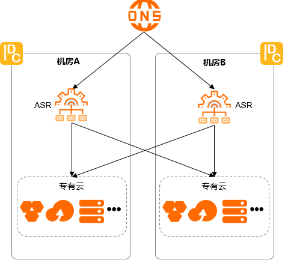

1. 主机房ASR负责处理备机房断电 、备机房网络孤岛故障和机房脑裂（双机房） 的场景下的容灾切换。

2. 备机房ASR负责处理主机房断电、主机房网络孤岛故障场景下的容灾切换。

## 1.3. ASR角色和权限说明

本文介绍ASR中各功能在主机房和备机房的操作权限，以及可操作的用户角色权限。

**角色和权限说明**

| 用户角色 | 登录方式 | 权限说明 |
| --- | --- | --- |
| 系统管理员（admin） | 1. 使用Apsara Uni-manager运维控制台的opsadmin用户和相应密码登录运维控制台。 2. 在顶部菜单中选择<strong>平台运维 &gt; 容灾管理 &gt; 同城容灾</strong><strong>管理平台ASR（主机房）</strong>或选择<strong>平台运维 &gt; 容灾管</strong><strong>理 &gt; 同城容灾管理平台ASR（备机房）</strong>。 3. 获取URL登录地址后，重新在浏览器中输入<em>URL地</em><em>址</em>/user/login，以admin用户和密码登录。 说明 • ASR备机房的访问地址格式为asr-xs-&lt;region-id&gt;.console.&lt;intranet-domain-id&gt;.com/user/login。 • ASR主机房的访问地址格式为asr-xm-&lt;region-id&gt;.console.&lt;intranet-domain-id&gt;.com/user/login。 | • 具有容灾演练（备机房）、故障模拟、灾难恢复等操作权限。 • 具有平台监控、平台检查、告警管理、创建新用户、创建告警规则等在同城容灾管理平台的所有操作权限。 |
| 中级运维（Intermediate Maintenance） | 1. 使用Apsara Uni-manager运维控制台的opsadmin用户和相应密码登录运维控制台。 2. 在顶部菜单中选择<strong>平台运维 &gt; 容灾管理 &gt; 同城容灾</strong><strong>管理平台ASR（主机房）</strong>或选择<strong>平台运维 &gt; 容灾管</strong><strong>理 &gt; 同城容灾管理平台ASR（备机房）</strong>。 | 具有概览、平台监控、平台检查、容灾演练（备机房）、告警管理和DCI专线管理操作权限。 |

**角色和功能说明**

ASR中各功能在主机房和备机房的操作权限、可操作的用户角色权限如下表所示。

<table>
  <tr>
    <th>功能分类</th>
    <th>菜单项</th>
    <th>功能</th>
    <th>主机房</th>
    <th>备机房</th>
    <th>用户角色</th>
  </tr>
  <tr>
    <td>概览</td>
    <td>概览</td>
    <td>-</td>
    <td>支持</td>
    <td>支持</td>
    <td>• 中级运维（IntermediateMaintenance）：opsadmin • 系统管理员（admin）</td>
  </tr>
  <tr>
    <td rowspan="3">平台监控</td>
    <td>平台监控 &gt; 产品监控</td>
    <td>产品监控</td>
    <td>支持</td>
    <td>支持</td>
    <td rowspan="3">• 中级运维（IntermediateMaintenance）：opsadmin • 系统管理员（admin）</td>
  </tr>
  <tr>
    <td>平台监控 &gt; 同步监控</td>
    <td>同步监控</td>
    <td>不支持</td>
    <td>支持</td>
  </tr>
  <tr>
    <td>平台监控 &gt; 大屏监控</td>
    <td>大屏监控</td>
    <td>不支持</td>
    <td>支持</td>
  </tr>
  <tr>
    <td rowspan="2">平台检查</td>
    <td>平台检查 &gt; 环境检查</td>
    <td>环境检查</td>
    <td>支持</td>
    <td>支持</td>
    <td rowspan="2">• 中级运维（IntermediateMaintenance）：opsadmin</td>
  </tr>
  <tr>
    <td colspan="4"></td>
  </tr>
  <tr>
    <td rowspan="2"></td>
    <td colspan="4"></td>
    <td rowspan="2">• 系统管理员（admin）</td>
  </tr>
  <tr>
    <td>平台检查 &gt; 产品检查</td>
    <td>产品检查</td>
    <td>支持</td>
    <td>支持</td>
  </tr>
  <tr>
    <td rowspan="10">故障模拟</td>
    <td>灾难恢复 &gt; 故障模拟 &gt; 操作审批</td>
    <td>操作审批</td>
    <td>支持</td>
    <td>支持</td>
    <td rowspan="10">系统管理员（admin）</td>
  </tr>
  <tr>
    <td>灾难恢复 &gt; 故障模拟 &gt; 环境检查</td>
    <td>环境检查</td>
    <td>支持</td>
    <td>支持</td>
  </tr>
  <tr>
    <td rowspan="7">灾难恢复 &gt; 故障模拟 &gt; 开始注入</td>
    <td>注入主机房断电故障</td>
    <td>不支持</td>
    <td>支持</td>
  </tr>
  <tr>
    <td>注入备机房断电故障</td>
    <td>支持</td>
    <td>不支持</td>
  </tr>
  <tr>
    <td>注入主机房孤岛故障</td>
    <td>支持</td>
    <td>不支持</td>
  </tr>
  <tr>
    <td>注入备机房孤岛故障</td>
    <td>支持</td>
    <td>不支持</td>
  </tr>
  <tr>
    <td>注入脑裂故障（只有双机房场景支持）</td>
    <td>支持</td>
    <td>不支持</td>
  </tr>
  <tr>
    <td>注入单产品故障</td>
    <td>支持</td>
    <td>支持</td>
  </tr>
  <tr>
    <td>注入单边故障（只有三机房场景支持）</td>
    <td>支持</td>
    <td>支持</td>
  </tr>
  <tr>
    <td>灾难恢复 &gt; 故障模拟 &gt; 机房复原</td>
    <td>机房复原</td>
    <td>支持</td>
    <td>支持</td>
  </tr>
  <tr>
    <td>容灾演练</td>
    <td>• 容灾演练 &gt;演练方案 • 容灾演练 &gt;演练记录</td>
    <td>产品切换/切回</td>
    <td>不支持</td>
    <td>支持</td>
    <td>• 中级运维（IntermediateMaintenance）：opsadmin • 系统管理员（admin）</td>
  </tr>
</table>

备机房故障或脑裂故障

支持

不支持

恢复

掉电故障恢

不支持

支持

复

- **灾难恢复 >平台切换**

灾难恢

系统管理员（admin）

复

孤岛故障恢

- **灾难恢复 >**

  不支持

  支持

  复

  **平台切回**

  单产品故障

  不支持

  支持

  恢复

  平台切回

  不支持

  支持

  支持

  > **说明**

- **系统设置 >告警管理 >**

  > 具有中级

  **告警规则**

  > 运维

  - 中级运维

  > （Interm

  （IntermediateMaintenance

- **系统设置 >**

  告警管理

  支持

  > ediateMa

  ）：opsadmin

  **告警管理 >**

  > intenanc

  **告警记录**

  - 系统管理员（admin）

  > e）：opsadmi n角色的用户不支持。

  - 中级运维（IntermediateMaintenance

**系统设置 > 修**

支持

支持

）：opsadmin

修改密码

**改密码**

- 系统管理员（admin）

**系统设置 > 仲**

仲裁管理

支持

支持

系统管理员（admin）

**裁管理**

系统设置

支持

> **说明**
>
> 具有中级运维

- 中级运维

> （Interm

（IntermediateMaintenance

管理DCI专

**系统设置 >**

支持

> ediateMa

）：opsadmin

线

**DCI专线管理**

> intenanc

- 系统管理员（admin）

> e）：opsadmi n角色的用户不支持。

**系统设置 > 数**

数据备份

支持

支持

系统管理员（admin）

**据备份**

# 2.登录ASR控制台

同城容灾管理平台ASR针对日常运维、容灾逃逸和租户运营场景提供了三种登录方式。

> **说明**
>
> 后续文档中同城容灾管理平台ASR简称ASR控制台。

**前提条件**

- 使用统一运维平台登录时，您已从部署人员或管理员处获取Apsara Uni-manager运维控制台的访问地址、用户名和密码。

  Apsara Uni-manager运维控制台访问地址格式为<em>&lt;region-id></em>.ops.console.*&lt;intranet-domain-id>*。

- 使用容灾逃逸登录时，您已从部署人员或管理员处获取ASR的访问地址、用户名和密码。

  > **说明**
  >
  > - 主机房故障时需登录备机房ASR，备机房故障登录主机房ASR，两者域名不同。
  >
  > - ASR备机房的访问地址格式为asr-xs-&lt;region-id>.console.&lt;intranet-domain-id>.com/user/login。
  >
  > - ASR主机房的访问地址格式为asr-xm-&lt;region-id>.console.&lt;intranet-domain-id>.com/user/login。

- 使用租户运营场景登录时，您已从部署人员处获取Apsara Uni-manager运营控制台的服务域名地址。

**统一运维平台登录**

> **说明**
>
> 根据Apsara Uni-manager运维控制台为同城容灾配置的不同权限，登录同城容灾管理平台后所呈现的视图将会有所差异，具体如下：
>
> - Apsara Uni-manager运维控制台为同城容灾用户仅配置容灾监控权限时，只展示日常态视图功能模块，且无法切换至运维态视图。
>
> - Apsara Uni-manager运维控制台为同城容灾用户仅配置容灾运维权限时，只展示运维态视图功能模块，且无法切换至日常态视图。
>
> - Apsara Uni-manager运维控制台为同城容灾用户同时配置容灾监控和容灾运维，或配置系统管理员权限时，将展示日常状态和运维状态的功能，并支持两者之间进行切换。

1. 打开浏览器。

2. 在地址栏中，输入Apsara Uni-manager运维控制台的访问地址，按回车键。

   

   > **说明**
   >
   > 您可以单击右上角的当前语言切换其它语言。当前支持简体中文、English语言切换。

3. 输入正确的用户名及密码。

   > **说明**
   >
   > - 登录Apsara Uni-manager运维控制台的用户名和密码请从部署人员或管理员处获取。
   >
   > - 若连续输入密码错误三次，系统将启动图片验证码登录功能；若连续输入错误五次，账户将被锁定，请联系管理员进行激活。
   >
   > - 首次登录Apsara Uni-manager运维控制台时，需要修改登录用户名的密码，请按照提示完成密码修改。
   >
   >   为提高安全性，密码必须满足以下要求：
   >
   >   - 必须包含英文大小写字母。
   >
   >   - 必须包含阿拉伯数字（0~9）。
   >
   >   - 必须包含特殊符号，包括感叹号（!）、at（@）、井号（#）、美元符号（$）、百分号（%）等。
   >
   >   - 密码长度为10~20个字符。

4. 单击**同意协议并登录**。

5. 在顶部菜单中选择**平台运维 > 容灾管理 > 同城容灾管理平台ASR（主机房）**。

6. 在顶部菜单中选择**平台运维 > 容灾管理 > 同城容灾管理平台ASR（备机房）**。

7. （可选）单击页面顶部日常态/运维态，可切换至另一个视图页面。

   > **说明**
   >
   > 必须同时具备容灾监控或容灾运维权限，或者具备系统管理员权限，方可支持视图切换。

   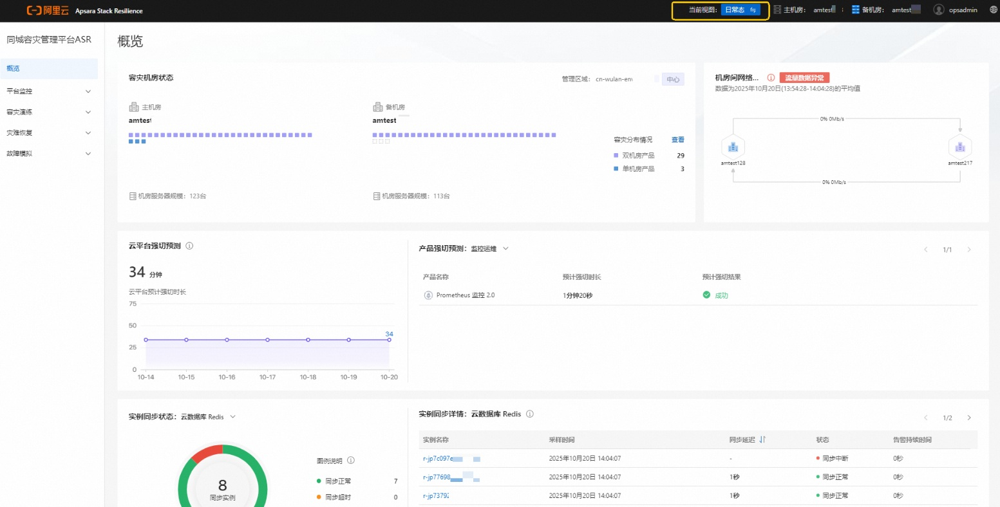

8. 单击页面顶部机房可跳转至相应机房页面。

   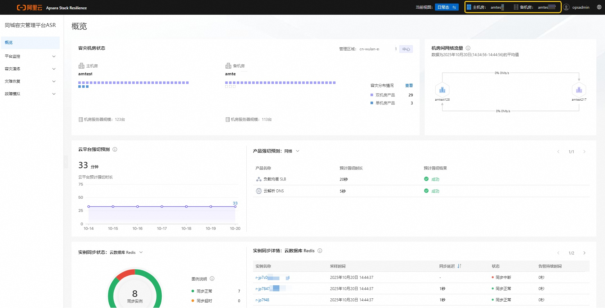

**容灾逃逸登录**

> **重要**
>
> 容灾逃逸登录开关默认处于关闭状态。如需通过该方式进行登录，请提前启用该开关并设置登录密码，具体请参见逃逸登录管理。

1. 在浏览器地址栏中，输入同城容灾管理平台ASR的访问地址，单击回车键。

   > **说明**
   >
   > - 主机房故障时需登录备机房ASR，备机房故障登录主机房ASR，两者域名不同。
   >
   > - ASR备机房的访问地址格式为asr-xs-&lt;region-id>.console.&lt;intranet-domain-id>.com/user/login。
   >
   > - ASR主机房的访问地址格式为asr-xm-&lt;region-id>.console.&lt;intranet-domain-id>.com/user/login。

   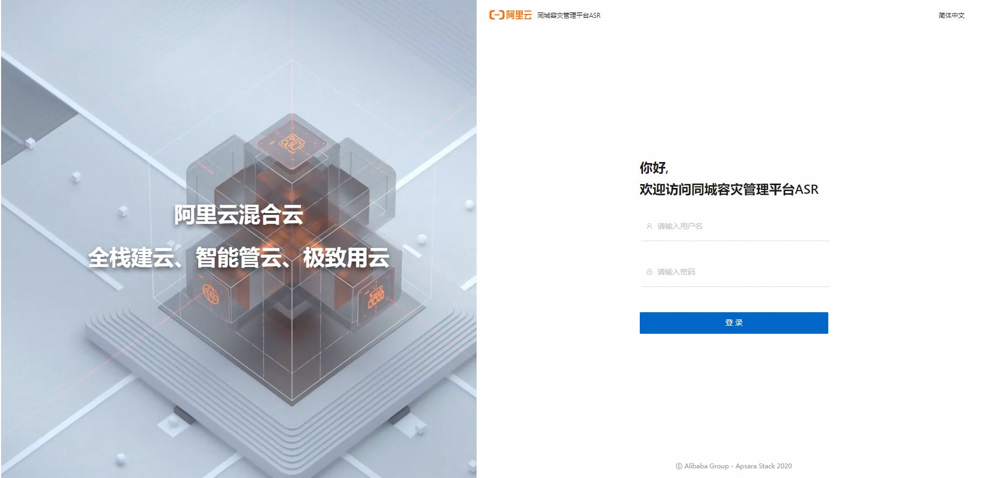

   > **说明**
   >
   > 您可以单击右上角的当前语言下拉切换语言，支持简体中文、English和繁體中文。

2. 输入正确的用户名和密码。

   > **说明**
   >
   > 登录ASR的用户名和密码请从部署人员或管理员处获取。

3. 单击**登录**。

4. 单击页面顶部日常态/运维态，可切换至另一个视图页面。

   

5. 单击页面顶部机房可跳转至相应机房页面。

   

**租户运营登录**

如果您需要按业务应用维度恢复单块业务与容灾演练，可通过登录Apsara Uni-manager运营控制台创建保护组。

**操作步骤**

1. 在浏览器地址栏中，输入Apsara Uni-manager运营控制台的服务域名地址，按回车键。

   

   > **说明**
   >
   > - 单击页面右上角的当前语言可以切换其它语言。
   >
   > - 授权登录是第三方认证中配置了全局IdP设置才会显示，且“授权登录”名称用户可按需自定义。
   >
   > - 由于浏览器证书过期或环境开启HTTPS认证等出现多次单击继续访问或无Apsara Uni-manager运营控制台地址入口等现象，此时需要安装证书才能正常访问。单击页面右上角的**浏览器证书安装**，可打开浏览器证书安装指南。

2. 输入正确的用户名及密码。

   > **说明**
   >
   > - 请向运营管理员获取登录控制台的用户名和密码。
   >
   > - 首次登录Apsara Uni-manager运营控制台时，需要修改登录用户名的密码，请按照提示完成密码修改。为提高安全性，密码长度必须为10~32位，且包含英文字母大小写、阿拉伯数字和特殊符号（感叹号（!）、at（@）、井号（#）、美元符号（$）、百分号（%）等）。

3. 单击**账号登录**。

4. 如果账号已激活MFA多因素认证，请根据以下两种情况进行操作：

   - **管理员强制开启MFA后的首次登录**

     <ol type="a">

     <li>

     在绑定虚拟MFA设备页面中，按页面提示步骤绑定MFA设备。

     </li>

     <li>

     按照步骤2重新输入账号和密码，单击**账号登录**。

     </li>

     </ol>

     <ol type="i" start="100">

     <li>

     输入6位MFA码后单击**认证**。

     </li>

     </ol>

   - **您已开启并绑定MFA**输入6位MFA码后单击**认证**。

     > **说明**
     >
     > 绑定并开启MFA的操作请参见《 Apsara Uni-manager运营控制台 用户指南》的**管理多因素认证**章节。

5. 在顶部菜单中选择**产品**。

6. 在左侧导航栏中选择**容灾与备份**。

7. 在**容灾与备份**区域选择**容灾服务 > 同城容灾管理平台 ASR**。

# 3.日常态视图

## 3.1. 概览

通过概览页面对容灾的整体能力做了呈现，使用户能更直观、更快捷的了解整个平台的容灾能力。用户登录ASR控制台后就能对整体平台容灾能力有初步认识和大致了解。支持用户直接查看容灾机房状态和机房间的网络流量、预测强切换的时长和结果，同时支持查看容灾平台的使用记录。

**操作步骤**

1. 登录同城容灾管理平台ASR（主机房）或同城容灾管理平台ASR（备机房），登录方法请参见登录ASR控制台。

2. 在**概览**页面可以看到容灾机房状态、机房间网络流量、强切预测、实例同步状态等信息。

   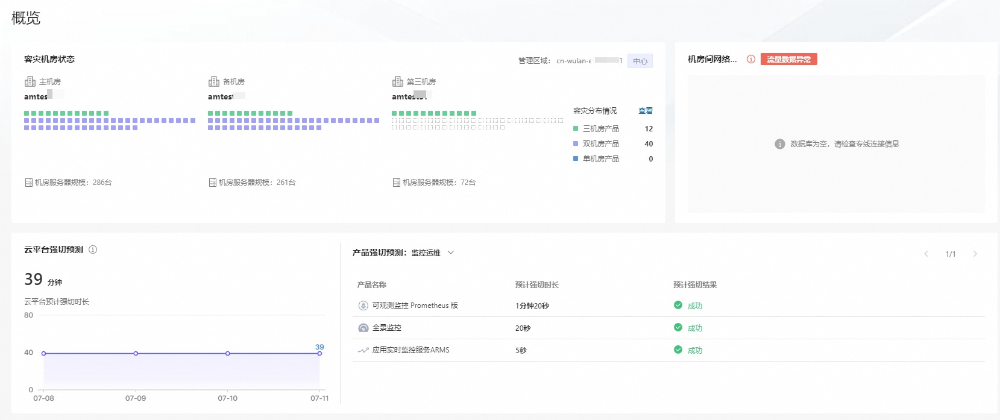

   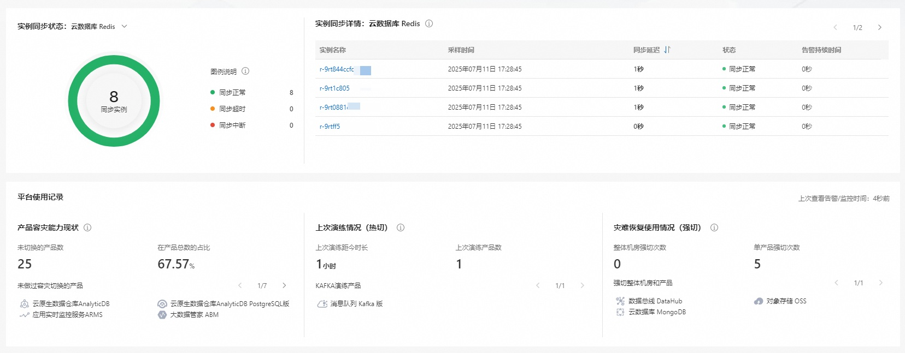

   > **说明**
   >
   > - 上述图片仅为三机房示例，具体显示内容会根据容灾形态变化，功能是一样的。请以实际环境为准。
   >
   > - 开启仲裁管理功能后，如果发生机房故障，会自动检测并开启切换，用户可根据界面提示查看灾难恢复记录。

各区域的信息如下表所示。

<table>
  <tr>
    <th width="137">区域</th>
    <th>描述</th>
  </tr>
  <tr>
    <td>容灾机房状态</td>
    <td>• 展示每个机房的角色（主/备/三机房）、机器数量、机房名称、机房内产品集群部署数量、产品主备分布情况。 • 单击<strong>查看</strong>可跳转至<strong>产品监控</strong>页面查看产品在机房内的分布情况和巡检结果，具体请查看产品监控章节。</td>
  </tr>
  <tr>
    <td>机房间网络流量</td>
    <td>• 展示最近时间点内的流量信息。 • 单击<strong>查看详情</strong>，可查看近1小时、近1天机房间的网络流量，每条折线表示一条专线。 • 如果机房间网络线路显示<strong>无流量</strong>单击跳转至DCI专线管理页面，需要配置DCI专线信息。 说明系统中设置的DCI专线信息会影响机房间网络流量。</td>
  </tr>
  <tr>
    <td>云平台强切预测</td>
    <td>展示云平台预测强切的时长和趋势。</td>
  </tr>
  <tr>
    <td>产品强切预测</td>
    <td>展示所有产品预测的强切时长和预计强切状态。强切状态分为成功、失败、有风险、超时等。 • 成功：表示所有的产品都会强切成功。 • 失败：表示某些监控项直接影响强切失败。 • 有风险：表示某些监控项可能会对强切造成影响。 • 超时：表示强切耗费的时长比预测的时长长。</td>
  </tr>
  <tr>
    <td>实例同步状态</td>
    <td>统计并展示所有实例的RPO数据，显示正常实例数、异常实例数（同步超时和同步中断）。</td>
  </tr>
  <tr>
    <td>实例同步详情</td>
    <td>• 统计并展示一周内RPO持续异常实例，展示实例的信息包括：实例名称、采样时间、同步延迟时间。默认以同步延迟时间降序排列显示。 • 单击实例名称，可跳转至对应云产品控制台的实例详情页面。</td>
  </tr>
  <tr>
    <td>平台使用记录</td>
    <td>展示产品的容灾能力现状、上次演练情况、上次查看告警/监控时间和灾难恢复情况。 • 产品容灾能力现状：展示未做过产品切换的数量及占比，展示从未做过容灾切换的产品名称。 • 上次演练情况（热切）：展示上次热切演练的产品数量、距现在的时长。 • 灾难恢复使用情况（强切）：展示灾难恢复的使用记录，包括整机房强切次数和单产品强切次数。</td>
  </tr>
</table>

## 3.2. 平台监控

### 3.2.1. 使用场景

本文介绍平台监控界面的应用场景和注意事项。

**功能概述**

平台监控包括产品监控和同步监控，各部分的功能和检查项如下所示：

- 产品监控页面从产品视角展示云产品的容灾形态、在主备机房和第三机房的服务状态、同步组件状态、容灾切换能力等信息；同时支持进入可视化大屏监控页面。

- 同步监控主要展示数据库和存储产品的数据同步延迟满足度。

**使用场景**

- 日常监控：在云平台日常运行期间，您需要定期巡检各项检查项。

- 演练前检查：在演练切换或演练切回前都需要检查平台监控信息，各监控项不可有异常。

> **说明**
>
> 部分产品不仅需要检查产品监控是否存在异常，还需要进行产品摸底，在进行演练切换前，请联系ASR产研团队进行摸底。

### 3.2.2. 产品监控

在演练切换或演练切回前，按产品类型统计各类产品总数和异常数，以卡片形式显示各产品、底座组件所在节点位置、功能状态以及巡检结果等信息。如果存在异常状态产品或底座，请修复正常后再执行切换或切回操作。

**产品监控**

在执行演练切换或切回前，您需要查看产品的监控状态是否有异常，如果异常，执行演练切换、切回时会提示**产品不具备容灾切换条件**，请修复后再执行切换或切回。

1. 在同城容灾管理平台ASR（主机房）或同城容灾管理平台ASR（备机房）的左侧导航栏中选择**平台监控 >产品监控**。

2. 在**产品监控**区域，查看是否存在监控状态为异常的产品。单击状态异常的产品名称可以跳转至下方对应卡片，卡片中显示节点位置、功能状态、巡检结果等信息。

3. 下拉选择产品类型、产品名称、主服务位置和产品状态，即可筛选出符合条件的产品监控项。

   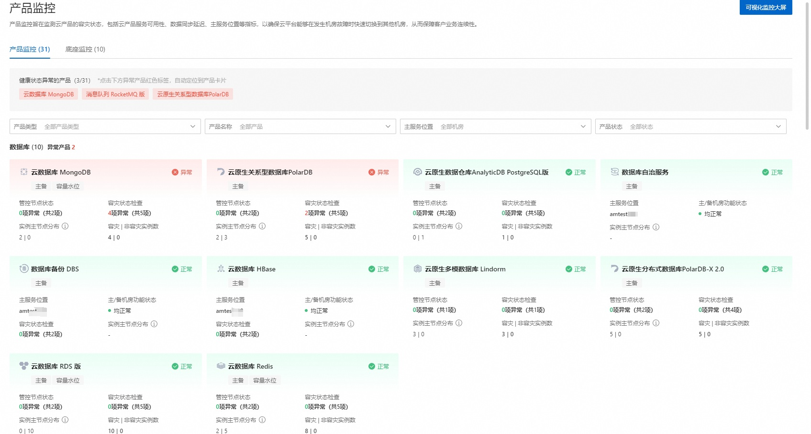

   单击页面右上角**可视化监控大屏**可跳转至大屏监控界面，具体操作请参见查看演练大屏。

   常见的异常及处理方式如下：

   - SSH隧道异常：在飞天基础运维平台上查看产品是否到达终态，未达终态请先修复终态问题。如果产品到达终态但异常依旧存在，请提交工单处理。

   - RDS出现同步延迟实例数量、运行中任务数量不为0：此时需要登录杜康运维平台检查具体的实例同步情况和任务执行情况。

   - Tablestore RPO不为0：降低业务量，等待20分钟，等待RPO自动恢复，如果长时间不恢复，请提工单处理。

   - 主备服务出现服务异常：请从飞天基础运维平台查看产品是否到达终态，未达终态及时修复终态问题。如果产品到达终态，但异常依旧存在，请提交工单处理。

**底座组件监控**

在执行演练切换或切回前，您需要查看底座组件的监控状态是否有异常，如果异常，执行演练切换、切回时会提示**产品不具备容灾切换条件**，请修复后再执行切换或切回。

1. 在同城容灾管理平台ASR（主机房）或同城容灾管理平台ASR（备机房）的左侧导航栏中选择**平台监控 >产品监控**。

2. 在**底座组件监控**区域，查看是否存在监控状态为异常的底座组件。单击健康状态异常的产品名称可跳转至下方对应的卡片，卡片中显示节点位置、功能状态、巡检结果等信息。

3. 下拉选择产品名称、主服务位置和产品状态，即可筛选出符合条件的底座监控项。

   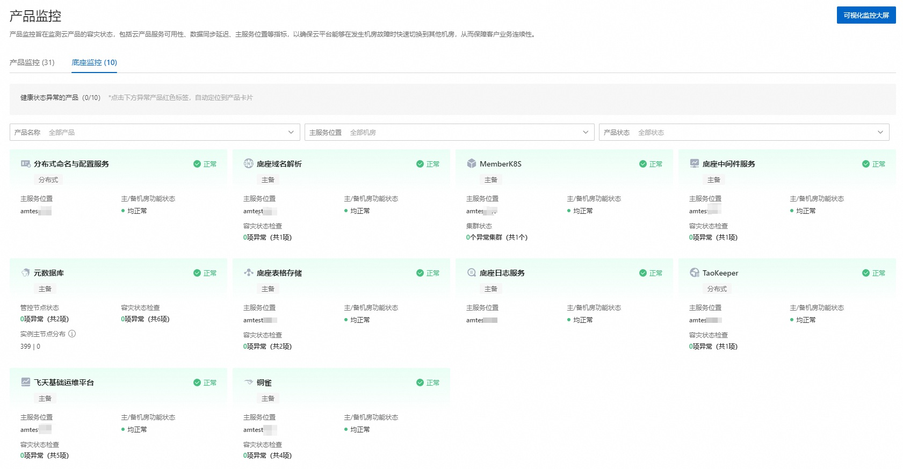

   单击页面右上角**可视化监控大屏**可跳转至大屏监控界面，具体操作请参见查看演练大屏。

   常见的异常及处理方式如下：

   - SSH隧道异常：在飞天基础运维平台上查看产品是否到达终态，未达终态请先修复终态问题。如果产品到达终态但异常依旧存在，请提交工单处理。

   - MINIRDS出现同步延迟实例数量、运行中任务数量不为0：此时需要登录杜康运维平台检查具体的实例同步情况和任务执行情况。

   - 主备服务出现服务异常：请从飞天基础运维平台查看产品是否到达终态，未达终态及时修复终态问题。如果产品到达终态，但异常依旧存在，请提交工单处理。

### 3.2.3. 同步监控

您可以查看RDS、Redis、PolarDB-X 2.0、MongoDB、AnalyticDB PostgreSQL版、OSS的数据同步延迟满足度、同步正常实例数、同步异常实例数，以及各实例的同步延迟时间等。

1. 登录备机房ASR控制台。

2. 在左侧导航栏中选择**平台监控** > **同步监控**，页面显示实例的同步监控情况，同步异常的实例会以红色标显示。

   > **说明**
   >
   > - **RDS监控**包含多款数据库产品的监控，包括RDS MySQL版、RDS PostgreSQL版、RDS PolarDB版、RDS PPAS版。
   >
   > - 云产品监控的告警阈值可以在**系统设置** > **告警管理** > **告警规则**中配置，在相应产品的**数据同步延时检查**监控项中修改**异常阈值**。

   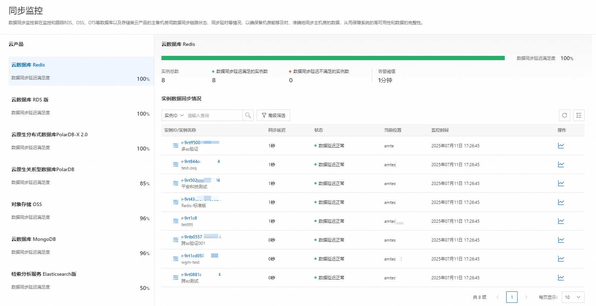

   同步监控页面功能说明如下表所示：

   <table>
     <tr>
       <th width="186">功能</th>
       <th>描述</th>
     </tr>
     <tr>
       <td>数据同步延迟满足度</td>
       <td>显示云产品同步延迟是否满足RPO的百分比，如果未达到100%，查看<strong>状态</strong>为<strong>同步失败</strong>的实例排查解决问题。</td>
     </tr>
     <tr>
       <td>搜索</td>
       <td>支持按照不同云产品搜索查看实例数据的同步情况，下拉选择以<strong>实例ID</strong>、<strong>实例名称</strong>、<strong>当</strong><strong>前位置</strong>、<strong>实例引擎</strong>或<strong>状态</strong>维度搜索。 • 在<strong>实例ID</strong>中输入实例ID，单击。 • 在<strong>实例名称</strong>中输入实例名称，单击。 • 在<strong>当前位置</strong>中下拉选择机房名称，系统会自动筛选出符合条件的内容。 • 在<strong>实例引擎</strong>中下拉选择引擎名称，系统会自动筛选出符合条件的内容。 说明仅云数据库 RDS支持以实例引擎进行搜索。 • 在<strong>状态</strong>中下拉选择实例状态，可选<strong>正常</strong>、<strong>异常</strong>。单击<strong>高级筛选</strong>支持以几种查询维度组合进行搜索。</td>
     </tr>
     <tr>
       <td>页面跳转</td>
       <td>单击云产品的实例ID/实例名称，可跳转至对应云产品控制台的实例详情页面。</td>
     </tr>
     <tr>
       <td>查看实例数据同步情况</td>
       <td>• 单击操作列，可以查看近1天、近6小时、近1小时的实例数据同步（RPO）情 况。 • 单击操作列，可以隐藏实例数据同步折线图。</td>
     </tr>
   </table>

### 3.2.4. 大屏监控

演练大屏是容灾演练切换的实时可视化展示页面，您可在此查看容灾切换过程中的产品编排、执行进度以及各产品耗时等关键数据。

**操作步骤**

1. 登录同城容灾管理平台ASR（备机房），登录方法请参见登录ASR控制台。

2. 在左侧导航栏中选择**容灾演练 > 演练大屏**。

   **演练中大屏**

   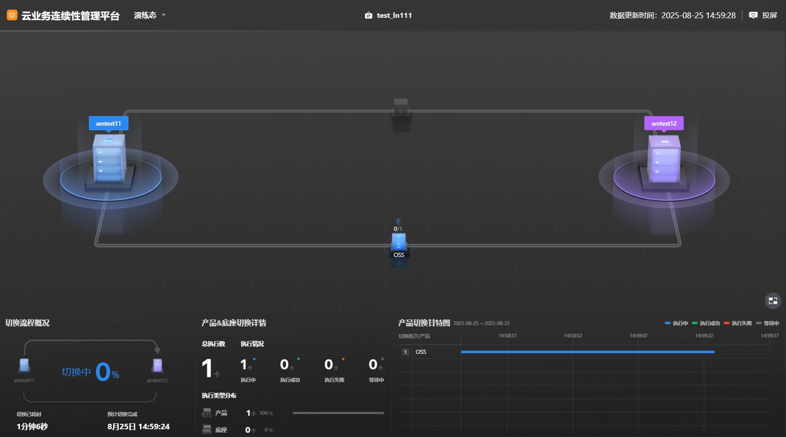

   **演练完成大屏**

   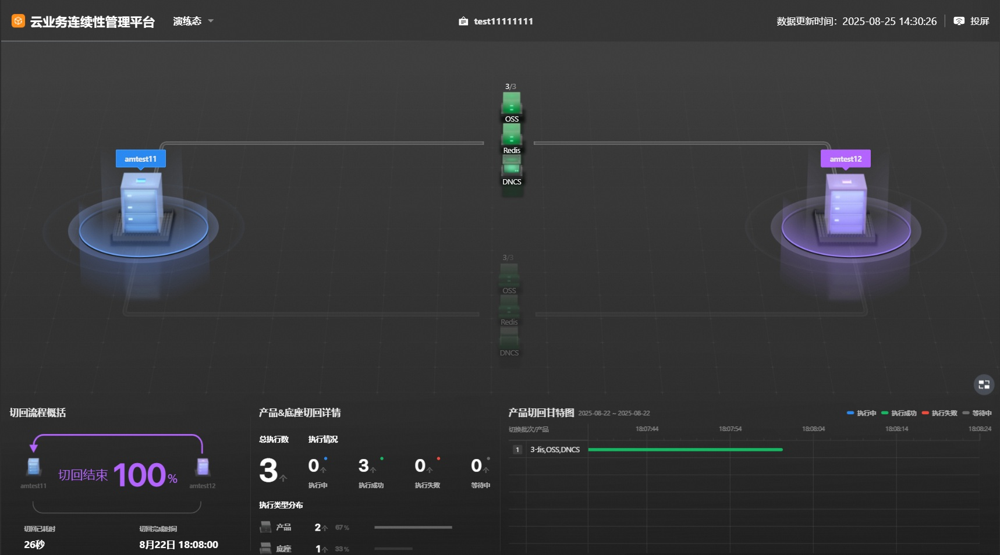

   | 区域 | 说明 |
   | --- | --- |
   | <strong>日常态</strong>/<strong>演练态</strong> | • 日常态展示监控大屏，包括容灾云产品数量统计、异常云产品实例详情、选中产品概览等内容。 • 演练态展示演练大屏，包括容灾切换过程中的产品编排、执行进度以及各产品耗时等信息。 |
   | 切换流程概括切回流程概况 | 展示该容灾地域的容灾产品切换/切回所耗费的时长和当前操作完成时间。 |
   | 产品&amp;底座切换详情产品&amp;底座切回详情 | • 展示当前操作所包含的执行产品个数，执行情况和执行类型分布等信息。 • 执行情况包括执行中、执行成功、执行失败和等待中。 |
   | 产品切换甘特图产品切回甘特图 | • 以容灾切换批次粒度展示本次切换或切回所包含的所有产品的切换时长、开始时间和结束时间等信息。 • 单击，可放大以产品粒度展示切换或切回信 息。 |
   | 投屏 | 单击<strong>投屏</strong>，将以全屏形式展示。 |

## 3.3. 平台检查

### 3.3.1. 检查环境

通过检查环境可以更方便快捷地了解容灾产品的版本、产品基线、DNS资源、VIP资源、数据库资源等信息。在环境部署成功后，请通过环境检查查看各检查项是否满足容灾的条件。

1. 登录同城容灾管理平台ASR（主机房）或同城容灾管理平台ASR（备机房），登录方法请参见登录ASR控制台。

2. 在左侧导航栏中选择**平台检查 > 环境检查**。

3. 在**环境检查**页面，在对应的区域框中单击右上角的**立即检查**，查看相应的检查项。各检查项的说明如下：

   - **是否做A'**：产品在重新部署或升级后，主机房需要对该产品做A'，即Rolling，去重新感知机房最新的配置。请检查已做A'的产品列表是否和重新部署或升级的产品一致。

     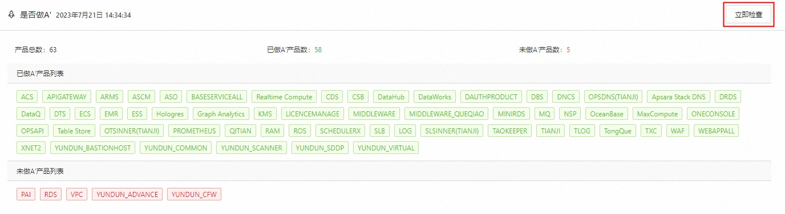

   - **集群部署**：展示各产品是对等部署或非对等部署，了解各产品部署的集群。

     > **说明**
     >
     > - 标黄项：该feature目前为非对等部署，但备集群不要求必须部署，可忽略。
     >
     > - 标红项：该feature目前为非对等部署，且备集群要求必须部署，必须处理。

     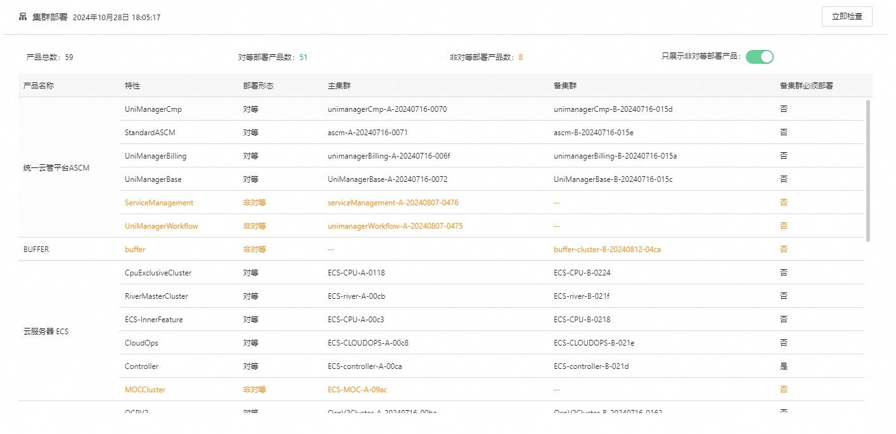

   - **产品版本**：ASR会检查各产品主备机房的版本是否一致，如果版本不一致，ASR会显示该产品为异常产品，您需要将该产品主备机房的版本升级到相同的版本，以免造成容灾切换失败。

     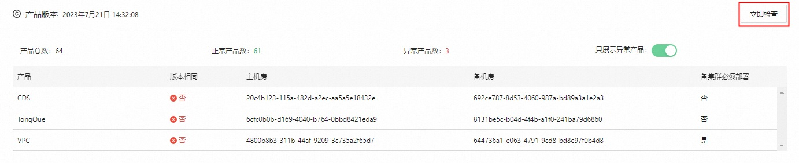

   - **产品基线**：ASR会检查环境中的基线配置和飞天基础运维平台中的基线配置是否相同。

     - 如果显示“产品基线变量检查通过”，说明基线检查正常。

       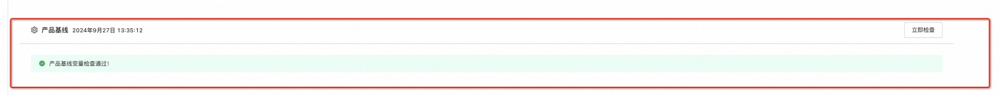

     - 如果显示“产品基线变量检查未通过”，请检查相关的配置。

       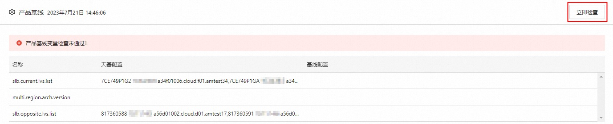

   - **DNS资源**：ASR从飞天基础运维平台中获取产品的DNS资源信息，根据资源信息下的域名获取实际对应的VIP，再根据实际VIP和飞天基础运维平台资源信息中的VIP进行对比。如果两者不一致，则**比对结果**显示为**异常**，请检查并修改相应配置。

     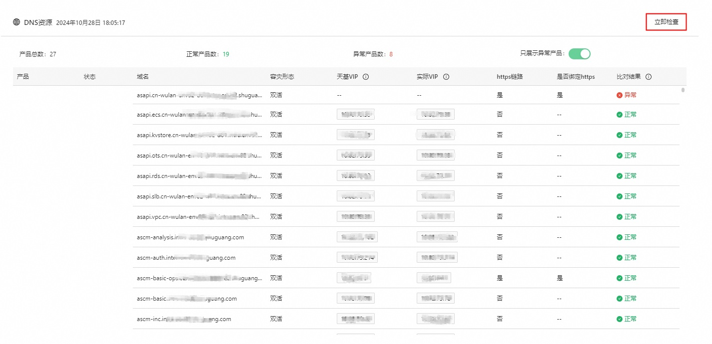

   - **VIP资源**：ASR从飞天基础运维平台中获取到产品的VIP资源信息，根据资源信息中的VIP信息到SLB中查询该VIP所对应的RealServer IP，再根据RealServer IP和VIP资源信息中NCList做比对。如果两者不一致，ASR界面上会将相应的RealServer IP标红，请检查并修改相应配置。

     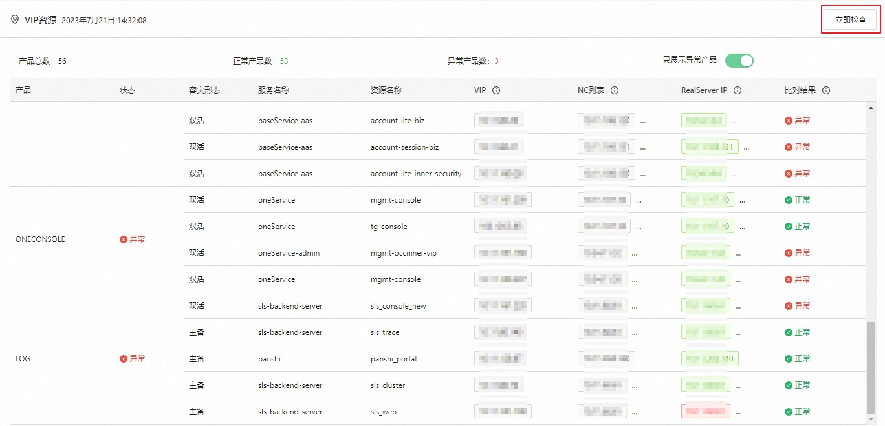

   - **数据库资源**：ASR从飞天基础运维平台中获取产品的数据库资源信息，根据该信息连接对应的数据库，检查数据库主库的read-only属性。如果为只读，ASR会显示该产品**状态**为**异常**，请修改该数据库的配置。

     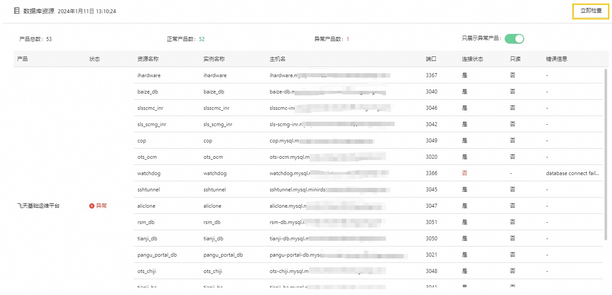

   - **机房间网络情况**：检查SLB和VPC相关网段的路由发布是否正常。如果**状态**显示**异常**，请联系运维人员修复。

     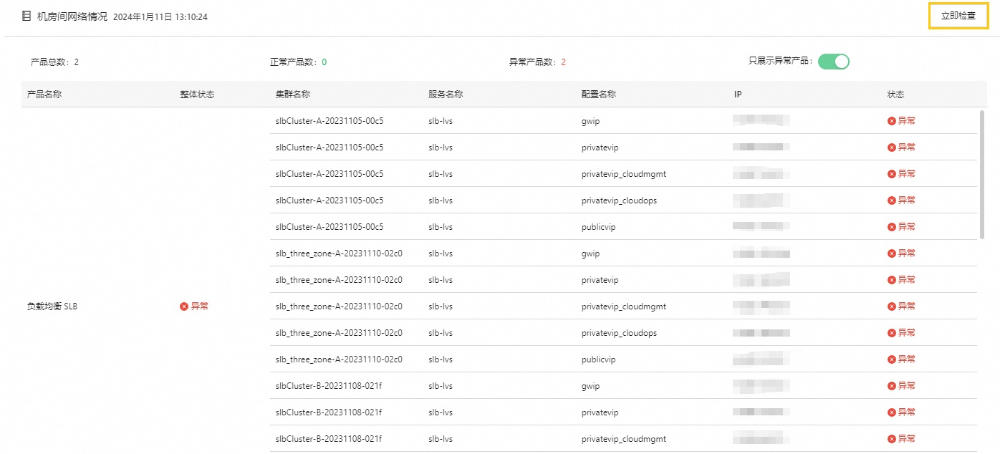

   - **BGP路由**：检查OPS-DNS、专有云DNS、SLB、VPC的BGP路由信息发布情况。如果**状态**显示**异常**，请联系运维人员修复。

     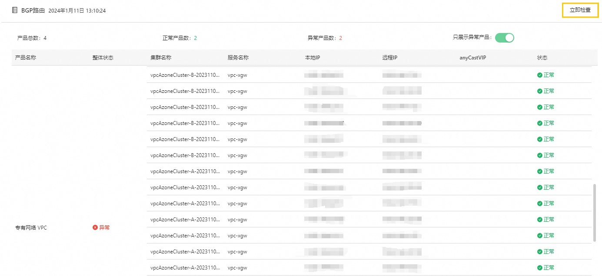

### 3.3.2. 检查产品

在容灾切换前后以及容灾切回前后，请执行产品检查，检查容灾产品的状态。

1. 登录同城容灾管理平台ASR（主机房）或同城容灾管理平台ASR（备机房），登录方法请参见登录ASR控制台。

2. 在左侧导航栏中选择**平台检查 > 产品检查**。

3. 单击**负载均衡 SLB**、**底座域名解析**、**元数据库**区域右上角的**立即检查**，检查各产品的状态是否有异常。

   如果产品检查项状态为异常，请重点关注该检查项的错误提示和错误信息，根据错误内容排查解决问题。

   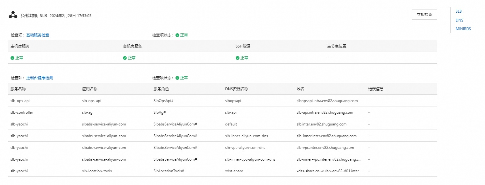

## 3.4. 容灾演练

容灾演练是指在不中断网络和电力的情况下，执行产品的主备切换演练操作。

### 3.4.1. 使用须知

容灾演练分为自定义演练和默认演练两种类型，自定义演练支持用户根据自身需求选择某一个或多个产品进行演练；默认演练支持用户选择全部产品或单个产品进行演练。

**功能概述**

同城容灾演练是容灾平台交付验收和周期检验的重要环节。通过定期组织容灾演练，可以检验容灾平台处理重大问题的能力，完善容灾响应机制。演练中出现问题请立刻联系阿里云容灾研发技术团队解决，避免影响业务正常运行。

- 默认演练计划：根据实际演练需求，选取同城容灾管理平台中预置的单个产品演练计划进行实施，或是选择包含全部产品的整体演练计划进行演练。

- 自定义演练计划：根据实际演练需求，可以灵活自定义选取多个云产品，创建演练计划并执行演练。

> **说明**
>
> 三机房场景下，ASR支持主可用区模式数据库产品切回，将实例主库切回到实例创建时主库所在的可用区，包括**单产品故障后服务切回**和**掉电故障后服务切回**中数据库产品切回等全部情况。

**演练流程图**

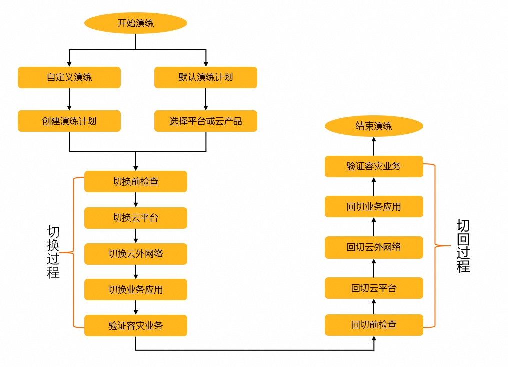

### 3.4.2. 演练方案

按照演练的类型，演练方案也分为自定义演练计划和默认演练计划两种，请根据实际需求创建对应的演练计划。

- 自定义演练计划：根据实际演练需求，可以灵活选取多个云产品以创建自定义的演练计划并执行演练。

- 默认演练计划：自由选取云平台中任意一个预先设定好的单个产品演练计划进行实施，亦或是选择包含所有产品的整体演练计划进行演练。

#### 3.4.2.1. 默认计划演练

容灾该演练是指在不中断网络以及不中断电力的情况下，执行云产品的主备切换和切回演练。默认计划演练支持选择单个产品或者云平台（全部产品）进行演练。

**操作步骤**

1. 以管理员账号登录同城容灾管理平台ASR（备机房）或登录同城容灾管理平台ASR（主机房），登录方法请参见登录ASR控制台。

2. 在左侧导航栏中选择**容灾演练 > 演练计划**。

3. 在**演练计划**页面，选择**默认计划**页签。

   > **说明**
   >
   > 登录同城容灾管理平台ASR（备机房）或登录同城容灾管理平台ASR（主机房）支持的演练机房不同。同城容灾管理平台ASR（备机房）支持选择的演练机房为主机房和第三机房；同城容灾管理平台ASR（主机房）支持选择的演练机房为备机房。

   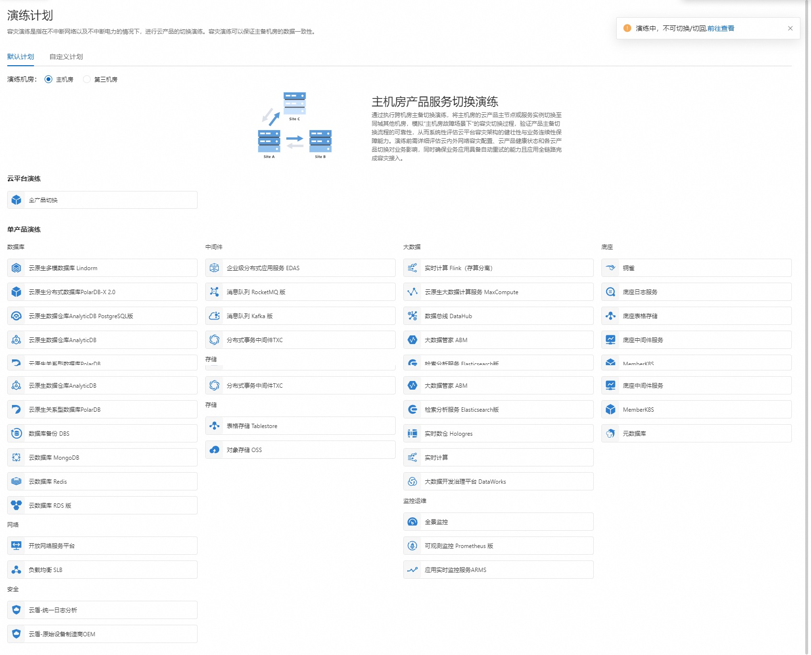

4. 在**默认计划**页签，选择全产品切换演练或单个云产品切换演练。

5. 在弹出提示框上确认产品检查已通过，同时勾选网络与业务应用容灾适配均已完成,我已知晓后果，单击**切换**。

   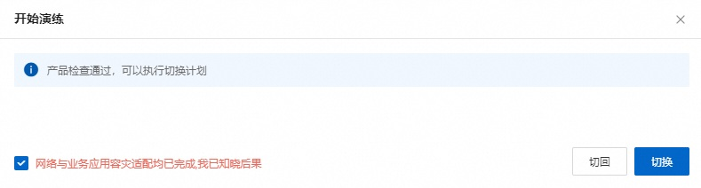

   切回操作同理，当提示框上显示产品异常时，请在产品监控查看异常项详情。

   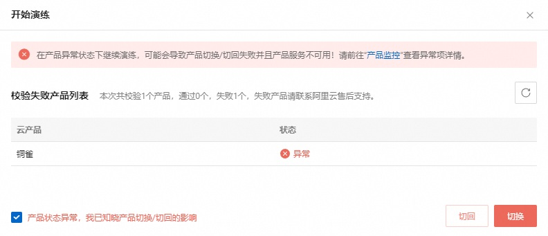

6. 切换后会跳转至演练计划的详情页，可查看切换结果。

   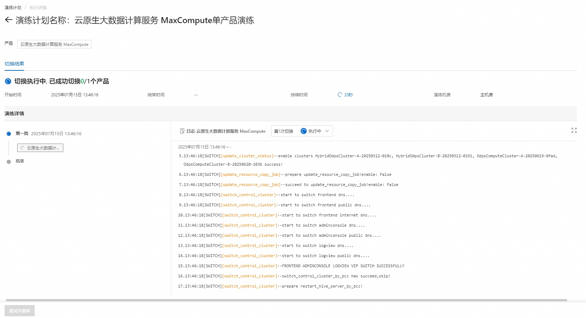

#### 3.4.2.2. 自定义计划演练

容灾演练是指在不中断网络以及不中断电力的情况下，执行产品的主备切换和切回演练。自定义计划演练可以根据需要选择待演练的多个云产品，演练完成后自动汇总演练数据同时生成演练报告。

**操作步骤**

1. 以管理员账号登录同城容灾管理平台ASR（备机房）或登录同城容灾管理平台ASR（主机房），登录方法请参见登录ASR控制台。

2. 在左侧导航栏中选择**容灾演练 > 演练计划**。

3. 在**演练计划**页面，选择**自定义计划**页签。

4. 单击**创建计划**，参考下表填写参数。

   <table>
     <tr>
       <th width="89">参数名称</th>
       <th>参数描述</th>
     </tr>
     <tr>
       <td>计划名称</td>
       <td>请自定义演练名称。名称的长度为10~40个字符，支持中文、大小写字母、数字、下划线等。</td>
     </tr>
     <tr>
       <td>演练机房</td>
       <td>请选择待演练的机房。 说明登录同城容灾管理平台ASR（备机房）或登录同城容灾管理平台ASR（主机房）支持的演练机房不同。同城容灾管理平台ASR（备机房）支持选择的演练机房为主机房和第三机房；同城容灾管理平台ASR（主机房）支持选择的演练机房为备机房。</td>
     </tr>
     <tr>
       <td>演练产品</td>
       <td>选择待演练的云产品，然后单击<strong>确定</strong>。</td>
     </tr>
     <tr>
       <td>计划描述</td>
       <td>非必填，请输入该计划的其他信息。不允许超过100个字符。</td>
     </tr>
   </table>

5. 单击**确定**。

   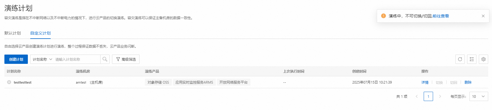

6. 在页面右上角提示切换/切回计划的执行情况，单击**前往查看**，查看切换/切回的执行详情。

   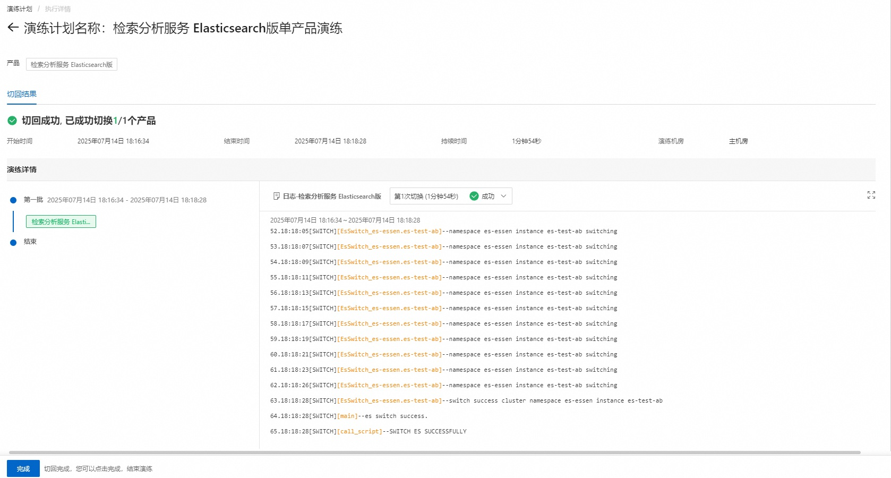

7. 在**自定义计划**列表中，支持查看演练计划的详情，对演练计划切换、切回和删除操作。

   - 查看自定义演练计划详情：

     <ol type="a">

     <li>

     单击演练计划**操作**列**详情**。

     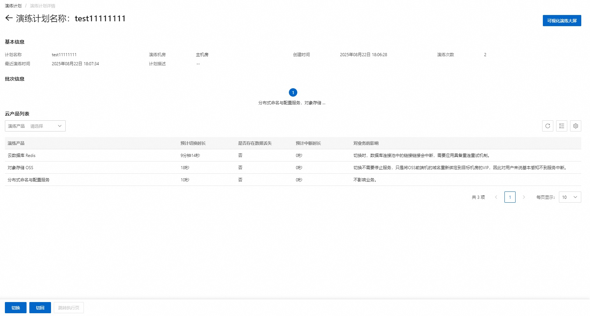

     </li>

     <li>

     可查看基本详情、批次信息和演练的云产品列表。

     </li>

     </ol>

     <ol type="i" start="100">

     <li>

     在页面左下角支持**切换**、**切回**和**跳转执行页**操作。

     </li>

     <li value="500">

     单击右上角**可视化演练大屏**，可跳转至大屏页面查看演练过程。

     </li>

     </ol>

   - 切换自定义演练计划：

     目前系统中没有切换/切回任务时，才支持切换操作。

     <ol type="a">

     <li>

     单击演练计划**操作**列**切换**。

     </li>

     <li>

     在弹出提示框上单击**确定**。

     </li>

     </ol>

   - 切回自定义演练计划：

     只有切换成功的演练计划才支持切回操作。

     <ol type="a">

     <li>

     单击演练计划**操作**列**切回**。

     </li>

     <li>

     在弹出提示框上单击**确定**。

     </li>

     </ol>

   - 删除自定义演练计划：

     <ol type="a">

     <li>

     单击演练计划**操作**列**删除**。

     </li>

     <li>

     在弹出提示框上单击**删除**。

     </li>

     </ol>

### 3.4.3. 查看演练记录

您可以查看默认演练和自定义演练的历史演练记录和演练结果。

**操作步骤**

1. 以管理员账号登录同城容灾管理平台ASR（备机房），登录方法请参见容灾逃逸登录。

2. 在左侧导航栏中选择**容灾演练 > 演练记录**。

   演练记录页面展示计划名称、演练机房、演练产品、状态、操作类型等内容，同时支持查看演练记录、演练报告和演练大屏。

3. 支持以执行产品、机房、执行时间、演练状态和操作类型维度查询，或者以这几个维度的组合结果搜索。

   - 查看演练记录：

     <ol type="a">

     <li>

     单击**操作**列**查看记录**。

     </li>

     <li>

     即可查看执行详情。

     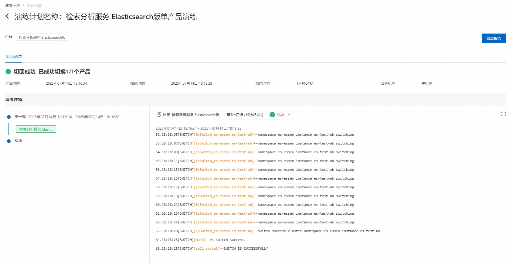

     </li>

     </ol>

   - 查看演练报告：

     <ol type="a">

     <li>

     单击**操作**列**查看报告**，或在查看记录页面单击**查看报告**。

     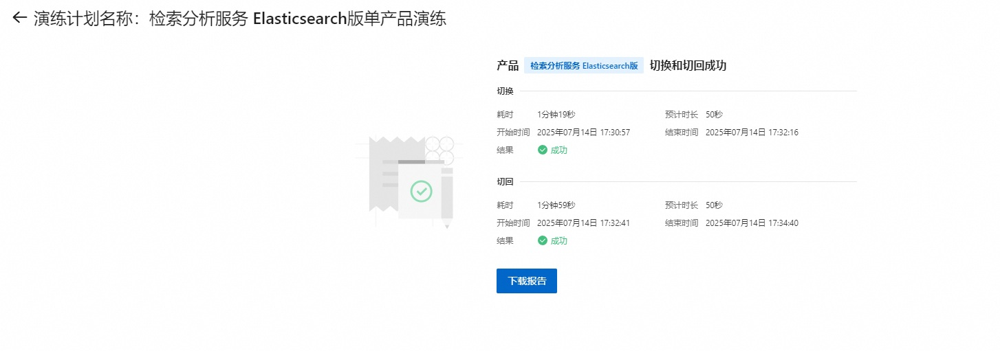

     </li>

     <li>

     单击**下载报告**即可下载至本地查看。

     </li>

     </ol>

   - 查看大屏。

     在**演练记录**页面单击**操作**列**查看大屏**。

     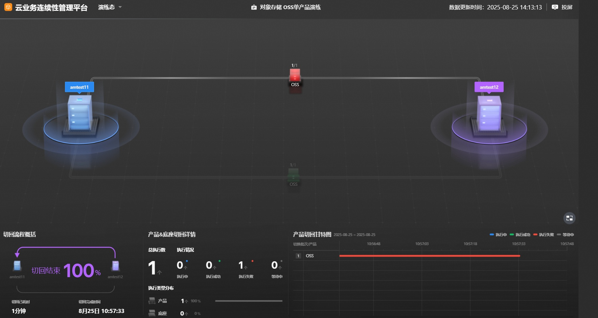

     > **说明**
     >
     > 大屏页面的操作请参见查看演练大屏。

### 3.4.4. 查看演练大屏

演练大屏是容灾演练切换的实时可视化展示页面，您可在此查看容灾切换过程中的产品编排、执行进度以及各产品耗时等关键数据。

**操作步骤**

1. 登录同城容灾管理平台ASR（备机房），登录方法请参见登录ASR控制台。

2. 在左侧导航栏中选择**容灾演练 > 演练大屏**。

   **演练中大屏**

   

   **演练完成大屏**

   

   | 区域 | 说明 |
   | --- | --- |
   | <strong>日常态</strong>/<strong>演练态</strong> | • 日常态展示监控大屏，包括容灾云产品数量统计、异常云产品实例详情、选中产品概览等内容。 • 演练态展示演练大屏，包括容灾切换过程中的产品编排、执行进度以及各产品耗时等信息。 |
   | 切换流程概括切回流程概况 | 展示该容灾地域的容灾产品切换/切回所耗费的时长和当前操作完成时间。 |
   | 产品&amp;底座切换详情产品&amp;底座切回详情 | • 展示当前操作所包含的执行产品个数，执行情况和执行类型分布等信息。 • 执行情况包括执行中、执行成功、执行失败和等待中。 |
   | 产品切换甘特图产品切回甘特图 | • 以容灾切换批次粒度展示本次切换或切回所包含的所有产品的切换时长、开始时间和结束时间等信息。 • 单击，可放大以产品粒度展示切换或切回信 息。 |
   | 投屏 | 单击<strong>投屏</strong>，将以全屏形式展示。 |

## 3.5. 灾难恢复

灾难恢复可以确保在遭遇自然灾害、系统故障或其他突发事件后，能够维持正常运行或尽快恢复运行状态。当云平台灾难发生时，可以执行“灾备恢复”流程进行恢复。如果在未发生灾难时，可以使用ASR提供“故障模拟”功能进行故障注入，然后执行“灾难恢复”流程进行演练。

**功能概述**

- **灾难恢复**：指在发生重大故障或灾难事件时，能够快速恢复云平台以及云平台业务系统的能力。其目的在于确保在遭遇自然灾害、系统故障或其他突发事件后，能够维持正常运行或尽快恢复运行状态。

- **故障模拟**：指在真实灾难未发生时，为了验证系统灾难恢复能力，通过故障注入的形式，模拟机房断电、机房网络孤岛和脑裂的故障场景。

> **说明**
>
> 三机房场景下，ASR支持主可用区模式数据库产品切回，将实例主库切回到实例创建时主库所在的可用区，包括**单产品故障后服务切回**和**掉电故障后服务切回**中数据库产品切回等全部情况。

### 3.5.1. 灾难恢复

灾难恢复是指在发生重大故障或灾难事件时，能够快速恢复云平台以及云平台业务系统的能力。其目的在于确保在遭遇自然灾害、系统故障或其他突发事件后，能够维持正常运行或尽快恢复运行状态。

**灾难恢复场景**

灾难恢复场景包括以下几类：

- 主机房掉电灾难恢复：主机房的电源发生故障，唤醒备机房和第三机房的云产品来快速恢复线上业务。

- 主机房孤岛灾难恢复：主机房对外网络、连接备机房和连接第三机房的网络同时出现故障，唤醒备机房和第三机房的服务保持业务连续性。

- 单产品故障灾难恢复：主机房的某个产品出现故障，唤醒备机房和第三机房对应产品（不保证数据丢失等于0）。

- 备机房故障灾难恢复：备机房的电源发生故障，唤醒主机房和第三机房的云产品来快速恢复线上业务。

**灾难恢复流程图**

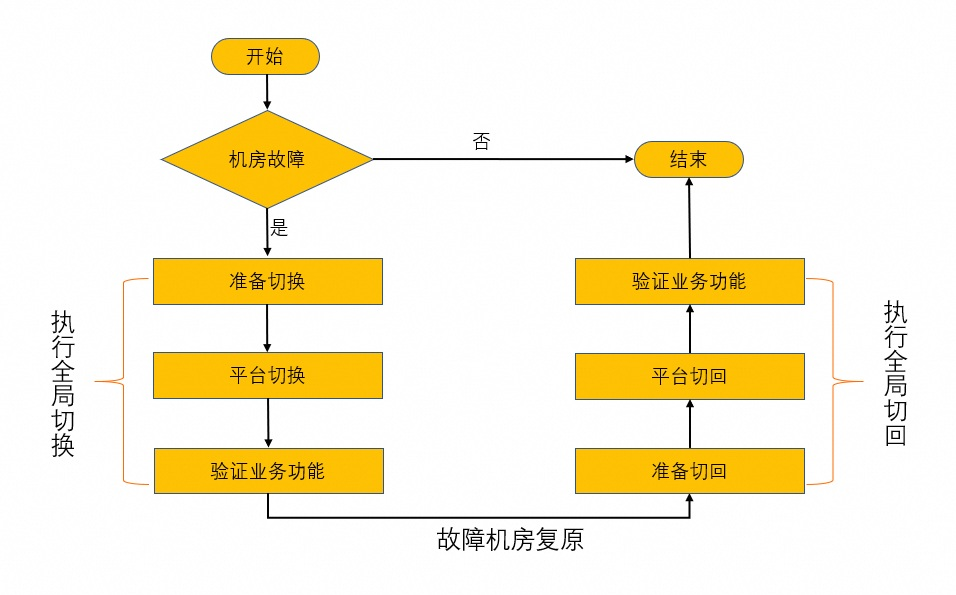

> **说明**
>
> 灾难恢复时的平台切换和平台切回操作需要用户手动执行，但是开启仲裁功能后，支持为底座中间件服务提供自动仲裁切换能力，具体包括Zookeeper、Tair和Schedulerx中间件组件，可快速恢复线上业务。

#### 3.5.1.1. 机房掉电灾难恢复

本章节介绍发生真实机房掉电灾难时，同城容灾管理平台是如何执行平台切换和切回操作，以确保系统的连续性和可靠性。

##### 3.5.1.1.1. 机房掉电切换

机房的电源发生故障时，您可以执行如下步骤唤醒备机房的云产品来快速恢复线上业务。

**操作步骤**

1. 以管理员账号登录同城容灾管理平台ASR（备机房）或登录同城容灾管理平台ASR（主机房），登录方法请参见容灾逃逸登录。

2. 在左侧导航栏中选择**灾难恢复 > 平台切换**。

3. 单击**机房掉电故障**页签。

   > **说明**
   >
   > 登录同城容灾管理平台ASR（备机房）或登录同城容灾管理平台ASR（主机房）支持的故障机房不同。具体场景如下所示：
   >
   > - 双机房场景：
   >
   >   - 登录同城容灾管理平台ASR（备机房）：故障机房是主机房，故障场景包括：主机房掉电故障和主机房网络孤岛。
   >
   >   - 登录同城容灾管理平台ASR（主机房）：故障机房是备机房，故障场景包括：备机房掉电故障、备机房网络孤岛和主备机房脑裂恢复。
   >
   > - 三机房场景：
   >
   >   - 登录同城容灾管理平台ASR（备机房）：故障机房是主机房和第三机房，故障场景包括：主机房掉电故障、主机房网络孤岛、第三机房掉电故障和第三机房网络孤岛。
   >
   >   - 登录同城容灾管理平台ASR（主机房）：故障机房是备机房，故障场景包括：备机房掉电故障和备机房网络孤岛。

   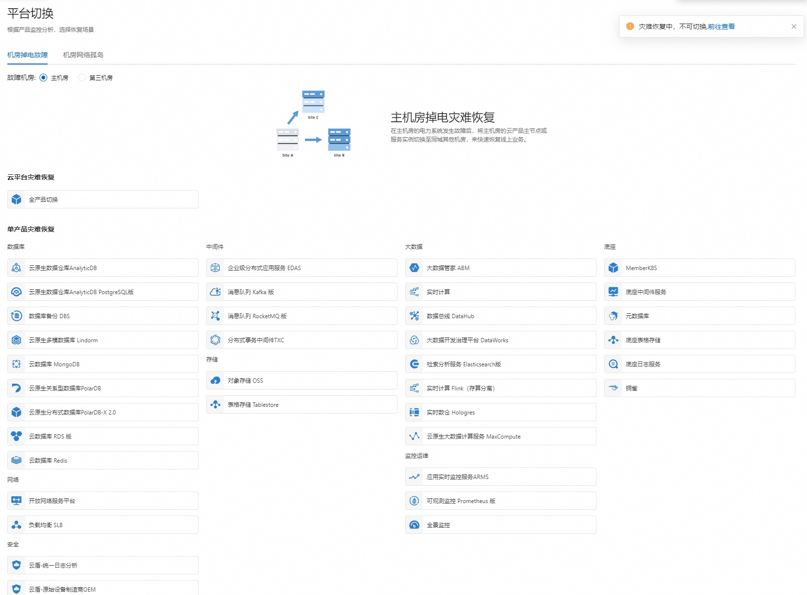

4. 选择故障机房。

5. 选择全产品切换或单个云产品切换。

   > **说明**
   >
   > 如果是单产品故障切换场景的话，请选择单个故障云产品进行切换。

6. 在弹出提示框上单击**切换**。

   

> **说明**
>
> 如果切换失败，请联系ASR产研团队进行问题排查。

##### 3.5.1.1.2. 机房掉电切回

在机房掉电恢复后，您可以按照如下步骤将业务切回至原机房。

**前提条件**

- 已执行机房掉电切换，并且已经切换成功。

- 掉电机房已经复原成功。

**操作步骤**

1. 以管理员账号登录同城容灾管理平台ASR（备机房）或登录同城容灾管理平台ASR（主机房），登录方法请参见容灾逃逸登录。

2. 在左侧导航栏中选择**灾难恢复 > 平台切回**。

3. 单击**机房掉电故障**页签。

   > **说明**
   >
   > 登录同城容灾管理平台ASR（备机房）或登录同城容灾管理平台ASR（主机房）支持的故障机房不同。具体场景如下所示：
   >
   > - 双机房场景：
   >
   >   - 登录同城容灾管理平台ASR（备机房）：故障机房是主机房，故障场景包括：主机房掉电故障和主机房网络孤岛。
   >
   >   - 登录同城容灾管理平台ASR（主机房）：故障机房是备机房，故障场景包括：备机房掉电故障、备机房网络孤岛和主备机房脑裂恢复。
   >
   > - 三机房场景：
   >
   >   - 登录同城容灾管理平台ASR（备机房）：故障机房是主机房和第三机房，故障场景包括：主机房掉电故障、主机房网络孤岛、第三机房掉电故障和第三机房网络孤岛。
   >
   >   - 登录同城容灾管理平台ASR（主机房）：故障机房是备机房，故障场景包括：备机房掉电故障和备机房网络孤岛。

   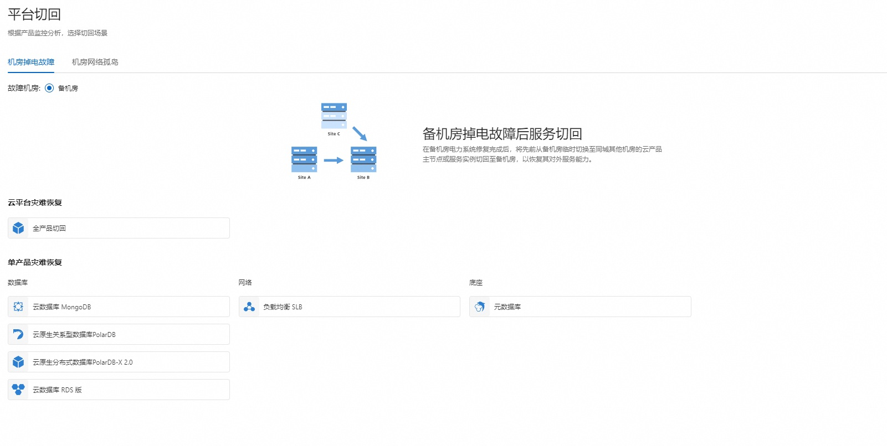

4. 选择故障机房。

5. 选择全产品切回或单个云产品切回。

6. 在弹出提示框上单击**切回**。

   

> **说明**
>
> 如果切回失败，请联系ASR产研团队排查问题并处理。

#### 3.5.1.2. 机房孤岛灾难恢复

本章节介绍发生真实机房孤岛灾难时，同城容灾管理平台是如何执行平台切换和切回操作，以确保系统的连续性和可靠性。

##### 3.5.1.2.1. 机房孤岛切换

在主机房对外网络和连接备机房的网络同时出现故障时，您可以执行如下步骤唤醒备机房的服务，保持业务连续性。

**操作步骤**

1. 以管理员账号登录同城容灾管理平台ASR（备机房）或登录同城容灾管理平台ASR（主机房），登录方法请参见容灾逃逸登录。

2. 在左侧导航栏中选择**灾难恢复 > 平台切换**。

3. 单击**机房网络孤岛**页签。

   > **说明**
   >
   > 登录同城容灾管理平台ASR（备机房）或登录同城容灾管理平台ASR（主机房）支持的故障机房不同。具体场景如下所示：
   >
   > - 双机房场景：
   >
   >   - 登录同城容灾管理平台ASR（备机房）：故障机房是主机房，故障场景包括：主机房掉电故障和主机房网络孤岛。
   >
   >   - 登录同城容灾管理平台ASR（主机房）：故障机房是备机房，故障场景包括：备机房掉电故障、备机房网络孤岛和主备机房脑裂恢复。
   >
   > - 三机房场景：
   >
   >   - 登录同城容灾管理平台ASR（备机房）：故障机房是主机房和第三机房，故障场景包括：主机房掉电故障、主机房网络孤岛、第三机房掉电故障和第三机房网络孤岛。
   >
   >   - 登录同城容灾管理平台ASR（主机房）：故障机房是备机房，故障场景包括：备机房掉电故障和备机房网络孤岛。

   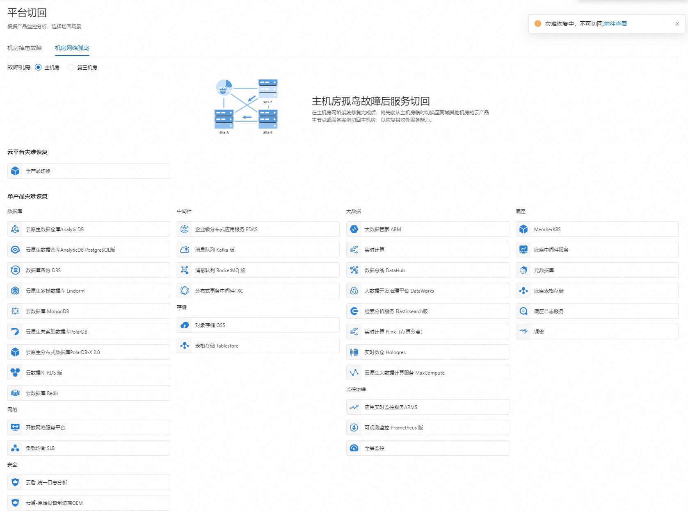

4. 选择故障机房。

5. 选择全产品切换或单个云产品切换。

   > **说明**
   >
   > 如果是单产品故障切换场景的话，请选择单个故障云产品进行切换。

6. 在弹出提示框上单击**切换**。

   

> **说明**
>
> 如果切换失败，请联系ASR产研团队进行问题排查。

##### 3.5.1.2.2. 机房孤岛切回

在机房孤岛网络恢复的情况下，按照如下步骤将业务切回至原机房。

**前提条件**

- 已执行机房孤岛切换操作，并且切换成功。

- 机房孤岛故障已经复原。

**操作步骤**

1. 以管理员账号登录同城容灾管理平台ASR（备机房）或登录同城容灾管理平台ASR（主机房），登录方法请参见容灾逃逸登录。

2. 在左侧导航栏中选择**灾难恢复 > 平台切回**。

3. 单击**机房网络孤岛**页签。

   > **说明**
   >
   > 登录同城容灾管理平台ASR（备机房）或登录同城容灾管理平台ASR（主机房）支持的故障机房不同。具体场景如下所示：
   >
   > - 双机房场景：
   >
   >   - 登录同城容灾管理平台ASR（备机房）：故障机房是主机房，故障场景包括：主机房掉电故障和主机房网络孤岛。
   >
   >   - 登录同城容灾管理平台ASR（主机房）：故障机房是备机房，故障场景包括：备机房掉电故障、备机房网络孤岛和主备机房脑裂恢复。
   >
   > - 三机房场景：
   >
   >   - 登录同城容灾管理平台ASR（备机房）：故障机房是主机房和第三机房，故障场景包括：主机房掉电故障、主机房网络孤岛、第三机房掉电故障和第三机房网络孤岛。
   >
   >   - 登录同城容灾管理平台ASR（主机房）：故障机房是备机房，故障场景包括：备机房掉电故障和备机房网络孤岛。

   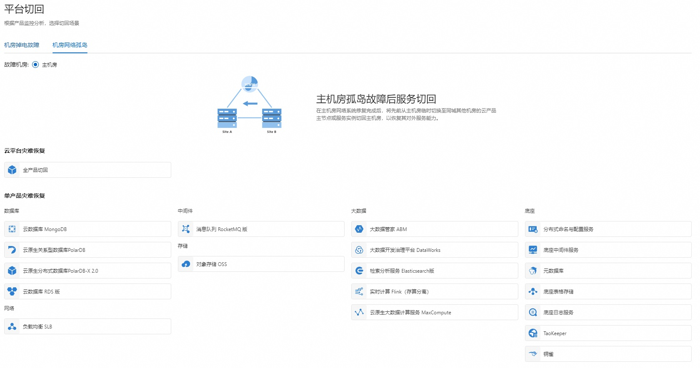

4. 选择故障机房。

5. 选择全产品切回或单个云产品切回。

6. 在弹出提示框上单击**切回**。

   

#### 3.5.1.3. 脑裂灾难恢复（双机房）

本章节介绍发生真实主备机房脑裂灾难时，同城容灾管理平台是如何执行平台切换和切回操作，以确保系统的连续性和可靠性。

##### 3.5.1.3.1. 机房脑裂切换（双机房）

主机房与备机房之间的网络出现故障时，您可以在主机房的ASR上执行如下步骤，唤醒主机房的云产品来快速恢复线上业务。

> **重要**
>
> 脑裂灾难恢复只存在双机房部署场景中，三机房场景不存在该故障。

**操作步骤**

1. 以管理员账号登录同城容灾管理平台ASR（主机房），登录方法请参见容灾逃逸登录。

2. 在左侧导航栏中选择**灾难恢复 > 平台切换**。

3. 选择**主备机房脑裂恢复**页签。

   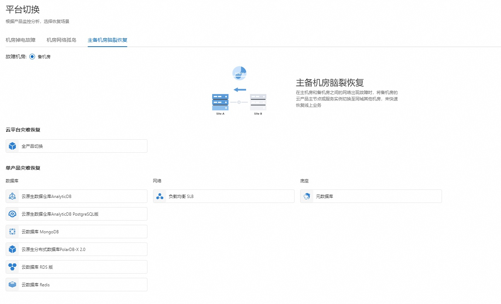

4. 保持默认故障机房。

5. 选择全产品切换或单个云产品切换。

   > **说明**
   >
   > 如果是单产品故障切换场景的话，请选择单个故障云产品进行切换。

6. 在弹出提示框上单击**切换**。

   

   > **说明**
   >
   > 如果切换失败，请联系ASR产研团队进行问题排查。

> **警告**
>
> 如果是脑裂故障场景，切换后请停止备机房的SLB服务。

##### 3.5.1.3.2. 机房脑裂切回（双机房）

在主机房与备机房之间的网络恢复的情况下，按照如下步骤将业务切回至原机房。

**操作步骤**

1. 以管理员账号登录同城容灾管理平台ASR（主机房），登录方法请参见容灾逃逸登录。

2. 在左侧导航栏中选择**灾难恢复 > 平台切回**。

3. 选择**主备机房脑裂恢复**页签。

   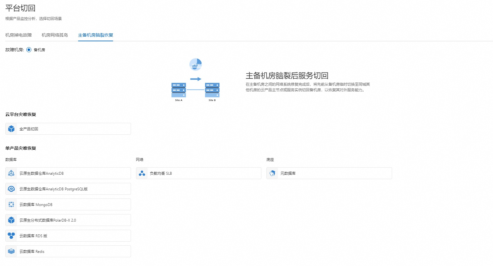

4. 选择故障机房。

5. 选择全产品切回或单个云产品切回。

6. 在弹出提示框上单击**切回**。

   

   > **说明**
   >
   > 如果切回失败，请联系ASR产研团队进行问题排查。

### 3.5.2. 故障模拟

故障模拟是一种测试和验证技术，主要用于评估云平台在遭遇故障或灾难情况下的恢复能力。故障模拟通过人为引入故障，模拟潜在的系统故障，以观察和分析云平台灾难恢复过程。

**故障模拟流程图**

同城容灾根据实际部署模式可分为双机房和三机房，双机房和三机房包括的故障场景如下所示：

- **双机房故障场景**：

  - 机房断电故障：主机房或备机房整个电力设施故障，没有UPS，所有机器下电。

  - 机房网络孤岛：主机房或备机房对外的网络设备、接入的光纤或专线故障，机房与云外不互通。

  - 脑裂：主备机房间的专线或光纤故障，导致主备机房不互通。

  - 单产品故障：主机房或备机房的某个产品故障，状态异常。

- **三机房故障场景**：

  - 机房断电故障：主机房、备机房或第三机房整个电力设施故障，没有UPS，所有机器下电。

  - 机房网络孤岛：主机房、备机房或第三机房对外的网络设备、接入的光纤或专线故障，机房与云外不互通。

  - 单边故障：三个机房中某一个机房与其他两个机房间网络故障，无法通信。

  - 单产品故障：主机房、备机房或第三机房的某个产品故障，状态异常。

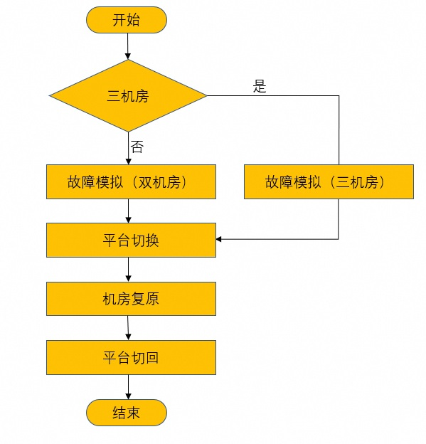

> **说明**
>
> 故障模拟功能指的是人工注入类似于真实灾难的故障类型（非真实灾难），从而使机房产生对应的故障现象。用于验证容灾能力的同时也可以帮助业务人员的尽快熟悉容灾业务。

#### 3.5.2.1. 故障模拟（双机房）

故障模拟是指通过故障注入的形式，模拟机房断电、机房网络孤岛和脑裂的故障场景。

##### 3.5.2.1.1. 操作前准备

本文介绍故障注入场景的操作平台和需要准备的信息。

| 操作场景 | 操作平台 | 准备信息 |
| --- | --- | --- |
| 主机房断电 | 同城容灾管理平台ASR（备机房） | • 主机房ops1机器IP和密码 • 备机房ops1机器IP和密码 • 带外账号和密码 |
| 主机房断电恢复 | 同城容灾管理平台ASR（备机房） | 主机房ops2机器IP和密码 |
| 备机房断电 | 同城容灾管理平台ASR（主机房） | • 主机房ops1机器IP和密码 • 备机房ops1机器IP和密码 • 带外账号和密码 |
| 备机房断电恢复 | 同城容灾管理平台ASR（主机房） | 无 |
| 主机房网络孤岛 | 同城容灾管理平台ASR（主机房） | 无 |
| 主机房网络孤岛恢复 | 同城容灾管理平台ASR（主机房） | 无 |
| 备机房网络孤岛 | 同城容灾管理平台ASR（主机房） | 无 |
| 备机房网络孤岛恢复 | 同城容灾管理平台ASR（主机房） | 无 |
| 脑裂 | 同城容灾管理平台ASR（主机房） | 无 |
| 脑裂恢复 | 同城容灾管理平台ASR（主机房） | 无 |
| 单产品故障 | 同城容灾管理平台ASR（主机房） /同城容灾管理平台ASR（备机房） | 无 |
| 单产品恢复 | 同城容灾管理平台ASR（主机房） /同城容灾管理平台ASR（备机房） | 无 |

##### 3.5.2.1.2. 操作审批

机房故障注入属于高危操作，未经授权和允许严禁擅自操作。因此，故障注入前需要事先申请故障操作的审批码。

**前提条件**

请执行检查环境确保环境检查正常后再申请审批码。

**操作步骤**

1. 以管理员账号登录同城容灾管理平台ASR（主机房）或同城容灾管理平台ASR（备机房），登录方法请参见容灾逃逸登录。

   > **说明**
   >
   > 请根据故障注入场景选择登录不同的同城容灾管理平台ASR，具体故障注入场景请参见操作前准备。

2. 在左侧导航栏中选择**灾难恢复 > 故障模拟 > 操作审批**。

3. 单击**新增**，选择故障注入场景和授权用户，单击**提交**。

   在弹框中会显示生成的审批码，请记录并保存，在注入故障时会用到。

##### 3.5.2.1.3. 检查环境

注入故障前，您需要先检查环境是否正常。在确保环境正常的情况下，才能模拟出机房发生故障后造成的后果。环境不符合预期的情况下，请勿继续往下操作。

**背景信息**

不同故障注入场景的前置环境检查项会有所不同，请根据页面提示进行操作。通用环境检查步骤如下。

**操作步骤**

1. 以管理员账号登录同城容灾管理平台ASR（主机房）或同城容灾管理平台ASR（备机房），登录方法请参见容灾逃逸登录。

   > **说明**
   >
   > 请根据故障场景选择登录不同的同城容灾管理平台ASR，具体故障注入场景请参见操作前准备。

2. 在左侧导航栏中选择**灾难恢复 > 故障模拟 > 环境检查** 。

3. 单击**选择机房**，选择**主机房**或**备机房**。

   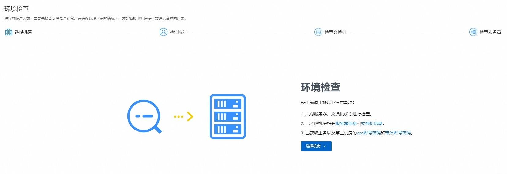

4. 在**验证账号**页面，按照提示依次输入环境信息。

   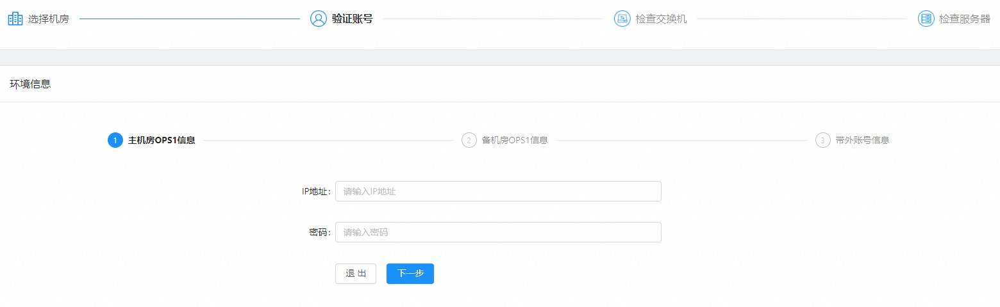

5. 单击**下一步**。信息验证无误后，ASR开始检查交换机状态。

   如果出现交换机检查状态异常的情况，可由现场运维工程师解决异常，或者根据环境具体情况选择忽略异常。

   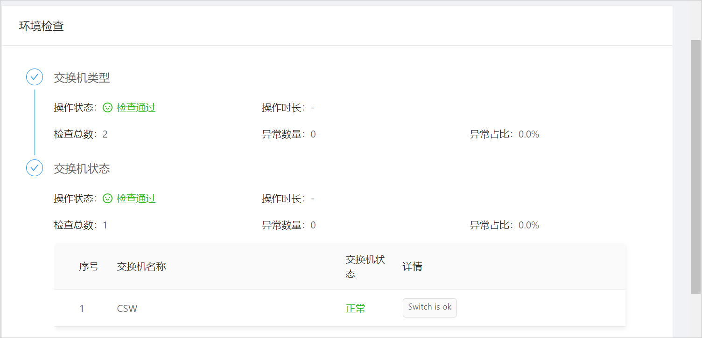

6. ASR开始检查服务器，依次检查SN码、带外IP、主机名对应的情况和服务器供电信息。

   如果出现服务器检查状态异常的情况，可联系现场运维工程师解决异常或者根据环境具体情况选择忽略异常。

   另外单击**查看SR**可查询该机器的ServerRole信息。

   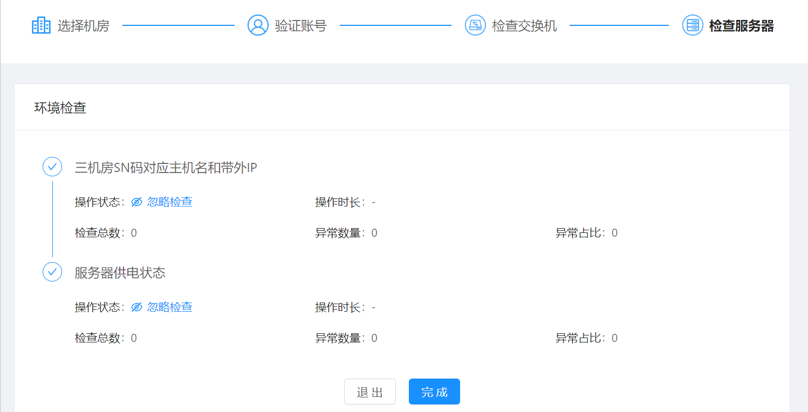

7. 单击**完成**，完成环境检查。

##### 3.5.2.1.4. 机房断电故障

###### 3.5.2.1.4.1. 注入机房断电故障

ASR通过对机房所有机器执行关机操作，模拟机房电源故障的场景。

**前提条件**

已申请相应场景的操作审批码，具体操作请参见操作审批。

**操作步骤**

1. 以管理员账号登录同城容灾管理平台ASR（主机房）或同城容灾管理平台ASR（备机房），登录方法请参见容灾逃逸登录。

   > **说明**
   >
   > - 如果注入主机房断电故障时，请以管理员账号或高级运维角色账号登录同城容灾管理平台ASR（备机房）。
   >
   > - 如果注入备机房断电故障时，请以管理员账号或高级运维角色账号登录同城容灾管理平台ASR（主机房）。

2. 在左侧导航栏中选择**灾难恢复 > 故障模拟 > 开始注入**。

3. 选择要关闭的交换机端口。您可以根据需要选择关闭**互联网网络连接**和**用户物理专线**。

   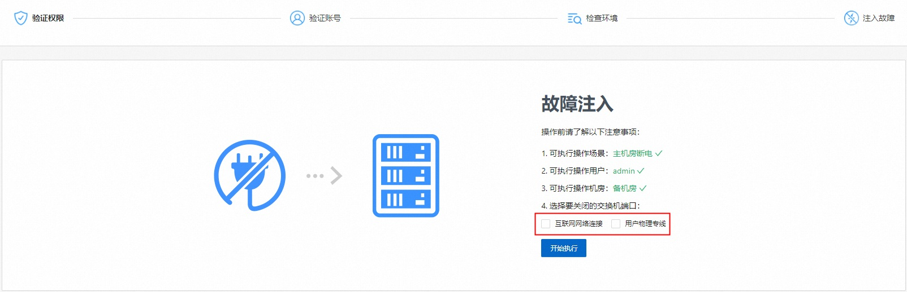

   > **说明**
   >
   > 系统会自动识别审批码及用户是否符合预期，否则不允许进行操作。

4. 单击**开始执行**，输入已经审批好的审批码，进入账号验证页面。依次输入环境信息后单击**提交**。

5. 环境检查完成后，单击**下一步**。

6. 在**注入故障**页面，选择是否进行数据保护。

   - **优雅故障注入**：ASR会首先切换DNS、MINIRDS、RDS至对端机房，减少数据丢失。

   - **完整故障注入**：ASR会直接对机房机器进行关机，存在数据丢失的风险。

7. （可选）在**主机房服务器**页面显示待关闭的服务器列表。如果有服务器不需要关闭，请在**移除无需关闭的服务器**文本框中，输入服务器名称，单击**提交**。

   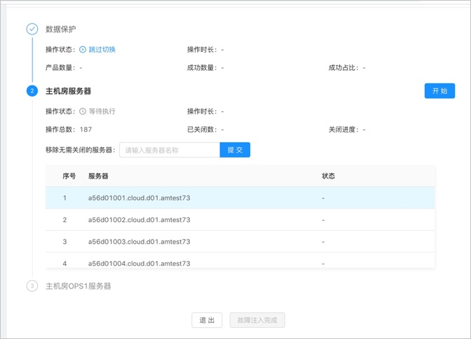

8. 单击**开始**，开始关闭机房服务器。

9. 等待机房服务器关闭完成后，单击**开始关闭ops机器**。

0. 页面显示故障注入成功后，单击**完成**。

**后续步骤**

注入机房断电故障后，验证容灾切换成功且业务正常可用后，请复原机房断电，具体请参见拉起断电机房。

###### 3.5.2.1.4.2. 拉起断电机房

ASR通过对机房全部机器进行开机操作，模拟机房上电的场景。

**前提条件**

已执行掉电切换操作，并且验证各业务正常可用。

**操作步骤**

1. 以管理员账号登录同城容灾管理平台ASR（主机房）或同城容灾管理平台ASR（备机房），登录方法请参见容灾逃逸登录。

   > **说明**
   >
   > - 如果注入机房断电故障是在同城容灾管理平台ASR（主机房）操作的，请登录同城容灾管理平台ASR（主机房）复原机房。
   >
   > - 如果注入机房断电故障是在同城容灾管理平台ASR（备机房）操作的，请登录同城容灾管理平台ASR（备机房）复原机房。

2. 在左侧导航栏中选择**灾难恢复 > 故障模拟 > 机房复原**。

   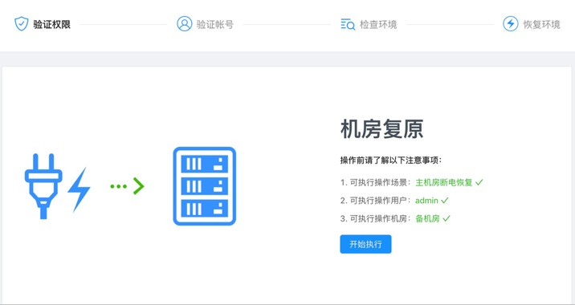

   > **说明**
   >
   > 系统会自动识别审批码及用户是否符合预期，否则不允许进行操作。

3. 单击**开始执行**，输入已经审批好的审批码，无需验证账号信息，ASR会进行机房复原前环境信息检查。

4. 在**机房复原**页面。单击**开启**，便可对机房服务器进行开机。

5. 主机房断电复原过程中，需要在机房服务器开机完成后，进行恢复DNS操作，具体步骤如下：

   > **说明**
   >
   > 备机房断电复原无需执行该步骤。

   <ol type="i">

   <li>

   输入主机房ops2的IP和密码信息。

   </li>

   <li>

   将掉电机房dns-master置为STANDBY状态。

   </li>

   <li>

   检查同步日志。

   </li>

   <li>

   检查dnsapi1和dnsapi2地址。

   </li>

   <li>

   增加anycastIp地址。

   </li>

   <li>

   开启OSPFD或BGPD发布路由。

   </li>

   </ol>

6. 待全部机器开启后，系统显示机房复原成功，单击**完成**。

##### 3.5.2.1.5. 机房网络孤岛

###### 3.5.2.1.5.1. 注入机房网络孤岛故障

ASR通过断开跨机房网络连接，模拟机房断网的场景。

**前提条件**

已申请相应场景的操作审批码，具体操作请参见操作审批。

**操作步骤**

1. 以管理员账号登录同城容灾管理平台ASR（主机房），登录方法请参见容灾逃逸登录。

2. 在左侧导航栏中选择**灾难恢复 > 故障模拟 > 开始注入**。

3. 在选择要关闭的交换机端口中，手动选择是否关闭**互联网网络连接**和**用户物理专线**，默认关闭**跨机房网络连接**。

   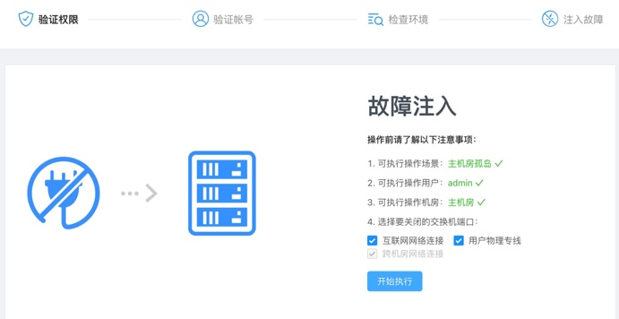

   > **说明**
   >
   > ASR系统会自动识别审批码及用户是否符合预期，否则不允许进行操作。

4. 单击**开始执行**，输入已审批完成的审批码，ASR开始进行环境检查。

5. 环境检查完成后，单击**下一步**。

6. 在**注入故障**页面，根据需要选择**开始**或者**跳过**关闭互联网网络连接、用户物理专线、跨机房网络连接。

7. 页面显示故障注入成功后，单击**完成**。

   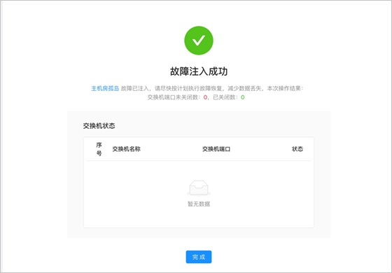

**后续步骤**

注入机房网络孤岛故障后，验证容灾切换成功且业务正常可用后，请复原机房网络孤岛，具体请参见复原网络孤岛机房。

###### 3.5.2.1.5.2. 复原网络孤岛机房

ASR通过开启跨机房网络连接，模拟机房孤岛复原的场景。

**前提条件**

机房孤岛切换成功，并且验证各业务正常可用。

**操作步骤**

1. 以管理员账号登录同城容灾管理平台ASR（主机房），登录方法请参见容灾逃逸登录。

2. 在左侧导航栏中选择**灾难恢复 > 故障模拟 > 机房复原**。

   

   > **说明**
   >
   > 系统会自动识别审批码及用户是否符合预期，否则不允许进行操作。

3. 单击**开始执行**，输入已经审批好的审批码，无需验证账号信息，ASR会进行机房复原前环境信息检查。

4. 交换机检查项完成后，单击**下一步**。

5. 在**恢复环境**页面。根据需要选择**开启**或者**跳过**互联网网络连接、用户物理专线、跨机房网络连接。

   

6. 待各项的操作状态显示**已完成**后，单击**机房复原完成**。

##### 3.5.2.1.6. 脑裂

###### 3.5.2.1.6.1. 注入脑裂故障

ASR通过断开跨机房网络连接，模拟脑裂故障场景。

**前提条件**

已申请相应场景的操作审批码，具体步骤请参见操作审批。

**操作步骤**

1. 以管理员账号登录同城容灾管理平台ASR（主机房），登录方法请参见容灾逃逸登录。

2. 在左侧导航栏中选择**灾难恢复 > 故障模拟 > 开始注入**。

   

3. 单击**开始执行**，输入已经审批好的审批码。ASR开始进行环境检查。

4. 交换机检查项完成后，单击**下一步**。

5. 在**注入故障**页面，单击**开始**。

   

6. 操作状态显示完成后，单击**故障注入完成**。

7. 页面显示故障注入成功后，单击**完成**。

   

**后续步骤**

注入脑裂故障后，验证容灾切换成功且业务正常可用后，请复原脑裂，具体请参见修复机房间网络。

###### 3.5.2.1.6.2. 修复机房间网络

ASR通过开启跨机房网络连接，模拟脑裂场景复原的场景。

**前提条件**

- 已申请相应场景的操作审批码，具体步骤请参见操作审批。

- 已成功注入脑裂故障，具体步骤请参见注入脑裂故障。

**操作步骤**

1. 以管理员账号登录同城容灾管理平台ASR（主机房），登录方法请参见容灾逃逸登录。

2. 在左侧导航栏中选择**灾难恢复 > 故障模拟 > 机房复原**。

   > **说明**
   >
   > 系统会自动识别审批码及用户是否符合预期，否则不允许进行操作。

   

3. 单击**开始执行**，输入已经审批好的审批码，无需验证账号信息，ASR会进行机房复原前环境信息检查。

4. 交换机检查项完成后，单击**下一步**。

5. 在**恢复环境**页面，单击**开启**，开启跨机房网络连接。

6. 待各项的操作状态显示**已完成**后，单击**机房复原完成**。

7. 在复原结果页面，单击**完成**。

##### 3.5.2.1.7. 单产品故障

###### 3.5.2.1.7.1. 注入单产品故障

ASR通过关闭产品集群，模拟产品故障的场景。

**前提条件**

已申请相应场景的操作审批码，具体步骤请参见操作审批。

**操作步骤**

1. 以管理员账号登录同城容灾管理平台ASR（主机房）或同城容灾管理平台ASR（备机房），登录方法请参见容灾逃逸登录。

2. 在左侧导航栏中选择**灾难恢复 > 故障模拟 > 开始注入**。

3. 单击**开始执行**。输入已申请的审批码，单击**确定**。

   

   > **说明**
   >
   > ASR会自动识别审批码及用户是否符合预期，否则不允许进行操作。

4. 根据界面提示信息依次输入环境信息，输入完后单击**提交**。

5. 选择待注入故障的产品，和所在机房，单击**查询**。选中待关闭集群前的复选框。单击**开始**。

   

   > **说明**
   >
   > 如果关闭集群失败，请单击**重试**。

6. 单击**故障注入完成**。

   

7. 单击**完成**。

**后续处理**

注入单产品故障后，验证容灾切换成功且业务正常可用后，请复原单产品故障，具体请参见复原单产品故障。

###### 3.5.2.1.7.2. 复原单产品故障

ASR通过开启产品的集群模拟单产品故障复原的场景。

**前提条件**

执行单产品故障切换成功，并且验证各业务正常可用。

**操作步骤**

1. 以管理员账号登录同城容灾管理平台ASR（主机房）或同城容灾管理平台ASR（备机房），登录方法请参见容灾逃逸登录。

   > **说明**
   >
   > - 如果执行注入单产品故障时在同城容灾管理平台ASR（主机房）操作，请登录同城容灾管理平台（主机房）。
   >
   > - 如果执行注入单产品故障时在同城容灾管理平台ASR（备机房）操作，请登录同城容灾管理平台（备机房）。

2. 在左侧导航栏中选择**灾难恢复 > 故障模拟 > 机房复原**。

3. 单击**开始执行**。输入审批码，单击**确定**。

   > **说明**
   >
   > ASR会自动识别审批码及用户是否符合预期，否则不允许进行操作。

4. 根据界面提示信息依次输入环境信息，输入完后单击**提交**。

5. 在**恢复环境**配置向导页面，单击右上角的**开始**。

   

   > **说明**
   >
   > 如果开启集群失败，请单击**重试**。

6. 开启集群成功后，单击**机房复原完成**。

   

7. 单击**完成**。

#### 3.5.2.2. 故障模拟（三机房）

故障模拟是指通过故障注入的形式，模拟机房断电、机房网络孤岛和单边故障等故障场景。

##### 3.5.2.2.1. 操作前准备

本文介绍故障注入场景的操作环境和需要准备的信息。

| 场景 | 操作平台 | 准备信息 |
| --- | --- | --- |
| 主机房断电 | 同城容灾管理平台ASR（备机房） | • 主机房ops1机器IP和密码 • 备机房ops1机器IP和密码 • 第三机房ops1机器IP和密码 • 带外账号和密码 |
| 主机房断电恢复 | 同城容灾管理平台ASR（备机房） | 主机房ops2机器IP和密码 |
| 备机房断电 | 同城容灾管理平台ASR（主机房） | • 主机房ops1机器IP和密码 • 备机房ops1机器IP和密码 • 第三机房ops1机器IP和密码 • 带外账号和密码 |
| 备机房断电恢复 | 同城容灾管理平台ASR（主机房） | 无 |
| 第三机房断电 | 同城容灾管理平台ASR（主机房） | • 主机房ops1机器IP和密码 • 备机房ops1机器IP和密码 • 第三机房ops1机器IP和密码 • 带外账号和密码 |
| 第三机房断电恢复 | 同城容灾管理平台ASR（主机房） | 无 |
| 主机房网络孤岛 | 同城容灾管理平台ASR（主机房） | 待关闭的交换机及端口信息 |
| 主机房网络孤岛恢复 | 同城容灾管理平台ASR（主机房） | 无 |
| 备机房网络孤岛 | 同城容灾管理平台ASR（主机房） | 待关闭的交换机及端口信息 |
| 备机房网络孤岛恢复 | 同城容灾管理平台ASR（主机房） | 无 |
| 单边故障 | 同城容灾管理平台ASR（主机房） | 待关闭的交换机及端口信息 |
| 单边故障恢复 | 同城容灾管理平台ASR（主机房） | 无 |
| 单产品故障 | 同城容灾管理平台ASR（主机房） /同城容灾管理平台ASR（备机房） | 无 |
| 单产品恢复 | 同城容灾管理平台ASR（主机房） /同城容灾管理平台ASR（备机房） | 无 |

##### 3.5.2.2.2. 操作审批

机房故障注入属于高危操作，未经授权和允许严禁擅自操作。因此，故障注入前需要事先申请故障操作的审批码。

**前提条件**

请执行检查环境确保环境检查正常后再申请审批码。

**操作步骤**

1. 以管理员账号登录同城容灾管理平台ASR（主机房）或同城容灾管理平台ASR（备机房），登录方法请参见容灾逃逸登录。

   > **说明**
   >
   > 请根据故障注入场景选择登录不同的同城容灾管理平台ASR，具体故障注入场景请参见操作前准备。

2. 在左侧导航栏中选择**灾难恢复 > 故障模拟 > 操作审批**。

3. 单击**新增**，选择故障注入场景和授权用户，单击**提交**。

   在弹框中会显示生成的审批码，请记录并保存，在注入故障时会用到。

##### 3.5.2.2.3. 检查环境

进行故障注入前，您需要先检查环境是否正常。在确保环境正常的情况下，才能模拟出机房发生故障后造成的后果。环境不符合预期的情况下，请勿继续后续操作。

**背景信息**

不同故障注入场景的前置环境检查项会有不同，请根据页面提示进行操作。通用环境检查步骤如下。

**操作步骤**

1. 以管理员账号登录同城容灾管理平台ASR（主机房）或同城容灾管理平台ASR（备机房），登录方法请参见容灾逃逸登录。

   > **说明**
   >
   > 请根据故障场景选择登录不同的同城容灾管理平台ASR，具体故障注入场景请参见操作前准备。

2. 在左侧导航栏中选择**灾难恢复 > 故障模拟 > 环境检查**。

3. 单击**选择机房**，选择主机房、备机房或第三机房。

   

4. 在**验证账号**页面，按照提示依次输入环境信息。

   

5. 单击**下一步**。信息验证无误后，ASR开始检查交换机状态。

   如果出现交换机检查状态异常的情况，可由现场运维工程师解决异常，或者根据环境具体情况选择忽略异常。

   

6. ASR开始检查服务器，依次检查SN码、带外IP、主机名对应的情况和服务器供电信息。

   如果出现服务器检查状态异常的情况，可由现场运维工程师解决或者根据环境具体情况选择忽略异常。

   另外单击**查看SR**可查询该机器的ServerRole信息。

   

7. 单击**完成**，完成环境检查。

##### 3.5.2.2.4. 机房断电故障

###### 3.5.2.2.4.1. 执行机房断电

ASR通过对机房所有机器执行关机操作，模拟机房电源故障的场景。

**前提条件**

- 提前获取到对应的环境信息，具体信息请参见操作前准备。

- 已申请相应场景的操作审批码，具体步骤请参见操作审批。

**操作步骤**

1. 以管理员账号登录同城容灾管理平台ASR（主机房）或同城容灾管理平台ASR（备机房），登录方法请参见容灾逃逸登录。

   > **说明**
   >
   > - 如果注入主机房断电故障时，请以管理员账号或高级运维角色账号登录同城容灾管理平台ASR（备机房）。
   >
   > - 如果注入备机房断电故障或注入第三机房故障时，请以管理员账号或高级运维角色账号登录同城容灾管理平台ASR（主机房）。

2. 在左侧导航栏中选择**灾难恢复 > 故障模拟 > 故障注入**。

3. 选择要关闭的交换机端口。您可以根据需要选择关闭**互联网网络连接**和**用户物理专线**。

   

   > **说明**
   >
   > 系统会自动识别审批码及用户是否符合预期，否则不允许进行操作。

4. 单击**开始执行**，输入已经审批好的审批码，进入账号验证页面。

5. 根据界面提示信息依次输入环境信息，输入完后单击**提交**。

6. 环境检查完成后，单击**下一步**。

7. 在**注入故障**页面，选择是否进行数据保护。

   - **优雅故障注入**：ASR会首先切换MINIRDS、RDS至对端机房，减少数据丢失。

   - **完整故障注入**：ASR会直接对机房机器进行关机，存在数据丢失的风险。

8. **可选：** 在**主机房服务器**页面显示待关闭的服务器列表。如果有服务器不需要关闭，请在**移除无需关闭的服务器**文本框中，输入服务器名称，单击**提交**。

   

9. 单击**开始**，开始关闭机房服务器。

0. 等待机房服务器关闭完成后，单击**开始关闭ops机器**。

1. 页面显示故障注入成功后，单击**完成**。

   

**后续步骤**

注入机房断电故障后，验证容灾切换成功且业务正常可用后，请复原机房断电，具体请参见复原断电机房。

###### 3.5.2.2.4.2. 复原断电机房

ASR通过对机房全部机器进行开机操作，模拟机房上电的场景。

**操作步骤**

1. 以管理员账号登录同城容灾管理平台ASR（主机房）或同城容灾管理平台ASR（备机房），登录方法请参见容灾逃逸登录。

2. 在左侧导航栏中选择**灾难恢复 > 故障模拟 > 机房复原**。

   

   > **说明**
   >
   > 系统会自动识别审批码及用户是否符合预期，否则不允许进行操作。

3. 单击**开始执行**，输入已经审批好的审批码，无需验证账号信息。

   ASR进行机房复原前环境信息检查。

4. 在**机房复原**页面。单击**开启**，便可对机房服务器进行开机。

5. 主机房断电复原过程中，需要在机房服务器开机完成后，进行恢复DNS操作，具体步骤如下：

   > **说明**
   >
   > 备机房断电复原无需此步骤。

   <ol type="i">

   <li>

   输入主机房ops2的IP和密码信息。

   </li>

   <li>

   检查dnsapi1和dnsapi2地址。

   </li>

   <li>

   增加anycastVip地址。

   </li>

   <li>

   开启OSPF或BGP发布路由。

   </li>

   </ol>

6. 待全部机器开启后，系统显示机房复原成功，单击**完成**。

##### 3.5.2.2.5. 机房网络孤岛

###### 3.5.2.2.5.1. 注入机房网络孤岛故障

ASR通过断开跨机房网络连接，模拟机房断网的场景。

**前提条件**

已申请相应场景的操作审批码，具体操作请参见操作审批。

**操作步骤**

1. 以管理员账号登录同城容灾管理平台ASR（主机房），登录方法请参见容灾逃逸登录。

2. 在左侧导航栏中选择**灾难恢复 > 故障模拟 > 开始注入**。

3. 在选择要关闭的交换机端口中，手动选择是否关闭**互联网网络连接**和**用户物理专线**，默认关闭**跨机房网络连接**。

   

   > **说明**
   >
   > ASR系统会自动识别审批码及用户是否符合预期，否则不允许进行操作。

4. 单击**开始执行**，输入已经审批完成的审批码。

   ASR开始进行环境检查。

5. 环境检查完成后，单击**下一步**。

6. 在**注入故障**页面，根据需要选择**开始**或者**跳过**关闭互联网网络连接、用户物理专线、跨机房网络连接。

7. 页面显示故障注入成功后，单击**完成**。

   

###### 3.5.2.2.5.2. 复原机房网络孤岛

ASR通过开启跨机房网络连接，模拟机房孤岛复原的场景。

**前提条件**

机房孤岛切换成功，并且验证各业务正常可用。

**操作步骤**

1. 以管理员账号登录同城容灾管理平台ASR（主机房），登录方法请参见容灾逃逸登录。

2. 在左侧导航栏中选择**灾难恢复 > 故障模拟 > 机房复原**。

   

   > **说明**
   >
   > 系统会自动识别审批码及用户是否符合预期，否则不允许进行操作。

3. 单击**开始执行**，输入已经审批好的审批码，无需验证账号信息。

   ASR进行机房复原前环境信息检查。

4. 交换机检查项完成后，单击**下一步**。

5. 在**恢复环境**页面。根据需要选择**开启**或者**跳过**互联网网络连接、用户物理专线、跨机房网络连接。

   

   > **说明**
   >
   > 待开启的交换机名称、交换机端口、厂商等信息，是读取了故障注入时输入的信息，不允许再次输入。

6. 待各项的操作状态显示**已完成**后，单击**机房复原完成**。

##### 3.5.2.2.6. 单边故障

单边故障是指两个机房之间的网络连接异常。ASR通过断开跨机房网络连接，模拟单边故障场景。

###### 3.5.2.2.6.1. 注入单边故障

ASR通过断开跨机房网络连接，模拟单边故障场景。

**前提条件**

已申请相应场景的操作审批码，具体操作请参见操作审批。

**操作步骤**

1. 以管理员账号登录同城容灾管理平台ASR（主机房），登录方法请参见容灾逃逸登录。

2. 在左侧导航栏中选择**灾难恢复 > 故障模拟 > 开始注入**。

   

   > **说明**
   >
   > ASR系统会自动识别审批码及用户是否符合预期，否则不允许进行操作。

3. 单击**开始执行**，输入已经审批好的审批码。

   ASR开始进行环境检查。

4. 交换机检查项完成后，单击**下一步**。

5. 在**注入故障**页面，手动输入交换机名称、交换机端口、厂商信息，如果有多个端口，可以增加多行，并提交信息。

6. 单击**开始**。

   

7. 操作状态显示完成后，单击**故障注入完成**。

8. 页面显示故障注入成功后，单击**完成**。

###### 3.5.2.2.6.2. 复原单边故障

ASR通过开启跨机房网络连接，模拟单边故障复原的场景。

**前提条件**

已注入单边故障。

**操作步骤**

1. 以管理员账号登录同城容灾管理平台ASR（主机房），登录方法请参见容灾逃逸登录。

2. 在左侧导航栏中选择**灾难恢复 > 故障模拟 > 机房复原**。

   

   > **说明**
   >
   > 系统会自动识别审批码及用户是否符合预期，否则不允许进行操作。

3. 单击**开始执行**，输入已经审批好的审批码，无需验证账号信息。

   ASR进行机房复原前环境信息检查。

4. 交换机检查项完成后，单击**下一步**。

5. 在**恢复环境**页面，单击**开启**，会根据故障注入时所输入的交换机和端口进行开启三机房网络连接。

   

6. 待各项的操作状态显示**已完成**后，单击**机房复原完成**。

   

##### 3.5.2.2.7. 单产品故障

###### 3.5.2.2.7.1. 注入单产品故障

ASR通过关闭产品集群，模拟产品故障的场景。

**前提条件**

已申请相应场景的操作审批码，具体步骤请参见操作审批。

**操作步骤**

1. 以管理员账号登录同城容灾管理平台ASR（主机房）或同城容灾管理平台ASR（备机房），登录方法请参见容灾逃逸登录。

2. 在左侧导航栏中选择**灾难恢复 > 故障模拟 > 开始注入**。

3. 单击**开始执行**。输入已申请的审批码，单击**确定**。

   

   > **说明**
   >
   > ASR会自动识别审批码及用户是否符合预期，否则不允许进行操作。

4. 根据界面提示信息依次输入环境信息，输入完后单击**提交**。

5. 选择待注入故障的产品，和所在机房，单击**查询**。选中待关闭集群前的复选框。单击**开始**。

   

   > **说明**
   >
   > 如果关闭集群失败，请单击**重试**。

6. 单击**故障注入完成**。

   

7. 单击**完成**。

**后续处理**

注入单产品故障后，验证容灾切换成功且业务正常可用后，请复原单产品故障，具体请参见复原单产品故障。

###### 3.5.2.2.7.2. 复原单产品故障

ASR通过开启产品的集群模拟单产品故障复原的场景。

**前提条件**

执行单产品故障切换成功，并且验证各业务正常可用。

**操作步骤**

1. 以管理员账号登录同城容灾管理平台ASR（主机房）或同城容灾管理平台ASR（备机房），登录方法请参见容灾逃逸登录。

   > **说明**
   >
   > - 如果执行注入单产品故障时在同城容灾管理平台ASR（主机房）操作，请登录同城容灾管理平台（主机房）。
   >
   > - 如果执行注入单产品故障时在同城容灾管理平台ASR（备机房）操作，请登录同城容灾管理平台（备机房）。

2. 在左侧导航栏中选择**灾难恢复 > 故障模拟 > 机房复原**。

3. 单击**开始执行**。输入审批码，单击**确定**。

   > **说明**
   >
   > ASR会自动识别审批码及用户是否符合预期，否则不允许进行操作。

4. 根据界面提示信息依次输入环境信息，输入完后单击**提交**。

5. 在**恢复环境**配置向导页面，单击右上角的**开始**。

   

   > **说明**
   >
   > 如果开启集群失败，请单击**重试**。

6. 开启集群成功后，单击**机房复原完成**。

   

7. 单击**完成**。

### 3.5.3. 查看灾难恢复记录

灾难恢复记录中记录了各种故障恢复和自动切换操作的时间、执行结果、日志和切换时长。

**操作步骤**

1. 以管理员账号登录同城容灾管理平台ASR（备机房），登录方法请参见容灾逃逸登录。

2. 在左侧导航栏中选择**灾难恢复 > 恢复记录**。

   

3. 查看记录详情。

   - 查看日志详情，针对掉电灾难恢复和孤岛灾难恢复记录。

     <ol type="a">

     <li>

     单击恢复名称前的  ，查看具体的恢复产品、操作时间、状态、执行时间等。

     </li>

     <li>

     单击**查看日志**，可以查看恢复时的日志详情。

     </li>

     </ol>

   - 查看恢复过程详情。

     - 单击**操作**列**查看详情**，可查看灾难恢复的执行过程。

       

# 4.运维态视图

## 4.1. 监控中心

### 4.1.1. 检查环境

通过检查环境可以更方便快捷地了解容灾产品的版本、产品基线、DNS资源、VIP资源、数据库资源等信息。在环境部署成功后，请通过环境检查查看各检查项是否满足容灾的条件。

1. 登录同城容灾管理平台ASR（主机房）或同城容灾管理平台ASR（备机房）的运维态，登录方法请参见登录ASR控制台。

2. 在左侧导航栏中选择**监控中心 > 环境检查**。

3. 在**环境检查**页面，在对应的区域框中单击右上角的**立即检查**，查看相应的检查项。各检查项的说明如下：

   - **是否做A'**：产品在重新部署或升级后，主机房需要对该产品做A'，即Rolling，去重新感知机房最新的配置。请检查已做A'的产品列表是否和重新部署或升级的产品一致。

     

   - **集群部署**：展示各产品是对等部署或非对等部署，了解各产品部署的集群。

     > **说明**
     >
     > - 标黄项：该feature目前为非对等部署，但备集群不要求必须部署，可忽略。
     >
     > - 标红项：该feature目前为非对等部署，且备集群要求必须部署，必须处理。

     

   - **产品版本**：ASR会检查各产品主备机房的版本是否一致，如果版本不一致，ASR会显示该产品为异常产品，您需要将该产品主备机房的版本升级到相同的版本，以免造成容灾切换失败。

     

   - **产品基线**：ASR会检查环境中的基线配置和飞天基础运维平台中的基线配置是否相同。

     - 如果显示“产品基线变量检查通过”，说明基线检查正常。

       

     - 如果显示“产品基线变量检查未通过”，请检查相关的配置。

       

   - **DNS资源**：ASR从飞天基础运维平台中获取产品的DNS资源信息，根据资源信息下的域名获取实际对应的VIP，再根据实际VIP和飞天基础运维平台资源信息中的VIP进行对比。如果两者不一致，则**比对结果**显示为**异常**，请检查并修改相应配置。

     

   - **VIP资源**：ASR从飞天基础运维平台中获取到产品的VIP资源信息，根据资源信息中的VIP信息到SLB中查询该VIP所对应的RealServer IP，再根据RealServer IP和VIP资源信息中NCList做比对。如果两者不一致，ASR界面上会将相应的RealServer IP标红，请检查并修改相应配置。

     

   - **数据库资源**：ASR从飞天基础运维平台中获取产品的数据库资源信息，根据该信息连接对应的数据库，检查数据库主库的read-only属性。如果为只读，ASR会显示该产品**状态**为**异常**，请修改该数据库的配置。

     

   - **机房间网络情况**：检查SLB和VPC相关网段的路由发布是否正常。如果**状态**显示**异常**，请联系运维人员修复。

     

   - **BGP路由**：检查OPS-DNS、专有云DNS、SLB、VPC的BGP路由信息发布情况。如果**状态**显示**异常**，请联系运维人员修复。

     

### 4.1.2. 检查产品

在容灾切换前后以及容灾切回前后，请执行产品检查，检查容灾产品的状态。

1. 登录同城容灾管理平台ASR（主机房）或同城容灾管理平台ASR（备机房）运维态，登录方法请参见登录ASR控制台。

2. 在左侧导航栏中选择**监控中心 > 产品检查**。

3. 单击**负载均衡 SLB**、**底座域名解析**、**元数据库**区域右上角的**立即检查**，检查各产品的状态是否有异常。

   如果产品检查项状态为异常，请重点关注该检查项的错误提示和错误信息，根据错误内容排查解决问题。

   

## 4.2. 配置中心

### 4.2.1. 管理DCI专线

通过配置DCI信息后，将机房间的设备之前的网络流量通过**概览**页面显示出来，使用户直观看到不同机房间的设备之间的数据传输情况。

**前提条件**

如果是批量导入DCI专线信息，需要在Apsara Uni-manager运维控制台选择**产品运维 > 网络运维 > 网络运维控制台**进入**网络运维控制台**，然后在左侧导航栏中选择**基础网络 > 专线管理 > 专线实例**，提前创建专线信息。

**操作步骤**

1. 登录同城容灾管理平台ASR（主机房）或同城容灾管理平台ASR（备机房）运维态，登录方法请参见登录ASR控制台。

2. 在左侧导航栏中选择**配置中心 > DCI专线管理**。

3. 新增专线信息。

   - 新增单条DCI信息。

     <ol type="a">

     <li>

     单击**新增专线**。

     </li>

     <li>

     根据下表输入各参数值。

     | 参数名称 | 参数说明 | 参数配置 |
     | --- | --- | --- |
     | 当前设备 | 表示数据传输的本端机器名称。 | 用户自定义，例如：ISW-VM-G1-1.AMTEST82 |
     | 当前端口 | 表示数据传输的本端机器上数据流出或流入的端口号。 | 用户自定义，例如：10GE1/0/6 |
     | 对端设备 | 表示数据传输的对端机器名称。 | 用户自定义，例如：ISW-VM-G1-1.AMTEST82 |
     | 对端端口 | 表示数据传输的对端机器上数据流出或流入的端口号。 | 用户自定义，例如：10GE1/0/6 |
     | 当前机房 | 表示当前设备所在的机房名称。 | 用户自定义，例如：amtest1 |
     | 对端机房 | 表示对端设备所在的机房名称。 | 用户自定义，例如：amtest2 |
     | 带宽（Mbps） | 表示当前设备和对端设备直接数据传输的最大速率，单位：Mbps。 | 请根据实际数据传输速率填写，例如：100。 |

     </li>

     </ol>

     <ol type="i" start="100">

     <li>

     单击**确定**。

     </li>

     </ol>

   - 批量新增DCI信息。

     <ol type="a">

     <li>

     单击**导入**。

     </li>

     <li>

     在弹出的**专线导入**弹框中，勾选需要新增的DCI专线信息。

     </li>

     </ol>

     <ol type="i" start="100">

     <li>

     单击**确定**。

     </li>

     </ol>

**相关操作**

配置完DCI专线信息后，您还可以执行以下操作。

<table>
  <tr>
    <th width="122">任务名称</th>
    <th>操作步骤</th>
  </tr>
  <tr>
    <td>自定义列字段</td>
    <td>1. 单击页面右上角。 2. 勾选需要显示的列字段，不显示的取消勾选。 3. 单击<strong>重置</strong>，可以恢复默认情况勾选全部列字段。</td>
  </tr>
  <tr>
    <td>修改专线信息</td>
    <td>1. 单击<strong>操作</strong>列<strong>修改</strong>。 2. 修改需要改的参数值。 3. 单击<strong>确定</strong>。</td>
  </tr>
  <tr>
    <td>删除专线信息</td>
    <td>1. 单击<strong>操作</strong>列<strong>删除</strong>。 2. 在弹出的提示框中单击<strong>确定</strong>。</td>
  </tr>
</table>

### 4.2.2. 仲裁管理

针对标准的三机房部署场景中，仲裁服务用于检测是否有机房发生真实的机房级故障，发生机房级故障后会判断当前是否满足仲裁切换条件，从而决定是否需要发起仲裁切换，然后将产品和底座切换至正常机房。

**约束条件**

仲裁切换时具有以下约束，请仔细阅读：

- 当仲裁切换失败时，仲裁功能不会执行切换重试，需要人为介入。

- 当机房故障恢复时，仲裁不会自动切回业务服务到原机房。

> **重要**
>
> 仲裁服务仅对主机房故障场景执行自动仲裁切换。

**仲裁流程**

在执行仲裁切换前，仲裁服务会进行仲裁检测，以下展示整个仲裁服务的执行过程：

1. 用户在**仲裁管理**页面开启仲裁服务，ASR判断机房正常后开启仲裁。

2. 仲裁服务会分为以下4步依次进行仲裁检测：

   <ol type="i">

   <li>

   检查各个机房的节点服务心跳是否正常：

   - 如果存在心跳，则表示机房无故障退出本次探测。

   - 如果不存在心跳，则进行下一步检测。

   </li>

   <li>

   参考产品巡检，Tianji服务巡检异常时执行下一步探测，具体请参见产品监控，否则退出本次探测。

   </li>

   <li>

   仲裁产品巡检，所有仲裁产品服务巡检异常时执行下一步探测，否则退出本次探测。

   </li>

   <li>

   检测机房间ISW连通性。

   </li>

   </ol>

3. 当仲裁服务探测结束后，会进入仲裁决策阶段，只有满足仲裁切换的条件后才会发起仲裁切换；条件如下所示：

   - 达到用户设置的仲裁检测次数。

   - 切换目标机房的产品是正常状态。

   - 切换产品依赖的元数据库已切换至目标机房。

4. 仲裁切换：满足仲裁决策条件后，ASR会强制切换仲裁产品，切换完成后，页面会有相关的提醒弹窗。

5. 等待机房修复：仲裁切换完成后，需要用户修复故障机房，仲裁能力检测到机房修复后，整个仲裁流程才会结束。但此时仲裁功能还是保持开启状态，如果需要关闭仲裁功能，请手动关闭。

**前提条件**

- 主备机房的ASR正常工作。

- 仲裁产品巡检结果正常。

- 各个机房间ISW连通性检查正常。

**操作步骤**

1. 登录同城容灾管理平台ASR（备机房）运维态，登录方法请参见登录ASR控制台。

2. 在左侧导航栏中选择**配置中心 > 仲裁管理**。

3. 在**仲裁管理**页面单击**前往创建仲裁**。

   

4. 在**仲裁管理**页面选择需要自动仲裁切换的云产品。只有勾选的产品在判定需要仲裁后才能执行强制切换。

   

   > **说明**
   >
   > - 上述截图仅为示例，请以实际环境为准。系统目前支持自动仲裁切换的服务，包括云原生分布式数据库PolarDB-X 2.0、底座中间件服务、云解析DNS、铜雀、MemeberK8S、底座表格存储、应用实时监控服务ARMS和可观测监控Prometheus版。
   >
   > - 单击页面上方的《仲裁使用说明》会展示仲裁能力和切换约束。

5. 在**ISW信息**行单击**新增ISW**依次添加主机房、备机房、三机房的ISW信息，且每个机房至少添加两个ISW。

6. 在**机房故障探测次数**选择次数。表示当仲裁服务探测到机房故障时，重复检查的次数。只有当所有检查均失败才会发起仲裁切换，每次检查之间的时间间隔约为 40 秒。

7. 单击**保存配置**。

> **说明**
>
> 由于机房搬迁时机房会下电，为防止由于仲裁能力导致的自动切换情况发生，所以在机房搬迁前需要关闭仲裁功能。

**其他操作**

仲裁服务开启后，您还可以执行以下操作。

| 任务名称 | 操作步骤 |
| --- | --- |
| 修改仲裁 | 1. 在<strong>仲裁管理</strong>页面，单击<strong>修改仲裁</strong>。 2. 修改完成后单击<strong>保存配置</strong>。 |
| 关闭仲裁 | 在<strong>仲裁管理</strong>页面，单击<strong>关闭仲裁</strong>。 |

### 4.2.3. 告警管理

同城容灾管理平台会预置部分告警规则，用户可根据实际需求，修改已有告警规则或者创建新的告警规则。

**预置告警规则**

| 监控项 | 产品名称 | 告警级别 | 检查周期 |
| --- | --- | --- | --- |
| 是否做A' | 云原生分布式数据库PolarDB-X、日志服务 SLS、应用实时监控服务ARMS、交互式分析 Hologres、负载均衡 SLB、底座域名解析、文件存储 NAS、专有网络VPC、机器学习 PAI、容器服务 Kubernetes、云数据库 RDS、云防火墙、云原生基础组件Dauth、元数据库、数据总线 DataHub、DataWorks、访问控制RAM、网络设备监控、基础中间件服务BaseServiceALL、云盾-基础组件、产品服务化基座、API网关、平台侧堡垒机、授权信息、底座中间件服务、云服务器 ECS、数据库备份服务 DBS、开放网络服务平台、密钥管理服务 KMS、云数据库OceanBase、域名解析DNS、云盾高级版对象存储 OSS、底座表格存储、表格存储 Tablestore、Web应用防火墙、专有云运维平台ASO、消息队列 MQ、统一云管平台ASCM、分布式任务调度平台 SchedulerX2.0、分布式事务中间件TXC、实时计算 Realtime Compute、专有云WEB基础服务、底座日志服务、Prometheus监控、资源编排 ROS、铜雀、异地容灾管理平台ASR-DR、关系网络分析、分布式命名与配置服务、云服务总线 CSB、数据传输服务 DTS、远程日志TLog、弹性伸缩BUFFER、飞天基础运维平台、运维管控API、数据资源平台DataQ、大数据计算 MaxCompute、TaoKeeper、虚拟网络管理2.0 齐天 | P2 | 30mi n |
| 集群部署 | 底座中间件服务、统一云管平台ASCM、产品服务化基座、专有云运维平台ASO、云原生基础组件Dauth、云数据库 OceanBase、飞天基础运维平台、分布式事务中间件TXC、实时计算 Realtime Compute、运维管控API、异地容灾管理平台ASR-DR、数据资源平台 DataQ、云服务总线 CSB、交互式分析 Hologres、资源编排 ROS、数据传输服务 DTS、消息队列 MQ、负载均衡 SLB、日志服务 SLS、DataWorks、文件存储 NAS、弹性伸缩、云防火墙、容器服务 Kubernetes、分布式命名与配置服务、大数据计算 MaxCompute、机器学习 PAI、专有网络VPC、Prometheus监控、网络设备监控、访问控制RAM、云数据库 RDS、TaoKeeper、远程日志TLog、云原生分布式数据库PolarDB-X、数据库备份服务DBS、铜雀云服务器 ECS、应用实时监控服务ARMS、平台侧堡垒机、分布式任务调度平台 SchedulerX2.0、元数据库、表格存储 Tablestore、对象存储 OSS、虚拟网络管理2.0 齐天、专有云WEB基础服务、数据总线 DataHub、API网关、密钥管理服务 KMS、云盾-基础组件、授权信息、BUFFER、开放网络服务平台、基础中间件服务BaseServiceALL、域名解析DNS、云盾高级版、关系网络分析、Web应用防火墙 | P2 | 30mi n |
| 产品版本 | 资源编排 ROS、云服务总线 CSB、分布式任务调度平台 SchedulerX2.0、数据传输服务 DTS、底座表格存储、统一云管平台ASCM、DataWorks、基础中间件服务BaseServiceALL、分布式事务中间件TXC、专有云运维平台ASO、底座日志服务、云数据库 OceanBase、Web应用防火墙、对象存储 OSS、表格存储Tablestore、密钥管理服务 KMS、授权信息、网络设备监控、云服务器 ECS、API网关、消息队列 MQ、数据库备份服务 DBS、底座中间件服务、云盾-基础组件、云盾高级版、开放网络服务平台、远程日志TLog、飞天基础运维平台、实时计算Realtime Compute、专有云WEB基础服务、平台侧堡垒机、运维管控API、元数据库、BUFFER、域名解析DNS、访问控制RAM、产品服务化基座、交互式分析Hologres、异地容灾管理平台ASR-DR、应用实时监控服务ARMS、容器服务Kubernetes、云原生分布式数据库PolarDB-X、云数据库 RDS、铜雀、机器学习PAI、专有网络 VPC、Prometheus监控、TaoKeeper、数据总线 DataHub、底座域名解析、负载均衡 SLB、文件存储 NAS、云防火墙、日志服务 SLS、云原生基础组件Dauth、虚拟网络管理2.0 齐天、关系网络分析、大数据计算MaxCompute、弹性伸缩、分布式命名与配置服务、数据资源平台 DataQ | P2 | 30mi n |
| 产品基线 | 同城容灾管理平台ASR | P2 | 30mi n |

<table>
  <tr>
    <td>DNS资源</td>
    <td>数据资源平台 DataQ、网络设备监控、弹性伸缩、大数据计算 MaxCompute、数据传输服务 DTS、资源编排 ROS、消息队列 MQ、元数据库、云盾-基础组件、云数据库 OceanBase、云服务总线 CSB、基础中间件服务BaseServiceALL、分布式事务中间件TXC、授权信息、专有云运维平台ASO、Web应用防火墙、表格存储Tablestore、分布式任务调度平台 SchedulerX2.0、对象存储 OSS、虚拟网络管理2.0 齐天、实时计算 Realtime Compute、统一云管平台ASCM、密钥管理服务KMS、开放网络服务平台、铜雀、产品服务化基座、云服务器 ECS、数据总线DataHub、云盾高级版、云防火墙、域名解析DNS、飞天基础运维平台、运维管控API、数据库备份服务 DBS、专有云WEB基础服务、BUFFER、访问控制RAM、异地容灾管理平台ASR-DR、TaoKeeper、API网关、云原生基础组件Dauth、底座中间件服务、容器服务 Kubernetes、机器学习 PAI、Prometheus监控、云数据库 RDS、应用实时监控服务ARMS、云原生分布式数据库PolarDB-X、专有网络VPC、交互式分析 Hologres、文件存储 NAS、DataWorks、远程日志TLog、负载均衡 SLB、平台侧堡垒机、关系网络分析、分布式命名与配置服务、日志服务SLS</td>
    <td>P2</td>
    <td>30mi n</td>
  </tr>
  <tr>
    <td>VIP资源</td>
    <td>大数据计算 MaxCompute、Prometheus监控、文件存储 NAS、负载均衡 SLB、数据总线 DataHub、日志服务 SLS、专有网络 VPC、云数据库 RDS、远程日志TLog、容器服务 Kubernetes、机器学习 PAI、分布式命名与配置服务、底座中间件服务、应用实时监控服务ARMS、云原生分布式数据库PolarDB-X、分布式事务中间件TXC、关系网络分析、域名解析DNS、云防火墙、云盾-基础组件、授权信息、虚拟网络管理2.0 齐天、飞天基础运维平台、铜雀、基础中间件服务BaseServiceALL、资源编排 ROS、云盾高级版、数据传输服务 DTS、云服务总线 CSB、BUFFER、分布式任务调度平台 SchedulerX2.0、弹性伸缩、产品服务化基座、DataWorks、运维管控API、数据资源平台 DataQ、密钥管理服务KMS、元数据库、对象存储 OSS、表格存储 Tablestore、统一云管平台ASCM、API网关、Web应用防火墙、云数据库 OceanBase、专有云运维平台ASO、网络设备监控、开放网络服务平台、TaoKeeper、消息队列 MQ、实时计算 Realtime Compute、交互式分析 Hologres、平台侧堡垒机、访问控制RAM、云原生基础组件Dauth、异地容灾管理平台ASR-DR、云服务器 ECS、专有云WEB基础服务、数据库备份服务 DBS</td>
    <td>P2</td>
    <td>30mi n</td>
  </tr>
  <tr>
    <td>数据库资源</td>
    <td>元数据库、异地容灾管理平台ASR-DR、Web应用防火墙、API网关、实时计算Realtime Compute、对象存储 OSS、平台侧堡垒机、表格存储 Tablestore、铜雀、云防火墙、密钥管理服务 KMS、分布式任务调度平台 SchedulerX2.0、BUFFER、域名解析DNS、弹性伸缩、数据资源平台 DataQ、运维管控API、飞天基础运维平台、开放网络服务平台、虚拟网络管理2.0 齐天、数据传输服务 DTS、统一云管平台ASCM、资源编排 ROS、云服务总线 CSB、底座中间件服务、DataWorks、数据总线 DataHub、网络设备监控、分布式事务中间件TXC、专有云运维平台ASO、容器服务 Kubernetes、机器学习 PAI、交互式分析Hologres、应用实时监控服务ARMS、Prometheus监控、云数据库OceanBase、专有网络 VPC、文件存储 NAS、产品服务化基座、负载均衡 SLB、消息队列 MQ、日志服务 SLS、云原生分布式数据库PolarDB-X、分布式命名与配置服务、云服务器 ECS、大数据计算 MaxCompute、数据库备份服务 DBS、远程日志TLog、云原生基础组件Dauth、云盾高级版、TaoKeeper、访问控制RAM、基础中间件服务BaseServiceALL、云盾-基础组件、专有云WEB基础服务、关系网络分析、授权信息、云数据库 RDS</td>
    <td>P2</td>
    <td>30mi n</td>
  </tr>
  <tr>
    <td>机房间网络情况</td>
    <td>底座域名解析、负载均衡 SLB、专有网络 VPC、域名解析DNS</td>
    <td>P2</td>
    <td>30mi n</td>
  </tr>
  <tr>
    <td>BGP路由</td>
    <td>底座域名解析、负载均衡 SLB、专有网络 VPC、域名解析DNS</td>
    <td>P2</td>
    <td>30mi n</td>
  </tr>
  <tr>
    <td>产品服务能力检查</td>
    <td>元数据库、底座域名解析、负载均衡 SLB</td>
    <td>P2</td>
    <td>30mi n</td>
  </tr>
  <tr>
    <td>产品容灾能力检查</td>
    <td>Elasticsearch on k8s、底座中间件服务、云数据库 HBase、消息队列 Kafka、云盾-统一日志分析、MemberK8S、分布式事务中间件TXC、分布式命名与配置服务、TaoKeeper、数据资源平台 DataQ、负载均衡 SLB、底座域名解析、日志服务 SLS、云数据库 MongoDB、实时计算 Realtime Compute、域名解析DNS、DataWorks、云数据库 Redis、云原生数据仓库AnalyticDB、多模数据库Lindorm、应用实时监控服务ARMS、云数据库 RDS、底座日志服务、关系网络分析、大数据管家 ABM、云盾-原始设备制造商OEM、数据总线 DataHub、企业级分布式应用服务 EDAS、交互式分析 Hologres、消息队列 MQ、数据库备份服务DBS、飞天基础运维平台、Prometheus监控、开放网络服务平台、铜雀、云服务器 ECS、表格存储 Tablestore、密钥管理服务 KMS、底座表格存储、云原生数据仓库AnalyticDB PostgreSQL版、对象存储 、OSS元数据库</td>
    <td>P2</td>
    <td>1min</td>
  </tr>
  <tr>
    <td>数据同步延时检查</td>
    <td>云数据库 Redis、云数据库 RDS、交互式分析 Hologres、云数据库 MongoDB、云原生数据仓库AnalyticDB PostgreSQL版、对象存储 OSS、表格存储Tablestore</td>
    <td>P2</td>
    <td>1min</td>
  </tr>
  <tr>
    <td>保护组检查</td>
    <td>同城容灾管理平台ASR</td>
    <td>P2</td>
    <td>1min</td>
  </tr>
</table>

#### 4.2.3.1. 修改告警规则

根据实际需求，当需要调整各产品告警级别时，您可以进行如下操作修改。

**操作步骤**

1. 登录同城容灾管理平台ASR（备机房）运维态，登录方法请参见登录ASR控制台。

2. 在左侧导航栏中选择**配置中心 > 告警管理**。

3. 在目标规则**操作**列，单击**修改**。

4. 在弹出的**编辑告警规则**对话框中修改告警级别。

   > **说明**
   >
   > 对于同步延迟类型的告警，系统同时支持对告警阈值和告警级别进行修改。

   告警级别说明：

   - P1：致命监控项告警

   - P2：严重监控项告警

   - P3：一般监控项告警

   - P4：普通监控项告警

   

5. 单击**确定**。

### 4.2.4. 主题设置

本章节介绍如何设置监控大屏或演练大屏的主题色、Logo以及平台名称。

**背景信息**

- 支持外观切换，支持调整控制台的主题颜色。

- 支持调整大屏页面的Logo信息配置。

- 支持设置大屏标题。

- 支持一键恢复出厂设置，恢复操作不可逆。

**操作步骤**

1. 登录同城容灾管理平台ASR（主机房）或同城容灾管理平台ASR（备机房）运维态，登录方法请参见登录ASR控制台。

2. 在左侧导航栏中选择**配置中心 > 主题设置**。

   

3. 参考下表设置大屏参数。

   <table>
     <tr>
       <th>区域</th>
       <th>参数名称</th>
       <th>参数说明</th>
     </tr>
     <tr>
       <td rowspan="2">外观与主体</td>
       <td>主题色</td>
       <td>分为默认主题色和自定义色板。 • 默认主题色：推荐的主题色。 • 自定义色板：单击自定义选择主题色。 说明自定义颜色的透明度不能高于0.4。</td>
     </tr>
     <tr>
       <td>预览</td>
       <td>选择主题色后支持预览大屏展示效果。</td>
     </tr>
     <tr>
       <td rowspan="2">品牌配置</td>
       <td>平台Logo</td>
       <td>支持上传Logo图片，建议图片长宽比例为1：1（如200*200PX），大小不超过2M，格式为gif、png、jpg或jpeg。</td>
     </tr>
     <tr>
       <td>平台名称</td>
       <td>请自定义大屏上显示的名称，建议不超过20个中文汉字，或40个字符。</td>
     </tr>
   </table>

4. 单击**保存**。当平台配置需要恢复出厂设置时，可单击页面下方的**恢复出厂设置**，重新登录后生效。

## 4.3. 安全中心

### 4.3.1. 备份数据

将ASR控制台的数据保存在容器本地，然后将容器中的数据备份在OSS实例中，当用户需要恢复备份的数据时，通过一键恢复功能将用户信息以及告警等信息恢复到ASR控制台。

**操作步骤**

1. 登录同城容灾管理平台ASR（主机房）或同城容灾管理平台ASR（备机房）运维态，登录方法请参见登录ASR控制台。

2. 在左侧导航栏中选择**安全中心 > 数据备份**。

   

3. 单击**立即备份**，在弹出的提示框上单击**确定**。ASR控制台会将用户账号和告警规则等信息备份到一个OSS实例中。

> **说明**
>
> 如果用户需要在ASR控制台恢复备份的数据，单击**一键恢复**，然后在弹出的提示框上单击**确定**，就可以把OSS里备份的数据恢复到ASR控制台。

### 4.3.2. 逃逸登录管理

本章节介绍如何打开逃逸登录开关并设置登录密码。

**操作步骤**

1. 通过统一运维平台登录同城容灾管理平台ASR（主机房）或同城容灾管理平台ASR（备机房）运维态，登录方法请参见登录ASR控制台。

2. 在左侧导航栏中选择**安全中心 > 逃逸登录管理**。

3. 打开逃逸开关，允许通过https://{域名}/user/login登录ASR。

4. 根据界面提示输入旧密码和新密码，单击**提交**。

| 参数名称 | 描述 |
| --- | --- |
| 旧密码 | 请输入该管理员账号的登录密码。 |
| 新密码 | 请输入该管理员账号登录ASR控制台的新密码。 |
| 再次输入密码 | 请再次输入新密码。 |

> **说明**
>
> 密码长度为12~20位，并由如下四种类型组成。
>
> - 数字
>
> - 英文大、小写字母
>
> - 特殊字符，包括感叹号（！）、at（@）、井号（#）、美元符号（$）、百分号（%）等。

# 5.租户运营

## 5.1. 保护组概述

保护组是面向租户侧的功能，支持用户按业务应用维度恢复单块业务与容灾演练。

**概览**

1. 以租户运营方式登录ASR控制台。

2. 在**保护组概览**页面可看到当前组织、当前资源集和当前区域的保护组统计情况，在界面顶部菜单栏左边可以切换**组织**、**资源集**、**区域**等信息。

**功能说明**

保护组指在云平台基础能力可用的基础上，支持用户按业务应用维度恢复单块业务与容灾演练。用户可以基于应用视角，圈选一组业务相关的实例来创建保护组。在同一个保护组中可加入同一个业务下的数据库、中间件、应用服务所在ECS（以HDR保护组方式加入）等实例作为一组保护对象。您可以根据保护组建立对应的演练计划（热切）或灾难恢复计划（强切）。保护组细化了原有产品切换功能粒度，可满足不同组织用户灵活管理产品实例，目前支持云数据库RDS、云数据库Redis版、云数据库MongoDB版、对象存储OSS和云服务器ECS。

> **说明**
>
> - 一个保护组可以关联一个演练计划和一个灾难恢复计划，但是同一个保护组关联的演练计划和灾难恢复计划只能有一个在执行。如果要启动另一种计划，需要将当前计划终止。
>
> - 保护组对RDS，OSS直接对应到云产品实例，针对ECS需对应到HDR的保护组，可以包括多个HDR保护组。
>
> - 对于OSS容灾，在V3.18.3版本前只支持第一集群（指第一组规划部署的OSS集群）的容灾切换，创建保护组时如果选择非第一集群的实例，切换时会报错。
>
> - 当需要将混合云容灾HDR加入保护组时，需要先在HDR控制台创建好HDR对应的保护组。

| 功能模块 | 功能说明 |
| --- | --- |
| 保护组概览 | 按流程状态统计保护组数量、保护组产品实例、容灾演练、灾难恢复等场景的信息，并以图表方式直观呈现。 |
| 保护组列表 | 展示保护组列表，提供保护组的新增、删除和详情查看。 • 显示每条保护组信息，默认全部显示<strong>保护组名称</strong>、<strong>描述</strong>、<strong>巡检状态</strong>、<strong>组织</strong>、<strong>资源集</strong>、<strong>创建时间</strong>、<strong>修</strong><strong>改时间</strong>属性，单击<strong>操作</strong>列<strong>详情</strong>后可进入保护组详情界面，查看详细信息。 • 支持按照<strong>保护组名称</strong>、<strong>巡检状态</strong>、<strong>保护组实例</strong>搜索，条件变化后会自动触发搜索功能。 • 保护组<strong>详情</strong>页可以修改没有关联演练计划或者灾难恢复的保护组。 说明 • 当前有关联的演练计划或灾难恢复计划时保护组不允许删除和修改。 • 若存在创建成功的保护组在保护组列表界面不显示，请首先检查界面顶部菜单栏左边组织、资源集等信息选择是否与创建保护组时选择一致（界面会根据组织不同显示指定组织下的保护组列表）。 • 单击列表右上角设置图标，可调整界面显示的字段或者字段顺序。 |
| 保护组演练（热切） | • 演练计划：显示演练计划列表，支持查看详情、新增、编辑、删除，以及启动演练、进入演练和终止演练。 说明 • 演练计划执行过程中，不支持编辑和删除。 • 演练终止后，不支持再次启动演练。 • 演练记录：演练计划每次执行流程的列表。 |
| 保护组灾难恢复（强切） | • 灾难恢复计划：显示灾难恢复计划列表，支持查看详情、新增、编辑、删除，以及启动灾难恢复、进入灾难恢复和终止灾难恢复。 说明 • 灾难恢复计划执行过程中，不支持编辑和删除。 • 灾难恢复终止后，不支持再次启动灾难恢复。 • 灾难恢复记录：灾难恢复计划每次执行流程的列表。 |

## 5.2. 保护组流程

### 5.2.1. 流程概览

同城容灾ASR保护组的主要功能是实例级容灾演练和故障恢复。用户可以根据业务应用维度圈选实例创建保护组，通过创建演练计划来进行日常业务容灾演练（计划切换），当业务出现问题时，可以通过灾难恢复计划（故障切换）来进行故障恢复。

ASR保护组的流程概览如下图所示。

> **说明**
>
> 计划切换和故障切换在执行容灾时的大致流程虽然一致，但是所应用的场景不同，其中：
>
> - **计划切换**：指的是热切换，在主备机房都健康的状态下，把主节点切换到容灾机房，整个过程保证数据不丢失，生产业务演练一般使用计划切换。
>
> - **故障切换**：指的是冷切换，在发生机房级故障，主备机房之间连接中断，强制切换产品主节点到容灾机房，快速恢复线上业务，只有在演练机房断电断网或真实机房断电断网时，才使用故障切换。

### 5.2.2. 创建保护组

**操作场景**

保护组在云平台基础能力可用的基础上，支持用户按业务应用维度恢复单块业务与容灾演练。在同一个保护组中可加入同一个业务下的数据库、中间件、应用服务所在ECS（以HDR保护组方式加入）等实例作为一组保护对象。您可以根据保护组建立对应的演练计划（热切）或应急计划（强切）。保护组细化了原有产品切换功能粒度，可满足不同组织用户灵活管理产品实例，目前支持云数据库RDS、云数据库Redis版、云数据库MongoDB版、云原生分布式数据库PolarDB-X1.0、云原生分布式数据库PolarDB-X 2.0、对象存储OSS、云服务器ECS、实时计算Flink（存算分离）和检索分析服务Elasticsearch版。

> **说明**
>
> 三机房场景下，ASR支持主可用区模式数据库产品切回，将实例主库切回到实例创建时主库所在的可用区，包括**单产品故障后服务切回**和**掉电故障后服务切回**中数据库产品切回等全部情况。

**前提条件**

- 已创建待保护的云产品实例。

- 待加入保护组的云产品实例所在组织已授权ASR云资源访问权限。

**操作步骤**

1. 以租户运营方式登录ASR控制台。

2. 在左侧导航栏中单击**保护组列表**，单击**创建保护组**，进入保护组创建界面。

3. 下拉选择**所属组织**和**所属资源集**，输入**保护组名称**和**保护组描述**基本信息，单击**下一步**进入选择保护组实例界面。

4. 下拉选择**产品**类型，选择对应的**实例ID/名称**加入到保护组中，确认需要的产品及实例都已添加， 单击**提交**。

5. 在弹出的提示框上单击**确定**。

   > **说明**
   >
   > - 系统会根据当前组织信息自动查询**实例ID/名称**。如果您没有找到对应的实例ID/名称，可在界面顶部菜单栏切换**组织**信息。
   >
   > - 一个实例只能加入一个保护组中。

6. 保护组信息提交后会进入**保护组详情**页面，您可以在此查看保护组基础信息及保护组中实例的巡检状态。

7. 单击**编辑**，支持修改保护组详情信息。

   > **说明**
   >
   > 当保护组没有关联任何计划时，才可以进行**修改**和**删除**操作。

### 5.2.3. 保护组演练

#### 5.2.3.1. 新建演练计划

在不影响业务的前提下，通过新建演练计划来模拟真实灾难场景下保护组的切换和回切，从而在灾难发生时快速切换，提高业务连续性。

**前提条件**

已创建保护组，请参见创建保护组。

**操作步骤**

1. 以租户运营方式登录ASR控制台。

2. 在左侧导航栏选择**保护组演练** > **演练计划**。

3. 进入**演练计划**页面，单击**创建计划。**

4. 填写基本信息，选择**所属组织**、**所属资源集**、**保护组名称**、**演练可用区**、**计划名称**、**计划描述**，单击**下一步**。

5. 填写**恢复步骤**信息，将关联保护组中的实例按照业务需求依次添加到恢复步骤中，单击步骤左下方的 +、- 按钮可以新增或删除步骤，单击**提交**进入保护组执行模式选择界面。

   

6. 选择执行模式，单击**确定**。

   > **说明**
   >
   > - 自动执行：保护组恢复计划中实例执行步骤，每个环节都按照编排的步骤自动执行，其中某一实例异常将阻塞后续步骤。
   >
   > - 手动执行：保护组恢复计划中实例执行步骤，每个环节都按照编排的步骤手动执行，执行完某一步骤中的实例，需要干预单击**执行**，其中某一实例异常将阻塞后续步骤。

7. 信息提交后会进入**演练计划详情**页面，您可以在此查看演练计划基本信息、实例恢复步骤、关联保护组未加入恢复步骤实例，右上角支持**启动演练**和**进入演练**。

#### 5.2.3.2. 演练流程

演练流程包含**切换检查** > **切换** > **回切检查** > **回切** > **恢复检查**五个环节，切换指从主机房切到备机房，回切指从备机房切到主机房，保护组完整的计划流程是先切换，再回切。演练流程中**切换检查**、**回切检查**、**恢复检查**只要进入检查环节自动执行检查，切换和回切需要人为执行，当演练到达最后一个环节时才可以点击完成，需要点击完成关闭演练才能进行下一次演练。

> **说明**
>
> 有时实例已经在目的机房，但是页面上会显示异常，这只是页面当前环节的一个提示，真正切换时，如果检查到实例已在目的端，则不会再进行切换。

**前提条件**

已创建演练计划，且当前计划关联的保护组未处于应急流程中。

**操作步骤**

1. 在左侧导航栏选择**保护组演练** > **演练计划**。

2. 在目标演练计划的操作列单击**详情**，进入**演练计划详情**页面，并在页面右上角单击**启动演练**。

   

3. 在弹出提示框上单击**确定**进入到**演练流程**界面，进行**切换检查。**

   

   > **说明**
   >
   > 当实例当前主节点位置与“切换方向”的起点不一致时、同步状态异常时、同步延迟不符合预期时，均属于异常状态，检查结果异常也支持强制切换，跳到下一环节时会有提示。

   > **重要**
   >
   > 在实例检测状态失败下继续切换可能导致切换失败，产品实例不可用。

4. **切换检查**完成后进入**切换**，将本计划内各实例按编排顺序从主机房切换到备机房。需要手动单击**执行**才会开始做切换。

   > **说明**
   >
   > 当某个步骤执行失败时，可重试当前步骤，或者按实例单个重试，有实例切换失败时也可强制跳过。

5. **切换**完成后ASR自动进行**回切检查**。

   > **说明**
   >
   > 当保护组包含HDR保护组时，需要在回切检查这个环节建立反向同步。

6. **回切检查**结束后需要手动**回切**，将本计划内各实例按编排顺序从备机房回切到主机房。操作与切换相同，切换方向相反。

7. 回切之后自动进行**恢复检查**，至此整个流程结束，您可以在**演练记录**查看历史演练流程。

### 5.2.4. 灾难恢复

#### 5.2.4.1. 新建灾难恢复计划

灾难恢复计划用于在真实机房故障场景下恢复业务。

**前提条件**

ASR控制台中云平台相关产品实例已切换至备机房，云平台基础能力可用。

**操作步骤**

1. 以租户运营方式登录ASR控制台。

2. 在左侧导航栏单击**保护组灾难恢复** > **灾难恢复计划**。

3. 进入**灾难恢复计划**页面，单击**创建计划**。

4. 填写基本信息，选择**所属组织**、**所属资源集**、**保护组名称**、**故障可用区**、**计划名称**、**计划描述**，单击**下一步。**

5. 填写**恢复步骤**信息，将关联保护组中的实例按照业务需求依次添加到恢复步骤中，单击步骤左下方的 +、- 按钮可以新增或删除步骤，单击**提交**进入保护组执行模式选择界面。

   

6. 选择执行模式，单击**确定**。

   > **说明**
   >
   > - 自动执行：保护组恢复计划中实例执行步骤，每个环节都按照编排的步骤自动执行，其中某一实例异常将阻塞后续步骤。
   >
   > - 手动执行：保护组恢复计划中实例执行步骤，每个环节都按照编排的步骤手动执行，执行完某一步骤中的实例，需要干预单击**执行**，其中某一实例异常将阻塞后续步骤。

7. 信息提交后会进入**灾难恢复计划详情**页面，您可以在此查看灾难恢复计划基本信息、实例恢复步骤、关联保护组未加入恢复步骤实例，右上角支持**启动灾难恢复**和**进入灾难恢复**。

#### 5.2.4.2. 灾难恢复流程

灾难恢复流程有5个环节：**切换检查** > **切换** > **回切检查** > **回切** > **恢复检查**，切换指从主机房切到备机房，回切指从备机房切到主机房，保护组完整的计划流程是先切换，再回切。灾难恢复流程中**切换检查**、**回切检查**、**恢复检查**只要进入检查环境自动支持检查，切换和回切需要人为执行，当灾难恢复到达最后一个环节时才可以点击完成，需要点击完成关闭灾难恢复才能进行下一次灾难恢复。

> **说明**
>
> 有时实例已经在目的机房，但是页面上会显示异常，此时需检查实例是否已在目的端，如果已在目的端则不会再进行切换。

**前提条件**

已创建灾难恢复计划，且当前计划关联的保护组未处于演练流程中。

**操作步骤**

1. 在左侧导航栏选择**保护组灾难恢复** > **灾难恢复计划**。

2. 在目标灾难恢复计划的操作列单击**详情**，进入**灾难恢复计划详情**页面，并在页面右上角单击**启动灾难恢复**。

   

3. 在弹出提示框上单击**确定**进入到**灾难恢复流程**界面，进行**切换检查。**

   

   > **说明**
   >
   > 当实例当前主节点位置与“切换方向”的起点不一致时、同步状态异常时、同步延迟不符合预期时，均属于异常状态，检查结果异常也支持强制切换，跳到下一环节时会有提示。

   > **重要**
   >
   > 在实例检测状态失败下继续切换可能导致切换失败，产品实例不可用。

4. **切换检查**完成后进入**切换**，将本计划内各实例按编排顺序从主机房切换到备机房。需要手动单击**执行**才会开始做切换。

   > **说明**
   >
   > 当某个步骤执行失败时，可重试当前步骤，或者按实例单个重试，有实例切换失败时也可强制跳过。

5. **切换**完成后ASR会自动进行**回切检查**。

   > **说明**
   >
   > 当保护组包含HDR保护组时，需要在回切检查这个环节建立反向同步。

6. **回切检查**结束后需要手动**回切**，将本计划内各实例按编排顺序从备机房回切到主机房。操作与切换相同，切换方向相反。

7. 回切之后自动进行**恢复检查**，至此整个灾难恢复流程结束，您可以在**灾难恢复记录**中查看历史灾难恢复计划。

# 6.附录

## 6.1. 加密与备份

ASR通过加密存储用户密钥、离线备份数据来保证用户数据安全。通过记录审计日志，记录系统的安全事件和活动，以及防止内部滥用和不当行为追踪和识别潜在的安全威胁和攻击。

- 密钥加密：ASR用户登录口令在数据库内通过MD5算法加密存储。

  > **说明**
  >
  > 其他的数据不涉及加密存储，如配置信息、人员信息等。

- 审计日志：ASR用户的操作日志接入云盾审计日志，存储在SLSINNER中。

  > **说明**
  >
  > Docker内的日志不备份。

- 离线备份：ASR的数据采取离线备份的方式，数据库内容每12小时通过mysqldump备份一次。数据存放在OSS中，保存5天后删除。

## 6.2. 如何获取ASR登录地址

本章节介绍首次登录同城容灾管理平台ASR时，如何在统一云管平台获取ASR的环境登录地址。

**前提条件**

请提前获取Apsara Uni-manager运维控制台的访问地址、用户名和密码。

**操作步骤**

1. 登录Apsara Uni-manager运维控制台。

2. 在顶部菜单中选择**平台运维 > 飞天基础运维平台 > 资源管理**。

3. 在**飞天基础运维平台**左侧菜单栏中选择**运维工具 > 资源大盘**。

4. 在资源大盘页面，选择**Name**，输入bcmc-domain，单击  。

   

5. 单击Result列的  ，再单击里面的值将内容放大展示。记录并保存dns的值。

   

6. 参考上一步查看并保存另一个机房的登录地址。

   > **说明**
   >
   > 其中asr-xs.cn代表备机房地址，asr-xm-cn代表主机房地址。

7. 参考登录ASR控制台即可登录同城容灾管理平台ASR。
