阿里云  
专有云  
灾备管理中心  
异地容灾管理平台 用户指南  
产品版本：V3.18.6  
文档版本：20251202

**目录**

- [1.异地容灾运营控制台指南](#section-1)
    - [1.1. 异地容灾管理平台ASR-DR概述](#section-1-1)
    - [1.2. 快速入门](#section-1-2)
        - [1.2.1. 角色和权限说明](#section-1-2-1)
        - [1.2.2. 登录异地容灾管理平台ASR-DR](#section-1-2-2)
        - [1.2.3. 容灾场景简介](#section-1-2-3)
    - [1.3. 首页概览](#section-1-3)
    - [1.4. 实例管理](#section-1-4)
        - [1.4.1. 查看实例](#section-1-4-1)
        - [1.4.2. 流量网关AsrIngressGW](#section-1-4-2)
            - [1.4.2.1. 新增流量网关AsrIngressGW实例](#section-1-4-2-1)
            - [1.4.2.2. 查看流量网关拓扑图](#section-1-4-2-2)
            - [1.4.2.3. 查看流量网关监控](#section-1-4-2-3)
    - [1.5. 业务容灾](#section-1-5)
        - [1.5.1. 保护组](#section-1-5-1)
            - [1.5.1.1. 管理保护组](#section-1-5-1-1)
                - [1.5.1.1.1. 新建保护组](#section-1-5-1-1-1)
                - [1.5.1.1.2. 重保护](#section-1-5-1-1-2)
                - [1.5.1.1.3. 保护组详情](#section-1-5-1-1-3)
                    - [1.5.1.1.3.1. 查看保护组详情](#section-1-5-1-1-3-1)
                    - [1.5.1.1.3.2. 查看保护实体](#section-1-5-1-1-3-2)
                    - [1.5.1.1.3.3. 查看保护组的操作记录](#section-1-5-1-1-3-3)
                    - [1.5.1.1.3.4. 删除保护实体](#section-1-5-1-1-3-4)
                    - [1.5.1.1.3.5. 修改保护实体的归属](#section-1-5-1-1-3-5)
                    - [1.5.1.1.3.6. 修改只读账号](#section-1-5-1-1-3-6)
                    - [1.5.1.1.3.7. 修改RDS的高权限账号](#section-1-5-1-1-3-7)
                    - [1.5.1.1.3.8. 管理保护实体账号权限](#section-1-5-1-1-3-8)
                    - [1.5.1.1.3.9. 修改同步对象](#section-1-5-1-1-3-9)
                - [1.5.1.1.4. 添加同步实体](#section-1-5-1-1-4)
                    - [1.5.1.1.4.1. 云数据库RDS](#section-1-5-1-1-4-1)
                    - [1.5.1.1.4.2. 云原生分布式数据库PolarDB-X 2.0](#section-1-5-1-1-4-2)
                    - [1.5.1.1.4.3. 对象存储OSS](#section-1-5-1-1-4-3)
                    - [1.5.1.1.4.4. 大数据计算产品](#section-1-5-1-1-4-4)
                    - [1.5.1.1.4.5. 域名解析DNS（跨云）](#section-1-5-1-1-4-5)
                    - [1.5.1.1.4.6. 域名解析DNS（云内）](#section-1-5-1-1-4-6)
                    - [1.5.1.1.4.7. 消息队列MQ](#section-1-5-1-1-4-7)
                    - [1.5.1.1.4.8. 云数据库Redis版](#section-1-5-1-1-4-8)
                    - [1.5.1.1.4.9. 云数据库MongoDB版](#section-1-5-1-1-4-9)
                    - [1.5.1.1.4.10. 云服务器ECS](#section-1-5-1-1-4-10)
                    - [1.5.1.1.4.11. 数据总线DataHub](#section-1-5-1-1-4-11)
                    - [1.5.1.1.4.12. 流量网关AsrIngressGW](#section-1-5-1-1-4-12)
                - [1.5.1.1.5. 启动同步实体](#section-1-5-1-1-5)
                - [1.5.1.1.6. 停止保护](#section-1-5-1-1-6)
            - [1.5.1.2. 切换保护组](#section-1-5-1-2)
            - [1.5.1.3. 切回保护组](#section-1-5-1-3)
        - [1.5.2. 管理计划](#section-1-5-2)
            - [1.5.2.1. 概述](#section-1-5-2-1)
            - [1.5.2.2. 管理业务容灾计划](#section-1-5-2-2)
                - [1.5.2.2.1. 创建业务容灾计划](#section-1-5-2-2-1)
                - [1.5.2.2.2. 配置演练指标](#section-1-5-2-2-2)
                - [1.5.2.2.3. 查询业务容灾计划](#section-1-5-2-2-3)
                - [1.5.2.2.4. 执行业务灾难恢复](#section-1-5-2-2-4)
                - [1.5.2.2.5. 执行业务容灾演练](#section-1-5-2-2-5)
                - [1.5.2.2.6. 查看计划执行历史](#section-1-5-2-2-6)
            - [1.5.2.3. 管理容灾单元空间](#section-1-5-2-3)
                - [1.5.2.3.1. 创建容灾单元空间](#section-1-5-2-3-1)
                - [1.5.2.3.2. 切换容灾单元空间](#section-1-5-2-3-2)
                - [1.5.2.3.3. 切回容灾单元空间](#section-1-5-2-3-3)
    - [1.6. 告警管理](#section-1-6)
        - [1.6.1. 配置告警规则](#section-1-6-1)
        - [1.6.2. 查看并导出告警信息](#section-1-6-2)
        - [1.6.3. 同步延迟预警配置](#section-1-6-3)
    - [1.7. 系统管理](#section-1-7)
        - [1.7.1. 管理云实例](#section-1-7-1)
        - [1.7.2. 管理容灾关系](#section-1-7-2)
        - [1.7.3. 日志管理](#section-1-7-3)
        - [1.7.4. 管理混合云容灾](#section-1-7-4)
    - [1.8. 常见问题处理](#section-1-8)
        - [1.8.1. 实体保护失败的处理方法](#section-1-8-1)
    - [1.9. 附录](#section-1-9)
        - [1.9.1. 创建RAM角色](#section-1-9-1)
        - [1.9.2. 如何获取公共云个人账号的AK和SK](#section-1-9-2)
        - [1.9.3. 获取AccessKey](#section-1-9-3)
        - [1.9.4. 查看MaxCompute同步日志](#section-1-9-4)
        - [1.9.5. 获取生产云实例配置信息](#section-1-9-5)
        - [1.9.6. 手动同步数据](#section-1-9-6)
        - [1.9.7. 定制数据面SDK实现多Endpoint能力](#section-1-9-7)
- [2.异地容灾运维控制台指南](#section-2)
    - [2.1. 登录异地容灾运维平台](#section-2-1)
    - [2.2. 首页概览](#section-2-2)
    - [2.3. 容灾监控](#section-2-3)
        - [2.3.1. 云平台监控](#section-2-3-1)
        - [2.3.2. 保护组状态监控](#section-2-3-2)
    - [2.4. 平台基础能力运维](#section-2-4)
        - [2.4.1. 管理云产品信息](#section-2-4-1)
        - [2.4.2. 容灾互联管理](#section-2-4-2)
        - [2.4.3. 管理容灾网关](#section-2-4-3)
        - [2.4.4. 配置大屏地图](#section-2-4-4)
    - [2.5. 容灾运维](#section-2-5)
        - [2.5.1. 管理同步实体](#section-2-5-1)
            - [2.5.1.1. 单步骤跳过](#section-2-5-1-1)
            - [2.5.1.2. 单步骤重做](#section-2-5-1-2)
            - [2.5.1.3. 配置限流](#section-2-5-1-3)
            - [2.5.1.4. 删除保护组中的保护实体](#section-2-5-1-4)
            - [2.5.1.5. 查看同步实体日志](#section-2-5-1-5)
        - [2.5.2. 执行站点容灾演练](#section-2-5-2)
        - [2.5.3. 执行站点灾难恢复](#section-2-5-3)
        - [2.5.4. 查看站点容灾计划执行历史](#section-2-5-4)
    - [2.6. 管理自身容灾](#section-2-6)
        - [2.6.1. 创建自身容灾](#section-2-6-1)
        - [2.6.2. 执行故障切换](#section-2-6-2)
        - [2.6.3. 执行演练切换](#section-2-6-3)
        - [2.6.4. 查看自身容灾详情](#section-2-6-4)
        - [2.6.5. 解除绑定](#section-2-6-5)
        - [2.6.6. 删除自身容灾](#section-2-6-6)
    - [2.7. 附录](#section-2-7)
        - [2.7.1. DNS地址查找方式](#section-2-7-1)
        - [2.7.2. 配置DNS域名转发](#section-2-7-2)
        - [2.7.3. 配置DTS参数](#section-2-7-3)

<a id="section-1"></a>

# 1.异地容灾运营控制台指南

本文介绍异地容灾管理平台ASR-DR在Apsara Uni-manager运营控制台的操作。

<a id="section-1-1"></a>

## 1.1. 异地容灾管理平台ASR-DR概述

本文介绍ASR-DR的基础原理和所涉及到的基本概念，以及异地容灾管理平台中的功能模块。

**异地容灾原理概述**

异地容灾管理平台ASR-DR（Apsara Stack Resilience for Disaster Recovery）简称ASR-DR，是一款提供容灾功能的云平台产品，当前支持对象存储OSS、云数据库RDS MySQL 5.6/5.7/8.0、云数据库PolarDB-O 11.2云原生分布式数据库PolarDB-X 1.0、云原生分布式数据库PolarDB-X 2.0、域名解析DNS、消息队列MQ、云数据库MongoDB版、云数据库Redis版、云原生数据仓库AnalyticDB MySQL版3.0、数据总线Datahub、大数据计算MaxCompute、流量网关AsrIngressGW、均衡负载SLB和DataWorks的异地容灾管理。

通过创建保护组，ASR-DR在生产站点和灾备站点对应资源之间建立一条容灾链路，生产站点资源的数据修改会异步复制到灾备站点对应的资源之中。生产站点发生故障时，通过故障计划中的故障切换将应用或服务切换到灾备站点上；生产站点故障恢复后，再通过故障计划中的故障回切将业务切换回生产站点，以此来实现业务连续性。

**基本概念**

- 保护组：是异地容灾管理平台进行容灾保护的业务对象。用户可以基于应用视角，为某个应用所使用的一组相关资源创建保护组。

- 故障计划：故障场景下预定义的自动化工作流，当灾难或故障发生时通过执行对应工作流自动化的对保护组中的资源进行容灾操作，以保证业务连续性。

- 故障切换：指在主机房掉电或者断网的情况下，进行容灾应用从主机房到灾备机房的计划外转移。

- 故障回切：指在主机房恢复网络或者电力的情况下，进行容灾应用从灾备机房到主机房计划外恢复。

- 演练计划：演练场景下预置计划，也是一个预定义的工作流，其工作流中的各步骤与对应的恢复计划基本相同，目的是对恢复计划进行预演，以保证恢复计划的正确性。

- 演练切换：指在主机房和备机房的电力和网络正常的情况下，进行容灾应用从主机房到灾备机房的计划内迁移。

- 演练回切：指在主机房和灾备机房的电力和网络正常的情况下，进行容灾应用从灾备机房到主机房的计划内回切。

- RPO：Recovery Point Objective，即数据恢复点目标，以时间为单位，即在灾难发生时，系统和数据必须恢复的时间点要求。RPO标志系统能够容忍的最大数据丢失量。系统容忍丢失的数据量越小，RPO的值越小。

- RTO：Recovery Time Objective，即恢复时间目标，以时间为单位，指的是在灾难发生后，信息系统或业务功能从停止到必须恢复的时间要求。RTO标志着系统能够容忍的服务停止的最长时间。系统服务的紧迫性要求越高，RTO的值越小。

**功能说明**

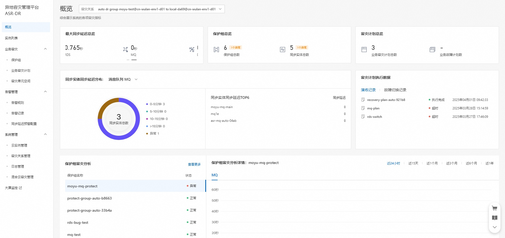

<table>
  <tr>
    <th width="90">功能模块</th>
    <th>描述</th>
  </tr>
  <tr>
    <td>概览</td>
    <td>展示保护组、容灾计划、同步实体信息等。</td>
  </tr>
  <tr>
    <td>实例列表</td>
    <td>展示生产区域和灾备区域的所有实例，实例状态以及实例关联的保护组等信息，使用户能够迅速获取当前集群内实例的状态信息，对集群的健康运行有个总体的了解。</td>
  </tr>
  <tr>
    <td>业务容灾</td>
    <td>包括保护组、业务容灾计划和容灾单元空间的设置。</td>
  </tr>
  <tr>
    <td>告警管理</td>
    <td>系统可以对保护组及计划的各种指标设置告警规则、配置同步延迟预警阈值，并将告警信息通知到告警联系人。通过告警信息，可以了解当前系统是否发生异常，以便发生异常后及时排除故障。</td>
  </tr>
  <tr>
    <td>系统管理</td>
    <td>统一权限管理的核心模块，可以管理云实例、容灾关系、混合云容灾和日志。</td>
  </tr>
  <tr>
    <td>大屏监控</td>
    <td>在大屏上展示容灾概览、保护组容灾状态、容灾指标、产品同步延迟和保护组同步延迟变化。</td>
  </tr>
</table>

<a id="section-1-2"></a>

## 1.2. 快速入门

<a id="section-1-2-1"></a>

### 1.2.1. 角色和权限说明

本文介绍4个预置角色运营管理员、组织管理员、资源监察员和组织资源监察员；2个自定义角色全局容灾管理员和组织容灾管理员的权限说明。

<table>
  <tr>
    <th>属性</th>
    <th>角色</th>
    <th>登录方式</th>
    <th>权限说明</th>
  </tr>
  <tr>
    <td rowspan="4">预置角色</td>
    <td>运营管理员</td>
    <td>1. 使用运营管理员（如admin）账号登录Apsara Uni-manager运营控制台。<br>2. 在Apsara Uni-manager运营控制台选择异地容灾管理平台登录至ASR-DR。</td>
    <td>• 具有添加生产云实例、灾备云实例的权限。<br>• 具有管理云平台下所有容灾资源的能力。</td>
  </tr>
  <tr>
    <td>组织管理员</td>
    <td>1. 使用组织管理员账号登录Apsara Uni-manager运营控制台。<br>2. 在Apsara Uni-manager运营控制台选择异地容灾管理平台登录至ASR-DR。</td>
    <td>• 具有添加生产云实例、灾备云实例的权限。<br>• 具有管理本组织及下级组织的容灾资源的能力。</td>
  </tr>
  <tr>
    <td>资源监察员</td>
    <td>1. 使用资源监察员账号登录Apsara Uni-manager运营控制台。<br>2. 在Apsara Uni-manager运营控制台选择异地容灾管理平台登录至ASR-DR。</td>
    <td>具有对所有组织下容灾资源的查看权限，包括概览、业务容灾和系统管理。</td>
  </tr>
  <tr>
    <td>组织资源监察员</td>
    <td>1. 使用组织资源监察员账号登录Apsara Uni-manager运营控制台。<br>2. 在Apsara Uni-manager运营控制台选择异地容灾管理平台登录至ASR-DR。</td>
    <td>具有对所属组织的容灾资源的查看权限，包括概览、业务容灾和系统管理。</td>
  </tr>
  <tr>
    <td rowspan="2">自定义角色</td>
    <td>全局容灾管理员</td>
    <td>1. 使用全局容灾管理员账号登录Apsara Uni-manager运营控制台。<br>2. 在Apsara Uni-manager运营控制台选择异地容灾管理平台登录至ASR-DR。</td>
    <td>该角色是自定义角色，用于替代运营管理员，其权限取决于勾选的权限项，建议与运营管理员绑定的权限项保持一致。</td>
  </tr>
  <tr>
    <td>组织容灾管理员</td>
    <td>1. 使用组织容灾管理员账号登录Apsara Uni-manager运营控制台。<br>2. 在Apsara Uni-manager运营控制台选择异地容灾管理平台登录至ASR-DR。</td>
    <td>该角色是自定义角色，用于替代组织管理员，其权限取决于勾选的权限项，建议与组织管理员绑定的权限项保持一致。</td>
  </tr>
</table>

<a id="section-1-2-2"></a>

### 1.2.2. 登录异地容灾管理平台ASR-DR

本文介绍如何登录ASR-DR控制台。

**前提条件**

- 登录Apsara Uni-manager运营控制台前，确认您已从部署人员处获取Apsara Uni-manager运营控制台的服务域名地址、用户名和密码。

- 推荐使用Chrome浏览器。

- 只有运营管理员、组织管理员、全局容灾管理员、组织容灾管理员能够登录ASR-DR控制台。

**操作场景**

- 在跨云容灾场景中，ASR-DR控制台会分别部署在生产云和灾备云，您需要通过灾备云的Apsara Uni-manager运营控制台登录ASR-DR，生产云作为跨云容灾时接口调云的安全网关；将业务成功切换至灾备云后如果灾备云发生故障，您需要通过生产云的Apsara Uni-manager运营控制台登录ASR-DR，将灾备云业务切回生产云的ASR-DR，以保证业务连续性。

- 在跨Region容灾场景中，ASR-DR控制台部署在中心Region，您需要通过中心Region的Apsara Uni-manager运营控制台登录ASR-DR。

> **说明**
>
> 首次登录ASR-DR必须进行以下初始配置：
>
> - 配置支持的容灾产品，请参见管理云产品信息。
>
> - 配置容灾关系，请参见管理容灾关系。
>
> - 配置云实例，请参见管理云实例章节。
>
> - 配置RAM角色，请参见创建RAM角色章节。
>
> - 配置自身容灾，请参见管理自身容灾章节；自身容灾只有跨云容灾场景需要配置，跨Region场景无需配置。

**操作步骤**

1. 在浏览器地址栏中，输入Apsara Uni-manager运营控制台的服务域名地址，按回车键。

   

   > **说明**
   >
   > - 单击页面右上角的当前语言可以切换其它语言。
   >
   > - 授权登录是第三方认证中配置了全局IdP设置才会显示，且“授权登录”名称用户可按需自定义。
   >
   > - 由于浏览器证书过期或环境开启HTTPS认证等出现多次单击继续访问或无Apsara Uni-manager运营控制台地址入口等现象，此时需要安装证书才能正常访问。单击页面右上角的**浏览器证书安装**，可打开浏览器证书安装指南。

2. 输入正确的用户名及密码。

   > **说明**
   >
   > - 请向运营管理员获取登录控制台的用户名和密码。
   >
   > - 首次登录Apsara Uni-manager运营控制台时，需要修改登录用户名的密码，请按照提示完成密码修改。为提高安全性，密码长度必须为10~32位，且包含英文字母大小写、阿拉伯数字和特殊符号（感叹号（!）、at（@）、井号（#）、美元符号（$）、百分号（%）等）。

3. 单击**账号登录**。

4. 如果账号已激活MFA多因素认证，请根据以下两种情况进行操作：

   - 管理员强制开启MFA后的首次登录：

     <ol type="a">

     <li>

     在绑定虚拟MFA设备页面中，按页面提示步骤绑定MFA设备。

     </li>

     <li>

     按照步骤2重新输入账号和密码，单击**账号登录**。

     </li>

     </ol>

     <ol type="i" start="100">

     <li>

     输入6位MFA码后单击**认证**。

     </li>

     </ol>

   - 您已开启并绑定MFA：

     输入6位MFA码后单击**认证**。

     > 绑定并开启MFA的操作请参见<strong>《Apsara Uni-manager运营控制台用户指南》</strong>中
     >
     > **说明**
     >
     > 的<strong>《绑定并开启虚拟MFA设备》</strong>章节。

5. 在顶部菜单中选择**产品**。

6. 在左侧导航栏中选择**容灾与备份**。

7. 在**容灾与备份**区域选择**容灾服务 > 异地容灾管理平台 ASR-DR**。

8. 进入异地容灾管理平台，支持按照不同云、不同组织、不同资源集以及不同地域显示所有数据，首次登录请先配置容灾关系和云实例。

   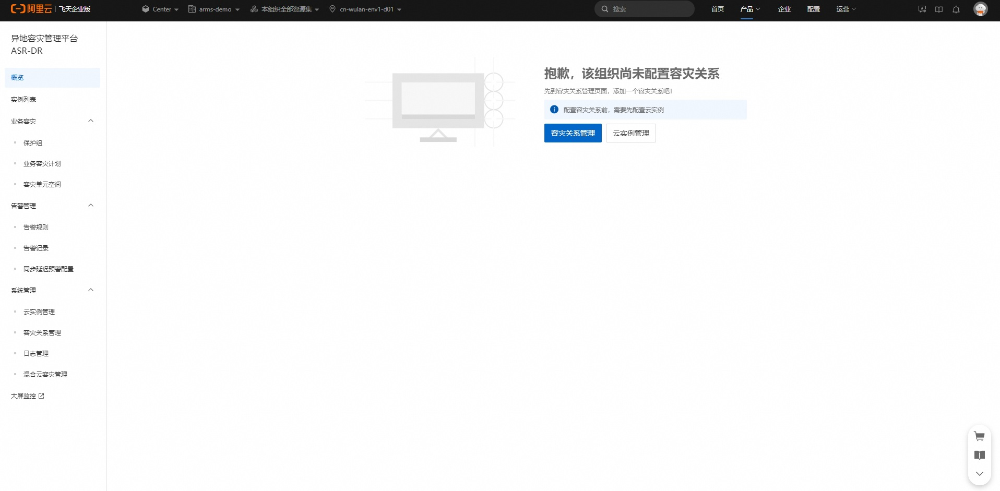

<a id="section-1-2-3"></a>

### 1.2.3. 容灾场景简介

专有云企业版支持跨云容灾和跨Region容灾。本文介绍两种容灾场景的能力。

跨云容灾和跨Region容灾的场景介绍如下：

- 跨云容灾：两个云实例之间进行灾备。由生产云向灾备云进行灾备。具体包含如下几种形态：

  - 生产云的中心Region向灾备云的中心Region进行容灾（1：1）。

  - 生产云的单元Region向灾备云的中心Region进行容灾（1：1）。

  - 多个生产云向灾备云的中心Region进行容灾（N：1）。

  - 两地三中心。

  - 专有云与阿里公有云进行容灾（1：1）。

- 跨Region容灾：一个云实例下各Region间进行灾备。具体包含如下几种形态：

  - 单元Region向中心Region容灾。

  - 单元Region向单元Region容灾。

  - 中心Region向单元Region容灾（只支持业务故障容灾，不支持中心Region整体断电或断网故障场景）。

两种容灾场景的支持产品及功能如下表所示。

<table>
  <tr>
    <td>容灾场景</td>
    <td>容灾形态</td>
    <td>X86支持的产品</td>
    <td>ARM支持的产品</td>
    <td>ASR-DR支持的功能</td>
  </tr>
</table>

- 云数据库RDS MySQL 5.6、5.7和8.0版

- 云原生分布式数据库PolarDB-X 2.0

  - 云数据库RDS MySQL 8.0版

- 数据库MongoDB版

  - 云原生分布式数据库

- 云数据库Redis版

生产云的中

PolarDB-X 2.0

心Region

- 对象存储OSS

  - 对象存储OSS

向灾备云的

- 弹性计算ECS和块存储

中心

- 专有云DNS

EBS

Region进

- 大数据计算

行容灾

- 消息队列MQ

  MaxCompute和

- 专有云DNS

  DataWorks

  - 数据总线DataHub

- 大数据计算MaxCompute和DataWorks

- 数据总线DataHub

- 云数据库RDS MySQL 5.6、5.7和8.0版

  - 云数据库RDS

- 云原生分布式数据库

  MySQL 8.0版

  PolarDB-X 2.0

多个生产云

- 云原生分布式数据库

向灾备云的

- 数据库MongoDB版

  PolarDB-X 2.0

中心Region进

- 云数据库Redis版

  - 对象存储OSS

跨

行容灾

首页、容灾大屏、实例管理、业

- 对象存储OSS

  - 专有云DNS

云

务容灾、日志管理、告警管理、

容

- 专有云DNS

  - 数据总线 DataHub

    同步延迟预警管理

灾

- 数据总线 DataHub

- 云数据库RDS MySQL 5.6、5.7和8.0版

  - 云数据库RDS

- 数据库MongoDB版

  MySQL 8.0版

- 云数据库Redis版

  - 对象存储OSS

- 对象存储OSS

  - 消息队列MQ

- 消息队列MQ

  - 专有云DNS

两地三中心

- 专有云DNS

  - 数据总线 DataHub

- 数据总线 DataHub

  - 云原生大数据计算服务MaxCompute

- 云原生大数据计算服务MaxCompute

  - 大数据开发治理平台DataWorks

- 大数据开发治理平台DataWorks

<table>
  <tr>
    <td>跨Re gio n容灾</td>
    <td>全部形态</td>
    <td>• 云数据库RDS MySQL 5.6、5.7和8.0版<br>• 云原生分布式数据库PolarDB-X 2.0<br>• 数据库MongoDB版<br>• 云数据库Redis版<br>• 对象存储OSS<br>• 消息队列MQ<br>• 大数据计算MaxCompute和DataWorks（仅支持数据复制）<br>• 专有云DNS<br>• 数据总线 DataHub<br>• 云原生大数据计算服务MaxCompute<br>• 大数据开发治理平台DataWorks</td>
    <td>• 云数据库RDS MySQL 8.0版<br>• 云原生分布式数据库PolarDB-X 2.0<br>• 对象存储OSS<br>• 消息队列MQ<br>• 专有云DNS<br>• 数据总线 DataHub<br>• 云原生大数据计算服务MaxCompute<br>• 大数据开发治理平台DataWorks</td>
    <td>实例管理、业务容灾、大数据灾备、日志管理、告警管理</td>
  </tr>
</table>

<a id="section-1-3"></a>

## 1.3. 首页概览

首页以图形与数字结合的形式清晰地展示业务容灾概览。您可以在这里查看实时容灾指标，了解容灾保护组的状态，从而提高容灾管理效率，提升应用业务连续性。

**操作须知**

首次登录异地容灾管理平台时，需要先配置生产云实例，然后再配置容灾关系，如图所示。同时所有业务数据支持分域，可按照组织、资源集和地域展示。

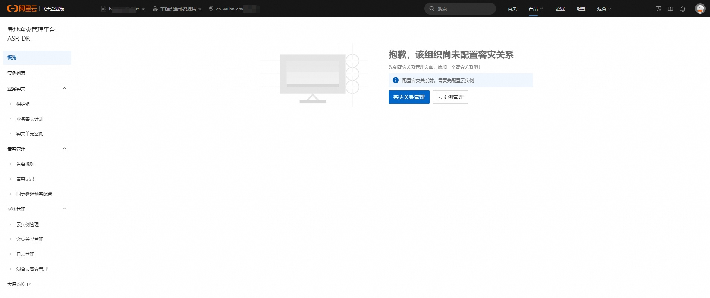

**操作步骤**

1. 登录ASR-DR控制台。

2. 在左侧导航栏中单击**概览**。

3. 在**概览**页面，您可以查看如下信息。

   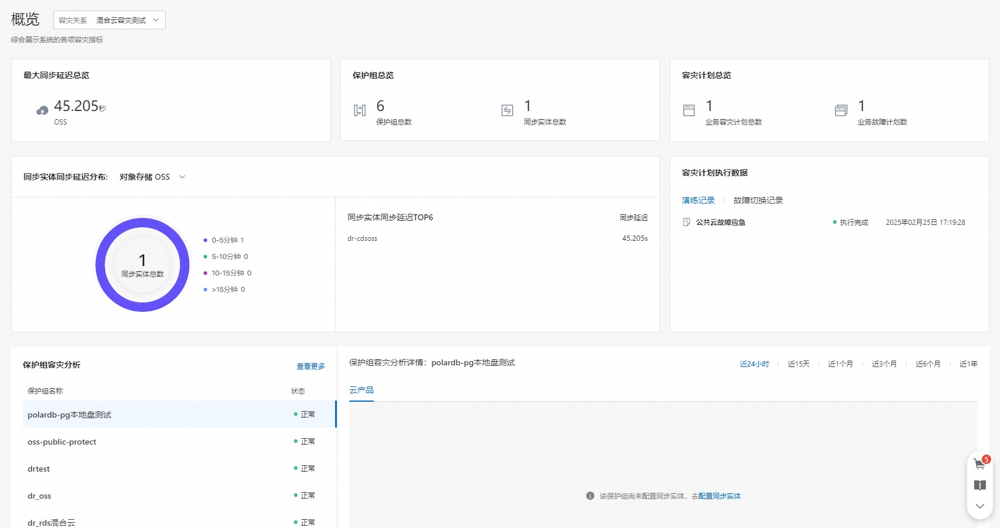

   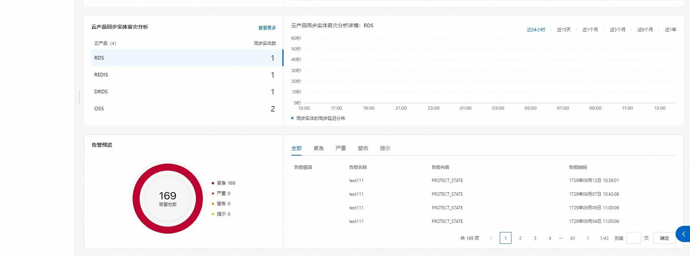

各模块的说明如下表所示。

> **说明**
>
> 在容灾关系下拉框选择相应的容灾关系，各模块将展示该容灾关系内的资源数据。例如，上图中展示的是”混合云容灾测试“关系内的资源数据。

| 模块 | 说明 |
| --- | --- |
| 最大同步延迟总览 | 展示云产品的最大同步延迟。 |
| 保护组总览 | 展示保护组总数和异常数、同步实体总数和异常数。 |
| 容灾计划总览 | 展示业务容灾计划总数、站点容灾计划总数。 |
| 同步实体同步延迟分布 | • 通过环形图展示同步延迟时长的分布区间。在云产品名称右侧单击图标，支持切换云产品。<br>• 列表化展示同步实体同步延迟TOP6的同步实体名称和同步延迟时间。鼠标悬停在卡片区域，单击<strong>查看更多</strong>跳转至同步实体列表。 |
| 容灾计划执行数据 | 包括<strong>演练记录</strong>和<strong>故障切换记录</strong>。<strong>演练记录</strong>页签展示最近的演练状态，<strong>故障切换</strong><strong>记录</strong>页签展示最近的故障切换状态。 |
| 保护组容灾分析 | 列表化展示保护组的状态。单击<strong>查看更多</strong>跳转至保护组列表页。 |
| 保护组容灾分析详情 | 通过折线图展示演练切换/切回和故障切换/切回时，云产品的保护组同步延迟情况支持查看<strong>近24小时</strong>、<strong>近15天</strong>、<strong>近1个月</strong>、<strong>近3个月</strong>、<strong>近6个月</strong>、<strong>近1年</strong>。单击左侧<strong>保护组容灾分析</strong>中的<strong>保护组名称</strong>，即可查看对应的<strong>保护组容灾分析详</strong><strong>情</strong>。<br>说明<br>• 查看时间范围越长，数据采样频率越低。<br>• 新配置的保护组在按月或按年查看时可能会存在一段无数据的情况。 |
| 云产品同步实体容灾分析 | 列表化展示所有云产品和对应的同步实体数。单击<strong>查看更多</strong>可跳转至列表页。 |
| 云产品同步实体容灾分析详情 | 通过折线图展示同步实体的同步延迟分布和同步延迟平均值，支持查看<strong>近24</strong><strong>小时</strong>、<strong>近15天</strong>、<strong>近1个月</strong>、<strong>近3个月</strong>、<strong>近6个月</strong>、<strong>近1年</strong>。鼠标悬停在同步实体的同步延迟分布区域，显示延迟最大值、最小值、中位值、平均值。<br>说明<br>• 查看时间范围越长，数据采样频率越低。<br>• 新配置的同步实体在按月或按年查看时可能会存在一段时间无数据，无数据的时长最长可达1个月。 |
| 告警预览 | • 通过环形图展示<strong>紧急</strong>、<strong>严重</strong>、<strong>警告</strong>、<strong>提示</strong>四种级别告警的数量。<br>• 在<strong>全部</strong>页签展示所有级别告警详情，切换<strong>紧急</strong>、<strong>严重</strong>、<strong>警告</strong>、<strong>提示</strong>可以筛选相应级别的告警。 |

<a id="section-1-4"></a>

## 1.4. 实例管理

<a id="section-1-4-1"></a>

### 1.4.1. 查看实例

您需要在生产站点和灾备站点分别创建待保护的实例，保护组中生产站点和灾备站点的实例数量和实例规格需要完全一致。

1. 分别登录生产站点和灾备站点的Apsara Uni-manager运营控制台。

2. 参见各云产品的用户指南创建云产品实例。各产品在创建实例时需要完成的任务以及注意事项如下表所示。

   | 产品 | 任务 | 注意事项 |
   | --- | --- | --- |
   | 云数据库RDS | 请在生产站点和灾备站点分别创建RDS实例、创建RDS账号、创建数据库。 | • 生产站点业务的RDS实例数量和实例规格要与灾备站点完全一致。<br>• 生产站点业务RDS的网络类型要与灾备站点RDS的网络类型一致，例如都是VPC网络。<br>• 灾备站点的RDS实例中不需要创建数据库，ASR-DR会自动从生产站点的RDS中同步数据库。（敏捷版除外）<br>• 生产站点的实例名称建议与灾备站点的实例名称一致，且与所属业务命名关联，方便后期维护。 |
   | 云原生分布式数据库PolarDB-X 2.0 | 请在生产站点和灾备站点分别创建PolarDB-X 2.0实例、创建账号。 | • 生产站点业务的PolarDB-X 2.0实例数量和实例规格要与灾备站点完全一致。<br>• 生产站点PolarDB-X 2.0的网络类型要与灾备站点PolarDB-X 2.0的网络类型一致，例如都是VPC网络。<br>• 生产站点的实例名称建议与灾备站点的实例名称一致，且与所属业务命名关联，方便后期维护。<br>• 灾备站点的PolarDB-X 2.0实例中不需要创建数据库，ASR-DR会自动从生产站点的PolarDB-X 2.0中同步数据库。 |
   | 对象存储OSS<br>说明云产品<strong>对象存储</strong><strong>OSS</strong>页签下的实例列表中的实例类型包括对象存储OSS和对象存储CDS-OSS。 | 请在生产站点和灾备站点分别创建OSS Bucket。 | • 生产站点业务的OSS Bucket数量要与灾备站点完全一致。<br>• 全量保护场景下，备实例需要为空。<br>• 生产实例和灾备实例的多版本能力需要保持一致。<br>• 被保护的OSS Bucket不超过20个。 |
   | 消息队列MQ | 请在生产站点和灾备站点分别创建MQ实例、创建Topic。 | • 生产站点业务的MQ实例数量要与灾备站点完全一致。<br>• 生产站点MQ的Topic名称与灾备站点MQ的Topic名称一致。 |
   | 专有云DNS | 请在生产站点和灾备站点分别创建DNS域名并添加解析。 | • 生产站点业务的DNS的全局内网域名数量要与灾备站点完全一致。<br>• 生产站点DNS域名<strong>解析设置</strong>中的<strong>记录值集合</strong>与灾备站点DNS域名<strong>解析设置</strong>中的<strong>记录值集合</strong>一致。<br>• DNS域名<strong>解析设置</strong>的<strong>负载均衡策略</strong>采用<strong>权重</strong>，并配置主备站点的业务VIP。<br>• <strong>记录值集合</strong>中，请将主记录写在备记录的前面，例如：master-host 100,slave-host 0。 |
   | 域名解析DNS（云内） | 请在生产站点和灾备站点分别创建业务DNS域名和解析记录。 | • 生产站点、灾备站点，在业务DNS域名和解析记录集合要求一致。<br>• DNS域名解析设置的负载均衡策略采用权重，并配置主备站点的业务VIP。 |
   | 大数据计算MaxCompute | 请在生产站点和灾备站点分别创建MaxCompute项目、任务云账号、计算单元。 | • 生产站点业务MaxCompute的计算单元CU数量、存储空间和灾备站点一致。<br>• 生产站点MaxCompute的Project名称、任务云账号名称与灾备站点一致。<br>• 生产站点业务DataWorks的Project名称与灾备站点一致。<br>• 生产站点DataWorks的工作空间名称、MaxCompute项目名称建议与灾备站点一致，且与所属业务命名关联，方便后期维护。<br>• 增量同步前请确保生产站点和灾备站点的数据一致。 |
   | 分布式任务调度SchedulerX | 请在生产站点和灾备站点分别创建SchedulerX应用。 | • 生产站点SchedulerX的应用名称要与灾备站点完全一致。<br>• 生产站点SchedulerX的GroupId要与灾备站点完全一致。 |
   | 云数据库 MongoDB | 请在生产站点和灾备站点分别创建MongoDB实例和账号。 | • 只支持4.0、4.2、4.4版本的副本集、分片集实例。<br>• 实例需申请经典网络地址。 |
   | 云数据库 Redis | 请在生产站点和灾备站点分别创建Redis实例和账号。 | • 只支持社区版4.0、5.0版本；企业版5.0版本。<br>• 实例需申请经典网络地址。 |
   | 云服务器 ECS | 请在生产站点和灾备站点分别创建ECS实例、EBS硬盘、VPC网络。 | • 硬盘：仅支持无代理高性能云盘（IO15）。<br>• 网络：主备站点ECS所在VPC网段不冲突。<br>• 仅支持单机房实例。 |
   | 数据总线 DataHub | 请在生产站点和灾备站点分别创建DataHub实例。 | • 生产站点业务的DataHub实例数量要与灾备站点完全一致。<br>• 生产站点DataHub的Topic名称及Field名称与灾备站点DataHub的Topic名称及Field名称一致。 |
   | 流量网关AsrIngressGW | 请在生产站点和灾备站点分别创建AsrIngressGW实例。 | • 生产站点业务的AsrIngressGW实例数量要与灾备站点完全一致。<br>• AsrIngressGW实例绑定的ECS推荐的最小配置为2c4g，并绑定EIP。<br>• AsrIngressGW实例绑定的SLB需要保证位于与ECS所在VPC相同或者连通的VPC，或是经典网络SLB实例。 |

<a id="section-1-4-2"></a>

### 1.4.2. 流量网关AsrIngressGW

<a id="section-1-4-2-1"></a>

#### 1.4.2.1. 新增流量网关AsrIngressGW实例

本文介绍如何创建AsrIngressGW实例，并绑定对应的ECS资源和SLB资源。

**前提条件**

已在Apsara Uni-manager运营控制台上的云服务器ECS控制台和负载均衡SLB控制台分别创建ECS和SLB。ECS和SLB要求如下所示：

- ECS推荐的最小配置为2c4g，并绑定EIP。

- SLB需要保证位于与ECS所在VPC相同或者连通的VPC，或是经典网络SLB实例。

**操作步骤**

1. 登录灾备云异地容灾管理平台ASR-DR，具体请参见登录ASR-DR控制台。

2. 在左侧导航栏选择**实例列表**。

3. 选择**生产地域**页签，单击**流量网关 AsrIngressGW**。

4. 单击**新增**。

5. 选择该实例所在的组织和资源集，同时自定义实例名称。

6. 单击**确定**。

7. 单击实例**操作**列**配置**。

8. 单击ECS资源区域的**关联**，选择ECS资源后单击**确定**。

9. 单击SLB资源区域的**关联**，选择SLB资源后单击**确定**。

0. 单击SLB资源**操作**列**配置**，单击**添加条目**。

   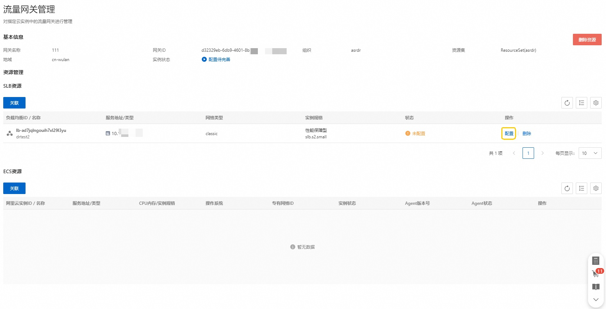

1. 配置SLB监听端口和流量网关端口，单击**确定**。

   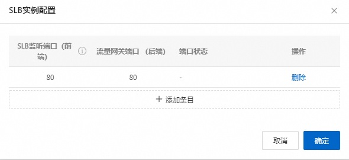

2. 选择**灾备地域**页签，单击**流量网关 AsrIngressGW**。

3. 参考上述步骤新增同样实例后关联ECS资源和SLB资源。

<a id="section-1-4-2-2"></a>

#### 1.4.2.2. 查看流量网关拓扑图

本章节介绍如何查看流量网关的拓扑图。

**前提条件**

- 已在Apsara Uni-manager运营控制台上的云服务器ECS控制台和负载均衡SLB控制台分别创建ECS和SLB。

- 已配置流量网关实例并且网络已连通，请参见新增流量网关AsrIngressGW实例。

**操作步骤**

1. 登录灾备云异地容灾管理平台ASR-DR，具体请参见登录ASR-DR控制台。

2. 在左侧导航栏选择**实例列表**。

3. 选择**生产地域**页签，单击**流量网关 AsrIngressGW**。

4. 单击操作列**配置**。

5. 在**基础配置**页签，查看流量网关拓扑图。

<a id="section-1-4-2-3"></a>

#### 1.4.2.3. 查看流量网关监控

本章节介绍如何查看流量网关监控的指标数据。

**操作步骤**

1. 登录灾备云异地容灾管理平台ASR-DR，具体请参见登录ASR-DR控制台。

2. 在左侧导航栏选择**实例列表**。

3. 选择**生产地域**页签，单击**流量网关 AsrIngressGW**。

4. 单击操作列**配置**。

5. 选择**监控**页签，查看业务和主机的性能指标。

<a id="section-1-5"></a>

## 1.5. 业务容灾

<a id="section-1-5-1"></a>

### 1.5.1. 保护组

<a id="section-1-5-1-1"></a>

#### 1.5.1.1. 管理保护组

您可以创建、修改和删除保护组，给保护组添加实例，查看保护组详细信息，对保护组进行重保护。

1. 登录ASR-DR控制台。

2. 在左侧导航栏，选择**业务容灾** > **保护组**。

   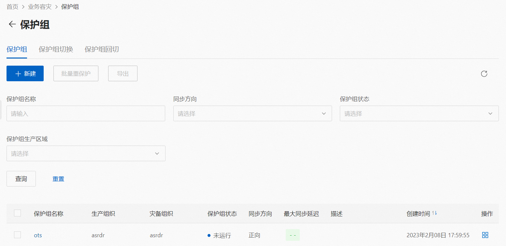

   <table>
     <tr>
       <th width="121">名称</th>
       <th>描述</th>
     </tr>
     <tr>
       <td>保护组状态</td>
       <td>当前保护组的状态分为：<br>• <strong>计划失败</strong>：计划任务的步骤执行失败。<br>• <strong>计划执行中</strong>：保护组所在计划在执行中。<br>• <strong>保护失败</strong>：保护组创建失败；创建失败的保护组可针对具体失败的实体进行重建。<br>• <strong>保护中</strong>：保护组链路创建成功。<br>• <strong>保护启动中</strong>：保护组链路创建中。<br>• <strong>重保护中</strong>：正在对保护组重新建立链路。<br>• <strong>未知</strong>：没有获取到相应的状态。<br>• <strong>停止</strong>：保护组已停止保护。</td>
     </tr>
     <tr>
       <td>同步方向</td>
       <td>保护组的方向，您可以由保护组的方向判断保护组中提供服务的是实例在哪个中心。<br>• <strong>正向</strong>：提供服务的实例在生产云。<br>• <strong>反向</strong>：提供服务的实例在灾备云。</td>
     </tr>
     <tr>
       <td>最大同步延迟</td>
       <td>保护组中所有实体同步延迟的最大值。</td>
     </tr>
   </table>

3. 单击**操作**列中的  图标，您可以执行如下操作：

   - 选择**详情**，查看保护组详细信息，并对保护组中的实例进行管理，具体操作请参见保护组详情章节。

   - 选择**修改**，修改保护组名称和描述。

   - 选择**添加实体**，增加保护组中的实例，具体操作请参见添加同步实体相关章节。

   - 选择**编辑演练指标**，配置云产品的数据同步延迟、切换时长、切回时长等指标的期望值。

   - 选择**重保护**，将保护失败的保护组重新恢复至保护中。

   - 选择**停止保护**，暂时中止某个保护组/保护实体的同步。

     > **说明**
     >
     > 已关联恢复计划或演练计划的保护组不能被删除。
     >
     > 删除保护组后，该保护组下所有资源的主备实体之间的热备通道将被逐一删除，主备实体之间的跨云同步也因此停止，其1:1的映射关系也同时被删除。

   - 选择**删除**，删除不需要的保护组。

<a id="section-1-5-1-1-1"></a>

##### 1.5.1.1.1. 新建保护组

保护组是ASR-DR控制台进行容灾保护的业务对象。您可以基于应用视角，为某个应用所使用的一组相关资源创建保护组。

**背景信息**

- 保护组数量建议在20个以内。

- （可选）创建双活保护组时需要提前购买相应License。

**操作步骤**

1. 登录灾备云异地容灾管理平台ASR-DR，具体请参见登录ASR-DR控制台。

2. 在左侧导航栏选择**业务容灾** > **保护组**。

3. 在保护组页面，单击**新建**。

4. 在**新建保护组**页面，填写保护组基本信息，参数说明如下表所示。

   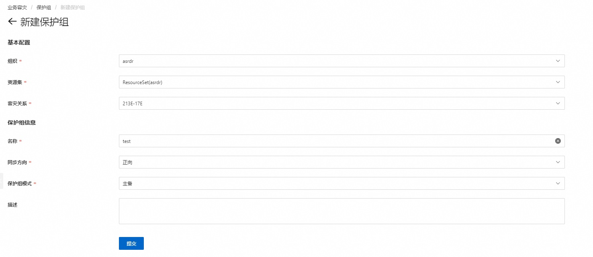

   **区域**

   **参数名称**

   **描述**

   选择保护组数据所在的组织。

   **组织**

   **地域信息**

   > **说明**

   选择待容灾实例所在的资源集。

   **资源集**

   > 显示的是灾备区域的相关信息。

   选择保护组所属的容灾关系。

   **容灾关系**

   自定义保护组名称。名称只能包含中文、英文、数字、短划线（-）、下划线（_）或半角句号（.），长度为

   **名称**

   4~40个字符或2~20个汉字。

   服务切换的方向。提供服务的实例为生产站点实例时选择正向，提供服务的实例为灾备站点实例时选择反向。

   > **说明**

   **同步方向**

   > 保护组的方向会随着切换和回切进行动态变化，即正向保护组切换后状态会变为反向保护组，反向保护组回切后状态会变回正向保护组。

   **保护组信息**

   - **主备**：指主备模式，生产站点承担业务，灾备站点对生产站点数据进行实时复制，但不提供服务。当生产站点故障，切换到灾备站点后，由灾备站点承担业务。

   - **双活**：指双活模式，主备站点同时承担业务。

   **保护组模式**

   > **说明**
   >
   > 仅在购买双活License后，才支持创建双活模式保护组。

   **描述**

   对保护组的描述信息，方便识别。

5. 单击**提交**，进入**保护组**页面，单击对应保护组的操作列**添加实体**。

6. 按照添加同步实体的界面指引进行配置。

   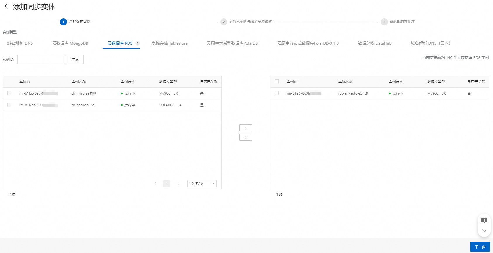

> **说明**
>
> - 各云产品添加同步实体的具体步骤请参见添加同步实体章节<em>。</em>
>
> - 选中**添加但不启动**勾选框表示该保护组创建完成之后直接进入停止状态，后台不会创建同步链路，不做同步操作，且该保护组只可进行**启动保护组**操作。未勾选则表示保护组创建完成之后，自动进入保护启动状态。

7. 单击**确认**，保护组创建完成。在保护组列表页面单击  图标，查看保护组状态。

<a id="section-1-5-1-1-2"></a>

##### 1.5.1.1.2. 重保护

当进行故障切换后，无论生产云状态是否正常，保护组会即刻变成保护失败状态，您需要执行重保护操作，将保护组状态恢复至保护中。

**前提条件**

进行故障切换后，保护组状态变为保护失败。

> **说明**
>
> 如果是初始化过程中保护组状态变成保护失败，则无法进行重保护。

**操作步骤**

1. 登录ASR-DR控制台。

2. 在左侧导航栏，选择**业务容灾**>**保护组**。

3. 选择**保护组状态**为**保护失败**，单击**查询**。

4. 在保护组列表中，单击目标保护组操作列  ，单击**重保护**。

5. 在弹出的对话框中单击**确定**。

<a id="section-1-5-1-1-3"></a>

##### 1.5.1.1.3. 保护组详情

您可以查看保护组详细信息、操作历史，并对保护组中的实例、关联的计划进行管理。

<a id="section-1-5-1-1-3-1"></a>

###### 1.5.1.1.3.1. 查看保护组详情

您可以通过保护组详情查看保护实体的同步延迟监控信息和实体巡检信息。

**操作步骤**

1. 登录ASR-DR控制台。

2. 在左侧导航栏，选择**业务容灾**>**保护组**。

3. 单击保护组**操作**列**详情**。

   <table>
     <tr>
       <th width="105">名称</th>
       <th>描述</th>
     </tr>
     <tr>
       <td>状态</td>
       <td>实体状态包括：<br>• 保护启动中<br>• 保护失败<br>• 保护中<br>• 计划执行中<br>• 重保护中<br>• 计划失败<br>• 停止<br>• 未知</td>
     </tr>
     <tr>
       <td>同步策略</td>
       <td>同步策略包括如下两种方式：<br>• <strong>全量同步</strong>：每一次都将所有数据全量同步至灾备云实例。<br>• <strong>增量同步</strong>：只将增量变化的数据同步至灾备云实例。</td>
     </tr>
     <tr>
       <td>优先级</td>
       <td>保护组中设置的优先级。</td>
     </tr>
     <tr>
       <td>同步方向</td>
       <td>数据同步的方向，正向为生产云实例供服务，反向为灾备云实例在提供服务。</td>
     </tr>
     <tr>
       <td>初始化进度</td>
       <td>实体初始化批量数据同步的百分比。</td>
     </tr>
     <tr>
       <td>同步延迟</td>
       <td>当前实体的同步延迟时间。</td>
     </tr>
     <tr>
       <td>获取时间</td>
       <td>当前同步延迟的计算时间。</td>
     </tr>
   </table>

4. 在**保护组详情**页面，单击实体列表中目标实例右侧的  图标，您可以执行如下操作：

   - 单击**详情**，可以查看生产云和灾备云对应实例的基本信息、同步延迟监控信息、额外配置的相关信息、主备实例可达性巡检。

     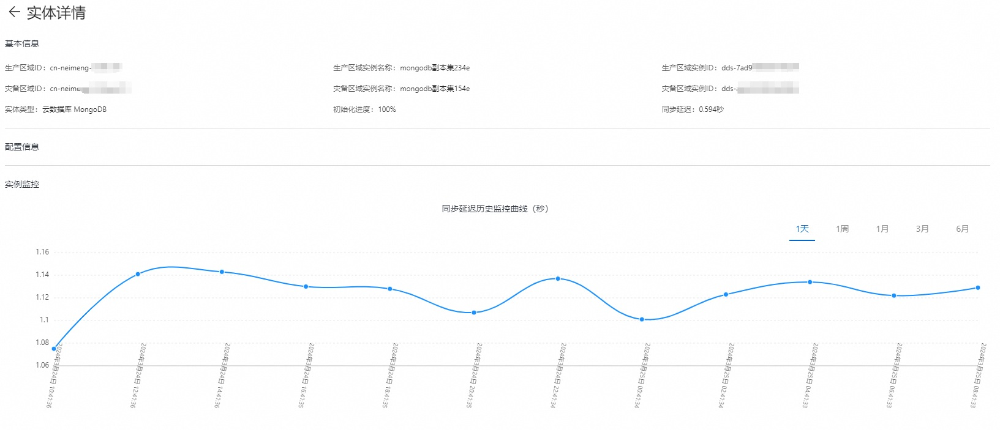

     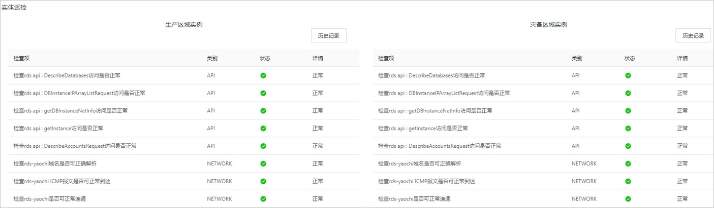

     > **说明**
     >
     > 实体巡检功能默认不开启。若要开启该功能，请评估实际情况，再在后台开启。

     - 不同产品实例在**实体详情**页面显示的基本信息和额外配置的相关信息参数不同，具体参数说明如下表所示。

       **产品**

       **参数**

       **描述**

       主备RDS高权限账号、密码。

       **配置高权限账号**

       创建保护组时，配置的不需要被

       **只读账号**

       云数据库 RDS

       ASR-DR设置读写的账号。

       增量同步时，从该同步位点开始

       **增量同步开始位点**

       同步增量数据。

       云原生分布式数据库PolarDB-X

       创建保护组时，配置的不需要被

       **只读账号**

       ASR-DR设置读写的账号。

       2.0

       消息队列 MQ

       需要同步的topic列表。

       **配置消息topic**

       被ASR-DR管理的全局域名。

       **全局域名**

       域名解析DNS（跨云）

       DNS解析记录。

       **记录值**

       DNS TTL值。

       **TTL**

       MaxCompute Project同步对

       **MaxCompute同步映射**

       象。

       大数据计算 MaxCompute

       MaxCompute数据同步策略。

       **策略配置**

       配置云数据库MongoDB数据的同

       **策略配置**

       步策略。

       灾备站点的目标实例，该实例作

       **资源映射**

       为生产站点实例的热备资源。

       云数据库MongoDB

       如果不希望在容灾切换过程中被设置为读写权限，您可以通过该

       **配置只读账号**

       设置过滤这些只读账号。

       生产、灾备实例shard账号名和密

       **配置shard账号**

       码。

       配置云服务器ECS数据的同步策

       **策略配置**

       略。

       在HDR侧提前创建的站点对。

       **选择云站点对**

       生产云和灾备云可以使用的区域

       云服务器 ECS

       **选择可用区**

       信息。

       生产云和灾备云所在的VPC实

       **配置网络**

       例、交换机以及安全组。

       待切换的保护组。

       **选择HDR保护组**

       配置云数据库Redis数据的同步策

       **策略配置**

       略。

       灾备站点的目标实例，该实例作

       **资源映射**

       为生产站点实例的热备资源。

       云数据库Redis

       如果某些Redis账号是只读账号，不希望在容灾切换过程中被设置

       **配置只读账号**

       为读写权限，您可以通过该设置过滤这些只读账号。

       配置云数据库DNS（云内）数据

       **策略配置**

       的同步策略。

       灾备站点的目标实例，该实例作

       **资源映射**

       为生产站点实例的热备资源。

       域名解析信息在DNS（云内）中

       **TTL**

       的存在时间。

       域名解析DNS（云内）

       当前支持**权重**策略。

       **智能解析策略**

       配置权重策略。格式为域名IP地址、空格、权重（0~999），IP地址为基本信息中主机的**记录**

       **记录值**

       **值**列的IP请参见*专有云DNS用户指南*的*全局内网域名配置*。

     - 不同产品实例在**实体巡检**区域中检查项内容不同，各产品检查项如下表所示。

       **产品**

       **检查项**

       **检查dnsService域名是否可正确解析**

       **检查dnsService ICMP报文是否可正常到达**

       **检查dnsService是否可正常连通**

       DNS

       **检查dnsService api : ObtainGlobalAuthZoneListRequest访问是否正常**

       **检查dnsService api : GetInstance访问是否正常**

       **检查odps-bcc域名是否可正确解析**

       **检查odps-bcc ICMP报文是否可正常到达**

       **检查odps-bcc是否可正常连通**

       MaxCompute

       **检查odps api : GetProtectGroupRequest访问是否正常**

       **检查odps api : listDataworkInstancesRequest访问是否正常**

       **检查odps api : GepPlanRequest访问是否正常**

       **检查oss-chiji域名是否可正确解析**

       **检查oss-chiji ICMP报文是否可正常到达**

       **检查oss-chiji是否可正常连通**

       **检查oss api : GetOcmBucketMetaXmlRequest访问是否正**

       OSS

       **常**

       **检查oss api : GetLocationListRequest访问是否正常**

       **检查rds-yaochi域名是否可正确解析**

       **检查rds-yaochi ICMP报文是否可正常到达**

       **检查rds-yaochi是否可正常连通**

       **检查rds api : DescribeAccountsRequest访问是否正常**

       RDS

       **检查rds api : DBInstanceIPArrayListRequest访问是否正常**

       **检查rds api : DescribeDatabases访问是否正常**

       **检查rds api : getInstance访问是否正常**

       **检查rds api : getDBInstanceNetInfo访问是否正常**

       **检查mq域名是否可正确解析**

       **检查mq ICMP报文是否可正常到达**

       **检查mq是否可正常连通**

       **检查mq api : listInstances访问是否正常**

       **检查mq api : queryTaskStatus访问是否正常**

       MQ

       **检查mq api : listGroups访问是否正常**

       **检查mq api : listTopics访问是否正常**

       **检查mq api : listConsumerGroups访问是否正常检查mq api : getBaseInstance访问是否正常**

   - 当网络或者其他原因导致与底层产品失联时实体会保护失败，此时单击**重保护**，系统会查询保护状态，并根据查询结果决定下一个状态。

   - 当主备RDS实例的数据库的表发生增减，会导致实体保护失败，恢复方法请参见实体保护失败的处理方法。

<a id="section-1-5-1-1-3-2"></a>

###### 1.5.1.1.3.2. 查看保护实体

查看实体日志可以帮助您定位和分析保护失败的原因。

**操作步骤**

1. 登录ASR-DR控制台。

2. 在左侧导航栏选择**业务容灾**>**保护组**。

3. 单击保护组名称或单击保护组**操作**列**详情**。

4. 在**保护组详情**页面，选择**保护实体**页签。

   - （可选）查看保护实体在同步时的RPO。

     > **说明**
     >
     > 只有实例为OSS和CDS-OSS的保护组才支持查看。

     将鼠标放置在同步实体的同步延迟上即可展示同步时的RPO。

     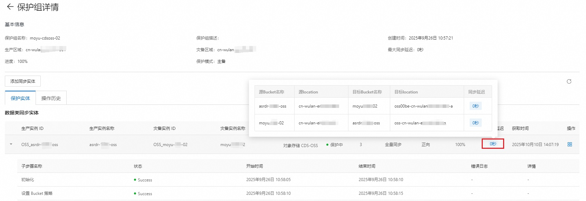

   - 查看保护实体详情。

     <ol type="a">

     <li>

     单击实例列表中目标实例右侧的  图标，选择**详情**。

     </li>

     <li>

     可以查看实体详情。

     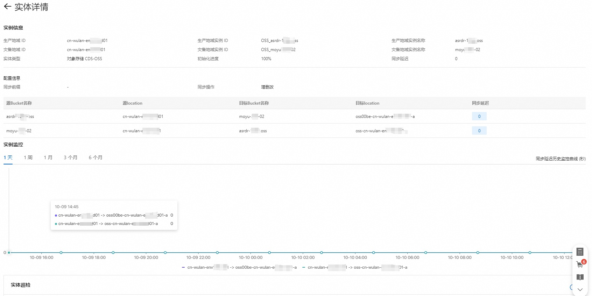

     </li>

     </ol>

   - 查看保护实体的日志。

     <ol type="a">

     <li>

     单击实例列表中目标实例右侧的  图标，选择**日志**，可以查看主备中心对应实例的日志。

     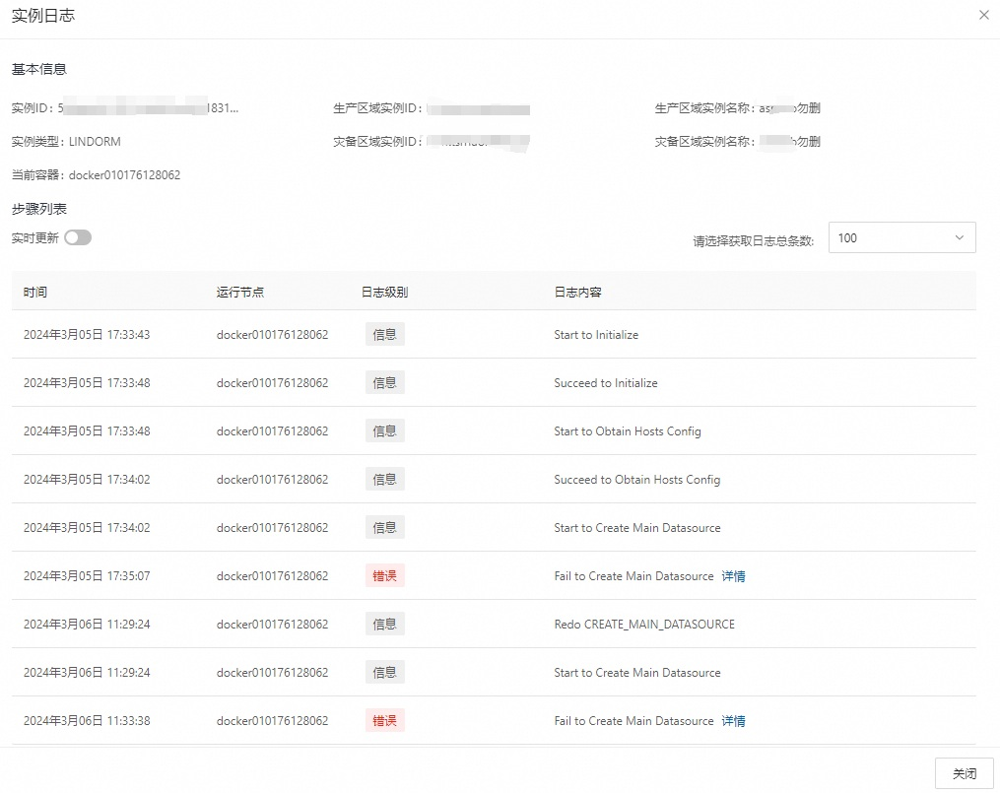

     | 名称 | 描述 |
     | --- | --- |
     | 实时更新 | 打开实时更新开关后，实例的日志信息会10秒更新一次。 |
     | 请选择获取日志总条数 | 单击选择当前页需要展示的日志条数，可选值有100、500和1000。 |
     | 日志级别 | 日志级别包括：<br>• 信息<br>• 错误<br>• 告警 |
     | 运行节点 | 该实体同步链路工作所在节点。 |

     </li>

     </ol>

<a id="section-1-5-1-1-3-3"></a>

###### 1.5.1.1.3.3. 查看保护组的操作记录

您可以查看对该保护组执行的历史操作记录。

1. 登录ASR-DR控制台。

2. 在左侧导航栏选择**业务容灾**>**保护组**。

3. 单击保护组名称，或单击保护组**操作**列**详情**。

4. 在**保护组详情**页面，单击**操作历史**页签。

5. 您可以查看对该保护组执行的历史记录，单击**操作**列中的**详情**，可以查看详细信息。

<a id="section-1-5-1-1-3-4"></a>

###### 1.5.1.1.3.4. 删除保护实体

您可以将保护组中不再需要容灾保护的实例移除。移除后该实例将不再被保护，相应的容灾链路将断开。

1. 登录ASR-DR控制台。

2. 在左侧导航栏中选择**业务容灾**>**保护组**。

3. 在**保护组**页面，单击目标保护组名称或单击**操作**列**详情**。

4. 在**保护组详情**页面，单击**保护实体**页签。

5. 单击实例列表中目标实例**操作**列的  图标，单击**删除**。

6. 在弹出的对话框中单击**确定**。

<a id="section-1-5-1-1-3-5"></a>

###### 1.5.1.1.3.5. 修改保护实体的归属

在实例所属业务调整，或创建保护组时错误选择了某个实例等场景中，您可以修改保护组实例的归属，将实例移动到其他保护组中。

1. 登录ASR-DR控制台。

2. 在左侧导航栏中选择**业务容灾**>**保护组**。

3. 在**保护组**页面，单击目标保护组名称或单击**操作**列**详情**。

4. 在**保护组详情**页面，在实例列表中单击目标实例**操作**列中的  图标，单击**迁移实体**。

5. 选择新保护组，单击**确定**。

   > **说明**
   >
   > 新保护组与当前保护组的生产地域组织、灾备地域组织、同步方向要保持一致。

<a id="section-1-5-1-1-3-6"></a>

###### 1.5.1.1.3.6. 修改只读账号

如果某些账号是只读账号，不希望在容灾切换过程中被设置为读写权限，您可以通过该设置过滤这些只读账号。

**前提条件**

目前云数据库RDS、云原生分布式数据库PolarDB-X2.0、云数据库MongoDB、云数据库Redis均已支持该功能。

**操作步骤**

1. 登录ASR-DR控制台。

2. 在左侧导航栏中选择**业务容灾**>**保护组**。

3. 单击保护组名称或单击保护组**操作**列**详情**。

4. 在**保护组详情**页面，单击实例列表中目标实例右侧的  图标，选择**修改只读账号**。

5. 在**更新只读账号**对话框中，选择对应的数据库，输入账号名称.

6. 单击**确定**。

<a id="section-1-5-1-1-3-7"></a>

###### 1.5.1.1.3.7. 修改RDS的高权限账号

如果RDS控制台上的高权限账号和密码有修改，您需要在ASR-DR同步修改相应实例的高权限账号和密码。

**前提条件**

只有RDS实例支持该操作。

**操作步骤**

1. 登录ASR-DR控制台。

2. 在左侧导航栏中选择**业务容灾**>**保护组**。

3. 在**保护组**页面，单击目标保护组名称或单击**操作**列**详情**。

4. 在**保护组详情**页面，单击实例列表中目标实例**操作**列的  图标，单击**修改高权限账号**。

5. 在**修改主备实例高权限账号密码**对话框中，分别设置主中心实例和备中心实例的用户名和密码，单击**修改**。

<a id="section-1-5-1-1-3-8"></a>

###### 1.5.1.1.3.8. 管理保护实体账号权限

通过账号管理功能，您可以查看、修改同步实体主备实例的账号权限，便于实例管理。

**前提条件**

只有RDS和PolarDB实例支持该操作。

**操作步骤**

1. 登录ASR-DR控制台。

2. 在左侧导航栏中选择**业务容灾**>**保护组**。

3. 单击保护组名称或单击保护组**操作**列**详情**。

   

4. 在**保护组详情**页面，单击**保护实体**页签，单击目标实例**操作**列的

   图标，单击**账号管理**。

5. 在**账号管理**页面，您可查看、修改生产站点实例和灾备站点实例中数据库账号的只读或读写权限。

<a id="section-1-5-1-1-3-9"></a>

###### 1.5.1.1.3.9. 修改同步对象

本章节介绍PolarDB-M实例在添加到保护组后如何修改或增加数据库和同步表。

**前提条件**

目前RDS、云原生分布式数据库PolarDB-X2.0、云数据库MongoDB版均已支持该功能。

**操作步骤**

1. 登录ASR-DR控制台。

2. 在左侧导航栏中选择**业务容灾**>**保护组**。

3. 单击保护组名称或单击保护组**操作**列**详情**。

   

4. 在**保护组详情**页面，单击**保护实体**页签，单击目标实例**操作**列的

   图标，单击**修改同步对象**。

5. 在**修改同步对象**页面选择源库对象，单击  添加到已选择对象区域。

6. 单击**确定**。

<a id="section-1-5-1-1-4"></a>

##### 1.5.1.1.4. 添加同步实体

完成保护组的创建后，需要添加保护实例才能达到业务容灾的目的，容灾保护实例需要满足相应的条件。

同步实体个数限制如下：

- 所有保护组中的保护实例总数不超过200个。

- 被保护的数据库实例（PolarDB-X关联的RDS+RDS、Redis、MongoDB）总数默认不可超过60个，最大不超过100。如果超过60个，则需要评估DTS是否需要扩容。

- 被保护的HBase实例不超过20个。

- 被保护的OSS Bucket不超过20个。

- 被保护的Tablestore实例不超过20个。

- 被保护的ECS实例不超过50个。

- 被保护的MQ实例不超过20个。

- 被保护的DNS实例不超过20个。

- 被保护的MaxCompute不超过20个。

- 被保护的DataHub不超过20个。

<a id="section-1-5-1-1-4-1"></a>

###### 1.5.1.1.4.1. 云数据库RDS

本文介绍RDS的容灾配置，包括前提条件和操作流程。

**前提条件**

| 前提条件 | 说明 |
| --- | --- |
| 已通过Apsara Uni-manager运营控制台在主备云实例各创建了一个RDS实例。 | • 全量同步场景：主实例有被同步的数据库。备实例有被同步的同名数据库，但不能有表。<br>• 增量同步场景：主备实例均有被同步的数据库和表，且数据库名和表名相同。<br>• RDS实例没有被PolarDB-X关联。 |
| 已为主备云的实例分别申请内网、外网地址。 | 具体操作，请参见《云数据库RDS用户指南》中的实例管理章节。 |
| 已为主备云的实例分别创建高权限账号和普通账号。 | 具体操作，请参见《云数据库RDS用户指南》中的账号管理章节。 |
| 已经为所属的组织创建数据传输服务的RAM角色。 | 具体操作，请参见创建RAM角色。 |

**配置步骤**

1. 登录ASR-DR控制台。

2. 在左侧导航栏选择**业务容灾** > **保护组**。

3. 在目标保护组的**操作**列单击**添加实体**。

4. 在**添加同步实体**页面，**实例类型**选择**云数据库 RDS**。在左侧实体列表中勾选实例ID，单击  图标，

   将实例移动到右侧的实体列表中，单击**下一步**。

   > **说明**
   >
   > - 如果实例很多时可以在**实例ID**的输入框输入实例的ID，单击**过滤**，快速过滤对应出的实例。
   >
   > - 页面右上角提示还支持添加的实例数量。
   >
   > - 只读实例不允许配置同步实体，实体列表中也不显示只读实例。

5. 进入**选择实例优先级及资源映射**页面，在目标实例的**操作**列单击  ，选择**配置**，根据业务需求进行以下配

   置，配置完成单击**下一步**。具体的配置说明如下表所示。

   **配置**

   **描述**

   **Config**

   ASR-DR会按照该优先级对资源进行演练或恢复。 数字越小，优先级越高。

   **优先级**

   > **重要**
   >
   > 请按照数据依赖关系排优先级，被依赖的云产品优先级高。

   - **全量同步+增量同步**：同步任务创建时刻之前的全部历史数据的同步、同步任务创建时刻之后或者指定时间位点开始进行的数据同步。

   - **增量同步**：同步任务创建时刻之后或者指定时间位点开始进行的数据同步。

   **基础配置**

   **同步策略**

   > **说明**
   >
   > MySQL引擎增量同步支持选择指定位点，PolarDB引擎增量同步不支持指定时间位点。

   如果同步策略为增量同步，需要配置该参数。选择相应的日

   **增量同步开始位点（可选）**

   期和时间，ASR-DR将从该时间点开始同步增量数据。

   灾备站点的目标实例，该实例作为生产站点实例的热备资

   **资源映射**

   源。

   当实例所属云与ASRDR部署云为同一朵云时，默认为直连访问；当实例所属云与ASRDR部署云不是同一朵云时，默认为专线访问。

   - 直连访问：容灾服务会在连接该数据库实例时，根据实

   **是否经由专线连接**

   例类型，使用经典网络地址或NAT地址访问该数据库实例。

   - 专线访问：容灾服务会在连接该数据库实例时，使用当前Region您指定的VPC访问该数据库实例。

   可选，当**是否经由专线连接**选择**专线访问**时，需要配置该参

   **已和数据库联通的VPC**

   数。

   主、备实例数据库的高权限账号名和密码。

   **连接配置**

   - 如果RDS控制台上已创建高权限账号，此处配置为对应的账号即可。

   - 如果RDS控制台上未创建高权限账号，ASR-DR会根据填写的用户名和密码创建高权限账号。

   > **说明**

   **主、备中心实例账号用户名、密**

   > - 高权限账号仅用于管理普通账号连接，高权限

   **码**

   > 账号不存在时会由ASR-DR帮您创建（PolarDB-O类型除外，高权限账号需要自行创建，且将作为同步账号使用，密码不可随意修改）。
   >
   > - 要求源端RDS普通权限账号与备端普通权限账号名称一致，如名称不一致，ASR-DR不予管理。

   开启后将同步库有关的账号同步到目标端，并持续同步这些库有关账号的新增、权限范围变化。

   **选择同步对象**

   **开启数据库账号同步**

   > **说明**
   >
   > 新增账号在目标端已存在、修改密码、删除账号操作都不会被同步。

   生产站点或灾备站点RDS实例的数据库和对应的账号。

   容灾切换过程中，ASR-DR默认会设置RDS账号为读写权限。

   **配置只读账号**

   **数据库、只读账号**

   如果某些RDS账号是只读账号，不希望在容灾切换过程中被设置为读写权限，您可以通过该设置过滤这些只读账号。

   <table>
     <tr>
       <td rowspan="4">全局域名配置<br>说明只有保护组的<strong>保护</strong>组模<strong>式</strong>是<strong>双</strong><strong>活</strong>时，需要配置该参数。</td>
       <td>记录名称</td>
       <td>自定义输入该条记录值的名称。</td>
     </tr>
     <tr>
       <td>域名名称</td>
       <td>• 系统默认会生成一个全局域名，可以直接使用。<br>• 如果全局域名是自定义域名，且DNS侧没有对应的域名，则可以直接使用。<br>• 如果全局域名是自定义域名，且DNS侧没有对应的域名，则全局域名下的记录值需要与主备实例的地址相同。</td>
     </tr>
     <tr>
       <td>TTL</td>
       <td>全局域名解析记录在DNS服务器中的存留时间。系统会生成一个默认的TTL，支持用户修改。</td>
     </tr>
     <tr>
       <td>绑定公网（外网）地址</td>
       <td>• 勾选：使用同步实体主备实例公网或外网地址作为全局域名记录值。<br>• 不勾选：使用同步实体主备实例的VPC地址或内网地址作为记录值。</td>
     </tr>
   </table>

   配置全局域名后单击**预检查**，没问题后单击**下一步**。

6. 配置完成后可以预览配置，确定无误后单击**确认**，在保护组列表页面单击  图标，查看保护组状态。

   > **说明**
   >
   > 保护组创建完成后，系统会做初始化。初始化完成后请检查保护组状态，如果状态为保护失败，请执行**重保护**。

<a id="section-1-5-1-1-4-2"></a>

###### 1.5.1.1.4.2. 云原生分布式数据库PolarDB-X 2.0

本文介绍PolarDB-X 2.0实例的容灾配置，包括前提条件和操作流程。

**前提条件**

| 前提条件 | 说明 |
| --- | --- |
| 已通过Apsara Uni-manager运营控制台在主备云实例各创建了一个PolarDB-X 2.0实例。 | 已通过Apsara Uni-manager运营控制台在主备云实例各创建了一个PolarDB-X 2.0实例。 |
| 已为生产站点的实例创建数据库。 | 数据库中应包含需要同步表，且表是通过check校验的。 |

**配置步骤**

1. 登录ASR-DR控制台。

2. 在左侧导航栏选择**业务容灾** > **保护组**。

3. 在目标保护组的**操作**列单击**添加实体**。

4. 在**添加同步实体**页面，**实例类型**选择**云原生分布式数据库PolarDB-X 2.0**。在左侧实体列表中勾选实例

   ID，单击  图标，将实例移动到右侧的实体列表中，单击**下一步**。

   > **说明**
   >
   > 只读实例不允许配置同步实体，实体列表中也不显示只读实例。

5. 进入**选择实例优先级及资源映射**页面，在目标实例的**操作**列单击  ，选择**配置**，根据业务需求进行以下配

   置，配置完成单击**下一步**。具体的配置说明如下表所示。

   **配置**

   **描述**

   **Config**

   ASR-DR会按照该优先级对资源进行演练或恢复。 数字越小，优先级越高。

   **优先级**

   > **重要**
   >
   > 请按照数据依赖关系排优先级，被依赖的云产品优先级高。

   **全量同步+增量同步**：同步任务创建时刻之前的全部历史数据的同步、同步任务创建时刻之后或者指定时间点开始

   **基础配置**

   进行的数据同步。

   **同步策略**

   **增量同步**：同步任务创建时刻之后或者指定时间点开始进行的数据同步。

   如果同步策略为增量同步，需要配置该参数。选择相应的

   **增量同步开始位点（可选）**

   日期和时间，ASR-DR将从该时间点开始同步增量数据。

   灾备站点的目标实例，该实例作为生产站点实例的热备资

   **资源映射**

   源。

   当实例所属云与ASRDR部署云为同一朵云时，默认为直连访问；当实例所属云与ASRDR部署云不是同一朵云时，默认为专线访问。

   - 直连访问：容灾服务会在连接该数据库实例时，根据

   **是否经由专线连接**

   实例类型，使用经典网络地址或NAT地址访问该数据库实例。

   - 专线访问：容灾服务会在连接该数据库实例时，使用当前Region您指定的VPC访问该数据库实例。

   可选，当**是否经由专线连接**选择**专线访问**时，需要配置该

   **已和数据库联通的VPC**

   参数。

   **连接配置**

   主、备实例数据库的高权限账号名和密码。

   - 如果PolarDB-X 2.0控制台上已创建高权限账号，此处配置为对应的账号即可。

   - 如果PolarDB-X 2.0控制台上未创建高权限账号，ASR-DR会根据填写的用户名和密码创建高权限账号。

   **主、备中心实例账号用户名、密码**

   > **说明**
   >
   > - 高权限账号仅用于管理普通账号连接，高权限账号不存在时会由ASR-DR帮您创建。
   >
   > - 要求源端PolarDB-X 2.0普通权限账号与备端普通权限账号名称一致，如名称不一致，ASR-DR不予管理。

   > **重要**
   >
   > V3.18.0版本中**开启数据库账号同步**开关为关闭状态，不支持开启。

   开启后将同步库有关的账号同步到目标端，并持续同步这

   **选择同步对象**

   **开启数据库账号同步**

   些库有关账号的新增、权限范围变化。

   > **说明**
   >
   > 新增账号在目标端已存在、修改密码、删除账号操作都不会被同步。

   生产站点PolarDB-X 2.0实例的数据库和对应的账号。

   容灾切换过程中，ASR-DR默认会设置PolarDB-X 2.0账号为读写权限。

   **配置只读账号（可**

   **数据库、只读账号**

   **选）**

   如果某些PolarDB-X 2.0账号是只读账号，不希望在容灾切换过程中被设置为读写权限，您可以通过该设置过滤这些只读账号。

   自定义输入该条记录值的名称。

   **记录名称**

   - 系统默认会生成一个全局域名，可以直接使用。

   - 如果全局域名是自定义域名，且DNS侧没有对应的域名，则可以直接使用。

   **域名名称**

   - 如果全局域名是自定义域名，且DNS侧没有对应的域

   **全局域名配置**

   名，则全局域名下的记录值需要与主备实例的地址相同。

   > **说明**
   >
   > 只有保护组的**保**

   全局域名解析记录在DNS服务器中的存留时间。系统会

   > **护组模式**是**双**

   **TTL**

   生成一个默认的TTL，支持用户修改。

   > **活**时，需要配置该参数。

   - 勾选：使用同步实体主备实例公网或外网地址作为全局域名记录值。

   **绑定公网（外网）地址**

   - 不勾选：使用同步实体主备实例的VPC地址或内网地址作为记录值。

   配置全局域名后单击**预检查**，没问题后单击**下一步**。

6. 配置完成后可以预览配置，确定无误后单击**确认**，在保护组列表页面单击  图标，查看保护组状态。

> **说明**
>
> 保护组创建完成后，系统会做初始化。初始化完成后请检查保护组状态，如果状态为保护失败，请执行**重保护**。

<a id="section-1-5-1-1-4-3"></a>

###### 1.5.1.1.4.3. 对象存储OSS

本文介绍OSS/CDS-OSS的容灾配置，包括前提条件和操作流程。

**背景信息**

OSS分为OSS 1.0和CDS-OSS，OSS 1.0为原OSS产品，CDS-OSS为云定义存储，一种新的产品形态，CDS-OSS创建的时候必须选择对应的CDS-OSS集群。

以下若未特殊标明是OSS 1.0或CDS-OSS，则表示两者是一致的。

**前提条件**

| 前提条件 | 说明 |
| --- | --- |
| 已通过Apsara Uni-manager运营控制台在主备云实例各创建了一个OSS/CDS-OSS实例。 | • 全量保护场景下，备实例需要为空。<br>• 生产实例和灾备实例的多版本能力需要保持一致。<br>• 被保护的OSS Bucket不超过20个。 |

**配置步骤**

1. 登录ASR-DR控制台。

2. 在左侧导航栏选择**业务容灾** > **保护组**。

3. 在目标保护组的**操作**列单击**添加实体**。

4. 在**添加同步实体**页面，**实例类型**选择**对象存储OSS**。在左侧实体列表中勾选实例ID，单击  图标，将

   实例移动到右侧的实体列表中，单击**下一步**。

5. 进入**选择实例优先级及资源映射**页面，在目标实例的**操作**列单击  ，选择**配置**，根据业务需求进行以下配

   置，配置完成单击**下一步**。具体的配置说明如下表所示。

   | Config | 配置 | 描述 |
   | --- | --- | --- |

   ASR-DR会按照该优先级对资源进行演练或恢复。 数字越小，优先级越高。

   **优先级**

   > **重要**
   >
   > 请按照数据依赖关系排优先级，被依赖的云产品优先级高。

   **全量同步+增量同步**：同步任务创建时刻之前的全部历史数据的同步、同步任务创建时刻之后或者指定时间点开始进行的数据同步。

   **增量同步**：同步任务创建时刻之后或者

   **同步策略**

   指定时间点开始进行的数据同步。

   > **说明**
   >
   > 增量同步不支持指定时间位点。

   支持配置为空对全部文件进行同步，或按照指定文件名前缀进行同步。

   **基础配置**

   > **说明**
   >
   > - 前缀不能以斜线（/）开头。

   **数据同步对象**

   > - 多个前缀以逗号（,）分割。
   >
   > - 同步实体前缀设置后不支持修改。

   选择**数据同步策略**为**增/改同步**或**增/删/**

   **数据同步策略**

   **改同步。**

   勾选后，在同步实体的初始化、切换及回切过程中，禁止业务数据写入目标端

   **设置目标端只读**

   Bucket，仅允许读取操作。

   选择灾备站点的目标实例，该实例作为

   **资源映射**

   生产站点实例的热备资源。

   自定义输入该条记录值的名称。

   **记录名称**

   - 系统默认会生成一个全局域名，可以

   **全局域名配置**

   直接使用。

   - 如果全局域名是自定义域名，且DNS

   > **说明**

   侧没有对应的域名，则可以直接使

   **域名名称**

   用。

   > 只有保护组的**保护组模式**是**双活**时，需要配置该参

   - 如果全局域名是自定义域名，且DNS

   > 数。

   侧没有对应的域名，则全局域名下的记录值需要与主备实例的地址相同。

   全局域名解析记录在DNS服务器中的存留时间。系统会生成一个默认的TTL，

   **TTL**

   支持用户修改。

   - 勾选：使用同步实体主备实例公网或外网地址作为全局域名记录值。

   **绑定公网（外网）地址**

   - 不勾选：使用同步实体主备实例的VPC地址或内网地址作为记录值。

   配置全局域名后单击**预检查**，没问题后单击**下一步**。

6. 配置完成后可以预览配置，确定无误后单击**确认**，在保护组列表页面单击  图标，查看保护组状态。

> **说明**
>
> - 保护组创建完成后，系统会做初始化。初始化完成后请检查保护组状态，如果状态为保护失败，请执行**重保护**。
>
> - 针对OSS产品，在创建全量保护组的时候，由于产品方面的限制，在开始全量同步之前需要等待约90~110分钟，之后才会开始进行全量同步。

<a id="section-1-5-1-1-4-4"></a>

###### 1.5.1.1.4.4. 大数据计算产品

本文介绍大数据开发治理平台DataWorks和大数据计算服务MaxCompute同步实体的容灾配置流程，包括前提条件和操作流程。

**前提条件**

| 前提条件 | 说明 |
| --- | --- |
| 已通过Apsara Uni-manager运营控制台在主备云实例各创建了一个DataWorks实例。 | • 主DataWorks和备DataWorks均有MaxCompute项目和计算单元。<br>• 主备DataWorks项目名称相同。 |
| 已通过Apsara Uni-manager运营控制台在主备云实例各创建了一个MaxCompute实例。 | • 主备MaxCompute项目中，任务云账号的组织要一致、计算单元CU数量要一致、存储空间要一致，引擎名称要相同。<br>• 被保护的MaxCompute不超过20个。 |

**配置步骤**

大数据计算服务MaxCompute和大数据开发治理平台DataWorks的容灾配置流程基本相同，所以仅以MaxCompute同步实体为例。

1. 登录ASR-DR控制台。

2. 在左侧导航栏选择**业务容灾** > **保护组**。

3. 在目标保护组的**操作**列单击**添加实体**。

4. 在**添加同步实体**页面，**实例类型**选择**大数据计算 MaxCompute**。在左侧实体列表中勾选实例ID，单击

    图标，将实例移动到右侧的实体列表中，单击**下一步**。

5. 进入**选择实例优先级及资源映射**页面，在目标实例的**操作**列单击  ，选择**配置**，根据业务需求进行以下配

   置，配置完成单击**下一步**。具体的配置说明如下表所示。

   **配置**

   **描述**

   **Config**

   ASR-DR会按照该优先级对资源进行演练或恢复。 数字越小，优先级越高。

   **优先级**

   > **重要**
   >
   > 请按照数据依赖关系排优先级，被依赖的云产品优先级高。

   **全量同步+增量同步**：同步任务创建时刻之前的全部历史数据的同

   **基础配置**

   步、同步任务创建时刻之后或者指定时间点开始进行的数据同步。

   **增量同步**：同步任务创建时刻开始进行的数据同步。

   **同步策略**

   > **说明**
   >
   > MaxCompute增量同步不支持指定时间位点。

   灾备站点的目标实例，该实例作为

   **资源映射**

   生产站点实例的热备资源。

   DataWorks中需要同步的MaxCompute Project。

   **源MaxCompute项目、目的**

   > **说明**

   **MaxCompute项目**

   > 跨云场景下源端与目的端名称要求一致。

   **MaxCompute同步映射**

   用于对表、资源、函数进行同步过

   **同步策略配置**

   滤。

   每天触发同步时间点。

   **定时触发同步**

   可分为**手动业务**和**手动业务流程**。

   **回调节点类型**

   **策略配置**

   回调节点的ID。

   **回调节点ID**

   可指定DataWorks Project同步的

   **dataworksProject同步策略**

   资源以及触发同步后回调节点ID。

6. 配置完成后可以预览配置，确定无误后单击**确认**，在保护组列表页面单击  图标，查看保护组状态。

> **说明**
>
> 保护组创建完成后，系统会做初始化。初始化完成后请检查保护组状态，如果状态为保护失败，请执行**重保护**。

<a id="section-1-5-1-1-4-5"></a>

###### 1.5.1.1.4.5. 域名解析DNS（跨云）

本文介绍域名解析DNS（跨云）同步实体容灾配置，包括前提条件和操作流程。

**前提条件**

| 前提条件 | 说明 |
| --- | --- |
| 已合并管控域 | DNS容灾通过集群同步保证域名解析全局统一。该方案中租户侧DNS充当GSLB，实现流量切换，需要将主备机房的DNS管控打通，形成一个完整的Raft集群，由DNS保证集群中的域名强一致，修改解析域名权重实现业务流量切换。合并管控域操作请参见<em>异地容灾管理平台ASR-DR运维</em><em>指南</em>。 |
| 在主备站点的Apsara Uni-manager运营控制台上已创建好相同的全局域名与主机记录。 | 被保护的DNS实例不超过20个。 |

**配置步骤**

1. 登录ASR-DR控制台。

2. 在左侧导航栏选择**业务容灾** > **保护组**。

3. 在目标保护组的**操作**列单击**添加实体**。

4. 在**添加同步实体**页面，**实例类型**选择**域名解析DNS（跨云）**。先选择域名，再在左侧列表中勾选主机记

   录，单击  图标，移动到右侧的列表中，单击**下一步**进入**选择实例优先级及资源映射**页面。

5. 在**选择实例优先级及资源映射**页面，在目标实例的**操作**列单击  ，选择**配置**，根据业务需求进行**基础配**

   **置**和**解析记录配置**，配置完成单击**下一步**。具体的配置说明如下表所示。

   <table>
     <tr>
       <th>Config</th>
       <th>配置</th>
       <th>描述</th>
     </tr>
     <tr>
       <td rowspan="4">基础配置</td>
       <td>优先级</td>
       <td>ASR-DR会按照该优先级对资源进行演练或恢复。数字越小，优先级越高。<br>说明DNS优先级只能配置为1。</td>
     </tr>
     <tr>
       <td>同步策略</td>
       <td>DNS只支持<strong>全量同步+增量同步</strong>。<strong>全量同步+增量同步</strong>：同步任务创建时刻之前的全部历史数据的同步、同步任务创建时刻之后或者指定时间点开始进行的数据同步。</td>
     </tr>
     <tr>
       <td>选择域名</td>
       <td>待保护的DNS的域名。</td>
     </tr>
     <tr>
       <td>资源映射</td>
       <td>灾备站点的目标实例，该实例作为生产站点实例的热备资源。</td>
     </tr>
     <tr>
       <td rowspan="5">解析记录配置</td>
       <td>主机记录</td>
       <td>DNS解析记录，具体信息请参见专有云DNS<em>用户指南</em>的<em>全</em><em>局内网域名配置</em>。</td>
     </tr>
     <tr>
       <td>记录类型</td>
       <td>支持<strong>CNAME-将域名指向另一个域名</strong>和<strong>A-将域名指向一个</strong><strong>IPv4地址</strong>。</td>
     </tr>
     <tr>
       <td>TTL</td>
       <td>域名解析信息在DNS中的存在时间。</td>
     </tr>
     <tr>
       <td>智能解析策略</td>
       <td>当前支持<strong>权重</strong>策略。</td>
     </tr>
     <tr>
       <td>记录值</td>
       <td>配置权重策略。格式为域名（含有结尾半角句号（.）的全限定域名）、空格、权重（0~999），域名信息请参见专有云DNS<em>用户指南</em>的<em>全局内网域名配置</em>。<br>重要主机房的域名请放在前面，备机房的域名请放在后面。</td>
     </tr>
   </table>

6. 配置完成后可以预览配置，确定无误后单击**确认**，在保护组列表页面单击  图标，查看保护组状态。

   > **说明**
   >
   > 保护组创建完成后，系统会做初始化。初始化完成后请检查保护组状态，如果状态为保护失败，请执行**重保护**。

<a id="section-1-5-1-1-4-6"></a>

###### 1.5.1.1.4.6. 域名解析DNS（云内）

本文介绍配置域名解析DNS （云内）同步实体的操作流程。在容灾切换过程中，ASR-DR负责在切换过程中调配全局内网域名下VIP对应的DNS权重。

**操作步骤**

1. 登录异地容灾管理平台ASR-DR。

2. 在左侧导航栏中选择**业务容灾** > **保护组**。

3. 在目标保护组的**操作**列单击**添加实体**。

4. 在**添加同步实体**页面，**实例类型**选择**域名解析 DNS（云内）**。先选择域名，再勾选下方列表中的主机记

   录，单击  图标，移动到右侧的列表中，单击**下一步**进入**选择实例优先级及资源映射**页面。

5. 在**选择实例优先级及资源映射**页面，在目标实例的**操作**列单击  ，选择**配置**，根据业务需求进行**基础配**

   **置**和**解析记录配置**，确认配置完成后单击**确认**，然后单击**下一步**。具体的配置说明如下表所示。

   **配置**

   **描述**

   **Config**

   ASR-DR会按照该优先级对资源进行演练或恢复。数字越小，优先级越高。

   **优先级**

   > **说明**
   >
   > 优先级只能配置为1。

   只支持**全量同步+增量同步**。

   **基础配置**

   **全量同步+增量同步**：同步任务创建时刻之前的全部历史

   **同步策略**

   数据的同步、同步任务创建时刻之后或者指定时间点开始进行的数据同步。

   待保护的DNS的域名。

   **选择域名**

   灾备站点的目标实例，该实例作为生产站点实例的热备资

   **资源映射**

   源。

   云内解析记录。

   **主机记录**

   支持**CNAME-将域名指向另一个域名**和**A-将域名指向一个**

   **记录类型**

   **IPv4地址**。

   域名解析信息在DNS（云内）中的存在时间。

   **TTL**

   **解析记录配置**

   当前支持**权重**策略。

   **智能解析策略**

   配置权重策略。格式为域名IP地址、空格、权重（0~999），IP地址为基本信息中主机的**记录值**列的IP请参见*专有云DNS用户指南*的*全局内网域名配置*。

   **记录值**

   > **重要**
   >
   > 主机房的域名请放在前面，备机房的域名请放在后面。

6. 配置完成后可以预览配置，确定无误后单击**确认**，在保护组列表页面单击  图标，查看保护组状态。

   > **说明**
   >
   > 保护组创建完成后，系统会做初始化。初始化完成后请检查保护组状态，如果状态为保护失败，请执行**重保护**。

7. （可选）修改解析记录。如果保护中检查主备解析记录不一致时，可执行该操作。

   <ol type="i">

   <li>

   单击操作列  **> 详情**，跳转至<strong>域名解析 DNS（云内）</strong>页面。

   </li>

   <li>

   单击相应域名**操作**列**解析配置**，然后单击**操作**列**修改**。

   </li>

   <li>

   在**记录值**里修改权重，单击**确定**。等待一分钟。

   </li>

   </ol>

<a id="section-1-5-1-1-4-7"></a>

###### 1.5.1.1.4.7. 消息队列MQ

本文介绍MQ实例的容灾配置，包括前提条件和操作流程。

**前提条件**

| 前提条件 | 说明 |
| --- | --- |
| 已通过Apsara Uni-manager运营控制台在主备云实例各创建了一个MQ实例、Topic和Group。 | • 主备云实例中的MQ实例需要有相同的名称、Topic和Group。<br>• 被保护的MQ实例不超过20个。 |

**配置步骤**

1. 登录ASR-DR控制台。

2. 在左侧导航栏选择**业务容灾** > **保护组**。

3. 在目标保护组的**操作**列单击**添加实体**。

4. 在**添加同步实体**页面，**实例类型**选择**消息队列 MQ**。在左侧实体列表中勾选生产站点实例ID，单击 

   图标，将实例移动到右侧的实体列表中，单击**下一步**进入**选择实例优先级及资源映射**页面。

5. 在**选择实例优先级及资源映射**页面，在目标实例的**操作**列单击  ，选择**配置**，根据业务需求进行**基础配**

   **置**和**选择消息Topic**，配置完成单击**下一步**。具体的配置说明如下表所示。

   <table>
     <tr>
       <th>Config</th>
       <th>配置</th>
       <th>描述</th>
     </tr>
     <tr>
       <td rowspan="3">基础配置</td>
       <td>优先级</td>
       <td>ASR-DR会按照该优先级对资源进行演练或恢复。 数字越小，优先级越高。<br>说明MQ优先级只能配置为2。</td>
     </tr>
     <tr>
       <td>同步策略</td>
       <td>MQ只支持<strong>增量同步</strong>，只将增量变化的数据同步至灾备站点实例。从同步实体创建时间点开始同步。<br>说明MQ增量同步不支持指定时间位点。</td>
     </tr>
     <tr>
       <td>资源映射</td>
       <td>灾备站点的目标实例，该实例作为生产站点实例的热备资源。</td>
     </tr>
     <tr>
       <td>选择消息topic</td>
       <td>topic名称</td>
       <td>生产站点待容灾保护的消息Topic。</td>
     </tr>
   </table>

6. 配置完成后可以预览配置，确定无误后单击**确认**，在保护组列表页面单击  图标，查看保护组状态。

   > **说明**
   >
   > 保护组创建完成后，系统会做初始化。初始化完成后请检查保护组状态，如果状态为保护失败，请执行**重保护**。

<a id="section-1-5-1-1-4-8"></a>

###### 1.5.1.1.4.8. 云数据库Redis版

本文介绍Redis实例的容灾配置，包括前提条件和操作流程。

**前提条件**

| 前提条件 | 说明 |
| --- | --- |
| 已通过Apsara Uni-manager运营控制台在主备云实例各创建了一个Redis实例。 | 全量同步场景下，主实例有被同步的数据，备实例不能有数据。 |
| 已为主备云的实例分别申请内网、外网地址。 | 具体操作，请参见《云数据库Redis版用户指南》中的“实例管理”章节。 |
| 已为主备云的实例分别创建高权限账号和普通账号。 | 具体操作，请参见《云数据库Redis版用户指南》中的“实例管理 &gt; 账号管理”章节。 |
| 已经为所属的组织创建数据传输服务的RAM角色。 | 具体操作，请参见创建RAM角色。 |

**配置步骤**

1. 登录ASR-DR控制台。

2. 在左侧导航栏选择**业务容灾** > **保护组**。

3. 在目标保护组的**操作**列单击**添加实体**。

4. 在**添加同步实体**页面，**实例类型**选择**云数据库 Redis**。在左侧实体列表中勾选生产站点实例ID，单击

    图标，将实例移动到右侧的实体列表中，单击**下一步**进入**选择实例优先级及资源映射**页面。

5. 在**选择实例优先级及资源映射**页面，在目标实例的**操作**列单击  ，选择**配置**，根据业务需求进行以下配

   置，配置完成单击**下一步**。具体的配置说明如下表所示。

   **配置**

   **描述**

   **Config**

   ASR-DR会按照该优先级对资源进行演练或恢复。数字越小，优先级越高。

   **优先级**

   > **重要**
   >
   > 请按照数据依赖关系排优先级，被依赖的云产品优先级高。

   仅支持**全量同步+增量同步**。

   **全量同步+增量同步**：同步任务创建时刻之前的全部历史数

   **同步策略**

   据的同步、同步任务创建时刻之后或者指定时间点开始进

   **基础配置**

   行的数据同步。

   灾备站点的目标实例，该实例作为生产站点实例的热备资

   **资源映射**

   源。

   当实例所属云与ASRDR部署云为同一朵云时，默认为直连访问；当实例所属云与ASRDR部署云不是同一朵云时，默认为专线访问。

   - 直连访问：容灾服务会在连接该数据库实例时，根据实

   **是否经由专线连接**

   例类型，使用经典网络地址或NAT地址访问该数据库实例。

   **连接配置**

   - 专线访问：容灾服务会在连接该数据库实例时，使用当前Region您指定的VPC访问该数据库实例。

   可选，当**是否经由专线连接**选择**专线访问**时，需要配置该

   **已和数据库联通的VPC**

   参数。

   > **重要**
   >
   > V3.18.0版本中**开启数据库账号同步**开关为关闭状态，不支持开启。

   开启后将同步库有关的账号同步到目标端，并持续同步这

   **选择同步对象**

   **开启数据库账号同步**

   些库有关账号的新增、权限范围变化。

   > **说明**
   >
   > 新增账号在目标端已存在、修改密码、删除账号操作都不会被同步。

   选择生产站点或灾备站点Redis实例的数据库和对应的账号。

   容灾切换过程中，ASR-DR默认会设置Redis账号为读写权限。

   **配置只读账号**

   **只读账号**

   如果某些Redis账号是只读账号，不希望在容灾切换过程中被设置为读写权限，您可以通过该设置过滤这些只读账号。

   自定义输入该条记录值的名称。

   **记录名称**

   - 系统默认会生成一个全局域名，可以直接使用。

   - 如果全局域名是自定义域名，且DNS侧没有对应的域名，则可以直接使用。

   **域名名称**

   **全局域名配置**

   - 如果全局域名是自定义域名，且DNS侧没有对应的域名，则全局域名下的记录值需要与主备实例的地址相同。

   > 
   >
   > **说**
   >
   > **明**
   >
   > 只有保护组的**保护**

   全局域名解析记录在DNS服务器中的存留时间。系统会生

   **TTL**

   > **组模**

   成一个默认的TTL，支持用户修改。

   > **式**是**双活**时，需要配置该参数。

   - 勾选：使用同步实体主备实例公网或外网地址作为全局域名记录值。

   **绑定公网（外网）地址**

   - 不勾选：使用同步实体主备实例的VPC地址或内网地址作为记录值。

   配置全局域名后单击**预检查**，没问题后单击**下一步**。

6. 配置完成后可以预览配置，确定无误后单击**确认**，在保护组列表页面单击  图标，查看保护组状态。

   > **说明**
   >
   > 保护组创建完成后，系统会做初始化。初始化完成后请检查保护组状态，如果状态为保护失败，请执行**重保护**。

<a id="section-1-5-1-1-4-9"></a>

###### 1.5.1.1.4.9. 云数据库MongoDB版

本文介绍MongoDB实例的容灾配置，包括前提条件和操作流程。

**前提条件**

| 前提条件 | 说明 |
| --- | --- |
| 已通过Apsara Uni-manager运营控制台在主备云实例各创建了一个MongoDB实例。 | • 全量同步场景：主实例有被同步的数据库，备实例有被同步的同名数据库，但不能有集合。<br>• 增量同步场景：主备实例均有被同步的数据库和集合，且数据库名和集合名称相同。 |
| 已为主备云的实例分别申请内网、外网地址。 | 具体操作，请参见《云数据库MongoDB版用户指南》中的“实例管理”章节。 |
| 已经为所属的组织创建数据传输服务的RAM角色。 | 具体操作，请参见创建RAM角色。 |

**配置步骤**

1. 登录ASR-DR控制台。

2. 在左侧导航栏选择**业务容灾** > **保护组**。

3. 在目标保护组的**操作**列单击**添加实体**。

4. 在**添加同步实体**页面，**实例类型**选择**云数据库 MongoDB**。在左侧实体列表中勾选生产站点实例ID，单

   击  图标，将实例移动到右侧的实体列表中，单击**下一步**进入**选择实例优先级及资源映射**页面。

5. 在**选择实例优先级及资源映射**页面，在目标实例的**操作**列单击  ，选择**配置**，根据业务需求进行以下配

   置，配置完成单击**下一步**。具体的配置说明如下表所示。

   **配置**

   **描述**

   **Config**

   ASR-DR会按照该优先级对资源进行演练或恢复。数字越小，优先级越高。

   **优先级**

   > **重要**
   >
   > 请按照数据依赖关系排优先级，被依赖的云产品优先级高。

   **全量同步+增量同步**：同步任务创建时刻之前的全部历史数据的同步、同步任务创建时刻之后或者指定时间点开始进行的数据同步。

   **基础配置**

   **同步策略**

   **增量同步**：同步任务创建时刻之后或者指定时间点开始进行的数据同步。

   如果同步策略为增量同步，需要配置该参数。选择相应的日期和时间，ASR-DR将从该时间点开始

   **增量同步开始位点（可选）**

   同步增量数据。

   灾备站点的目标实例，该实例作为生产站点实例

   **资源映射**

   的热备资源。

   当实例所属云与ASRDR部署云为同一朵云时，默认为直连访问；当实例所属云与ASRDR部署云不是同一朵云时，默认为专线访问。

   **连接配置**

   - 直连访问：容灾服务会在连接该数据库实例时，根据实例类型，使用经典网络地址或NAT

   **是否经由专线连接**

   地址访问该数据库实例。

   > **说明**

   - 专线访问：容灾服务会在连接该数据库实例

   > 当实例架构类型为副本

   时，使用当前Region您指定的VPC访问该数据

   > 集时，需要填写该参

   库实例。

   > 数。

   可选，当**是否经由专线连接**选择**专线访问**时，需

   **已和数据库联通的VPC**

   要配置该参数。

   在生产站点MongoDB实例中选择需要同步到灾备

   **数据库、同步对象**

   站点的数据库和同步对象，也支持整库同步。

   **选择同步对象**

   > **重要**
   >
   > V3.18.0版本中**开启数据库账号同步**开关为关闭状态，不支持开启。

   开启后将同步库有关的账号同步到目标端，并持

   **开启数据库账号同步**

   续同步这些库有关账号的新增、权限范围变化。

   > **说明**
   >
   > 新增账号在目标端已存在、修改密码、删除账号操作都不会被同步。

   选择生产站点或灾备站点MongoDB实例的数据库和对应的账号。

   容灾切换过程中，ASR-DR默认会设置MongoDB账号为读写权限。

   **配置只读账号**

   **只读账号**

   如果某些MongoDB账号是只读账号，不希望在容灾切换过程中被设置为读写权限，您可以通过该设置过滤这些只读账号。

   当实例所属云与ASRDR部署云为同一朵云时，默认为直连访问；当实例所属云与ASRDR部署云不是同一朵云时，默认为专线访问。

   - 直连访问：容灾服务会在连接该数据库实例时，根据实例类型，使用经典网络地址或NAT

   **是否经由专线连接**

   地址访问该数据库实例。

   - 专线访问：容灾服务会在连接该数据库实例时，使用当前Region您指定的VPC访问该数据库实例。

   可选，当**是否经由专线连接**选择**专线访问**时，需

   **已和数据库联通的VPC**

   要配置该参数。

   **配置shard账号**

   配置方式可选自动申请、人工填写。

   > **说明**

   - 自动申请：该实例未设置Shard节点的账号密

   > 当实例架构类型为分片

   码时，由ASR-DR自动创建

   > 集群时，需要填写该参数。

   - 人工填写：该实例已设置Shard节点的账号密码时，填写Shard节点的账户密码

   生产、灾备实例shard账号名和密码

   > **说明**
   >
   > 该账号用于同步组件读取Shard上的oplog同步数据。

   <table>
     <tr>
       <td rowspan="4">全局域名配置<br>说明只有保护组的<strong>保护组模</strong><strong>式</strong>是<strong>双活</strong>时，需要配置该参数。</td>
       <td>记录名称</td>
       <td>自定义输入该条记录值的名称。</td>
     </tr>
     <tr>
       <td>域名名称</td>
       <td>• 系统默认会生成一个全局域名，可以直接使用。<br>• 如果全局域名是自定义域名，且DNS侧没有对应的域名，则可以直接使用。<br>• 如果全局域名是自定义域名，且DNS侧没有对应的域名，则全局域名下的记录值需要与主备实例的地址相同。</td>
     </tr>
     <tr>
       <td>TTL</td>
       <td>全局域名解析记录在DNS服务器中的存留时间。系统会生成一个默认的TTL，支持用户修改。</td>
     </tr>
     <tr>
       <td>绑定公网（外网）地址</td>
       <td>• 勾选：使用同步实体主备实例公网或外网地址作为全局域名记录值。<br>• 不勾选：使用同步实体主备实例的VPC地址或内网地址作为记录值。</td>
     </tr>
   </table>

   配置全局域名后单击**预检查**，没问题后单击**下一步**。

6. 配置完成后可以预览配置，确定无误后单击**确认**，在保护组列表页面单击  图标，查看保护组状态。

   > **说明**
   >
   > 保护组创建完成后，系统会做初始化。初始化完成后请检查保护组状态，如果状态为保护失败，请执行**重保护**。

<a id="section-1-5-1-1-4-10"></a>

###### 1.5.1.1.4.10. 云服务器ECS

本文介绍ECS实例的容灾配置，包括前提条件和操作流程。

**前提条件**

| 前提条件 | 说明 |
| --- | --- |
| • 已通过Apsara Uni-manager运营控制台在生产云创建了一个ECS实例。<br>• 已通过Apsara Uni-manager运营控制台在生产云和灾备云各创建了一个VPC实例。 | • ECS使用的云盘只支持高性能（IO15）云盘。<br>• 主备VPC实例的IP网段尽量保持一致，或可按映射匹配。 |

**配置步骤**

1. 登录ASR-DR控制台。

2. 在左侧导航栏选择**业务容灾** > **保护组**。

3. 在目标保护组的**操作**列单击**添加实体**。

4. 在**添加同步实体**页面，**实例类型**选择**云服务器 ECS**。在左侧实体列表中勾选生产站点实例ID，单击

    图标，将实例移动到右侧的实体列表中，单击**下一步**进入**选择实例优先级及资源映射**页面。

5. 在**选择实例优先级及资源映射**页面，在目标实例的**操作**列单击  ，选择**配置**，根据业务需求进行以下配

   置，配置完成单击**下一步**。具体的配置说明如下表所示。

   **配置**

   **描述**

   **Config**

   ASR-DR会按照该优先级对资源进行演练或恢复。数字越小，优先

   **基础配置**

   级越高。

   > 
   >
   > **说**
   >
   > **明**

   **优先级**

   > **重要**

   > 基础配置

   > 请按照数据依赖关系排优先级，被依赖的云产品优先级高，只

   > 完成后单

   > 能选择3、4、5。

   > 击**下一步**时，会检查主备两端的HDR授权，如果授权已成

   仅支持**全量同步+增量同步**。

   > 功，则会继续调用

   **全量同步+增量同步**：同步任务创建时刻之前的全部历史数据的同

   **同步策略**

   > 接口创建

   步、同步任务创建时刻之后或者指定时间位点开始进行的数据同

   > 组织映

   步。

   > 射。

   - 不打开复用站点对功能，请直接单击下一步。

   **选择云站点对**

   **是否复用站点对**

   - 打开复用站点对功能，勾选对应的云站点对，然后单击下一步。

   勾选生产云可用区。

   **选择生产云可用区**

   **选择可用区**

   勾选灾备云可用区。

   **选择灾备云可用区**

   下拉选择提前创建好的生产云VPC实例。

   **生产云VPC**

   下拉选择提前创建好的生产云所在的交换机。

   **生产云交换机**

   下拉选择提前创建好的生产云所在的安全组。

   **生产云安全组**

   **网络配置**

   下拉选择提前创建好的灾备云VPC实例。

   **灾备云VPC**

   下拉选择提前创建好的灾备云所在的交换机。

   **灾备云交换机**

   下拉选择提前创建好的灾备云所在的安全组。

   **灾备云安全组**

   勾选下方的保护组，单击**下一步**。

   **选择已有HDR保护组**

   输入保护组名称，预期同步延迟值和保护组带宽，单击**下一步**。

   **选择HDR保护组**

   > **说明**

   **新建HDR保护组**

   > 输入的保护组带宽值必须是8的倍数。

6. 配置完成后可以预览配置，确定无误后单击**确认**，在保护组列表页面单击  图标，查看保护组状态。

   > **说明**
   >
   > 保护组创建完成后，系统会做初始化。初始化完成后请检查保护组状态，如果状态为保护失败，请执行**重保护**。

<a id="section-1-5-1-1-4-11"></a>

###### 1.5.1.1.4.11. 数据总线DataHub

本文介绍DataHub实例的容灾配置，包括前提条件和操作流程。

**前提条件**

已通过Apsara Uni-manager运营控制台在主备云实例各创建了DataHub实例、Topic，其中主备云实例中的DataHub实例需要有相同Topic和Field。

**操作步骤**

1. 登录ASR-DR控制台。

2. 在左侧导航栏选择**业务容灾** > **保护组**。

3. 在目标保护组的**操作**列单击**添加实体**。

4. 在**添加同步实体**页面，**实例类型**选择**数据总线 DataHub**。

5. 在左侧实体列表中勾选生产站点实例ID，单击  图标，将实例移动到右侧的实体列表中，单击**下一**

   **步**。

6. 在**选择实例优先级及资源映射**页面，在目标实例的**操作**列单击  ，选择**配置**，根据业务需求进行以下配

   置，配置完成单击**下一步**。具体的配置说明如下表所示。

   <table>
     <tr>
       <th>Config</th>
       <th>配置</th>
       <th>描述</th>
     </tr>
     <tr>
       <td rowspan="2">基础配置</td>
       <td>优先级</td>
       <td>ASR-DR会按照该优先级对资源进行演练或恢复。数字越小，优先级越高。<br>重要请按照数据依赖关系排优先级，被依赖的云产品优先级高，只能选择3、4、5。</td>
     </tr>
     <tr>
       <td>同步策略</td>
       <td><strong>全量同步+增量同步</strong>：同步任务创建时刻之前的全部历史数据的同步、同步任务创建时刻之后或者指定时间点开始进行的数据同步。<strong>增量同步</strong>：同步任务创建时刻之后或者指定时间点开始进行的数据同步。</td>
     </tr>
     <tr>
       <td rowspan="2">选择topics</td>
       <td>请选择同步模式</td>
       <td>选择执行同步实体时的模式，例如：固定。<br>• 固定：需要确定两端shard保持一致，同步时shard会一对一进行同步；主实例扩容需要停止同步任务，重新创建增量同步任务进行同步。<br>• 轮询：支持两边shard数量不一致，且shard扩缩容同步任务不受影响，目标shard会全部同步。</td>
     </tr>
     <tr>
       <td>请选择Topics</td>
       <td>选择需要同步的Topic及Topic下的Field，目标端需要存在对应的Topic及Field；支持选择多个。</td>
     </tr>
   </table>

7. 配置完成后可以预览配置，确定无误后单击**确认**，在保护组列表页面单击  图标，查看保护组状态。

   > **说明**
   >
   > 保护组创建完成后，系统会做初始化。初始化完成后请检查保护组状态，如果状态为保护失败，请执行**重保护**。

<a id="section-1-5-1-1-4-12"></a>

###### 1.5.1.1.4.12. 流量网关AsrIngressGW

本章节介绍在添加流量网关同步实体时的操作步骤以及前提条件。

**前提条件**

- 已通过Apsara Uni-manager运营控制台在主备云实例各创建了流量网关实例。

- 已成功给流量网关实例绑定ECS资源和SLB资源，同时成功配置SLB端口。

**操作步骤**

1. 登录ASR-DR控制台。

2. 在左侧导航栏选择**业务容灾** > **保护组**。

3. 在目标保护组的**操作**列单击**添加实体**。

4. 在**添加同步实体**页面，**实例类型**选择**流量网关 AsrIngressGW**。

5. 在左侧实体列表中勾选生产站点实例ID，单击  图标，将实例移动到右侧的实体列表中，单击**下一**

   **步**。

6. 在**选择实例优先级及资源映射**页面，在目标实例的**操作**列单击  ，选择**配置**，根据业务需求进行以下配

   置，配置完成单击**下一步**。具体的配置说明如下表所示。

   <table>
     <tr>
       <th>Config</th>
       <th colspan="2">配置</th>
       <th>描述</th>
     </tr>
     <tr>
       <td rowspan="3">基础配置</td>
       <td colspan="2">优先级</td>
       <td>ASR-DR会按照该优先级对资源进行演练或恢复。数字越小，优先级越高。<br>重要请按照数据依赖关系排优先级，被依赖的云产品优先级高，只能选择1。</td>
     </tr>
     <tr>
       <td colspan="2">同步策略</td>
       <td><strong>全量同步+增量同步</strong>：同步任务创建时刻之前的全部历史数据的同步、同步任务创建时刻之后或者指定时间点开始进行的数据同步。</td>
     </tr>
     <tr>
       <td colspan="2">资源映射</td>
       <td>灾备站点的目标实例，该实例作为生产站点实例的热备资源。</td>
     </tr>
     <tr>
       <td rowspan="6">应用配置</td>
       <td colspan="2">应用名称</td>
       <td>• 请自定义应用名称。<br>• 长度为4-20个字符或2-10个汉字。</td>
     </tr>
     <tr>
       <td colspan="2">流量网关监听端口</td>
       <td>请选择与主备网关实例关联的SLB后端端口一致的端口。</td>
     </tr>
     <tr>
       <td rowspan="2">生产应用端点</td>
       <td>地址</td>
       <td>请填写生产应用的IP地址或域名。</td>
     </tr>
     <tr>
       <td>端口</td>
       <td>请填写生产应用端口号。</td>
     </tr>
     <tr>
       <td rowspan="2">灾备应用端点</td>
       <td>地址</td>
       <td>请填写灾备应用的IP地址或域名。</td>
     </tr>
     <tr>
       <td>端口</td>
       <td>请填写灾备应用端口号。</td>
     </tr>
   </table>

7. 单击**新增**参考下表配置路由规则，配置完成后单击**下一步**。

   > **说明**
   >
   > - 系统会预置一条默认路由，当流量没有匹配到自定义路由时，会使用默认路由规则。
   >
   > - 同一个网关实例，被添加在不同的同步实体中，如果监听端口也相同，那么默认路由不能冲突，如冲突，则需要手动修改默认路由规则，用于区分不同应用。

   <table>
     <tr>
       <th>区域</th>
       <th>参数名称</th>
       <th>参数描述</th>
     </tr>
     <tr>
       <td rowspan="2">基本信息</td>
       <td>规则名称</td>
       <td>• 请自定义规则名称。<br>• 长度为4-20个字符或2-10个汉字。</td>
     </tr>
     <tr>
       <td>优先级</td>
       <td>• 请输入1-99的正整数，当数值越小权重越高。<br>• 表示存在多个路由规则时，按照权重从高到低处理。</td>
     </tr>
     <tr>
       <td rowspan="2">条件</td>
       <td>类型</td>
       <td>• Path：依据请求路径进行路由。<br>• SourceIP：依据请求源的cidr段进行路由。<br>• Header：依据请求头进行路由。</td>
     </tr>
     <tr>
       <td>匹配规则</td>
       <td>请根据选择的类型，参考界面给出的格式示例进行配置。</td>
     </tr>
     <tr>
       <td rowspan="2">路由<br> 说明生产应用端点权重和灾备应用端点权重之和需要等于100。</td>
       <td>生产应用端点权重</td>
       <td>表示流量在生产应用端的权重占比。请输入0-100的整数。</td>
     </tr>
     <tr>
       <td>灾备应用端点权重</td>
       <td>表示流量在灾备应用端的权重占比。请输入0-100的整数。</td>
     </tr>
   </table>

8. 配置完成后可以预览配置，确定无误后单击**确认**，在保护组列表页面单击  图标，查看保护组状态。

   > **说明**
   >
   > 保护组创建完成后，系统会做初始化。初始化完成后请检查保护组状态，如果状态为保护失败，请执行**重保护**。

<a id="section-1-5-1-1-5"></a>

##### 1.5.1.1.5. 启动同步实体

本文介绍启动同步实体功能的前提条件、功能说明和操作步骤。

**前提条件**

当前保护组状态为**停止**状态时，可进行**启动同步实体**操作。

**功能说明**

- 同步配置只允许修改同步策略，其余配置项均不可修改。

- 目前只有云数据库RDS和对象存储OSS的实体支持启动操作。

- 同步实体启动成功之后，状态到**保护启动中**，创建同步链路，后台进行数据同步。状态正常流转到**保护中**/**保护失败。**

> **重要**
>
> 当同步策略发生变化时，由增量同步变更为全量同步时，灾备实例端不允许有数据存在，若有数据，需手动清理灾备实例数据，否则校验不通过。

**操作步骤**

1. 登录ASR-DR控制台。

2. 在左侧导航栏，选择**业务容灾**>**保护组**。

3. 单击保护组**操作**列**详情**，进入详情页面。

4. 在**保护实体**页签<strong>，</strong>单击操作列的  图标，单击**启动同步实体**。

<a id="section-1-5-1-1-6"></a>

##### 1.5.1.1.6. 停止保护

本文介绍保护组停止保护功能的操作场景说明和操作步骤。

**操作场景**

如果您想要暂时中止某个保护组/保护实体的同步，可以使用停止保护功能。

> **说明**
>
> - 保护组停止后，保护组同步实体仍旧存在，但其主备的同步链路会中断。
>
> - 当保护组存在多个同步实体，停止操作覆盖所有同步实体。
>
> - 停止状态的保护组只允许进行**启动保护组**操作，也可查询同步实体详情信息，详细信息只可进行查询**详情**、**日志**操作。
>
> - 停止状态的保护组可以创建计划，但不可以启动计划。

**前提条件**

- 保护组状态为保护失败或保护中。

- 保护组没有演练计划或故障计划在执行。

**操作步骤**

1. 登录ASR-DR控制台。

2. 在左侧导航栏，选择**业务容灾**>**保护组**。

3. 在保护组列表中，单击目标保护组右侧的  图标，单击**停止保护**。

4. 在弹出的提示框上单击**确定**。

5. 单击保护组名称或单击保护组操作列的  图标，单击**详情**，确认同步实体状态均为**停止**状态。

<a id="section-1-5-1-2"></a>

#### 1.5.1.2. 切换保护组

已经创建好的保护组，支持切换保护组。

**操作步骤**

1. 登录异地容灾管理平台ASR-DR。

2. 在左侧导航栏，选择**业务容灾**>**保护组**。

3. 在保护组列表中，单击目标保护组右侧的  图标，单击**启动切换**。

4. 在弹出的提示框上选择具体执行的内容：

   - **预检查**：可以在不真实启动计划的前提下，对当前计划执行预检查，以便提高真实容灾演练的成功率。

   - **全链路**：直接执行切换保护组操作。

5. 单击**确定**。

<a id="section-1-5-1-3"></a>

#### 1.5.1.3. 切回保护组

已执行切换操作并且切换成功的保护组，支持切回。

**操作步骤**

1. 登录异地容灾管理平台ASR-DR。

2. 在左侧导航栏，选择**业务容灾**>**保护组**。

3. 在保护组列表中，单击目标保护组右侧的  图标，单击**启动切回**。

4. 在弹出的提示框上选择具体执行的内容：

   - **预检查**：可以在不真实启动计划的前提下，对当前计划执行预检查，以便提高真实容灾演练的成功率。

   - **全链路**：直接执行切回保护组操作。

5. 单击**确定**。

<a id="section-1-5-2"></a>

### 1.5.2. 管理计划

计划是将保护组中的资源切换或检查操作设置为一系列具有操作顺序的任务。您可以创建独立的保护组切换计划、保护组回切计划、故障切换计划和故障回切计划，也可以创建流程化的演练计划，演练完成后一键下载演练报告。

<a id="section-1-5-2-1"></a>

#### 1.5.2.1. 概述

业务容灾按照生产云是否有故障分为演练计划和故障计划。

**背景信息**

- 演练计划仅支持执行演练操作。

- 故障计划既支持演练操作又支持故障切换；在故障切换前建议先执行一次演练操作，用于确认计划编排，以及保护组配置的正确性。

计划按方向分为切换和回切。

**背景信息**

- 切换是使保护组中的资源在生产云停止对外服务，切换到灾备云提供对外服务。

- 回切为切换的逆过程，指的是使保护组中的资源在灾备云停止对外服务，切换到生产云提供对外服务。

- 只有正向保护组能进行切换操作，切换后正向保护组变为反向保护组。

- 只有反向保护组能进行回切操作，回切后反向保护组变为正向保护组。

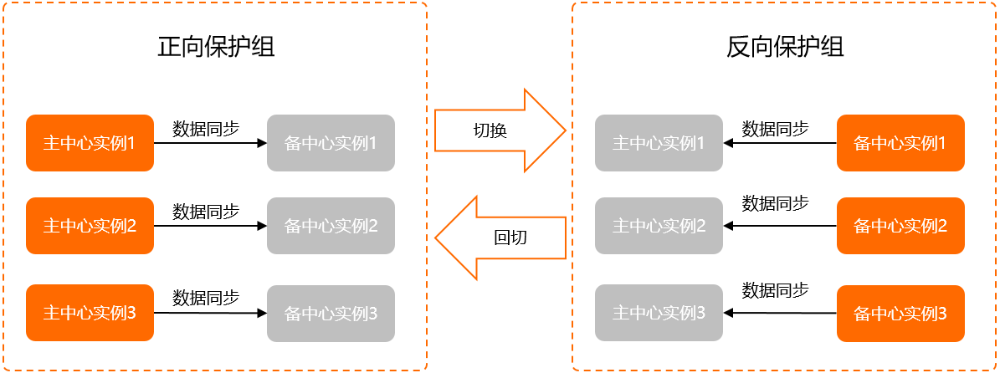

<a id="section-1-5-2-2"></a>

#### 1.5.2.2. 管理业务容灾计划

介绍如何新建业务容灾计划（演练计划/故障计划），如何查询业务容灾计划以及如何查看容灾计划的执行历史。

<a id="section-1-5-2-2-1"></a>

##### 1.5.2.2.1. 创建业务容灾计划

介绍如何创建业务容灾计划，包括演练计划和故障计划；同时可以配置演练或灾难恢复切换/回切时的执行步骤与执行策略。

**前提条件**

已创建保护组，请参见新建保护组。

**操作步骤**

1. 登录异地容灾管理平台ASR-DR。

2. 在左侧导航栏中选择**业务容灾 > 业务容灾计划**。

3. 单击**新建容灾计划**。

4. 在**填写基本信息**阶段，参考下表填写参数值，填写完单击**下一步**。

   **区域**

   **参数名称**

   **描述**

   下拉选择该计划执行的所属组织，与环境上方组织一致。

   - 如果在环境中已选定具体的组织且该组织没有子组织时，该参数值将自动填充。

   **组织**

   - 如果在环境中选择的是根组织（root）或其他组织但有子组织时，需要下拉选择具体的组织。

   下拉选择实例所属的资源集，与环境上方资源集一致。

   **灾备地域信息**

   - 如果在环境中已选定具体的资源集，该参数值将自动填充。

   **资源集**

   - 如果在环境中选择的是本组织全部资源及，需要下拉选择具体的资源集。

   选择容灾计划所属的容灾关系。

   **容灾关系**

   由用户自定义，由中文、英文、数字、"_"、"-"、"."组成，必须

   **计划名称**

   以大小写字母，数字或中文开头，2~20个字符。

   自定义勾选该计划的用途和目的：

   - **演练计划**：该计划只能用来做演练，不能做生产地域真实故障

   **容灾计划信**

   时的灾难恢复。

   **息**

   **计划类型**

   - **故障计划**：该计划既可以用来做演练，也可以做生产地域真实故障时的灾难恢复。

   请详细描述该计划的情况。

   **计划描述**

5. 在**选择保护组**阶段，执行以下操作。

   <ol type="i">

   <li>

   在可选择的保护组区域勾选需要容灾的保护组。

   </li>

   <li>

   单击  ，将上一步勾选的保护组添加到已选择的保护组区域。

   </li>

   <li>

   确认将所有需要执行的保护组添加成功后，选择**快速排序方式**。

   - **顺序执行**：在执行容灾操作时，保护组一个个按照顺序切换。

   - **并发执行**：在执行容灾操作时，保护组同时切换。

   </li>

   <li>

   单击**下一步**。

   </li>

   </ol>

6. 在**制定计划**阶段，分为切换阶段和切回阶段两个计划，系统会根据上一步选择的保护组预置一个计划，请确认或修改。然后单击**下一步**。

   - 切换计划和切回计划支持的操作类似，请参考下表操作：

     <table>
       <tr>
         <th width="160">任务名称</th>
         <th>操作步骤</th>
       </tr>
       <tr>
         <td>修改切换/切回步骤</td>
         <td>a. 单击，确认切换成功后和切换失败后的操作是否符合要求。<br>• 符合，单击<strong>确认</strong>。<br>• 不符合，请执行下一步。<br>b. 重新选择切换成功后和切换失败后的操作。<br>• 立即：表示切换成功后会立即执行下一步的操作。<br>• 等待固定时间：表示等待设置的时间后再执行下一步的操作或终止计划。<br>• 等待人工操作：表示切换成功后或切换失败后需要手工操作后续的步骤。<br>c. 单击<strong>确认</strong>。</td>
       </tr>
       <tr>
         <td>删除切换/切回步骤</td>
         <td>a. 单击。<br>b. 在弹出的提示框上单击<strong>确定</strong>。</td>
       </tr>
       <tr>
         <td>增加人工检查点</td>
         <td>a. 在<strong>选择步骤节点</strong>区域，单击<strong>人工检查点</strong>。<br>b. 单击<strong>+ 添加步骤</strong>。<br>c. 输入检查项，然后选择开始后的操作。<br>d. 单击<strong>确认</strong>。</td>
       </tr>
     </table>

7. 在**确认信息**阶段，确认设置的所有内容是否有误。

   - 如果有问题，可单击**上一步**修改。

   - 如果没有问题，请单击**提交**。

<a id="section-1-5-2-2-2"></a>

##### 1.5.2.2.2. 配置演练指标

可以通过配置的方式采集多种指标作为演练结果，对于不达标的结果给出适当的优化建议，帮助客户评估企业容灾架构性能，为快速定位问题解决问题提供有力依据。

**前提条件**

已创建好容灾计划，请参见创建业务容灾计划。

**操作步骤**

1. 登录异地容灾管理平台ASR-DR。

2. 在左侧导航栏中选择**业务容灾 > 业务容灾计划**。

3. 在**业务容灾计划**页面，输入容灾计划名称，单击  。

4. 展示符合条件的容灾计划后，单击**操作**列  ，单击**配置演练指标**。

5. 在**编辑演练指标期望值**页面，单击**添加条目**，输入各参数的期望值后，单击**确定**。

   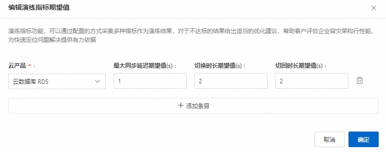

   > **说明**
   >
   > 单击**添加条目**支持配置多个云产品，但不可以重复。

<a id="section-1-5-2-2-3"></a>

##### 1.5.2.2.3. 查询业务容灾计划

目前支持以生产地域、计划类型、容灾计划名称、容灾计划ID的维度查询容灾计划。

**操作步骤**

1. 登录异地容灾管理平台ASR-DR。

2. 在左侧导航栏中选择**业务容灾 > 业务容灾计划**。

3. 下拉选择以哪个维度查询，支持选择**计划类型**、**容灾计划名称**或**容灾计划ID**。

4. 根据选择的维度不同，查询条件也不同，具体请查看下表。

   | 查询维度 | 查询条件 |
   | --- | --- |
   | 计划类型 | 下拉选择<strong>演练计划</strong>或<strong>故障计划</strong>。 |
   | 容灾计划名称 | 输入具体的容灾计划名称后单击。 |
   | 容灾计划ID | 输入具体的容灾计划ID后单击。 |

   > **说明**
   >
   > 也支持高级筛选，将几种查询维度组合起来一起查询。
   >
   > <ol type="i">
   >
   > <li>
   >
   > 单击**高级筛选**。
   >
   > </li>
   >
   > <li>
   >
   > 下拉选择计划类型，输入容灾计划名称和容灾计划ID。
   >
   > </li>
   >
   > <li>
   >
   > 单击**搜索**。
   >
   > </li>
   >
   > </ol>

<a id="section-1-5-2-2-4"></a>

##### 1.5.2.2.4. 执行业务灾难恢复

业务故障计划创建成功后，支持执行灾难恢复计划，本章节介绍如何执行灾难恢复计划以及注意事项。

> **重要**
>
> 如果是混合云容灾场景，当前专有云异地容灾管理平台因发生灾难已无法登录，请在公共云侧异地容灾管理平台执行切换操作；当专有云恢复后，需要在专有云侧异地容灾管理平台执行切回操作。需要将公共云的增量数据同步到专有云，可在回切步骤单击重置同步位点，配置增量同步任务的位点，同步实体会自动进入重保护流程创建增量同步任务。待保护组进入保护中状态后即可单击下一步执行故障回切流程，将业务切回到专有云侧。

**前提条件**

已创建故障计划，具体操作请参见创建业务容灾计划。

**操作步骤**

1. 登录异地容灾管理平台ASR-DR。

2. 在左侧导航栏选择**业务容灾** > **业务容灾计划**。

3. 在容灾计划列表中，单击目标计划**操作**列的  ，选择**开始故障切换**。

   > **说明**
   >
   > 在开始故障切换前，建议先执行一次演练操作，以确保计划编排以及保护组配置正确。

4. 在弹出的提示框上单击**确定**。

5. 进入容灾计划详情页面，根据创建的容灾计划逐个执行。

   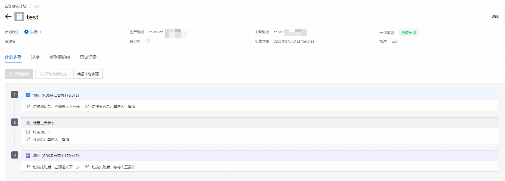

   > **说明**
   >
   > - 切换过程中，在**进度**页签，单击**中止**，将会中止整个切换任务。已中止的任务无法恢复执行，如果还需要执行当前切换任务，需要重新创建切换任务。
   >
   > - 切换过程中，在**进度**页签，单击**强制通过**，将会跳过当前步骤。
   >
   > - 切换过程中，如果某个步骤执行失败，单击**重试**，会重新执行该步骤。
   >
   > - 如果是混合云容灾场景，在专有云侧执行回切操作时，单击**重置同步位点**，配置增量同步任务的位点，同步实体会自动进入重保护流程创建增量同步任务。待保护组进入保护中状态后即可单击下一步执行故障回切流程，将业务切回到专有云侧。

6. 切换完成后，在**历史记录**页签查看切换结果。

   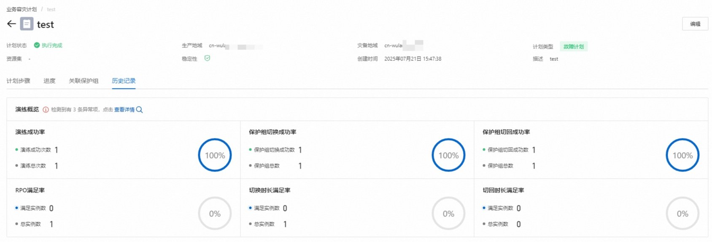

<a id="section-1-5-2-2-5"></a>

##### 1.5.2.2.5. 执行业务容灾演练

演练计划支持界面化查看演练过程，演练结果支持生成演练报告，并一键下载报告。

**前提条件**

已创建业务容灾演练计划，具体操作请参见创建业务容灾计划。

**操作步骤**

1. 登录异地容灾管理平台ASR-DR。

2. 在左侧导航栏选择**业务容灾** > **业务容灾计划**。

3. 在演练计划列表中，单击目标计划**操作**列的**开始演练**。

4. 在弹出的提示框上单击**确定**。

5. 进入**演练计划详情**页面，根据创建的演练计划逐个执行演练任务。

   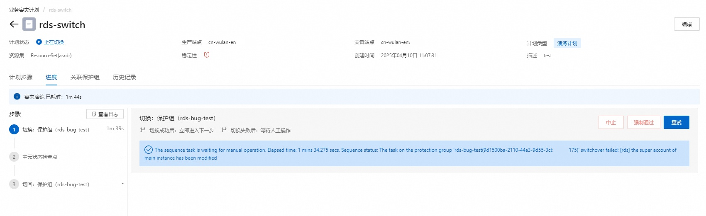

   > **说明**
   >
   > - 演练过程中，单击**中止**，并填写中止原因，将会中止整个演练任务。已中止的任务无法恢复执行，如果还需要执行当前演练任务，需要重新创建演练任务。
   >
   > - 演练过程中，单击**强制通过**，将会跳过当前步骤。
   >
   > - 演练过程中，如果某个步骤执行失败，单击**重试**，会重新执行该步骤。

6. 演练完成后，在**历史记录**页签查看演练结果。

   演练概览中展示：

   - 演练成功率：包含**演练成功次数**和**演练总次数**，以及演练成功率百分比。

   - 保护组切换成功率：包含**保护组切换成功数**和**保护组总数**，以及保护组切换成功率百分比。

   - 保护组切回成功率：包含**保护组切回成功数**和**保护组总数**，以及保护组切回成功率百分比。

   - 同步延迟满足率：包含**满足实例数**和**总实例数**，以及同步延迟满足率百分比。

   - 切换时长满足率：包含**满足实例数**和**总实例数**，以及切换时长满足率百分比。

   - 切回时长满足率：包含**满足实例数**和**总实例数**，以及切回时长满足率百分比。

7. 在演练记录**操作**列单击**查看演练总结**。

   > **说明**
   >
   > 已创建报告的演练记录**操作**列，会显示**下载报告**操作。

   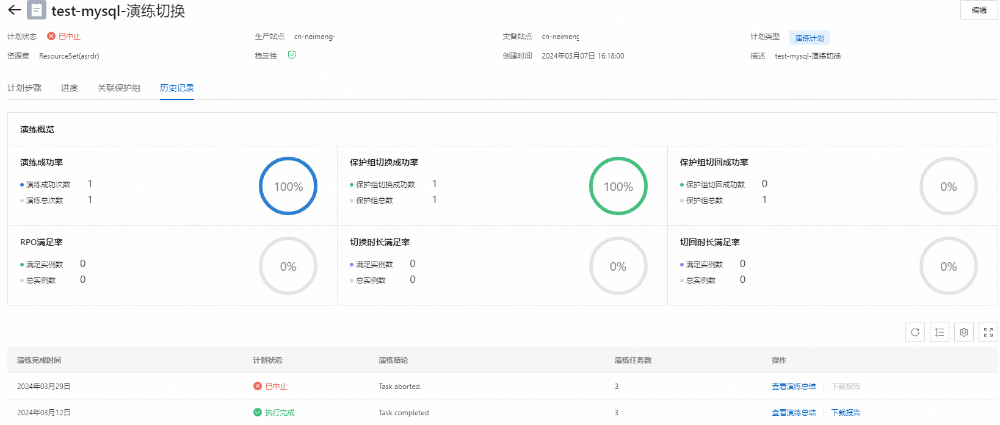

8. 进入**演练总结**页面，根据演练结果，在**演练结论**区域单击**编辑**，填写演练结论。

   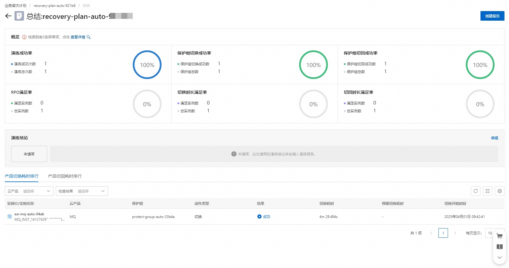

   单击左上角**查看详情**，支持查看检测到的异常项。

9. 在页面右上角单击**创建报告**，系统自动生成演练报告。单击**下载报告**，导出Word版演练报告。

<a id="section-1-5-2-2-6"></a>

##### 1.5.2.2.6. 查看计划执行历史

在计划执行历史页面，支持用户查看灾难演练记录和灾难恢复记录。

**操作步骤**

1. 登录异地容灾管理平台ASR-DR。

2. 在左侧导航栏中选择**业务容灾 > 业务容灾计划**。

3. 单击**计划执行历史**，会跳转至计划执行历史页，演练执行历史以时间倒序的方式展示。

4. 查看容灾演练记录。

   <ol type="i">

   <li>

   在**容灾演练记录**页签，选择以**计划状态**、**演练结论**或**容灾计划名称**维度查询。

   </li>

   <li>

   选择计划状态或演练结论或输入容灾计划名称，系统会自动筛选出符合条件的计划。

   单击**高级筛选**，选择正确的计划状态、演练结论和容灾计划名称，单击**搜索**。

   </li>

   <li>

   筛选出符合条件的灾难演练记录后，支持查看演练总结或下载报告。

   - 详情：单击**操作**列**详情**，进入演练**进度**页面。

   - 查看演练总结：单击**操作**列**查看演练总结**，进入演练总结页面。

   </li>

   </ol>

5. 查看灾难恢复记录。

   <ol type="i">

   <li>

   选择**灾难恢复记录**页签，选择以**计划状态**或**容灾计划名称**维度查询。

   单击**高级筛选**，选择正确的计划状态和容灾计划名称，单击**搜索**。

   </li>

   <li>

   选择计划状态或输入容灾计划名称，系统会自动筛选出符合条件的计划。

   </li>

   </ol>

<a id="section-1-5-2-3"></a>

#### 1.5.2.3. 管理容灾单元空间

针对双活场景，ASR-DR支持业务双活主备模式和业务双活数据读写分离模式。对于业务双活数据读写分离模式，目前只有数据库 RDS和对象存储 OSS两个云产品支持该功能。

**模式介绍**

- 主备模式：无论业务进程在生产站点还是灾备站点，读写操作始终选择同步实体的生产实例。

- 读写分离模式：对于写操作，无论业务进程在生产站点还是灾备站点，始终选择同步实体的生产实例；对于读操作，始终选择就近机房的节点。

<a id="section-1-5-2-3-1"></a>

##### 1.5.2.3.1. 创建容灾单元空间

通过将容灾单元空间绑定到保护组，使得切换时只切换该单元空间内的同步实体。一个容灾单元空间不能跨保护组绑定；一个同步实体不能被多个容灾单元空间使用。

**前提条件**

已经定制数据面SDK，具体操作请参见定制数据面SDK实现多Endpoint能力。

**使用场景**

- **双活主备：**

  业务双活，云产品主备。同一业务系统同时部署在两朵云，正常情况下，所有业务系统均使用云产品生产站点的接入点进行读写操作。当生产站点发生故障时，云产品切换到灾备站点，所有业务系统也将接入点切换到灾备站点接入点进行读写操作。

- **双活读写分离：**

  业务双活，云产品主备，灾备站点的云产品提供读服务。同一业务系统同时部署在两朵云，正常情况下，所有业务系统均使用云产品生产站点的接入点进行写操作，主备站点业务系统使用就近机房的云产品接入点进行读操作。当生产站点发生故障时，云产品切换到灾备站点，所有业务系统将接入点切换到灾备站点接入点进行读写操作。

**操作步骤**

1. 登录异地容灾管理平台ASR-DR。

2. 在左侧导航栏中选择**业务容灾 > 容灾单元空间**。

3. 单击**创建容灾单元空间**，参考下表填写参数值。

   | 参数名称 | 描述 |
   | --- | --- |
   | 组织 | 选择该容灾单元空间所属的组织。 |
   | 资源集 | 选择该容灾单元空间所属的资源集。 |
   | 容灾空间单元名称 | 用户自定义，长度限制为 3 ~ 64 个字符，以字母开头，支持数字和"_"、"-"特殊字符。 |
   | 用途 | 描述该容灾单元空间的用途。 |
   | 备注 | 输入该容灾单元空间的其他信息。 |

4. 绑定保护组。

   - 单击**仅创建。**

     <ol type="a">

     <li>

     创建成功后会跳转到容灾单元空间页面，可以看到刚创建的容灾单元空间。单击**操作**列的**绑定保护组**。

     </li>

     <li>

     勾选对应的保护组，单击**确定**。

     </li>

     </ol>

   - 单击**创建，去绑定保护组**。

     <ol type="a">

     <li>

     勾选对应的保护组，单击**确定**。

     </li>

     </ol>

**相关操作**

容灾单元空间创建成功后，您还可以执行以下操作。

| 任务名称 | 操作步骤 |
| --- | --- |
| 查询容灾单元空间 | • 基础筛选：<br>i. 下拉选择<strong>保护组</strong>或<strong>容灾单元空间</strong>，输入保护组名称或容灾单元空间名称。<br>ii. 单击，筛选出符合条件的内容。<br>• 高级筛选：<br>• 单击<strong>高级筛选</strong>。<br>• 输入容灾单元空间名称和保护组名称。<br>• 单击<strong>搜索</strong>。 |
| 解除保护组<br>说明已绑定保护组的容灾单元空间支持解绑。 | 1. 单击目标容灾单元空间<strong>操作</strong>列<strong>解除绑定</strong>。<br>2. 在弹出的提示框上单击<strong>确定</strong>。 |
| 刷新容灾单元空间列表 | 单击页面右上角刷新列表。 |
| 调整容灾单元空间列表显示样式 | 单击页面右上角，选择以<strong>默认</strong>形式或<strong>紧凑</strong>形式显示容灾单元空间列表。 |
| 自定义容灾单元空间列表的列字段 | 单击页面右上角，勾选需要显示的列字段。 |

<a id="section-1-5-2-3-2"></a>

##### 1.5.2.3.2. 切换容灾单元空间

本章节介绍如何通过切换容灾单元空间，将绑定的保护组中的保护实体一起切换。

**前提条件**

已为容灾单元空间绑定保护组，具体请参加创建容灾单元空间。

**操作步骤**

1. 登录异地容灾管理平台ASR-DR。

2. 在左侧导航栏中选择**业务容灾 > 容灾单元空间**。

3. 在**容灾单元空间**页面，单击相应**操作**列的**切换**。

   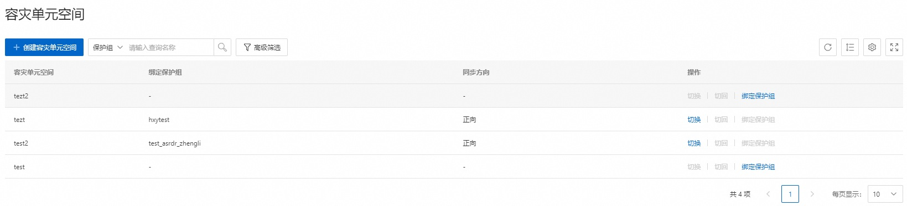

4. 在弹出的提示框上单击**确定**。

<a id="section-1-5-2-3-3"></a>

##### 1.5.2.3.3. 切回容灾单元空间

主机房业务功能恢复后，需要将之前切换到备机房的容灾单元空间中的保护实体切回至主机房。

**前提条件**

相应的容灾单元空间切换成功，请参见切换容灾单元空间。

**操作步骤**

1. 登录异地容灾管理平台ASR-DR。

2. 在左侧导航栏中选择**业务容灾 > 容灾单元空间**。

3. 在**容灾单元空间**页面，单击相应**操作**列的**切回**。

4. 在弹出的提示框上单击**确定**。

<a id="section-1-6"></a>

## 1.6. 告警管理

<a id="section-1-6-1"></a>

### 1.6.1. 配置告警规则

ASR-DR控制台发出报警需要遵循一定的规则，您可以根据实际需求创建一个或多个告警规则。

**操作步骤**

1. 登录ASR-DR控制台。

2. 在左侧导航栏选择**告警管理** > **告警规则**。

3. 单击**新建**。

4. 在**新建告警规则**页面，配置相关参数。单击**确定**。

   <table>
     <tr>
       <th width="89">名称</th>
       <th>描述</th>
     </tr>
     <tr>
       <td>规则名称</td>
       <td>自定义告警规则的名称。名称的长度为4-20个字符或2-10个汉字。</td>
     </tr>
     <tr>
       <td>规则描述</td>
       <td>非必填，请输入对告警规则的简单描述。</td>
     </tr>
     <tr>
       <td>组织</td>
       <td>选择容灾实例所在的组织。<br>说明如果您是组织管理员或组织容灾管理员登录，下拉列表中只呈现您管理的组织。</td>
     </tr>
     <tr>
       <td>监控项</td>
       <td>i. 在第一个下拉列表中选择具体的监控指标，支持如下监控项：<br>• 保护组状态<br>• 计划最新状态<br>• 计划RTO<br>• 保护组同步延迟ii. 在第二个下拉列表中选择触发条件。iii. 在第三个下拉列表中选择或输入对应的触发值。</td>
     </tr>
     <tr>
       <td>告警级别</td>
       <td>用户可按严重程度自定义告警级别，分为<strong>警报</strong>、<strong>紧急</strong>、<strong>警告</strong>、<strong>消息</strong>和<strong>错误</strong>。</td>
     </tr>
     <tr>
       <td>告警对象</td>
       <td>在下拉列表中选择接收告警的用户。下拉列表中显示Apsara Uni-manager运营控制台上对应组织的用户。<br>说明如果下拉列表为空，请在Apsara Uni-manager控制台上创建对应组织的用户。</td>
     </tr>
     <tr>
       <td>告警方式</td>
       <td>ASR-DR支持如下告警通知方式：<br>• 邮箱地址：符合该告警规则的告警，ASR-DR会通过邮箱通知告警对象。<br>• 钉钉Token：符合该告警规则的告警，ASR-DR会通过钉钉通知告警对象。<br>• ASO大屏：符合该告警规则的告警，ASR-DR会推送到Apsara Uni-manager运维控制台的监控告警中。</td>
     </tr>
   </table>

**其他操作**

告警规则创建成功后，还支持您执行以下操作。

<table>
  <tr>
    <th width="154">任务名称</th>
    <th>操作步骤</th>
  </tr>
  <tr>
    <td>查询告警规则</td>
    <td>• 基础查询<br>i. 选择以规则名称、监控项、告警级别或规则状态，输入对应的查询条件。<br>ii. 单击。<br>• 高级筛选<br>i. 单击<strong>高级筛选</strong>。ii. 输入规则名称，选择监控项、告警级别和规则状态。iii. 单击<strong>搜索</strong>。单击<strong>重置</strong>，ASR-DR会清除查询条件并刷新告警规则列表。</td>
  </tr>
  <tr>
    <td>查看告警规则详情</td>
    <td>1. 在<strong>告警规则</strong>列表页面，您可以单击某条告警规则操作列的。<br>2. 单击<strong>详情</strong>。</td>
  </tr>
  <tr>
    <td>修改告警规则</td>
    <td>1. 在<strong>告警规则</strong>列表页面，您可以单击某条告警规则操作列的。<br>2. 单击<strong>修改</strong>。<br>3. 修改完后单击<strong>确定</strong>，即可生效。</td>
  </tr>
  <tr>
    <td>停止告警规则</td>
    <td>1. 在<strong>告警规则</strong>列表页面，您可以单击某条告警规则操作列的。<br>2. 单击<strong>停止</strong>。<br>3. 在弹出的提示框上单击<strong>确定</strong>，该告警规则内容将即时生效。</td>
  </tr>
  <tr>
    <td>删除告警规则</td>
    <td>1. 在<strong>告警规则</strong>列表页面，您可以单击某条告警规则操作列的。<br>2. 单击<strong>删除</strong>。<br>3. 在弹出的提示框上单击<strong>确定</strong>。</td>
  </tr>
</table>

<a id="section-1-6-2"></a>

### 1.6.2. 查看并导出告警信息

通过查看告警信息，您可以及时获取异常信息。

**操作步骤**

1. 登录ASR-DR控制台。

2. 在左侧导航栏选择**告警管理**>**告警记录**。

3. 您可以直接查看告警信息或通过设置筛选项查看。

   - 在页面上方配置查询条件，可以自定义查询告警范围。

   - 单击告警ID可以查看单条告警的详细信息。

<a id="section-1-6-3"></a>

### 1.6.3. 同步延迟预警配置

您可以设置各产品的同步延迟预警阈值，ASR-DR会根据该阈值计算各产品的同步延迟时间并显示在首页和容灾大屏页面。

1. 登录ASR-DR控制台。

2. 在左侧导航栏，选择**告警管理**>**同步延迟预警配置**。

3. 填写各产品的同步延迟预警阈值（单位秒），单击**确认**。

> **说明**
>
> 该功能只在跨云容灾场景中支持，跨Region容灾场景中不支持该功能。

<a id="section-1-7"></a>

## 1.7. 系统管理

<a id="section-1-7-1"></a>

### 1.7.1. 管理云实例

用户需要先创建云实例才能配置保护组和容灾计划。云实例是以一级组织为单位进行管理的，一级组织以及其子组织内任意有权限的用户都可以为本组织配置云实例，配置的云实例本组织内可见。

**操作须知**

- 如果只需要在本云的不同Region间做容灾，则只需要配置灾备云实例。

- 用户配置的云实例是一级组织及其子组织内共享的，不同一级组织的用户需要分别配置各自的云实例。

**前提条件**

- 已获取到ASCM组织账号的AccessKey ID和AccessKey Secret，获取方法请参见获取AccessKey。

- 已获取到专有云实例个人账号的AccessKey ID和AccessKey Secret，获取方法请参见获取AccessKey。

- 已获取到公共云实例个人账号的AccessKey ID和AccessKey Secret，获取方法请参见如何获取公共云个人账号的AK和SK。

- 已参考管理云产品信息章节，成功配置云产品信息。

> **说明**
>
> - 如果添加的是公共云实例，则不需要获取ASCM组织账号的AccessKey ID和AccessKey Secret。
>
> - 添加专有云实例或公共云实例时，获取个人账号的方法存在差异。请参考相应的方法进行获取。

**操作步骤**

1. 登录异地容灾管理平台ASR-DR。

2. 在左侧导航栏中选择**系统管理 > 云实例管理**。

3. 单击**添加云实例**，勾选需要添加的云实例，单击**下一步**。

4. 下拉选择组织和资源集，输入主账号AK和SK，单击**提交**。

   > **说明**
   >
   > - 如果配置的是公共云实例，则不需要输入主账号AK和SK。
   >
   > - 主账号AK和SK请输入ASCM组织账号的AccessKey ID和AccessKey Secret。主账号AK和SK只要由云实例创建人配置一次即可。

5. 提交后，会提示云实例的用户AccessKey未配置，请输入提前获取的个人账号AK和SK。

   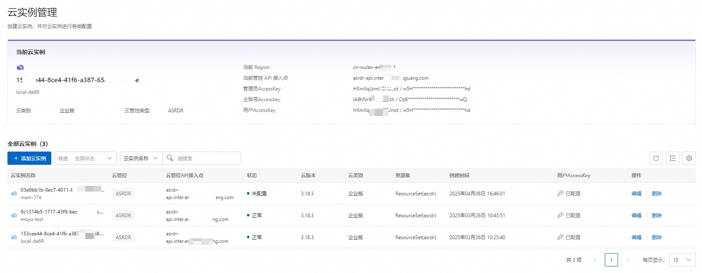

   > **说明**
   >
   > **用户AK**和**用户SK**请输入个人账号的AccessKey ID和AccessKey Secret。

6. 单击**确认**，用户AccessKey列会显示已配置。

   > **说明**
   >
   > **用户AK**和**用户SK**是每个用户都要配置的，不配置无法使用该云实例。

**相关操作**

云实例添加成功后，您还可以执行以下操作。

| 任务名称 | 操作步骤 |
| --- | --- |
| 查询云实例 | 1. 下拉选择云实例状态。<br>2. 选择以云实例名称或云实例ID，输入云实例名称或云实例ID。<br>3. 单击。 |
| 编辑云实例 | 1. 单击<strong>操作</strong>列<strong>编辑</strong>。<br>2. 修改主账号AK和主账号SK，单击<strong>提交</strong>。 |
| 删除云实例 | 1. 单击<strong>操作</strong>列<strong>删除</strong>。<br>2. 在弹出的提示框上单击<strong>删除</strong>。 |
| 刷新云实例列表 | 单击页面右上角刷新列表。 |
| 调整云实例列表显示样式 | 单击页面右上角，选择以<strong>默认</strong>形式或<strong>紧凑</strong>形式显示云实例列表。 |
| 自定义云实例列表的列字段 | 单击页面右上角，勾选需要显示的列字段。 |

<a id="section-1-7-2"></a>

### 1.7.2. 管理容灾关系

异地容灾管理平台在执行容灾前需要绑定容灾关系，只有互为容灾关系的地域才支持进行容灾操作。

**背景信息**

执行容灾时要求在生产地域进行容灾管理和切换操作，灾备地域仅在生产地域发生故障时执行故障切换操作。

容灾关系分为两种情况：

- 容灾关系仅包括一个主地域和一个备份地域，不支持多地域容灾。专有云到专有云的容灾仅允许在灾备地域内进行容灾操作，而专有云到公有云的容灾则支持在任意地域进行容灾操作。

- 容灾关系包括一主多备的多个地域，支持多地域容灾，并能够在任意地域进行容灾操作。

**操作步骤**

1. 登录ASR-DR控制台。

2. 在左侧导航栏选择**系统管理**>**容灾关系管理**。

3. 在**容灾关系管理**页面单击**新增容灾关系**。

   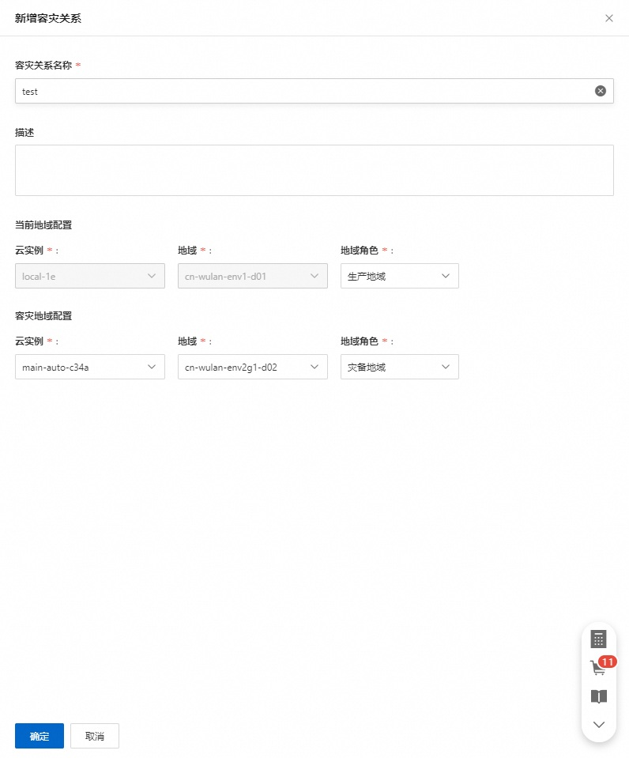

   > **说明**
   >
   > - 在一个容灾关系内的多个地域中，仅存在一个生产地域。
   >
   > - 除了生产地域外，其他地域都是灾备地域。
   >
   > - 在非混合云容灾场景下，当前地域必须为灾备地域，而不能为生产地域。

   | 参数名称 | 参数说明 |
   | --- | --- |

   <table>
     <tr>
       <td colspan="2">容灾关系名称</td>
       <td>自定义容灾关系名称，长度或条目数大于4小于30字符。</td>
     </tr>
     <tr>
       <td colspan="2">描述</td>
       <td>该容灾关系的其他描述信息。</td>
     </tr>
     <tr>
       <td rowspan="3">当前地域配置</td>
       <td>云实例</td>
       <td>指当前登录的异地容灾管理平台所在的云实例 ，请保持系统默认值。</td>
     </tr>
     <tr>
       <td>地域</td>
       <td>指当前登录的异地容灾管理平台所在的地域，请保持系统默认值。</td>
     </tr>
     <tr>
       <td>地域角色</td>
       <td>请选择当前地域为生产地域或灾备地域。<br>• <strong>生产地域</strong>：指的是在异地容灾系统中，主要数据中心所在的地域。<br>• <strong>灾备地域</strong>：指的是在异地容灾系统中，用于在主要生产环境发生灾难或故障时，承担业务连续性和数据恢复职责的备用站点或数据中心。<br>说明除混合云容灾关系外，当前地域角色建议配置为“灾备地域”。</td>
     </tr>
     <tr>
       <td rowspan="3">容灾地域配置</td>
       <td>云实例</td>
       <td>下拉选择云实例。一组容灾关系中云实例可以被添加多次，但是地域不能相同，相当于跨Region容灾。</td>
     </tr>
     <tr>
       <td>地域</td>
       <td>下拉选择该云实例所属的地域。</td>
     </tr>
     <tr>
       <td>地域角色</td>
       <td>下拉选择该地域的角色为生产地域或灾备地域，与<strong>当前地域配置</strong>的<strong>地域角</strong><strong>色</strong>不能一致。</td>
     </tr>
   </table>

4. 单击**确定**。

**其他操作**

容灾关系新建成功后，您还可以执行以下操作。

<table>
  <tr>
    <th width="160">任务名称</th>
    <th>操作步骤</th>
  </tr>
  <tr>
    <td>查询容灾关系</td>
    <td>输入容灾关系名称，选择生产地域和灾备地域，会筛选出符合条件的容灾关系。</td>
  </tr>
  <tr>
    <td>编辑容灾关系</td>
    <td>1. 单击<strong>操作</strong>列<strong>编辑</strong>。<br>2. 修改容灾关系名称和描述。<br>3. 单击<strong>确定</strong>。</td>
  </tr>
  <tr>
    <td>禁用/启用容灾关系</td>
    <td>1. 单击<strong>操作</strong>列<strong>禁用</strong>/<strong>启用</strong>。<br>2. 在弹出的提示框上单击<strong>确定</strong>。禁用后正在执行的容灾计划会继续执行，但无法再触发新的执行任务。</td>
  </tr>
  <tr>
    <td>删除容灾关系</td>
    <td>1. 单击<strong>操作</strong>列<strong>删除</strong>。<br>2. 在弹出的提示框上单击<strong>删除</strong>。<br>重要由于容灾关系与大量容灾资源对象相关联，因此不建议删除容灾关系，建议禁用即可。如果要删除容灾关系，请先删除该容灾关系下所有的资源对象，包括保护组、容灾计划等。</td>
  </tr>
</table>

<a id="section-1-7-3"></a>

### 1.7.3. 日志管理

操作日志记录了系统中所有的操作，包括保护组、计划和实例的创建、删除和执行情况等。

**操作步骤**

1. 登录ASR-DR控制台。

2. 在左侧导航栏选择**系统管理**>**日志管理**。

   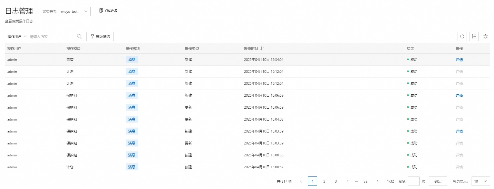

   | 名称 | 描述 |
   | --- | --- |
   | 操作模块 | ASR-DR系统的模块，包括计划、实例、告警、保护组、系统管理等。 |
   | 操作级别 | 日志的级别，分为紧急、警报、错误、警告和消息。 |
   | 操作类型 | 日志记录的操作类型。 |

3. （可选）您可以根据操作用户、操作模块、操作级别、操作类型、开始时间或结束时间筛选特定的操作日志。

4. （可选）

   单击**重置**，ASR-DR会清除搜索条件并重新刷新日志列表信息。

<a id="section-1-7-4"></a>

### 1.7.4. 管理混合云容灾

用户需要先创建云实例才能配置保护组和容灾计划。混合云的云实例是以一级组织为单位进行管理的，一级组织以及其子组织内任意有权限的用户都可以为本组织配置云实例，配置的云实例本组织内可见。

**背景信息**

混合云容灾指专有云和公有云之间进行容灾。本文中指专有云和阿里云公有云形成混合云容灾。

**操作须知**

- 如果只需要在本云的不同Region间做容灾，则只需要配置灾备云实例。

- 用户配置的云实例是一级组织及其子组织内共享的，不同一级组织的用户需要分别配置各自的云实例。

**前提条件**

- 已获取到个人账号的AccessKey ID和AccessKey Secret，获取方法请参见如何获取公共云个人账号的AK和SK。

- 已参考管理云产品信息章节，成功配置云产品信息。

**操作步骤**

1. 登录异地容灾管理平台ASR-DR。

2. 在左侧导航栏中选择**系统管理 > 混合云容灾管理**。

   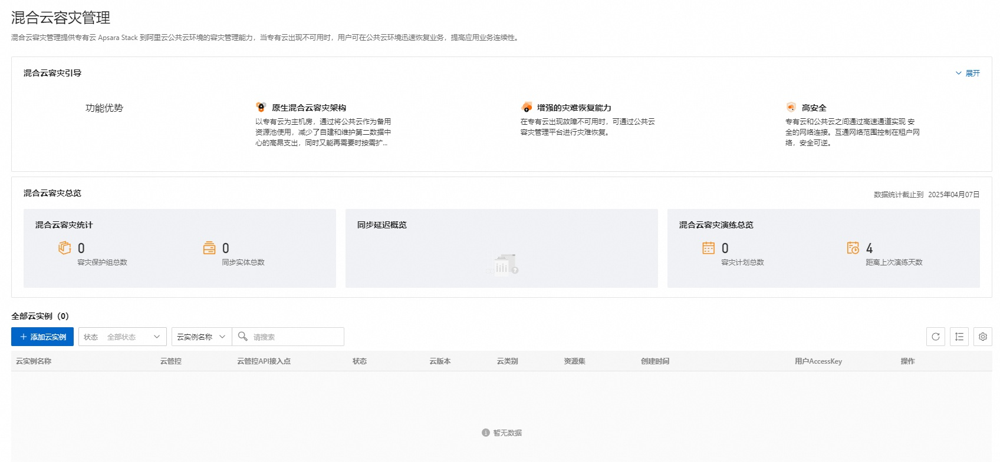

3. 单击**添加云实例**，勾选需要添加的云实例，单击**下一步**。

   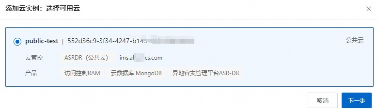

4. 下拉选择组织和资源集，单击**提交**。

5. 提交后，会提示云实例的用户AccessKey未配置，请输入提前获取的个人账号AK和SK。

   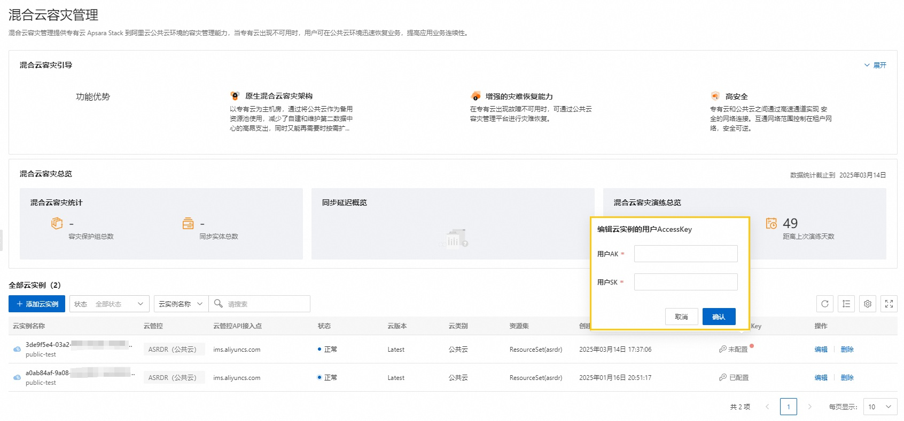

   > **说明**
   >
   > **用户AK**和**用户SK**请输入个人账号的AccessKey ID和AccessKey Secret。

6. 单击**确认**，用户AccessKey列会显示已配置。

   > **说明**
   >
   > **用户AK**和**用户SK**是每个用户都要配置的，不配置无法使用该云实例。

**相关操作**

混合云实例添加成功后，您还可以执行以下操作。

| 任务名称 | 操作步骤 |
| --- | --- |
| 查询云实例 | 1. 下拉选择云实例状态。<br>2. 选择以云实例名称或云实例ID，输入云实例名称或云实例ID。<br>3. 单击。 |
| 删除云实例 | 1. 单击<strong>操作</strong>列<strong>删除</strong>。<br>2. 在弹出的提示框上单击<strong>删除</strong>。 |
| 刷新云实例列表 | 单击页面右上角刷新列表。 |
| 调整云实例列表显示样式 | 单击页面右上角，选择以<strong>默认</strong>形式或<strong>紧凑</strong>形式显示云实例列表。 |
| 自定义云实例列表的列字段 | 单击页面右上角，勾选需要显示的列字段。 |

<a id="section-1-8"></a>

## 1.8. 常见问题处理

<a id="section-1-8-1"></a>

### 1.8.1. 实体保护失败的处理方法

对于RDS和Tablestore，可能会出现由于主备RDS实例的数据库或Tablestore实例的表发生增减，导致实体保护失败。此时需要人工操作来恢复实体。

**产品**

**场景**

**现象**

**恢复方法**

需要人为创建备实例对应的数据库，然后单击**重保护**按

主RDS实例增加

钮。大约10分钟后，实体变为**保护中**，链路中会相应增

数据库

加变化的数据库。

需要人为删除备实例对应的数据库，然后单击**重保护**按

主RDS实例减少

钮，大约10分钟后，实体变为**保护中**，链路中会相应减

数据库

少变化的数据库。

RDS

备RDS实例增加

需要人为删除增加的数据库，然后再单击**重保护**按钮，大

数据库

约10分钟后，实体变为**保护中**，链路不变。

备RDS实例减少

需要人为单击**重保护**按钮，大约10分钟后，实体变为**保**

数据库

**护中**，链路不变。

大约15分钟后，实体会检测

需要人为单击**重保护**按钮，大约10分钟后，实体变为**保**

主Tablestore

出异常，显示保

**护中**，备实例会相应的增加表。保护链路中会相应增加变

实例增加表

护失败。

化的表。

需要人为删除备实例对应的表，然后单击**重保护**按钮，大

主Tablestore

约10分钟后，实体变为**保护中**，此时保护链路中会相应

实例减少表

减少变化的表。

OTS

备Tablestore

需要人为删除备实例增加的表，然后单击**重保护**按钮，大

实例增加表

约10分钟后，实体变为**保护中**，链路不变。

需要人为单击**重保护**按钮，此时会自动建立备实例相应的

备Tablestore

表，大约10分钟后，实体变为**保护中**，链路会恢复之前

实例减少表

的状态。

<a id="section-1-9"></a>

## 1.9. 附录

<a id="section-1-9-1"></a>

### 1.9.1. 创建RAM角色

您需要分别在生产云和灾备云的Apsara Uni-manager运营控制台上，给待保护实例所在组织创建数据传输（DTS）和异地容灾管理平台（ASR-DR）的RAM服务角色。

**操作步骤**

1. 登录生产云的Apsara Uni-manager运营控制台。

2. 在顶部菜单栏，单击**配置**，在**配置**页面左侧导航栏，单击**RAM服务角色**。

3. 为待保护的RDS对应的组织，创建**数据传输 DTS**服务角色。

   <ol type="i">

   <li>

   单击**创建RAM服务角色**。

   </li>

   <li>

   在**RAM服务角色创建**页面，在**服务名称**下拉列表中选择**数据传输 DTS**，在**授权组织名称**下拉列表中选择待保护RDS对应的组织。

   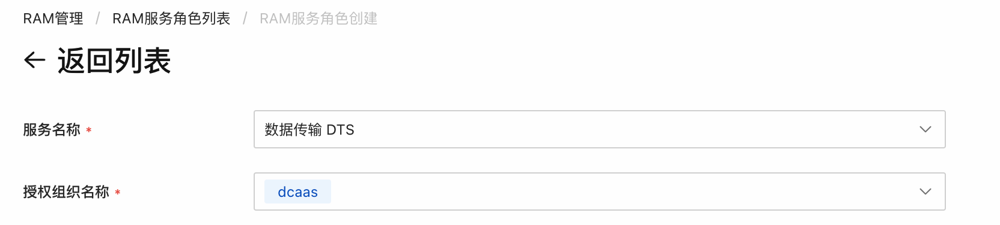

   </li>

   <li>

   单击**确定**。

   </li>

   </ol>

4. 分别为待保护的PolarDB-X和PolarDB对应的组织创建**数据传输 DTS**服务角色，操作步骤请参见步骤3。

5. 分别为待保护实例对应的各个组织创建**异地容灾管理平台 ASR-DR**服务角色，操作步骤请参见步骤3。

   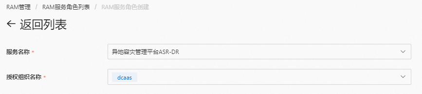

6. 登录灾备云的Apsara Uni-manager运营控制台，重复以上步骤，创建灾备云的RAM服务角色。

<a id="section-1-9-2"></a>

### 1.9.2. 如何获取公共云个人账号的AK和SK

在添加公有云实例时需要配置个人账号的AK和SK，本文介绍如何获取公共云个人账号的AccessKey ID和AccessKey Secret。

> **说明**
>
> AccessKey Secret只在创建时显示，不支持查看。因此，本章节介绍如何创建**AccessKey**的操作，请及时保存AccessKey ID和AccessKey Secret，在添加公共云实例时候需要配置。
>
> - AccessKey ID：用于标识用户。
>
> - AccessKey Secret：是一个用于验证您拥有该AccessKey ID的密码。

**前提条件**

您可以使用以下账号创建RAM用户的AccessKey：

- 阿里云账号（主账号）。

- RAM管理员。

- 允许自主管理AccessKey的RAM用户。

**操作步骤**

1. 登录RAM控制台。

2. 在左侧导航栏，选择**身份管理 > 用户**。

3. 在**用户**页面，单击目标RAM用户名称。

4. 在**认证管理**页签下的**AccessKey**区域，单击**创建AccessKey**。

   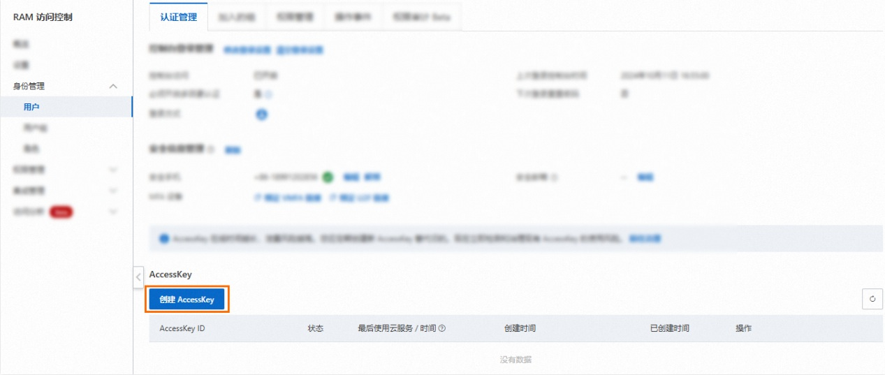

5. 阅读AccessKey使用场景及使用建议，强烈建议您遵从使用建议选择更合适的凭据方案。如果必须创建AccessKey，则选择对应使用场景后，勾选**我确认必须创建AccessKey**，然后单击**继续创建**，创建的AccessKey不受使用场景的影响。

   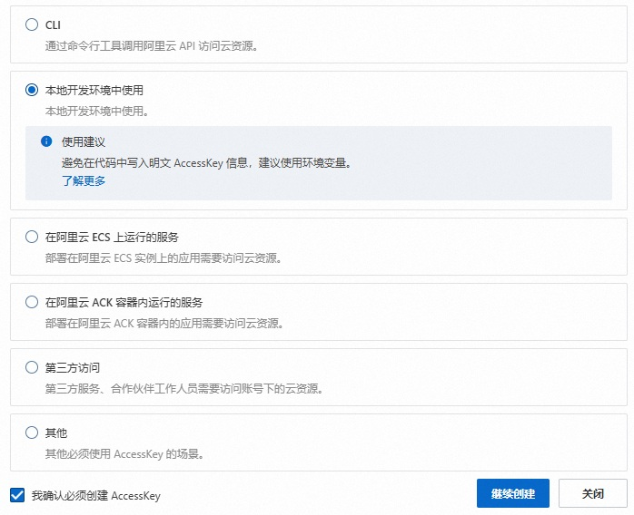

6. 在**创建AccessKey**对话框，保存AccessKey ID和AccessKey Secret，然后单击**确定**。

   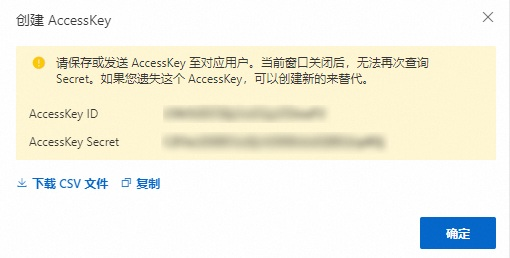

<a id="section-1-9-3"></a>

### 1.9.3. 获取AccessKey

运营管理员或组织管理员需要分别获取生产、灾备中心对应的个人账号AccessKey或组织AccessKey，并在ASR-DR上配置对应的AccessKey后，才能正常使用ASR-DR。

**前提条件**

只有运营管理员和一级组织管理员可以获取组织AccessKey。

**获取个人账号AccessKey**

获取个人账号AccessKey的方法如下：

1. 登录Apsara Uni-manager运营控制台。

2. 在系统界面右上角，将鼠标悬停在当前登录用户的头像上，单击**个人信息**。

3. 在**AccessKey**区域，您可以查看个人账户的AccessKey信息。

   

   > **说明**
   >
   > Accesskey ID和AccessKey Secret是您访问云资源时的密钥，具有该账号完整的权限，请您妥善保管。

**获取组织AccessKey**

获取组织AccessKey的方法如下：

1. 管理员登录Apsara Uni-manager运营控制台。

2. 在顶部菜单栏，单击**企业**。

3. 在左侧导航栏中，选择**资源管理 > 组织管理**。

4. 在组织结构中，单击目标一级组织名称。

5. 单击**管理Accesskey**。

6. 在弹出的对话框中，查看组织AccessKey信息。

**获取ASR-DR的AccessKey**

获取ASR-DR的AccessKey的方法如下：

1. 登录Apsara Uni-manager运维控制台。

2. 在顶部菜单栏选择**平台运维 > 飞天基础运维平台 > 资源管理**。

3. 在**飞天基础运维平台**左侧导航栏中，选择**资源管理 > 产品集群运维**。

4. 在搜索框输入“asrdr”，并单击**集群详情**。

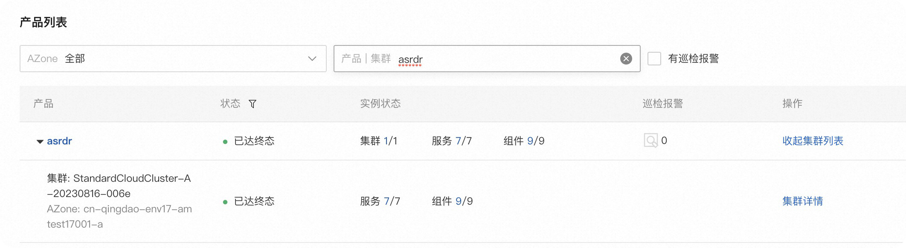

5. 在集群详情页选择**资源详情**页签，选择资源类型为**accesskey**的资源，在**资源申请结果**栏单击  图标即

   可查看asrdr的AK和SK。

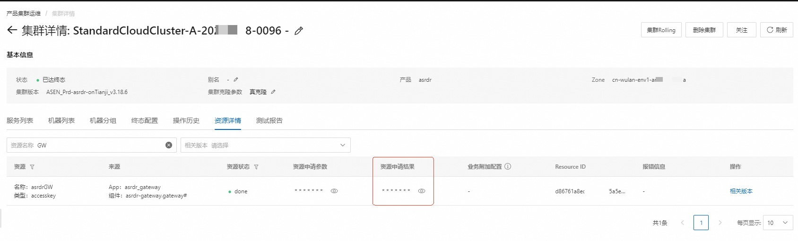

<a id="section-1-9-4"></a>

### 1.9.4. 查看MaxCompute同步日志

MaxCompute日志比实体日志包含更多信息，可以帮助您定位和分析保护失败的原因。

1. 登录ASR-DR控制台。

2. 在左侧导航栏选择**业务容灾>保护组**。

3. 单击保护组**操作**列**详情**。

4. 在**保护组详情**页面，单击实例列表中目标实例右侧的  图标，选择**ODPS日志**，可以查看生产站点、灾

   备站点对应实例的ABM日志。

<a id="section-1-9-5"></a>

### 1.9.5. 获取生产云实例配置信息

管理员在配置生产云实例时需要填写生产云环境中各云产品的Endpoint地址等信息，本文介绍如何获取这些信息。

1. 登录生产云的飞天基础运维平台。

   在Apsara Uni-manager运维控制台的顶部菜单栏选择**平台运维** > **飞天基础运维平台** > **资源管理**。

2. 在飞天基础运维平台的左侧导航栏，选择**运维工具** > **服务注册变量大盘**。

3. 在左上角下拉框中选择**服务**，在搜索框输入下表中**Service**列的值。在搜索结果中目标服务的**Service**

   **Registration**列单击  图标，再单击内容，会出现注册变量弹窗。在注册变量弹窗中，查看下表中Key

   列参数对应的值。各配置项对应的Service及Key如下表所示。

   | 产品 | 配置项 | Service | Key |
   | --- | --- | --- | --- |
   | Apsara Uni-manager运营控制台（ASCM） | ASCM地址 | oneService | ascm-portal.domain |
   | DTS | DTS地址 | dts-dts | dts.openapi.endpoint |
   | oneConsole | oneConsole地址 | oneService | console.domain |

   **VPC地址**

   VPC

   **vpc-yaochi**

   **vpc-inner.openapi.endpoint**

   TIANJI

   **Tianji endpoint**

   **tianji-endpoint**

   **api_server.endpoint**

   **OSS赤骥不加鉴权**

   **inner-api-endpoint**

   **地址**

   **OSS赤骥加鉴权地**

   **oss-chiji**

   **inner-secure-api-endpoint**

   **址**

   OSS

   **OSS赤骥Pop地址**

   **pop-api-endpoint**

   **OSS地址**

   **oss-server**

   **api-endpoint**

   **RDS地址**

   **rds-yaochi**

   **rds.openapi.endpoint**

   RDS

   **PolarDB-X地址**

   PolarDB-X

   **drds-console**

   **prectrl.api**

   **MQ AK**

   **onsInnerApiAccessKey**

   **MQ SK**

   **mq-console**

   **onsInnerApiSecretKey**

   MQ

   **MQ地址**

   **console.domain**

   **MQ Router**

   **mq-router**

   **router.onsAddr**

   **OnsAddr地址**

   **SchedulerX**

   **schedulerx2PopDomainName**

   **pop地址**

   SchedulerX

   **schedulerx2**

   **SchedulerX 地**

   **schedulerx2DomainName**

   **址**

   **DNS CONTROL**

   **dns_control.pop_domain**

   **地址**

   **DNS地址**

   **dns_universal_control.pop_domain**

   DNS

   **dnsService**

   **DNS AK**

   **genesisdns.global_access_key**

   **DNS SK**

   **genesisdns.global_access_secret**

   **BCC API地址**

   **bcc_endpoint**

   **BCC App**

   **super_app_name**

   **apsara-**

   **BCC Key**

   **super_app_key**

   DataWorks

   **bigdata-manager**

   **BCC Password**

   **super_account_secret_key**

   **BCC User**

   **super_account_account**

   **mongodb-**

   **MongoDB地址**

   MongoDB

   **mongodb.openapi.endpoint**

   **yaochi**

   **Redis地址**

   Redis

   **kvstore-yaochi**

   **kvstore.openapi.endpoint**

   **HDR地址**

   ECS

   **cds-bcdr**

   **hdr.openapi.endpoint**

4. 在飞天基础运维平台的左侧导航栏，选择**产品集群运维**。

5. 进入**产品列表**页面，在查询框中输入 `baseServiceAll` ，在目标集群**操作**列单击**集群详情**。

6. 在**集群详情**页面，单击**终态配置**页签。

7. 选中**kv.conf**文件，单击**显示内容**。

   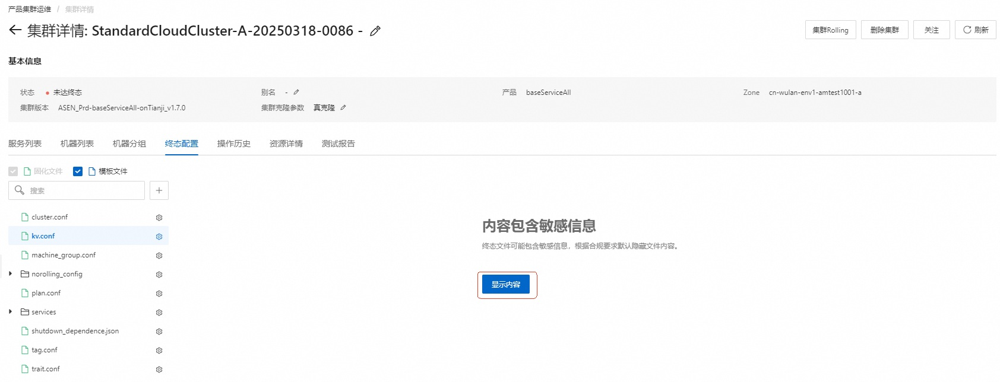

8. 获取**kv.conf**文件内容，通过Key查找并记录相应的值。

   各配置项对应的Key如下表所示。

   <table>
     <tr>
       <td>产品</td>
       <td>配置项</td>
       <td>Key</td>
     </tr>
     <tr>
       <td rowspan="2">OSS</td>
       <td>OSS-POP AK</td>
       <td>account.defaultUser.accesskey-id</td>
     </tr>
     <tr>
       <td>OSS-POP SK</td>
       <td>account.defaultUser.accesskey-secret</td>
     </tr>
     <tr>
       <td rowspan="4">PolarDB-X</td>
       <td>PolarDB-X RAM ID</td>
       <td>account.drds.id</td>
     </tr>
     <tr>
       <td>PolarDB-X RAM AK</td>
       <td>account.drds.accesskey-id</td>
     </tr>
     <tr>
       <td>PolarDB-X RAM SK</td>
       <td>account.drds.accesskey-secret</td>
     </tr>
     <tr>
       <td>PolarDB-X Zone值</td>
       <td>biz_zone</td>
     </tr>
     <tr>
       <td rowspan="2">ASR-DR</td>
       <td>asrdr服务账号AK</td>
       <td>account.asr.accesskey-id</td>
     </tr>
     <tr>
       <td>asrdr服务账号SK</td>
       <td>account.asr.accesskey-secret</td>
     </tr>
     <tr>
       <td rowspan="2">TIANJI</td>
       <td>Tianji ak</td>
       <td>account.defaultUser.accesskey-id</td>
     </tr>
     <tr>
       <td>Tianji sk</td>
       <td>account.defaultUser.accesskey-secret</td>
     </tr>
     <tr>
       <td rowspan="2">LINDORM</td>
       <td>LTS鉴权AK</td>
       <td>account.asr.accesskey-id</td>
     </tr>
     <tr>
       <td>LTS鉴权SK</td>
       <td>account.asr.accesskey-secret</td>
     </tr>
   </table>

   > **说明**
   >
   > 如果配置项的Key值是密文值，解密方法如下：
   >
   > <ol type="i">
   >
   > <li>
   >
   > 登录容器。
   >
   > </li>
   >
   > <li>
   >
   > 执行以下命令获取解密后的参数值。
   >
   > ```bash
   > curl --fail --unix-socket /var/run/proxyssl/pssl.sockrest 
   > 'http://host/api/v1/configs' -H 'Content-Type: application/octet-stream' -X POS
   > T -d {"<配置项key>":"<配置项value(密⽂)>"}
   > ```
   >
   > 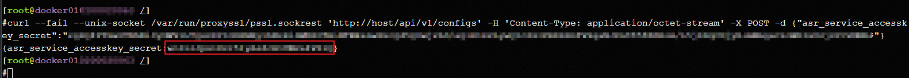
   >
   > </li>
   >
   > </ol>

<a id="section-1-9-6"></a>

### 1.9.6. 手动同步数据

生产站点的MaxCompute和DataWorks的数据默认是定时同步至灾备站点。当您急需在灾备站点计算结果时，可以通过手动同步数据，使增量数据立即同步至灾备站点。

1. 登录ASR-DR控制台。

2. 在左侧导航栏选择**业务容灾**>**保护组**。

3. 单击保护组**操作**列**详情**。

4. 在**保护组详情**页面，单击实例列表中目标实例右侧的  图标，选择**立即增量同步**。

   触发MaxCompute和DataWorks的数据立即增量同步。

<a id="section-1-9-7"></a>

### 1.9.7. 定制数据面SDK实现多Endpoint能力

目前仅云数据库RDS和对象存储OSS支持读写分离能力。

**前提条件**

已从官网获取到数据面SDK包。

**定制内容**

1. 应用引入多活SDK。

   ```xml
   <dependency>
    <groupId>com.aliyun.asrdr</groupId>
    <artifactId>asrdr-sdk-all</artifactId>
    <version>2.2.0.SNAPSHOT</version>
   </dependency>
   ```

2. 云产品配置变更示例。

   ```text
   # 改造前配置项
   rdsEndpoint=region-shanghai-rds-instance1.com
   # 改造后配置项
   rdsEndpoint=dr-master-a1://rds-instance1.com;dr-master-a2://rds-instance2.com
   ```

3. 应用代码改动，配置改造包含：

   - 从单endpoint变更到多endpoint。

   - 增加业务java进程启动参数-Ddreventcenter=asrdr-xxx.com -Ddrstrategy=2idc3center。

     ```text
     # 改造前业务启动参数
     java -server -Xms4096m -Xmx4096m -Xmn2048m -Xss512k -XX:MetaspaceSize=512m 
     -XX:MaxMetaspaceSize=1024m -XX:SurvivorRatio=8 -XX:+UseConcMarkSweepGC 
     -XX:+UseCMSCompactAtFullCollection -XX:+CMSClassUnloadingEnabled 
     -XX:+HeapDumpOnOutOfMemoryError -XX:HeapDumpPath=/home/admin/logs/java_pid.hprof 
     -jar /home/admin/asrdr/web-3.0.0.jar

     # 改造后业务启动参数
     java -server -Xms4096m -Xmx4096m -Xmn2048m -Xss512k -XX:MetaspaceSize=512m 
     -XX:MaxMetaspaceSize=1024m -XX:SurvivorRatio=8 -XX:+UseConcMarkSweepGC 
     -XX:+UseCMSCompactAtFullCollection -XX:+CMSClassUnloadingEnabled 
     -XX:+HeapDumpOnOutOfMemoryError -XX:HeapDumpPath=/home/admin/logs/java_pid.hprof 
     -jar /home/admin/asrdr/web-3.0.0.jar 
     -Ddreventcenter=asrdr-xxx.com -Ddrstrategy=2idc3center
     ```

<a id="section-2"></a>

# 2.异地容灾运维控制台指南

本文介绍异地容灾管理平台ASR-DR在Apsara Uni-manager运维控制台上的操作。

<a id="section-2-1"></a>

## 2.1. 登录异地容灾运维平台

本文介绍登录ASR-DR异地容灾运维平台的具体操作。

**前提条件**

- 已从部署人员或管理员处获取Apsara Uni-manager运维控制台的访问地址、用户名和密码。

  Apsara Uni-manager运维控制台访问地址格式为*region-id*.ops.console.*intranet-domain-id*。

- 推荐使用Chrome浏览器。

**操作步骤**

1. 打开浏览器。

2. 在地址栏中，输入Apsara Uni-manager运维控制台的访问地址，按回车键。

   

   > **说明**
   >
   > 您可以单击右上角的当前语言切换其它语言。当前支持简体中文、English语言切换。

3. 输入正确的用户名及密码。

   > **说明**
   >
   > - 登录Apsara Uni-manager运维控制台的用户名和密码请从部署人员或管理员处获取。
   >
   > - 若连续输入密码错误三次，系统将启动图片验证码登录功能；若连续输入错误五次，账户将被锁定，请联系管理员进行激活。
   >
   > - 首次登录Apsara Uni-manager运维控制台时，需要修改登录用户名的密码，请按照提示完成密码修改。
   >
   >   为提高安全性，密码必须满足以下要求：
   >
   >   - 必须包含英文大小写字母。
   >
   >   - 必须包含阿拉伯数字（0~9）。
   >
   >   - 必须包含特殊符号，包括感叹号（!）、at（@）、井号（#）、美元符号（$）、百分号（%）等。
   >
   >   - 密码长度为10~20个字符。

4. 单击**同意协议并登录**。

5. 在Apsara Uni-manager运维控制台的顶部菜单栏，选择**平台运维 > 容灾管理 > 异地容灾管理平台ASR-DR**。

<a id="section-2-2"></a>

## 2.2. 首页概览

ASR-DR异地容灾运维平台的首页展示如下信息：授权使用量统计、节点任务负载统计、异常同步实体总量统计、未分配任务统计、带宽使用量和专线流量使用量。

> **重要**
>
> - 在部署ASR-DR异地容灾运维平台时，需要一并配置专线实例信息，若未配置，首页线形图将不能呈现数据。
>
> - 配置专线实例信息请联系阿里云工程师。

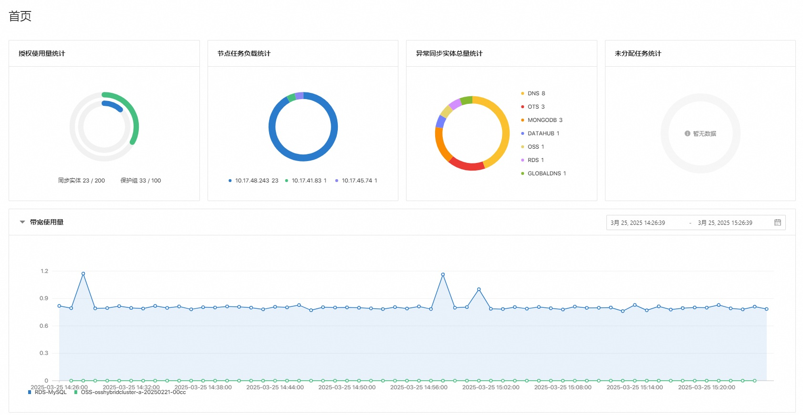

**参数说明**

<table>
  <tr>
    <th width="186">参数</th>
    <th>说明</th>
  </tr>
  <tr>
    <td>授权使用量统计</td>
    <td>以环形图的形式呈现当前保护组和同步实体授权使用量情况，蓝色代表保护组。黄色代表同步实体。分子代表已使用量，分母代表授权总量。</td>
  </tr>
  <tr>
    <td>节点任务负载统计</td>
    <td>以环形图的形式呈现ASR-DR各节点任务分布数量。</td>
  </tr>
  <tr>
    <td>异常同步实体总量统计</td>
    <td>以环形图的形式呈现按照容灾产品统计同步状态为异常状态的同步实体。</td>
  </tr>
  <tr>
    <td>未分配任务统计</td>
    <td>以环形图的形式展示未分配的同步任务。</td>
  </tr>
  <tr>
    <td>带宽使用量</td>
    <td>以线性图呈现云数据库RDS和对象存储OSS的流量带宽使用情况。</td>
  </tr>
  <tr>
    <td>专线流量使用量</td>
    <td>以线形图呈现ASR-DR互联专线实例流入流量和流出流量使用情况。</td>
  </tr>
</table>

<a id="section-2-3"></a>

## 2.3. 容灾监控

<a id="section-2-3-1"></a>

### 2.3.1. 云平台监控

云平台监控旨在监测云产品的容灾状态，包括云产品服务可用性、域名解析、网络访问等指标，以确保云平台能够在发生故障时快速切换到其他地域，从而保障客户业务连续性。

**操作步骤**

1. 登录异地容灾运维平台。

2. 在左侧导航栏选择**容灾监控** > **云平台监控**。

3. 选择容灾互联，查看互联地域下的产品巡检情况。

   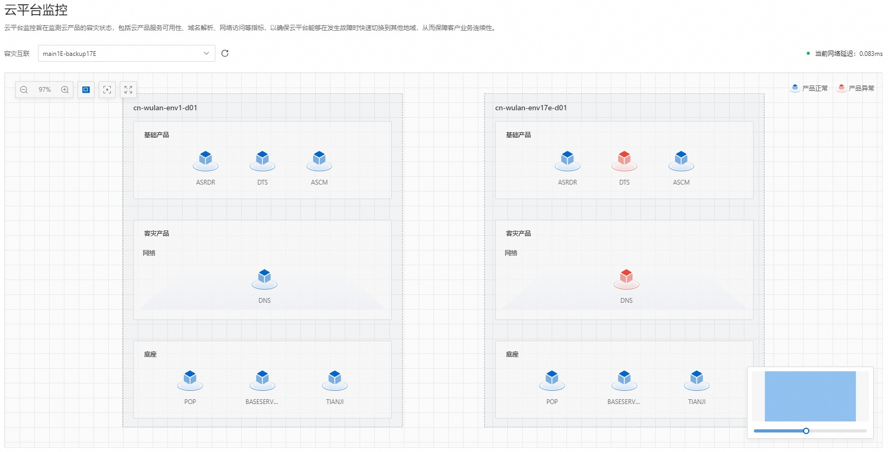

4. 鼠标放至产品上方可现实产品监控的详细情况。

   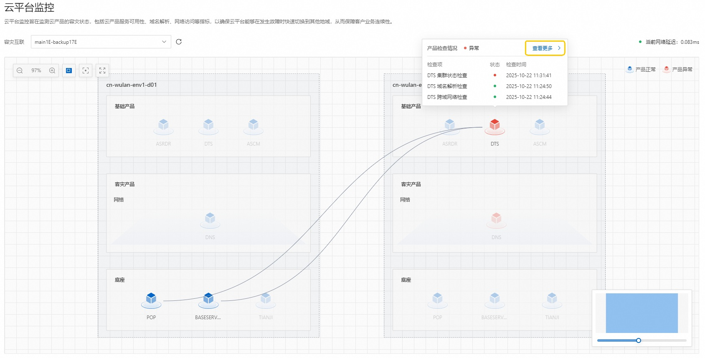

5. 单击**查看更多**，查看巡检详情。

   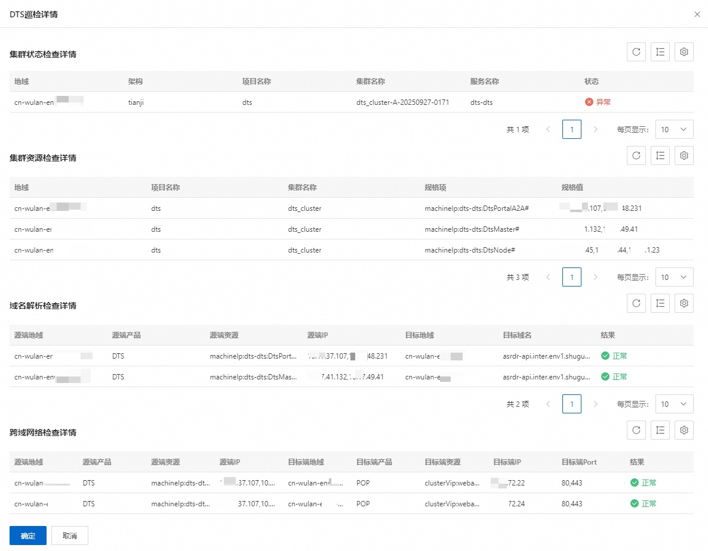

<a id="section-2-3-2"></a>

### 2.3.2. 保护组状态监控

本章节介绍如何查看保护组同步实体的检查结果。

**操作步骤**

1. 登录异地容灾运维平台。

2. 在左侧导航栏选择**容灾监控** > **保护组状态监控**。

   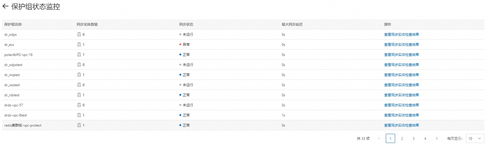

3. 单击**查看同步实体检查结果**。

   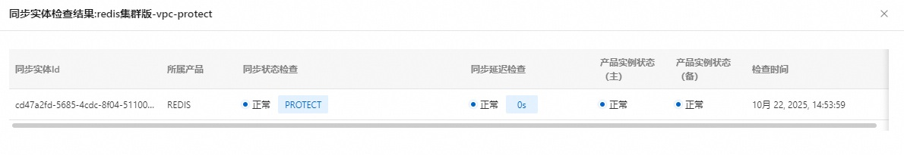

   显示当前保护组中包含的同步实体名称、所属产品、同步状态、同步延迟检查、产品实例状态（生产实例）、产品实例状态（灾备实例）和检查时间。

<a id="section-2-4"></a>

## 2.4. 平台基础能力运维

本文介绍异地容灾运维平台中平台基础能力运维的四大功能。

在异地容灾运维平台中，平台基础能力运维主要包括六大功能模块：云信息管理、参数配置管理、节点管理、VPC管理、容量管理和数据升级。具体的功能信息如下表所示。

| 功能模块 | 描述 | 说明 | 操作指导 |
| --- | --- | --- | --- |
| 云信息管理 | 获取所有的云实例信息，删除不必要的云实例信息。 | • 在删除之前需要确保云实例下不存在保护组、计划等实例。<br>• 删除云实例会同时删除云实例所注册的VPC信息、地域配置（含地域支持的容灾产品和状态）和云产品配置等信息。 | <br>• 刷新：单击刷新列表。<br>• 切换展示风格：单击选<br>择<strong>默认</strong>或者<strong>紧凑</strong>型风格展示。<br>• 自定义列字段：单击选择<br>需要在页面展示的字段信息。<br>• 全屏显示列表：单击以全<br><br>屏模式展示，单击退出全<br>屏模式。 |
| 参数配置管理 | 进行产品参数动态化配置。 | 无 | 1. 在页面选择对应的云产品页签，按照界面提示输入各产品的参数值。<br>2. 单击<strong>提交</strong>。 |
| 节点管理 | • 查看当前asrdr集群的节点信息，展示未分配的任务。<br>• 单击<strong>详情</strong>即可看到当前节点正在执行的任务。 | 无 | 单击<strong>展示未分配任务</strong>，可显示未分配的任务列表。 |

<table>
  <tr>
    <td rowspan="2">VPC管理</td>
    <td>VPC注册信息</td>
    <td><strong>移除</strong>：当前云实例已有VPC注册信息，可以查看、移除对应的VPC注册信息。<strong>注册</strong>：当前云实例没有VPC注册信息，可以注册对应的VPC信息。<strong>校验</strong>：当前VPC授权出错或者VPC类型实例访问失败，可以校验VPC注册信息的有效性，即调用接口查看VPC中appId和地址池Id是否依旧有效。</td>
    <td>无</td>
    <td><br>• 刷新：单击刷新列表。<br>• 切换展示风格：单击选<br>择<strong>默认</strong>或者<strong>紧凑</strong>型风格展示。<br>• 自定义列字段：单击选择<br>需要在页面展示的字段信息。<br>• 全屏显示列表：单击以全<br><br>屏模式展示，单击退出全<br>屏模式。</td>
  </tr>
  <tr>
    <td>VPC授权信息</td>
    <td><strong>查看</strong>：若当前云实例已授权，支持查看对应的VPC授权信息。<strong>授权</strong>：若当前云实例未授权，支持对实例进行授权。</td>
    <td>无</td>
    <td>1. 选择云实例和区域名称，输入实例ID。<br>2. 单击<strong>查询</strong>。</td>
  </tr>
  <tr>
    <td colspan="2">容灾网关管理</td>
    <td>针对跨云场景，用于管理与配置不同云中的容灾网关。</td>
    <td>无</td>
    <td>请参见管理容灾网关。</td>
  </tr>
  <tr>
    <td colspan="2">容量管理</td>
    <td>用于统计保护组和同步实体的资源使用量。</td>
    <td>无</td>
    <td>无。</td>
  </tr>
  <tr>
    <td colspan="2">大屏地图配置</td>
    <td>用于创建在大屏上展示的容灾地域。</td>
    <td>无</td>
    <td>请参见配置大屏地图。</td>
  </tr>
  <tr>
    <td colspan="2">数据升级</td>
    <td>将保护组数据、容灾计划数据全部升级。</td>
    <td>存量用户在升级后需要做数据升级操作。</td>
    <td>1. 单击<strong>数据升级</strong>。<br>2. 在弹出的提示框上单击<strong>确定</strong>。<br>3. 根据界面提示进行操作。</td>
  </tr>
</table>

<a id="section-2-4-1"></a>

### 2.4.1. 管理云产品信息

需要先在Apsara Uni-manager运维平台完成灾备云和生产云的配置才能在Apsara Uni-manager运营平台使用异地容灾管理平台。在正确添加生产云实例后，您需要配置支持的容灾产品以及对应的地址，ASR-DR才能对生产云的资源实例进行容灾。本文介绍跨云容灾场景的相关配置。

**操作须知**

首次登录Apsara Uni-manager运维平台的异地容灾管理平台时，需要配置灾备云，如图所示。单击**灾备云**区域的**编辑**或者单击列表中**操作**列**编辑**，配置成功后状态会变为运行中。配置参数时请参考操作步骤的表格说明进行配置。

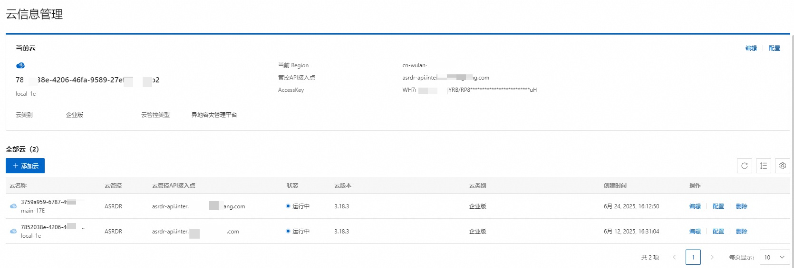

**操作步骤**

1. 登录异地容灾运维平台。

2. 在左侧导航栏中选择**平台基础运维 > 云信息管理**。

3. 单击**添加云**，参考下表填写参数。

   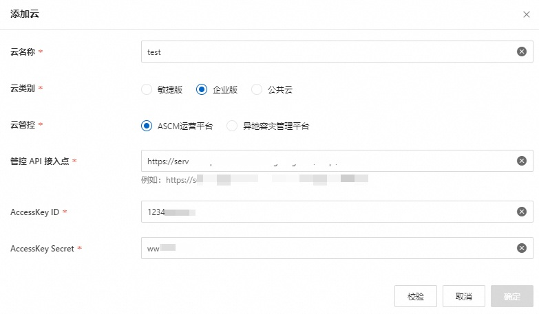

   | 名称 | 描述 |
   | --- | --- |
   | 云名称 | 自定义的云中心名称信息，方便识别。由中文、英文、数字、短划线（-）、下划线（_）或英文句号（.）组成，长度为4~20个字节。 |
   | 云类别 | 请选择生产云的云类别。<br>• 敏捷版<br>• 企业版<br>• 公共云<br>说明当云类别选择公共云时，请在<strong>参数配置管理</strong>将SYNC_CHANNEL的参数值进行修改，具体包括以下三个参数，其中true表示打开，false表示关闭。其他参数请保持默认值，不建议修改：<br>• guard::daemonEnabled：表示否启用保护组状态同步。<br>• recovery::daemonEnabled：表示是否启用容灾计划任务数据同步。<br>• resource-sync::resourceSyncEnable：表示是否启用资源（保护组、容灾计划等）数据同步。<br>• resource-sync::asyncPullEnabled：允许公共云远程拉取专有云的云实例、保护组、容灾计划数据。 |
   | 云管控 | 请选择生产云的云管控类型，请选择<strong>异地容灾管理平台</strong>。<br>• <strong>ASCM运营平台</strong>：灾备云通过调用API来获取生产云信息。<br>• <strong>异地容灾管理平台</strong>（推荐）：灾备云通过调用ASR-DR的API来获取生产云信息。 |
   | 管控API接入点 | • 请填写对端云在异地容灾管理平台中<strong>云信息管理</strong>菜单的<strong>管控API接入点</strong>的值。<br>• 如果<strong>云类别</strong>选择<strong>公共云</strong>，请填写公共云侧异地容灾管理平台中<strong>云信息管理</strong>菜单的<strong>管控API接入</strong><strong>点</strong>的值。 |
   | AccessKEY <strong>ID</strong>、<strong>AccessK</strong> ey Secret | • 当<strong>云类别</strong>选择<strong>敏捷版</strong>或<strong>企业版</strong>时，请填写对端云上运营管理员账号的AccessKey ID和AccessKey Secret。获取方法请参见获取AccessKey。<br>• 当<strong>云类别</strong>选择<strong>公共云</strong>时，请在公共云上创建一个具备AliyunASRFullAccess权限的子账号，填写其AK和SK。 |
   | 协议 | • 可选，当<strong>云类别</strong>选择<strong>公共云</strong>时，需要配置。<br>• 勾选表示您同意在公共云的异地容灾管理平台协议。 |

4. 单击**校验**，校验成功后单击**确定**。

5. 配置云产品。

   <ol type="i">

   <li>

   单击相应云**操作**列的**配置**，进入**云产品配置**页面。

   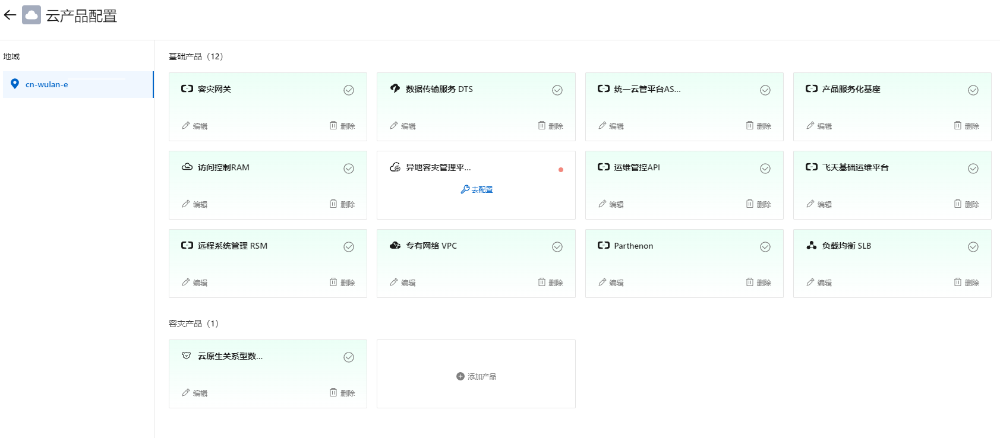

   </li>

   <li>

   在**基础产品**区域，单击对应产品的  图标，配置相关参数，参数说明如下表所示。

   > **重要**
   >
   > - 云实例的管控类型为**ASCM运营平台**时，系统获取的云产品默认配置可能有误，需要您进一步确认，各产品配置信息获取方法请参见获取生产云实例配置信息。
   >
   > - 云实例的管控类型为**异地容灾管理平台**时，系统获取的云产品默认配置是准确的，无需进一步确认。

   **产品**

   **名称**

   **描述**

   用于单点登录、鉴权、资源获取。请填写生产云 `oneService` 服务 `ascm-portal.domain` 的值，获取

   **ASCM地址**

   方法请参见获取生产云实例配置信息。

   用于调用asapi接口。请填写 `asapi` 服

   **asapi地址**

   务 `asapi.gateway.endpoint` 的值。ASR-DR自动配置，

   **统一云管平台**

   但仍需您进一步确认。

   **ASCM**

   用于调用ASCM POP接口。中心region按照 `ascm.{ internet-domain}` ，单元region按照 `ascm.{region}.`

   **ASCM POP 地址**

   `{internet-domain}` 拼写，ASR-DR自动配置，但仍需您进一步确认。

   用于建立数据库产品的同步链路。请填写生产云 `dts-dts` 服

   **DTS地址**

   务 `dts.openapi.endpoint` 的值，ASR-DR自动配置，但仍需您进一步确认。

   **数据传输服务DTS**

   请配置为生产云 `dts-dts` 服务 `dts.check.dns:dts.check.port` 的值，获取方法请参

   **DTS Check地址**

   见获取生产云实例配置信息。ASR-DR自动配置，但仍需您进一步确认。

   请配置为生产云 `dts-dts` 服务 `dts.check.token` 的

   **DTS Check接口**

   值，获取方法请参见获取生产云实例配置信息。ASR-DR自动配

   **凭证**

   置，但仍需您进一步确认。

   用于查询环境信息。请填写生产云 `oneService` 服

   **产品服务化基座**

   **oneConsole地址**

   务 `console.domain` 的值，获取方法请参见获取生产云实例配置信息。

   用于VPC注册、连接VPC类型的PolarDB-X 1.0、RDS实例。对应生产云 `vpc-yaochi` 服务 `vpc-`

   **专有网络 VPC**

   **VPC地址**

   `inner.openapi.endpoint` 的值，ASR-DR自动配置，但仍需您进一步确认。

   用于验证RAM AK和SK信息。请填写 `ram-ramService` 服务 `ram-openapi.endpoint` 的值，获取方法请参见获取生产云实例配置信息。

   **RAM地址**

   > **重要**
   >
   > 必须配置RAM中心Region地址。

   用于实现RAM鉴权。请填写 `ram-ramService` 服务 `ram-`

   **访问控制RAM**

   **RAM Slave地址**

   `slave.endpoint` 的值，获取方法请参见获取生产云实例配置信息。

   用于获取阿里云账号的临时Token。请填写 `ram-ramService` 服务 `sts-openapi.endpoint` 的值，参数的获取方法请参见获取生产云实例配置信息。

   **STS地址**

   > **重要**
   >
   > 必须配置STS中心Region地址。

   asrdr申请的账号的Accesskey ID，通过调用主云RSM来运行相

   **asrdr AK**

   关检查命令。获取方式参见获取AccessKey。

   asrdr申请的账号的AccessKey Secret，通过调用主云RSM来运

   **asrdr SK**

   行相关检查命令。获取方式参见获取AccessKey。

   用于调用ASR-DR的OpenAPI，请填写 `asrdr-backend` 服

   **asrdr api**

   务 `asrdr_api_endpoint` 的值。ASR-DR自动配置，但仍需

   **endpoint**

   您进一步确认。

   用于调用ASR-DR的 `asrdr-osssync` 服务的OpenAPI，

   请填写 `asrdr-osssync` 服务的 `asrdr-osssync` 值。ASR-DR自动配置，但仍需您进一步确认。

   **异地容灾管理平台**

   **asrdr osssync**

   **ASR-DR**

   **api endpoint**

   > **说明**
   >
   > 如果是增量的AsrOssSyncServiceCluster，需要重新rolling ASR-DR集群，ASR-DR才会自动配置。

   用于从ASR-DR处获取资源包。 请填写 `asrdr` 服

   **asrdr resource**

   务 `asrdr_resource_endpoint` 的值。ASR-DR自动配置，

   **endpoint**

   但仍需您进一步确认。

   asrdr服务账号的Accesskey ID，用于STS临时Token调用。请填写 `account.asr.accesskey-id` 的值，获取方法请参

   **asrdr服务账号AK**

   见获取生产云实例配置信息。

   asrdr服务账号的AccessKey Secret，用于STS临时Token调用。请填写 `account.asr.accesskey-secret` 的值，获取

   **asrdr服务账号SK**

   方法请参见获取生产云实例配置信息。

   用于调用Tianji POP接口所需的AccessKey Id。请填写 `account.defaultUser.accesskey-id` 的值，获取方

   **天基ak**

   法请参见获取生产云实例配置信息。

   用于调用Tianji POP接口所需的AccessKey Secret。请填写 `account.defaultUser.accesskey-secret` 的值，获

   **天基sk**

   **飞天基础运维平台**

   取方法请参见获取生产云实例配置信息。

   用于调用Tianji的OpenAPI，获取集群状态相关信息。请填写 `tianji-endpoint` 服务 `api_server.endpoint` 的

   **天基endpoint**

   值，ASR-DR自动配置，但仍需您进一步确认。

   用于调用RSM的OpenApi，执行网络检查相关命令。请填

   **远程系统管理**

   写 `rsm` 服务 `rsm.api.domain` 的值，ASR-DR自动配置，

   **RSM地址**

   **RSM**

   但仍需您进一步确认。

   <table>
     <tr>
       <td>Parthenon</td>
       <td>Parthenon访问地址</td>
       <td>用于调用Parthenon API来检查PaaS平台上部署的产品的跨云网络连通性健康状况。ASR-DR自动配置，但仍需您进一步确认。<strong>Parthenon访问地址</strong>的拼接规则为：region.api.parthenon.intranet-domain。请根据tianji集群的终态配置中<strong>kv.conf</strong>文件中<code> region </code>和<code> intranet-</code><code>domain </code>的值进行确认。</td>
     </tr>
     <tr>
       <td rowspan="4">负载均衡 SLB</td>
       <td>SLB API 地址</td>
       <td>用于调用SLB API来修改实例vip的状态。ASR-DR自动配置，但仍需您进一步确认。SLB API地址取值为：<code> service:slb-</code><code>controller:slb.api.domain </code>。</td>
     </tr>
     <tr>
       <td>DEFAULT AK</td>
       <td>用于调用SLB接口所需的AccessKey Id。请填写<code> account.defaultUser.accesskey-id </code>的值，获取方法请参见获取生产云实例配置信息。</td>
     </tr>
     <tr>
       <td>DEFAULT SK</td>
       <td>用于调用SLB接口所需的AccessKey Secret。请填写<code> account.defaultUser.accesskey-secret </code>的值，获取方法请参见获取生产云实例配置信息。</td>
     </tr>
     <tr>
       <td>SLB OPS API 地址</td>
       <td>用于调用SLB OPS API来获取实例的负载均衡id和实例所属userId。ASR-DR自动配置，但仍需您进一步确认。SLB OPS API地址取值为：<code> service:slb-ops-</code><code>api:slb_ops_api_dyn_url </code>。</td>
     </tr>
   </table>

   </li>

   <li>

   在**容灾产品**区域，单击  图标，选择容灾产品类型，根据不同的产品类型配置对应参数，参数说明如

   下表所示。

   **产品**

   **名称**

   **描述**

   用于调用OSS同步接口、查询OSS实例。请填写生产云 `oss-server` 服务 `api-endpoint` 的

   **OSS地址**

   值，ASR-DR自动配置，但仍需您进一步确认。

   用于调用OSS POP接口。请填写生产云 `oss-`

   **OSS赤骥Pop地址**

   `chiji` 服务 `pop-api-endpoint` 的值，ASR-DR自动配置，但仍需您进一步确认。

   ASR-DR调用OSS POP接口需要验证AccessKey ID。请填写Apsara Uni-manager运维控制台opsadmin的

   **OPS-Admin AK**

   AK值。

   **对象存储 OSS**

   ASR-DR调用OSS POP接口需要验证AccessKey Secret。请填写Apsara Uni-manager运维控制台

   **OPS-Admin SK**

   opsadmin的SK值。

   用于授权代理用户访问bucket的权限。获取方法请参见《阿里云 *v3.\*\*\** 部署指南》中**产品容灾配置 >**

   **OSS 代理用户 PK**

   **OSS容灾配置**章节，填写Apsara Uni-manager运营控制台创建的代理用户的UID。

   用于调用Tunnel架构下Tablestore的同步接口。请填

   **表格存储 Tablestore**

   写生产云  `TableStoreOCM` 服

   **OTS Tunnel服务地址**

   务 `ocm.pop_tablestore_endpoint` 的值，ASR-

   > **说明**

   DR自动配置，但仍需您进一步确认。

   > 在云管控为ASRDR条件下，会自动注册OTS代

   用于授权Tablestore产品访问生产站点实例。获取方法

   > 理主账号信息。

   请参见《阿里云 *v3.\*\*\** 部署指南》中**产品容灾配置 >**

   **OTS代理主账号 PK**

   > - 在跨云场

   **OTS容灾配置**章节。填写Apsara Uni-manager运营

   > 景，配置

   控制台创建的代理一级组织的UID。

   > 生产云会注册两朵云配置，

   用于授权Tablestore产品访问生产站点实例。获取方法

   > 配置顺序

   请参见《阿里云 *v3.\*\*\** 部署指南》中**产品容灾配置 >**

   > 需为灾备

   **OTS代理主账号 AK**

   **OTS容灾配置**章节。填写Apsara Uni-manager运营

   > 云 > 生产

   控制台创建的代理一级组织的Accesskey ID。

   > 云。
   >
   > - 在跨region场

   用于授权Tablestore产品访问生产站点实例。获取方法

   > 景，配置

   请参见《阿里云 *v3.\*\*\** 部署指南》中**产品容灾配置 >**

   **OTS代理主账号 SK**

   > 生产

   **OTS容灾配置**章节。填写Apsara Uni-manager运营

   > region会

   控制台创建的代理一级组织的Accesskey Secret。

   > 注册两个region配置，配置顺序需为灾备region >生产region。

   用于注册Tablestore代理主账号的信息，请填写生产云 `TableStoreOCM` 服务 `ocm.endpoint` 的

   **OTS OCM内部地址**

   值。ASR-DR自动配置，但仍需您进一步确认。

   用于调用ADB 3.0实例查询、授权等接口。请填写生产

   **云原生数据仓库**

   云 `analyticdb-yaochi` 服

   **ADB3.0地址**

   **AnalyticDB MySQL**

   务 `adb.openapi.endpoint` 的值，ASR-DR自动

   **版3.0**

   配置，但仍需您进一步确认。

   用于调用RDS实例查询、授权等接口。请填写生产云 `rds-yaochi` 服

   **云数据库 RDS**

   **RDS地址**

   务 `rds.openapi.endpoint` 的值，ASR-DR自动配置，但仍需您进一步确认。

   用于调用PolarDB-X 1.0实例查询、授权等接口。请填写生产云 `drds-console` 服

   **云原生分布式数据**

   **PolarDB-X地址**

   **库PolarDB-X**

   务 `prectrl.api` 的值，ASR-DR自动配置，但仍需您进一步确认。

   用于调用PolarDB实例查询、授权等接口。请填写生产云 `polardb-yaochi` 服务 `polardb.openapi-`

   **云原生关系型数据库**

   **PolarDB地址**

   `vpc.endpoint` 的值。获取方法请参见获取生产云实

   **PolarDB**

   例配置信息。ASR-DR自动配置，但仍需您进一步确认。

   选择MQ。

   **支持产品类型**

   用于调用MQ同步接口。请填写生产云 `mq-`

   **MQ Router**

   `router` 服务 `router.onsAddr` 的值，ASR-

   **OnsAddr地址**

   DR自动配置，但仍需您进一步确认。

   用于调用MQ Topic操作接口。请填写生产云 `mq-`

   **消息队列MQ**

   **MQ地址**

   `console` 服务 `console.domain` 的值，ASR-DR自动配置，但仍需您进一步确认。

   ASR-DR调用MQ接口需要验证Accesskey ID。请填写生产云 `mq-console` 服

   **onsInnerApi**

   务 `onsInnerApiAccessKey` 的值，获取方法请参见获取生产云实例配置信息。

   用于调用DNS Control的接口。请填写生产云 `dnsService` 服

   **DNS CONTROL地址**

   务 `dns_control.pop_domain` 的值，获取方法请参见获取生产云实例配置信息。

   DNS地址主要用于调用DNS操作接口。请填写生产云 `dnsService` 服务 `dns_universal_control.pop_domain` 的

   **DNS地址**

   值，ASR-DR自动配置，但仍需您进一步确认。

   **域名解析 DNS**

   ASR-DR调用DNS接口需要验证Accesskey ID。请填写Apsara Uni-manager运营控制台容灾组织的AK

   **DNS AK**

   值。

   ASR-DR调用DNS接口需要验证AccessKey Secret。请填写Apsara Uni-manager运营控制台容灾组织的

   **DNS SK**

   SK值。

   用于调用SchedulerX同步链路相关接口。请填写生产云SchedulerX

   **SchedulerX pop地址**

   的 `schedulerx2PopDomainName` 地址，ASR-DR自动配置，但仍需您进一步确认。

   **SCHEDULERX**

   用于调用SchedulerX实例查询，设置读写等接口。请填写生产云SchedulerX

   **SchedulerX 地址**

   的 `schedulerx2DomainName` 地址，ASR-DR自动配置，但仍需您进一步确认。

   生产云大数据管家的配置中心BCC API。请填写生产云 `bcc-web` 服务 `api.endpoint` 的值，ASR-

   **BCC API地址**

   DR自动配置，但仍需您进一步确认。

   生产云大数据管家的配置中心AppName。请填写生产云 `bcc-web` 服务 `maxgraph-app` 的值，ASR-

   **BCC App**

   DR自动配置，但仍需您进一步确认。

   生产云大数据管家的配置中心AppKey。请填写生产

   **大数据开发治理平台**

   云 `bcc-web` 服务 `maxgraph-key` 的值，ASR-

   **BCC Key**

   **DataWorks**

   DR自动配置，但仍需您进一步确认。

   生产云大数据管家的配置中心AuthUserKey。请填写生产云 `bcc-web` 服务 `maxgraph-passwd` 的

   **BCC Password**

   值，ASR-DR自动配置，但仍需您进一步确认。

   生产云大数据管家的配置中心AuthUser。请填写生产云 `bcc-web` 服务 `maxgraph-user` 的值，ASR-

   **BCC User**

   DR自动配置，但仍需您进一步确认。

   用于调用HBASE实例查询、授权等接口。请填写生产云 `hbase-yaochi` 服务 `hbase.openapi.endpoint` 的值，ASR-DR自动配置，但仍需您进一步确认。

   **云数据库 HBase**

   **HBASE地址**

   Lindorm地址主要用于调用Lindorm操作接口。请填写生产云 `lindorm` 服

   **Lindorm地址**

   务 `lindorm_pop_endpoint` 的值，ASR-DR自动配置，但仍需您进一步确认。

   ASR-DR调用LTS接口需要验证Accesskey ID。请填写生产云 `account.asr.accesskey-id` 的值，获取

   **LTS鉴权AK**

   方法请参见获取生产云实例配置信息。

   **多模数据库Lindorm**

   ASR-DR调用LTS接口需要验证AccessKey Secret。请填写生产云 `account.asr.accesskey-`

   **LTS鉴权SK**

   `secret` 的值，获取方法请参见获取生产云实例配置信息。

   用于调用MongoDB实例查询、授权等接口。请填写生产云 `mongodb-yaochi` 服

   **云数据库 MongoDB**

   **MongoDB地址**

   务 `mongodb.openapi-vpc.endpoint` 的值，ASR-DR自动配置，但仍需您进一步确认。

   用于调用Redis实例查询、授权等接口。请填写生产云 `kvstore-yaochi` 服务 `kvstore.openapi-`

   **云数据库 Redis**

   **Redis地址**

   `vpc.endpoint` 的值，ASR-DR自动配置，但仍需您进一步确认。

   用于调用Hologres实例查询、授权等接口。请填写生产云 `hologres-init` 服务 `holo-`

   **Hologres管控地址**

   `manager.endpoint` 的值，ASR-DR自动配置，但仍需您进一步确认。

   **交互式分析 Hologres**

   用于调用Hologres-pop接口。请填写生产云 `hologres-init` 服

   **Hologres-pop地址**

   务 `pop_holo_remote_recover_dns` 的值，ASR-DR自动配置，但仍需您进一步确认。

   用于调用HDR接口。请填写生产云 `cds-bcdr` 服

   **云服务器 ECS**

   **HDR地址**

   务 `hdr.openapi.endpoint` 的值，ASR-DR自动配置，但仍需您进一步确认。

   用于调用DataHub接口。请填写生产云 `datahub-frontend` 服务

   **数据总线 DataHub**

   **DataHub 地址**

   的 `datahub_frontend.endpoint` 的值，ASR-DR自动配置，但仍需您进一步确认。

   用于调用PolarDB-X 2.0接口。请填写生产云 `apsaradb-polarx-engine-openapi` 服务

   **云原生分布式数据库**

   **PolarDBX2.0 地址**

   的 `polarx.openapi.endpoint` 的值，ASR-DR自

   **PolarDB-X 2.0**

   动配置，但扔需您进一步确认。

   用于调用ECS接口。请填写生产云 `ecs-yaochi` 服

   **ECS POP API 地址**

   务的  `ecs.openapi.endpoint` 的值，ASR-DR自动配置，但仍需您进一步确认。

   **流量网关 IngressGW**

   用于调用SLB接口。请填写生产云 `slb-`

   **SLB POP API 地址**

   `controller` 服务的 `slb.api.domain` 的值，ASR-DR自动配置，但仍需您进一步确认。

   </li>

   <li>

   把所有产品配置完后，可以返回至**云信息管理页**面执行其他操作。

   </li>

   </ol>

**相关操作**

添加云成功后，您还可以执行以下操作。

<table>
  <tr>
    <th width="89">任务名称</th>
    <th>操作步骤</th>
  </tr>
  <tr>
    <td>编辑云</td>
    <td>1. 单击<strong>操作</strong>列<strong>编辑</strong>。<br>2. 在编辑弹框中修改相应参数值。<br>3. 修改完成后单击<strong>校验</strong>，校验通过后单击<strong>确定</strong>。</td>
  </tr>
  <tr>
    <td>删除云</td>
    <td>1. 单击<strong>操作</strong>列<strong>删除</strong>。<br>2. 在弹出提示框上单击<strong>确定</strong>。</td>
  </tr>
</table>

<a id="section-2-4-2"></a>

### 2.4.2. 容灾互联管理

本章节介绍如何使不同地域之间进行互联，从而在两地域间进行容灾。

**操作步骤**

1. 登录异地容灾运维平台。

2. 在左侧导航栏中选择**平台基础运维 > 容灾互联管理**。

   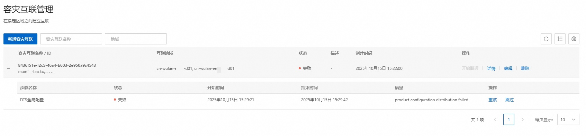

3. 单击**新增容灾互联**，参考下表配置参数值。

   | 参数名称 | 参数说明 |
   | --- | --- |
   | 容灾互联名称 | 请自定义容灾互联名称。 |
   | 描述 | 请填写容灾互联关系的其他信息。 |
   | 容灾互联地域 | 请至少配置两个地域，形成主备关系。 |
   | 容灾互联产品 | 系统自动识别互联地域中支持的云产品，请保持默认。 |

4. 单击**提交**。

**相关操作**

| 任务名称 | 操作步骤 |
| --- | --- |
| 开始联通 | 单击<strong>操作</strong>列<strong>开始联通</strong>。联通失败后单击<strong>重试</strong>会再次联通。 |
| 查看详情 | 单击<strong>操作</strong>列<strong>详情</strong>，可查看容灾互联地域中互联产品的基本信息和联通性。 |
| 编辑容灾互联地域 | 1. 单击<strong>操作</strong>列<strong>编辑</strong>。<br>2. 修改后单击<strong>提交</strong>。 |
| 删除容灾互联地域 | 1. 单击<strong>操作</strong>列<strong>删除</strong>。<br>2. 在弹出提示框上单击<strong>确定</strong>。 |

<a id="section-2-4-3"></a>

### 2.4.3. 管理容灾网关

本章节介绍在跨云场景下，如何配置对端的网关信息，从而使跨云两端互为容灾关系并成功打通两端的网络。

**背景信息**

由于安全限制，管控域API接口无法直接跨云调用，因此将其封装并注册至POP，形成独立的容灾网关，以提升接口管理效率并为其他容灾产品提供独立入口。

**操作步骤**

1. 登录异地容灾运维平台。

2. 在左侧导航栏中选择**平台基础运维 > 容灾网关管理**，页面显示互为容灾关系的地域信息。

   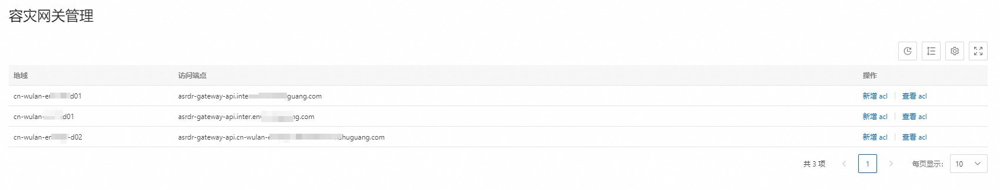

3. 单击**新增 acl**，参考下表配置请求端信息后单击**下一步**。

   > **说明**
   >
   > ACL（Access Control List）访问控制列表：用于定义和控制进出网络的数据包，以确保网络流量符合安全策略和访问控制要求。

   <table>
     <tr>
       <th width="131">参数名称</th>
       <th>描述</th>
     </tr>
     <tr>
       <td>请求端产品</td>
       <td>请填写请求端云需要对接的云产品，例如，ASR-DR。</td>
     </tr>
     <tr>
       <td>请求端IP段</td>
       <td>请填写请求端云产品的接口所处的IP段，格式：*.*.*.*/掩码，例如，192.168.1.0/24。</td>
     </tr>
     <tr>
       <td>请求端用户uid</td>
       <td>请填写请求端用户AK所对应的UID，在请求端登录用户的个人信息中查看。</td>
     </tr>
   </table>

4. 在**action 权限控制**向导页，勾选对应的目标端产品后单击**下一步**。

   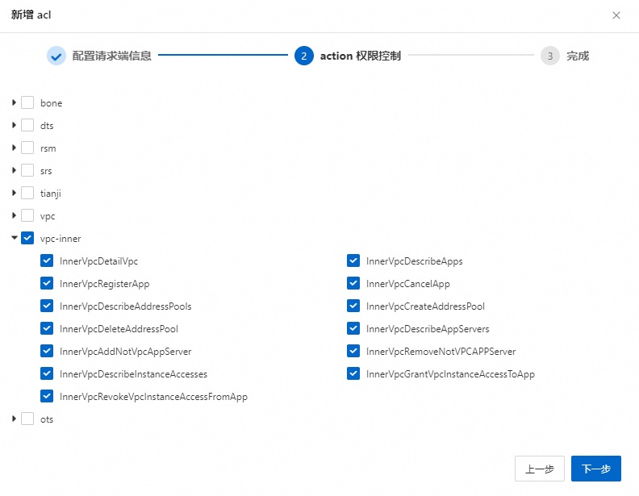

5. 单击**提交**。

**相关操作**

<table>
  <tr>
    <th width="89">任务名称</th>
    <th>操作步骤</th>
  </tr>
  <tr>
    <td>查看acl</td>
    <td>1. 单击对应地域<strong>操作</strong>列<strong>查看acl</strong>。<br>2. 单击<strong>操作</strong>列<strong>详情</strong>。</td>
  </tr>
  <tr>
    <td>修改acl</td>
    <td>1. 单击对应地域<strong>操作</strong>列<strong>查看acl</strong>。<br>2. 单击<strong>操作</strong>列<strong>修改</strong>。<br>3. 重新选择action，单击<strong>提交</strong>。</td>
  </tr>
  <tr>
    <td>删除acl</td>
    <td>1. 单击对应地域<strong>操作</strong>列<strong>查看acl</strong>。<br>2. 单击<strong>操作</strong>列<strong>删除</strong>。<br>3. 在弹出的提示框上单击<strong>确定</strong>。</td>
  </tr>
</table>

<a id="section-2-4-4"></a>

### 2.4.4. 配置大屏地图

本章节介绍用户如何配置大屏所用的容灾地域，配置后的地域信息将在大屏上显示异地容灾的数据。

**场景描述**

- **异地容灾**：异地主备容灾方案在政务、能源、交通、医保等行业应用广泛，适用于以下场景。

  - 业务连续性要求较高。

  - 不依赖数据强一致。

  - 要求具备区域性故障防范能力。

  - 城市相距百公里以上。

- **三地两中心**：两地三中心容灾方案主要应用于金融行业，适用于以下场景。

  - 需要防范城市级大范围自然灾害。

  - 具备区域性故障防范能力。

  - 要求关键业务数据同步延迟约等于0。

  - 预算充足。

**操作步骤**

1. 登录异地容灾运维平台。

2. 在左侧导航栏中选择**平台基础运维 > > 大屏地图配置**。

3. 单击**新建容灾地域**，参考下表配置参数值。

   | 参数名称 | 说明 |
   | --- | --- |
   | 地域 ID | 下拉选择所在地域的ID。 |
   | 地域名称 | 请输入地域的名称，例如<strong>杭州机房</strong>。 |
   | 所在城市 | 下拉选择地域所处的城市。 |
   | 可用区 | 系统自动生成后，选择相应的可用区。 |

4. 单击**确定**。

**其他操作**

新建容灾地域成功后，您还可以执行以下操作。

<table>
  <tr>
    <th width="122">任务名称</th>
    <th>操作步骤</th>
  </tr>
  <tr>
    <td>查询容灾地域</td>
    <td>输入地域、可用区，下拉选择城市，系统会筛选出符合条件的容灾地域。</td>
  </tr>
  <tr>
    <td>编辑容灾地域</td>
    <td>1. 单击<strong>操作</strong>列<strong>编辑</strong>。<br>2. 重新输入<strong>地域名称</strong>或<strong>所在城市</strong>。<br>3. 单击<strong>确定</strong>。</td>
  </tr>
  <tr>
    <td>删除容灾地域</td>
    <td>1. 单击<strong>操作</strong>列<strong>删除</strong>。<br>2. 在弹出的提示框上单击<strong>确定</strong>。</td>
  </tr>
</table>

<a id="section-2-5"></a>

## 2.5. 容灾运维

本文介绍容灾运维的两大功能模块及其说明。

容灾运维主要包括同步实体管理和计划管理两大功能模块，具体的功能信息如下表所示。

<table>
  <tr>
    <td>功能模块</td>
    <td></td>
    <td>描述</td>
    <td>说明</td>
  </tr>
  <tr>
    <td colspan="2">同步实体管理</td>
    <td>可以查看保护组列表和详情，针对不需要使用的保护组和保护实体进行删除；查看当前同步实体的任务执行列表、执行步骤详情、单步骤执行日志；进行单步骤重做和单步骤跳过。</td>
    <td>• 单步骤<strong>重做</strong>是指同步实体执行过程中某子步骤执行失败，可以选择重做当前步骤，重试当前步骤继续执行。<br>• 单步骤<strong>跳过</strong>是指同步实体执行过程中某子步骤持续性执行失败，当前步骤如若不影响后续流程，可以选择跳过当前步骤，从下一步骤继续执行。</td>
  </tr>
  <tr>
    <td rowspan="4">计划管理</td>
    <td>演练切换</td>
    <td rowspan="4">可以查看演练计划和故障计划的执行实例、针对已完成的实例进行删除；查看执行实例详情信息、计划步骤详情、计划子步骤执行日志；进行单步骤重做和单步骤跳过和强切。</td>
    <td rowspan="4"><strong>强切</strong>是指计划执行过程中某子步骤持续性执行失败，选择跳过所有非必要步骤。<br>说明这种操作一般在主端发生故障的场景下使用，即所有关于主端的步骤都会一次性跳过。</td>
  </tr>
  <tr>
    <td>演练回切</td>
  </tr>
  <tr>
    <td>故障切换</td>
  </tr>
  <tr>
    <td>故障回切</td>
  </tr>
</table>

<a id="section-2-5-1"></a>

### 2.5.1. 管理同步实体

<a id="section-2-5-1-1"></a>

#### 2.5.1.1. 单步骤跳过

在同步实体管理和计划管理中单步骤跳过的方式相同，此处以同步实体中的单步骤跳过为例介绍如何进行单步骤跳过。

**操作步骤**

1. 登录异地容灾运维平台。

2. 在左侧导航栏中选择**容灾运维 > 同步实体管理**。

3. 在保护组列表选中目标实例单击**详情**。

4. 在**保护组详情**页面查看同步实体信息，单击右侧操作栏的**任务**。

   

5. 在任务详情页单击左侧符号，即可查看执行步骤详情。

   

6. 在步骤详情页面找到**任务状态**为**失败**的步骤，在右侧操作栏选择**跳过。**

7. 单步骤跳过后，该步骤的**运行状态**会变成**跳过**。

   

**相关操作**

在同步实体管理页面，您还可以执行以下操作。

<table>
  <tr>
    <th width="122">任务名称</th>
    <th>操作步骤</th>
  </tr>
  <tr>
    <td>高级搜索</td>
    <td>1. 选择主云列表，输入保护组ID和保护组名称，然后选择同步方向。<br>2. 单击<strong>搜索</strong>。如果搜索条件有误，单击<strong>重置</strong>可清空搜索条件。</td>
  </tr>
  <tr>
    <td>刷新列表</td>
    <td><br>单击刷新列表。</td>
  </tr>
  <tr>
    <td>切换展示风格</td>
    <td>单击选择<strong>默认</strong>或者<strong>紧凑</strong>型风格展示。</td>
  </tr>
  <tr>
    <td>自定义列字段</td>
    <td>单击选择需要在页面展示的字段信息。</td>
  </tr>
  <tr>
    <td>全屏显示列表</td>
    <td><br>单击以全屏模式展示，单击退出全屏模式。</td>
  </tr>
</table>

<a id="section-2-5-1-2"></a>

#### 2.5.1.2. 单步骤重做

在同步实体管理和计划管理中单步骤重做的方式相同，此处以同步实体中的单步骤重做为例介绍如何进行单步骤重做。

**操作步骤**

1. 登录异地容灾运维平台。

2. 在左侧导航栏中选择**容灾运维 > 同步实体管理**。

3. 在保护组列表选中目标实例单击**详情**。

4. 在**保护组详情**页面查看同步实体信息，单击右侧操作栏的**任务。**

   

5. 在任务详情页单击左侧符号，即可查看执行步骤详情。

   

6. 在步骤详情页面找到**任务状态**为**失败**的步骤，在右侧操作栏选择**重做**。

   

7. 重做成功后，该步骤的**运行状态**会变成**已完成**。

**相关操作**

在同步实体管理页面，您还可以执行以下操作。

| 任务名称 | 操作步骤 |
| --- | --- |
| 刷新列表 | <br>单击刷新列表。 |
| 切换展示风格 | 单击选择<strong>默认</strong>或者<strong>紧凑</strong>型风格展示。 |
| 自定义列字段 | 单击选择需要在页面展示的字段信息。 |

<a id="section-2-5-1-3"></a>

#### 2.5.1.3. 配置限流

目前仅支持实例类型是对象存储OSS、云定义存储CDSOSS、云数据库RDS、分布式关系型数据库DRDS、云数据库Redis和云数据库MongoDB的实例进行限流配置。

**背景信息**

目前异地容灾支持混合云容灾或专有云异地容灾，其中不同容灾场景支持的云产品存在区别，如下所示：

- 专有云异地容灾支持云产品：对象存储OSS、云数据库RDS、分布式关系型数据库DRDS、云数据库Redis和云数据库MongoDB。

- 混合云容灾支持云产品：对象存储OSS和云定义存储CDSOSS。

**操作步骤**

1. 登录异地容灾运维平台。

2. 在左侧导航栏中选择**容灾运维 > 同步实体管理**。

   - **配置专有云云产品限流值**。

     <ol type="a">

     <li>

     单击实例类型为OSS、RDS、DRDS、Redis或MongoDB的保护组**操作**列**详情**。

     </li>

     <li>

     在**保护组详情**页面单击**操作**列**限流配置**。

     

     </li>

     </ol>

     <ol type="i" start="100">

     <li>

     参考下表设置参数，设置完成后单击**确定**。

     <table>
       <tr>
         <th width="89">参数名称</th>
         <th>描述</th>
       </tr>
       <tr>
         <td>限流维度</td>
         <td>下拉选择限制数据流量的维度：<br>• 带宽：指某个信道或系统在单位时间内能够传输数据的最大容量（或最高速率）<strong>。</strong><br>• QPS：每秒处理的请求数。</td>
       </tr>
       <tr>
         <td>任务类型</td>
         <td>下拉选择任务类型：<br>• 增量复制：只限制新增的数据量。<br>• 历史复制：限制所有的数据量。<br>说明只有实例类型为OSS时，才需要配置该参数，实例类型为其他云产品时无需配置。</td>
       </tr>
       <tr>
         <td>限流值</td>
         <td>自定义输入限制的阈值。</td>
       </tr>
     </table>

     </li>

     </ol>

   - **配置混合云云产品限流值**。

     <ol type="a">

     <li>

     单击实例类型为OSS或CDSOSS的保护组**操作**列**详情**。

     </li>

     <li>

     在**保护组详情**页面单击**操作**列**限流配置**。

     </li>

     </ol>

     <ol type="i" start="100">

     <li>

     在限流配置页面单击**新增**。

     </li>

     <li value="500">

     参考下表设置参数，设置完成后单击**确定**。

     > **说明**
     >
     > 在同时创建集群级限流和任务级限流的情况下，任务级限流将优先被应用。

     <table>
       <tr>
         <th width="89">参数名称</th>
         <th>描述</th>
       </tr>
       <tr>
         <td>限流级别</td>
         <td>请根据实际情况选择：<br>• <strong>API</strong>：以接口维度进行限流。<br>• <strong>集群级</strong>：以整个集群维度进行限流，整个集群共用这个限制。配置值最小100MB/秒， 当配置的值小于100MB/秒时，则使用100MB/秒。<br>• <strong>任务级</strong>：以单个任务维度进行限流。单任务限流值必须小于等于集群限流值，所有任务级别限流值之和必须小于等于集群限流值。</td>
       </tr>
       <tr>
         <td>配置值</td>
         <td>请输入开始时间:结束时间:TPS值。例如：000000:235959:30000。</td>
       </tr>
       <tr>
         <td>地域</td>
         <td>可选，当<strong>限流级别</strong>选择<strong>API</strong>时，需要配置该参数。请选择限流目标所在的地域。</td>
       </tr>
       <tr>
         <td>限流目标</td>
         <td>可选，当<strong>限流级别</strong>选择<strong>API</strong>时，需要配置该参数。请输入需要限流的目标API。目前仅支持ListObjects。</td>
       </tr>
     </table>

     </li>

     </ol>

     <ol type="a" start="5">

     <li>

     新增成功后单击**确定**，退出限流配置页面。

     </li>

     </ol>

**其他操作**

限流配置成功后，您还可以执行以下操作。

<table>
  <tr>
    <th width="90">任务名称</th>
    <th>操作步骤</th>
  </tr>
  <tr>
    <td>编辑限流</td>
    <td>1. 在<strong>限流配置</strong>页面，单击<strong>操作</strong>列<strong>编辑</strong>。<br>2. 修改限流值后单击<strong>确定</strong>。</td>
  </tr>
  <tr>
    <td>删除限流</td>
    <td>1. 在<strong>限流配置</strong>页面，单击<strong>操作</strong>列，单击<strong>删除</strong>。<br>2. 在弹出的提示框上单击<strong>确定</strong>。</td>
  </tr>
</table>

<a id="section-2-5-1-4"></a>

#### 2.5.1.4. 删除保护组中的保护实体

介绍如何删除保护组中的实体。

**操作步骤**

1. 登录异地容灾运维平台。

2. 在左侧导航栏中选择**容灾运维 > 同步实体管理**。

3. 在保护组列表选中目标实例单击**详情**。

4. 在**保护组详情**页面，单击相应实体**操作**列的**删除**。

5. 在弹出的提示框上单击**确定**。

<a id="section-2-5-1-5"></a>

#### 2.5.1.5. 查看同步实体日志

在容灾演练或容灾灾难恢复过程中会产生很多日志，本章节介绍如何查看保护组中同步实体的日志。

**操作步骤**

1. 登录异地容灾运维平台。

2. 在左侧导航栏中选择**容灾运维 > 同步实体管理**。

3. 在保护组列表选中目标实例单击**详情**。

4. 在**保护组**详情页面，单击**操作**列的**日志**，在页面右侧可查看日志信息。

5. 需要关闭日志信息时，单击**确定**或**取消**。

<a id="section-2-5-2"></a>

### 2.5.2. 执行站点容灾演练

模拟所有站点设备全部故障需要将所有业务进行切换演练，执行绑定提前创建好的容灾计划，机房切换时会批量执行这些容灾计划。

**前提条件**

已创建容灾计划，请参见创建业务容灾计划。

> **说明**
>
> 本操作不支持混合云容灾。

**操作步骤**

1. 登录异地容灾运维平台。

2. 在左侧导航栏中选择**容灾运维 > 站点容灾演练**。

3. 绑定容灾计划。

   <ol type="i">

   <li>

   单击**绑定容灾计划**。

   </li>

   <li>

   勾选需要执行的演练计划，支持同时选择多个容灾计划。

   </li>

   <li>

   单击**确定**，绑定后的容灾计划将在**站点容灾演练**页面显示。

   </li>

   </ol>

4. 设置执行顺序。

   <ol type="i">

   <li>

   将鼠标放至执行顺序列的数字上，单击  。

   </li>

   <li>

   输入0~9的整数，数字越小执行优先级越高，数字相同的计划将同时执行。

   </li>

   <li>

   单击**确定**。

   </li>

   </ol>

5. 启动切换计划。

   <ol type="i">

   <li>

   单击页面右上角**启动所有切换**。

   </li>

   <li>

   在弹出的提示框上单击**确定**。

   </li>

   <li>

   此时所有计划开始从主到备的切换阶段。

   </li>

   <li>

   所有计划主到备的切换完成后，进入等待回切状态，此时单击**开始切回**，进入从备到主的切回阶段。

   </li>

   <li>

   所有计划从备到主的切回阶段完成后，对应地域的业务恢复正常。

   </li>

   </ol>

**相关操作**

在站点容灾演练页面支持您进行以下操作。

<table>
  <tr>
    <th width="122">任务名称</th>
    <th>操作步骤</th>
  </tr>
  <tr>
    <td>查看计划详情</td>
    <td>1. 单击计划名称，进入<strong>计划详情</strong>页面。<br>2. 查看该计划的详情。<br>• 在<strong>计划步骤</strong>页签查看容灾计划的执行步骤。<br>• 在<strong>进度</strong>页签查看切换进度：<br>• 如果需要通知容灾演练进度，单击<strong>中止</strong>，在弹出的弹框上确认需要中止的任务。<br>• 如果遇到异常并且不影响演练结果，单击<strong>强制通过</strong>，在弹出的提示框上单击<strong>强</strong><strong>制通过</strong>。<br>• 在<strong>关联保护组</strong>页签查看该计划关联的保护组，以及每个保护组包含的实例。<br>• 在<strong>历史记录</strong>页签查看<strong>演练概览</strong>，包括<strong>演练成功率</strong>、<strong>保护组切换成功率</strong>、<strong>保护组切</strong><strong>回成功率</strong>、<strong>同步延迟满足率</strong>、<strong>切换时长满足率</strong>和<strong>切回时满足率</strong>。</td>
  </tr>
  <tr>
    <td>查看演练总结</td>
    <td>在<strong>计划详情</strong>页面，单击<strong>查看演练总结</strong>。</td>
  </tr>
  <tr>
    <td>下载报告</td>
    <td>在<strong>计划详情</strong>页面，单击<strong>下载报告</strong>，可以将演练报告下载至本地查看。</td>
  </tr>
  <tr>
    <td>解绑容灾计划</td>
    <td>• 批量解除绑定容灾计划<br>i. 在<strong>站点容灾演练</strong>页面，勾选需要解除绑定的容灾计划。ii. 单击页面下方的<strong>解除绑定</strong>。iii. 在弹出的提示框上单击<strong>确定</strong>。<br>• 解除绑定单个容灾计划<br>i. 在<strong>站点容灾演练</strong>页面，单击<strong>操作</strong>列<strong>解除绑定</strong>。ii. 在弹出的提示框上单击<strong>确定</strong>。</td>
  </tr>
</table>

<a id="section-2-5-3"></a>

### 2.5.3. 执行站点灾难恢复

针对真实的站点设备全部故障需要将所有业务进行切换的场景，执行绑定提前创建好的容灾计划，机房切换时会批量执行这些容灾计划。

**前提条件**

已创建容灾计划，请参见创建业务容灾计划。

> **说明**
>
> 本操作不支持混合云容灾。

**操作步骤**

1. 登录异地容灾运维平台。

2. 在左侧导航栏中选择**容灾运维 > 站点灾难恢复**。

3. 绑定容灾计划。

   <ol type="i">

   <li>

   单击**绑定容灾计划**。

   </li>

   <li>

   勾选需要绑定的故障计划，可同时选择多个。

   </li>

   <li>

   单击确定。

   </li>

   </ol>

4. 设置执行顺序。

   <ol type="i">

   <li>

   将鼠标放至执行顺序列的数字上，单击  。

   </li>

   <li>

   输入0~9的整数，数字越小执行优先级越高，数字相同的计划将同时执行。

   </li>

   <li>

   单击**确定**。

   </li>

   </ol>

5. 启动切换计划。

   <ol type="i">

   <li>

   单击页面右上角**启动所有切换**。

   </li>

   <li>

   在弹出的提示框上单击**确定**。

   </li>

   <li>

   此时所有计划开始从主到备的切换阶段。

   </li>

   <li>

   所有计划主到备的切换完成后，进入等待回切状态，此时单击**开始切回**，进入从备到主的切回阶段。

   </li>

   <li>

   所有计划从备到主的切回阶段完成后，对应地域的业务恢复正常。

   </li>

   </ol>

**相关操作**

在站点灾难恢复页面支持您进行以下操作。

<table>
  <tr>
    <th width="122">任务名称</th>
    <th>操作步骤</th>
  </tr>
  <tr>
    <td>查看计划详情</td>
    <td>1. 单击计划名称，进入<strong>计划详情</strong>页面。<br>2. 查看该计划的详情。<br>• 在<strong>计划步骤</strong>页签查看容灾计划的执行步骤。<br>• 在<strong>进度</strong>页签查看切换进度：<br>• 如果需要通知容灾演练进度，单击<strong>中止</strong>，在弹出的弹框上确认需要中止的任务。<br>• 如果遇到异常并且不影响演练结果，单击<strong>强制通过</strong>，在弹出的提示框上单击<strong>强</strong><strong>制通过</strong>。<br>• 在<strong>关联保护组</strong>页签查看该计划关联的保护组，以及每个保护组包含的实例。<br>• 在<strong>历史记录</strong>页签查看<strong>演练概览</strong>，包括<strong>演练成功率</strong>、<strong>保护组切换成功率</strong>、<strong>保护组切</strong><strong>回成功率</strong>、<strong>同步延迟满足率</strong>、<strong>切换时长满足率</strong>和<strong>切回时满足率</strong>。</td>
  </tr>
  <tr>
    <td>查看演练总结</td>
    <td>在<strong>计划详情</strong>页面，单击<strong>查看演练总结</strong>。</td>
  </tr>
  <tr>
    <td>下载报告</td>
    <td>在<strong>计划详情</strong>页面，单击<strong>下载报告</strong>，可以将演练报告下载至本地查看。</td>
  </tr>
  <tr>
    <td>解绑容灾计划</td>
    <td>• 批量解除绑定容灾计划<br>i. 在<strong>站点灾难恢复</strong>页面，勾选需要解除绑定的容灾计划。ii. 单击页面下方的解除绑定。iii. 在弹出的提示框上单击<strong>确定</strong>。<br>• 解除绑定单个容灾计划<br>i. 在<strong>站点灾难恢复</strong>页面，单击<strong>操作</strong>列<strong>解除绑定</strong>。ii. 在弹出的提示框上单击<strong>确定</strong>。</td>
  </tr>
</table>

<a id="section-2-5-4"></a>

### 2.5.4. 查看站点容灾计划执行历史

本文介绍用户如何查看站点容灾计划的计划步骤、进度、关联的保护组以及历史执行记录。

**前提条件**

已创建站点容灾演练计划或站点灾难恢复计划。

**操作步骤**

1. 登录异地容灾运维平台。

2. 在左侧导航栏中选择**容灾运维 > 站点计划执行历史**。

   > **说明**
   >
   > 已经执行过的站点容灾计划，会在**站点计划执行历史**页面自动生成一条执行记录，计划名称开头为AUTO_CREATE_REGION_PLAN的记录就是系统自动生成的<em>。</em>

   - 查看灾难演练记录。

     <ol type="a">

     <li>

     选择**灾难演练记录**页签。

     </li>

     <li>

     单击计划名称，进入计划详情页面。

     </li>

     </ol>

     <ol type="i" start="100">

     <li>

     在计划详情页面可以看到**计划步骤**、**进度**、**关联保护组**和**历史记录**。

     <table>
       <tr>
         <th width="105">计划详情项</th>
         <th>说明</th>
       </tr>
       <tr>
         <td>计划步骤</td>
         <td>在计划详情页面选择<strong>计划步骤</strong>页签，可以查看该计划执行切换/切回时的所有步骤。<br>• 如果该计划的<strong>计划状态</strong>是<strong>执行完成</strong>，在<strong>计划步骤</strong>页签单击<strong>开始</strong><strong>演练</strong>，可以重新执行该计划。<br>• 如果该计划的计划类型是演练计划，在<strong>计划步骤</strong>页签单击<strong>转为</strong><strong>故障计划</strong>，再单击提示框上的<strong>确定</strong>，即可转换该计划的计划类型。</td>
       </tr>
       <tr>
         <td>进度</td>
         <td>a. 在计划详情页面选择<strong>进度</strong>页签。<br>说明在<strong>灾难演练记录</strong>页签，单击<strong>操作</strong>列<strong>详情</strong>，可以直接进入<strong>进</strong><strong>度</strong>页面。<br>可以查看该计划执行切换/切回时所耗费的时长、以及详细进度。<br>b. 在进度页签左侧区域，可以查看每个步骤的耗时；单击<strong>查看日</strong><strong>志</strong>，即可查看每个步骤执行时所记录的日志信息。<br>c. 单击左侧区域的某个步骤，在右侧会显示该步骤的详细进度。<br>d. 单击列表前，即可查看该步骤下的子步骤信息。</td>
       </tr>
       <tr>
         <td>关联保护组</td>
         <td>在计划详情页面选择<strong>关联保护组</strong>页签，可以查看该计划关联的所有保护组状态、实例数量等信息。</td>
       </tr>
       <tr>
         <td>历史记录</td>
         <td>a. 在计划详情页面选择<strong>历史记录</strong>页签。在<strong>演练概览</strong>区域统计并显示该计划的<strong>演练成功率</strong>、<strong>保护组切换</strong><strong>成功率</strong>、<strong>保护组切回成功率</strong>、<strong>RPO满足率</strong>、<strong>切换时长满足率</strong>以及<strong>切回时长满足率</strong>。<br>b. 单击<strong>历史记录</strong>下方列表中的<strong>查看演练总结</strong>。<br>说明在<strong>灾难演练记录</strong>页签，单击<strong>操作</strong>列<strong>查看演练总结</strong>，可以直接进入演练总结页面。<br>• 在概览可以查看统计的<strong>演练成功率</strong>、<strong>保护组切换成功率</strong>、<strong>保</strong><strong>护组切回成功率</strong>、<strong>RPO满足率</strong>、<strong>切换时长满足率</strong>以及<strong>切回</strong><strong>时长满足率</strong>。<br>• 在演练结论区域可以看到在Apsara Uni-manager运营控制台所填写的演练结论。<br>• 在<strong>产品切换耗时排行</strong>/<strong>产品切回耗时排行</strong>页签，会按照耗时由短到长的顺序显示。<br>c. 单击<strong>下载报告</strong>，可以将演练报告下载至本地查看。只有<strong>计划状态</strong>是<strong>执行完成</strong>并且在运营控制台完成报告创建操作后，才支持下载报告。</td>
       </tr>
     </table>

     </li>

     </ol>

   - 查看灾难恢复记录。

     <ol type="a">

     <li>

     选择**灾难恢复记录**页签。

     </li>

     <li>

     单击计划名称，进入计划详情页面。

     </li>

     </ol>

     <ol type="i" start="100">

     <li>

     在计划详情页面可以看到**计划步骤**、**进度**、**关联保护组**和**历史记录**。

     <table>
       <tr>
         <th width="105">计划详情项</th>
         <th>说明</th>
       </tr>
       <tr>
         <td>计划步骤</td>
         <td>在计划详情页面选择<strong>计划步骤</strong>页签，可以查看该计划执行切换/切回时的所有步骤。<br>• 如果该计划的<strong>计划状态</strong>是<strong>执行完成</strong>，在<strong>计划步骤</strong>页签单击<strong>开始</strong><strong>演练</strong>，可以重新执行该计划。<br>• 在<strong>计划步骤</strong>页签单击<strong>开始故障切换</strong>，再单击提示框上的<strong>确定</strong>，即可启动该计划执行切换操作。</td>
       </tr>
       <tr>
         <td>进度</td>
         <td>a. 在计划详情页面选择<strong>进度</strong>页签。<br>说明在<strong>灾难恢复记录</strong>页签，单击<strong>操作</strong>列<strong>详情</strong>，可以直接进入<strong>进</strong><strong>度</strong>页面。<br>可以查看该计划执行切换/切回时所耗费的时长、以及详细进度。<br>b. 在进度页签左侧区域，可以查看每个步骤的耗时；单击<strong>查看日</strong><strong>志</strong>，即可查看每个步骤执行时所记录的日志信息。<br>c. 单击左侧区域的某个步骤，在右侧会显示该步骤的详细进度。<br>d. 单击列表前，即可查看该步骤下的子步骤信息。</td>
       </tr>
       <tr>
         <td>关联保护组</td>
         <td>在计划详情页面选择<strong>关联保护组</strong>页签，可以查看该计划关联的所有保护组状态、实例数量等信息。</td>
       </tr>
       <tr>
         <td>历史记录</td>
         <td>支持查看灾难恢复记录。</td>
       </tr>
     </table>

     </li>

     </ol>

<a id="section-2-6"></a>

## 2.6. 管理自身容灾

介绍自身容灾创建、查看详情、解除绑定的指导步骤。

<a id="section-2-6-1"></a>

### 2.6.1. 创建自身容灾

自身容灾创建成功后，仅支持在备ASR-DR执行故障切换和演练切换操作。

**前提条件**

- 生产云购买且部署异地容灾管理平台ASR-DR。

- 生产云与灾备云建立ASR-DR自身容灾关系。

**操作步骤**

1. 登录异地容灾运维平台。

2. 在左侧导航栏中选择**自身容灾管理**。

3. 单击**创建自身容灾**，下拉选择容灾云和容灾区域。

4. 单击**创建并配置**。如果不需要立即配置容灾参数，请单击**创建**。

   

5. 单击**校验**，输入校验值。

6. 校验成功后单击**创建并配置**，也可以单击**创建**后再配置。

7. 配置成功后**状态**为**配置完成**如下图所示。

   

<a id="section-2-6-2"></a>

### 2.6.2. 执行故障切换

当业务在灾备云运行期间出现故障时，需要通过自身容灾切换将业务切回生产云时，本章节介绍在异地容灾管理平台如何执行故障切换操作，以及如何查看故障切换步骤和切换进度。

**背景信息**

当业务在灾备站点对外提供服务期间，发生全局站点级故障时（如灾备站点断网或断电），灾备站点ASR-DR无法访问和使用，从而无法将业务从灾备站点回切到生产站点，这种情况下可以通过ASR-DR自身容灾能力，将ASR-DR切换至生产站点继续使用，在生产站点的ASR-DR上执行故障切换，将业务切回到生产站点，达到容灾业务连续性的目的。

**前提条件**

已创建并配置自身容灾，请参见创建自身容灾。

**操作步骤**

1. 登录灾备站点的异地容灾运维平台。

2. 在左侧导航栏中单击**自身容灾管理**。

3. 执行故障切换。

   - 单击对应生产云自身容灾**操作**列的**故障切换**，

   - 单击对应生产云自身容灾**操作**列的**查看详情**，在自身容灾详情页面单击**启动故障切换**。

4. 启动故障切换后登录生产站点的运维控制台，参考查看自身容灾详情查看切换步骤和切换进度。

   

<a id="section-2-6-3"></a>

### 2.6.3. 执行演练切换

针对ASR-DR部署在灾备云，在业务切换到灾备云运行期间，当灾备云故障时业务不能被切回到生产云，所以提供自身容灾能力来解决该问题。执行演练切换操作，提高发生故障时故障切换的成功率。

**背景信息**

当业务在灾备站点对外提供服务期间，发生全局站点级故障时（如灾备站点断网或断电），灾备站点ASR-DR无法访问和使用，从而无法将业务从灾备站点回切到生产站点，这种情况下可以通过ASR-DR自身容灾能力，将ASR-DR切换至生产站点继续使用，在生产站点的ASR-DR上执行故障切换，将业务切回到生产站点，达到容灾业务连续性的目的。

**前提条件**

已创建并配置自身容灾，请参见创建自身容灾。

**操作步骤**

1. 登录灾备站点的异地容灾运维平台。

2. 在左侧导航栏中单击**自身容灾管理**。

3. 执行演练切换。

   - 单击对应生产云自身容灾**操作**列的**演练切换**。

   - 单击对应生产云自身容灾**操作**列的**查看详情**，在自身容灾详情页面单击**启动演练切换**。

4. 启动演练切换后登录生产站点的运维控制台，参考查看自身容灾详情查看切换步骤和切换进度。

   

<a id="section-2-6-4"></a>

### 2.6.4. 查看自身容灾详情

在生产站点可以查看故障切换和演练切换的步骤及切换进度。

**操作步骤**

1. 登录异地容灾运维平台。

2. 在左侧导航栏中选择**自身容灾管理**。

3. 在自身容灾页面会展示容灾列表。

4. 单击**操作**列**查看详情**，会展示容灾基本信息、切换步骤和切换进度。

<a id="section-2-6-5"></a>

### 2.6.5. 解除绑定

**操作步骤**

1. 登录异地容灾运维平台。

2. 在左侧导航栏中选择**自身容灾管理**。

3. 在自身容灾页面真实创建成功的容灾列表。

4. 单击**操作**列**解除绑定**，在弹出的提示框上单击**确定**。解除绑定后自身容灾的状态为未配置，支持重新配置或删除操作。

   

   > **说明**
   >
   > 解除绑定请在备ASRDR上执行。

<a id="section-2-6-6"></a>

### 2.6.6. 删除自身容灾

仅支持删除未配置的自身容灾。例如：刚创建未配置的自身容灾或者已配置但解除绑定的自身容灾。

**操作步骤**

1. 登录异地容灾运维平台。

2. 在左侧导航栏中选择**自身容灾管理**。

3. 在自身容灾页面真实创建成功的容灾列表。

4. 单击**操作**列**删除**，在弹出的提示框上单击**确定**。

<a id="section-2-7"></a>

## 2.7. 附录

<a id="section-2-7-1"></a>

### 2.7.1. DNS地址查找方式

本文介绍DNS地址的查找方式。

1. 登录Apsara Uni-manager运维控制台。

2. 在顶部菜单栏选择**平台运维 > 飞天基础运维平台 > 资源管理**。

3. 在**飞天基础运维平台**左侧导航栏中，选择**资源管理 > 产品集群运维**。

4. 在**产品列表**中搜索dnsProduct，在目标集群**操作**列单击**集群详情**。

   

5. 单击**终态配置**页签，选择 `services/dnsService/user/dns.conf` 文件。

   

6. 单击**显示内容**，其中anycastVip为dns的NameServer IP，与DNS管控界面ServerIP一致。

> **说明**
>
> internetIps字段的前2个IP为DNS发起forward的源，这些IP分别绑定在bindServerRole容器中，通常情况下只有2个IP。

<a id="section-2-7-2"></a>

### 2.7.2. 配置DNS域名转发

两朵云做主备容灾时，需要在生产端和灾备端分别配置域名访问，打通域名解析功能，本文指导用户如何配置DNS域名访问。

> **重要**
>
> 在配置过程中由于添加生产端opsDns到生产端的dnsProduct的转发需要修改tianji配置文件并rolling tianji集群，自动化配置风险较高，因此需要用户手动配置。其他内容会自动配置。

**前提条件**

- 生产端和灾备端网络已打通。

- 生产端已成功部署，并在容器内生成DNS配置文件。

> **说明**
>
> 如果前提条件不满足，请参考手动配置DNS转发进行配置。

**自动化配置两端DNS域名转发**

1. 获取生产端opsadmin的AK/SK和pop-vip-ops。

   <ol type="i">

   <li>

   以opsadmin登录Apsara Uni-manager运维控制台。

   

   </li>

   <li>

   单击右上角

   ，单击**个人信息**。

   </li>

   <li>

   获取opsadmin的AK/SK。

   

   </li>

   <li>

   在菜单栏中选择**平台运维 > 飞天基础运维平台 > 资源管理**。

   </li>

   <li>

   在**产品集群运维**页面，输入webappAll，查看StandardCloudCluster集群详情。

   </li>

   <li>

   单击**操作**列**集群详情**，在集群详情页面单击**资源详情**。

   

   </li>

   <li>

   查看pop-vip-ops的资源详情，单击资源申请结果，获取并保存vip_ip的值。

   

   > **说明**
   >
   > 如果生产端的pop-vip-ops发生了变化，需要重新rolling生产端asrdr集群。

   在灾备端ASR-DR容器内执行以下命令。

   pop_vip_ops，ops_admin_ak，ops_admin_sk替换成上述步骤获取到的值，生产端到灾备端的DNS转发规则和IP白名单配置完成，灾备端到生产端的DNS转发规则和IP白名单配置完成。

   ```text
   python alidata/bin/dns/auto_config_dns.py asrdr -v {pop_vip_ops} -a {ops_admin_ak} 
   -s {ops_admin_sk}
   ```

   </li>

   <li>

   在本端ASR-DR容器的/home/admin/asrdr/config/dns/dns_conf.{regionId}.ops获取内容。

   

   </li>

   </ol>

2. 新增OPS-DNS到本云租户DNS的转发规则。

   <ol type="i">

   <li>

   登录至Apsara Uni-manager运维控制台。

   </li>

   <li>

   在菜单栏中选择**平台运维 > 飞天基础运维平台 > 资源管理**。

   </li>

   <li>

   在**产品集群运维**页面，输入tianji，搜索tianji集群。

   </li>

   <li>

   单击**操作**列**集群详情**，在集群详情页面单击**终态配置**。

   </li>

   <li>

   在左侧搜索框中输入dns_zone.conf.jj2，单击显示内容，将步骤一获取到的dns_conf. {regionId}.ops内容添加到该文件中。

   内容格式如下所示：

   ```text
   zone_forwarders:
     - zone: 对端云internet-domain
       forwarders:
       - 本云租户DNS nameserver地址
       - 本云租户DNS nameserver地址
     - zone: 对端云intranet-domain
       forwarders:
       - 本云租户DNS nameserver地址
       - 本云租户DNS nameserver地址
   ```

   

   </li>

   <li>

   添加后单击**预览并提交**。

   </li>

   <li>

   单击**集群Rolling**。

   </li>

   <li>

   待tianji集群rolling完成后，为使tianji配置生效，下面两种方式选择一种执行：

   - 进入ops1/2的dnsslave容器中分别执行：/root/opsbuild/deploy.py （执行该命令前要请关闭BGP进程，否则在执行deploy.py期间会重启named，导致云平台域名解析一段时间不可用，通常情况下是秒级，对云平台无大影响，但存在小概率deploy卡住的情况存在，建议关闭进程。操作：通过ps aux | grep bgp过滤下，并kill -9。）

   - 逐一重启DnsSlave#节点。（必须等待前一个重启到终态后再重启下一个。）

   - 如果主云是同城容灾双机房，B机房也需要配置转发规则，执行上面使tianji配置生效的操作。

   </li>

   </ol>

3. 检查执行结果。

   <ol type="i">

   <li>

   在Apsara Uni-manager运维控制台，选择**安全管理 > 网络安全 > 网络安全管理中心**。

   </li>

   <li>

   在左侧导航栏中选择**东西向安全管理 > DNS转发规则**。

   

   </li>

   <li>

   登录Apsara Uni-manager运营控制台，选择**产品 > 网络 > 云上网络 > 云解析 DNS**。

   </li>

   <li>

   在**云内全局域名**页面，选择**全局转发配置**页签。

   

   </li>

   <li>

   tianji集群rolling成功，dns_zone.conf.jj2固化成功。

   </li>

   </ol>

**手动配置DNS转发**

1. 将生产端/home/admin/asrdr/config/dns/路径下的dns配置文件dns_conf.{des_region}，拷贝到灾备端ASR-DR容器/home/admin/asrdr/config/dns/下。（如果生产端没有部署ASR-DR，可以按照配置文件格式及命名规则将文件放至指定目录。）

2. 在灾备端的ASR-DR容器里执行以下命令。

   ```text
   python /alidata/bin/dns/auto_config_dns.py manual -r des_region
   # des_region⽬标端region
   ```

   当前操作在灾备端ASR-DR执行，仅完成灾备端到生产端的DNS转发规则和ip白名单配置

3. 在本端ASR-DR容器的/home/admin/asrdr/config/dns/dns_conf.{regionId}.ops获取内容。

   

4. 参考上述步骤在生产端ASR-DR容器再执行一遍。

5. 新增OPS-DNS到本云租户DNS的转发规则。

   <ol type="i">

   <li>

   登录至Apsara Uni-manager运维控制台。

   </li>

   <li>

   在菜单栏中选择**平台运维 > 飞天基础运维平台 > 资源管理**。

   </li>

   <li>

   在**产品集群运维**页面，输入tianji，搜索tianji集群。

   </li>

   <li>

   单击**操作**列**集群详情**，在集群详情页面单击**终态配置**。

   </li>

   <li>

   在左侧搜索框中输入dns_zone.conf.jj2，单击显示内容，将步骤三获取到的dns_conf. {regionId}.ops内容添加到该文件中。

   内容格式如下所示：

   ```text
   zone_forwarders:
     - zone: 对端云internet-domain
       forwarders:
       - 本云租户DNS nameserver地址
       - 本云租户DNS nameserver地址
     - zone: 对端云intranet-domain
       forwarders:
       - 本云租户DNS nameserver地址
       - 本云租户DNS nameserver地址
   ```

   

   </li>

   <li>

   添加后单击**预览并提交**。

   </li>

   <li>

   单击**集群Rolling**。

   </li>

   <li>

   待tianji集群rolling完成后，为使tianji配置生效，下面两种方式选一种执行即可：

   - 进入ops1/2的dnsslave容器中分别执行：/root/opsbuild/deploy.py （执行该命令前要请关闭BGP进程，否则在执行deploy.py期间会重启named，导致云平台域名解析一段时间不可用，通常情况下是秒级，对云平台无大影响，但存在小概率deploy卡住的情况存在，建议关闭进程。操作：通过ps aux | grep bgp过滤下，并kill -9）

   - 逐一重启DnsSlave#节点。（必须等待前一个重启到终态后再重启下一个）

   - 如果主云是同城容灾双机房，B机房也需要配置转发规则，执行上面使tianji配置生效的操作。

   </li>

   </ol>

6. 检查执行结果。

   <ol type="i">

   <li>

   在Apsara Uni-manager运维控制台，选择**安全管理 > 网络安全 > 网络安全管理中心**。

   </li>

   <li>

   在左侧导航栏中选择**东西向安全管理 > DNS转发规则**。

   

   </li>

   <li>

   登录Apsara Uni-manager运营控制台，选择**产品 > 网络 > 云上网络 > 云解析 DNS**。

   </li>

   <li>

   在**云内全局域名**页面，选择**全局转发配置**页签。

   

   </li>

   <li>

   tianji集群rolling成功，dns_zone.conf.jj2固化成功。

   </li>

   </ol>

<a id="section-2-7-3"></a>

### 2.7.3. 配置DTS参数

两朵云做主备容灾时，数据库类产品需要对DTS进行相关配置。本文指导用户如何配置DTS。

**前提条件**

- 生产端和灾备端网络已打通。

- 生产端已成功部署ASRDR，并在容器内生成DTS SQL模板文件。

> **说明**
>
> 如果前提条件无法满足，请参考手动配置本端DTS进行配置。

**自动化配置本端DTS**

1. 获取生产端opsadmin的AK/SK和pop_ops_vip。

   <ol type="i">

   <li>

   以opsadmin登录Apsara Uni-manager运维控制台。

   

   </li>

   <li>

   单击右上角

   ，单击**个人信息**。

   </li>

   <li>

   获取opsadmin的AK/SK。

   

   </li>

   <li>

   在菜单栏中选择**平台运维 > 飞天基础运维平台 > 资源管理**。

   </li>

   <li>

   在**产品集群运维**页面，输入webappAll，查看StandardCloudCluster集群详情。

   </li>

   <li>

   单击**操作**列**集群详情**，在集群详情页面单击**资源详情**。

   

   </li>

   <li>

   查看ops的资源详情，单击资源申请结果，获取vip_ip的值。

   

   </li>

   </ol>

2. 登录灾备ASR-DR容器，请参见登录容器。

3. 在灾备端容器内执行以下命令。

   ```text
   python alidata/bin/dts/dts_new/auto_config_dts.py asrdr -v {pop_ops_vip} -a 
   {ops_admin_ak} -s {ops_admin_sk}
   ```

   pop_ops_vip、ops_admin_ak和 ops_admin_sk替换成上述步骤获取到的值，脚本执行完成后会在灾备端DTS数据库插入生产端相关信息。

4. 在灾备端DTS数据库内执行以下命令，查看DTS数据库。

   ```sql
   select * from region_pattern where pattern_expression = '^区域ID'\G
   ```

   

   ```sql
   select * from config where config_code = 'cross_cloud_internet_check_flag';
   ```

   

   ```sql
   select * from region_list where REGIONS like '%区域ID%'\G
   ```

   

   ```sql
   select * from dts_region_info where region = '区域ID'\G
   ```

   

**手动配置本端DTS**

> **说明**
>
> 如果灾备端ASRDR容器无法访问生产端asrdr-backend申请的asrdr-backend-ops对应的VIP，建议手动配置本端DTS。

1. 将生产端asrdr容器里DTS的SQL模板/home/admin/asrdr/config/dts/dts_conf.{des_region}，拷贝到灾备端端asrdr容器/home/admin/asrdr/config/dts/下。

2. 在灾备端容器内执行以下命令。

   ```text
   python alidata/bin/dts/dts_new/auto_config_dts.py manual -r {des_region}
   # des_region⽬标region
   ```

   执行脚本时，会自动替换{current_region}，运行过程会输出实际执行的sql语句。

   

3. 在灾备端DTS数据库内执行以下命令，查看DTS数据库。

   ```sql
   select * from region_pattern where pattern_expression = '^区域ID'\G
   ```

   

   ```sql
   select * from config where config_code = 'cross_cloud_internet_check_flag';
   ```

   

   ```sql
   select * from region_list where REGIONS like '%区域ID%'\G
   ```

   

   ```sql
   select * from dts_region_info where region = '区域ID'\G
   ```

   
