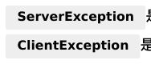

阿里云  
专有云  
统一云管平台  
Apsara Uni-manager运营控制台  
开发指南  
产品版本：V3.18.3  
文档版本：20241106

**目录**

- [1.准备工作](#section-1)
    - [1.1. 获取API信息及其Endpoint](#section-1-1)
    - [1.2. 获取AccessKey或STS AccessKey](#section-1-2)
    - [1.3. 获取公共Header参数](#section-1-3)
- [2.通过POP网关调用专有云API](#section-2)
    - [2.1. 获取Apsara Uni-manager运营控制台的Endpoint](#section-2-1)
    - [2.2. 获取Apsara Uni-manager运营控制台的SDK包](#section-2-2)
    - [2.3. Java SDK调用](#section-2-3)
    - [2.4. Python SDK调用](#section-2-4)
    - [2.5. Go SDK调用](#section-2-5)
- [3.ASCM API参考](#section-3)
    - [3.1. API列表](#section-3-1)
        - [3.1.1. 企业中心](#section-3-1-1)
            - [3.1.1.1. 组织管理](#section-3-1-1-1)
                - [3.1.1.1.1. CreateOrganization](#section-3-1-1-1-1)
                - [3.1.1.1.2. GetOrganization](#section-3-1-1-1-2)
                - [3.1.1.1.3. GetOrganizationList](#section-3-1-1-1-3)
                - [3.1.1.1.4. GetPrivateCloudAccountByOrganizationId](#section-3-1-1-1-4)
                - [3.1.1.1.5. RemoveOrganization](#section-3-1-1-1-5)
                - [3.1.1.1.6. UpdateOrganization](#section-3-1-1-1-6)
                - [3.1.1.1.7. UpdateSupportRegionsForOrg](#section-3-1-1-1-7)
            - [3.1.1.2. 资源集管理](#section-3-1-1-2)
                - [3.1.1.2.1. CreateResourceGroup](#section-3-1-1-2-1)
                - [3.1.1.2.2. BindAscmUserAndResourceGroup](#section-3-1-1-2-2)
                - [3.1.1.2.3. ListAscmUsersInsideResourceGroup](#section-3-1-1-2-3)
                - [3.1.1.2.4. ListMembersInsideResourceSet](#section-3-1-1-2-4)
                - [3.1.1.2.5. ListResourceGroup](#section-3-1-1-2-5)
                - [3.1.1.2.6. ListResourceGroupByAscmUserId](#section-3-1-1-2-6)
                - [3.1.1.2.7. ListResourceGroupByOrgId](#section-3-1-1-2-7)
                - [3.1.1.2.8. RemoveResourceGroup](#section-3-1-1-2-8)
                - [3.1.1.2.9. UnbindAscmUserAndResourceGroup](#section-3-1-1-2-9)
                - [3.1.1.2.10. UpdateResourceGroup](#section-3-1-1-2-10)
            - [3.1.1.3. 角色管理](#section-3-1-1-3)
                - [3.1.1.3.1. AddRoleToUser](#section-3-1-1-3-1)
                - [3.1.1.3.2. ListActiveRoles](#section-3-1-1-3-2)
                - [3.1.1.3.3. ListRoles](#section-3-1-1-3-3)
                - [3.1.1.3.4. LockRole](#section-3-1-1-3-4)
                - [3.1.1.3.5. RelateSystemWithRole](#section-3-1-1-3-5)
                - [3.1.1.3.6. SetDefaultRole](#section-3-1-1-3-6)
                - [3.1.1.3.7. UnLockRole](#section-3-1-1-3-7)
            - [3.1.1.4. 用户管理](#section-3-1-1-4)
                - [3.1.1.4.1. ActivateUser](#section-3-1-1-4-1)
                - [3.1.1.4.2. AddUser](#section-3-1-1-4-2)
                - [3.1.1.4.3. DeactivateUser](#section-3-1-1-4-3)
                - [3.1.1.4.4. GetUserInfo](#section-3-1-1-4-4)
                - [3.1.1.4.5. ListAccessKeysForManagedUsers](#section-3-1-1-4-5)
                - [3.1.1.4.6. DeleteUserAccessKey](#section-3-1-1-4-6)
                - [3.1.1.4.7. UpdateUserAccessKeyStatus](#section-3-1-1-4-7)
                - [3.1.1.4.8. CreateUserAccessKey](#section-3-1-1-4-8)
                - [3.1.1.4.9. GetRecentAkTrailForUser](#section-3-1-1-4-9)
                - [3.1.1.4.10. ListUserAccessKey](#section-3-1-1-4-10)
                - [3.1.1.4.11. ListAvailableUsersByRoleId](#section-3-1-1-4-11)
                - [3.1.1.4.12. ListDeletedUsers](#section-3-1-1-4-12)
                - [3.1.1.4.13. ListUsers](#section-3-1-1-4-13)
                - [3.1.1.4.14. ListUsersInsideRole](#section-3-1-1-4-14)
                - [3.1.1.4.15. LockUser](#section-3-1-1-4-15)
                - [3.1.1.4.16. ModifyUserInformation](#section-3-1-1-4-16)
                - [3.1.1.4.17. RecoverUserByLoginName](#section-3-1-1-4-17)
                - [3.1.1.4.18. RelateSystemWithUser](#section-3-1-1-4-18)
                - [3.1.1.4.19. RemoveRoleFromUser](#section-3-1-1-4-19)
                - [3.1.1.4.20. RemoveUserByLoginName](#section-3-1-1-4-20)
                - [3.1.1.4.21. RemoveCompletelyUserByLoginName](#section-3-1-1-4-21)
                - [3.1.1.4.22. ResetPasswordByLoginName](#section-3-1-1-4-22)
                - [3.1.1.4.23. UnLockUser](#section-3-1-1-4-23)
                - [3.1.1.4.24. UpdatePassword](#section-3-1-1-4-24)
            - [3.1.1.5. 用户组管理](#section-3-1-1-5)
                - [3.1.1.5.1. AddResourceSetToUserGroup](#section-3-1-1-5-1)
                - [3.1.1.5.2. AddRoleToUserGroup](#section-3-1-1-5-2)
                - [3.1.1.5.3. AddUsersToUserGroup](#section-3-1-1-5-3)
                - [3.1.1.5.4. CreateUserGroup](#section-3-1-1-5-4)
                - [3.1.1.5.5. DeleteUserGroup](#section-3-1-1-5-5)
                - [3.1.1.5.6. ListUserGroups](#section-3-1-1-5-6)
                - [3.1.1.5.7. ListUsersInUserGroup](#section-3-1-1-5-7)
                - [3.1.1.5.8. RemoveResourceSetFromUserGroup](#section-3-1-1-5-8)
                - [3.1.1.5.9. RemoveRoleFromUserGroup](#section-3-1-1-5-9)
                - [3.1.1.5.10. RemoveUsersFromUserGroup](#section-3-1-1-5-10)
            - [3.1.1.6. 登录策略管理](#section-3-1-1-6)
                - [3.1.1.6.1. AddLoginPolicy](#section-3-1-1-6-1)
                - [3.1.1.6.2. CheckLoginPolicy](#section-3-1-1-6-2)
                - [3.1.1.6.3. GetLoginPolicyById](#section-3-1-1-6-3)
                - [3.1.1.6.4. GetLoginPolicyByLoginName](#section-3-1-1-6-4)
                - [3.1.1.6.5. ListLoginPolicies](#section-3-1-1-6-5)
                - [3.1.1.6.6. ModifyLoginPolicy](#section-3-1-1-6-6)
        - [3.1.2. 运营中心](#section-3-1-2)
            - [3.1.2.1. AddCommonSpec](#section-3-1-2-1)
            - [3.1.2.2. CreateQuota](#section-3-1-2-2)
            - [3.1.2.3. DeleteQuota](#section-3-1-2-3)
            - [3.1.2.4. DescribeGpdbModifiableInstanceType](#section-3-1-2-4)
            - [3.1.2.5. GetEnterpriseCenterQuota](#section-3-1-2-5)
            - [3.1.2.6. GetEnterpriseCenterQuotaDetail](#section-3-1-2-6)
            - [3.1.2.7. GetQuota](#section-3-1-2-7)
            - [3.1.2.8. MeteringQuery](#section-3-1-2-8)
            - [3.1.2.9. SelectCommonSpec](#section-3-1-2-9)
            - [3.1.2.10. UpdateCommonSpecStatus](#section-3-1-2-10)
            - [3.1.2.11. UpdateQuota](#section-3-1-2-11)
        - [3.1.3. 云产品管理](#section-3-1-3)
            - [3.1.3.1. DescribeInstanceTypeFamilies](#section-3-1-3-1)
            - [3.1.3.2. DescribeModifiableInstanceType](#section-3-1-3-2)
            - [3.1.3.3. DescribeSeriesIdFamilies](#section-3-1-3-3)
            - [3.1.3.4. GetRegionsByProduct](#section-3-1-3-4)
            - [3.1.3.5. GroupCommonSpec](#section-3-1-3-5)
            - [3.1.3.6. InitFromOnline](#section-3-1-3-6)
            - [3.1.3.7. UpdateInstanceBelong](#section-3-1-3-7)
            - [3.1.3.8. GetAllRegionsInfo](#section-3-1-3-8)
        - [3.1.4. 配置中心](#section-3-1-4)
            - [3.1.4.1. BatchCreateRAMServiceRole](#section-3-1-4-1)
            - [3.1.4.2. GetPasswordPolicy](#section-3-1-4-2)
            - [3.1.4.3. ListRAMPolicies](#section-3-1-4-3)
            - [3.1.4.4. ListRAMPoliciesForUser](#section-3-1-4-4)
            - [3.1.4.5. ListRAMServiceRoles](#section-3-1-4-5)
            - [3.1.4.6. RemoveLoginPolicyById](#section-3-1-4-6)
            - [3.1.4.7. RemoveLoginPolicyByName](#section-3-1-4-7)
            - [3.1.4.8. ResetPasswordPolicy](#section-3-1-4-8)
            - [3.1.4.9. SetPasswordPolicy](#section-3-1-4-9)
        - [3.1.5. 计量接口相关参数](#section-3-1-5)
            - [3.1.5.1. 弹性计算](#section-3-1-5-1)
                - [3.1.5.1.1. 弹性高性能计算E-HPC](#section-3-1-5-1-1)
                - [3.1.5.1.2. 裸机管理BMS](#section-3-1-5-1-2)
                - [3.1.5.1.3. 智能计算灵骏EFLOPS](#section-3-1-5-1-3)
                - [3.1.5.1.4. 容器镜像服务](#section-3-1-5-1-4)
                - [3.1.5.1.5. 容器服务Kubernetes版](#section-3-1-5-1-5)
                - [3.1.5.1.6. 专有云宿主机DDH](#section-3-1-5-1-6)
                - [3.1.5.1.7. 弹性伸缩ESS](#section-3-1-5-1-7)
                - [3.1.5.1.8. 块存储EBS](#section-3-1-5-1-8)
                - [3.1.5.1.9. 快照Snapshot](#section-3-1-5-1-9)
                - [3.1.5.1.10. 云服务器ECS](#section-3-1-5-1-10)
            - [3.1.5.2. 存储](#section-3-1-5-2)
                - [3.1.5.2.1. 表格存储Tablestore](#section-3-1-5-2-1)
                - [3.1.5.2.2. 对象存储OSS](#section-3-1-5-2-2)
                - [3.1.5.2.3. 日志服务SLS](#section-3-1-5-2-3)
            - [3.1.5.3. 网络](#section-3-1-5-3)
                - [3.1.5.3.1. 高可用虚拟IP](#section-3-1-5-3-1)
                - [3.1.5.3.2. 高速通道](#section-3-1-5-3-2)
                - [3.1.5.3.3. NAT网关](#section-3-1-5-3-3)
                - [3.1.5.3.4. IPv6网关](#section-3-1-5-3-4)
                - [3.1.5.3.5. VPN网关](#section-3-1-5-3-5)
                - [3.1.5.3.6. 专有网络VPC](#section-3-1-5-3-6)
                - [3.1.5.3.7. 弹性网关EIP](#section-3-1-5-3-7)
                - [3.1.5.3.8. 均衡负载SLB](#section-3-1-5-3-8)
                - [3.1.5.3.9. 租户内网域名AUTH_ZONE](#section-3-1-5-3-9)
            - [3.1.5.4. 大数据](#section-3-1-5-4)
                - [3.1.5.4.1. 大数据计算MaxCompute](#section-3-1-5-4-1)
                - [3.1.5.4.2. 数据总线DataHub](#section-3-1-5-4-2)
                - [3.1.5.4.3. 实时计算Blink](#section-3-1-5-4-3)
                - [3.1.5.4.4. 实时计算Realtime Compute Flink](#section-3-1-5-4-4)
            - [3.1.5.5. 中间件](#section-3-1-5-5)
                - [3.1.5.5.1. 消息队列RocketMQ版](#section-3-1-5-5-1)
            - [3.1.5.6. 数据库](#section-3-1-5-6)
                - [3.1.5.6.1. 云原生关系型数据库PolarDB](#section-3-1-5-6-1)
                - [3.1.5.6.2. 数据传输服务DTS](#section-3-1-5-6-2)
                - [3.1.5.6.3. 数据管理DMS](#section-3-1-5-6-3)
                - [3.1.5.6.4. 云数据库SQLServer版](#section-3-1-5-6-4)
                - [3.1.5.6.5. 云数据库PostgreSQL版](#section-3-1-5-6-5)
                - [3.1.5.6.6. 云数据库MongoDB版本](#section-3-1-5-6-6)
                - [3.1.5.6.7. 云数据库KVStore for Redis](#section-3-1-5-6-7)
                - [3.1.5.6.8. 云原生分布式数据库PolarDB-X](#section-3-1-5-6-8)
                - [3.1.5.6.9. 云数据库 RDS MySQL版](#section-3-1-5-6-9)
            - [3.1.5.7. 应用服务](#section-3-1-5-7)
                - [3.1.5.7.1. API网关](#section-3-1-5-7-1)
            - [3.1.5.8. 安全](#section-3-1-5-8)
                - [3.1.5.8.1. 云安全管理中心SOC](#section-3-1-5-8-1)
                - [3.1.5.8.2. 流量检测与响应](#section-3-1-5-8-2)
                - [3.1.5.8.3. 流量安全监控](#section-3-1-5-8-3)
                - [3.1.5.8.4. 安骑士](#section-3-1-5-8-4)
                - [3.1.5.8.5. WEB应用防火墙](#section-3-1-5-8-5)
                - [3.1.5.8.6. 态势感知](#section-3-1-5-8-6)
                - [3.1.5.8.7. 堡垒机](#section-3-1-5-8-7)
                - [3.1.5.8.8. 密钥管理服务KMS](#section-3-1-5-8-8)
        - [3.1.6. 操作审计](#section-3-1-6)
            - [3.1.6.1. LookupInnerEvents](#section-3-1-6-1)
            - [3.1.6.2. RetryAuditTask](#section-3-1-6-2)
            - [3.1.6.3. ListAuditFile](#section-3-1-6-3)
            - [3.1.6.4. ListTrailStorage](#section-3-1-6-4)
            - [3.1.6.5. ListAccessKeyEvents](#section-3-1-6-5)
            - [3.1.6.6. CreateTrailStorage](#section-3-1-6-6)
            - [3.1.6.7. DownloadAuditFile](#section-3-1-6-7)
            - [3.1.6.8. GetDownloadUrl](#section-3-1-6-8)
- [4.STS API参考](#section-4)
    - [4.1. AssumeRole - 获取扮演角色的临时身份凭证](#section-4-1)
    - [4.2. GetCallerIdentity - 获取当前调用者的身份信息](#section-4-2)

<a id="section-1"></a>

# 1.准备工作

<a id="section-1-1"></a>

## 1.1. 获取API信息及其Endpoint

在通过SDK调用API接口时需要填写API接口的相关信息，包括产品名称（code）、开放API接口名称、API版本。

**背景信息**

Apsara Uni-manager运营控制台开发者门户中的API信息仅供调用参考，具体API的使用方式需要参见云产品的开发指南。如果发生不一致情况，以开发指南支持情况为准。

**操作步骤**

1. 登录Apsara Uni-manager运营控制台。

2. 在顶部菜单栏，选择**产品** > **开发工具** > **API与工具** > **开发者门户**。

3. 在**开发者门户**页面，选择**API集成** > **API调试**。

   

4. 在左侧导航栏中选择目标云产品。

5. 在**版本**下拉列表中，选择目标API版本。

6. 在下方API列表中可浏览当前版本的所有API接口。

7. 选中对应接口，在参数名下获取云产品的POP Endpoint信息。

<a id="section-1-2"></a>

## 1.2. 获取AccessKey或STS AccessKey

AccessKey支持RAM和STS两种授权模式，在发起调用时选择使用其中一种AccessKey即可。

**背景信息**

AccessKey通过使用AccessKey ID和AccessKey Secret对称加密，实现验证某个请求发送者的身份的功能。其中AccessKey ID用于标识用户，AccessKey Secret是用户用于加密签名的字符串。

AccessKey的两种授权模式如下：

- 通过RAM授权给第三方请求者的AccessKey ID和AccessKey Secret。

- 通过STS授权给第三方请求者的AccessKey ID、AccessKey Secret和Security Token。

**获取AccessKey**

Apsara Uni-manager运营控制台提供了个人AccessKey和组织AccessKey。推荐使用个人账号AccessKey调用Apsara Uni-manager运营控制台及云产品相关接口。

> **说明**
>
> 只有运营管理员和一级组织管理员可以获取组织AccessKey。

**获取个人账号AccessKey**

使用个人账号AccessKey，需要在Header中添加以下限制性参数，否则可能提示权限不足：

| 参数名称 | 描述 |
| --- | --- |
| x-acs-regionid | 实际操作的实例资源所属的地域ID，如：cn-qingdao-\*\*\*\*-\*\*\*\*。 |
| x-acs-organizationid | 实际操作的实例资源所属的组织ID，可参考获取公共Header参数中的<em>获取组织ID</em>获取。 |
| x-acs-resourcegroupid | 实际操作的实例资源所属的资源集ID，可参考获取公共Header参数中的<em>获取资源集ID</em>获取。 |
| x-acs-instanceid | 实际操作的实例资源的实例ID。例如，ECS的实例ID可以从ECS列表中查询到。 |

1. 登录Apsara Uni-manager运营控制台。

2. 在系统界面右上角，单击当前登录用户头像，单击**个人信息**。

3. 在**AccessKey**区域，您可以查看个人账户的AccessKey信息。

   

   > **说明**
   >
   > Accesskey ID和AccessKey Secret是您访问云资源时的密钥，具有该账号完整的权限，请您妥善保管。

**获取组织AccessKey**

> **警告**
>
> 个人账号AccessKey是由Apsara Uni-manager运营控制台权限体系管控的受限AccessKey，组织AccessKey相对权限较大，需要管理员确认操作的安全性。

1. 管理员登录Apsara Uni-manager运营控制台。

2. 在顶部菜单栏，单击**企业**。

3. 在左侧导航栏中，选择**资源管理 > 组织管理**。

4. 在组织结构中，单击目标一级组织名称。

5. 单击**管理Accesskey**。

6. 在弹出的对话框中，查看组织AccessKey信息。

**获取STS Accesskey**

阿里云临时安全令牌STS（Security Token Service）是阿里云提供的一种临时访问权限管理服务。STS AccessKey由AccessKey ID、AccessKey Secret及SecurityToken三元组组成，使用STS方式调用云产品API时，三元组缺一不可。

1. 获取用户角色的RAM Role。

   <ol type="i">

   <li>

   登录Apsara Uni-manager运营控制台。

   </li>

   <li>

   单击页面右上角的用户头像，单击个人信息。

   </li>

   <li>

   单击查看当前角色策略。

   </li>

   <li>

   在当前选择角色策略对话框中查看RAM Role。

   </li>

   </ol>

2. 获取STS的Endpoint。

   <ol type="i">

   <li>

   登录飞天基础运维控制台。

   </li>

   <li>

   在飞天基础运维平台左侧导航栏中，单击**产品集群运维**。

   </li>

   <li>

   在**产品 | 集群**搜索框中搜索**ascm-A**。

   </li>

   <li>

   单击集群**操作**列的**集群详情**

   </li>

   <li>

   在集群详情页面，单击**终态配置**页签。

   </li>

   <li>

   在终态配置页面左侧文件列表中，单击**kv.conf**，单击右侧区域的**显示内容**。按Ctrl+F键分别搜索 `region` 和 `internet-domain` 的对应值。

   </li>

   <li>

   获取后按照 `sts-vpc.${global:region}.${global:internet-domain}` 格式进行替换拼接。其中 `region` 的值替换 `${global:region}` ， `internet-domain` 的值替换 `${global:internet-domain}` 。

   > **说明**
   >
   > 最终STS Endpoint中，${global:}不保留。

   </li>

   </ol>

3. 通过调用STS的AssumeRole接口来获取三元组信息，以下为Java的STS SDK调用示例。

   > **说明**
   >
   > 以下代码示例中 `<yourRegionID>` 、 `<yourAccessKeyID>` 、 `<yourAccessKeySecret>` 、 `<yourRoleSessionName>` 、 `<yourRoleArn>` 、 `<sts.aliyuns.com>` 均为可变参数，需要替换为其实际值。尖括号（<>）在最终代码中不保留。

   ```java
   public static void main(String[] args) {
       // 创建DefaultAcsClient实例并初始化。
       // 请替换为您实际的地域ID、AccessKey ID、AccessKey Secret。
       DefaultProfile profile = DefaultProfile.getProfile("<yourRegionID>", "<yourAccessKeyID>", "<yourAccessKeySecret>");
       HttpClientConfig clientConfig = HttpClientConfig.getDefault();
       clientConfig.setIgnoreSSLCerts(true);
       clientConfig.setProtocolType(ProtocolType.HTTPS);
       profile.setHttpClientConfig(clientConfig);
       IAcsClient client = new DefaultAcsClient(profile);
       String assumeRole = callAssumeRole(client);
       if (StringUtils.isEmpty(assumeRole)) return;
       JSONObject assumeRoleJson = JSONObject.parseObject(assumeRole);
       JSONObject credentials = assumeRoleJson.getJSONObject("Credentials");
       // 获取到STS三元组。
       String stsAK = credentials.getString("AccessKeyId");
       String stsSK = credentials.getString("AccessKeySecret");
       String stsToken = credentials.getString("SecurityToken");
   }

   private static String callAssumeRole(IAcsClient client) {
       CommonRequest request = new CommonRequest();
       // "sts.aliyuns.com" 请替换为实际的STS Endpoint，⼀般格式为sts-vpc.${global:region}.${global:internet-domain}。
       request.setSysDomain("<sts.aliyuns.com>");
       request.setSysProduct("Sts");
       request.setSysAction("AssumeRole");
       request.setSysVersion("2015-04-01");
       request.setSysMethod(MethodType.POST);
       request.setHttpContentType(FormatType.FORM);
       // ⾓⾊会话名称。该参数为⽤户⾃定义参数。通常设置为调⽤该API的⽤户⾝份，例如：⽤户名。"<yourRoleSessionName>"请您替换为您⾃定义的值。
       request.putQueryParameter("RoleSessionName", "<yourRoleSessionName>");
       // 扮演的RAM Role的ARN。该⾓⾊是可信实体为ASCM⽤户的RAM⾓⾊。"<yourRoleArn>"请替换为第⼀步获取到的实际RAM Role。
       request.putQueryParameter("RoleArn", "<yourRoleArn>");
       try {
           CommonResponse response = client.getCommonResponse(request);
           return response.getData();
       } catch (ServerException e) {
           System.out.println(e.getErrCode());
           System.out.println(e.getErrMsg());
       } catch (ClientException e) {
           System.out.println(e.getErrCode());
           System.out.println(e.getErrMsg());
       }
       return null;
   }
   ```

4. 获取STS AccessKey三元组后，您就可以使用三元组信息调用云产品API接口。以下Java SDK示例以DescribeZones接口为例，使用STS AccessKey调用ECS产品接口。

   > **说明**
   >
   > 以下代码示例

   中 `<yourRegionID>` 、 `<yourStsAccesskeyID>` 、 `<yourStsAccessKeySecret>` 、 `<yourStsToken>` 、 `<yourResourceGroupID>` 、 `<yourOrganizationID>`

   > 为可变参数，需要替换为其实际值。尖括号（<>）在最终代码中不保留。

   ```java
   public static void main(String[] args) {
       // "<yourRegionID>"请替换为实际操作的实例资源所属的地域ID。
       // "<yourStsAccessKeyID>", "<yourStsAccessKeySecret>"请替换为前⼀步获取到的STS三元组中AccessKeyID、AccessKeySecret。
       DefaultProfile profile = DefaultProfile.getProfile("<yourRegionID>", "<yourStsAccesskey>", "<yourStsAccessSecret>");
       HttpClientConfig clientConfig = HttpClientConfig.getDefault();
       clientConfig.setIgnoreSSLCerts(true);
       clientConfig.setProtocolType(ProtocolType.HTTPS);
       profile.setHttpClientConfig(clientConfig);
       IAcsClient client = new DefaultAcsClient(profile);
       CommonRequest request = new CommonRequest();
       request.setSysDomain("ecs.aliyuns.com");
       request.setSysProduct("Ecs");
       request.setSysAction("DescribeZones");
       request.setSysVersion("2014-05-26");
       request.setSysMethod(MethodType.POST);
       request.setHttpContentType(FormatType.FORM);
       //"<yourRegionID>" 请替换为实际操作的实例资源所属的地域ID。
       request.putHeadParameter("x-acs-regionid", "<yourRegionID>");
       // "<yourStsToken>" 请替换为您前⼀步获取到的STS三元组中SecurityToken。
       request.putQueryParameter("SecurityToken", "<yourStsToken>");
       // 非必填,请替换为实际操作的实例资源所属的资源集ID。
       // request.putHeadParameter("x-acs-resourcegroupid", "<yourResourceGroupID>");
       // 必填,请替换为实际操作的实例资源所属的组织ID。
       request.putHeadParameter("x-acs-organizationid", "<yourOrganizationID>");
       try {
           CommonResponse response = client.getCommonResponse(request);
           System.out.println(response.getData());
       } catch (ServerException e) {
           System.out.println(e.getErrCode());
           System.out.println(e.getErrMsg());
       } catch (ClientException e) {
           System.out.println(e.getErrCode());
           System.out.println(e.getErrMsg());
       }
   }
   ```

<a id="section-1-3"></a>

## 1.3. 获取公共Header参数

调用专有云API时需要填写多个公共请求Header参数，在返回结果中也会包含公共返回参数。

**公共请求参数**

在专有云API调用的代码中需要指定这些公共请求参数的参数值。

例如：在Java SDK调用中的 `request.putHeadParameter("x-acs-resourcegroupid", "<yourResourceGroupID>")` ，需要将 `<yourResourceGroupID>` 替换为您获取到的实际的资源集ID。

| 名称 | 描述 |
| --- | --- |
| x-acs-regionid | 实际操作的实例资源所属的地域ID，获取方式请参见获取Region ID。 |
| x-acs-organizationid | 实际操作的实例资源所属的组织ID，获取方式请参见获取组织ID。 |
| x-acs-resourcegroupid | 实际操作的实例资源所属的资源集ID，获取方式请参见获取资源集ID。 |
| x-acs-instanceid | 实际操作的实例资源的实例ID，获取方式请参见获取实例ID。 |

> **说明**
>
> - 调用Apsara Uni-manager运营控制台的API时，可以不使用Header参数 `x-acs-organizationid` 、 `x-acs-resourcegroupid` 、 `x-acs-instanceid` 。
>
> - 调用其他云产品的API时，需要在Header参数中增加组织ID `<x-acs-organizationid>` ，否则将返回调用异常，提示无权限。
>
> - 调用其他云产品的API时，建议在Header参数中增加资源集ID `<x-acs-resourcegroupid>` 。指定资源所属的组织和资源集，实现实例资源的隔离查询。若不指定资源集ID `<x-acs-resourcegroupid>` ，则获取当前用户所属组织的默认资源集。

**获取Region ID**

您可以在Apsara Uni-manager运营控制台中查看资源所属的RegionID。

1. 管理员登录Apsara Uni-manager运营控制台。

2. 在顶部菜单栏中，单击**企业**。

3. 在左侧导航栏中，选择**资源管理** > **地域管理**。

4. 单击目标组织名称。

5. 在右侧**Region列表**中查看**Region名称**，即为Region ID。

**获取组织ID**

组织ID需要通过调用API方式获取，您可以在Apsara Uni-manager运营控制台中通过API在线调试功能快速获取组织ID信息。

1. 管理员登录Apsara Uni-manager运营控制台。

2. 在顶部菜单栏，选择**产品** > **开发工具** > **API与工具** > **开发者门户**。

3. 在**开发者门户**页面，选择**API集成** > **API调试**。

4. 单击  按钮，选择**云平台** > **统一云管平台**，**版本**选择**2019-05-10**。

5. 在文本框内输入 `GetOrganizationList` 进行在线调试，在name参数填写目标组织名称后发起调用，调用成功后查看**调用结果**中**id**的信息，即为组织ID。接口信息详见GetOrganizationList<em>。</em>

**获取资源集ID**

资源集ID需要通过调用API方式获取，您可以在Apsara Uni-manager运营控制台中通过API在线调试功能快速获取资源集ID信息。

1. 管理员登录Apsara Uni-manager运营控制台。

2. 在顶部菜单栏，选择**产品** > **开发工具** > **API与工具** > **开发者门户**。

3. 在**开发者门户**页面，选择**API集成** > **API调试**。

4. 单击  按钮，选择**云平台** > **统一云管平台**，**版本**选择**2019-05-10**。

5. 在文本框内输入 `ListResourceGroup` 进行在线调试，调用成功后查看**调用结果**中**id**的信息，即为资源集ID。接口信息详见ListResourceGroup<em>。</em>

**获取实例ID**

实例ID可以通过Apsara Uni-manager运营控制台中的云产品实例列表进行获取。以ECS产品为例，您可以在云服务器ECS产品控制台的实例列表中查看实例ID信息。

1. 登录Apsara Uni-manager运营控制台。

2. 在顶部的菜单栏，选择**产品** > **计算** > **云服务器** > **云服务器ECS**。

3. 在左侧导航栏，单击**实例与镜像** > **ECS实例**。

4. 在实例列表中查看**实例名称/ID**。

**公共返回参数**

在调用列表类的云产品资源实例接口时，在返回结果中默认包含以下公共返回参数。

| 名称 | 描述 |
| --- | --- |
| ResourceGroupName | 资源集名称。 |
| ResourceGroup | 资源集ID。 |
| DepartmentName | 组织名称。 |
| Department | 组织ID。 |

<a id="section-2"></a>

# 2.通过POP网关调用专有云API

<a id="section-2-1"></a>

## 2.1. 获取Apsara Uni-manager运营控制台的Endpoint

Apsara Uni-manager运营控制台的Endpoint可依照配置格式在飞天基础运维平台中获得对应变量值来自行拼装，也可以在飞天基础运维平台中搜索获取。

**背景信息**

通过POP网关调用专有云API时需要使用云产品业务域的Endpoint。您可以在阿里云驻场运维工程师处获取。您也可以通过如下方法自行获取Endpoint。

**方法一：自行拼装Endpoint**

您可以根据Apsara Uni-manager运营控制台Endpoint的配置格式，获取对应变量值来自行拼装Endpoint。


- Apsara Uni-manager运营控制台中心Region Endpoint的配置格式： **ascm.${global:internet-domain}**

- Apsara Uni-manager运营控制台单元Region Endpoint的配置格式： **ascm.${global:region}.${global:internet-domain}**

> **说明**
>
> `${global:internet-domain}` 和 `${global:region}` 为变量，需要替换为您获取到的实际值。最终Endpoint中， `${global:}` 不保留。

**获取变量值的操作步骤**

1. 登录Apsara-Uni manager运维控制台。

2. 在顶部菜单栏，选择**平台运维** > **飞天基础运维平台** > **资源管理**，默认进入**产品集群运维**页面。

3. 在**产品集群运维**页面的**产品 | 集群**文本框中输入 **ascm-A** ，找到ascm-A-xxx集群，单击操作列的**集群详情**。

4. 在**集群详情**页面，选择**终态配置**页签。

5. 在左侧文件列表中，单击**kv.conf**，单击右侧文件内容，按Ctrl+F键分别搜索 `region` 和 `internet-domain` 。

   获取到的 `region` 值将替换 `${global:region}` ， `internet-domain` 值将替换 `${global:internet-domain}` 。

**方法二：通过飞天基础运维平台获取**

**操作步骤**

1. 在飞天基础运维平台**产品集群运维**页面的**产品 | 集群**文本框中输入 **ascm-A** ，找到ascm-A-xxx集群，单击操作列的**集群详情**。

2. 在服务列表页面搜索 **ascm-brm** 服务，单击下方列表中操作列的**详情**。

3. 在服务详情页面单击<strong>Manage#</strong>组件，在组件信息中选择**资源列表**页签。

4. 搜索名为 **ascm-aliyun-com-dns** 的资源，单击下方**资源申请参数**列中的信息，查看**domain**值，即ASCM的Endpoint。

<a id="section-2-2"></a>

## 2.2. 获取Apsara Uni-manager运营控制台的SDK包

通过POP网关调用Apsara Uni-manager运营控制台API时，需使用SDK包。

您可以在Apsara Uni-manager运营控制台**产品** > **开发工具** > **API与工具** > **开发者门户**，选择**API集成** > **SDK示例**查看推荐SDK版本以及示例代码。

> **说明**
>
> 推荐使用Java、Python、Go三种语言的SDK包，使用其他语言的SDK包可能发生不兼容情况。

<a id="section-2-3"></a>

## 2.3. Java SDK调用

安装阿里云Java SDK后，您可以编写代码使用阿里云Java SDK访问阿里云POP网关，调用Apsara Uni-manager运营控制台的API接口。

**前提条件**

- 已获取AccessKey或STS Accesskey，获取方式请参见获取AccessKey或STS AccessKey。

- 已获取Apsara Uni-manager运营控制台的Endpoint，获取方式请参见获取Apsara Uni-manager运营控制台的Endpoint。

- 已安装1.8及以上版本的JDK。

**安装Java SDK**

在项目目录下的pom.xml文件中，添加阿里云Java SDK核心库。

```xml
<!-- https://mvnrepository.com/artifact/com.aliyun/aliyun-java-sdk-core -->
<dependency>
    <groupId>com.aliyun</groupId>
    <artifactId>aliyun-java-sdk-core</artifactId>
    <version>4.5.30</version>
</dependency>
```

> **说明**
>
> SDK包更新频繁，建议您前往阿里云开发工具包（SDK）获取最新版本依赖。

**设置身份验证**

使用阿里云专有云SDK访问阿里云专有云服务时，您需要提供授权的账号进行身份验证。Java SDK支持通过AccessKey或STS AccessKey进行身份验证。

> **重要**
>
> 确保包含AccessKey或STS AccessKey的代码不会泄漏（例如提交到外部公开的GitHub项目），否则将会危害您的信息安全。

```text
DefaultProfile profile = DefaultProfile.getProfile(
    "<yourRegionID>",          // 请替换为您实际的地域ID。
    "<yourAccessKeyID>",      // 请替换为您实际的AccessKey ID。
    "<yourAccessKeySecret>",  // 请替换为您实际的AccessKey Secret。
    "<yourSecurityToken>"   
    //在使⽤STS AccessKey进⾏⾝份验证时，<yourSecurityToken>请替换为您实际的SecurityToken。
    //在使⽤AccessKey进⾏⾝份验证时，<yourSecurityToken>为null。
);
```

> **说明**
>
> 以上代码示例中 `<yourRegionID>` 、 `<yourAccessKeyID>` 、 `<yourAccessKeySecret>` 、 `<yourSecurityToken>` 均为可变参数，需要替换为其实际值，尖括号（<>）在最终代码中不保留。

**创建并配置请求连接**

可通过以下代码配置HttpClientConfig，具体请根据自身服务能力自行选择配置项并做相应配置。

```text
// 获取HttpClientConfig对象。
HttpClientConfig clientConfig = HttpClientConfig.getDefault();
// 设置是否忽略证书。true：忽略；false：不忽略。
clientConfig.setIgnoreSSLCerts(true);
// （可选）设置创建连接超时时间，单位毫秒（ms）。
clientConfig.setConnectionTimeoutMillis(<connectionTimeout>);
// （可选）设置读取超时时间，单位毫秒（ms）。
clientConfig.setReadTimeoutMillis(<readTimeout>);
/** （可选）请根据实际情况判断是否设置代理，设置⽅法如下。若需要设置代理，请替换为您实际的代理IP+端⼝。
clientConfig.setHttpProxy("<http://192.168.XX.XX:33XX>");
clientConfig.setHttpsProxy("<https://192.168.XX.XX:33XX>");
*/
profile.setHttpClientConfig(clientConfig);
IAcsClient client = new DefaultAcsClient(profile);
```

> **说明**
>
> 以上代码示例中 `<connectionTimeout>` 、 `<readTimeout>` 、 `<http://192.168.XX.XX:33XX>` 均为可变参数，需要您结合自身服务替换为其实际值，尖括号（<>）在最终代码中不保留。

**创建请求CommonRequest**

使用CommonRequest调用方式可实现任意Open API接口的调用。

```text
// 创建API请求并设置参数。
CommonRequest request = new CommonRequest();
// Apsara Uni-manager运营控制台接⼝信息参数。
request.setSysProduct("ascm");
request.setSysVersion("2019-05-10");
request.setSysUriPattern("<yourCallUriPattern>");
// Apsara Uni-manager运营控制台的Endpoint地址。
request.setSysDomain("<ascmEndpoint>");
// 设置请求⽅式。
request.setSysMethod(MethodType.POST);
// 设置Headers。
// 设置⾝份标识，标识调⽤来源，无实际作⽤，可随意设置，必填项。
request.putHeadParameter("x-acs-caller-sdk-source","<yourCallerSdkSource>");
// 接⼝业务参数设置。
...
// 设置Content-Type。
request.setHttpContentType(FormatType.JSON);
```

> **说明**
>
> 以上代码示例中 `<yourCallUriPattern>` 、 `<ascmEndpoint>` 、 `<yourCallerSdkSource>` 均为可变参数，需要替换为其实际值，尖括号（<>）在最终代码中不保留。

**设置阿里云核心库SDK参数**

在使用阿里云核心库SDK发起API请求时，可以设置四种类型的参数：Path、Query、Body、Header。在调用具体API时，请根据开发文档中标注的参数位置对应设置。

| 参数类型 | 描述 | 代码示例 |
| --- | --- | --- |
| Path | Path参数用于对请求Request中设置的UriPattern进行变量替换。例如：URI<code> "/clusters/[ClusterId]" </code>中的<code> [ClusterId] </code>可以通过设置Path参数<code> "ClusterId=cluster1" </code>进行替换。最终发起HTTP请求的URI则为<code> "/clusters/clusterId01" </code>。 | <code>CommonRequest request = new CommonRequest();</code><br><code>request.setSysUriPattern("/clusters/[ClusterId]");</code><br><code>request.putPathParameter("ClusterId", "clusterId01");</code> |
| Query | Query参数用于对请求Request中的URL参数进行设置（一般用于GET请求）。例如：“http://aliyun.com/api/? ClusterId=clusterId01&amp;ClusterName=cluster Name01”。 | <code>CommonRequest request = new CommonRequest();</code><br><code>request.putQueryParameter("ClusterId", "clusterId01");</code><br><code>request.putQueryParameter("ClusterName", "clusterName01");</code> |
| Body | Body参数用于对请求Request中的HTTP Content进行设置（一般用于POST/PUT请求）。目前支持两种格式：<br>• application/json<br>• application/x-www-form-urlencoded<br>说明在设置Body参数时，需要同时设置HTTP Content-Type。 | • key-value形式设置Body参数，并设置HttpContentType。<br><code>CommonRequest request = new CommonRequest();</code><br><code>request.putBodyParameter("ClusterId", "clusterId01");</code><br><code>request.putBodyParameter("ClusterName", "clusterName01");</code><code>// </code>若<code>Content-Type</code>设置为<code>application/x-www-form-urlencoded</code>，请求到服务器的<code>Content</code>数据格式为<code>"ClusterId=clusterId01&amp;ClusterName=clusterName01"</code>的字符串。<code>request.setHttpContentType(FormatType.FORM);</code><code>// </code>或，若<code>Content-Type</code>设置为<code>application/json</code>，请求到服务器的<code>Content</code>数据格式为<code>"</code> <code>{\"ClusterId\":\"clusterId01\",\"ClusterName\":\"clusterName01\"}"</code>的<code>JSON</code>串。<code>request.setHttpContentType(FormatType.JSON);</code><br>• 自行构造HTTP Content并直接设置HttpContent。<br><code>CommonRequest request = new CommonRequest();</code><code>//</code>设置<code>application/json</code>格式的<code>HTTP Content</code>。<code>String body = "{\"ClusterId\": \"clusterId01\", \"ClusterName\":</code><br><code>\"clusterName01\"}";</code><br><code>request.setHttpContent(body.getBytes(), "utf-8", FormatType.JSON);</code><code>//</code>设置<code>application/x-www-form-urlencoded</code>格式的<code>HTTP Content</code>。<code>String body = "ClusterId=clusterId01&amp;ClusterName=clusterName01";</code><br><code>request.setHttpContent(body.getBytes(), "utf-8", FormatType.FORM);</code> |
| Header | Header参数用于对请求Request中的HTTP Header进行设置。 | <code>CommonRequest request = new CommonRequest();</code><br><code>request.putHeadParameter("x-acs-organizationid", "3");</code><br><code>request.putHeadParameter("x-acs-resourcegroupid", "2");</code> |

**发起调用并处理应答**

可参考以下代码发起请求并处理返回结果。

```java
try {
    // 发起请求，并获取返回。
    CommonResponse response = client.getCommonResponse(request);
    System.out.println(response.getData());
} catch (ServerException e) {
    e.printStackTrace();
} catch (ClientException e) {
    System.out.println("ErrCode:" + e.getErrCode());
    System.out.println("ErrMsg:" + e.getErrMsg());
    System.out.println("RequestId:" + e.getRequestId());
}
```

**错误处理**

在使用Java SDK时，当服务端或者SDK端出错时，SDK会返回相应的异常信息。这些异常信息中会包含具体的错误信息包括错误码（Error Code）和错误消息（Error Message）。

一般情况下，您不需要对Java SDK返回的错误进行处理，只需要根据服务端的错误提示处理服务端错误即可。

- **`ServerException`** 是服务端错误信息。

- **`ClientException`** 是SDK端错误信息。

例如，当出现如下错误时，您可以根据具体的错误信息，修改AccessKey的ID即可。

```text
com.aliyuncs.exceptions.ClientException: InvalidAccessKeyId.NotFound : Specified access key is not found.
```

如果您需要对SDK的错误进行处理，可以参考如下示例编写代码：

```java
try {
    AcsResponse response = client.getAcsResponse(request);
    // 处理Response。
    // ...
}catch (ServerException e){
    // 这⾥可以添加您⾃⼰的错误处理逻辑。
    // 例如，打印具体的错误信息。
    System.out.println("ErrorCode=" + e.getErrCode());
    System.out.println("ErrorMessage=" + e.getErrMsg());
    // 如果遇上棘⼿问题，可联系阿⾥云技术⽀持，并提供RequestID。
    System.out.println("ResponseId=" + e.getRequestId());
}catch (ClientException e){
    // 这⾥可以添加您⾃⼰的错误处理逻辑。
    // 例如，打印具体的错误信息。
    System.out.println("ErrorCode=" + e.getErrCode());
    System.out.println("ErrorMessage=" + e.getErrMsg());
}
```

**完整调用示例**

以下代码为通过Apsara Uni-manager运营控制台的 `GetOrganizationList` 接口获取组织列表的调用示例。

```java
import com.aliyuncs.CommonRequest;
import com.aliyuncs.CommonResponse;
import com.aliyuncs.DefaultAcsClient;
import com.aliyuncs.IAcsClient;
import com.aliyuncs.exceptions.ClientException;
import com.aliyuncs.exceptions.ServerException;
import com.aliyuncs.http.FormatType;
import com.aliyuncs.http.HttpClientConfig;
import com.aliyuncs.http.MethodType;
import com.aliyuncs.http.ProtocolType;
import com.aliyuncs.profile.DefaultProfile;

public class Demo {
    /**
     * 本⽂提供的API调⽤样例仅供参考，更多详细API调⽤⽅法可参照开发⽂档中的“快速入⻔”。
     */
    public static void main(String[] args) {
        // 创建DefaultAcsClient实例并初始化。
        DefaultProfile profile = DefaultProfile.getProfile(
                "<yourRegionID>",         // 请替换为您实际的地域ID。
                "<yourAccessKeyID>",      // 请替换为您实际的AccessKeyID。
                "<yourAccessKeySecret>",  // 请替换为您实际的AccessKeySecret。
                null);
        HttpClientConfig clientConfig = HttpClientConfig.getDefault();
        clientConfig.setProtocolType(ProtocolType.HTTP);
        /**
        请根据实际情况判断是否需要设置HTTP代理，设置⽅法如下。请替换为您实际代理IP+端⼝。
        clientConfig.setHttpProxy("<http://192.168.XX.XX:33XX>");
        */
        // 设置连接超时，单位：ms。
        // clientConfig.setConnectionTimeoutMillis(1000L);
        // 设置读取超时，单位：ms。
        // clientConfig.setReadTimeoutMillis(10000L);
        profile.setHttpClientConfig(clientConfig);
        IAcsClient client = new DefaultAcsClient(profile);
        // 创建API请求并设置参数。
        CommonRequest request = new CommonRequest();
        // Apsara Uni-manager运营控制台接⼝信息参数。
        request.setSysProduct("ascm");
        request.setSysVersion("2019-05-10");
        request.setSysUriPattern("/ascm/auth/organization/queryList");
        // Apsara Uni-manager运营控制台的Endpoint地址。
        request.setSysDomain("<ascmEndpoint>");
        // 设置请求⽅式。
        request.setSysMethod(MethodType.POST);
        // 设置Headers。
        // 设置⾝份标识，标识调⽤来源，无实际作⽤，可随意设置，必填项。
        request.putHeadParameter("x-acs-caller-sdk-source","<yourCallerSdkSource>");
        // 调⽤专有云API时，⼀般需要提供多个公共Header参数，包括：x-acs-regionid、x-acs-organizationid、x-acs-resourcegroupid、x-acs-instanceid。详情可参
照开发指南中的“获取公共Header参数"。
        
        // 接⼝业务参数设置。
        request.putBodyParameter("id","1");
        request.setHttpContentType(FormatType.JSON);
        try {
            // 发起请求，并获取返回。
            CommonResponse response = client.getCommonResponse(request);
            System.out.println(response.getData());
        } catch (ServerException e) {
            e.printStackTrace();
        } catch (ClientException e) {
            System.out.println("ErrCode:" + e.getErrCode());
            System.out.println("ErrMsg:" + e.getErrMsg());
            System.out.println("RequestId:" + e.getRequestId());
        }
    }
}
```

> **说明**
>
> 以上代码示例

中 `<yourRegionID>` 、 `<yourAccessKeyID>` 、 `<yourAccessKeySecret>` 、 `<http://192.168.XX.XX:33XX>` 、 `<ascmEndpoint>` 、 `<yourCallerSdkSource>` 均

> 为可变参数，需要替换为其实际值，尖括号（<>）在最终代码中不保留。

<a id="section-2-4"></a>

## 2.4. Python SDK调用

安装阿里云Python SDK，您就可以编写代码使用阿里云Python SDK访问专有云POP网关，调用Apsara Uni-manager运营控制台的API接口。

**前提条件**

- 已获取AccessKey或STS AccessKey，获取方式请参见获取AccessKey或STS AccessKey。

- 已获取Apsara Uni-manager运营控制台的Endpoint，获取方式请参见获取Apsara Uni-manager运营控制台的Endpoint。

**安装Python SDK及依赖包安装Python SDK**

阿里云Python SDK支持Python 2.6.x、2.7.x和3.x及以上环境，您可以通过pip安装阿里云Python SDK。

> **说明**
>
> 推荐使用python3.x。

- Python 3.x执行：

  ```bash
  #安装阿⾥云SDK核⼼库。
  pip3 install aliyun-python-sdk-core-v3
  ```

- Python 2.x执行：

  ```bash
  #安装阿⾥云SDK核⼼库。
  pip install aliyun-python-sdk-core
  ```

**导入依赖包**

执行以下代码，导入Python SDK的依赖包。

```python
from aliyunsdkcore.client import AcsClient
from aliyunsdkcore.request import CommonRequest
from aliyunsdkcore.auth.credentials import AccessKeyCredential
from aliyunsdkcore.auth.credentials import StsTokenCredential
```

**设置身份验证**

Python SDK支持通过AccessKey或STS AccessKey进行身份验证。

> **重要**
>
> 确保包含AccessKey或STS AccessKey的代码不会泄漏（例如提交到外部公开的GitHub项目），否则将会危害您的信息安全。

```text
credentials = StsTokenCredential(
    '<yourAccessKeyID>', # 请替换为您实际的AccessKey ID。
    '<yourAccessKeySecret>', # 请替换为您实际的AccessKey Secret。
    '<yourSecurityToken>'
    #使⽤STS AccessKey进⾏⾝份验证时，<yourSecurityToken>请替换为您实际的SecurityToken。
    #使⽤AccessKey进⾏⾝份验证时，<yourSecurityToken>为None。
)
```

> **说明**
>
> 以上代码示例中 `<yourAccessKeyID>` 、 `<yourAccessKeySecret>` 、 `<yourSecurityToken>` 均为可变参数，需要替换为其实际值，尖括号（<>）在最终代码中不保留。

**创建并配置请求连接**

可通过以下代码配置HttpClientConfig，具体请根据自身服务能力自行选择配置项并做相应配置。

```text
client = AcsClient(region_id='<your-region-id>',
                   credential=credentials,
                   # （可选）设置创建连接超时时间，单位毫秒（ms）。
                   connect_timeout=<connectionTimeout>,
                   # （可选）设置读取超时时间，单位毫秒（ms）。
                   read_timeout=<readTimeout>,
                   # （可选）请根据实际情况判断是否设置代理，设置⽅法如下：
                   # proxy={
                   #     "http":"<http://192.168.XX.XX:33XX>",
                   #     "https":"<http://192.168.XX.XX:33XX>"
                   # }
                   )
```

> **说明**
>
> 以上代码示例中 `<connectionTimeout>` 、 `<readTimeout>` 、 `<http://192.168.XX.XX:33XX>` 均为可变参数，需要替换为其实际值，尖括号（<>）在最终代码中不保留。

**创建请求CommonRequest**

使用CommonRequest调用方式可实现任意Open API接口的调用。

```text
# 创建API请求并设置参数。
request = CommonRequest()
# 产品接⼝信息参数。
request.set_product("ascm")
request.set_version('2019-05-10')
request.set_uri_pattern("<yourCallUriPattern>")
# Apsara Uni-manager运营控制台的Endpoint地址。
request.set_domain('<ascmEndpoint>')
# 设置请求⽅式。
request.set_method('POST')
# 设置请求协议类型：HTTP/HTTPS。
request.set_protocol_type('https')
# 设置Headers。
# 设置⾝份标识，标识调⽤来源，无实际作⽤，可随意设置，必填项。
request.add_header("x-acs-caller-sdk-source", "<yourCallerSdkSource>")
# 接⼝业务参数设置。
...
# 设置Content-Type。
request.set_content_type('application/json')
```

> **说明**
>
> 以上代码示例中 `<yourCallUriPattern>` 、 `<ascmEndpoint>` 、 `<yourCallerSdkSource>` 均为可变参数，需要您结合自身服务替换为其实际值，尖括号（<>）在最终代码中不保留。

**设置阿里云核心库SDK参数**

在使用阿里云核心库SDK发起API请求时，可以设置四种类型的参数：Path、Query、Body、Header。在调用具体API时，请根据开发文档中标注的参数位置对应设置。

| 参数类型 | 描述 | 示例 |
| --- | --- | --- |
| Path | Path参数用于对请求Request中设置的UriPattern进行变量替换。例如：URI<code> "/clusters/[ClusterId]" </code>中的<code> [ClusterId] </code>可以通过设置Path参数<code> "ClusterId=cluster1" </code>进行替换。最终发起HTTP请求的URI则为<code> "/clusters/clusterId01" </code>。 | <code>request = CommonRequest()</code><br><code>request.set_uri_pattern("/clusters/[ClusterId]")</code><br><code>request.add_path_param("ClusterId", "clusterId01")</code> |
| Query | Query参数用于对请求Request中的URL参数进行设置（一般用于GET请求）。例如：“http://aliyun.com/api/? ClusterId=clusterId01&amp;ClusterName=cluster Name01”。 | <code>request = CommonRequest()</code><br><code>request.add_query_param("ClusterId", "clusterId01");</code><br><code>request.add_query_param("ClusterName", "");</code> |
| Body | Body参数用于对请求Request中的HTTP Content进行设置（一般用于POST/PUT请求）。目前支持两种格式：<br>• application/json<br>• application/x-www-form-urlencoded<br>说明在设置Body参数时，需要同时设置HTTP Content-Type。 | • key-value形式设置Body参数，并设置HttpContentType。<br><code>request = CommonRequest()</code><br><code>request.add_body_params("ClusterId", "clusterId01");</code><br><code>request.add_body_params("ClusterName", "clusterName01");</code><code>// </code>若<code>Content-Type</code>设置为<code>application/x-www-form-urlencoded</code>，请求数据格式为<code>"ClusterId=clusterId01&amp;ClusterName=clusterName01"</code>的字符串。<code>request.set_content_type("application/x-www-form-urlencoded");</code><code>// </code>或，若<code>Content-Type</code>设置为<code>application/json</code>，请求数据格式为<code>"</code> <code>{\"ClusterId\":\"clusterId01\",\"ClusterName\":\"clusterName01\"}"</code>的<code>JSON</code>串。<code>request.set_content_type("application/json");</code><br>• 自行构造请求HTTP Content并设置。<br><code>request = CommonRequest()</code><code>//</code>设置<code>application/json</code>格式的<code>HTTP Content</code>。<code>body = '''{"ClusterId": "clusterId01", "ClusterName": "clusterName01"}''';</code><br><code>request.set_content(body.encode("utf-8"));</code><br><code>request.set_content_type("application/json");</code><code>//</code>设置<code>application/x-www-form-urlencoded</code>格式的<code>HTTP Content</code>。<code>body = '''ClusterId=clusterId01&amp;ClusterName=clusterName01''';</code><br><code>request.set_content(body.encode("utf-8"));</code><br><code>request.set_content_type("application/x-www-form-urlencoded");</code> |
| Header | Header参数用于对请求Request中的HTTP Header进行设置。 | <code>request = CommonRequest()</code><br><code>request.add_header("x-acs-organizationid", "3")</code><br><code>request.add_header("x-acs-resourcegroupid", "2")</code> |

**发起调用并处理返回**

```text
# 发起请求，并获取返回。
response = client.do_action_with_exception(request)
# python2:  print(response)
print(str(response, encoding='utf-8'))
```

**错误处理**

在使用Python SDK时，当服务端或者SDK端出错时，SDK会返回相应的异常信息。这些异常信息中会包含具体的错误信息包括错误码（Error Code）和错误消息（Error Message）。

一般情况下，您不需要对Python SDK返回的错误进行处理，只需要根据服务端的错误提示处理服务端错误即可。



- **ServerException** 是服务端错误信息。

- **ClientException** 是SDK端错误信息。

例如，当出现如下错误时，您可以根据具体的错误信息，修改AccessKey的ID即可。

```text
aliyunsdkcore.acs\_exception.exceptions.ServerException: HTTP Status: 404 Error:InvalidAccessKeyId.NotFound Specified access keey is not 
found.
```

如果您需要对SDK的错误进行处理，可以参考如下示例编写代码：

```text
try:
    response = client.do_action_with_exception(request)
except ServerException as e:
    # 这⾥可以添加您⾃⼰的错误处理逻辑。
    # 例如，打印具体的错误信息。
    print e.get_http_status()
    print e.get_error_code()
    print e.get_error_msg()
```

**完整调用示例**

以下代码为通过ASCM的 `GetOrganizationList` 接口获取组织列表的调用示例。

```python
# coding=utf-8
# 导入依赖包。
from aliyunsdkcore.client import AcsClient
from aliyunsdkcore.request import CommonRequest
from aliyunsdkcore.auth.credentials import AccessKeyCredential
from aliyunsdkcore.auth.credentials import StsTokenCredential

# 本⽂提供的API调⽤样例仅供参考，更多详细API调⽤⽅法可参照开发⽂档中的“快速入⻔”。
credentials = AccessKeyCredential('<yourAccessKeyID>', '<yourAccessKeySecret>')
client = AcsClient(region_id='<yourRegionID>', credential=credentials)
# 创建API请求并设置参数。
request = CommonRequest()
# Apsara Uni-manager运营控制台的接⼝信息参数。
request.set_product("ascm")
request.set_version('2019-05-10')
request.set_uri_pattern("/ascm/auth/organization/queryList")
# Apsara Uni-manager运营控制台的Endpoint地址。
request.set_domain('<ascmEndpoint>')
# 设置请求⽅式。
request.set_method('POST')
# 设置请求协议类型。
request.set_protocol_type('http')
# 设置Headers
# 设置⾝份标识，标识调⽤来源，无实际作⽤，可随意设置，必填项。
request.add_header("x-acs-caller-sdk-source", "<yourCallerSdkSource>")
# 调⽤专有云API时，⼀般需要提供多个公共Header参数，包括：x-acs-regionid、x-acs-organizationid、x-acs-resourcegroupid、x-acs-instanceid。详情可参照开发指南
中的“获取公共Header参数"。

# 接⼝业务参数设置。
request.add_body_params("id", "1")
request.set_content_type('application/json')
# 发起请求，并获取返回。
response = client.do_action_with_exception(request)
# python2:  print(response)
print(str(response, encoding='utf-8'))
```

> **说明**
>
> 以上代码示例中 `<yourRegionID>` 、 `<yourAccessKeyID>` 、 `<yourAccessKeySecret>` 、 `<ascmEndpoint>` 、 `<yourCallerSdkSource>` 均为可变参数，需要替换为其实际值，尖括号（<>）在最终代码中不保留。

<a id="section-2-5"></a>

## 2.5. Go SDK调用

安装阿里云Go SDK后，您可以编写代码使用阿里云Go SDK访问阿里云POP网关，调用Apsara Uni-manager运营控制台的API接口。

**前提条件**

- 已获取AccessKey或STS AccessKey，获取方式请参见获取AccessKey或STS AccessKey。

- 已获取Apsara Uni-manager运营控制台的Endpoint，获取方式请参见获取Apsara Uni-manager运营控制台的Endpoint。

**安装Go SDK**

阿里云Go SDK支持Go 1.10.x及以上版本，您可以通过执行以下命令下载安装Go SDK核心库。

```text
go get -u github.com/aliyun/alibaba-cloud-sdk-go/sdk
```

若出现网络报错，可尝试使用以下两种方式下载。

- 使用官方提供的下载方式。

  ```text
  GOPROXY=https://goproxy.cn,direct  go get -u github.com/aliyun/alibaba-cloud-sdk-go/sdk
  ```

- 使用代理服务器下载。

  ```text
  go env -W GOPROXY='https://goproxy.cn,direct'
  ```

**设置身份验证**

Go SDK支持通过AccessKey或STS AccessKey进行身份验证。

> **重要**
>
> 确保包含AccessKey或STS AccessKey的代码不会泄漏（例如提交到外部公开的GitHub项目），否则将会危害您的信息安全。

```text
credential := credentials.NewStsTokenCredential(
    "<yourAccessKeyID>",  // 请替换为您实际的AccessKey ID。
    "<yourAccessKeySecret>", // 请替换为您实际的AccessKey Secret。
    "<yourStsToken>", 
    // 在使⽤STS AccessKey进⾏⾝份验证时，<yourStsToken>需替换为您实际的Security Token。
    // 在使⽤AccessKey进⾏⾝份验证时，<yourStsToken>为""。
)
```

> **说明**
>
> 以上代码示例中 `<yourAccessKeyID>` 、 `<yourAccessKeySecret>` 、 `<yourSecurityToken>` 均为可变参数，需要替换为其实际值，尖括号（<>）在最终代码中不保留。

**创建并配置请求连接**

可通过以下代码配置HttpClientConfig，具体请根据自身服务能力自行选择配置项并做相应配置。

```text
client, err := sdk.NewClientWithOptions("<your-region-id>", sdk.NewConfig(), credential)
if err != nil {
    panic(err)
}
// 设置是否忽略证书。true：忽略；false：不忽略。
client.SetHTTPSInsecure(true)
//（可选）设置创建连接超时时间，单位纳秒。计算公式为：X秒*time.Second=X*1000000000纳秒
client.SetConnectTimeout(1 * time.Second)
// （可选）设置读取超时时间，单位纳秒。计算公式为：X秒*time.Second=X*1000000000纳秒
client.SetReadTimeout(10 * time.Second)
/** （可选）请根据实际情况判断是否设置代理，设置⽅法如下。请替换为您实际的代理IP+端⼝。
client.SetHttpProxy("<http://192.168.XX.XX:33XX>")
client.SetHttpsProxy("<https://192.168.XX.XX:33XX>")
*/
```

> **说明**
>
> 以上代码示例中 `<connectionTimeout>` 、 `<readTimeout>` 、 `<http://192.168.XX.XX:33XX>` 均为可变参数，需要您结合自身服务替换为其实际值，尖括号（<>）在最终代码中不保留。

**创建请求CommonRequest**

使用CommonRequest调用方式可实现任意Open API接口的调用。

```text
// 创建API请求并设置参数。
request := requests.NewCommonRequest()
// Apsara Uni-manager运营控制台接⼝信息参数。
request.Product ="ascm"
request.Version = "2019-05-10"
//被调⽤接⼝的Restful路径，例如GetOrganizationList接⼝的Restful路径为：/ascm/auth/organization/queryList。其它接⼝请查看对应接⼝⽂档。
request.PathPattern = "<yourCallUriPattern>"
// Apsara Uni-manager运营控制台的Endpoint地址
request.Domain = "<ascmEndpoint>"
// 设置请求⽅式。
request.Method = "POST"
// 设置协议类型，https或http。
request.Scheme = "https"
// 设置Headers。
// 设置⾝份标识，标识调⽤来源，无实际作⽤，可随意设置，必填项。
request.Headers["x-acs-caller-sdk-source"] = "<yourCallerSdkSource>"
// 接⼝业务参数设置。
...
// 设置Content-Type。
request.SetContentType("application/json")
```

> **说明**
>
> 以上代码示例中 `<yourCallUriPattern>` 、 `<ascmEndpoint>` 、 `<yourCallerSdkSource>` 均为可变参数，需要您结合自身服务替换为其实际值，尖括号（<>）在最终代码中不保留。

**设置阿里云核心库SDK参数**

在使用阿里云核心库SDK发起API请求时，可以设置四种类型的参数：Path、Query、Body、Header。在调用具体API时，请根据开发文档中标注的参数位置对应设置。

| 参数类型 | 描述 | 示例 |
| --- | --- | --- |
| Path | Path参数用于对请求Request中设置的UriPattern进行变量替换。例如：URI<code> "/clusters/[ClusterId]" </code>中的<code> [ClusterId] </code>可以通过设置Path参数<code> "ClusterId=cluster1" </code>进行替换。最终发起HTTP请求的URI则为<code> "/clusters/clusterId01" </code>。 | <code>request := requests.NewCommonRequest()</code><br><code>request.PathPattern = "/clusters/[ClusterId]"</code><br><code>request.PathParams["ClusterId"] = "clusterId01"</code> |
| Query | Query参数用于对请求Request中的URL参数进行设置（一般用于GET请求）。例如：“http://aliyun.com/api/? ClusterId=clusterId01&amp;ClusterName=cluster Name01”。 | <code>request := requests.NewCommonRequest()</code><br><code>request.QueryParams["ClusterId"] = "clusterId01"</code><br><code>request.QueryParams["ClusterName"] = "clusterName01"</code> |
| Body | Body参数用于对请求Request中的HTTP Content进行设置（一般用于POST/PUT请求）。目前支持两种格式：<br>• application/json<br>• application/x-www-form-urlencoded<br>说明在设置Body参数时，需要同时设置HTTP Content-Type。 | 自行构造HTTP Content并直接设置HttpContent。<br><code>request := requests.NewCommonRequest()</code><code>//</code>设置<code>application/json</code>格式的<code>HTTP Content</code>。<code>body := `{"ClusterId":"clusterId01","ClusterName":"clusterName01"}`</code><br><code>request.Content = []byte(body)</code><br><code>request.SetContentType(requests.Json)</code><code>//</code>设置<code>application/x-www-form-urlencoded</code>格式的<code>HTTP Content</code>。<code>body := `ClusterId=clusterId01&amp;ClusterName=clusterName01`</code><br><code>request.Content = []byte(body)</code><br><code>request.SetContentType(requests.Form)</code> |
| Header | Header参数用于对请求Request中的HTTP Header进行设置。 | <code>request := requests.NewCommonRequest()</code><br><code>request.Headers["x-acs-organizationid"] = "3"</code><br><code>request.Headers["x-acs-resourcegroupid"] = "2"</code> |

**发起调用并处理返回**

可参考以下代码发起请求并处理返回结果。

```text
response, err := client.ProcessCommonRequest(request)
if err != nil {
   panic(err)
}
fmt.Print(response.GetHttpContentString())
```

**错误处理**

阿里云Go SDK在服务端或者SDK端出错时，会返回相应的错误信息，即sdk.errors包下的ClientError和ServerError。这些错误是基于Go的标准Error接口实现的，您可以像处理Go标准错误一样来处理阿里云Go SDK返回的错误。

**简单处理异常**

您可以通过以下代码来简单处理错误。

```text
response,err  := ecsClient.DescribeInstances(request)
if err != nil {
    //获取异常信息
   err.Error()
}
```

**ClientError**

当SDK内部的任意调用出现error，并无法自动化处理时，SDK会返回一个ClientError<strong>，</strong>您可以通过以下代码来判断并获取ClientError中的错误信息。

> **重要**
>
> 使用具体异常结构时需要引入异常结构包 `github.com/aliyun/alibaba-cloud-sdk-go/sdk/errors` ，引入方法可参考以下代码。
>
> ```go
> package main
> import (
>     "github.com/aliyun/alibaba-cloud-sdk-go/sdk/requests"
>     // 新增的错误包。
>     "github.com/aliyun/alibaba-cloud-sdk-go/sdk/errors"
>     "fmt"
> )
> ```

```text
response, err := client.ProcessCommonRequest(request)
if clientError, ok := err.(*errors.ClientError); ok{
    // 获取错误码。
    clientError.ErrorCode()
    // 获取错误描述。
    clientError.Message()
    // 获取原始错误（可能为nil）。
    clientError.OriginError()
}
```

**ServerError**

当服务端返回错误的应答时，SDK会将该应答封装成ServerError返回。在这种情况下，您依然可以从Response中获得原始的HTTP应答，，您可以通过以下代码来判断并获取ServerError以及Response中的错误信息。

> **重要**
>
> 使用具体异常结构时需要引入异常结构包 `github.com/aliyun/alibaba-cloud-sdk-go/sdk/errors` ，引入方法可参考以下代码。
>
> ```go
> package main
> import (
>     "github.com/aliyun/alibaba-cloud-sdk-go/sdk/requests"
>     // 新增的错误包。
>     "github.com/aliyun/alibaba-cloud-sdk-go/sdk/errors"
>     "fmt"
> )
> ```

```text
response, err := client.ProcessCommonRequest(request) 
if serverError, ok := err.(*errors.ServerError); ok{
    // 获取错误码。
    serverError.ErrorCode()
    // 获取错误描述。
    serverError.Message()
    // 获取原始HTTP应答。
    response.GetOriginHttpResponse()
}
```

**完整调用示例**

以下代码为通过ASCM的 `GetOrganizationList` 接口获取组织列表的调用示例。

```go
package main

import (
 "fmt"
 "time"
 "github.com/aliyun/alibaba-cloud-sdk-go/sdk"
 "github.com/aliyun/alibaba-cloud-sdk-go/sdk/auth/credentials"
 "github.com/aliyun/alibaba-cloud-sdk-go/sdk/errors"
 "github.com/aliyun/alibaba-cloud-sdk-go/sdk/requests"
)

func main() {
 credential := credentials.NewStsTokenCredential(
  "<yourAccessKeyID>",     // 请替换为您实际的AccessKey ID。
  "<yourAccessKeySecret>", // 请替换为您实际的AccessKey Secret。
  "<yourStsToken>",        // 请替换为您实际的Security Token（非STS调⽤时为""）。
 )
 client, err := sdk.NewClientWithOptions("<yourRegionID>", sdk.NewConfig(), credential)
 if err != nil {
  panic(err)
 }
 // 设置是否忽略证书。
 client.SetHTTPSInsecure(true)
 // （可选）设置创建连接超时时间。
 client.SetConnectTimeout(1 * time.Second)
 // （可选）设置读取超时时间。
 client.SetReadTimeout(10 * time.Second)
 /** （可选）请根据实际情况判断是否设置代理，设置⽅法如下。请替换为您实际的代理IP+端⼝。
 client.SetHttpProxy("<http://192.168.XX.XX:33XX>")
 client.SetHttpsProxy("<https://192.168.XX.XX:33XX>")
 */
 request := requests.NewCommonRequest()
 request.Product = "ascm"
 request.Version = "2019-05-10"
 //被调⽤接⼝的Restful路径，例如GetOrganizationList接⼝的Restful路径为：/ascm/auth/organization/queryList。其它接⼝请查看对应接⼝⽂档。
 request.PathPattern = "/ascm/auth/organization/queryList"
 request.Domain = "<ascmEndpoint>"
 request.Method = "POST"
 request.Scheme = "https" // https | http
 request.Headers["Content-Type"] = "application/json"
 request.Headers["x-acs-caller-sdk-source"] = "<yourCallerSdkSource>"
 request.SetContentType("application/json")
 body := `{"id": "1"}`
 request.Content = []byte(body)

 response, err := client.ProcessCommonRequest(request)
 if err != nil {
  if clientError, ok := err.(*errors.ClientError); ok {
   // 获取错误码。
   fmt.Println(clientError.ErrorCode())
   // 获取错误描述。
   fmt.Println(clientError.Message())
   // 获取原始错误（可能为nil）。
   fmt.Println(clientError.OriginError())
   return
  } else if serverError, ok := err.(*errors.ServerError); ok {
   // 获取错误码。
   fmt.Println(serverError.ErrorCode())
   // 获取错误描述。
   fmt.Println(serverError.Message())
   // 获取原始HTTP应答。
   fmt.Println(response.GetOriginHttpResponse())
   return
  } else {
   fmt.Println(err.Error())
   return
  }
 }
 fmt.Print(response.GetHttpContentString())
}
```

> **说明**
>
> 以上代码示例

中 `<yourRegionID>` 、 `<yourAccessKeyID>` 、 `<yourAccessKeySecret>` 、 `<http://192.168.XX.XX:33XX>` 、 `<ascmEndpoint>` 、 `<yourCallerSdkSource>` 均

> 为可变参数，需要替换为其实际值，尖括号（<>）在最终代码中不保留。

<a id="section-3"></a>

# 3.ASCM API参考

<a id="section-3-1"></a>

## 3.1. API列表

<a id="section-3-1-1"></a>

### 3.1.1. 企业中心

<a id="section-3-1-1-1"></a>

#### 3.1.1.1. 组织管理

<a id="section-3-1-1-1-1"></a>

##### 3.1.1.1.1. CreateOrganization

调用CreateOrganization创建一个组织。

**请求头**

该接口使用公共请求头，无特殊请求头。请参见公共请求参数文档。

**请求语法**

```http
POST /ascm/auth/organization/add HTTP/1.1
```

**请求参数**

| 名称 | 类型 | 位置 | 是否必选 | 示例值 | 描述 |
| --- | --- | --- | --- | --- | --- |
| name | String | Body | 否 | ascm-test | 组织名称。<br>说明该参数为必填。 |
| parentId | Integer | Body | 否 | 1 | 父组织ID。可通过调用GetOrganizationList接口获取。<br>说明<br>• root（根）组织ID为1。<br>• 该参数为必填。 |
| orgParentUuid | String | Body | 否 | org-101bbf866a930ae6\*\*\*\*\*\*\* \* | 父组织唯一识别码。 |
| orgUuid | String | Body | 否 | org-101bbf866a930ae6\*\*\*\*\*\*\* \* | 组织UUID，该参数由系统自动生成。 |
| multiCloudStatus | String | Body | 否 | null | 多云状态字段。默认为null。<br>• master：主云。<br>• slave：从云。<br>• null。<br>说明该字段已经废弃，但是出于兼容性要求，需要保留。 |
| extraInfo | String | Body | 否 | null | 额外信息。 |

**返回数据**

| 名称 | 类型 | 示例值 | 描述 |
| --- | --- | --- | --- |

<table>
  <tr>
    <td>code</td>
    <td>String</td>
    <td>200</td>
    <td>状态码。<br>• 200：调用正常。<br>• 400:<br>• 组织名不可为空 。<br>• 父组织ID不可为空。<br>• 所选父组织不存在。<br>• AccessKey不合法。<br>• 参数错误。<br>• 403: 没有权限。<br>• 500:<br>• 远程调用错误。<br>• 内部错误。</td>
  </tr>
  <tr>
    <td>cost</td>
    <td>Integer</td>
    <td>10000</td>
    <td>接口响应耗时，单位毫秒（ms）。</td>
  </tr>
  <tr>
    <td>data</td>
    <td>Struct</td>
    <td></td>
    <td>响应数据。</td>
  </tr>
  <tr>
    <td>alias</td>
    <td>String</td>
    <td>test</td>
    <td>组织别名。系统自动生成，一般与组织名称一致。</td>
  </tr>
  <tr>
    <td>ctime</td>
    <td>Long</td>
    <td>1606791494471</td>
    <td>组织的创建时间。</td>
  </tr>
  <tr>
    <td>cuserId</td>
    <td>String</td>
    <td>admin</td>
    <td>组织创建者的用户名。</td>
  </tr>
  <tr>
    <td>extraInfo</td>
    <td>String</td>
    <td>null</td>
    <td>附加信息。</td>
  </tr>
  <tr>
    <td>id</td>
    <td>Integer</td>
    <td>1</td>
    <td>组织ID。</td>
  </tr>
  <tr>
    <td>internal</td>
    <td>Boolean</td>
    <td>false</td>
    <td>是否为预置组织。<br>说明预置组织即系统自动生成的组织，也称为默认组织。</td>
  </tr>
  <tr>
    <td>level</td>
    <td>String</td>
    <td>0.1</td>
    <td>组织等级。<br>说明root组织（根组织）的level=0，其他所有一级组织的level=0.1。其中0.1中的1表示本组织的父组织（root组织）的ID为1。以此类推，例如：某ID为3的一级组织的直接下级组织level=0.1.3。</td>
  </tr>
  <tr>
    <td>mtime</td>
    <td>Long</td>
    <td>1606791494471</td>
    <td>组织最近一次的修改时间。<br>说明创建场景下，该参数返回值与创建时间相同。</td>
  </tr>
  <tr>
    <td>multiCloudStatus</td>
    <td>String</td>
    <td>master</td>
    <td>是否为多云同步组织。<br>• master：主云。<br>• slave：从云。该参数仅在多云场景下返回。</td>
  </tr>
  <tr>
    <td>muserId</td>
    <td>String</td>
    <td>admin</td>
    <td>组织修改者的用户名。</td>
  </tr>
  <tr>
    <td>name</td>
    <td>String</td>
    <td>test</td>
    <td>组织名称。</td>
  </tr>
  <tr>
    <td>parentId</td>
    <td>Integer</td>
    <td>1</td>
    <td>父组织ID。<br>说明root（根）组织的ID为1。</td>
  </tr>
  <tr>
    <td>supportRegionList</td>
    <td>List</td>
    <td>["cn-qingdao-env17-d01"]</td>
    <td>可用区列表。<br>说明该参数仅对一级组织有效。若创建一级组织，该参数返回值为中心RegionID；若创建二级及以下组织，该参数返回为空。</td>
  </tr>
  <tr>
    <td>supportRegions</td>
    <td>String</td>
    <td>cn-qingdao-env17-d01</td>
    <td>可用区列表。</td>
  </tr>
  <tr>
    <td>uuid</td>
    <td>String</td>
    <td>1231</td>
    <td>组织UUID。</td>
  </tr>
  <tr>
    <td>message</td>
    <td>String</td>
    <td>success</td>
    <td>提示信息。 例如：<br>• success：调用成功。<br>• Can't find user by specified accessKey：根据当前AccessKey无法找到用户。<br>• Caller is not the parent of user: xxx：当前用户权限不足。<br>• Calling manage returns empty body：调用信息返回为空。</td>
  </tr>
  <tr>
    <td>pureListData</td>
    <td>Boolean</td>
    <td>true</td>
    <td>是否只返回数据。<br>说明该参数已废弃。</td>
  </tr>
  <tr>
    <td>redirect</td>
    <td>Boolean</td>
    <td>true</td>
    <td>是否重定向。<br>• true：重定向。<br>• false：不重定向。</td>
  </tr>
  <tr>
    <td>requestId</td>
    <td>String</td>
    <td>16d09b14-8a59-****-****-7536fe897b66</td>
    <td>请求ID。</td>
  </tr>
  <tr>
    <td>success</td>
    <td>Boolean</td>
    <td>true</td>
    <td>本次接口调用是否成功。<br>• true: 成功<br>• false: 失败</td>
  </tr>
</table>

**示例**

请求示例

```http
POST /ascm/auth/organization/add HTTP/1.1
公共请求头
{
    "name": "ascm-test",
    "parentId":1
}
```

正常返回示例

`XML` 格式

```xml
<redirect>true</redirect>
<cost>10000</cost>
<code>200</code>
<data>
    <muserId>admin</muserId>
    <internal>true</internal>
    <level>0.1</level>
    <supportRegions>cn-qingdao-****-d01</supportRegions>
    <mtime>1606791494471</mtime>
    <uuid>1231</uuid>
    <parentId>1</parentId>
    <multiCloudStatus>master</multiCloudStatus>
    <supportRegionList>["cn-qingdao-****-d01"]</supportRegionList>
    <name>test</name>
    <ctime>1606791494471</ctime>
    <alias>test</alias>
    <id>1</id>
    <cuserId>admin</cuserId>
</data>
<success>true</success>
<requestId>16d09b14-8a59-****-****-7536fe897b66</requestId>
<pureListData>true</pureListData>
<message>success</message>
```

`JSON` 格式

```json
{
    "redirect": "true",
    "cost": "10000",
    "code": "200",
    "data": {
        "muserId": "admin",
        "internal": "true",
        "level": "0.1",
        "supportRegions": "cn-qingdao-****-d01",
        "mtime": "1606791494471",
        "uuid": "1231",
        "parentId": "1",
        "multiCloudStatus": "master",
        "supportRegionList": "[\"cn-qingdao-****-d01\"]",
        "name": "test",
        "ctime": "1606791494471",
        "alias": "test",
        "id": "1",
        "cuserId": "admin"
    },
    "success": "true",
    "requestId": "16d09b14-8a59-****-****-7536fe897b66",
    "pureListData": "true",
    "message": "success"
}
```

<a id="section-3-1-1-1-2"></a>

##### 3.1.1.1.2. GetOrganization

调用GetOrganization获取一个组织的信息。

**请求头**

该接口使用公共请求头，无特殊请求头。请参见公共请求参数文档。

**请求语法**

```http
POST /ascm/auth/organization/query HTTP/1.1
```

**请求参数**

| 名称 | 类型 | 位置 | 是否必选 | 示例值 | 描述 |
| --- | --- | --- | --- | --- | --- |
| id | Integer | Body | 否 | 32 | 组织ID。可通过调用GetOrganizationList接口获取。<br>说明root（根）组织的ID为1。 |
| orgUuid | String | Body | 否 | org-101\*\*\*\*0b6a70ae6086\*\*\* \*\* | 组织唯一识别码。<br>说明若组织ID与组织UUID都传，则以组织ID为准。若都不传则返回为空。 |
| requestId | String | Body | 否 | 0a1a\*\*\*\*1655458030688 2970d\*\*\*\* | 请求ID。<br>说明一般不需要填写该参数，默认由系统自动生成。 |

**返回数据**

| 名称 | 类型 | 示例值 | 描述 |
| --- | --- | --- | --- |
| code | String | 200 | 状态码。<br>• 200：调用正常。<br>• 400：参数错误/查询组织缺少入参。<br>• 403：没有权限。<br>• 404：用户不存在。<br>• 500：内部错误。 |
| cost | Integer | 10000 | 接口响应耗时，单位毫秒（ms）。 |
| data | Struct |  | 响应数据。 |
| alias | String | test | 组织别名。系统自动生成，一般与组织名称一致。 |
| ctime | Long | 1606791494471 | 组织的创建时间。 |
| cuserId | String | admin | 组织创建者的用户名。 |
| extraInfo | String | null | 外部对接映射组织信息。 |
| id | Integer | 1 | 组织ID。<br>说明root（根）组织的ID为1。 |
| internal | Boolean | true | 是否为预置组织。<br>说明预置组织即系统自动生成的组织，也称为默认组织。 |
| level | String | 0.1 | 组织等级。<br>说明root组织（根组织）的level=0，其他所有一级组织的level=0.1。其中0.1中的1表示本组织的父组织（root组织）的ID为1。以此类推，例如：某ID为3的一级组织的直接下级组织level=0.1.3。 |
| mtime | Long | 1607512443989 | 组织最近一次修改的时间。 |
| multiCloudStatus | String | master | 是否为多云同步组织。<br>• master为主云。<br>• slave为从云。<br>说明该参数仅在多云场景下返回。 |
| muserId | String | admin | 组织最近一次修改的修改者用户名。 |
| name | String | test | 组织名称。 |
| parentId | Integer | 1 | 父组织ID。<br>说明root（根）组织的ID为1。 |
| supportRegionList | List | \["cn-qingdao-\*\*\*\*-d01"\] | 可用区列表。 |
| supportRegions | String | cn-qingdao-\*\*\*\*-d01 | 可用区列表。 |
| uuid | String | 1231 | 组织UUID。 |
| message | String | success | 提示信息。例如：<br>• success：调用成功。<br>• MissingParams：缺少入参参数。 |
| pureListData | Boolean | true | 是否只返回数据。<br>说明该参数已废弃。 |
| redirect | Boolean | true | 是否重定向。<br>• true：重定向。<br>• false：不重定向。 |
| requestId | String | 16d09b14-8a59-\*\*\*\*-\*\*\*\*-7536fe897b66 | 请求ID。 |
| success | Boolean | true | 本次接口调用是否成功。<br>• true: 成功。<br>• false: 失败。 |

**示例**

请求示例

```http
POST /ascm/auth/organization/query HTTP/1.1
公共请求头
{
    "id": 32
}
```

正常返回示例

`XML` 格式

```xml
<redirect>true</redirect>
<cost>10000</cost>
<code>200</code>
<data>
    <muserId>admin</muserId>
    <internal>true</internal>
    <level>0.1</level>
    <supportRegions>cn-qingdao-****-d01</supportRegions>
    <mtime>1607512443989</mtime>
    <uuid>1231</uuid>
    <parentId>1</parentId>
    <multiCloudStatus>master</multiCloudStatus>
    <supportRegionList>["cn-qingdao-****-d01"]</supportRegionList>
    <name>test</name>
    <ctime>1606791494471</ctime>
    <alias>test</alias>
    <id>1</id>
    <cuserId>admin</cuserId>
</data>
<success>true</success>
<requestId>16d09b14-8a59-****-****-7536fe897b66</requestId>
<pureListData>true</pureListData>
<message>success</message>
```

`JSON` 格式

```json
{
    "redirect": "true",
    "cost": "10000",
    "code": "200",
    "data": {
        "muserId": "admin",
        "internal": "true",
        "level": "0.1",
        "supportRegions": "cn-qingdao-****-d01",
        "mtime": "1607512443989",
        "uuid": "1231",
        "parentId": "1",
        "multiCloudStatus": "master",
        "supportRegionList": "[\"cn-qingdao-****-d01\"]",
        "name": "test",
        "ctime": "1606791494471",
        "alias": "test",
        "id": "1",
        "cuserId": "admin"
    },
    "success": "true",
    "requestId": "16d09b14-8a59-****-****-7536fe897b66",
    "pureListData": "true",
    "message": "success"
}
```

<a id="section-3-1-1-1-3"></a>

##### 3.1.1.1.3. GetOrganizationList

调用GetOrganizationList获取指定组织的下级组织列表。

**请求头**

该接口使用公共请求头，无特殊请求头。请参见公共请求参数文档。

**请求语法**

```http
POST /ascm/auth/organization/queryList HTTP/1.1
```

**请求参数**

| 名称 | 类型 | 位置 | 是否必选 | 示例值 | 描述 |
| --- | --- | --- | --- | --- | --- |
| id | Integer | Body | 否 | 1 | 组织ID。<br>说明<br>• root（根）组织的ID为1。<br>• 请求参数为ID时，返回入参组织的下级组织列表。 |
| name | String | Body | 否 | test | 组织名称。<br>说明<br>• 若组织ID与组织名称都传，则以组织ID为准，返回入参传入组织的下级组织列表。<br>• 若仅传组织名称，则以传入组织名为准，返回与之相等的组织信息，不返回下级组织。<br>• 若两者都未传，则返回数据为空。 |

**返回数据**

| 名称 | 类型 | 示例值 | 描述 |
| --- | --- | --- | --- |
| code | String | 200 | 状态码。<br>• 200：调用成功。<br>• 403：没有权限。 |
| cost | Integer | 10000 | 接口耗时，单位毫秒（ms）。 |
| data | Array of dataItem |  | 响应结果。 |
| alias | String | test | 组织别名。 |
| ctime | Long | 1606791494471 | 组织的创建时间。 |
| cuserId | String | admin | 组织创建者的用户名。 |
| extraInfo | String | null | 外部对接映射组织信息。 |
| id | Integer | 1 | 组织ID。 |
| internal | Boolean | true | 是否为预置组织。<br>说明预置组织即系统自动生成的组织，也称为默认组织。 |
| level | String | 0.1 | 组织等级。<br>说明root组织（根组织）的level=0，其他所有一级组织的level=0.1。其中0.1中的1表示本组织的父组织（root组织）的ID为1。以此类推，例如：某ID为3的一级组织的直接下级组织level=0.1.3。 |
| mtime | Long | 1607512443989 | 组织最近一次修改的时间。 |
| multiCloudStatus | String | master | 是否为多云同步组织。<br>• master：主云。<br>• slave：从云。<br>说明该参数仅在多云场景下返回。 |
| muserId | String | admin | 组织最近一次修改的修改者用户名。 |
| name | String | test | 组织名称。<br>说明若请求参数仅输入id，则会返回该参数。 |
| parentId | Integer | 0 | 父组织ID。 |
| supportRegionList | List | \["cn-qingdao-\*\*\*\*-d01"\] | 可用区列表。 |
| supportRegions | String | cn-qingdao-\*\*\*\*-d01 | 可用区列表。 |
| uuid | String | 1231 | 组织UUID。 |
| message | String | success | 错误提示信息。<br>• 调用成功：success。<br>• 调用失败:<br>• 签名验证失败。<br>• 请求输入AccessKey非法或无效。 |
| pureListData | Boolean | true | 是否只返回数据。<br>说明该参数已废弃。 |
| redirect | Boolean | true | 是否重定向。<br>• true：重定向。<br>• false：不重定向。 |
| requestId | String | 16d09b14-8a59-\*\*\*\*-\*\*\*\*-7536fe897b66 | 请求ID。 |
| success | Boolean | true | 接口调用是否成功。<br>• true: 成功<br>• false: 失败 |

**示例**

请求示例

```http
POST /ascm/auth/organization/queryList HTTP/1.1
公共请求头
{
    "id": 1,
    "name": "test"
}
```

正常返回示例

`XML` 格式

```xml
<redirect>true</redirect>
<cost>10000</cost>
<code>200</code>
<data>
    <muserId>admin</muserId>
    <internal>true</internal>
    <level>0.1</level>
    <supportRegions>cn-qingdao-****-d01</supportRegions>
    <mtime>1607512443989</mtime>
    <uuid>1231</uuid>
    <parentId>0</parentId>
    <multiCloudStatus>master</multiCloudStatus>
    <name>test</name>
    <ctime>1606791494471</ctime>
    <alias>test</alias>
    <id>1</id>
    <cuserId>admin</cuserId>
</data>
<data>
    <supportRegionList>["cn-qingdao-****-d01"]</supportRegionList>
</data>
<success>true</success>
<requestId>1</requestId>
<message>200</message>
```

`JSON` 格式

```json
{
    "redirect": true,
    "cost": 10000,
    "code": 200,
    "data": [
        {
            "muserId": "admin",
            "internal": true,
            "level": 0.1,
            "supportRegions": "cn-qingdao-****-d01",
            "mtime": 1607512443989,
            "uuid": 1231,
            "parentId": 0,
            "multiCloudStatus": "master",
            "name": "test",
            "ctime": 1606791494471,
            "alias": "test",
            "id": 1,
            "cuserId": "admin"
        },
        {
            "supportRegionList": "[\"cn-qingdao-****-d01\"]"
        }
    ],
    "success": true,
    "requestId": 1,
    "message": 200
}
```

<a id="section-3-1-1-1-4"></a>

##### 3.1.1.1.4. GetPrivateCloudAccountByOrganizationId

调用GetPrivateCloudAccountByOrganizationId获取一级组织对应的主账号信息。

**请求头**

该接口使用公共请求头，无特殊请求头。请参见公共请求参数文档。

**请求语法**

```http
POST /ascm/auth/user/getPrivateCloudAccountByOrganizationId HTTP/1.1
```

**请求参数**

| 名称 | 类型 | 位置 | 是否必选 | 示例值 | 描述 |
| --- | --- | --- | --- | --- | --- |
| OrganizationId | Integer | Body | 是 | 1 | 组织ID。 |

**返回数据**

| 名称 | 类型 | 示例值 | 描述 |
| --- | --- | --- | --- |
| code | String | 200 | 状态码。 |
| cost | Integer | 1000 | 耗时时间。 |
| data | Struct |  | 响应结果。 |
| aliyunid | String | 1 | 主账号ID。 |
| primaryKey | String | 212530506704030466 | 子账号PK。 |
| message | String | success | 提示信息。 |
| pureListData | Boolean | true | 是否只返回数据。 |
| redirect | Boolean | false | 是否重定向。 |
| success | Boolean | true | 是否成功。 |

**示例**

请求示例

```http
POST /ascm/auth/user/getPrivateCloudAccountByOrganizationId HTTP/1.1
公共请求头
{
"OrganizationId": "1"
}
```

正常返回示例

`XML` 格式

```xml
<redirect>false</redirect>
<cost>1000</cost>
<code>200</code>
<data>
    <aliyunid>1</aliyunid>
    <primaryKey>212530506704030466</primaryKey>
</data>
<success>true</success>
<pureListData>true</pureListData>
<message>success</message>
```

`JSON` 格式

```json
{"redirect":"false","cost":"1000","code":"200","data":
{"aliyunid":"1","primaryKey":"212530506704030466"},"success":"true","pureListData":"true","message":"success"}
```

<a id="section-3-1-1-1-5"></a>

##### 3.1.1.1.5. RemoveOrganization

调用RemoveOrganization删除一个组织。

**请求头**

该接口使用公共请求头，无特殊请求头。请参见公共请求参数文档。

**请求语法**

```http
POST /ascm/auth/organization/delete HTTP/1.1
```

**请求参数**

| 名称 | 类型 | 位置 | 是否必选 | 示例值 | 描述 |
| --- | --- | --- | --- | --- | --- |
| orgUuid | String | Body | 否 | org-101bbf866a930ae6\*\*\*\*\*\*\* \* | 组织的UUID。<br>说明在调用该接口时，至少需要上传一个请求参数。组织UUID可通过GetOrganization或GetOrganizationList接口获取。 |
| id | String | Body | 否 | 39 | 待删除组织的ID。<br>说明在调用该接口时，至少需要上传一个请求参数。组织ID可通过GetOrganizationList接口获取。 |

**返回数据**

| 名称 | 类型 | 示例值 | 描述 |
| --- | --- | --- | --- |
| code | String | 200 | 状态码。<br>• 200：调用正常。<br>• 400:<br>• 组织ID不可为空。<br>• 所选组织不存在。<br>• AccessKey不合法。<br>• 参数错误。<br>• 阿里云账号不支持此操作。<br>• 403: 没有权限。<br>• 404:<br>• AccessKey不存在。<br>• 角色不存在。<br>• 用户不存在。<br>• 用户没有该角色。<br>• 500:<br>• 内部错误。<br>• 删除资源集前，必须删除资源集下的所有云资源。<br>• 删除组织失败，此组织下的人员不为空，请先删除人员。<br>• 删除组织失败，此组织下的用户组不为空，请先删除用户组。<br>• 删除组织失败，此组织下的角色不为空，请先删除角色。<br>• 删除组织失败，此组织下的权限策略不为空，请先删除权限策略。<br>• 删除组织失败，此组织下的登录策略不为空，请先删除登录策略。 |
| cost | Integer | 10000 | 接口耗时，单位毫秒（ms）。 |
| message | String | success | 提示信息。<br>• success：调用成功。<br>• Calling manage returns empty body：调用信息返回为空。<br>• CheckResourceEmpty throws exception：该组织下资源集不为空。 |
| pureListData | Boolean | true | 是否只返回数据。<br>说明该参数已废弃。 |
| redirect | Boolean | false | 是否重定向。<br>• true：重定向。<br>• false：不重定向。 |
| requestId | String | 16d09b14-8a59-\*\*\*\*-\*\*\*\*-7536fe897b66 | 请求ID。 |
| success | Boolean | true | 本次接口调用是否成功。<br>• ture：调用成功。<br>• false：调用失败。 |

**示例**

请求示例

```http
POST /ascm/auth/organization/delete HTTP/1.1
公共请求头
{
    "id": 39
}
```

正常返回示例

`XML` 格式

```xml
<redirect>false</redirect>
<cost>10000</cost>
<code>200</code>
<success>true</success>
<requestId>16d09b14-8a59-****-****-7536fe897b66</requestId>
<pureListData>true</pureListData>
<message>success</message>
```

`JSON` 格式

```json
{
    "redirect": "false",
    "cost": "10000",
    "code": "200",
    "success": "true",
    "requestId": "16d09b14-8a59-****-****-7536fe897b66",
    "pureListData": "true",
    "message": "success"
}
```

<a id="section-3-1-1-1-6"></a>

##### 3.1.1.1.6. UpdateOrganization

调用UpdateOrganization更新组织信息。

**请求头**

该接口使用公共请求头，无特殊请求头。请参见公共请求参数文档。

**请求语法**

```http
POST /ascm/auth/organization/update HTTP/1.1
```

**请求参数**

| 名称 | 类型 | 位置 | 是否必选 | 示例值 | 描述 |
| --- | --- | --- | --- | --- | --- |
| id | String | Body | 否 | 23 | 组织ID。可通过调用GetOrganizationList接口获取。<br>说明该参数为必填。 |
| name | String | Body | 否 | org-test | 待更新的组织名称。<br>说明该参数为必填。 |
| orgUuid | String | Body | 否 | org-101\*\*\*\*e53b40ae6086\*\*\* \*m | 组织的UUID。可通过调用GetOrganization或GetOrganizationList接口获取。<br>说明组织UUID不可通过接口修改。 |
| parentId | String | Body | 否 | 1 | 父组织ID。可通过调用GetOrganizationList接口获取。<br>说明root（根）组织ID为1。 |
| level | String | Body | 否 | 0.1.3 | 组织等级。<br>说明root组织（根组织）的level=0，其他所有一级组织的level=0.1。其中0.1中的1表示本组织的父组织（root组织）的ID为1。以此类推，例如：某ID为3的一级组织的直接下级组织level=0.1.3。 |
| personNum | String | Body | 否 | 10 | 用户数上限，取值为正整数。<br>说明预留字段，暂未使用。 |
| resourceGroupNum | String | Body | 否 | 10 | 资源集上限，取值为正整数。<br>说明预留字段，暂未使用。 |
| alias | String | Body | 否 | org-test | 组织别名。系统自动生成，一般与组织名称一致。 |
| multiCloudStatus | String | Body | 否 | null | 多云状态，默认为null。<br>• master：主云。<br>• slaver：从云。<br>• null：非多云。<br>说明该字段已经废弃，但是出于兼容性要求，需要保留。 |

**返回数据**

| 名称 | 类型 | 示例值 | 描述 |
| --- | --- | --- | --- |
| code | String | 200 | 状态码。<br>• 200：调用正常。<br>• 400：<br>• 组织ID不可为空。<br>• 组织名称重复。<br>• 参数错误。<br>• 创建组织缺少入参。<br>• 403：没有权限。<br>• 404：用户不存在。<br>• 500：内部错误。 |
| cost | Integer | 10000 | 接口耗时，单位毫秒（ms）。 |
| data | Struct |  | 响应结果。 |
| alias | String | org-test | 组织别名。系统自动生成，一般与组织名称一致。 |
| ctime | Long | 1607512443989 | 组织创建时间。 |
| cuserId | String | 5003 | 组织创建者的用户名。 |
| id | Integer | 1 | 组织ID。<br>说明root（根）组织的ID为1。 |
| internal | Boolean | true | 是否为预置组织。<br>说明预置组织即系统自动生成的组织，也称为默认组织。 |
| level | String | 0.1 | 组织等级。<br>说明root（根）组织的level=0，其他所有一级组织的level=0.1。其中0.1中的1表示本组织的父组织（root组织）的ID为1。以此类推，例如：某ID为3的一级组织的直接下级组织level=0.1.3。 |
| mtime | Long | 1606791494471 | 组织最近一次修改的时间。 |
| multiCloudStatus | String | master | 是否为多云同步组织。<br>• master：主云。<br>• slave：从云。<br>说明该参数仅在多云场景下返回。 |
| muserId | String | admin | 组织最近一次修改的修改者用户名。 |
| name | String | org-test | 修改后的组织名称，与入参取值一致。 |
| parentId | Integer | 0 | 父组织ID。<br>说明root（根）组织的ID为1。 |
| supportRegionList | List | \["cn-qingdao-\*\*\*\*-d01"\] | 可用区列表。 |
| supportRegions | String | cn-qingdao-\*\*\*\*-d01 | 可用区列表。 |
| uuid | String | 1231 | 组织UUID。 |
| message | String | 200 | 提示信息。例如：<br>• OrgNameExist：组织名称已存在，不可重复。<br>• missing uuid or id：入参缺少组织UUID或组织ID。 |
| requestId | String | 1 | 请求ID。 |
| success | Boolean | true | 本次接口调用是否成功。<br>• true: 成功。<br>• false: 失败。 |

**示例**

请求示例

```http
POST /ascm/auth/organization/update HTTP/1.1
公共请求头
{
    "id": 23,
    "name": "org-test"
}
```

正常返回示例

`XML` 格式

```xml
<cost>10000</cost>
<code>200</code>
<data>
    <muserId>admin</muserId>
    <internal>true</internal>
    <level>0.1</level>
    <supportRegions>cn-qingdao-****-d01</supportRegions>
    <mtime>1606791494471</mtime>
    <uuid>1231</uuid>
    <parentId>0</parentId>
    <multiCloudStatus>master</multiCloudStatus>
    <supportRegionList>["cn-qingdao-****-d01"]</supportRegionList>
    <name>org-test</name>
    <ctime>1607512443989</ctime>
    <alias>org-test</alias>
    <id>1</id>
    <cuserId>admin</cuserId>
</data>
<success>true</success>
<requestId>1</requestId>
<message>200</message>
```

`JSON` 格式

```json
{
    "cost": 10000,
    "code": 200,
    "data": {
        "muserId": "admin",
        "internal": true,
        "level": 0.1,
        "supportRegions": "cn-qingdao-****-d01",
        "mtime": 1606791494471,
        "uuid": 1231,
        "parentId": 0,
        "multiCloudStatus": "master",
        "supportRegionList": "[\"cn-qingdao-****-d01\"]",
        "name": "org-test",
        "ctime": 1607512443989,
        "alias": "org-test",
        "id": 1,
        "cuserId": "admin"
    },
    "success": true,
    "requestId": 1,
    "message": 200
}
```

<a id="section-3-1-1-1-7"></a>

##### 3.1.1.1.7. UpdateSupportRegionsForOrg

根据组织更新可用区列表。

**请求头**

该接口使用公共请求头，无特殊请求头。请参见公共请求参数文档。

**请求语法**

```http
POST /ascm/auth/organization/updateSupportRegionsForOrg HTTP/1.1
```

**请求参数**

| 名称 | 类型 | 位置 | 是否必选 | 示例值 | 描述 |
| --- | --- | --- | --- | --- | --- |
| supportRegions | String | Body | 否 | RegionId1,RegionId2 | 待更新的RegionID列表，多个RegionID之间以英文半角逗号（,）隔开。 |
| organizationId | Integer | Body | 否 | 5 | 组织ID。可通过调用GetOrganizationList接口获取。<br>说明root（根）组织的ID为1。 |

**返回数据**

| 名称 | 类型 | 示例值 | 描述 |
| --- | --- | --- | --- |
| code | String | 200 | 状态码。<br>• 200：调用正常。<br>• 400：参数错误/Accesskey已禁用。<br>• 403：没有权限。<br>• 404：实体不存在/用户不存在/AccessKey不存在。 |
| cost | Integer | 32 | 接口耗时，单位毫秒（ms）。 |
| message | String | success | 提示信息。 例如:<br>• Empty securityToken：安全令牌为空。<br>• The ram role mapping is not exist：RAM角色映射不存在。<br>• Can't find user by specified ascm user id: xxx：无法根据当前用户ID找到对应用户。 |
| pureListData | Boolean | false | 是否只返回数据。<br>• falese：只返回数据。<br>• ture：需要返回其他字段。 |
| redirect | Boolean | false | 是否重定向。 |
| success | Boolean | true | 本次请求是否成功。 |

**示例**

请求示例

```http
POST null HTTP/1.1
公共请求头
{
    "organizationId": 5,
    "supportRegions": "RegionId1,RegionId2"
}
```

正常返回示例

`XML` 格式

```xml
<redirect>false</redirect>
<cost>32</cost>
<code>200</code>
<success>true</success>
<pureListData>false</pureListData>
<message>success</message>
```

`JSON` 格式

```json
{
    "redirect": "false",
    "cost": "32",
    "code": "200",
    "success": "true",
    "pureListData": "false",
    "message": "success"
}
```

<a id="section-3-1-1-2"></a>

#### 3.1.1.2. 资源集管理

<a id="section-3-1-1-2-1"></a>

##### 3.1.1.2.1. CreateResourceGroup

调用CreateResourceGroup接口创建资源集。

**请求头**

该接口使用公共请求头，无特殊请求头。请参见公共请求参数文档。

**请求语法**

```http
POST /ascm/auth/resource_group/create_resource_group HTTP/1.1
```

**请求参数**

| 名称 | 类型 | 位置 | 是否必选 | 示例值 | 描述 |
| --- | --- | --- | --- | --- | --- |
| organization_id | Integer | Body | 否 | 3 | 组织ID。可通过调用GetOrganizationList接口获取。<br>说明该参数为必填。 |
| resource_group_name | String | Body | 否 | testrs | 资源集名称。长度为2-50个字符。<br>说明该参数为必填。 |

**返回数据**

| 名称 | 类型 | 示例值 | 描述 |
| --- | --- | --- | --- |
| code | String | 200 | 状态码。<br>• 200：调用正常。<br>• 400:<br>• 资源集名不可为空。<br>• 组织ID不可为空。<br>• 不能在ROOT组织下创建资源集。<br>• 所选组织不存在。<br>• AccessKey不合法。<br>• 参数错误。<br>• 403: 没有权限。<br>• 404:<br>• AccessKey不存在。<br>• 组织不存在。<br>• 用户不存在。<br>• 组织AccessKey不存在。<br>• 500:<br>• 远程调用错误 。<br>• 内部错误。 |
| cost | Integer | 10000 | 接口响应耗时，单位毫秒（ms）。 |
| data | Struct |  | 响应数据。 |
| creator | String | admin | 资源集创建人的用户名。 |
| gmtCreated | Long | 1607512443989 | 资源集创建时间。 |
| id | Integer | 1 | 资源集ID。 |
| organizationID | Integer | 1 | 资源集所属组织的ID。<br>说明root（根）组织的ID为1。 |
| resourceGroupName | String | test | 资源集名称，取值与入参一致。 |
| rsId | String | rs-1010e71e5e520aab\*\*\*\*\*\*\*\* | 资源集UUID。 |
| message | String | 200 | 提示信息。例如：<br>• Can't find user by specified accessKey：当前AccessKey不存在。<br>• Caller is not the parent of user: xxx：当前用户权限不足。<br>• Calling manage returns empty body：调用信息返回为空。 |
| pureListData | Boolean | true | 是否只返回数据。<br>说明该参数已废弃。 |
| redirect | Boolean | true | 是否重定向。<br>• true：重定向。<br>• false：不重定向。 |
| requestId | String | 16d09b14-8a59-\*\*\*\*-\*\*\*\*-7536fe897b66 | 请求ID。 |
| success | Boolean | true | 本次接口调用是否成功。<br>• true: 成功。<br>• false: 失败。 |

**示例**

请求示例

```http
POST /ascm/auth/resource_group/create_resource_group HTTP/1.1
公共请求头
{
    "organization_id": 3,
    "resource_group_name": "testrs"
}
```

正常返回示例

`XML` 格式

```xml
<redirect>true</redirect>
<cost>10000</cost>
<code>200</code>
<data>
    <organizationID>1</organizationID>
    <resourceGroupName>test</resourceGroupName>
    <gmtCreated>1607512443989</gmtCreated>
    <rsId>rs-1010e71e5e520aab********</rsId>
    <id>1</id>
</data>
<success>true</success>
<requestId>16d09b14-8a59-****-****-7536fe897b66</requestId>
<message>200</message>
```

`JSON` 格式

```json
{
    "redirect": "true",
    "cost": "10000",
    "code": "200",
    "data": {
        "organizationID": "1",
        "resourceGroupName": "test",
        "gmtCreated": "1607512443989",
        "rsId": "rs-1010e71e5e520aab********",
        "id": "1"
    },
    "success": "true",
    "requestId": "16d09b14-8a59-****-****-7536fe897b66",
    "message": "200"
}
```

<a id="section-3-1-1-2-2"></a>

##### 3.1.1.2.2. BindAscmUserAndResourceGroup

调用BindAscmUserAndResourceGroup将用户和资源集进行绑定。

**请求头**

该接口使用公共请求头，无特殊请求头。请参见公共请求参数文档。

**请求语法**

```http
POST /ascm/auth/resource_group/add_ascm_users HTTP/1.1
```

**请求参数**

| 名称 | 类型 | 位置 | 是否必选 | 示例值 | 描述 |
| --- | --- | --- | --- | --- | --- |
| resource_group_id | Integer | Body | 否 | 7 | 资源集ID，可通过调用ListResourceGroup接口获取。<br>说明若资源集ID和角色ID都不传或仅传其中一个请求参数的话，则都返回报错。 |
| ascm_user_ids | String | Body | 否 | "\[5017,5023\]" | 待绑定的用户ID列表，多个用户ID间，以英文半角逗号（,）隔开。用户ID可通过调用ListUsers接口获取。 |
| ascm_role_id | Integer | Body | 否 | 1 | 角色ID，可通过调用ListActiveRoles接口获取。 |

**返回数据**

| 名称 | 类型 | 示例值 | 描述 |
| --- | --- | --- | --- |
| code | String | 200 | 状态码。<br>• 200：调用成功。<br>• 400：<br>• 超过了资源集一次性可以添加的用户数量。<br>• 用户加入的资源集数量超过限制。<br>• 参数错误。<br>• RAM授权不支持此操作。<br>• 403：<br>• 没有权限。<br>• 当前用户没有操作此资源集的权限。<br>• 用户不能对自身做此操作。<br>• 404：<br>• 资源集不存在。<br>• AccessKey不存在。<br>• 用户没有该角色。<br>• 用户不存在。<br>• 角色不存在。<br>• 500：内部错误。<br>• 511：超过了每个资源集可以加入的用户数。 |
| cost | Integer | 10000 | 接口响应耗时，单位毫秒（ms）。 |
| message | String | success | 提示信息。例如：<br>• success：调用成功。<br>• 内部错误。<br>• User and resource set must be in the same top organization：用户和角色必须在同一一级组织下。<br>• invalid ascmRoleId or ascmUserId：无效的角色ID或用户ID。<br>• the role is not exist: xxx：该角色不存在。 |
| pureListData | Integer | 0 | 是否只返回数据。<br>说明该参数已废弃。 |
| redirect | Boolean | true | 是否重定向该请求。<br>• true：重定向。<br>• false：不重定向。 |
| success | Boolean | true | 本次接口调用是否成功。<br>• true: 成功。<br>• false: 失败。 |

**示例**

请求示例

```http
POST /ascm/auth/resource_group/add_ascm_users HTTP/1.1
公共请求头
{
    "ascm_user_ids": "[5017,5023]",
    "resource_group_id": 7
}
```

正常返回示例

`XML` 格式

```xml
<redirect>true</redirect>
<cost>10000</cost>
<code>200</code>
<success>true</success>
<message>success</message>
```

`JSON` 格式

```json
{
    "redirect": "true",
    "cost": "10000",
    "code": "200",
    "success": "true",
    "message": "success"
}
```

<a id="section-3-1-1-2-3"></a>

##### 3.1.1.2.3. ListAscmUsersInsideResourceGroup

调用ListAscmUsersInsideResourceGroup获取资源集下的用户列表。

**请求头**

该接口使用公共请求头，无特殊请求头。请参见公共请求参数文档。

**请求语法**

```http
POST /ascm/auth/resource_group/list_ascm_users HTTP/1.1
```

**请求参数**

| 名称 | 类型 | 位置 | 是否必选 | 示例值 | 描述 |
| --- | --- | --- | --- | --- | --- |
| resourceGroupId | Integer | Body | 否 | 7 | 资源集ID，可通过调用ListResourceGroup接口获取，若不传则返回为空。 |
| currentPage | Integer | Body | 否 | 1 | 分页页码，默认值为1。 |
| pageSize | Integer | Body | 否 | 10 | 分页大小。 |
| loginName | String | Body | 否 | admin | 当前用户登录名。 |

**返回数据**

| 名称 | 类型 | 示例值 | 描述 |
| --- | --- | --- | --- |
| code | String | 200 | 状态码。<br>• 200：调用成功。<br>• 400：参数错误。<br>• 403：没有权限。<br>• 404：<br>• AccessKey不存在.<br>• 用户不存在。<br>• 500：内部错误。 |
| cost | Integer | 10000 | 接口响应耗时，单位毫秒（ms）。 |
| data | Array of dataItem |  | 响应数据。 |
| accessKeys | Array of accessKey |  | AccessKey。 |
| accesskeyId | String | JGdgSN2p\*\*\*\*\*\*\*\* | 当前用户的AccessKey ID。 |
| ctime | Long | 1606675230000 | 当前AccessKey的创建时间。 |
| cuserId | String | 1 | 当前AccessKey的创建者ID。 |
| id | Integer | 1 | AccessKey的识别主键。 |
| region | String | cn-qingdao-\*\*\*\*-d01 | 当前AccessKey的可用区。 |
| status | String | ACTIVE | AccessKey状态。<br>• active：启用。<br>• deactive：停用。 |
| cellphoneNum | String | 1888888\*\*\*\* | 当前用户的手机号。 |
| default | Boolean | false | 是否为预置用户。<br>• ture：预置用户。<br>• false：非预置用户。<br>说明预置用户为系统自动创建的用户。 |
| defaultRole | Struct |  | 角色列表。 |
| active | Boolean | true | 当前角色是否有效。<br>说明该参数已废弃。 |
| arId | String | 111 | 当前角色的唯一编码。 |
| code | String | ROLE_RESOURCE_USER | 角色Code。 |
| default | Boolean | true | 是否为预置角色。 |
| description | String | defaultRole.operationAdmin.desc ription | 当前角色的描述。 |
| enable | Boolean | true | 当前角色是否禁用。<br>• ture：已禁用。<br>• false：未禁用。 |
| id | Integer | 1 | 角色ID。 |
| muserId | String | admin | 角色创建者的用户名。 |
| organizationVisibility | String | organizationVisibility.global | 共享范围。organizationVisibility.global为全局共享。 |
| ownerOrganizationId | Integer | 1 | 所属组织ID。 |
| rAMRole | Boolean | false | 是否为RAM角色。 |
| roleLevel | Integer | 11321 | 角色等级。<br>说明该参数已废弃。 |
| roleName | String | role_test | 角色名称。 |
| roleRange | String | roleRange.orgAndSubOrgs | 角色管理权限。<br>• roleRange.orgAndSubOrgs：本组织及其下级组织。<br>• roleRange.allOrganizations：所有组织。 |
| roleType | String | ROLETYPE_ASCM | 角色类型。<br>• ROLETYPE_RAM：RAM授权。<br>• ROLETYPE_ASCM：预置角色、自定义角色。<br>• ROLETYPE_RAMROLEAUTHORIZATION：Ram角色授权。 |
| deleted | Boolean | false | 用户是否删除。 |
| displayName | String | test | 用户的显示名。 |
| email | String | te\*\*@163.com | 用户的邮箱地址。 |
| enableDingTalk | Boolean | false | 是否启用钉钉通知。 |
| enableEmail | Boolean | false | 是否启用邮件通知。 |
| enableShortMessage | Boolean | false | 是否启用短信通知。 |
| id | Integer | 1 | 用户ID。 |
| loginName | String | test | 用户名。 |
| loginPolicy | Struct |  | 登录策略。 |
| cuserId | String | admin | 登录策略创建者的用户名。 |
| default | Boolean | true | 是否为默认登录策略。 |
| enable | Boolean | true | 登录策略是否有效。 |
| id | Integer | 1 | 登录策略ID。 |
| ipRanges | Array of ipRange |  | 登录策略的IP段。 |
| ipRange | String | 0.0.0.0/0 | IP范围。 |
| loginPolicyId | Integer | 1 | 所属登录策略ID。 |
| protocol | String | IPv4 | 登录策略所使用的协议。<br>说明目前仅支持IPv4协议。 |
| lpId | String | 111 | 登录策略的唯一编码。 |
| muserId | String | admin | 登录策略创建者的用户名。 |
| name | String | deafult.loginpolicy | 登录策略的名称。 |
| organizationVisibility | String | organizationVisibility.global | 共享范围。<br>• organizationVisibility.global：全局共享。<br>• organizationVisibility.organization：本组织内共享。<br>• organizationVisibility.orgAndSubOrgs：下级组织共享。 |
| ownerOrganizationId | Integer | 1 | 所属组织ID。 |
| rule | String | ALLOW | 策略属性。<br>• Allow：白名单<br>• Deny：黑名单。 |
| timeRanges | Array of timeRange |  | 登录策略中登录时间的时间段。 |
| endTime | String | 24:00 | 结束时间。 |
| loginPolicyId | Integer | 1 | 所属登录策略ID。 |
| startTime | String | 00:00 | 开始时间 |
| mobileNationCode | String | 86 | 国际区号。 |
| organization | Struct |  | 组织信息。 |
| alias | String | test | 组织别名。系统自动生成，一般与组织名称一致。 |
| ctime | Long | 1606791494471 | 组织的创建时间。 |
| cuserId | String | admin | 组织创建者的用户名。 |
| id | Integer | 1 | 用户所在组织的ID。 |
| internal | Boolean | false | 是否为预置组织。<br>说明预置组织即系统自动生成的组织，也称为默认组织。 |
| level | String | 0.1 | 组织等级。<br>说明root组织（根组织）的level=0，其他所有一级组织的level=0.1。其中0.1中的1表示本组织的父组织（root组织）的ID为1。以此类推，例如：某ID为3的一级组织的直接下级组织level=0.1.3。 |
| mtime | Long | 1606791494472 | 组织最近一次修改的时间。 |
| multiCloudStatus | String | master | 是否为多云同步组织。<br>• master：主云。<br>• slave：从云。<br>说明该参数仅在多云场景下返回。 |
| muserId | String | admin | 组织修改者的用户名。 |
| name | String | test | 组织名称。 |
| parentId | Integer | 0 | 父组织ID。 |
| supportRegionList | List | \["cn-qingdao-env17-d01"\] | 可用区列表。 |
| supportRegions | String | cn-qingdao-env17-d01 | 可用区列表。 |
| uuid | String | 1231 | 组织UUID。 |
| parentPk | String | 1689406703\*\*\*\*\*\* | 阿里云账号（主账号）的主键，作为账号的唯一标识。<br>说明与在ApsaraUni-manager运营控制台的用户管理中的阿里云账号（主账号）UID一致。 |
| primaryKey | String | 212530506704\*\*\*\*\*\* | RAM用户（子账号）的主键，作为账号的唯一标识。<br>说明与在ApsaraUni-manager运营控制台的用户管理中的RAM用户（子账号）一致。 |
| roles | Array of role |  | 角色列表。 |
| active | Boolean | true | 角色是否有效。<br>说明该参数已废弃。 |
| arId | String | 111 | 角色的唯一编码。 |
| code | String | ROLE_RESOURCE_USER | 角色Code。 |
| default | Boolean | true | 是否为预置角色。预置角色为系统自动成的角色。<br>• ture：预置角色。<br>• false：非预置角色。 |
| description | String | test | 角色描述。 |
| enable | Boolean | true | 角色是否禁用。<br>• ture：已禁用。<br>• false：未禁用。 |
| id | Integer | 1 | 角色ID。 |
| muserId | String | admin | 角色创建者的用户名。 |
| organizationVisibility | String | organizationVisibility.global | 共享范围。organizationVisibility.global为全局共享。 |
| ownerOrganizationId | Integer | 1 | 所属组织ID。 |
| rAMRole | Boolean | false | 是否为RAM角色。 |
| roleLevel | Integer | 11321 | 角色等级。<br>说明该参数已废弃。 |
| roleName | String | role_test | 角色名称。 |
| roleRange | String | roleRange.orgAndSubOrgs | 角色管理权限。<br>• roleRange.orgAndSubOrgs：本组织及其下级组织。<br>• roleRange.allOrganizations：所有组织。 |
| roleType | String | ROLETYPE_ASCM | 角色类型。<br>• ROLETYPE_RAM：RAM授权。<br>• ROLETYPE_ASCM：预置角色、自定义角色。<br>• ROLETYPE_RAMROLEAUTHORIZATION：Ram角色授权。 |
| status | String | active | AccessKey的状态。<br>• active：激活。<br>• deactive：禁用。 |
| userGroupRoles | List | admin | 用户组角色列表。 |
| userGroups | List | admin | 用户组列表。 |
| userRoles | Array of userRole |  | 用户角色列表。 |
| active | Boolean | true | 角色是否有效。<br>说明该参数已废弃。 |
| arId | String | 1121 | 角色的唯一编码。 |
| code | String | ROLE_RESOURCE_USER | 角色Code。 |
| cuserId | String | admin | 角色创建者的用户名。 |
| default | Boolean | true | 是否为预置角色。 |
| description | String | role_test | 角色描述。 |
| enable | Boolean | true | 角色是否有效。 |
| id | Integer | 1 | 角色ID。 |
| muserId | String | admin | 角色最近一次修改的修改者用户名。 |
| organizationVisibility | String | organizationVisibility.global | 共享范围。organizationVisibility.global为全局共享。 |
| ownerOrganizationId | Integer | 1 | 角色所属组织的ID。 |
| rAMRole | Boolean | false | 是否为RAM角色。 |
| roleLevel | Integer | 1123 | 角色等级。<br>说明该参数已废弃。 |
| roleName | String | defaultRole.resourceUser.name | 角色名称。至多为64个字符。 |
| roleRange | String | roleRange.orgAndSubOrgs | 角色管理权限。<br>• roleRange.orgAndSubOrgs：本组织及其下级组织。<br>• roleRange.allOrganizations：所有组织。 |
| roleType | String | ROLETYPE_ASCM | 角色类型。<br>• ROLETYPE_RAM：RAM授权。<br>• ROLETYPE_ASCM：预置角色、自定义角色。<br>• ROLETYPE_RAMROLEAUTHORIZATION：Ram角色授权。 |
| message | String | success | 提示信息。<br>• success：调用成功。<br>• User has no permission to access the resource set：用户无权限访问该资源集。 |
| pageInfo | Struct |  | 分页信息。 |
| currentPage | Integer | 1 | 当前页。 |
| pageSize | Integer | 10 | 每页数据条数。 |
| total | Integer | 10 | 总数据量。 |
| totalPage | Integer | 10 | 总页码。 |
| pureListData | Integer | 0 | 是否只返回数据。<br>说明该参数已废弃。 |
| redirect | Boolean | false | 是否重定向。<br>• true：重定向。<br>• false：不重定向。 |
| requestId | String | 0ba87292-fd63-\*\*\*\*-\*\*\*\*-c4f975b84cd0 | 请求ID。 |
| success | Boolean | true | 本次接口调用是否成功。<br>• true: 成功。<br>• false: 失败是否成功。 |

**示例**

请求示例

```http
POST /ascm/auth/resource_group/list_ascm_users HTTP/1.1
公共请求头
{
    "ResourceGroupId": 7
}
```

正常返回示例

`XML` 格式

```xml
<redirect>false</r1381380****de>200</code>
<cost>49</cost>
<data>
    <cellphoneNum>13813800138</cellphoneNum>
    <defaultRole>
        <roleRange>roleRange.resourceSet</roleRange>
        <muserId/>
        <rAMRole>false</rAMRole>
        <code>ROLE_RESOURCE_SET_ADMIN</code>
        <active>true</active>
        <description>defaultRole.resourceSetAdmin.description</description>
        <roleType>ROLETYPE_ASCM</roleType>
        <default>true</default>
        <ownerOrganizationId>1</ownerOrganizationId>
        <enable>true</enable>
        <roleName>defaultRole.resourceSetAdmin.name</roleName>
        <id>5</id>
        <roleLevel>2147483647</roleLevel>
        <cuserId/>
        <organizationVisibility>organizationVisibility.global</organizationVisibility>
    </defaultRole>
    <displayName>baixue1</displayName>
    <enableDingTalk>true</enableDingTalk>
    <roles>
        <roleRange>roleRange.resourceSet</roleRange>
        <rAMRole>false</rAMRole>
        <code>ROLE_RESOURCE_SET_ADMIN</code>
        <active>true</active>
        <description>defaultRole.resourceSetAdmin.description</description>
        <roleType>ROLETYPE_ASCM</roleType>
        <default>true</default>
        <ownerOrganizationId>1</ownerOrganizationId>
        <enable>true</enable>
        <roleName>defaultRole.resourceSetAdmin.name</roleName>
        <id>5</id>
        <roleLevel>2147483647</roleLevel>
        <organizationVisibility>organizationVisibility.global</organizationVisibility>
    </roles>
    <roles>
        <roleRange>roleRange.orgAndSubOrgs</roleRange>
        <rAMRole>false</rAMRole>
        <code>ROLE_ORGANIZATION_ADMIN</code>
        <active>true</active>
        <description>defaultRole.organizationAdmin.description</description>
        <roleType>ROLETYPE_ASCM</roleType>
        <default>true</default>
        <ownerOrganizationId>1</ownerOrganizationId>
        <enable>true</enable>
        <roleName>defaultRole.organizationAdmin.name</roleName>
        <id>4</id>
        <roleLevel>2147483647</roleLevel>
        <organizationVisibility>organizationVisibility.global</organizationVisibility>
    </roles>
    <roles>
        <roleRange>roleRange.resourceSet</roleRange>
        <rAMRole>false</rAMRole>
        <code>ROLE_RESOURCE_USER</code>
        <active>true</active>
        <description>defaultRole.resourceUser.description</description>
        <roleType>ROLETYPE_ASCM</roleType>
        <default>true</default>
        <ownerOrganizationId>1</ownerOrganizationId>
        <enable>true</enable>
        <roleName>defaultRole.resourceUser.name</roleName>
        <id>2</id>
        <roleLevel>2147483647</roleLevel>
        <organizationVisibility>organizationVisibility.global</organizationVisibility>
    </roles>
    <loginPolicy>
        <ipRanges>
            <protocol>IPv4</protocol>
            <ipRange>0.0.0.0/0</ipRange>
            <loginPolicyId>1</loginPolicyId>
        </ipRanges>
        <muserId/>
        <default>true</default>
        <ownerOrganizationId>1</ownerOrganizationId>
        <timeRanges>
            <loginPolicyId>1</loginPolicyId>
            <startTime>00:00</startT1899999****     <endTime>24:00</endTime>
        </timeRanges>
        <enable>true</enable>
        <name>defaultLoginPolicy.name</name>
        <rule>ALLOW</rule>
        <id>1</id>
        <cuserId/>
        <organizationVisibility>organizationVisibility.global</organizationVisibility>
    </loginPolicy>
    <parentPk>1824191931******</parentPk>
    <lastLoginTime>1592232390657</lastLoginTime>
    <userRoles>
        <roleRange>roleRange.resourceSet</roleRange>
        <muserId/>
        <rAMRole>false</rAMRole>
        <code>ROLE_RESOURCE_USER</code>
        <active>true</active>
        <description>defaultRole.resourceUser.description</description>
        <roleType>ROLETYPE_ASCM</roleType>
        <default>true</default>
        <ownerOrganizationId>1</ownerOrganizationId>
        <enable>true</enable>
        <roleName>defaultRole.resourceUser.name</roleName>
        <id>2</id>
        <roleLevel>2147483647</roleLevel>
        <cuserId/>
        <organizationVisibility>organizationVisibility.global</organizationVisibility>
    </userRoles>
    <userRoles>
        <roleRange>roleRange.orgAndSubOrgs</roleRange>
        <muserId/>
        <rAMRole>false</rAMRole>
        <code>ROLE_ORGANIZATION_ADMIN</code>
        <active>true</active>
        <description>defaultRole.organizationAdmin.description</description>
        <roleType>ROLETYPE_ASCM</roleType>
        <default>true</default>
        <ownerOrganizationId>1</ownerOrganizationId>
        <enable>true</enable>
        <roleName>defaultRole.organizationAdmin.name</roleName>
        <id>4</id>
        <roleLevel>2147483647</roleLevel>
        <cuserId/>
        <organizationVisibility>organizationVisibility.global</organizationVisibility>
    </userRoles>
    <userRoles>
        <roleRange>roleRange.resourceSet</roleRange>
        1381381****       <rAMRole>false</rAMRole>
        <code>ROLE_RESOURCE_SET_ADMIN</code>
        <active>true</active>
        <description>defaultRole.resourceSetAdmin.description</description>
        <roleType>ROLETYPE_ASCM</roleType>
        <default>true</default>
        <ownerOrganizationId>1</ownerOrganizationId>
        <enable>true</enable>
        <roleName>defaultRole.resourceSetAdmin.name</roleName>
        <id>5</id>
        <roleLevel>2147483647</roleLevel>
        <cuserId/>
        <organizationVisibility>organizationVisibility.global</organizationVisibility>
    </userRoles>
    <accessKeys>
        <ctime>1591931519000</ctime>
        <id>609</id>
        <region>cn-qingdao-****-d01</region>
        <accesskeyId>1KAjDIqCGM******</accesskeyId>
        <status>ACTIVE</status>
    </accessKeys>
    <default>false</default>
    <deleted>false</deleted>
    <loginName>baixue1</loginName>
    <organization>
        <muserId/>
        <internal>false</internal>
        <multiCloudStatus/>
        <supportRegionList>cn-qingdao-****-d01</supportRegionList>
        <level>0.1</level>
        <name>tets</name>
        <alias>tets</alias>
        <supportRegions>cn-qingdao-****-d01</supportRegions>
        <id>353</id>
        <cuserId/>
        <uuid>null</uuid>
        <parentId>1</parentId>
    </organization>
    <id>5617</id>
    <mobileNationCode>86</mobileNationCode>
    <enableEmail>true</enableEmail>
    <email>mail@example.com</email>
    <enableShortMessage>true</enableShortMessage>
    <primaryKey>261424091942******</primaryKey>
    <status>ACTIVE</status>
</data>
<data>
    <cellphoneNum>18999999999</cellphoneNum>
    <defaultRole>
        <roleRange>roleRange.orgAndSubOrgs</roleRange>
        <muserId/>
        <rAMRole>false</rAMRole>
        <code>ROLE_YUNDUN_ORG_SEC_ADMIN</code>
        <active>true</active>
        <description>defaultRole.yundunOrgSecAdmin.description</description>
        <roleType>ROLETYPE_ASCM</roleType>
        <default>true</default>
        <ownerOrganizationId>1</ownerOrganizationId>
        <enable>true</enable>
        <roleName>defaultRole.yundunOrgSecAdmin.name</roleName>
        <id>8</id>
        <roleLevel>2147483647</roleLevel>
        <cuserId/>
        <organizationVisibility>organizationVisibility.global</organizationVisibility>
    </defaultRole>
    <displayName>test</displayName>
    <enableDingTalk>true</enableDingTalk>
    <roles>
        <roleRange>roleRange.orgAndSubOrgs</roleRange>
        <rAMRole>false</rAMRole>
        <code>ROLE_YUNDUN_ORG_SEC_ADMIN</code>
        <active>true</active>
        <description>defaultRole.yundunOrgSecAdmin.description</description>
        <roleType>ROLETYPE_ASCM</roleType>
        <default>true</default>
        <ownerOrganizationId>1</ownerOrganizationId>
        <enable>true</enable>
        <roleName>defaultRole.yundunOrgSecAdmin.name</roleName>
        <id>8</id>
        <roleLevel>2147483647</roleLevel>
        <organizationVisibility>organizationVisibility.global</organizationVisibility>
    </roles>
    <loginPolicy>
        <ipRanges>
            <protocol>IPV4</protocol>
            <ipRange>0.0.0.0/0</ipRange>
            <loginPolicyId>1</loginPolicyId>
        </ipRanges>
        <muserId/>
        <default>true</default>
        <ownerOrganizationId>1</ownerOrganizationId>
        <timeRanges>
            <loginPolicyId>1</loginPolicyId>
            <startTime>00:00</startTime>
            <endTime>24:00</endTime>
        </timeRanges>
        <enable>true</enable>
        <name>defaultLoginPolicy.name</name>
        <rule>ALLOW</rule>
        <id>1</id>
        <cuserId/>
        <organizationVisibility>organizationVisibility.global</organizationVisibility>
    </loginPolicy>
    <parentPk>1824191931******</parentPk>
    <userRoles>
        <roleRange>roleRange.orgAndSubOrgs</roleRange>
        <muserId/>
        <rAMRole>false</rAMRole>
        <code>ROLE_YUNDUN_ORG_SEC_ADMIN</code>
        <active>true</active>
        <description>defaultRole.yundunOrgSecAdmin.description</description>
        <roleType>ROLETYPE_ASCM</roleType>
        <default>true</default>
        <ownerOrganizationId>1</ownerOrganizationId>
        <enable>true</enable>
        <roleName>defaultRole.yundunOrgSecAdmin.name</roleName>
        <id>8</id>
        <roleLevel>2147483647</roleLevel>
        <cuserId/>
        <organizationVisibility>organizationVisibility.global</organizationVisibility>
    </userRoles>
    <accessKeys>
        <ctime>1591930977000</ctime>
        <id>607</id>
        <region>cn-qingdao-****-d01</region>
        <cuserId>admin</cuserId>
        <accesskeyId>o4LEJ8SoW******</accesskeyId>
        <status>ACTIVE</status>
    </accessKeys>
    <default>false</default>
    <deleted>false</deleted>
    <loginName>test</loginName>
    <organization>
        <muserId/>
        <internal>false</internal>
        <multiCloudStatus/>
        <supportRegionList>cn-qingdao-****-d01</supportRegionList>
        <level>0.1</level>
        <name>test</name>
        <alias>tets</alias>
        <supportRegions>cn-qingdao-****-d01</supportRegions>
        <id>353</id>
        <cuserId/>
        <uuid>null</uuid>
        <parentId>1</parentId>
    </organization>
    <id>5615</id>
    <mobileNationCode>86</mobileNationCode>
    <enableEmail>true</enableEmail>
    <email>mail@example.com</email>
    <enableShortMessage>true</enableShortMessage>
    <primaryKey>250944791941*****</primaryKey>
    <status>ACTIVE</status>
</data>
<data>
    <cellphoneNum>13813813800</cellphoneNum>
    <displayName>baixue</displayName>
    <enableDingTalk>false</enableDingTalk>
    <loginPolicy>
        <ipRanges>
            <protocol>IPV4</protocol>
            <ipRange>0.0.0.0/0</ipRange>
            <loginPolicyId>1</loginPolicyId>
        </ipRanges>
        <muserId/>
        <default>true</default>
        <ownerOrganizationId>1</ownerOrganizationId>
        <timeRanges>
            <loginPolicyId>1</loginPolicyId>
            <startTime>00:00</startTime>
            <endTime>24:00</endTime>
        </timeRanges>
        <enable>true</enable>
        <name>defaultLoginPolicy.name</name>
        <rule>ALLOW</rule>
        <id>1</id>
        <cuserId/>
        <organizationVisibility>organizationVisibility.global</organizationVisibility>
    </loginPolicy>
    <parentPk>1824191931******</parentPk>
    <accessKeys>
        <ctime>1591931388000</ctime>
        <id>608</id>
        <region>cn-qingdao-****-d01</region>
        <accesskeyId>cNaeitV1RB******</accesskeyId>
        <status>ACTIVE</status>
    </accessKeys>
    <default>false</default>
    <deleted>false</deleted>
    <loginName>baixue</loginName>
    <organization>
        <muserId/>
        <internal>false</internal>
        <multiCloudStatus/>
        <supportRegionList>cn-qingdao-****-d01</supportRegionList>
        <level>0.1</level>
        <name>tets</name>
        <alias>tets</alias>
        <supportRegions>cn-qingdao-****-d01</supportRegions>
        <id>353</id>
        <cuserId/>
        <uuid>null</uuid>
        <parentId>1</parentId>
    </organization>
    <id>5616</id>
    <mobileNationCode>86</mobileNationCode>
    <enableEmail>false</enableEmail>
    <email>mail@example.com</email>
    <enableShortMessage>false</enableShortMessage>
    <primaryKey>221543391942******</primaryKey>
    <status>ACTIVE</status>
</data>
<success>true</success>
<pageInfo>
    <total>3</total>
    <totalPage>1</totalPage>
    <pageSize>10</pageSize>
    <currentPage>1</currentPage>
</pageInfo>
<pureListData>false</pureListData>
<message>success</message>
```

`JSON` 格式

```json
{
    "redirect": false,
    "code": "200",
    "cost": 49,
    "data": [
      {
        "cellphoneNum": "1381381381380****    "defaultRole": {
          "roleRange": "roleRange.resourceSet",
          "muserId": "",
          "rAMRole": false,
          "code": "ROLE_RESOURCE_SET_ADMIN",
          "active": true,
          "description": "defaultRole.resourceSetAdmin.description",
          "roleType": "ROLETYPE_ASCM",
          "default": true,
          "ownerOrganizationId": 1,
          "enable": true,
          "roleName": "defaultRole.resourceSetAdmin.name",
          "id": 5,
          "roleLevel": 2147483647,
          "cuserId": "",
          "organizationVisibility": "organizationVisibility.global"
        },
        "displayName": "baixue1",
        "enableDingTalk": true,
        "roles": [
          {
            "roleRange": "roleRange.resourceSet",
            "rAMRole": false,
            "code": "ROLE_RESOURCE_SET_ADMIN",
            "active": true,
            "description": "defaultRole.resourceSetAdmin.description",
            "roleType": "ROLETYPE_ASCM",
            "default": true,
            "ownerOrganizationId": 1,
            "enable": true,
            "roleName": "defaultRole.resourceSetAdmin.name",
            "id": 5,
            "roleLevel": 2147483647,
            "organizationVisibility": "organizationVisibility.global"
          },
          {
            "roleRange": "roleRange.orgAndSubOrgs",
            "rAMRole": false,
            "code": "ROLE_ORGANIZATION_ADMIN",
            "active": true,
            "description": "defaultRole.organizationAdmin.description",
            "roleType": "ROLETYPE_ASCM",
            "default": true,
            "ownerOrganizationId": 1,
            "enable": true,
            "roleName": "defaultRole.organizationAdmin.name",
            "id": 4,
            "roleLevel": 2147483647,
            "organizationVisibility": "organizationVisibility.global"
          },
          {
            "roleRange": "roleRange.resourceSet",
            "rAMRole": false,
            "code": "ROLE_RESOURCE_USER",
            "active": true,
            "description": "defaultRole.resourceUser.description",
            "roleType": "ROLETYPE_ASCM",
            "default": true,
            "ownerOrganizationId": 1,
            "enable": true,
            "roleName": "defaultRole.resourceUser.name",
            "id": 2,
            "roleLevel": 2147483647,
            "organizationVisibility": "organizationVisibility.global"
          }
        ],
        "loginPolicy": {
          "ipRanges": [
            {
              "protocol": "IPv4",
              "ipRange": "0.0.0.0/0",
              "loginPolicyId": 1
            }
          ],
          "muserId": "",
          "default": true,
          "ownerOrganizationId": 1,
          "timeRanges": [
            {
              "loginPolicyId": 1,
              "startTime": "00:00",
              endTime: 24:0000"
            }
          ],
          "enable": true,
          "name": "defaultLoginPolicy.name",
          "rule": "ALLOW",
          "id": 1,
          "cuserId": "",
          "organizationVisibility": "organizationVisibility.global"
        },
        "parentPk": "1824191931******",
        "lastLoginTime": 1592232390657,
        "userGroups": [],
        "userRoles": [
          {
            "roleRange": "roleRange.resourceSet",
            "muserId": "",
            "rAMRole": false,
            "code": "ROLE_RESOURCE_USER",
            "active": true,
            "description": "defaultRole.resourceUser.description",
            "roleType": "ROLETYPE_ASCM",
            "default": true,
            "ownerOrganizationId": 1,
            "enable": true,
            "roleName": "defaultRole.resourceUser.name",
            "id": 2,
            "roleLevel": 2147483647,
            "cuserId": "",
            "organizationVisibility": "organizationVisibility.global"
          },
          {
            "roleRange": "roleRange.orgAndSubOrgs",
            "muserId": "",
            "rAMRole": false,
            "code": "ROLE_ORGANIZATION_ADMIN",
            "active": true,
            "description": "defaultRole.organizationAdmin.description",
            "roleType": "ROLETYPE_ASCM",
            "default": true,
            "ownerOrganizationId": 1,
            "enable": true,
            "roleName": "defaultRole.organizationAdmin.name",
            "id": 4,
            "roleLevel": 2147483647,
            "cuserId": "",
            "organizationVisibility": "organizationVisibility.global"
          },
          {
            "roleRange": "roleRange.resourceSet",
            "muserId": "",
            "rAMRole": false,
            "code": "ROLE_RESOURCE_SET_ADMIN",
            "active": true,
            "description": "defaultRole.resourceSetAdmin.description",
            "roleType": "ROLETYPE_ASCM",
            "default": true,
            "ownerOrganizationId": 1,
            "enable": true,
            "roleName": "defaultRole.resourceSetAdmin.name",
            "id": 5,
            "roleLevel": 2147483647,
            "cuserId": "",
            "organizationVisibility": "organizationVisibility.global"
          }
        ],
        "accessKeys": [
          {
            "ctime": 1591931519000,
            "id": 609,
            "region": "cn-qingdao-****-d01",
            "accesskeyId": "1KAjDIqCGM******",
            "status": "ACTIVE"
          }
        ],
        "default": false,
        "deleted": false,
        "loginName": "baixue1",
        "organization": {
          "muserId": "",
          "internal": false,
          "multiCloudStatus": "",
          "supportRegionList": [
            "cn-qingdao-****-d01"
          ],
          "level": "0.1",
          "name": "tets",
          "alias": "tets",
          "supportRegions": "cn-qingdao-****-d01",
          "id": 353,
          "cuserId": "",
          "uuid": "null",
          "parentId": 1
        },
        "userGroupRoles": [],
        "id": 5617,
        "mobileNationCode": "86",
        "enableEmail": true,
        "email": "mail@example.com",
        "enableShortMessage": true,
        "primaryKey": "261424091942******",
        "status": "ACTIVE"
      },
      {
        "cellphoneNum": "18999999999",
        "defaultRole": {
          "roleRange": "roleRange.orgAndSubOrgs",
          "muserId": "",
          "rAMRole": false,
          "code": "ROLE_YUNDUN_ORG_SEC_ADMIN",
         1899999****true,
          "description": "defaultRole.yundunOrgSecAdmin.description",
          "roleType": "ROLETYPE_ASCM",
          "default": true,
          "ownerOrganizationId": 1,
          "enable": true,
          "roleName": "defaultRole.yundunOrgSecAdmin.name",
          "id": 8,
          "roleLevel": 2147483647,
          "cuserId": "",
          "organizationVisibility": "organizationVisibility.global"
        },
        "displayName": "test",
        "enableDingTalk": true,
        "roles": [
          {
            "roleRange": "roleRange.orgAndSubOrgs",
            "rAMRole": false,
            "code": "ROLE_YUNDUN_ORG_SEC_ADMIN",
            "active": true,
            "description": "defaultRole.yundunOrgSecAdmin.description",
            "roleType": "ROLETYPE_ASCM",
            "default": true,
            "ownerOrganizationId": 1,
            "enable": true,
            "roleName": "defaultRole.yundunOrgSecAdmin.name",
            "id": 8,
            "roleLevel": 2147483647,
            "organizationVisibility": "organizationVisibility.global"
          }
        ],
        "loginPolicy": {
          "ipRanges": [
            {
              "protocol": "IPV4",
              "ipRange": "0.0.0.0/0",
              "loginPolicyId": 1
            }
          ],
          "muserId": "",
          "default": true,
          "ownerOrganizationId": 1,
          "timeRanges": [
            {
              "loginPolicyId": 1,
              "startTime": "00:00",
              "endTime": "24:00"
            }
          ],
          "enable": true,
          "name": "defaultLoginPolicy.name",
          "rule": "ALLOW",
          "id": 1,
          "cuserId": "",
          "organizationVisibility": "organizationVisibility.global"
        },
        "parentPk": "1824191931******",
        "userGroups": [],
        "userRoles": [
          {
            "roleRange": "roleRange.orgAndSubOrgs",
            "muserId": "",
            "rAMRole": false,
            "code": "ROLE_YUNDUN_ORG_SEC_ADMIN",
            "active": true,
            "description": "defaultRole.yundunOrgSecAdmin.description",
            "roleType": "ROLETYPE_ASCM",
            "default": true,
            "ownerOrganizationId": 1,
            "enable": true,
            "roleName": "defaultRole.yundunOrgSecAdmin.name",
            "id": 8,
            "roleLevel": 2147483647,
            "cuserId": "",
            "organizationVisibility": "organizationVisibility.global"
          }
        ],
        "accessKeys": [
          {
            "ctime": 1591930977000,
            "id": 607,
            "region": "cn-qingdao-****-d01",
            "cuserId": "admin",
            "accesskeyId": "o4LEJ8SoW******",
            "status": "ACTIVE"
          }
        ],
        "default": false,
        "deleted": false,
        "loginName": "test",
        "organization": {
          "muserId": "",
          "internal": false,
          "multiCloudStatus": "",
          "supportRegionList": [
            "cn-qingdao-****-d01"
          ],
          "level": "0.1",
          "name": "tets",
          "alias": "tets",
          "supportRegions": "cn-qingdao-****-d01",
          "id": 353,
          "cuserId": "",
          "uuid": "null",
          "parentId": 1
        },
        "userGroupRoles": [],
        "id": 5615,
        "mobileNationCode": "86",
        "enableEmail": true,
        "email": "mail@example.com",
        "enableShortMessage": true,
        "primaryKey": "250944791941*****",
        "status": "ACTIVE"
      },
      {
        "cellphoneNum": "13813813800",
        "displayName": "baixue",
        "enableDingTalk": false,
        "loginPolicy": {
          "ipRanges": [
            {
              "protocol": "IPV4",
              "ipRange": "0.0.0.0/0",
              "loginPolicyId": 1
            }
          ],
          "muserId": "",
          "default": true,
1381381****ownerOrganizationId": 1,
          "timeRanges": [
            {
              "loginPolicyId": 1,
              "startTime": "00:00",
              "endTime": "24:00"
            }
          ],
          "enable": true,
          "name": "defaultLoginPolicy.name",
          "rule": "ALLOW",
          "id": 1,
          "cuserId": "",
          "organizationVisibility": "organizationVisibility.global"
        },
        "parentPk": "1824191931******",
        "userGroups": [],
        "userRoles": [],
        "accessKeys": [
          {
            "ctime": 1591931388000,
            "id": 608,
            "region": "cn-qingdao-****-d01",
            "accesskeyId": "cNaeitV1RB******",
            "status": "ACTIVE"
          }
        ],
        "default": false,
        "deleted": false,
        "loginName": "baixue",
        "organization": {
          "muserId": "",
          "internal": false,
          "multiCloudStatus": "",
          "supportRegionList": [
            "cn-qingdao-****-d01"
          ],
          "level": "0.1",
          "name": "tets",
          "alias": "tets",
          "supportRegions": "cn-qingdao-****-d01",
          "id": 353,
          "cuserId": "",
          "uuid": "null",
          "parentId": 1
        },
        "userGroupRoles": [],
        "id": 5616,
        "mobileNationCode": "86",
        "enableEmail": false,
        "email": "mail@example.com",
        "enableShortMessage": false,
        "primaryKey": "221543391942******",
        "status": "ACTIVE"
      }
    ],
    "success": true,
    "pageInfo": {
      "total": 3,
      "totalPage": 1,
      "pageSize": 10,
      "currentPage": 1
    },
    "pureListData": false,
    "message": "success"
  }
```

<a id="section-3-1-1-2-4"></a>

##### 3.1.1.2.4. ListMembersInsideResourceSet

获取某资源集下的用户或用户组。

**请求头**

该接口使用公共请求头，无特殊请求头。请参见公共请求参数文档。

**请求语法**

```http
POST /ascm/auth/user/listMembersInsideResourceGroup HTTP/1.1
```

**请求参数**

| 名称 | 类型 | 位置 | 是否必选 | 示例值 | 描述 |
| --- | --- | --- | --- | --- | --- |
| resourceSetId | Integer | Body | 否 | 4 | 资源集ID。<br>说明该参数为必填。 |
| currentPage | Integer | Body | 否 | 1 | 分页页码，默认为1。 |
| pageSize | Integer | Body | 否 | 10 | 分页大小。 |
| condition | String | Body | 否 | test | 过滤条件。<br>说明查询资源集成员的用户名中包含此字符串的用户，不区分大小写，若不传则返回所有该资源集的用户成员。 |

**返回数据**

| 名称 | 类型 | 示例值 | 描述 |
| --- | --- | --- | --- |
| action | String | ListMembersInsideResourceSet | 当前接口名称。 |
| code | String | 200 | 状态码。<br>• 200：调用成功。<br>• 401：用户未认证。<br>• 400：参数错误。<br>• 402：Cookie无效。<br>• 403：禁止操作，禁止访问某个资源。<br>• 404：要访问的资源不存在。<br>• 406：账户未被激活。<br>• 409：需要保存、添加的数据已经存在。<br>• 418：验证码校验失败。<br>• 419：第三方服务认证失败。<br>• 420：签名校验失败。<br>• 421：证书校验失败。<br>• 425：服务不存在。<br>• 426：证书不存在。<br>• 427：AccessKey是有效的，AccessKey所属的用户不能执行此项操作。<br>• 428：AccessKey是无效的，AccessKey不存在或者状态异常。<br>• 500：服务内部错误，发生未识别的异常时会返回此错误码。<br>• 511：参数超过限定的阈值。<br>• 512：STS服务颁发的安全令牌失效。<br>• 513：依赖的服务异常。 |
| cost | Long | 22 | 接口响应耗时，单位毫秒（ms）。 |
| data | Array of resourceSetMember |  | 当前资源集下的用户或用户组。 |
| authorizedAlias | String | multi-role-user-3 | 被授权的用户或用户组别名。<br>说明被授权指的是将用户或者用户组添加为这个资源集的成员。若被授权对象的类型是用户，则返回值为用户显示名；若被授权对象的类型是用户组，则返回值为用户组名。 |
| authorizedId | Integer | 5039 | 被授权的主体用户组ID。<br>说明若被授权的类型是用户，则返回值为用户ID；若被授权的类型是用户组，则返回值为用户组ID。 |
| authorizedName | String | lsq-3 | 被授权的主体名。<br>说明若被授权对象的类型是用户，则返回值为用户名；若被授权对象的类型是用户组，则返回值为用户组名。 |
| authorizedRoleId | Integer | 2 | 授权角色的ID。 |
| authorizedRoleName | String | defaultRole.resourceUser.name | 授权的角色名称。 |
| authorizedTime | Long | 1657763863217 | 被授权的时间。 |
| authorizedType | String | User | 被授权的类型。<br>• UserGroup：用户组。<br>• User：用户。 |
| domain | String | ascm.aliyun.com | 报错服务的域名。<br>说明无论接口是否报错都会返回。 |
| errorKey | String | ascm.auth.InvalidParameter | 错误码。<br>• ascm.auth.ServerUnknownException：服务内部发生未知异常。<br>• ascm.auth.InternalError：内部错误。<br>• ascm.auth.InvalidParameter：参数错误。<br>• ascm.auth.SystemEncodeException：系统编码异常。<br>• ascm.auth.NetIOException：后端网络存在异常。<br>• ascm.auth.CallBackendServiceReturnEmptyException：调用后端服务,返回了空的Response。<br>• ascm.auth.ForbidCallTheInterface：该功能已经下线，禁止调用。<br>• ascm.auth.NoPermission：没有权限。<br>• ascm.auth.CallTairException：调用Tair服务异常。<br>• ascm.auth.EntityNotExist.Organization：组织不存在。<br>• ascm.auth.EntityNotExist.UserGroup：用户组不存在。<br>• ascm.auth.account.notLoggedIn：用户未登录或登录状态失效。<br>• ascm.auth.EntityNotExist.User：用户不存在。<br>• ascm.auth.exceeded.userUserGroup：用户加入的用户组数量超过限制。<br>• ascm.auth.UnknownException：内部未知异常。<br>• ascm.auth.CallDataBaseException：访问数据库异常。<br>• ascm.auth.PageSizeBeyondQuota：PageSize不能超过限定数值。<br>• ascm.auth.internalServerError：服务出现内部错误，请检查服务。<br>• ascm.auth.EntityNotExist：实体不存在。 |
| extraMessage | String | success | 额外的提示信息，对错误提示信息的补充说明。<br>说明仅在接口调用失败异常时返回。 |
| message | String | success | 错误提示信息。<br>说明无论是否调用成功都会返回。一般调用成功返回success，调用失败返回自定义的错误信息或者返回异常栈中的错误信息。 |
| pageInfo | Struct |  | 分页信息。 |
| currentPage | Integer | 1 | 当前页码。 |
| pageSize | Integer | 10 | 每页数据条数。 |
| total | Integer | 10 | 数据总条数。 |
| totalPage | Integer | 1 | 总页数。 |
| requestId | String | 5FE0023D-73C3-481E-926D-17A2\*\*\*\*\*\* | 本次请求链路ID。 |
| serverRole | String | unimanager-base.IdentityService# | 接口对应服务的服务角色名称。 |
| successResponse | Boolean | true | 本次接口调用是否成功。<br>• true: 成功。<br>• false: 失败是否成功。 |

**示例**

请求示例

```http
POST /ascm/auth/user/listMembersInsideResourceGroup HTTP/1.1
公共请求头
{
"ResourceSetId": "4"
}
```

正常返回示例

`XML` 格式

```xml
<serverRole>unimanager-base.IdentityService#</serverRole>
<successResponse>true</successResponse>
<errorKey>ascm.auth.InvalidParamete</errorKey>
<cost>22</cost>
<code>200</code>
<data>
    <authorizedId>5039</authorizedId>
    <authorizedName>lsq-3</authorizedName>
    <authorizedTime>1657763863217</authorizedTime>
    <authorizedRoleName>defaultRole.resourceUser.name</authorizedRoleName>
    <authorizedAlias>multi-role-user-3</authorizedAlias>
    <authorizedRoleId>2</authorizedRoleId>
    <authorizedType>User</authorizedType>
</data>
<requestId>5FE0023D-73C3-481E-926D-17A2******</requestId>
<domain>ascm.aliyun.com</domain>
<extraMessage>success</extraMessage>
<pageInfo>
    <total>10</total>
    <totalPage>1</totalPage>
    <pageSize>10</pageSize>
    <currentPage>1</currentPage>
</pageInfo>
<action>ListMembersInsideResourceSet</action>
<message>success</message>
```

`JSON` 格式

```json
{"serverRole":"unimanager-
base.IdentityService#","successResponse":"true","errorKey":"ascm.auth.InvalidParamete","cost":"22","code":"200","data":
[{"authorizedId":"5039","authorizedName":"lsq-
3","authorizedTime":"1657763863217","authorizedRoleName":"defaultRole.resourceUser.name","authorizedAlias":"multi-role-user-
3","authorizedRoleId":"2","authorizedType":"User"}],"requestId":"5FE0023D-73C3-481E-926D-
17A2******","domain":"ascm.aliyun.com","extraMessage":"success","pageInfo":
{"total":"10","totalPage":"1","pageSize":"10","currentPage":"1"},"action":"ListMembersInsideResourceSet","message":"success"}
```

<a id="section-3-1-1-2-5"></a>

##### 3.1.1.2.5. ListResourceGroup

调用ListResourceGroup获取用户可见的资源集列表。

**请求头**

该接口使用公共请求头，无特殊请求头。请参见公共请求参数文档。

**请求语法**

```http
POST /ascm/auth/resource_group/list_resource_group HTTP/1.1
```

**请求参数**

| 名称 | 类型 | 位置 | 是否必选 | 示例值 | 描述 |
| --- | --- | --- | --- | --- | --- |
| resourceGroupName | String | Body | 否 | test | 待查询的资源集名称。<br>• 若传入组织ID，则返回该组织下所有的用户可见资源集。<br>• 若传入资源集名称，则返回资源集名称中包含该入参取值的用户可见的资源集。 |
| organizationId | Integer | Body | 否 | 1 | 组织ID。可通过调用GetOrganizationList接口获取。<br>说明<br>• 获取当前组织下的资源集列表，不包含下级组织。<br>• 若不传或传参为1，则返回当前用户可见的所有资源集列表。 |
| pageNumber | Integer | Body | 否 | 1 | 分页页码，默认为1。 |
| pageSize | Integer | Body | 否 | 10 | 每页显示数据条数，默认为10，返回符合以上条件的所有数据的条数。 |

**返回数据**

| 名称 | 类型 | 示例值 | 描述 |
| --- | --- | --- | --- |
| PageInfo | Struct |  | 分页信息。 |
| CurrentPage | Integer | 1 | 当前页码。 |
| PageSize | Integer | 10 | 每页数据条数。 |
| Total | Integer | 10 | 数据总条数。 |
| TotalPage | Integer | 1 | 总页数。 |
| code | String | 200 | 状态码。<br>• 200：调用正常。<br>• 403：没有权限。 |
| cost | Integer | 10000 | 接口响应耗时，单位毫秒（ms）。 |
| data | Array of dataItem |  | 响应数据。 |
| creator | String | admin | 资源集创建者的用户名。 |
| gmtCreated | Float | 1606719003858 | 资源集创建时间。 |
| id | Integer | 1 | 资源集ID。 |
| organizationID | Integer | 1 | 资源集所属组织的ID。 |
| organizationName | String | test | 资源集所属组织的名称。 |
| resourceGroupName | String | test | 资源集名称。 |
| rsId | String | rs-1010e71e5e520aab\*\*\*\*\*\*\*\* | 资源集唯一编码。 |
| message | String | success | 提示信息。<br>• success：调用成功。<br>• The caller is not organization account：当前用户无权限。 |
| pureListData | Boolean | true | 是否只返回数据。<br>说明该参数已废弃。 |
| redirect | Boolean | true | 是否重定向。<br>• true：重定向。<br>• false：不重定向。 |
| success | Boolean | true | 本次接口调用是否成功。<br>• true：成功。<br>• false：失败。 |

**示例**

请求示例

```http
POST /ascm/auth/resource_group/list_resource_group HTTP/1.1
公共请求头
{
    "resourceGroupName": "test"
}
```

正常返回示例

`XML` 格式

```xml
<redirect>true</redirect>
<PageInfo>
    <TotalPage>1</TotalPage>
    <PageSize>10</PageSize>
    <CurrentPage>1</CurrentPage>
    <Total>10</Total>
</PageInfo>
<cost>10000</cost>
<code>200</code>
<data>
    <organizationID>1</organizationID>
    <creator>admin</creator>
    <resourceGroupName>test</resourceGroupName>
    <organizationName>test</organizationName>
    <gmtCreated>1606719003858</gmtCreated>
    <rsId>rs-1010e71e5e520aab********</rsId>
    <id>1</id>
</data>
<success>true</success>
<message>success</message>
```

`JSON` 格式

```json
{
    "redirect": "true",
    "PageInfo": {
        "TotalPage": "1",
        "PageSize": "10",
        "CurrentPage": "1",
        "Total": "10"
    },
    "cost": "10000",
    "code": "200",
    "data": [
        {
            "organizationID": "1",
            "creator": "admin",
            "resourceGroupName": "test",
            "organizationName": "test",
            "gmtCreated": "1606719003858",
            "rsId": "rs-1010e71e5e520aab********",
            "id": "1"
        }
    ],
    "success": "true",
    "message": "success"
}
```

<a id="section-3-1-1-2-6"></a>

##### 3.1.1.2.6. ListResourceGroupByAscmUserId

调用ListResourceGroupByAscmUserId获取用户所在的资源集列表。

**请求头**

该接口使用公共请求头，无特殊请求头。请参见公共请求参数文档。

**请求语法**

```http
POST /ascm/auth/resource_group/list_resource_group_by_ascmuser_id HTTP/1.1
```

**请求参数**

| 名称 | 类型 | 位置 | 是否必选 | 示例值 | 描述 |
| --- | --- | --- | --- | --- | --- |
| ascmuser_id | Integer | Body | 否 | 5 | 用户ID，可通过调用ListUsers接口获取。<br>说明该参数为必填。 |
| ascmRoleId | Integer | Body | 否 | 2 | 角色ID，可通过调用ListActiveRoles接口获取。传入该参数，将返回该用户的指定角色所在的资源集；如果不传该参数，则返回该用户所有角色所在的资源集。 |
| pageNumber | Integer | Body | 否 | 1 | 起始页码，默认为1。 |
| pageSize | Integer | Body | 否 | 10 | 返回结果中每个分页展示的记录数。如果不传该参数，则将所有符合条件的记录在一页中返回。 |

**返回数据**

| 名称 | 类型 | 示例值 | 描述 |
| --- | --- | --- | --- |
| code | String | 200 | 状态码。<br>• 200：调用成功。<br>• 400：参数错误。<br>• 403：没有权限。<br>• 404：用户不存在。<br>• 500：内部错误。 |
| cost | Integer | 10000 | 接口响应耗时，单位毫秒（ms）。 |
| data | Array of dataItem |  | 响应结果。 |
| creator | String | admin | 资源集创建者的用户名。 |
| gmtCreated | Long | 1606791494471 | 资源集创建时间。 |
| gmtModified | Long | 1606791494472 | 资源集最近一次修改的时间。 |
| id | Integer | 1 | 资源集ID。 |
| organizationID | Integer | 1 | 资源集所属组织的ID。 |
| resourceGroupName | String | test | 资源集名称。 |
| resourceGroupType | Integer | 1 | 资源集类型：<br>• 1：默认资源集。默认资源集是在创建组织时，由系统自动生成的。<br>• null：非默认资源集。 |
| rsId | String | rs-123144 | 资源集唯一编码。 |
| message | String | success | 错误提示信息。<br>• success：调用成功。<br>• InvalidParameter：参数错误。<br>• Forbidden：没有权限。<br>• NotExist：用户不存在。<br>• InternalServerError：内部错误。 |
| pureListData | Boolean | false | 是否只返回数据。<br>说明该参数已废弃。 |
| redirect | Boolean | false | 是否重定向。<br>• true：重定向。<br>• false：不重定向。 |
| success | Boolean | true | 本次接口调用是否成功。<br>• true: 成功。<br>• false: 失败是否成功。 |

**示例**

请求示例

```http
POST /ascm/auth/resource_group/list_resource_group_by_ascmuser_id HTTP/1.1
公共请求头
{ 
    "ascmuser_id": 5,
    "ascmRoleId": 2, 
    "pageNumber": 1,
    "pageSize": 10  
}
```

正常返回示例

`XML` 格式

```xml
<redirect>false</redirect>
<cost>10000</cost>
<code>200</code>
<data>
    <organizationID>1</organizationID>
    <gmtModified>1606791494472</gmtModified>
    <creator>admin</creator>
    <resourceGroupName>test</resourceGroupName>
    <gmtCreated>1606791494471</gmtCreated>
    <rsId>rs-123144</rsId>
    <resourceGroupType>1</resourceGroupType>
    <id>1</id>
</data>
<success>true</success>
<message>success</message>
```

`JSON` 格式

```json
{
    "redirect": false,
    "cost": 10000,
    "code": 200,
    "data": {
        "organizationID": 1,
        "gmtModified": 1606791494472,
        "creator": "admin",
        "resourceGroupName": "test",
        "gmtCreated": 1606791494471,
        "rsId": "rs-123144",
        "resourceGroupType": 1,
        "id": 1
    },
    "success": true,
    "message": "success"
}
```

<a id="section-3-1-1-2-7"></a>

##### 3.1.1.2.7. ListResourceGroupByOrgId

调用ListResourceGroupByOrgId获取组织下的资源集列表。

**请求头**

该接口使用公共请求头，无特殊请求头。请参见公共请求参数文档。

**请求语法**

```http
POST /ascm/auth/organization/resourceGroupList HTTP/1.1
```

**请求参数**

| 名称 | 类型 | 位置 | 是否必选 | 示例值 | 描述 |
| --- | --- | --- | --- | --- | --- |
| id | String | Body | 否 | 34 | 组织ID。可通过调用GetOrganizationList接口获取。<br>说明调用该接口时必须传入组织ID参数，否则返回结果为空。 |
| resource_group_name | String | Body | 否 | testrs | 资源集名称。<br>说明该参数为废弃参数。 |
| default | String | Body | 否 | 1 | 资源集类型。<br>• 1：默认资源集。<br>• 0：非默认资源集。 |

**返回数据**

| 名称 | 类型 | 示例值 | 描述 |
| --- | --- | --- | --- |
| code | String | 200 | 状态码。<br>• 200：调用正常。<br>• 400：<br>• 组织ID不可为空。<br>• 所选组织不存在。<br>• AccessKey不合法。<br>• 参数错误。<br>• 阿里云账号不支持此操作。<br>• 403：<br>• 没有权限。<br>• 用户当前的角色已被禁用，无法执行此操作，请管理员解禁后重试。<br>• 404：<br>• AccessKey不存在。<br>• 角色不存在。<br>• 用户不存在。<br>• 用户没有该角色。<br>• 500：<br>• 远程调用错误。<br>• 内部错误。 |
| cost | Integer | 10000 | 接口耗时，单位毫秒（ms）。 |
| data | Array of dataItem |  | 响应数据。 |
| creator | String | admin | 组织创建人的用户名。 |
| gmtCreated | Float | 1607512443989 | 资源集的创建时间。 |
| gmtModified | Float | 1607512443999 | 资源集最近一次的修改时间。 |
| id | Integer | 1 | 资源集ID。 |
| organizationID | Integer | 1 | 组织ID。 |
| organizationName | String | admin-org | 组织名称。 |
| resourceGroupName | String | resg-test | 资源集名称。 |
| resourceGroupType | Integer | 1 | 资源集类型。<br>• 1：默认资源集。<br>• 0：非默认资源集。 |
| message | String | 200 | 提示信息。例如：<br>• The caller is not organization account：当前用户无权限查看被调用的组织。<br>• User and access-key not matched：当前用户与AccessKey不匹配。 |
| pageInfo | Struct |  | 分页信息。 |
| currentPage | Integer | 1 | 当前页。 |
| pageSize | Integer | 10 | 每页数据条数。 |
| total | Integer | 100 | 总数据条数。 |
| totalPage | Integer | 10 | 总页数。 |
| pureListData | Boolean | true | 是否只返回数据。<br>说明该参数已废弃。 |
| redirect | Boolean | true | 是否重定向。<br>• true：重定向。<br>• false：不重定向 |
| success | Boolean | true | 本次接口调用是否成功。<br>• true: 成功。<br>• false: 失败。 |

**示例**

请求示例

```http
POST /ascm/auth/organization/resourceGroupList HTTP/1.1
公共请求头
{
    "id": 34
}
```

正常返回示例

`XML` 格式

```xml
<redirect>true</redirect>
<cost>10000</cost>
<code>200</code>
<data>
    <organizationID>1</organizationID>
    <gmtModified>1607512443999</gmtModified>
    <creator>admin</creator>
    <resourceGroupName>test</resourceGroupName>
    <organizationName>admin</organizationName>
    <gmtCreated>1607512443989</gmtCreated>
    <resourceGroupType>1</resourceGroupType>
    <id>1</id>
</data>
<success>true</success>
<pageInfo>
    <total>100</total>
    <totalPage>10</totalPage>
    <pageSize>10</pageSize>
    <currentPage>1</currentPage>
</pageInfo>
<pureListData>true</pureListData>
<message> 200</message>
```

`JSON` 格式

```json
{
    "redirect": "true",
    "cost": "10000",
    "code": "200",
    "data": [
        {
            "organizationID": "1",
            "gmtModified": "1607512443999",
            "creator": "admin",
            "resourceGroupName": "test",
            "organizationName": "admin",
            "gmtCreated": "1607512443989",
            "resourceGroupType": "1",
            "id": "1"
        }
    ],
    "success": "true",
    "pageInfo": {
        "total": "100",
        "totalPage": "10",
        "pageSize": "10",
        "currentPage": "1"
    },
    "pureListData": "true",
    "message": " 200"
}
```

<a id="section-3-1-1-2-8"></a>

##### 3.1.1.2.8. RemoveResourceGroup

调用RemoveResourceGroup删除资源集。

**请求头**

该接口使用公共请求头，无特殊请求头。请参见公共请求参数文档。

**请求语法**

```http
POST /ascm/auth/resource_group/delete_resource_group HTTP/1.1
```

**请求参数**

| 名称 | 类型 | 位置 | 是否必选 | 示例值 | 描述 |
| --- | --- | --- | --- | --- | --- |
| resource_group_id | Integer | Body | 否 | 5 | 待删除资源集的ID，可通过调用ListResourceGroup接口获取，若不传则返回为空。 |

**返回数据**

| 名称 | 类型 | 示例值 | 描述 |
| --- | --- | --- | --- |
| code | String | 200 | 状态码。<br>• 200：调用正常。<br>• 400：<br>• AccessKey不合法。<br>• 不支持对默认资源集执行此操作。<br>• 删除资源集前，必须和用户组解除绑定。<br>• 删除资源集前，必须删除资源集下的所有云资源。<br>• 删除资源集前，必须和用户解除绑定。<br>• 参数错误。<br>• 403：没有权限。<br>• 404：<br>• AccessKey不存在。<br>• 组织不存在。<br>• 用户不存在。<br>• 组织AccessKey不存在。<br>• 500：<br>• 远程调用错误。<br>• 内部错误。 |
| cost | Integer | 10000 | 接口耗时，单位毫秒（ms）。 |
| message | String | success | 提示信息。例如：<br>• success：调用成功。<br>• Can't find user by specified accessKey：无法根据当前AccessKey找到用户。<br>• Caller is not the parent of user: xxx：当前用户权限不足。<br>• Calling manage returns empty body：调用信息返回为空。 |
| pureListData | Integer | 0 | 是否只返回数据，不返回其它字段。<br>说明该参数已废弃。 |
| redirect | Boolean | true | 是否重定向。<br>• true：重定向。<br>• false：不重定向。 |
| requestId | String | 16d09b14-8a59-\*\*\*\*-\*\*\*\*-7536fe897b66 | 请求ID。 |
| success | Boolean | true | 本次接口调用是否成功。<br>• true: 成功。<br>• false: 失败。 |

**示例**

请求示例

```http
POST /ascm/auth/resource_group/delete_resource_group HTTP/1.1
公共请求头
{
    "resource_group_id": 5
}
```

正常返回示例 `XML` 格式

```xml
<redirect>true</redirect>
<cost>10000</cost>
<code>200</code>
<success>true</success>
<requestId>16d09b14-8a59-****-****-7536fe897b66</requestId>
<message>success</message>
```

`JSON` 格式

```json
{
    "redirect": "true",
    "cost": "10000",
    "code": "200",
    "success": "true",
    "requestId": "16d09b14-8a59-****-****-7536fe897b66",
    "message": "success"
}
```

<a id="section-3-1-1-2-9"></a>

##### 3.1.1.2.9. UnbindAscmUserAndResourceGroup

调用UnbindAscmUserAndResourceGroup为资源集移除用户。

**请求头**

该接口使用公共请求头，无特殊请求头。请参见公共请求参数文档。

**请求语法**

```http
POST /ascm/auth/resource_group/remove_ascm_users HTTP/1.1
```

**请求参数**

| 名称 | 类型 | 位置 | 是否必选 | 示例值 | 描述 |
| --- | --- | --- | --- | --- | --- |
| resource_group_id | Integer | Body | 否 | 7 | 资源集ID。可通过调用ListResourceGroup接口获取。<br>说明该参数为必填。 |
| ascm_user_ids | String | Body | 否 | "\[5017,5023\]" | 待解绑的用户ID列表。多个用户ID之间，用英文半角逗号（,）隔开。用户ID可通过调用ListUsers接口获取。<br>说明该参数为必填。 |

**返回数据**

| 名称 | 类型 | 示例值 | 描述 |
| --- | --- | --- | --- |
| code | String | 200 | 状态码。<br>• 200: 调用成功。<br>• 400:<br>• 参数错误。<br>• RAM授权不支持此操作。<br>• 403:<br>• 没有权限。<br>• 当前用户没有操作此资源集的权限。<br>• 用户不能对自身做此操作。<br>• 404: 资源集不存在。<br>• AccessKey不存在。<br>• 用户没有该角色。<br>• 用户不存在。<br>• 角色不存在。<br>• 500: 内部错误。<br>• 511: 超过了每个资源集可以加入的用户数。 |
| cost | Integer | 10000 | 接口响应耗时，单位毫秒（ms）。 |
| message | String | 200 | 提示信息。例如：<br>• 内部错误。<br>• User and resource set must be in the same top organization：用户和资源集必须在同一一级组织下。<br>• Invalid ascmRoleId or ascmUserId：无效的角色ID或用户ID。<br>• The role is not exist: xxx：当前角色不存在。 |
| pureListData | Boolean | true | 是否只返回数据。<br>说明该参数已废弃。 |
| redirect | Boolean | true | 是否重定向。<br>• true：重定向。<br>• false：不重定向。 |
| success | Boolean | true | 本次接口调用是否成功。<br>• true: 成功。<br>• false: 失败。 |

**示例**

请求示例

```http
POST /ascm/auth/resource_group/remove_ascm_users HTTP/1.1
公共请求头
{
    "resource_group_id": 7,
    "ascm_user_ids": "[5017,5023]"
}
```

正常返回示例

`XML` 格式

```xml
<redirect>true</redirect>
<cost>10000</cost>
<code>200</code>
<success>true</success>
<message>200</message>
```

`JSON` 格式

```json
{
    "redirect": "true",
    "cost": "10000",
    "code": "200",
    "success": "true",
    "message": "200"
}
```

<a id="section-3-1-1-2-10"></a>

##### 3.1.1.2.10. UpdateResourceGroup

调用UpdateResourceGroup修改资源集信息。

**请求头**

该接口使用公共请求头，无特殊请求头。请参见公共请求参数文档。

**请求语法**

```http
POST /ascm/auth/resource_group/update_resource_group HTTP/1.1
```

**请求参数**

| 名称 | 类型 | 位置 | 是否必选 | 示例值 | 描述 |
| --- | --- | --- | --- | --- | --- |
| id | String | Body | 否 | 16 | 待修改资源集的ID。可通过调用ListResourceGroup接口获取。<br>说明该参数为必填。 |
| resourceGroupName | String | Body | 否 | new_res | 待修改资源集的新名称。长度为2-50个字符。<br>说明该参数为必填。 |

**返回数据**

| 名称 | 类型 | 示例值 | 描述 |
| --- | --- | --- | --- |
| code | String | 200 | 状态码。<br>• 200：调用正常。<br>• 400：<br>• AccessKey不合法。<br>• 不支持对默认资源集执行此操作。<br>• 删除资源集前，必须和用户组解除绑定。<br>• 删除资源集前，必须删除资源集下的所有云资源。<br>• 删除资源集前，必须和用户解除绑定。<br>• 参数错误。<br>• 403：没有权限。<br>• 404：<br>• AccessKey不存在。<br>• 组织不存在。<br>• 用户不存在。<br>• 组织AccessKey不存在。<br>• 500：<br>• 远程调用错误。<br>• 内部错误。 |
| cost | Integer | 10000 | 接口响应耗时，单位毫秒（ms）。 |
| data | Struct |  | 返回数据。 |
| creator | String | admin | 资源集创建者的用户名。 |
| gmtCreated | Float | 1653485365361 | 资源集的创建时间。 |
| gmtModified | Float | 1653485365362 | 资源集最近一次的修改时间。 |
| id | Integer | 3 | 资源集ID，与入参一致。 |
| organizationID | Integer | 2 | 资源集所属组织ID。 |
| organizationName | String | ascm-test | 资源集所属组织名称。 |
| resourceGroupName | String | new_res | 更新后的资源集名称，取值与入参一致。 |
| resourceGroupType | Integer | 1 | 资源集类型。<br>• 0：非默认资源集。<br>• 1：默认资源集。 |
| message | String | success | 提示信息。例如：<br>• success：调用成功。<br>• Can't find user by specified accessKey：无法根据当前AccessKey找到用户。<br>• Caller is not the parent of user: xxx：当前用户权限不足。<br>• Calling manage returns empty body：调用信息返回为空。 |
| pureListData | Boolean | true | 是否只返回数据。<br>说明该参数已废弃。 |
| redirect | Boolean | true | 是否重定向。<br>• true：重定向。<br>• false：不重定向。 |
| success | Boolean | true | 本次接口调用是否成功。<br>• true: 成功。<br>• false: 失败。 |

**示例**

请求示例

```http
POST /ascm/auth/resource_group/update_resource_group HTTP/1.1
公共请求头
{
    "id": 16,
    "resourceGroupName": "new_res"
}
```

正常返回示例

`XML` 格式

```xml
<redirect>true</redirect>
<cost>10000</cost>
<code>200</code>
<success>true</success>
<pageInfo>
    <gmtModified>1606791494471</gmtModified>
    <resourceGroupName>new_res</resourceGroupName>
    <id>1</id>
</pageInfo>
<message>success</message>
```

`JSON` 格式

```json
{
    "redirect": "true",
    "cost": "10000",
    "code": "200",
    "success": "true",
    "pageInfo": {
        "gmtModified": "1606791494471",
        "resourceGroupName": "new_res",
        "id": "1"
    },
    "message": "success"
}
```

<a id="section-3-1-1-3"></a>

#### 3.1.1.3. 角色管理

<a id="section-3-1-1-3-1"></a>

##### 3.1.1.3.1. AddRoleToUser

调用AddRoleToUser接口，为单个或多个用户添加指定角色。

**请求头**

该接口使用公共请求头，无特殊请求头。请参见公共请求参数文档。

**请求语法**

```http
POST /ascm/auth/role/addRoleToUser HTTP/1.1
```

**请求参数**

| 名称 | 类型 | 位置 | 是否必选 | 示例值 | 描述 |
| --- | --- | --- | --- | --- | --- |
| loginName | String | Body | 否 | testu | 用户登录名。 |
| loginNameList | Json | Body | 否 | \["testu1","testu2"\] | 用户登录名集合。<br>说明若同时传入loginName、loginNameList参数，则以loginNameList参数为准。若不传loginNameList参数，则以loginName参数为准。若两个参数都不传则返回异常。 |
| roleId | Integer | Body | 否 | 2 | 角色ID。可通过调用ListActiveRoles接口获取。<br>说明若同时传入roleName、roleId参数，则以roleName参数为准。若仅传入roleId参数，则以roleId参数为准。若两个参数都不传则返回异常。 |
| roleName | String | Body | 否 | testr | 角色名称。 |

**返回数据**

| 名称 | 类型 | 示例值 | 描述 |
| --- | --- | --- | --- |
| code | String | 200 | 状态码。<br>• 200：调用成功。<br>• 400：<br>• 参数错误。<br>• 缺少参数。<br>• 超过了角色一次性可以授权的用户数量。<br>• 不支持对默认用户执行此操作。<br>• 403：没有权限。<br>• 404：<br>• 用户不存在。<br>• 角色不存在。<br>• 500：内部错误。 |
| cost | Integer | 10000 | 接口响应耗时，单位毫秒（ms）。 |
| message | String | success | 错误提示信息。<br>• success：调用成功。<br>• InvalidParameter：<br>• 参数错误。<br>• 缺少参数。<br>• 超过了角色一次性可以授权的用户数量。<br>• 不支持对默认用户执行此操作。<br>• Forbidden：没有权限。<br>• NotExist：<br>• 用户不存在。<br>• 角色不存在。。<br>• InternalServerError：内部错误。 |
| pureListData | Boolean | false | 是否只返回数据。<br>说明该参数已废弃。 |
| redirect | Boolean | false | 是否重定向。<br>• true：重定向。<br>• false：不重定向。 |
| success | Boolean | true | 本次接口调用是否成功。<br>• true: 成功。<br>• false: 失败是否成功。 |

**示例**

请求示例

```http
POST /ascm/auth/role/addRoleToUser HTTP/1.1
公共请求头   
{ 
  "loginName": "testu" ,
  "loginNameList":["testu1","testu2"] ,
  "roleName":"testr",
  "roleId": 2
}
```

正常返回示例 `XML` 格式

```xml
<redirect>false</redirect>
<cost>10000</cost>
<code>200</code>
<success>true</success>
<message>success</message>
```

`JSON` 格式

```json
{
    "redirect": false,
    "cost": 10000,
    "code": 200,
    "success": true,
    "message": "success"
}
```

<a id="section-3-1-1-3-2"></a>

##### 3.1.1.3.2. ListActiveRoles

调用ListActiveRoles获取可用于绑定的角色列表。

**请求头**

该接口使用公共请求头，无特殊请求头。请参见公共请求参数文档。

**请求语法**

```http
POST /ascm/auth/role/listActiveRoles HTTP/1.1
```

**请求参数**

| 名称 | 类型 | 位置 | 是否必选 | 示例值 | 描述 |
| --- | --- | --- | --- | --- | --- |
| includeRAMRoles | Boolean | Body | 否 | true | 是否包含RAM角色，默认为true。若不传则返回所有可用于绑定的角色。 |

**返回数据**

| 名称 | 类型 | 示例值 | 描述 |
| --- | --- | --- | --- |
| code | String | 200 | 状态码。<br>• 200：调用成功。<br>• 403：没有权限。 |
| cost | Integer | 10000 | 接口耗时，单位毫秒（ms）。 |
| data | Array of dataItem |  | 响应结果。 |
| active | Boolean | true | 角色是否有效。<br>说明该参数已废弃。角色状态请参考enable参数。 |
| arId | String | ar-9999\*\*\*\*\*\* | 角色唯一编码。 |
| code | String | 200 ROLE_RESOURCE_USER | 角色Code。<br>说明Code由系统自动生成，每个角色都有Code且唯一，预置角色的Code为固定值。 |
| default | Boolean | true | 是否为预置角色。<br>说明预置角色由系统自动成，包括资源使用人、组织管理员、资源集管理员、资源监察员、组织安全管理员、安全审计员、安全系统配置管理员、全局组织安全管理员、平台安全管理员、全局组织安全监察员、平台安全监察员、平台安全配置管理员和组织资源监察员。 |
| description | String | defaultRole.resourceUser.descript ion | 角色描述。 |
| enable | Boolean | true | 角色是否启用。<br>• true：启用。<br>• false：未启用。 |
| id | Integer | 1 | 角色ID。 |
| organizationVisibility | String | organizationVisibility.global | 角色共享范围：<br>• organizationVisibility.global：全局共享。<br>• organizationVisibility.organization：本组织内共享。<br>• organizationVisibility.orgAndSubOrgs：下级组织共享。 |
| ownerOrganizationId | Integer | 1 | 角色所属组织的组织ID。 |
| rAMRole | Boolean | false | 是否为RAM角色。<br>说明该参数即将被弃用，不建议参考此参数返回值。 |
| roleLevel | Integer | 2147483647 | 角色等级。<br>说明该参数目前无实际含义。 |
| roleName | String | defaultRole.resourceUser.name | 角色名称。 |
| roleRange | String | roleRange.orgAndSubOrgs | 角色管理权限：<br>• oleRange.allOrganizations：所有组织。<br>• roleRange.orgAndSubOrgs：本组织及级联下级组织。<br>• roleRange.resourceSet：资源集。<br>• roleRange.userGroup：RAM角色所在用户组。 |
| roleType | String | ROLETYPE_ASCM | 角色类型。<br>• ROLETYPE_RAM：RAM授权。RAM授权是一组RAM权限的模板，可给RAM用户（子账号）授权。<br>• ROLETYPE_ASCM：Apsara Uni-manage运营控制台系统的角色，包含预置角色和自定义角色。预置角色和自定义角色都是将Apsara Uni-manager运营控制台定义的权限点进行组装而成的角色，其权限级别都是资源，无法实现指定实例级别的权限控制。<br>• ROLETYPE_RAMROLEAUTHORIZATION：RAM角色授权。RAM角色授权是一个RAM角色模板，需要指定授信策略（AssumeRolePolicyDocument）和一组RAM权限。在指定一个一级组织（阿里云账号）实例化后，会生成一个RAM角色。 |
| userCount | Integer | 12 | 拥有该角色的用户数。 |
| message | String | success | 错误提示信息。<br>• success：调用成功。<br>• Forbidden：没有权限。 |
| pageInfo | Struct |  | 分页信息。 |
| currentPage | Integer | 1 | 当前页数。 |
| pageSize | Integer | 20 | 每页返回数据的条数。 |
| total | Integer | 780 | 返回数据总条数。 |
| totalPage | Integer | 39 | 总页数。 |
| pureListData | Boolean | false | 是否只返回数据。<br>说明该参数已废弃。 |
| redirect | Boolean | false | 是否重定向。<br>• true：重定向。<br>• false：不重定向。 |
| success | Boolean | true | 接口调用是否成功。<br>• true: 成功。<br>• false: 失败。 |

**示例**

请求示例

```http
POST /ascm/auth/role/listActiveRoles HTTP/1.1 公共请求头
{ 
    "includeRAMRole": true
}
```

正常返回示例

`XML` 格式

```xml
<redirect>false</redirect>
<cost>10000</cost>
<code>200</code>
<data>
    <roleRange>roleRange.orgAndSubOrgs</roleRange>
    <rAMRole>false</rAMRole>
    <arId>ar-9999******</arId>
    <code>200 ROLE_RESOURCE_USER</code>
    <description>defaultRole.resourceUser.description</description>
    <active>true</active>
    <roleType>ROLETYPE_ASCM</roleType>
    <default>true</default>
    <userCount>12</userCount>
    <ownerOrganizationId>1</ownerOrganizationId>
    <enable>true</enable>
    <roleName>defaultRole.resourceUser.name</roleName>
    <roleLevel>2147483647</roleLevel>
    <id>1</id>
    <organizationVisibility>organizationVisibility.global</organizationVisibility>
</data>
<success>true</success>
<pageInfo>
    <total>780</total>
    <totalPage>39</totalPage>
    <pageSize>20</pageSize>
    <currentPage>1</currentPage>
</pageInfo>
<message>success</message>
```

`JSON` 格式

```json
{
    "redirect": false,
    "cost": 10000,
    "code": 200,
    "data": {
        "roleRange": "roleRange.orgAndSubOrgs",
        "rAMRole": false,
        "arId": "ar-9999******",
        "code": "200 ROLE_RESOURCE_USER",
        "description": "defaultRole.resourceUser.description",
        "active": true,
        "roleType": "ROLETYPE_ASCM",
        "default": true,
        "userCount": 12,
        "ownerOrganizationId": 1,
        "enable": true,
        "roleName": "defaultRole.resourceUser.name",
        "roleLevel": 2147483647,
        "id": 1,
        "organizationVisibility": "organizationVisibility.global"
    },
    "success": true,
    "pageInfo": {
        "total": 780,
        "totalPage": 39,
        "pageSize": 20,
        "currentPage": 1
    },
    "message": "success"
}
```

<a id="section-3-1-1-3-3"></a>

##### 3.1.1.3.3. ListRoles

调用ListRoles查看用户可见角色列表。

**请求头**

该接口使用公共请求头，无特殊请求头。请参见公共请求参数文档。

**请求语法**

```http
POST /ascm/auth/role/listRoles HTTP/1.1
```

**请求参数**

| 名称 | 类型 | 位置 | 是否必选 | 示例值 | 描述 |
| --- | --- | --- | --- | --- | --- |
| currentPage | Integer | Body | 否 | 1 | 分页页码，默认为1。 |
| pageSize | Integer | Body | 否 | 10 | 分页大小，默认为10。 |
| isDefault | Boolean | Body | 否 | false | 是否为预置角色。<br>说明预置角色由系统自动成，包括资源使用人、组织管理员、资源集管理员、资源监察员、组织安全管理员、安全审计员、安全系统配置管理员、全局组织安全管理员、平台安全管理员、全局组织安全监察员、平台安全监察员、平台安全配置管理员和组织资源监察员。 |
| roleType | String | Body | 否 | ROLETYPE_ASCM | 角色类型。<br>• ROLETYPE_RAM：RAM授权。RAM授权是一组RAM权限的模板，可给RAM用户（子账号）授权。<br>• ROLETYPE_ASCM：Apsara Uni-manage运营控制台系统的角色，包含预置角色和自定义角色。预置角色和自定义角色都是将Apsara Uni-manager运营控制台定义的权限点进行组装而成的角色，其权限级别都是资源，无法实现指定实例级别的权限控制。<br>• ROLETYPE_RAMROLEAUTHORIZATION：RAM角色授权。RAM角色授权是一个RAM角色模板，需要指定授信策略（AssumeRolePolicyDocument）和一组RAM权限。在指定一个一级组织（阿里云账号）实例化后，会生成一个RAM角色。 |
| roleName | String | Body | 否 | testr | 角色名称。 |

**返回数据**

| 名称 | 类型 | 示例值 | 描述 |
| --- | --- | --- | --- |
| code | String | 200 | 状态码。<br>• 200：调用成功。<br>• 403：没有权限。<br>• 500：内部错误。 |
| cost | Integer | 10000 | 接口响应耗时，单位毫秒（ms）。 |
| data | Array of dataItem |  | 响应结果。 |
| active | Boolean | true | 角色是否有效。<br>说明该参数已废弃。 |
| arId | String | ar-9999999902 | 角色唯一编码。 |
| code | String | ROLE_RESOURCE_USER | 角色Code。<br>说明Code由系统自动生成，每个角色都有Code且唯一，预置角色的Code为固定值。 |
| default | Boolean | true | 是否为预置角色。预置角色由系统自动成，包括资源使用人、组织管理员、资源集管理员、资源监察员、组织安全管理员、安全审计员、安全系统配置管理员、全局组织安全管理员、平台安全管理员、全局组织安全监察员、平台安全监察员、平台安全配置管理员和组织资源监察员。 |
| description | String | defaultRole.resourceUser.descript ion | 角色描述。 |
| enable | Boolean | true | 角色是否启用。<br>说明ture表示启用状态，false表示禁用状态，原参数active已废弃，使用该参数。 |
| id | Integer | 1 | 角色ID。 |
| muserId | String | admin | 角色最近一次修改的修改者用户名。 |
| organizationVisibility | String | organizationVisibility.global | 角色共享范围：<br>• organizationVisibility.global：全局共享。<br>• organizationVisibility.organization：本组织内共享。<br>• organizationVisibility.orgAndSubOrgs：下级组织共享。 |
| ownerOrganizationId | Integer | 1 | 角色所属组织的ID。 |
| rAMRole | Boolean | false | 是否为RAM角色。<br>说明该参数即将被弃用，不建议参考此参数返回值。 |
| roleLevel | Integer | 2147483647 | 角色等级。<br>说明该参数目前无实际含义。 |
| roleName | String | defaultRole.resourceUser.name | 角色名称。 |
| roleRange | String | roleRange.orgAndSubOrgs | 角色管理权限：<br>• roleRange.allOrganizations：所有组织。<br>• roleRange.orgAndSubOrgs：本组织及级联下级组织。<br>• roleRange.resourceSet：资源集。<br>• roleRange.userGroup：RAM角色所在用户组。 |
| roleType | String | ROLETYPE_ASCM | 角色类型。<br>• ROLETYPE_RAM：RAM授权。RAM授权是一组RAM权限的模板，可给RAM用户（子账号）授权。<br>• ROLETYPE_ASCM：Apsara Uni-manage运营控制台系统的角色，包含预置角色和自定义角色。预置角色和自定义角色都是将Apsara Uni-manager运营控制台定义的权限点进行组装而成的角色，其权限级别都是资源，无法实现指定实例级别的权限控制。<br>• ROLETYPE_RAMROLEAUTHORIZATION：RAM角色授权。RAM角色授权是一个RAM角色模板，需要指定授信策略（AssumeRolePolicyDocument）和一组RAM权限。在指定一个一级组织（阿里云账号）实例化后，会生成一个RAM角色。 |
| userCount | Integer | 12 | 拥有该角色的用户数。 |
| message | String | success | 错误提示信息。<br>• success：调用成功。<br>• Forbidden：没有权限。<br>• InternalServerError：内部错误。 |
| pageInfo | Struct |  | 分页信息。 |
| currentPage | Integer | 1 | 当前页数。 |
| pageSize | Integer | 20 | 每页大小。 |
| total | Integer | 790 | 返回记录总数。 |
| totalPage | Integer | 39 | 总页数。 |
| pureListData | Boolean | false | 是否只返回数据。<br>说明该参数已废弃。 |
| redirect | Boolean | false | 是否重定向。<br>• true：重定向。<br>• false：不重定向。 |
| success | Boolean | true | 本次接口调用是否成功。<br>• true: 成功。<br>• false: 失败是否成功。 |

**示例**

请求示例

```http
POST /ascm/auth/role/listRoles HTTP/1.1 
公共请求头
{
    "currentPage": 1,
    "pageSize": 10,
    "isDefault": false,
    "roleType" :"ROLETYPE_ASCM",
    "roleName":"testr"
}
```

正常返回示例

`XML` 格式

```xml
<redirect>false</redirect>
<cost>10000</cost>
<code>200</code>
<data>
    <roleRange>roleRange.orgAndSubOrgs</roleRange>
    <rAMRole>false</rAMRole>
    <muserId>admin</muserId>
    <arId>ar-9999999902</arId>
    <code>ROLE_RESOURCE_USER</code>
    <description>defaultRole.resourceUser.description</description>
    <active>true</active>
    <roleType>ROLETYPE_ASCM</roleType>
    <default>true</default>
    <userCount>12</userCount>
    <ownerOrganizationId>1</ownerOrganizationId>
    <enable>true</enable>
    <roleName>defaultRole.resourceUser.name</roleName>
    <roleLevel>2147483647</roleLevel>
    <id>1</id>
    <organizationVisibility>organizationVisibility.global</organizationVisibility>
</data>
<success>true</success>
<pageInfo>
    <total>790</total>
    <totalPage>39</totalPage>
    <pageSize>20</pageSize>
    <currentPage>1</currentPage>
</pageInfo>
<message>success</message>
```

`JSON` 格式

```json
{
    "redirect": false,
    "cost": 10000,
    "code": 200,
    "data": {
        "roleRange": "roleRange.orgAndSubOrgs",
        "rAMRole": false,
        "muserId": "admin",
        "arId": "ar-9999999902",
        "code": "ROLE_RESOURCE_USER",
        "description": "defaultRole.resourceUser.description",
        "active": true,
        "roleType": "ROLETYPE_ASCM",
        "default": true,
        "userCount": 12,
        "ownerOrganizationId": 1,
        "enable": true,
        "roleName": "defaultRole.resourceUser.name",
        "roleLevel": 2147483647,
        "id": 1,
        "organizationVisibility": "organizationVisibility.global"
    },
    "success": true,
    "pageInfo": {
        "total": 790,
        "totalPage": 39,
        "pageSize": 20,
        "currentPage": 1
    },
    "message": "success"
}
```

<a id="section-3-1-1-3-4"></a>

##### 3.1.1.3.4. LockRole

调用LockRole接口锁定指定角色，锁定后将无法变更该角色相关属性。

**请求头**

该接口使用公共请求头，无特殊请求头。请参见公共请求参数文档。

**请求语法**

```http
POST /ascm/auth/role/lockRole HTTP/1.1
```

**请求参数**

| 参数名称 | 类型 | 位置 | 是否必选 | 示例 | 说明 |
| --- | --- | --- | --- | --- | --- |
| roleId | Integer | Body | 否 | 3 | 需要锁定的角色ID。说明：该参数为必填。 |

**返回数据**

| 参数名称 | 类型 | 示例 | 说明 |
| --- | --- | --- | --- |
| code | String | 200 | 状态响应码。 |
| cost | Integer | 1000 | 接口响应耗时，单位毫秒（ms）。 |
| message | String | success | 返回提示信息。 |
| success | Boolean | true | 接口请求成功标识。 |

**示例**

请求示例

```http
POST /ascm/auth/role/lockRole HTTP/1.1
{
    "roleId": 3 
}
```

正常返回示例

`JSON`  格式

```json
{
 "code":"200",
 "cost":1000,
 "success":true,
 "message":"success"
}
```

`XML`  格式

```xml
<code>200</code>
<cost>1000</cost>
<success>true</success>
<message>success</message>
```

<a id="section-3-1-1-3-5"></a>

##### 3.1.1.3.5. RelateSystemWithRole

调用RelateSystemWithRole接口为指定角色关联外部系统。

**请求头**

该接口使用公共请求头，无特殊请求头。请参见公共请求参数文档。

**请求语法**

```http
POST /ascm/auth/role/relateSystemWithRole HTTP/1.1
```

**请求参数**

| 参数名称 | 类型 | 位置 | 是否必选 | 示例 | 说明 |
| --- | --- | --- | --- | --- | --- |
| roleId | Integer | Body | 否 | 3 | 需要关联外部系统的角色ID。说明：该参数为必填。 |
| relativeSystem | String | Body | 否 | cmp | 关联的外部系统名称。说明：如果不填写该参数，调用接口将清空指定用户的所有外部系统关联记录。 |

**返回数据**

| 参数名称 | 类型 | 示例 | 说明 |
| --- | --- | --- | --- |
| code | String | 200 | 状态响应码。 |
| cost | Integer | 1000 | 接口响应耗时，单位毫秒（ms）。 |
| message | String | success | 返回提示信息。 |
| success | Boolean | true | 接口请求成功标识。 |

**示例**

请求示例

```http
POST /ascm/auth/role/relateSystemWithRole HTTP/1.1
{
    "roleId": 3,
    "relativeSystem":"cmp"
}
```

正常返回示例

`JSON`  格式

```json
{
 "code":"200",
 "cost":1000,
 "success":true,
 "message":"success"
}
```

`XML`  格式

```xml
<code>200</code>
<cost>1000</cost>
<success>true</success>
<message>success</message>
```

<a id="section-3-1-1-3-6"></a>

##### 3.1.1.3.6. SetDefaultRole

设置用户的默认角色。

一个用户可拥有多个角色，调用SetDefaultRole接口设置指定用户的默认角色后，该用户下一次登录Apsara Uni-manager运营控制台，则会以默认角色登入。登录后，您可以在个人中心或首页中切换角色。

**请求头**

该接口使用公共请求头，无特殊请求头。请参见公共请求参数文档。

**请求语法**

```http
POST /ascm/auth/role/setDefaultRole HTTP/1.1
```

**请求参数**

| 名称 | 类型 | 位置 | 是否必选 | 示例值 | 描述 |
| --- | --- | --- | --- | --- | --- |
| loginName | String | Body | 否 | testu | 用户登录名。<br>说明若不传，则默认使用当前操作用户的用户登录名。 |
| roleId | Integer | Body | 否 | 2 | 角色ID。可通过调用ListActiveRoles接口获取。<br>说明该参数为必填。 |

**返回数据**

| 名称 | 类型 | 示例值 | 描述 |
| --- | --- | --- | --- |
| code | String | 200 | 状态码。<br>• 200：调用成功。<br>• 403：没有权限。<br>• 404：<br>• 用户不存在。<br>• 角色不存在。<br>• 用户没有该角色。<br>• 500：内部错误。 |
| cost | Integer | 10000 | 接口响应耗时，单位毫秒（ms）。 |
| message | String | success | 错误提示信息。<br>• success调用成功。<br>• Forbidden：没有权限。<br>• NotExist：<br>• 用户不存在。<br>• 角色不存在。<br>• 用户没有该角色。<br>• InternalServerError：内部错误。 |
| pureListData | Boolean | false | 是否只返回数据。<br>说明该参数已废弃。 |
| redirect | Boolean | false | 是否重定向。<br>• true：重定向。<br>• false：不重定向。 |
| success | Boolean | true | 本次接口调用是否成功。<br>• true: 成功。<br>• false: 失败是否成功。 |

**示例**

请求示例

```http
POST /ascm/auth/role/setDefaultRole HTTP/1.1
{
    "loginName": "testu",
    "roleId": 2
}
```

正常返回示例

`XML` 格式

```xml
<redirect>false</redirect>
<cost>10000</cost>
<code>200</code>
<success>true</success>
<message>success</message>
```

`JSON` 格式

```json
{
    "redirect": false,
    "cost": 10000,
    "code": 200,
    "success": true,
    "message": "success"
}
```

<a id="section-3-1-1-3-7"></a>

##### 3.1.1.3.7. UnLockRole

调用UnLockRole接口解锁指定角色。

**请求头**

该接口使用公共请求头，无特殊请求头。请参见公共请求参数文档。

**请求语法**

```http
POST /ascm/auth/role/unLockRole HTTP/1.1
```

**请求参数**

| 参数名称 | 类型 | 位置 | 是否必选 | 示例 | 说明 |
| --- | --- | --- | --- | --- | --- |
| roleId | Integer | Body | 否 | 3 | 需要解锁的角色ID。说明：该参数为必填。 |

**返回数据**

| 参数名称 | 类型 | 示例 | 说明 |
| --- | --- | --- | --- |
| code | String | 200 | 状态响应码。 |
| cost | Integer | 1000 | 接口响应耗时，单位毫秒（ms）。 |
| message | String | success | 返回提示信息。 |
| success | Boolean | true | 接口请求成功标识。 |

**示例**

请求示例

```http
POST /ascm/auth/role/unLockRole HTTP/1.1
{
    "roleId": 3
}
```

正常返回示例

`JSON`  格式

```json
{
 "code":"200",
 "cost":1000,
 "success":true,
 "message":"success"
}
```

`XML`  格式

```xml
<code>200</code>
<cost>1000</cost>
<success>true</success>
<message>success</message>
```

<a id="section-3-1-1-4"></a>

#### 3.1.1.4. 用户管理

<a id="section-3-1-1-4-1"></a>

##### 3.1.1.4.1. ActivateUser

调用ActivateUser激活指定用户。

激活用户时，系统将自动激活用户所有的AccessKey。企业版v3.12.0版本自SP016后开始支持此接口。企业版v3.14.0版本自SP013后开始支持此接口。

**请求头**

该接口使用公共请求头，无特殊请求头。请参见公共请求参数文档。

**请求语法**

```http
POST /ascm/auth/user/activateUser HTTP/1.1
```

**请求参数**

| 名称 | 类型 | 位置 | 是否必选 | 示例值 | 描述 |
| --- | --- | --- | --- | --- | --- |
| loginName | String | Body | 否 | testuser | 待激活用户的登录名。<br>说明该参数为必填。 |

**返回数据**

| 名称 | 类型 | 示例值 | 描述 |
| --- | --- | --- | --- |
| code | String | 200 | 状态码。<br>• 200：调用成功。<br>• 401：用户未认证。<br>• 400：参数错误。<br>• 402：Cookie无效。<br>• 403：禁止操作，禁止访问某个资源。<br>• 404：要访问的资源不存在。<br>• 406：账户未被激活。<br>• 409：需要保存、添加的数据已经存在。<br>• 418：验证码校验失败。<br>• 419：第三方服务认证失败。<br>• 420：签名校验失败。<br>• 421：证书校验失败。<br>• 425：服务不存在。<br>• 426：证书不存在。<br>• 427：AccessKey是有效的，AccessKey所属的用户不能执行此项操作。<br>• 428：AccessKey是无效的，AccessKey不存在或者状态异常。<br>• 500：服务内部错误，发生未识别的异常时会返回此错误码。<br>• 511：参数超过限定的阈值。<br>• 512：STS服务颁发的安全令牌失效。<br>• 513：依赖的服务异常。 |
| cost | Integer | 114 | 接口响应耗时，单位毫秒（ms）。 |
| data | Struct |  | 用户信息。 |
| accessKeys | Array of accessKey |  | Accesskey列表。 |
| accessKey |  |  |  |
| accesskeyId | String | tCr5mJhpjo\*\*\*\*\*\* | AccesskeyID。 |
| ctime | Long | 1606675230000 | Accesskey的创建时间。 |
| cuserId | String | admin | AccessKey创建者的用户名。 |
| id | Integer | 1 | AccessKey的识别主键。<br>说明此参数已经废弃。 |
| region | String | cn-qingdao-\*\*\*\*-d01 | AccessKey的可用区。 |
| status | String | ACTIVE | AccessKey是否启用。<br>• ACTIVE：启用。<br>• INACTIVE：禁用。 |
| cellphoneNum | String | 188\*\*\*\*8888 | 用户手机号码。 |
| default | Boolean | false | 是否为预置用户。<br>说明初始化自动创建的用户是预置用户，创建场景下此字段默认为false。 |
| defaultRole | Struct |  | 默认角色。<br>说明用户登录后的当前角色。 |
| active | Boolean | true | 角色是否有效。<br>说明此字段已废弃，角色状态以enable参数为准。 |
| arId | String | ar-999999\*\*\* | 角色唯一编码。 |
| code | String | ROLE_ORGANIZATION_ADMIN | 角色code。权限校验时code用来确定角色类型，判断角色是否有对应的权限。<br>说明-内置角色code是固定的。<br>-自定义角色的code由系统生成。格式为：<code> ROLE_</code>英文大写的角色名称<code>_</code>随机串<code> </code>。 |
| default | Boolean | true | 是否为预置角色。预置角色由系统自动成，包括资源使用人、组织管理员、资源集管理员、资源监察员、组织安全管理员、安全审计员、安全系统配置管理员、全局组织安全管理员、平台安全管理员、全局组织安全监察员、平台安全监察员、平台安全配置管理员和组织资源监察员。 |
| description | String | defaultRole.organizationAdmin.de scription | 角色描述。 |
| enable | Boolean | true | 角色是否有效。<br>• true：有效。<br>• false：无效。 |
| id | Integer | 4 | 角色ID。 |
| muserId | String | 3 | 角色最近一次修改的修改者ID。 |
| organizationVisibility | String | organizationVisibility.global | 角色共享范围：<br>• organizationVisibility.global：全局共享。<br>• organizationVisibility.organization：本组织内共享。<br>• organizationVisibility.orgAndSubOrgs：下级组织共享。 |
| ownerOrganizationId | Integer | 1 | 角色所属组织ID。 |
| rAMRole | Boolean | false | 是否为RAM角色。 |
| roleLevel | Integer | 2147483647 | 角色等级。<br>说明此参数无实际作用。 |
| roleName | String | defaultRole.organizationAdmin.na me | 角色名称。 |
| roleRange | String | roleRange.orgAndSubOrgs | 角色管理权限：<br>• roleRange.allOrganizations：所有组织。<br>• roleRange.orgAndSubOrgs：本组织及级联下级组织。<br>• roleRange.resourceSet：资源集。<br>• roleRange.userGroup：RAM角色所在用户组。 |
| roleType | String | ROLETYPE_ASCM | 角色类型。<br>• ROLETYPE_RAM：RAM授权。<br>• ROLETYPE_ASCM：Apsara Uni-manage运营控制台系统的角色，包含预置角色和自定义角色。<br>• ROLETYPE_RAMROLEAUTHORIZATION：RAM角色授权，用于创建RAM Role模板，绑定一级组织主账号时实例化为RAM Role。 |
| deleted | Boolean | false | 用户是否已被删除，已删除的用户为历史用户。<br>• true：已经被删除。<br>• false：未被删除。 |
| displayName | String | testuser202209071758 | 用户显示名。 |
| email | String | test@test.com | 用户邮箱地址。 |
| enableDingTalk | Boolean | true | 是否启用钉钉通知。 |
| enableEmail | Boolean | true | 是否启用邮件通知。 |
| enableShortMessage | Boolean | true | 是否启用短信通知。 |
| id | Integer | 5817 | 用户ID。 |
| lastLoginTime | Long | 1657608949009 | 用户最近一次登录的时间。<br>说明此参数已经废弃。 |
| loginName | String | testuser202209071758 | 用户登录名。 |
| loginPolicy | Struct |  | 用户绑定的登录策略。 |
| cuserId | String | test | 创建登录策略的用户名称<br>说明此参数已经废弃。 |
| default | Boolean | false | 是否为默认登录策略。 |
| enable | Boolean | true | 登录策略是否有效。 |
| id | Integer | 1084 | 登录策略ID。 |
| ipRanges | Array of ipRange |  | 登录策略IP段。 |
| ipRange |  |  |  |
| ipRange | String | 10.48.16.1/24 | 登录策略的IP范围。 |
| loginPolicyId | Integer | 1084 | 所属登录策略ID。 |
| protocol | String | IPV4 | 登录策略使用的协议，仅支持IPv4。 |
| lpId | String | lp-101de13d33320a420d\*\*\*\*\*\* | 登录策略唯一编码。 |
| muserId | String | admin | 登录策略最近一次修改的修改者用户名。 |
| name | String | mytest | 登录策略名称。 |
| organizationVisibility | String | organizationVisibility.global | 登录策略共享范围：<br>• organizationVisibility.global：全局共享。<br>• organizationVisibility.organization：本组织内共享。<br>• organizationVisibility.orgAndSubOrgs：下级组织共享。 |
| ownerOrganizationId | Integer | 1 | 登录策略所属组织ID。 |
| rule | String | DENY | 登录策略的策略属性。<br>• ALLOW：白名单。<br>• DENY：黑名单。 |
| timeRanges | Array of timeRange |  | 登录策略的时间段。 |
| timeRange |  |  |  |
| endTime | String | 18:00 | 结束时间。 |
| loginPolicyId | Integer | 1084 | 所属登录策略ID。 |
| startTime | String | 08:00 | 开始时间。 |
| mobileNationCode | String | 86 | 国际区号。 |
| organization | Struct |  | 用户所属的组织。 |
| alias | String | sub-org-1 | 组织别名。 |
| ctime | Long | 1657608949009 | 组织的创建时间。 |
| cuserId | String | admin | 组织创建者的用户名。 |
| id | Integer | 25 | 组织ID。 |
| internal | Boolean | false | 是否为预置组织。 |
| level | String | 0.1.24 | 组织等级。<br>说明root组织（根组织）的level=0，其他所有一级组织的level=0.1。其中0.1中的1表示本组织的父组织（root组织）的ID为1。以此类推，例如：某ID为3的一级组织的直接下级组织leve |
| mtime | Long | 1657608949009 | 组织最近一次修改的时间。 |
| multiCloudStatus | String | master | 是否为多云同步组织。<br>• master：主云。<br>• slave：从云。<br>说明该参数仅在多云场景下返回。 |
| muserId | String | admin | 组织最近一次修改的修改者用户名。 |
| name | String | sub-org-1 | 组织名称。 |
| parentId | Integer | 24 | 父组织ID。 |
| supportRegionList | List | \["cn-\*\*\*-d01"\] | 可用区列表。 |
| supportRegions | String | cn-\*\*\*-d01 | 可用区列表。<br>说明此参数已经废弃。 |
| uuid | String | org-101cc0654e910a420927000w | 组织UUID。 |
| parentPk | String | 1127157608\*\*\*\*\*\* | 阿里云账号（主账号）的主键，作为账号的唯一标识。<br>说明与在ApsaraUni-manager运营控制台的用户管理中的阿里云账号（主账号）UID一致。 |
| primaryKey | String | 259258662544\*\*\*\*\*\* | RAM用户（子账号）的主键，作为账号的唯一标识。<br>说明与在ApsaraUni-manager运营控制台的用户管理中的RAM用户（子账号）一致。 |
| roles | Array of role |  | 用户拥有的角色列表。 |
| role |  |  |  |
| active | Boolean | true | 角色是否有效。<br>说明此字段已废弃，角色禁用状态以enable字段为准。 |
| arId | String | ar-9999\*\*\*\*\*\* | 角色唯一编码。 |
| code | String | ROLE_ORGANIZATION_ADMIN | 角色code。权限校验时code用来确定角色类型，判断角色是否有对应的权限。<br>说明-内置角色code是固定的。<br>-自定义角色的code由系统生成。格式为：<code> ROLE_</code>英文大写的角色名称<code>_</code>随机串<code> </code>。 |
| cuserId | String | admin | 角色创建者的用户名。 |
| default | Boolean | false | 是否为预置角色。预置角色由系统自动生成，包括资源使用人、组织管理员、资源集管理员、资源监察员、组织安全管理员、安全审计员、安全系统配置管理员、全局组织安全管理员、平台安全管理员、全局组织安全监察员、平台安全监察员、平台安全配置管理员和组织资源监察员。 |
| description | String | defaultRole.organizationAdmin.de scription | 角色描述信息。 |
| enable | Boolean | false | 角色是否有效。 |
| id | Integer | 4 | 角色ID。 |
| muserId | String | admin | 角色最近一次修改的修改者用户名。 |
| organizationVisibility | String | organizationVisibility.global | 角色共享范围：<br>• organizationVisibility.global：全局共享。<br>• organizationVisibility.organization：本组织内共享。<br>• organizationVisibility.orgAndSubOrgs：下级组织共享。 |
| ownerOrganizationId | Integer | 1 | 角色所属组织ID。 |
| rAMRole | Boolean | false | 是否为RAM角色。 |
| roleLevel | Integer | 2147483647 | 角色等级。<br>说明该参数无实际作用。 |
| roleName | String | defaultRole.organizationAdmin.na me | 角色名称。 |
| roleRange | String | roleRange.orgAndSubOrgs | 角色管理权限：<br>• roleRange.allOrganizations：所有组织。<br>• roleRange.orgAndSubOrgs：本组织及级联下级组织。<br>• roleRange.resourceSet：资源集。<br>• roleRange.userGroup：RAM角色所在用户组。 |
| roleType | String | ROLETYPE_ASCM | 角色类型。<br>• ROLETYPE_RAM：RAM授权。<br>• ROLETYPE_ASCM：Apsara Uni-manage运营控制台系统的角色，包含预置角色和自定义角色。<br>• ROLETYPE_RAMROLEAUTHORIZATION：RAM角色授权，用于创建RAM Role模板，绑定一级组织主账号时实例化为RAM Role。 |
| status | String | ACTIVE | 用户状态。<br>• active:激活。<br>• inactive:禁用。<br>说明用户创建后状态默认为active。 |
| userGroupRoles | Array of userGroupRole |  | 用户所属用户组所拥有的角色列表。<br>说明可通过调用AddUsersToUserGroup接口将用户添加到用户组。 |
| userGroupRole |  |  |  |
| active | Boolean | true | 角色是否有效。<br>说明此字段已废弃，角色禁用状态以enable字段为准。 |
| arId | String | ar-9999\*\*\*\*\*\* | 角色唯一编码。 |
| code | String | ROLE_RESOURCE_USER | 角色code。权限校验时code用来确定角色类型，判断角色是否有对应的权限。<br>说明-内置角色code是固定的。<br>-自定义角色的code由系统生成。格式为：<code> ROLE_</code>英文大写的角色名称<code>_</code>随机串<code> </code>。 |
| cuserId | String | admin | 角色创建者的用户名。 |
| default | Boolean | true | 是否为预置角色。预置角色由系统自动生成，包括资源使用人、组织管理员、资源集管理员、资源监察员、组织安全管理员、安全审计员、安全系统配置管理员、全局组织安全管理员、平台安全管理员、全局组织安全监察员、平台安全监察员、平台安全配置管理员和组织资源监察员。 |
| description | String | defaultRole.resourceUser.descript ion | 角色描述。 |
| enable | Boolean | true | 角色是否有效。 |
| id | Integer | 2 | 角色ID。 |
| muserId | String | admin | 角色最近一次修改的修改者用户名。 |
| organizationVisibility | String | organizationVisibility.global | 角色共享范围：<br>• organizationVisibility.global：全局共享。<br>• organizationVisibility.organization：本组织内共享。<br>• organizationVisibility.orgAndSubOrgs：下级组织共享。 |
| ownerOrganizationId | Integer | 1 | 所属组织ID。 |
| rAMRole | Boolean | false | 是否为RAM角色。 |
| roleLevel | Integer | 2147483647 | 角色等级。<br>说明该参数无实际作用。 |
| roleName | String | defaultRole.resourceUser.name | 角色名称。 |
| roleRange | String | roleRange.resourceSet | 角色管理权限：<br>• roleRange.allOrganizations：所有组织。<br>• roleRange.orgAndSubOrgs：本组织及级联下级组织。<br>• roleRange.resourceSet：资源集。<br>• roleRange.userGroup：RAM角色所在用户组。 |
| roleType | String | ROLETYPE_ASCM | 是否为多云同步组织。<br>• master：主云。<br>• slave：从云。<br>说明该参数仅在多云场景下返回。 |
| userGroups | Array of userGroup |  | 用户所属用户组列表。<br>说明可通过AddUsersToUserGroup接口将用户添加到用户组。 |
| userGroup |  |  |  |
| augId | String | aug-101de696afc90a420d\*\*\*\*\*\* | 用户组唯一编码。 |
| createTimeStamp | Long | 1657608949009 | 用户组创建时间。<br>说明此参数已经废弃。 |
| groupName | String | testUserGroup01 | 用户组名称。 |
| id | Integer | 145 | 用户组ID。 |
| organization | Struct |  | 创建的用户所属的组织信息。<br>说明此参数已经废弃，若要查询用户组所属组织详细信息，可通过调用GetOrganization接口查询。 |
| alias | String | sub-org-1 | 组织别名。 |
| ctime | Long | 1657608949009 | 创建时间。 |
| cuserId | String | admin | 创建组织的用户名称。 |
| id | Integer | 25 | 组织ID。 |
| internal | Boolean | false | 是否为预置组织。 |
| level | String | 0.1.24 | 组织等级。 |
| mtime | Long | 1657608949009 | 组织最后一次更新时间。 |
| multiCloudStatus | String | master | 是否为多云同步组织。<br>• master：主云。<br>• slave：从云。<br>说明该参数仅在多云场景下返回。 |
| muserId | String | admin | 组织最近一次修改的修改者用户名。 |
| name | String | sub-org-1 | 组织名称。 |
| parentId | Integer | 24 | 父组织ID。 |
| supportRegionList | List | \["cn-\*\*\*-d01"\] | 可用区列表。<br>说明此参数已经废弃。 |
| supportRegions | String | cn-\*\*\*-d01 | 可用区列表。<br>说明此参数已经废弃。 |
| uuid | String | org-101cc0654e910a420927000w | 组织UUID。 |
| organizationId | Integer | 24 | 用户组所属组织的ID。 |
| resourceSets | Array of resourceSet |  | 资源集列表。<br>说明此参数已经废弃。 |
| resourceSet |  |  |  |
| creator | String | admin | 资源集创建者的用户名。 |
| gmtCreated | Long | 1606791494471 | 资源集创建时间。 |
| id | Integer | 2 | 资源集ID。 |
| organizationID | Integer | 1 | 资源集所属组织的ID。 |
| resourceGroupName | String | resource_test | 资源集名称。 |
| rsId | String | 123456 | 资源集唯一编码。 |
| roles | Array of role |  | 用户组角色列表。<br>说明此参数已经废弃。 |
| role |  |  |  |
| active | Boolean | true | 角色是否有效。<br>说明此字段已废弃，角色状态以enable字段为准。 |
| arId | String | ar-9999\*\*\*\*\*\* | 角色唯一编码。 |
| code | String | ROLE_RESOURCE_SET_ADMIN | 角色Code。 |
| cuserId | String | admin | 角色创建者。 |
| default | Boolean | true | 是否为预置角色。预置角色由系统自动成，包括资源使用人、组织管理员、资源集管理员、资源监察员、组织安全管理员、安全审计员、安全系统配置管理员、全局组织安全管理员、平台安全管理员、全局组织安全监察员、平台安全监察员、平台安全配置管理员和组织资源监察员。 |
| description | String | defaultRole.resourceSetAdmin.de scription | 角色描述。 |
| enable | Boolean | true | 角色是否有效。 |
| id | Integer | 5 | 角色ID。 |
| muserId | String | admin | 角色最近一次修改的修改者用户名。 |
| organizationVisibility | String | organizationVisibility.global | 角色共享范围：<br>• organizationVisibility.global：全局共享。<br>• organizationVisibility.organization：本组织内共享。<br>• organizationVisibility.orgAndSubOrgs：下级组织共享。 |
| ownerOrganizationId | Integer | 1 | 所属组织ID。 |
| rAMRole | Boolean | false | 是否为RAM角色。 |
| roleLevel | Integer | 2147483647 | 角色等级。<br>说明保留字段，无实际意义。 |
| roleName | String | defaultRole.resourceSetAdmin.na me | 角色名称。 |
| roleRange | String | roleRange.resourceSet | 角色管理权限：<br>• roleRange.allOrganizations：所有组织。<br>• roleRange.orgAndSubOrgs：本组织及级联下级组织。<br>• roleRange.resourceSet：资源集。<br>• roleRange.userGroup：RAM角色所在用户组。 |
| roleType | String | ROLETYPE_ASCM | 角色类型。<br>• ROLETYPE_RAM：RAM授权。<br>• ROLETYPE_ASCM：Apsara Uni-manage运营控制台系统的角色，包含预置角色和自定义角色。<br>• ROLETYPE_RAMROLEAUTHORIZATION：RAM角色授权，用于创建RAM Role模板，绑定一级组织主账号时实例化为RAM Role。 |
| users | Array of user |  | 用户列表。<br>说明此参数已经废弃，可通过ListUsersInUserGroup接口查询用户组内用户列表。 |
| user |  |  |  |
| accountType | Integer | 1 | 账号类型。<br>说明该参数已废弃。 |
| active | Boolean | true | 用户是否有效。 |
| aliyunUser | Boolean | false | 是否为阿里云账号（主账号）。 |
| backendAccountType | String | RamUser | 后端映射账号类型：<br>• AscmUser：Apsara Uni-manager运营控制台对客户可见的用户。<br>• AliyunUser：阿里云账号（主账号）。<br>• RamUser：RAM用户（子账号）。 |
| cellphoneNum | String | 188\*\*\*\*8888 | 用户手机号码。 |
| ctime | Long | 1606791494471 | 用户创建时间。 |
| default | Boolean | false | 是否是预置用户。 |
| defaultRoleId | Integer | 2 | 用户默认角色ID。 |
| deleted | Boolean | false | 用户是否已删除。 |
| email | String | test@test.com | 用户邮箱地址。 |
| enableDingTalk | Boolean | true | 是否启用钉钉通知。 |
| enableEmail | Boolean | true | 用户邮箱地址。 |
| enableShortMessage | Boolean | true | 是否启用短信通知。 |
| id | Integer | 5817 | 用户ID。 |
| loginName | String | testuser202209071758 | 用户登录名。 |
| loginTime | Long | 1657608949009 | 用户登录时间。 |
| mobileNationCode | String | 86 | 区号。 |
| mtime | Long | 1657608949009 | 用户最近一次修改的时间。 |
| muserId | String | admin | 用户最近一次修改的修改者用户名。 |
| organizationId | Integer | 25 | 用户所属组织的ID。 |
| password | String | 1A\*\*\*\*\*\*\*zZ | 用户密码。 |
| ramUser | Boolean | false | 是否为RAM用户（子账号）。 |
| userLoginCtrlId | Integer | 1 | 登录策略ID。 |
| username | String | testuser202209071758 | 用户显示名。 |
| userRoles | Array of userRole |  | 用户角色列表，用户关联的角色列表。 |
| userRole |  |  |  |
| active | Boolean | true | 角色是否有效。<br>说明此字段已废弃，角色禁用状态以enable字段为准。 |
| arId | String | ar-9999999902 | 角色唯一编码。 |
| code | String | ROLE_RESOURCE_USER | 角色code。权限校验时code用来确定角色类型，判断角色是否有对应的权限。<br>说明-内置角色code是固定的。<br>-自定义角色的code由系统生成。格式为：<code> ROLE_</code>英文大写的角色名称<code>_</code>随机串<code> </code>。 |
| cuserId | String | admin | 角色创建者的用户名。<br>说明此参数已经废弃。 |
| default | Boolean | true | 是否为预置角色。预置角色由系统自动成，包括资源使用人、组织管理员、资源集管理员、资源监察员、组织安全管理员、安全审计员、安全系统配置管理员、全局组织安全管理员、平台安全管理员、全局组织安全监察员、平台安全监察员、平台安全配置管理员和组织资源监察员。 |
| description | String | defaultRole.resourceUser.descript ion | 角色描述。 |
| enable | Boolean | true | 角色是否有效。 |
| id | Integer | 2 | 角色ID。 |
| muserId | String | admin | 角色最近一次修改的修改者用户名。 |
| organizationVisibility | String | organizationVisibility.global | 角色共享范围：<br>• organizationVisibility.global：全局共享。<br>• organizationVisibility.organization：本组织内共享。<br>• organizationVisibility.orgAndSubOrgs：下级组织共享。 |
| ownerOrganizationId | Integer | 1 | 所属组织ID。 |
| rAMRole | Boolean | false | 是否为RAM角色。 |
| roleLevel | Integer | 2147483647 | 角色等级。<br>说明保留字段，无实际作用。 |
| roleName | String | defaultRole.resourceUser.name | 角色名称。 |
| roleRange | String | roleRange.resourceSet | 角色管理权限：<br>• roleRange.allOrganizations：所有组织。<br>• roleRange.orgAndSubOrgs：本组织及级联下级组织。<br>• roleRange.resourceSet：资源集。<br>• roleRange.userGroup：RAM角色所在用户组。 |
| roleType | String | ROLETYPE_ASCM | 角色类型。<br>• ROLETYPE_RAM：RAM授权。<br>• ROLETYPE_ASCM：Apsara Uni-manage运营控制台系统的角色，包含预置角色和自定义角色。<br>• ROLETYPE_RAMROLEAUTHORIZATION：RAM角色授权，用于创建RAM Role模板，绑定一级组织主账号时实例化为RAM Role。 |
| message | String | success | 错误提示信息。<br>说明无论是否调用成功都会返回。一般调用成功返回success，调用失败返回自定义的错误信息或者返回异常栈中的错误信息。 |
| pureListData | Boolean | false | 是否只返回数据。<br>说明该参数已废弃。 |
| redirect | Boolean | true | 是否重定向。<br>说明该参数已废弃。<br>• true：重定向。<br>• false：不重定向。 |
| success | Boolean | true | 本次接口调用是否成功。<br>• true: 成功。<br>• false: 失败是否成功。 |

**示例**

请求示例

```http
POST /ascm/auth/user/activateUser HTTP/1.1
公共请求头
{
    "loginName":"testuser"
}
```

正常返回示例

`XML` 格式

```xml
<redirect>true</redirect>
<cost>114</cost>
<code>200</code>
<data>
    <cellphoneNum>188****8888</cellphoneNum>
    <enableDingTalk>true</enableDingTalk>
    <displayName>testuser202209071758</displayName>
    <parentPk>1127157608******</parentPk>
    <lastLoginTime>1657608949009</lastLoginTime>
    <default>false</default>
    <deleted>false</deleted>
    <loginName>testuser202209071758</loginName>
    <mobileNationCode>86</mobileNationCode>
    <id>5817</id>
    <enableEmail>true</enableEmail>
    <enableShortMessage>true</enableShortMessage>
    <email>te**@test.com</email>
    <status>ACTIVE</status>
    <primaryKey>259258662544******</primaryKey>
    <userGroupRoles>
        <roleRange>roleRange.resourceSet</roleRange>
        <rAMRole>false</rAMRole>
        <muserId>admin</muserId>
        <arId>ar-9999******</arId>
        <code>ROLE_RESOURCE_USER</code>
        <description>defaultRole.resourceUser.description</description>
        <active>true</active>
        <roleType>ROLETYPE_ASCM</roleType>
        <default>true</default>
        <ownerOrganizationId>1</ownerOrganizationId>
        <enable>true</enable>
        <roleName>defaultRole.resourceUser.name</roleName>
        <roleLevel>2147483647</roleLevel>
        <id>2</id>
        <organizationVisibility>organizationVisibility.global</organizationVisibility>
        <cuserId>admin</cuserId>
    </userGroupRoles>
    <userGroups>
        <organizationId>24</organizationId>
        <groupName>testUserGroup01</groupName>
        <augId>aug-101de696afc90a420d******</augId>
        <createTimeStamp>1657608949009</createTimeStamp>
        <id>145</id>
        <resourceSets>
            <organizationID>1</organizationID>
            <creator>admin</creator>
            <resourceGroupName>resource_test</resourceGroupName>
            <gmtCreated>1606791494471</gmtCreated>
            <rsId>123456</rsId>
            <id>2</id>
        </resourceSets>
        <users>
            <cellphoneNum>188****8888</cellphoneNum>
            <muserId>admin</muserId>
            <aliyunUser>false</aliyunUser>
            <backendAccountType>RamUser</backendAccountType>
            <enableDingTalk>true</enableDingTalk>
            <accountType>1</accountType>
            <active>true</active>
            <mtime>1657608949009</mtime>
            <organizationId>25</organizationId>
            <password>1A*******zZ</password>
            <default>false</default>
            <loginTime>1657608949009</loginTime>
            <deleted>false</deleted>
            <userLoginCtrlId>1</userLoginCtrlId>
            <loginName>testuser202209071758</loginName>
            <ctime>1606791494471</ctime>
            <mobileNationCode>86</mobileNationCode>
            <id>5817</id>
            <ramUser>false</ramUser>
            <enableEmail>true</enableEmail>
            <enableShortMessage>true</enableShortMessage>
            <email>test@test.com</email>
            <defaultRoleId>2</defaultRoleId>
            <username>testuser202209071758</username>
        </users>
        <roles>
            <roleRange>roleRange.resourceSet</roleRange>
            <rAMRole>false</rAMRole>
            <muserId>admin</muserId>
            <arId>ar-9999******</arId>
            <code>ROLE_RESOURCE_SET_ADMIN</code>
            <description>defaultRole.resourceSetAdmin.description</description>
            <active>true</active>
            <roleType>ROLETYPE_ASCM</roleType>
            <default>true</default>
            <ownerOrganizationId>1</ownerOrganizationId>
            <enable>true</enable>
            <roleName>defaultRole.resourceSetAdmin.name</roleName>
            <roleLevel>2147483647</roleLevel>
            <id>5</id>
            <organizationVisibility>organizationVisibility.global</organizationVisibility>
            <cuserId>admin</cuserId>
        </roles>
        <organization>
            <muserId>admin</muserId>
            <internal>false</internal>
            <multiCloudStatus>master</multiCloudStatus>
            <level>0.1.24</level>
            <name>sub-org-1</name>
            <supportRegions>cn-***-d01</supportRegions>
            <ctime>1657608949009</ctime>
            <alias>sub-org-1</alias>
            <id>25</id>
            <mtime>1657608949009</mtime>
            <uuid>org-101cc0654e910a420927000w</uuid>
            <cuserId>admin</cuserId>
            <parentId>24</parentId>
            <supportRegionList>["cn-***-d01"]</supportRegionList>
        </organization>
    </userGroups>
    <userRoles>
        <roleRange>roleRange.resourceSet</roleRange>
        <rAMRole>false</rAMRole>
        <muserId>admin</muserId>
        <arId>ar-9999999902</arId>
        <code>ROLE_RESOURCE_USER</code>
        <description>defaultRole.resourceUser.description</description>
        <active>true</active>
        <roleType>ROLETYPE_ASCM</roleType>
        <default>true</default>
        <ownerOrganizationId>1</ownerOrganizationId>
        <enable>true</enable>
        <roleName>defaultRole.resourceUser.name</roleName>
        <roleLevel>2147483647</roleLevel>
        <id>2</id>
        <organizationVisibility>organizationVisibility.global</organizationVisibility>
        <cuserId>admin</cuserId>
    </userRoles>
    <accessKeys>
        <ctime>1606675230000</ctime>
        <id>1</id>
        <region>cn-qingdao-****-d01</region>
        <cuserId>admin</cuserId>
        <status>ACTIVE</status>
        <accesskeyId>tCr5mJhpjo******</accesskeyId>
    </accessKeys>
    <roles>
        <roleRange>roleRange.orgAndSubOrgs</roleRange>
        <rAMRole>false</rAMRole>
        <muserId>admin</muserId>
        <arId>ar-9999******</arId>
        <code>ROLE_ORGANIZATION_ADMIN</code>
        <description>defaultRole.organizationAdmin.description</description>
        <active>true</active>
        <roleType>ROLETYPE_ASCM</roleType>
        <default>false</default>
        <ownerOrganizationId>1</ownerOrganizationId>
        <enable>false</enable>
        <roleName>defaultRole.organizationAdmin.name</roleName>
        <roleLevel>2147483647</roleLevel>
        <id>4</id>
        <organizationVisibility>organizationVisibility.global</organizationVisibility>
        <cuserId>admin</cuserId>
    </roles>
    <defaultRole>
        <roleRange>roleRange.orgAndSubOrgs</roleRange>
        <rAMRole>false</rAMRole>
        <muserId>3</muserId>
        <arId>ar-999999***</arId>
        <code>ROLE_ORGANIZATION_ADMIN</code>
        <description>defaultRole.organizationAdmin.description</description>
        <active>true</active>
        <roleType>ROLETYPE_ASCM</roleType>
        <default>true</default>
        <ownerOrganizationId>1</ownerOrganizationId>
        <enable>true</enable>
        <roleName>defaultRole.organizationAdmin.name</roleName>
        <roleLevel>2147483647</roleLevel>
        <id>4</id>
        <organizationVisibility>organizationVisibility.global</organizationVisibility>
    </defaultRole>
    <loginPolicy>
        <muserId>admin</muserId>
        <default>false</default>
        <ownerOrganizationId>1</ownerOrganizationId>
        <enable>true</enable>
        <name>mytest</name>
        <rule>DENY</rule>
        <id>1084</id>
        <organizationVisibility>organizationVisibility.global</organizationVisibility>
        <lpId>lp-101de13d33320a420d******</lpId>
        <cuserId>test</cuserId>
        <ipRanges>
            <protocol>IPV4</protocol>
            <ipRange>10.48.16.1/24</ipRange>
            <loginPolicyId>1084</loginPolicyId>
        </ipRanges>
        <timeRanges>
            <startTime>08:00</startTime>
            <loginPolicyId>1084</loginPolicyId>
            <endTime>18:00</endTime>
        </timeRanges>
    </loginPolicy>
    <organization>
        <muserId>admin</muserId>
        <internal>false</internal>
        <multiCloudStatus>master</multiCloudStatus>
        <level>0.1.24</level>
        <name>sub-org-1</name>
        <supportRegions>cn-***-d01</supportRegions>
        <ctime>1657608949009</ctime>
        <alias>sub-org-1</alias>
        <id>25</id>
        <mtime>1657608949009</mtime>
        <uuid>org-101cc0654e910a420927000w</uuid>
        <cuserId>admin</cuserId>
        <parentId>24</parentId>
        <supportRegionList>["cn-***-d01"]</supportRegionList>
    </organization>
</data>
<success>true</success>
<message>success</message>
```

`JSON` 格式

```json
{
    "redirect": true,
    "cost": 114,
    "code": 200,
    "data": {
        "cellphoneNum": "188****8888",
        "enableDingTalk": true,
        "displayName": "testuser202209071758",
        "parentPk": "1127157608******",
        "lastLoginTime": 1657608949009,
        "default": false,
        "deleted": false,
        "loginName": "testuser202209071758",
        "mobileNationCode": 86,
        "id": 5817,
        "enableEmail": true,
        "enableShortMessage": true,
        "email": "test@test.com",
        "status": "ACTIVE",
        "primaryKey": "259258662544******",
        "userGroupRoles": {
            "roleRange": "roleRange.resourceSet",
            "rAMRole": false,
            "muserId": "admin",
            "arId": "ar-9999******",
            "code": "ROLE_RESOURCE_USER",
            "description": "defaultRole.resourceUser.description",
            "active": true,
            "roleType": "ROLETYPE_ASCM",
            "default": true,
            "ownerOrganizationId": 1,
            "enable": true,
            "roleName": "defaultRole.resourceUser.name",
            "roleLevel": 2147483647,
            "id": 2,
            "organizationVisibility": "organizationVisibility.global",
            "cuserId": "admin"
        },
        "userGroups": {
            "organizationId": 24,
            "groupName": "testUserGroup01",
            "augId": "aug-101de696afc90a420d******",
            "createTimeStamp": 1657608949009,
            "id": 145,
            "resourceSets": {
                "organizationID": 1,
                "creator": "admin",
                "resourceGroupName": "resource_test",
                "gmtCreated": 1606791494471,
                "rsId": 123456,
                "id": 2
            },
            "users": {
                "cellphoneNum": "188****8888",
                "muserId": "admin",
                "aliyunUser": false,
                "backendAccountType": "RamUser",
                "enableDingTalk": true,
                "accountType": 1,
                "active": true,
                "mtime": 1657608949009,
                "organizationId": 25,
                "password": "1A*******zZ",
                "default": false,
                "loginTime": 1657608949009,
                "deleted": false,
                "userLoginCtrlId": 1,
                "loginName": "testuser202209071758",
                "ctime": 1606791494471,
                "mobileNationCode": 86,
                "id": 5817,
                "ramUser": false,
                "enableEmail": true,
                "enableShortMessage": true,
                "email": "test@test.com",
                "defaultRoleId": 2,
                "username": "testuser202209071758"
            },
            "roles": {
                "roleRange": "roleRange.resourceSet",
                "rAMRole": false,
                "muserId": "admin",
                "arId": "ar-9999******",
                "code": "ROLE_RESOURCE_SET_ADMIN",
                "description": "defaultRole.resourceSetAdmin.description",
                "active": true,
                "roleType": "ROLETYPE_ASCM",
                "default": true,
                "ownerOrganizationId": 1,
                "enable": true,
                "roleName": "defaultRole.resourceSetAdmin.name",
                "roleLevel": 2147483647,
                "id": 5,
                "organizationVisibility": "organizationVisibility.global",
                "cuserId": "admin"
            },
            "organization": {
                "muserId": "admin",
                "internal": false,
                "multiCloudStatus": "master",
                "level": "0.1.24",
                "name": "sub-org-1",
                "supportRegions": "cn-***-d01",
                "ctime": 1657608949009,
                "alias": "sub-org-1",
                "id": 25,
                "mtime": 1657608949009,
                "uuid": "org-101cc0654e910a420927000w",
                "cuserId": "admin",
                "parentId": 24,
                "supportRegionList": "[\"cn-***-d01\"]"
            }
        },
        "userRoles": {
            "roleRange": "roleRange.resourceSet",
            "rAMRole": false,
            "muserId": "admin",
            "arId": "ar-9999999902",
            "code": "ROLE_RESOURCE_USER",
            "description": "defaultRole.resourceUser.description",
            "active": true,
            "roleType": "ROLETYPE_ASCM",
            "default": true,
            "ownerOrganizationId": 1,
            "enable": true,
            "roleName": "defaultRole.resourceUser.name",
            "roleLevel": 2147483647,
            "id": 2,
            "organizationVisibility": "organizationVisibility.global",
            "cuserId": "admin"
        },
        "accessKeys": {
            "ctime": 1606675230000,
            "id": 1,
            "region": "cn-qingdao-****-d01",
            "cuserId": "admin",
            "status": "ACTIVE",
            "accesskeyId": "tCr5mJhpjo******"
        },
        "roles": {
            "roleRange": "roleRange.orgAndSubOrgs",
            "rAMRole": false,
            "muserId": "admin",
            "arId": "ar-9999******",
            "code": "ROLE_ORGANIZATION_ADMIN",
            "description": "defaultRole.organizationAdmin.description",
            "active": true,
            "roleType": "ROLETYPE_ASCM",
            "default": false,
            "ownerOrganizationId": 1,
            "enable": false,
            "roleName": "defaultRole.organizationAdmin.name",
            "roleLevel": 2147483647,
            "id": 4,
            "organizationVisibility": "organizationVisibility.global",
            "cuserId": "admin"
        },
        "defaultRole": {
            "roleRange": "roleRange.orgAndSubOrgs",
            "rAMRole": false,
            "muserId": 3,
            "arId": "ar-999999***",
            "code": "ROLE_ORGANIZATION_ADMIN",
            "description": "defaultRole.organizationAdmin.description",
            active: true,
            "roleType": "ROLETYPE_ASCM",
            "default": true,
            "ownerOrganizationId": 1,
            "enable": true,
            "roleName": "defaultRole.organizationAdmin.name",
            "roleLevel": 2147483647,
            "id": 4,
            "organizationVisibility": "organizationVisibility.global"
        },
        "loginPolicy": {
            "muserId": "admin",
            "default": false,
            "ownerOrganizationId": 1,
            "enable": true,
            "name": "mytest",
            "rule": "DENY",
            "id": 1084,
            "organizationVisibility": "organizationVisibility.global",
            "lpId": "lp-101de13d33320a420d******",
            "cuserId": "test",
            "ipRanges": {
                "protocol": "IPV4",
                "ipRange": "10.48.16.1/24",
                "loginPolicyId": 1084
            },
            "timeRanges": {
                "startTime": "08:00",
                "loginPolicyId": 1084,
                "endTime": "18:00"
            }
        },
        "organization": {
            "muserId": "admin",
            "internal": false,
            "multiCloudStatus": "master",
            "level": "0.1.24",
            "name": "sub-org-1",
            "supportRegions": "cn-***-d01",
            "ctime": 1657608949009,
            "alias": "sub-org-1",
            "id": 25,
            "mtime": 1657608949009,
            "uuid": "org-101cc0654e910a420927000w",
            "cuserId": "admin",
            "parentId": 24,
            "supportRegionList": "[\"cn-***-d01\"]"
        }
    },
    "success": true,
    "message": "success"
}
```

<a id="section-3-1-1-4-2"></a>

##### 3.1.1.4.2. AddUser

调用AddUser接口创建用户。

**请求头**

该接口使用公共请求头，无特殊请求头。请参见公共请求参数文档。

**请求参数**

| 参数名称 | 类型 | 位置 | 是否必选 | 示例 | 说明 |
| --- | --- | --- | --- | --- | --- |
| loginName | String | Body | 否 | testuser2022 | 用户登录名，由大小写英文字母、数字、下划线（_）、短划线（-）、半角句号（.）、at（@）符号组成，长度为2~64个字符。此参数必填。 |
| displayName | String | Body | 否 | testuser2022 | 用户显示名，由字母、数字、中文、半角句号（.）、短划线（-）、空格符、at（@）符号组成，长度为1~128个字符。此参数必填。 |
| email | String | Body | 否 | test@example.com | 用户邮箱地址。此参数必填。 |
| loginPolicyId | Integer | Body | 否 | 1 | 用户需要使用的登录策略ID，可通过调用ListLoginPolicies接口获取。 此参数非必填，缺省值是1。 |
| organizationId | Integer | Body | 否 | 60 | 用户所属组织的ID，可通过调用GetOrganizationList接口获取。此参数非必填。organizationId参数的优先级高于organizationUuid，organizationId和organizationUuid至少一个不为空。 |
| mobileNationCode | String | Body | 否 | 86 | 用户手机号码的国际区号。此参数必填。 |
| cellphoneNum | String | Body | 否 | 188\*\*\*\*8888 | 用户手机号码。此参数必填。 |
| roleIdList | RepeatList | Body | 否 | \[ "5", "6", "8" \] | 角色ID列表，可通过调用ListActiveRoles接口获取。此参数为非必填，缺省值是资源使用人角色的ID。 |
| organizationUuid | String | Body | 否 | lg-123456789 | 组织UUID，可通过调用GetOrganization接口获取。此参数非必填。organizationId参数的优先级高于organizationUuid，organizationId和organizationUuid至少一个不为空。 |
| telephoneNum | String | Body | 否 | 111\*\*\*11 | 座机号码，此参数非必填。 |
| dingTalkToken | String | Body | 否 | z\*\*\*\*nm | 钉钉密钥，创建用户时指定的自定义钉钉机器人的加签名密钥。此参数非必填。 |
| enableDingTalk | Boolean | Body | 否 | false | 是否启用钉钉通知。此参数非必填，缺省值为true。 |
| enableShortMessag e | Boolean | Body | 否 | false | 是否启用短信通知，缺省值为true。此参数非必填。 |
| enableEmail | Boolean | Body | 否 | false | 是否启用邮件通知，缺省值为true。此参数非必填。 |
| multiCloudStatus | String | Body | 否 | null | 是否为多云同步用户，默认为null。<br>• master：主云<br>• slave：从云。<br>• null。<br>说明该字段已经废弃，但是出于兼容性要求，需要保留。 |

**返回数据**

| 参数名称 | 类型 | 示例 | 说明 |
| --- | --- | --- | --- |
| code | String | 200 | 状态码。 |
| cost | Integer | 1000 | 耗时时间。 |
| message | String | success | 错误提示信息。 |
| success | Boolean | true | 是否成功。 |
| data | Struct |  | 响应结果。 |
| -accessKeys | Array |  | AccessKey信息列表。 |
| --accesskeyId | String | JGdg\*\*\*\*\*\*\*\*\*\* | 用户的AccessKey ID。 |
| --accesskeySecret | String | CqHL\*\*\*\*\*\*\*\*\*\* | 用户的AccessKey Secret。 |
| --ctime | Long | 1606675230000 | AccessKey创建时间。 |
| --region | String | cn-qingdao-\*\*\*\*-d01 | AccessKey可用区域。 |
| --status | String | ACTIVE | AccessKey是否有效。<br>• ACTIVE：有效<br>• INACTIVE：无效 |
| -roles | Array |  | 角色列表。 |
| --arId | String | ar-99999\*\*\*\*\* | 角色唯一编码。 |
| --code | String | ROLE_RESOURCE_USER | 角色Code。 |
| --default | Boolean | true | 是否为预置角色。 |
| --description | String | defaultRole.resourceUser.descript ion | 角色描述。 |
| --enable | Boolean | true | 角色是否被禁用标识。 |
| --id | Integer | 2 | 角色ID。 |
| --muserId | String | admin | 角色的修改者。 |
| --organizationVisibility | String | organizationVisibility.global | 角色共享范围：<br>• organizationVisibility.global：全局共享<br>• organizationVisibility.organization：本组织内共享<br>• organizationVisibility.orgAndSubOrgs：下级组织共享 |
| --ownerOrganizationId | Integer | 1 | 所属组织ID。 |
| --rAMRole | Boolean | false | 是否为RAM角色。 |
| --roleLevel | Integer | 2147483647 | 角色等级。 |
| --roleName | String | role_test | 角色名称。 |
| --roleRange | String | roleRange.resourceSet | 角色管理权限：<br>• roleRange.allOrganizations：所有组织<br>• roleRange.orgAndSubOrgs：本组织及级联下级组织<br>• roleRange.resourceSet：资源集<br>• roleRange.userGroup：RAM角色所在用户组 |
| --roleType | String | ROLETYPE_ASCM | 角色类型：<br>• ROLETYPE_RAM：代表RAM授权<br>• ROLETYPE_RAMROLEAUTHORIZATION：代表RAM角色授权<br>• ROLETYPE_ASCM：代表预置角色和自定义角色。区分在于default字段， 预置角色的default字段为true，自定义角色的default字段为false。 |
| -userGroupRoles | Array |  | 用户所属用户组所拥有的角色列表。 |
| --arId | String | 111\*\*\* | 角色唯一编码。 |
| --code | String | ROLE_RESOURCE_USER | 角色Code。 |
| --cuserId | String | admin | 角色创建者。 |
| --default | Boolean | true | 是否为预置角色。 |
| --description | String | role_test | 角色描述。 |
| --enable | Boolean | true | 角色是否被禁用标识。 |
| --id | Integer | 1 | 角色ID。 |
| --muserId | String | admin | 角色修改者。 |
| --organizationVisibility | String | organizationVisibility.global | 角色共享范围：<br>• organizationVisibility.global：全局共享<br>• organizationVisibility.organization：本组织内共享<br>• organizationVisibility.orgAndSubOrgs：下级组织共享 |
| --ownerOrganizationId | Integer | 1 | 所属组织ID。 |
| --rAMRole | Boolean | false | 是否为RAM角色。 |
| --roleLevel | Integer | 11321 | 角色等级。 |
| --roleName | String | role_test | 角色名称。 |
| --roleRange | String | roleRange.orgAndSubOrgs | 角色管理权限：<br>• roleRange.allOrganizations：所有组织<br>• roleRange.orgAndSubOrgs：本组织及级联下级组织<br>• roleRange.resourceSet：资源集<br>• roleRange.userGroup：RAM角色所在用户组 |
| --roleType | String | ROLETYPE_ASCM | 角色类型：<br>• ROLETYPE_RAM：代表RAM授权<br>• ROLETYPE_RAMROLEAUTHORIZATION：代表RAM角色授权<br>• ROLETYPE_ASCM：代表预置角色和自定义角色。区分在于default字段，预置角色的default字段为true，自定义角色的default字段为false。 |
| -userGroups | Array |  | 用户组列表。 |
| --resourceSets | Array |  | 资源集列表。 |
| ---creator | String | admin | 资源集创建者。 |
| ---gmtCreated | Long | 1606791494471 | 资源集创建时间。 |
| ---id | Integer | 1 | 资源集ID。 |
| ---organizationID | Integer | 1 | 所属组织ID。 |
| ---resourceGroupName | String | res_test | 资源集名称。 |
| ---rsId | String | 12312a | 资源集唯一编码。 |
| --roles | Array |  | 角色列表。 |
| ---arId | String | 1231 | 角色唯一编码。 |
| ---code | String | ROLE_RESOURCE_USER | 角色Code。 |
| ---cuserId | String | admin | 角色创建者。 |
| ---default | Boolean | true | 是否为预置角色。 |
| ---description | String | role_test | 角色描述。 |
| ---enable | Boolean | true | 角色是否被禁用标识。 |
| ---id | Integer | 1 | 角色ID。 |
| ---muserId | String | admin | 角色修改者。 |
| ---organizationVisibility | String | organizationVisibility.global | 角色共享范围：<br>• organizationVisibility.global：全局共享<br>• organizationVisibility.organization：本组织内共享<br>• organizationVisibility.orgAndSubOrgs：下级组织共享 |
| ---ownerOrganizationId | Integer | 1 | 所属组织ID。 |
| ---rAMRole | Boolean | false | 是否为RAM角色。 |
| ---roleLevel | Integer | 11321 | 角色等级。 |
| ---roleName | String | role_test | 角色名称。 |
| ---roleRange | String | roleRange.orgAndSubOrgs | 角色管理权限：<br>• roleRange.allOrganizations：所有组织<br>• roleRange.orgAndSubOrgs：本组织及级联下级组织<br>• roleRange.resourceSet：资源集<br>• roleRange.userGroup：RAM角色所在用户组 |
| ---roleType | String | ROLETYPE_ASCM | 角色类型。<br>• ROLETYPE_RAM：代表RAM授权<br>• ROLETYPE_RAMROLEAUTHORIZATION：代表RAM角色授权<br>• ROLETYPE_ASCM：代表预置角色和自定义角色。区分在于default字段，预置角色的default字段为true，自定义角色的default字段为false。 |
| --users | Array |  | 用户列表。 |
| ---accountType | Integer | 1 | 账号类型，此字段废弃，代码中不做处理，按默认值处理即可。 |
| ---active | Boolean | true | 用户是否有效。 |
| ---aliyunUser | Boolean | false | 是否为主账号。 |
| ---backendAccountType | String | RamUser | 后端映射账号类型：<br>• AscmUser为ASCM对客户可见的用户<br>• AliyunUser为阿里云账号<br>• RamUser为RAM子账号 |
| ---cellphoneNum | String | 188\*\*\*\*8888 | 用户手机号码。 |
| ---ctime | Long | 1606791494471 | 用户创建时间。 |
| ---default | Boolean | false | 是否为预置用户。 |
| ---defaultRoleId | Integer | 1 | 用户默认角色ID。 |
| ---deleted | Boolean | false | 用户是否已删除。 |
| ---email | String | test@example.com | 用户邮箱地址。 |
| ---enableDingTalk | Boolean | false | 是否启用钉钉通知。 |
| ---enableEmail | Boolean | false | 是否启用邮件通知。 |
| ---enableShortMessage | Boolean | false | 是否启用短信通知。 |
| ---id | Integer | 1 | 用户ID。 |
| ---loginName | String | test | 用户登录名。 |
| ---loginTime | Long | 1606791494471 | 用户登录时间。 |
| ---mobileNationCode | String | 86 | 国际电话区号。 |
| ---mtime | Long | 1606791494471 | 用户修改时间。 |
| ---muserId | String | admin | 用户修改者。 |
| ---organizationId | Integer | 1 | 所属组织ID。 |
| ---password | String | H2xWNY\*\*\*\*\*\*2f5rRS | 用户密码。 |
| ---ramUser | Boolean | true | 是否为RAM用户（子账号）。 |
| ---userLoginCtrlId | Integer | 34 | 登录控制ID。 |
| ---username | String | test | 用户显示名。 |
| --augId | String | 11213 | 用户组唯一编码。 |
| --createTimeStamp | Long | 606791494471 | 用户组创建时间。 |
| --groupName | String | ack-user-old | 用户组名称。 |
| --id | Integer | 1 | 用户组ID。 |
| --organizationId | Integer | 1 | 所属组织ID。 |
| --organization | Struct |  | 组织信息。 |
| ---supportRegionList | Normal | \["cn-qingdao-\*\*\*\*-d01"\] | 可选区列表。 |
| ---alias | String | test | 组织别名。 |
| ---ctime | Long | 1606791494471 | 组织创建时间。 |
| ---cuserId | String | admin | 组织创建者。 |
| ---id | Integer | 1 | 组织ID。 |
| ---internal | Boolean | false | 是否为内部组织。 |
| ---level | String | 0.1 | 组织等级。 |
| ---mtime | Long | 1606791494471 | 组织修改时间。 |
| ---muserId | String | admin | 组织修改者。 |
| ---name | String | test | 组织名称。 |
| ---parentId | Integer | 0 | 父组织ID。 |
| ---supportRegions | String | cn-qingdao-\*\*\*\*-d01 | 可选区列表。 |
| ---uuid | String | 1231 | 组织UUID。 |
| -userRoles | Array |  | 用户角色列表。 |
| --arId | String | 1121 | 角色唯一编码。 |
| --code | String | ROLE_RESOURCE_USER | 角色Code。 |
| --cuserId | String | admin | 角色创建者。 |
| --default | Boolean | true | 是否为预置角色。 |
| --description | String | role_test | 角色描述。 |
| --enable | Boolean | true | 角色是否被禁用标识。 |
| --id | Integer | 1 | 角色ID。 |
| --muserId | String | admin | 角色修改者。 |
| --organizationVisibility | String | defaultRole.resourceUser.descript ion | 角色共享范围：<br>• organizationVisibility.global：全局共享<br>• organizationVisibility.organization：本组织内共享<br>• organizationVisibility.orgAndSubOrgs：下级组织共享 |
| --ownerOrganizationId | Integer | 1 | 所属组织ID。 |
| --rAMRole | Boolean | false | 是否为RAM角色。 |
| --roleLevel | Integer | 1123 | 角色等级。 |
| --roleName | String | defaultRole.resourceUser.name | 角色名称。 |
| --roleRange | String | roleRange.orgAndSubOrgs | 角色管理权限：<br>• roleRange.allOrganizations：所有组织<br>• roleRange.orgAndSubOrgs：本组织及级联下级组织<br>• roleRange.resourceSet：资源集<br>• roleRange.userGroup：RAM角色所在用户组 |
| --roleType | String | ROLETYPE_ASCM | 角色类型。<br>• ROLETYPE_RAM：代表RAM授权<br>• ROLETYPE_RAMROLEAUTHORIZATION：代表RAM角色授权<br>• ROLETYPE_ASCM：代表预置角色和自定义角色。区分在于default字段，预置角色的default字段为true，自定义角色的default字段为false。 |
| -cellphoneNum | String | 188\*\*\*\*8888 | 用户手机号码。 |
| -default | Boolean | false | 是否为预置用户。 |
| -deleted | Boolean | false | 用户是否删除。被删除的用户需要从历史用户列表中查询。 |
| -displayName | String | test | 用户显示名。 |
| -email | String | test@example.com | 用户邮箱地址。 |
| -enableDingTalk | Boolean | false | 是否启用钉钉通知。 |
| -enableEmail | Boolean | false | 是否启用邮件通知。 |
| -enableShortMessage | Boolean | false | 是否启用短信通知。 |
| -id | Integer | 1 | 用户ID。 |
| -loginName | String | test | 用户登录名。 |
| -parentPk | String | 1689406703302188 | 阿里云账号PK。 |
| -primaryKey | String | 212530506704030466 | RAM用户（子账号）PK。 |
| -status | String | ACTIVE | 用户状态。<br>• ACTIVE：激活<br>• INACTIVE：禁用 |
| -loginPolicy | Struct |  | 用户关联的登录策略。 |
| --ipRanges | Array |  | IP网段。 |
| ---ipRange | String | 0.0.0.0/0 | 允许或者禁止访问的IP网段。 |
| ---loginPolicyId | Integer | 1 | 所属登录策略ID。 |
| ---protocol | String | IPV4 | 登录策略唯一编码。 |
| --timeRanges | Array |  | 允许或者禁止访问的时间段。 |
| ---endTime | String | 24:00 | 结束时间。 |
| ---loginPolicyId | Integer | 1 | 所属登录策略ID。 |
| ---startTime | String | 00:00 | 开始时间。 |
| --cuserId | String | admin | 登录策略创建者。 |
| --default | Boolean | true | 是否为默认登录策略。 |
| --enable | Boolean | true | 登录策略是否有效。 |
| --id | Integer | 1 | 登录策略ID。 |
| --lpId | String | lp-9999\*\*\*\*\*\* | 登录策略IP地址ID。 |
| --muserId | String | admin | 登录策略创建者。 |
| --name | String | deafult.loginpolicy | 登录策略名。 |
| --organizationVisibility | String | organizationVisibility.global | 登录策略共享范围：<br>• organizationVisibility.global：全局共享<br>• organizationVisibility.organization：本组织内共享<br>• organizationVisibility.orgAndSubOrgs：下级组织共享 |
| --ownerOrganizationId | Integer | 1 | 所属组织ID。 |
| --rule | String | ALLOW | 登录策略配置的是白名单规则还是黑名单规则的标识。<br>• ALLOW：白名单<br>• DENY：黑名单 |

**示例**

请求示例

```http
POST /ascm/auth/user/addUser HTTP/1.1
公共请求头
{
    "loginName":"testuser2022",
    "displayName":"testuser2022",
    "email":"test@example.com",
    "loginPolicyId":1,
    "organizationId":60,
    "mobileNationCode":"86",
    "cellphoneNum":"188****8888"
}
```

正常返回示例

`JSON`  格式

```json
{
 "code":"200",
 "cost":1000,
 "data":{
  "cellphoneNum":"188****8888",
  "displayName":"test",
  "enableDingTalk":false,
  "userRoles":{
   "roleRange":"roleRange.orgAndSubOrgs",
   "arId":"1121",
   "muserId":"admin",
   "rAMRole":false,
   "code":"ROLE_RESOURCE_USER",
   "description":"role_test",
   "roleType":"ROLETYPE_ASCM",
   "default":true,
   "ownerOrganizationId":1,
   "enable":true,
   "roleName":"defaultRole.resourceUser.name",
   "id":1,
   "roleLevel":1123,
   "cuserId":"admin",
   "organizationVisibility":"defaultRole.resourceUser.description"
  },
  "userGroups":{
   "roles":{
    "roleRange":"roleRange.orgAndSubOrgs",
    "arId":"1231",
    "muserId":"admin",
    "rAMRole":false,
    "code":"ROLE_RESOURCE_USER",
    "description":"role_test",
    "roleType":"ROLETYPE_ASCM",
    "default":true,
    "ownerOrganizationId":1,
    "enable":true,
    "roleName":"role_test",
    "id":1,
    "roleLevel":11321,
    "cuserId":"admin",
    "organizationVisibility":"organizationVisibility.global"
   },
   "organizationId":1,
   "users":{
    "cellphoneNum":"188****8888",
    "muserId":"admin",
    "aliyunUser":false,
    "backendAccountType":"RamUser",
    "enableDingTalk":false,
    "accountType":1,
    "active":true,
    "mtime":1606791494471,
    "organizationId":1,
    "default":false,
    "password":"H2xWNY******2f5rRS",
    "deleted":false,
    "loginTime":1606791494471,
    "userLoginCtrlId":34,
    "loginName":"test",
    "ctime":1606791494471,
    "id":1,
    "mobileNationCode":"86",
    "enableEmail":false,
    "ramUser":true,
    "defaultRoleId":1,
    "email":"test@example.com",
    "enableShortMessage":false,
    "username":"test"
   },
   "groupName":"ack-user-old",
   "augId":"11213",
   "resourceSets":{
    "organizationID":1,
    "creator":"admin",
    "resourceGroupName":"res_test",
    "gmtCreated":1606791494471,
    "rsId":"12312a",
    "id":1
   },
   "createTimeStamp":606791494471,
   "organization":{
    "muserId":"admin",
    "internal":false,
    "level":"0.1",
    "supportRegions":"cn-qingdao-****-d01",
    "mtime":1606791494471,
    "uuid":"1231",
    "parentId":0,
    "supportRegionList":"[\"cn-qingdao-****-d01\"]",
    "name":"test",
    "alias":"test",
    "ctime":1606791494471,
    "id":1,
    "cuserId":"admin"
   },
   "id":1
  },
  "parentPk":"1689406703302188",
  "default":false,
  "deleted":false,
  "roles":{
   "roleRange":"roleRange.resourceSet",
   "arId":"ar-99999*****",
   "muserId":"admin",
   "rAMRole":false,
   "code":"ROLE_RESOURCE_USER",
   "description":"defaultRole.resourceUser.description",
   "roleType":"ROLETYPE_ASCM",
   "default":true,
   "ownerOrganizationId":1,
   "enable":true,
   "roleName":"role_test",
   "id":2,
   "roleLevel":2147483647,
   "organizationVisibility":"organizationVisibility.global"
  },
  "userGroupRoles":{
   "roleRange":"roleRange.orgAndSubOrgs",
   "arId":"111***",
   "muserId":"admin",
   "rAMRole":false,
   "code":"ROLE_RESOURCE_USER",
   "description":"role_test",
   "roleType":"ROLETYPE_ASCM",
   "default":true,
   "ownerOrganizationId":1,
   "enable":true,
   "roleName":"role_test",
   "id":1,
   "roleLevel":11321,
   "cuserId":"admin",
   "organizationVisibility":"organizationVisibility.global"
  },
  "loginName":"test",
  "accessKeys":{
   "ctime":1606675230000,
   "accesskeySecret":"CqHL**********",
   "region":"cn-qingdao-****-d01",
   "accesskeyId":"JGdg**********",
   "status":"ACTIVE"
  },
  "id":1,
  "enableEmail":false,
  "email":"test@example.com",
  "enableShortMessage":false,
  "primaryKey":"212530506704030466",
  "status":"ACTIVE",
  "loginPolicy":{
   "ipRanges":{
    "protocol":"IPV4",
    "ipRange":"0.0.0.0/0",
    "loginPolicyId":1
   },
   "timeRanges":{
    "loginPolicyId":1,
    "startTime":"00:00",
    "endTime":"24:00"
   },
   "muserId":"admin",
   "default":true,
   "ownerOrganizationId":1,
   "enable":true,
   "name":"deafult.loginpolicy",
   "rule":"ALLOW",
   "id":1,
   "cuserId":"admin",
   "lpId":"lp-9999******",
   "organizationVisibility":"organizationVisibility.global"
  }
 },
 "success":true,
 "message":"success"
}
```

`XML`  格式

```xml
<code>200</code>
<cost>1000</cost>
<data>
 <cellphoneNum>188****8888</cellphoneNum>
 <displayName>test</displayName>
 <enableDingTalk>false</enableDingTalk>
 <userRoles>
  <roleRange>roleRange.orgAndSubOrgs</roleRange>
  <arId>1121</arId>
  <muserId>admin</muserId>
  <rAMRole>false</rAMRole>
  <code>ROLE_RESOURCE_USER</code>
  <description>role_test</description>
  <roleType>ROLETYPE_ASCM</roleType>
  <default>true</default>
  <ownerOrganizationId>1</ownerOrganizationId>
  <enable>true</enable>
  <roleName>defaultRole.resourceUser.name</roleName>
  <id>1</id>
  <roleLevel>1123</roleLevel>
  <cuserId>admin</cuserId>
  <organizationVisibility>defaultRole.resourceUser.description</organizationVisibility>
 </userRoles>
 <userGroups>
  <roles>
   <roleRange>roleRange.orgAndSubOrgs</roleRange>
   <arId>1231</arId>
   <muserId>admin</muserId>
   <rAMRole>false</rAMRole>
   <code>ROLE_RESOURCE_USER</code>
   <description>role_test</description>
   <roleType>ROLETYPE_ASCM</roleType>
   <default>true</default>
   <ownerOrganizationId>1</ownerOrganizationId>
   <enable>true</enable>
   <roleName>role_test</roleName>
   <id>1</id>
   <roleLevel>11321</roleLevel>
   <cuserId>admin</cuserId>
   <organizationVisibility>organizationVisibility.global</organizationVisibility>
  </roles>
  <organizationId>1</organizationId>
  <users>
   <cellphoneNum>188****8888</cellphoneNum>
   <muserId>admin</muserId>
   <aliyunUser>false</aliyunUser>
   <backendAccountType>RamUser</backendAccountType>
   <enableDingTalk>false</enableDingTalk>
   <accountType>1</accountType>
   <active>true</active>
   <mtime>1606791494471</mtime>
   <organizationId>1</organizationId>
   <default>false</default>
   <password>H2xWNY******2f5rRS</password>
   <deleted>false</deleted>
   <loginTime>1606791494471</loginTime>
   <userLoginCtrlId>34</userLoginCtrlId>
   <loginName>test</loginName>
   <ctime>1606791494471</ctime>
   <id>1</id>
   <mobileNationCode>86</mobileNationCode>
   <enableEmail>false</enableEmail>
   <ramUser>true</ramUser>
   <defaultRoleId>1</defaultRoleId>
   <email>test@example.com</email>
   <enableShortMessage>false</enableShortMessage>
   <username>test</username>
  </users>
  <groupName>ack-user-old</groupName>
  <augId>11213</augId>
  <resourceSets>
   <organizationID>1</organizationID>
   <creator>admin</creator>
   <resourceGroupName>res_test</resourceGroupName>
   <gmtCreated>1606791494471</gmtCreated>
   <rsId>12312a</rsId>
   <id>1</id>
  </resourceSets>
  <createTimeStamp>606791494471</createTimeStamp>
  <organization>
   <muserId>admin</muserId>
   <internal>false</internal>
   <level>0.1</level>
   <supportRegions>cn-qingdao-****-d01</supportRegions>
   <mtime>1606791494471</mtime>
   <uuid>1231</uuid>
   <parentId>0</parentId>
   <supportRegionList>[&quot;cn-qingdao-****-d01&quot;]</supportRegionList>
   <name>test</name>
   <alias>test</alias>
   <ctime>1606791494471</ctime>
   <id>1</id>
   <cuserId>admin</cuserId>
  </organization>
  <id>1</id>
 </userGroups>
 <parentPk>1689406703302188</parentPk>
 <default>false</default>
 <deleted>false</deleted>
 <roles>
  <roleRange>roleRange.resourceSet</roleRange>
  <arId>ar-99999*****</arId>
  <muserId>admin</muserId>
  <rAMRole>false</rAMRole>
  <code>ROLE_RESOURCE_USER</code>
  <description>defaultRole.resourceUser.description</description>
  <roleType>ROLETYPE_ASCM</roleType>
  <default>true</default>
  <ownerOrganizationId>1</ownerOrganizationId>
  <enable>true</enable>
  <roleName>role_test</roleName>
  <id>2</id>
  <roleLevel>2147483647</roleLevel>
  <organizationVisibility>organizationVisibility.global</organizationVisibility>
 </roles>
 <userGroupRoles>
  <roleRange>roleRange.orgAndSubOrgs</roleRange>
  <arId>111***</arId>
  <muserId>admin</muserId>
  <rAMRole>false</rAMRole>
  <code>ROLE_RESOURCE_USER</code>
  <description>role_test</description>
  <roleType>ROLETYPE_ASCM</roleType>
  <default>true</default>
  <ownerOrganizationId>1</ownerOrganizationId>
  <enable>true</enable>
  <roleName>role_test</roleName>
  <id>1</id>
  <roleLevel>11321</roleLevel>
  <cuserId>admin</cuserId>
  <organizationVisibility>organizationVisibility.global</organizationVisibility>
 </userGroupRoles>
 <loginName>test</loginName>
 <accessKeys>
  <ctime>1606675230000</ctime>
  <accesskeySecret>CqHL**********</accesskeySecret>
  <region>cn-qingdao-****-d01</region>
  <accesskeyId>JGdg**********</accesskeyId>
  <status>ACTIVE</status>
 </accessKeys>
 <id>1</id>
 <enableEmail>false</enableEmail>
 <email>test@example.com</email>
 <enableShortMessage>false</enableShortMessage>
 <primaryKey>212530506704030466</primaryKey>
 <status>ACTIVE</status>
 <loginPolicy>
  <ipRanges>
   <protocol>IPV4</protocol>
   <ipRange>0.0.0.0/0</ipRange>
   <loginPolicyId>1</loginPolicyId>
  </ipRanges>
  <timeRanges>
   <loginPolicyId>1</loginPolicyId>
   <startTime>00:00</startTime>
   <endTime>24:00</endTime>
  </timeRanges>
  <muserId>admin</muserId>
  <default>true</default>
  <ownerOrganizationId>1</ownerOrganizationId>
  <enable>true</enable>
  <name>deafult.loginpolicy</name>
  <rule>ALLOW</rule>
  <id>1</id>
  <cuserId>admin</cuserId>
  <lpId>lp-9999******</lpId>
  <organizationVisibility>organizationVisibility.global</organizationVisibility>
 </loginPolicy>
</data>
<success>true</success>
<message>success</message>
```

<a id="section-3-1-1-4-3"></a>

##### 3.1.1.4.3. DeactivateUser

调用DeactivateUser禁用指定用户。

禁用用户时，系统将自动禁用用户所有的AccessKey。v3.12.0版本自SP016后开始支持此接口，v3.14.0版本自SP013后开始支持此接口。

**请求头**

该接口使用公共请求头，无特殊请求头。请参见公共请求参数文档。

**请求语法**

```http
POST /ascm/auth/user/deactivateUser HTTP/1.1
```

**请求参数**

| 名称 | 类型 | 位置 | 是否必选 | 示例值 | 描述 |
| --- | --- | --- | --- | --- | --- |
| loginName | String | Body | 否 | testuser2022 | 用户登录名。<br>说明该参数为必填。 |

**返回数据**

| 名称 | 类型 | 示例值 | 描述 |
| --- | --- | --- | --- |
| code | String | 200 | 状态码。<br>• 200：调用成功。<br>• 401：用户未认证。<br>• 400：参数错误。<br>• 402：Cookie无效。<br>• 403：禁止操作，禁止访问某个资源。<br>• 404：要访问的资源不存在。<br>• 406：账户未被激活。<br>• 409：需要保存、添加的数据已经存在。<br>• 418：验证码校验失败。<br>• 419：第三方服务认证失败。<br>• 420：签名校验失败。<br>• 421：证书校验失败。<br>• 425：服务不存在。<br>• 426：证书不存在。<br>• 427：AccessKey是有效的，AccessKey所属的用户不能执行此项操作。<br>• 428：AccessKey是无效的，AccessKey不存在或者状态异常。<br>• 500：服务内部错误，发生未识别的异常时会返回此错误码。<br>• 511：参数超过限定的阈值。<br>• 512：STS服务颁发的安全令牌失效。<br>• 513：依赖的服务异常。 |
| cost | Integer | 118 | 接口响应耗时，单位毫秒（ms）。 |
| data | Struct |  | 用户信息。 |
| accessKeys | Array of accessKey |  | AccessKey信息列表。<br>说明只有平台管理员才能获取预置用户的AccessKey和AccessKey Secret。 |
| accessKey |  |  |  |
| accesskeyId | String | tCr5mJhpjo\*\*\*\*\*\* | 用户的AccessKey ID。 |
| ctime | Long | 1606675230000 | AccessKey创建时间。<br>说明该参数已废弃。 |
| cuserId | String | admin | 创建AccessKey的用户ID。<br>说明该参数已废弃。 |
| id | Integer | 1 | AccessKey的识别主键。<br>说明该参数已废弃。 |
| region | String | cn-qingdao-\*\*\*\*-d01 | AccessKey的可用区。 |
| status | String | ACTIVE | AccessKey是否启用。<br>• ACTIVE：启用。<br>• INACTIVE：禁用。 |
| cellphoneNum | String | 188\*\*\*\*8888 | 用户手机号码。 |
| default | Boolean | false | 是否为预置用户。<br>说明预置用户为系统自动创建，创建场景下该参数默认为false。 |
| defaultRole | Struct |  | 默认角色。<br>说明用户登录后的当前角色。 |
| active | Boolean | true | 角色是否有效。<br>说明此字段已废弃，角色禁用状态以enable字段为准。 |
| arId | String | ar-9999999904 | 角色唯一编码。 |
| code | String | ROLE_ORGANIZATION_ADMIN | 角色code。<br>说明内置角色code 是固定的，自定义角色的code由系统生成，格式为：ROLE_角色名称(大写)_随机串。权限校验时code 用来确定角色类型，判断角色是否有对应的权限。 |
| default | Boolean | true | 是否为预置角色。预置角色由系统自动成，包括资源使用人、组织管理员、资源集管理员、资源监察员、组织安全管理员、安全审计员、安全系统配置管理员、全局组织安全管理员、平台安全管理员、全局组织安全监察员、平台安全监察员、平台安全配置管理员和组织资源监察员。 |
| description | String | defaultRole.organizationAdmin.de scription | 角色描述。 |
| enable | Boolean | true | 角色是否有效。 |
| id | Integer | 4 | 角色ID。 |
| muserId | String | admin | 角色最近一次修改的修改者用户名。<br>说明此参数已经废弃。 |
| organizationVisibility | String | organizationVisibility.global | 角色共享范围：<br>• organizationVisibility.global：全局共享。<br>• organizationVisibility.organization：本组织内共享。<br>• organizationVisibility.orgAndSubOrgs：下级组织共享。 |
| ownerOrganizationId | Integer | 1 | 角色所属组织ID。 |
| rAMRole | Boolean | false | 是否为RAM角色。 |
| roleLevel | Integer | 2147483647 | 角色等级。<br>说明该参数无实际作用。 |
| roleName | String | defaultRole.organizationAdmin.na me | 角色名称。 |
| roleRange | String | roleRange.orgAndSubOrgs | 角色管理权限：<br>• roleRange.allOrganizations：所有组织。<br>• roleRange.orgAndSubOrgs：本组织及级联下级组织。<br>• roleRange.resourceSet：资源集。<br>• roleRange.userGroup：RAM角色所在用户组。 |
| roleType | String | ROLETYPE_ASCM | 角色类型。<br>• ROLETYPE_RAM：RAM授权。<br>• ROLETYPE_ASCM：Apsara Uni-manage运营控制台系统的角色，包含预置角色和自定义角色。<br>• ROLETYPE_RAMROLEAUTHORIZATION：RAM角色授权，用于创建RAM Role模板，绑定一级组织主账号时实例化为RAM Role。 |
| deleted | Boolean | false | 用户是否已被删除，已删除的用户为历史用户。<br>• true：已经被删除。<br>• false：未被删除。 |
| displayName | String | testuser2022 | 用户显示名。 |
| email | String | test@example.com | 用户邮箱地址。 |
| enableDingTalk | Boolean | true | 是否启用钉钉通知 |
| enableEmail | Boolean | true | 是否启用邮件通知。 |
| enableShortMessage | Boolean | true | 是否启用短信通知。 |
| id | Integer | 5817 | 用户ID。 |
| lastLoginTime | Long | 1657608949009 | 用户最后登录时间。<br>说明此参数已经废弃。 |
| loginName | String | testuser202209071758 | 用户登录名。 |
| loginPolicy | Struct |  | 用户绑定的登录策略。 |
| cuserId | String | admin | 创建登录策略的用户名称<br>说明此参数已经废弃。 |
| default | Boolean | false | 是否为默认登录策略。 |
| enable | Boolean | true | 登录策略是否有效。 |
| id | Integer | 1084 | 登录策略ID。 |
| ipRanges | Array of ipRange |  | 登录策略IP段。 |
| ipRange |  |  |  |
| ipRange | String | 10.48.16.1/24 | 访问策略的IP范围。 |
| loginPolicyId | Integer | 1084 | 所属访问策略ID。 |
| protocol | String | IPV4 | 访问策略使用的协议，仅支持ipv4。 |
| lpId | String | lp-101de13d33320a420d\*\*\*\*\*\* | 登录策略唯一编码。 |
| muserId | String | admin | 登录策略最近一次修改的修改者用户名。 |
| name | String | mytest | 访问策略名称。 |
| organizationVisibility | String | organizationVisibility.global | 访问策略共享范围：<br>• organizationVisibility.global：全局共享。<br>• organizationVisibility.organization：本组织内共享。<br>• organizationVisibility.orgAndSubOrgs：下级组织共享。 |
| ownerOrganizationId | Integer | 1 | 策略所属组织ID。 |
| rule | String | DENY | 登录策略的策略属性。<br>• ALLOW：白名单。<br>• DENY：黑名单。 |
| timeRanges | Array of timeRange |  | 登录策略的时间段。 |
| timeRange |  |  |  |
| endTime | String | 18:00 | 结束时间。 |
| loginPolicyId | Integer | 1084 | 所属登录策略ID。 |
| startTime | String | 08:00 | 开始时间。 |
| mobileNationCode | String | 86 | 国际区号。 |
| organization | Struct |  | 用户所属的组织。 |
| alias | String | sub-org-1 | 组织别名。 |
| ctime | Long | 1657608949009 | 组织创建时间。 |
| cuserId | String | admin | 组织创建者的用户名。<br>说明参数已经废弃。 |
| id | Integer | 25 | 组织ID。 |
| internal | Boolean | false | 是否为预置组织。<br>说明置组织即系统自动生成的组织，也称为默认组织。 |
| level | String | 0.1.24 | 组织等级。<br>说明root组织（根组织）的level=0，其他所有一级组织的level=0.1。其中0.1中的1表示本组织的父组织（root组织）的ID为1。以此类推，例如：某ID为3的一级组织的直接下级组织leve |
| mtime | Long | 1657608949009 | 组织最近一次修改的时间。 |
| multiCloudStatus | String | master | 是否为多云同步组织。<br>• master：主云。<br>• slave：从云。<br>说明该参数仅在多云场景下返回。 |
| muserId | String | admin | 组织最近一次修改的修改者用户名。 |
| name | String | sub-org-1 | 组织名称。 |
| parentId | Integer | 24 | 组织名称。 |
| supportRegionList | List | cn-\*\*\*-d01 | 可用区列表。 |
| supportRegions | String | \["cn-\*\*\*-d01"\] | 可用区列表。<br>说明此参数已经废弃。 |
| uuid | String | org-101cc0654e910a4209\*\*\*\*\*\* | 组织UUID。 |
| parentPk | String | 1127157608934563 | 阿里云账号（主账号）的主键，作为账号的唯一标识。<br>说明与在ApsaraUni-manager运营控制台的用户管理中的阿里云账号（主账号）UID一致。 |
| primaryKey | String | 259258662544685329 | RAM用户（子账号）的主键，作为账号的唯一标识。<br>说明与在ApsaraUni-manager运营控制台的用户管理中的RAM用户（子账号）一致。 |
| roles | Array of role |  | 用户拥有的角色列表。 |
| role |  |  |  |
| active | Boolean | true | 角色是否有效。<br>说明此字段已废弃，角色禁用状态以enable字段为准。 |
| arId | String | ar-9999\*\*\*\*\*\* | 角色唯一编码。 |
| code | String | ROLE_ORGANIZATION_ADMIN | 角色code。权限校验时code用来确定角色类型，判断角色是否有对应的权限。<br>说明<br>• 内置角色code是固定的。<br>• 自定义角色的code由系统生成，格式为：<code> ROLE_</code>英文大写的角色名称<code>_</code>随机串<code> </code>。 |
| cuserId | String | adimin | 创建角色的用户。<br>说明参数已经废弃。 |
| default | Boolean | true | 是否为预置角色。预置角色由系统自动成，包括资源使用人、组织管理员、资源集管理员、资源监察员、组织安全管理员、安全审计员、安全系统配置管理员、全局组织安全管理员、平台安全管理员、全局组织安全监察员、平台安全监察员、平台安全配置管理员和组织资源监察员。 |
| description | String | defaultRole.organizationAdmin.de scription | 角色描述。 |
| enable | Boolean | true | 角色是否有效。 |
| id | Integer | 4 | 角色ID。 |
| muserId | String | admin | 角色最近一次修改的修改者用户名。 |
| organizationVisibility | String | organizationVisibility.global | 角色共享范围：<br>• organizationVisibility.global：全局共享。<br>• organizationVisibility.organization：本组织内共享。<br>• organizationVisibility.orgAndSubOrgs：下级组织共享。 |
| ownerOrganizationId | Integer | 1 | 所属组织ID。 |
| rAMRole | Boolean | false | 是否为RAM角色。 |
| roleLevel | Integer | 2147483647 | 角色等级。<br>说明该参数无实际作用。 |
| roleName | String | defaultRole.organizationAdmin.na me | 角色名称。 |
| roleRange | String | roleRange.orgAndSubOrgs | 角色管理权限：<br>• roleRange.allOrganizations：所有组织。<br>• roleRange.orgAndSubOrgs：本组织及级联下级组织。<br>• roleRange.resourceSet：资源集。<br>• roleRange.userGroup：RAM角色所在用户组。 |
| roleType | String | ROLETYPE_ASCM | 角色类型。<br>• ROLETYPE_RAM：RAM授权。<br>• ROLETYPE_ASCM：Apsara Uni-manage运营控制台系统的角色，包含预置角色和自定义角色。<br>• ROLETYPE_RAMROLEAUTHORIZATION：RAM角色授权，用于创建RAM Role模板，绑定一级组织主账号时实例化为RAM Role。 |
| status | String | INACTIVE | 用户状态。<br>说明用户创建后否默认为active。<br>• active:激活。<br>• inactive:禁用。 |
| userGroupRoles | Array of userGroupRole |  | 用户所属用户组所拥有的角色列表。<br>说明可通过AddUsersToUserGroup接口将用户添加到用户组。 |
| userGroupRole |  |  |  |
| active | Boolean | true | 角色是否有效。<br>说明此字段已废弃，角色禁用状态以enable字段为准。 |
| arId | String | ar-9999\*\*\*\*\*\* | 角色唯一编码。 |
| code | String | ROLE_RESOURCE_USER | 角色code。权限校验时code用来确定角色类型，判断角色是否有对应的权限。<br>说明<br>• 内置角色code是固定的。<br>• 自定义角色的code由系统生成，格式为：<code> ROLE_</code>英文大写的角色名称<code>_</code>随机串<code> </code>。 |
| cuserId | String | admin | 创建角色的用户名称。 |
| default | Boolean | true | 是否为预置角色。预置角色由系统自动成，包括资源使用人、组织管理员、资源集管理员、资源监察员、组织安全管理员、安全审计员、安全系统配置管理员、全局组织安全管理员、平台安全管理员、全局组织安全监察员、平台安全监察员、平台安全配置管理员和组织资源监察员。 |
| description | String | defaultRole.resourceUser.descript ion | 角色描述。 |
| enable | Boolean | true | 角色是否有效。 |
| id | Integer | 2 | 角色ID。 |
| muserId | String | admin | 角色最近一次修改的修改者用户名。<br>说明此参数已经废弃。 |
| organizationVisibility | String | organizationVisibility.global | organizationVisibility角色共享范围：<br>• organizationVisibility.global：全局共享。<br>• organizationVisibility.organization：本组织内共享。<br>• organizationVisibility.orgAndSubOrgs：下级组织共享。 |
| ownerOrganizationId | Integer | 1 | 角色所属组织id。 |
| rAMRole | Boolean | false | 是否是ram角色。 |
| roleLevel | Integer | 2147483647 | 角色等级。<br>说明保留字段，无实际作用。 |
| roleName | String | defaultRole.resourceUser.name | 角色名称。 |
| roleRange | String | roleRange.resourceSet | 角色管理权限：<br>• roleRange.allOrganizations：所有组织。<br>• roleRange.orgAndSubOrgs：本组织及级联下级组织。<br>• roleRange.resourceSet：资源集。<br>• roleRange.userGroup：RAM角色所在用户组。 |
| roleType | String | ROLETYPE_ASCM | 角色类型。<br>• ROLETYPE_RAM：RAM授权。<br>• ROLETYPE_ASCM：Apsara Uni-manage运营控制台系统的角色，包含预置角色和自定义角色。<br>• ROLETYPE_RAMROLEAUTHORIZATION：RAM角色授权，用于创建RAM Role模板，绑定一级组织主账号时实例化为RAM Role。 |
| userGroups | Array of userGroup |  | 用户所属用户组列表。<br>说明可通过AddUsersToUserGroup接口将用户添加到用户组。 |
| userGroup |  |  |  |
| augId | String | aug-101de696afc90a420d\*\*\*\*\*\* | 用户组唯一编码。 |
| createTimeStamp | Long | 1606791494471 | 用户组创建时间。 |
| groupName | String | testUserGroup01 | 用户组名称。 |
| id | Integer | 24 | 用户组ID。 |
| organization | Struct |  | 创建的用户所属的组织信息。<br>说明此参数已经废弃，若要查询用户组所属组织详细信息，请根据organizationId参数通过GetOrganization接口查询。 |
| alias | String | test | 组织别名。系统自动生成，一般与组织名称一致。 |
| ctime | Long | 1606791494471 | 组织创建时间。 |
| cuserId | String | admin | 创建者用户名。 |
| id | Integer | 1 | 组织ID。 |
| internal | Boolean | false | 是否为预置组织。<br>说明置组织即系统自动生成的组织，也称为默认组织。 |
| level | String | 2147483647 | 组织等级。<br>说明root组织（根组织）的level=0，其他所有一级组织的level=0.1。其中0.1中的1表示本组织的父组织（root组织）的ID为1。以此类推，例如：某ID为3的一级组织的直接下级组织level=0.1.3。 |
| mtime | Long | 1606791494471 | 组织最近一次修改的时间。 |
| multiCloudStatus | String | master | 是否为多云同步组织。<br>• master：主云。<br>• slave：从云。<br>说明该参数仅在多云场景下返回。 |
| muserId | String | admin | 组织最近一次修改的时间。 |
| name | String | test | 组织名称。 |
| parentId | Integer | 1 | 父组织ID。 |
| supportRegionList | List | \["cn-qingdao-\*\*\*\*-d01"\] | 可用区列表。 |
| supportRegions | String | cn-qingdao-\*\*\*\*-d01 | 可用区列表。<br>说明此参数已经废弃。 |
| uuid | String | 123456 | 组织UUID。 |
| organizationId | Integer | 1 | 用户组所属组织的ID。 |
| resourceSets | Array of resourceSet |  | 资源集列表。<br>说明此参数已经废弃。 |
| resourceSet |  |  |  |
| creator | String | admin | 资源集创建者的用户名。 |
| gmtCreated | Long | 1606791494471 | 资源集创建时间。 |
| id | Integer | 2 | 资源集ID。 |
| organizationID | Integer | 1 | 资源集所属组织的ID。 |
| resourceGroupName | String | resource_test | 资源集名称。 |
| rsId | String | 123456 | 资源集唯一编码。 |
| roles | Array of role |  | 资源集列表。<br>说明此参数已经废弃。 |
| role |  |  |  |
| active | Boolean | true | 角色是否有效。<br>说明此字段已废弃，角色禁用状态以enable字段为准。 |
| arId | String | 123456 | 角色唯一编码。 |
| code | String | ROLE_RESOURCE_USER | 角色code。权限校验时code用来确定角色类型，判断角色是否有对应的权限。<br>说明<br>• 内置角色code是固定的。<br>• 自定义角色的code由系统生成，格式为：<code> ROLE_</code>英文大写的角色名称<code>_</code>随机串<code> </code>。 |
| cuserId | String | admin | 角色创建者用户名称。 |
| default | Boolean | false | 是否为预置角色。预置角色由系统自动成，包括资源使用人、组织管理员、资源集管理员、资源监察员、组织安全管理员、安全审计员、安全系统配置管理员、全局组织安全管理员、平台安全管理员、全局组织安全监察员、平台安全监察员、平台安全配置管理员和组织资源监察员。 |
| description | String | test | 角色描述。 |
| enable | Boolean | true | 角色是否被禁用。 |
| id | Integer | 4 | 角色id。 |
| muserId | String | admin | 角色最近一次修改的修改者用户名。 |
| organizationVisibility | String | organizationVisibility.global | 角色共享范围：<br>• organizationVisibility.global：全局共享。<br>• organizationVisibility.organization：本组织内共享。<br>• organizationVisibility.orgAndSubOrgs：下级组织共享。 |
| ownerOrganizationId | Integer | 1 | 角色所属组织ID。 |
| rAMRole | Boolean | false | 是否为RAM角色。 |
| roleLevel | Integer | 2147483647 | 角色等级。<br>说明保留字段，无实际作用。 |
| roleName | String | test | 角色名称。 |
| roleRange | String | roleRange.allOrganizations | 角色管理权限。<br>• roleRange.allOrganizations：所有组织。<br>• roleRange.orgAndSubOrgs：本组织及级联下级组织。<br>• roleRange.resourceSet：资源集。<br>• roleRange.userGroup：RAM角色所在用户组。 |
| roleType | String | ROLETYPE_ASCM | 角色类型。<br>• ROLETYPE_RAM：RAM授权。<br>• ROLETYPE_ASCM：Apsara Uni-manage运营控制台系统的角色，包含预置角色和自定义角色。<br>• ROLETYPE_RAMROLEAUTHORIZATION：RAM角色授权，用于创建RAM Role模板，绑定一级组织主账号时实例化为RAM Role。 |
| users | Array of user |  | 用户列表。<br>说明此参数已经废弃，可通过ListUsersInUserGroup接口查询用户组内用户列表 |
| user |  |  |  |
| accountType | Integer | 1 | 账号类型。<br>说明该参数已废弃。 |
| active | Boolean | true | 用户是否有效。<br>说明该参数已废弃。 |
| aliyunUser | Boolean | false | 是否为阿里云账号（主账号）。 |
| backendAccountType | String | RamUser | 后端映射账号类型：<br>• AscmUser：Apsara Uni-manager运营控制台对客户可见的用户。<br>• AliyunUser：阿里云账号。<br>• RamUser：RAM子账号。 |
| cellphoneNum | String | 188\*\*\*\*8888 | 用户手机号码。 |
| ctime | Long | 1606791494471 | 用户创建时间。 |
| default | Boolean | true | 是否是默认用户。 |
| defaultRoleId | Integer | 1 | 用户默认角色ID。 |
| deleted | Boolean | false | 用户是否被删除。 |
| email | String | test@example.com | 用户邮箱地址。 |
| enableDingTalk | Boolean | false | 是否发送钉钉消息。 |
| enableEmail | Boolean | false | 是否发送邮件。 |
| enableShortMessage | Boolean | false | 是否发动短信。 |
| id | Integer | 5930 | 用户ID。 |
| loginName | String | test | 用户登录名。 |
| loginTime | Long | 1606791494471 | 用户登录时间。 |
| mobileNationCode | String | 86 | 国际区号。 |
| mtime | Long | 1606791494471 | 用户信息被修改时间。 |
| muserId | String | admin | 最后一次更新用户数据时间。 |
| organizationId | Integer | 6 | 用户所属组织ID。 |
| password | String | \*\*\*\*\*\*\*\*\*\*\*\*\*\*\*\*\*\* | 用户密码<br>说明此参数已经废弃。 |
| ramUser | Boolean | false | 是否是RAM用户。 |
| userLoginCtrlId | Integer | 1 | 登录策略ID。 |
| username | String | test | 用户显示名。 |
| userRoles | Array of userRole |  | 用户角色列表，用户关联的角色列表，由请求参数roleIdList指定。 |
| userRole |  |  |  |
| active | Boolean | true | 角色是否有效。<br>说明此字段已废弃，角色禁用状态以enable字段为准。 |
| arId | String | ar-9999\*\*\*\*\*\* | 角色唯一编码。 |
| code | String | ROLE_RESOURCE_USER | 角色code。权限校验时code用来确定角色类型，判断角色是否有对应的权限。<br>说明<br>• 内置角色code是固定的。<br>• 自定义角色的code由系统生成，格式为：<code> ROLE_</code>英文大写的角色名称<code>_</code>随机串<code> </code>。 |
| cuserId | String | admin | 角色创建者的用户名。 |
| default | Boolean | true | 是否为预置角色。预置角色由系统自动成，包括资源使用人、组织管理员、资源集管理员、资源监察员、组织安全管理员、安全审计员、安全系统配置管理员、全局组织安全管理员、平台安全管理员、全局组织安全监察员、平台安全监察员、平台安全配置管理员和组织资源监察员。 |
| description | String | defaultRole.resourceUser.descript ion | 角色描述。 |
| enable | Boolean | true | 角色是否有效。 |
| id | Integer | 2 | 角色ID。 |
| muserId | String | admin | 角色最近一次修改的修改者用户名。 |
| organizationVisibility | String | organizationVisibility.global | 角色共享范围：<br>• organizationVisibility.global：全局共享。<br>• organizationVisibility.organization：本组织内共享。<br>• organizationVisibility.orgAndSubOrgs：下级组织共享。 |
| ownerOrganizationId | Integer | 1 | 所属组织ID。 |
| rAMRole | Boolean | false | 是否为RAM角色。 |
| roleLevel | Integer | 2147483647 | 角色等级。<br>说明保留字段，无实际作用。 |
| roleName | String | defaultRole.resourceUser.name | 角色名称。 |
| roleRange | String | roleRange.resourceSet | 角色管理权限：<br>• roleRange.allOrganizations为所有组织。<br>• roleRange.orgAndSubOrgs为本组织及级联下级组织。<br>• roleRange.resourceSet为资源集。<br>• roleRange.userGroup为RAM角色所在用户组。 |
| roleType | String | ROLETYPE_ASCM | 角色类型。<br>• ROLETYPE_RAM：RAM授权。<br>• ROLETYPE_ASCM：Apsara Uni-manage运营控制台系统的角色，包含预置角色和自定义角色。<br>• ROLETYPE_RAMROLEAUTHORIZATION：RAM角色授权，用于创建RAM Role模板，绑定一级组织主账号时实例化为RAM Role。 |
| message | String | success | 错误提示信息。<br>说明无论是否调用成功都会返回。一般调用成功返回success，调用失败返回自定义的错误信息或者返回异常栈中的错误信息。 |
| pureListData | Boolean | false | 是否只返回数据。<br>说明该参数已废弃。 |
| redirect | Boolean | false | 是否重定向。<br>说明该参数已废弃。<br>• true：重定向。<br>• false：不重定向。 |
| success | Boolean | true | 本次接口调用是否成功。<br>• true: 成功。<br>• false: 失败是否成功。 |

**示例**

请求示例

```http
POST /ascm/auth/user/deactivateUser HTTP/1.1
公共请求头
```

正常返回示例

`XML` 格式

```xml
<redirect>false</redirect>
<cost>118</cost>
<code>200</code>
<data>
    <cellphoneNum>188****8888</cellphoneNum>
    <enableDingTalk>true</enableDingTalk>
    <displayName>testuser2022</displayName>
    <parentPk>1127157608934563</parentPk>
    <lastLoginTime>1657608949009</lastLoginTime>
    <default>false</default>
    <deleted>false</deleted>
    <loginName>testuser202209071758</loginName>
    <mobileNationCode>86</mobileNationCode>
    <id>5817</id>
    <enableEmail>true</enableEmail>
    <enableShortMessage>true</enableShortMessage>
    <email>test@example.com</email>
    <status>INACTIVE</status>
    <primaryKey>259258662544685340</primaryKey>
    <userGroupRoles>
        <roleRange>roleRange.resourceSet</roleRange>
        <rAMRole>false</rAMRole>
        <muserId>admin</muserId>
        <arId>ar99999******</arId>
        <code>ROLE_RESOURCE_USER</code>
        <description>defaultRole.resourceUser.description</description>
        <active>true</active>
        <roleType>ROLETYPE_ASCM</roleType>
        <default>true</default>
        <ownerOrganizationId>1</ownerOrganizationId>
        <enable>true</enable>
        <roleName>defaultRole.resourceUser.name</roleName>
        <roleLevel>2147483647</roleLevel>
        <id>2</id>
        <organizationVisibility>organizationVisibility.global</organizationVisibility>
        <cuserId>admin</cuserId>
    </userGroupRoles>
    <userGroups>
        <organizationId>1</organizationId>
        <groupName>testUserGroup01</groupName>
        <augId>aug-101de696afc90a420d******</augId>
        <createTimeStamp>1606791494471</createTimeStamp>
        <id>24</id>
        <resourceSets>
            <organizationID>1</organizationID>
            <creator>admin</creator>
            <resourceGroupName>resource_test</resourceGroupName>
            <gmtCreated>1606791494471</gmtCreated>
            <rsId>123456</rsId>
            <id>2</id>
        </resourceSets>
        <users>
            <cellphoneNum>188****8888</cellphoneNum>
            <muserId>admin</muserId>
            <aliyunUser>false</aliyunUser>
            <backendAccountType>RamUser</backendAccountType>
            <enableDingTalk>false</enableDingTalk>
            <accountType>1</accountType>
            <active>true</active>
            <mtime>1606791494471</mtime>
            <organizationId>6</organizationId>
            <password>******************</password>
            <default>true</default>
            <loginTime>1606791494471</loginTime>
            <deleted>false</deleted>
            <userLoginCtrlId>1</userLoginCtrlId>
            <loginName>test</loginName>
            <ctime>1606791494471</ctime>
            <mobileNationCode>86</mobileNationCode>
            <id>5930</id>
            <ramUser>false</ramUser>
            <enableEmail>false</enableEmail>
            <enableShortMessage>false</enableShortMessage>
            <email>test@example.com</email>
            <defaultRoleId>1</defaultRoleId>
            <username>test</username>
        </users>
        <roles>
            <roleRange>roleRange.allOrganizations</roleRange>
            <rAMRole>false</rAMRole>
            <muserId>admin</muserId>
            <arId>123456</arId>
            <code>ROLE_RESOURCE_USER</code>
            <description>test</description>
            <active>true</active>
            <roleType>ROLETYPE_ASCM</roleType>
            <default>false</default>
            <ownerOrganizationId>1</ownerOrganizationId>
            <enable>true</enable>
            <roleName>test</roleName>
            <roleLevel>2147483647</roleLevel>
            <id>4</id>
            <organizationVisibility>organizationVisibility.global</organizationVisibility>
            <cuserId>admin</cuserId>
        </roles>
        <organization>
            <muserId>admin</muserId>
            <internal>false</internal>
            <multiCloudStatus>master</multiCloudStatus>
            <level>2147483647</level>
            <name>test</name>
            <supportRegions>cn-qingdao-****-d01</supportRegions>
            <ctime>1606791494471</ctime>
            <alias>test</alias>
            <id>1</id>
            <mtime>1606791494471</mtime>
            <uuid>123456</uuid>
            <cuserId>admin</cuserId>
            <parentId>1</parentId>
            <supportRegionList>["cn-qingdao-****-d01"]</supportRegionList>
        </organization>
    </userGroups>
    <userRoles>
        <roleRange>roleRange.resourceSet</roleRange>
        <rAMRole>false</rAMRole>
        <muserId>admin</muserId>
        <arId>ar-9999******</arId>
        <code>ROLE_RESOURCE_USER</code>
        <description>defaultRole.resourceUser.description</description>
        <active>true</active>
        <roleType>ROLETYPE_ASCM</roleType>
        <default>true</default>
        <ownerOrganizationId>1</ownerOrganizationId>
        <enable>true</enable>
        <roleName>defaultRole.resourceUser.name</roleName>
        <roleLevel>2147483647</roleLevel>
        <id>2</id>
        <organizationVisibility>organizationVisibility.global</organizationVisibility>
        <cuserId>admin</cuserId>
    </userRoles>
    <accessKeys>
        <ctime>1606675230000</ctime>
        <id>1</id>
        <region>cn-qingdao-env66-d01</region>
        <cuserId>admin</cuserId>
        <status>ACTIVE</status>
        <accesskeyId>tCr5mJhpjo******</accesskeyId>
    </accessKeys>
    <roles>
        <roleRange>roleRange.orgAndSubOrgs</roleRange>
        <rAMRole>false</rAMRole>
        <muserId>admin</muserId>
        <arId>ar-9999******</arId>
        <code>ROLE_ORGANIZATION_ADMIN</code>
        <description>defaultRole.organizationAdmin.description</description>
        <active>true</active>
        <roleType>ROLETYPE_ASCM</roleType>
        <default>true</default>
        <ownerOrganizationId>1</ownerOrganizationId>
        <enable>true</enable>
        <roleName>defaultRole.organizationAdmin.name</roleName>
        <roleLevel>2147483647</roleLevel>
        <id>4</id>
        <organizationVisibility>organizationVisibility.global</organizationVisibility>
        <cuserId>adimin</cuserId>
    </roles>
    <defaultRole>
        <roleRange>roleRange.orgAndSubOrgs</roleRange>
        <rAMRole>false</rAMRole>
        <muserId>admin</muserId>
        <arId>ar-9999999904</arId>
        <code>ROLE_ORGANIZATION_ADMIN</code>
        <description>defaultRole.organizationAdmin.description</description>
        <active>true</active>
        <roleType>ROLETYPE_ASCM</roleType>
        <default>true</default>
        <ownerOrganizationId>1</ownerOrganizationId>
        <enable>true</enable>
        <roleName>defaultRole.organizationAdmin.name</roleName>
        <roleLevel>2147483647</roleLevel>
        <id>4</id>
        <organizationVisibility>organizationVisibility.global</organizationVisibility>
    </defaultRole>
    <loginPolicy>
        <muserId>admin</muserId>
        <default>false</default>
        <ownerOrganizationId>1</ownerOrganizationId>
        <enable>true</enable>
        <name>mytest</name>
        <rule>DENY</rule>
        <id>1084</id>
        <organizationVisibility>organizationVisibility.global</organizationVisibility>
        <lpId>lp-101de13d33320a420d******</lpId>
        <cuserId>admin</cuserId>
        <ipRanges>
            <protocol>IPV4</protocol>
            <ipRange>10.48.16.1/24</ipRange>
            <loginPolicyId>1084</loginPolicyId>
        </ipRanges>
        <timeRanges>
            <startTime>08:00</startTime>
            <loginPolicyId>1084</loginPolicyId>
            <endTime>18:00</endTime>
        </timeRanges>
    </loginPolicy>
    <organization>
        <muserId>admin</muserId>
        <internal>false</internal>
        <multiCloudStatus>master</multiCloudStatus>
        <level>0.1.24</level>
        <name>sub-org-1</name>
        <supportRegions>["cn-***-d01"]</supportRegions>
        <ctime>1657608949009</ctime>
        <alias>sub-org-1</alias>
        <id>25</id>
        <mtime>1657608949009</mtime>
        <uuid>org-101cc0654e910a4209******</uuid>
        <cuserId>admin</cuserId>
        <parentId>24</parentId>
        <supportRegionList>cn-***-d01</supportRegionList>
    </organization>
</data>
<success>true</success>
<message>success</message>
```

`JSON` 格式

```json
{
    "redirect": false,
    "cost": 118,
    "code": 200,
    "data": {
        "cellphoneNum": "188****8888",
        "enableDingTalk": true,
        "displayName": "testuser2022",
        "parentPk": 1127157608934563,
        "lastLoginTime": 1657608949009,
        "default": false,
        "deleted": false,
        "loginName": "testuser202209071758",
        "mobileNationCode": 86,
        "id": 5817,
        "enableEmail": true,
        "enableShortMessage": true,
        "email": "test@example.com",
        "status": "INACTIVE",
        "primaryKey": 259258662544685340,
        "userGroupRoles": {
            "roleRange": "roleRange.resourceSet",
            "rAMRole": false,
            "muserId": "admin",
            "arId": "ar-9999******",
            "code": "ROLE_RESOURCE_USER",
            "description": "defaultRole.resourceUser.description",
            "active": true,
            "roleType": "ROLETYPE_ASCM",
            "default": true,
            "ownerOrganizationId": 1,
            "enable": true,
            "roleName": "defaultRole.resourceUser.name",
            "roleLevel": 2147483647,
            "id": 2,
            "organizationVisibility": "organizationVisibility.global",
            "cuserId": "admin"
        },
        "userGroups": {
            "organizationId": 1,
            "groupName": "testUserGroup01",
            "augId": "aug-101de696afc90a420d******",
            "createTimeStamp": 1606791494471,
            "id": 24,
            "resourceSets": {
                "organizationID": 1,
                "creator": "admin",
                "resourceGroupName": "resource_test",
                "gmtCreated": 1606791494471,
                "rsId": 123456,
                "id": 2
            },
            "users": {
                "cellphoneNum": "188****8888",
                "muserId": "admin",
                "aliyunUser": false,
                "backendAccountType": "RamUser",
                "enableDingTalk": false,
                "accountType": 1,
                "active": true,
                "mtime": 1606791494471,
                "organizationId": 6,
                "password": "******************",
                "default": true,
                "loginTime": 1606791494471,
                "deleted": false,
                "userLoginCtrlId": 1,
                "loginName": "test",
                "ctime": 1606791494471,
                "mobileNationCode": 86,
                "id": 5930,
                "ramUser": false,
                "enableEmail": false,
                "enableShortMessage": false,
                "email": "test@example.com",
                "defaultRoleId": 1,
                "username": "test"
            },
            "roles": {
                "roleRange": "roleRange.allOrganizations",
                "rAMRole": false,
                "muserId": "admin",
                "arId": 123456,
                "code": "ROLE_RESOURCE_USER",
                "description": "test",
                "active": true,
                "roleType": "ROLETYPE_ASCM",
                "default": false,
                "ownerOrganizationId": 1,
                "enable": true,
                "roleName": "test",
                "roleLevel": 2147483647,
                "id": 4,
                "organizationVisibility": "organizationVisibility.global",
                "cuserId": "admin"
            },
            "organization": {
                "muserId": "admin",
                "internal": false,
                "multiCloudStatus": "master",
                "level": 2147483647,
                "name": "test",
                "supportRegions": "cn-qingdao-****-d01",
                "ctime": 1606791494471,
                "alias": "test",
                "id": 1,
                "mtime": 1606791494471,
                "uuid": 123456,
                "cuserId": "admin",
                "parentId": 1,
                "supportRegionList": "[\"cn-qingdao-****-d01\"]"
            }
        },
        "userRoles": {
            "roleRange": "roleRange.resourceSet",
            "rAMRole": false,
            "muserId": "admin",
            "arId": "ar-9999******",
            "code": "ROLE_RESOURCE_USER",
            "description": "defaultRole.resourceUser.description",
            "active": true,
            "roleType": "ROLETYPE_ASCM",
            "default": true,
            "ownerOrganizationId": 1,
            "enable": true,
            "roleName": "defaultRole.resourceUser.name",
            "roleLevel": 2147483647,
            "id": 2,
            "organizationVisibility": "organizationVisibility.global",
            "cuserId": "admin"
        },
        "accessKeys": {
            "ctime": 1606675230000,
            "id": 1,
            "region": "cn-qingdao-env66-d01",
            "cuserId": "admin",
            "status": "ACTIVE",
            "accesskeyId": "tCr5mJhpjo******"
        },
        "roles": {
            "roleRange": "roleRange.orgAndSubOrgs",
            "rAMRole": false,
            "muserId": "admin",
            "arId": "ar-9999******",
            "code": "ROLE_ORGANIZATION_ADMIN",
            "description": "defaultRole.organizationAdmin.description",
            "active": true,
            "roleType": "ROLETYPE_ASCM",
            "default": true,
            "ownerOrganizationId": 1,
            "enable": true,
            "roleName": "defaultRole.organizationAdmin.name",
            "roleLevel": 2147483647,
            "id": 4,
            "organizationVisibility": "organizationVisibility.global",
            "cuserId": "adimin"
        },
        "defaultRole": {
            "roleRange": "roleRange.orgAndSubOrgs",
            "rAMRole": false,
            "muserId": "admin",
            "arId": "ar-9999999904",
            "code": "ROLE_ORGANIZATION_ADMIN",
            "description": "defaultRole.organizationAdmin.description",
            "active": true,
            "roleType": "ROLETYPE_ASCM",
            "default": true,
            "ownerOrganizationId": 1,
            "enable": true,
            "roleName": "defaultRole.organizationAdmin.name",
            "roleLevel": 2147483647,
            "id": 4,
            "organizationVisibility": "organizationVisibility.global"
        },
        "loginPolicy": {
            "muserId": "admin",
            "default": false,
            "ownerOrganizationId": 1,
            "enable": true,
            "name": "mytest",
            "rule": "DENY",
            "id": 1084,
            "organizationVisibility": "organizationVisibility.global",
            "lpId": "lp-101de13d33320a420d******",
            "cuserId": "admin",
            "ipRanges": {
                "protocol": "IPV4",
                "ipRange": "10.48.16.1/24",
                "loginPolicyId": 1084
            },
            "timeRanges": {
                "startTime": "08:00",
                "loginPolicyId": 1084,
                "endTime": "18:00"
            }
        },
        "organization": {
            "muserId": "admin",
            "internal": false,
            "multiCloudStatus": "master",
            "level": "0.1.24",
            "name": "sub-org-1",
            "supportRegions": "[\"cn-***-d01\"]",
            "ctime": 1657608949009,
            "alias": "sub-org-1",
            "id": 25,
            "mtime": 1657608949009,
            "uuid": "org-101cc0654e910a4209******",
            "cuserId": "admin",
            "parentId": 24,
            "supportRegionList": "cn-***-d01"
        }
    },
    "success": true,
    "message": "success"
}
```

<a id="section-3-1-1-4-4"></a>

##### 3.1.1.4.4. GetUserInfo

调用GetUserInfo获取用户详情。

**请求头**

该接口使用公共请求头，无特殊请求头。请参见公共请求参数文档。

**请求语法**

```http
POST /ascm/auth/user/getUserInfo HTTP/1.1
```

**请求参数**

| 名称 | 类型 | 位置 | 是否必选 | 示例值 | 描述 |
| --- | --- | --- | --- | --- | --- |
| loginName | String | Body | 否 | testuser2022 | 用户登录名。<br>说明优先根据用户名做精确查找，用户名不传则根据userAccessKeyId参数查询，用户名不为空但是不存在则返回用户不存在。 |
| userAccessKeyId | String | Body | 否 | UyAna7V7RG\*\*\*\*\*\* | 用户AccessKey ID。<br>说明若loginName参数不传，则可不传此参数。若longinName和userAccessKeyId都不传，则根据pk参数查询。 |
| pk | String | Body | 否 | 259258662544\*\*\*\*\*\* | 用户账号的主键。<br>说明若仅传入pk参数，则根据pk参数查询。若传入请求参数loginName和userAccessKeyId中的任意一个，则可不传入此参数。若请求参数都不传，则返回报错。 |

**返回数据**

| 名称 | 类型 | 示例值 | 描述 |
| --- | --- | --- | --- |
| code | String | 200 | 状态码。<br>• 200：调用成功。<br>• 401：用户未认证。<br>• 400：参数错误。<br>• 402：Cookie无效。<br>• 403：禁止操作，禁止访问某个资源。<br>• 404：要访问的资源不存在。<br>• 406：账户未被激活。<br>• 409：需要保存、添加的数据已经存在。<br>• 418：验证码校验失败。<br>• 419：第三方服务认证失败。<br>• 420：签名校验失败。<br>• 421：证书校验失败。<br>• 425：服务不存在。<br>• 426：证书不存在。<br>• 427：AccessKey是有效的，AccessKey所属的用户不能执行此项操作。<br>• 428：AccessKey是无效的，AccessKey不存在或者状态异常。<br>• 500：服务内部错误，发生未识别的异常时会返回此错误码。<br>• 511：参数超过限定的阈值。<br>• 512：STS服务颁发的安全令牌失效。<br>• 513：依赖的服务异常。 |
| cost | Integer | 121 | 接口响应耗时，单位毫秒（ms）。 |
| data | Struct |  | 响应结果。 |
| cellphoneNum | String | 188\*\*\*\*8888 | 用户手机号码。 |
| default | Boolean | false | 是否为预置用户。<br>说明预置用户为系统自动创建。创建场景下此参数默认为false。 |
| defaultRole | Struct |  | 默认角色。<br>说明用户登录时所使用的角色。 |
| active | Boolean | true | 用户默认角色是否有效。<br>说明此参数已经废弃，角色禁用状态以enable字段为准。 |
| arId | String | ar-9999\*\*\*\*\*\* | 用户默认角色唯一编码。 |
| code | String | ROLE_ORGANIZATION_ADMIN | 用户默认角色code。权限校验时code用来确定角色类型，判断角色是否有对应的权限。<br>说明<br>• 内置角色code是固定的.<br>• 自定义角色的code由系统生成。格式为：<code> ROLE_</code>英文大写的角色名称<code>_</code>随机串<code> </code>。 |
| cuserId | String | admin | 用户默认角色创建者的用户名。<br>说明此参数已经废弃。 |
| default | Boolean | true | 用户默认角色是否为预置角色。预置角色由系统自动成，包括资源使用人、组织管理员、资源集管理员、资源监察员、组织安全管理员、安全审计员、安全系统配置管理员、全局组织安全管理员、平台安全管理员、全局组织安全监察员、平台安全监察员、平台安全配置管理员和组织资源监察员。 |
| description | String | defaultRole.organizationAdmin.de scription | 用户默认角色描述。 |
| enable | Boolean | true | 用户默认角色是否有效。 |
| id | Integer | 4 | 用户默认角色ID。 |
| muserId | String | admin | 用户默认角色最近一次修改的修改者用户名。<br>说明此参数已经废弃。 |
| organizationVisibility | String | organizationVisibility.global | 用户默认角色共享范围：<br>• organizationVisibility.global：全局共享。<br>• organizationVisibility.organization：本组织内共享。<br>• organizationVisibility.orgAndSubOrgs：下级组织共享。 |
| ownerOrganizationId | Integer | 1 | 用户默认角色所属组织ID。 |
| rAMRole | Boolean | false | 用户默认角色是否为RAM角色。 |
| roleLevel | Integer | 2147483647 | 用户默认角色的等级。<br>说明该参数已废弃。 |
| roleName | String | defaultRole.organizationAdmin.na me | 用户默认角色的名称。 |
| roleRange | String | roleRange.orgAndSubOrgs | 用户默认角色的管理权限：<br>• roleRange.allOrganizations：所有组织。<br>• roleRange.orgAndSubOrgs：本组织及级联下级组织。<br>• roleRange.resourceSet：资源集。<br>• roleRange.userGroup：RAM角色所在用户组。<br>• roleRange.rawRamRole：RAM角色授权创建的RAM Role。 |
| roleType | String | ROLETYPE_ASCM | 用户默认角色的类型。<br>• ROLETYPE_RAM：RAM授权。<br>• ROLETYPE_ASCM：Apsara Uni-manage运营控制台系统的角色，包含预置角色和自定义角色。<br>• ROLETYPE_RAMROLEAUTHORIZATION：RAM角色授权，用于创建RAM Role模板，绑定一级组织主账号时实例化为RAM Role。 |
| deleted | Boolean | false | 用户是否已被删除，已经删的用户为历史用户。<br>• true：已经被删除。<br>• false：未被删除。 |
| displayName | String | testuser202209061850 | 用户显示名。 |
| email | String | test@admin.com | 用户邮箱地址。 |
| enableDingTalk | Boolean | false | 是否启用钉钉通知。 |
| enableEmail | Boolean | false | 是否启用邮件通知。 |
| enableShortMessage | Boolean | false | 是否启用短信通知。 |
| id | Integer | 5797 | 用户ID。 |
| lastLoginTime | Long | 1132111 | 用户最近一次登录的时间。<br>说明此参数已经废弃。 |
| loginName | String | testuser2022 | 用户登录名。 |
| loginPolicy | Struct |  | 用户所使用的登录策略。 |
| cuserId | String | admin | 登录策略创建者。<br>说明此参数已经废弃。 |
| default | Boolean | true | 是否为默认登录策略。 |
| enable | Boolean | true | 登录策略是否有效。 |
| id | Integer | 1 | 登录策略ID。 |
| ipRanges | Array of ipRange |  | 登录策略IP段。 |
| ipRange | String | 0.0.0.0/0 | 登录策略IP范围。 |
| loginPolicyId | Integer | 1 | 所属登录策略ID。 |
| protocol | String | IPV4 | 登录策略使用协议，仅支持IPv4。 |
| lpId | String | lp-9999999999 | 登录策略唯一编码。 |
| muserId | String | admin | 登录策略最后一次修改的修改者的用户名。<br>说明此参数已经废弃。 |
| name | String | defaultLoginPolicy.name | 登录策略名。 |
| organizationVisibility | String | organizationVisibility.global | 登录策略共享范围：<br>• organizationVisibility.global：全局共享。<br>• organizationVisibility.organization：本组织内共享。<br>• organizationVisibility.orgAndSubOrgs：下级组织共享。 |
| ownerOrganizationId | Integer | 1 | 登录策略所属组织ID。 |
| rule | String | ALLOW | 登录策略的策略属性。<br>• ALLOW：白名单。<br>• DENY：黑名单。 |
| timeRanges | Array of timeRange |  | 登录策略的时间段。 |
| endTime | String | 24:00 | 登录策略生效时间段的结束时间。 |
| loginPolicyId | Integer | 1 | 所属登录策略的ID。 |
| startTime | String | 00:00 | 登录策略生效时间段的开始时间。 |
| mobileNationCode | String | 86 | 用户手机号码的国际区号。 |
| organization | Struct |  | 用户所属组织的信息。 |
| alias | String | sub-org-1 | 用户所属组织的别名。系统自动生成，一般与组织名称一致。 |
| ctime | Long | 1622311 | 用户所属组织的创建时间。 |
| cuserId | String | admin | 用户所属组织创建者的用户名。<br>说明此参数已经废弃。 |
| id | Integer | 25 | 用户所属组织ID。 |
| internal | Boolean | false | 用户所属组织是否为预置组织。<br>说明预置组织即系统自动生成的组织，也称为默认组织。 |
| level | String | 0.1 | 用户所属组织的等级。<br>说明root组织（根组织）的level=0，其他所有一级组织的level=0.1。其中0.1中的1表示本组织的父组织（root组织）的ID为1。以此类推，例如：某ID为3的一级组织的直接下级组织level=0.1.3。 |
| mtime | Long | 15123222 | 用户所属组织最近一次修改的时间。 |
| multiCloudStatus | String | master | 用户所属组织是否为多云同步组织。<br>• master：主云。<br>• slave：从云。<br>说明该参数仅在多云场景下返回。 |
| muserId | String | admin | 组织最近一次修改的修改者用户名。<br>说明此参数已经废弃。 |
| name | String | sub-org-1 | 用户所属组织的名称。 |
| parentId | Integer | 24 | 用户所属组织的父组织ID。 |
| supportRegionList | List | \["cn-qingdao-\*\*\*\*-d01"\] | 用户所属组织的可用区列表。 |
| supportRegions | String | cn-qingdao-\*\*\*\*-d01 | 用户所属组织的可用区列表。 |
| uuid | String | org-101cc0654e910a420927000w | 用户所属组织的UUID。 |
| parentPk | String | 1127157608934563 | 阿里云账号（主账号）的主键，作为账号的唯一标识。<br>说明与在ApsaraUni-manager运营控制台的用户管理中的阿里云账号（主账号）UID一致。 |
| primaryKey | String | 259258662544685329 | RAM用户（子账号）的主键，作为账号的唯一标识。<br>说明与在ApsaraUni-manager运营控制台的用户管理中的RAM用户（子账号）一致。 |
| roles | Array of role |  | 用户拥有的角色列表。 |
| active | Boolean | true | 用户角色是否有效。<br>说明此参数已经废弃，角色状态以enable参数为准。 |
| arId | String | ar-9999\*\*\*\*\*\* | 用户角色唯一编码。 |
| code | String | ROLE_GLOBAL_RESOURCE_AUDIT OR | 用户角色code。权限校验时code用来确定角色类型，判断角色是否有对应的权限。<br>说明<br>• 内置角色code是固定的.<br>• 自定义角色的code由系统生成。格式为：<code> ROLE_</code>英文大写的角色名称<code>_</code>随机串<code> </code>。 |
| cuserId | String | admin | 用户角色创建者的用户名。<br>说明此参数已经作废。 |
| default | Boolean | true | 用户角色是否为预置角色。预置角色由系统自动成，包括资源使用人、组织管理员、资源集管理员、资源监察员、组织安全管理员、安全审计员、安全系统配置管理员、全局组织安全管理员、平台安全管理员、全局组织安全监察员、平台安全监察员、平台安全配置管理员和组织资源监察员。 |
| description | String | defaultRole.globalResourceAudito r.description | 用户角色描述。 |
| enable | Boolean | true | 用户角色是否有效。 |
| id | Integer | 6 | 用户角色ID。 |
| muserId | String | admin | 用户角色最近一次修改的修改者用户名。<br>说明此参数已经废弃。 |
| organizationVisibility | String | organizationVisibility.global | 用户角色管理权限：<br>• roleRange.allOrganizations：所有组织。<br>• roleRange.orgAndSubOrgs：本组织及级联下级组织。<br>• roleRange.resourceSet：资源集。<br>• roleRange.userGroup：RAM角色所在用户组。<br>• roleRange.rawRamRole：RAM角色授权创建的RAM Role。 |
| ownerOrganizationId | Integer | 1 | 用户角色所属组织ID。 |
| rAMRole | Boolean | false | 用户角色是否为RAM角色。 |
| roleLevel | Integer | 2147483647 | 用户角色的等级。<br>说明该参数已废弃。 |
| roleName | String | defaultRole.globalResourceAudito r.name | 用户角色的名称。 |
| roleRange | String | roleRange.allOrganizations | 用户角色的管理权限：<br>• roleRange.allOrganizations：所有组织。<br>• roleRange.orgAndSubOrgs：本组织及级联下级组织。<br>• roleRange.resourceSet：资源集。<br>• roleRange.userGroup：RAM角色所在用户组。 |
| roleType | String | ROLETYPE_ASCM | 用户角色的类型。<br>• ROLETYPE_RAM：RAM授权。<br>• ROLETYPE_ASCM：Apsara Uni-manage运营控制台系统的角色，包含预置角色和自定义角色。<br>• ROLETYPE_RAMROLEAUTHORIZATION：RAM角色授权，用于创建RAM Role模板，绑定一级组织主账号时实例化为RAM Role。 |
| status | String | ACTIVE | 用户状态。<br>• ACTIVE：激活。<br>• INACTIVE：禁用。 |
| userGroupRoles | Array of userGroupRole |  | 用户组角色列表。 |
| active | Boolean | true | 用户组角色是否有效。<br>说明此参数已经废弃，角色禁用状态以enable字段为准。 |
| arId | String | ar-9999\*\*\*\*\*\* | 用户组角色唯一编码。 |
| code | String | ROLE_RESOURCE_SET_ADMIN | 用户组角色code。权限校验时code用来确定角色类型，判断角色是否有对应的权限。<br>说明<br>• 内置角色code是固定的.<br>• 自定义角色的code由系统生成。格式为：<code> ROLE_</code>英文大写的角色名称<code>_</code>随机串<code> </code>。 |
| cuserId | String | admin | 用户组角色创建者的用户名。<br>说明此参数已经废弃。 |
| default | Boolean | true | 用户组角色是否为预置角色。预置角色由系统自动成，包括资源使用人、组织管理员、资源集管理员、资源监察员、组织安全管理员、安全审计员、安全系统配置管理员、全局组织安全管理员、平台安全管理员、全局组织安全监察员、平台安全监察员、平台安全配置管理员和组织资源监察员。 |
| description | String | defaultRole.resourceSetAdmin.de scription | 用户组角色的描述。 |
| enable | Boolean | true | 角色是否有效。 |
| id | Integer | 5 | 角色ID。 |
| muserId | String | admin | 角色最近一次修改的修改者用户名。 |
| organizationVisibility | String | organizationVisibility.global | 角色共享范围：<br>• organizationVisibility.global：全局共享。<br>• organizationVisibility.organization：本组织内共享。<br>• organizationVisibility.orgAndSubOrgs：下级组织共享。 |
| ownerOrganizationId | Integer | 1 | 所属组织ID。 |
| rAMRole | Boolean | false | 是否为RAM角色。 |
| roleLevel | Integer | 2147483647 | 角色等级。<br>说明该参数已废弃。 |
| roleName | String | defaultRole.resourceSetAdmin.na me | 角色名称。 |
| roleRange | String | roleRange.resourceSet | 角色管理权限：<br>• roleRange.allOrganizations：所有组织。<br>• roleRange.orgAndSubOrgs：本组织及级联下级组织。<br>• roleRange.resourceSet：资源集。<br>• roleRange.userGroup：RAM角色所在用户组。 |
| roleType | String | ROLETYPE_ASCM | 角色类型。<br>• ROLETYPE_RAM：RAM授权。<br>• ROLETYPE_ASCM：Apsara Uni-manage运营控制台系统的角色，包含预置角色和自定义角色。<br>• ROLETYPE_RAMROLEAUTHORIZATION：RAM角色授权，用于创建RAM Role模板，绑定一级组织主账号时实例化为RAM Role。 |
| userGroups | Array of userGroup |  | 用户组列表。 |
| augId | String | aug-101de696afc90a420d\*\*\*\*\*\* | 用户组唯一编码。 |
| createTimeStamp | Long | 1606791494471 | 用户组创建时间。 |
| groupName | String | testUserGroup01 | 用户组名称。 |
| id | Integer | 145 | 用户组ID。 |
| organization | Struct |  | 创建的用户所属的组织信息。<br>说明此参数已经废弃，若要查询用户组所属组织详细信息，请根据organizationId 字段通过GetOrganization接口查询。 |
| alias | String | test | 组织别名。系统自动生成，一般与组织名称一致。 |
| ctime | Long | 1606791494471 | 组织创建时间。 |
| cuserId | String | admin | 组织创建者的用户名。 |
| id | Integer | 1 | 组织ID。 |
| internal | Boolean | false | 是否为预置组织。<br>说明预置组织即系统自动生成的组织，也称为默认组织。 |
| level | String | 0.1 | 组织等级。<br>说明root组织（根组织）的level=0，其他所有一级组织的level=0.1。其中0.1中的1表示本组织的父组织（root组织）的ID为1。以此类推，例如：某ID为3的一级组织的直接下级组织level=0.1.3。 |
| mtime | Long | 1606791494471 | 组织最近一次修改的时间。 |
| multiCloudStatus | String | master | 是否为多云同步组织。<br>• master：主云。<br>• slave：从云。<br>说明该参数仅在多云场景下返回。 |
| muserId | String | admin | 组织最近一次修改的修改者用户名。 |
| name | String | test | 组织名称。 |
| parentId | Integer | 0 | 父组织ID。 |
| supportRegionList | List | \["cn-qingdao-\*\*\*\*-d01"\] | 可用区列表。 |
| supportRegions | String | cn-qingdao-\*\*\*\*-d01 | 可用区列表。 |
| uuid | String | 1231 | 组织UUID。 |
| organizationId | Integer | 24 | 用户组所属组织ID。 |
| resourceSets | Array of resourceSet |  | 资源集列表。<br>说明此参数已经废弃。 |
| creator | String | admin | 资源集创建者的用户名。 |
| gmtCreated | Long | 1606791494471 | 资源集创建时间。 |
| id | Integer | 1 | 资源集ID。 |
| organizationID | Integer | 1 | 所属组织ID。 |
| resourceGroupName | String | res_test | 资源集名称。 |
| rsId | String | 123121a | 资源集唯一编码。 |
| roles | Array of role |  | 角色列表。<br>说明此参数已经废弃。 |
| active | Boolean | true | 角色是否有效。 |
| arId | String | 1231 | 角色唯一编码。 |
| code | String | ROLE_RESOURCE_USER | 角色code。权限校验时code用来确定角色类型，判断角色是否有对应的权限。<br>说明<br>• 内置角色code是固定的.<br>• 自定义角色的code由系统生成。格式为：<code> ROLE_</code>英文大写的角色名称<code>_</code>随机串<code> </code>。 |
| cuserId | String | admin | 角色创建者。 |
| default | Boolean | true | 是否为预置角色。 |
| description | String | role_test | 角色描述。 |
| enable | Boolean | true | 角色是否有效。 |
| id | Integer | 1 | 角色ID。 |
| muserId | String | admin | 角色最近一次修改的修改者用户名。 |
| organizationVisibility | String | organizationVisibility.global | 角色共享范围：<br>• organizationVisibility.global：全局共享。<br>• organizationVisibility.organization：本组织内共享。<br>• organizationVisibility.orgAndSubOrgs：下级组织共享。 |
| ownerOrganizationId | Integer | 1 | 所属组织ID。 |
| rAMRole | Boolean | false | 是否为RAM角色。 |
| roleLevel | Integer | 1231 | 角色等级。<br>说明该参数无实际意义。 |
| roleName | String | role_test | 角色名称。 |
| roleRange | String | roleRange.orgAndSubOrgs | 角色管理权限：<br>• roleRange.allOrganizations：所有组织。<br>• roleRange.orgAndSubOrgs：本组织及级联下级组织。<br>• roleRange.resourceSet：资源集。<br>• roleRange.userGroup：RAM角色所在用户组。 |
| roleType | String | ROLETYPE_ASCM | 角色类型。<br>• ROLETYPE_RAM：RAM授权。<br>• ROLETYPE_ASCM：Apsara Uni-manage运营控制台系统的角色，包含预置角色和自定义角色。<br>• ROLETYPE_RAMROLEAUTHORIZATION：RAM角色授权，用于创建RAM Role模板，绑定一级组织主账号时实例化为RAM Role。 |
| users | Array of user |  | 用户列表。<br>说明此参数已经废弃，可通过ListUsersInUserGroup接口查询用户组内用户列表 |
| accountType | Integer | 1 | 账号类型。<br>说明该参数已废弃。 |
| active | Boolean | true | 用户是否有效。<br>说明此参数已经废弃，角色禁用状态以enable字段为准。 |
| aliyunUser | Boolean | false | 是否为阿里云账号（主账号）。 |
| backendAccountType | String | RamUser | 后端映射账号类型：<br>• AscmUser：Apsara Uni-manager运营控制台对客户可见的用户。<br>• AliyunUser：阿里云账号。<br>• RamUser：RAM子账号。 |
| cellphoneNum | String | 188\*\*\*\*8888 | 用户手机号码。 |
| ctime | Long | 1606791494471 | 用户创建的时间。 |
| default | Boolean | false | 是否为预置角色。预置角色由系统自动成，包括资源使用人、组织管理员、资源集管理员、资源监察员、组织安全管理员、安全审计员、安全系统配置管理员、全局组织安全管理员、平台安全管理员、全局组织安全监察员、平台安全监察员、平台安全配置管理员和组织资源监察员。 |
| defaultRoleId | Integer | 1 | 用户默认角色ID。 |
| deleted | Boolean | false | 用户是否已删除。 |
| email | String | test@163.com | 用户邮箱地址。 |
| enableDingTalk | Boolean | false | 是否启用钉钉通知。 |
| enableEmail | Boolean | false | 是否启用邮件通知。 |
| enableShortMessage | Boolean | false | 是否启用短信通知。 |
| id | Integer | 1 | 用户ID。 |
| loginName | String | test | 用户登录名。 |
| loginTime | Long | 1606791494471 | 用户登录时间。 |
| mobileNationCode | String | 86 | 区号。 |
| mtime | Long | 1606791494471 | 用户最近一次修改的时间。 |
| muserId | String | admin | 用户最近一次修改的修改者用户名。 |
| organizationId | Integer | 1 | 所属组织ID。 |
| password | String | H2xWNY8oitAhxMWLhtyjsO1fR\*\*\* \*\*\* | 用户密码。 |
| ramUser | Boolean | true | 是否为RAM用户（子账号）。 |
| userLoginCtrlId | Integer | 34 | 登录控制ID。 |
| username | String | test | 用户显示名。 |
| userRoles | Array of userRole |  | 用户角色列表。 |
| active | Boolean | true | 用户角色是否有效。<br>说明此参数已经废弃，角色禁用状态以enable字段为准。 |
| arId | String | ar-9999999902 | 用户角色唯一编码。 |
| code | String | ROLE_RESOURCE_USER | 用户角色code。权限校验时code用来确定角色类型，判断角色是否有对应的权限。<br>说明<br>• 内置角色code是固定的.<br>• 自定义角色的code由系统生成。格式为：<code> ROLE_</code>英文大写的角色名称<code>_</code>随机串<code> </code>。 |
| cuserId | String | admin | 用户角色创建者的用户名。 |
| default | Boolean | true | 用户角色是否为预置角色。预置角色由系统自动成，包括资源使用人、组织管理员、资源集管理员、资源监察员、组织安全管理员、安全审计员、安全系统配置管理员、全局组织安全管理员、平台安全管理员、全局组织安全监察员、平台安全监察员、平台安全配置管理员和组织资源监察员。 |
| description | String | defaultRole.resourceUser.descript ion | 用户角色的描述。 |
| enable | Boolean | true | 用户角色是否有效。 |
| id | Integer | 2 | 角色ID。 |
| muserId | String | admin | 角色最近一次修改的修改者用户名。 |
| organizationVisibility | String | defaultRole.resourceUser.descript ion | 用户角色的共享范围：<br>• organizationVisibility.global：全局共享。<br>• organizationVisibility.organization：本组织内共享。<br>• organizationVisibility.orgAndSubOrgs：下级组织共享。 |
| ownerOrganizationId | Integer | 1 | 用户角色所属组织ID。 |
| rAMRole | Boolean | false | 用户角色是否为RAM角色。 |
| roleLevel | Integer | 1123 | 用户角色等级。<br>说明该参数已废弃。 |
| roleName | String | defaultRole.resourceUser.name | 用户角色名称。 |
| roleRange | String | roleRange.resourceSet | 用户角色的管理权限。<br>• roleRange.allOrganizations：所有组织。<br>• roleRange.orgAndSubOrgs：本组织及级联下级组织。<br>• roleRange.resourceSet：资源集。<br>• roleRange.userGroup：RAM授权所绑定的用户组。<br>• roleRange.rawRamRole：RAM角色授权创建的RAM Role。 |
| roleType | String | ROLETYPE_ASCM | 用户角色的类型。<br>• ROLETYPE_RAM：RAM授权。<br>• ROLETYPE_ASCM：Apsara Uni-manage运营控制台系统的角色，包含预置角色和自定义角色。<br>• ROLETYPE_RAMROLEAUTHORIZATION：RAM角色授权，用于创建RAM Role模板，绑定一级组织主账号时实例化为RAM Role。 |
| message | String | success | 错误提示信息。<br>说明无论是否调用成功都会返回。一般调用成功返回success，调用失败返回自定义的错误信息或者返回异常栈中的错误信息。 |
| pureListData | Boolean | false | 是否只返回数据。<br>说明该参数已废弃。 |
| redirect | Boolean | false | 是否重定向。<br>说明该参数已废弃。<br>• true：重定向。<br>• false：不重定向。 |
| success | Boolean | true | 本次接口调用是否成功。<br>• true: 成功。<br>• false: 失败是否成功。 |

**示例**

请求示例

```http
POST /ascm/auth/user/getUserInfo HTTP/1.1
公共请求头
{
    "loginName":"testuser2022"
}
```

正常返回示例

`XML` 格式

```xml
<redirect>false</redirect>
<cost>121</cost>
<code>200</code>
<data>
    <cellphoneNum>188****8888</cellphoneNum>
    <enableDingTalk>false</enableDingTalk>
    <displayName>testuser202209061850</displayName>
    <parentPk>1127157608934563</parentPk>
    <lastLoginTime>1132111</lastLoginTime>
    <default>false</default>
    <deleted>false</deleted>
    <loginName>testuser2022</loginName>
    <mobileNationCode>86</mobileNationCode>
    <id>5797</id>
    <enableEmail>false</enableEmail>
    <enableShortMessage>false</enableShortMessage>
    <email>test@admin.com</email>
    <status>ACTIVE</status>
    <primaryKey>259258662544685340</primaryKey>
    <userGroupRoles>
        <roleRange>roleRange.resourceSet</roleRange>
        <rAMRole>false</rAMRole>
        <muserId>admin</muserId>
        <arId>ar-9999******</arId>
        <code>ROLE_RESOURCE_SET_ADMIN</code>
        <description>defaultRole.resourceSetAdmin.description</description>
        <active>true</active>
        <roleType>ROLETYPE_ASCM</roleType>
        <default>true</default>
        <ownerOrganizationId>1</ownerOrganizationId>
        <enable>true</enable>
        <roleName>defaultRole.resourceSetAdmin.name</roleName>
        <roleLevel>2147483647</roleLevel>
        <id>5</id>
        <organizationVisibility>organizationVisibility.global</organizationVisibility>
        <cuserId>admin</cuserId>
    </userGroupRoles>
    <userGroups>
        <organizationId>24</organizationId>
        <groupName>testUserGroup01</groupName>
        <augId>aug-101de696afc90a420d******</augId>
        <createTimeStamp>1606791494471</createTimeStamp>
        <id>145</id>
        <resourceSets>
            <organizationID>1</organizationID>
            <creator>admin</creator>
            <resourceGroupName>res_test</resourceGroupName>
            <gmtCreated>1606791494471</gmtCreated>
            <rsId>123121a</rsId>
            <id>1</id>
        </resourceSets>
        <users>
            <cellphoneNum>188****8888</cellphoneNum>
            <muserId>admin</muserId>
            <aliyunUser>false</aliyunUser>
            <backendAccountType>RamUser</backendAccountType>
            <enableDingTalk>false</enableDingTalk>
            <accountType>1</accountType>
            <active>true</active>
            <mtime>1606791494471</mtime>
            <organizationId>1</organizationId>
            <password>H2xWNY8oitAhxMWLhtyjsO1fR******</password>
            <default>false</default>
            <loginTime>1606791494471</loginTime>
            <deleted>false</deleted>
            <userLoginCtrlId>34</userLoginCtrlId>
            <loginName>test</loginName>
            <ctime>1606791494471</ctime>
            <mobileNationCode>86</mobileNationCode>
            <id>1</id>
            <ramUser>true</ramUser>
            <enableEmail>false</enableEmail>
            <enableShortMessage>false</enableShortMessage>
            <email>test@163.com</email>
            <defaultRoleId>1</defaultRoleId>
            <username>test</username>
        </users>
        <roles>
            <roleRange>roleRange.orgAndSubOrgs</roleRange>
            <rAMRole>false</rAMRole>
            <muserId>admin</muserId>
            <arId>1231</arId>
            <code>ROLE_RESOURCE_USER</code>
            <description>role_test</description>
            <active>true</active>
            <roleType>ROLETYPE_ASCM</roleType>
            <default>true</default>
            <ownerOrganizationId>1</ownerOrganizationId>
            <enable>true</enable>
            <roleName>role_test</roleName>
            <roleLevel>1231</roleLevel>
            <id>1</id>
            <organizationVisibility>organizationVisibility.global</organizationVisibility>
            <cuserId>admin</cuserId>
        </roles>
        <organization>
            <muserId>admin</muserId>
            <internal>false</internal>
            <multiCloudStatus>master</multiCloudStatus>
            <level>0.1</level>
            <name>test</name>
            <supportRegions>cn-qingdao-****-d01</supportRegions>
            <ctime>1606791494471</ctime>
            <alias>test</alias>
            <id>1</id>
            <mtime>1606791494471</mtime>
            <uuid>1231</uuid>
            <cuserId>admin</cuserId>
            <parentId>0</parentId>
            <supportRegionList>["cn-qingdao-****-d01"]</supportRegionList>
        </organization>
    </userGroups>
    <userRoles>
        <roleRange>roleRange.resourceSet</roleRange>
        <rAMRole>false</rAMRole>
        <muserId>admin</muserId>
        <arId>ar-9999999902</arId>
        <code>ROLE_RESOURCE_USER</code>
        <description>defaultRole.resourceUser.description</description>
        <active>true</active>
        <roleType>ROLETYPE_ASCM</roleType>
        <default>true</default>
        <ownerOrganizationId>1</ownerOrganizationId>
        <enable>true</enable>
        <roleName>defaultRole.resourceUser.name</roleName>
        <roleLevel>1123</roleLevel>
        <id>2</id>
        <organizationVisibility>defaultRole.resourceUser.description</organizationVisibility>
        <cuserId>admin</cuserId>
    </userRoles>
    <roles>
        <roleRange>roleRange.allOrganizations</roleRange>
        <rAMRole>false</rAMRole>
        <muserId>admin</muserId>
        <arId>ar-9999******</arId>
        <code>ROLE_GLOBAL_RESOURCE_AUDITOR</code>
        <description>defaultRole.globalResourceAuditor.description</description>
        <active>true</active>
        <roleType>ROLETYPE_ASCM</roleType>
        <default>true</default>
        <ownerOrganizationId>1</ownerOrganizationId>
        <enable>true</enable>
        <roleName>defaultRole.globalResourceAuditor.name</roleName>
        <roleLevel>2147483647</roleLevel>
        <id>6</id>
        <organizationVisibility>organizationVisibility.global</organizationVisibility>
        <cuserId>admin</cuserId>
    </roles>
    <defaultRole>
        <roleRange>roleRange.orgAndSubOrgs</roleRange>
        <rAMRole>false</rAMRole>
        <muserId>admin</muserId>
        <arId>ar-9999******</arId>
        <code>ROLE_ORGANIZATION_ADMIN</code>
        <description>defaultRole.organizationAdmin.description</description>
        <active>true</active>
        <roleType>ROLETYPE_ASCM</roleType>
        <default>true</default>
        <ownerOrganizationId>1</ownerOrganizationId>
        <enable>true</enable>
        <roleName>defaultRole.organizationAdmin.name</roleName>
        <roleLevel>2147483647</roleLevel>
        <id>4</id>
        <organizationVisibility>organizationVisibility.global</organizationVisibility>
        <cuserId>admin</cuserId>
    </defaultRole>
    <loginPolicy>
        <muserId>admin</muserId>
        <default>true</default>
        <ownerOrganizationId>1</ownerOrganizationId>
        <enable>true</enable>
        <name>defaultLoginPolicy.name</name>
        <rule>ALLOW</rule>
        <id>1</id>
        <organizationVisibility>organizationVisibility.global</organizationVisibility>
        <lpId>lp-9999999999</lpId>
        <cuserId>admin</cuserId>
        <ipRanges>
            <protocol>IPV4</protocol>
            <ipRange>0.0.0.0/0</ipRange>
            <loginPolicyId>1</loginPolicyId>
        </ipRanges>
        <timeRanges>
            <startTime>00:00</startTime>
            <loginPolicyId>1</loginPolicyId>
            <endTime>24:00</endTime>
        </timeRanges>
    </loginPolicy>
    <organization>
        <muserId>admin</muserId>
        <internal>false</internal>
        <multiCloudStatus>master</multiCloudStatus>
        <level>0.1</level>
        <name>sub-org-1</name>
        <supportRegions>cn-qingdao-****-d01</supportRegions>
        <ctime>1622311</ctime>
        <alias>sub-org-1</alias>
        <id>25</id>
        <mtime>15123222</mtime>
        <uuid>org-101cc0654e910a420927000w</uuid>
        <cuserId>admin</cuserId>
        <parentId>24</parentId>
        <supportRegionList>["cn-qingdao-****-d01"]</supportRegionList>
    </organization>
</data>
<success>true</success>
<message>success</message>
```

`JSON` 格式

```json
{
    "redirect": false,
    "cost": 121,
    "code": 200,
    "data": {
        "cellphoneNum": "188****8888",
        "enableDingTalk": false,
        "displayName": "testuser202209061850",
        "parentPk": 1127157608934563,
        "lastLoginTime": 1132111,
        "default": false,
        "deleted": false,
        "loginName": "testuser2022",
        "mobileNationCode": 86,
        "id": 5797,
        "enableEmail": false,
        "enableShortMessage": false,
        "email": "test@admin.com",
        "status": "ACTIVE",
        "primaryKey": 259258662544685340,
        "userGroupRoles": {
            "roleRange": "roleRange.resourceSet",
            "rAMRole": false,
            "muserId": "admin",
            "arId": "ar-9999******",
            "code": "ROLE_RESOURCE_SET_ADMIN",
            "description": "defaultRole.resourceSetAdmin.description",
            "active": true,
            "roleType": "ROLETYPE_ASCM",
            "default": true,
            "ownerOrganizationId": 1,
            "enable": true,
            "roleName": "defaultRole.resourceSetAdmin.name",
            "roleLevel": 2147483647,
            "id": 5,
            "organizationVisibility": "organizationVisibility.global",
            cuserId: adminin"
        },
        "userGroups": {
            "organizationId": 24,
            "groupName": "testUserGroup01",
            "augId": "aug-101de696afc90a420d******",
            "createTimeStamp": 1606791494471,
            "id": 145,
            "resourceSets": {
                "organizationID": 1,
                "creator": "admin",
                "resourceGroupName": "res_test",
                "gmtCreated": 1606791494471,
                "rsId": "123121a",
                "id": 1
            },
            "users": {
                "cellphoneNum": "188****8888",
                "muserId": "admin",
                "aliyunUser": false,
                "backendAccountType": "RamUser",
                "enableDingTalk": false,
                "accountType": 1,
                "active": true,
                "mtime": 1606791494471,
                "organizationId": 1,
                "password": "H2xWNY8oitAhxMWLhtyjsO1fR******",
                "default": false,
                "loginTime": 1606791494471,
                "deleted": false,
                "userLoginCtrlId": 34,
                "loginName": "test",
                "ctime": 1606791494471,
                "mobileNationCode": 86,
                "id": 1,
                "ramUser": true,
                "enableEmail": false,
                "enableShortMessage": false,
                "email": "test@163.com",
                "defaultRoleId": 1,
                "username": "test"
            },
            "roles": {
                "roleRange": "roleRange.orgAndSubOrgs",
                "rAMRole": false,
                "muserId": "admin",
                "arId": 1231,
                "code": "ROLE_RESOURCE_USER",
                "description": "role_test",
                "active": true,
                "roleType": "ROLETYPE_ASCM",
                "default": true,
                "ownerOrganizationId": 1,
                "enable": true,
                "roleName": "role_test",
                "roleLevel": 1231,
                "id": 1,
                "organizationVisibility": "organizationVisibility.global",
                "cuserId": "admin"
            },
            "organization": {
                "muserId": "admin",
                "internal": false,
                "multiCloudStatus": "master",
                "level": 0.1,
                "name": "test",
                "supportRegions": "cn-qingdao-****-d01",
                "ctime": 1606791494471,
                "alias": "test",
                "id": 1,
                "mtime": 1606791494471,
                "uuid": 1231,
                "cuserId": "admin",
                "parentId": 0,
                "supportRegionList": "[\"cn-qingdao-****-d01\"]"
            }
        },
        "userRoles": {
            "roleRange": "roleRange.resourceSet",
            "rAMRole": false,
            "muserId": "admin",
            "arId": "ar-9999999902",
            "code": "ROLE_RESOURCE_USER",
            "description": "defaultRole.resourceUser.description",
            "active": true,
            "roleType": "ROLETYPE_ASCM",
            "default": true,
            "ownerOrganizationId": 1,
            "enable": true,
            "roleName": "defaultRole.resourceUser.name",
            "roleLevel": 1123,
            "id": 2,
            "organizationVisibility": "defaultRole.resourceUser.description",
            "cuserId": "admin"
        },
        "roles": {
            "roleRange": "roleRange.allOrganizations",
            "rAMRole": false,
            "muserId": "admin",
            "arId": "ar-9999******",
            "code": "ROLE_GLOBAL_RESOURCE_AUDITOR",
            "description": "defaultRole.globalResourceAuditor.description",
            "active": true,
            "roleType": "ROLETYPE_ASCM",
            "default": true,
            "ownerOrganizationId": 1,
            "enable": true,
            "roleName": "defaultRole.globalResourceAuditor.name",
            "roleLevel": 2147483647,
            "id": 6,
            "organizationVisibility": "organizationVisibility.global",
            "cuserId": "admin"
        },
        "defaultRole": {
            "roleRange": "roleRange.orgAndSubOrgs",
            "rAMRole": false,
            "muserId": "admin",
            "arId": "ar-9999******",
            "code": "ROLE_ORGANIZATION_ADMIN",
            "description": "defaultRole.organizationAdmin.description",
            "active": true,
            "roleType": "ROLETYPE_ASCM",
            "default": true,
            "ownerOrganizationId": 1,
            "enable": true,
            "roleName": "defaultRole.organizationAdmin.name",
            "roleLevel": 2147483647,
            "id": 4,
            "organizationVisibility": "organizationVisibility.global",
            "cuserId": "admin"
        },
        "loginPolicy": {
            "muserId": "admin",
            "default": true,
            "ownerOrganizationId": 1,
            "enable": true,
            "name": "defaultLoginPolicy.name",
            "rule": "ALLOW",
            "id": 1,
            "organizationVisibility": "organizationVisibility.global",
            "lpId": "lp-9999999999",
            "cuserId": "admin",
            "ipRanges": {
                "protocol": "IPV4",
                "ipRange": "0.0.0.0/0",
                "loginPolicyId": 1
            },
            "timeRanges": {
                "startTime": "00:00",
                "loginPolicyId": 1,
                "endTime": "24:00"
            }
        },
        "organization": {
            "muserId": "admin",
            "internal": false,
            "multiCloudStatus": "master",
            "level": 0.1,
            "name": "sub-org-1",
            "supportRegions": "cn-qingdao-****-d01",
            "ctime": 1622311,
            "alias": "sub-org-1",
            "id": 25,
            "mtime": 15123222,
            "uuid": "org-101cc0654e910a420927000w",
            "cuserId": "admin",
            "parentId": 24,
            "supportRegionList": "[\"cn-qingdao-****-d01\"]"
        }
    },
    "success": true,
    "message": "success"
}
```

<a id="section-3-1-1-4-5"></a>

##### 3.1.1.4.5. ListAccessKeysForManagedUsers

调用ListAccessKeysForManagedUsers接口查询当前用户管理范围内用户的Accesskey信息。

支持通过填写用户ID（ascmUserId）、组织ID（organizationId）、用户登录名（loginName）指定接口查询的组织、用户范围，如不指定则返回当前调用接口的用户管理范围内所有用户的Accesskey信息。

- 平台管理员（super）、资源监查员可以查询全部用户AK。

- 其他全局角色（如admin）可以查看除内部组织外用户AK。

- 组织管理员（或其他管理范围为本组织及级联下级组织的角色）可以查询本组织及下级组织用户AK。

**请求头**

该接口使用公共请求头，无特殊请求头。请参见公共请求参数文档。

**请求语法**

```http
POST /user/accesskey/listAccessKeysForManagedUsers HTTP/1.1
```

**请求参数**

| 参数名称 | 类型 | 位置 | 是否必选 | 示例 | 说明 |
| --- | --- | --- | --- | --- | --- |
| ascmUserId | Integer | Body | 否 | 12 | 用户ID，用于指定用户。 |
| organizationId | Integer | Body | 否 | 1 | 组织ID，用于指定组织范围。组织ID可通过调用GetOrganizationList接口获取。 |
| loginName | String | Body | 否 | test | 用户登录名，用于指定用户，支持模糊查询。 |
| pageNum | Integer | Body | 否 | 1 | 设置从返回结果的第几页开始显示查询结果。默认值为1，表示从第1页开始显示。 |
| pageSize | Integer | Body | 否 | 10 | 设置分页查询时，每页显示的记录数量。默认值为10，表示每页显示10条记录；最大值为100。 |

**返回数据**

| 参数名称 | 类型 | 示例 | 说明 |
| --- | --- | --- | --- |
| data | Array | - | 匹配查询范围内的用户AccessKey信息列表。 |
| -accessKeys | Array | - | 用户拥有的AccessKey信息列表。 |
| --accesskeyId | String | tCr5mJhpjo\*\*\*\* | AccessKey ID。 |
| --createTime | String | 1606675230000 | AccessKey的创建时间戳。 |
| --status | String | Inactive | AccessKey启用状态。<br>• Active：启用。<br>• Inactive：禁用。 |
| -loginName | String | testuser | 用户登录名。 |
| -primaryKey | String | 25925468\*\*\*\* | 用户的RAM用户（子账号）主键，作为账号的唯一标识。 |
| code | String | 200 | 状态响应码。<br>• 200：调用成功。<br>• 403：没有权限。<br>• 500：内部错误。 |
| cost | Integer | 188 | 接口响应耗时，单位毫秒（ms）。 |
| message | String | success | 返回提示信息。<br>• success：调用成功。<br>• NoPermission：没有权限。<br>• InternalError：内部错误。 |
| success | Boolean | true | 接口请求成功标识。 |
| pageInfo | Struct | - | 返回分页信息。 |
| -currentPage | Integer | 1 | 分页查询时，当前页的页码。 |
| -pageSize | Integer | 10 | 分页查询时，每页数据显示的最大条数。 |
| -total | Integer | 1 | 分页查询时，返回的数据总条数。 |
| -totalPage | Integer | 1 | 分页查询时，返回总页数。 |

**示例**

请求示例

```http
POST /user/accesskey/listAccessKeysForManagedUsers HTTP/1.1
{

}
```

正常返回示例

`JSON`  格式

```json
{
  "code": "200",
  "cost": 714,
  "data": [
    {
      "accessKeys": [
        {
          "createTime": "2023-11-27T12:05:31Z",
          "accesskeyId": "Su0********",
          "status": "Inactive"
        }
      ],
      "loginName": "base******t",
      "primaryKey": "28846********"
    }
  ],
  "success": true,
  "pageInfo": {
    "total": 36214,
    "totalPage": 3622,
    "pageSize": 10,
    "currentPage": 1
  },
  "message": "success"
}
```

`XML`  格式

```xml
<code>200</code>
<cost>714</cost>
<data>
 <accessKeys>
  <createTime>2023-11-27T12:05:31Z</createTime>
  <accesskeyId>Su0********</accesskeyId>
  <status>Inactive</status>
 </accessKeys>
 <loginName>base******t</loginName>
 <primaryKey>28846********</primaryKey>
</data>
<success>true</success>
<pageInfo>
 <total>36214</total>
 <totalPage>3622</totalPage>
 <pageSize>10</pageSize>
 <currentPage>1</currentPage>
</pageInfo>
<message>success</message>
```

ascm

2019-05-10

ListAccessKeysForManagedUsers

<a id="section-3-1-1-4-6"></a>

##### 3.1.1.4.6. DeleteUserAccessKey

删除用户AK。必须保证删除后用户至少有一个状态为ACTIVE的AK。

- 用户可以操作自己的AK。

- 平台管理员（super）可以操作全部用户AK。

- 其他全局角色（如admin）可以操作除内部组织外用户AK。

- 组织管理员（或其他管理范围为本组织及级联下级组织的角色）可以操作本组织及下级组织用户AK。

**请求头**

该接口使用公共请求头，无特殊请求头。请参见公共请求参数文档。

**请求语法**

```http
DELETE /user/accessKey HTTP/1.1
```

**请求参数**

| 参数名称 | 类型 | 位置 | 是否必选 | 示例 | 说明 |
| --- | --- | --- | --- | --- | --- |
| deleteAccesskey | String | Query | 否 | qbvg\*\*\*\*\*\* | 当前需要删除的AK。 |

**返回数据**

| 参数名称 | 类型 | 示例 | 说明 |
| --- | --- | --- | --- |
| success | Boolean | true | 接口操作成功标识。 |
| code | String | 200 | 状态响应码。 |
| message | String | success | 返回提示信息。 |
| cost | Long | 107 | 接口响应耗时，单位毫秒（ms）。 |

**示例**

请求示例

```http
DELETE /user/accessKey HTTP/1.1
&公共请求参数
```

正常返回示例

`JSON`  格式

```json
{
 "code":"200",
 "cost":107,
 "success":true,
 "message":"success"
}
```

`XML`  格式

```xml
<code>200</code>
<cost>107</cost>
<success>true</success>
<message>success</message>
```

ascm

2019-05-10

DeleteUserAccessKey

<a id="section-3-1-1-4-7"></a>

##### 3.1.1.4.7. UpdateUserAccessKeyStatus

更新单个AK状态，启用或禁用AK。更新后必须存在至少一个启用状态的AK，否则此接口会报错。

- 用户可以操作自己的AK。

- 平台管理员（super）可以操作全部用户AK。

- 其他全局角色（如admin）可以操作除内部组织外用户AK。

- 组织管理员（或其他管理范围为本组织及级联下级组织的角色）可以操作本组织及下级组织用户AK。

**请求头**

该接口使用公共请求头，无特殊请求头。请参见公共请求参数文档。

**请求语法**

```http
PUT /user/accessKey/status HTTP/1.1
```

**请求参数**

| 参数名称 | 类型 | 位置 | 是否必选 | 示例 | 说明 |
| --- | --- | --- | --- | --- | --- |
| updateAccesskey | String | Body | 否 | qwe2h\*\*\*\*\*\* | 要启用或禁用的AK。 |
| updateAccesskeySt atus | String | Body | 否 | ACTIVE | AK更新后的状态。该项是必填项。<br>• ACTIVE：启用。<br>• INACTIVE：禁用。 |

**返回数据**

| 参数名称 | 类型 | 示例 | 说明 |
| --- | --- | --- | --- |
| success | Boolean | true | 接口请求成功标识。 |
| code | String | 200 | 状态响应码。 |
| message | String | 200 | 返回提示信息。 |
| cost | Long | 103 | 接口响应耗时，单位毫秒（ms）。 |

**示例**

请求示例

```http
PUT /user/accessKey/status HTTP/1.1
{

}
```

正常返回示例

`JSON`  格式

```json
{
 "code":"200",
 "cost":103,
 "success":true,
 "message":"200"
}
```

`XML`  格式

```xml
<code>200</code>
<cost>103</cost>
<success>true</success>
<message>200</message>
```

ascm

2019-05-10

UpdateUserAccessKeyStatus

<a id="section-3-1-1-4-8"></a>

##### 3.1.1.4.8. CreateUserAccessKey

创建用户AK，每个用户最多可持有两对AK。

- 用户可以为自己创建，会返回AK和SK。

- 平台管理员（super）可以为全部用户创建，仅返回AK。

- 其他全局角色（如admin）可以操作除内部组织外用户，仅返回AK。

- 组织管理员（或其他管理范围为本组织及级联下级组织的角色）可以操作本组织及下级组织用户，仅返回AK。

**请求头**

该接口使用公共请求头，无特殊请求头。请参见公共请求参数文档。

**请求语法**

```http
POST /user/accessKey HTTP/1.1
```

**请求参数**

| 参数名称 | 类型 | 位置 | 是否必选 | 示例 | 说明 |
| --- | --- | --- | --- | --- | --- |
| loginName | String | Body | 否 | Test | 用户名，置空则创建用户自己的AK。 |

**返回数据**

| 参数名称 | 类型 | 示例 | 说明 |
| --- | --- | --- | --- |
| success | Boolean | true | 接口请求成功标识。 |
| code | String | 200 | 状态响应码。 |
| message | String | success | 返回提示信息。 |
| cost | Long | 100 | 接口响应耗时，单位毫秒（ms）。 |
| data | Struct | - | 创建的Ak信息。 |
| -accesskeyId | String | qwe\*\*\*\*\*\* | 用户AccessKey ID. |
| -accesskeySecret | String | eb2hf\*\*\*\*\*\* | 用户AccessKey Secret。 |
| -status | String | ACTIVE | 用户AK的状态。默认为ACTIVE，表示启用。 |
| -ctime | Long | 1715835495000 | 用户AK创建时间。 |

**示例**

请求示例

```http
POST /user/accessKey HTTP/1.1
{

}
```

正常返回示例

`JSON`  格式

```json
{
 "code":"200",
 "cost":100,
 "data":{
  "ctime":1715835495000,
  "accesskeySecret":"eb2hf******",
  "accesskeyId":"qwe******",
  "status":"ACTIVE"
 },
 "success":true,
 "message":"success"
}
```

`XML`  格式

```xml
<code>200</code>
<cost>100</cost>
<data>
 <ctime>1715835495000</ctime>
 <accesskeySecret>eb2hf******</accesskeySecret>
 <accesskeyId>qwe******</accesskeyId>
 <status>ACTIVE</status>
</data>
<success>true</success>
<message>success</message>
```

<a id="section-3-1-1-4-9"></a>

##### 3.1.1.4.9. GetRecentAkTrailForUser

查看AK审计日志。支持查询被禁用的AK的日志，无法获取被删除AK的日志。

AccessKey日志后端数据存在一定延迟(一般 1 小时)，且默认仅保存7天日志，请务必谨慎对AccessKey做变更处理。如需保存更长时间日志，需在配置中进行操作日志转存（依赖SLS日志服务）。

**请求头**

该接口使用公共请求头，无特殊请求头。请参见公共请求参数文档。

**请求语法**

```http
GET /user/accessKey/trail HTTP/1.1
```

**请求参数**

| 参数名称 | 类型 | 位置 | 是否必选 | 示例 | 说明 |
| --- | --- | --- | --- | --- | --- |
| pageNum | Integer | Query | 否 | 1 | 设置从返回结果的第几页开始显示查询结果。默认值为1，表示从第1页开始显示。 |
| pageSize | Integer | Query | 否 | 20 | 设置分页查询时，每页显示的记录数量。默认值为20，表示每页显示20条记录。 |
| startTime | Long | Query | 否 | 1 | 查询起始时间，不传默认查过去一小时。 |
| endTime | Long | Query | 否 | 2 | 查询结束时间，不传默认查过去一小时。 |
| queryTrailAccessKe y | String | Query | 是 | qwertg\*\*\*\*\*\* | 要获取审计日志的AK。 |

**返回数据**

| 参数名称 | 类型 | 示例 | 说明 |
| --- | --- | --- | --- |
| success | Boolean | true | 接口请求成功标识。 |
| code | String | 200 | 状态响应码。 |
| message | String | success | 返回提示信息。 |
| cost | Long | 100 | 接口响应耗时，单位毫秒（ms）。 |
| data | Struct |  | AK审计日志信息。 |
| -events | Array |  | 调用事件。 |
| --eventId | String | dwe\*\*\*\*\*\* | 事件ID。 |
| --sourceIpAddress | String | 10.\*\*.\*\*.204 | 事件发生的IP。 |
| --eventRW | String | Write | 事件的读写类型。<br>• Write：写。<br>• Read：读。 |
| --eventTime | Long | 1687261342987 | 事件时间。 |
| --eventName | String | RunInstances | 事件API。 |
| --serviceName | String | ECS | 产品POP Code。 |
| --resourceType | String | ascm.resourceType.ecs_instance | 资源类型。 |
| -accessKey | String | qewq\*\*\*\*\*\* | 用户AK。 |

**示例**

请求示例

```http
GET /user/accessKey/trail HTTP/1.1
&queryTrailAccessKey=qwertg******
&公共请求参数
```

正常返回示例

`JSON`  格式

```json
{
 "code":"200",
 "cost":100,
 "data":{
  "accessKey":"qewq******",
  "events":{
   "eventId":"dwe******",
   "eventTime":1687261342987,
   "sourceIpAddress":"10.**.**.204",
   "eventName":"RunInstances",
   "eventRW":"Write",
   "serviceName":"ECS",
   "resourceType":"ascm.resourceType.ecs_instance"
  }
 },
 "success":true,
 "message":"success"
}
```

`XML`  格式

```xml
<code>200</code>
<cost>100</cost>
<data>
 <accessKey>qewq******</accessKey>
 <events>
  <eventId>dwe******</eventId>
  <eventTime>1687261342987</eventTime>
  <sourceIpAddress>10.**.**.204</sourceIpAddress>
  <eventName>RunInstances</eventName>
  <eventRW>Write</eventRW>
  <serviceName>ECS</serviceName>
  <resourceType>ascm.resourceType.ecs_instance</resourceType>
 </events>
</data>
<success>true</success>
<message>success</message>
```

<a id="section-3-1-1-4-10"></a>

##### 3.1.1.4.10. ListUserAccessKey

获取用户自己的AK列表。

**请求头**

该接口使用公共请求头，无特殊请求头。请参见公共请求参数文档。

**请求语法**

```http
GET /user/accessKeys HTTP/1.1
```

**返回数据**

| 参数名称 | 类型 | 示例 | 说明 |
| --- | --- | --- | --- |
| data | Array | - | 用户AK列表。 |
| -accesskeyId | String | x0Ur\*\*\*\*\*\* | 用户AccessKey ID。 |
| -accesskeySecret | String | lml2H\*\*\*\*\*\* | 用户Accesskey Secret。 |
| -status | String | ACTIVE | 用户AccessKey启用状态。<br>• ACTIVE：启用。<br>• INACTIVE：禁用。 |
| -createTime | String | 2024-03-06T05:55:29Z | UTC时间格式。 |
| -ctime | Long | 1709704529000 | AccessKey的创建时间，单位ms。 |
| success | Boolean | true | 接口请求成功标识。 |
| code | String | 200 | 状态响应码。 |
| message | String | success | 返回提示信息。 |
| cost | Long | 44 | 接口响应耗时，单位毫秒（ms）。 |

**示例**

请求示例

```http
GET /user/accessKeys HTTP/1.1
```

正常返回示例

`JSON`  格式

```json
{
  "code": "200",
  "cost": 23,
  "data": [
    {
      "createTime": "2024-08-13T03:37:49Z",
      "ctime": 1723520269000,
      "accesskeySecret": "hZK********",
      "accesskeyId": "GmN********",
      "status": "ACTIVE"
    },
    {
      "createTime": "2024-01-31T05:37:35Z",
      "ctime": 1706679455000,
      "accesskeySecret": "c4lu********",
      "accesskeyId": "hPC********",
      "status": "ACTIVE"
    }
  ],
  "success": true,
  "message": "success"
}
```

`XML`  格式

```xml
<code>200</code>
<cost>23</cost>
<data>
 <createTime>2024-08-13T03:37:49Z</createTime>
 <ctime>1723520269000</ctime>
 <accesskeySecret>hZK********</accesskeySecret>
 <accesskeyId>GmN********</accesskeyId>
 <status>ACTIVE</status>
</data>
<data>
 <createTime>2024-01-31T05:37:35Z</createTime>
 <ctime>1706679455000</ctime>
 <accesskeySecret>c4lu********</accesskeySecret>
 <accesskeyId>hPC********</accesskeyId>
 <status>ACTIVE</status>
</data>
<success>true</success>
<message>success</message>
```

ascm

2019-05-10

ListUserAccessKey

<a id="section-3-1-1-4-11"></a>

##### 3.1.1.4.11. ListAvailableUsersByRoleId

获取加入某个角色的用户列表。

**请求头**

该接口使用公共请求头，无特殊请求头。请参见公共请求参数文档。

**请求语法**

```http
POST /ascm/auth/user/listAvailableUsersByRoleId HTTP/1.1
```

**请求参数**

| 名称 | 类型 | 位置 | 是否必选 | 示例值 | 描述 |
| --- | --- | --- | --- | --- | --- |
| organizationId | Integer | Body | 否 | 3 | 用户所属组织ID，可通过调用GetOrganizationList接口获取。<br>说明以用户所属组织ID为条件查询属于这个组织的用户信息，不传则忽略此条件。 |
| currentPage | Integer | Body | 否 | 1 | 分页页码，默认为1。 |
| pageSize | Integer | Body | 否 | 10 | 每页显示数据条数，默认为符合以上条件的所有数据的条数。 |
| loginName | String | Body | 否 | test | 登录用户名的SQL正则表达式。<br>说明传入此参数会根据用户名正则匹配查询，不传则返回所有拥有该角色的用户。 |
| roleId | Integer | Body | 否 | 1 | 用户关联的角色ID，可通过调用ListRoles接口获取。<br>说明该参数为必填。 |

**返回数据**

| 名称 | 类型 | 示例值 | 描述 |
| --- | --- | --- | --- |
| action | String | ListAvailableUsersByRoleId | 当前接口的名称。 |
| code | String | 200 | 状态码。<br>• 200：调用成功。<br>• 401：用户未认证。<br>• 400：参数错误。<br>• 402：Cookie无效。<br>• 403：禁止操作，禁止访问某个资源。<br>• 404：要访问的资源不存在。<br>• 406：账户未被激活。<br>• 409：需要保存、添加的数据已经存在。<br>• 418：验证码校验失败。<br>• 419：第三方服务认证失败。<br>• 420：签名校验失败。<br>• 421：证书校验失败。<br>• 425：服务不存在。<br>• 426：证书不存在。<br>• 427：AccessKey是有效的，AccessKey所属的用户不能执行此项操作。<br>• 428：AccessKey是无效的，AccessKey不存在或者状态异常。<br>• 500：服务内部错误，发生未识别的异常时会返回此错误码。<br>• 511：参数超过限定的阈值。<br>• 512：STS服务颁发的安全令牌失效。<br>• 513：依赖的服务异常。 |
| cost | Long | 22 | 接口响应耗时，单位毫秒（ms）。 |
| data | Array of userKeyInfo |  | 用户集。 |
| displayName | String | admin | 用户显示名。 |
| id | Integer | 5003 | 用户ID。 |
| loginName | String | admin | 用户登录名称。 |
| organizationId | Integer | 3 | 用户所属组织的ID。 |
| organizationName | String | test | 用户所属组织的名称。 |
| status | String | ACTIVE | 用户当前状态。<br>• ACTIVE：激活。<br>• INACTIVE：禁用。 |
| domain | String | ascm.aliyun.com | 报错服务的域名。<br>说明无论接口是否报错都会返回。 |
| errorKey | String | ascm.auth.InvalidParameter | 错误码。<br>• ascm.auth.ServerUnknownException：服务内部发生未知异常。<br>• ascm.auth.InternalError：内部错误。<br>• ascm.auth.InvalidParameter：参数错误。<br>• ascm.auth.SystemEncodeException：系统编码异常。<br>• ascm.auth.NetIOException：后端网络存在异常。<br>• ascm.auth.CallBackendServiceReturnEmptyException：调用后端服务，返回了空的Response。<br>• ascm.auth.ForbidCallTheInterface：该功能已经下线，禁止调用。<br>• ascm.auth.NoPermission：没有权限。<br>• ascm.auth.CallTairException：调用Tair服务异常。<br>• ascm.auth.EntityNotExist.Organization：组织不存在。<br>• ascm.auth.EntityNotExist.UserGroup：用户组不存在。<br>• ascm.auth.account.notLoggedIn：用户未登录或登录状态失效。<br>• ascm.auth.EntityNotExist.User：用户不存在。<br>• ascm.auth.exceeded.userUserGroup：用户加入的用户组数量超过限制。<br>• ascm.auth.UnknownException：内部未知异常。<br>• ascm.auth.CallDataBaseException：访问数据库异常。<br>• ascm.auth.PageSizeBeyondQuota：PageSize不能超过限定数值。<br>• ascm.auth.internalServerError：服务出现内部错误，请检查服务。<br>• ascm.auth.EntityNotExist：实体不存在。 |
| extraMessage | String | success | 额外的提示信息，是对错误提示信息的补充说明。<br>说明仅在接口调用失败异常时返回。 |
| message | String | success | 错误提示信息。<br>说明无论是否调用成功都会返回。一般调用成功返回success，调用失败返回自定义的错误信息或者返回异常栈中的错误信息。 |
| pageInfo | Struct |  | 分页信息。 |
| currentPage | Integer | 1 | 当前页码。 |
| pageSize | Integer | 10 | 每页数据条数。 |
| total | Integer | 10 | 数据总条数。 |
| totalPage | Integer | 1 | 总页数。 |
| requestId | String | 5FE0023D-73C3-481E-926D-17A2CF\*\*\*\*\*\* | 本次请求链路ID。 |
| serverRole | String | unimanager-base.IdentityService# | 接口对应服务的服务角色名称。 |
| successResponse | Boolean | true | 本次接口调用是否成功。<br>• true: 成功。<br>• false: 失败是否成功。 |

**示例**

请求示例

```http
POST /ascm/auth/user/listAvailableUsersByRoleId HTTP/1.1
公共请求头
{
"RoleId": "1"
}
```

正常返回示例

`XML` 格式

```xml
<ServerRole>unimanager-base.IdentityService#</ServerRole>
<Action>ListAvailableUsersByRoleId</Action>
<SuccessResponse>true</SuccessResponse>
<PageInfo>
    <TotalPage>1</TotalPage>
    <PageSize>10</PageSize>
    <CurrentPage>1</CurrentPage>
    <Total>10</Total>
</PageInfo>
<RequestId>5FE0023D-73C3-481E-926D-17A2CF******</RequestId>
<Message>success</Message>
<ErrorKey>ascm.auth.InvalidParamete</ErrorKey>
<Data>
    <OrganizationName>Test</OrganizationName>
    <Status>ACTIVE</Status>
    <LoginName>admin</LoginName>
    <DisplayName>admin</DisplayName>
    <OrganizationId>3</OrganizationId>
    <Id>5002</Id>
</Data>
<Domain>ascm.aliyun.com</Domain>
<ExtraMessage>success</ExtraMessage>
<Cost>22</Cost>
<Code>200</Code>
```

`JSON` 格式

```json
{
    "ServerRole": "unimanager-base.IdentityService#",
    "Action": "ListAvailableUsersByRoleId",
    "SuccessResponse": true,
    "PageInfo": {
        "TotalPage": 1,
        "PageSize": 10,
        "CurrentPage": 1,
        "Total": 10
    },
    "RequestId": "5FE0023D-73C3-481E-926D-17A2CF******",
    "Message": "success",
    "ErrorKey": "ascm.auth.InvalidParamete",
    "Data": {
        "OrganizationName": "Test",
        "Status": "ACTIVE",
        "LoginName": "admin",
        "DisplayName": "admin",
        "OrganizationId": 3,
        "Id": 5002
    },
    "Domain": "ascm.aliyun.com",
    "ExtraMessage": "success",
    "Cost": 22,
    "Code": 200
}
```

<a id="section-3-1-1-4-12"></a>

##### 3.1.1.4.12. ListDeletedUsers

调用ListDeletedUsers获取已删除用户列表。

**请求参数**

| 名称 | 类型 | 是否必选 | 示例值 | 描述 |
| --- | --- | --- | --- | --- |
| Action | String | 是 | ListDeletedUsers | 系统规定参数。取值：ListDeletedUsers。 |
| LoginName | String | 否 | testu | 用户登录名。 |
| CurrentPage | Integer | 否 | 1 | 分页页码。 |
| PageSize | Integer | 否 | 10 | 分页大小。 |

**返回数据**

| 名称 | 类型 | 示例值 | 描述 |
| --- | --- | --- | --- |
| code | String | 200 | 状态码。 |
| cost | Integer | 1000 | 耗时时间。 |
| data | Array of dataItem |  | 响应结果。 |
| dataItem |  |  |  |
| cellphoneNum | String | 00000000000 | 用户手机号码。 |
| default | Boolean | false | 是否为预置用户。 |
| deleted | Boolean | true | 用户是否删除。 |
| displayName | String | test | 用户显示名。 |
| email | String | test@163.com | 用户邮箱地址。 |
| enableDingTalk | Boolean | false | 是否启用钉钉通知。 |
| enableEmail | Boolean | false | 是否启用邮件通知。 |
| enableShortMessage | Boolean | false | 是否启用短信通知。 |
| id | Integer | 1 | 用户ID。 |
| lastLoginTime | Long | 1231212 | 用户最后登录时间。 |
| loginName | String | test | 用户登录名。 |
| mobileNationCode | String | 86 | 区号。 |
| status | String | ACTIVE | 用户状态：active为激活，inactive为禁用。 |
| message | String | success | 错误提示信息。 |
| pageInfo | Struct |  | 分页信息。 |
| currentPage | Integer | 1 | 当前页数。 |
| pageSize | Integer | 20 | 每页大小。 |
| total | Integer | 2 | 总条数。 |
| totalPage | Integer | 39 | 总页数。 |
| pureListData | Boolean | false | 是否只返回数据，不返回其它字段。 |
| redirect | Boolean | false | 是否重定向。 |
| success | Boolean | true | 是否成功。 |

**示例**

请求示例

```text
http(s)://[Endpoint]/?Action=ListDeletedUsers
&<公共请求参数>
```

正常返回示例

`XML` 格式

```xml
<redirect>false</redirect>
<cost>1000</cost>
<code>200</code>
<data>
    <cellphoneNum>00000000000</cellphoneNum>
    <enableDingTalk>false</enableDingTalk>
    <displayName>test</displayName>
    <lastLoginTime>1231212</lastLoginTime>
    <default>false</default>
    <deleted>true</deleted>
    <loginName>test</loginName>
    <mobileNationCode>86</mobileNationCode>
    <id>1</id>
    <enableEmail>false</enableEmail>
    <enableShortMessage>false</enableShortMessage>
    <email>test@163.com</email>
    <status>ACTIVE</status>
</data>
<success>true</success>
<pageInfo>
    <total>2</total>
    <totalPage>39</totalPage>
    <pageSize>20</pageSize>
    <currentPage>1</currentPage>
</pageInfo>
<pureListData>false</pureListData>
<message>success</message>
```

`JSON` 格式

```json
{
    "redirect": "false",
    "cost": "1000",
    "code": "200",
    "data": [
        {
            "cellphoneNum": "00000000000",
            "enableDingTalk": "false",
            "displayName": "test",
            "lastLoginTime": "1231212",
            "default": "false",
            "deleted": "true",
            "loginName": "test",
            "mobileNationCode": "86",
            "id": "1",
            "enableEmail": "false",
            "enableShortMessage": "false",
            "email": "test@163.com",
            "status": "ACTIVE"
        }
    ],
    "success": "true",
    "pageInfo": {
        "total": "2",
        "totalPage": "39",
        "pageSize": "20",
        "currentPage": "1"
    },
    "pureListData": "false",
    "message": "success"
}
```

<a id="section-3-1-1-4-13"></a>

##### 3.1.1.4.13. ListUsers

调用ListUsers获取当前用户可见的用户列表。

**请求头**

该接口使用公共请求头，无特殊请求头。请参见公共请求参数文档。

**请求参数**

| 名称 | 类型 | 位置 | 是否必选 | 示例值 | 描述 |
| --- | --- | --- | --- | --- | --- |
| loginName | String | Body | 否 | testuser | 用户登录名，由大小写英文字母、数字、下划线（_）、短划线（-）、半角句号（.）组成，长度为2~64个字符。<br>说明传入此参数则以用户登录名进行模糊查询，若所有请求参数都不传，则返回当前调用用户能看到的所有用户。 |
| roleId | Integer | Body | 否 | 6 | 角色ID。可通过调用ListActiveRoles接口获取。<br>说明传入此参数则返回绑定该角色且当前调用用户可见的所有用户。 |
| loginPolicyId | Integer | Body | 否 | 1084 | 登录策略的ID。可通过调用ListActiveRoles接口获取。<br>说明传入此参数则返回使用该登录策略且当前调用用户可见的所有用户。 |
| organizationId | Integer | Body | 否 | 25 | 组织ID。可通过调用ListActiveRoles接口获取。<br>说明传入此参数则返回该组织下且当前调用用户可见的所有用户。 |
| currentPage | Integer | Body | 否 | 1 | 分页页码，默认为1。 |
| pageSize | Integer | Body | 否 | 10 | 每页显示数据条数，默认为符合以上条件的所有数据的条数，默认为10。 |
| status | String | Body | 否 | active | 用户状态。<br>• active：激活。<br>• inactive：禁用。 |

**返回数据**

| 名称 | 类型 | 示例值 | 描述 |
| --- | --- | --- | --- |
| cost | Integer | 24 | 接口响应耗时，单位毫秒（ms）。 |
| code | String | 200 | 状态码。<br>• 200：调用成功。<br>• 401：用户未认证。<br>• 400：参数错误。<br>• 402：Cookie无效。<br>• 403：禁止操作，禁止访问某个资源。<br>• 404：要访问的资源不存在。<br>• 406：账户未被激活。<br>• 409：需要保存、添加的数据已经存在。<br>• 418：验证码校验失败。<br>• 419：第三方服务认证失败。<br>• 420：签名校验失败。<br>• 421：证书校验失败。<br>• 425：服务不存在。<br>• 426：证书不存在。<br>• 427：AccessKey是有效的，AccessKey所属的用户不能执行此项操作。<br>• 428：AccessKey是无效的，AccessKey不存在或者状态异常。<br>• 500：服务内部错误，发生未识别的异常时会返回此错误码。<br>• 511：参数超过限定的阈值。<br>• 512：STS服务颁发的安全令牌失效。<br>• 513：依赖的服务异常。 |
| data | Array of dataItem |  | 响应结果。 |
| cellphoneNum | String | 188\*\*\*\*8888 | 用户手机号码。 |
| default | Boolean | false | 是否为预置用户。<br>说明预置用户在系统初始化时生成，创建的用户此字段默认为fasle。 |
| defaultRole | Struct |  | 用户的默认角色。 |
| active | Boolean | true | 用户的默认角色是否有效。<br>说明此参数已废弃，角色状态以enable参数为准。 |
| arId | String | ar-99999\*\*\*\*\*\* | 用户的默认角色唯一编码。 |
| code | String | ROLE_ORGANIZATION_ADMIN | 用户的默认角色code。权限校验时code用来确定角色类型，判断角色是否有对应的权限。<br>说明<br>• 内置角色code是固定的。<br>• 自定义角色的code由系统生成。格式为：<code> ROLE_</code>英文大写的角色名称<code>_</code>随机串<code> </code>。 |
| default | Boolean | true | 用户的默认是否为预置角色。预置角色由系统自动成，包括资源使用人、组织管理员、资源集管理员、资源监察员、组织安全管理员、安全审计员、安全系统配置管理员、全局组织安全管理员、平台安全管理员、全局组织安全监察员、平台安全监察员、平台安全配置管理员和组织资源监察员。 |
| description | String | defaultRole.organizationAdmin.de scription | 用户的默认角色描述。 |
| enable | Boolean | true | 用户的默认角色是否有效。 |
| id | Integer | 4 | 用户的默认角色ID。 |
| muserId | String | admin | 用户的默认角色最近一次修改的修改者用户名。 |
| organizationVisibility | String | organizationVisibility.global | 用户的默认角色共享范围：<br>• organizationVisibility.global：全局共享。<br>• organizationVisibility.organization：本组织内共享。<br>• organizationVisibility.orgAndSubOrgs：下级组织共享。 |
| ownerOrganizationId | Integer | 1 | 用户的默认角色所属组织ID。 |
| rAMRole | Boolean | false | 用户的默认是否为RAM角色。 |
| roleLevel | Integer | 2147483647 | 用户的默认角色等级。<br>说明该参数无实际作用。 |
| roleName | String | defaultRole.organizationAdmin.na me | 用户的默认角色名称。 |
| roleRange | String | roleRange.orgAndSubOrgs | 用户的默认角色管理权限：<br>• roleRange.allOrganizations：所有组织。<br>• roleRange.orgAndSubOrgs：本组织及级联下级组织。<br>• roleRange.resourceSet：资源集。<br>• roleRange.userGroup：RAM角色所在用户组。 |
| roleType | String | ROLETYPE_ASCM | 用户的默认角色类型。<br>• ROLETYPE_RAM：RAM授权。<br>• ROLETYPE_ASCM：Apsara Uni-manage运营控制台系统的角色，包含预置角色和自定义角色。<br>• ROLETYPE_RAMROLEAUTHORIZATION：RAM角色授权，用于创建RAM Role模板，绑定一级组织主账号时实例化为RAM Role。 |
| deleted | Boolean | false | 用户的默认用户是否已删除。 |
| displayName | String | testuser2022 | 用户显示名称。 |
| email | String | test@example.com | 用户邮箱。 |
| enableDingTalk | Boolean | true | 是否启用钉钉通知。 |
| enableEmail | Boolean | true | 是否启用邮件通知。 |
| enableShortMessage | Boolean | true | 是否启用短信通知。 |
| id | Integer | 5817 | 用户ID。 |
| lastLoginTime | Long | 1606675230000 | 用户最近一次登录的时间。<br>说明此参数已经废弃。 |
| loginName | String | testuser2022 | 用户登录名。 |
| loginPolicy | Struct |  | 用户所使用的登录策略。 |
| cuserId | String | admin | 登录策略创建者的用户名。 |
| default | Boolean | false | 是否为默认登录策略。 |
| enable | Boolean | true | 登录策略是否有效。 |
| id | Integer | 1084 | 登录策略ID。 |
| ipRanges | Array of ipRange |  | 登录策略IP段。 |
| ipRange | String | 10.48.16.1/24 | 登录策略的IP范围。 |
| loginPolicyId | Integer | 1084 | 所属登录策略ID。 |
| protocol | String | IPV4 | 登录策略使用的协议，仅支持IPv4。 |
| lpId | String | lp-101de13d33320a420d27000p | 登录策略唯一编码。 |
| muserId | String | admin | 登录策略最近一次修改的修改者用户名。 |
| name | String | mytest | 登录策略名称。 |
| organizationVisibility | String | organizationVisibility.global | 登录策略共享范围：<br>• organizationVisibility.global：全局共享。<br>• organizationVisibility.organization：本组织内共享。<br>• organizationVisibility.orgAndSubOrgs：下级组织共享。 |
| ownerOrganizationId | Integer | 1 | 策略所属组织ID。 |
| rule | String | DENY | 登录策略的策略属性。<br>• ALLOW：白名单。<br>• DENY：黑名单。 |
| timeRanges | Array of timeRange |  | 登录策略的时间段。 |
| endTime | String | 18:00 | 登录策略生效时间段的结束时间。 |
| loginPolicyId | Integer | 1084 | 所属登录策略ID。 |
| startTime | String | 08:00 | 登录策略生效时间段的开始时间。 |
| mobileNationCode | String | 86 | 用户手机号码的国际区号。 |
| organization | Struct |  | 用户所属组织的信息。 |
| alias | String | sub-org-1 | 组织别名。系统自动生成，一般与组织名称一致。 |
| ctime | Long | 1657608949009 | 用户所属组织创建的时间。 |
| cuserId | String | admin | 用户所属组织创建者的用户名。 |
| id | Integer | 25 | 用户所属组织ID。 |
| internal | Boolean | false | 用户所属组织是否为预置组织。<br>说明置组织即系统自动生成的组织，也称为默认组织。 |
| level | String | 0.1.24 | 用户所属组织的等级。<br>说明root组织（根组织）的level=0，其他所有一级组织的level=0.1。其中0.1中的1表示本组织的父组织（root组织）的ID为1。以此类推，例如：某ID为3的一级组织的直接下级组织level=0.1.3。 |
| mtime | Long | 1657608949009 | 用户所属组织最近一次修改的时间。 |
| multiCloudStatus | String | master | 用户所属组织是否为多云同步组织。<br>• master：主云。<br>• slave：从云。<br>说明该参数仅在多云场景下返回。 |
| muserId | String | admin | 用户所属组织最近一次修改的修改者用户名。 |
| name | String | sub-org-1 | 用户所属组织的名称。 |
| parentId | Integer | 24 | 用户所属组织的父组织ID。 |
| supportRegionList | List | cn-\*\*\*-d01 | 用户所属组织的可用区列表。 |
| supportRegions | String | \["cn-\*\*\*-d01"\] | 用户所属组织的可用区列表。<br>说明此参数已经废弃。 |
| uuid | String | org-101cc0654e910a420927000w | 用户所属组织UUID。 |
| parentPk | String | 1127157608934563 | 阿里云账号（主账号）的主键，作为账号的唯一标识。<br>说明与在ApsaraUni-manager运营控制台的用户管理中的阿里云账号（主账号）UID一致。 |
| primaryKey | String | 259258662544685329 | RAM用户（子账号）的主键，作为账号的唯一标识。<br>说明与在ApsaraUni-manager运营控制台的用户管理中的RAM用户（子账号）一致。 |
| roles | Array of role |  | 角色列表。 |
| active | Boolean | true | 角色是否有效。<br>说明此参数已废弃，角色状态以enable参数为准。 |
| arId | String | ar-99999\*\*\*\*\*\* | 角色唯一编码。 |
| code | String | ROLE_GLOBAL_RESOURCE_AUDIT OR | 角色code。权限校验时code用来确定角色类型，判断角色是否有对应的权限。<br>说明<br>• 内置角色code是固定的。<br>• 自定义角色的code由系统生成。格式为：<code> ROLE_</code>英文大写的角色名称<code>_</code>随机串<code> </code>。 |
| cuserId | String | admin | 角色创建者的用户名。 |
| default | Boolean | true | 角色是否为预置角色。预置角色由系统自动成，包括资源使用人、组织管理员、资源集管理员、资源监察员、组织安全管理员、安全审计员、安全系统配置管理员、全局组织安全管理员、平台安全管理员、全局组织安全监察员、平台安全监察员、平台安全配置管理员和组织资源监察员。 |
| description | String | defaultRole.globalResourceAudito r.description | 角色描述。 |
| enable | Boolean | true | 用户角色是否有效。 |
| id | Integer | 6 | 角色ID。 |
| muserId | String | admin | 角色最近一次修改的修改者用户名。 |
| organizationVisibility | String | organizationVisibility.global | 角色共享范围：<br>• organizationVisibility.global：全局共享。<br>• organizationVisibility.organization：本组织内共享。<br>• organizationVisibility.orgAndSubOrgs：下级组织共享。 |
| ownerOrganizationId | Integer | 1 | 角色所属组织ID。 |
| rAMRole | Boolean | false | 角色是否为RAM角色。 |
| roleLevel | Integer | 2147483647 | 角色的等级。<br>说明该参数无实际作用。 |
| roleName | String | defaultRole.globalResourceAudito r.name | 角色的名称。 |
| roleRange | String | roleRange.allOrganizations | 角色的管理权限：<br>• roleRange.allOrganizations：所有组织。<br>• roleRange.orgAndSubOrgs：本组织及级联下级组织。<br>• roleRange.resourceSet：资源集。<br>• roleRange.userGroup：RAM角色所在用户组。 |
| roleType | String | ROLETYPE_ASCM | 角色的类型。<br>• ROLETYPE_RAM：RAM授权。<br>• ROLETYPE_ASCM：Apsara Uni-manage运营控制台系统的角色，包含预置角色和自定义角色。<br>• ROLETYPE_RAMROLEAUTHORIZATION：RAM角色授权，用于创建RAM Role模板，绑定一级组织主账号时实例化为RAM Role。 |
| status | String | active | 用户状态。<br>• active：激活。<br>• inactive：禁用。 |
| userGroupRoles | Array of userGroupRole |  | 用户所属用户组所绑定的角色列表。 |
| active | Boolean | true | 用户组所绑定的角色是否有效。<br>说明此字段已废弃，角色禁用状态以enable字段为准。 |
| arId | String | ar-99999\*\*\*\*\*\* | 用户组所绑定的角色唯一编码。 |
| code | String | ROLE_RESOURCE_SET_ADMIN | 用户组所绑定的角色code。权限校验时code用来确定角色类型，判断角色是否有对应的权限。<br>说明<br>• 内置角色code是固定的。<br>• 自定义角色的code由系统生成。格式为：<code> ROLE_</code>英文大写的角色名称<code>_</code>随机串<code> </code>。 |
| cuserId | String | admin | 用户组所绑定的角色创建者的用户名。 |
| default | Boolean | true | 用户组所绑定的是否为预置角色。预置角色由系统自动成，包括资源使用人、组织管理员、资源集管理员、资源监察员、组织安全管理员、安全审计员、安全系统配置管理员、全局组织安全管理员、平台安全管理员、全局组织安全监察员、平台安全监察员、平台安全配置管理员和组织资源监察员。 |
| description | String | defaultRole.resourceSetAdmin.de scription | 用户组所绑定的角色描述。 |
| enable | Boolean | true | 用户组所绑定的角色是否有效。 |
| id | Integer | 5 | 用户组所绑定的角色ID。 |
| muserId | String | admin | 用户组所绑定的角色最近一次修改的修改者用户名。 |
| organizationVisibility | String | organizationVisibility.global | 用户组所绑定的角色的共享范围：<br>• organizationVisibility.global：全局共享。<br>• organizationVisibility.organization：本组织内共享。<br>• organizationVisibility.orgAndSubOrgs：下级组织共享。 |
| ownerOrganizationId | Integer | 1 | 用户组所绑定角色的所属组织ID。 |
| rAMRole | Boolean | false | 用户组所绑定的角色是否为RAM角色。 |
| roleLevel | Integer | 2147483647 | 用户组所绑定角色的等级。<br>说明保留字段，无实际作用。 |
| roleName | String | defaultRole.resourceSetAdmin.na me | 用户组所绑定角色的名称。 |
| roleRange | String | roleRange.resourceSet | 用户组所绑定角色的管理权限：<br>• roleRange.allOrganizations：所有组织。<br>• roleRange.orgAndSubOrgs：本组织及级联下级组织。<br>• roleRange.resourceSet：资源集。<br>• roleRange.userGroup：RAM角色所在用户组。 |
| roleType | String | ROLETYPE_ASCM | 用户组所绑定角色的类型。<br>• ROLETYPE_RAM：RAM角色<br>• ROLETYPE_ASCM：自定义角色。<br>• ROLETYPE_RAMROLEAUTHORIZATION：RAM角色授权，用于创建RAM Role模板，绑定一级组织主账号时实例化为RAM Role |
| userGroups | Array of userGroup |  | 用户所属用户组列表。<br>说明可通过AddUsersToUserGroup接口将用户添加到用户组。 |
| augId | String | aug-101de696afc90a420d\*\*\*\*\*\* | 用户组唯一编码。 |
| createTimeStamp | Long | 1606791494471 | 用户组创建时间。 |
| groupName | String | testUserGroup01 | 用户组名称。 |
| id | Integer | 24 | 用户组ID。 |
| organization | Struct |  | 创建的用户所属的组织信息。<br>说明此参数已经废弃，若要查询用户组所属组织详细信息，请根据organizationId参数通过GetOrganization接口查询。 |
| alias | String | test | 组织别名。系统自动生成，一般与组织名称一致。 |
| ctime | Long | 1606791494471 | 组织创建时间。 |
| cuserId | String | admin | 组织创建者的用户名。 |
| id | Integer | 1 | 组织ID。 |
| internal | Boolean | true | 是否为预置组织。<br>说明预置组织即系统自动生成的组织，也称为默认组织。 |
| level | String | 123 | 组织等级。<br>说明root组织（根组织）的level=0，其他所有一级组织的level=0.1。其中0.1中的1表示本组织的父组织（root组织）的ID为1。以此类推，例如：某ID为3的一级组织的直接下级组织level=0.1.3。 |
| mtime | Long | 1606791494471 | 组织最近一次修改的时间。 |
| multiCloudStatus | String | master | 是否为多云同步组织。<br>• master：主云。<br>• slave：从云。<br>说明该参数仅在多云场景下返回。 |
| muserId | String | admin | 组织最近一次修改的修改者用户名。 |
| name | String | test | 组织名称。 |
| parentId | Integer | 1 | 父组织ID。 |
| supportRegionList | List | \["cn-qingdao-\*\*\*\*-d01"\] | 可用区列表。 |
| supportRegions | String | cn-qingdao-\*\*\*\*-d01 | 可用区列表。 |
| uuid | String | 123456 | 组织UUID。 |
| organizationId | Integer | 1 | 用户组所属组织的ID。 |
| resourceSets | Array of resourceSet |  | 资源集列表。<br>说明此参数已经废弃。 |
| creator | String | admin | 资源集创建者的用户名。 |
| gmtCreated | Long | 1606791494471 | 资源集创建时间。 |
| id | Integer | 1 | 资源集ID。 |
| organizationID | Integer | 2 | 资源集所属组织的ID。 |
| resourceGroupName | String | resource_test | 资源集名称。 |
| rsId | String | 123456 | 资源集唯一编码。 |
| roles | Array of role |  | 用户组角色列表。<br>说明此参数已经废弃。 |
| active | Boolean | true | 角色是否有效。<br>说明此参数已废弃，角色状态以enable参数为准。 |
| arId | String | 123456 | 角色唯一编码。 |
| code | String | ROLE_RESOURCE_USER | 角色code。权限校验时code用来确定角色类型，判断角色是否有对应的权限。<br>说明<br>• 内置角色code是固定的。<br>• 自定义角色的code由系统生成。格式为：<code> ROLE_</code>英文大写的角色名称<code>_</code>随机串<code> </code>。 |
| cuserId | String | admin | 角色创建者。 |
| default | Boolean | true | 是否为预置角色。预置角色由系统自动成，包括资源使用人、组织管理员、资源集管理员、资源监察员、组织安全管理员、安全审计员、安全系统配置管理员、全局组织安全管理员、平台安全管理员、全局组织安全监察员、平台安全监察员、平台安全配置管理员和组织资源监察员。 |
| description | String | test | 角色描述。 |
| enable | Boolean | true | 角色是否有效。 |
| id | Integer | 1 | 角色ID。 |
| muserId | String | admin | 角色最近一次修改的修改者用户名。 |
| organizationVisibility | String | organizationVisibility.global | 角色共享范围：<br>• organizationVisibility.global：全局共享。<br>• organizationVisibility.organization：本组织内共享。<br>• organizationVisibility.orgAndSubOrgs：下级组织共享。 |
| ownerOrganizationId | Integer | 1 | 所属组织ID。 |
| rAMRole | Boolean | false | 是否为RAM角色。 |
| roleLevel | Integer | 1231 | 角色等级。<br>说明该参数无实际意义。 |
| roleName | String | defaultRole.resourceUser.name | 角色名称。 |
| roleRange | String | roleRange.orgAndSubOrgs | 角色管理权限：<br>• roleRange.allOrganizations：所有组织。<br>• roleRange.orgAndSubOrgs：本组织及级联下级组织。<br>• roleRange.resourceSet：资源集。<br>• roleRange.userGroup：RAM角色所在用户组。 |
| roleType | String | ROLETYPE_ASCM | 角色类型。<br>• ROLETYPE_RAM：RAM授权。<br>• ROLETYPE_ASCM：Apsara Uni-manage运营控制台系统的角色，包含预置角色和自定义角色。<br>• ROLETYPE_RAMROLEAUTHORIZATION：RAM角色授权，用于创建RAM Role模板，绑定一级组织主账号时实例化为RAM Role。 |
| users | Array of user |  | 用户列表。<br>说明此参数已经废弃，可通过ListUsersInUserGroup接口查询用户组内用户列表。 |
| accountType | Integer | 1 | 账号类型。<br>说明该参数已废弃。 |
| active | Boolean | true | 用户是否有效。 |
| aliyunUser | Boolean | false | 是否为阿里云账号（主账号）。 |
| backendAccountType | String | RamUser | 后端映射账号类型：<br>• AscmUser：Apsara Uni-manager运营控制台对客户可见的用户。<br>• AliyunUser：阿里云账号。<br>• RamUser：RAM子账号。 |
| cellphoneNum | String | 188\*\*\*\*8888 | 用户手机号码。 |
| ctime | Long | 1606791494471 | 用户创建时间。 |
| default | Boolean | true | 是否为预置用户。 |
| defaultRoleId | Integer | 1 | 用户默认角色ID。 |
| deleted | Boolean | false | 用户是否已删除。 |
| email | String | test@example.com | 用户邮箱地址。 |
| enableDingTalk | Boolean | false | 是否启用钉钉通知。 |
| enableEmail | Boolean | false | 是否启用邮件通知。 |
| enableShortMessage | Boolean | false | 是否启用短信通知。 |
| id | Integer | 1 | 用户ID。 |
| loginName | String | test | 用户登录名。 |
| loginTime | Long | 1606791494471 | 用户登录时间。 |
| mobileNationCode | String | 86 | 用户手机号码的国际区号。 |
| mtime | Long | 1606791494471 | 用户最近一次修改的时间。 |
| muserId | String | admin | 用户最近一次修改的修改者用户名。 |
| organizationId | Integer | 1 | 用户所属组织的ID。 |
| password | String | H2xWN\*\*\*\*\*\* | 用户密码。 |
| ramUser | Boolean | true | 是否为RAM用户（子账号）。 |
| userLoginCtrlId | Integer | 34 | 登录策略ID。 |
| username | String | test | 用户显示名。 |
| userRoles | Array of userRole |  | 用户所绑定的角色的列表。 |
| active | Boolean | true | 用户所绑定的角色是否有效。<br>说明此字段已废弃，角色禁用状态以enable字段为准。 |
| arId | String | ar-9999\*\*\*\*\*\* | 用户所绑定角色的唯一编码。 |
| code | String | ROLE_RESOURCE_USER | 用户所绑定角色code。权限校验时code用来确定角色类型，判断角色是否有对应的权限。<br>说明<br>• 内置角色code是固定的。<br>• 自定义角色的code由系统生成。格式为：<code> ROLE_</code>英文大写的角色名称<code>_</code>随机串<code> </code>。 |
| cuserId | String | admin | 用户所绑定角色创建者的用户名。 |
| default | Boolean | true | 用户所绑定角色是否为预置角色。预置角色由系统自动成，包括资源使用人、组织管理员、资源集管理员、资源监察员、组织安全管理员、安全审计员、安全系统配置管理员、全局组织安全管理员、平台安全管理员、全局组织安全监察员、平台安全监察员、平台安全配置管理员和组织资源监察员。 |
| description | String | defaultRole.resourceUser.descript ion | 用户所绑定角色的描述。 |
| enable | Boolean | true | 用户所绑定角色是否有效。 |
| id | Integer | 2 | 用户所绑定角色ID。 |
| muserId | String | admin | 用户所绑定角色最近一次修改的修改者用户名。 |
| organizationVisibility | String | organizationVisibility.global | 用户所绑定角色的共享范围：<br>• organizationVisibility.global：全局共享。<br>• organizationVisibility.organization：本组织内共享。<br>• organizationVisibility.orgAndSubOrgs：下级组织共享。 |
| ownerOrganizationId | Integer | 1 | 用户所绑定角色的所属组织ID。 |
| rAMRole | Boolean | false | 用户所绑定角色是否为RAM角色。 |
| roleLevel | Integer | 2147483647 | 用户所绑定角色的等级。<br>说明保留字段，无实际作用。 |
| roleName | String | defaultRole.resourceUser.name | 用户所绑定角色的名称。 |
| roleRange | String | roleRange.resourceSet | 用户所绑定角色的管理权限：<br>• roleRange.allOrganizations为所有组织。<br>• roleRange.orgAndSubOrgs为本组织及级联下级组织。<br>• roleRange.resourceSet为资源集。<br>• roleRange.userGroup为RAM角色所在用户组。 |
| roleType | String | ROLETYPE_ASCM | 用户所绑定角色的类型。<br>• ROLETYPE_RAM：RAM授权。<br>• ROLETYPE_ASCM：Apsara Uni-manage运营控制台系统的角色，包含预置角色和自定义角色。<br>• ROLETYPE_RAMROLEAUTHORIZATION：RAM角色授权，用于创建RAM Role模板，绑定一级组织主账号时实例化为RAM Role。 |
| message | String | success | 错误提示信息。<br>说明无论是否调用成功都会返回。一般调用成功返回success，调用失败返回自定义的错误信息或者返回异常栈中的错误信息。 |
| pageInfo | Struct |  | 分页信息。 |
| currentPage | Integer | 1 | 当前页数。 |
| pageSize | Integer | 10 | 每页数据条数。 |
| total | Integer | 1 | 数据总条数。 |
| totalPage | Integer | 1 | 总页数。 |
| pureListData | Boolean | false | 是否只返回数据。<br>说明该参数已废弃。 |
| redirect | Boolean | false | 是否重定向。<br>说明该参数已废弃。<br>• true：重定向。<br>• false：不重定向。 |
| success | Boolean | true | 本次接口调用是否成功。<br>• true: 成功。<br>• false: 失败是否成功。 |

**示例**

请求示例

```http
POST /ascm/auth/user/listUsers HTTP/1.1
公共请求头
{
    "loginName": "testuser",
    "roleId": 6
}
```

正常返回示例

`XML` 格式

```xml
<redirect>false</redirect>
<cost>188</cost>
<code>200</code>
<data>
    <cellphoneNum>188*****188</cellphoneNum>
    <enableDingTalk>false</enableDingTalk>
    <displayName>user_test</displayName>
    <parentPk>1689406703302188</parentPk>
    <lastLoginTime>1606675230000</lastLoginTime>
    <default>false</default>
    <deleted>false</deleted>
    <loginName>user_test</loginName>
    <mobileNationCode>86</mobileNationCode>
    <id>1</id>
    <enableEmail>false</enableEmail>
    <enableShortMessage>false</enableShortMessage>
    <email>xxx@alibaba-inc.com</email>
    <status>ACTIVE</status>
    <primaryKey>212530506704030466</primaryKey>
</data>
<data>
    <userGroupRoles>
        <roleRange>roleRange.orgAndSubOrgs</roleRange>
        <rAMRole>false</rAMRole>
        <muserId>admin</muserId>
        <arId>111</arId>
        <code>ROLE_RESOURCE_USER</code>
        <description>test</description>
        <active>true</active>
        <roleType>ROLETYPE_ASCM</roleType>
        <default>true</default>
        <ownerOrganizationId>1</ownerOrganizationId>
        <enable>true</enable>
        <roleName>role_test</roleName>
        <roleLevel>111</roleLevel>
        <id>1</id>
        <organizationVisibility>organizationVisibility.global</organizationVisibility>
        <cuserId>admin</cuserId>
    </userGroupRoles>
    <userGroups>
        <organizationId>1</organizationId>
        <createTimeStamp>1606791494471</createTimeStamp>
        <groupName>ack-user-old</groupName>
        <augId>1111</augId>
        <id>1</id>
    </userGroups>
    <userGroups>
        <resourceSets>
            <organizationID>1</organizationID>
            <creator>admin</creator>
            <resourceGroupName>resource_test</resourceGroupName>
            <gmtCreated>1606791494471</gmtCreated>
            <rsId>123456</rsId>
            <id>1</id>
        </resourceSets>
        <users>
            <muserId>admin</muserId>
            <backendAccountType>RamUser</backendAccountType>
            <enableDingTalk>false</enableDingTalk>
            <mtime>1606791494471</mtime>
            <organizationId>1</organizationId>
            <password>H2xWN******</password>
            <default>true</default>
            <loginTime>1606791494471</loginTime>
            <userLoginCtrlId>34</userLoginCtrlId>
            <loginName>test</loginName>
            <ctime>1606791494471</ctime>
            <id>1</id>
            <enableShortMessage>false</enableShortMessage>
            <email>xxx@alibaba-inc.com</email>
            <defaultRoleId>1</defaultRoleId>
            <cellphoneNum>00000000000</cellphoneNum>
            <aliyunUser>false</aliyunUser>
            <accountType>1</accountType>
            <active>true</active>
            <deleted>false</deleted>
            <mobileNationCode>86</mobileNationCode>
            <ramUser>true</ramUser>
            <enableEmail>false</enableEmail>
            <username>test</username>
        </users>
        <roles>
            <roleRange>roleRange.orgAndSubOrgs</roleRange>
            <rAMRole>false</rAMRole>
            <muserId>admin</muserId>
            <arId>123456</arId>
            <code>ROLE_RESOURCE_USER</code>
            <description>test</description>
            <active>true</active>
            <roleType>ROLETYPE_ASCM</roleType>
            <default>true</default>
            <ownerOrganizationId>1</ownerOrganizationId>
            <enable>true</enable>
            <roleName>defaultRole.resourceUser.name</roleName>
            <roleLevel>1231</roleLevel>
            <id>1</id>
            <organizationVisibility>organizationVisibility.global</organizationVisibility>
            <cuserId>admin</cuserId>
        </roles>
    </userGroups>
    <userGroups>
        <organization>
            <muserId>admin</muserId>
            <internal>true</internal>
            <level>123</level>
            <supportRegions>["cn-**-d01"]</supportRegions>
            <mtime>1606791494471</mtime>
            <uuid>123456</uuid>
            <parentId>1</parentId>
            <multiCloudStatus>master</multiCloudStatus>
            <supportRegionList>cn-**-d01</supportRegionList>
            <name>test</name>
            <ctime>1606791494471</ctime>
            <alias>test</alias>
            <id>1</id>
            <cuserId>admin</cuserId>
        </organization>
    </userGroups>
    <userRoles>
        <roleRange>roleRange.orgAndSubOrgs</roleRange>
        <rAMRole>false</rAMRole>
        <muserId>admin</muserId>
        <arId>1111</arId>
        <code>ROLE_RESOURCE_USER</code>
        <description>test</description>
        <active>true</active>
        <roleType>ROLETYPE_ASCM</roleType>
        <default>true</default>
        <ownerOrganizationId>1</ownerOrganizationId>
        <enable>true</enable>
        <roleName>defaultRole.resourceUser.name</roleName>
        <roleLevel>123</roleLevel>
        <id>1</id>
        <organizationVisibility>defaultRole.resourceUser.description</organizationVisibility>
        <cuserId>admin</cuserId>
    </userRoles>
    <accessKeys>
        <ctime>1606675230000</ctime>
        <id>1</id>
        <region>cn-**-d01</region>
        <cuserId>5013</cuserId>
        <status>ACTIVE</status>
        <accesskeyId>JGdgSN2p******</accesskeyId>
    </accessKeys>
    <roles>
        <roleRange>roleRange.orgAndSubOrgs</roleRange>
        <rAMRole>false</rAMRole>
        <muserId>admin</muserId>
        <arId>111</arId>
        <code>ROLE_RESOURCE_USER</code>
        <description>test</description>
        <active>true</active>
        <roleType>ROLETYPE_ASCM</roleType>
        <default>true</default>
        <ownerOrganizationId>1</ownerOrganizationId>
        <enable>true</enable>
        <roleName>role_test</roleName>
        <roleLevel>111</roleLevel>
        <id>1</id>
        <organizationVisibility>organizationVisibility.global</organizationVisibility>
        <cuserId>admin</cuserId>
    </roles>
</data>
<data>
    <defaultRole>
        <roleRange>roleRange.orgAndSubOrgs</roleRange>
        <rAMRole>false</rAMRole>
        <muserId>admin</muserId>
        <arId>111</arId>
        <code>ROLE_RESOURCE_USER</code>
        <description>test</description>
        <active>true</active>
        <roleType>ROLETYPE_ASCM</roleType>
        <default>true</default>
        <ownerOrganizationId>1</ownerOrganizationId>
        <enable>true</enable>
        <roleName>role_test</roleName>
        <roleLevel>1</roleLevel>
        <id>1</id>
        <organizationVisibility>organizationVisibility.global</organizationVisibility>
    </defaultRole>
    <loginPolicy>
        <ipRanges>
            <ipRange>0.0.0.0</ipRange>
            <protocol>IPV4</protocol>
            <loginPolicyId>1</loginPolicyId>
        </ipRanges>
        <muserId>admin</muserId>
        <default>false</default>
        <ownerOrganizationId>1</ownerOrganizationId>
        <timeRanges>
            <startTime>00.00</startTime>
            <loginPolicyId>1</loginPolicyId>
            <endTime>24:00</endTime>
        </timeRanges>
        <enable>true</enable>
        <name>policy_test</name>
        <rule>ALLOW</rule>
        <id>1</id>
        <organizationVisibility>organizationVisibility.global</organizationVisibility>
        <lpId>111</lpId>
        <cuserId>admin</cuserId>
    </loginPolicy>
    <organization>
        <muserId>admin</muserId>
        <internal>true</internal>
        <level>0.1</level>
        <supportRegions>["cn-***-d01"]</supportRegions>
        <mtime>1606791494471</mtime>
        <uuid>123456</uuid>
        <parentId>1</parentId>
        <multiCloudStatus>master</multiCloudStatus>
        <supportRegionList>cn-***-d01</supportRegionList>
        <name>test</name>
        <ctime>1607512443989</ctime>
        <alias>test</alias>
        <id>1</id>
        <cuserId>admin</cuserId>
    </organization>
</data>
<success>true</success>
<pageInfo>
    <total>40</total>
    <totalPage>2</totalPage>
    <pageSize>20</pageSize>
    <currentPage>1</currentPage>
</pageInfo>
<message>success</message>
```

`JSON` 格式

```json
{
    "redirect": false,
    "cost": 188,
    "code": 200,
    "data": [
        {
            "cellphoneNum": "188*****188",
            "enableDingTalk": false,
            "displayName": "user_test",
            "parentPk": 1689406703302188,
            "lastLoginTime": 1606675230000,
            "default": false,
            "deleted": false,
            "loginName": "user_test",
            "mobileNationCode": 86,
            "id": 1,
            "enableEmail": false,
            "enableShortMessage": false,
            "email": "xxx@alibaba-inc.com",
            "status": "ACTIVE",
            "primaryKey": 212530506704030460
        },
        {
            "userGroupRoles": {
                "roleRange": "roleRange.orgAndSubOrgs",
                "rAMRole": false,
                "muserId": "admin",
                "arId": 111,
                "code": "ROLE_RESOURCE_USER",
                "description": "test",
                "active": true,
                "roleType": "ROLETYPE_ASCM",
                "default": true,
                "ownerOrganizationId": 1,
                "enable": true,
                "roleName": "role_test",
                "roleLevel": 111,
                "id": 1,
                "organizationVisibility": "organizationVisibility.global",
                "cuserId": "admin"
            },
            "userGroups": [
                {
                    "organizationId": 1,
                    "createTimeStamp": 1606791494471,
                    "groupName": "ack-user-old",
                    "augId": 1111,
                    "id": 1
                },
                {
                    "resourceSets": {
                        "organizationID": 1,
                        "creator": "admin",
                        "resourceGroupName": "resource_test",
                        "gmtCreated": 1606791494471,
                        "rsId": 123456,
                        "id": 1
                    },
                    "users": {
                        "muserId": "admin",
                        "backendAccountType": "RamUser",
                        "enableDingTalk": false,
                        "mtime": 1606791494471,
                        "organizationId": 1,
                        "password": "H2xWN******",
                        "default": true,
                        "loginTime": 1606791494471,
                        "userLoginCtrlId": 34,
                        "loginName": "test",
                        "ctime": 1606791494471,
                        "id": 1,
                        "enableShortMessage": false,
                        "email": "xxx@alibaba-inc.com",
                        "defaultRoleId": 1,
                        "cellphoneNum": 0,
                        "aliyunUser": false,
                        "accountType": 1,
                        "active": true,
                        "deleted": false,
                        "mobileNationCode": 86,
                        "ramUser": true,
                        "enableEmail": false,
                        "username": "test"
                    },
                    "roles": {
                        "roleRange": "roleRange.orgAndSubOrgs",
                        "rAMRole": false,
                        "muserId": "admin",
                        "arId": 123456,
                        "code": "ROLE_RESOURCE_USER",
                        "description": "test",
                        "active": true,
                        "roleType": "ROLETYPE_ASCM",
                        "default": true,
                        "ownerOrganizationId": 1,
                        "enable": true,
                        "roleName": "defaultRole.resourceUser.name",
                        "roleLevel": 1231,
                        "id": 1,
                        "organizationVisibility": "organizationVisibility.global",
                        "cuserId": "admin"
                    }
                },
                {
                    "organization": {
                        "muserId": "admin",
                        "internal": true,
                        "level": 123,
                        "supportRegions": "[\"cn-**-d01\"]",
                        "mtime": 1606791494471,
                        "uuid": 123456,
                        "parentId": 1,
                        "multiCloudStatus": "master",
                        "supportRegionList": "cn-**-d01",
                        "name": "test",
                        "ctime": 1606791494471,
                        "alias": "test",
                        "id": 1,
                        "cuserId": "admin"
                    }
                }
            ],
            "userRoles": {
                "roleRange": "roleRange.orgAndSubOrgs",
                "rAMRole": false,
                "muserId": "admin",
                "arId": 1111,
                "code": "ROLE_RESOURCE_USER",
                "description": "test",
                "active": true,
                "roleType": "ROLETYPE_ASCM",
                "default": true,
                "ownerOrganizationId": 1,
                "enable": true,
                "roleName": "defaultRole.resourceUser.name",
                "roleLevel": 123,
                "id": 1,
                "organizationVisibility": "defaultRole.resourceUser.description",
                "cuserId": "admin"
            },
            "accessKeys": {
                "ctime": 1606675230000,
                "id": 1,
                "region": "cn-**-d01",
                "cuserId": 5013,
                "status": "ACTIVE",
                "accesskeyId": "JGdgSN2p******"
            },
            "roles": {
                "roleRange": "roleRange.orgAndSubOrgs",
                "rAMRole": false,
                "muserId": "admin",
                "arId": 111,
                "code": "ROLE_RESOURCE_USER",
                "description": "test",
                "active": true,
                "roleType": "ROLETYPE_ASCM",
                "default": true,
                "ownerOrganizationId": 1,
                "enable": true,
                "roleName": "role_test",
                "roleLevel": 111,
                "id": 1,
                "organizationVisibility": "organizationVisibility.global",
                "cuserId": "admin"
            }
        },
        {
            "defaultRole": {
                "roleRange": "roleRange.orgAndSubOrgs",
                "rAMRole": false,
                "muserId": "admin",
                "arId": 111,
                "code": "ROLE_RESOURCE_USER",
                "description": "test",
                "active": true,
                "roleType": "ROLETYPE_ASCM",
                "default": true,
                "ownerOrganizationId": 1,
                "enable": true,
                "roleName": "role_test",
                "roleLevel": 1,
                "id": 1,
                "organizationVisibility": "organizationVisibility.global"
            },
            "loginPolicy": {
                "ipRanges": {
                    "ipRange": "0.0.0.0",
                    "protocol": "IPV4",
                    "loginPolicyId": 1
                },
                "muserId": "admin",
                "default": false,
                "ownerOrganizationId": 1,
                "timeRanges": {
                    "startTime": 0,
                    "loginPolicyId": 1,
                    "endTime": "24:00"
                },
                "enable": true,
                "name": "policy_test",
                "rule": "ALLOW",
                "id": 1,
                "organizationVisibility": "organizationVisibility.global",
                "lpId": 111,
                "cuserId": "admin"
            },
            "organization": {
                "muserId": "admin",
                "internal": true,
                "level": 0.1,
                "supportRegions": "[\"cn-***-d01\"]",
                "mtime": 1606791494471,
                "uuid": 123456,
                "parentId": 1,
                "multiCloudStatus": "master",
                "supportRegionList": "cn-***-d01",
                "name": "test",
                "ctime": 1607512443989,
                "alias": "test",
                "id": 1,
                "cuserId": "admin"
            }
        }
    ],
    "success": true,
    "pageInfo": {
        "total": 40,
        "totalPage": 2,
        "pageSize": 20,
        "currentPage": 1
    },
    "message": "success"
}
```

<a id="section-3-1-1-4-14"></a>

##### 3.1.1.4.14. ListUsersInsideRole

查询某角色下用户集。

**请求头**

该接口使用公共请求头，无特殊请求头。请参见公共请求参数文档。

**请求语法**

```http
POST /ascm/auth/user/listUsersInsideRole HTTP/1.1
```

**请求参数**

| 名称 | 类型 | 位置 | 是否必选 | 示例值 | 描述 |
| --- | --- | --- | --- | --- | --- |
| organizationId | Integer | Body | 否 | 3 | 用户所属组织ID，可通过调用GetOrganizationList接口获取。<br>说明以用户所属组织ID为条件查询属于这个组织的用户信息，不传则忽略此条件。 |
| currentPage | Integer | Body | 否 | 1 | 分页页码，默认为1。 |
| pageSize | Integer | Body | 否 | 10 | 每页显示数据条数，默认为符合以上条件的所有数据的条数。 |
| loginName | String | Body | 否 | test | 登录用户名的SQL正则表达式。<br>说明传入此参数会根据用户名正则匹配查询，不传则返回所有拥有该角色的用户。 |
| roleId | Integer | Body | 否 | 1 | 用户关联的角色ID，可通过调用ListRoles接口获取。<br>说明该参数为必填。 |

**返回数据**

| 名称 | 类型 | 示例值 | 描述 |
| --- | --- | --- | --- |
| action | String | ListUsersInsideRole |  |
| code | String | 200 | 状态码。<br>• 200：调用成功。<br>• 401：用户未认证。<br>• 400：参数错误。<br>• 402：Cookie无效。<br>• 403：禁止操作，禁止访问某个资源。<br>• 404：要访问的资源不存在。<br>• 406：账户未被激活。<br>• 409：需要保存、添加的数据已经存在。<br>• 418：验证码校验失败。<br>• 419：第三方服务认证失败。<br>• 420：签名校验失败。<br>• 421：证书校验失败。<br>• 425：服务不存在。<br>• 426：证书不存在。<br>• 427：AccessKey是有效的，AccessKey所属的用户不能执行此项操作。<br>• 428：AccessKey是无效的，AccessKey不存在或者状态异常。<br>• 500：服务内部错误，发生未识别的异常时会返回此错误码。<br>• 511：参数超过限定的阈值。<br>• 512：STS服务颁发的安全令牌失效。<br>• 513：依赖的服务异常。 |
| cost | Long | 22 | 接口响应耗时，单位毫秒（ms）。 |
| data | Array of userKeyInfo |  | 用户集。 |
| Id | Integer | 5003 | 用户ID。 |
| displayName | String | admin | 用户显示名。 |
| loginName | String | admin | 用户名称。 |
| organizationId | Integer | 3 | 用户所属组织的ID。 |
| organizationName | String | test | 用户所属组织的名称。 |
| status | String | ACTIVE | 用户当前状态。<br>• ACTIVE：激活。<br>• INACTIVE：禁用。 |
| domain | String | ascm.aliyun.com | 报错服务的域名。<br>说明无论接口是否报错都会返回。 |
| errorKey | String | ascm.auth.InvalidParameter | 错误码。<br>• ascm.auth.ServerUnknownException：服务内部发生未知异常。<br>• ascm.auth.InternalError：内部错误。<br>• ascm.auth.InvalidParameter：参数错误。<br>• ascm.auth.SystemEncodeException：系统编码异常。<br>• ascm.auth.NetIOException：后端网络存在异常。<br>• ascm.auth.CallBackendServiceReturnEmptyException：调用后端服务，返回了空的Response。<br>• ascm.auth.ForbidCallTheInterface：该功能已经下线，禁止调用。<br>• ascm.auth.NoPermission：没有权限。<br>• ascm.auth.CallTairException：调用Tair服务异常。<br>• ascm.auth.EntityNotExist.Organization：组织不存在。<br>• ascm.auth.EntityNotExist.UserGroup：用户组不存在。<br>• ascm.auth.account.notLoggedIn：用户未登录或登录状态失效。<br>• ascm.auth.EntityNotExist.User：用户不存在。<br>• ascm.auth.exceeded.userUserGroup：用户加入的用户组数量超过限制。<br>• ascm.auth.UnknownException：内部未知异常。<br>• ascm.auth.CallDataBaseException：访问数据库异常。<br>• ascm.auth.PageSizeBeyondQuota：PageSize不能超过限定数值。<br>• ascm.auth.internalServerError：服务出现内部错误，请检查服务。<br>• ascm.auth.EntityNotExist：实体不存在。 |
| extraMessage | String | success | 额外的提示信息，对错误提示信息的补充说明。<br>说明仅在接口调用失败异常时返回。 |
| message | String | success | 错误提示信息。<br>说明无论是否调用成功都会返回。一般调用成功返回success，调用失败返回自定义的错误信息或者返回异常栈中的错误信息。 |
| pageInfo | Struct |  | 分页信息。 |
| currentPage | Integer | 1 | 当前页码。 |
| pageSize | Integer | 10 | 每页数据条数。 |
| total | Integer | 10 | 数据总条数。 |
| totalPage | Integer | 1 | 总页数。 |
| requestId | String | 5FE0023D-73C3-481E-926D-17A2CF\*\*\*\*\*\* | 本次请求链路ID。 |
| serverRole | String | unimanager-base.IdentityService# | 接口对应服务的SR（服务角色）名称。 |
| successResponse | Boolean | true | 本次接口调用是否成功。<br>• true: 成功。<br>• false: 失败是否成功。 |

**示例**

请求示例

```http
POST /ascm/auth/user/listUsersInsideRole HTTP/1.1
公共请求头
{
"RoleId": "1"
}
```

正常返回示例

`XML` 格式

```xml
<ServerRole>unimanager-base.IdentityService#</ServerRole>
<Action> ListUsersInsideRole</Action>
<SuccessResponse>true</SuccessResponse>
<PageInfo>
    <TotalPage>1</TotalPage>
    <PageSize>10</PageSize>
    <CurrentPage>1</CurrentPage>
    <Total>10</Total>
</PageInfo>
<RequestId>5FE0023D-73C3-481E-926D-17A2CF******</RequestId>
<Message>success</Message>
<ErrorKey>ascm.auth.InvalidParamete</ErrorKey>
<Data>
    <OrganizationName>test</OrganizationName>
    <Status>ACTIVE</Status>
    <LoginName>admin</LoginName>
    <DisplayName>admin</DisplayName>
    <OrganizationId>3</OrganizationId>
    <Id>5003</Id>
</Data>
<Domain>ascm.aliyun.com</Domain>
<ExtraMessage>success</ExtraMessage>
<Cost>22</Cost>
<Code>200</Code>
```

`JSON` 格式

```json
{
    "ServerRole": "unimanager-base.IdentityService#",
    "Action": "ListUsersInsideRole",
    "SuccessResponse": true,
    "PageInfo": {
        "TotalPage": 1,
        "PageSize": 10,
        "CurrentPage": 1,
        "Total": 10
    },
    "RequestId": "5FE0023D-73C3-481E-926D-17A2CF******",
    "Message": "success",
    "ErrorKey": "ascm.auth.InvalidParamete",
    "Data": {
        "OrganizationName": "test",
        "Status": "ACTIVE",
        "LoginName": "admin",
        "DisplayName": "admin",
        "OrganizationId": 3,
        "Id": 5003
    },
    "Domain": "ascm.aliyun.com",
    "ExtraMessage": "success",
    "Cost": 22,
    "Code": 200
}
```

<a id="section-3-1-1-4-15"></a>

##### 3.1.1.4.15. LockUser

调用LockUser接口锁定指定用户，用户锁定后将无法变更该用户相关属性。

**请求头**

该接口使用公共请求头，无特殊请求头。请参见公共请求参数文档。

**请求语法**

```http
POST /ascm/auth/user/lockUser HTTP/1.1
```

**请求参数**

| 参数名称 | 类型 | 位置 | 是否必选 | 示例 | 说明 |
| --- | --- | --- | --- | --- | --- |
| id | Integer | Body | 否 | 3 | 用户ID。说明：用户登录名（loginName）与用户ID（id）两个参数填写其中之一即可，指定需要锁定的用户。 |
| loginName | String | Body | 否 | testuser | 用户登录名。说明：用户登录名（loginName）与用户ID（id）两个参数填写其中之一即可，指定需要锁定的用户。 |

**返回数据**

| 参数名称 | 类型 | 示例 | 说明 |
| --- | --- | --- | --- |
| code | String | 200 | 状态响应码。 |
| cost | Integer | 1000 | 接口响应耗时，单位毫秒（ms）。 |
| message | String | success | 返回提示信息。 |
| success | Boolean | true | 接口请求成功标识。 |

**示例**

请求示例

```http
POST /ascm/auth/user/lockUser HTTP/1.1
{
    "loginName": "testuser"
}
```

正常返回示例

`JSON`  格式

```json
{
 "code":"200",
 "cost":1000,
 "success":true,
 "message":"success"
}
```

`XML`  格式

```xml
<code>200</code>
<cost>1000</cost>
<success>true</success>
<message>success</message>
```

<a id="section-3-1-1-4-16"></a>

##### 3.1.1.4.16. ModifyUserInformation

调用ModifyUserInformation修改指定的系统用户或历史用户信息。

**请求头**

该接口使用公共请求头，无特殊请求头。请参见公共请求参数文档。

**请求语法**

```http
POST /ascm/auth/user/modifyUserInformation HTTP/1.1
```

**请求参数**

| 名称 | 类型 | 位置 | 是否必选 | 示例值 | 描述 |
| --- | --- | --- | --- | --- | --- |
| id | Integer | Body | 否 | 5817 | 根据用户ID修改用户信息时传入的被修改用户的ID。当传入loginName时，此参数可不传。<br>说明id和loginName同时传入时，id参数的优先级更高。<br>• 系统用户ID可通过调用ListUsers接口获取。<br>• 历史用户ID可通过调用ListDeletedUsers接口获取。 |
| loginName | String | Body | 否 | testuser2022 | 根据用户登录名称修改用户信息时传入的被修改用户的登录名称。当传入id参数时，此参数可不传。<br>说明id和loginName同时传入时，id参数的优先级更高。 |
| displayName | String | Body | 否 | testuser2022 | 修改后的用户显示名。用户显示名由英文大小写字母、数字、中文、短划线（-）、半角句号（.）、或at（@）组成，长度为1~128个字符。 |
| loginPolicyId | Integer | Body | 否 | 1084 | 修改后的与用户绑定的登录策略ID。可通过调用ListLoginPolicies接口获取。 |
| mobileNationCode | String | Body | 否 | 86 | 修改后用户手机号码的国际区号。 |
| cellphoneNum | String | Body | 否 | 188\*\*\*\*8888 | 修改后的用户手机号码。 |
| telephoneNum | String | Body | 否 | 12345678 | 修改后的用户座机号码。 |
| email | String | Body | 否 | test@example.com | 修改后的用户邮箱地址。 |
| description | String | Body | 否 | test data | 修改后的用户描述。 |
| dingTalkToken | String | Body | 否 | 17762sdsa | 修改后的钉钉密钥。<br>说明创建用户时指定的自定义钉钉机器人的加签名密钥。 |
| enableDingTalk | Boolean | Body | 否 | true | 是否启用钉钉通知。 |
| enableShortMessage | Boolean | Body | 否 | true | 是否启用短信通知。 |
| enableEmail | Boolean | Body | 否 | true | 是否启用邮件通知。 |
| multiCloudStatus | String | Body | 否 | slave | 是否为多云同步用户，默认为null。<br>• master：主云。<br>• slave：从云。<br>• null。 |

**返回数据**

| 名称 | 类型 | 示例值 | 描述 |
| --- | --- | --- | --- |

<table>
  <tr>
    <td>code</td>
    <td>String</td>
    <td>200</td>
    <td>状态码。<br>• 200：调用成功。<br>• 401：用户未认证。<br>• 400：参数错误。<br>• 402：Cookie无效。<br>• 403：禁止操作，禁止访问某个资源。<br>• 404：要访问的资源不存在。<br>• 406：账户未被激活。<br>• 409：需要保存、添加的数据已经存在。<br>• 418：验证码校验失败。<br>• 419：第三方服务认证失败。<br>• 420：签名校验失败。<br>• 421：证书校验失败。<br>• 425：服务不存在。<br>• 426：证书不存在。<br>• 427：AccessKey是有效的，AccessKey所属的用户不能执行此项操作。<br>• 428：AccessKey是无效的，AccessKey不存在或者状态异常。<br>• 500：服务内部错误，发生未识别的异常时会返回此错误码。<br>• 511：参数超过限定的阈值。<br>• 512：STS服务颁发的安全令牌失效。<br>• 513：依赖的服务异常。</td>
  </tr>
  <tr>
    <td>cost</td>
    <td>Integer</td>
    <td>89</td>
    <td>接口响应耗时，单位毫秒（ms）。</td>
  </tr>
  <tr>
    <td>data</td>
    <td>Struct</td>
    <td></td>
    <td>修改后的用户信息。</td>
  </tr>
  <tr>
    <td>accessKeys</td>
    <td>Array of accessKey</td>
    <td></td>
    <td>AccessKey信息列表。<br>说明只有超级管理员才能获取预置用户的AccessKey和AccessKey Secret。</td>
  </tr>
  <tr>
    <td>accesskeyId</td>
    <td>String</td>
    <td>JGdgSN2pVY******</td>
    <td>AccessKey ID。</td>
  </tr>
  <tr>
    <td>ctime</td>
    <td>Long</td>
    <td>1606675230000</td>
    <td>AccessKey创建时间。</td>
  </tr>
  <tr>
    <td>cuserId</td>
    <td>String</td>
    <td>admin</td>
    <td>AccessKey创建者的用户名。</td>
  </tr>
  <tr>
    <td>id</td>
    <td>Integer</td>
    <td>1</td>
    <td>AccessKey的识别主键。</td>
  </tr>
  <tr>
    <td>region</td>
    <td>String</td>
    <td>cn-qingdao-****-d01</td>
    <td>AccessKey可用区域。</td>
  </tr>
  <tr>
    <td>status</td>
    <td>String</td>
    <td>active</td>
    <td>AccessKey状态。<br>• active：激活。<br>• inactive：禁用。</td>
  </tr>
  <tr>
    <td>cellphoneNum</td>
    <td>String</td>
    <td>188****8888</td>
    <td>用户手机号码。</td>
  </tr>
  <tr>
    <td>default</td>
    <td>Boolean</td>
    <td>false</td>
    <td>是否为预置用户。<br>说明初始化自动创建的用户是预置用户，创建场景下此字段默认为false。</td>
  </tr>
  <tr>
    <td>defaultRole</td>
    <td>Struct</td>
    <td></td>
    <td>默认角色。</td>
  </tr>
  <tr>
    <td>active</td>
    <td>Boolean</td>
    <td>true</td>
    <td>角色是否有效。<br>说明此参数已经废弃，角色状态以enable参数为准。</td>
  </tr>
  <tr>
    <td>arId</td>
    <td>String</td>
    <td>ar-9999******</td>
    <td>角色唯一编码。</td>
  </tr>
  <tr>
    <td>code</td>
    <td>String</td>
    <td>ROLE_ORGANIZATION_ADMIN</td>
    <td>角色code。权限校验时code用来确定角色类型，判断角色是否有对应的权限。<br>说明<br>• 内置角色code是固定的。<br>• 自定义角色的code由系统生成。格式为：<code> ROLE_</code>英文大写的角色名称<code>_</code>随机串<code> </code>。</td>
  </tr>
  <tr>
    <td>default</td>
    <td>Boolean</td>
    <td>true</td>
    <td>是否为预置角色。预置角色由系统自动成，包括资源使用人、组织管理员、资源集管理员、资源监察员、组织安全管理员、安全审计员、安全系统配置管理员、全局组织安全管理员、平台安全管理员、全局组织安全监察员、平台安全监察员、平台安全配置管理员和组织资源监察员。</td>
  </tr>
  <tr>
    <td>description</td>
    <td>String</td>
    <td>defaultRole.organizationAdmin.de scription</td>
    <td>角色描述。</td>
  </tr>
  <tr>
    <td>enable</td>
    <td>Boolean</td>
    <td>true</td>
    <td>角色是否有效。</td>
  </tr>
  <tr>
    <td>id</td>
    <td>Integer</td>
    <td>4</td>
    <td>角色ID。</td>
  </tr>
  <tr>
    <td>muserId</td>
    <td>String</td>
    <td>admin</td>
    <td>角色最近一次修改的修改者用户名。<br>说明此参数已经废弃。</td>
  </tr>
  <tr>
    <td>organizationVisibility</td>
    <td>String</td>
    <td>organizationVisibility.global</td>
    <td>角色共享范围：<br>• organizationVisibility.global：全局共享。<br>• organizationVisibility.organization：本组织内共享。<br>• organizationVisibility.orgAndSubOrgs：下级组织共享。</td>
  </tr>
  <tr>
    <td>ownerOrganizationId</td>
    <td>Integer</td>
    <td>1</td>
    <td>角色所属组织ID。</td>
  </tr>
  <tr>
    <td>rAMRole</td>
    <td>Boolean</td>
    <td>false</td>
    <td>是否为RAM角色。</td>
  </tr>
  <tr>
    <td>roleLevel</td>
    <td>Integer</td>
    <td>2147483647</td>
    <td>角色等级。<br>说明保留字段，无实际作用。</td>
  </tr>
  <tr>
    <td>roleName</td>
    <td>String</td>
    <td>defaultRole.organizationAdmin.na me</td>
    <td>角色名称。</td>
  </tr>
  <tr>
    <td>roleRange</td>
    <td>String</td>
    <td>roleRange.orgAndSubOrgs</td>
    <td>角色管理权限：<br>• roleRange.allOrganizations：所有组织。<br>• roleRange.orgAndSubOrgs：本组织及级联下级组织。<br>• roleRange.resourceSet：资源集。<br>• roleRange.userGroup：RAM角色所在用户组。</td>
  </tr>
  <tr>
    <td>roleType</td>
    <td>String</td>
    <td>ROLETYPE_ASCM</td>
    <td>角色类型。<br>• ROLETYPE_RAM：RAM授权。<br>• ROLETYPE_ASCM：Apsara Uni-manage运营控制台系统的角色，包含预置角色和自定义角色。<br>• ROLETYPE_RAMROLEAUTHORIZATION：RAM角色授权，用于创建RAM Role模板，绑定一级组织主账号时实例化为RAM Role。</td>
  </tr>
  <tr>
    <td>deleted</td>
    <td>Boolean</td>
    <td>false</td>
    <td>用户是否已被删除，已删除的用户为历史用户，历史用户可被修改。<br>• true：已经被删除。<br>• false：未被删除。</td>
  </tr>
  <tr>
    <td>displayName</td>
    <td>String</td>
    <td>testuser2022</td>
    <td>用户显示名。</td>
  </tr>
  <tr>
    <td>email</td>
    <td>String</td>
    <td>1776236****17762364***@aliba ba-inc.com</td>
    <td>用户邮箱地址。</td>
  </tr>
  <tr>
    <td>enableDingTalk</td>
    <td>Boolean</td>
    <td>true</td>
    <td>是否启用钉钉通知。</td>
  </tr>
  <tr>
    <td>enableEmail</td>
    <td>Boolean</td>
    <td>true</td>
    <td>是否启用邮件通知。</td>
  </tr>
  <tr>
    <td>enableShortMessage</td>
    <td>Boolean</td>
    <td>true</td>
    <td>是否启用短信通知。</td>
  </tr>
  <tr>
    <td>id</td>
    <td>Integer</td>
    <td>5817</td>
    <td>用户ID。</td>
  </tr>
  <tr>
    <td>lastLoginTime</td>
    <td>Long</td>
    <td>1606675230000</td>
    <td>用户最近一次登录的时间。</td>
  </tr>
  <tr>
    <td>loginName</td>
    <td>String</td>
    <td>testuser202209071758</td>
    <td>用户登录名。</td>
  </tr>
  <tr>
    <td>loginPolicy</td>
    <td>Struct</td>
    <td></td>
    <td>登录策略。</td>
  </tr>
  <tr>
    <td>cuserId</td>
    <td>String</td>
    <td>admin</td>
    <td>登录策略创建者。</td>
  </tr>
  <tr>
    <td>default</td>
    <td>Boolean</td>
    <td>false</td>
    <td>是否为默认登录策略。</td>
  </tr>
  <tr>
    <td>enable</td>
    <td>Boolean</td>
    <td>true</td>
    <td>登录策略是否有效。</td>
  </tr>
  <tr>
    <td>id</td>
    <td>Integer</td>
    <td>1084</td>
    <td>登录策略ID。</td>
  </tr>
  <tr>
    <td>ipRanges</td>
    <td>Array of ipRange</td>
    <td></td>
    <td>IP段。</td>
  </tr>
  <tr>
    <td>ipRange</td>
    <td>String</td>
    <td>10.48.16.1/24</td>
    <td>登录策略的IP范围</td>
  </tr>
  <tr>
    <td>loginPolicyId</td>
    <td>Integer</td>
    <td>1084</td>
    <td>所属登录策略ID。</td>
  </tr>
  <tr>
    <td>protocol</td>
    <td>String</td>
    <td>IPV4</td>
    <td>登录策略所使用的协议，目前仅支持IPv4.</td>
  </tr>
  <tr>
    <td>lpId</td>
    <td>String</td>
    <td>lp-101de13d33320a420d27000p</td>
    <td>登录策略唯一编码。</td>
  </tr>
  <tr>
    <td>muserId</td>
    <td>String</td>
    <td>admin</td>
    <td>登录策略最近一次修改的修改者用户名。</td>
  </tr>
  <tr>
    <td>name</td>
    <td>String</td>
    <td>mytest</td>
    <td>登录策略名。</td>
  </tr>
  <tr>
    <td>organizationVisibility</td>
    <td>String</td>
    <td>organizationVisibility.global</td>
    <td>登录策略共享范围：<br>• organizationVisibility.global：全局共享。<br>• organizationVisibility.organization：本组织内共享。<br>• organizationVisibility.orgAndSubOrgs：下级组织共享</td>
  </tr>
  <tr>
    <td>ownerOrganizationId</td>
    <td>Integer</td>
    <td>1</td>
    <td>登录策略所属组织的ID。</td>
  </tr>
  <tr>
    <td>rule</td>
    <td>String</td>
    <td>DENY</td>
    <td>登录策略的策略属性。<br>• ALLOW：白名单。<br>• DENY：黑名单。</td>
  </tr>
  <tr>
    <td>timeRanges</td>
    <td>Array of timeRange</td>
    <td></td>
    <td>时间段。</td>
  </tr>
  <tr>
    <td>endTime</td>
    <td>String</td>
    <td>18:00</td>
    <td>结束时间。</td>
  </tr>
  <tr>
    <td>loginPolicyId</td>
    <td>Integer</td>
    <td>1084</td>
    <td>所属登录策略ID。</td>
  </tr>
  <tr>
    <td>startTime</td>
    <td>String</td>
    <td>08:00</td>
    <td>开始时间。</td>
  </tr>
  <tr>
    <td>mobileNationCode</td>
    <td>String</td>
    <td>86</td>
    <td>区号。</td>
  </tr>
  <tr>
    <td>organization</td>
    <td>Struct</td>
    <td></td>
    <td>组织信息。</td>
  </tr>
  <tr>
    <td>alias</td>
    <td>String</td>
    <td>sub-org-1</td>
    <td>组织别名。系统自动生成，一般与组织名称一致。</td>
  </tr>
  <tr>
    <td>ctime</td>
    <td>Long</td>
    <td>1606791494471</td>
    <td>组织创建的时间。</td>
  </tr>
  <tr>
    <td>cuserId</td>
    <td>String</td>
    <td>admin</td>
    <td>组织创建者的用户名。</td>
  </tr>
  <tr>
    <td>id</td>
    <td>Integer</td>
    <td>25</td>
    <td>组织ID。</td>
  </tr>
  <tr>
    <td>internal</td>
    <td>Boolean</td>
    <td>false</td>
    <td>是否为预置组织。<br>说明预置组织即系统自动生成的组织，也称为默认组织。</td>
  </tr>
  <tr>
    <td>level</td>
    <td>String</td>
    <td>0.1.24</td>
    <td>组织等级。<br>说明root组织（根组织）的level=0，其他所有一级组织的level=0.1。其中0.1中的1表示本组织的父组织（root组织）的ID为1。以此类推，例如：某ID为3的一级组织的直接下级组织level=0.1.3。</td>
  </tr>
  <tr>
    <td>mtime</td>
    <td>Long</td>
    <td>1606791494472</td>
    <td>组织最近一次修改的时间。</td>
  </tr>
  <tr>
    <td>multiCloudStatus</td>
    <td>String</td>
    <td>slave</td>
    <td>是否为多云同步组织。<br>• master：主云。<br>• slave：从云。<br>说明该参数仅在多云场景下返回。</td>
  </tr>
  <tr>
    <td>muserId</td>
    <td>String</td>
    <td>admin</td>
    <td>组织最近一次修改的修改者用户名。</td>
  </tr>
  <tr>
    <td>name</td>
    <td>String</td>
    <td>sub-org-1</td>
    <td>组织名称。</td>
  </tr>
  <tr>
    <td>parentId</td>
    <td>Integer</td>
    <td>24</td>
    <td>父组织ID。</td>
  </tr>
  <tr>
    <td>supportRegionList</td>
    <td>List</td>
    <td>["cn-qingdao-****-d01"]</td>
    <td>可用区列表。</td>
  </tr>
  <tr>
    <td>supportRegions</td>
    <td>String</td>
    <td>cn-qingdao-****-d01</td>
    <td>可用区列表。<br>说明从参数已经废弃。</td>
  </tr>
  <tr>
    <td>uuid</td>
    <td>String</td>
    <td>org-101cc0654e910a420927000w</td>
    <td>组织UUID。</td>
  </tr>
  <tr>
    <td>parentPk</td>
    <td>String</td>
    <td>1127157608934563</td>
    <td>阿里云账号（主账号）的主键，作为账号的唯一标识。<br>说明与在ApsaraUni-manager运营控制台的用户管理中的阿里云账号（主账号）UID一致。</td>
  </tr>
  <tr>
    <td>primaryKey</td>
    <td>String</td>
    <td>259258662544685329</td>
    <td>RAM用户（子账号）的主键，作为账号的唯一标识。<br>说明与在ApsaraUni-manager运营控制台的用户管理中的RAM用户（子账号）一致。</td>
  </tr>
  <tr>
    <td>roles</td>
    <td>Array of role</td>
    <td></td>
    <td>角色列表。</td>
  </tr>
  <tr>
    <td>active</td>
    <td>Boolean</td>
    <td>true</td>
    <td>角色是否有效。<br>说明此参数已废弃，角色状态以enable参数为准。</td>
  </tr>
  <tr>
    <td>arId</td>
    <td>String</td>
    <td>ar-9999******</td>
    <td>角色唯一编码。</td>
  </tr>
  <tr>
    <td>code</td>
    <td>String</td>
    <td>ROLE_GLOBAL_RESOURCE_AUDIT OR</td>
    <td>角色code。权限校验时code用来确定角色类型，判断角色是否有对应的权限。<br>说明<br>• 内置角色code是固定的.<br>• 自定义角色的code由系统生成。格式为：<code> ROLE_</code>英文大写的角色名称<code>_</code>随机串<code> </code>。</td>
  </tr>
  <tr>
    <td>cuserId</td>
    <td>String</td>
    <td>admin</td>
    <td>角色创建者的用户名。</td>
  </tr>
  <tr>
    <td>default</td>
    <td>Boolean</td>
    <td>true</td>
    <td>是否为预置角色。预置角色由系统自动成，包括资源使用人、组织管理员、资源集管理员、资源监察员、组织安全管理员、安全审计员、安全系统配置管理员、全局组织安全管理员、平台安全管理员、全局组织安全监察员、平台安全监察员、平台安全配置管理员和组织资源监察员。</td>
  </tr>
  <tr>
    <td>description</td>
    <td>String</td>
    <td>defaultRole.globalResourceAudito r.description</td>
    <td>角色描述。</td>
  </tr>
  <tr>
    <td>enable</td>
    <td>Boolean</td>
    <td>true</td>
    <td>角色是否有效。</td>
  </tr>
  <tr>
    <td>id</td>
    <td>Integer</td>
    <td>6</td>
    <td>角色ID。</td>
  </tr>
  <tr>
    <td>muserId</td>
    <td>String</td>
    <td>admmin</td>
    <td>角色最近一次修改的修改者用户名。</td>
  </tr>
  <tr>
    <td>organizationVisibility</td>
    <td>String</td>
    <td>organizationVisibility.global</td>
    <td>角色共享范围：<br>• organizationVisibility.global：全局共享。<br>• organizationVisibility.organization：本组织内共享。<br>• organizationVisibility.orgAndSubOrgs：下级组织共享。</td>
  </tr>
  <tr>
    <td>ownerOrganizationId</td>
    <td>Integer</td>
    <td>1</td>
    <td>所属组织ID。</td>
  </tr>
  <tr>
    <td>rAMRole</td>
    <td>Boolean</td>
    <td>false</td>
    <td>是否为RAM角色。</td>
  </tr>
  <tr>
    <td>roleLevel</td>
    <td>Integer</td>
    <td>11231</td>
    <td>角色等级。<br>说明保留字段，无实际作用。</td>
  </tr>
  <tr>
    <td>roleName</td>
    <td>String</td>
    <td>defaultRole.globalResourceAudito r.name</td>
    <td>角色名称。</td>
  </tr>
  <tr>
    <td>roleRange</td>
    <td>String</td>
    <td>roleRange.allOrganizations</td>
    <td>角色管理权限：<br>• roleRange.allOrganizations：所有组织。<br>• roleRange.orgAndSubOrgs：本组织及级联下级组织。<br>• roleRange.resourceSet：资源集。<br>• roleRange.userGroup：RAM角色所在用户组。</td>
  </tr>
  <tr>
    <td>roleType</td>
    <td>String</td>
    <td>ROLETYPE_ASCM</td>
    <td>角色类型。<br>• ROLETYPE_RAM：RAM授权。<br>• ROLETYPE_ASCM：Apsara Uni-manage运营控制台系统的角色，包含预置角色和自定义角色。<br>• ROLETYPE_RAMROLEAUTHORIZATION：RAM角色授权，用于创建RAM Role模板，绑定一级组织主账号时实例化为RAM Role。</td>
  </tr>
  <tr>
    <td>status</td>
    <td>String</td>
    <td>active</td>
    <td>用户状态。<br>• active：激活。<br>• inactive：禁用。</td>
  </tr>
  <tr>
    <td>userGroupRoles</td>
    <td>Array of userGroupRole</td>
    <td></td>
    <td>用户组角色列表。</td>
  </tr>
  <tr>
    <td>active</td>
    <td>Boolean</td>
    <td>true</td>
    <td>角色是否有效。<br>说明此字段已废弃，角色禁用状态以enable字段为准。</td>
  </tr>
  <tr>
    <td>arId</td>
    <td>String</td>
    <td>ar-9999******</td>
    <td>角色唯一编码。</td>
  </tr>
  <tr>
    <td>code</td>
    <td>String</td>
    <td>ROLE_RESOURCE_SET_ADMIN</td>
    <td>角色code。权限校验时code用来确定角色类型，判断角色是否有对应的权限。<br>说明<br>• 内置角色code是固定的.<br>• 自定义角色的code由系统生成。格式为：<code> ROLE_</code>英文大写的角色名称<code>_</code>随机串<code> </code>。</td>
  </tr>
  <tr>
    <td>cuserId</td>
    <td>String</td>
    <td>admin</td>
    <td>角色创建者的用户名。<br>说明此参数已经废弃。</td>
  </tr>
  <tr>
    <td>default</td>
    <td>Boolean</td>
    <td>true</td>
    <td>是否为预置角色。预置角色由系统自动成，包括资源使用人、组织管理员、资源集管理员、资源监察员、组织安全管理员、安全审计员、安全系统配置管理员、全局组织安全管理员、平台安全管理员、全局组织安全监察员、平台安全监察员、平台安全配置管理员和组织资源监察员。</td>
  </tr>
  <tr>
    <td>description</td>
    <td>String</td>
    <td>defaultRole.resourceSetAdmin.de scription</td>
    <td>角色描述。</td>
  </tr>
  <tr>
    <td>enable</td>
    <td>Boolean</td>
    <td>true</td>
    <td>角色是否有效。</td>
  </tr>
  <tr>
    <td>id</td>
    <td>Integer</td>
    <td>1</td>
    <td>角色ID。</td>
  </tr>
  <tr>
    <td>muserId</td>
    <td>String</td>
    <td>admin</td>
    <td>角色最近一次修改的修改者用户名。<br>说明此参数已经废弃。</td>
  </tr>
  <tr>
    <td>organizationVisibility</td>
    <td>String</td>
    <td>organizationVisibility.global</td>
    <td>角色共享范围：<br>• organizationVisibility.global：全局共享。<br>• organizationVisibility.organization：本组织内共享。<br>• organizationVisibility.orgAndSubOrgs：下级组织共享。</td>
  </tr>
  <tr>
    <td>ownerOrganizationId</td>
    <td>Integer</td>
    <td>1</td>
    <td>所属组织ID。</td>
  </tr>
  <tr>
    <td>rAMRole</td>
    <td>Boolean</td>
    <td>false</td>
    <td>是否为RAM角色。</td>
  </tr>
  <tr>
    <td>roleLevel</td>
    <td>Integer</td>
    <td>2147483647</td>
    <td>角色等级。<br>说明该参数无实际作用。</td>
  </tr>
  <tr>
    <td>roleName</td>
    <td>String</td>
    <td>defaultRole.resourceSetAdmin.na me</td>
    <td>角色名称。</td>
  </tr>
  <tr>
    <td>roleRange</td>
    <td>String</td>
    <td>roleRange.resourceSet</td>
    <td>角色管理权限：<br>• roleRange.allOrganizations：所有组织。<br>• roleRange.orgAndSubOrgs：本组织及级联下级组织。<br>• roleRange.resourceSet：资源集。<br>• roleRange.userGroup为RAM角色所在用户组。</td>
  </tr>
  <tr>
    <td>roleType</td>
    <td>String</td>
    <td>ROLETYPE_ASCM</td>
    <td>角色类型。<br>• ROLETYPE_RAM：RAM授权。<br>• ROLETYPE_ASCM：Apsara Uni-manage运营控制台系统的角色，包含预置角色和自定义角色。<br>• ROLETYPE_RAMROLEAUTHORIZATION：RAM角色授权，用于创建RAM Role模板，绑定一级组织主账号时实例化为RAM Role。</td>
  </tr>
  <tr>
    <td>userGroups</td>
    <td>Array of userGroup</td>
    <td></td>
    <td>用户组列表。</td>
  </tr>
  <tr>
    <td>augId</td>
    <td>String</td>
    <td>11231</td>
    <td>用户组唯一编码。</td>
  </tr>
  <tr>
    <td>createTimeStamp</td>
    <td>Long</td>
    <td>1606675230000</td>
    <td>用户组创建的时间。</td>
  </tr>
  <tr>
    <td>groupName</td>
    <td>String</td>
    <td>group_test</td>
    <td>用户组名称。</td>
  </tr>
  <tr>
    <td>id</td>
    <td>Integer</td>
    <td>145</td>
    <td>用户组ID。</td>
  </tr>
  <tr>
    <td>organization</td>
    <td>Struct</td>
    <td></td>
    <td>创建的用户所属的组织信息。<br>说明此参数已经废弃，若要查询用户组所属组织详细信息，请根据organizationId参数通过GetOrganization接口查询。</td>
  </tr>
  <tr>
    <td>alias</td>
    <td>String</td>
    <td>test</td>
    <td>组织别名。系统自动生成，一般与组织名称一致。</td>
  </tr>
  <tr>
    <td>ctime</td>
    <td>Long</td>
    <td>1606675230000</td>
    <td>组织创建时间。</td>
  </tr>
  <tr>
    <td>cuserId</td>
    <td>String</td>
    <td>admin</td>
    <td>组织创建者的用户名。</td>
  </tr>
  <tr>
    <td>id</td>
    <td>Integer</td>
    <td>1</td>
    <td>组织ID。</td>
  </tr>
  <tr>
    <td>internal</td>
    <td>Boolean</td>
    <td>false</td>
    <td>是否为预置组织。<br>说明预置组织即系统自动生成的组织，也称为默认组织。</td>
  </tr>
  <tr>
    <td>level</td>
    <td>String</td>
    <td>0.1</td>
    <td>组织等级。<br>说明root组织（根组织）的level=0，其他所有一级组织的level=0.1。其中0.1中的1表示本组织的父组织（root组织）的ID为1。以此类推，例如：某ID为3的一级组织的直接下级组织level=0.1.3。</td>
  </tr>
  <tr>
    <td>mtime</td>
    <td>Long</td>
    <td>1606675230001</td>
    <td>组织最近一次修改的时间。</td>
  </tr>
  <tr>
    <td>multiCloudStatus</td>
    <td>String</td>
    <td>master</td>
    <td>是否为多云同步组织。<br>• master：主云。<br>• slave：从云。<br>说明该参数仅在多云场景下返回。</td>
  </tr>
  <tr>
    <td>muserId</td>
    <td>String</td>
    <td>admin</td>
    <td>组织最近一次修改的修改者用户名。</td>
  </tr>
  <tr>
    <td>name</td>
    <td>String</td>
    <td>test</td>
    <td>组织名称。</td>
  </tr>
  <tr>
    <td>parentId</td>
    <td>Integer</td>
    <td>0</td>
    <td>父组织ID。</td>
  </tr>
  <tr>
    <td>supportRegionList</td>
    <td>List</td>
    <td>["cn-qingdao-****-d01"]</td>
    <td>可用区列表。</td>
  </tr>
  <tr>
    <td>supportRegions</td>
    <td>String</td>
    <td>cn-qingdao-****-d01</td>
    <td>可用区列表。</td>
  </tr>
  <tr>
    <td>uuid</td>
    <td>String</td>
    <td>11231</td>
    <td>组织UUID。</td>
  </tr>
  <tr>
    <td>organizationId</td>
    <td>Integer</td>
    <td>24</td>
    <td>用户组所属组织的ID。</td>
  </tr>
  <tr>
    <td>resourceSets</td>
    <td>Array of resourceSet</td>
    <td></td>
    <td>资源集列表。<br>说明此参数已经废弃。</td>
  </tr>
  <tr>
    <td>creator</td>
    <td>String</td>
    <td>admin</td>
    <td>资源集创建者的用户名。</td>
  </tr>
  <tr>
    <td>gmtCreated</td>
    <td>Long</td>
    <td>1606675230000</td>
    <td>资源集创建时间。</td>
  </tr>
  <tr>
    <td>id</td>
    <td>Integer</td>
    <td>1</td>
    <td>资源集ID。</td>
  </tr>
  <tr>
    <td>organizationID</td>
    <td>Integer</td>
    <td>1</td>
    <td>资源集所属组织的ID。</td>
  </tr>
  <tr>
    <td>resourceGroupName</td>
    <td>String</td>
    <td>res_test</td>
    <td>资源集名称。</td>
  </tr>
  <tr>
    <td>rsId</td>
    <td>String</td>
    <td>11231a</td>
    <td>资源集唯一编码。</td>
  </tr>
  <tr>
    <td>roles</td>
    <td>Array of role</td>
    <td></td>
    <td>角色列表。<br>说明此参数已经废弃。</td>
  </tr>
  <tr>
    <td>active</td>
    <td>Boolean</td>
    <td>true</td>
    <td>角色是否有效。</td>
  </tr>
  <tr>
    <td>arId</td>
    <td>String</td>
    <td>11231</td>
    <td>角色唯一编码。</td>
  </tr>
  <tr>
    <td>code</td>
    <td>String</td>
    <td>ROLE_RESOURCE_USER</td>
    <td>角色code。权限校验时code用来确定角色类型，判断角色是否有对应的权限。<br>说明<br>• 内置角色code是固定的.<br>• 自定义角色的code由系统生成。格式为：<code> ROLE_</code>英文大写的角色名称<code>_</code>随机串<code> </code>。</td>
  </tr>
  <tr>
    <td>cuserId</td>
    <td>String</td>
    <td>admin</td>
    <td>角色创建者的用户名。</td>
  </tr>
  <tr>
    <td>default</td>
    <td>Boolean</td>
    <td>false</td>
    <td>是否为预置角色。预置角色由系统自动成，包括资源使用人、组织管理员、资源集管理员、资源监察员、组织安全管理员、安全审计员、安全系统配置管理员、全局组织安全管理员、平台安全管理员、全局组织安全监察员、平台安全监察员、平台安全配置管理员和组织资源监察员。</td>
  </tr>
  <tr>
    <td>description</td>
    <td>String</td>
    <td>role_test</td>
    <td>角色描述。</td>
  </tr>
  <tr>
    <td>enable</td>
    <td>Boolean</td>
    <td>true</td>
    <td>角色是否有效。</td>
  </tr>
  <tr>
    <td>id</td>
    <td>Integer</td>
    <td>1</td>
    <td>角色ID。</td>
  </tr>
  <tr>
    <td>muserId</td>
    <td>String</td>
    <td>admin</td>
    <td>角色最近一次修改的修改者用户名。</td>
  </tr>
  <tr>
    <td>organizationVisibility</td>
    <td>String</td>
    <td>organizationVisibility.global</td>
    <td>角色共享范围：<br>• organizationVisibility.global：全局共享。<br>• organizationVisibility.organization：本组织内共享。<br>• organizationVisibility.orgAndSubOrgs：下级组织共享。</td>
  </tr>
  <tr>
    <td>ownerOrganizationId</td>
    <td>Integer</td>
    <td>1</td>
    <td>所属组织ID。</td>
  </tr>
  <tr>
    <td>rAMRole</td>
    <td>Boolean</td>
    <td>false</td>
    <td>是否为RAM角色。</td>
  </tr>
  <tr>
    <td>roleLevel</td>
    <td>Integer</td>
    <td>11231</td>
    <td>角色等级。<br>说明该参数无实际意义。</td>
  </tr>
  <tr>
    <td>roleName</td>
    <td>String</td>
    <td>role_test</td>
    <td>角色名称。</td>
  </tr>
  <tr>
    <td>roleRange</td>
    <td>String</td>
    <td>roleRange.orgAndSubOrgs</td>
    <td>角色管理权限：<br>• roleRange.allOrganizations：所有组织。<br>• roleRange.orgAndSubOrgs：本组织及级联下级组织。<br>• roleRange.resourceSet：资源集。<br>• roleRange.userGroup：RAM角色所在用户组。</td>
  </tr>
  <tr>
    <td>roleType</td>
    <td>String</td>
    <td>ROLETYPE_ASCM</td>
    <td>角色类型。<br>• ROLETYPE_RAM：RAM授权。<br>• ROLETYPE_ASCM：Apsara Uni-manage运营控制台系统的角色，包含预置角色和自定义角色。<br>• ROLETYPE_RAMROLEAUTHORIZATION：RAM角色授权，用于创建RAM Role模板，绑定一级组织主账号时实例化为RAM Role。</td>
  </tr>
  <tr>
    <td>users</td>
    <td>Array of user</td>
    <td></td>
    <td>用户列表。<br>说明此参数已经废弃，可通过ListUsersInUserGroup接口查询用户组内用户列表</td>
  </tr>
  <tr>
    <td>accountType</td>
    <td>Integer</td>
    <td>1</td>
    <td>账号类型。<br>说明该参数已废弃。</td>
  </tr>
  <tr>
    <td>active</td>
    <td>Boolean</td>
    <td>true</td>
    <td>用户是否有效。</td>
  </tr>
  <tr>
    <td>aliyunUser</td>
    <td>Boolean</td>
    <td>false</td>
    <td>是否为阿里云账号（主账号）。</td>
  </tr>
  <tr>
    <td>backendAccountType</td>
    <td>String</td>
    <td>1</td>
    <td>后端映射账号类型：<br>• AscmUser：Apsara Uni-manager运营控制台对客户可见的用户。<br>• AliyunUser：阿里云账号。<br>• RamUser：RAM子账号。</td>
  </tr>
  <tr>
    <td>cellphoneNum</td>
    <td>String</td>
    <td>1888888****</td>
    <td>用户手机号码。</td>
  </tr>
  <tr>
    <td>ctime</td>
    <td>Long</td>
    <td>1606675230000</td>
    <td>用户创建时间。</td>
  </tr>
  <tr>
    <td>default</td>
    <td>Boolean</td>
    <td>false</td>
    <td>是否为预置用户。</td>
  </tr>
  <tr>
    <td>defaultRoleId</td>
    <td>Integer</td>
    <td>1</td>
    <td>用户默认角色ID。</td>
  </tr>
  <tr>
    <td>deleted</td>
    <td>Boolean</td>
    <td>false</td>
    <td>用户是否已删除。</td>
  </tr>
  <tr>
    <td>email</td>
    <td>String</td>
    <td>test@example.com</td>
    <td>用户邮箱地址。</td>
  </tr>
  <tr>
    <td>enableDingTalk</td>
    <td>Boolean</td>
    <td>false</td>
    <td>是否启用钉钉通知。</td>
  </tr>
  <tr>
    <td>enableEmail</td>
    <td>Boolean</td>
    <td>false</td>
    <td>是否启用邮件通知。</td>
  </tr>
  <tr>
    <td>enableShortMessage</td>
    <td>Boolean</td>
    <td>false</td>
    <td>是否启用短信通知。</td>
  </tr>
  <tr>
    <td>id</td>
    <td>Integer</td>
    <td>1</td>
    <td>用户ID。</td>
  </tr>
  <tr>
    <td>loginName</td>
    <td>String</td>
    <td>test</td>
    <td>用户登录名。</td>
  </tr>
  <tr>
    <td>loginTime</td>
    <td>Long</td>
    <td>1606675230000</td>
    <td>用户最近一次登录的时间。</td>
  </tr>
  <tr>
    <td>mobileNationCode</td>
    <td>String</td>
    <td>86</td>
    <td>区号。</td>
  </tr>
  <tr>
    <td>mtime</td>
    <td>Long</td>
    <td>1606675230000</td>
    <td>用户最近一次修改的时间。</td>
  </tr>
  <tr>
    <td>muserId</td>
    <td>String</td>
    <td>admin</td>
    <td>用户最近一次修改的修改者用户名。</td>
  </tr>
  <tr>
    <td>organizationId</td>
    <td>Integer</td>
    <td>1</td>
    <td>所属组织ID。</td>
  </tr>
  <tr>
    <td>password</td>
    <td>String</td>
    <td>H2xWNY8oitAhxMWLhtyjsO******</td>
    <td>用户密码。</td>
  </tr>
  <tr>
    <td>ramUser</td>
    <td>Boolean</td>
    <td>false</td>
    <td>是否为RAM用户（子账号）。</td>
  </tr>
  <tr>
    <td>userLoginCtrlId</td>
    <td>Integer</td>
    <td>34</td>
    <td>登录策略ID。</td>
  </tr>
  <tr>
    <td>username</td>
    <td>String</td>
    <td>test</td>
    <td>用户显示名。</td>
  </tr>
  <tr>
    <td>userRoles</td>
    <td>Array of userRole</td>
    <td></td>
    <td>用户角色列表。</td>
  </tr>
  <tr>
    <td>active</td>
    <td>Boolean</td>
    <td>true</td>
    <td>角色是否有效。<br>说明此参数已废弃，角色状态以enable参数为准。</td>
  </tr>
  <tr>
    <td>arId</td>
    <td>String</td>
    <td>ar-9999******</td>
    <td>角色唯一编码。</td>
  </tr>
  <tr>
    <td>code</td>
    <td>String</td>
    <td>ROLE_RESOURCE_USER</td>
    <td>角色code。权限校验时code用来确定角色类型，判断角色是否有对应的权限。<br>说明<br>• 内置角色code是固定的.<br>• 自定义角色的code由系统生成。格式为：<code> ROLE_</code>英文大写的角色名称<code>_</code>随机串<code> </code>。</td>
  </tr>
  <tr>
    <td>cuserId</td>
    <td>String</td>
    <td>admin</td>
    <td>角色创建者的用户名。<br>说明此字段已经废弃。</td>
  </tr>
  <tr>
    <td>default</td>
    <td>Boolean</td>
    <td>true</td>
    <td>是否为预置角色。预置角色由系统自动成，包括资源使用人、组织管理员、资源集管理员、资源监察员、组织安全管理员、安全审计员、安全系统配置管理员、全局组织安全管理员、平台安全管理员、全局组织安全监察员、平台安全监察员、平台安全配置管理员和组织资源监察员。</td>
  </tr>
  <tr>
    <td>description</td>
    <td>String</td>
    <td>defaultRole.resourceUser.descript ion</td>
    <td>角色描述。</td>
  </tr>
  <tr>
    <td>enable</td>
    <td>Boolean</td>
    <td>true</td>
    <td>角色是否有效。</td>
  </tr>
  <tr>
    <td>id</td>
    <td>Integer</td>
    <td>2</td>
    <td>角色ID。</td>
  </tr>
  <tr>
    <td>muserId</td>
    <td>String</td>
    <td>admin</td>
    <td>角色最近一次修改的修改者用户名。<br>说明此字段已经废弃。</td>
  </tr>
  <tr>
    <td>organizationVisibility</td>
    <td>String</td>
    <td>organizationVisibility.global</td>
    <td>共享范围：<br>• organizationVisibility.global：全局共享。<br>• organizationVisibility.organization：本组织内共享。<br>• organizationVisibility.orgAndSubOrgs：下级组织共享。</td>
  </tr>
  <tr>
    <td>ownerOrganizationId</td>
    <td>Integer</td>
    <td>1</td>
    <td>所属组织ID。</td>
  </tr>
  <tr>
    <td>rAMRole</td>
    <td>Boolean</td>
    <td>false</td>
    <td>是否为RAM角色。</td>
  </tr>
  <tr>
    <td>roleLevel</td>
    <td>Integer</td>
    <td>2147483647</td>
    <td>角色等级。<br>说明该参数无实际作用。</td>
  </tr>
  <tr>
    <td>roleName</td>
    <td>String</td>
    <td>defaultRole.resourceUser.name</td>
    <td>角色名称。</td>
  </tr>
  <tr>
    <td>roleRange</td>
    <td>String</td>
    <td>roleRange.orgAndSubOrgs</td>
    <td>角色管理权限：<br>• roleRange.allOrganizations：所有组织。<br>• roleRange.orgAndSubOrgs：本组织及级联下级组织。<br>• roleRange.resourceSet：资源集。<br>• roleRange.userGroup：RAM角色所在用户组。</td>
  </tr>
  <tr>
    <td>roleType</td>
    <td>String</td>
    <td>ROLETYPE_ASCM</td>
    <td>角色类型。<br>• ROLETYPE_RAM：RAM授权。<br>• ROLETYPE_ASCM：Apsara Uni-manage运营控制台系统的角色，包含预置角色和自定义角色。<br>• ROLETYPE_RAMROLEAUTHORIZATION：RAM角色授权，用于创建RAM Role模板，绑定一级组织主账号时实例化为RAM Role。</td>
  </tr>
  <tr>
    <td>message</td>
    <td>String</td>
    <td>success</td>
    <td>错误提示信息。<br>说明无论是否调用成功都会返回。一般调用成功返回success，调用失败返回自定义的错误信息或者返回异常栈中的错误信息。</td>
  </tr>
  <tr>
    <td>pureListData</td>
    <td>Boolean</td>
    <td>false</td>
    <td>是否只返回数据。<br>说明该参数已废弃。</td>
  </tr>
  <tr>
    <td>redirect</td>
    <td>Boolean</td>
    <td>false</td>
    <td>是否重定向。<br>说明该参数已废弃。<br>• true：重定向。<br>• false：不重定向。</td>
  </tr>
  <tr>
    <td>success</td>
    <td>Boolean</td>
    <td>true</td>
    <td>本次接口调用是否成功。<br>• true: 成功。<br>• false: 失败是否成功。</td>
  </tr>
</table>

**示例**

请求示例

```http
POST /ascm/auth/user/modifyUserInformation HTTP/1.1
公共请求头
{
    "id":5817,
    "loginName":"testuser2022"
}
```

正常返回示例

`XML` 格式

```xml
<redirect>false<1888888*********>1000te**@163.com.com00</code>
<data>
    <cellphoneNum>18888888888</cellphoneNum>
    <enableDingTalk>false</enableDingTalk>te**@163.comte**@163.cte**@163.come>
    <parentPk>1689406703******</parentPk>
    <lastLoginTime>1606675230000</lastLoginTime>
    <default>false</default>
    <deleted>false</deleted>
    <loginName>test</loginName>
    <mobileNationCode>86</mobileNationCode>
    <id>1</id>
    <enableEmail>false</enableEmail>
    <enableShortMessage>false</enableShortMessage>
    <email>test@163.com</email>
    <status>active</status>
    <primaryKey>212530506704******</primaryKey>
    <userGroupRoles>
        <roleRange>roleRange.orgAndSubOrgs</roleRange>
        <rAMRole>false</rAMRole>
        <muserId>admin</muserId>
        <arId>11231</arId>
        <code>ROLE_RESOURCE_USER</code>
        <description>role_test</description>
        <active>true</active>
        <roleType>ROLETYPE_ASCM</roleType>
        <default>true</default>
        <ownerOrganizationId>1</ownerOrganizationId>
        <enable>true</enable>
        <roleName>role_test</roleName>
        <roleLevel>11231</roleLevel>
        <id>1</id>
        <organizationVisibility>organizationVisibility.global</organizationVisibility>
        <cuserId>admin</cuserId>
    </userGroupRoles>
    <userGroups>
        <organizationId>1</organizationId>
        <groupName>group_test</groupName>
        <augId>11231</augId>
        <createTimeStamp>1606675230000</createTimeStamp>
        <id>1</id>
        <resourceSets>
            <organizationID>1</organizationID>
            <creator>admin</creator>
            <resourceGroupName>res_test</resourceGroupName>
            <gmtCreated>1606675230000</gmtCreated>
            <rsId>11231a</rsId>
            <id>1</id>
        </resourceSets>
        <users>
            <cellphoneNum>18888888888</cellphoneNum>
            <muserId>admin</muserId>
            <aliyunUser>false</aliyunUser>
            <backendAccountType>1</backendAccountType>
            <enableDingTalk>false</enableDingTalk>
            <accountType>1</accountType>
            <active>true</active>
            <mtime>1606675230000</mtime>
            <organizationId>1</organizationId>
            <password>H2xWNY8oitAhxMWLhtyjsO******</password>
            <default>false</default>
            <loginTime>1606675230000</loginTime>
            <deleted>false</deleted>
            <userLoginCtrlId>34</userLoginCtrlId>
            <loginName>test</loginName>
            <ctime>1606675230000</ctime>
            <mobileNationCode>86</mobileNationCode>
            <id>1</id>
            <ramUser>false</ramUser>
            <enableEmail>false</enableEmail>
            <enableShortMessage>false</enableShortMessage>
            <email>test@163.com</email>
            <defaultRoleId>1</defaultRoleId>
            <username>test</username>
        </users>
        <roles>
            <roleRange>roleRange.orgAndSubOrgs</roleRange>
            <rAMRole>false</rAMRole>
            <muserId>admin</muserId>
            <arId>11231</arId>
            <code>ROLE_RESOURCE_USER</code>
            <description>role_test</description>
            <active>true</active>
            <roleType>ROLETYPE_ASCM</roleType>
            <default>false</default>
            <ownerOrganizationId>1</ownerOrganizationId>
            <enable>true</enable>
            <roleName>role_test</roleName>
            <roleLevel>11231</roleLevel>
            <id>1</id>
            <organizationVisibility>organizationVisibility.global</organizationVisibility>
            <cuserId>admin</cuserId>
        </roles>
        <organization>
            <muserId>admin</muserId>
            <internal>false</internal>
            <multiCloudStatus>master</multiCloudStatus>
            <level>0.1</level>
            <name>test</name>
            <supportRegions>cn-qingdao-env17-d01</supportRegions>
            <ctime>1606675230000</ctime>
            <alias>test</alias>
            <id>1</id>
            <mtime>1606675230001</mtime>
            <uuid>11231</uuid>
            <cuserId>admin</cuserId>
            <parentId>0</parentId>
            <supportRegionList>["cn-qingdao-env17-d01"]</supportRegionList>
        </organization>
    </userGroups>
    <userRoles>
        <roleRange>roleRange.orgAndSubOrgs</roleRange>
        <rAMRole>false</rAMRole>
        <muserId>admin</muserId>
        <arId>11231</arId>
        <code>ROLE_RESOURCE_USER</code>
        <description>role_test</description>
        <active>true</active>
        <roleType>ROLETYPE_ASCM</roleType>
        <default>true</default>
        <ownerOrganizationId>1</ownerOrganizationId>
        <enable>true</enable>
        <roleName>role_test</roleName>
        <roleLevel>11231</roleLevel>
        <id>1</id>
        <organizationVisibility>organizationVisibility.global</organizationVisibility>
        <cuserId>admin</cuserId>
    </userRoles>
    <accessKeys>
        <ctime>1606675230000</ctime>
        <id>1</id>
        <region>cn-qingdao-****-d01</region>
        <cuserId>admin</cuserId>
        <status>active</status>
        <accesskeyId>JGdgSN2pVY******</accesskeyId>
    </accessKeys>
    <roles>
        <roleRange>roleRange.orgAndSubOrgs</roleRange>
        <rAMRole>false</rAMRole>
        <muserId>admmin</muserId>
        <arId>11231</arId>
        <code>ROLE_RESOURCE_USER</code>
        <description>role_test</description>
        <active>true</active>
        <roleType>ROLETYPE_ASCM</roleType>
        <default>true</default>
        <ownerOrganizationId>1</ownerOrganizationId>
        <enable>true</enable>
        <roleName>role_test</roleName>
        <roleLevel>11231</roleLevel>
        <id>1</id>
        <organizationVisibility>organizationVisibility.global</organizationVisibility>
        <cuserId>admin</cuserId>
    </roles>
    <defaultRole>
        <roleRange>roleRange.orgAndSubOrgs</roleRange>
        <rAMRole>false</rAMRole>
        <muserId>admin</muserId>
        <arId>111</arId>
        <code>ROLE_RESOURCE_USER</code>
        <description>test</description>
        <active>true</active>
        <roleType>ROLETYPE_ASCM</roleType>
        <default>true</default>
        <ownerOrganizationId>1</ownerOrganizationId>
        <enable>true</enable>
        <roleName>role_test</roleName>
        <roleLevel>11231</roleLevel>
        <id>1</id>
        <organizationVisibility>organizationVisibility.global</organizationVisibility>
    </defaultRole>
    <loginPolicy>
        <muserId>admin</muserId>
        <default>true</default>
        <ownerOrganizationId>1</ownerOrganizationId>
        <enable>true</enable>
        <name>default.loginpolicy</name>
        <rule>Allow</rule>
        <id>1</id>
        <organizationVisibility>organizationVisibility.global</organizationVisibility>
        <lpId>11213</lpId>
        <cuserId>admin</cuserId>
        <ipRanges>
            <protocol>IPV4</protocol>
            <ipRange>0.0.0.0/0</ipRange>
            <loginPolicyId>1</loginPolicyId>
        </ipRanges>
        <timeRanges>
            <startTime>00:00</startTime>
            <loginPolicyId>1</loginPolicyId>
            <endTime>24:00</endTime>
        </timeRanges>
    </loginPolicy>
    <organization>
        <muserId>admin</muserId>
        <internal>false</internal>
        <multiCloudStatus>master</multiCloudStatus>
        <level>0.1</level>
        <name>test</name>
        <supportRegions>cn-qingdao-env17-d01</supportRegions>
        <ctime>1606791494471</ctime>
        <alias>test</alias>
        <id>1</id>
        <mtime>1606791494472</mtime>
        <uuid>11231</uuid>
        <cuserId>admin</cuserId>
        <parentId>0</parentId>
        <supportRegionList>["cn-qingdao-env17-d01"]</supportRegionList>
    </organization>
</data>
<success>true</success>
<pureListData>false</pureListData>
<message>success</message>
```

`JSON` 格式

```json
{
    "code": "200",
    "cost": 89,
    "data": {
        "cellphoneNum": "1857361****",
        "default": false,
        "defaultRole": {
            "active": true,
            "arId": "ar-9999999904",
            "code": "ROLE_ORGANIZATION_ADMIN",
            "default": true,
            "description": "defaultRole.organizationAdmin.description",
            "enable": true,
            "id": 4,
            "muserId": "",
            "organizationVisibility": "organizationVisibility.global",
            "ownerOrganizationId": 1,
            "rAMRole": false,
            "roleLevel": 2147483647,
            "roleName": "defaultRole.organizationAdmin.name",
            "roleRange": "roleRange.orgAndSubOrgs",
            "roleType": "ROLETYPE_ASCM"
        },
        "deleted": false,
        "displayName": "testuser202209071758",
        "email": "17762364***@alibaba-inc.com",
        "enableDingTalk": true,
        "enableEmail": true,
        "enableShortMessage": true,
        "id": 5817,
        "loginName": "testuser202209071758",
        "loginPolicy": {
            "default": false,
            "enable": true,
            "id": 1084,
            "ipRanges": [
                {
                    "ipRange": "10.48.16.1/24",
                    "loginPolicyId": 1084,
                    "protocol": "IPV4"
                }
            ],
            "lpId": "lp-101de13d33320a420d27000p",
            "muserId": "admin",
            "name": "mytest",
            "organizationVisibility": "organizationVisibility.global",
            "ownerOrganizationId": 1,
            "rule": "DENY",
            "timeRanges": [
                {
                    "endTime": "18:00",
                    "loginPolicyId": 1084,
                    "startTime": "08:00"
                }
            ]
        },
        "mobileNationCode": "86",
        "organization": {
            "alias": "sub-org-1",
            "ctime": 1657608949009,
            "id": 25,
            "internal": false,
            "level": "0.1.24",
            "mtime": 1657608949009,
            "multiCloudStatus": "",
            "name": "sub-org-1",
            "parentId": 24,
            "supportRegionList": [],
            "uuid": "org-101cc0654e910a420927000w"
        },
        "parentPk": "1127157608934563",
        "primaryKey": "259258662544685329",
        "roles": [
            {
                "active": true,
                "arId": "ar-9999999906",
                "code": "ROLE_GLOBAL_RESOURCE_AUDITOR",
                "default": true,
                "description": "defaultRole.globalResourceAuditor.description",
                "enable": true,
                "id": 6,
                "organizationVisibility": "organizationVisibility.global",
                "ownerOrganizationId": 1,
                "rAMRole": false,
                "roleLevel": 2147483647,
                "roleName": "defaultRole.globalResourceAuditor.name",
                "roleRange": "roleRange.allOrganizations",
                "roleType": "ROLETYPE_ASCM"
            },
            {
                "active": true,
                "arId": "ar-9999999905",
                "code": "ROLE_RESOURCE_SET_ADMIN",
                "default": true,
                "description": "defaultRole.resourceSetAdmin.description",
                "enable": true,
                "id": 5,
                "organizationVisibility": "organizationVisibility.global",
                "ownerOrganizationId": 1,
                "rAMRole": false,
                "roleLevel": 2147483647,
                "roleName": "defaultRole.resourceSetAdmin.name",
                "roleRange": "roleRange.resourceSet",
                "roleType": "ROLETYPE_ASCM"
            },
            {
                "active": true,
                "arId": "ar-9999999904",
                "code": "ROLE_ORGANIZATION_ADMIN",
                "default": true,
                "description": "defaultRole.organizationAdmin.description",
                "enable": true,
                "id": 4,
                "organizationVisibility": "organizationVisibility.global",
                "ownerOrganizationId": 1,
                "rAMRole": false,
                "roleLevel": 2147483647,
                "roleName": "defaultRole.organizationAdmin.name",
                "roleRange": "roleRange.orgAndSubOrgs",
                "roleType": "ROLETYPE_ASCM"
            },
            {
                "active": true,
                "arId": "ar-9999999902",
                "code": "ROLE_RESOURCE_USER",
                "default": true,
                "description": "defaultRole.resourceUser.description",
                "enable": true,
                "id": 2,
                "organizationVisibility": "organizationVisibility.global",
                "ownerOrganizationId": 1,
                "rAMRole": false,
                "roleLevel": 2147483647,
                "roleName": "defaultRole.resourceUser.name",
                "roleRange": "roleRange.resourceSet",
                "roleType": "ROLETYPE_ASCM"
            }
        ],
        "status": "ACTIVE",
        "userGroupRoles": [
            {
                "active": true,
                "arId": "ar-9999999905",
                "code": "ROLE_RESOURCE_SET_ADMIN",
                "default": true,
                "description": "defaultRole.resourceSetAdmin.description",
                "enable": true,
                "id": 5,
                "organizationVisibility": "organizationVisibility.global",
                "ownerOrganizationId": 1,
                "rAMRole": false,
                "roleLevel": 2147483647,
                "roleName": "defaultRole.resourceSetAdmin.name",
                "roleRange": "roleRange.resourceSet",
                "roleType": "ROLETYPE_ASCM"
            },
            {
                "active": true,
                "arId": "ar-9999999906",
                "code": "ROLE_GLOBAL_RESOURCE_AUDITOR",
                "default": true,
                "description": "defaultRole.globalResourceAuditor.description",
                "enable": true,
                "id": 6,
                "organizationVisibility": "organizationVisibility.global",
                ownerOrganizationId: 1,
                "rAMRole": false,
                "roleLevel": 2147483647,
                "roleName": "defaultRole.globalResourceAuditor.name",
                "roleRange": "roleRange.allOrganizations",
                "roleType": "ROLETYPE_ASCM"
            }
        ],
        "userGroups": [
            {
                "augId": "aug-101de696afc90a420d270003",
                "groupName": "testUserGroup01",
                "id": 145,
                "organization": {},
                "organizationId": 24
            }
        ],
        "userRoles": [
            {
                "active": true,
                "arId": "ar-9999999902",
                "code": "ROLE_RESOURCE_USER",
                "default": true,
                "description": "defaultRole.resourceUser.description",
                "enable": true,
                "id": 2,
                "organizationVisibility": "organizationVisibility.global",
                "ownerOrganizationId": 1,
                "rAMRole": false,
                "roleLevel": 2147483647,
                "roleName": "defaultRole.resourceUser.name",
                "roleRange": "roleRange.resourceSet",
                "roleType": "ROLETYPE_ASCM"
            },
            {
                "active": true,
                "arId": "ar-9999999904",
                "code": "ROLE_ORGANIZATION_ADMIN",
                "default": true,
                "description": "defaultRole.organizationAdmin.description",
                "enable": true,
                "id": 4,
                "organizationVisibility": "organizationVisibility.global",
                "ownerOrganizationId": 1,
                "rAMRole": false,
                "roleLevel": 2147483647,
                "roleName": "defaultRole.organizationAdmin.name",
                "roleRange": "roleRange.orgAndSubOrgs",
                "roleType": "ROLETYPE_ASCM"
            }
        ]
    },
    "message": "success",
    "success": true
}
```

<a id="section-3-1-1-4-17"></a>

##### 3.1.1.4.17. RecoverUserByLoginName

调用RecoverUserByLoginName恢复已删除用户。

**请求参数**

| 名称 | 类型 | 是否必选 | 示例值 | 描述 |
| --- | --- | --- | --- | --- |
| Action | String | 是 | RecoverUserByLoginName | 系统规定参数。取值：RecoverUserByLoginName。 |
| LoginName | String | 是 | testtest | 用户登录名。 |
| OrganizationId | Integer | 是 | 5 | 组织ID。 |
| roleIdList | Json | 否 | {"RoleIdList": \[ "5", "6", "8"\]} | 角色列表。 |

**返回数据**

| 名称 | 类型 | 示例值 | 描述 |
| --- | --- | --- | --- |
| code | String | 200 | 状态码。 |
| cost | Integer | 1000 | 耗时时间。 |
| data | Struct |  | 响应结果。 |
| accessKeys | Array of accessKey |  | AccessKey信息列表。 |
| accesskeyId | String | JGdgSN2p\*\*\*\*\*\* | AccessKey ID。 |
| ctime | Long | 1606675230000 | AccessKey创建时间。 |
| cuserId | String | admin | AccessKey创建者。 |
| id | Integer | 1 | AccessKey ID。 |
| region | String | cn-qingdao-env17-d01 | AccessKey可用区域。 |
| status | String | ACTIVE | AccessKey是否有效：active为有效，inactive为无效。 |
| cellphoneNum | String | 00000000000 | 用户手机号码。 |
| default | Boolean | false | 是否为预置用户。 |
| defaultRole | Struct |  | 默认角色。 |
| active | Boolean | true | 角色是否有效。 |
| arId | String | 111 | 角色唯一编码。 |
| code | String | ROLE_RESOURCE_USER | 角色Code。 |
| default | Boolean | true | 是否为预置角色。 |
| description | String | test | 角色描述。 |
| enable | Boolean | true | 角色是否有效。 |
| id | Integer | 1 | 角色ID。 |
| muserId | String | admin | 角色修改者。 |
| organizationVisibility | String | organizationVisibility.global | 角色共享范围：organizationVisibility.global为全局共享，organizationVisibility.organization为本组织内共享，organizationVisibility.orgAndSubOrgs为下级组织共享。共享范围。 |
| ownerOrganizationId | Integer | 1 | 所属组织ID |
| rAMRole | Boolean | false | 是否为RAM角色。 |
| roleLevel | Integer | 11321 | 角色等级。 |
| roleName | String | role_test | 角色名称。 |
| roleRange | String | roleRange.orgAndSubOrgs | 角色管理权限：roleRange.allOrganizations为所有组织，roleRange.orgAndSubOrgs为本组织及级联下级组织，roleRange.resourceSet为资源集，roleRange.userGroup为RAM角色所在用户组。 |
| roleType | String | ROLETYPE_ASCM | 角色类型：ROLETYPE_RAM为RAM角色，ROLETYPE_ASCM为自定义角色。 |
| deleted | Boolean | false | 用户是否删除。 |
| displayName | String | test | 用户显示名。 |
| email | String | test@163.com | 用户邮箱地址。 |
| enableDingTalk | Boolean | false | 是否启用钉钉通知 |
| enableEmail | Boolean | false | 是否启用邮件通知。 |
| enableShortMessage | Boolean | false | 是否启用短信通知。 |
| id | Integer | 1 | 用户ID。 |
| lastLoginTime | Long | 1606675230000 | 用户最后登录时间。 |
| loginName | String | test | 用户登录名。 |
| loginPolicy | Struct |  | 登录策略。 |
| cuserId | String | admin | 登录策略创建者。 |
| default | Boolean | true | 是否为默认登录策略。 |
| enable | Boolean | true | 登录策略是否有效。 |
| id | Integer | 1 | 登录策略ID。 |
| ipRanges | Array of ipRang |  | IP段。 |
| ipRange | String | 0.0.0.0/0 | IP范围。 |
| loginPolicyId | Integer | 1 | 所属登录策略ID。 |
| protocol | String | IPV4 | 使用协议。 |
| lpId | String | 11231 | 登录策略唯一编码。 |
| muserId | String | admin | 登录策略修改者。 |
| name | String | default.loginpolicy | 登录策略名。 |
| organizationVisibility | String | organizationVisibility.global | 登录策略共享范围：organizationVisibility.global为全局共享，organizationVisibility.organization为本组织内共享，organizationVisibility.orgAndSubOrgs为下级组织共享。 |
| ownerOrganizationId | Integer | 1 | 所属组织ID。 |
| rule | String | ALLOW | 规则：Allow为白名单，Deny为黑名单。 |
| timeRanges | Array of timeRang |  | 时间段。 |
| endTime | String | 24:00 | 结束时间。 |
| loginPolicyId | Integer | 1 | 所属登录策略ID。 |
| startTime | String | 00:00 | 开始时间。 |
| mobileNationCode | String | 86 | 区号。 |
| organization | Struct |  | 组织信息。 |
| alias | String | test | 组织别名。 |
| ctime | Long | 1606791494471 | 组织创建时间。 |
| cuserId | String | admin | 组织创建者。 |
| id | Integer | 1 | 组织ID。 |
| internal | Boolean | false | 是否为预置组织。 |
| level | String | 0.1 | 组织等级。 |
| mtime | Long | 1606791494471 | 组织修改时间。 |
| multiCloudStatus | String | master | 是否为多云同步组织：master为主云，slave为从云。 |
| muserId | String | admin | 组织修改者。 |
| name | String | test | 组织名称。 |
| parentId | Integer | 0 | 父组织ID。 |
| supportRegionList | List | \["cn-qingdao-env17-d01"\] | 可选区列表。 |
| supportRegions | String | cn-qingdao-env17-d01 | 可选区列表。 |
| uuid | String | 11231 | 组织UUID。 |
| parentPk | String | 1689406703302188 | 主账号PK。 |
| primaryKey | String | 212530506704030466 | 子账号PK。 |
| roles | Array of role |  | 角色列表。 |
| active | Boolean | true | 角色是否有效。 |
| arId | String | 112311 | 角色唯一编码。 |
| code | String | ROLE_RESOURCE_USER | 角色Code。 |
| cuserId | String | admin | 角色创建者。 |
| default | Boolean | true | 是否为预置角色。 |
| description | String | role_test | 角色描述。 |
| enable | Boolean | true | 角色是否有效。 |
| id | Integer | 1 | 角色ID。 |
| muserId | String | admin | 角色修改者。 |
| organizationVisibility | String | organizationVisibility.global | 角色共享范围：organizationVisibility.global为全局共享，organizationVisibility.organization为本组织内共享，organizationVisibility.orgAndSubOrgs为下级组织共享。 |
| ownerOrganizationId | Integer | 1 | 所属组织ID。 |
| rAMRole | Boolean | false | 是否为RAM角色。 |
| roleLevel | Integer | 11231 | 角色等级。 |
| roleName | String | role_test | 角色名称。 |
| roleRange | String | roleRange.orgAndSubOrgs | 角色管理权限：roleRange.allOrganizations为所有组织，roleRange.orgAndSubOrgs为本组织及级联下级组织，roleRange.resourceSet为资源集，roleRange.userGroup为RAM角色所在用户组。 |
| roleType | String | ROLETYPE_ASCM | 角色类型：ROLETYPE_RAM为RAM角色，ROLETYPE_ASCM为自定义角色。 |
| status | String | ACTIVE | 用户状态：active为激活，inactive为禁用。 |
| userGroupRoles | Array of userGroupRole |  | 用户组角色列表。 |
| active | Boolean | true | 角色是否有效。 |
| arId | String | 11231 | 角色唯一编码。 |
| code | String | ROLE_RESOURCE_USER | 角色Code。 |
| cuserId | String | admin | 角色创建者。 |
| default | Boolean | true | 是否为预置角色。 |
| description | String | test | 角色描述。 |
| enable | Boolean | true | 角色是否有效。 |
| id | Integer | 1 | 角色ID。 |
| muserId | String | admin | 角色修改者。 |
| organizationVisibility | String | organizationVisibility.global | 角色共享范围：organizationVisibility.global为全局共享，organizationVisibility.organization为本组织内共享，organizationVisibility.orgAndSubOrgs为下级组织共享。 |
| ownerOrganizationId | Integer | 1 | 所属组织ID。 |
| rAMRole | Boolean | false | 是否为RAM角色。 |
| roleLevel | Integer | 11231 | 角色等级。 |
| roleName | String | role_test | 角色名称。 |
| roleRange | String | roleRange.orgAndSubOrgs | 角色管理权限：roleRange.allOrganizations为所有组织，roleRange.orgAndSubOrgs为本组织及级联下级组织，roleRange.resourceSet为资源集，roleRange.userGroup为RAM角色所在用户组。 |
| roleType | String | ROLETYPE_ASCM | 角色类型：ROLETYPE_RAM为RAM角色，ROLETYPE_ASCM为自定义角色。 |
| userGroups | Array of userGroups |  | 用户组列表。 |
| augId | String | 11231 | 用户组唯一编码。 |
| createTimeStamp | Long | 1606675230000 | 用户组创建时间。 |
| groupName | String | group_test | 用户组名称。 |
| id | Integer | 1 | 用户组ID。 |
| organization | Struct |  | 组织信息。 |
| alias | String | test | 组织别名。 |
| ctime | Long | 1606675230000 | 组织创建时间。 |
| cuserId | String | admin | 组织创建者。 |
| id | Integer | 1 | 组织ID。 |
| internal | Boolean | false | 是否为预置组织。 |
| level | String | 0.1 | 组织等级。 |
| mtime | Long | 1606675230000 | 组织修改时间。 |
| multiCloudStatus | String | master | 是否为多云同步组织：master为主云，slave为从云。 |
| muserId | String | admin | 组织修改者。 |
| name | String | test | 组织名称。 |
| parentId | Integer | 0 | 父组织ID。 |
| supportRegionList | List | \["cn-qingdao-env17-d01"\] | 可选区列表。 |
| supportRegions | String | cn-qingdao-env17-d01 | 可选区列表。 |
| uuid | String | 11231 | 组织UUID。 |
| organizationId | Integer | 1 | 所属组织ID。 |
| resourceSets | Array of resourceSet |  | 资源集列表。 |
| creator | String | admin | 资源集创建者。 |
| gmtCreated | Long | 1606675230000 | 资源集创建时间。 |
| id | Integer | 1 | 资源集ID。 |
| organizationID | Integer | 1 | 所属组织ID。 |
| resourceGroupName | String | res_test | 资源集名称。 |
| rsId | String | 11231 | 资源集唯一编码。 |
| roles | Array of role |  | 角色列表。 |
| active | Boolean | true | 角色是否有效。 |
| arId | String | 11231 | 角色唯一编码。 |
| code | String | ROLE_RESOURCE_USER | 角色Code。 |
| cuserId | String | admin | 角色创建者。 |
| default | Boolean | true | 是否为预置角色。 |
| description | String | test | 角色描述。 |
| enable | Boolean | true | 角色是否有效。 |
| id | Integer | 1 | 角色ID。 |
| muserId | String | admin | 角色修改者。 |
| organizationVisibility | String | organizationVisibility.global | 角色共享范围：organizationVisibility.global为全局共享，organizationVisibility.organization为本组织内共享，organizationVisibility.orgAndSubOrgs为下级组织共享。 |
| ownerOrganizationId | Integer | 1 | 所属组织ID。 |
| rAMRole | Boolean | false | 是否为RAM角色。 |
| roleLevel | Integer | 11231 | 角色等级。 |
| roleName | String | role_test | 角色名称。 |
| roleRange | String | roleRange.orgAndSubOrgs | 角色管理权限：roleRange.allOrganizations为所有组织，roleRange.orgAndSubOrgs为本组织及级联下级组织，roleRange.resourceSet为资源集，roleRange.userGroup为RAM角色所在用户组。 |
| roleType | String | ROLETYPE_ASCM | 角色类型：ROLETYPE_RAM为RAM角色，ROLETYPE_ASCM为自定义角色。 |
| users | Array of user |  | 用户列表。 |
| accountType | Integer | 1 | 账号类型，此字段废弃，代码中不做处理，按默认值处理即可。 |
| active | Boolean | true | 用户是否有效。 |
| aliyunUser | Boolean | false | 是否为主账号。 |
| backendAccountType | String | 1 | 后端映射账号类型：AscmUser为ASCM对客户可见的用户，AliyunUser为阿里云账号，RamUser为RAM子账号。 |
| cellphoneNum | String | 00000000000 | 用户手机号码。 |
| ctime | Long | 1606675230000 | 用户创建时间。 |
| default | Boolean | false | 是否为预置用户。 |
| defaultRoleId | Integer | 1 | 默认角色ID。 |
| deleted | Boolean | false | 用户是否删除。 |
| email | String | test@163.com | 用户邮箱地址。 |
| enableDingTalk | Boolean | false | 是否启用钉钉通知。 |
| enableEmail | Boolean | false | 是否启用邮件通知。 |
| enableShortMessage | Boolean | false | 是否启用短信通知。 |
| id | Integer | 1 | 用户ID。 |
| loginName | String | test | 用户登录名。 |
| loginTime | Long | 1606675230000 | 用户登录时间。 |
| mobileNationCode | String | 86 | 区号。 |
| mtime | Long | 1606675230000 | 用户修改时间。 |
| muserId | String | admin | 用户修改者。 |
| organizationId | Integer | 1 | 所属组织ID。 |
| password | String | H2xWN\*\*\*\*\*\* | 用户密码。 |
| ramUser | Boolean | true | 是否为子账号。 |
| userLoginCtrlId | Integer | 34 | 登录控制ID。 |
| username | String | test | 用户显示名。 |
| userRoles | Array of userRole |  | 用户角色列表。 |
| active | Boolean | true | 角色是否有效。 |
| arId | String | 11321 | 角色唯一编码。 |
| code | String | ROLE_RESOURCE_USER | 角色Code。 |
| cuserId | String | admin | 角色创建者。 |
| default | Boolean | true | 是否为预置角色。 |
| description | String | test | 角色描述。 |
| enable | Boolean | true | 角色是否有效。 |
| id | Integer | 1 | 角色ID。 |
| muserId | String | admin | 角色修改者。 |
| organizationVisibility | String | organizationVisibility.global | 角色共享范围：<br>• organizationVisibility.global：全局共享<br>• organizationVisibility.organization：本组织内共享<br>• organizationVisibility.orgAndSubOrgs：下级组织共享。 |
| ownerOrganizationId | Integer | 1 | 所属组织ID。 |
| rAMRole | Boolean | false | 是否为RAM角色。 |
| roleLevel | Integer | 11231 | 角色等级。 |
| roleName | String | role_test | 角色名称。 |
| roleRange | String | roleRange.orgAndSubOrgs | 角色管理权限：roleRange.allOrganizations为所有组织，roleRange.orgAndSubOrgs为本组织及级联下级组织，roleRange.resourceSet为资源集，roleRange.userGroup为RAM角色所在用户组。 |
| roleType | String | ROLETYPE_ASCM | 角色类型：ROLETYPE_RAM为RAM角色，ROLETYPE_ASCM为自定义角色。 |
| message | String | success | 错误提示信息。 |
| pureListData | Boolean | false | 是否只返回数据，不返回其它字段。 |
| redirect | Boolean | false | 是否重定向。 |
| success | Boolean | true | 是否成功。 |

**示例**

请求示例

```text
http(s)://[Endpoint]/?Action=RecoverUserByLoginName
&LoginName=testtest
&OrganizationId=5
&<公共请求参数>
```

正常返回示例

`XML` 格式

```xml
<redirect>false</redirect>
<code>200</code>
<cost>746</cost>
<data>
    <cellphoneNum>13311111111</cellphoneNum>
    <displayName>fengyueSubOrgAdmin2</displayName>
    <enableDingTalk>true</enableDingTalk>
    <roles>
        <roleRange>roleRange.orgAndSubOrgs</roleRange>
        <rAMRole>false</rAMRole>
        <code>ROLE_ORGANIZATION_ADMIN</code>
        <active>true</active>
        <description>defaultRole.organizationAdmin.description</description>
        <roleType>ROLETYPE_ASCM</roleType>
        <default>true</default>
        <ownerOrganizationId>1</ownerOrganizationId>
        <enable>true</enable>
        <roleName>defaultRole.organizationAdmin.name</roleName>
        <id>4</id>
        <roleLevel>2147483647</roleLevel>
        <organizationVisibility>organizationVisibility.global</organizationVisibility>
    </roles>
    <loginPolicy>
        <ipRanges>
            <protocol>IPV4</protocol>
            <ipRange>0.0.0.0/0</ipRange>
            <loginPolicyId>1</loginPolicyId>
        </ipRanges>
        <muserId/>
        <default>true</default>
        <ownerOrganizationId>1</ownerOrganizationId>
        <timeRanges>
            <loginPolicyId>1</loginPolicyId>
            <startTime>00:00</startTime>
            <endTime>24:00</endTime>
        </timeRanges>
        <enable>true</enable>
        <name>defaultLoginPolicy.name</name>
        <rule>ALLOW</rule>
        <id>1</id>
        <cuserId/>
        <organizationVisibility>organizationVisibility.global</organizationVisibility>
    </loginPolicy>
    <parentPk>1809392454221726</parentPk>
    <lastLoginTime>1592465207953</lastLoginTime>
    <userRoles>
        <roleRange>roleRange.orgAndSubOrgs</roleRange>
        <muserId/>
        <rAMRole>false</rAMRole>
        <code>ROLE_ORGANIZATION_ADMIN</code>
        <active>true</active>
        <description>defaultRole.organizationAdmin.description</description>
        <roleType>ROLETYPE_ASCM</roleType>
        <default>true</default>
        <ownerOrganizationId>1</ownerOrganizationId>
        <enable>true</enable>
        <roleName>defaultRole.organizationAdmin.name</roleName>
        <id>4</id>
        <roleLevel>2147483647</roleLevel>
        <cuserId/>
        <organizationVisibility>organizationVisibility.global</organizationVisibility>
    </userRoles>
    <accessKeys>
        <ctime>1592454572000</ctime>
        <id>673</id>
        <region>cn-qingdao-env17-d01</region>
        <cuserId>admin</cuserId>
        <accesskeyId>0qZ6FBm******</accesskeyId>
        <status>ACTIVE</status>
    </accessKeys>
    <default>false</default>
    <deleted>false</deleted>
    <loginName>admin</loginName>
    <organization>
        <muserId/>
        <internal>false</internal>
        <multiCloudStatus/>
        <level>0.1.377</level>
        <name>suborg</name>
        <alias>suborg</alias>
        <id>379</id>
        <cuserId/>
        <uuid>null</uuid>
        <parentId>377</parentId>
    </organization>
    <id>5679</id>
    <mobileNationCode>86</mobileNationCode>
    <enableEmail>true</enableEmail>
    <email>1@1.com</email>
    <enableShortMessage>true</enableShortMessage>
    <primaryKey>228648192465372091</primaryKey>
    <status>ACTIVE</status>
</data>
<success>true</success>
<pureListData>false</pureListData>
<message>success</message>
```

`JSON` 格式

```json
{
    "redirect": "false",
    "cost": "1000",
    "code": "200",
    "data": {
        "cellphoneNum": "00000000000",
        "defaultRole": {
            "roleRange": "roleRange.orgAndSubOrgs",
            "rAMRole": "false",
            "muserId": "admin",
            "arId": "111",
            "code": "ROLE_RESOURCE_USER",
            "description": "test",
            "active": "true",
            "roleType": "ROLETYPE_ASCM",
            "default": "true",
            "ownerOrganizationId": "1",
            "enable": "true",
            "roleName": "role_test",
            "roleLevel": "11321",
            "id": "1",
            "organizationVisibility": "organizationVisibility.global"
        },
        "enableDingTalk": "false",
        "displayName": "test",
        "roles": [
            {
                "roleRange": "roleRange.orgAndSubOrgs",
                "rAMRole": "false",
                "muserId": "admin",
                "arId": "112311",
                "code": "ROLE_RESOURCE_USER",
                "description": "role_test",
                "active": "true",
                "roleType": "ROLETYPE_ASCM",
                "default": "true",
                "ownerOrganizationId": "1",
                "enable": "true",
                "roleName": "role_test",
                "roleLevel": "11231",
                "id": "1",
                "organizationVisibility": "organizationVisibility.global",
                "cuserId": "admin"
            }
        ],
        "loginPolicy": {
            "ipRanges": [
                {
                    "ipRange": "0.0.0.0/0",
                    "protocol": "IPV4",
                    "loginPolicyId": "1"
                }
            ],
            "muserId": "admin",
            "default": "true",
            "ownerOrganizationId": "1",
            "timeRanges": [
                {
                    "startTime": "00:00",
                    "loginPolicyId": "1",
                    "endTime": "24:00"
                }
            ],
            "enable": "true",
            "name": "default.loginpolicy",
            "rule": "ALLOW",
            "id": "1",
            "organizationVisibility": "organizationVisibility.global",
            "lpId": "11231",
            "cuserId": "admin"
        },
        "parentPk": "1689406703302188",
        "lastLoginTime": "1606675230000",
        "userGroups": [
            {
                "organizationId": "1",
                "createTimeStamp": "1606675230000",
                "groupName": "group_test",
                "augId": "11231",
                "id": "1"
            },
            {
                "resourceSets": [
                    {
                        "organizationID": "1",
                        "creator": "admin",
                        "resourceGroupName": "res_test",
                        "gmtCreated": "1606675230000",
                        "rsId": "11231",
                        "id": "1"
                    }
                ],
                "users": [
                    {
                        "muserId": "admin",
                        "backendAccountType": "1",
                        "enableDingTalk": "false",
                        "mtime": "1606675230000",
                        "organizationId": "1",
                        "password": "H2xWN******",
                        "default": "false",
                        "loginTime": "1606675230000",
                        "userLoginCtrlId": "34",
                        "loginName": "test",
                        "ctime": "1606675230000",
                        "id": "1",
                        "enableShortMessage": "false",
                        "email": "test@163.com",
                        "defaultRoleId": "1",
                        "cellphoneNum": "00000000000",
                        "aliyunUser": "false",
                        "accountType": "1",
                        "active": "true",
                        "deleted": "false",
                        "mobileNationCode": "86",
                        "ramUser": "true",
                        "enableEmail": "false",
                        "username": "test"
                    }
                ],
                "roles": [
                    {
                        "roleRange": "roleRange.orgAndSubOrgs",
                        "rAMRole": "false",
                        "muserId": "admin",
                        "arId": "11231",
                        "code": "ROLE_RESOURCE_USER",
                        "description": "test",
                        "active": "true",
                        "roleType": "ROLETYPE_ASCM",
                        "default": "true",
                        "ownerOrganizationId": "1",
                        "enable": "true",
                        "roleName": "role_test",
                        "roleLevel": "11231",
                        "id": "1",
                        "organizationVisibility": "organizationVisibility.global",
                        "cuserId": "admin"
                    }
                ]
            },
            {
                "organization": {
                    "muserId": "admin",
                    "internal": "false",
                    "level": "0.1",
                    "supportRegions": "cn-qingdao-env17-d01",
                    "mtime": "1606675230000",
                    "uuid": "11231",
                    "parentId": "0",
                    "multiCloudStatus": "master",
                    "supportRegionList": "[\"cn-qingdao-env17-d01\"]",
                    "name": "test",
                    "ctime": "1606675230000",
                    "alias": "test",
                    "id": "1",
                    "cuserId": "admin"
                }
            }
        ],
        "userRoles": [
            {
                "roleRange": "roleRange.orgAndSubOrgs",
                "rAMRole": "false",
                "muserId": "admin",
                "arId": "11321",
                "code": "ROLE_RESOURCE_USER",
                "description": "test",
                "active": "true",
                "roleType": "ROLETYPE_ASCM",
                "default": "true",
                "ownerOrganizationId": "1",
                "enable": "true",
                "roleName": "role_test",
                "roleLevel": "11231",
                "id": "1",
                "organizationVisibility": "organizationVisibility.global",
                "cuserId": "admin"
            }
        ],
        "default": "false",
        "accessKeys": [
            {
                "ctime": "1606675230000",
                "id": "1",
                "region": "cn-qingdao-env17-d01",
                "cuserId": "admin",
                "status": "ACTIVE",
                "accesskeyId": "JGdgSN2p******"
            }
        ],
        "deleted": "false",
        "loginName": "test",
        "organization": {
            "muserId": "admin",
            "internal": "false",
            "level": "0.1",
            "supportRegions": "cn-qingdao-env17-d01",
            "mtime": "1606791494471",
            "uuid": "11231",
            "parentId": "0",
            "multiCloudStatus": "master",
            "supportRegionList": "[\"cn-qingdao-env17-d01\"]",
            "name": "test",
            "ctime": "1606791494471",
            "alias": "test",
            "id": "1",
            "cuserId": "admin"
        },
        "userGroupRoles": [
            {
                "roleRange": "roleRange.orgAndSubOrgs",
                "rAMRole": "false",
                "muserId": "admin",
                "arId": "11231",
                "code": "ROLE_RESOURCE_USER",
                "description": "test",
                "active": "true",
                "roleType": "ROLETYPE_ASCM",
                "default": "true",
                "ownerOrganizationId": "1",
                "enable": "true",
                "roleName": "role_test",
                "roleLevel": "11231",
                "id": "1",
                "organizationVisibility": "organizationVisibility.global",
                "cuserId": "admin"
            }
        ],
        "mobileNationCode": "86",
        "id": "1",
        "enableEmail": "false",
        "enableShortMessage": "false",
        "email": "test@163.com",
        "status": "ACTIVE",
        "primaryKey": "212530506704030466"
    },
    "success": "true",
    "pureListData": "false",
    "message": "success"
}
```

<a id="section-3-1-1-4-18"></a>

##### 3.1.1.4.18. RelateSystemWithUser

调用RelateSystemWithUser接口为指定用户关联外部系统。

**请求头**

该接口使用公共请求头，无特殊请求头。请参见公共请求参数文档。

**请求语法**

```http
POST /ascm/auth/user/relateSystemWithUser HTTP/1.1
```

**请求参数**

| 参数名称 | 类型 | 位置 | 是否必选 | 示例 | 说明 |
| --- | --- | --- | --- | --- | --- |
| id | Integer | Body | 否 | 3 | 用户ID。说明：用户登录名（loginName）与用户ID（id）两个参数填写其中之一即可，指定需要关联外部系统的用户。 |
| loginName | String | Body | 否 | testuser | 用户登录名。说明：用户登录名（loginName）与用户ID（id）两个参数填写其中之一即可，指定需要关联外部系统的用户。 |
| relativeSystem | String | Body | 否 | cmp | 关联的外部系统名称。说明：如果不填写该参数，调用接口将清空指定用户的所有外部系统关联记录。 |

**返回数据**

| 参数名称 | 类型 | 示例 | 说明 |
| --- | --- | --- | --- |
| code | String | 200 | 状态响应码。 |
| cost | Integer | 1000 | 接口响应耗时，单位毫秒（ms）。 |
| message | String | success | 返回提示信息。 |
| success | Boolean | true | 接口请求成功标识。 |

**示例**

请求示例

```http
POST /ascm/auth/user/relateSystemWithUser HTTP/1.1
{
    "id":3,
    "relativeSystem": "cmp"
}
```

正常返回示例

`JSON`  格式

```json
{
 "code":"200",
 "cost":1000,
 "success":true,
 "message":"success"
}
```

`XML`  格式

```xml
<code>200</code>
<cost>1000</cost>
<success>true</success>
<message>success</message>
```

<a id="section-3-1-1-4-19"></a>

##### 3.1.1.4.19. RemoveRoleFromUser

调用RemoveRoleFromUser接口移除用户已授权的角色。

**请求头**

该接口使用公共请求头，无特殊请求头。请参见公共请求参数文档。

**请求语法**

```http
POST /ascm/auth/role/removeRoleFromUser HTTP/1.1
```

**请求参数**

| 参数名称 | 类型 | 位置 | 是否必选 | 示例 | 说明 |
| --- | --- | --- | --- | --- | --- |
| loginName | String | Body | 否 | testuser | 需要移除角色的用户登录名。说明：该参数为必填。 |
| roleId | Integer | Body | 否 | 6 | 需要移除的角色ID。说明：该参数为必填。 |

**返回数据**

| 参数名称 | 类型 | 示例 | 说明 |
| --- | --- | --- | --- |
| code | String | 200 | 状态响应码。<br>• 200：调用成功。<br>• 401：用户未认证。<br>• 400：参数错误。<br>• 402：Cookie无效。<br>• 403：禁止操作，禁止访问某个资源。<br>• 404：要访问的资源不存在。<br>• 406：账户未被激活。<br>• 409：需要保存、添加的数据已经存在。<br>• 418：验证码校验失败。<br>• 419：第三方服务认证失败。<br>• 420：签名校验失败。<br>• 421：证书校验失败。<br>• 425：服务不存在。<br>• 426：证书不存在。<br>• 427：AccessKey是有效的，AccessKey所属的用户不能执行此项操作。<br>• 428：AccessKey是无效的，AccessKey不存在或者状态异常。<br>• 500：服务内部错误，发生未识别的异常时会返回此错误码。<br>• 511：参数超过限定的阈值。<br>• 512：STS服务颁发的安全令牌失效。<br>• 513：依赖的服务异常 |
| cost | Integer | 1022 | 接口响应耗时，单位毫秒（ms）。 |
| message | String | success | 返回提示信息。 |
| pureListData | Boolean | false | 是否只返回列表数据。说明：该参数已不再实际使用。 |
| redirect | Boolean | false | 是否重定向。 |
| success | Boolean | true | 接口请求成功标识。 |

**示例**

请求示例

```http
POST /ascm/auth/role/removeRoleFromUser HTTP/1.1
{
    "roleId":6,
    "loginName":"testuser"
}
```

正常返回示例

`JSON`  格式

```json
{
 "redirect":false,
 "code":"200",
 "cost":1022,
 "success":true,
 "message":"success"
}
```

`XML`  格式

```xml
<redirect>false</redirect>
<code>200</code>
<cost>1022</cost>
<success>true</success>
<message>success</message>
```

<a id="section-3-1-1-4-20"></a>

##### 3.1.1.4.20. RemoveUserByLoginName

调用RemoveUserByLoginName删除用户。

删除后的用户为历史用户，可通过调用RecoverUserByLoginName接口恢复历史用户。

**请求头**

该接口使用公共请求头，无特殊请求头。请参见公共请求参数文档。

**请求语法**

```http
POST /ascm/auth/user/removeUserByLoginName HTTP/1.1
```

**请求参数**

| 名称 | 类型 | 位置 | 是否必选 | 示例值 | 描述 |
| --- | --- | --- | --- | --- | --- |
| loginName | String | Body | 否 | testuser2022 | 用户登录名。由大小写英文字母、数字、下划线（_）、短划线（-）、半角句号（.）组成，长度为2~64个字符。根据传入的用户登录名来精准查找待删除的用户。<br>说明该参数为必填。 |
| multiCloudStatus | String | Body | 否 | master | 是否为多云同步用户，默认为null。<br>• master：主云。<br>• slave：从云。<br>• null。<br>说明该字段已废弃，但是出于兼容性要求，需要保留。 |

**返回数据**

| 名称 | 类型 | 示例值 | 描述 |
| --- | --- | --- | --- |
| code | String | 200 | 状态码。<br>• 200：调用成功。<br>• 401：用户未认证。<br>• 400：参数错误。<br>• 402：Cookie无效。<br>• 403：禁止操作，禁止访问某个资源。<br>• 404：要访问的资源不存在。<br>• 406：账户未被激活。<br>• 409：需要保存、添加的数据已经存在。<br>• 418：验证码校验失败。<br>• 419：第三方服务认证失败。<br>• 420：签名校验失败。<br>• 421：证书校验失败。<br>• 425：服务不存在。<br>• 426：证书不存在。<br>• 427：AccessKey是有效的，AccessKey所属的用户不能执行此项操作。<br>• 428：AccessKey是无效的，AccessKey不存在或者状态异常。<br>• 500：服务内部错误，发生未识别的异常时会返回此错误码。<br>• 511：参数超过限定的阈值。<br>• 512：STS服务颁发的安全令牌失效。<br>• 513：依赖的服务异常。 |
| cost | Integer | 371 | 接口响应耗时，单位毫秒（ms）。 |
| message | String | success | 错误提示信息。<br>说明无论是否调用成功都会返回。一般调用成功返回success，调用失败返回自定义的错误信息或者返回异常栈中的错误信息。 |
| pureListData | Boolean | false | 是否只返回数据。<br>说明该参数已废弃。 |
| redirect | Boolean | false | 是否重定向。<br>• true：重定向。<br>• false：不重定向。 |
| success | Boolean | true | 本次接口调用是否成功。<br>• true: 成功。<br>• false: 失败是否成功。 |

**示例**

请求示例

```http
POST /ascm/auth/user/removeUserByLoginName HTTP/1.1
公共请求头
{
    "loginName":"testuser2022"
}
```

正常返回示例

`XML` 格式

```xml
<code>200</code>
<cost>371</cost>
<success>true</success>
<message>success</message>
```

`JSON` 格式

```json
{
    "code": "200",
    "cost": 371,
    "success": true,
    "message": "success"
}
```

<a id="section-3-1-1-4-21"></a>

##### 3.1.1.4.21. RemoveCompletelyUserByLoginName

调用RemoveCompletelyUserByLoginName接口彻底删除用户，彻底删除用户后无法再恢复。

**请求头**

该接口使用公共请求头，无特殊请求头。请参见公共请求参数文档。

**请求语法**

```http
POST /ascm/auth/user/removeCompletelyUserByLoginName HTTP/1.1
```

**请求参数**

| 参数名称 | 类型 | 位置 | 是否必选 | 示例 | 说明 |
| --- | --- | --- | --- | --- | --- |
| loginName | String | Body | 否 | testuser2022 | 历史用户的登录名，由大小写英文字母、数字、下划线（_）、短划线（-）、半角句号（.）、at（@）符号组成，长度为2~64个字符。此参数必填，只有历史用户才能被彻底删除。 |
| multiCloudStatus | String | Body | 否 | null | 是否为多云同步用户，默认为null。该字段已废弃，但是出于兼容性要求，需要保留。<br>• master：主云<br>• slave：从云<br>• null。 |

**返回数据**

| 参数名称 | 类型 | 示例 | 说明 |
| --- | --- | --- | --- |
| code | String | 200 | 状态码。 |
| cost | Integer | 1000 | 耗时时间。 |
| message | String | success | 错误提示信息。 |
| success | Boolean | true | 是否成功。 |

**示例**

请求示例

```http
POST /ascm/auth/user/removeCompletelyUserByLoginName HTTP/1.1
{
  "loginName":"testuser2022"
}
```

正常返回示例

`JSON`  格式

```json
{
 "code":"200",
 "cost":1000,
 "success":true,
 "message":"success"
}
```

`XML`  格式

```xml
<code>200</code>
<cost>1000</cost>
<success>true</success>
<message>success</message>
```

<a id="section-3-1-1-4-22"></a>

##### 3.1.1.4.22. ResetPasswordByLoginName

调用ResetPasswordByLoginName重置用户密码。

- 只有组织管理员才可以重置该组织下的用户密码。

- 调用ResetPasswordByLoginName重置指定用户密码后，该用户的登录密码将被重置为系统自动生成的随机密码。重置后的密码可在Apsara Uni-manager运营控制台>用户管理>查看用户信息中获取。用户重置密码后首次登录需要修改密码。

- 企业版v3.17.0及以上版本不推荐使用此接口，建议使用新接口ResetUserPasswordByLoginName。

**请求头**

该接口使用公共请求头，无特殊请求头。请参见公共请求参数文档。

**请求语法**

```http
POST /ascm/auth/user/resetPasswordByLoginName HTTP/1.1
```

**请求参数**

| 名称 | 类型 | 位置 | 是否必选 | 示例值 | 描述 |
| --- | --- | --- | --- | --- | --- |
| loginName | String | Body | 否 | testu | 用户登录名。<br>说明该参数为必选。 |

**返回数据**

| 名称 | 类型 | 示例值 | 描述 |
| --- | --- | --- | --- |
| code | String | 200 | 状态码。<br>• 200：调用成功。<br>• 403：没有权限。<br>• 404：用户不存在。<br>• 500：内部错误。 |
| cost | Integer | 10000 | 接口响应耗时，单位毫秒（ms）。 |
| message | String | success | 错误提示信息。<br>• success：调用成功。<br>• Forbidden：没有权限。<br>• NotExist：用户不存在。<br>• InternalServerError：内部错误。 |
| pureListData | Boolean | false | 是否只返回数据。<br>说明该参数已废弃。 |
| redirect | Boolean | false | 是否重定向。<br>• true：重定向。<br>• false：不重定向。 |
| success | Boolean | true | 本次接口调用是否成功。<br>• true: 成功。<br>• false: 失败是否成功。 |

**示例**

请求示例

```text
POST /ascm/auth/user/resetPasswordByLoginName  HTTP/1.1 
公共请求头
{
    "loginName": "testu" 
}
```

正常返回示例

`XML` 格式

```xml
<redirect>false</redirect>
<cost>10000</cost>
<code>200</code>
<success>true</success>
<message>success</message>
```

`JSON` 格式

```json
{
    "redirect": false,
    "cost": 10000,
    "code": 200,
    "success": true,
    "message": "success"
}
```

<a id="section-3-1-1-4-23"></a>

##### 3.1.1.4.23. UnLockUser

调用UnLockUser接口解锁指定用户。

**请求头**

该接口使用公共请求头，无特殊请求头。请参见公共请求参数文档。

**请求语法**

```http
POST /ascm/auth/user/unLockUser HTTP/1.1
```

**请求参数**

| 参数名称 | 类型 | 位置 | 是否必选 | 示例 | 说明 |
| --- | --- | --- | --- | --- | --- |
| id | Integer | Body | 否 | 3 | 用户ID。说明：用户登录名（loginName）与用户ID（id）两个参数填写其中之一即可，指定需要解锁的用户。 |
| loginName | String | Body | 否 | testuser | 用户登录名。说明：用户登录名（loginName）与用户ID（id）两个参数填写其中之一即可，指定需要解锁的用户。 |

**返回数据**

| 参数名称 | 类型 | 示例 | 说明 |
| --- | --- | --- | --- |
| code | String | 200 | 状态响应码。 |
| cost | Integer | 1000 | 接口响应耗时，单位毫秒（ms）。 |
| message | String | success | 返回提示信息。 |
| success | Boolean | true | 接口请求成功标识。 |

**示例**

请求示例

```http
POST /ascm/auth/user/unLockUser HTTP/1.1
{
    "id":3
}
```

正常返回示例

`JSON`  格式

```json
{
 "code":"200",
 "cost":1000,
 "success":true,
 "message":"success"
}
```

`XML`  格式

```xml
<code>200</code>
<cost>1000</cost>
<success>true</success>
<message>success</message>
```

<a id="section-3-1-1-4-24"></a>

##### 3.1.1.4.24. UpdatePassword

调用UpdatePassword修改当前调用接口用户的密码。

**请求头**

该接口使用公共请求头，无特殊请求头。请参见公共请求参数文档。

**请求语法**

```http
POST /ascm/auth/user/updatePassword HTTP/1.1
```

**请求参数**

| 名称 | 类型 | 位置 | 是否必选 | 示例值 | 描述 |
| --- | --- | --- | --- | --- | --- |
| oldPassword | String | Body | 否 | 123456 | 当前用户的旧密码。<br>说明该参数为必填。 |
| newPassword | String | Body | 否 | 999999 | 当前用户的新密码。新密码格式必须符合Apsara Uni-manage运营控制台中设置的密码安全策略要求。<br>说明该参数为必填。 |

**返回数据**

| 名称 | 类型 | 示例值 | 描述 |
| --- | --- | --- | --- |
| code | String | 200 | 状态码。<br>• 200：调用成功。<br>• 400：<br>• 参数错误。<br>• 阿里云账号不支持此操作。<br>• 404：用户不存在。<br>• 500：内部错误。 |
| cost | Integer | 10000 | 接口响应耗时，单位毫秒（ms）。 |
| message | String | success | 错误提示信息。<br>• success：调用成功。<br>• InvalidParameter：<br>• 参数错误。<br>• 阿里云账号不支持此操作。<br>• Forbidden：没有权限。<br>• NotExist：用户不存在。<br>• InternalServerError：内部错误。 |
| pureListData | Boolean | false | 是否只返回数据。<br>说明该参数已废弃。 |
| redirect | Boolean | false | 是否重定向。<br>• true：重定向。<br>• false：不重定向。 |
| success | Boolean | true | 本次接口调用是否成功。<br>• true: 成功。<br>• false: 失败是否成功。 |

**示例**

请求示例

```http
POST /ascm/auth/user/updatePassword HTTP/1.1
公共请求头 
{
    "oldPassword": "123456" ,
    "newPassword":"999999"
}
```

正常返回示例

`XML` 格式

```xml
<redirect>false</redirect>
<cost>10000</cost>
<code>200</code>
<success>true</success>
<message>success</message>
```

`JSON` 格式

```json
{
    "redirect": false,
    "cost": 10000,
    "code": 200,
    "success": true,
    "message": "success"
}
```

<a id="section-3-1-1-5"></a>

#### 3.1.1.5. 用户组管理

<a id="section-3-1-1-5-1"></a>

##### 3.1.1.5.1. AddResourceSetToUserGroup

调用AddResourceSetToUserGroup为用户组绑定资源集。

**请求头**

该接口使用公共请求头，无特殊请求头。请参见公共请求参数文档。

**请求语法**

```http
POST /ascm/auth/user/addResourceSetToUserGroup HTTP/1.1
```

**请求参数**

| 名称 | 类型 | 位置 | 是否必选 | 示例值 | 描述 |
| --- | --- | --- | --- | --- | --- |
| userGroupId | Integer | Body | 否 | 1 | 用户组ID。可通过调用ListUserGroups接口获取。<br>说明请求参数userGroupId与userGroupIdList两者必传其一，若两个参数都传，则以userGroupIdList为准，若两个参数都不传，则返回报错。 |
| resourceSetId | Integer | Body | 否 | 1 | 资源集ID。可通过调用ListResourceGroup接口获取。 |

**返回数据**

| 名称 | 类型 | 示例值 | 描述 |
| --- | --- | --- | --- |
| code | String | 200 | 状态码。<br>• 200：调用成功。<br>• 400：<br>• 缺少参数。<br>• 超过了资源集一次性可以添加的用户组数量。<br>• 403：没有权限。<br>• 404：用户组/角色/资源集不存在。<br>• 500：内部错误。 |
| cost | Integer | 10000 | 接口响应耗时，单位毫秒（ms）。 |
| message | String | success | 错误提示信息。<br>• success：调用成功。<br>• InvalidParameter：<br>• 缺少参数。<br>• 超过了资源集一次性可以添加的用户组数量。<br>• Forbidden：没有权限。<br>• NotExist：用户组/角色/资源集不存在。<br>• InternalServerError：内部错误。 |
| pureListData | Boolean | false | 是否只返回数据。<br>说明该参数已废弃。 |
| redirect | Boolean | false | 是否重定向。<br>• true：重定向。<br>• false：不重定向。 |
| success | Boolean | true | 本次接口调用是否成功。<br>• true: 成功。<br>• false: 失败是否成功。 |

**示例**

请求示例

```http
POST /ascm/auth/user/addResourceSetToUserGroup HTTP/1.1
公共请求头
{
    "resourceSetId": 1,
    "userGroupId": 1,
}
```

正常返回示例

`XML` 格式

```xml
<redirect>false</redirect>
<cost>10000</cost>
<code>200</code>
<success>true</success>
<message>success</message>
```

`JSON` 格式

```json
{
    "redirect": false,
    "cost": 10000,
    "code": 200,
    "success": true,
    "message": "success"
}
```

<a id="section-3-1-1-5-2"></a>

##### 3.1.1.5.2. AddRoleToUserGroup

调用AddRoleToUserGroup接口，将用户组与角色绑定。

**请求头**

该接口使用公共请求头，无特殊请求头。请参见公共请求参数文档。

**请求语法**

```http
POST /ascm/auth/user/addRoleToUserGroup HTTP/1.1
```

**请求参数**

| 名称 | 类型 | 位置 | 是否必选 | 示例值 | 描述 |
| --- | --- | --- | --- | --- | --- |
| userGroupId | Integer | Body | 否 | 4 | 用户组ID。可通过调用ListUserGroups接口获取。<br>说明此参数用于绑定单个用户组。请求参数中userGroupId与userGroupIdList两个参数必传其一，若都传则以userGroupIdList为准，若都不传则返回报错。 |
| userGroupIdList.N | RepeatList | Body | 否 | 4 | 用户组ID列表。<br>说明此参数用于绑定多个用户组。参数类型为List&lt;Integer&gt;，多个用户组ID之间用英文逗号（,）隔开。例如：<code> [4,5,6] </code>。 |
| roleId | Integer | Body | 否 | 2 | 角色ID。可通过调用ListActiveRoles接口获取。 |

**返回数据**

| 名称 | 类型 | 示例值 | 描述 |
| --- | --- | --- | --- |
| code | String | 200 | 状态码。<br>• 200：调用成功。<br>• 400：<br>• 缺少参数。<br>• 超过了角色一次性可以授权的用户组数量。<br>• 403：没有权限。<br>• 404：用户组/角色不存在。<br>• 500：内部错误。 |
| cost | Integer | 10000 | 接口响应耗时，单位毫秒（ms）。 |
| message | String | success | 错误提示信息。<br>• success：调用成功。<br>• InvalidParameter：<br>• 缺少参数。<br>• 超过了角色一次性可以授权的用户组数量。<br>• Forbidden：没有权限。<br>• NotExist：用户组/角色不存在。<br>• InternalServerError：内部错误。 |
| pureListData | Boolean | false | 是否只返回数据。<br>说明该参数已废弃。 |
| redirect | Boolean | false | 是否重定向。<br>• true：重定向。<br>• false：不重定向。 |
| success | Boolean | true | 本次接口调用是否成功。<br>• true: 成功。<br>• false: 失败是否成功。 |

**示例**

请求示例

```http
POST /ascm/auth/user/addRoleToUserGroup HTTP/1.1
公共请求头
{
    "roleId":2
    "userGroupId": 1,
}
```

正常返回示例

`XML` 格式

```xml
<redirect>false</redirect>
<cost>10000</cost>
<code>200</code>
<success>true</success>
<message>success</message>
```

`JSON` 格式

```json
{
    "redirect": false,
    "cost": 10000,
    "code": 200,
    "success": true,
    "message": "success"
}
```

<a id="section-3-1-1-5-3"></a>

##### 3.1.1.5.3. AddUsersToUserGroup

调用AddUsersToUserGroup接口，将指定用户与用户组绑定。

**请求头**

该接口使用公共请求头，无特殊请求头。请参见公共请求参数文档。

**请求语法**

```http
POST /ascm/auth/user/addUsersToUserGroup HTTP/1.1
```

**请求参数**

| 名称 | 类型 | 位置 | 是否必选 | 示例值 | 描述 |
| --- | --- | --- | --- | --- | --- |
| userGroupId | Integer | Body | 否 | 186 | 目标用户组ID。可通过调用ListUserGroups接口获取。<br>说明该参数为必填。 |
| loginNameList.N | RepeatList | Body | 否 | \["test"\] | 用户名列表，由大小写英文字母、数字、下划线（_）、短划线（-）、半角句号（.）组成，长度为2~64个字符。多个用户名之间用英文逗号隔开。<br>说明该参数为必填。 |

**返回数据**

| 名称 | 类型 | 示例值 | 描述 |
| --- | --- | --- | --- |

<table>
  <tr>
    <td>code</td>
    <td>String</td>
    <td>200</td>
    <td>状态码。<br>• 200：调用成功。<br>• 401：用户未认证。<br>• 400：参数错误。<br>• 402：Cookie无效。<br>• 403：禁止操作，禁止访问某个资源。<br>• 404：要访问的资源不存在。<br>• 406：账户未被激活。<br>• 409：需要保存、添加的数据已经存在。<br>• 418：验证码校验失败。<br>• 419：第三方服务认证失败。<br>• 420：签名校验失败。<br>• 421：证书校验失败。<br>• 425：服务不存在。<br>• 426：证书不存在。<br>• 427：AccessKey是有效的，AccessKey所属的用户不能执行此项操作。<br>• 428：AccessKey是无效的，AccessKey不存在或者状态异常。<br>• 500：服务内部错误，发生未识别的异常时会返回此错误码。<br>• 511：参数超过限定的阈值。<br>• 512：STS服务颁发的安全令牌失效。<br>• 513：依赖的服务异常。</td>
  </tr>
  <tr>
    <td>cost</td>
    <td>Integer</td>
    <td>264</td>
    <td>接口响应耗时，单位毫秒（ms）。</td>
  </tr>
  <tr>
    <td>message</td>
    <td>String</td>
    <td>success</td>
    <td>错误提示信息。<br>说明无论是否调用成功都会返回。一般调用成功返回success，调用失败返回自定义的错误信息或者返回异常栈中的错误信息。</td>
  </tr>
  <tr>
    <td>pureListData</td>
    <td>Boolean</td>
    <td>false</td>
    <td>是否只返回数据。<br>说明该参数已废弃。</td>
  </tr>
  <tr>
    <td>redirect</td>
    <td>Boolean</td>
    <td>false</td>
    <td>是否重定向。<br>说明该参数已废弃。<br>• true：重定向。<br>• false：不重定向。</td>
  </tr>
  <tr>
    <td>success</td>
    <td>Boolean</td>
    <td>true</td>
    <td>本次接口调用是否成功。<br>• true: 成功。<br>• false: 失败是否成功。</td>
  </tr>
</table>

**示例**

请求示例

```http
POST /ascm/auth/user/addUsersToUserGroup HTTP/1.1
公共请求头
{
    "loginNameList": "["test"]",
    "userGroupId": "186"
}
```

正常返回示例

`XML` 格式

```xml
<code>200</code>
<cost>264</cost>
<success>true</success>
<message>success</message>
```

`JSON` 格式

```json
{
    "code": "200",
    "cost": 264,
    "success": true,
    "message": "success"
}
```

<a id="section-3-1-1-5-4"></a>

##### 3.1.1.5.4. CreateUserGroup

调用CreateUserGroup接口创建用户组。

**请求头**

该接口使用公共请求头，无特殊请求头。请参见公共请求参数文档。

**请求语法**

```http
POST /ascm/auth/user/createUserGroup HTTP/1.1
```

**请求参数**

| 名称 | 类型 | 位置 | 是否必选 | 示例值 | 描述 |
| --- | --- | --- | --- | --- | --- |
| groupName | String | Body | 否 | testUserGroup01 | 用户组名称。<br>说明该参数为必填。 |
| description | String | Body | 否 | test | 用户组描述。若不传则返回null。 |
| organizationId | Integer | Body | 否 | 24 | 所属组织ID。可通过调用GetOrganizationList接口获取。<br>说明<br>• 该参数为必填。<br>• 不支持在root（根）组织下创建用户组，该参数不能传入root（根）组织的ID，root（根）组织的ID为1。 |
| roleIdList.N | RepeatList | Body | 否 | \["5","6"\] | 角色列表。用户组可关联多个角色，若不传用户组则无关联角色。角色ID可通过调用ListActiveRoles接口获取。<br>说明该参数需要按照格式传入，格式为<code> ["&lt;</code>角色<code>1ID&gt;",''&lt;</code>角色<code>2ID&gt;",..."&lt;</code>角色<code>N ID&gt;"] </code> |

**返回数据**

| 名称 | 类型 | 示例值 | 描述 |
| --- | --- | --- | --- |
| cost | Integer | 121 | 接口响应耗时，单位毫秒（ms）。 |

<table>
  <tr>
    <td>code</td>
    <td>String</td>
    <td>200</td>
    <td>状态码。<br>• 200：调用成功。<br>• 401：用户未认证。<br>• 400：参数错误。<br>• 402：Cookie无效。<br>• 403：禁止操作，禁止访问某个资源。<br>• 404：要访问的资源不存在。<br>• 406：账户未被激活。<br>• 409：需要保存、添加的数据已经存在。<br>• 418：验证码校验失败。<br>• 419：第三方服务认证失败。<br>• 420：签名校验失败。<br>• 421：证书校验失败。<br>• 425：服务不存在。<br>• 426：证书不存在。<br>• 427：AccessKey是有效的，AccessKey所属的用户不能执行此项操作。<br>• 428：AccessKey是无效的，AccessKey不存在或者状态异常。<br>• 500：服务内部错误，发生未识别的异常时会返回此错误码。<br>• 511：参数超过限定的阈值。<br>• 512：STS服务颁发的安全令牌失效。<br>• 513：依赖的服务异常。</td>
  </tr>
  <tr>
    <td>data</td>
    <td>Struct</td>
    <td></td>
    <td>响应数据。</td>
  </tr>
  <tr>
    <td>augId</td>
    <td>String</td>
    <td>aug-101e08e2202d0a4209******</td>
    <td>用户组唯一编码。</td>
  </tr>
  <tr>
    <td>groupName</td>
    <td>String</td>
    <td>testUserGroup01</td>
    <td>用户组名称。</td>
  </tr>
  <tr>
    <td>id</td>
    <td>String</td>
    <td>186</td>
    <td>用户组ID。</td>
  </tr>
  <tr>
    <td>organizationId</td>
    <td>Integer</td>
    <td>24</td>
    <td>用户组所属组织ID。</td>
  </tr>
  <tr>
    <td>message</td>
    <td>String</td>
    <td>success</td>
    <td>错误提示信息。<br>说明无论是否调用成功都会返回。一般调用成功返回success，调用失败返回自定义的错误信息或者返回异常栈中的错误信息。</td>
  </tr>
  <tr>
    <td>pureListData</td>
    <td>Boolean</td>
    <td>false</td>
    <td>是否只返回数据。<br>说明该参数已废弃。</td>
  </tr>
  <tr>
    <td>redirect</td>
    <td>Boolean</td>
    <td>false</td>
    <td>是否重定向。<br>说明该参数已废弃。<br>• true：重定向。<br>• false：不重定向。</td>
  </tr>
  <tr>
    <td>success</td>
    <td>Boolean</td>
    <td>true</td>
    <td>本次接口调用是否成功。<br>• true: 成功。<br>• false: 失败是否成功。</td>
  </tr>
</table>

**示例**

请求示例

```http
POST /ascm/auth/user/createUserGroup HTTP/1.1
公共请求头
{
    "groupName": "testUserGroup01",
    "organizationId": 24
}
```

正常返回示例

`XML` 格式

```xml
<redirect>false</redirect>
<cost>121</cost>
<code>200</code>
<data>
    <organizationId>24</organizationId>
    <groupName>testUserGroup01</groupName>
    <augId>aug-101e08e2202d0a4209******</augId>
    <id>186</id>
</data>
<success>true</success>
<message>success</message>
```

`JSON` 格式

```json
{
    "redirect": false,
    "cost": 121,
    "code": 200,
    "data": {
        "organizationId": 24,
        "groupName": "testUserGroup01",
        "augId": "aug-101e08e2202d0a4209******",
        "id": 186
    },
    "success": true,
    "message": "success"
}
```

<a id="section-3-1-1-5-5"></a>

##### 3.1.1.5.5. DeleteUserGroup

调用DeleteUserGroup接口删除指定用户组。

> **说明**
>
> 删除用户组前，系统将自动解绑角色、用户、资源集等关联资源。

**请求头**

该接口使用公共请求头，无特殊请求头。请参见公共请求参数文档。

**请求语法**

```http
POST /ascm/auth/user/deleteUserGroup HTTP/1.1
```

**请求参数**

| 名称 | 类型 | 位置 | 是否必选 | 示例值 | 描述 |
| --- | --- | --- | --- | --- | --- |
| userGroupId | Integer | Body | 否 | 190 | 用户组ID。可通过调用ListUserGroups接口获取。<br>说明该参数为必填。 |

**返回数据**

| 名称 | 类型 | 示例值 | 描述 |
| --- | --- | --- | --- |

<table>
  <tr>
    <td>code</td>
    <td>String</td>
    <td>200</td>
    <td>状态码。<br>• 200：调用成功。<br>• 401：用户未认证。<br>• 400：参数错误。<br>• 402：Cookie无效。<br>• 403：禁止操作，禁止访问某个资源。<br>• 404：要访问的资源不存在。<br>• 406：账户未被激活。<br>• 409：需要保存、添加的数据已经存在。<br>• 418：验证码校验失败。<br>• 419：第三方服务认证失败。<br>• 420：签名校验失败。<br>• 421：证书校验失败。<br>• 425：服务不存在。<br>• 426：证书不存在。<br>• 427：AccessKey是有效的，AccessKey所属的用户不能执行此项操作。<br>• 428：AccessKey是无效的，AccessKey不存在或者状态异常。<br>• 500：服务内部错误，发生未识别的异常时会返回此错误码。<br>• 511：参数超过限定的阈值。<br>• 512：STS服务颁发的安全令牌失效。<br>• 513：依赖的服务异常。</td>
  </tr>
  <tr>
    <td>cost</td>
    <td>Integer</td>
    <td>104</td>
    <td>接口响应耗时，单位毫秒（ms）。</td>
  </tr>
  <tr>
    <td>message</td>
    <td>String</td>
    <td>success</td>
    <td>错误提示信息。<br>说明无论是否调用成功都会返回。一般调用成功返回success，调用失败返回自定义的错误信息或者返回异常栈中的错误信息。</td>
  </tr>
  <tr>
    <td>pureListData</td>
    <td>Boolean</td>
    <td>false</td>
    <td>是否只返回数据。<br>说明该参数已废弃。</td>
  </tr>
  <tr>
    <td>redirect</td>
    <td>Boolean</td>
    <td>false</td>
    <td>是否重定向。<br>说明该参数已废弃。<br>• true：重定向。<br>• false：不重定向。</td>
  </tr>
  <tr>
    <td>success</td>
    <td>Boolean</td>
    <td>true</td>
    <td>本次接口调用是否成功。<br>• true: 成功。<br>• false: 失败是否成功。</td>
  </tr>
</table>

**示例**

请求示例

```http
POST /ascm/auth/user/deleteUserGroup HTTP/1.1
公共请求头
{
    "userGroupId": "190"
}
```

正常返回示例

`XML` 格式

```xml
<code>200</code>
<cost>104</cost>
<success>true</success>
<message>success</message>
```

`JSON` 格式

```json
{
    "code": "200",
    "cost": 104,
    "success": true,
    "message": "success"
}
```

<a id="section-3-1-1-5-6"></a>

##### 3.1.1.5.6. ListUserGroups

通过ListUserGroups接口获取用户组。

**请求头**

该接口使用公共请求头，无特殊请求头。请参见公共请求参数文档。

**请求语法**

```http
POST /ascm/auth/user/listUserGroups HTTP/1.1
```

**请求参数**

| 名称 | 类型 | 位置 | 是否必选 | 示例值 | 描述 |
| --- | --- | --- | --- | --- | --- |
| loginName | String | Body | 否 | testuser2022 | 用户登录名，由大小写英文字母、数字、下划线（_）、短划线（-）、半角句号（.）组成，长度为2~64个字符。<br>说明传入此参数会以用户登录名进行模糊查询。若请求参数都不传，则返回所有用户组信息。 |
| userGroupName | String | Body | 否 | testUserGroup01 | 用户组名称，由英文字母大小写、数字、中文、下划线（_）、短划线（-）、半角句号（.）、和at（@）组成，长度为3~255个字符<br>说明传入此参数会以用户组名称进行模糊查询。 |
| roleId | Integer | Body | 否 | 2 | 角色ID。可通过调用ListRoles接口获取。<br>说明传入此参数则返回绑定该角色的所有用户组。 |
| resourceSetId | Integer | Body | 否 | 447 | 资源集ID。可通过调用ListResourceGroup接口获取。<br>说明传入此参数则返回绑定该资源集的所有用户组。 |
| organizationId | Integer | Body | 否 | 25 | 组织ID。可通过调用GetOrganizationList接口获取。<br>说明传入此参数则返回该组织下的所有用户组。 |
| currentPage | Integer | Body | 否 | 1 | 分页页码，默认为1。 |
| pageSize | Integer | Body | 否 | 10 | 分页大小，默认为10。 |

**返回数据**

| 名称 | 类型 | 示例值 | 描述 |
| --- | --- | --- | --- |
| code | String | 200 | 状态码。<br>• 200：调用成功。<br>• 401：用户未认证。<br>• 400：参数错误。<br>• 402：Cookie无效。<br>• 403：禁止操作，禁止访问某个资源。<br>• 404：要访问的资源不存在。<br>• 406：账户未被激活。<br>• 409：需要保存、添加的数据已经存在。<br>• 418：验证码校验失败。<br>• 419：第三方服务认证失败。<br>• 420：签名校验失败。<br>• 421：证书校验失败。<br>• 425：服务不存在。<br>• 426：证书不存在。<br>• 427：AccessKey是有效的，AccessKey所属的用户不能执行此项操作。<br>• 428：AccessKey是无效的，AccessKey不存在或者状态异常。<br>• 500：服务内部错误，发生未识别的异常时会返回此错误码。<br>• 511：参数超过限定的阈值。<br>• 512：STS服务颁发的安全令牌失效。<br>• 513：依赖的服务异常。 |
| cost | Integer | 10000 | 接口响应耗时，单位毫秒（ms）。 |
| data | Array of itemData |  | 响应结果。 |
| augId | String | aug-101e09e801fe0a420\*\*\*\*\*\* | 用户组唯一编码。 |
| createTimeStamp | Long | 1606791494471 | 用户组创建时间。 |
| groupName | String | testUserGroup01 | 用户组名称。 |
| id | Integer | 190 | 用户组ID。 |
| organization | Struct |  | 用户组所属组织的信息。 |
| alias | String | ascm-tester | 组织别名。系统自动生成，一般与组织名称一致。 |
| ctime | Long | 1657608934419 | 组织创建时间。 |
| cuserId | String | admin | 组织创建者的用户名。<br>说明此参数已经废弃。 |
| id | Integer | 24 | 组织ID。 |
| internal | Boolean | false | 是否为预置组织。<br>说明预置组织即系统自动生成的组织，也称为默认组织。 |
| level | String | 0.1 | 组织等级。<br>说明root组织（根组织）的level=0，其他所有一级组织的level=0.1。其中0.1中的1表示本组织的父组织（root组织）的ID为1。以此类推，例如：某ID为3的一级组织的直接下级组织level=0.1.3。 |
| mtime | Long | 1662542569753 | 组织最近一次修改的时间。 |
| multiCloudStatus | String | master | 是否为多云同步组织。<br>• master：主云。<br>• slave：从云。<br>说明该参数仅在多云场景下返回。 |
| muserId | String | admin | 组织最近一次修改的修改者用户名。 |
| name | String | ascm-tester | 组织名称。 |
| parentId | Integer | 1 | 父组织ID。 |
| supportRegionList | List | \[ "cn-qingdao-\*\*\*\*-d01" \] | 可用区列表。 |
| supportRegions | String | cn-qingdao-\*\*\*\*-d01 | 可用区列表。 |
| uuid | String | org-101cc06515930a4209\*\*\*\*\*\* | 组织UUID。 |
| organizationId | Integer | 24 | 所属组织ID。 |
| resourceSets | Array of resourceSet |  | 资源集列表。 |
| creator | String | admin | 资源集创建者。 |
| gmtCreated | Long | 1662531985752 | 资源集创建时间。 |
| id | Integer | 447 | 资源集ID。 |
| organizationID | Integer | 24 | 资源集所属组织的ID。 |
| resourceGroupName | String | ascm_test_resourceset | 资源集名称。 |
| rsId | String | rs-101de5d4e2d80a4209\*\*\*\*\*\*\* | 资源集唯一编码。 |
| roles | Array of role |  | 角色列表。 |
| active | Boolean | true | 角色是否有效。<br>说明此参数已废弃，角色状态以enable参数为准。 |
| arId | String | ar-9999\*\*\*\*\*\* | 角色唯一编码。 |
| code | String | ROLE_RESOURCE_SET_ADMIN | 角色code。权限校验时code用来确定角色类型，判断角色是否有对应的权限。<br>说明<br>• 内置角色code是固定的。<br>• 自定义角色的code由系统生成。格式为：<code> ROLE_</code>英文大写的角色名称<code>_</code>随机串<code> </code>。 |
| cuserId | String | admin | 角色创建者的用户名。 |
| default | Boolean | true | 是否为预置角色。预置角色由系统自动成，包括资源使用人、组织管理员、资源集管理员、资源监察员、组织安全管理员、安全审计员、安全系统配置管理员、全局组织安全管理员、平台安全管理员、全局组织安全监察员、平台安全监察员、平台安全配置管理员和组织资源监察员。 |
| description | String | defaultRole.resourceSetAdmin.de scription | 角色描述。 |
| enable | Boolean | true | 角色是否有效。 |
| id | Integer | 5 | 角色ID。 |
| muserId | String | admin | 角色最近一次修改的修改者用户名。<br>说明此参数已经废弃。 |
| organizationVisibility | String | organizationVisibility.global | 角色共享范围。<br>• organizationVisibility.global：全局共享。<br>• organizationVisibility.organization：本组织内共享。<br>• organizationVisibility.orgAndSubOrgs：下级组织共享。 |
| ownerOrganizationId | Integer | 1 | 所属组织ID。 |
| rAMRole | Boolean | false | 是否为RAM角色。 |
| roleLevel | Integer | 2147483647 | 角色等级。<br>说明该参数无实际作用。 |
| roleName | String | defaultRole.resourceSetAdmin.na me | 角色名称。 |
| roleRange | String | roleRange.resourceSet | 角色管理权限。<br>• roleRange.allOrganizations：所有组织。<br>• roleRange.orgAndSubOrgs：本组织及级联下级组织。<br>• roleRange.resourceSet：资源集。<br>• roleRange.userGroup：RAM角色所在用户组。 |
| roleType | String | ROLETYPE_ASCM | 角色类型。<br>• ROLETYPE_RAM：RAM授权。<br>• ROLETYPE_ASCM：Apsara Uni-manage运营控制台系统的角色，包含预置角色和自定义角色。<br>• ROLETYPE_RAMROLEAUTHORIZATION：RAM角色授权，用于创建RAM Role模板，绑定一级组织主账号时实例化为RAM Role。 |
| users | Array of user |  | 用户列表。 |
| accountType | Integer | 1 | 账号类型。<br>说明该参数已废弃。 |
| active | Boolean | true | 用户是否有效。 |
| aliyunUser | Boolean | false | 是否为阿里云账号（主账号）。 |
| backendAccountType | String | RamUser | 后端映射账号类型。<br>• AscmUser：Apsara Uni-manager运营控制台对客户可见的用户。<br>• AliyunUser：（阿里云）主账号。<br>• RamUser：RAM用户（子账号）。 |
| cellphoneNum | String | 188\*\*\*\*8888 | 用户手机号码。 |
| ctime | Long | 1663137217142 | 用户创建时间。 |
| default | Boolean | false | 是否为预置用户。<br>说明预置用户在部署的时候由初始化服务生成，创建的用户部署预置用户。 |
| defaultRoleId | Integer | 4 | 用户默认角色ID。 |
| deleted | Boolean | false | 用户是否已删除。 |
| email | String | 1776236\*\*\*\*17762364\*\*\*@aliba ba-inc.com | 用户邮箱地址。 |
| enableDingTalk | Boolean | true | 是否启用钉钉通知。 |
| enableEmail | Boolean | true | 是否启用邮件通知。 |
| enableShortMessage | Boolean | true | 是否启用短信通知。 |
| id | Integer | 6002 | 用户ID。 |
| loginName | String | testuser2022 | 用户登录名。 |
| loginTime | Long | 1606791494471 | 用户最近一次登录的时间。 |
| mobileNationCode | String | 86 | 用户手机号码的国际区号。 |
| mtime | Long | 1606791494471 | 用户最近一次修改的时间。 |
| muserId | String | admin | 用户最近一次修改的修改者用户名。 |
| organizationId | Integer | 25 | 用户所属组织的ID。 |
| password | String | H2xWNY8oitAhxMW\*\*\*\*\*\* | 用户密码。 |
| ramUser | Boolean | true | 是否为RAM用户（子账号）。 |
| userLoginCtrlId | Integer | 647 | 登录控制ID。 |
| username | String | testuser2022 | 用户显示名。 |
| message | String | success | 错误提示信息。<br>说明无论是否调用成功都会返回。一般调用成功返回success，调用失败返回自定义的错误信息或者返回异常栈中的错误信息。 |
| pageInfo | Struct |  | 分页信息。 |
| currentPage | Integer | 1 | 当前页数。 |
| pageSize | Integer | 10 | 每页返回数据的条数。 |
| total | Integer | 1 | 返回记录总数。 |
| totalPage | Integer | 1 | 总页数。 |
| pureListData | Boolean | false | 是否只返回数据。<br>说明该参数已废弃。 |
| redirect | Boolean | false | 是否重定向。<br>说明该参数已废弃。<br>• true：重定向。<br>• false：不重定向。 |
| success | Boolean | true | 本次接口调用是否成功。<br>• true: 成功。<br>• false: 失败是否成功。 |

**示例**

请求示例

```http
POST /ascm/auth/user/listUserGroups HTTP/1.1
公共请求头
{
    "loginName":"testuser2022",
    "userGroupName":"testUserGroup01",
    "roleId":2
}
```

正常返回示例

`XML` 格式

```xml
<redirect>false</redirect>
<cost>10000</cost>
<code>200</code>
<data>
    <organizationId>24</organizationId>
    <groupName>testUserGroup01</groupName>
    <augId>aug-101e09e801fe0a420******</augId>
    <createTimeStamp>1606791494471</createTimeStamp>
    <id>190</id>
    <resourceSets>
        <organizationID>24</organizationID>
        <creator>admin</creator>
        <resourceGroupName>ascm_test_resourceset</resourceGroupName>
        <gmtCreated>1662531985752</gmtCreated>
        <rsId>rs-101de5d4e2d80a4209*******</rsId>
        <id>447</id>
    </resourceSets>
    <users>
        <cellph1776236*******8888</cellphoneNum>
        <muserId>admin</muserId>
        <aliyunUser>false</aliyunUser>
        <backendAccountType>RamUser</backendAccountType>
        <enableDingTalk>true</enableDingTalk>
        <accountType>1</accountType>
        <active>true</active>
        <mtime>1606791494471</mtime>
        <organizationId>25</organizationId>
        <password>H2xWNY8oitAhxMW******</password>
        <default>false</default>
        <loginTime>1606791494471</loginTime>
        <deleted>false</deleted>
        <userLoginCtrlId>647</userLoginCtrlId>
        <loginName>testuser2022</loginName>
        <ctime>1663137217142</ctime>
        <mobileNationCode>86</mobileNationCode>
        <id>6002</id>
        <ramUser>true</ramUser>
        <enableEmail>true</enableEmail>
        <enableShortMessage>true</enableShortMessage>
        <email>17762364361@alibaba-inc.com</email>
        <defaultRoleId>4</defaultRoleId>
        <username>testuser2022</username>
    </users>
    <roles>
        <roleRange>roleRange.resourceSet</roleRange>
        <rAMRole>false</rAMRole>
        <muserId>admin</muserId>
        <arId>ar-9999******</arId>
        <code>ROLE_RESOURCE_SET_ADMIN</code>
        <description>defaultRole.resourceSetAdmin.description</description>
        <active>true</active>
        <roleType>ROLETYPE_ASCM</roleType>
        <default>true</default>
        <ownerOrganizationId>1</ownerOrganizationId>
        <enable>true</enable>
        <roleName>defaultRole.resourceSetAdmin.name</roleName>
        <roleLevel>2147483647</roleLevel>
        <id>5</id>
        <organizationVisibility>organizationVisibility.global</organizationVisibility>
        <cuserId>admin</cuserId>
    </roles>
    <organization>
        <muserId>admin</muserId>
        <internal>false</internal>
        <multiCloudStatus>master</multiCloudStatus>
        <level>0.1</level>
        <name>ascm-tester</name>
        <supportRegions>cn-qingdao-****-d01</supportRegions>
        <ctime>1657608934419</ctime>
        <alias>ascm-tester</alias>
        <id>24</id>
        <mtime>1662542569753</mtime>
        <uuid>org-101cc06515930a4209******</uuid>
        <cuserId>admin</cuserId>
        <parentId>1</parentId>
        <supportRegionList>[ "cn-qingdao-****-d01" ]</supportRegionList>
    </organization>
</data>
<success>true</success>
<pageInfo>
    <total>1</total>
    <totalPage>1</totalPage>
    <pageSize>10</pageSize>
    <currentPage>1</currentPage>
</pageInfo>
<pureListData>false</pureListData>
<message>success</message>
```

`JSON` 格式

```json
{
    "redirect": false,
    "cost": 10000,
    "code": 200,
    "data": {
        "organizationId": 24,
        "groupName": "testUserGroup01",
        "augId": "aug-101e09e801fe0a420******",
        "createTimeStamp": 1606791494471,
        "id": 190,
        "resourceSets": {
            "organizationID": 24,
            "creator": "admin",
            "resourceGroupName": "ascm_test_resourceset",
            "gmtCreated": 1662531985752,
            "rsId": "rs-101de5d4e2d80a4209*******",
            "id": 447
        },
        "users": {
            "cellphoneNum": "188****8888",
            "muserId": "admin",
            "aliyunUser": false,
            "backendAccountType": "RamUser",
            "enableDingTalk": true,
            "accountType": 1,
            "active": true,
            "mtime": 1606791494471,
            "organizationId": 25,
            "password": "H2xWNY8oitAhxMW******",
            "default": false,
            "loginTime": 1606791494471,
            "deleted": false,
            "userLoginCtrlId": 647,
            "loginName": "testuser2022",
            "ctime": 1663137217142,
            "mobileNationCode": 86,
            "id": 6002,
            "ramUser": true,
            "enableEmail": true,
            "enableShortMessage": true,
            "email": "17762364361@alibaba-inc.com",
            "defaultRoleId": 4,
            "username": "testuser2022"
        },
        "roles": {
            "roleRange": "roleRange.resourceSet",
            "rAMRole": false,
            "muserId": "admin",
            "arId": "ar-9999******",
            "code": "ROLE_RESOURCE_SET_ADMIN",
            "description": "defaultRole.resourceSetAdmin.description",
            "active": true,
            "roleType": "ROLETYPE_ASCM",
            "default": true,
            "ownerOrganizationId": 1,
            "enable": true,
            "roleName": "defaultRole.resourceSetAdmin.name",
            "roleLevel": 2147483647,
            "id": 5,
            "organizationVisibility": "organizationVisibility.global",
            "cuserId": "admin"
        },
        "organization": {
            "muserId": "admin",
            "internal": false,
            "multiCloudStatus": "master",
            "level": 0.1,
            "name": "ascm-tester",
            "supportRegions": "cn-qingdao-****-d01",
            "ctime": 1657608934419,
            "alias": "ascm-tester",
            "id": 24,
            "mtime": 1662542569753,
            "uuid": "org-101cc06515930a4209******",
            "cuserId": "admin",
            "parentId": 1,
            "supportRegionList": "[ \"cn-qingdao-****-d01\" ]"
        }
    },
    "success": true,
    "pageInfo": {
        "total": 1,
        "totalPage": 1,
        "pageSize": 10,
        "currentPage": 1
    },
    "pureListData": false,
    "message": "success"
}
```

<a id="section-3-1-1-5-7"></a>

##### 3.1.1.5.7. ListUsersInUserGroup

通过ListUsersInUserGroup接口获取指定用户组中的各个用户的信息。

**请求头**

该接口使用公共请求头，无特殊请求头。请参见公共请求参数文档。

**请求语法**

```http
POST /ascm/auth/user/listUsersInUserGroup HTTP/1.1
```

**请求参数**

| 名称 | 类型 | 位置 | 是否必选 | 示例值 | 描述 |
| --- | --- | --- | --- | --- | --- |
| userGroupId | Integer | Body | 否 | 145 | 用户组ID。可通过调用ListUserGroups接口获取。<br>说明该参数为必填。 |

**返回数据**

| 名称 | 类型 | 示例值 | 描述 |
| --- | --- | --- | --- |
| code | String | 200 | 状态码。<br>• 200：调用成功。<br>• 401：用户未认证。<br>• 400：参数错误。<br>• 402：Cookie无效。<br>• 403：禁止操作，禁止访问某个资源。<br>• 404：要访问的资源不存在。<br>• 406：账户未被激活。<br>• 409：需要保存、添加的数据已经存在。<br>• 418：验证码校验失败。<br>• 419：第三方服务认证失败。<br>• 420：签名校验失败。<br>• 421：证书校验失败。<br>• 425：服务不存在。<br>• 426：证书不存在。<br>• 427：AccessKey是有效的，AccessKey所属的用户不能执行此项操作。<br>• 428：AccessKey是无效的，AccessKey不存在或者状态异常。<br>• 500：服务内部错误，发生未识别的异常时会返回此错误码。<br>• 511：参数超过限定的阈值。<br>• 512：STS服务颁发的安全令牌失效。<br>• 513：依赖的服务异常。 |
| cost | Integer | 24 | 接口响应耗时，单位毫秒（ms）。 |
| data | Array of itemData |  | 响应结果。 |
| accessKeys | Array of accessKey |  | AccessKey信息列表。<br>说明只有超级管理员才可获取预置用户的AccessKey和AccessKey Secret。 |
| accesskeyId | String | tCr5mJh\*\*\*\*\*\* | 用户的AccessKey ID。 |
| ctime | Long | 1606675230000 | AccessKey创建时间。<br>说明此参数已经废弃。 |
| cuserId | String | admin | 创建AccessKey的用户名。<br>说明此参数已经废弃。 |
| id | Integer | 1 | AccessKey的识别主键。<br>说明此参数已经废弃。 |
| region | String | cn-qingdao-\*\*\*\*-d01 | AccessKey的可用区。 |
| status | String | ACTIVE | AccessKey是否有效。<br>• ACTIVE：有效。<br>• INACTIVE：无效。 |
| cellphoneNum | String | 188\*\*\*\*8888 | 用户手机号码。 |
| default | Boolean | false | 是否为预置用户。<br>说明初始化自动创建的用户是预置用户，创建场景下此字段默认为false。 |
| defaultRole | Struct |  | 默认角色。<br>说明用户登录后的当前角色。 |
| active | Boolean | true | 默认角色是否有效。<br>说明此字段已废弃，角色禁用状态以enable字段为准。 |
| arId | String | ar-99999\*\*\*\*\*\* | 默认角色的唯一编码。 |
| code | String | ROLE_ORGANIZATION_ADMIN | 默认角色code。权限校验时code用来确定角色类型，判断角色是否有对应的权限。<br>说明<br>• 内置角色code是固定的。<br>• 自定义角色的code由系统生成。格式为：<code> ROLE_</code>英文大写的角色名称<code>_</code>随机串<code> </code>。 |
| default | Boolean | true | 默认角色是否为预置角色。预置角色由系统自动成，包括资源使用人、组织管理员、资源集管理员、资源监察员、组织安全管理员、安全审计员、安全系统配置管理员、全局组织安全管理员、平台安全管理员、全局组织安全监察员、平台安全监察员、平台安全配置管理员和组织资源监察员。 |
| description | String | defaultRole.organizationAdmin.de scription | 默认角色描述。 |
| enable | Boolean | true | 默认角色是否有效。 |
| id | Integer | 4 | 默认角色ID。 |
| muserId | String | admin | 默认角色最近一次修改的修改者用户名。<br>说明此参数已经废弃。 |
| organizationVisibility | String | organizationVisibility.global | 默认角色的共享范围：<br>• organizationVisibility.global：全局共享。<br>• organizationVisibility.organization：本组织内共享。<br>• organizationVisibility.orgAndSubOrgs：下级组织共享。 |
| ownerOrganizationId | Integer | 1 | 默认角色所属组织ID。 |
| rAMRole | Boolean | false | 默认角色是否为RAM角色。 |
| roleLevel | Integer | 2147483647 | 默认角色的等级。<br>说明该参数无实际作用。 |
| roleName | String | defaultRole.organizationAdmin.na me | 默认角色的名称。 |
| roleRange | String | roleRange.orgAndSubOrgs | 默认角色的管理权限：<br>• roleRange.allOrganizations：所有组织。<br>• roleRange.orgAndSubOrgs：本组织及级联下级组织。<br>• roleRange.resourceSet：资源集。<br>• roleRange.userGroup：RAM角色所在用户组。 |
| roleType | String | ROLETYPE_ASCM | 默认角色的类型。<br>• ROLETYPE_RAM：RAM授权。<br>• ROLETYPE_ASCM：Apsara Uni-manage运营控制台系统的角色，包含预置角色和自定义角色。<br>• ROLETYPE_RAMROLEAUTHORIZATION：RAM角色授权，用于创建RAM Role模板，绑定一级组织主账号时实例化为RAM Role。 |
| deleted | Boolean | true | 用户是否已被删除，已删除的用户为历史用户。<br>• true：已经被删除。<br>• false：未被删除。 |
| displayName | String | testuser2022 | 用户显示名。 |
| email | String | tets@example.com | 用户邮箱地址。 |
| enableDingTalk | Boolean | true | 是否启用钉钉通知。 |
| enableEmail | Boolean | true | 是否启用邮件通知。 |
| enableShortMessage | Boolean | true | 是否启用短信通知。 |
| id | Integer | 5817 | 用户ID。 |
| lastLoginTime | Long | 1657608949009 | 用户最后登录时间。<br>说明此参数已经废弃。 |
| loginName | String | testuser2022 | 用户登录名。 |
| loginPolicy | Struct |  | 用户绑定的登录策略。 |
| cuserId | String | admin | 登录策略创建者。<br>说明此参数已经废弃 |
| default | Boolean | false | 是否为默认登录策略。 |
| enable | Boolean | true | 登录策略是否有效。 |
| id | Integer | 1084 | 登录策略ID。 |
| ipRanges | Array of itemIpRange |  | 登录策略的IP段。 |
| ipRange | String | 10.48.16.1/24 | 登录策略的IP范围。 |
| loginPolicyId | Integer | 1084 | 所属登录策略ID。 |
| protocol | String | IPV4 | 使用IP协议，目前仅支持IPv4。 |
| lpId | String | lp-101de13d33320a420d27000p | 登录策略唯一编码。 |
| muserId | String | admin | 登录策略创建者。 |
| name | String | mytest | 登录策略名。 |
| organizationVisibility | String | organizationVisibility.global | 登录策略共享范围：<br>• organizationVisibility.global：全局共享。<br>• organizationVisibility.organization：本组织内共享。<br>• organizationVisibility.orgAndSubOrgs：下级组织共享。 |
| ownerOrganizationId | Integer | 1 | 所属组织ID。 |
| rule | String | DENY | 策略属性。<br>• ALLOW：白名单。<br>• DENY：黑名单。 |
| timeRanges | Array of itemTimeRange |  | 登录策略的时间段。 |
| endTime | String | 18:00 | 结束时间。 |
| loginPolicyId | Integer | 1084 | 所属登录策略ID。 |
| startTime | String | 08:00 | 开始时间。 |
| mobileNationCode | String | 86 | 用户手机号码的国际区号。 |
| organization | Struct |  | 用户所属的组织。 |
| alias | String | sub-org-1 | 组织别名。系统自动生成，一般与组织名称一致。 |
| ctime | Long | 1657608949009 | 用户所属组织创建的时间。<br>说明此参数已经废弃。 |
| cuserId | String | admin | 用户所属组织创建者的用户名。<br>说明此参数已经废弃。 |
| id | Integer | 25 | 用户所属组织ID。 |
| internal | Boolean | false | 用户所属组织是否为预置组织。<br>说明置组织即系统自动生成的组织，也称为默认组织。 |
| level | String | 0.1.24 | 用户所属组织的等级。<br>说明root组织（根组织）的level=0，其他所有一级组织的level=0.1。其中0.1中的1表示本组织的父组织（root组织）的ID为1。以此类推，例如：某ID为3的一级组织的直接下级组织level=0.1.3。 |
| mtime | Long | 1657608949009 | 组织最近一次修改的时间。 |
| multiCloudStatus | String | 86 | 用户所属组织是否为多云同步组织。<br>• master：主云。<br>• slave：从云。<br>说明该参数仅在多云场景下返回。 |
| muserId | String | admin | 用户所属组织最近一次修改的修改者用户名。<br>说明此参数已经废弃。 |
| name | String | sub-org-1 | 用户所属组织的名称。 |
| parentId | Integer | 24 | 用户所属组织的父组织ID。 |
| supportRegionList | List | \["cn-\*\*\*-d01"\] | 可用区列表。 |
| supportRegions | String | \["cn-\*\*\*-d01"\] | 可用区列表。<br>说明此参数已经废弃。 |
| uuid | String | org-101cc0654e910a420927000w | 用户所属组织UUID。 |
| parentPk | String | 1127157608934563 | 阿里云账号（主账号）的主键，作为账号的唯一标识。<br>说明与在ApsaraUni-manager运营控制台的用户管理中的阿里云账号（主账号）UID一致。 |
| primaryKey | String | 259258662544685329 | RAM用户（子账号）的主键，作为账号的唯一标识。<br>说明与在ApsaraUni-manager运营控制台的用户管理中的RAM用户（子账号）一致。 |
| roles | Array of itemRole |  | 用户拥有的角色列表。 |
| active | Boolean | true | 角色是否有效。<br>说明此字段已废弃，角色禁用状态以enable字段为准。 |
| arId | String | ar-9999\*\*\*\*\*\* | 角色唯一编码。 |
| code | String | ROLE_GLOBAL_RESOURCE_AUDIT OR | 角色code。权限校验时code用来确定角色类型，判断角色是否有对应的权限。<br>说明<br>• 内置角色code是固定的。<br>• 自定义角色的code由系统生成。格式为：<code> ROLE_</code>英文大写的角色名称<code>_</code>随机串<code> </code>。 |
| cuserId | String | admin | 角色创建者的用户名。<br>说明参数已经废弃。 |
| default | Boolean | true | 是否为预置角色。预置角色由系统自动成，包括资源使用人、组织管理员、资源集管理员、资源监察员、组织安全管理员、安全审计员、安全系统配置管理员、全局组织安全管理员、平台安全管理员、全局组织安全监察员、平台安全监察员、平台安全配置管理员和组织资源监察员。 |
| description | String | defaultRole.globalResourceAudito r.description | 角色描述。 |
| enable | Boolean | true | 角色是否有效。 |
| id | Integer | 6 | 角色ID。 |
| muserId | String | admin | 角色最近一次修改的修改者用户名。<br>说明此参数已经废弃。 |
| organizationVisibility | String | organizationVisibility.global | 角色共享范围：<br>• organizationVisibility.global：全局共享。<br>• organizationVisibility.organization：本组织内共享。<br>• organizationVisibility.orgAndSubOrgs：下级组织共享。 |
| ownerOrganizationId | Integer | 1 | 角色所属组织ID。 |
| rAMRole | Boolean | false | 是否为RAM角色。 |
| roleLevel | Integer | 2147483647 | 角色等级。<br>说明该参数无实际作用。 |
| roleName | String | defaultRole.globalResourceAudito r.name | 角色名称。 |
| roleRange | String | roleRange.allOrganizations | 角色管理权限：<br>• roleRange.allOrganizations：所有组织。<br>• roleRange.orgAndSubOrgs：本组织及级联下级组织。<br>• roleRange.resourceSet：资源集。<br>• roleRange.userGroup：RAM角色所在用户组。 |
| roleType | String | ROLETYPE_ASCM | 角色类型。<br>• ROLETYPE_RAM：RAM授权。<br>• ROLETYPE_ASCM：Apsara Uni-manage运营控制台系统的角色，包含预置角色和自定义角色。<br>• ROLETYPE_RAMROLEAUTHORIZATION：RAM角色授权，用于创建RAM Role模板，绑定一级组织主账号时实例化为RAM Role。 |
| status | String | ACTIVE | 用户状态。<br>说明用户创建后否默认为active。<br>• active:激活。<br>• inactive:禁用。 |
| userGroupRoles | Array of itemUserGroupRole |  | 用户所属用户组所拥有的角色列表。<br>说明可通过AddUsersToUserGroup接口将用户添加到用户组。 |
| active | Boolean | true | 用户所属用户组所拥有的角色是否有效。<br>说明此字段已废弃，角色禁用状态以enable字段为准。 |
| arId | String | ar-9999\*\*\*\*\*\* | 用户所属用户组所拥有的角色唯一编码。 |
| code | String | ROLE_RESOURCE_SET_ADMIN | 用户所属用户组所拥有的角色是否为预置角色。预置角色由系统自动成，包括资源使用人、组织管理员、资源集管理员、资源监察员、组织安全管理员、安全审计员、安全系统配置管理员、全局组织安全管理员、平台安全管理员、全局组织安全监察员、平台安全监察员、平台安全配置管理员和组织资源监察员。 |
| cuserId | String | admin | 创建用户所属用户组所拥有的角色的用户ID。<br>说明此参数已经废弃。 |
| default | Boolean | true | 用户所属用户组所拥有的角色是否为预置角色。预置角色由系统自动成，包括资源使用人、组织管理员、资源集管理员、资源监察员、组织安全管理员、安全审计员、安全系统配置管理员、全局组织安全管理员、平台安全管理员、全局组织安全监察员、平台安全监察员、平台安全配置管理员和组织资源监察员。 |
| description | String | defaultRole.resourceSetAdmin.de scription | 用户所属用户组所拥有的角色的描述。 |
| enable | Boolean | true | 用户所属用户组所拥有的角色是否有效。 |
| id | Integer | 5 | 用户所属用户组所拥有角色的ID。 |
| muserId | String | admin | 用户所属用户组所拥有角色最近一次修改的修改者用户名。<br>说明此参数已经废弃。 |
| organizationVisibility | String | organizationVisibility.global | 用户所属用户组所拥有角色的共享范围：<br>• organizationVisibility.global：全局共享。<br>• organizationVisibility.organization：本组织内共享。<br>• organizationVisibility.orgAndSubOrgs：下级组织共享。 |
| ownerOrganizationId | Integer | 1 | 用户所属用户组所拥有角色的所属组织ID。 |
| rAMRole | Boolean | false | 用户所属用户组所拥有的角色是否为RAM角色。 |
| roleLevel | Integer | 2147483647 | 用户所属用户组所拥有角色的等级。<br>说明该参数无实际作用。 |
| roleName | String | defaultRole.resourceSetAdmin.na me | 用户所属用户组所拥有角色的名称。 |
| roleRange | String | roleRange.resourceSet | 用户所属用户组所拥有角色的管理权限：<br>• roleRange.allOrganizations：所有组织。<br>• roleRange.orgAndSubOrgs：本组织及级联下级组织。<br>• roleRange.resourceSet：资源集。<br>• roleRange.userGroup：RAM角色所在用户组。 |
| roleType | String | ROLETYPE_ASCM | 用户所属用户组所拥有角色的类型。<br>• ROLETYPE_RAM：RAM授权。<br>• ROLETYPE_ASCM：Apsara Uni-manage运营控制台系统的角色，包含预置角色和自定义角色。<br>• ROLETYPE_RAMROLEAUTHORIZATION：RAM角色授权，用于创建RAM Role模板，绑定一级组织主账号时实例化为RAM Role。 |
| userGroups | Array of itemUserGroup |  | 用户所属用户组列表。<br>说明可通过AddUsersToUserGroup接口将用户添加到用户组。 |
| augId | String | aug-101de696afc90a420d270003 | 用户组唯一编码。 |
| createTimeStamp | Long | 1657608949009 | 用户组创建时间。 |
| groupName | String | testUserGroup01 | 用户组名称。 |
| id | Integer | 145 | 用户组ID。 |
| organization | Struct |  | 创建的用户所属的组织信息。<br>说明此参数已经废弃，若要查询用户组所属组织详细信息，请根据organizationId参数通过GetOrganization接口查询。 |
| alias | String | sub-org-1 | 组织别名。 |
| ctime | Long | 1657608949009 | 组织创建时间。 |
| cuserId | String | admin | 组织创建者的用户名。 |
| id | Integer | 25 | 组织ID。 |
| internal | Boolean | false | 是否为预置组织。 |
| level | String | 0.1.24 | 组织等级。 |
| mtime | Long | 1657608949009 | 组织最后修改时间。 |
| multiCloudStatus | String | master | 多云状态参数。 |
| muserId | String | admin | 组织最后一次修改者的用户名。 |
| name | String | sub-org-1 | 组织名称。 |
| parentId | Integer | 24 | 父组织ID。 |
| supportRegionList | List | \[ "cn-qingdao-\*\*\*\*-d01"\] | 可用区列表。 |
| supportRegions | String | \[ "cn-qingdao-\*\*\*\*-d01"\] | 可用区列表。 |
| uuid | String | org-101cc0654e910a420927000w | 组织的UUID。 |
| organizationId | Integer | 24 | 用户组所属组织的ID。 |
| resourceSets | Array of itemResourceSet |  | 资源集列表。<br>说明此参数已经废弃。 |
| creator | String | admin | 资源集创建者的用户名。 |
| gmtCreated | Long | 1657608949009 | 资源集创建时间。 |
| id | Integer | 6 | 资源集ID。 |
| organizationID | Integer | 3 | 资源集所属组织的ID。 |
| resourceGroupName | String | test | 资源集名称。 |
| rsId | String | rs-9999\*\*\*\*\*\* | 资源集唯一编码。 |
| roles | Array of itemRole |  | 资源集列表。<br>说明此参数已经废弃。 |
| active | Boolean | true | 角色是否有效。<br>说明此参数已废弃，角色状态以enable参数为准。 |
| arId | String | lp-101de13d33320a420d27000p | 角色唯一编码。 |
| code | String | ROLE_RESOURCE_USER | 角色code。权限校验时code用来确定角色类型，判断角色是否有对应的权限。<br>说明<br>• 内置角色code是固定的。<br>• 自定义角色的code由系统生成。格式为：<code> ROLE_</code>英文大写的角色名称<code>_</code>随机串<code> </code>。 |
| cuserId | String | admin | 角色创建者。 |
| default | Boolean | true | 是否为预置角色。预置角色由系统自动成，包括资源使用人、组织管理员、资源集管理员、资源监察员、组织安全管理员、安全审计员、安全系统配置管理员、全局组织安全管理员、平台安全管理员、全局组织安全监察员、平台安全监察员、平台安全配置管理员和组织资源监察员。 |
| description | String | defaultRole.resourceUser.descript ion | 角色描述。 |
| enable | Boolean | true | 角色是否有效。 |
| id | Integer | 2 | 角色ID。 |
| muserId | String | admin | 角色最近一次修改的修改者用户名。 |
| organizationVisibility | String | organizationVisibility.global | 角色共享范围：<br>• organizationVisibility.global：全局共享。<br>• organizationVisibility.organization：本组织内共享。<br>• organizationVisibility.orgAndSubOrgs：下级组织共享。 |
| ownerOrganizationId | Integer | 1 | 所属组织ID。 |
| rAMRole | Boolean | false | 是否为RAM角色。 |
| roleLevel | Integer | 2147483647 | 角色等级。<br>说明保留字段，无实际意义。 |
| roleName | String | defaultRole.resourceUser.name | 角色名称。 |
| roleRange | String | roleRange.resourceSet | 角色管理权限：<br>• roleRange.allOrganizations：所有组织。<br>• roleRange.orgAndSubOrgs：本组织及级联下级组织。<br>• roleRange.resourceSet：资源集。<br>• roleRange.userGroup：RAM角色所在用户组。 |
| roleType | String | ROLETYPE_ASCM | 角色类型。<br>• ROLETYPE_RAM：RAM授权。<br>• ROLETYPE_ASCM：Apsara Uni-manage运营控制台系统的角色，包含预置角色和自定义角色。<br>• ROLETYPE_RAMROLEAUTHORIZATION：RAM角色授权，用于创建RAM Role模板，绑定一级组织主账号时实例化为RAM Role。 |
| users | Array of itemUser |  | 用户列表。<br>说明此参数已经废弃，可通过ListUsersInUserGroup接口查询用户组内用户列表 |
| accountType | Integer | 1 | 账号类型。<br>说明该参数已废弃。 |
| active | Boolean | true | 用户是否有效。 |
| aliyunUser | Boolean | false | 是否为阿里云账号（主账号）。 |
| backendAccountType | String | 用户是否有效。 | 后端映射账号类型：<br>• AscmUser：Apsara Uni-manager运营控制台对客户可见的用户。<br>• AliyunUser：阿里云账号。<br>• RamUser：RAM子账号。 |
| cellphoneNum | String | 1606791494471 | 用户手机号码。 |
| ctime | Long | 1606791494471 | 用户创建时间。 |
| default | Boolean | false | 是否为预置用户。 |
| defaultRoleId | Integer | 3 | 用户默认角色ID。 |
| deleted | Boolean | false | 用户是否已删除。 |
| email | String | tets@example.com | 用户邮箱地址。 |
| enableDingTalk | Boolean | false | 是否启用钉钉通知。 |
| enableEmail | Boolean | false | 是否启用邮件通知。 |
| enableShortMessage | Boolean | false | 是否启用短信通知。 |
| id | Integer | 5673 | 用户ID。 |
| loginName | String | test | 用户登录名。 |
| loginTime | Long | 1606791494471 | 用户登录时间。 |
| mobileNationCode | String | 86 | 区号。 |
| mtime | Long | 1606791494471 | 用户最近一次修改的时间。 |
| muserId | String | 5002 | 用户最近一次修改的修改者用户名。 |
| organizationId | Integer | 24 | 用户所属组织的ID。 |
| password | String | 123456789 | 用户密码。 |
| ramUser | Boolean | true | 是否为RAM用户（子账号）。 |
| userLoginCtrlId | Integer | 1 | 登录策略ID。 |
| username | String | test | 用户显示名。 |
| userRoles | Array of itemUserRole |  | 用户角色列表，用户关联的角色列表，由请求参数roleIdList指定。 |
| active | Boolean | true | 用户关联的角色是否有效。<br>说明此字段已废弃，角色禁用状态以enable字段为准。 |
| arId | String | ar-9999\*\*\*\*\*\* | 用户关联角色唯一编码。 |
| code | String | ROLE_RESOURCE_USER | 用户关联角色code。权限校验时code用来确定角色类型，判断角色是否有对应的权限。<br>说明<br>• 内置角色code是固定的。<br>• 自定义角色的code由系统生成。格式为：<code> ROLE_</code>英文大写的角色名称<code>_</code>随机串<code> </code>。 |
| cuserId | String | admin | 用户关联角色创建者的用户名。<br>说明此参数已经废弃。 |
| default | Boolean | true | 用户关联角色是否为预置角色。预置角色由系统自动成，包括资源使用人、组织管理员、资源集管理员、资源监察员、组织安全管理员、安全审计员、安全系统配置管理员、全局组织安全管理员、平台安全管理员、全局组织安全监察员、平台安全监察员、平台安全配置管理员和组织资源监察员。 |
| description | String | defaultRole.resourceUser.descript ion | 用户关联角色的描述。 |
| enable | Boolean | true | 用户关联角色是否有效。 |
| id | Integer | 2 | 用户关联的角色ID。 |
| muserId | String | admin | 用户关联角色最近一次修改的修改者用户名。<br>说明此参数已经废弃。 |
| organizationVisibility | String | organizationVisibility.global | 用户关联角色共享范围：<br>• organizationVisibility.global：全局共享。<br>• organizationVisibility.organization：本组织内共享。<br>• organizationVisibility.orgAndSubOrgs：下级组织共享。 |
| ownerOrganizationId | Integer | 1 | 用户关联角色所属组织ID。 |
| rAMRole | Boolean | false | 是否为RAM角色。 |
| roleLevel | Integer | 2147483647 | 用户关联角色等级。<br>说明保留字段，无实际作用。 |
| roleName | String | defaultRole.resourceUser.name | 用户关联角色的名称。 |
| roleRange | String | roleRange.resourceSet | 用户关联角色的管理权限：<br>• roleRange.allOrganizations为所有组织。<br>• roleRange.orgAndSubOrgs为本组织及级联下级组织。<br>• roleRange.resourceSet为资源集。<br>• roleRange.userGroup为RAM角色所在用户组。 |
| roleType | String | ROLETYPE_ASCM | 用户关联角色的类型。<br>• ROLETYPE_RAM：RAM授权。<br>• ROLETYPE_ASCM：Apsara Uni-manage运营控制台系统的角色，包含预置角色和自定义角色。<br>• ROLETYPE_RAMROLEAUTHORIZATION：RAM角色授权，用于创建RAM Role模板，绑定一级组织主账号时实例化为RAM Role。 |
| message | String | success | 错误提示信息。<br>说明无论是否调用成功都会返回。一般调用成功返回success，调用失败返回自定义的错误信息或者返回异常栈中的错误信息。 |
| pureListData | Boolean | false | 是否只返回数据。<br>说明该参数已废弃。 |
| redirect | Boolean | false | 是否重定向。<br>说明该参数已废弃。<br>• true：重定向。<br>• false：不重定向。 |
| success | Boolean | true | 本次接口调用是否成功。<br>• true: 成功。<br>• false: 失败是否成功。 |

**示例**

请求示例

```http
POST /ascm/auth/user/listUsersInUserGroup HTTP/1.1
公共请求头
{
    "userGroupId": 145
}
```

正常返回示例

`XML` 格式

```xml
<redirect>false</redirect>
<cost>24</cost>
<code>200</code>
<data>
    <cellphoneNum>188****8888</cellphoneNum>
    <enableDingTalk>true</enableDingTalk>
    <displayName>testuser2022</displayName>
    <parentPk>1127157608934563</parentPk>
    <lastLoginTime>1657608949009</lastLoginTime>
    <default>false</default>
    <deleted>true</deleted>
    <loginName>testuser2022</loginName>
    <mobileNationCode>86</mobileNationCode>
    <id>5817</id>
    <enableEmail>true</enableEmail>
    <enableShortMessage>true</enableShortMessage>
    <email>tets@example.com</email>
    <status>ACTIVE</status>
    <primaryKey>259258662544685340</primaryKey>
    <userGroupRoles>
        <roleRange>roleRange.resourceSet</roleRange>
        <rAMRole>false</rAMRole>
        <muserId>admin</muserId>
        <arId>ar-9999******</arId>
        <code>ROLE_RESOURCE_SET_ADMIN</code>
        <description>defaultRole.resourceSetAdmin.description</description>
        <active>true</active>
        <roleType>ROLETYPE_ASCM</roleType>
        <default>true</default>
        <ownerOrganizationId>1</ownerOrganizationId>
        <enable>true</enable>
        <roleName>defaultRole.resourceSetAdmin.name</roleName>
        <roleLevel>2147483647</roleLevel>
        <id>5</id>
        <organizationVisibility>organizationVisibility.global</organizationVisibility>
        <cuserId>admin</cuserId>
    </userGroupRoles>
    <userGroups>
        <organizationId>24</organizationId>
        <groupName>testUserGroup01</groupName>
        <augId>aug-101de696afc90a420d270003</augId>
        <createTimeStamp>1657608949009</createTimeStamp>
        <id>145</id>
        <resourceSets>
            <organizationID>3</organizationID>
            <creator>admin</creator>
            <resourceGroupName>test</resourceGroupName>
            <gmtCreated>1657608949009</gmtCreated>
            <rsId>rs-9999******</rsId>
            <id>6</id>
        </resourceSets>
        <users>
            <cellphoneNum>1606791494471</cellphoneNum>
            <muserId>5002</muserId>
            <aliyunUser>false</aliyunUser>
            <backendAccountType>⽤户是否有效。</backendAccountType>
            <enableDingTalk>false</enableDingTalk>
            <accountType>1</accountType>
            <active>true</active>
            <mtime>1606791494471</mtime>
            <organizationId>24</organizationId>
            <password>123456789</password>
            <default>false</default>
            <loginTime>1606791494471</loginTime>
            <deleted>false</deleted>
            <userLoginCtrlId>1</userLoginCtrlId>
            <loginName>test</loginName>
            <ctime>1606791494471</ctime>
            <mobileNationCode>86</mobileNationCode>
            <id>5673</id>
            <ramUser>true</ramUser>
            <enableEmail>false</enableEmail>
            <enableShortMessage>false</enableShortMessage>
            <email>tets@example.com</email>
            <defaultRoleId>3</defaultRoleId>
            <username>test</username>
        </users>
        <roles>
            <roleRange>roleRange.resourceSet</roleRange>
            <rAMRole>false</rAMRole>
            <muserId>admin</muserId>
            <arId>lp-101de13d33320a420d27000p</arId>
            <code>ROLE_RESOURCE_USER</code>
            <description>defaultRole.resourceUser.description</description>
            <active>true</active>
            <roleType>ROLETYPE_ASCM</roleType>
            <default>true</default>
            <ownerOrganizationId>1</ownerOrganizationId>
            <enable>true</enable>
            <roleName>defaultRole.resourceUser.name</roleName>
            <roleLevel>2147483647</roleLevel>
            <id>2</id>
            <organizationVisibility>organizationVisibility.global</organizationVisibility>
            <cuserId>admin</cuserId>
        </roles>
        <organization>
            <muserId>admin</muserId>
            <internal>false</internal>
            <multiCloudStatus>master</multiCloudStatus>
            <level>0.1.24</level>
            <name>sub-org-1</name>
            <supportRegions>[ "cn-qingdao-****-d01"]</supportRegions>
            <ctime>1657608949009</ctime>
            <alias>sub-org-1</alias>
            <id>25</id>
            <mtime>1657608949009</mtime>
            <uuid>org-101cc0654e910a420927000w</uuid>
            <cuserId>admin</cuserId>
            <parentId>24</parentId>
            <supportRegionList>[ "cn-qingdao-****-d01"]</supportRegionList>
        </organization>
    </userGroups>
    <userRoles>
        <roleRange>roleRange.resourceSet</roleRange>
        <rAMRole>false</rAMRole>
        <muserId>admin</muserId>
        <arId>ar-9999******</arId>
        <code>ROLE_RESOURCE_USER</code>
        <description>defaultRole.resourceUser.description</description>
        <active>true</active>
        <roleType>ROLETYPE_ASCM</roleType>
        <default>true</default>
        <ownerOrganizationId>1</ownerOrganizationId>
        <enable>true</enable>
        <roleName>defaultRole.resourceUser.name</roleName>
        <roleLevel>2147483647</roleLevel>
        <id>2</id>
        <organizationVisibility>organizationVisibility.global</organizationVisibility>
        <cuserId>admin</cuserId>
    </userRoles>
    <accessKeys>
        <ctime>1606675230000</ctime>
        <id>1</id>
        <region>cn-qingdao-****-d01</region>
        <cuserId>admin</cuserId>
        <status>ACTIVE</status>
        <accesskeyId>tCr5mJh******</accesskeyId>
    </accessKeys>
    <roles>
        <roleRange>roleRange.allOrganizations</roleRange>
        <rAMRole>false</rAMRole>
        <muserId>admin</muserId>
        <arId>ar-9999******</arId>
        <code>ROLE_GLOBAL_RESOURCE_AUDITOR</code>
        <description>defaultRole.globalResourceAuditor.description</description>
        <active>true</active>
        <roleType>ROLETYPE_ASCM</roleType>
        <default>true</default>
        <ownerOrganizationId>1</ownerOrganizationId>
        <enable>true</enable>
        <roleName>defaultRole.globalResourceAuditor.name</roleName>
        <roleLevel>2147483647</roleLevel>
        <id>6</id>
        <organizationVisibility>organizationVisibility.global</organizationVisibility>
        <cuserId>admin</cuserId>
    </roles>
    <defaultRole>
        <roleRange>roleRange.orgAndSubOrgs</roleRange>
        <rAMRole>false</rAMRole>
        <muserId>admin</muserId>
        <arId>ar-99999******</arId>
        <code>ROLE_ORGANIZATION_ADMIN</code>
        <description>defaultRole.organizationAdmin.description</description>
        <active>true</active>
        <roleType>ROLETYPE_ASCM</roleType>
        <default>true</default>
        <ownerOrganizationId>1</ownerOrganizationId>
        <enable>true</enable>
        <roleName>defaultRole.organizationAdmin.name</roleName>
        <roleLevel>2147483647</roleLevel>
        <id>4</id>
        <organizationVisibility>organizationVisibility.global</organizationVisibility>
    </defaultRole>
    <loginPolicy>
        <muserId>admin</muserId>
        <default>false</default>
        <ownerOrganizationId>1</ownerOrganizationId>
        <enable>true</enable>
        <name>mytest</name>
        <rule>DENY</rule>
        <id>1084</id>
        <organizationVisibility>organizationVisibility.global</organizationVisibility>
        <lpId>lp-101de13d33320a420d27000p</lpId>
        <cuserId>admin</cuserId>
        <ipRanges>
            <protocol>IPV4</protocol>
            <ipRange>10.48.16.1/24</ipRange>
            <loginPolicyId>1084</loginPolicyId>
        </ipRanges>
        <timeRanges>
            <startTime>08:00</startTime>
            <loginPolicyId>1084</loginPolicyId>
            <endTime>18:00</endTime>
        </timeRanges>
    </loginPolicy>
    <organization>
        <muserId>admin</muserId>
        <internal>false</internal>
        <multiCloudStatus>86</multiCloudStatus>
        <level>0.1.24</level>
        <name>sub-org-1</name>
        <supportRegions>["cn-***-d01"]</supportRegions>
        <ctime>1657608949009</ctime>
        <alias>sub-org-1</alias>
        <id>25</id>
        <mtime>1657608949009</mtime>
        <uuid>org-101cc0654e910a420927000w</uuid>
        <cuserId>admin</cuserId>
        <parentId>24</parentId>
        <supportRegionList>["cn-***-d01"]</supportRegionList>
    </organization>
</data>
<success>true</success>
<message>success</message>
```

`JSON` 格式

```json
{
    "redirect": false,
    "cost": 24,
    "code": 200,
    "data": {
        "cellphoneNum": "188****8888",
        "enableDingTalk": true,
        "displayName": "testuser2022",
        "parentPk": 1127157608934563,
        "lastLoginTime": 1657608949009,
        "default": false,
        "deleted": true,
        "loginName": "testuser2022",
        "mobileNationCode": 86,
        "id": 5817,
        "enableEmail": true,
        "enableShortMessage": true,
        "email": "tets@example.com",
        "status": "ACTIVE",
        "primaryKey": 259258662544685340,
        "userGroupRoles": {
            "roleRange": "roleRange.resourceSet",
            "rAMRole": false,
            "muserId": "admin",
            "arId": "ar-9999******",
            "code": "ROLE_RESOURCE_SET_ADMIN",
            "description": "defaultRole.resourceSetAdmin.description",
            "active": true,
            "roleType": "ROLETYPE_ASCM",
            "default": true,
            "ownerOrganizationId": 1,
            "enable": true,
            "roleName": "defaultRole.resourceSetAdmin.name",
            "roleLevel": 2147483647,
            "id": 5,
            "organizationVisibility": "organizationVisibility.global",
            "cuserId": "admin"
        },
        "userGroups": {
            "organizationId": 24,
            "groupName": "testUserGroup01",
            "augId": "aug-101de696afc90a420d270003",
            "createTimeStamp": 1657608949009,
            "id": 145,
            "resourceSets": {
                "organizationID": 3,
                "creator": "admin",
                "resourceGroupName": "test",
                "gmtCreated": 1657608949009,
                "rsId": "rs-9999******",
                "id": 6
            },
            "users": {
                "cellphoneNum": 1606791494471,
                "muserId": 5002,
                "aliyunUser": false,
                "backendAccountType": "⽤户是否有效。",
                "enableDingTalk": false,
                "accountType": 1,
                "active": true,
                "mtime": 1606791494471,
                "organizationId": 24,
                "password": 123456789,
                "default": false,
                "loginTime": 1606791494471,
                "deleted": false,
                "userLoginCtrlId": 1,
                "loginName": "test",
                "ctime": 1606791494471,
                "mobileNationCode": 86,
                "id": 5673,
                "ramUser": true,
                "enableEmail": false,
                "enableShortMessage": false,
                "email": "tets@example.com",
                "defaultRoleId": 3,
                "username": "test"
            },
            "roles": {
                "roleRange": "roleRange.resourceSet",
                "rAMRole": false,
                "muserId": "admin",
                "arId": "lp-101de13d33320a420d27000p",
                "code": "ROLE_RESOURCE_USER",
                "description": "defaultRole.resourceUser.description",
                "active": true,
                "roleType": "ROLETYPE_ASCM",
                "default": true,
                "ownerOrganizationId": 1,
                "enable": true,
                "roleName": "defaultRole.resourceUser.name",
                "roleLevel": 2147483647,
                "id": 2,
                "organizationVisibility": "organizationVisibility.global",
                "cuserId": "admin"
            },
            "organization": {
                "muserId": "admin",
                "internal": false,
                "multiCloudStatus": "master",
                "level": "0.1.24",
                "name": "sub-org-1",
                "supportRegions": "[ \"cn-qingdao-****-d01\"]",
                "ctime": 1657608949009,
                "alias": "sub-org-1",
                "id": 25,
                "mtime": 1657608949009,
                "uuid": "org-101cc0654e910a420927000w",
                "cuserId": "admin",
                "parentId": 24,
                "supportRegionList": "[ \"cn-qingdao-****-d01\"]"
            }
        },
        "userRoles": {
            "roleRange": "roleRange.resourceSet",
            "rAMRole": false,
            "muserId": "admin",
            "arId": "ar-9999******",
            "code": "ROLE_RESOURCE_USER",
            "description": "defaultRole.resourceUser.description",
            "active": true,
            "roleType": "ROLETYPE_ASCM",
            "default": true,
            "ownerOrganizationId": 1,
            "enable": true,
            "roleName": "defaultRole.resourceUser.name",
            "roleLevel": 2147483647,
            "id": 2,
            "organizationVisibility": "organizationVisibility.global",
            "cuserId": "admin"
        },
        "accessKeys": {
            "ctime": 1606675230000,
            "id": 1,
            "region": "cn-qingdao-****-d01",
            "cuserId": "admin",
            "status": "ACTIVE",
            "accesskeyId": "tCr5mJ******"
        },
        "roles": {
            "roleRange": "roleRange.allOrganizations",
            "rAMRole": false,
            "muserId": "admin",
            "arId": "ar-9999******",
            "code": "ROLE_GLOBAL_RESOURCE_AUDITOR",
            "description": "defaultRole.globalResourceAuditor.description",
            "active": true,
            "roleType": "ROLETYPE_ASCM",
            "default": true,
            "ownerOrganizationId": 1,
            "enable": true,
            "roleName": "defaultRole.globalResourceAuditor.name",
            "roleLevel": 2147483647,
            "id": 6,
            "organizationVisibility": "organizationVisibility.global",
            "cuserId": "admin"
        },
        "defaultRole": {
            "roleRange": "roleRange.orgAndSubOrgs",
            "rAMRole": false,
            "muserId": "admin",
            "arId": "ar-99999******",
            "code": "ROLE_ORGANIZATION_ADMIN",
            "description": "defaultRole.organizationAdmin.description",
            "active": true,
            "roleType": "ROLETYPE_ASCM",
            "default": true,
            "ownerOrganizationId": 1,
            "enable": true,
            "roleName": "defaultRole.organizationAdmin.name",
            "roleLevel": 2147483647,
            "id": 4,
            "organizationVisibility": "organizationVisibility.global"
        },
        "loginPolicy": {
            "muserId": "admin",
            "default": false,
            "ownerOrganizationId": 1,
            "enable": true,
            "name": "mytest",
            "rule": "DENY",
            "id": 1084,
            "organizationVisibility": "organizationVisibility.global",
            "lpId": "lp-101de13d33320a420d27000p",
            "cuserId": "admin",
            "ipRanges": {
                "protocol": "IPV4",
                "ipRange": "10.48.16.1/24",
                "loginPolicyId": 1084
            },
            "timeRanges": {
                "startTime": "08:00",
                "loginPolicyId": 1084,
                "endTime": "18:00"
            }
        },
        "organization": {
            "muserId": "admin",
            "internal": false,
            "multiCloudStatus": 86,
            "level": "0.1.24",
            "name": "sub-org-1",
            "supportRegions": "[\"cn-***-d01\"]",
            "ctime": 1657608949009,
            "alias": "sub-org-1",
            "id": 25,
            "mtime": 1657608949009,
            "uuid": "org-101cc0654e910a420927000w",
            "cuserId": "admin",
            "parentId": 24,
            "supportRegionList": "[\"cn-***-d01\"]"
        }
    },
    "success": true,
    "message": "success"
}
```

<a id="section-3-1-1-5-8"></a>

##### 3.1.1.5.8. RemoveResourceSetFromUserGroup

调用RemoveResourceSetFromUserGroup从用户组删除资源集。

**请求头**

该接口使用公共请求头，无特殊请求头。请参见公共请求参数文档。

**请求语法**

```http
POST /ascm/auth/user/removeResourceSetFromUserGroup HTTP/1.1
```

**请求参数**

| 名称 | 类型 | 位置 | 是否必选 | 示例值 | 描述 |
| --- | --- | --- | --- | --- | --- |
| userGroupId | Integer | Body | 否 | 1 | 用户组ID，可通过调用ListUserGroups接口获取。<br>说明该参数为必填。 |
| resourceSetId | Integer | Body | 否 | 1 | 资源集ID，可通过调用ListResourceGroup接口获取。<br>说明该参数为必填。 |

**返回数据**

| 名称 | 类型 | 示例值 | 描述 |
| --- | --- | --- | --- |
| code | String | 200 | 状态码。<br>• 200：调用成功。<br>• 400：缺少参数。<br>• 403：没有权限。<br>• 404：用户组/资源集不存在。<br>• 500：内部错误。 |
| cost | Integer | 10000 | 接口响应耗时，单位毫秒（ms）。 |
| message | String | success | 错误提示信息。<br>• success：调用成功。<br>• InvalidParameter：缺少参数。<br>• Forbidden：没有权限。<br>• NotExist：用户组/资源集不存在。<br>• InternalServerError：内部错误。 |
| pureListData | Boolean | false | 是否只返回数据。<br>说明该参数已废弃。 |
| redirect | Boolean | false | 是否重定向。<br>• true：重定向。<br>• false：不重定向。 |
| success | Boolean | true | 本次接口调用是否成功。<br>• true: 成功。<br>• false: 失败是否成功。 |

**示例**

请求示例

```http
POST /ascm/auth/user/removeResourceSetFromUserGroup HTTP/1.1
公共请求头
{
    "resourceSetId": 1,
    "userGroupId": 1
}
```

正常返回示例

`XML` 格式

```xml
<redirect>false</redirect>
<cost>10000</cost>
<code>200</code>
<success>true</success>
<message>success</message>
```

`JSON` 格式

```json
{
    "redirect": false,
    "cost": 10000,
    "code": 200,
    "success": true,
    "message": "success"
}
```

<a id="section-3-1-1-5-9"></a>

##### 3.1.1.5.9. RemoveRoleFromUserGroup

调用RemoveRoleFromUserGroup从用户组移除角色。

**请求头**

该接口使用公共请求头，无特殊请求头。请参见公共请求参数文档。

**请求语法**

```http
POST /ascm/auth/user/removeRoleFromUserGroup HTTP/1.1
```

**请求参数**

| 名称 | 类型 | 位置 | 是否必选 | 示例值 | 描述 |
| --- | --- | --- | --- | --- | --- |
| userGroupId | Integer | Body | 否 | 1 | 用户组ID，可通过调用ListUserGroups接口获取。<br>说明该参数为必填。 |
| roleId | Integer | Body | 否 | 2 | 角色ID，可通过调用ListActiveRoles接口获取。<br>说明该参数为必填。 |

**返回数据**

| 名称 | 类型 | 示例值 | 描述 |
| --- | --- | --- | --- |
| code | String | 200 | 状态码。<br>• 200：调用成功。<br>• 400：<br>• 参数错误。<br>• 缺少参数。<br>• 403：没有权限。<br>• 404：<br>• 用户组不存在。<br>• 角色不存在。<br>• 500：内部错误。 |
| cost | Integer | 10000 | 接口响应耗时，单位毫秒（ms）。 |
| message | String | success | 错误提示信息。<br>• success：调用成功。<br>• InvalidParameter：<br>• 参数错误。<br>• 缺少参数。<br>• Forbidden：没有权限。<br>• NotExist：<br>• 用户组不存在。<br>• 角色不存在。<br>• InternalServerError：内部错误。 |
| pureListData | Boolean | false | 是否只返回数据。<br>说明该参数已废弃。 |
| redirect | Boolean | false | 是否重定向。<br>• true：重定向。<br>• false：不重定向。 |
| success | Boolean | true | 本次接口调用是否成功。<br>• true: 成功。<br>• false: 失败是否成功。 |

**示例**

请求示例

```http
POST /ascm/auth/user/removeRoleFromUserGroup HTTP/1.1
公共请求头
{
    "roleId": "1",
    "userGroupId": "2"
}
```

正常返回示例

`XML` 格式

```xml
<redirect>false</redirect>
<cost>10000</cost>
<code>200</code>
<success>true</success>
<message>success</message>
```

`JSON` 格式

```json
{
    "redirect": false,
    "cost": 10000,
    "code": 200,
    "success": true,
    "message": "success"
}
```

<a id="section-3-1-1-5-10"></a>

##### 3.1.1.5.10. RemoveUsersFromUserGroup

调用RemoveUsersFromUserGroup接口，将用户移除用户组。

**请求头**

该接口使用公共请求头，无特殊请求头。请参见公共请求参数文档。

**请求语法**

```http
POST /ascm/auth/user/removeUsersFromUserGroup HTTP/1.1
```

**请求参数**

| 名称 | 类型 | 位置 | 是否必选 | 示例值 | 描述 |
| --- | --- | --- | --- | --- | --- |
| userGroupId | Integer | Body | 否 | 190 | 用户组ID。可通过调用ListUserGroups接口获取。<br>说明该参数为必填。 |
| loginNameList.N | RepeatList | Body | 否 | \["testuser2022"\] | 用户登录名列表。用户登录名，由大小写英文字母、数字、下划线（_）、短划线（-）、半角句号（.）组成，长度为2~64个字符。支持批量移除多个用户，多个用户名之间用英文逗号（,）隔开。<br>说明该参数为必填。 |

**返回数据**

| 名称 | 类型 | 示例值 | 描述 |
| --- | --- | --- | --- |

<table>
  <tr>
    <td>code</td>
    <td>String</td>
    <td>200</td>
    <td>状态码。<br>• 200：调用成功。<br>• 401：用户未认证。<br>• 400：参数错误。<br>• 402：Cookie无效。<br>• 403：禁止操作，禁止访问某个资源。<br>• 404：要访问的资源不存在。<br>• 406：账户未被激活。<br>• 409：需要保存、添加的数据已经存在。<br>• 418：验证码校验失败。<br>• 419：第三方服务认证失败。<br>• 420：签名校验失败。<br>• 421：证书校验失败。<br>• 425：服务不存在。<br>• 426：证书不存在。<br>• 427：AccessKey是有效的，AccessKey所属的用户不能执行此项操作。<br>• 428：AccessKey是无效的，AccessKey不存在或者状态异常。<br>• 500：服务内部错误，发生未识别的异常时会返回此错误码。<br>• 511：参数超过限定的阈值。<br>• 512：STS服务颁发的安全令牌失效。<br>• 513：依赖的服务异常。</td>
  </tr>
  <tr>
    <td>cost</td>
    <td>Integer</td>
    <td>453</td>
    <td>接口响应耗时，单位毫秒（ms）。</td>
  </tr>
  <tr>
    <td>message</td>
    <td>String</td>
    <td>success</td>
    <td>错误提示信息。<br>说明无论是否调用成功都会返回。一般调用成功返回success，调用失败返回自定义的错误信息或者返回异常栈中的错误信息。</td>
  </tr>
  <tr>
    <td>pureListData</td>
    <td>Boolean</td>
    <td>false</td>
    <td>是否只返回数据。<br>说明该参数已废弃。</td>
  </tr>
  <tr>
    <td>redirect</td>
    <td>Boolean</td>
    <td>false</td>
    <td>是否重定向。<br>说明该参数已废弃。<br>• true：重定向。<br>• false：不重定向。</td>
  </tr>
  <tr>
    <td>success</td>
    <td>Boolean</td>
    <td>true</td>
    <td>本次接口调用是否成功。<br>• true: 成功。<br>• false: 失败是否成功。</td>
  </tr>
</table>

**示例**

请求示例

```http
POST /ascm/auth/user/removeUsersFromUserGroup HTTP/1.1
公共请求头
{
    "loginNameList": "["testuser2022"]",
    "userGroupId": 190
}
```

正常返回示例

`XML` 格式

```xml
<code>200</code>
<cost>453</cost>
<success>true</success>
<message>success</message>
```

`JSON` 格式

```json
{
    "code": "200",
    "cost": 453,
    "success": true,
    "message": "success"
}
```

<a id="section-3-1-1-6"></a>

#### 3.1.1.6. 登录策略管理

<a id="section-3-1-1-6-1"></a>

##### 3.1.1.6.1. AddLoginPolicy

调用AddLoginPolicy创建登录策略。

**请求头**

该接口使用公共请求头，无特殊请求头。请参见公共请求参数文档。

**请求语法**

```http
POST /ascm/auth/loginPolicy/addLoginPolicy HTTP/1.1
```

**请求参数**

| 名称 | 类型 | 位置 | 是否必选 | 示例值 | 描述 |
| --- | --- | --- | --- | --- | --- |
| name | String | Body | 否 | mytest | 登录策略名。长度为2~50个字符。<br>说明该参数为必填。 |
| description | String | Body | 否 | test | 登录策略描述。 |
| rule | String | Body | 否 | DENY | 登录策略的策略属性，默认为ALLOW。<br>• ALLOW：白名单。<br>• DENY：黑名单。 |
| ipRanges | Json | Body | 否 | \[{"protocol":"IPV4","ipRan ge":"192.168.1.0/24"}\] | 登录策略的IP段，不传则为空。<br>说明该参数需要按照格式传入，格式为<code> [{"protocol":"&lt;</code>登录策略所使用协议<code>&gt;","ipRange":"&lt;</code>登录策略<code>IP</code>段<code>&gt;"}]</code><br>• protocol：登录策略所使用协议，仅支持IPv4。<br>• ipRange：登录策略IP段。格式如192.168.1.0/24，当掩码为32位时表示仅允许该IP地址登录，网段地址不能为空且不可重复。 |
| timeRanges | Json | Body | 否 | \[{"startTime":"00:00","en dTime":"24:00"}\] | 登录策略的时间段，不传则为空。<br>说明该参数需要按照格式传入，格式为<code> [{"startTime":"&lt;</code>开始时间<code>&gt;","endTime":"&lt;</code>结束时间<code>&gt;}] </code><br>• startTime：登录策略时间段的开始时间，例如08:00。<br>• endTime：登录策略时间段的结束时间，例如18:00。 |
| enable | Boolean | Body | 否 | true | 登录策略是否有效，不传默认为true。 |
| organizationVisibility | String | Body | 否 | organizationVisibility.glob al | 登录策略共享范围,不传默认全局共享：<br>• organizationVisibility.global：全局共享。<br>• organizationVisibility.organization：本组织内共享。<br>• organizationVisibility.orgAndSubOrgs：下级组织共享。 |

**返回数据**

| 名称 | 类型 | 示例值 | 描述 |
| --- | --- | --- | --- |
| code | String | 200 | 状态码。<br>• 200：调用成功。<br>• 401：用户未认证。<br>• 400：参数错误。<br>• 402：Cookie无效。<br>• 403：禁止操作，禁止访问某个资源。<br>• 404：要访问的资源不存在。<br>• 406：账户未被激活。<br>• 409：需要保存、添加的数据已经存在。<br>• 418：验证码校验失败。<br>• 419：第三方服务认证失败。<br>• 420：签名校验失败。<br>• 421：证书校验失败。<br>• 425：服务不存在。<br>• 426：证书不存在。<br>• 427：AccessKey是有效的，AccessKey所属的用户不能执行此项操作。<br>• 428：AccessKey是无效的，AccessKey不存在或者状态异常。<br>• 500：服务内部错误，发生未识别的异常时会返回此错误码。<br>• 511：参数超过限定的阈值。<br>• 512：STS服务颁发的安全令牌失效。<br>• 513：依赖的服务异常。 |
| cost | Integer | 19 | 接口响应耗时，单位毫秒（ms）。 |
| data | Struct |  | 登录策略数据。 |
| cuserId | String | admin | 登录策略创建者的用户名。<br>说明参数已经废弃 |
| default | Boolean | true | 是否为默认登录策略。<br>• ture：是 。<br>• false：不是。<br>说明默认策略由系统自动生成，不可修改。 |
| description | String | test | 登录策略描述。 |
| enable | Boolean | true | 登录策略是否有效。<br>• ture：有效。<br>• false：无效。 |
| id | Integer | 1081 | 登录策略ID。 |
| ipRanges | Array of ipRang |  | 登录策略IP段。 |
| ipRange | String | 192.168.1.0/24 | 登录策略的IP范围。 |
| loginPolicyId | Integer | 1081 | 所属登录策略的ID。 |
| protocol | String | IPV4 | 登录策略使用协议，目前仅支持IPv4。 |
| lpId | String | lp-101de08b72030a420d\*\*\*\*\*\* | 登录策略唯一编码。 |
| muserId | String | admin | 登录策略最近一次修改的修改者用户名。<br>说明该参数已经废弃。 |
| name | String | defaultLoginPolicy.name | 登录策略名。 |
| organizationVisibility | String | organizationVisibility.global | 登录策略共享范围：<br>• organizationVisibility.global：全局共享。<br>• organizationVisibility.organization：本组织内共享。<br>• organizationVisibility.orgAndSubOrgs：下级组织共享。 |
| ownerOrganizationId | Integer | 1 | 登录策略所属组织的ID。 |
| rule | String | DENY | 登录策略的策略属性。<br>• ALLOW：白名单。<br>• DENY：黑名单。 |
| timeRanges | Array of timeRang |  | 登录策略的时间段。 |
| endTime | String | 24:00 | 结束时间。 |
| loginPolicyId | Integer | 1081 | 所属登录策略的ID。 |
| startTime | String | 00:00 | 开始时间。 |
| message | String | success | 错误提示信息。<br>说明无论是否调用成功都会返回。一般调用成功返回success，调用失败返回自定义的错误信息或者返回异常栈中的错误信息。 |
| pureListData | Boolean | true | 是否只返回数据。<br>说明该参数已废弃。 |
| redirect | Boolean | false | 是否重定向。<br>说明该参数已经废弃<br>• true：重定向。<br>• false：不重定向。 |
| success | Boolean | true | 本次接口调用是否成功。<br>• true: 成功。<br>• false: 失败。 |

**示例**

请求示例

```http
POST /ascm/auth/loginPolicy/addLoginPolicy HTTP/1.1
公共请求头
{
    "name": "mytest",
    "rule": "DENY"
}
```

正常返回示例

`XML` 格式

```xml
<code>200</code>
<cost>19</cost>
<data>
    <muserId/>
    <timeRanges>
        <loginPolicyId>1081</loginPolicyId>
        <startTime>00:00</startTime>
        <endTime>24:00</endTime>
    </timeRanges>
    <description>test</description>
    <rule>DENY</rule>
    <lpId>lp-101de08b72030a420d27000a</lpId>
    <ipRanges>
        <protocol>IPV4</protocol>
        <ipRange>192.168.1.0/24</ipRange>
        <loginPolicyId>1081</loginPolicyId>
    </ipRanges>
    <default>false</default>
    <ownerOrganizationId>1</ownerOrganizationId>
    <enable>true</enable>
    <name>mytest</name>
    <id>1081</id>
    <organizationVisibility>organizationVisibility.global</organizationVisibility>
</data>
<success>true</success>
<message>success</message>
```

`JSON` 格式

```json
{
    "code": "200",
    "cost": 19,
    "data": {
        "muserId": "",
        "timeRanges": [
            {
                "loginPolicyId": 1081,
                "startTime": "00:00",
                "endTime": "24:00"
            }
        ],
        "description": "test",
        "rule": "DENY",
        "lpId": "lp-101de08b72030a420d27000a",
        "ipRanges": [
            {
                "protocol": "IPV4",
                "ipRange": "192.168.1.0/24",
                "loginPolicyId": 1081
            }
        ],
        "default": false,
        "ownerOrganizationId": 1,
        "enable": true,
        "name": "mytest",
        "id": 1081,
        "organizationVisibility": "organizationVisibility.global"
    },
    "success": true,
    "message": "success"
}
```

<a id="section-3-1-1-6-2"></a>

##### 3.1.1.6.2. CheckLoginPolicy

调用CheckLoginPolicy接口，检测指定用户使用的登录策略是否生效。

该接口实际效果是在指定条件下模拟登录Apsara Uni-manager运营控制台，用于检测指定用户所使用的登录策略是否生效。被检测的登录策略为请求参数中用户名对应的用户所绑定的登录策略。

**请求头**

该接口使用公共请求头，无特殊请求头。请参见公共请求参数文档。

**请求语法**

```http
POST /ascm/auth/loginPolicy/checkLoginPolicy HTTP/1.1
```

**请求参数**

| 名称 | 类型 | 位置 | 是否必选 | 示例值 | 描述 |
| --- | --- | --- | --- | --- | --- |
| loginName | String | Body | 否 | WFAdmin | 用于检测的用户登录名。<br>说明该参数为必填。 |
| ip | String | Body | 否 | 192.168.1.0 | 用于检测的用户登录IP，分为白名单策略和黑名单策略。<br>说明该参数为必填。 |
| time | Long | Body | 否 | 1662446863445 | 用于检测的用户登录时间戳，默认为系统当前时间戳。 |

**返回数据**

| 名称 | 类型 | 示例值 | 描述 |
| --- | --- | --- | --- |
| code | String | 200 | 状态码。<br>• 200：调用成功。<br>• 401：用户未认证。<br>• 400：参数错误。<br>• 402：Cookie无效。<br>• 403：禁止操作，禁止访问某个资源。<br>• 404：要访问的资源不存在。<br>• 406：账户未被激活。<br>• 409：需要保存、添加的数据已经存在。<br>• 418：验证码校验失败。<br>• 419：第三方服务认证失败。<br>• 420：签名校验失败。<br>• 421：证书校验失败。<br>• 425：服务不存在。<br>• 426：证书不存在。<br>• 427：AccessKey是有效的，AccessKey所属的用户不能执行此项操作。<br>• 428：AccessKey是无效的，AccessKey不存在或者状态异常。<br>• 500：服务内部错误，发生未识别的异常时会返回此错误码。<br>• 511：参数超过限定的阈值。<br>• 512：STS服务颁发的安全令牌失效。<br>• 513：依赖的服务异常。 |
| cost | Integer | 7 | 接口响应耗时，单位毫秒（ms）。 |
| data | Boolean | true | 请求参数是否通过登录策略校验。<br>• true: 通过校验。例如，登录策略为黑名单策略，用户登录IP不在黑名单中，则data返回true。<br>• false: 未通过校验。例如，登录策略为黑名单策略，用户登录IP在黑名单中，则data返回false。 |
| message | String | success | 错误提示信息。<br>说明无论是否调用成功都会返回。一般调用成功返回success，调用失败返回自定义的错误信息或者返回异常栈中的错误信息。 |
| pureListData | Boolean | false | 是否只返回数据。<br>说明该参数已废弃。 |
| redirect | Boolean | false | 是否重定向。<br>说明该参数已废弃。<br>• true：重定向。<br>• false：不重定向。 |
| success | Boolean | true | 本次接口调用是否成功。<br>• true: 成功。<br>• false: 失败。 |

**示例**

请求示例

```http
POST /ascm/auth/loginPolicy/checkLoginPolicy HTTP/1.1
公共请求头
{
    "loginName": "WFAdmin",
    "ip": "192.168.1.0"
}
```

正常返回示例

`XML` 格式

```xml
<code>200</code>
<cost>7</cost>
<data>true</data>
<success>true</success>
<message>success</message>
```

`JSON` 格式

```json
{
    "code": "200",
    "cost": 7,
    "data": true,
    "success": true,
    "message": "success"
}
```

<a id="section-3-1-1-6-3"></a>

##### 3.1.1.6.3. GetLoginPolicyById

调用GetLoginPolicyById获取登录策略详情。

**请求头**

该接口使用公共请求头，无特殊请求头。请参见公共请求参数文档。

**请求语法**

```http
POST /ascm/auth/loginPolicy/getLoginPolicyById HTTP/1.1
```

**请求参数**

| 名称 | 类型 | 位置 | 是否必选 | 示例值 | 描述 |
| --- | --- | --- | --- | --- | --- |
| id | Integer | Body | 否 | 1083 | 登录策略ID。可通过调用ListLoginPolicies接口获取。<br>说明该参数为必填。 |

**返回数据**

| 名称 | 类型 | 示例值 | 描述 |
| --- | --- | --- | --- |

<table>
  <tr>
    <td>code</td>
    <td>String</td>
    <td>200</td>
    <td>状态码。<br>• 200：调用成功。<br>• 401：用户未认证。<br>• 400：参数错误。<br>• 402：Cookie无效。<br>• 403：禁止操作，禁止访问某个资源。<br>• 404：要访问的资源不存在。<br>• 406：账户未被激活。<br>• 409：需要保存、添加的数据已经存在。<br>• 418：验证码校验失败。<br>• 419：第三方服务认证失败。<br>• 420：签名校验失败。<br>• 421：证书校验失败。<br>• 425：服务不存在。<br>• 426：证书不存在。<br>• 427：AccessKey是有效的，AccessKey所属的用户不能执行此项操作。<br>• 428：AccessKey是无效的，AccessKey不存在或者状态异常。<br>• 500：服务内部错误，发生未识别的异常时会返回此错误码。<br>• 511：参数超过限定的阈值。<br>• 512：STS服务颁发的安全令牌失效。<br>• 513：依赖的服务异常。</td>
  </tr>
  <tr>
    <td>cost</td>
    <td>Integer</td>
    <td>14</td>
    <td>接口响应耗时，单位毫秒（ms）。</td>
  </tr>
  <tr>
    <td>data</td>
    <td>Struct</td>
    <td></td>
    <td>响应结果。</td>
  </tr>
  <tr>
    <td>cuserId</td>
    <td>String</td>
    <td>admin</td>
    <td>登录策略创建者的用户名。<br>说明该参数已经废弃。</td>
  </tr>
  <tr>
    <td>default</td>
    <td>Boolean</td>
    <td>false</td>
    <td>是否为默认登录策略。<br>说明默认登录策略由系统自动生成，不可修改。</td>
  </tr>
  <tr>
    <td>description</td>
    <td>String</td>
    <td>test</td>
    <td>登录策略的描述。</td>
  </tr>
  <tr>
    <td>enable</td>
    <td>Boolean</td>
    <td>true</td>
    <td>登录策略是否有效。<br>• true：有效。<br>• false：无效。</td>
  </tr>
  <tr>
    <td>id</td>
    <td>Integer</td>
    <td>1083</td>
    <td>登录策略ID。</td>
  </tr>
  <tr>
    <td>ipRanges</td>
    <td>Array of ipRange</td>
    <td></td>
    <td>登录策略的IP段。</td>
  </tr>
  <tr>
    <td>ipRange</td>
    <td>String</td>
    <td>192.168.1.0/24</td>
    <td>IP范围。</td>
  </tr>
  <tr>
    <td>loginPolicyId</td>
    <td>Integer</td>
    <td>1083</td>
    <td>所属登录策略ID。</td>
  </tr>
  <tr>
    <td>protocol</td>
    <td>String</td>
    <td>IPV4</td>
    <td>登录策略使用的协议，仅支持IPv4。</td>
  </tr>
  <tr>
    <td>lpId</td>
    <td>String</td>
    <td>lp-101de0c1fa870a4209******</td>
    <td>登录策略唯一编码。</td>
  </tr>
  <tr>
    <td>muserId</td>
    <td>String</td>
    <td>admin</td>
    <td>登录策略最近一次修改的修改者用户名。</td>
  </tr>
  <tr>
    <td>name</td>
    <td>String</td>
    <td>mytest</td>
    <td>登录策略名。</td>
  </tr>
  <tr>
    <td>organizationVisibility</td>
    <td>String</td>
    <td>organizationVisibility.global</td>
    <td>登录策略共享范围：<br>• organizationVisibility.global：全局共享。<br>• organizationVisibility.organization：本组织内共享。<br>• organizationVisibility.orgAndSubOrgs：下级组织共享。</td>
  </tr>
  <tr>
    <td>ownerOrganizationId</td>
    <td>Integer</td>
    <td>1</td>
    <td>所属组织ID。</td>
  </tr>
  <tr>
    <td>rule</td>
    <td>String</td>
    <td>ALLOW</td>
    <td>登录策略的策略属性。<br>• ALLOW：白名单。<br>• DENY：黑名单。</td>
  </tr>
  <tr>
    <td>timeRanges</td>
    <td>Array of timeRange</td>
    <td></td>
    <td>登录策略时间段。</td>
  </tr>
  <tr>
    <td>endTime</td>
    <td>String</td>
    <td>24:00</td>
    <td>结束时间。</td>
  </tr>
  <tr>
    <td>loginPolicyId</td>
    <td>Integer</td>
    <td>1</td>
    <td>所属登录策略的ID.</td>
  </tr>
  <tr>
    <td>startTime</td>
    <td>String</td>
    <td>00:00</td>
    <td>开始时间。</td>
  </tr>
  <tr>
    <td>message</td>
    <td>String</td>
    <td>success</td>
    <td>错误提示信息。<br>说明无论是否调用成功都会返回。一般调用成功返回success，调用失败返回自定义的错误信息或者返回异常栈中的错误信息。</td>
  </tr>
  <tr>
    <td>pureListData</td>
    <td>Boolean</td>
    <td>false</td>
    <td>是否只返回数据。<br>说明该参数已废弃。</td>
  </tr>
  <tr>
    <td>redirect</td>
    <td>Boolean</td>
    <td>false</td>
    <td>是否重定向。<br>说明该参数已废弃。<br>• true：重定向。<br>• false：不重定向。</td>
  </tr>
  <tr>
    <td>success</td>
    <td>Boolean</td>
    <td>true</td>
    <td>本次接口调用是否成功。<br>• true: 成功。<br>• false: 失败是否成功。</td>
  </tr>
</table>

**示例**

请求示例

```http
POST /ascm/auth/loginPolicy/getLoginPolicyById HTTP/1.1
公共请求头
{
    "id":"1083"
}
```

正常返回示例

`XML` 格式

```xml
<redirect>false</redirect>
<cost>14</cost>
<code>200</code>
<data>
    <muserId>admin</muserId>
    <default>false</default>
    <ownerOrganizationId>1</ownerOrganizationId>
    <enable>true</enable>
    <name>mytest</name>
    <rule>ALLOW</rule>
    <description>test</description>
    <id>1083</id>
    <organizationVisibility>organizationVisibility.global</organizationVisibility>
    <lpId>lp-101de0c1fa870a4209******</lpId>
    <cuserId>admin</cuserId>
    <ipRanges>
        <protocol>IPV4</protocol>
        <ipRange>192.168.1.0/24</ipRange>
        <loginPolicyId>1083</loginPolicyId>
    </ipRanges>
    <timeRanges>
        <startTime>00:00</startTime>
        <loginPolicyId>1</loginPolicyId>
        <endTime>24:00</endTime>
    </timeRanges>
</data>
<success>true</success>
<message>success</message>
```

`JSON` 格式

```json
{
    "redirect": false,
    "cost": 14,
    "code": 200,
    "data": {
        "muserId": "admin",
        "default": false,
        "ownerOrganizationId": 1,
        "enable": true,
        "name": "mytest",
        "rule": "ALLOW",
        "description": "test",
        "id": 1083,
        "organizationVisibility": "organizationVisibility.global",
        "lpId": "lp-101de0c1fa870a4209******",
        "cuserId": "admin",
        "ipRanges": {
            "protocol": "IPV4",
            "ipRange": "192.168.1.0/24",
            "loginPolicyId": 1083
        },
        "timeRanges": {
            "startTime": "00:00",
            "loginPolicyId": 1,
            "endTime": "24:00"
        }
    },
    "success": true,
    "message": "success"
}
```

<a id="section-3-1-1-6-4"></a>

##### 3.1.1.6.4. GetLoginPolicyByLoginName

调用GetLoginPolicyByLoginName获取用户绑定的访问策略。

**请求头**

该接口使用公共请求头，无特殊请求头。请参见公共请求参数文档。

**请求语法**

```http
POST /ascm/auth/loginPolicy/getLoginPolicyByLoginName HTTP/1.1
```

**请求参数**

| 名称 | 类型 | 位置 | 是否必选 | 示例值 | 描述 |
| --- | --- | --- | --- | --- | --- |
| loginName | String | Body | 否 | WFAdmin | 用户登录名。<br>说明该参数为必选。 |

**返回数据**

| 名称 | 类型 | 示例值 | 描述 |
| --- | --- | --- | --- |
| code | String | 200 | 状态码。<br>• 200：调用成功。<br>• 401：用户未认证。<br>• 400：参数错误。<br>• 402：Cookie无效。<br>• 403：禁止操作，禁止访问某个资源。<br>• 404：要访问的资源不存在。<br>• 406：账户未被激活。<br>• 409：需要保存、添加的数据已经存在。<br>• 418：验证码校验失败。<br>• 419：第三方服务认证失败。<br>• 420：签名校验失败。<br>• 421：证书校验失败。<br>• 425：服务不存在。<br>• 426：证书不存在。<br>• 427：AccessKey是有效的，AccessKey所属的用户不能执行此项操作。<br>• 428：AccessKey是无效的，AccessKey不存在或者状态异常。<br>• 500：服务内部错误，发生未识别的异常时会返回此错误码。<br>• 511：参数超过限定的阈值。<br>• 512：STS服务颁发的安全令牌失效。<br>• 513：依赖的服务异常。 |
| cost | Integer | 25 | 接口响应耗时，单位毫秒（ms）。 |
| data | Struct |  | 响应结果。 |
| cuserId | String | admin | 登录策略创建者的用户名。<br>说明该参数已废弃。 |
| default | Boolean | true | 是否为默认登录策略。<br>说明默认策略由系统自动生成，不可修改。 |
| description | String | test | 登录策略的描述。 |
| enable | Boolean | true | 登录策略的状态。<br>• true：有效。<br>• false：无效。 |
| id | Integer | 1 | 登录策略ID。 |
| ipRanges | Array of ipRange |  | 登录策略的IP段。 |
| ipRange | String | 0.0.0.0/0 | 登录策略的IP范围。 |
| loginPolicyId | Integer | 1 | 所属登录策略的ID。 |
| protocol | String | IPV4 | 登录策略使用的协议，目前仅支持IPv4。 |
| lpId | String | lp-9999999999 | 登录策略唯一编码。 |
| muserId | String | admin | 登录策略最近一次修改的修改者用户名。 |
| name | String | defaultLoginPolicy.name | 登录策略名。 |
| organizationVisibility | String | organizationVisibility.global | 登录策略共享范围：<br>• organizationVisibility.global：全局共享。<br>• organizationVisibility.organization：本组织内共享。<br>• organizationVisibility.orgAndSubOrgs：下级组织共享。 |
| ownerOrganizationId | Integer | 1 | 登录策略拥有者所属组织的ID。 |
| rule | String | ALLOW | 登录策略的策略属性。<br>• ALLOW：白名单。<br>• DENY：黑名单。 |
| timeRanges | Array of timeRange |  | 登录策略的时间段。 |
| endTime | String | 24:00 | 结束时间。 |
| loginPolicyId | Integer | 1081 | 所属登录策略的ID。 |
| startTime | String | 00:00 | 开始时间。 |
| message | String | success | 错误提示信息。<br>说明无论是否调用成功都会返回。一般调用成功返回success，调用失败返回自定义的错误信息或者返回异常栈中的错误信息。 |
| pureListData | Boolean | false | 是否只返回数据。<br>说明该参数已废弃。 |
| redirect | Boolean | false | 是否重定向。<br>• true：重定向。<br>• false：不重定向。<br>说明该参数已废弃。 |
| success | Boolean | true | 本次接口调用是否成功。<br>• true: 成功。<br>• false: 失败是否成功。 |

**示例**

请求示例

```http
POST /ascm/auth/loginPolicy/getLoginPolicyByLoginName HTTP/1.1
公共请求头
{
    "loginName": "WFAdmin"
}
```

正常返回示例

`XML` 格式

```xml
<redirect>false</redirect>
<cost>10000</cost>
<code>200</code>
<data>
    <ipRanges>
        <ipRange>0.0.0.0/0</ipRange>
        <protocol>IPV4</protocol>
        <loginPolicyId>1</loginPolicyId>
    </ipRanges>
    <muserId>admin</muserId>
    <default>true</default>
    <ownerOrganizationId>1</ownerOrganizationId>
    <timeRanges>
        <startTime>00:00</startTime>
        <loginPolicyId>1</loginPolicyId>
        <endTime>24:00</endTime>
    </timeRanges>
    <enable>true</enable>
    <name>defaultLoginPolicy.name</name>
    <rule>ALLOW</rule>
    <id>1</id>
    <organizationVisibility>organizationVisibility.global</organizationVisibility>
    <lpId>111</lpId>
    <cuserId>admin</cuserId>
</data>
<success>true</success>
<message>success</message>
```

`JSON` 格式

```json
{
    "code": "200",
    "cost": 25,
    "data": {
        "muserId": "",
        "timeRanges": [
            {
                "loginPolicyId": 1,
                "startTime": "00:00",
                "endTime": "24:00"
            }
        ],
        "rule": "ALLOW",
        "lpId": "lp-9999999999",
        "ipRanges": [
            {
                "protocol": "IPV4",
                "ipRange": "0.0.0.0/0",
                "loginPolicyId": 1
            }
        ],
        "default": true,
        "ownerOrganizationId": 1,
        "enable": true,
        "name": "defaultLoginPolicy.name",
        "id": 1,
        "cuserId": "",
        "organizationVisibility": "organizationVisibility.global"
    },
    "success": true,
    "message": "success"
}
```

<a id="section-3-1-1-6-5"></a>

##### 3.1.1.6.5. ListLoginPolicies

调用ListLoginPolicies查看登录策略列表。

**请求头**

该接口使用公共请求头，无特殊请求头。请参见公共请求参数文档。

**请求语法**

```http
POST /ascm/auth/loginPolicy/listLoginPolicies HTTP/1.1
```

**请求参数**

| 名称 | 类型 | 位置 | 是否必选 | 示例值 | 描述 |
| --- | --- | --- | --- | --- | --- |
| name | String | Body | 否 | mytest | 登录策略名。使用登录策略名进行模糊查询，不传则返回Apsara Uni-manager运营控制台中全部登录策略。 |
| currentPage | Integer | Body | 否 | 1 | 分页页码，默认为1。 |
| pageSize | Integer | Body | 否 | 10 | 返回结果中每个分页展示的记录数。默认为10，即在返回结果中每个分页展示10条返回数据。 |

**返回数据**

| 名称 | 类型 | 示例值 | 描述 |
| --- | --- | --- | --- |
| code | String | 200 | 状态码。<br>• 200：调用成功。<br>• 401：用户未认证。<br>• 400：参数错误。<br>• 402：Cookie无效。<br>• 403：禁止操作，禁止访问某个资源。<br>• 404：要访问的资源不存在。<br>• 406：账户未被激活。<br>• 409：需要保存、添加的数据已经存在。<br>• 418：验证码校验失败。<br>• 419：第三方服务认证失败。<br>• 420：签名校验失败。<br>• 421：证书校验失败。<br>• 425：服务不存在。<br>• 426：证书不存在。<br>• 427：AccessKey是有效的，AccessKey所属的用户不能执行此项操作。<br>• 428：AccessKey是无效的，AccessKey不存在或者状态异常。<br>• 500：服务内部错误，发生未识别的异常时会返回此错误码。<br>• 511：参数超过限定的阈值。<br>• 512：STS服务颁发的安全令牌失效。<br>• 513：依赖的服务异常。 |
| cost | Integer | 16 | 接口响应耗时，单位毫秒（ms）。 |
| data | Array of dataItem |  | 登录策略列表。 |
| cuserId | String | admin | 登录策略创建者的用户名。 |
| default | Boolean | false | 是否为默认登录策略。 |
| description | String | test | 登录策略的描述。 |
| enable | Boolean | true | 登录策略是否有效。<br>• true：有效。<br>• false：无效。 |
| id | Integer | 1081 | 登录策略ID。 |
| ipRanges | Array of ipRang |  | 登录策略的IP段。 |
| ipRange | String | 0.0.0.0/0 | 登录策略的IP范围。 |
| loginPolicyId | Integer | 1081 | 所属登录策略的ID。 |
| protocol | String | IPv4 | 登录策略所使用的协议，仅支持IPv4。 |
| lpId | String | lp-101de08b72030a420\*\*\*\*\*\* | 登录策略唯一编码。 |
| muserId | String | admin | 登录策略最近一次修改的修改者用户名。 |
| name | String | mytest | 登录策略名。 |
| organizationVisibility | String | organizationVisibility.global | 登录策略共享范围：<br>• organizationVisibility.global：全局共享。<br>• organizationVisibility.organization：本组织内共享。<br>• organizationVisibility.orgAndSubOrgs：下级组织共享。 |
| ownerOrganizationId | Integer | 1 | 所属组织ID。 |
| rule | String | ALLOW | 登录策略的策略属性。<br>• ALLOW：白名单。<br>• DENY：黑名单。 |
| timeRanges | Array of timeRang |  | 登录策略的时间段。 |
| endTime | String | 24:00 | 结束时间。 |
| loginPolicyId | Integer | 1081 | 所属登录策略的ID。 |
| startTime | String | 00:00 | 开始时间。 |
| userCount | Integer | 12 | 使用该登录策略的人数。 |
| message | String | success | 错误提示信息。<br>说明无论是否调用成功都会返回。一般调用成功返回success，调用失败返回自定义的错误信息或者返回异常栈中的错误信息。 |
| pageInfo | Struct |  | 分页信息。 |
| currentPage | Integer | 1 | 当前页数。 |
| pageSize | Integer | 10 | 每页大小。 |
| total | Integer | 1 | 返回记录总数。 |
| totalPage | Integer | 1 | 总页数。 |
| pureListData | Boolean | false | 是否只返回数据。<br>说明该参数已废弃。 |
| redirect | Boolean | false | 是否重定向。<br>说明该参数已废弃。<br>• true：重定向。<br>• false：不重定向。 |
| success | Boolean | true | 本次接口调用是否成功。<br>• true: 成功。<br>• false: 失败。 |

**示例**

请求示例

```http
POST /ascm/auth/loginPolicy/listLoginPolicies HTTP/1.1
公共请求头
{
    "name": "mytest",
    "currentPage: 1,
    "pageSize": 10
}
```

正常返回示例 `XML` 格式

```xml
<redirect>false</redirect>
<cost>16</cost>
<code>200</code>
<data>
    <muserId>admin</muserId>
    <default>false</default>
    <userCount>12</userCount>
    <ownerOrganizationId>1</ownerOrganizationId>
    <enable>true</enable>
    <name>mytest</name>
    <rule>ALLOW</rule>
    <description>test</description>
    <id>1081</id>
    <organizationVisibility>organizationVisibility.global</organizationVisibility>
    <lpId>lp-101de08b72030a420******</lpId>
    <cuserId>admin</cuserId>
    <ipRanges>
        <protocol>IPv4</protocol>
        <ipRange>0.0.0.0/0</ipRange>
        <loginPolicyId>1081</loginPolicyId>
    </ipRanges>
    <timeRanges>
        <startTime>00:00</startTime>
        <loginPolicyId>1081</loginPolicyId>
        <endTime>24:00</endTime>
    </timeRanges>
</data>
<success>true</success>
<pageInfo>
    <total>1</total>
    <totalPage>1</totalPage>
    <pageSize>10</pageSize>
    <currentPage>1</currentPage>
</pageInfo>
<message>success</message>
```

`JSON` 格式

```json
{
    "redirect": false,
    "cost": 16,
    "code": 200,
    "data": {
        "muserId": "admin",
        "default": false,
        "userCount": 12,
        "ownerOrganizationId": 1,
        "enable": true,
        "name": "mytest",
        "rule": "ALLOW",
        "description": "test",
        "id": 1081,
        "organizationVisibility": "organizationVisibility.global",
        "lpId": "lp-101de08b72030a420******",
        "cuserId": "admin",
        "ipRanges": {
            "protocol": "IPv4",
            "ipRange": "0.0.0.0/0",
            "loginPolicyId": 1081
        },
        "timeRanges": {
            "startTime": "00:00",
            "loginPolicyId": 1081,
            "endTime": "24:00"
        }
    },
    "success": true,
    "pageInfo": {
        "total": 1,
        "totalPage": 1,
        "pageSize": 10,
        "currentPage": 1
    },
    "message": "success"
}
```

<a id="section-3-1-1-6-6"></a>

##### 3.1.1.6.6. ModifyLoginPolicy

调用ModifyLoginPolicy修改登录策略。

**请求头**

该接口使用公共请求头，无特殊请求头。请参见公共请求参数文档。

**请求语法**

```http
POST /ascm/auth/loginPolicy/modifyLoginPolicy HTTP/1.1
```

**请求参数**

| 名称 | 类型 | 位置 | 是否必选 | 示例值 | 描述 |
| --- | --- | --- | --- | --- | --- |
| id | Integer | Body | 否 | 1083 | 登录策略ID。可通过调用ListLoginPolicies接口获取。<br>说明该参数为必填。 |
| name | String | Body | 否 | mytest | 修改后的登录策略名，若不传则不修改登录策略名称。 |
| description | String | Body | 否 | test | 修改后的登录策略描述，若不传则不修改描述。 |
| rule | String | Body | 否 | DENY | 修改后的登录策略的策略属性。<br>• ALLOW：白名单。<br>• DENY：黑名单。 |
| ipRanges | Json | Body | 否 | \[{"ipRange":"10.48.16.1/2 4","loginPolicyId":1083,"pr otocol":"IPV4"}\] | 修改后的IP段，若不传则不修改IP网段校验规则。<br>说明该参数需要按照格式传入，格式为<code> [{"ipRange":"&lt;</code>登录策略<code>IP</code>段<code>&gt;","loginPolicyId":&lt;</code>登录策略<code>ID&gt;,"protocol":"&lt;</code>登录策略协议<code>&gt;"}] </code><br>• ipRange：修改后的登录策略IP段。格式如192.168.1.0/24，当掩码为32位时表示仅允许该IP地址登录，网段地址不能为空且不可重复。<br>• loginPolicyId：待修改的登录策略的ID，可通过调用ListLoginPolicies接口获取。<br>• protocol：修改后的登录策略协议，目前仅支持IPv4。 |
| timeRanges | Json | Body | 否 | \[{"endTime":"18:00","logi nPolicyId":1083,"startTime ":"08:00"}\] | 修改后的登录时间段，若不传则不修改登录时间段校验规则。<br>说明该参数需要按照格式传入，格式为<code> [{"endTime":"&lt;</code>结束时间<code>&gt;","loginPolicyId":&lt;</code>登录策略<code>ID&gt;,"startTime":"&lt;</code>开始时间<code>&gt;"}] </code><br>• endTime：修改后的登录策略时间段的结束时间，例如18:00。<br>• loginPolicyId：待修改的登录策略的ID，可通过调用ListLoginPolicies接口获取。<br>• startTime：修改后的登录策略时间段的开始时间，例如08:00。 |
| enable | Boolean | Body | 否 | true | 登录策略的状态。<br>• true：有效。<br>• false：无效。<br>说明若传入false，则该登录策略将被禁用，登录策略状态将变为无效。禁用策略后绑定该策略的用户将无法登录Apsara Uni-manager运营控制台。若不传则不修改登录策略的状态。 |

**返回数据**

| 名称 | 类型 | 示例值 | 描述 |
| --- | --- | --- | --- |
| code | String | 200 | 状态码。<br>• 200：调用成功。<br>• 401：用户未认证。<br>• 400：参数错误。<br>• 402：Cookie无效。<br>• 403：禁止操作，禁止访问某个资源。<br>• 404：要访问的资源不存在。<br>• 406：账户未被激活。<br>• 409：需要保存、添加的数据已经存在。<br>• 418：验证码校验失败。<br>• 419：第三方服务认证失败。<br>• 420：签名校验失败。<br>• 421：证书校验失败。<br>• 425：服务不存在。<br>• 426：证书不存在。<br>• 427：AccessKey是有效的，AccessKey所属的用户不能执行此项操作。<br>• 428：AccessKey是无效的，AccessKey不存在或者状态异常。<br>• 500：服务内部错误，发生未识别的异常时会返回此错误码。<br>• 511：参数超过限定的阈值。<br>• 512：STS服务颁发的安全令牌失效。<br>• 513：依赖的服务异常。 |
| cost | Integer | 50 | 接口响应耗时，单位毫秒（ms）。 |
| data | Struct |  | 响应结果。 |
| cuserId | String | admin | 登录策略创建者的用户名。<br>说明此参数已经废弃。 |
| default | Boolean | false | 是否为默认登录策略。<br>说明默认策略由系统自动生成，不可修改。 |
| description | String | test | 登录策略的描述。 |
| enable | Boolean | true | 登录策略的状态。<br>• true：有效。<br>• false：无效。<br>说明若传入false，则该登录策略将被禁用，登录策略状态将变为无效。禁用策略后绑定该策略的用户将无法登录Apsara Uni-manager运营控制台。若不传则不修改登录策略的状态。 |
| id | Integer | 1083 | 登录策略ID。 |
| ipRanges | Array of ipRang |  | 登录策略的IP段。 |
| ipRange | String | 10.48.16.1/24 | IP范围。 |
| loginPolicyId | Integer | 1083 | 所属登录策略ID。 |
| protocol | String | IPV4 | 登录策略使用的协议，仅支持ipv4。 |
| lpId | String | lp-101de0c1fa870a420927000x | 登录策略唯一编码。 |
| mtime | Long | 1608175299345 | 登录策略最近一次修改的时间。 |
| muserId | String | admin | 登录策略最近一次修改的修改者用户名。 |
| name | String | mytest | 登录策略名。 |
| organizationVisibility | String | organizationVisibility.global | 登录策略共享范围：<br>• organizationVisibility.global：全局共享。<br>• organizationVisibility.organization：本组织内共享。<br>• organizationVisibility.orgAndSubOrgs：下级组织共享。 |
| ownerOrganizationId | Integer | 1 | 登录策略所属组织的ID。 |
| rule | String | ALLOW | 登录策略的策略属性。<br>• ALLOW：白名单。<br>• DENY：黑名单。 |
| timeRanges | Array of timeRang |  | 登录策略时间段。 |
| endTime | String | 18:00 | 结束时间。 |
| loginPolicyId | Integer | 1083 | 所属登录策略ID。 |
| startTime | String | 08:00 | 开始时间。 |
| message | String | success | 错误提示信息。<br>说明无论是否调用成功都会返回。一般调用成功返回success，调用失败返回自定义的错误信息或者返回异常栈中的错误信息。 |
| pureListData | Boolean | false | 是否只返回数据。<br>说明该参数已废弃。 |
| redirect | Boolean | false | 是否重定向。<br>说明该参数已废弃。<br>• true：重定向。<br>• false：不重定向。 |
| success | Boolean | true | 本次接口调用是否成功。<br>• true: 成功。<br>• false: 失败。 |

**示例**

请求示例

```http
POST /ascm/auth/loginPolicy/modifyLoginPolicy HTTP/1.1
公共请求头
{
    "id": 2
}
```

正常返回示例

`XML` 格式

```xml
<code>200</code>
<cost>50</cost>
<data>
    <muserId/>
    <timeRanges>
        <loginPolicyId>1083</loginPolicyId>
        <startTime>08:00</startTime>
        <endTime>18:00</endTime>
    </timeRanges>
    <description>test</description>
    <rule>DENY</rule>
    <mtime>1662446862771</mtime>
    <lpId>lp-101de0c1fa870a420927000x</lpId>
    <ipRanges>
        <protocol>IPV4</protocol>
        <ipRange>10.48.16.1/24</ipRange>
        <loginPolicyId>1083</loginPolicyId>
    </ipRanges>
    <default>false</default>
    <ownerOrganizationId>1</ownerOrganizationId>
    <enable>true</enable>
    <name>mytest</name>
    <id>1083</id>
    <organizationVisibility>organizationVisibility.global</organizationVisibility>
</data>
<success>true</success>
<message>success</message>
```

`JSON` 格式

```json
{
    "code": "200",
    "cost": 50,
    "data": {
        "muserId": "",
        "timeRanges": [
            {
                "loginPolicyId": 1083,
                "startTime": "08:00",
                "endTime": "18:00"
            }
        ],
        "description": "test",
        "rule": "DENY",
        "mtime": 1662446862771,
        "lpId": "lp-101de0c1fa870a420927000x",
        "ipRanges": [
            {
                "protocol": "IPV4",
                "ipRange": "10.48.16.1/24",
                "loginPolicyId": 1083
            }
        ],
        "default": false,
        "ownerOrganizationId": 1,
        "enable": true,
        "name": "mytest",
        "id": 1083,
        "organizationVisibility": "organizationVisibility.global"
    },
    "success": true,
    "message": "success"
}
```

<a id="section-3-1-2"></a>

### 3.1.2. 运营中心

<a id="section-3-1-2-1"></a>

#### 3.1.2.1. AddCommonSpec

添加自定义规格。

**请求头**

该接口使用公共请求头，无特殊请求头。请参见公共请求参数文档。

**请求语法**

```http
POST /ascm/manage/saleconf/commonSpec/add HTTP/1.1
```

**请求参数**

| 名称 | 类型 | 位置 | 是否必选 | 示例值 | 描述 |
| --- | --- | --- | --- | --- | --- |
| status | String | Body | 否 | Available | 状态。 |
| specName | String | Body | 否 | 企业增强版 | 中文规格名称。 |

**返回数据**

| 名称 | 类型 | 示例值 | 描述 |
| --- | --- | --- | --- |
| data | Struct |  | 返回数据集。 |
| validationInfo | String | “” | 校验标示。 |
| code | String | 200 | 状态码。 |
| httpOk | Boolean | true | 返回状态。 |
| ip | String | “” | IP地址。 |
| message | String | success | 报错信息。 |
| requestId | String | 0a1ec3c216087759426241251d0 2bd | 请求ID。 |
| success | Boolean | true | 成功标示。 |
| eagleEyeTraceId | String | “” |  |

**示例**

请求示例

```text
http(s)://[Endpoint]/?Action=AddCommonSpec
&resourceType=RDS
&specName=企业增强版
&status=Available
&<公共请求参数>
```

正常返回示例

`XML` 格式

```xml
<code>200</code>
<data>
    <success>true</success>
    <validationInfo>“”</validationInfo>
</data>
<httpOk>true</httpOk>
<requestId>0a1ec3c216087759426241251d02bd</requestId>
<success>true</success>
<ip>“”</ip>
<message>success</message>
```

`JSON` 格式

```json
{
    "code": "200",
    "data": {
        "success": "true",
        "validationInfo": "“”"
    },
    "httpOk": "true",
    "requestId": "0a1ec3c216087759426241251d02bd",
    "success": "true",
    "ip": "“”",
    "message": "success"
}
```

<a id="section-3-1-2-2"></a>

#### 3.1.2.2. CreateQuota

调用CreateQuota创建配额。

- ECS

```json
    {"productName":"ECS",
    "quotaBody":{"totalCpu":100,"totalMem":100,"totalGpu":100,
    "totalDisk_cloud_ssd":100,"totalDisk_cloud_efficiency":100}}
```

- OSS

```json
{"productName":"OSS",
    "quotaBody":{"totalAmount":100}}
```

- VPC

  ```json
   {"productName":"VPC",
      "quotaBody":{"totalVPC":100}}
  ```

- RDS

  ```json
   {"productName":"RDS",
      "quotaBody":{"totalCpu":100,"totalMem":100,"totalDisk":100}}
  ```

- SLB

  ```json
  {"productName":"SLB",
      "quotaBody":{"totalVipInternal":100,"totalVipPublic":100}}
  ```

- MaxCompute（ODPS）

  ```json
  {"productName":"ODPS",
      "quotaBody":{"totalCu":100,"totalDisk":100}}
  ```

- EIP

  ```json
  {"productName":"EIP",
      "quotaBody":{"totalEIP":100}}
  ```

- 分析型数据库MySQL版（ADB）

  ```json
    {"productName": "ADB", 
         "quotaBody":{"totalCpu": 100, "totalMem": 100, "totalDisk":100}}
  ```

- 分析型数据库PostgreSQL版（GPDB）

  ```json
  {"productName": "GPDB",
    "quotaBody":{"totalCpu": 100, "totalMem": 100, "totalDisk":100}}
  ```

- Redis（R-KVStore ）

  ```json
   {"productName": "R-kvstore",       "quotaBody":{"totalMem": 100}}
  ```

- DRDS

  ```json
   {"productName": "DRDS", 
         "quotaBody":{"totalCpu": 100}}
  ```

- Tablestore

  ```json
     {"productName": "OTS",  
        "quotaBody":{"totalDisk": 100}} 
  ```

- NAS

  ```json
   {"productName": "NAS", 
         "quotaBody":{"totalDisk": 100}} 
  ```

- MongoDB

  ```json
   {"productName": "DDS",
          "quotaBody":{"totalCpu": 100, "totalMem": 100, "totalDisk":100}}
  ```

**请求参数**

| 名称 | 类型 | 是否必选 | 示例值 | 描述 |
| --- | --- | --- | --- | --- |
| Action | String | 是 | CreateQuota | 系统规定参数。取值：CreateQuota。 |
| ProductName | String | 是 | ECS | 产品名称。请填写ECS、OSS、VPC、RDS、SLB、ODPS、EIP、ADB、GPDB、R-kvstore、DRDS、OTS、NAS或DDS。 |
| QuotaBody | Json | 是 | {"totalCpu":100,"totalMem": 100,"totalGpu":100, "totalDisk_cloud_ssd":100,"to talDisk_cloud_efficiency":100} | 具体的Quota参数：<br><code>ECS:</code><br><code>{"totalCpu":100,"totalMem":100,"totalGpu":100,"total</code><br><code>Disk_cloud_ssd":100,"totalDisk_cloud_efficiency":100</code><br><code>}</code><br><code>OSS: {"totalAmount":100}</code><br><code>VPC: {"totalVPC":100}</code><br><code>RDS:</code><br><code>{"totalCpu":100,"totalMem":100,"totalDisk":100}</code><br><code>SLB:</code><br><code>{"totalVipInternal":100,"totalVipPublic":100}</code><br><code>ODPS: {"totalCu":100,"totalDisk":100}</code><br><code>EIP: {"totalEIP":100}</code> |
| QuotaType | String | 是 | organization | 如果为组织创建配额，则输入<strong>organization</strong>。如果为资源集创建配额，则输入<strong>resourceGroup</strong>。 |
| QuotaTypeId | Integer | 是 | 1 | 如果给组织设置配额，则输入组织ID。如果给资源集设置配额，则输入资源集ID。 |
| RegionName | String | 是 | cn-\*\*\*\*\*\*-\*\*\*\*-d01 | Region名称。 |
| RequestId | String | 否 | d0c6ed24-45af-4703-866f-5103302b9a72 | 请求ID。 |
| ClusterName | String | 否 | "" | 预留字段，集群名称，可不填写或者传空字符串。 |
| TargetType | String | 否 | MySQL | 如果为RDS产品则输入对应引擎的名称，支持MySQL和SQLServer。其他产品则可不填或者传空字符串。 |

**返回数据**

| 名称 | 类型 | 示例值 | 描述 |
| --- | --- | --- | --- |
| code | String | 200 | 状态码。 |
| cost | Integer | 1000 | 耗时时间。 |
| data | Struct |  | 响应数据。 |
| allocateVPC | Integer | 1 | 已分配（VPC）。 |
| cluster | String | cn-qingdao-env17-d01 | 集群。 |
| ctime | Float | 1608519825999 | 创建时间。 |
| dtFlag | Boolean | false | DT标识。 |
| id | Integer | 1 | 主键ID。 |
| quotaType | String | organization | 配额类型。 |
| quotaTypeId | Integer | 1 | 配额ID。 |
| region | String | cn-qingdao-env17-d01 | 地域。 |
| targetType | String | mysql | 集群类别。 |
| totalVPC | Integer | 10 | 配额总数（VPC）。 |
| usedVPC | Integer | 1 | 已使用配额（VPC）。 |
| message | String | 200 | 提示信息。 |
| pureListData | Boolean | false | 是否只返回数据。 |
| redirect | Boolean | false | 是否重定向。 |
| requestId | String | 111 | 请求ID。 |
| success | Boolean | true | 是否成功。 |

**示例**

请求示例

```text
http(s)://[Endpoint]/?Action=CreateQuota
&ProductName=ECS
&QuotaBody={"totalCpu":100,"totalMem":100,"totalGpu":100, "totalDisk_cloud_ssd":100,"totalDisk_cloud_efficiency":100}
&QuotaType=organization
&QuotaTypeId=1
&<公共请求参数>
```

正常返回示例

`XML`  格式

```xml
<redirect>false</redirect>
<cost>1000</cost>
<code>200</code>
<data>
    <quotaType>organization</quotaType>
    <cluster>cn-qingdao-env17-d01</cluster>
    <totalVPC>10</totalVPC>
    <dtFlag>false</dtFlag>
    <quotaTypeId>1</quotaTypeId>
    <usedVPC>1</usedVPC>
    <ctime>1608519825999</ctime>
    <allocateVPC>1</allocateVPC>
    <targetType>mysql</targetType>
    <id>1</id>
    <region>cn-qingdao-env17-d01</region>
</data>
<success>true</success>
<requestId>111</requestId>
<pureListData>false</pureListData>
<message>200</message>
```

`JSON`  格式

```json
{
    "redirect": "false",
    "cost": "1000",
    "code": "200",
    "data": {
        "quotaType": "organization",
        "cluster": "cn-qingdao-env17-d01",
        "totalVPC": "10",
        "dtFlag": "false",
        "quotaTypeId": "1",
        "usedVPC": "1",
        "ctime": "1608519825999",
        "allocateVPC": "1",
        "targetType": "mysql",
        "id": "1",
        "region": "cn-qingdao-env17-d01"
    },
    "success": "true",
    "requestId": "111",
    "pureListData": "false",
    "message": "200"
}
```

<a id="section-3-1-2-3"></a>

#### 3.1.2.3. DeleteQuota

调用DeleteQuota删除配额。

**请求头**

该接口使用公共请求头，无特殊请求头。请参见公共请求参数文档。

**请求语法**

```http
POST /ascm/manage/quota/delete HTTP/1.1
```

**请求参数**

| 名称 | 类型 | 位置 | 是否必选 | 示例值 | 描述 |
| --- | --- | --- | --- | --- | --- |
| quotaTypeId | Integer | Body | 否 | 10 | 配额类型ID。 |
| quotaType | String | Body | 否 | organization | 配额类型。 |
| productName | String | Body | 否 | rds | 产品名称。 |
| regionName | String | Body | 否 | regionName | 区域名称。 |
| clusterName | String | Body | 否 | clusterName | 集群名称。 |

**返回数据**

| 名称 | 类型 | 示例值 | 描述 |
| --- | --- | --- | --- |
| code | String | 200 | 状态码。 |
| cost | Integer | 1000 | 耗时时间。 |
| message | String | 200 | 提示信息。 |
| pureListData | Boolean | false | 是否只返回数据。 |
| redirect | Boolean | false | 是否重定向。 |
| requestId | String | 111 | 请求ID。 |
| success | Boolean | true | 是否成功。 |

**示例**

请求示例

```text
http(s)://[Endpoint]/?Action=DeleteQuota
&<公共请求参数>
```

正常返回示例

`XML` 格式

```xml
<redirect>false</redirect>
<cost>1000</cost>
<code>200</code>
<success>true</success>
<requestId>111</requestId>
<pureListData>false</pureListData>
<message>200</message>
```

`JSON` 格式

```json
{
    "redirect": "false",
    "cost": "1000",
    "code": "200",
    "success": "true",
    "requestId": "111",
    "pureListData": "false",
    "message": "200"
}
```

<a id="section-3-1-2-4"></a>

#### 3.1.2.4. DescribeGpdbModifiableInstanceType

获取Gpdb可变配规格接口。

**请求参数**

| 名称 | 类型 | 是否必选 | 示例值 | 描述 |
| --- | --- | --- | --- | --- |
| Action | String | 是 | DescribeGpdbModifiableInsta nceType | 系统规定参数。取值：DescribeGpdbModifiableInstanceType。 |
| instanceId | String | 是 | sdfsdfsdfsfdsdf | 实例ID。 |

**返回数据**

| 名称 | 类型 | 示例值 | 描述 |
| --- | --- | --- | --- |
| data | Struct |  | 结果集。 |
| result | Array of dataItem |  | 结果集。 |
| baseVersion | String | 3.13 | 规格版本。 |
| cpu | String | 1 | 处理器数量。 |
| engineVersion | String | 5.6 | 引擎版本。 |
| gmtCreate | String | 2020-12-23 19:08:15 | 创建时间。 |
| gmtModified | String | 2020-12-23 19:08:15 | 修改时间。 |
| label | String | “” | 是否输出国际化： true/false。 |
| memory | String | 4 | 内存。 |
| node | String | “” | 节点。 |
| regionId | String | cn-qingdao-env66-d01 | 区域。 |
| resourceType | String | GDB | 资源类型。 |
| specFrom | String | system | 规格来源。 |
| specification | String | gdb.r.13xlarge | 规格。 |
| status | String | Available | 规格是否可用。 |
| storage | String | 20 | 存储。 |
| status | Integer | 200 | 返回状态。 |
| success | String | true | 请求成功标示。 |
| host | String | “” | host地址。 |
| status | Integer | 200 | 返回状态。 |

**示例**

请求示例

```text
http(s)://[Endpoint]/?Action=DescribeGpdbModifiableInstanceType
&instanceId=sdfsdfsdfsfdsdf
&<公共请求参数>
```

正常返回示例

`XML`  格式

```xml
<data>
    <result>
        <engineVersion>5.6</engineVersion>
        <gmtModified>2020-12-23 19:08:15</gmtModified>
        <memory>4</memory>
        <baseVersion>3.13</baseVersion>
        <cpu>1</cpu>
        <specification>gdb.r.13xlarge</specification>
        <specFrom>system</specFrom>
        <storage>20</storage>
        <label>“”</label>
        <gmtCreate>2020-12-23 19:08:15</gmtCreate>
        <node>“”</node>
        <regionId>cn-qingdao-env66-d01</regionId>
        <status>Available</status>
        <resourceType>GDB</resourceType>
    </result>
    <success>true</success>
    <status>200</status>
</data>
<host>“”</host>
<status>200</status>
```

`JSON`  格式

```json
{
    "data": {
        "result": [
            {
                "engineVersion": "5.6",
                "gmtModified": "2020-12-23 19:08:15",
                "memory": "4",
                "baseVersion": "3.13",
                "cpu": "1",
                "specification": "gdb.r.13xlarge",
                "specFrom": "system",
                "storage": "20",
                "label": "“”",
                "gmtCreate": "2020-12-23 19:08:15",
                "node": "“”",
                "regionId": "cn-qingdao-env66-d01",
                "status": "Available",
                "resourceType": "GDB"
            }
        ],
        "success": "true",
        "status": "200"
    },
    "host": "“”",
    "status": "200"
}
```

<a id="section-3-1-2-5"></a>

#### 3.1.2.5. GetEnterpriseCenterQuota

调用GetEnterpriseCenterQuota接口获得企业中心使用限制概览信息。

企业中心使用限制包含12项配额数据，调用成功后返回企业中心限制配额和当前云平台各项数据的最大值信息。

- MaxResourceSetBindAscmUserLimit：资源集绑定的最大用户个数信息。

- MaxResourceSetBindAscmUserGroupLimit：资源集绑定的最大用户组个数信息。

- MaxUserGroupCanJoinUserLimit：用户组加入的最大用户个数信息。

- MaxUserAddUserGroupLimit：用户加入的最大用户组个数信息。

- MaxUserAddResourceSetLimit：用户指定角色加入的最大资源集个数信息

- MaxUserGroupAddResourceLimit：用户组加入的最大资源集个数信息。

- MaxRoleBindAscmUserLimit：用户绑定的最大角色个数信息。

- MaxRoleAuthorizationBindAscmUserLimit：用户绑定的最大RAM授权类型角色个数信息。

- MaxRoleBindAscmUserGroupLimit：用户组绑定的最大角色个数信息。

- MaxPolicyLimit：云账号中创建的最大自定义策略个数信息。

- MaxRamGroupLimit：云账号中创建的最大RAM Group个数信息。

- MaxRamRoleLimit：账号中可创建的最大RAM Role个数信息。

**请求头**

该接口使用公共请求头，无特殊请求头。请参见公共请求参数文档。

**请求语法**

```http
POST /ascm/auth/stat/enterpriseCenterQuota HTTP/1.1
```

该接口无需填写请求参数。

**返回数据**

| 参数名称 | 类型 | 示例 | 说明 |
| --- | --- | --- | --- |
| data | Normal | \[{"current": 35,"displayName": "\\u8d44\\u6e90\\u96c6\\u7ed1\\u5b 9a\\u7684\\u6700\\u5927\\u7528\\u6 237\\u4e2a\\u6570","hasDetail": true,"item": "MaxResourceSetBindAscmUserLi mit","quota": 10000,"updateTime": 1692013092000}\] | 以List数据格式返回12项企业中心使用限制配额记录（EnterpriseCenterQuotaEntry），具体包含以下字段：<br>• item：企业中心使用限制配额项。<br>• current：当前该使用限制项实际最大值。<br>• displayName：显示字段。<br>• hasDetail：是否展示详情。<br>• quota：该使用限制项配额。<br>• updateTime：最近一次更新时间戳。 |
| dynamicMessage | String | \[\] | 动态提示信息。 |
| code | String | 200 | 状态响应码。 |
| cost | Integer | 150 | 接口响应耗时，单位毫秒（ms）。 |
| message | String | success | 返回提示信息。 |
| success | Boolean | true | 接口请求成功标识。 |
| successResponse | Boolean | true | 接口返回成功标识。 |

**示例**

请求示例

```http
POST /ascm/auth/stat/enterpriseCenterQuota HTTP/1.1
```

正常返回示例

`JSON`  格式

```json
{
    "code": "200",
    "cost": 150,
    "data": [
        {
            "current": 35,
            "displayName": "\u8d44\u6e90\u96c6\u7ed1\u5b9a\u7684\u6700\u5927\u7528\u6237\u4e2a\u6570",
            "hasDetail": true,
            "item": "MaxResourceSetBindAscmUserLimit",
            "quota": 10000,
            "updateTime": 1692013092000
        },
        {
            "current": 53,
            "displayName": "\u8d44\u6e90\u96c6\u7ed1\u5b9a\u7684\u6700\u5927\u7528\u6237\u7ec4\u4e2a\u6570",
            "hasDetail": true,
            "item": "MaxResourceSetBindAscmUserGroupLimit",
            "quota": 500,
            "updateTime": 1692013092000
        },
        {
            "current": 9822,
            "displayName": "\u7528\u6237\u7ec4\u52a0\u5165\u7684\u6700\u5927\u7528\u6237\u4e2a\u6570",
            "hasDetail": true,
            "item": "MaxUserGroupCanJoinUserLimit",
            "quota": 20000,
            "updateTime": 1692013093000
        },
        {
            "current": 13,
            "displayName": "\u7528\u6237\u52a0\u5165\u7684\u6700\u5927\u7528\u6237\u7ec4\u4e2a\u6570",
            "hasDetail": true,
            "item": "MaxUserAddUserGroupLimit",
            "quota": 50,
            "updateTime": 1692013093000
        },
        {
            "current": 100,
            "displayName": "\u7528\u6237\u6307\u5b9a\u89d2\u8272\u52a0\u5165\u7684\u6700\u5927\u8d44\u6e90\u96c6\u4e2a\u6570",
            "hasDetail": true,
            "item": "MaxUserAddResourceSetLimit",
            "quota": 200,
            "updateTime": 1692013093000
        },
        {
            "current": 30,
            "displayName": "\u7528\u6237\u7ec4\u52a0\u5165\u7684\u6700\u5927\u8d44\u6e90\u96c6\u4e2a\u6570",
            "hasDetail": true,
            "item": "MaxUserGroupAddResourceLimit",
            "quota": 50,
            "updateTime": 1692013093000
        },
        {
            "current": 28,
            "displayName": "\u7528\u6237\u7ed1\u5b9a\u7684\u6700\u5927\u89d2\u8272\u4e2a\u6570",
            "hasDetail": true,
            "item": "MaxRoleBindAscmUserLimit",
            "quota": 100,
            "updateTime": 1692013095000
        },
        {
            "current": 4,
            "displayName": "\u7528\u6237\u7ed1\u5b9a\u7684\u6700\u5927Ram\u6388\u6743\u7c7b\u578b\u89d2\u8272\u4e2a\u6570",
            "hasDetail": true,
            "item": "MaxRoleAuthorizationBindAscmUserLimit",
            "quota": 50,
            "updateTime": 1692013095000
        },
        {
            "current": 20,
            "displayName": "\u7528\u6237\u7ec4\u7ed1\u5b9a\u7684\u6700\u5927\u89d2\u8272\u4e2a\u6570",
            "hasDetail": true,
            "item": "MaxRoleBindAscmUserGroupLimit",
            "quota": 20,
            "updateTime": 1692013095000
        },
        {
            "current": 731,
            "displayName": 
"\u4e00\u4e2a\u963f\u91cc\u4e91\u8d26\u53f7\u4e2d\u521b\u5efa\u7684\u6700\u5927\u81ea\u5b9a\u4e49\u7b56\u7565\u4e2a\u6570",
            "hasDetail": true,
            "item": "MaxPolicyLimit",
            "quota": 50000,
            "updateTime": 1692013095000
        },
        {
            "current": 464,
            "displayName": "\u4e00\u4e2a\u963f\u91cc\u4e91\u8d26\u53f7\u4e2d\u521b\u5efa\u7684\u6700\u5927ram group\u4e2a\u6570",
            "hasDetail": true,
            "item": "MaxRamGroupLimit",
            "quota": 500,
            "updateTime": 1692013095000
        },
        {
            "current": 119823,
            "displayName": "\u4e00\u4e2a\u963f\u91cc\u4e91\u8d26\u53f7\u4e2d\u53ef\u521b\u5efa\u7684\u6700\u5927ram role\u4e2a\u6570",
            "hasDetail": true,
            "item": "MaxRamRoleLimit",
            "quota": 10000,
            "updateTime": 1692013096000
        }
    ],
    "dynamicMessages": [],
    "message": "success",
    "success": true,
    "successResponse": true
}
```

`XML`  格式

```xml
<code>200</code>
<cost>150</cost>
<data>
 <current>35</current>
 <displayName>资源集绑定的最⼤⽤户个数</displayName>
 <hasDetail>true</hasDetail>
 <item>MaxResourceSetBindAscmUserLimit</item>
 <quota>10000</quota>
 <updateTime>1692013092000</updateTime>
</data>
<data>
 <current>53</current>
 <displayName>资源集绑定的最⼤⽤户组个数</displayName>
 <hasDetail>true</hasDetail>
 <item>MaxResourceSetBindAscmUserGroupLimit</item>
 <quota>500</quota>
 <updateTime>1692013092000</updateTime>
</data>
<data>
 <current>9822</current>
 <displayName>⽤户组加入的最⼤⽤户个数</displayName>
 <hasDetail>true</hasDetail>
 <item>MaxUserGroupCanJoinUserLimit</item>
 <quota>20000</quota>
 <updateTime>1692013093000</updateTime>
</data>
<data>
 <current>13</current>
 <displayName>⽤户加入的最⼤⽤户组个数</displayName>
 <hasDetail>true</hasDetail>
 <item>MaxUserAddUserGroupLimit</item>
 <quota>50</quota>
 <updateTime>1692013093000</updateTime>
</data>
<data>
 <current>100</current>
 <displayName>⽤户指定⾓⾊加入的最⼤资源集个数</displayName>
 <hasDetail>true</hasDetail>
 <item>MaxUserAddResourceSetLimit</item>
 <quota>200</quota>
 <updateTime>1692013093000</updateTime>
</data>
<data>
 <current>30</current>
 <displayName>⽤户组加入的最⼤资源集个数</displayName>
 <hasDetail>true</hasDetail>
 <item>MaxUserGroupAddResourceLimit</item>
 <quota>50</quota>
 <updateTime>1692013093000</updateTime>
</data>
<data>
 <current>28</current>
 <displayName>⽤户绑定的最⼤⾓⾊个数</displayName>
 <hasDetail>true</hasDetail>
 <item>MaxRoleBindAscmUserLimit</item>
 <quota>100</quota>
 <updateTime>1692013095000</updateTime>
</data>
<data>
 <current>4</current>
 <displayName>⽤户绑定的最⼤Ram授权类型⾓⾊个数</displayName>
 <hasDetail>true</hasDetail>
 <item>MaxRoleAuthorizationBindAscmUserLimit</item>
 <quota>50</quota>
 <updateTime>1692013095000</updateTime>
</data>
<data>
 <current>20</current>
 <displayName>⽤户组绑定的最⼤⾓⾊个数</displayName>
 <hasDetail>true</hasDetail>
 <item>MaxRoleBindAscmUserGroupLimit</item>
 <quota>20</quota>
 <updateTime>1692013095000</updateTime>
</data>
<data>
 <current>731</current>
 <displayName>⼀个阿⾥云账号中创建的最⼤⾃定义策略个数</displayName>
 <hasDetail>true</hasDetail>
 <item>MaxPolicyLimit</item>
 <quota>50000</quota>
 <updateTime>1692013095000</updateTime>
</data>
<data>
 <current>464</current>
 <displayName>⼀个阿⾥云账号中创建的最⼤ram group个数</displayName>
 <hasDetail>true</hasDetail>
 <item>MaxRamGroupLimit</item>
 <quota>500</quota>
 <updateTime>1692013095000</updateTime>
</data>
<data>
 <current>119823</current>
 <displayName>⼀个阿⾥云账号中可创建的最⼤ram role个数</displayName>
 <hasDetail>true</hasDetail>
 <item>MaxRamRoleLimit</item>
 <quota>10000</quota>
 <updateTime>1692013096000</updateTime>
</data>
<dynamicMessages  />
<message>success</message>
<success>true</success>
<successResponse>true</successResponse>
```

<a id="section-3-1-2-6"></a>

#### 3.1.2.6. GetEnterpriseCenterQuotaDetail

调用GetEnterpriseCenterQuotaDetail接口获取当前云平台中已超出指定企业中心使用限制配额或超出指定数量的用户、用户组、资源集或云账号详细信息。

通过调用该接口，可以查询当前云平台中已超出指定企业中心使用限制配额的用户、用户组、资源集或云账号详细信息；也可以在请求时通过指定具体数量，查询当前云平台中已超出该数量的用户、用户组、资源集或云账号详细信息，用于提前告警。

**请求头**

该接口使用公共请求头，无特殊请求头。请参见公共请求参数文档。

**请求语法**

```http
POST /ascm/auth/stat/enterpriseCenterQuotaDetail HTTP/1.1
```

**请求参数**

| 参数名称 | 类型 | 位置 | 是否必选 | 示例 | 说明 |
| --- | --- | --- | --- | --- | --- |
| type | String | Body | 否 | MaxResourceSetBindAscmUserLimit | 企业中心使用限制配额项，包括：<br>• MaxResourceSetBindAscmUserLimit：资源集绑定的最大用户个数信息。<br>• MaxResourceSetBindAscmUserGroupLimi t：资源集绑定的最大用户组个数信息。<br>• MaxUserGroupCanJoinUserLimit：用户组加入的最大用户个数信息。<br>• MaxUserAddUserGroupLimit：用户加入的最大用户组个数信息。<br>• MaxUserAddResourceSetLimit：用户指定角色加入的最大资源集个数信息<br>• MaxUserGroupAddResourceLimit：用户组加入的最大资源集个数信息。<br>• MaxRoleBindAscmUserLimit：用户绑定的最大角色个数信息。<br>• MaxRoleAuthorizationBindAscmUserLimit：用户绑定的最大RAM授权类型角色个数信息。<br>• MaxRoleBindAscmUserGroupLimit：用户组绑定的最大角色个数信息。<br>• MaxPolicyLimit：云账号中创建的最大自定义策略个数信息。<br>• MaxRamGroupLimit：云账号中创建的最大RAM Group个数信息。<br>• MaxRamRoleLimit：账号中可创建的最大RAM Role个数信息。 |
| limit | Integer | Body | 否 | 100 | 指定数量，即返回当前云平台超过该数量的相关用户、用户组、资源集或云账号详细信息；如果不指定该参数，默认返回当前云平台超过该配额项限制的用户、用户组、资源集或云账号详细信息。 |
| currentPage | Integer | Body | 否 | 1 | 设置从返回结果的第几页开始显示查询结果。默认值为1，表示从第1页开始显示。 |
| pageSize | Integer | Body | 否 | 10 | 设置分页查询时，每页显示的记录数量。默认值为10，表示每页显示10条记录；最大值为500。 |

**返回数据**

| 参数名称 | 类型 | 示例 | 说明 |
| --- | --- | --- | --- |
| data | Normal | \[{"active":true,"count":13,"id":40 617,"loginName":"ramuseriiiz","u pdateTime":1692013097000,"use rname":"ramuseriiiz"}\] | 根据指定的type参数，以List数据格式返回符合查询条件的用户（UserEntry）、用户组（UserGroupEntry）、资源集（ResoourceSetEntry）或云账号（RamEntry）信息，详细说明参见data参数补充说明。 |
| dynamicMessage | String | \[\] | 动态提示信息。 |
| code | String | 200 | 状态响应码。 |
| cost | Integer | 17 | 接口响应耗时，单位毫秒（ms）。 |
| message | String | "success" | 返回提示信息。 |
| success | Boolean | true | 接口请求成功标识。 |
| successResponse | Boolean | true | 接口返回成功标识。 |
| pageInfo | Struct |  | 返回分页信息。 |
| -currentPage | Integer | 1 | 分页查询时，当前页的页码。 |
| -pageSize | Integer | 10 | 分页查询时，每页数据显示的最大条数。 |
| -total | Integer | 9629 | 分页查询时，返回的数据总条数。 |
| -totalPage | Integer | 963 | 分页查询时，返回总页数。 |

**data参数补充说明**

当type参数值为MaxUserAddUserGroupLimit、MaxUserAddResourceSetLimit、MaxRoleBindAscmUserLimit或MaxRoleAuthorizationBindAscmUserLimit时，返回用户（UserEntry）类型详细信息，具体包含以下字段：

| 字段 | 类型 | 描述 |
| --- | --- | --- |
| id | Integer | 用户ID。 |
| username | String | 用户显示名。 |
| loginName | String | 用户登录名。 |
| isActive | Boolean | 是否启用。 |
| roleId | Integer | 默认角色ID。 |
| roleName | String | 默认角色名称。 |
| count | Integer | 当前实际数量，即type参数值对应的企业中心使用限制配额项。 |
| updateTime | Timestamp | 最近一次更新时间戳。 |

当type参数值为MaxUserGroupCanJoinUserLimit、MaxUserGroupAddResourceLimit或MaxRoleBindAscmUserGroupLimit时，返回用户组（UserGroupEntry）类型详细信息，具体包含以下字段：

| 字段 | 类型 | 描述 |
| --- | --- | --- |
| id | Integer | 用户组ID。 |
| augId | String | 用户组唯一编码。 |
| groupName | String | 用户组名称。 |
| organizationName | String | 所属组织名称。 |
| count | Integer | 当前实际数量，即type参数值对应的企业中心使用限制配额项。 |
| updateTime | Timestamp | 最近一次更新时间戳。 |

当type参数值为MaxResourceSetBindAscmUserLimit或MaxResourceSetBindAscmUserGroupLimit时，返回资源集（ResourceSetEntry）类型详细信息，具体包含以下字段：

| 字段 | 类型 | 描述 |
| --- | --- | --- |
| id | Integer | 资源集ID。 |
| rsId | String | 资源集唯一编码。 |
| resourceGroupName | String | 资源集名称。 |
| organizationName | String | 所属组织名称。 |
| count | Integer | 当前实际数量，即type参数值对应的企业中心使用限制配额项。 |
| updateTime | Timestamp | 最近一次更新时间戳。 |

当type参数值为MaxPolicyLimit、MaxRamGroupLimit或MaxRamRoleLimit时，返回云账号（RamEntry）类型详细信息，具体包含以下字段：

| 字段 | 类型 | 描述 |
| --- | --- | --- |
| aliyunId | Integer | 云账号ID。 |
| accountKp | String | 云账号主键，作为账号的唯一标识，即云账号UID。 |
| organizationName | String | 所属组织名称。 |
| count | Integer | 当前实际数量，即type参数值对应的企业中心使用限制配额项。 |
| updateTime | Timestamp | 最近一次更新时间戳。 |

**示例**

请求示例

```http
POST /ascm/auth/stat/enterpriseCenterQuotaDetail HTTP/1.1
{
"type":"MaxResourceSetBindAscmUserLimit"
}
```

正常返回示例

`JSON`  格式

```json
{
    "code": "200",
    "cost": 17,
    "data": [
        {
            "active": true,
            "count": 13,
            "id": 40617,
            "loginName": "ramuseriiiz",
            "updateTime": 1692013097000,
            "username": "ramuseriiiz"
        },
        {
            "active": true,
            "count": 13,
            "id": 40470,
            "loginName": "ramuserexyd",
            "updateTime": 1692013097000,
            "username": "ramuserexyd"
        },
        {
            "active": true,
            "count": 13,
            "id": 40454,
            "loginName": "ramuserbjyl",
            "updateTime": 1692013097000,
            "username": "ramuserbjyl"
        },
        {
            "active": true,
            "count": 13,
            "id": 40438,
            "loginName": "ramuserqfhl",
            "updateTime": 1692013097000,
            "username": "ramuserqfhl"
        },
        {
            "active": true,
            "count": 13,
            "id": 40422,
            "loginName": "ramuserquvq",
            "updateTime": 1692013097000,
            "username": "ramuserquvq"
        },
        {
            "active": true,
            "count": 13,
            "id": 40390,
            "loginName": "ramuserxccc",
            "updateTime": 1692013097000,
            "username": "ramuserxccc"
        },
        {
            "active": true,
            "count": 13,
            "id": 40374,
            "loginName": "ramuseracpt",
            "updateTime": 1692013097000,
            "username": "ramuseracpt"
        },
        {
            "active": true,
            "count": 13,
            "id": 40357,
            "loginName": "ramusercvua",
            "updateTime": 1692013097000,
            "username": "ramusercvua"
        },
        {
            "active": true,
            "count": 13,
            "id": 40341,
            "loginName": "ramusernpqj",
            "updateTime": 1692013097000,
            "username": "ramusernpqj"
        },
        {
            "active": true,
            "count": 13,
            "id": 40325,
            "loginName": "ramuserqczc",
            "updateTime": 1692013097000,
            "username": "ramuserqczc"
        }
    ],
    "dynamicMessages": [],
    "message": "success",
    "pageInfo": {
        "currentPage": 1,
        "pageSize": 10,
        "total": 9629,
        "totalPage": 963
    },
    "success": true,
    "successResponse": true
}
```

`XML`  格式

```xml
<code>200</code>
<cost>17</cost>
<data>
 <active>true</active>
 <count>13</count>
 <id>40617</id>
 <loginName>ramuseriiiz</loginName>
 <updateTime>1692013097000</updateTime>
 <username>ramuseriiiz</username>
</data>
<data>
 <active>true</active>
 <count>13</count>
 <id>40470</id>
 <loginName>ramuserexyd</loginName>
 <updateTime>1692013097000</updateTime>
 <username>ramuserexyd</username>
</data>
<data>
 <active>true</active>
 <count>13</count>
 <id>40454</id>
 <loginName>ramuserbjyl</loginName>
 <updateTime>1692013097000</updateTime>
 <username>ramuserbjyl</username>
</data>
<data>
 <active>true</active>
 <count>13</count>
 <id>40438</id>
 <loginName>ramuserqfhl</loginName>
 <updateTime>1692013097000</updateTime>
 <username>ramuserqfhl</username>
</data>
<data>
 <active>true</active>
 <count>13</count>
 <id>40422</id>
 <loginName>ramuserquvq</loginName>
 <updateTime>1692013097000</updateTime>
 <username>ramuserquvq</username>
</data>
<data>
 <active>true</active>
 <count>13</count>
 <id>40390</id>
 <loginName>ramuserxccc</loginName>
 <updateTime>1692013097000</updateTime>
 <username>ramuserxccc</username>
</data>
<data>
 <active>true</active>
 <count>13</count>
 <id>40374</id>
 <loginName>ramuseracpt</loginName>
 <updateTime>1692013097000</updateTime>
 <username>ramuseracpt</username>
</data>
<data>
 <active>true</active>
 <count>13</count>
 <id>40357</id>
 <loginName>ramusercvua</loginName>
 <updateTime>1692013097000</updateTime>
 <username>ramusercvua</username>
</data>
<data>
 <active>true</active>
 <count>13</count>
 <id>40341</id>
 <loginName>ramusernpqj</loginName>
 <updateTime>1692013097000</updateTime>
 <username>ramusernpqj</username>
</data>
<data>
 <active>true</active>
 <count>13</count>
 <id>40325</id>
 <loginName>ramuserqczc</loginName>
 <updateTime>1692013097000</updateTime>
 <username>ramuserqczc</username>
</data>
<dynamicMessages  />
<message>success</message>
<pageInfo>
 <currentPage>1</currentPage>
 <pageSize>10</pageSize>
 <total>9629</total>
 <totalPage>963</totalPage>
</pageInfo>
<success>true</success>
<successResponse>true</successResponse>
```

ascm

2019-05-10

GetEnterpriseCenterQuotaDetail

<a id="section-3-1-2-7"></a>

#### 3.1.2.7. GetQuota

调用GetQuota获取一个配额。

**请求头**

该接口使用公共请求头，无特殊请求头。请参见公共请求参数文档。

**请求语法**

```http
POST /ascm/manage/quota/query HTTP/1.1
```

**请求参数**

| 名称 | 类型 | 位置 | 是否必选 | 示例值 | 描述 |
| --- | --- | --- | --- | --- | --- |
| quotaType | String | Body | 否 | organization | 配额类型。 |
| quotaTypeId | Integer | Body | 否 | 3 | 配额类型ID。 |
| productName | String | Body | 否 | RDS | 产品名称。 |
| regionName | String | Body | 否 | regionName | 区域名称。 |
| clusterName | String | Body | 否 | clusterName | 集群名称。 |
| targetType | String | Body | 否 | MySQL | 目标类型。 |

**返回数据**

| 名称 | 类型 | 示例值 | 描述 |
| --- | --- | --- | --- |
| code | String | 200 | 状态码。 |
| cost | Integer | 1000 | 耗时时间。 |
| data | Struct |  | 响应数据。 |
| allocateAmount | Integer | 1 | 已分配。 |
| allocateCpu | Integer | 1 | 分配CPU。 |
| allocateCu | Integer | 1 | 分配CU。 |
| allocateDisk | Integer | 100 | 分配磁盘量。 |
| allocateDisk_cloud_efficie ncy | Integer | 100 | 分配高效盘量。 |
| allocateDisk_cloud_ssd | Integer | 100 | 分配SSD盘量 |
| allocateGpu | Integer | 100 | 分配GPU。 |
| allocateHAVIP | Integer | 5 | 分配高可用IP量。 |
| allocateMQ | Integer | 5 | 分配MQ。 |
| allocateMem | Integer | 100 | 分配内存。 |
| allocateVPC | Integer | 1 | 分配VPC。 |
| allocateVipInternal | Integer | 1 | 分配的内部VIP。 |
| allocateVipPublic | Integer | 1 | 分配的公共VIP。 |
| cluster | String | cn-qingdao-env17-d01 | 集群。 |
| ctime | Float | 1608519825999 | 创建时间。 |
| cuserId | String | admin | 创建者。 |
| dtFlag | Boolean | false | DT标识。 |
| id | Integer | 1 | 识别主键。 |
| muserId | String | admin | 修改者。 |
| quotaType | String | organization | 配额类型。 |
| quotaTypeId | Integer | 1 | 配额ID。 |
| region | String | cn-qingdao-env17-d01 | 地域。 |
| targetType | String | mysql | 集群类别。 |
| totalAmount | Integer | 10 | 配额总数。 |
| totalCpu | Integer | 1 | 总CPU。 |
| totalCu | Integer | 1 | 总CU。 |
| totalDisk | Integer | 100 | 总磁盘。 |
| totalDisk_cloud_efficiency | Integer | 100 | 总高效云盘量。 |
| totalDisk_cloud_ssd | Integer | 100 | 总SSD磁盘量。 |
| totalGpu | Integer | 100 | 总GPU。 |
| totalHAVIP | Integer | 1 | 总高可用VIP量。 |
| totalMQ | Integer | 1 | 总MQ。 |
| totalMem | Integer | 100 | 总内存量。 |
| totalVPC | Integer | 1 | 总VPC量。 |
| totalVipInternal | Integer | 1 | 总内部VIP量。 |
| totalVipPublic | Integer | 1 | 总共有VIP量 |
| usedAmount | Integer | 1 | 已使用配额。 |
| usedCpu | Integer | 1 | 已使用CPu量。 |
| usedCu | Integer | 1 | 已使用CU量。 |
| usedDisk | Integer | 100 | 已使用磁盘量。 |
| usedDisk_cloud_efficiency | Integer | 100 | 已使用高效磁盘量。 |
| usedDisk_cloud_ssd | Integer | 100 | 已使用SSD盘量。 |
| usedGpu | Integer | 1 | 已使用GPU量。 |
| usedHAVIP | Integer | 1 | 已使用高可用VIP量。 |
| usedMQ | Integer | 1 | 已使用MQ量。 |
| usedMem | Integer | 100 | 已使用内存。 |
| usedVPC | Integer | 1 | 已使用VPC。 |
| usedVipInternal | Integer | 1 | 已使用内部VIp。 |
| usedVipPublic | Integer | 1 | 已使用共有VIP。 |
| message | String | 200 | 提示信息。 |
| pureListData | Boolean | false | 是否只返回数据。 |
| redirect | Boolean | false | 是否重定向。 |
| requestId | String | 111 | 请求ID。 |
| success | Boolean | true | 是否成功。 |

**示例**

请求示例

```text
http(s)://[Endpoint]/?Action=GetQuota
&ProductName=ECS
&QuotaType=organization
&QuotaTypeId=1
&<公共请求参数>
```

正常返回示例

`XML` 格式

```xml
<redirect>false</redirect>
<cost>1000</cost>
<code>200</code>
<data>
    <usedVipInternal>1</usedVipInternal>
    <allocateDisk_cloud_ssd>100</allocateDisk_cloud_ssd>
    <muserId>admin</muserId>
    <cluster>cn-qingdao-env17-d01</cluster>
    <allocateVipPublic>1</allocateVipPublic>
    <totalVipInternal>1</totalVipInternal>
    <usedAmount>1</usedAmount>
    <allocateAmount>1</allocateAmount>
    <totalDisk_cloud_efficiency>100</totalDisk_cloud_efficiency>
    <usedMQ>1</usedMQ>
    <allocateCu>1</allocateCu>
    <totalDisk>100</totalDisk>
    <totalVPC>1</totalVPC>
    <usedDisk_cloud_ssd>100</usedDisk_cloud_ssd>
    <totalDisk_cloud_ssd>100</totalDisk_cloud_ssd>
    <totalCpu>1</totalCpu>
    <usedVPC>1</usedVPC>
    <ctime>1608519825999</ctime>
    <totalCu>1</totalCu>
    <usedGpu>1</usedGpu>
    <id>1</id>
    <allocateMem>100</allocateMem>
    <cuserId>admin</cuserId>
    <allocateDisk_cloud_efficiency>100</allocateDisk_cloud_efficiency>
    <allocateDisk>100</allocateDisk>
    <usedCpu>1</usedCpu>
    <totalGpu>100</totalGpu>
    <allocateMQ>5</allocateMQ>
    <totalVipPublic>1</totalVipPublic>
    <quotaTypeId>1</quotaTypeId>
    <totalMQ>1</totalMQ>
    <usedCu>1</usedCu>
    <usedVipPublic>1</usedVipPublic>
    <totalMem>100</totalMem>
    <allocateVipInternal>1</allocateVipInternal>
    <allocateVPC>1</allocateVPC>
    <allocateGpu>100</allocateGpu>
    <targetType>mysql</targetType>
    <usedDisk>100</usedDisk>
    <usedMem>100</usedMem>
    <allocateCpu>1</allocateCpu>
    <usedDisk_cloud_efficiency>100</usedDisk_cloud_efficiency>
    <totalAmount>10</totalAmount>
    <quotaType>organization</quotaType>
    <allocateHAVIP>5</allocateHAVIP>
    <dtFlag>false</dtFlag>
    <totalHAVIP>1</totalHAVIP>
    <usedHAVIP>1</usedHAVIP>
    <region>cn-qingdao-env17-d01</region>
</data>
<success>true</success>
<requestId>111</requestId>
<pureListData>false</pureListData>
<message>200</message>
```

`JSON` 格式

```json
{"redirect":"false","cost":"1000","code":"200","data":{"usedVipInternal":"1","allocateDisk_cloud_ssd":"100","muserId":"admin","cluster":"cn-qingdao-env17-
```

```text
d01","allocateVipPublic":"1","totalVipInternal":"1","usedAmount":"1","allocateAmount":"1","totalDisk_cloud_efficiency":"100","usedMQ":"1","alloca
```

```text
":"1","totalDisk":"100","totalVPC":"1","usedDisk_cloud_ssd":"100","totalDisk_cloud_ssd":"100","totalCpu":"1","usedVPC":"1","ctime":"160851982599
otalCu":"1","usedGpu":"1","id":"1","allocateMem":"100","cuserId":"admin","allocateDisk_cloud_efficiency":"100","allocateDisk":"100","usedCpu":"1
```

```text
talGpu":"100","allocateMQ":"5","totalVipPublic":"1","quotaTypeId":"1","totalMQ":"1","usedCu":"1","usedVipPublic":"1","totalMem":"100","allocateVi
ernal":"1","allocateVPC":"1","allocateGpu":"100","targetType":"mysql","usedDisk":"100","usedMem":"100","allocateCpu":"1","usedDisk_cloud_efficien
```

```text
"100","totalAmount":"10","quotaType":"organization","allocateHAVIP":"5","dtFlag":"false","totalHAVIP":"1","usedHAVIP":"1","region":"cn-
qingdao-env17-d01"},"success":"true","requestId":"111","pureListData":"false","message":"200"}
```

<a id="section-3-1-2-8"></a>

#### 3.1.2.8. MeteringQuery

分页查询某个产品在一段时间内的计量数据。

**请求头**

该接口使用公共请求头，无特殊请求头。请参见公共请求参数文档。

**请求语法**

```http
POST /ascm/metering/ots/query HTTP/1.1
```

**请求参数**

| 名称 | 类型 | 位置 | 是否必选 | 示例值 | 描述 |
| --- | --- | --- | --- | --- | --- |

<table>
  <tr>
    <td>meteringproductName</td>
    <td>String</td>
    <td>Body</td>
    <td>否</td>
    <td>ECS</td>
    <td>产品名称，该参数必选。<br>• ECS： 云服务器 ECS<br>• VPC： 专有网络 VPC<br>• SLB： 负载均衡 SLB<br>• OSS： 对象存储 OSS<br>• RDS： 云数据库 RDS MySQL<br>• EIP： 弹性公网 IP<br>• NAS： 文件存储 NAS<br>• OTS： 表格存储 TableStore<br>• DRDS： 云原生分布式数据库 PolarDB-X<br>• REDIS： 云数据库 Redis<br>• ADB： 云原生数据仓库 AnalyticDB MySQL版3.0<br>• GPDB： 云原生数据仓库AnalyticDB PostgreSQL版<br>• DDS： 云数据库 MongoDB<br>• ONS： 消息队列 MQ<br>• RDS_POSTGRESQL： 云数据库 RDS PostgreSQL<br>• RDS_SQLSERVER： 云数据库 RDS SQLServer<br>• SLS： 日志服务 SLS<br>• EBS： ECS磁盘 EBS<br>• SNAPSHOT： ECS快照 SNAPSHOT<br>• ESS： 伸缩组规则<br>• HBASE： 云数据库 HBase<br>• CLOUDAPI： API网关<br>• KMS： 密钥管理服务<br>• ADS： 云原生数据仓库AnalyticDB MySQL版2.0<br>• TSDB： 云数据库 TSDB<br>• DDH： 专有宿主机 DDH<br>• OCEANBASE： 云数据库 OceanBase<br>• VPN： VPN网关<br>• IPV6： IPv6网关<br>• NAT： NAT网关<br>• DATAHUB： 数据总线 DataHub<br>• GDB： 图数据库 GDB<br>• ExpressConnect： 高速通道<br>• ACK： 容器服务 Kubernetes<br>• ODPS： 大数据计算 MaxCompute<br>• CR： 容器镜像服务 CR<br>• BLINK： 实时计算 Realtime Compute<br>• BastionHost： 老版堡垒机<br>• BastionHostSfd： 云原生堡垒机<br>• YundunCcfw： 云防火墙-CCFW<br>• YundunIcfw： 云防火墙-ICFW<br>• YundunAliguard： DDoS清洗<br>• YundunBeaver： 流量安全监控<br>• Semawaf： Web应用防火墙<br>• DedicatedSAS： 态势感知<br>• DbAuditAhjh： 数据库审计<br>• Aegis： 安骑士<br>• DMS： 数据管理 DMS<br>• CSB： 云服务总线 CSB<br>• EDASINSTANCES： 企业级分布式应用服务 EDAS<br>• ELASTICSEARCHK8S： Elasticsearch on k8s<br>• Hologres： 交互式分析 Hologres<br>• HAVIP： 高可用虚拟IP<br>• KMS_CRYPTO： 密码服务<br>• Gws：无影云桌面Gws<br>• BMS：裸机管理BMS<br>• EHPC：弹性高性能计算E-HPC<br>• DATAV：数据可视化DataV<br>• PAI_DSW：交互式建模PAI_DSW<br>• PAI_DLC：云原生深度学习训练PAI_DLC<br>• PAI_EAS：模型在线服务PAI_EAS</td>
  </tr>
  <tr>
    <td>startTime</td>
    <td>String</td>
    <td>Body</td>
    <td>否</td>
    <td>2022-01-01T16:00:00Z</td>
    <td>开始时间，UTC时间格式，该参数必选。</td>
  </tr>
  <tr>
    <td>endTime</td>
    <td>String</td>
    <td>Body</td>
    <td>否</td>
    <td>2022-01-01T16:00:00Z</td>
    <td>结束时间，UTC时间格式，该参数必选。<br>说明计量时间段最小间隔为1小时，间隔设置少于1小时则无返回结果。</td>
  </tr>
  <tr>
    <td>orgId</td>
    <td>String</td>
    <td>Body</td>
    <td>否</td>
    <td>3</td>
    <td>组织ID，该参数必选。可通过调用GetOrganizationList接口获取。</td>
  </tr>
  <tr>
    <td>resourceGId</td>
    <td>String</td>
    <td>Body</td>
    <td>否</td>
    <td>21</td>
    <td>资源集ID。</td>
  </tr>
  <tr>
    <td>region</td>
    <td>String</td>
    <td>Body</td>
    <td>否</td>
    <td>cn-wulan-env180-d01</td>
    <td>区域。非特殊情况，不建议使用此参数进行频繁查询</td>
  </tr>
  <tr>
    <td>insId</td>
    <td>String</td>
    <td>Body</td>
    <td>否</td>
    <td>i-nn901czk0tkyclwffvcp</td>
    <td>实例ID。非特殊情况，不建议使用此参数进行频繁查询</td>
  </tr>
  <tr>
    <td>pageSize</td>
    <td>Integer</td>
    <td>Body</td>
    <td>否</td>
    <td>50</td>
    <td>分页大小，默认20，最大1000。</td>
  </tr>
  <tr>
    <td>token</td>
    <td>String</td>
    <td>Body</td>
    <td>否</td>
    <td>{"InsId":"i-nn901lg2uex9kk3gt9o3"," Pos":"ECS_0000000003_2 022-11-01T01:00:00Z","Resource GId":"2415","RegionId":"c n-wulan-env180-d01"}</td>
    <td>分页查询使用的token。如果查询的结果超出pageSize，则会返回一个token，输入该值查看下一页内容。</td>
  </tr>
  <tr>
    <td>isParentId</td>
    <td>Integer</td>
    <td>Body</td>
    <td>否</td>
    <td>1</td>
    <td>是否查询指定组织下的所有子组织的计量数据，默认0。<br>• 0： 只查指定组织，不查子组织数据。<br>• 1： 查询指定组织以及子组织的数据。<br>说明该参数为必填。</td>
  </tr>
  <tr>
    <td>isFullResult</td>
    <td>Integer</td>
    <td>Body</td>
    <td>否</td>
    <td>1</td>
    <td>是否查询所有计量字段，默认0。<br>• 0： 只返回默认的必要展示字段。<br>• 1： 返回所有的计量字段。</td>
  </tr>
</table>

**返回数据**

| 名称 | 类型 | 示例值 | 描述 |
| --- | --- | --- | --- |
| DataArray | Array of Data |  | 计量数据。 |
| CreateTime | String | 2022-09-21T05:38:00Z | 创建时间。 |
| EndTime | String | 2022-11-01T01:00:00Z | 结束时间。 |
| InsId | String | i-nn901gtz4gd1mfrpfvvt | 实例ID。 |
| OrgName | String | astbbigdata | 组织名称。 |
| Pos | String | ECS_0000000003_2022-11-01T00:00:00Z | 数据的OTS主键，由产品、组织ID和开始时间组成。 |
| RegionId | String | cn-wulan-env180-d01 | 区域。 |
| ResourceGId | Integer | 2 | 资源集ID。 |
| ResourceGName | String | ResourceSet(astbbigdata) | 资源集名称。 |
| StartTime | String | 2022-11-01T00:00:00Z | 开始时间。 |
| code | String | 200 | 返回码。<br>• 200: 正常。<br>• 400: 无权限或参数错误。<br>• 500: 服务内部错误。 |
| cost | Integer | 29 | 耗时，单位毫秒。 |
| message | String | success | 返回信息。 |
| requestId | String | 0ab4142316690259582686866d 004a | 该返回字段已废弃。 |
| success | Boolean | true | 调接口是否成功。 |
| token | String | {"InsId":"i-nn901lg2uex9kk3gt9o3","Pos":"E CS_0000000003_2022-11-01T01:00:00Z","ResourceGId":"2 415","RegionId":"cn-wulan-env180-d01"} | 分页查询使用的token，下次查询时必填。 |
| total | Integer | 15 | 本次返回的数据数量。 |

**示例**

请求示例

```http
POST /ascm/metering/ots/query HTTP/1.1
公共请求头
```

正常返回示例

`JSON` 格式

```json
{"total":"15","cost":"29","code":"200","success":"true","requestId":"","message":"success","DataArray":[{"InsId":"i-
nn901gtz4gd1mfrpfvvt","EndTime":"2022-11-01T01:00:00Z","Pos":"ECS_0000000003_2022-11-01T00:00:00Z","CreateTime":"2022-09-
21T05:38:00Z","StartTime":"2022-11-01T00:00:00Z","ResourceGId":"2","OrgName":"astbbigdata","RegionId":"cn-wulan-env180-
d01","ResourceGName":"ResourceSet(astbbigdata)"}],"token":"{\"InsId\":\"i-nn901lg2uex9kk3gt9o3\",\"Pos\":\"ECS_0000000003_2022-11-
01T01:00:00Z\",\"ResourceGId\":\"2415\",\"RegionId\":\"cn-wulan-env180-d01\"}"}
```

<a id="section-3-1-2-9"></a>

#### 3.1.2.9. SelectCommonSpec

按条件查询产品规格信息。

**请求头**

该接口使用公共请求头，无特殊请求头。请参见公共请求参数文档。

**请求语法**

```http
POST /ascm/manage/saleconf/commonSpec/select HTTP/1.1
```

**请求参数**

| 名称 | 类型 | 位置 | 是否必选 | 示例值 | 描述 |
| --- | --- | --- | --- | --- | --- |
| Action | String | Query | 是 | SelectCommonSpec | 系统规定参数。取值：SelectCommonSpec。 |

**返回数据**

| 名称 | 类型 | 示例值 | 描述 |
| --- | --- | --- | --- |
| data | Struct |  | 数据集。 |
| result | Array of dataItem |  | 结果集合。 |
| dataItem |  |  |  |
| baseVersion | String | 3.13 | 规格版本。 |
| gmtCreate | String | 2019-10-27 17:47:27 | 规格创建时间。 |
| gmtModified | String | 2019-10-27 17:47:27 | 规格修改时间。 |
| pageOrder | String | 1 | 页面顺序。 |
| pageSize | Integer | 5 | 单页面展示数量。 |
| pageSort | String | null | 页面排序。 |
| pageStart | Integer | 1 | 查询第几页，从1开始计算。 |
| regionId | String | cn-qingdao-env66-d01 | 区域。 |
| resourceType | String | RDS | 资源类型。 |
| specFrom | String | system | 规格来源。 |
| status | String | Available | 规格是否可用。 |
| status | Integer | 200 | 返回状态。 |
| success | String | true | 成功标示。 |
| host | String | "" | host地址。 |
| status | Integer | 200 | 返回状态。 |

**示例**

请求示例

```text
http(s)://[Endpoint]/?Action=SelectCommonSpec
&<公共请求参数>
```

正常返回示例

`XML` 格式

```xml
<data>
    <result>
        <gmtModified>2019-10-27 17:47:27</gmtModified>
        <pageOrder>1</pageOrder>
        <pageSort>null</pageSort>
        <regionId>cn-qingdao-env66-d01</regionId>
        <baseVersion>3.13</baseVersion>
        <pageStart>1</pageStart>
        <pageSize>5</pageSize>
        <specFrom>system</specFrom>
        <gmtCreate>2019-10-27 17:47:27</gmtCreate>
        <status>Available</status>
        <resourceType>RDS</resourceType>
    </result>
    <success>true</success>
    <status>200</status>
</data>
<host>""</host>
<status>200</status>
```

`JSON` 格式

```json
{
    "data": {
        "result": [
            {
                "gmtModified": "2019-10-27 17:47:27",
                "pageOrder": "1",
                "pageSort": "null",
                "regionId": "cn-qingdao-env66-d01",
                "baseVersion": "3.13",
                "pageStart": "1",
                "pageSize": "5",
                "specFrom": "system",
                "gmtCreate": "2019-10-27 17:47:27",
                "status": "Available",
                "resourceType": "RDS"
            }
        ],
        "success": "true",
        "status": "200"
    },
    "host": "\"\"",
    "status": "200"
}
```

<a id="section-3-1-2-10"></a>

#### 3.1.2.10. UpdateCommonSpecStatus

调用UpdateCommonSpecStatus禁用或者启用规格。

**请求参数**

| 名称 | 类型 | 是否必选 | 示例值 | 描述 |
| --- | --- | --- | --- | --- |
| Action | String | 是 | UpdateCommonSpecStatus | 系统规定参数。取值：UpdateCommonSpecStatus。 |
| ids | String | 是 | 1 | 规格ID。 |
| status | String | 是 | Unavailable | 取值为<strong>Available</strong>或者<strong>Unavailable</strong>。 |

**返回数据**

| 名称 | 类型 | 示例值 | 描述 |
| --- | --- | --- | --- |
| code | String | 200 | 状态码。 |
| data | Integer | 200 | 数据集合。 |
| message | String | success | 提示信息。 |
| success | Boolean | true | 是否成功。 |

**示例**

请求示例

```text
http(s)://[Endpoint]/?Action=UpdateCommonSpecStatus
&ids=1
&status=Unavailable
&<公共请求参数>
```

正常返回示例

`XML`  格式

```xml
<code>200</code>
<data>200</data>
<success>true</success>
<message>success</message>
```

`JSON`  格式

```json
{
    "code": "200",
    "data": "200",
    "success": "true",
    "message": "success"
}
```

<a id="section-3-1-2-11"></a>

#### 3.1.2.11. UpdateQuota

调用UpdateQuota更新一个配额。

**请求参数**

| 名称 | 类型 | 是否必选 | 示例值 | 描述 |
| --- | --- | --- | --- | --- |
| Action | String | 是 | UpdateQuota | 系统规定参数。取值：UpdateQuota。 |
| ProductName | String | 是 | ECS | 产品名称：<strong>ECS </strong>、<strong>OSS</strong>、<strong>VPC</strong>、<strong>RDS</strong>、<strong>SLB</strong>、<strong>ODPS</strong>、<strong>EIP</strong>。 |
| QuotaBody | Json | 是 | {"totalCpu":100,"totalMem": 100,"totalGpu":100, "totalDisk_cloud_ssd":100,"to talDisk_cloud_efficiency":100} | 具体的Quota参数：<br><code>ECS:</code><br><code>{"totalCpu":100,"totalMem":100,"totalGpu":100,"total</code><br><code>Disk_cloud_ssd":100,"totalDisk_cloud_efficiency":100</code><br><code>}</code><br><code>OSS: {"totalAmount":100}</code><br><code>VPC: {"totalVPC":100}</code><br><code>RDS:</code><br><code>{"totalCpu":100,"totalMem":100,"totalDisk":100}</code><br><code>SLB:</code><br><code>{"totalVipInternal":100,"totalVipPublic":100}</code><br><code>ODPS: {"totalCu":100,"totalDisk":100}</code><br><code>EIP: {"totalEIP":100}</code> |
| QuotaType | String | 是 | organization | 如果给组织创建配额，则输入<strong>organization</strong>，如果给资源集创建配额，则输入<strong>resourceGroup</strong>。 |
| QuotaTypeId | Integer | 是 | 1 | 如果为组织设置配额，则输入组织ID；如果为资源集设置配额，则输入资源集ID。 |
| RegionName | String | 是 | cn-\*\*\*\*\*\*\*-\*\*\*\*-d01 | Region名称。 |
| RequestId | String | 否 | 84319b92-835e-4aeb-9190-0c12c9\*\*\*\*\*\* | 请求ID。 |
| ClusterName | String | 否 | TEST | 预留字段，集群名称，可不填写或者传空字符串。 |
| TargetType | String | 否 | MySQL |  |

**返回数据**

| 名称 | 类型 | 示例值 | 描述 |
| --- | --- | --- | --- |
| code | String | 200 | 状态码。 |
| cost | Integer | 1000 | 耗时时间。 |
| data | Struct |  | 响应数据。 |
| allocateVPC | Integer | 1 | 已分配（VPC）。 |
| cluster | String | cn-qingdao-env17-d01 | 集群。 |
| ctime | Float | 1608519825999 | 创建时间。 |
| dtFlag | Boolean | false | DT标识。 |
| id | Integer | 1 | 识别主键。 |
| quotaType | String | organization | 配额类型。 |
| quotaTypeId | Integer | 1 | 配额ID。 |
| region | String | cn-qingdao-env17-d01 | 地域。 |
| targetType | String | mysql | 集群类别。 |
| totalVPC | Integer | 10 | 配额总数（VPC）。 |
| usedVPC | Integer | 1 | 已使用配额（VPC）。 |
| message | String | 200 | 提示信息。 |
| pureListData | Boolean | false | 是否只返回数据。 |
| redirect | Boolean | false | 是否重定向。 |
| requestId | String | 111 | 请求ID。 |
| success | Boolean | true | 是否成功。 |

**示例**

请求示例

```text
http(s)://[Endpoint]/?Action=UpdateQuota
&ProductName=ECS
&QuotaBody={"totalCpu":100,"totalMem":100,"totalGpu":100, "totalDisk_cloud_ssd":100,"totalDisk_cloud_efficiency":100}
&QuotaType=organization
&QuotaTypeId=1
&<公共请求参数>
```

正常返回示例

`XML`  格式

```xml
<redirect>false</redirect>
<cost>1000</cost>
<code>200</code>
<data>
    <quotaType>organization</quotaType>
    <cluster>cn-qingdao-env17-d01</cluster>
    <totalVPC>10</totalVPC>
    <dtFlag>false</dtFlag>
    <quotaTypeId>1</quotaTypeId>
    <usedVPC>1</usedVPC>
    <ctime>1608519825999</ctime>
    <allocateVPC>1</allocateVPC>
    <targetType>mysql</targetType>
    <id>1</id>
    <region>cn-qingdao-env17-d01</region>
</data>
<success>true</success>
<requestId>111</requestId>
<pureListData>false</pureListData>
<message>200</message>
```

`JSON`  格式

```json
{
    "redirect": "false",
    "cost": "1000",
    "code": "200",
    "data": {
        "quotaType": "organization",
        "cluster": "cn-qingdao-env17-d01",
        "totalVPC": "10",
        "dtFlag": "false",
        "quotaTypeId": "1",
        "usedVPC": "1",
        "ctime": "1608519825999",
        "allocateVPC": "1",
        "targetType": "mysql",
        "id": "1",
        "region": "cn-qingdao-env17-d01"
    },
    "success": "true",
    "requestId": "111",
    "pureListData": "false",
    "message": "200"
}
```

<a id="section-3-1-3"></a>

### 3.1.3. 云产品管理

<a id="section-3-1-3-1"></a>

#### 3.1.3.1. DescribeInstanceTypeFamilies

调用DescribeInstanceTypeFamilies查询云服务器ECS的实例规格族。

**请求头**

该接口使用公共请求头，无特殊请求头。请参见公共请求参数文档。

**请求语法**

```http
POST /ascm/manage/saleconf/ecsSpec/describeInstanceTypeFamilies HTTP/1.1
```

**请求参数**

| 名称 | 类型 | 位置 | 是否必选 | 示例值 | 描述 |
| --- | --- | --- | --- | --- | --- |
| resourceType | String | Body | 否 | ECS | 资源类型，默认为ECS。 |
| status | String | Body | 否 | Available | 资源状态。<br>• Available：启用。<br>• Unavailable：未启用。<br>说明该参数为必填。 |
| groupFiled | String | Body | 否 | "" | 分类字段。<br>说明该参数已废弃。 |
| zoneId | String | Body | 否 | cn-qingdao-\*\*\*\*d01 | 可用区ID。<br>说明该参数为必填。 |
| deploymentSetId | String | Body | 否 | 1 | 部署集ID。可以通过调用ECS的DescribeDeploymentSets接口获取部署集ID列表。<br>说明当传入该参数时，会对ECS规格族列表进行筛选，如果某一规格族在ECS DescribeDeploymentSetSupportedInstanceTypeFam ily接口的返回结果中，则该规格族可以在本接口中被返回，如果不在则不会返回。 |
| specFrom | String | Body | 否 | system | 规格来源类型。<br>• system：系统自动生成。<br>• user：用户自建。<br>说明若该参数不传则填默认为system。 |
| isReadOnlyRds | String | Body | 否 | true | 是否只读。<br>说明该参数已废弃。 |
| label | String | Body | 否 | true | 是否返回规格描述。<br>说明该参数已废弃。 |

**返回数据**

| 名称 | 类型 | 示例值 | 描述 |
| --- | --- | --- | --- |
| data | Struct |  | 响应结果。 |
| instanceTypeFamilies | Array of instanceTypeFamilies |  | 云服务器ECS实例规格族信息。 |
| generation | String | "" | Apsara Uni-manager运营控制台请求调用云服务器ECS DescribeInstanceTypeFamilies接口的过程。<br>说明该参数无实际意义，默认为空。 |
| instanceTypeFamilyId | String | ecs.d1 | 云服务器ECS实例规格族ID。 |
| status | Integer | 200 | 返回状态。<br>说明该参数已废弃。 |
| success | String | true | 本次接口调用是否成功。<br>• 成功：true。<br>• 失败：false。 |

**示例**

请求示例

```http
POST /ascm/manage/saleconf/ecsSpec/describeInstanceTypeFamilies HTTP/1.1
公共请求头
{
    "resourceType":"ECS",
    "status":"Available ",
    "zoneId":"cn-qingdao-****d01"
}
```

正常返回示例

`XML` 格式

```xml
<data>
    <instanceTypeFamilies>
        <generation>""</generation>
        <instanceTypeFamilyId>ecs.d1</instanceTypeFamilyId>
    </instanceTypeFamilies>
</data>
<success>true</success>
<status>200</status>
```

`JSON` 格式

```json
{
    "data": {
        "instanceTypeFamilies": {
            "generation": "\"\"",
            "instanceTypeFamilyId": "ecs.d1"
        }
    },
    "success": true,
    "status": 200
}
```

<a id="section-3-1-3-2"></a>

#### 3.1.3.2. DescribeModifiableInstanceType

ECS实例可变配规格查询。

**请求参数**

| 名称 | 类型 | 是否必选 | 示例值 | 描述 |
| --- | --- | --- | --- | --- |
| Action | String | 是 | DescribeModifiableInstanceT ype | 系统规定参数。取值：DescribeModifiableInstanceType。 |
| destinationResource | String | 是 | sfdsf | 取值instanceType。 |
| instanceId | String | 是 | sfdsfsfdsfsfdsf | 实例ID。 |

**返回数据**

| 名称 | 类型 | 示例值 | 描述 |
| --- | --- | --- | --- |
| data | Struct |  | 结果集合。 |
| result | Array of dataItem |  | 数据集合。 |
| baselineCredit | Integer | 1 | 突发性能实例t5、t6的基准vCPU计算性能（所有vCPU之和）。 |
| cpuCoreCount | Integer | 1 | vCPU内核数目 |
| eniPrivateIpAddressQuanti ty | Integer | 2 | 单块弹性网卡的私有IP地址上限 |
| eniQuantity | Integer | 2 | 支持挂载的弹性网卡上限 |
| gPUAmount | Integer | 0 | gpu数量 |
| gPUSpec | String | “” | gpu规格 |
| initialCredit | Integer | 1 | 突发性能实例t5、t6的初始vCPU积分值 |
| instanceBandwidthRx | Integer | 1 | 内网入方向带宽限制。单位：kbit/s |
| instanceBandwidthTx | Integer | 1 | 内网出方向带宽限制。单位：kbit/s |
| instanceFamilyLevel | String | EnterpriseLevel | 实例规格族级别 |
| instancePpsRx | Long | 1 | 内网入方向网络收发包能力。单位：Pps |
| instancePpsTx | Long | 1 | 内网出方向网络收发包能力。单位：Pps |
| instanceTypeFamily | String | ecs.sn2.large | InstanceTypeFamily |
| instanceTypeId | String | ecs.sn2.large | 实例规格ID |
| localStorageAmount | Integer | 1 | 实例挂载的本地盘的数量 |
| localStorageCapacity | Long | 2000 | 实例挂载的本地盘的单盘容量。单位：GiB |
| localStorageCategory | String | 2000 | 实例挂载的本地盘的单盘容量。单位：GiB |
| memorySize | Integer | 4 | 内存大小。单位：GiB |
| status | Integer | 200 | 返回状态。 |
| success | String | true | 成功标示。 |
| host | String | "" | host地址。 |
| status | Integer | 200 | 返回状态。 |

**示例**

请求示例

```text
http(s)://[Endpoint]/?Action=DescribeModifiableInstanceType
&destinationResource=sfdsf
&instanceId=sfdsfsfdsfsfdsf
&<公共请求参数>
```

正常返回示例

`XML`  格式

```xml
<data>
    <result>
        <instancePpsTx>1</instancePpsTx>
        <instanceTypeFamily>ecs.sn2.large</instanceTypeFamily>
        <localStorageCapacity>2000</localStorageCapacity>
        <instanceTypeId>ecs.sn2.large</instanceTypeId>
        <instancePpsRx>1</instancePpsRx>
        <cpuCoreCount>1</cpuCoreCount>
        <initialCredit>1</initialCredit>
        <localStorageAmount>1</localStorageAmount>
        <gPUAmount>0</gPUAmount>
        <memorySize>4</memorySize>
        <instanceFamilyLevel>EnterpriseLevel</instanceFamilyLevel>
        <eniQuantity>2</eniQuantity>
        <instanceBandwidthRx>1</instanceBandwidthRx>
        <eniPrivateIpAddressQuantity>2</eniPrivateIpAddressQuantity>
        <localStorageCategory>2000</localStorageCategory>
        <instanceBandwidthTx>1</instanceBandwidthTx>
        <baselineCredit>1</baselineCredit>
        <gPUSpec>“”</gPUSpec>
    </result>
    <success>true</success>
    <status>200</status>
</data>
<host>""</host>
<status>200</status>
```

`JSON`  格式

```json
{
    "data": {
        "result": [
            {
                "instancePpsTx": "1",
                "instanceTypeFamily": "ecs.sn2.large",
                "localStorageCapacity": "2000",
                "instanceTypeId": "ecs.sn2.large",
                "instancePpsRx": "1",
                "cpuCoreCount": "1",
                "initialCredit": "1",
                "localStorageAmount": "1",
                "gPUAmount": "0",
                "memorySize": "4",
                "instanceFamilyLevel": "EnterpriseLevel",
                "eniQuantity": "2",
                "instanceBandwidthRx": "1",
                "eniPrivateIpAddressQuantity": "2",
                "localStorageCategory": "2000",
                "instanceBandwidthTx": "1",
                "baselineCredit": "1",
                "gPUSpec": "“”"
            }
        ],
        "success": "true",
        "status": "200"
    },
    "host": "\"\"",
    "status": "200"
}
```

<a id="section-3-1-3-3"></a>

#### 3.1.3.3. DescribeSeriesIdFamilies

调用DescribeSeriesIdFamilies查询云原生分布式数据库PolarDB-X 1.0的实例系列。

**请求头**

该接口使用公共请求头，无特殊请求头。请参见公共请求参数文档。

**请求语法**

```http
POST /ascm/manage/saleconf/drdsSpec/describeSeriesIdFamilies HTTP/1.1
```

**请求参数**

| 名称 | 类型 | 位置 | 是否必选 | 示例值 | 描述 |
| --- | --- | --- | --- | --- | --- |
| resourceType | String | Body | 否 | DRDS | 资源类型，默认为DRDS。<br>说明该参数为枚举类型，且严格区分大小写。在当前接口下，该参数仅在传入DRDS时才有效，若传入其他值，则无返回数据。 |
| status | String | Body | 否 | Available | 规格状态。<br>• Available：启用。<br>• Unavailable：禁用。规格禁用则无法创建对应规格的DRDS实例。 |
| label | String | Body | 否 | true | 是否返回实例系列的英文名称。默认为false。<br>• true：返回。<br>• false：不返回。 |

> 若三个请求参数都不填，则返回云原生分布式数据库PolarDB-X 1.0产品所有的实例系列信息。
>
> **说明**

**返回参数**

- **code**：状态码。参数类型：String。

  - 200：调用成功。

  - 500：调用失败。

- **data**：返回数据集。参数类型：String。

  - **creator**：实例的创建者。参数类型：String。

  - **gmtModified**：实例的创建时间。参数类型：float。

  - **seriesName**：云原生分布式数据库PolarDB-X 1.0的实例系列的名称。参数类型：String。

  - **modifier**：实例最后一次修改的修改者。参数类型：String。

  - **orderBy**：默认根据ID，进行asc方式 排序 可不关注参数类型：String。

  - **pageSize**：分页页数，默认为8。参数类型：Integer。

  - **gmtCreate**：实例系列创建者的用户名。该参数值为虚拟字段，可不做关注。参数类型：String。

  - **seriesId**：实例系列的ID。参数类型：String。

  - **deleted**：实例是否已删除。参数类型：Boolean。

    - false：未删除。

    - true：已删除。

  - **pageOrder**： 排序方式：asc。参数类型：String。

  - **isDeleted**：是否删除，N 表示未删除，Y 已删除参数类型：String。

  - **pageSort**：排序字段，可不做关注。参数类型：String。

  - **pageStart**：默认起始页，从0开始。参数类型：Integer。

  - **seriesNameLabel**：实例系列的英文名称。参数类型：String。

  - **resourceType**：资源类型，为DRDS。参数类型：String。

- **httpOk**：是否发送HTTP请求，默认为false。参数类型：Boolean。

- **success**：本次接口调用是否成功。参数类型：Boolean。

  - true：成功。

  - false失败。

- **message**：提示信息。成功提示信息为“describeSeriesIdFamilies success”，失败则提示相应失败信息。参数类型：String。

**示例**

请求示例

```http
POST /ascm/manage/saleconf/drdsSpec/describeSeriesIdFamilies HTTP/1.1
公共请求头
{
    "resourceType":"DRDS",
    "status":"Available"
}
```

正常返回示例

`XML` 格式

```xml
<code>200</code>
<data>
    <creator>deploy</creator>
    <gmtModified>1663266761567</gmtModified>
    <seriesName>drds.sn2.8c32g</seriesName>
    <modifier>deploy</modifier>
    <orderBy>
        <id>ASC</id>
    </orderBy>
    <pageSize>8</pageSize>
    <gmtCreate>1663266761567</gmtCreate>
    <seriesId>drds.sn2.8c32g</seriesId>
    <deleted>false</deleted>
    <pageOrder>ASC</pageOrder>
    <isDeleted>N</isDeleted>
    <pageSort>id</pageSort>
    <pageStart>0</pageStart>
    <seriesNameLabel>标准版</seriesNameLabel>
    <resourceType>DRDS</resourceType>
</data>
<data>
    <creator>deploy</creator>
    <gmtModified>1663266761567</gmtModified>
    <seriesName>drds.sn2.16c64g</seriesName>
    <modifier>deploy</modifier>
    <orderBy>
        <id>ASC</id>
    </orderBy>
    <pageSize>8</pageSize>
    <gmtCreate>1663266761567</gmtCreate>
    <seriesId>drds.sn2.16c64g</seriesId>
    <deleted>false</deleted>
    <pageOrder>ASC</pageOrder>
    <isDeleted>N</isDeleted>
    <pageSort>id</pageSort>
    <pageStart>0</pageStart>
    <seriesNameLabel>企业版</seriesNameLabel>
    <resourceType>DRDS</resourceType>
</data>
<httpOk>false</httpOk>
<success>true</success>
<message>describeSeriesIdFamilies success</message>
```

`JSON` 格式

```json
{
    "code": 200,
    "data": [
        {
            "creator": "deploy",
            "gmtModified": 1663266761567,
            "seriesName": "drds.sn2.8c32g",
            "modifier": "deploy",
            "orderBy": {
                "id": "ASC"
            },
            "pageSize": 8,
            "gmtCreate": 1663266761567,
            "seriesId": "drds.sn2.8c32g",
            "deleted": false,
            "pageOrder": "ASC",
            "isDeleted": "N",
            "pageSort": "id",
            "pageStart": 0,
            "seriesNameLabel": "标准版",
            "resourceType": "DRDS"
        },
        {
            "creator": "deploy",
            "gmtModified": 1663266761567,
            "seriesName": "drds.sn2.16c64g",
            "modifier": "deploy",
            "orderBy": {
                "id": "ASC"
            },
            "pageSize": 8,
            "gmtCreate": 1663266761567,
            "seriesId": "drds.sn2.16c64g",
            "deleted": false,
            "pageOrder": "ASC",
            "isDeleted": "N",
            "pageSort": "id",
            "pageStart": 0,
            "seriesNameLabel": "企业版",
            "resourceType": "DRDS"
        }
    ],
    "httpOk": false,
    "success": true,
    "message": "describeSeriesIdFamilies success"
}
```

<a id="section-3-1-3-4"></a>

#### 3.1.3.4. GetRegionsByProduct

调用GetRegionsByProduct获取产品的Region列表。

**请求头**

该接口使用公共请求头，无特殊请求头。请参见公共请求参数文档。

**请求语法**

```http
POST /ascm/basic/cmdb/region/product HTTP/1.1
```

**请求参数**

| 名称 | 类型 | 位置 | 是否必选 | 示例值 | 描述 |
| --- | --- | --- | --- | --- | --- |
| identifier | String | Body | 否 | ecs | 产品名称。<br>说明<br>• 如果参数identifier的值为空，则返回当前Region。如果参数identifier的值不为空且该产品没有在任何Region部署，则默认返回中心Region。<br>• identifier的参数值，可联系阿里云服务支持获取。 |
| organization | String | Body | 否 | 23 | 组织ID。可通过调用GetOrganizationList接口获取。<br>说明如果organization为空，则返回包含参数identifier对应产品的所有Region。如果organization不为空，则返回关联了该组织且包含参数identifier对应产品的所有Region。 |

**返回数据**

| 名称 | 类型 | 示例值 | 描述 |
| --- | --- | --- | --- |
| body | Struct |  | 返回体。 |
| RegionList | Array of Region |  | 返回的Region列表。 |
| RegionId | String | cn-qingdao-\*\*\*\*-d01 | RegionID信息。 |
| RegionType | String | center | Region类型。<br>• center：中心Region。<br>• cell：单元Region。 |
| code | Integer | 200 | 返回码。<br>• 200：调用正常。<br>• 500：内部错误。 |
| message | String | success | 错误提示信息。<br>说明无论是否调用成功都会返回。一般调用成功返回success，调用失败返回自定义的错误信息或者返回异常栈中的错误信息。 |
| successResponse | Boolean | true | 返回是否成功。 |

**示例**

请求示例

```http
POST /ascm/basic/cmdb/region/product HTTP/1.1
公共请求头
{
    "identifier": ecs,
    "organization": "23"
}
```

正常返回示例

`XML` 格式

```xml
<successResponse>true</successResponse>
<code>200</code>
<body>
    <RegionList>
        <RegionType>center</RegionType>
        <RegionId>cn-qingdao-**** -d01</RegionId>
    </RegionList>
</body>
```

`JSON` 格式

```json
{
    "successResponse": "true",
    "code": "200",
    "body": {
        "RegionList": [
            {
                "RegionType": "center",
                "RegionId": "cn-qingdao-**** -d01"
            }
        ]
    }
}
```

<a id="section-3-1-3-5"></a>

#### 3.1.3.5. GroupCommonSpec

调用GroupCommonSpec查询规格特定字段枚举类型。

**请求参数**

| 名称 | 类型 | 是否必选 | 示例值 | 描述 |
| --- | --- | --- | --- | --- |
| Action | String | 是 | GroupCommonSpec | 系统规定参数。取值：GroupCommonSpec。 |
| groupFiled | String | 是 | storageType | 需要获取枚举值的字段。 |
| resourceType | String | 是 | RDS | 资源类型。 |
| label | String | 否 | "" | 标签。 |

**返回数据**

| 名称 | 类型 | 示例值 | 描述 |
| --- | --- | --- | --- |
| data | Struct |  | 数据集。 |
| data | List | \[ {"storageType":"AutoTest_Wn4MR xEkKK" }, {"storageType":"AutoTest_UZOBA EDvil" }, {"storageType":"AutoTest_8WqAc 6rtpp" }, {"storageType":"AutoTest_aCPiv2n Ih3" }, {"storageType":"Standard" }, {"storageType":"1" } \] | 结果集合。 |
| status | Integer | 200 | 返回状态。 |
| success | String | true | 成功标示。 |
| host | String | "" | host地址。 |
| status | Integer | 200 | 返回状态值。 |

**示例**

请求示例

```text
http(s)://[Endpoint]/?Action=GroupCommonSpec
&groupFiled=storageType
&resourceType=RDS
&<公共请求参数>
```

正常返回示例

`XML`  格式

```xml
<data>
```

```xml
    <data>[         {             "storageType":"AutoTest_Wn4MRxEkKK"         },         {             "storageType":"AutoTest_UZOBAEDvil"       
},         {             "storageType":"AutoTest_8WqAc6rtpp"         },         {             "storageType":"AutoTest_aCPiv2nIh3"         },     
```

```json
{             "storageType":"Standard"         },         {             "storageType":"1"         }     ]</data>
    <success>true</success>
    <status>200</status>
</data>
<host>""</host>
<status>200</status>
```

`JSON`  格式

```json
{
    "data": {
        "data": "[         {             \"storageType\":\"AutoTest_Wn4MRxEkKK\"         },         {             
```

```text
\"storageType\":\"AutoTest_UZOBAEDvil\"         },         {             \"storageType\":\"AutoTest_8WqAc6rtpp\"         },         {            
```

```text
\"storageType\":\"AutoTest_aCPiv2nIh3\"         },         {             \"storageType\":\"Standard\"         },         {             
\"storageType\":\"1\"         }     ]",
        "success": "true",
        "status": "200"
    },
    "host": "\"\"",
    "status": "200"
}
```

<a id="section-3-1-3-6"></a>

#### 3.1.3.6. InitFromOnline

调用InitFromOnline接口，根据资源类型resourceType在线初始化资源规格。

调用该接口会根据传入的资源类型刷新规格数据。

**请求头**

该接口使用公共请求头，无特殊请求头。请参见公共请求参数文档。

**请求语法**

```http
POST /ascm/manage/saleconf/commonSpec/initFromOnline HTTP/1.1
```

**请求参数**

| 参数名称 | 类型 | 位置 | 是否必选 | 示例 | 说明 |
| --- | --- | --- | --- | --- | --- |
| resourceType | String | Body | 否 | ECS | 资源类型，当前仅支持以下四种产品。<br>• ECS：云服务器ECS。<br>• ADB：云原生数据仓库AnalyticDB MySQL版3.0。<br>• SLB：负载均衡SLB。<br>• DRDS：云原生分布式数据库 PolarDB-X。<em>该参数为必填，且严格区分大小写。</em> |

**返回数据**

| 参数名称 | 类型 | 示例 | 说明 |
| --- | --- | --- | --- |
| data | String | exampledata | 返回信息。<br>• 成功则返回为空值。<br>• 失败返回具体信息如下：<br>• resourceType is required.<br>• resourceType: rds not supported online init spec. |
| success | String | true | 本次调用是否成功<br>• true：成功。<br>• false：失败。 |
| message | String | init ECS success | 同步成功或失败返回的信息。<br>• 成功：init ECS success.<br>• 失败：提供具体报错信息。 |
| code | String | 200 | 调用code。<br>• 200：成功。<br>• 500：失败。 |

**示例**

请求示例

```http
POST /ascm/manage/belong/updateInstance HTTP/1.1
{
"resourceType":"ECS"
}
```

正常返回示例

`JSON`  格式

```json
{
 "code":"200",
 "data":"exampledata",
 "success":"true",
 "message":"init ECS success"
}
```

`XML`  格式

```xml
<code>200</code>
<data>exampledata</data>
<success>true</success>
<message>init ECS success</message>
```

<a id="section-3-1-3-7"></a>

#### 3.1.3.7. UpdateInstanceBelong

调用UpdateInstanceBelong接口变更单个实例的归属。

- 不能跨一级组织变更实例归属。

- 调用时会检查是否超出目标组织该产品的配额，若超出配额则会返回报错信息，错误码为510。

- ECS安全组和VPC交换机仅支持在所属VPC共享范围内变更。

- 变更ECS实例会同步变更ECS实例下的磁盘、快照和弹性网卡。

- 变更VPC实例会同步变更VPC下的路由表。

**请求头**

该接口使用公共请求头，无特殊请求头。请参见公共请求参数文档。

**请求语法**

```http
POST /ascm/manage/belong/updateInstance HTTP/1.1
```

**请求参数**

| 参数名称 | 类型 | 位置 | 是否必选 | 示例 | 说明 |
| --- | --- | --- | --- | --- | --- |
| ResourceType | String | Body | 是 | ecs_instance | 资源类型。<em>可以登录Apsara Unimanager运营控制台</em><em>前往企业-&gt;资源管理-&gt;变更管理选择组织</em><em>中的资源集，依次选择 产品类型和资源类</em><em>型 ，下方列表中资源类型列的值即为所需</em><em>的实际值。</em> |
| InstanceId | String | Body | 是 | i-0jp\*\*\*\*\*\*\* | 实例ID。 |
| RegionName | String | Body | 是 | cn-\*\*\*\*-d01 | 实例所在地域。 |
| TargetResourceSet Id | String | Body | 否 | 2 | 目标资源集ID。<em>可通过调用ListResourceGroup接口获</em><em>取，或直接登录Apsara Uni-manager运</em><em>营控制台在_企业&gt;资源管理&gt;资源集管理_</em><em>中查看。</em> |

**返回数据**

| 参数名称 | 类型 | 示例 | 说明 |
| --- | --- | --- | --- |
| Success | Boolean | true | 本次接口调用是否成功。<br>• true: 成功。<br>• false: 失败。 |
| Code | String | 200 | 状态码。<br>• 200：调用正常。<br>• 400：<br>• 无效的资源类型。<br>• 未找到资源集。<br>• 无效的实例ID。<br>• 顶级组织不匹配。<br>• 变更失败。<br>• 403：没有权限。<br>• 510：超过配额。 |
| Message | String | exampleerrmessage | 提示信息。例如：<br>• 成功则返回为空。<br>• 失败则返回具体失败信息。 |
| RequestId | String | 530dxxx-dxx\*\*\*\*\*\*-x6b61axxxxx | 变更某资源集的请求ID。 |
| ErrorKey | String | exampleErrKey | 异常状态码。<em>该参数已废弃。</em> |
| Cost | Long | 934 | 接口响应耗时，单位毫秒（ms）。<em>接口经过ASAPI网关时，若从请求发起到响应超过10秒就被判定为超时。</em> |
| Path | String | examplepath | 请求路径<em>该参数已废弃。</em> |
| Redirect | Boolean | false | 是否重定向。<br>• true：重定向。<br>• false：不重定向。 |
| IsPureListData | Boolean | false | 请求路径<em>该参数已废弃。</em> |
| PureListDataString | String | false | 请求路径<em>该参数已废弃。</em> |

**示例**

请求示例

```http
POST /ascm/manage/belong/updateInstance HTTP/1.1
{
"ResourceType":"ecs_instance",
"InstanceId":"i-0jp*******",
"RegionName":"cn-****-d01"
}
```

正常返回示例

`JSON`  格式

```json
{
 "Path":"examplepath",
 "PureListDataString":"false",
 "Message":"exampleerrmessage",
 "RequestId":"530dxxx-dxx******-x6b61axxxxx",
 "IsPureListData":false,
 "ErrorKey":"exampleErrKey",
 "Redirect":false,
 "Code":"200",
 "Cost":934,
 "Success":true
}
```

`XML`  格式

```xml
<Path>examplepath</Path>
<PureListDataString>false</PureListDataString>
<Message>exampleerrmessage</Message>
<RequestId>530dxxx-dxx******-x6b61axxxxx</RequestId>
<IsPureListData>false</IsPureListData>
<ErrorKey>exampleErrKey</ErrorKey>
<Redirect>false</Redirect>
<Code>200</Code>
<Cost>934</Cost>
<Success>true</Success>
```

<a id="section-3-1-3-8"></a>

#### 3.1.3.8. GetAllRegionsInfo

获取本云的全量region相关信息。

**请求头**

该接口使用公共请求头，无特殊请求头。请参见公共请求参数文档。

**请求语法**

```http
GET /cmdb/regions/info HTTP/1.1
```

**返回数据**

| 参数名称 | 类型 | 示例 | 说明 |
| --- | --- | --- | --- |
| data | Array | - | 返回数据。 |
| -zones | Array | - | 返回的可用区列表。 |
| --regionId | String | cn-\*\*\*\*\*-\*\*\*\*\*\*-d01 | 可用区所属的地域id。 |
| --zoneId | String | cn-\*\*\*\*\*\*\*-\*\*\*\*\*\*-a | 可用区的id。 |
| --zoneName | String | cn-\*\*\*\*\*\*\*-\*\*\*\*\*\*-a | 可用区的名称。 |
| -regionName | String | cn-\*\*\*\*\*-\*\*\*\*\*\*-d01 | 地域名称。 |
| -regionId | String | cn-\*\*\*\*\*-\*\*\*\*\*\*-d01 | 地域id。 |
| -cloudId | String | cloud-\*\*\*\*\*\*\*\*\* | 地域对应的云id。 |
| -isCenter | String | y | 是否为中心region，y表示是中心region，n表示是单元region。 |
| -cloudType | String | private | 云类型，默认为private表示专有云。 |
| code | Integer | 200 | 返回码。 |
| message | String | success | 返回信息。 |
| success | Boolean | true | 请求是否成功，true表示成功，false表示失败。 |
| errorKey | String | null | 错误码。 |

**示例**

请求示例

```http
GET /cmdb/regions/info HTTP/1.1
```

正常返回示例

`JSON`  格式

```json
{
 "code":200,
 "data":{
  "isCenter":"y",
  "regionId":"cn-*****-******-d01",
  "cloudType":"private",
  "regionName":"cn-*****-******-d01",
  "cloudId":"cloud-*********",
  "zones":{
   "regionId":"cn-*****-******-d01",
   "zoneId":"cn-*******-******-a",
   "zoneName":"cn-*******-******-a"
  }
 },
 "success":true
}
```

`XML`  格式

```xml
<code>200</code>
<data>
 <isCenter>y</isCenter>
 <regionId>cn-*****-******-d01</regionId>
 <cloudType>private</cloudType>
 <regionName>cn-*****-******-d01</regionName>
 <cloudId>cloud-*********</cloudId>
 <zones>
  <regionId>cn-*****-******-d01</regionId>
  <zoneId>cn-*******-******-a</zoneId>
  <zoneName>cn-*******-******-a</zoneName>
 </zones>
</data>
<success>true</success>
```

<a id="section-3-1-4"></a>

### 3.1.4. 配置中心

<a id="section-3-1-4-1"></a>

#### 3.1.4.1. BatchCreateRAMServiceRole

调用BatchCreateRAMServiceRole接口批量创建RAM服务角色。创建成功可通过ListRAMServiceRoles接口查询。

RAM服务角色主要在受信的云服务访问或操作其他云资源时使用。

用户创建云产品时，若该云产品需要访问其它云产品服务，系统则会默认为该云产品创建对应的RAM服务角色，该RAM服务角色隶属于创建云产品时所选组织的一级组织下。

例如，云服务器ECS需要创建对象存储OSS Bucket来提供存储镜像的能力，其原理是ECS通过扮演OSS提供的RAM服务角色，将OSS的操作权限策略默认授权给该RAM角色，从而得到操作OSS资源的权限点。

**请求头**

该接口使用公共请求头，无特殊请求头。请参见公共请求参数文档。

**请求语法**

```http
POST /ascm/auth/ramServiceRole/batchCreateRAMServiceRole HTTP/1.1
```

**请求参数**

| 名称 | 类型 | 位置 | 是否必选 | 示例值 | 描述 |
| --- | --- | --- | --- | --- | --- |
| organizationIdList.N | RepeatList | Body | 否 | \["14","18","19","21","23"," 24"\] | 组织ID列表，多个组织ID之间使用英文逗号隔开。组织ID可通过调用GetOrganizationTree接口获取。<br>说明该参数为必填。 |
| productName | String | Body | 否 | NAS | 产品名称，可通过调用ListRAMServiceRoleProducts接口获取。<br>说明该参数为必填。 |

**返回数据**

| 名称 | 类型 | 示例值 | 描述 |
| --- | --- | --- | --- |
| code | String | 200 | 状态码。<br>• 200：调用成功。<br>• 401：用户未认证。<br>• 400：参数错误。<br>• 402：Cookie无效。<br>• 403：禁止操作，禁止访问某个资源。<br>• 404：要访问的资源不存在。<br>• 406：账户未被激活。<br>• 409：需要保存、添加的数据已经存在。<br>• 418：验证码校验失败。<br>• 419：第三方服务认证失败。<br>• 420：签名校验失败。<br>• 421：证书校验失败。<br>• 425：服务不存在。<br>• 426：证书不存在。<br>• 427：AccessKey是有效的，AccessKey所属的用户不能执行此项操作。<br>• 428：AccessKey是无效的，AccessKey不存在或者状态异常。<br>• 500：服务内部错误，发生未识别的异常时会返回此错误码。<br>• 511：参数超过限定的阈值。<br>• 512：STS服务颁发的安全令牌失效。<br>• 513：依赖的服务异常。 |
| cost | Integer | 22 | 接口响应耗时，单位毫秒（ms）。 |
| message | String | success | 错误提示信息。<br>说明无论是否调用成功都会返回。一般调用成功返回success，调用失败返回自定义的错误信息或者返回异常栈中的错误信息。 |
| pureListData | Boolean | false | 是否只返回数据。<br>说明该参数已废弃。 |
| redirect | Boolean | false | 是否重定向。<br>说明该参数已废弃。<br>• true：重定向。<br>• false：不重定向。 |
| success | Boolean | true | 本次接口调用是否成功。<br>• true: 成功。<br>• false: 失败。 |

**示例**

请求示例

```http
POST /ascm/auth/ramServiceRole/batchCreateRAMServiceRole HTTP/1.1
公共请求头
{
    "organizationIdList.N":"["14","18","19","21","23","24"]",
    "productName":"NAS"
}
```

正常返回示例

`XML` 格式

```xml
<code>200</code>
<cost>11</cost>
<success>true</success>
<message>success</message>
```

`JSON` 格式

```json
{
    "code": "200",
    "cost": 11,
    "success": true,
    "message": "success"
}
```

<a id="section-3-1-4-2"></a>

#### 3.1.4.2. GetPasswordPolicy

调用GetPasswordPolicy获取Apsara Uni-manager运营控制台当前的密码策略。

**请求头**

该接口使用公共请求头，无特殊请求头。请参见公共请求参数文档。

**请求语法**

```http
POST /ascm/auth/user/getPasswordPolicy HTTP/1.1
```

**请求参数**

无

**返回数据**

| 名称 | 类型 | 示例值 | 描述 |
| --- | --- | --- | --- |
| code | String | 200 | 状态码。<br>• 200：调用成功。<br>• 500：服务内部错误，发生未识别的异常时会返回此错误码。 |
| cost | Integer | 5 | 接口响应耗时，单位毫秒（ms）。 |
| data | Struct |  | 密码策略数据。 |
| hardExpiry | Boolean | true | 密码是否过期。<br>• true：过期，过期后用户不能登录Apsara Uni-manager运营控制台。<br>• false：不过期。<br>说明可通过maxPasswordAge参数了解密码有效期，用户需要在有效期结束前及时更新密码。若密码已过期，需要联系运营管理员或平台管理员重置密码。 |
| maxLoginAttemps | Integer | 5 | 密码错误容忍周期内使用错误密码尝试登录的最大次数。<br>说明取值范围0~32。 |
| maxPasswordAge | Integer | 90 | 密码有效期，单位：天。0表示不启用密码过期策略。<br>说明取值范围0~1095。 |
| minimumPasswordLength | Integer | 10 | 最小密码长度。<br>说明取值范围8~32。 |
| passwordErrorCaptchaTim e | Integer | 3 | 触发人机验证（验证码）校验的密码错误次数。 |
| passwordErrorLockPeriod | Integer | 30 | 账号冷冻时长，单位：分钟。<br>说明若超过密码输入错误次数，则进入账号冷冻期，冷冻期内不能进行登录。取值范围0~1440。 |
| passwordErrorToleranceP eriod | Integer | 60 | 密码错误容忍周期，默认为60分钟，即60分钟内容忍密码输错N次。可通过maxLoginAttemps参数了解密码错误容忍周期内密码错误输入的次数。 |
| passwordReusePrevention | Integer | 5 | 禁止使用前N次密码。0表示不启用历史密码检查策略，默认不启用。<br>说明取值范围0~24。 |
| requireLowercaseCharact ers | Boolean | true | 密码中是否必须包含小写英文字母元素。 |
| requireNumbers | Boolean | true | 密码中是否必须包含阿拉伯数字元素。 |
| requireSymbols | Boolean | true | 密码中是否必须包含特殊符号元素。 |
| requireUppercaseCharact ers | Boolean | true | 密码中是否必须包含大写英文字母元素。 |
| message | String | success | 错误提示信息。<br>说明无论是否调用成功都会返回。一般调用成功返回success，调用失败返回自定义的错误信息或者返回异常栈中的错误信息。 |
| pureListData | Boolean | false | 是否只返回数据<br>说明该参数已废弃。 |
| redirect | Boolean | false | 是否重定向。<br>• true：重定向。<br>• false：不重定向。<br>说明该参数已废弃。 |
| success | Boolean | true | 是否成功。<br>• true: 成功。<br>• false: 失败。 |

**示例**

请求示例

```http
POST /ascm/auth/user/getPasswordPolicy HTTP/1.1
公共请求头
{
}
```

正常返回示例

`XML` 格式

```xml
<code>200</code>
<cost>5</cost>
<data>
    <passwordErrorTolerancePeriod>60</passwordErrorTolerancePeriod>
    <passwordErrorCaptchaTime>3</passwordErrorCaptchaTime>
    <minimumPasswordLength>10</minimumPasswordLength>
    <requireSymbols>true</requireSymbols>
    <passwordErrorLockPeriod>30</passwordErrorLockPeriod>
    <passwordReusePrevention>5</passwordReusePrevention>
    <maxLoginAttemps>5</maxLoginAttemps>
    <requireLowercaseCharacters>true</requireLowercaseCharacters>
    <hardExpiry>true</hardExpiry>
    <requireNumbers>true</requireNumbers>
    <maxPasswordAge>90</maxPasswordAge>
    <requireUppercaseCharacters>true</requireUppercaseCharacters>
</data>
<success>true</success>
<message>success</message>
```

`JSON` 格式

```json
{
    "code": "200",
    "cost": 5,
    "data": {
        "passwordErrorTolerancePeriod": 60,
        "passwordErrorCaptchaTime": 3,
        "minimumPasswordLength": 10,
        "requireSymbols": true,
        "passwordErrorLockPeriod": 30,
        "passwordReusePrevention": 5,
        "maxLoginAttemps": 5,
        "requireLowercaseCharacters": true,
        "hardExpiry": true,
        "requireNumbers": true,
        "maxPasswordAge": 90,
        "requireUppercaseCharacters": true
    },
    "success": true,
    "message": "success"
}
```

<a id="section-3-1-4-3"></a>

#### 3.1.4.3. ListRAMPolicies

获取RAM权限策略列表。

**请求头**

该接口使用公共请求头，无特殊请求头。请参见公共请求参数文档。

**请求语法**

```http
POST /ascm/auth/role/listRAMPolicies HTTP/1.1
```

**请求参数**

| 名称 | 类型 | 位置 | 是否必选 | 示例值 | 描述 |
| --- | --- | --- | --- | --- | --- |
| policyName | String | Body | 否 | testPolicy | RAM权限策略名称。<br>说明按照传入的字符串进行模糊查询，若不传则返回全部策略。 |
| description | String | Body | 否 | test | RAM权限策略的描述信息。<br>说明按照传入的字符串进行模糊查询，若不传则查询结果不通过该参数进行过滤。 |
| roleId | Integer | Body | 否 | 2 | 角色ID，可通过ListRoles接口获取。<br>说明若不传则查询结果不通过角色ID过滤。 |
| currentPage | Integer | Body | 否 | 1 | 分页页码，默认为1。 |
| pageSize | Integer | Body | 否 | 10 | 分页大小，默认为10 ，即每页10条。 |

**返回数据**

| 名称 | 类型 | 示例值 | 描述 |
| --- | --- | --- | --- |
| code | String | 200 | 状态码。<br>• 200：调用成功。<br>• 403：没有权限。<br>• 404：角色不存在。<br>• 500：内部错误。 |
| cost | Integer | 10000 | 接口响应耗时，单位毫秒（ms）。 |
| data | Array of itemData |  | 响应结果。 |
| ctime | Long | 1607512443989 | RAM权限策略的创建时间。 |
| id | Integer | 1 | RAM权限策略ID。 |
| mtime | Long | 1607512443999 | RAM权限策略最近一次修改的时间。 |
| muserId | String | admin | 最近一次修改的修改者用户名。 |
| policyDocument | String | a | RAM权限策略的内容。 |
| policyName | String | test_policy | RAM权限策略名称。 |
| region | String | cn-qingdao-\*\*\*\*-d01 | RAM权限策略的可用区。 |
| message | String | success | 错误提示信息。<br>• success：调用成功。<br>• Forbidden：没有权限。<br>• NotExist：角色不存在。<br>• InternalServerError：内部错误。 |
| pageInfo | Struct |  | 分页信息。 |
| currentPage | Integer | 1 | 当前页数。 |
| pageSize | Integer | 5 | 每页大小。 |
| total | Integer | 10 | 返回记录总数。 |
| totalPage | Integer | 2 | 总页数。 |
| pureListData | Boolean | false | 是否只返回数据。<br>说明该参数已废弃。 |
| redirect | Boolean | false | 是否重定向。<br>• true：重定向。<br>• false：不重定向。 |
| success | Boolean | true | 本次接口调用是否成功。<br>• true: 成功。<br>• false: 失败是否成功。 |

**示例**

请求示例

```http
POST /ascm/auth/role/listRAMPolicies HTTP/1.1
公共请求头
{
    "policyName":"testPolicy",
    "description":"test",
    "roleId":2,
    "currentPage":1,
    "pageSize":10
}
```

正常返回示例

`XML` 格式

```xml
<redirect>false</redirect>
<cost>10000</cost>
<code>200</code>
<data>
    <policyDocument>a</policyDocument>
    <muserId>admin</muserId>
    <policyName>test_policy</policyName>
    <ctime>1607512443989</ctime>
    <id>1</id>
    <region>cn-qingdao-****-d01</region>
    <mtime>1607512443999</mtime>
</data>
<success>true</success>
<pageInfo>
    <total>10</total>
    <totalPage>2</totalPage>
    <pageSize>5</pageSize>
    <currentPage>1</currentPage>
</pageInfo>
<message>success</message>
```

`JSON` 格式

```json
{
    "redirect": false,
    "cost": 10000,
    "code": 200,
    "data": {
        "policyDocument": "a",
        "muserId": "admin",
        "policyName": "test_policy",
        "ctime": 1607512443989,
        "id": 1,
        "region": "cn-qingdao-****-d01",
        "mtime": 1607512443999
    },
    "success": true,
    "pageInfo": {
        "total": 10,
        "totalPage": 2,
        "pageSize": 5,
        "currentPage": 1
    },
    "message": "success"
}
```

<a id="section-3-1-4-4"></a>

#### 3.1.4.4. ListRAMPoliciesForUser

调用ListRAMPoliciesForUser获取用户绑定的RAM策略列表。

**请求头**

该接口使用公共请求头，无特殊请求头。请参见公共请求参数文档。

**请求语法**

```http
POST /ascm/auth/dataPrivilege/listRAMPoliciesForUser HTTP/1.1
```

**请求参数**

| 名称 | 类型 | 位置 | 是否必选 | 示例值 | 描述 |
| --- | --- | --- | --- | --- | --- |
| loginName | String | Body | 否 | testu | 用户登录名。以用户登录名精准查找该用户所绑定的RAM策略。<br>说明该参数为必填。 |

**返回参数**

- **redirect**：是否重定向。参数类型：Boolean。

  - true：重定向。

  - false：不重定向。

- **cost**：接口耗时，单位毫秒（ms）。参数类型：String。

- **code**：状态码。参数类型：String。

  - 200：调用成功。

  - 403：没有权限。

  - 404：角色不存在。

  - 500：内部错误。

- **data**：响应结果。参数类型：Array of itemData。

  - **policyDocument**：RAM权限策略的内容。参数类型：String。

  - **policyName**：RAM权限策略名称。参数类型：float。

  - **attachDate**：用户与RAM权限策略绑定的日期。参数类型：String。

  - **policyType**：策略类型。参数类型：String。

  - **description**：策略描述信息。参数类型：String。

  - **defaultVersion**：策略默认版本。参数类型：String。

- **success**：本次接口调用是否成功。参数类型：Boolean。

  - true: 成功。

  - false: 失败是否成功。

- **message**：错误提示信息。参数类型：String。

  - success：调用成功。

  - Forbidden：没有权限。

  - NotExist：角色不存在。

  - InternalServerError：内部错误。

**示例**

请求示例

```http
POST /ascm/auth/dataPrivilege/listRAMPoliciesForUser HTTP/1.1
公共请求头
{
    "loginName": "testu"
}
```

正常返回示例

`XML` 格式

```xml
<redirect>false</redirect>
<cost>200</cost>
<code>200</code>
<data>
    <policyDocument>{ "Statement": [{ "Action": ["oss:*"], "Effect": "Allow", "Resource": ["acs:oss:*:*:*"]}], "Version": "1"}
</policyDocument>
    <policyName>testp</policyName>
    <attachDate>1663312000943</attachDate>
    <policyType>Custom</policyType>
    <description>policy for oss</description>
    <defaultVersion>v1</defaultVersion>
</data>
<success>true</success>
<message>success</message>
```

`JSON` 格式

```json
{
    "redirect": false,
    "cost": 200,
    "code": 200,
    "data": {
        "policyDocument": "{ \"Statement\": [{ \"Action\": [\"oss:*\"], \"Effect\": \"Allow\", \"Resource\": [\"acs:oss:*:*:*\"]}], \"Version\"
: \"1\"}",
        "policyName": "testp",
        "attachDate": 1663312000943,
        "policyType": "Custom",
        "description": "policy for oss",
        "defaultVersion": "v1"
    },
    "success": true,
    "message": "success"
}
```

<a id="section-3-1-4-5"></a>

#### 3.1.4.5. ListRAMServiceRoles

调用ListRAMServiceRoles接口查询RAM服务角色列表。

**请求头**

该接口使用公共请求头，无特殊请求头。请参见公共请求参数文档。

**请求语法**

```http
POST /ascm/auth/role/listRAMServiceRoles HTTP/1.1
```

**请求参数**

| 名称 | 类型 | 位置 | 是否必选 | 示例值 | 描述 |
| --- | --- | --- | --- | --- | --- |
| regionName | String | Body | 否 | test-region | 可用区。<br>说明该参数已废弃。 |
| productName | String | Body | 否 | ecs | 服务名称。<br>说明传入服务名称，则返回该服务相关的RAM服务角色。若请求参数都不传，则返回所有RAM服务角色。若同时传入所有请求参数，则返回符合所有条件的RAM服务角色。 |
| roleName | String | Body | 否 | testr | RAM服务角色名称。<br>说明传入此参数会根据RAM服务角色名称进行模糊查询，返回RAM服务角色名称中包含该参数值的RAM服务角色。 |
| organizationId | Integer | Body | 否 | 3 | RAM服务角色所属组织的ID。可通过调用GetOrganizationList接口获取。<br>说明传入该参数则根据组织ID精确查找属于该组织下的RAM服务角色。 |
| currentPage | Integer | Body | 否 | 1 | 分页页码，默认为1。 |
| pageSize | Integer | Body | 否 | 10 | 分页大小，默认为10，即每页10条返回数据。 |

**返回数据**

| 名称 | 类型 | 示例值 | 描述 |
| --- | --- | --- | --- |
| code | String | 200 | 状态码。<br>• 200：调用成功。<br>• 403：没有权限。<br>• 404：用户/组织不存在。<br>• 500：内部错误。 |
| cost | Integer | 10000 | 接口响应耗时，单位毫秒（ms）。 |
| data | Array of itemData |  | 响应结果。 |
| aliyunUserId | Integer | 12 | 阿里云账号（主账号）ID。 |
| arn | String | acs:ram::123456789012\*\*\*\*:role/ECSAdmin | 角色的资源描述符。 |
| assumeRolePolicyDocume nt | String | {"Statement": \[{"Action": "sts:testAction", "Effect": "Allow", "Principal": {"Service": \["\*\*\*.aliyuncs.com"\]}}\], "Version": "1"} | RAM服务角色信任策略的内容。<br>说明策略内容为JSON格式。 |
| description | String | ECS管理角色 | RAM服务角色的描述。 |
| id | Integer | 1 | RAM服务角色ID。 |
| organizationId | Integer | 1 | RAM服务角色所属组织的ID。 |
| organizationName | String | organization_test | RAM服务角色所属组织的名称。 |
| policies | Array of itemPolicy |  | RAN服务角色的角色策略。<br>说明该参数及其子节点参数已全部废弃。 |
| aliyunUserId | Integer | 1 | 阿里云账号（主账号）ID。 |
| ascmRamPolicyId | Integer | 1 | RAM策略ID。 |
| attachDate | Long | 1607512443989 | 策略绑定日期。 |
| defaultVersion | String | 1.0 | 策略默认版本 |
| description | String | "" | 策略描述信息 |
| id | Integer | 1 | 策略自增ID |
| policyDocument | String | "" | 策略内容。 |
| policyName | String | "" | 策略名称。 |
| policyType | String | "" | 策略类型。 |
| privilegeId | Integer | 1 | 权限点ID。 |
| ramGroupId | Integer | 1 | ram用户组ID。 |
| ramRoleId | Integer | 1 | ram角色ID。 |
| region | String | "" | 地域。 |
| resourceSetId | Integer | 1 | 资源集ID。 |
| product | String | ecs | RAM服务角色绑定的服务名称。 |
| region | String | cn-qingdao-\*\*\*\*-d01 | RAM服务角色所在的地域。 |
| roleId | String | 39405704233030\*\*\*\* | 角色ID。<br>说明RAM服务侧的角色ID。 |
| roleName | String | AliyunECS\*\*\*\*DefaultRole | RAM服务角色的名称。 |
| roleType | String | System | RAM服务角色的类型。<br>• System：系统定义类型。<br>• Custom：自定义类型。 |
| message | String | success | 错误提示信息。<br>• success：调用成功。<br>• Forbidden：没有权限。<br>• NotExist：用户/组织不存在。<br>• InternalServerError：内部错误。 |
| pageInfo | Struct |  | 分页信息。 |
| currentPage | Integer | 1 | 当前页数。 |
| pageSize | Integer | 5 | 每页返回数据条数。 |
| total | Integer | 10 | 返回数据总条数。 |
| totalPage | Integer | 2 | 总页数。 |
| pureListData | Boolean | false | 是否只返回数据。<br>说明该参数已废弃。 |
| redirect | Boolean | false | 是否重定向。<br>• true：重定向。<br>• false：不重定向。 |
| success | Boolean | true | 本次接口调用是否成功。<br>• true: 成功。<br>• false: 失败是否成功。 |

**示例**

请求示例

```http
POST /ascm/auth/role/listRAMServiceRoles HTTP/1.1
公共请求头
{
    "regionName","test-region",
    "productName":"ecs",
    "roleName","testr",
    "organizationId":3,
    "currentPage":1,
    "pageSize": 10
}
```

正常返回示例

`XML` 格式

```xml
<redirect>false</redirect>
<cost>10000</cost>
<code>200</code>
<data>
    <organizationId>1</organizationId>
    <aliyunUserId>12</aliyunUserId>
    <product>ecs</product>
    <organizationName>organization_test</organizationName>
    <assumeRolePolicyDocument>{"Statement": [{"Action": "sts:testAction", "Effect": "Allow", "Principal": {"Service": ["***.aliyuncs.com"]}}], 
"Version": "1"}</assumeRolePolicyDocument>
    <roleId>39405704233030****</roleId>
    <roleName>AliyunECS****DefaultRole</roleName>
    <description>ECS管理⾓⾊</description>
    <id>1</id>
    <roleType>System</roleType>
    <region>cn-qingdao-****-d01</region>
    <arn>acs:ram::123456789012****:role/ECSAdmin</arn>
</data>
<success>true</success>
<pageInfo>
    <total>10</total>
    <totalPage>2</totalPage>
    <pageSize>5</pageSize>
    <currentPage>1</currentPage>
</pageInfo>
<message>success</message>
```

`JSON` 格式

```json
{
    "redirect": false,
    "cost": 10000,
    "code": 200,
    "data": {
        "organizationId": 1,
        "aliyunUserId": 12,
        "product": "ecs",
        "organizationName": "organization_test",
        "assumeRolePolicyDocument": "{\"Statement\": [{\"Action\": \"sts:testAction\", \"Effect\": \"Allow\", \"Principal\": {\"Service\": [\"*
**.aliyuncs.com\"]}}], \"Version\": \"1\"}",
        "roleId": "39405704233030****",
        "roleName": "AliyunECS****DefaultRole",
        "description": "ECS管理⾓⾊",
        "id": 1,
        "roleType": "System",
        "region": "cn-qingdao-****-d01",
        "arn": "acs:ram::123456789012****:role/ECSAdmin"
    },
    "success": true,
    "pageInfo": {
        "total": 10,
        "totalPage": 2,
        "pageSize": 5,
        "currentPage": 1
    },
    "message": "success"
}
```

<a id="section-3-1-4-6"></a>

#### 3.1.4.6. RemoveLoginPolicyById

调用RemoveLoginPolicyById删除登录策略。

删除登录策略前，需要将所有绑定该登录策略的用户解绑。可通过调用ModifyUserInformation接口修改用户所使用的登录策略完成解绑。

**请求头**

该接口使用公共请求头，无特殊请求头。请参见公共请求参数文档。

**请求语法**

```http
POST /ascm/auth/loginPolicy/removeLoginPolicyById HTTP/1.1
```

**请求参数**

| 名称 | 类型 | 位置 | 是否必选 | 示例值 | 描述 |
| --- | --- | --- | --- | --- | --- |
| id | Integer | Body | 否 | 1083 | 需要删除的登录策略ID。登录策略ID可通过调用ListLoginPolicies获取。<br>说明该参数为必填。 |

**返回数据**

| 名称 | 类型 | 示例值 | 描述 |
| --- | --- | --- | --- |

<table>
  <tr>
    <td>code</td>
    <td>String</td>
    <td>200</td>
    <td>状态码。<br>• 200：调用成功。<br>• 401：用户未认证。<br>• 400：参数错误。<br>• 402：Cookie无效。<br>• 403：禁止操作，禁止访问某个资源。<br>• 404：要访问的资源不存在。<br>• 406：账户未被激活。<br>• 409：需要保存、添加的数据已经存在。<br>• 418：验证码校验失败。<br>• 419：第三方服务认证失败。<br>• 420：签名校验失败。<br>• 421：证书校验失败。<br>• 425：服务不存在。<br>• 426：证书不存在。<br>• 427：AccessKey是有效的，AccessKey所属的用户不能执行此项操作。<br>• 428：AccessKey是无效的，AccessKey不存在或者状态异常。<br>• 500：服务内部错误，发生未识别的异常时会返回此错误码。<br>• 511：参数超过限定的阈值。<br>• 512：STS服务颁发的安全令牌失效。<br>• 513：依赖的服务异常。</td>
  </tr>
  <tr>
    <td>cost</td>
    <td>Integer</td>
    <td>19</td>
    <td>接口响应耗时，单位毫秒（ms）。</td>
  </tr>
  <tr>
    <td>message</td>
    <td>String</td>
    <td>success</td>
    <td>错误提示信息。<br>说明无论是否调用成功都会返回。一般调用成功返回success，调用失败返回自定义的错误信息或者返回异常栈中的错误信息。</td>
  </tr>
  <tr>
    <td>pureListData</td>
    <td>Boolean</td>
    <td>false</td>
    <td>是否只返回数据，不返回其它字段。<br>说明该参数已废弃。</td>
  </tr>
  <tr>
    <td>redirect</td>
    <td>Boolean</td>
    <td>false</td>
    <td>是否重定向。<br>说明该参数已废弃。</td>
  </tr>
  <tr>
    <td>success</td>
    <td>Boolean</td>
    <td>true</td>
    <td>是否成功。</td>
  </tr>
</table>

**示例**

请求示例

```http
POST /ascm/auth/loginPolicy/removeLoginPolicyById HTTP/1.1
公共请求头
{
    "id":1083
}
```

正常返回示例

`XML` 格式

```xml
<code>200</code>
<cost>19</cost>
<success>true</success>
<message>success</message>
```

`JSON` 格式

```json
{
    "code": "200",
    "cost": 19,
    "success": true,
    "message": "success"
}
```

<a id="section-3-1-4-7"></a>

#### 3.1.4.7. RemoveLoginPolicyByName

通过RemoveLoginPolicyByName删除指定名称的登录策略。

删除登录策略前，需要将所有绑定该登录策略的用户解绑。可通过调用ModifyUserInformation接口修改用户所使用的登录策略完成解绑。

**请求头**

该接口使用公共请求头，无特殊请求头。请参见公共请求参数文档。

**请求语法**

```http
POST /ascm/auth/loginPolicy/removeLoginPolicyByName HTTP/1.1
```

**请求参数**

| 名称 | 类型 | 位置 | 是否必选 | 示例值 | 描述 |
| --- | --- | --- | --- | --- | --- |
| name | String | Body | 否 | test | 登录策略名称。根据传入的登录策略名称来精确查找待删除的登录策略。<br>说明该参数为必填。 |

**返回数据**

| 名称 | 类型 | 示例值 | 描述 |
| --- | --- | --- | --- |
| code | String | 200 | 状态码。<br>• 200：调用成功。<br>• 401：用户未认证。<br>• 400：参数错误。<br>• 402：Cookie无效。<br>• 403：禁止操作，禁止访问某个资源。<br>• 404：要访问的资源不存在。<br>• 406：账户未被激活。<br>• 409：需要保存、添加的数据已经存在。<br>• 418：验证码校验失败。<br>• 419：第三方服务认证失败。<br>• 420：签名校验失败。<br>• 421：证书校验失败。<br>• 425：服务不存在。<br>• 426：证书不存在。<br>• 427：AccessKey是有效的，AccessKey所属的用户不能执行此项操作。<br>• 428：AccessKey是无效的，AccessKey不存在或者状态异常。<br>• 500：服务内部错误，发生未识别的异常时会返回此错误码。<br>• 511：参数超过限定的阈值。<br>• 512：STS服务颁发的安全令牌失效。<br>• 513：依赖的服务异常。 |
| cost | Integer | 1000 | 接口响应耗时，单位毫秒（ms）。 |
| message | String | success | 错误提示信息。<br>说明无论是否调用成功都会返回。一般调用成功返回success，调用失败返回自定义的错误信息或者返回异常栈中的错误信息。 |
| pureListData | Boolean | false | 是否只返回数据，不返回其它字段。<br>说明该参数已废弃。 |
| redirect | Boolean | false | 是否重定向。<br>说明该参数已废弃。 |
| success | Boolean | true | 本次接口调用是否成功。<br>• true：成功。<br>• false：失败。 |

**示例**

请求示例

```http
POST /ascm/auth/loginPolicy/removeLoginPolicyByName HTTP/1.1
公共请求头
{
    "name": "test"
}
```

正常返回示例

`XML` 格式

```xml
<redirect>false</redirect>
<cost>1000</cost>
<code>200</code>
<success>true</success>
<message>success</message>
```

`JSON` 格式

```json
{
    "redirect": false,
    "cost": 1000,
    "code": 200,
    "success": true,
    "message": "success"
}
```

<a id="section-3-1-4-8"></a>

#### 3.1.4.8. ResetPasswordPolicy

调用ResetPasswordPolicy重置Apsara Uni-manager运营控制台当前的密码策略。

调用ResetPasswordPolicy接口后，原密码策略将重置为Apsara Uni-manager运营控制台的默认密码策略，如果需要修改，可调用SetPasswordPolicy接口。

Apsara Uni-manager运营控制台的默认密码策略详见返回数据。

**请求头**

该接口使用公共请求头，无特殊请求头。请参见公共请求参数文档。

**请求语法**

```http
POST /ascm/auth/user/resetPasswordPolicy HTTP/1.1
```

**请求参数**

无

**返回数据**

| 名称 | 类型 | 示例值 | 描述 |
| --- | --- | --- | --- |
| code | String | 200 | 状态码。<br>• 200：调用成功。<br>• 500：服务内部错误，发生未识别的异常时会返回此错误码。 |
| cost | Integer | 14 | 接口响应耗时，单位毫秒（ms）。 |
| data | Struct |  | 密码策略数据。 |
| hardExpiry | Boolean | true | 密码是否过期。<br>• true：过期，过期后用户不能登录Apsara Uni-manager运营控制台。<br>• false：不过期。、<br>说明可通过maxPasswordAge参数了解密码有效期，用户需要在有效期结束前及时更新密码。若密码已过期，需要联系运营管理员或平台管理员重置密码。 |
| maxLoginAttemps | Integer | 5 | 密码错误容忍周期内使用错误密码尝试登录的最大次数。<br>说明取值范围0~32。 |
| maxPasswordAge | Integer | 90 | 密码有效期，单位：天。0表示不启用密码过期策略。<br>说明取值范围0~1095。 |
| minimumPasswordLength | Integer | 10 | 最小密码长度。<br>说明取值范围8~32。 |
| passwordErrorCaptchaTim e | Integer | 3 | 触发人机验证（验证码）校验的密码错误次数。 |
| passwordErrorLockPeriod | Integer | 30 | 账号冷冻时长，单位：分钟。<br>说明若超过密码输入错误次数，则进入账号冷冻期，冷冻期内不能进行登录。取值范围0~1440。 |
| passwordErrorToleranceP eriod | Integer | 5 | 密码错误容忍周期，默认为60分钟，即60分钟内容忍密码输错N次。可通过maxLoginAttemps参数了解密码错误容忍周期内密码错误输入的次数。 |
| passwordReusePrevention | Integer | 5 | 禁止使用前N次密码。0表示不启用历史密码检查策略，默认不启用。<br>说明取值范围0~24。 |
| requireLowercaseCharact ers | Boolean | true | 密码中是否必须包含小写英文字母元素。 |
| requireNumbers | Boolean | true | 密码中是否必须包含阿拉伯数字元素。 |
| requireSymbols | Boolean | true | 密码中是否必须包含特殊符号元素。 |
| requireUppercaseCharact ers | Boolean | true | 密码中是否必须包含大写英文字母元素。 |
| message | String | success | 错误提示信息。<br>说明无论是否调用成功都会返回。一般调用成功返回success，调用失败返回自定义的错误信息或者返回异常栈中的错误信息。 |
| pureListData | Boolean | false | 是否只返回数据<br>说明该参数已废弃。 |
| redirect | Boolean | false | 是否重定向。<br>• true：重定向。<br>• false：不重定向。<br>说明该参数已废弃。 |
| success | Boolean | true | 是否成功。<br>• true: 成功。<br>• false: 失败。 |

**示例**

请求示例

```http
POST /ascm/auth/user/resetPasswordPolicy HTTP/1.1
公共请求头
{
}
```

正常返回示例

`XML` 格式

```xml
<code>200</code>
<cost>14</cost>
<data>
    <passwordErrorTolerancePeriod>60</passwordErrorTolerancePeriod>
    <passwordErrorCaptchaTime>3</passwordErrorCaptchaTime>
    <minimumPasswordLength>10</minimumPasswordLength>
    <requireSymbols>true</requireSymbols>
    <passwordErrorLockPeriod>30</passwordErrorLockPeriod>
    <passwordReusePrevention>5</passwordReusePrevention>
    <maxLoginAttemps>5</maxLoginAttemps>
    <requireLowercaseCharacters>true</requireLowercaseCharacters>
    <hardExpiry>true</hardExpiry>
    <requireNumbers>true</requireNumbers>
    <maxPasswordAge>90</maxPasswordAge>
    <requireUppercaseCharacters>true</requireUppercaseCharacters>
</data>
<success>true</success>
<message>success</message>
```

`JSON` 格式

```json
{
    "code": "200",
    "cost": 14,
    "data": {
        "passwordErrorTolerancePeriod": 60,
        "passwordErrorCaptchaTime": 3,
        "minimumPasswordLength": 10,
        "requireSymbols": true,
        "passwordErrorLockPeriod": 30,
        "passwordReusePrevention": 5,
        "maxLoginAttemps": 5,
        "requireLowercaseCharacters": true,
        "hardExpiry": true,
        "requireNumbers": true,
        "maxPasswordAge": 90,
        "requireUppercaseCharacters": true
    },
    "success": true,
    "message": "success"
}
```

<a id="section-3-1-4-9"></a>

#### 3.1.4.9. SetPasswordPolicy

调用SetPasswordPolicy修改Apsara Uni-manager运营控制台当前的密码策略。

**请求头**

该接口使用公共请求头，无特殊请求头。请参见公共请求参数文档。

**请求语法**

```http
POST /ascm/auth/user/setPasswordPolicy HTTP/1.1
```

**请求参数**

| 名称 | 类型 | 位置 | 是否必选 | 示例值 | 描述 |
| --- | --- | --- | --- | --- | --- |
| hardExpiry | Boolean | Body | 否 | true | 密码是否过期。<br>• true：过期，过期后用户不能登录Apsara Uni-manager运营控制台。<br>• false：不过期。<br>说明若请求参数都不传，则返回Apsara Uni-manager运营控制台当前的密码策略。 |
| requireNumbers | Boolean | Body | 否 | true | 密码中是否必须包含阿拉伯数字元素。 |
| requireSymbols | Boolean | Body | 否 | true | 密码中是否必须包含特殊符号元素。 |
| requireLowercaseCharacte rs | Boolean | Body | 否 | true | 密码中是否必须包含小写英文字母元素。 |
| requireUppercaseCharacte rs | Boolean | Body | 否 | true | 密码中是否必须包含大写英文字母元素。 |
| maxLoginAttemps | Integer | Body | 否 | 5 | 密码错误容忍周期内使用错误密码尝试登录的最大次数。<br>说明取值范围为：0~32。 |
| maxPasswordAge | Integer | Body | 否 | 90 | 密码有效期，单位：天。0表示不启用密码过期策略。<br>说明取值范围为：0~1095。 |
| minimumPasswordLength | Integer | Body | 否 | 10 | 最小密码长度。<br>说明取值范围为：8~32。 |
| passwordReusePrevention | Integer | Body | 否 | 5 | 禁止使用前N次密码。0表示不启用历史密码检查策略，默认不启用。<br>说明取值范围为：0~24。 |

**返回数据**

| 名称 | 类型 | 示例值 | 描述 |
| --- | --- | --- | --- |
| code | String | 200 | 状态码。<br>• 200：调用成功。<br>• 400：参数错误。<br>• 500：服务内部错误，发生未识别的异常时会返回此错误码。 |
| cost | Integer | 20 | 接口响应耗时，单位毫秒（ms）。 |
| data | Struct |  | 密码策略数据。 |
| hardExpiry | Boolean | true | 密码是否过期。<br>• true：过期，过期后用户不能登录Apsara Uni-manager运营控制台。<br>• false：不过期。<br>说明可通过maxPasswordAge参数了解密码有效期，用户需要在有效期结束前及时更新密码。若密码已过期，需要联系运营管理员或平台管理员重置密码。 |
| maxLoginAttemps | Integer | 5 | 密码错误容忍周期内使用错误密码尝试登录的最大次数。<br>说明取值范围0~32。 |
| maxPasswordAge | Integer | 90 | 密码有效期，单位：天。0表示不启用密码过期策略。<br>说明取值范围0~1095。 |
| minimumPasswordLength | Integer | 10 | 最小密码长度。<br>说明取值范围8~32。 |
| passwordErrorCaptchaTim e | Integer | 3 | 触发人机验证（验证码）校验的密码错误次数。 |
| passwordErrorLockPeriod | Integer | 0 | 账号冷冻时长，单位：分钟。<br>说明若超过密码输入错误次数，则进入账号冷冻期，冷冻期内不能进行登录。取值范围0~1440。 |
| passwordErrorToleranceP eriod | Integer | 60 | 密码错误容忍周期，默认为60分钟，即60分钟内容忍密码输错N次。可通过maxLoginAttemps参数了解密码错误容忍周期内密码错误输入的次数。 |
| passwordReusePrevention | Integer | 5 | 禁止使用前N次密码。0表示不启用历史密码检查策略，默认不启用。<br>说明取值范围0~24。 |
| requireLowercaseCharact ers | Boolean | true | 密码中是否必须包含小写英文字母元素。 |
| requireNumbers | Boolean | true | 密码中是否必须包含阿拉伯数字元素。 |
| requireSymbols | Boolean | true | 密码中是否必须包含特殊符号元素。 |
| requireUppercaseCharact ers | Boolean | true | 密码中是否必须包含大写英文字母元素。 |
| message | String | success | 错误提示信息。<br>说明无论是否调用成功都会返回。一般调用成功返回success，调用失败返回自定义的错误信息或者返回异常栈中的错误信息。 |
| pureListData | Boolean | false | 是否只返回数据。<br>说明该参数已废弃。 |
| redirect | Boolean | false | 是否重定向。<br>• true：重定向。<br>• false：不重定向。<br>说明该参数已废弃。 |
| success | Boolean | true | 是否成功。<br>• true: 成功。<br>• false: 失败。 |

**示例**

请求示例

```http
POST /ascm/auth/user/setPasswordPolicy HTTP/1.1
公共请求头
{
    "hardExpiry": true,
    "requireSymbols": true
}
```

正常返回示例

`XML` 格式

```xml
<code>200</code>
<cost>20</cost>
<data>
    <passwordErrorTolerancePeriod>60</passwordErrorTolerancePeriod>
    <passwordErrorCaptchaTime>3</passwordErrorCaptchaTime>
    <minimumPasswordLength>10</minimumPasswordLength>
    <requireSymbols>true</requireSymbols>
    <passwordErrorLockPeriod>0</passwordErrorLockPeriod>
    <passwordReusePrevention>5</passwordReusePrevention>
    <maxLoginAttemps>5</maxLoginAttemps>
    <requireLowercaseCharacters>true</requireLowercaseCharacters>
    <hardExpiry>true</hardExpiry>
    <requireNumbers>true</requireNumbers>
    <maxPasswordAge>90</maxPasswordAge>
    <requireUppercaseCharacters>true</requireUppercaseCharacters>
</data>
<success>true</success>
<message>success</message>
```

`JSON` 格式

```json
{
    "code": "200",
    "cost": 20,
    "data": {
        "passwordErrorTolerancePeriod": 60,
        "passwordErrorCaptchaTime": 3,
        "minimumPasswordLength": 10,
        "requireSymbols": true,
        "passwordErrorLockPeriod": 0,
        "passwordReusePrevention": 5,
        "maxLoginAttemps": 5,
        "requireLowercaseCharacters": true,
        "hardExpiry": true,
        "requireNumbers": true,
        "maxPasswordAge": 90,
        "requireUppercaseCharacters": true
    },
    "success": true,
    "message": "success"
}
```

<a id="section-3-1-5"></a>

### 3.1.5. 计量接口相关参数

<a id="section-3-1-5-1"></a>

#### 3.1.5.1. 弹性计算

<a id="section-3-1-5-1-1"></a>

##### 3.1.5.1.1. 弹性高性能计算E-HPC

调用MeteringQuery获取计量内容后，除了公共返回参数外还会根据不同的产品，返回不同的参数。本文将为您介绍弹性高性能计算返回的参数字段。

| 字段 | 中文名 | 说明 |
| --- | --- | --- |
| Pos | 数据主键 | 由产品、组织ID和开始时间组成。 |
| OrgName | 组织名称 | E-HPC实例所属组织的名称。 |
| ResourceGId | 资源集id | E-HPC实例所属资源集的ID。 |
| ResourceGName | 资源集名称 | E-HPC实例所属资源集的名称。 |
| InsId | 实例id | E-HPC实例的ID。 |
| RegionId | 区域 | E-HPC实例所属的地域ID。 |
| StartTime | 开始时间 | 计量数据所属时间片段的开始时间（UTC时间）。 |
| EndTime | 结束时间 | 计量数据所属时间片段的结束时间（UTC时间）。 |
| CreateTime | 创建时间 | E-HPC实例的创建时间。 |
| Name | 实例名称 | E-HPC实例的名称。 |
| Status | 实例状态 | E-HPC实例的状态。<br>• uninit：未初始化<br>• creating：创建中<br>• Init：初始化中<br>• running：运行中<br>• exception：异常<br>• releasing：释放中 |
| InstanceType | 计算节点类型 | 集群计算节点的规格。例如：ecs.e4v2.xlarge<br>说明具体节点规格说明，请参见<em>云服务器ECS实例规格族&amp;实</em><em>例规格</em>手册<em>。</em> |
| Count | 计算节点数 | 集群计算节点数量。取值范围：1~99。 |
| ClusterSumCoreTime | 集群总核时 | 集群总核时。<br>说明核时，即CPU核数\*时间（小时）。 |
| ClusterUsedCoreTime | 集群已用核时 | 集群已用核时。<br>说明核时，即CPU核数\*时间（小时）。 |
| SchedulerType | 调度器类型 | 调度服务器类型。<br>说明目前仅支持PBS。 |
| OsTag | 操作系统类型 | 操作系统镜像标签。 |

<a id="section-3-1-5-1-2"></a>

##### 3.1.5.1.2. 裸机管理BMS

调用MeteringQuery获取计量内容后，除了公共返回参数外还会根据不同的产品，返回不同的参数。本文将为您介绍裸机管理返回的参数字段。

| 字段 | 中文名 | 说明 |
| --- | --- | --- |
| Pos | 数据主键 | 由产品、组织ID和开始时间组成。 |
| OrgName | 组织名称 | BMS实例所属组织的名称。 |
| ResourceGId | 资源集id | BMS实例所属资源集的ID。 |
| ResourceGName | 资源集名称 | BMS实例所属资源集的名称。 |
| InsId | 实例id | BMS实例的ID。 |
| RegionId | 区域 | BMS实例所属的地域ID。 |
| StartTime | 开始时间 | 计量数据所属时间片段的开始时间（UTC时间）。 |
| EndTime | 结束时间 | 计量数据所属时间片段的结束时间（UTC时间）。 |
| CreateTime | 创建时间 | BMS实例的创建时间（UTC时间）。 |
| InstanceName | 实例名称 | BMS实例的名称。 |
| SN | 序列号 | BMS实例的序列号。 |
| ApplicationGroup | 实例类型 | BMS实例类型。取值：<br>• instance：纳管实例。<br>• ib_stock：带内托管实例。<br>• oob_stock：带外托管实例。 |
| BMCIP | 带外IP | BMS实例的带外IP。 |
| IP | 专有网络ID | BMS实例的VPC ID。 |

<a id="section-3-1-5-1-3"></a>

##### 3.1.5.1.3. 智能计算灵骏EFLOPS

调用MeteringQuery获取计量内容后，除了公共返回参数外还会根据不同的产品，返回不同的参数。本文将为您介绍智能计算灵骏监控返回的参数字段。

| 字段 | 中文名 | 说明 |
| --- | --- | --- |
| Pos | 数据主键 | 由产品、组织ID和开始时间组成。 |
| OrgName | 组织名称 | EFLOPS实例所属组织的名称。 |
| ResourceGId | 资源集id | EFLOPS实例所属资源集的ID。 |
| ResourceGName | 资源集名称 | EFLOPS实例所属资源集的名称。 |
| InsId | 实例id | EFLOPS实例的ID。 |
| RegionId | 区域 | EFLOPS实例所属的地域ID。 |
| StartTime | 开始时间 | 计量数据所属时间片段的开始时间（UTC时间）。 |
| EndTime | 结束时间 | 计量数据所属时间片段的结束时间（UTC时间）。 |
| nodeHostname | 实例名称 | EFLOPS实例的名称 |
| imageType | 镜像类型 | EFLOPS实例镜像的类型。默认为eflops。 |
| image | 镜像名称 | EFLOPS实例镜像的名称。 |
| zoneId | 可用区ID | EFLOPS实例归属的可用区ID。 |
| ip | 网络地址 | EFLOPS实例的IP地址。 |
| nodeDesc | 节点规格 | EFLOPS实例的节点规格。例如：CPU：Intel \* 1 \| 内存：1024GB \| 存储：SSD1024GB \| GPU：NVIDIA Tesla PCIe A10 24GB\*8 |

<a id="section-3-1-5-1-4"></a>

##### 3.1.5.1.4. 容器镜像服务

调用MeteringQuery获取计量内容后，除了公共返回参数外还会根据不同的产品，返回不同的参数。本文将为您介绍容器镜像服务返回的参数字段。

| 字段 | 中文名 | 描述 |
| --- | --- | --- |
| Pos | 数据主键 | 由产品、组织ID和开始时间组成。 |
| OrgName | 组织名称 | 容器镜像服务实例所属组织的名称。 |
| ResourceGId | 资源集id | 容器镜像服务实例所属资源集的ID。 |
| ResourceGName | 资源集名称 | 容器镜像服务实例所属资源集的名称。 |
| InsId | 实例id | 容器镜像服务实例的ID。 |
| RegionId | 区域 | 容器镜像服务实例所属的地域ID。 |
| StartTime | 开始时间 | 计量数据所属时间片段的开始时间（UTC时间）。 |
| EndTime | 结束时间 | 计量数据所属时间片段的结束时间（UTC时间）。 |
| CreateTime | 实例创建时间 | 容器镜像服务实例的创建时间。 |
| repoName | 仓库名称 | 仓库名称。长度限制1~64，支持英文小写字母、数字、短划线（-）、下划线（_） （不能以短划线和下划线开头）。 |
| repoNamespace | 命名空间 | 仓库所属命名空间。长度限制2~30，支持英文小写字母、数字、短划线（-）、下划线（_）（不能以短划线和下划线开头）。 |
| repoStatus | 仓库状态 | 仓库状态，取值：<br>• NORMAL ：正常。<br>• DELETING ：删除中。<br>• DELETED ：已删除。 |
| repoType | 仓库类型 | 仓库类型，取值：<br>• PUBLIC ：公开。<br>• PRIVATE ：私有。 |
| repoAuthorizeType | 仓库权限 | 仓库权限。 |
| repoBuildType | 构建类型 | 仓库构建类型，取值：<br>• AUTO ：自动触发构建。<br>• MANUAL ：手动触发构建。 |

<a id="section-3-1-5-1-5"></a>

##### 3.1.5.1.5. 容器服务Kubernetes版

调用MeteringQuery获取计量内容后，除了公共返回参数外还会根据不同的产品，返回不同的参数。本文将为您介绍容器服务Kubernetes版返回的参数字段。

| 字段 | 中文名 | 说明 |
| --- | --- | --- |
| Pos | 数据主键 | 由产品、组织ID和开始时间组成。 |
| OrgName | 组织名称 | 容器服务实例所属组织的名称。 |
| ResourceGId | 资源集id | 容器服务实例所属资源集的ID。 |
| ResourceGName | 资源集名称 | 容器服务实例所属资源集的名称。 |
| InsId | 实例id | 容器服务实例的ID。 |
| RegionId | 区域 | 容器服务实例所属的地域ID。 |
| StartTime | 开始时间 | 计量数据所属时间片段的开始时间（UTC时间） |
| EndTime | 结束时间 | 计量数据所属时间片段的结束时间（UTC时间） |
| CreateTime | 实例创建时间 | 容器服务实例的创建时间。 |
| name | 集群名称 | 集群名称。 命名规则：由数字、汉字、英文字符或 短划线（-）组成，长度范围1~63个字 符，且不能以短划线（-）开头。 |
| profile | 集群标识 | 集群标识，取值：<br>• Edge：边缘托管版集群。<br>• Default：非边缘托管版集群。 |
| state | 运行状态 | 集群运行状态，取值：<br>• initial：集群创建中。<br>• failed：集群创建失败。<br>• running：集群运行中。<br>• updating：集群升级中。<br>• updating_failed：集群升级失败。<br>• scaling：集群伸缩中。<br>• stopped：集群已经停止运行。<br>• deleting：集群删除中。<br>• deleted：集群已经被删除。<br>• delete_failed：集群删除失败。 |
| cluster_type | 集群类型 | 集群类型，取值：<br>• Kubernetes: 专有版集群。<br>• ManagedKubernetes：托管版集群。<br>• Ask：Serverless集群。<br>• ExternalKubernetes：注册集群。 |
| current_version | 当前版本 | 集群当前版本。 |
| docker_version | Docker版本 | 集群Docker版本。 |
| size | 节点数量 | 集群当前节点数量，包含Master节点以及 Worker节点。 |
| network_mode | 网络模式 | 集群网络模式，取值：<br>• classic：经典网络。<br>• vpc：专有网络。<br>• overlay：叠加网络。<br>• calico：Calico网络。 |
| zone_id | 可用区ID | 集群所属可用区ID。 |
| security_group_id | 安全组ID | 集群安全组ID。 |
| vpc_id | 专有网络ID | 集群专有网络ID。 |
| vswitch_id | 虚拟交换机ID | 虚拟交换机ID，创建集群时可选择1~3个虚拟交 换机。为保证集群高可用，建议选择不同可用区 的虚拟交换机，多个虚拟交换机ID之间用逗号分隔。 |
| private_zone | Private Zone配置 | 集群Private Zone配置，取值：<br>• <strong>true</strong>：启用Private Zone。<br>• <strong>false</strong>：不启用Private Zone。 |
| deletion_protection | 集群删除保护 | 防止通过控制台或API误删除集群。取值：<br>• <strong>true</strong>：启用集群删除保护，将不能通过控制台或API删除集群。<br>• <strong>false</strong>：不启用集群删除保护，则能通过控制台或API删除集群。 |

<a id="section-3-1-5-1-6"></a>

##### 3.1.5.1.6. 专有云宿主机DDH

调用MeteringQuery获取计量内容后，除了公共返回参数外还会根据不同的产品，返回不同的参数。本文将为您介绍专有云宿主机DDH返回的参数字段。

| 字段 | 中文名 | 描述 |
| --- | --- | --- |
| Pos | 数据主键 | 由产品、组织ID和开始时间组成。 |
| RegionId | 区域 | DDH实例所在的地域ID。 |
| ResourceGId | 资源集ID | DDH实例所属资源集的ID。 |
| InsId | 实例ID | DDH实例ID。 |
| StartTime | 开始时间 | 计量数据所属时间片段的开始时间（UTC时间）。 |
| EndTime | 结束时间 | 计量数据所属时间片段的结束时间（UTC时间）。 |
| OrgName | 组织名称 | DDH实例所属组织的名称。 |
| ResourceGName | 资源集名称 | DDH实例所属资源集的名称。 |
| ActionOnMaintenance | 当专有宿主机发生故障时，为其所宿实例设置迁移方案。 | 当专有宿主机发生故障时，为其所宿实例设置迁移方案。取值范围：<br>• Migrate：专有宿主机整机迁移至另一物理服务器，并对故障前非关机状态的实例进行启动。<br>• Stop：在当前专有宿主机上停止实例，确认无法修复专有宿主机后，迁移实例到其他物理机并重新启动实例。当专有宿主机上挂载云盘存储时，默认值为Migrate；当专有宿主机上挂载本地盘存储时默认值为Stop。 |
| AutoPlacement | 允许自动部署 | 专有宿主机是否加入自动部署资源池。取值范围：<br>• on：加入自动部署资源池。<br>• off：不加入自动部署资源池。 |
| AvailableLocalStorage | 剩余的本地盘容量 | 剩余的本地盘容量。单位：GiB。 |
| AvailableMemory | 剩余的内存容量 | 剩余的内存容量。单位：GiB。 |
| AvailableVcpus | 剩余的vCPU核数 | 剩余的vCPU核数。 |
| AvailableVgpus | 可用虚拟GPU数量 | 可用虚拟GPU数量。 |
| ChargeType | 专有宿主机的计费方式 | 专有宿主机的计费方式。 |
| Cores | 物理核数 | 单个CPU的核数。 |
| CreateTime | 创建时间 | 实例的创建时间 |
| DedicatedHostClusterId | 所属宿主机组 | 专有宿主机集群ID。 |
| DedicatedHostName | 实例名称 | 专有宿主机的名称。 |
| DedicatedHostType | 主机类型 | 专有宿主机的规格类型。 |
| Description | 专有宿主机的描述信息 | 专有宿主机的描述信息。 |
| GPUSpec | GPU型号 | GPU型号。 |
| LocalStorageCategory | 本地盘类型 | 本地盘类型。 |
| OrgName | 组织名称 | 专有宿主机实例所属组织的名称。 |
| PhysicalGpu | 物理GPU数量 | 物理GPU数量。 |
| Sockets | Socket数 | 物理处理器（CPU）数量。 |
| Status | 实例状态 | 专有宿主机的使用状态。取值：<br>• Available：运行中。专有宿主机的正常运行状态。<br>• UnderAssessment：物理机风险，即故障潜伏期，其物理机处于可用状态，但可能导致专有宿主机中的ECS实例出现问题。<br>• PermanentFailure：故障。永久性故障，专有宿主机不可用。 |
| TotalMemory | 内存总容量 | 内存总容量。单位：GiB。 |
| TotalVcpus | vCPU总核数 | vCPU总核数。 |
| TotalVgpus | 总虚拟GPU数量 | 总虚拟GPU数量。 |
| ZoneId | 可用区ID | 可用区ID。 |

<a id="section-3-1-5-1-7"></a>

##### 3.1.5.1.7. 弹性伸缩ESS

调用MeteringQuery获取计量内容后，除了公共返回参数外还会根据不同的产品，返回不同的参数。本文将为您介绍ESS返回的参数字段。

| 字段 | 名称 | 描述 |
| --- | --- | --- |
| Pos | 数据主键 | 由产品、组织ID和开始时间组成。 |
| OrgName | 组织名称 | 实例所属组织的名称。 |
| ResourceGId | 资源集ID | 实例所属资源集的ID。 |
| ResourceGName | 资源集名称 | 实例所属资源集的名称。 |
| InsId | 实例ID | 实例的ID。 |
| RegionId | 地域 | 实例所属的地域ID。 |
| StartTime | 开始时间 | 数据所属时间片的开始时间，使用UTC时间。 |
| EndTime | 结束时间 | 数据所属时间片的结束时间，使用UTC时间。 |
| CreateTime | 实例创建时间 | 实例的创建时间。 |
| LifecycleState | 状态 | 伸缩组的状态信息。取值范围：<br>• Active：生效状态，处于生效状态的伸缩组才能接收执行伸缩规则的请求并触发伸缩活动。<br>• Inactive：失效状态，处于失效状态的伸缩组不接收任何执行伸缩规则的请求。<br>• Deleting：伸缩组正在删除，处于删除中状态的伸缩组不接收任何执行伸缩规则的请求，并且不能修改伸缩组相关参数。 |
| ScalingPolicy | 回收模式 | 指定伸缩组的回收模式。取值范围：<br>• recycle：伸缩组的回收模式为停机回收模式 。<br>• release：伸缩组的回收模式为释放模式 。 |
| VSwitchId | 虚拟交换机ID | 伸缩组关联虚拟交换机的ID。 |
| ScalingGroupName | 伸缩组名称 | 伸缩组的名称。 |
| VpcId | VPC ID | 伸缩组所属VPC的ID。 |
| MultiAZPolicy | 多可用区扩缩容策略 | 多可用区伸缩组ECS实例扩缩容策略。取值范围：<br>• PRIORITY：根据您定义的虚拟交换机扩缩容。当优先级较高的虚拟交换机所在可用区无法创建ECS实例时，自动使用下一优先级的虚拟交换机创建ECS实例。<br>• COST_OPTIMIZED：按vCPU单价从低到高进行尝试创建。当伸缩配置设置了抢占式计费方式的多实例规格时，优先创建对应抢占式实例。<br>• BALANCE：在伸缩组指定的多可用区之间均匀分配ECS实例。 |
| PendingWaitCapacity | 加入挂起中的数量 | 伸缩组中处于加入挂起状态的ECS实例的数量。 |
| TotalCapacity | 总数量 | 当伸缩组设置了实例规格权重，表示伸缩组内所有ECS实例的加权容量总和。否则，表示伸缩组内所有ECS实例的数量。 |
| RemovingWaitCapacity | 处于移除挂起中的数量 | 伸缩组中处于移除挂起状态的ECS实例的数量。 |
| ProtectedCapacity | 保护中的数量 | 伸缩组中处于保护中状态的ECS实例的数量。 |
| StandbyCapacity | 备用中的数量 | 伸缩组中处于备用状态的实例数量。 |
| RemovingCapacity | 移出中的数量 | 正在移出伸缩组的ECS实例的数量。 |
| PendingCapacity | 加入中的数量 | 正在加入伸缩组，还未完成相关配置的ECS实例的数量。 |
| ActiveCapacity | 服务中的数量 | 已成功加入伸缩组，并正常运行的ECS实例数量。 |
| StoppedCapacity | 停用中的数量 | 伸缩组中处于停机不收费状态的实例数量。 |
| MaxSize | 最大实例数 | 伸缩组内ECS实例台数的最大值。 |
| MinSize | 最小实例数 | 伸缩组内ECS实例台数的最小值。 |
| DefaultCooldown | 默认冷却时间 | 伸缩组默认的冷却时间。冷却时间内，该伸缩组不执行其它的伸缩活动，仅针对云监控报警任务触发的伸缩活动有效。 |

<a id="section-3-1-5-1-8"></a>

##### 3.1.5.1.8. 块存储EBS

调用MeteringQuery获取计量内容后，除了公共返回参数外还会根据不同的产品，返回不同的参数。本文将为您介绍EBS返回的参数字段。

| 字段 | 名称 | 描述 |
| --- | --- | --- |
| Pos | 数据主键 | 由产品、组织ID和开始时间组成。 |
| OrgName | 组织名称 | 实例所属组织的名称。 |
| ResourceGId | 资源集ID | 实例所属资源集的ID。 |
| ResourceGName | 资源集名称 | 实例所属资源集的名称。 |
| InsId | 实例ID | 实例的ID。 |
| RegionId | 地域 | 实例所属的地域ID。 |
| StartTime | 开始时间 | 数据所属时间片的开始时间，使用UTC时间。 |
| EndTime | 结束时间 | 数据所属时间片的结束时间，使用UTC时间。 |
| CreateTime | 实例创建时间 | 实例的创建时间。 |
| Description | 描述 | 云盘或本地盘描述。 |
| DiskCategory | 云盘或本地盘种类 | 云盘或本地盘种类。取值范围：<br>• all：所有云盘以及本地盘。<br>• cloud：普通云盘。<br>• cloud_efficiency：高效云盘。<br>• cloud_ssd：SSD盘。<br>• cloud_essd：ESSD云盘。<br>• local_ssd_pro：I/O密集型本地盘。<br>• local_hdd_pro：吞吐密集型本地盘。<br>• ephemeral：（已停售）本地盘。<br>• ephemeral_ssd：（已停售）本地SSD盘。默认值：all。 |
| ExpiredTime | 过期时间 | 云盘的过期时间。 |
| ImageId | 镜像ID | 创建ECS实例时使用的镜像ID，只有通过镜像创建的云盘才有值，否则为空。这个值在云盘的生命周期内始终不变。 |
| Status | 云盘状态 | 云盘状态。取值范围：<br>• In_use。<br>• Available。<br>• Attaching。<br>• Detaching。<br>• Creating。<br>• ReIniting。<br>• All。默认值：All。 |
| AttachedTime | 挂载时间 | 挂载时间。按照ISO8601标准表示，使用UTC+0时间。该参数值仅在Status参数值为Available时才有意义。 |
| BindInstanceId | 挂载的实例ID | 云盘或本地盘挂载的实例ID。该参数值仅在Status参数值为In_use时才有值，其他状态时为空。 |
| Device | 挂载点 | 云盘或本地盘的挂载点。 |
| DiskName | 云盘或本地盘名称 | 云盘或本地盘名称。 |
| Type | 云盘或本地盘类型 | 云盘或本地盘类型。可能值：<br>• system：系统盘。<br>• data：数据盘。 |
| KMSKeyId | KMS密钥ID | 云盘使用的KMS密钥ID。 |
| DiskSize | 云盘或本地盘大小 | 云盘或本地盘大小，单位GiB。 |

<a id="section-3-1-5-1-9"></a>

##### 3.1.5.1.9. 快照Snapshot

调用MeteringQuery获取计量内容后，除了公共返回参数外还会根据不同的产品，返回不同的参数。本文将为您介绍Snapshot返回的参数字段。

| 字段 | 名称 | 描述 |
| --- | --- | --- |
| Pos | 数据主键 | 由产品、组织ID和开始时间组成。 |
| OrgName | 组织名称 | 实例所属组织的名称。 |
| ResourceGId | 资源集ID | 实例所属资源集的ID。 |
| ResourceGName | 资源集名称 | 实例所属资源集的名称。 |
| InsId | 实例ID | 实例的ID。 |
| RegionId | 地域 | 实例所属的地域ID。 |
| StartTime | 开始时间 | 数据所属时间片的开始时间，使用UTC时间。 |
| EndTime | 结束时间 | 数据所属时间片的结束时间，使用UTC时间。 |
| CreateTime | 实例创建时间 | 实例的创建时间。 |
| Status | 实例状态 | 快照状态。取值范围：<br>• progressing：正在创建的快照。<br>• accomplished：创建成功的快照。<br>• failed：创建失败的快照。<br>• all（默认）：所有快照状态。 |
| Progress | 创建进度 | 快照创建的进度，示例：100%。 |
| Usage | 快照是否被使用 | 快照是否被用作创建镜像或云盘。取值范围：<br>• image：使用快照创建了自定义镜像。<br>• disk：使用快照创建了云盘。<br>• image_disk：使用快照创建了数据盘和自定义镜像。<br>• none：暂未使用。 |
| Description | 快照描述 | 快照描述。 |
| SnapshotCategory | 快照类型 | 快照类型。取值范围：<br>• standard：普通快照。<br>• flash：本地快照。 |
| SnapshotName | 快照名称 | 快照名称。 |
| SourceDiskId | 源磁盘ID | 源磁盘ID。 |
| SourceStorageType | 源磁盘类型 | 源磁盘类型。 |
| SnapshotSN | 快照序列号 | 快照序列号。 |
| LastModifiedTime | 快照的最后变更时间 | 快照的最后变更时间。按照ISO8601标准表示，并使用UTC +0时间，格式为yyyy-MM-ddTHH:mm:ssZ。 |
| SnapshotType | 快照创建类型 | 快照创建类型。可能值：<br>• auto或者timer：自动创建快照。<br>• user：手动创建快照。<br>• all：所有的快照创建类型。 |
| SourceDiskType | 源磁盘属性 | 源云盘属性。可能值：systemdata。 |
| SourceDiskSize | 源磁盘大小 | 源磁盘大小，单位：GiB。 |
| RetentionDays | 自动快照保留天数 | 自动快照保留天数。 |

<a id="section-3-1-5-1-10"></a>

##### 3.1.5.1.10. 云服务器ECS

调用MeteringQuery获取计量内容后，除了公共返回参数外还会根据不同的产品，返回不同的参数。本文将为您介绍ECS返回的参数字段。

| 字段 | 名称 | 描述 |
| --- | --- | --- |
| Pos | 数据主键 | 由产品、组织ID和开始时间组成。 |
| OrgName | 组织名称 | 实例所属组织的名称。 |
| ResourceGId | 资源集ID | 实例所属资源集的ID。 |
| ResourceGName | 资源集名称 | 实例所属资源集的名称。 |
| InsId | 实例ID | 实例的ID。 |
| RegionId | 地域 | 实例所属的地域ID |
| StartTime | 开始时间 | 数据所属时间片的开始时间，使用UTC时间。 |
| EndTime | 结束时间 | 数据所属时间片的结束时间，使用UTC时间。 |
| CreateTime | 实例创建时间 | 实例的创建时间。 |
| ZoneId | 可用区 | 实例所属可用区。 |
| InstanceType | 实例规格 | ECS实例规格定义了实例的基本属性：CPU和内存（包括CPU型号、主频等）。 |
| InstanceTypeFamily | 实例规格族 | 根据业务场景和使用场景，ECS实例可以分为多种实例规格族。根据CPU、内存等配置，一种实例规格族又分为多种实例规格。 |
| SerialNumber | 序列号 | ECS的序列号 |
| InstanceNetworkType | 实例网络类型 | 实例的网络类型，一般分为：<br>• Classic：经典网络。<br>• VPC：专有网络。 |
| ExpiredTime | 过期时间 | 实例过期时间。 |
| HostName | 主机名称 | ECS实例的主机名称。 |
| Status | 实例状态 | 实例状态。取值范围：<br>• Pending：创建中。<br>• Running：运行中。<br>• Starting：启动中。<br>• Stopping：停止中。<br>• Stopped：已停止。 |
| InstanceName | 实例名称 | ECS实例的实例名称。 |
| PrivateIpAddress | 内网IP地址 | VPC网络类型实例的私有IP。当InstanceNetworkType=vpc时生效，取值可以由多个IP组成。 |
| OSName | 系统名称 | 实例所装的系统的名称。 |
| EipAddress | 弹性外网IP | 实例的弹性公网IP列表。 |
| NatIpAddress | 网络转换地址 | ECS的公网或者私网IP地址。 |
| VpcId | 专有网络ID | 专有网络VPC ID。 |
| EipBandwidth | EIP带宽 | ECS绑定EIP的带宽。 |
| IoOptimized | 是否IO优化 | 是否是I/O优化型实例。 |
| InternetMaxBandwidthIn | 公网入带宽最大值 | 取值范围：1~200。单位：Mbps。 |
| GPUAmount | GPU个数 | GPU实例对应的GPU数量。单位：个 |
| GPUSpec | GPU型号 | GPU实例对应的GPU型号。 |
| InstanceBandwidthTx | 内网出方向带宽限制 | 单位：KB/s。 |
| Memory | 内存 | 内存大小。单位：MB。 |
| Cpu | 处理器 | 处理器个数。单位：个。 |
| SysDiskSize | 系统盘大小 | 系统盘大小。单位：GB。 |
| DataDiskSize | 数据盘大小 | 数据盘大小。单位：GB。 |

<a id="section-3-1-5-2"></a>

#### 3.1.5.2. 存储

<a id="section-3-1-5-2-1"></a>

##### 3.1.5.2.1. 表格存储Tablestore

调用MeteringQuery获取计量内容后，除了公共返回参数外还会根据不同的产品，返回不同的参数。本文将为您介绍Tablestore返回的参数字段。

| 字段 | 名称 | 描述 |
| --- | --- | --- |
| Pos | 数据主键 | 由产品、组织ID和开始时间组成。 |
| OrgName | 组织名称 | 实例所属组织的名称。 |
| ResourceGId | 资源集ID | 实例所属资源集的ID。 |
| ResourceGName | 资源集名称 | 实例所属资源集的名称。 |
| InsId | 实例ID | 实例的ID。 |
| RegionId | 地域 | 实例所属的地域ID。 |
| StartTime | 开始时间 | 数据所属时间片的开始时间，使用UTC时间。 |
| EndTime | 结束时间 | 数据所属时间片的结束时间，使用UTC时间。 |
| CreateTime | 实例创建时间 | 实例的创建时间。 |
| InstanceType | 实例类型 | 实例类型，示例：ssd。 |
| TableName | 表名称 | 表名称。 |
| InstanceName | 实例名称 | 实例名称。 |
| Description | 实例注释 | 实例注释。 |
| Status | 实例状态 | 实例状态。 |
| Version | 数据库版本 | 数据库版本。 |

<a id="section-3-1-5-2-2"></a>

##### 3.1.5.2.2. 对象存储OSS

调用MeteringQuery获取计量内容后，除了公共返回参数外还会根据不同的产品，返回不同的参数。本文将为您介绍OSS返回的参数字段。

| 字段 | 名称 | 描述 |
| --- | --- | --- |
| Pos | 数据主键 | 由产品、组织ID和开始时间组成。 |
| OrgName | 组织名称 | 实例所属组织的名称。 |
| ResourceGId | 资源集ID | 实例所属资源集的ID。 |
| ResourceGName | 资源集名称 | 实例所属资源集的名称。 |
| InsId | 实例ID | 实例的ID。 |
| RegionId | 地域 | 实例所属的地域ID。 |
| StartTime | 开始时间 | 数据所属时间片的开始时间，使用UTC时间。 |
| EndTime | 结束时间 | 数据所属时间片的结束时间，使用UTC时间。 |
| CreateTime | 实例创建时间 | 实例的创建时间。 |
| ChargeType | 计费方式 | 取值范围：<br>• PayByBandwidth：按固定带宽计费。<br>• PayByTraffic：按使用流量计费。 |
| StoreSpace | 容量阀值 | 对 Bucket 设置容量阈值，超过该阈值后，Bucket禁止写入操作。单位：GB。 |
| CdnOut | CDN回源流量 | 从OSS流出至阿里云CDN的流量。单位：Bytes。 |
| IntranetIn | 内网入流量 | 单位：Bytes。 |
| ChargedDatasize | 实际计费存储空间 | 低频（本地冗余LRS）或归档存储（本地冗余LRS）的实际计费存储空间。单位：Bytes。 |
| GetRequest | GET请求次数 | 在StartTime和EndTime时间段内发生的GET请求次数。 |
| RetrievalData | 数据取回量 | 低频或归档存储的数据取回量。单位：Bytes。 |
| PutRequest | PUT请求次数 | 在StartTime和EndTime时间段内发生的PUT请求次数。 |
| IntranetOut | 内网出流量 | 单位：Bytes。 |
| ProcessI | 截帧张数 | 视频截帧的张数。 |
| ProcessImgSize | 图片处理量 | 图片处理量。单位：Bytes。 |
| SelectScanSize | 扫描的数据量 | OSS select查询功能，扫描的数据量。 |
| NetworkOut | 网络出流量 | 在StartTime和EndTime时间段内发生的从OSS流出到外部网络的数据量。单位：Bytes。 |
| Storage | 存储量 | 标准型（本地冗余LRS）存储空间。单位：Bytes。 |
| NetworkIn | 网络入流量 | 在StartTime和EndTime时间段内发生的从外部网络流入OSS的数据量。单位：Bytes。 |
| Availability_Average | 可用性平均值 | EndTime时间点查询CMS获取的可用性平均值。 |
| Availability_Maximum | 可用性最大值 | EndTime时间点查询CMS获取的可用性最大值。 |
| Availability_Minimum | 可用性最小值 | EndTime时间点查询CMS获取的可用性最小值。 |
| MeteringStorageUtilization_Average | 容量平均值 | EndTime时间点查询CMS获取的容量平均值。单位：字节。 |
| MeteringStorageUtilization_Maximum | 容量最大值 | EndTime时间点查询CMS获取的容量最大值。单位：字节。 |
| MeteringStorageUtilization_Minimum | 容量最小值 | EndTime时间点查询CMS获取的容量最小值。单位：字节。 |

<a id="section-3-1-5-2-3"></a>

##### 3.1.5.2.3. 日志服务SLS

调用MeteringQuery获取计量内容后，除了公共返回参数外还会根据不同的产品，返回不同的参数。本文将为您介绍SLS返回的参数字段。

| 字段 | 名称 | 描述 |
| --- | --- | --- |
| Pos | 数据主键 | 由产品、组织ID和开始时间组成。 |
| OrgName | 组织名称 | 实例所属组织的名称。 |
| ResourceGId | 资源集ID | 实例所属资源集的ID。 |
| ResourceGName | 资源集名称 | 实例所属资源集的名称。 |
| InsId | 实例ID | 实例的ID。 |
| RegionId | 地域 | 实例所属的地域ID。 |
| StartTime | 开始时间 | 数据所属时间片的开始时间，使用UTC时间。 |
| EndTime | 结束时间 | 数据所属时间片的结束时间，使用UTC时间。 |
| CreateTime | 实例创建时间 | 实例的创建时间。 |
| description | 描述 | 实例描述。 |
| status | 状态 | 实例的状态。 |
| ShardSize | 活跃Shard个数 | 活跃Shard的个数，单位：个\*天（包含小数）。 |
| OutflowSize | 读流量 | 从StartTime至EndTime时间段内（包含StartTime），日志服务的读流量大小（压缩后），单位：Bytes。 |
| InflowSize | 写流量 | 从StartTime至EndTime时间段内（包含StartTime），日志服务的写流量大小（压缩后），单位：Bytes。 |
| WriteCount | 写入次数 | 从StartTime至EndTime时间段内（包含StartTime），日志服务的写入次数。 |
| ReadCount | 读取次数 | 从StartTime至EndTime时间段内（包含StartTime），日志服务的读取次数。 |
| IndexSum | 总索引量大小 | 日志服务目前占用的总索引量大小，单位：Bytes。 |
| RawSum | 数据总大小 | 日志服务目前占用的总数据量大小，单位：Bytes。 |
| IndexSize | 索引的数据量 | 从StartTime至EndTime时间段内（包含StartTime），日志服务索引的数据量大小，单位：Bytes。 |

<a id="section-3-1-5-3"></a>

#### 3.1.5.3. 网络

<a id="section-3-1-5-3-1"></a>

##### 3.1.5.3.1. 高可用虚拟IP

调用MeteringQuery获取计量内容后，除了公共返回参数外还会根据不同的产品，返回不同的参数。本文将为您介绍高可用虚拟IP（HaVip）返回的参数字段。

| 字段 | 中文名 | 描述 |
| --- | --- | --- |
| Pos | 数据主键 | 由产品、组织ID和开始时间组成。 |
| OrgName | 组织名称 | HaVip实例所属组织的名称。 |
| ResourceGId | 资源集id | HaVip实例所属资源集的ID。 |
| ResourceGName | 资源集名称 | HaVip实例所属资源集的名称。 |
| InsId | 实例id | HaVip实例的ID。 |
| RegionId | 区域 | HaVip实例所属的地域ID。 |
| StartTime | 开始时间 | 计量数据所属时间片段的开始时间（UTC时间）。 |
| EndTime | 结束时间 | 计量数据所属时间片段的结束时间（UTC时间）。 |
| CreateTime | 实例创建时间 | HaVip实例创建的时间。 |
| Name | 实例的名称 | HaVip实例的名称。 |
| Status | 实例状态 | HaVip实例的状态。取值：<br>• Creating：创建中。<br>• Available：可用。<br>• Deleting：删除中。 |
| AssociatedInstanceType | 绑定实例类型 | 与HaVip绑定的实例类型。取值：<br>• EcsInstance：云服务器ECS实例。<br>• NetworkInterface：弹性网卡实例。 |
| AssociatedInstances | 与HaVip绑定的实例ID | 与HaVip绑定的实例ID。 |
| MasterInstanceId | 与HaVip绑定的主实例ID | 与HaVip绑定的主实例ID。 |
| IpAddress | 私网IP地址 | HaVip的私网IP地址。 |
| VpcId | 专有网络ID | HaVip实例所属的VPC ID。 |
| VSwitchId | 虚拟交换机ID | HaVip实例所属的虚拟交换机ID。 |

<a id="section-3-1-5-3-2"></a>

##### 3.1.5.3.2. 高速通道

调用MeteringQuery获取计量内容后，除了公共返回参数外还会根据不同的产品，返回不同的参数。本文将为您介绍高速通道返回的参数字段。

| 字段 | 中文名 | 描述 |
| --- | --- | --- |
| Pos | 数据主键 | 由产品、组织ID和开始时间组成。 |
| OrgName | 组织名称 | 高速通道实例所属组织的名称。 |
| ResourceGId | 资源集id | 高速通道实例所属资源集的ID。 |
| ResourceGName | 资源集名称 | 高速通道实例所属资源集的名称。 |
| InsId | 实例id | 高速通道实例的ID。 |
| RegionId | 区域 | 高速通道实例所属的地域ID。 |
| StartTime | 开始时间 | 计量数据所属时间片段的开始时间（UTC时间）。 |
| EndTime | 结束时间 | 计量数据所属时间片段的结束时间（UTC时间）。 |
| CreateTime | 实例创建时间 | 高速通道实例的创建时间。 |
| ResourceType | 资源类型 | 高速通道分为专有网络对等连接、独享物理专线和边界路由器三种。专有网络对等连接分为VPC互连和VBR上连两种。<br>• VRouter2VRouter：VPC互连<br>• VBR2VRouter：VBR上连<br>• VBR：边界路由器<br>• PC：物理专线 |
| OppositeVpcInstanceId | 对端VPC的ID | 对等连接对端VPC的ID。<br>说明该字段为对等连接专属字段。 |
| OppositeInterfaceId | 对端路由器接口ID | 对等连接对端路由器接口的ID。<br>说明该字段为对等连接专属字段。 |
| OppositeRouterId | 连接对端的路由器接口所属的路由器ID | 对等连接对端的路由器接口所属的路由器ID。<br>说明该字段为对等连接专属字段。 |
| OppositeRegionId | 连接对端所在的地域ID | 对等连接对端所在的地域ID。<br>说明该字段为对等连接专属字段。 |
| VpcInstanceId | 对等连接中本端VPC的ID | 对等连接中本端VPC的ID。<br>说明该字段为对等连接专属字段。 |
| RouterId | 路由条目所在路由器的ID | 路由条目所在路由器的ID。<br>说明该字段为对等连接专属字段。 |
| BusinessStatus | 业务状态 | 路由器接口的业务状态。<br>• Normal：正常<br>• FinancialLocked：欠费锁定<br>• SecurityLocked：安全风控锁定 |
| Spec | 路由器接口的规格 | 路由器接口的规格。<br>说明该字段为对等连接和物理专线的专属字段。 |
| Name | 名称 | 物理专线的名称。<br>说明该字段为物理专线专属字段。 |
| LineOperator | 提供接入物理线路的运营商 | 提供接入物理线路的运营商。<br>• CT：中国电信。<br>• CU：中国联通。<br>• CM：中国移动。<br>• CO：中国其他。<br>• Equinix：Equinix。<br>• Other：境外其他。<br>说明该字段为物理专线专属字段。 |
| PeerLocation | 本地数据中心的地理位置 | 本地数据中心的地理位置。<br>说明该字段为物理专线专属字段。 |
| AdLocation | 专线接入设备所在的物理位置 | 专线接入设备所在的物理位置。<br>说明该字段为物理专线专属字段。 |
| AccessPointId | 物理专线接入点的ID | 物理专线接入点的ID。<br>说明该字段为物理专线专属字段。 |
| PortType | 物理专线接入端口类型 | 物理专线接入端口的类型。<br>• 100Base-T：百兆电口。<br>• 1000Base-T：千兆电口。<br>• 1000Base-LX：千兆单模光口（10千米）。<br>• 10GBase-T：万兆电口。<br>• 10GBase-LR：万兆单模光口（10千米）。<br>说明该字段为物理专线专属字段。 |
| Bandwidth | 带宽 | 对等连接和物理专线的带宽。单位：Mbps。<br>说明该字段为对等连接和物理专线的专属字段。 |
| VbrType | 边界路由器类型 | 边界路由器类型。<br>说明该字段为边界路由器专属字段。 |

<a id="section-3-1-5-3-3"></a>

##### 3.1.5.3.3. NAT网关

调用MeteringQuery获取计量内容后，除了公共返回参数外还会根据不同的产品，返回不同的参数。本文将为您介绍NAT网关返回的参数字段。

| 字段 | 中文名 | 说明 |
| --- | --- | --- |
| Pos | 数据主键 | 由产品、组织ID和开始时间组成。 |
| OrgName | 组织名称 | NAT网关实例所属组织的名称。 |
| ResourceGId | 资源集id | NAT网关实例所属资源集的ID。 |
| ResourceGName | 资源集名称 | NAT网关实例所属资源集的名称。 |
| InsId | 实例id | NAT网关实例的ID。 |
| RegionId | 区域 | NAT网关实例所属的地域ID。 |
| StartTime | 开始时间 | 计量数据所属时间片段的开始时间（UTC时间）。 |
| EndTime | 结束时间 | 计量数据所属时间片段的结束时间（UTC时间）。 |
| CreateTime | 实例创建时间 | NAT网关实例的创建时间。 |
| Name | 名称 | NAT网关实例的名称。 |
| Status | 状态 | NAT网关的状态。<br>• Creating：创建NAT网关是异步操作，在创建完成之前是Creating状态。<br>• Available：NAT网关创建完成后的状态，是稳定状态。<br>• Modifying：变配NAT网关是异步操作，在变配的过程中是Modifying状态。<br>• Deleting：删除NAT网关是异步操作，在删除的过程中是Deleting状态。<br>• Converting：普通型NAT网关转换到增强型NAT网关是异步操作，在转换过程中是Converting状态。 |
| Spec | 规格 | • Small：小型<br>• Middle：中型<br>• Large：大型 |
| BusinessStatus | 业务状态 | • Normal：正常<br>• FinancialLocked：欠费锁定状态 |
| NatType | 类型 | • Normal：普通型NAT网关<br>• Enhanced：增强型NAT网关 |
| InternetChargeType | 计费类型 | • PayBySpec：按固定规格计费<br>• PayByLcu：按使用量计费 |
| VpcId | 网关所属的VPC的ID | NAT网关所属VPC的ID。 |
| Description | 描述 | NAT网关的描述。 |
| IpListSize | 网关绑定的弹性公网IP数量 | NAT网关绑定的弹性公网IP的数量。 |

<a id="section-3-1-5-3-4"></a>

##### 3.1.5.3.4. IPv6网关

调用MeteringQuery获取计量内容后，除了公共返回参数外还会根据不同的产品，返回不同的参数。本文将为您介绍IPv6网关返回的参数字段。

| 字段 | 中文名 | 描述 |
| --- | --- | --- |
| Pos | 数据主键 | 由产品、组织ID和开始时间组成。 |
| OrgName | 组织名称 | IPv6网关实例所属组织的名称。 |
| ResourceGId | 资源集id | IPv6网关实例所属资源集的ID。 |
| ResourceGName | 资源集名称 | IPv6网关实例所属资源集的名称。 |
| InsId | 实例id | IPv6网关实例的ID。 |
| RegionId | 区域 | IPv6网关实例所属的地域ID。 |
| StartTime | 开始时间 | 计量数据所属时间片段的开始时间（UTC时间）。 |
| EndTime | 结束时间 | 计量数据所属时间片段的结束时间（UTC时间）。 |
| CreateTime | 实例创建时间 | IPv6网关实例的创建时间。 |
| Name | 网关名称 | IPv6网关的名称。长度为2~128个字符，必须以字母或中文开头，可包含数字、下划线（_）和短划线（-），但不能以<code> http:// </code>或<code> https:// </code>开头。 |
| Spec | 规格 | IPv6网关的规格，取值：<br>• Small（默认值）：免费版。<br>• Medium：企业版。<br>• Large：企业增强版。不同规格的IPv6网关的转发能力不同。 |
| Status | 运行状态 | IPv6网关的运行状态。 |
| BusinessStatus | 业务状态 | IPv6网关的业务状态，取值：<br>• Normal：正常。<br>• FinancialLocked：欠费锁定。 |
| VpcId | 关联的VPC ID | IPv6网关关联的VPC ID。 |
| Description | 描述 | IPv6网关的描述信息。 |
| InstanceChargeType | 计费方式 | IPv6网关的计费方式。 |

<a id="section-3-1-5-3-5"></a>

##### 3.1.5.3.5. VPN网关

调用MeteringQuery获取计量内容后，除了公共返回参数外还会根据不同的产品，返回不同的参数。本文将为您介绍VPN网关返回的参数字段。

| 字段 | 中文名 | 说明 |
| --- | --- | --- |
| Pos | 数据主键 | 由产品、组织ID和开始时间组成。 |
| OrgName | 组织名称 | VPN网关实例所属组织的名称。 |
| ResourceGId | 资源集id | VPN网关实例所属资源集的ID。 |
| ResourceGName | 资源集名称 | VPN网关实例所属资源集的名称。 |
| InsId | 实例id | VPN网关实例的ID。 |
| RegionId | 区域 | VPN网关实例所属的地域ID。 |
| StartTime | 开始时间 | 计量数据所属时间片段的开始时间（UTC时间）。 |
| EndTime | 结束时间 | 计量数据所属时间片段的结束时间（UTC时间）。 |
| CreateTime | 实例创建时间 | VPN网关实例的创建时间。 |
| Name | 网关的名称 | VPN网关的名称，默认值为VPN网关的ID。长度为2~128个英文或中文字符，必须以大小字母或中文开头，可包含数字、下划线（_）和短划线（-），不能以<code> http:// </code>或<code> https:// </code>开头。 |
| Status | 网关的状态 | VPN网关的状态。<br>• init：初始化。<br>• provisioning：准备中。<br>• active：正常。<br>• updating：更新中。<br>• deleting：删除中。 |
| IpsecVpn | IPSec功能状态 | 是否开启了IPsec-VPN功能。<br>• enable：已开启<br>• disable：未开启 |
| SslVpn | SSL功能状态 | 是否开启了SSL-VPN功能。<br>• enable：已开启<br>• disable：未开启 |
| Description | 描述 | VPN网关的描述。 |
| VpcId | 所属VPC的ID | VPN网关实例所属VPC的ID。 |
| VSwitchId | 所属交换机的ID | VPN网关实例所属交换机的ID。 |
| BusinessStatus | 付费状态 | VPN网关实例的付费状态。<br>• Normal：正常。<br>• FinancialLocked：欠费锁定。 |
| InternetIp | 公网IP | VPN网关的公网IP。 |
| ChargeType | 付费类型 | 付费类型。取值：PostpayByFlow。 |
| Spec | 带宽峰值 | VPN网关的带宽峰值，单位：Mbps。 |

<a id="section-3-1-5-3-6"></a>

##### 3.1.5.3.6. 专有网络VPC

调用MeteringQuery获取计量内容后，除了公共返回参数外还会根据不同的产品，返回不同的参数。本文将为您介绍VPC返回的参数字段。

| 字段 | 名称 | 描述 |
| --- | --- | --- |
| Pos | 数据主键 | 由产品、组织ID和开始时间组成。 |
| OrgName | 组织名称 | 实例所属组织的名称。 |
| ResourceGId | 资源集ID | 实例所属资源集的ID。 |
| ResourceGName | 资源集名称 | 实例所属资源集的名称。 |
| InsId | 实例ID | 实例的ID。 |
| RegionId | 地域 | 实例所属的地域ID。 |
| StartTime | 开始时间 | 数据所属时间片的开始时间，使用UTC时间。 |
| EndTime | 结束时间 | 数据所属时间片的结束时间，使用UTC时间。 |
| CreateTime | 实例创建时间 | 实例的创建时间。 |
| Status | 实例状态 | VPC的状态，取值：<br>• Pending：配置中。<br>• Available：可用。 |
| CidrBlock | IPv4网段 | VPC的IPv4网段。 |
| VRouterId | 路由器ID | VPC路由器的ID。 |
| VpcName | VPC 名称 | VPC的名称。 |
| Ipv6CidrBlock | IPv6网段 | VPC的IPv6网段。 |
| Description | 描述信息 | VPC的描述信息。 |
| IsDefault | 默认专有网络 | 是否是该地域的默认VPC。<br>• true：是该地域的默认VPC。<br>• false：不是该地域的默认VPC。 |

<a id="section-3-1-5-3-7"></a>

##### 3.1.5.3.7. 弹性网关EIP

调用MeteringQuery获取计量内容后，除了公共返回参数外还会根据不同的产品，返回不同的参数。本文将为您介绍EIP返回的参数字段。

| 字段 | 名称 | 描述 |
| --- | --- | --- |
| Pos | 数据主键 | 由产品、组织ID和开始时间组成。 |
| OrgName | 组织名称 | 实例所属组织的名称。 |
| ResourceGId | 资源集ID | 实例所属资源集的ID。 |
| ResourceGName | 资源集名称 | 实例所属资源集的名称。 |
| InsId | 实例ID | 实例的ID。 |
| RegionId | 地域 | 实例所属的地域ID。 |
| StartTime | 开始时间 | 数据所属时间片的开始时间，使用UTC时间。 |
| EndTime | 结束时间 | 数据所属时间片的结束时间，使用UTC时间。 |
| CreateTime | 实例创建时间 | 实例的创建时间。 |
| PrivateIpAddress | 内网IP地址 | 交换机网段内的一个IP地址。 |
| Name | 实例名称 | EIP实例的名称。 |
| ExpiredTime | 到期时间 | 按照ISO8601标准表示，并需要使用UTC时间。格式为：YYYY-MM-DDThh:mmZ。 |
| BandwidthPackageId | 加入的共享带宽ID | 加入的共享带宽ID。 |
| Status | 实例状态 | EIP的状态。<br>• Associating：绑定中。<br>• Unassociating：解绑中。<br>• InUse：已分配。<br>• Available：可用。 |
| ISP | 线路类型 | 线路类型，取值：<br>• BGP<br>• CUCC_AZ1<br>• CMCC_AZ1<br>• PrivateEIP_AZ1<br>• CTC_AZ1 |
| Mode | 绑定模式 | 绑定模式，取值：<br>• NAT（默认值）：NAT模式（普通模式）。<br>• MULTI_BINDED：多EIP网卡可见模式。<br>• BINDED：EIP网卡可见模式。仅InstanceType配置为NetworkInterface时，才需要配置该参数。 |
| BandwidthPackageType | 带宽的类型 | 带宽的类型，仅支持返回CommonBandwidthPackage（共享带宽）。 |
| IpAddress | 网络地址 | EIP的IP地址。 |
| BindInstanceId | 绑定实例ID | 当前绑定实例的实例ID。 |
| BindInstanceType | 绑定实例类型 | 当前绑定的实例类型。<br>• EcsInstance：VPC类型的ECS实例。<br>• SlbInstance：VPC类型的SLB实例。<br>• Nat：NAT网关。<br>• HaVip：高可用虚拟IP。<br>• NetworkInterface：辅助弹性网卡。 |
| BindInstanceName | 绑定实例名称 | 当前绑定的实例名称，当前值返回EcsInstance的实例名称。 |
| Bandwidth | 带宽峰值 | EIP的带宽峰值，单位：Mbps。 |

<a id="section-3-1-5-3-8"></a>

##### 3.1.5.3.8. 均衡负载SLB

调用MeteringQuery获取计量内容后，除了公共返回参数外还会根据不同的产品，返回不同的参数。本文将为您介绍SLB返回的参数字段。

| 字段 | 名称 | 描述 |
| --- | --- | --- |
| Pos | 数据主键 | 由产品、组织ID和开始时间组成。 |
| OrgName | 组织名称 | 实例所属组织的名称。 |
| ResourceGId | 资源集ID | 实例所属资源集的ID。 |
| ResourceGName | 资源集名称 | 实例所属资源集的名称。 |
| InsId | 实例ID | 实例的ID。 |
| RegionId | 地域 | 实例所属的地域ID。 |
| StartTime | 开始时间 | 数据所属时间片的开始时间，使用UTC时间。 |
| EndTime | 结束时间 | 数据所属时间片的结束时间，使用UTC时间。 |
| CreateTime | 实例创建时间 | 实例的创建时间。 |
| ChargeType | 计费方式 | 取值范围：<br>• PayByBandwidth：按固定带宽计费。<br>• PayByTraffic：按使用流量计费。 |
| StoreSpace | 容量阀值 | 对 Bucket 设置容量阈值，超过该阈值后，Bucket禁止写入操作。单位：GB。 |
| CdnOut | CDN回源流量 | 从OSS流出至阿里云CDN的流量。单位：Bytes。 |
| IntranetIn | 内网入流量 | 单位：Bytes。 |
| ChargedDatasize | 实际计费存储空间 | 低频（本地冗余LRS）或归档存储（本地冗余LRS）的实际计费存储空间。单位：Bytes。 |
| GetRequest | GET请求次数 | 在StartTime和EndTime时间段内发生的GET请求次数。 |
| RetrievalData | 数据取回量 | 低频或归档存储的数据取回量。单位：Bytes。 |
| PutRequest | PUT请求次数 | 在StartTime和EndTime时间段内发生的PUT请求次数。 |
| IntranetOut | 内网出流量 | 单位：Bytes。 |
| ProcessI | 截帧张数 | 视频截帧的张数。 |
| ProcessImgSize | 图片处理量 | 图片处理量。单位：Bytes。 |
| SelectScanSize | 扫描的数据量 | OSS select查询功能，扫描的数据量。 |
| NetworkOut | 网络出流量 | 在StartTime和EndTime时间段内发生的从OSS流出到外部网络的数据量。单位：Bytes。 |
| Storage | 存储量 | 标准型（本地冗余LRS）存储空间。单位：Bytes。 |
| NetworkIn | 网络入流量 | 在StartTime和EndTime时间段内发生的从外部网络流入OSS的数据量。单位：Bytes。 |
| Availability_Average | 可用性平均值 | EndTime时间点查询CMS获取的可用性平均值。 |
| Availability_Maximum | 可用性最大值 | EndTime时间点查询CMS获取的可用性最大值。 |
| Availability_Minimum | 可用性最小值 | EndTime时间点查询CMS获取的可用性最小值。 |
| MeteringStorageUtilization_Average | 容量平均值 | EndTime时间点查询CMS获取的容量平均值。单位：字节。 |
| MeteringStorageUtilization_Maximum | 容量最大值 | EndTime时间点查询CMS获取的容量最大值。单位：字节。 |
| MeteringStorageUtilization_Minimum | 容量最小值 | EndTime时间点查询CMS获取的容量最小值。单位：字节。 |

<a id="section-3-1-5-3-9"></a>

##### 3.1.5.3.9. 租户内网域名AUTH_ZONE

调用MeteringQuery获取计量内容后，除了公共返回参数外还会根据不同的产品，返回不同的参数。本文将为您介绍租户内网域名返回的参数字段。

| 字段 | 中文名 | 说明 |
| --- | --- | --- |
| Pos | 数据主键 | 由产品、组织ID和开始时间组成。 |
| OrgName | 组织名称 | AUTH_ZONE实例所属组织的名称。 |
| ResourceGId | 资源集id | AUTH_ZONE实例所属资源集的ID。 |
| ResourceGName | 资源集名称 | AUTH_ZONE实例所属资源集的名称。 |
| InsId | 实例id | AUTH_ZONE实例的ID。 |
| RegionId | 区域 | AUTH_ZONE实例所属的地域ID。 |
| StartTime | 开始时间 | 计量数据所属时间片段的开始时间（UTC时间）。 |
| EndTime | 结束时间 | 计量数据所属时间片段的结束时间（UTC时间）。 |
| Name | 实例名称 | AUTH_ZONE实例的名称。 |
| RecordCount | 解析记录集总数 | AUTH_ZONE实例记录集的总数。 |
| QueryPerDay | 查询量 | 请求量。<br>说明统计的是从运营商localdns向AUTH_ZONE发起的AUTH_ZONE的请求次数，此统计不等同于网站访问量。 |

<a id="section-3-1-5-4"></a>

#### 3.1.5.4. 大数据

<a id="section-3-1-5-4-1"></a>

##### 3.1.5.4.1. 大数据计算MaxCompute

调用MeteringQuery获取计量内容后，除了公共返回参数外还会根据不同的产品，返回不同的参数。本文将为您介绍大数据计算MaxCompute返回的参数字段。

| 字段 | 中文名 | 描述 |
| --- | --- | --- |
| Pos | 数据主键 | 由产品、组织ID和开始时间组成。 |
| OrgName | 组织名称 | MaxCompute实例所属组织的名称。 |
| ResourceGId | 资源集id | MaxCompute实例所属资源集的ID。 |
| ResourceGName | 资源集名称 | MaxCompute实例所属资源集的名称。 |
| InsId | 项目名称 | MaxCompute项目的名称。 |
| RegionId | 区域 | MaxCompute实例所属的地域ID。 |
| StartTime | 开始时间 | 计量数据所属时间片段的开始时间（UTC时间）。 |
| EndTime | 结束时间 | 计量数据所属时间片段的结束时间（UTC时间） |
| CreateTime | 实例创建时间 | MaxCompute实例的创建时间。 |
| EngineId | 引擎ID | MaxCompute引擎的ID。 |
| Cluster | 集群名称 | 集群名称。 |
| FileLengthQuota | 存储配额 | 逻辑存储配额，单位：GB。 |
| FileNumberQuota | 文件数配额 | 文件数配额，单位：个。 |
| FuxiQuotaId | 计算配额组(cu)id | 计算配额组（cu）ID。 |
| FuxiQuotaName | 计算配额组(cu)名称 | 计算配额组（cu）名称。 |
| MaxCu | 计算配置额最大cu | 计算配置额最大cu。 |
| MinCu | 计算配置额保障cu | 计算配置额保障cu。 |
| TotalCostCpu | 昨日总消耗cpu | 昨日总消耗CPU。 |
| TotalCostMen | 昨日总消耗mem | 昨日总消耗内存，单位：MB。 |
| TotalTaskNum | 昨日任务量 | 昨日任务量。 |
| StorageSize | 昨日盘古存储量 | 逻辑存储大小，单位GB。 |
| ds | 采集数据的日期 | 采集数据的日期。 |
| ODPSCompute | 扩展计算集群 | 扩展计算集群规格配置项，取值：<br>• <strong>0</strong>：表示关闭或者没有该配置。<br>• <strong>1</strong>：表示开启。 |
| ODPSComputeEE | 跨域软件增强包 | 跨域软件增强包规格配置项，取值：<br>• <strong>0</strong>：表示关闭或者没有该配置。<br>• <strong>1</strong>：表示开启。 |
| isODPSFederationEE | 联合计算增强包 | 联合计算增强包规格配置项，取值：<br>• <strong>0</strong>：表示关闭或者没有该配置。<br>• <strong>1</strong>：表示开启。 |
| isODPSMetaEE | 智能元数据软件增强包 | 智能元数据软件增强包规格配置项，取值：<br>• <strong>0</strong>：表示关闭或者没有该配置。<br>• <strong>1</strong>：表示开启。 |
| isODPSInsideHadoopEE | InsideHadoop相关功能增强包 | InsideHadoop相关功能增强包规格配置项，取值：<br>• <strong>0</strong>：表示关闭或者没有该配置。<br>• <strong>1</strong>：表示开启。 |
| isODPSVVPFlinkEE | VVP 增强包 | VVP On MaxCompute增强包规格配置项，取值：<br>• <strong>0</strong>：表示关闭或者没有该配置。<br>• <strong>1</strong>：表示开启。 |
| odps.sql.decimal.odps2.0 | MaxCompute 2.0的Decimal数据类型的开关 | MaxCompute 2.0的Decimal数据类型配置项，取值：<br>• <strong>0</strong>：表示关闭或者没有该配置。<br>• <strong>1</strong>：表示开启。 |
| odps.sql.external.table.enable | 联合计算增强包 | 联合计算增强包规格配置项，取值：<br>• <strong>0</strong>：表示关闭或者没有该配置。<br>• <strong>1</strong>：表示开启。 |
| odps.sql.hive.compatible | MaxCompute Hive兼容模式 | MaxCompute Hive兼容模式配置项，取值：<br>• <strong>0</strong>：表示关闭或者没有该配置。<br>• <strong>1</strong>：表示开启。 |
| odps.sql.type.system.odps2.0 | MaxCompute 2.0数据类型版本 | MaxCompute 2.0数据类型版本配置项，取值：<br>• <strong>0</strong>：表示关闭或者没有该配置。<br>• <strong>1</strong>：表示开启。 |
| isODPSSecurity | 安全增强包 | 安全增强包规格配置项，取值：<br>• <strong>0</strong>：表示关闭或者没有该配置。<br>• <strong>1</strong>：表示开启。 |

<a id="section-3-1-5-4-2"></a>

##### 3.1.5.4.2. 数据总线DataHub

调用MeteringQuery获取计量内容后，除了公共返回参数外还会根据不同的产品，返回不同的参数。本文将为您介绍数据总线DataHub返回的参数字段。

| 字段 | 中文名 | 说明 |
| --- | --- | --- |
| Pos | 数据主键 | 由产品、组织ID和开始时间组成 |
| OrgName | 组织名称 | DataHub实例所属组织的名称。 |
| ResourceGId | 资源集id | DataHub实例所属资源集的ID。 |
| ResourceGName | 资源集名称 | DataHub实例所属资源集的名称。 |
| InsId | 实例id | DataHub实例的ID。 |
| RegionId | 区域 | DataHub实例所属的地域ID。 |
| StartTime | 开始时间 | 计量数据所属时间片段的开始时间（UTC时间）。 |
| EndTime | 结束时间 | 计量数据所属时间片段的结束时间（UTC时间）。 |
| CreateTime | 实例创建时间 | DataHub实例的创建时间。 |
| Comment | 项目名称 | DataHub项目名称。 |
| Creator | 创建者 | DataHub项目的创建者。 |
| StorageSize | 存储量 | DataHub项目下各个topic的汇总，单位GB。 |
| ActiveTime | 所有Shard的活跃时长 | 所有Shard的活跃时长。<br>说明该字段数据为DataHub项目下各个topic的汇总。 |
| WriteTimes | 写次数 | DataHub项目下各个topic写次数的汇总。 |
| ReadTimes | 读次数 | DataHub项目下各个topic读次数的汇总。 |
| WriteDataSize | 写流量 | DataHub项目下各个topic写流量的汇总，单位GB。 |
| ReadDataSize | 读流量 | DataHub项目下各个topic读流量的汇总，单位GB。 |
| ConnectorDataSize | Connector同步数据流量 | DataHub项目下各个topicConnector同步数据流量的汇总，单位GB。 |

<a id="section-3-1-5-4-3"></a>

##### 3.1.5.4.3. 实时计算Blink

调用MeteringQuery获取计量内容后，除了公共返回参数外还会根据不同的产品，返回不同的参数。本文将为您介绍实时计算Blink返回的参数字段。

| 字段 | 中文名 | 描述 |
| --- | --- | --- |
| Pos | 数据主键 | 由产品、组织ID和开始时间组成。 |
| OrgName | 组织名称 | Blink实例所属组织的名称。 |
| ResourceGId | 资源集id | Blink实例所属资源集的ID。 |
| ResourceGName | 资源集名称 | Blink实例所属资源集的名称。 |
| InsId | 实例id | Blink实例的ID。 |
| RegionId | 区域 | Blink实例所属的地域ID。 |
| StartTime | 开始时间 | 计量数据所属时间片段的开始时间（UTC时间）。 |
| EndTime | 结束时间 | 计量数据所属时间片段的结束时间（UTC时间）。 |
| CreateTime | 实例创建时间 | Blink实例的创建时间。 |
| ClusterId | 集群ID | 集群ID。 |
| State | 项目状态 | 项目状态。 |
| TotalCu | 项目申请的cu数 | 项目申请的cu数。 |
| UsedCu | 项目使用的cu数 | 项目使用的cu数。 |
| DeployType | 集群类型 | 集群类型。<br>• CELL：独享集群<br>• PUBLIC：共享集群 |
| Description | 描述 | 集群描述。 |

<a id="section-3-1-5-4-4"></a>

##### 3.1.5.4.4. 实时计算Realtime Compute Flink

调用MeteringQuery获取计量内容后，除了公共返回参数外还会根据不同的产品，返回不同的参数。本文将为您介绍实时计算Realtime Compute Flink返回的参数字段。

| 字段 | 中文名 | 说明 |
| --- | --- | --- |
| Pos | 数据主键 | 由产品、组织ID和开始时间组成。 |
| OrgName | 组织名称 | 实例所属组织的名称。 |
| ResourceGId | 资源集id | 实例所属资源集的ID。 |
| ResourceGName | 资源集名称 | 实例所属资源集的名称。 |
| InsId | 实例id | 实例的ID。 |
| RegionId | 区域 | 实例所属的地域ID。 |
| StartTime | 开始时间 | 计量数据所属时间片段的开始时间（UTC时间）。 |
| EndTime | 结束时间 | 计量数据所属时间片段的结束时间（UTC时间）。 |
| Queue | 队列名称 | 用户申请的namespace的名称。 |
| CpuUsed | 已使用的CU数 | 当前namespace已使用的CU数。 |
| GuaranteeQuota | 申请的CU数 | 用户申请的CU数。 |

<a id="section-3-1-5-5"></a>

#### 3.1.5.5. 中间件

<a id="section-3-1-5-5-1"></a>

##### 3.1.5.5.1. 消息队列RocketMQ版

调用MeteringQuery获取计量内容后，除了公共返回参数外还会根据不同的产品，返回不同的参数。本文将为您介绍消息队列RocketMQ版返回的参数字段。

| 字段 | 名称 | 描述 |
| --- | --- | --- |
| Pos | 数据主键 | 由产品、组织ID和开始时间组成。 |
| OrgName | 组织名称 | 实例所属组织的名称。 |
| ResourceGId | 资源集ID | 实例所属资源集的ID。 |
| ResourceGName | 资源集名称 | 实例所属资源集的名称。 |
| InsId | 实例ID | 实例的ID。 |
| RegionId | 地域 | 实例所属的地域ID。 |
| StartTime | 开始时间 | 数据所属时间片的开始时间，使用UTC时间。 |
| EndTime | 结束时间 | 数据所属时间片的结束时间，使用UTC时间。 |
| CreateTime | 实例创建时间 | 实例的创建时间。 |
| cluster | 集群ID | 集群ID。 |
| instanceName | 实例名称 | 实例名称。 |
| spInstanceId | 实例ID | 实例ID。 |
| independentNaming | 是否有独立命名空间 | 是否有独立命名空间。 |
| instanceType | 实例类型 | 实例类型。 |
| instanceStatus | 实例状态 | 实例状态。 |
| topicCapacity | topic容量 | Topic容量。单位：个。 |

<a id="section-3-1-5-6"></a>

#### 3.1.5.6. 数据库

<a id="section-3-1-5-6-1"></a>

##### 3.1.5.6.1. 云原生关系型数据库PolarDB

调用MeteringQuery获取计量内容后，除了公共返回参数外还会根据不同的产品，返回不同的参数。本文将为您介绍云原生关系型数据库PolarDB返回的参数字段。

| 字段 | 中文名 | 说明 |
| --- | --- | --- |
| Pos | 数据主键 | 由产品、组织ID和开始时间组成。 |
| OrgName | 组织名称 | PolarDB实例所属组织的名称。 |
| ResourceGId | 资源集id | PolarDB实例所属资源集的ID。 |
| ResourceGName | 资源集名称 | PolarDB实例所属资源集的名称。 |
| InsId | 实例id | PolarDB实例的ID。 |
| RegionId | 区域 | PolarDB实例所属的地域ID。 |
| StartTime | 开始时间 | 计量数据所属时间片段的开始时间（UTC时间）。 |
| EndTime | 结束时间 | 计量数据所属时间片段的结束时间（UTC时间）。 |
| DBClusterId | 集群ID | PolarDB实例所属集群的ID。 |
| DBClusterDescription | 集群名称 | PolarDB实例所属集群的名称。 |
| NodeId | 节点ID | PolarDB实例主节点的ID。 |
| StorageType | 集群磁盘类型 | PolarDB实例的磁盘类型。取值：<br>• essdpl1：高性能云盘一级。<br>• essdpl2：高性能云盘二级。<br>• essdpl3：高性能云盘三级。 |
| DiskSize | 集群磁盘容量 | PolarDB实例的磁盘容量大小。单位：GB。 |
| DBClusterNetworkType | 网络类型 | 实例的网络类型。默认为VPC，即VPC网络。 |
| VpcId | 虚拟专有网ID | PolarDB实例的VPC ID。 |
| DBInstanceSpec | 实例规格 | PolarDB实例的规格。 |
| HotStandbyCluster | 集群是否具备Standby节点 | • ON：具备Standby节点。<br>• OFF：不具备Standby节点。 |

<a id="section-3-1-5-6-2"></a>

##### 3.1.5.6.2. 数据传输服务DTS

调用MeteringQuery获取计量内容后，除了公共返回参数外还会根据不同的产品，返回不同的参数。本文将为您介绍数据传输服务返回的参数字段。

| 字段 | 中文名 | 说明 |
| --- | --- | --- |
| Pos | 数据主键 | 由产品、组织ID和开始时间组成。 |
| OrgName | 组织名称 | DTS实例所属组织的名称。 |
| ResourceGId | 资源集id | DTS实例所属资源集的ID。 |
| ResourceGName | 资源集名称 | DTS实例所属资源集的名称。 |
| InsId | 实例id | DTS实例的ID。 |
| RegionId | 区域 | DTS实例所属的地域ID。 |
| StartTime | 开始时间 | 计量数据所属时间片段的开始时间（UTC时间）。 |
| EndTime | 结束时间 | 计量数据所属时间片段的结束时间（UTC时间）。 |
| Name | 实例名称 | DTS实例名称。 |
| Status | 实例状态 | 迁移任务状态，返回值为：<br>• <strong>NotStarted</strong>：未启动。<br>• <strong>Prechecking</strong>：预检查中。<br>• <strong>PrecheckFailed</strong>：预检查失败。<br>• <strong>Migrating</strong>：迁移中。<br>• <strong>Suspending</strong>：暂停中。<br>• <strong>MigrationFailed</strong>：迁移失败。<br>• <strong>Finished</strong>：完成。订阅任务的状态，返回值为：<br>• <strong>NotStarted</strong>：未启动。<br>• <strong>Prechecking</strong>：预检查中。<br>• <strong>PrecheckFailed</strong>：预检查失败。<br>• <strong>Starting</strong>：启动中。<br>• <strong>Normal</strong>：正常。<br>• <strong>Abnormal</strong>：异常。同步任务的状态，返回值：<br>• <strong>NotStarted</strong>：未启动。<br>• <strong>Prechecking</strong>：预检查中。<br>• <strong>PrecheckFailed</strong>：预检查失败。<br>• <strong>Initializating </strong>：同步初始化。<br>• <strong>InitializeFailed</strong>：同步初始化失败。<br>• <strong>Synchronizing </strong>：同步中。<br>• <strong>Failed</strong>：同步失败。<br>• <strong>Suspending</strong>：暂停。<br>• <strong>Modifying</strong>：同步对象变更中。<br>• <strong>Finished</strong>：完成。 |
| SourceInstanceType | 源实例类型 | 源实例类型，取值为：<br>• <strong>RDS</strong>：阿里云RDS实例。<br>• <strong>Redis</strong>：阿里云Redis实例。<br>• <strong>PolarDB</strong>：阿里云PolarDB集群（仅支持MySQL或兼容Oracle语法的引擎）。<br>• <strong>ECS</strong>：ECS上的自建数据库。<br>• <strong>Express</strong>：通过专线接入的自建数据库。<br>• <strong>dg</strong>：通过数据库网关DG接入的自建数据库。<br>• <strong>cen</strong>：通过云企业网CEN接入的自建数据库。 |
| SourceInstanceId | 源实例ID | 源实例的ID。<br>说明仅支持订阅任务和同步任务。 |
| SourceEngineName | 源数据库类型 | 源数据库类型，取值为：MySQL、Oracle。<br>说明仅支持同步任务。 |
| DestinationInstanceType | 目标实例类型 | 目标实例类型，取值为：<br>• <strong>Redis</strong>：阿里云Redis实例。<br>• <strong>RDS</strong>：阿里云RDS实例。<br>• <strong>PolarDB</strong>：阿里云PolarDB集群（仅支持MySQL或兼容Oracle语法的引擎）。<br>• <strong>ECS</strong>：ECS上的自建数据库。<br>• <strong>Express</strong>：通过专线接入的本地数据库。<br>• <strong>DataHub</strong>：阿里云DataHub实例。<br>• <strong>MaxCompute</strong>：阿里云MaxCompute实例。<br>• <strong>AnalyticDB</strong>：云原生数据仓库。AnalyticDB MySQL 3.0和2.0版本。<br>• <strong>Greenplum</strong>：云原生数据仓库ADB PostgreSQL版（原分析型数据库PostgreSQL版）。<br>说明仅支持同步任务。 |
| DestinationInstanceId | 目标实例ID | 目标实例ID。<br>说明仅支持同步任务。 |

<table>
  <tr>
    <td>DestinationEngineName</td>
    <td>目标数据库类型</td>
    <td>目标数据库类型，取值为：<br>• <strong>MySQL</strong>：MySQL数据库（包括RDSMySQL和自建MySQL）。<br>• <strong>PolarDB</strong>：PolarDB MySQL。<br>• <strong>polardb_o</strong>：PolarDB O引擎。<br>• <strong>polardb_pg</strong>：PolarDB PostgreSQL。<br>• <strong>Redis</strong>：Redis数据库（包括云数据库Redis和自建Redis）。<br>• <strong>DRDS</strong>：云原生分布式数据库PolarDB-X1.0和2.0。<br>• <strong>PostgreSQL</strong>：自建PostgreSQL。<br>• <strong>odps</strong>：MaxCompute。<br>• <strong>oracle</strong>：自建Oracle。<br>• <strong>mongodb</strong>：MongoDB数据库（包括云数据库MongoDB和自建MongoDB）。<br>• <strong>tidb</strong>：TiDB数据库。<br>• <strong>ADS</strong>：云原生数仓AnalyticDB MySQL2.0。<br>• <strong>ADB30</strong>：云原生数仓 AnalyticDB MySQL 3.0。<br>• <strong>Greenplum</strong>：云原生数仓 AnalyticDB PostgreSQL。<br>• <strong>MSSQL</strong>：SQL Server数据库（包括RDS SQL Server和自建SQL Server）。<br>• <strong>kafka</strong>：Kafka数据库（包括消息队列Kafka版和自建Kafka）。<br>• <strong>DataHub</strong>：阿里云流式数据服务DataHub。<br>• <strong>clickhouse</strong>：云数据库ClickHouse。<br>• <strong>DB2</strong>：自建DB2 LUW。<br>• <strong>as400</strong>：AS/400。<br>• <strong>Tablestore</strong>：表格存储Tablestore。<br>说明仅支持同步任务。</td>
  </tr>
</table>

<a id="section-3-1-5-6-3"></a>

##### 3.1.5.6.3. 数据管理DMS

调用MeteringQuery获取计量内容后，除了公共返回参数外还会根据不同的产品，返回不同的参数。本文将为您介绍数据管理DMS返回的参数字段。

| 字段 | 中文名 | 说明 |
| --- | --- | --- |
| Pos | 数据主键 | 由产品、组织ID和开始时间组成。 |
| OrgName | 组织名称 | DMS实例所属组织的名称。 |
| ResourceGId | 资源集id | DMS实例所属资源集的ID。 |
| ResourceGName | 资源集名称 | DMS实例所属资源集的名称。 |
| InsId | 实例id | DMS实例的ID。 |
| RegionId | 区域 | DMS实例所属的地域ID。 |
| StartTime | 开始时间 | 计量数据所属时间片段的开始时间（UTC时间）。 |
| EndTime | 结束时间 | 计量数据所属时间片段的结束时间（UTC时间）。 |
| TenantId | 租户ID | 租户ID，同时也是实例ID。 |
| FreeNum | 自由操作实例数 | DMS自由操作管控模式实例数。 |
| SafeNum | 安全协同实例数 | DMS安全操作管控模式实例数。 |

<a id="section-3-1-5-6-4"></a>

##### 3.1.5.6.4. 云数据库SQLServer版

调用MeteringQuery获取计量内容后，除了公共返回参数外还会根据不同的产品，返回不同的参数。本文将为您介绍RDS for SQLServer返回的参数字段。

| 字段 | 名称 | 描述 |
| --- | --- | --- |
| Pos | 数据主键 | 由产品、组织ID和开始时间组成。 |
| OrgName | 组织名称 | 实例所属组织的名称。 |
| ResourceGId | 资源集ID | 实例所属资源集的ID。 |
| ResourceGName | 资源集名称 | 实例所属资源集的名称。 |
| InsId | 实例ID | 实例的ID。 |
| RegionId | 地域 | 实例所属的地域ID。 |
| StartTime | 开始时间 | 数据所属时间片的开始时间，使用UTC时间。 |
| EndTime | 结束时间 | 数据所属时间片的结束时间，使用UTC时间。 |
| CreateTime | 实例创建时间 | 实例的创建时间。 |
| DBInstanceDescription | 实例备注 | 实例备注。 |
| Category | 实例系列 | 实例系列，取值：<br>• Basic：基础版。<br>• HighAvailability：高可用版。<br>• AlwaysOn：集群版。<br>• Finance：三节点企业版。 |
| ClassCode | 规格代码 | 规格代码，示例：mssql.x4.medium.s2。 |
| DBType | 数据库类型 | 数据库类型。 |
| DBVersion | 数据库版本 | 数据库版本。 |
| Zone | 可用区 | 可用区。 |
| LockMode | 锁定模式 | 实例锁定模式：<br>• Unlock：正常。<br>• ManualLock：手动触发锁定。<br>• LockByExpiration：实例过期自动锁定。<br>• LockByRestoration：实例回滚前的自动锁定。<br>• LockByDiskQuota：实例空间满自动锁定。<br>• LockReadInstanceByDiskQuota：只读实例空间满自动锁定。 |
| DBInstanceStatus | 实例状态 | 实例状态。 |
| DBInstanceType | 实例类型 | 实例类型，取值：<br>• Primary：主实例。<br>• Readonly：只读实例。<br>• Guard：灾备实例。<br>• Temp：临时实例。 |
| Port | 端口 | 内网连接端口。 |
| DBInstanceClassType | 实例规格族 | 实例规格族，取值：<br>• s：共享型。<br>• x：通用型。<br>• d：独享套餐。<br>• h：独占物理机。 |
| DBInstanceStorageType | 储存类型 | 实例储存类型，取值：<br>• local_ssd或ephemeral_ssd：本地SSD盘。<br>• cloud_ssd：SSD云盘。<br>• cloud_essd：ESSD云盘。 |
| AvailabilityValue | 可用性状态 | 实例可用性状态，单位：百分比。 |
| IpAddress | IP地址 | IP地址。 |
| VPCId | VPC ID | VPC ID。 |
| BackupStorage | 备份存储量 | 备份存储量，单位：Bytes。 |
| IORequest | IO请求数 | IO请求数。 |
| NetworkIn | 网络入流量 | 在StartTime和EndTime时间段内发生的从外部网络流入的数据量，单位Bytes。 |
| NetworkOut | 网络出流量 | 在StartTime和EndTime时间段内发生的流出到外部网络的数据量，单位Bytes。 |
| Storage | 存储量 | 存储量，单位：Bytes。 |
| UsedStorage | 已用存储 | 已用存储空间，单位：Bytes。 |
| AccountMaxQuantity | 可创建账号的最大数量 | 可创建账号的最大数量。 |
| DBInstanceCPU | CPU个数 | 实例CPU数量。 |
| MaxConnections | 最大并发连接数 | 最大并发连接数。 |
| DBInstanceMemory | 内存 | 实例内存，单位：MB。 |
| DBInstanceDiskUsed | 已用存储 | 已用存储空间，单位：Bytes。 |
| MaxIOPS | 最大IOPS | 最大每秒IO请求次数。 |
| DBMaxQuantity | 可创建最大数据库数量 | 一个实例下可创建最大数据库数量。 |
| DBInstanceStorage | 存储 | 实例存储空间，单位：GB。 |

<a id="section-3-1-5-6-5"></a>

##### 3.1.5.6.5. 云数据库PostgreSQL版

调用MeteringQuery获取计量内容后，除了公共返回参数外还会根据不同的产品，返回不同的参数。本文将为您介绍RDS for PostgreSQL返回的参数字段。

| 字段 | 名称 | 描述 |
| --- | --- | --- |
| Pos | 数据主键 | 由产品、组织ID和开始时间组成。 |
| OrgName | 组织名称 | 实例所属组织的名称。 |
| ResourceGId | 资源集ID | 实例所属资源集的ID。 |
| ResourceGName | 资源集名称 | 实例所属资源集的名称。 |
| InsId | 实例ID | 实例的ID。 |
| RegionId | 地域 | 实例所属的地域ID。 |
| StartTime | 开始时间 | 数据所属时间片的开始时间，使用UTC时间。 |
| EndTime | 结束时间 | 数据所属时间片的结束时间，使用UTC时间。 |
| CreateTime | 实例创建时间 | 实例的创建时间。 |
| Port | 端口 | 内网连接端口。 |
| DBInstanceClassType | 实例规格族 | 实例规格族，取值：<br>• s：共享型。<br>• x：通用型。<br>• d：独享套餐。<br>• h：独占物理机。 |
| DBInstanceClass | 实例规格 | 实例规格，示例：rds.mys2.small。 |
| DBInstanceNetType | 内外网 | 实例是内网或外网，取值：<br>• Internet：外网。<br>• Intranet：内网。 |
| DBInstanceType | 实例类型 | 实例类型，取值：<br>• Primary：主实例。<br>• Readonly：只读实例。<br>• Guard：灾备实例。<br>• Temp：临时实例。 |
| InstanceNetworkType | 实例网络类型 | 实例的网络类型，取值：<br>• Classic：经典网络。<br>• VPC：专有网络。 |
| DBInstanceDescription | 实例备注 | 实例备注。 |
| DBType | 数据库类型 | 数据库类型。 |
| DBVersion | 数据库版本 | 数据库版本。 |
| ZoneId | 可用区ID | 可用区ID。 |
| LockMode | 锁定模式 | 实例锁定模式：<br>• Unlock：正常。<br>• ManualLock：手动触发锁定。<br>• LockByExpiration：实例过期自动锁定。<br>• LockByRestoration：实例回滚前的自动锁定。<br>• LockByDiskQuota：实例空间满自动锁定。<br>• LockReadInstanceByDiskQuota：只读实例空间满自动锁定。 |
| ConnectionMode | 访问模式 | 实例的访问模式，取值：<br>• Standard：标准访问模式。<br>• Safe：数据库代理模式。 |
| DBInstanceStorageType | 储存类型 | 实例储存类型，取值：<br>• local_ssd或ephemeral_ssd：本地SSD盘。<br>• cloud_ssd：SSD云盘。<br>• cloud_essd：ESSD云盘。 |
| DBInstanceStatus | 实例状态 | 实例状态。 |
| AvailabilityValue | 可用性状态 | 实例可用性状态，单位：百分比。 |
| IpAddress | IP地址 | IP地址。 |
| VPCId | VPC ID | VPC ID。 |
| AccountMaxQuantity | 可创建账号的最大数量 | 可创建账号的最大数量。 |
| DBInstanceCPU | 实例CPU数量 | 实例CPU数量。 |
| MaxConnections | 最大并发连接数 | 最大并发连接数。 |
| DBInstanceMemory | 内存 | 实例内存，单位：MB。 |
| DBInstanceDiskUsed | 已用存储 | 已用存储，单位：Bytes。 |
| MaxIOPS | 最大IOPS | 最大每秒IO请求次数。 |
| DBMaxQuantity | 可创建最大数据库数量 | 一个实例下可创建最大数据库数量。 |
| DBInstanceStorage | 存储 | 实例存储空间，单位：GB。 |

<a id="section-3-1-5-6-6"></a>

##### 3.1.5.6.6. 云数据库MongoDB版本

调用MeteringQuery获取计量内容后，除了公共返回参数外还会根据不同的产品，返回不同的参数。本文将为您介绍MongoDB返回的参数字段。

| 字段 | 中文名 | 描述 |
| --- | --- | --- |
| Pos | 数据主键 | 由产品、组织ID和开始时间组成。 |
| OrgName | 组织名称 | MongoDB实例所属组织的名称。 |
| ResourceGId | 资源集id | MongoDB实例所属资源集的ID。 |
| ResourceGName | 资源集名称 | MongoDB实例所属资源集的名称。 |
| InsId | 实例id | MongoDB实例的ID。 |
| RegionId | 区域 | MongoDB实例所属的地域ID。 |
| StartTime | 开始时间 | 计量数据所属时间片段的开始时间（UTC时间）。 |
| EndTime | 结束时间 | 计量数据所属时间片段的结束时间（UTC时间）。 |
| CreateTime | 实例创建时间 | MongoDB实例的创建时间。 |
| DBInstanceType | 实例类型 | MongoDB实例类型，取值如下：<br>• sharding：分片集群实例。<br>• replicate：副本集实例或单节点实例。默认值为replicate。 |
| ShardingType | 分片集类型 | 分片集群类型。取值：<br>• Shard<br>• Mongos<br>• ConfigServer<br>说明当字段DBInstanceType=sharding时才会有值。 |
| DBInstanceClass | 实例规格 | MongoDB实例规格。 |
| DBInstanceStatus | 实例状态 | MongoDB实例状态。 |
| DBInstanceStorage | 实例存储 | MongoDB实例存储空间。取值范围：10~3000，单位：GB。每10GB递增。 |
| ReplicateSetCount | 副本集数量 | 副本集数量。<br>说明Mongos没有该字段。 |
| DBInstanceDescription | 描述 | MongoDB实例的描述。 |
| ZoneId | 可用区 | MongoDB实例所属的可用区ID。<br>说明您可以通过DescribeRegions接口查询可用的可用区。 |
| Engine | 引擎 | 数据库引擎，取值：MongoDB。 |
| EngineVersion | 引擎版本 | 数据库版本号，取值：3.2、3.4、4.0或4.2。<br>说明调用本接口用于克隆实例时，该值必须与源实例保持一致。 |
| CpuNum | CPU核数 | CPU核数。 |
| MemoryNum | 内存大小 | 内存大小，单位：GB。 |
| NetworkType | 网络类型 | 实例的网络类型，取值：<br>• classic：经典网络。<br>• vpc：专有网络。默认网络类型为经典网络。<br>说明当本参数值为vpc时，还需要传入<code> VpcId </code>参数和<code> VSwit chId </code>参数。 |

<a id="section-3-1-5-6-7"></a>

##### 3.1.5.6.7. 云数据库KVStore for Redis

调用MeteringQuery获取计量内容后，除了公共返回参数外还会根据不同的产品，返回不同的参数。本文将为您介绍Redis返回的参数字段。

| 字段 | 名称 | 描述 |
| --- | --- | --- |
| Pos | 数据主键 | 由产品、组织ID和开始时间组成。 |
| OrgName | 组织名称 | 实例所属组织的名称。 |
| ResourceGId | 资源集ID | 实例所属资源集的ID。 |
| ResourceGName | 资源集名称 | 实例所属资源集的名称。 |
| InsId | 实例ID | 实例的ID。 |
| RegionId | 地域 | 实例所属的地域ID。 |
| StartTime | 开始时间 | 数据所属时间片的开始时间，使用UTC时间。 |
| EndTime | 结束时间 | 数据所属时间片的结束时间，使用UTC时间。 |
| CreateTime | 实例创建时间 | 实例的创建时间。 |
| ConnectionDomain | 私网连接地址 | 实例的私网连接地址。 |
| NetworkType | 网络类型 | 网络类型，返回值：<br>• CLASSIC：经典网络。<br>• VPC：专有网络。 |
| InstanceStatus | 实例状态 | 实例状态。 |
| PackageType | 套餐类型 | 套餐类型，返回值：<br>• standard：标准套餐。<br>• customized：定制套餐。 |
| InstanceType | 实例类型 | 实例类型。 |
| ArchitectureType | 实例的架构 | 实例的架构，返回值：<br>• cluster：集群版。<br>• standard：标准版。<br>• rwsplit：读写分离版。 |
| EngineVersion | 引擎版本 | 数据库版本。 |
| ZoneId | 可用区ID | 可用区ID。 |
| InstanceClass | 实例规格 | 实例规格。 |
| InstanceName | 实例名称 | 实例名称。 |
| NodeType | 节点类型 | 节点类型，返回值：<br>• double：双副本。<br>• single：单副本。 |
| HasRenewChangeOrder | 是否有未生效的续费变配订单 | 是否有未生效的续费变配订单，返回值：<br>• true：是。<br>• false：否。 |
| IsRds | 是否属RDS管控 | 是否属RDS管控，返回值：<br>• true：是。<br>• false：否。 |
| Connections | 连接数 | 实例连接数限制。 |
| Port | 端口 | Redis服务端口。 |
| QPS | QPS | 理论最大QPS值。 |
| Capacity | 容量 | 存储容量， 单位：MB。 |
| Bandwidth | 带宽 | 带宽， 单位：MB/s。 |
| ConnectionUsage_Average | 连接数使用率平均值 | EndTime时间点查询CMS获取的连接数使用率平均值。 |
| ConnectionUsage_Maximum | 连接数使用率最大值 | EndTime时间点查询CMS获取的连接数使用率最大值。 |
| ConnectionUsage_Minimum | 连接数使用率最小值 | EndTime时间点查询CMS获取的连接数使用率最小值。 |
| FailedCount_Average | 失败数平均值 | EndTime时间点查询CMS获取的失败数平均值。 |
| FailedCount_Maximum | 失败数最大值 | EndTime时间点查询CMS获取的失败数最大值。 |
| FailedCount_Minimum | 失败数最小值 | EndTime时间点查询CMS获取的失败数最小值。 |
| IntranetIn_Average | 写入带宽平均值 | EndTime时间点查询CMS获取的写入带宽平均值。 |
| IntranetIn_Maximum | 写入带宽最大值 | EndTime时间点查询CMS获取的写入带宽最大值。 |
| IntranetIn_Minimum | 写入带宽最小值 | EndTime时间点查询CMS获取的写入带宽最小值。 |
| IntranetInRatio_Average | 写入带宽使用率平均值 | EndTime时间点查询CMS获取的写入带宽使用率平均值。 |
| IntranetInRatio_Maximum | 写入带宽使用率最大值 | EndTime时间点查询CMS获取的写入带宽使用率最大值。 |
| IntranetInRatio_Minimum | 写入带宽使用率最小值 | EndTime时间点查询CMS获取的写入带宽使用率最小值。 |
| IntranetOut_Average | 读取带宽平均值 | EndTime时间点查询CMS获取的读取带宽平均值。 |
| IntranetOut_Maximum | 读取带宽最大值 | EndTime时间点查询CMS获取的读取带宽最大值。 |
| IntranetOut_Minimum | 读取带宽最小值 | EndTime时间点查询CMS获取的读取带宽最小值。 |
| IntranetOutRatio_Average | 读取带宽使用率平均值 | EndTime时间点查询CMS获取的读取带宽使用率平均值。 |
| IntranetOutRatio_Maximum | 读取带宽使用率最大值 | EndTime时间点查询CMS获取的读取带宽使用率最大值。 |
| IntranetOutRatio_Minimum | 读取带宽使用率最小值 | EndTime时间点查询CMS获取的读取带宽使用率最小值。 |
| MemoryUsage_Average | 内存使用率平均值 | EndTime时间点查询CMS获取的内存使用率平均值。 |
| MemoryUsage_Maximum | 内存使用率最大值 | EndTime时间点查询CMS获取的内存使用率最大值。 |
| MemoryUsage_Minimum | 内存使用率最小值 | EndTime时间点查询CMS获取的内存使用率最小值。 |

<a id="section-3-1-5-6-8"></a>

##### 3.1.5.6.8. 云原生分布式数据库PolarDB-X

调用MeteringQuery获取计量内容后，除了公共返回参数外还会根据不同的产品，返回不同的参数。本文将为您介绍PolarDB-X返回的参数字段。

| 字段 | 名称 | 描述 |
| --- | --- | --- |
| Pos | 数据主键 | 由产品、组织ID和开始时间组成。 |
| OrgName | 组织名称 | 实例所属组织的名称。 |
| ResourceGId | 资源集ID | 实例所属资源集的ID。 |
| ResourceGName | 资源集名称 | 实例所属资源集的名称。 |
| InsId | 实例ID | 实例的ID。 |
| RegionId | 地域 | 实例所属的地域ID。 |
| StartTime | 开始时间 | 数据所属时间片的开始时间，使用UTC时间。 |
| EndTime | 结束时间 | 数据所属时间片的结束时间，使用UTC时间。 |
| CreateTime | 实例创建时间 | 实例的创建时间。 |
| Status | 实例状态 | 实例状态。 |
| Description | 描述 | 数据库描述。 |
| InstanceSpec | 实例规格 | 实例的规格，示例：drds.sn2.4c16g.8C32G。 |
| ZoneId | 可用区ID | 可用区的ID。 |
| MachineType | 实例机器类型 | 实例机器类型，只有ECS。 |
| Label | 实例标签 | 实例标签：<br>• 普通实例：NORMAL。<br>• 高可用实例：HAVPC。<br>• 实例：VPC。 |
| InstanceSeries | 实例系列 | 实例的规格系列，示例：drds.sn2.4c16g/。 |
| VersionAction | 实例版本可用操作 | 实例版本可用操作。 |
| Type | 实例类型 | 实例类型：<br>• 独享实例PRIVATE。<br>• 共享实例PUBLIC。 |
| VpcId | VPC ID | VPC ID。 |
| OrderInstanceId | 购买的实例ID | 购买的实例ID。 |
| InstRole | 实例角色 | 实例角色：<br>• 主实例 MASTER。<br>• 分析型只读实例 SLAVE。<br>• 并发型只读实例 LAVE_FLOW。 |
| NetworkType | 网络类型 | 网络类型：<br>• 经典网络：CLASSIC。<br>• VPC：专有网络。 |
| CommodityCode | 商品代码 | 商品代码。 |
| IpAddress | 网络地址 | IP地址。 |

<a id="section-3-1-5-6-9"></a>

##### 3.1.5.6.9. 云数据库 RDS MySQL版

调用MeteringQuery获取计量内容后，除了公共返回参数外还会根据不同的产品，返回不同的参数。本文将为您介绍RDS返回的参数字段。

| 字段 | 名称 | 描述 |
| --- | --- | --- |
| Pos | 数据主键 | 由产品、组织ID和开始时间组成。 |
| OrgName | 组织名称 | 实例所属组织的名称。 |
| ResourceGId | 资源集ID | 实例所属资源集的ID。 |
| ResourceGName | 资源集名称 | 实例所属资源集的名称。 |
| InsId | 实例ID | 实例的ID。 |
| RegionId | 地域 | 实例所属的地域ID。 |
| StartTime | 开始时间 | 数据所属时间片的开始时间，使用UTC时间。 |
| EndTime | 结束时间 | 数据所属时间片的结束时间，使用UTC时间。 |
| CreateTime | 实例创建时间 | 实例的创建时间。 |
| DBInstanceDescription | 实例备注 | 实例备注。 |
| Category | 实例系列 | 实例系列，取值示例：<br>• Finance：三节点企业版。<br>• HighAvailability：双机高可用版本。 |
| ClassCode | 规格名称 | 规格代码，示例：rds.mysql.t1.small。 |
| DBType | 引擎类型 | 数据库类型，示例：MySQL。 |
| DBVersion | 引擎版本 | 数据库版本，示例：8.0。 |
| Zone | 可用区ID | 可用区ID。 |
| DBInstanceStatus | 实例状态 | RDS实例状态。 |
| DBInstanceType | 实例系列 | 实例类型，取值：<br>• Primary：主实例。<br>• Readonly：只读实例。<br>• Guard：灾备实例。<br>• Temp：临时实例。 |
| LockMode | 锁定模式 | 实例锁定模式：<br>• Unlock：正常。<br>• ManualLock：手动触发锁定。<br>• LockByExpiration：实例过期自动锁定。<br>• LockByRestoration：实例回滚前的自动锁定。<br>• LockByDiskQuota：实例空间满自动锁定。<br>• LockReadInstanceByDiskQuota：只读实例空间满自动锁定。 |
| Port | 端口 | 内网连接端口。 |
| DBInstanceClassType | 实例规格族 | 实例规格族，取值：<br>• s：共享型。<br>• x：通用型。<br>• d：独享套餐。<br>• h：独占物理机。 |
| DBInstanceStorageType | 储存类型 | 实例储存类型，取值：<br>• local_ssd或ephemeral_ssd：本地SSD盘。<br>• cloud_ssd：SSD云盘。<br>• cloud_essd：ESSD云盘。 |
| AvailabilityValue | 可用性 | 实例可用性状态，单位：百分比。 |
| IpAddress | 网络地址 | IP地址。 |
| VPCId | VPC ID | VPC ID。 |
| BackupStorage | 备份存储量 | 单位：Bytes。 |
| NetworkIn | 网络入流量 | 在StartTime和EndTime时间段内发生的从外部网络流入RDS的数据量，单位：Bytes。 |
| NetworkOut | 网络出流量 | 在StartTime和EndTime时间段内发生的从RDS流出到外部网络的数据量，单位：Bytes。 |
| Storage | 存储量 | 总存储量。单位：Bytes。 |
| UsedStorage | 已使用存储量 | 已使用的存储量。单位：Bytes。 |
| AccountMaxQuantity | 可创建账号的最大数量 | 可创建账号的最大数量。 |
| DBInstanceCPU | CPU个数 | 实例CPU数量。 |
| MaxConnections | 最大连接数 | 最大并发连接数。 |
| DBInstanceMemory | 内存 | 实例内存，单位：MB。 |
| MaxIOPS | 最大IOPS | 最大每秒IO请求次数。 |
| DBMaxQuantity | 可创建最大数据库数量 | 一个实例下可创建最大数据库数量。 |
| CpuUsage_Maximum | CPU使用率最大值 | EndTime时间点查询CMS获取的CPU使用率最大值。 |
| CpuUsage_Minimum | CPU使用率最小值 | EndTime时间点查询CMS获取的CPU使用率最小值。 |
| DiskUsage_Average | 磁盘使用率平均值 | EndTime时间点查询CMS获取的磁盘使用率平均值。 |
| DiskUsage_Maximum | 磁盘使用率最大值 | EndTime时间点查询CMS获取的磁盘使用率最大值。 |
| DiskUsage_Minimum | 磁盘使用率最小值 | EndTime时间点查询CMS获取的磁盘使用率最小值。 |
| IOPSUsage_Average | IOPS使用率平均值 | EndTime时间点查询CMS获取的IOPS使用率平均值。 |
| IOPSUsage_Maximum | IOPS使用率最大值 | EndTime时间点查询CMS获取的IOPS使用率最大值。 |
| IOPSUsage_Minimum | IOPS使用率最小值 | EndTime时间点查询CMS获取的IOPS使用率最小值。 |
| MemoryUsage_Average | 内存使用率平均值 | EndTime时间点查询CMS获取的内存使用率平均值。 |
| MemoryUsage_Maximum | 内存使用率最大值 | EndTime时间点查询CMS获取的内存使用率最大值。 |
| MemoryUsage_Minimum | 内存使用率最小值 | EndTime时间点查询CMS获取的内存使用率最小值。 |

<a id="section-3-1-5-7"></a>

#### 3.1.5.7. 应用服务

<a id="section-3-1-5-7-1"></a>

##### 3.1.5.7.1. API网关

调用MeteringQuery获取计量内容后，除了公共返回参数外还会根据不同的产品，返回不同的参数。本文将为您介绍API网关返回的参数字段。

| 字段 | 名称 | 描述 |
| --- | --- | --- |
| Pos | 数据主键 | 由产品、组织ID和开始时间组成。 |
| OrgName | 组织名称 | 实例所属组织的名称。 |
| ResourceGId | 资源集ID | 实例所属资源集的ID。 |
| ResourceGName | 资源集名称 | 实例所属资源集的名称。 |
| InsId | 实例ID | 实例的ID。 |
| RegionId | 地域 | 实例所属的地域ID。 |
| StartTime | 开始时间 | 数据所属时间片的开始时间，使用UTC时间。 |
| EndTime | 结束时间 | 数据所属时间片的结束时间，使用UTC时间。 |
| CreateTime | 实例创建时间 | 实例的创建时间。 |
| ApiName | API名称 | API名称。 |
| GroupId | 分组ID | 指定的分组编号。 |
| GroupName | 分组名称 | 指定的分组名称。 |
| Visibility | 类型 | API类型。 |

<a id="section-3-1-5-8"></a>

#### 3.1.5.8. 安全

<a id="section-3-1-5-8-1"></a>

##### 3.1.5.8.1. 云安全管理中心SOC

调用MeteringQuery获取计量内容后，除了公共返回参数外还会根据不同的产品，返回不同的参数。本文将为您介绍云安全管理中心返回的参数字段。

| 字段 | 中文名 | 说明 |
| --- | --- | --- |
| Pos | 数据主键 | 由产品、组织ID和开始时间组成。 |
| OrgName | 组织名称 | 实例所属组织的名称。 |
| ResourceGId | 资源集id | 实例所属资源集的ID。 |
| ResourceGName | 资源集名称 | 实例所属资源集的名称。 |
| InsId | 实例id | 实例的ID。 |
| RegionId | 区域 | 实例所属的地域ID。 |
| StartTime | 开始时间 | 计量数据所属时间片段的开始时间（UTC时间）。 |
| EndTime | 结束时间 | 计量数据所属时间片段的结束时间（UTC时间）。 |
| DataStorageSize | 数据存储量 | SOC统一日志分析存储量，单位：Byte。 |

<a id="section-3-1-5-8-2"></a>

##### 3.1.5.8.2. 流量检测与响应

调用MeteringQuery获取计量内容后，除了公共返回参数外还会根据不同的产品，返回不同的参数。本文将为您介绍流量检测与响应返回的参数字段。

| 字段 | 中文名 | 说明 |
| --- | --- | --- |
| Pos | 数据主键 | 由产品、组织ID和开始时间组成。 |
| OrgName | 组织名称 | 实例所属组织的名称。 |
| ResourceGId | 资源集id | 实例所属资源集的ID。 |
| ResourceGName | 资源集名称 | 实例所属资源集的名称。 |
| InsId | 实例id | 实例的ID。 |
| RegionId | 区域 | 实例所属的地域ID。 |
| StartTime | 开始时间 | 计量数据所属时间片段的开始时间（UTC时间）。 |
| EndTime | 结束时间 | 计量数据所属时间片段的结束时间（UTC时间）。 |
| InBytes | 入向流量 | 入向流量，单位：Byte。 |
| OutBytes | 出向流量 | 出向流量，单位：Byte。 |
| Qps | QPS | 每秒请求次数，单位：次。 |

<a id="section-3-1-5-8-3"></a>

##### 3.1.5.8.3. 流量安全监控

调用MeteringQuery获取计量内容后，除了公共返回参数外还会根据不同的产品，返回不同的参数。本文将为您介绍流量安全监控返回的参数字段。

| 字段 | 中文名 | 描述 |
| --- | --- | --- |
| Pos | 数据主键 | 由产品、组织ID和开始时间组成。 |
| RegionId | 区域 | 流量安全监控实例所在的地域ID。 |
| ResourceGId | 资源集ID | 流量安全监控实例所属资源集的ID。 |
| InsId | 实例ID | 流量安全监控实例ID。 |
| StartTime | 开始时间 | 计量数据所属时间片段的开始时间（UTC时间）。 |
| EndTime | 结束时间 | 计量数据所属时间片段的结束时间（UTC时间）。 |
| OrgName | 组织名称 | 流量安全监控实例所属组织的名称。 |
| ResourceGName | 资源集名称 | 流量安全监控实例所属资源集的名称。 |
| UsedNumber | 当前用户接入beaver产品的套数 | 当前用户接入Beaver产品的套数。 |
| ProductId | 产品ID | 产品ID。 |
| LastModify | 最后修改时间 | 最后修改时间。 |
| UserId | 用户ID | 用户ID。 |

<a id="section-3-1-5-8-4"></a>

##### 3.1.5.8.4. 安骑士

调用MeteringQuery获取计量内容后，除了公共返回参数外还会根据不同的产品，返回不同的参数。本文将为您介绍安骑士返回的参数字段。

| 字段 | 中文名 | 描述 |
| --- | --- | --- |
| Pos | 数据主键 | 由产品、组织ID和开始时间组成。 |
| RegionId | 区域 | 实例所在的地域ID。 |
| ResourceGId | 资源集ID | 实例所属资源集的ID。 |
| InsId | 实例ID | 实例ID。 |
| StartTime | 开始时间 | 计量数据所属时间片段的开始时间（UTC时间）。 |
| EndTime | 结束时间 | 计量数据所属时间片段的结束时间（UTC时间）。 |
| OrgName | 组织名称 | 实例所属组织的名称。 |
| ResourceGName | 资源集名称 | 实例所属资源集的名称。 |
| EcsNumber | 在安骑士产品中实际管理机器数量（含云外主机） | 在安骑士产品中实际管理机器数量（含云外主机）。 |
| ProductId | 产品ID | 产品ID。 |
| LastModify | 最后修改时间 | 最后修改时间。 |
| UserId | 用户ID | 用户ID。 |

<a id="section-3-1-5-8-5"></a>

##### 3.1.5.8.5. WEB应用防火墙

调用MeteringQuery获取计量内容后，除了公共返回参数外还会根据不同的产品，返回不同的参数。本文将为您介绍WEB应用防火墙返回的参数字段。

| 字段 | 中文名 | 描述 |
| --- | --- | --- |
| Pos | 数据主键 | 由产品、组织ID和开始时间组成。 |
| RegionId | 区域 | WEB应用防火墙实例所在的地域ID。 |
| ResourceGId | 资源集ID | WEB应用防火墙实例所属资源集的ID。 |
| InsId | 实例ID | WEB应用防火墙实例ID。 |
| StartTime | 开始时间 | 计量数据所属时间片段的开始时间（UTC时间）。 |
| EndTime | 结束时间 | 计量数据所属时间片段的结束时间（UTC时间）。 |
| OrgName | 组织名称 | WEB应用防火墙实例所属组织的名称。 |
| ResourceGName | 资源集名称 | WEB应用防火墙实例所属资源集的名称。 |
| Count | 在WAF产品上回源站点的数量 | 在WEB应用防火墙产品上回源站点的数量。 |
| ProductId | 产品ID | 产品ID。 |
| LastModify | 最后修改时间 | 最后修改时间。 |
| UserId | 用户ID | 用户ID。 |

<a id="section-3-1-5-8-6"></a>

##### 3.1.5.8.6. 态势感知

调用MeteringQuery获取计量内容后，除了公共返回参数外还会根据不同的产品，返回不同的参数。本文将为您介绍态势感知返回的参数字段。

| 字段 | 中文名 | 描述 |
| --- | --- | --- |
| Pos | 数据主键 | 由产品、组织ID和开始时间组成。 |
| RegionId | 区域 | 态势感知实例所在的地域ID。 |
| ResourceGId | 资源集ID | 态势感知实例所属资源集的ID。 |
| InsId | 实例ID | 态势感知实例ID。 |
| StartTime | 开始时间 | 计量数据所属时间片段的开始时间（UTC时间）。 |
| EndTime | 结束时间 | 计量数据所属时间片段的结束时间（UTC时间）。 |
| OrgName | 组织名称 | 态势感知实例所属组织的名称。 |
| ResourceGName | 资源集名称 | 态势感知实例所属资源集的名称。 |
| EcsNumber | 实际管理的ECS数量 | 态势感知实际管理的ECS数量。 |
| ProductId | 产品ID | 产品ID。 |
| LastModify | 最后修改时间 | 最后修改时间。 |
| UserId | 用户ID | 用户ID。 |

<a id="section-3-1-5-8-7"></a>

##### 3.1.5.8.7. 堡垒机

调用MeteringQuery获取计量内容后，除了公共返回参数外还会根据不同的产品，返回不同的参数。本文将为您介绍堡垒机返回的参数字段。

| 字段 | 中文名 | 描述 |
| --- | --- | --- |
| Pos | 数据主键 | 由产品、组织ID和开始时间组成。 |
| RegionId | 区域 | 堡垒机实例所在的地域ID。 |
| ResourceGId | 资源集ID | 堡垒机实例所属资源集的ID。 |
| InsId | 实例ID | 堡垒机实例ID。 |
| StartTime | 开始时间 | 计量数据所属时间片段的开始时间（UTC时间）。 |
| EndTime | 结束时间 | 计量数据所属时间片段的结束时间（UTC时间）。 |
| OrgName | 组织名称 | 堡垒机实例所属组织的名称。 |
| ResourceGName | 资源集名称 | 堡垒机实例所属资源集的名称。 |
| InstanceNumber | 创建ECS时选择堡垒机镜像的实例个数 | 创建ECS时选择堡垒机镜像的实例个数 |
| AssetCount | 资源计数 | 资源计数。 |
| ProductId | 产品ID | 产品ID。 |
| LastModify | 最后修改时间 | 最后修改时间。 |
| UserId | 用户ID | 用户ID。 |

<a id="section-3-1-5-8-8"></a>

##### 3.1.5.8.8. 密钥管理服务KMS

调用MeteringQuery获取计量内容后，除了公共返回参数外还会根据不同的产品，返回不同的参数。本文将为您介绍KMS返回的参数字段。

| 字段 | 名称 | 描述 |
| --- | --- | --- |
| Pos | 数据主键 | 由产品、组织ID和开始时间组成。 |
| OrgName | 组织名称 | 实例所属组织的名称。 |
| ResourceGId | 资源集ID | 实例所属资源集的ID。 |
| ResourceGName | 资源集名称 | 实例所属资源集的名称。 |
| InsId | 实例ID | 实例的ID。 |
| RegionId | 地域ID | 实例所属的地域ID。 |
| StartTime | 开始时间 | 数据所属时间片的开始时间，使用UTC时间。 |
| EndTime | 结束时间 | 数据所属时间片的结束时间，使用UTC时间。 |
| CreateTime | 实例创建时间 | 实例的创建时间。 |
| Description | 描述 | 密钥描述。 |
| KeySpec | 密钥类型 | 密钥类型。 |
| KeyState | 密钥状态 | 密钥状态。 |
| KeyUsage | 密钥用途 | 密钥用途。 |
| PrimaryKeyVersion | 密钥主版本 | 密钥主版本。 |
| DeleteDate | 预计删除时间 | 预计删除时间。 |
| Creator | 创建者 | 创建者。 |
| KeyArn | 密钥ARN | 密钥ARN。 |
| Origin | 密钥材料来源 | 密钥材料来源。 |
| MaterialExpireTime | 密钥材料的过期时间 | 密钥材料的过期时间（UTC）。当该值为空时，表示密钥材料不会过期。 |
| ProtectionLevel | 保护级别 | 密钥的保护级别。 |
| AutomaticRotation | 自动轮转状态 | 是否开启自动密钥轮转，取值如下：<br>• Enabled：自动轮转处于开启状态。<br>• Disabled：自动轮转处于未开启状态。<br>• Suspended：自动轮转被暂停执行。仅适用于对称类型的CMK。非对称类型的CMK不支持自动轮转。 |
| LastRotationDate | 上次轮转时间 | 最近一次轮转的时间（UTC）。如果是新创建密钥，则为初始密钥版本生成时间。 |

<a id="section-3-1-6"></a>

### 3.1.6. 操作审计

<a id="section-3-1-6-1"></a>

#### 3.1.6.1. LookupInnerEvents

调用LookupInnerEvents查询操作日志。

**请求头**

该接口使用公共请求头，无特殊请求头。请参见公共请求参数文档。

**请求语法**

```http
GET /trails/innerOplog HTTP/1.1
```

**请求参数**

| 参数名称 | 类型 | 位置 | 是否必选 | 示例 | 说明 |
| --- | --- | --- | --- | --- | --- |
| roleId | String | Query | 否 | 1 | 角色Id。 |
| orgId | Long | Query | 否 | 3 | 组织Id。 |
| username | String | Query | 否 | ascm-org\*\*\* | 用户名称。 |
| serviceName | String | Query | 否 | ascm.productName.ros | 产品名称。 |
| keyword | String | Query | 否 | keyword | 关键词。 |
| sourceIp | String | Query | 否 | 10.XXX.XX.XX | 源Ip。 |
| resourceId | String | Query | 否 | 1 | 资源Id。 |
| eventId | String | Query | 否 | 1 | 事件Id。 |
| eventRW | String | Query | 否 | Read | 读写类型。 |
| eventType | String | Query | 否 | SYSTEM | 事件类型。 |
| startTime | Long | Query | 否 | 1685721600000 | 开始时间。 |
| endTime | Long | Query | 否 | 1722441599000 | 结束时间。 |
| pageSize | Integer | Query | 否 | 10 | 单页数量。 |
| currentPage | Integer | Query | 否 | 1 | 当前页面。 |

**返回数据**

| 参数名称 | 类型 | 示例 | 说明 |
| --- | --- | --- | --- |
| data | Array | - | 返回数据。 |
| -referencedResources | Array | - | 关联资源信息。 |
| --instanceId | String | dw91\*\*\*\* | 机器Id。 |
| --resourceType | String | ACS::SLB::LoadBalancer | 资源类型。 |
| --arnTag | String | - | arn信息。 |
| --rsName | String | SLB实例 | 实例名称。 |
| --multi | Boolean | false | 是否关联多个实例。 |
| -eventId | String | 1 | 事件Id。 |
| -eventVersion | Integer | 1 | 事件版本。 |
| -eventSource | String | normal | 事件来源。 |
| -requestParameterJson | Map | - | 请求参数。 |
| -sourceIpAddress | String | 10.XXX.XX.XX | 事件源Ip地址。 |
| -userAgent | String | - | userAgent。 |
| -eventRW | String | Read | 读写类型。 |
| -eventType | String | ConsoleOperation | 事件类型。 |
| -serviceName | String | ascm.productName.slb | 服务名称。 |
| -additionalEventData | Map | - | 附加事件信息。 |
| -apiVersion | String | 2014-05-15 | api版本。 |
| -requestId | String | a\*\*\*\*\*\* | 请求Id。 |
| -eventTime | String | 1722495439000 | 事件时间。 |
| -isGlobal | Boolean | false | isGlobal。 |
| -acsRegion | String | cn-\*\*\*\*\*-\*\*\*\*\*\*-d01 | 访问控制region。 |
| -eventName | String | 查看SLB | 事件名称。 |
| -errorCode | String | - | 错误码。 |
| -errorMessage | String | - | 错误信息。 |
| -resourceType | String | ACS::SLB::LoadBalancer | 资源类型。 |
| -instanceId | String | lb-dw\*\*\*\*\*\*\*\*\* | 机器Id。 |
| -instanceDetail | String | - | 事件详情。 |
| -apiName | String | DescribeLoadBalancerAttribute | 调用api。 |
| -status | String | 成功 | 调用api状态。 |
| -resourceName | String | SLB实例 | 资源名称。 |
| -responseElements | Map | - | 响应元素。 |
| -requestElements | Map | - | 请求元素。 |
| -headers | Map | \*\*\*\*\* | 请求头。 |
| -eventApi | String | - | 事件Api。 |
| -source | String | 控制台调用 | 调用方式 |
| -product | String | SLB | 产品。 |
| -sourceIp | String | 10.XXX.XX.XX | 源ip。 |
| -url | String | - | 请求地址。 |
| -apiDesc | String | - | api信息。 |
| -userIdentity | Struct | - | 用户信息。 |
| --accessKeyId | String | \*\*\* | ak信息。 |
| --accessKeyType | Integer | 0 | ak类型。 |
| --accountId | String | \*\*\* | 用户Id。 |
| --principalId | String | \*\*\* | principalId。 |
| --principalName | String | - | principalName。 |
| --stsRoleName | String | - | sts角色名称。 |
| --type | String | root-account | 账号类型。 |
| --userName | String | ascm-org-170114\*\*\*\* | 用户名。 |
| --roleId | String | - | 角色Id。 |
| --roleName | String | - | 角色名称。 |
| --orgId | String | 1 | 组织Id。 |
| --orgName | String | \*\*\* | 组织名称。 |
| --sysUid | String | 5012 | ascm用户Id。 |
| --resourceSetId | String | \*\*\* | 资源集Id。 |
| --resourceSetName | String | ResourceSet(\*\*\*\*\*) | 资源集名称。 |
| -docVO | Struct | - | api文档链接。 |
| --guideCode | String | enterprise-developer-guide | guideCode。 |
| --productCode | String | slb | 产品code。 |
| --productTitle | String | 负载均衡SLB | 产品标题。 |
| --guideTitle | String | 开发指南 | guide标题。 |
| code | Integer | 200 | 返回代码。 |
| message | String | true | 返回信息。 |
| success | Boolean | true | 是否成功。 |
| errorKey | String | null | 错误Key。 |
| pageInfo | Struct | - | 页码信息。 |
| -total | Long | 100 | 查询总数。 |
| -totalPage | Integer | 10 | 全部页码。 |
| -currentPage | Integer | 1 | 当前页码。 |
| -pageSize | Integer | 10 | 单页数量。 |

**示例**

请求示例

```http
GET /trails/innerOplog HTTP/1.1
```

正常返回示例

`JSON`  格式

```json
{
    "code": 200,
    "data": [
        {
            "apiName": "DescribeLoadBalancerAttribute",
            "docVO": {
                "productTitle": "负载均衡 SLB",
                "productCode": "slb",
                "guideTitle": "开发指南",
                "guideCode": "enterprise-developer-guide"
            },
            "eventVersion": 1,
            "responseElements": "",
            "eventSource": "normal",
            "sourceIpAddress": "10.XXX.XX.XX",
            "source": "ApiCall",
            "userIdentity": {
                "accessKeyId": "P7fsZ******",
                "accountId": "187670*****951",
                "accessKeyType": 0,
                "orgName": "dd-test",
                "roleId": "null",
                "sysUid": "5012",
                "resourceSetName": "ResourceSet(*****)",
                "principalId": "null",
                "type": "root-account",
                "userName": "ascm-org-1701142131832",
                "resourceSetId": "5",
                "orgId": "6"
            },
            "additionalEventData": {
                "originProductName": "slb",
                "uploadId": "lb-dw***********",
                "originalResourceType": "-"
            },
            "apiVersion": "2014-05-15",
            "instanceId": "7f0000011*******",
            "eventTime": 1722243689706,
            "eventName": "查看SLB",
            "eventId": "7f00000117222438680694302d0022",
            "instanceDetail": "null",
            "headers": "*****",
            "product": "ascm.productName.slb",
            "resourceName": "SLB实例",
            "eventRW": "Read",
            "eventType": "ApiCall",
            "referencedResources": [
                {
                    "instanceId": "lb-dw**********",
                    "rsName": "SLB实例",
                    "resourceType": "ACS::SLB::LoadBalancer",
                    "multi": false
                }
            ],
            "serviceName": "ascm.productName.slb",
            "requestElements": "***",
            "sourceIp": "10.XXX.XX.XX",
            "isGlobal": false,
            "acsRegion": "cn-*****-******-d01",
            "resourceType": "-",
            "status": "ascm-monitor.src.util.operation-log-utils.Success"
        }
    ],
    "pageInfo": {
        "total": 9964,
        "totalPage": 1,
        "pageSize": 10,
        "currentPage": 1
    }
}
```

`XML`  格式

```xml
<code>200</code>
<data>
 <apiName>DescribeLoadBalancerAttribute</apiName>
 <docVO>
  <productTitle>负载均衡 SLB</productTitle>
  <productCode>slb</productCode>
  <guideTitle>开发指南</guideTitle>
  <guideCode>enterprise-developer-guide</guideCode>
 </docVO>
 <eventVersion>1</eventVersion>
 <responseElements  />
 <eventSource>normal</eventSource>
 <sourceIpAddress>10.XXX.XX.XX</sourceIpAddress>
 <source>ApiCall</source>
 <userIdentity>
  <accessKeyId>P7fsZ******</accessKeyId>
  <accountId>187670*****951</accountId>
  <accessKeyType>0</accessKeyType>
  <orgName>dd-test</orgName>
  <roleId>null</roleId>
  <sysUid>5012</sysUid>
  <resourceSetName>ResourceSet(*****)</resourceSetName>
  <principalId>null</principalId>
  <type>root-account</type>
  <userName>ascm-org-1701142131832</userName>
  <resourceSetId>5</resourceSetId>
  <orgId>6</orgId>
 </userIdentity>
 <additionalEventData>
  <originProductName>slb</originProductName>
  <uploadId>lb-dw***********</uploadId>
  <originalResourceType>-</originalResourceType>
 </additionalEventData>
 <apiVersion>2014-05-15</apiVersion>
 <instanceId>7f0000011*******</instanceId>
 <eventTime>1722243689706</eventTime>
 <eventName>查看SLB</eventName>
 <eventId>7f00000117222438680694302d0022</eventId>
 <instanceDetail>null</instanceDetail>
 <headers>*****</headers>
 <product>ascm.productName.slb</product>
 <resourceName>SLB实例</resourceName>
 <eventRW>Read</eventRW>
 <eventType>ApiCall</eventType>
 <referencedResources>
  <instanceId>lb-dw**********</instanceId>
  <rsName>SLB实例</rsName>
  <resourceType>ACS::SLB::LoadBalancer</resourceType>
  <multi>false</multi>
 </referencedResources>
 <serviceName>ascm.productName.slb</serviceName>
 <requestElements>***</requestElements>
 <sourceIp>10.XXX.XX.XX</sourceIp>
 <isGlobal>false</isGlobal>
 <acsRegion>cn-*****-******-d01</acsRegion>
 <resourceType>-</resourceType>
 <status>ascm-monitor.src.util.operation-log-utils.Success</status>
</data>
<pageInfo>
 <total>9964</total>
 <totalPage>1</totalPage>
 <pageSize>10</pageSize>
 <currentPage>1</currentPage>
</pageInfo>
```

<a id="section-3-1-6-2"></a>

#### 3.1.6.2. RetryAuditTask

调用RetryAuditTask重试转存任务。

**请求头**

该接口使用公共请求头，无特殊请求头。请参见公共请求参数文档。

**请求语法**

```http
POST /trails/auditFile/action/retry HTTP/1.1
```

**请求参数**

| 参数名称 | 类型 | 位置 | 是否必选 | 示例 | 说明 |
| --- | --- | --- | --- | --- | --- |
| taskId | Long | Body | 否 | 3 | 转存任务Id（必填）。 |
| roleId | String | Body | 否 | 6 | 角色Id。 |

**返回数据**

| 参数名称 | 类型 | 示例 | 说明 |
| --- | --- | --- | --- |
| data | Boolean | true | 转存任务是否成功。 |
| code | Integer | 200 | 返回code。 |
| message | String | success | 返回信息。 |
| success | Boolean | true | 是否成功。 |

**示例**

请求示例

```http
POST /trails/auditFile/action/retry HTTP/1.1
```

正常返回示例

`JSON`  格式

```json
{
    "code": 200,
    "data": true,
    "success": true
}
```

`XML`  格式

```xml
<code>200</code>
<data>true</data>
<success>true</success>
```

<a id="section-3-1-6-3"></a>

#### 3.1.6.3. ListAuditFile

调用ListAuditFile获取转存下载任务列表。

**请求头**

该接口使用公共请求头，无特殊请求头。请参见公共请求参数文档。

**请求语法**

```http
GET /trails/auditFile HTTP/1.1
```

**请求参数**

| 参数名称 | 类型 | 位置 | 是否必选 | 示例 | 说明 |
| --- | --- | --- | --- | --- | --- |
| taskName | String | Query | 否 | test | 下载任务名。 |
| username | String | Query | 否 | auditor | 创建者。 |
| currentUser | String | Query | 否 | auditor | 当前用户。 |
| status | String | Query | 否 | false | 任务状态code。 |
| startTime | Long | Query | 否 | 1721893052000 | 任务开始时间。 |
| endTime | Long | Query | 否 | 1721893080000 | 任务结束时间。 |
| pageSize | Integer | Query | 否 | 10 | 单页数量。 |
| pageIndex | Integer | Query | 否 | 1 | 当前页码。 |

**返回数据**

| 参数名称 | 类型 | 示例 | 说明 |
| --- | --- | --- | --- |
| data | Array | - | 返回结果。 |
| -id | Long | 1 | id。 |
| -creator | String | auditor | 创建人。 |
| -taskName | String | test | 任务名。 |
| -taskType | Integer | 0 | 任务类型。 |
| -status | Integer | 3 | 状态。 |
| -startTime | Long | 1721893052000 | 开始时间。 |
| -endTime | Long | 1721893080000 | 结束时间。 |
| -url | String | https://ascm-default-backend-oss-2021-01.oss-cn-\*\*\*\*\*-\*\*\*\*\*\*-d01-a.intra.env\*\*\*.shuguang.com/aud it_export/test_3_22.xlsx? Expires=\*\*\*\*\*\*\* | 下载链接(换链)。 |
| code | Integer | 200 | 返回码。 |
| message | String | true | 返回信息。 |
| success | Boolean | true | 请求是否成功。 |
| errorKey | String | - | 错误码。 |
| pageInfo | Struct | - | 页码信息。 |
| -total | Long | 100 | 查询总数。 |
| -totalPage | Integer | 10 | 页码总数。 |
| -currentPage | Integer | 1 | 当前页码。 |
| -pageSize | Integer | 10 | 单页数量。 |

**示例**

请求示例

```http
GET /trails/auditFile HTTP/1.1
```

正常返回示例

`JSON`  格式

```json
{
    "code": 200,
    "data": [
        {
            "creator": "auditor",
            "taskType": 0,
            "taskName": "test1",
            "startTime": 1721893052000,
            "id": 20,
            "endTime": 1721893080000,
            "status": 3
        },
        {
            "creator": "auditor",
            "taskType": 0,
            "taskName": "test",
            "startTime": 1721891258000,
            "id": 18,
            "endTime": 1721891282000,
            "status": 3
        },
        {
            "creator": "auditor",
            "taskType": 0,
            "taskName": "指定IP10.XXX.XX.XX",
            "startTime": 1718621642000,
            "id": 17,
            "endTime": 1718621701000,
            "status": 3
        },
        {
            "creator": "auditor",
            "taskType": 0,
            "taskName": "⽇志转存测试",
            "startTime": 1718621547000,
            "id": 16,
            "endTime": 1718621583000,
            "status": 3
        },
        {
            "creator": "auditor",
            "taskType": 0,
            "taskName": "testecs",
            "startTime": 1717661204000,
            "id": 15,
            "endTime": 1717736071000,
            "status": 3
        },
        {
            "creator": "auditor",
            "taskType": 0,
            "taskName": "test",
            "startTime": 1717660875000,
            "id": 14,
            "endTime": 1717686147000,
            "status": 3
        },
        {
            "creator": "auditor",
            "taskType": 0,
            "taskName": "test111",
            "startTime": 1713509757000,
            "id": 13,
            "endTime": 1713509774000,
            "status": 3
        },
        {
            "creator": "auditor",
            "taskType": 0,
            "taskName": "⽤户登录⽇志导出",
            "startTime": 1709519931000,
            "id": 12,
            "endTime": 1709519955000,
            "status": 3
        },
        {
            "creator": "auditor",
            "taskType": 0,
            "taskName": "test001",
            "startTime": 1709186060000,
            "id": 11,
            "endTime": 1709186278000,
            "status": 3
        },
        {
            "creator": "auditor",
            "taskType": 0,
            "taskName": "auditor_baserservicetest_",
            "startTime": 1704802226000,
            "id": 9,
            "endTime": 1704804651000,
            "status": 3
        },
        {
            "creator": "auditor",
            "taskType": 0,
            "taskName": "basesevice_all",
            "startTime": 1704802076000,
            "id": 8,
            "endTime": 1704802080000,
            "status": 3
        },
        {
            "creator": "auditor",
            "taskType": 0,
            "taskName": "测试数据",
            "startTime": 1704801277000,
            "id": 7,
            "endTime": 1704801301000,
            "status": 3
        },
        {
            "creator": "auditor",
            "taskType": 0,
            "taskName": "test",
            "startTime": 1702283580000,
            "id": 5,
            "endTime": 1702283618000,
            "status": 3
        }
    ],
    "pageInfo": {
        "total": 13,
        "pageSize": 20,
        "currentPage": 1
    }
}
```

`XML`  格式

```xml
<code>200</code>
<data>
 <creator>auditor</creator>
 <taskType>0</taskType>
 <taskName>test1</taskName>
 <startTime>1721893052000</startTime>
 <id>20</id>
 <endTime>1721893080000</endTime>
 <status>3</status>
</data>
<data>
 <creator>auditor</creator>
 <taskType>0</taskType>
 <taskName>test</taskName>
 <startTime>1721891258000</startTime>
 <id>18</id>
 <endTime>1721891282000</endTime>
 <status>3</status>
</data>
<data>
 <creator>auditor</creator>
 <taskType>0</taskType>
 <taskName>指定IP10.XXX.XX.XX</taskName>
 <startTime>1718621642000</startTime>
 <id>17</id>
 <endTime>1718621701000</endTime>
 <status>3</status>
</data>
<data>
 <creator>auditor</creator>
 <taskType>0</taskType>
 <taskName>⽇志转存测试</taskName>
 <startTime>1718621547000</startTime>
 <id>16</id>
 <endTime>1718621583000</endTime>
 <status>3</status>
</data>
<data>
 <creator>auditor</creator>
 <taskType>0</taskType>
 <taskName>testecs</taskName>
 <startTime>1717661204000</startTime>
 <id>15</id>
 <endTime>1717736071000</endTime>
 <status>3</status>
</data>
<data>
 <creator>auditor</creator>
 <taskType>0</taskType>
 <taskName>test</taskName>
 <startTime>1717660875000</startTime>
 <id>14</id>
 <endTime>1717686147000</endTime>
 <status>3</status>
</data>
<data>
 <creator>auditor</creator>
 <taskType>0</taskType>
 <taskName>test111</taskName>
 <startTime>1713509757000</startTime>
 <id>13</id>
 <endTime>1713509774000</endTime>
 <status>3</status>
</data>
<data>
 <creator>auditor</creator>
 <taskType>0</taskType>
 <taskName>⽤户登录⽇志导出</taskName>
 <startTime>1709519931000</startTime>
 <id>12</id>
 <endTime>1709519955000</endTime>
 <status>3</status>
</data>
<data>
 <creator>auditor</creator>
 <taskType>0</taskType>
 <taskName>test001</taskName>
 <startTime>1709186060000</startTime>
 <id>11</id>
 <endTime>1709186278000</endTime>
 <status>3</status>
</data>
<data>
 <creator>auditor</creator>
 <taskType>0</taskType>
 <taskName>auditor_baserservicetest_</taskName>
 <startTime>1704802226000</startTime>
 <id>9</id>
 <endTime>1704804651000</endTime>
 <status>3</status>
</data>
<data>
 <creator>auditor</creator>
 <taskType>0</taskType>
 <taskName>basesevice_all</taskName>
 <startTime>1704802076000</startTime>
 <id>8</id>
 <endTime>1704802080000</endTime>
 <status>3</status>
</data>
<data>
 <creator>auditor</creator>
 <taskType>0</taskType>
 <taskName>测试数据</taskName>
 <startTime>1704801277000</startTime>
 <id>7</id>
 <endTime>1704801301000</endTime>
 <status>3</status>
</data>
<data>
 <creator>auditor</creator>
 <taskType>0</taskType>
 <taskName>test</taskName>
 <startTime>1702283580000</startTime>
 <id>5</id>
 <endTime>1702283618000</endTime>
 <status>3</status>
</data>
<pageInfo>
 <total>13</total>
 <pageSize>20</pageSize>
 <currentPage>1</currentPage>
</pageInfo>
```

<a id="section-3-1-6-4"></a>

#### 3.1.6.4. ListTrailStorage

调用ListTrailStorage查询当前转存列表。

**请求头**

该接口使用公共请求头，无特殊请求头。请参见公共请求参数文档。

**请求语法**

```http
GET /trails/storage HTTP/1.1
```

**返回数据**

| 参数名称 | 类型 | 示例 | 说明 |
| --- | --- | --- | --- |
| code | Integer | 200 | 返回码。 |
| message | String | true | 返回信息。 |
| success | Boolean | true | 请求是否成功。 |
| data | Struct | - | 返回数据。 |
| -metaInfos | Array | - | sls元数据信息。 |
| --orgId | String | 1 | 组织id。 |
| --endpoint | String | data.cn-\*\*\*\*\*-\*\*\*\*\*\*-d01.sls.inter.\*\*\*\*\*\*.shuguang.co m | 请求端点。 |
| --regionId | String | cn-\*\*\*\*\*-\*\*\*\*\*\*-d01 | region名称。 |
| --project | String | ascm-asapi | sls 项目。 |
| --logStore | String | api-audit | 存放和管理日志数据的存储单元。 |
| -storeMode | Integer | 0 | 存储模式。其中：<br>• 0表示sls-inner模式。<br>• 1表示global模式。<br>• 2表示tenant模式。 |
| -storageTime | Integer | 1722500571000 | 存储时间。 |
| -recordType | Integer | 0 | 操作事件记录类型。其中：<br>• 0代表all类型。<br>• 1代表write类型。代表read类型。<br>• 2 |
| -userId | String | 0 | 用户ID。 |

**示例**

请求示例

```http
GET /trails/storage HTTP/1.1
```

正常返回示例

`JSON`  格式

```json
{
    "code": 200,
    "data": {
        "storeMode": 2,
        "storageTime": 30,
        "recordType": 0,
        "metaInfos": [
            {
                "logStore": "test",
                "regionId": "cn-*****-******-d01",
                "project": "test",
                "orgId": "1"
            }
        ]
    },
    "success": true
}
```

`XML`  格式

```xml
<code>200</code>
<data>
 <storeMode>2</storeMode>
 <storageTime>30</storageTime>
 <recordType>0</recordType>
 <metaInfos>
  <logStore>test</logStore>
  <regionId>cn-*****-******-d01</regionId>
  <project>test</project>
  <orgId>1</orgId>
 </metaInfos>
</data>
<success>true</success>
```

<a id="section-3-1-6-5"></a>

#### 3.1.6.5. ListAccessKeyEvents

调用ListAccessKeyEvents来获取AK事件列表。

**请求头**

该接口使用公共请求头，无特殊请求头。请参见公共请求参数文档。

**请求语法**

```http
GET /trails/accessKeyEvents HTTP/1.1
```

**请求参数**

| 参数名称 | 类型 | 位置 | 是否必选 | 示例 | 说明 |
| --- | --- | --- | --- | --- | --- |
| queryRegion | String | Query | 否 | cn-\*\*\*\*\*-\*\*\*\*\*\*-d01 | 请求region。 |
| serviceName | String | Query | 否 | - | 服务名称。 |
| resourceType | String | Query | 否 | - | 资源类型。 |
| ip | String | Query | 否 | 10.XXX.XX.XX | 请求Ip。 |
| startTime | Long | Query | 否 | 1722494956000 | 开始时间。 |
| endTime | Long | Query | 否 | 1722494962000 | 结束时间。 |
| queryAk | String | Query | 否 | P7fs\*\*\*\*\*\*\*\*73AVx | 请求AK。 |
| currentPage | Integer | Query | 否 | 1 | 当前页码。 |
| pageSize | Integer | Query | 否 | 10 | 单页数量。 |

**返回数据**

| 参数名称 | 类型 | 示例 | 说明 |
| --- | --- | --- | --- |
| data | Array | - | 返回数据。 |
| -referencedResources | Array | - | 关联资源信息。 |
| --instanceId | String | dw91\*\*\*\* | 机器Id。 |
| --resourceType | String | ACS::SLB::LoadBalancer | 资源类型。 |
| --arnTag | String | - | arn信息。 |
| --rsName | String | SLB实例 | 实例名称。 |
| --multi | Boolean | false | 是否关联多个实例。 |
| -eventId | String | 1 | 事件Id。 |
| -eventVersion | Integer | 1 | 事件版本。 |
| -eventSource | String | normal | 事件来源。 |
| -requestParameterJson | Map | \*\*\* | 请求参数。 |
| -sourceIpAddress | String | 10.XXX.XX.XX | 事件源Ip地址。 |
| -userAgent | String | - | userAgent。 |
| -eventRW | String | Read | 读写类型。 |
| -eventType | String | ApiCall | 事件类型。 |
| -serviceName | String | ascm.productName.slb | 服务名称。 |
| -additionalEventData | Map | - | 附加事件信息。 |
| -apiVersion | String | 2014-05-15 | api版本。 |
| -requestId | String | a\*\*\*\*\*\* | 请求Id。 |
| -eventTime | String | 1722495439000 | 事件时间。 |
| -isGlobal | Boolean | false | isGlobal。 |
| -acsRegion | String | cn-\*\*\*\*\*-\*\*\*\*\*\*-d01 | 访问控制region。 |
| -eventName | String | 查看SLB | 事件名称。 |
| -errorCode | String | - | 错误码。 |
| -errorMessage | String | - | 错误信息。 |
| -resourceType | String | ACS::SLB::LoadBalancer | 资源类型。 |
| -instanceId | String | lb-dw\*\*\*\*\*\*\*\*\* | 机器Id。 |
| -instanceDetail | String | null | instanceDetail。 |
| -apiName | String | DescribeLoadBalancerAttribute | Api名称。 |
| -status | String | ascm-monitor.src.util.operation-log-utils.Success | 状态。 |
| -resourceName | String | SLB实例 | 资源名称。 |
| -responseElements | Map | - | 响应元素。 |
| -requestElements | Map | - | 请求元素。 |
| -headers | Map | \*\*\*\*\* | 请求头。 |
| -eventApi | String | - | 事件Api。 |
| -source | String | ApiCall | 来源。 |
| -product | String | SLB | 产品。 |
| -sourceIp | String | 10.XXX.XX.XX | 来源Ip。 |
| -url | String | - | 请求地址。 |
| -apiDesc | String | - | api信息。 |
| -userIdentity | Struct |  | 用户信息。 |
| --accessKeyId | String | \*\*\* | ak信息。 |
| --accessKeyType | Integer | 0 | ak类型。 |
| --accountId | String | - | 用户Id。 |
| --principalId | String | null | principalId。 |
| --principalName | String | - | principalName。 |
| --stsRoleName | String | - | sts角色名称。 |
| --type | String | root-account | 账号类型。 |
| --userName | String | ascm-org-170114\*\*\*\* | 用户名。 |
| --roleId | String | - | 角色Id。 |
| --roleName | String | - | 角色名称。 |
| --orgId | String | 1 | 组织Id。 |
| --orgName | String | test | 组织名称。 |
| --sysUid | String | 5012 | ascm用户Id。 |
| --resourceSetId | String | 111 | 资源集Id。 |
| --resourceSetName | String | ResourceSet(\*\*\*\*\*) | 资源集名称。 |
| -docVO | Struct | - | api文档链接。 |
| --guideCode | String | enterprise-developer-guide | guideCode。 |
| --productCode | String | slb | 产品code。 |
| --productTitle | String | 负载均衡SLB | 产品标题。 |
| --guideTitle | String | 开发指南 | guide标题。 |
| code | Integer | 200 | 返回码。 |
| message | String | true | 返回信息。 |
| success | Boolean | true | 请求是否成功。 |
| errorKey | String | null | 错误码。 |
| pageInfo | Struct | - | 分页信息。 |
| -total | Long | 100 | 查询总量。 |
| -totalPage | Integer | 10 | 页码总数。 |
| -currentPage | Integer | 1 | 当前页码。 |
| -pageSize | Integer | 10 | 单页数量。 |

**示例**

请求示例

```http
GET /trails/accessKeyEvents HTTP/1.1
```

正常返回示例

`JSON`  格式

```json
{
    "code": 200,
    "data": [
        {
            "apiName": "DescribeLoadBalancerAttribute",
            "docVO": {
                "productTitle": "负载均衡 SLB",
                "productCode": "slb",
                "guideTitle": "开发指南",
                "guideCode": "enterprise-developer-guide"
            },
            "eventVersion": 1,
            "responseElements": "",
            "eventSource": "normal",
            "sourceIpAddress": "10.XXX.XX.XX",
            "source": "ApiCall",
            "userIdentity": {
                "accessKeyId": "P7fsZ******",
                "accountId": "187670*****951",
                "accessKeyType": 0,
                "orgName": "dd-test",
                "roleId": "null",
                "sysUid": "5012",
                "resourceSetName": "ResourceSet(*****)",
                "principalId": "null",
                "type": "root-account",
                "userName": "ascm-org-1701142131832",
                "resourceSetId": "5",
                "orgId": "6"
            },
            "additionalEventData": {
                "originProductName": "slb",
                "uploadId": "lb-dw***********",
                "originalResourceType": "-"
            },
            "apiVersion": "2014-05-15",
            "instanceId": "7f0000011*******",
            "eventTime": 1722243689706,
            "eventName": "查看SLB",
            "eventId": "7f00000117222438680694302d0022",
            "instanceDetail": "null",
            "headers": "*****",
            "product": "ascm.productName.slb",
            "resourceName": "SLB实例",
            "eventRW": "Read",
            "eventType": "ApiCall",
            "referencedResources": [
                {
                    "instanceId": "lb-dw**********",
                    "rsName": "SLB实例",
                    "resourceType": "ACS::SLB::LoadBalancer",
                    "multi": false
                }
            ],
            "serviceName": "ascm.productName.slb",
            "requestElements": "***",
            "sourceIp": "10.XXX.XX.XX",
            "isGlobal": false,
            "acsRegion": "cn-*****-******-d01",
            "resourceType": "-",
            "status": "ascm-monitor.src.util.operation-log-utils.Success"
        }
    ],
    "pageInfo": {
        "total": 9964,
        "totalPage": 1,
        "pageSize": 10,
        "currentPage": 1
    }
}
```

`XML`  格式

```xml
<code>200</code>
<data>
 <apiName>DescribeLoadBalancerAttribute</apiName>
 <docVO>
  <productTitle>负载均衡 SLB</productTitle>
  <productCode>slb</productCode>
  <guideTitle>开发指南</guideTitle>
  <guideCode>enterprise-developer-guide</guideCode>
 </docVO>
 <eventVersion>1</eventVersion>
 <responseElements  />
 <eventSource>normal</eventSource>
 <sourceIpAddress>10.XXX.XX.XX</sourceIpAddress>
 <source>ApiCall</source>
 <userIdentity>
  <accessKeyId>P7fsZ******</accessKeyId>
  <accountId>187670*****951</accountId>
  <accessKeyType>0</accessKeyType>
  <orgName>dd-test</orgName>
  <roleId>null</roleId>
  <sysUid>5012</sysUid>
  <resourceSetName>ResourceSet(*****)</resourceSetName>
  <principalId>null</principalId>
  <type>root-account</type>
  <userName>ascm-org-1701142131832</userName>
  <resourceSetId>5</resourceSetId>
  <orgId>6</orgId>
 </userIdentity>
 <additionalEventData>
  <originProductName>slb</originProductName>
  <uploadId>lb-dw***********</uploadId>
  <originalResourceType>-</originalResourceType>
 </additionalEventData>
 <apiVersion>2014-05-15</apiVersion>
 <instanceId>7f0000011*******</instanceId>
 <eventTime>1722243689706</eventTime>
 <eventName>查看SLB</eventName>
 <eventId>7f00000117222438680694302d0022</eventId>
 <instanceDetail>null</instanceDetail>
 <headers>*****</headers>
 <product>ascm.productName.slb</product>
 <resourceName>SLB实例</resourceName>
 <eventRW>Read</eventRW>
 <eventType>ApiCall</eventType>
 <referencedResources>
  <instanceId>lb-dw**********</instanceId>
  <rsName>SLB实例</rsName>
  <resourceType>ACS::SLB::LoadBalancer</resourceType>
  <multi>false</multi>
 </referencedResources>
 <serviceName>ascm.productName.slb</serviceName>
 <requestElements>***</requestElements>
 <sourceIp>10.XXX.XX.XX</sourceIp>
 <isGlobal>false</isGlobal>
 <acsRegion>cn-*****-******-d01</acsRegion>
 <resourceType>-</resourceType>
 <status>ascm-monitor.src.util.operation-log-utils.Success</status>
</data>
<pageInfo>
 <total>9964</total>
 <totalPage>1</totalPage>
 <pageSize>10</pageSize>
 <currentPage>1</currentPage>
</pageInfo>
```

<a id="section-3-1-6-6"></a>

#### 3.1.6.6. CreateTrailStorage

调用CreateTrailStorage创建日志转存。

**请求头**

该接口使用公共请求头，无特殊请求头。请参见公共请求参数文档。

**请求语法**

```http
POST /trails/storage HTTP/1.1
```

**请求参数**

| 参数名称 | 类型 | 位置 | 是否必选 | 示例 | 说明 |
| --- | --- | --- | --- | --- | --- |
| storeMode | Integer | Body | 否 | 0 | 存储模式。其中：<br>• 0表示sls-inner模式。表示global模式。<br>• 1<br>• 2表示tenant模式。 |
| storageTime | Integer | Body | 否 | 30 | 全局，保存时间。 |
| metaInfos | RepeatList | Body | 否 | - | sls元数据信息。 |
| -orgId | String | Body | 否 | 1 | 组织id。 |
| -endpoint | String | Body | 否 | - | sls endpoint。 |
| -regionId | String | Body | 否 | cn-\*\*\*\*\*-\*\*\*\*\*\*-d01 | sls regionId。 |
| -project | String | Body | 否 | ascm-asapi | sls项目。 |
| -logStore | String | Body | 否 | api-audit | sls存放和管理日志数据的存储单元。 |
| recordType | Integer | Body | 否 | 0 | 操作事件记录类型。其中：<br>• 0代表all类型。<br>• 1代表write类型。<br>• 2代表read类型。 |
| userId | String | Body | 否 | 0 | 用户ID。 |
| roleId | String | Body | 否 | 0 | 角色Id。 |

**返回数据**

| 参数名称 | 类型 | 示例 | 说明 |
| --- | --- | --- | --- |
| code | Integer | 200 | 返回码。 |
| message | String | true | 返回信息。 |
| success | Boolean | ture | 请求是否成功。 |
| data | Struct | - | 返回数据。 |
| -metaInfos | Array | - | sls元数据信息。 |
| --orgId | String | 1 | 组织id。 |
| --endpoint | String | - | sls endpoint。 |
| --regionId | String | cn-\*\*\*\*\*-\*\*\*\*\*\*-d01 | sls regionId。 |
| --project | String | ascm-asapi | sls项目。 |
| --logStore | String | api-audit | 存放和管理日志数据的存储单元。 |
| -storeMode | Integer | 0 | 存储模式。其中：<br>• 0表示sls-inner模式。<br>• 1表示global模式。表示tenant模式。<br>• 2 |
| -storageTime | Integer | 30 | 全局，保存时间。 |
| -recordType | Integer | 0 | 操作事件记录类型。其中：代表all类型。<br>• 0<br>• 1代表write类型。<br>• 2代表read类型。 |
| -userId | String | 1 | 用户Id。 |

**示例**

请求示例

```http
POST /trails/storage HTTP/1.1
```

正常返回示例

`JSON`  格式

```json
{
 "code":200,
 "data":{
  "storeMode":0,
  "storageTime":30,
  "recordType":0,
  "metaInfos":{
   "logStore":"api-audit",
   "endpoint":"-",
   "regionId":"cn-*****-******-d01",
   "project":"ascm-asapi",
   "orgId":"1"
  },
  "userId":"1"
 },
 "success":false,
 "message":"true"
}
```

`XML`  格式

```xml
<code>200</code>
<data>
 <storeMode>0</storeMode>
 <storageTime>30</storageTime>
 <recordType>0</recordType>
 <metaInfos>
  <logStore>api-audit</logStore>
  <endpoint>-</endpoint>
  <regionId>cn-*****-*****-d01</regionId>
  <project>ascm-asapi</project>
  <orgId>1</orgId>
 </metaInfos>
 <userId>1</userId>
</data>
<success>false</success>
<message>true</message>
```

<a id="section-3-1-6-7"></a>

#### 3.1.6.7. DownloadAuditFile

调用DownloadAuditFile完成OSS转存下载。

**请求头**

该接口使用公共请求头，无特殊请求头。请参见公共请求参数文档。

**请求参数**

| 参数名称 | 类型 | 位置 | 是否必选 | 示例 | 说明 |
| --- | --- | --- | --- | --- | --- |
| startTime | Long | Body | 否 | 1721891230000 | 开始时间。 |
| endTime | Long | Body | 否 | 1721891231000 | 结束时间。 |
| pageSize | Integer | Body | 否 | 10 | 单页数量。 |
| reportName | String | Body | 否 | test_4 | 转存名称。 |
| currentPage | Integer | Body | 否 | 1 | 当前页码。 |
| orgId | Long | Body | 否 | 3 | 组织id。 |
| username | String | Body | 否 | test | 用户名称。 |
| serviceName | String | Body | 否 | ascm | 产品类型。 |
| keyword | String | Body | 否 | test | 关键词。 |
| sourceIp | String | Body | 否 | 10.XXX.XX.XX | 源Ip。 |
| resourceId | String | Body | 否 | 0 | 资源Id。 |

**返回数据**

| 参数名称 | 类型 | 示例 | 说明 |
| --- | --- | --- | --- |
| data | Long | 19 | 转存Id。 |
| code | Integer | 200 | 返回码。 |
| message | String | true | 返回信息。 |
| success | Boolean | ture | 请求是否成功。 |

**示例**

请求示例

```http
POST /trails/auditFile/action/download HTTP/1.1
```

正常返回示例

`JSON`  格式

```json
{
    "code": 200,
    "data": 19,
    "success": true
}
```

`XML`  格式

```xml
<code>200</code>
<data>19</data>
<success>true</success>
```

<a id="section-3-1-6-8"></a>

#### 3.1.6.8. GetDownloadUrl

调用GetDownloadUrl获取转存下载链接。

**请求头**

该接口使用公共请求头，无特殊请求头。请参见公共请求参数文档。

**请求参数**

| 参数名称 | 类型 | 位置 | 是否必选 | 示例 | 说明 |
| --- | --- | --- | --- | --- | --- |
| taskId | String | Query | 否 | 3 | 任务Id。 |

**返回数据**

| 参数名称 | 类型 | 示例 | 说明 |
| --- | --- | --- | --- |
| data | String | - | 下载链接。 |
| code | Integer | 200 | 返回码。 |
| message | String | true | 返回信息。 |
| success | Boolean | true | 请求是否成功。 |

**示例**

请求示例

```http
GET /trails/auditFileUrl HTTP/1.1
```

正常返回示例 `JSON`  格式

```json
{
    "code": 200,
    "data": "https://ascm-default-backend-oss-2021-01.oss-cn-*****-******-d01-a.intra.env***.shuguang.com/audit_export/test_3_22.xlsx?
Expires=*******",
    "success": true
}
```

`XML`  格式

```xml
<code>200</code>
<data>https://ascm-default-backend-oss-2021-01.oss-cn-*****-******-d01-a.intra.env***.shuguang.com/audit_export/test_3_22.xlsx?Expires=*******
</data>
<success>true</success>
```

<a id="section-4"></a>

# 4.STS API参考

<a id="section-4-1"></a>

## 4.1. AssumeRole - 获取扮演角色的临时身份凭证

通过调用AssumeRole接口，获取一个扮演RAM角色的临时身份凭证（STS Token）。

**请求头**

该接口使用公共请求头，无特殊请求头。请参见公共请求参数文档。

**请求参数**

| 参数名称 | 类型 | 位置 | 是否必选 | 示例 | 说明 |
| --- | --- | --- | --- | --- | --- |
| DurationSeconds | Long | Query | 否 | 3600 | Token有效期。单位：秒。Token有效期最小值为900秒，最大值为要扮演角色的MaxSessionDuration时间。默认值为3600秒。 |
| Policy | String | Query | 否 | {"Statement": \[{"Action": \["\*"\],"Effect": "Allow","Resource": \["\*"\]}\],"Version":"1"} | 为STS Token额外添加的一个权限策略，进一步限制STS Token的权限。具体如下：如果指定该权限策略，则STS Token最终的权限策略取RAM角色权限策略与该权限策略的交集。 如果不指定该权限策略，则STS Token最终的权限策略取RAM角色的权限策略。 长度为1~1024个字符。 |
| RoleArn | String | Query | 是 | acs:ram::123456789012\*\*\*\*:role/adminrole | 要扮演的RAM角色ARN。该角色是可信实体为阿里云账号类型的RAM角色。更多信息，请参见创建可信实体为阿里云账号的RAM角色或CreateRole。格式：acs:ram:: &lt;account_id&gt;:role/&lt;role_name&gt; 。 |
| RoleSessionName | String | Query | 是 | alice | 角色会话名称。该参数为用户自定义参数。通常设置为调用该API的用户身份，例如：用户名。在操作审计日志中，即使是同一个RAM角色执行的操作，也可以根据不同的RoleSessionName来区分实际操作者，以实现用户级别的访问审计。长度为2~64个字符，可包含英文字母、数字和特殊字符.@-_。 |

**返回数据**

| 参数名称 | 类型 | 示例 | 说明 |
| --- | --- | --- | --- |
| RequestId | String | 6894B13B-6D71-4EF5-88FA-F32781734A7F | 请求ID。 |
| Credentials | Struct |  | 访问凭证。 |
| -SecurityToken | String | \*\*\*\*\*\*\*\* | 安全令牌。说明 安全令牌的长度不固定，我们强烈建议您不要对安全令牌的最大长度做任何限制。 |
| -AccessKeySecret | String | wyLTSmsyPGP1ohvvw8xYgB29dl GI8KMiH2pK\*\*\*\* | 访问密钥。 |
| -AccessKeyId | String | STS.L4aBSCSJVMuKg5U1\*\*\*\* | 访问密钥ID。 |
| -Expiration | String | 2015-04-09T11:52:19Z | Token到期失效时间（UTC时间）。 |
| AssumedRoleUser | Struct |  | 角色扮演时的临时身份。 |
| -Arn | String | acs:ram::123456789012\*\*\*\*:role/adminrole/alice | 临时身份的ARN。 |
| -AssumedRoleId | String | 34458433936495\*\*\*\*:alice | 临时身份的ID。 |

**示例**

请求示例

```text
http(s)://[Endpoint]/?Action=AssumeRole
&RoleArn=acs:ram::123456789012****:role/adminrole
&RoleSessionName=alice
&公共请求参数
```

正常返回示例

`JSON`  格式

```json
{
 "RequestId":"6894B13B-6D71-4EF5-88FA-F32781734A7F",
 "AssumedRoleUser":{
  "Arn":"acs:ram::123456789012****:role/adminrole/alice
",
  "AssumedRoleId":"34458433936495****:alice"
 },
 "Credentials":{
  "SecurityToken":"********",
  "AccessKeyId":"STS.L4aBSCSJVMuKg5U1****",
  "AccessKeySecret":"wyLTSmsyPGP1ohvvw8xYgB29dlGI8KMiH2pK****",
  "Expiration":"2015-04-09T11:52:19Z"
 }
}
```

**错误码**

| HttpCode | 错误码 | 错误信息 | 描述 |
| --- | --- | --- | --- |
| 500 | InternalError | InternalError | STS Server Internal Error happened, please send the RequestId to us. |
| 500 | AuthenticationFail.SignatureNotM atch | InternalError | STS Server Internal Error happened, please send the RequestId to us. |
| 400 | InvalidParameter.DurationSecond s | InvalidParameter.DurationSeconds | The Min/Max value of DurationSeconds is 15min/1hr. |
| 400 | InvalidParameter.ExternalId | InvalidParameter.ExternalId | The parameter ExternalId is wrongly formed. |
| 400 | InvalidParameter.RoleArn | InvalidParameter.RoleArn | The parameter RoleArn is wrongly formed. |
| 400 | InvalidParameter.RoleSessionNa me | InvalidParameter.RoleSessionName | The parameter RoleSessionName is wrongly formed. |
| 400 | InvalidParameter.SerialNumber | InvalidParameter.SerialNumber | The parameter SerialNumber is wrongly formed. |
| 400 | InvalidParameter.TokenCode | InvalidParameter.TokenCode | The parameter TokenCode is wrongly formed. |
| 400 | InvalidParameter.PolicyGrammar | InvalidParameter.PolicyGrammar | The parameter Policy has not passed grammar check. |
| 400 | InvalidParameter.PolicySize | InvalidParameter.PolicySize | The size of Policy must be smaller than 1024 bytes. |
| 400 | InvalidParameter.ContentType | InvalidParameter.ContentType | The ContentType request header must be either "application/json" or "application/x-www-form-urlencoded". |
| 403 | NoPermission | NoPermission | You are not authorized to do this action. You should be authorized by RAM. |
| 403 | AuthenticationFail.ApiUsername | AuthenticationFail.ApiUsername | The specified api username is not legal. |
| 403 | AuthenticationFail.ApiPassword | AuthenticationFail.ApiPassword | The specified api password is not legal. |
| 404 | EntityNotExist.Role | EntityNotExist.Role | The specified Role not exists . |
| 403 | NoPermission.NoPermissionBySub user | NoPermission | No permission perform sts:AssumeRole on this Role.Maybe you are not authorized to perform sts:AssumeRole or the specified role does not trust you |
| 403 | NoPermission.NoPermissionByRo ot | NoPermission | Roles may not be assumed by root accounts. |

<a id="section-4-2"></a>

## 4.2. GetCallerIdentity - 获取当前调用者的身份信息

调用GetCallerIdentity获取当前调用者的身份信息。

**请求头**

该接口使用公共请求头，无特殊请求头。请参见公共请求参数文档。

**返回数据**

| 参数名称 | 类型 | 示例 | 说明 |
| --- | --- | --- | --- |
| IdentityType | String | RAMUser | 身份类型。取值：<br>• Account：阿里云账号（主账号）。<br>• RAMUser：RAM用户。<br>• AssumedRoleUser：RAM角色。 |
| AccountId | String | 196813200012\*\*\*\* | 当前调用者所属阿里云账号ID。 |
| RequestId | String | 3C87BF47-3724-5443-ADC1-5AEAD9A03EB1 | 请求ID。 |
| PrincipalId | String | 28877424437521\*\*\*\* | 身份标识。 |
| UserId | String | 216959339000\*\*\*\* | 用户ID。具体如下：<br>• 如果当前调用者是阿里云账号，则返回阿里云账号ID。<br>• 如果当前调用者是RAM用户，则返回RAM用户ID。<em>仅限当前调用者是阿里云账号或RAM用户时返回该参数。</em> |
| Arn | String | acs:ram::196813200012\*\*\*\*:user/admin | 当前调用者的ARN。 |
| RoleId | String | 33537620082992\*\*\*\* | RAM角色ID。<em>仅限当前调用者是RAM角色时返回该参数。</em> |

**示例**

请求示例

```text
http(s)://[Endpoint]/?Action=GetCallerIdentity
```

正常返回示例

`JSON`  格式

```json
{
 "IdentityType":"RAMUser",
 "AccountId":"196813200012****",
 "RequestId":"3C87BF47-3724-5443-ADC1-5AEAD9A03EB1",
 "PrincipalId":"28877424437521****",
 "UserId":"216959339000****",
 "Arn":"acs:ram::196813200012****:user/admin",
 "RoleId":"33537620082992****"
}
```

**错误码**

| HttpCode | 错误码 | 错误信息 | 描述 |
| --- | --- | --- | --- |
| 500 | InternalError | InternalError | STS Server Internal Error happened, please send the RequestId to us. |
| 500 | AuthenticationFail.SignatureNotM atch | InternalError | STS Server Internal Error happened, please send the RequestId to us. |
