阿里云  
专有云  
统一云管平台  
Apsara Uni-manager运营控制台  
用户指南  
产品版本：V3.18.3  
文档版本：20250124

**目录**

- [1.Apsara Uni-manager运营控制台](#section-1)
- [2.快速入门](#section-2)
    - [2.1. 登录Apsara Uni-manager运营控制台](#section-2-1)
    - [2.2. 熟悉界面使用](#section-2-2)
    - [2.3. 组织和权限模型介绍](#section-2-3)
    - [2.4. 初始化配置](#section-2-4)
        - [2.4.1. 预置角色及其权限说明](#section-2-4-1)
        - [2.4.2. 配置说明](#section-2-4-2)
        - [2.4.3. 配置流程](#section-2-4-3)
- [3.门户首页](#section-3)
- [4.企业中心](#section-4)
    - [4.1. 概述](#section-4-1)
    - [4.2. 资源管理](#section-4-2)
        - [4.2.1. 概述](#section-4-2-1)
        - [4.2.2. 组织管理](#section-4-2-2)
            - [4.2.2.1. 创建组织](#section-4-2-2-1)
            - [4.2.2.2. 管理组织](#section-4-2-2-2)
        - [4.2.3. 资源集管理](#section-4-2-3)
            - [4.2.3.1. 创建资源集](#section-4-2-3-1)
            - [4.2.3.2. 管理资源集](#section-4-2-3-2)
        - [4.2.4. 地域管理](#section-4-2-4)
        - [4.2.5. 变更管理](#section-4-2-5)
    - [4.3. 人员管理](#section-4-3)
        - [4.3.1. 概述](#section-4-3-1)
        - [4.3.2. 用户管理](#section-4-3-2)
            - [4.3.2.1. 创建用户](#section-4-3-2-1)
            - [4.3.2.2. 管理系统用户](#section-4-3-2-2)
            - [4.3.2.3. 管理历史用户](#section-4-3-2-3)
        - [4.3.3. 用户组管理](#section-4-3-3)
            - [4.3.3.1. 创建用户组](#section-4-3-3-1)
            - [4.3.3.2. 管理用户组](#section-4-3-3-2)
    - [4.4. 权限管理](#section-4-4)
        - [4.4.1. 概述](#section-4-4-1)
        - [4.4.2. 角色授权](#section-4-4-2)
            - [4.4.2.1. 概述](#section-4-4-2-1)
            - [4.4.2.2. RAM权限策略](#section-4-4-2-2)
            - [4.4.2.3. 创建角色](#section-4-4-2-3)
            - [4.4.2.4. 管理角色](#section-4-4-2-4)
            - [4.4.2.5. 角色使用限制](#section-4-4-2-5)
            - [4.4.2.6. 操作案例](#section-4-4-2-6)
                - [4.4.2.6.1. 示例：针对ECS只读权限创建角色（自定义角色）](#section-4-4-2-6-1)
                - [4.4.2.6.2. 示例：修改ECS只读管理员角色（自定义角色）](#section-4-4-2-6-2)
                - [4.4.2.6.3. 示例：通过RAM角色为用户授权重启ECS实例权限（RAM角色授权）](#section-4-4-2-6-3)
                - [4.4.2.6.4. 示例：通过RAM授权为用户授权查看和删除VPC实例权限（RAM授权）](#section-4-4-2-6-4)
        - [4.4.3. 数据授权](#section-4-4-3)
        - [4.4.4. 访问控制](#section-4-4-4)
            - [4.4.4.1. 创建访问策略](#section-4-4-4-1)
            - [4.4.4.2. 管理访问策略](#section-4-4-4-2)
        - [4.4.5. 权限边界](#section-4-4-5)
            - [4.4.5.1. 服务边界管理](#section-4-4-5-1)
                - [4.4.5.1.1. 创建服务边界](#section-4-4-5-1-1)
                - [4.4.5.1.2. 管理服务边界](#section-4-4-5-1-2)
            - [4.4.5.2. 控制策略管理](#section-4-4-5-2)
                - [4.4.5.2.1. 创建API控制策略](#section-4-4-5-2-1)
                - [4.4.5.2.2. 管理API控制策略](#section-4-4-5-2-2)
        - [4.4.6. AccessKey日志](#section-4-4-6)
    - [4.5. 多云纳管配置管理](#section-4-5)
        - [4.5.1. 专有云纳管](#section-4-5-1)
            - [4.5.1.1. 导出本云数据](#section-4-5-1-1)
            - [4.5.1.2. 查看纳管云实例详情](#section-4-5-1-2)
        - [4.5.2. VMware纳管](#section-4-5-2)
            - [4.5.2.1. 添加VMware节点](#section-4-5-2-1)
            - [4.5.2.2. 修改VMware节点](#section-4-5-2-2)
            - [4.5.2.3. 测试VMware连通性](#section-4-5-2-3)
    - [4.6. 异步任务](#section-4-6)
- [5.配置中心](#section-5)
    - [5.1. 资源池配置](#section-5-1)
    - [5.2. 地域管理](#section-5-2)
    - [5.3. 多云管理](#section-5-3)
    - [5.4. 安全策略](#section-5-4)
    - [5.5. 鉴权信任模式](#section-5-5)
        - [5.5.1. 鉴权信任模式说明](#section-5-5-1)
        - [5.5.2. 开启鉴权信任模式](#section-5-5-2)
    - [5.6. 规格管理](#section-5-6)
        - [5.6.1. 规格说明](#section-5-6-1)
        - [5.6.2. 新建/同步规格](#section-5-6-2)
        - [5.6.3. 管理规格](#section-5-6-3)
        - [5.6.4. 操作案例](#section-5-6-4)
            - [5.6.4.1. 示例：创建云数据库RDS实例规格](#section-5-6-4-1)
            - [5.6.4.2. 示例：屏蔽云数据库RDS实例规格](#section-5-6-4-2)
    - [5.7. 菜单管理](#section-5-7)
        - [5.7.1. 主菜单配置](#section-5-7-1)
        - [5.7.2. 创建页配置](#section-5-7-2)
    - [5.8. 公告管理](#section-5-8)
    - [5.9. 个性化配置](#section-5-9)
    - [5.10. 第三方认证](#section-5-10)
    - [5.11. 消息网关](#section-5-11)
    - [5.12. RAM服务角色](#section-5-12)
    - [5.13. 计费开关](#section-5-13)
    - [5.14. 日志转存设置](#section-5-14)
- [6.运营中心](#section-6)
    - [6.1. 资源运营](#section-6-1)
        - [6.1.1. 申请单](#section-6-1-1)
        - [6.1.2. 流程审批](#section-6-1-2)
            - [6.1.2.1. 流程管理](#section-6-1-2-1)
            - [6.1.2.2. 流程绑定](#section-6-1-2-2)
        - [6.1.3. 配额管理](#section-6-1-3)
            - [6.1.3.1. 配额管理概述](#section-6-1-3-1)
                - [6.1.3.1.1. 弹性计算](#section-6-1-3-1-1)
                    - [6.1.3.1.1.1. 资源编排ROS](#section-6-1-3-1-1-1)
                    - [6.1.3.1.1.2. 云服务器ECS](#section-6-1-3-1-1-2)
                    - [6.1.3.1.1.3. 弹性伸缩ESS](#section-6-1-3-1-1-3)
                    - [6.1.3.1.1.4. 专有宿主机DDH](#section-6-1-3-1-1-4)
                    - [6.1.3.1.1.5. 裸机管理BMS](#section-6-1-3-1-1-5)
                    - [6.1.3.1.1.6. 容器服务Kubernetes](#section-6-1-3-1-1-6)
                    - [6.1.3.1.1.7. 运维编排OOS](#section-6-1-3-1-1-7)
                    - [6.1.3.1.1.8. 容器镜像服务标准版](#section-6-1-3-1-1-8)
                - [6.1.3.1.2. 存储](#section-6-1-3-1-2)
                    - [6.1.3.1.2.1. 文件存储NAS](#section-6-1-3-1-2-1)
                    - [6.1.3.1.2.2. 对象存储OSS](#section-6-1-3-1-2-2)
                    - [6.1.3.1.2.3. 表格存储TableStore](#section-6-1-3-1-2-3)
                    - [6.1.3.1.2.4. APFS文件系统](#section-6-1-3-1-2-4)
                - [6.1.3.1.3. 网络](#section-6-1-3-1-3)
                    - [6.1.3.1.3.1. 弹性公网IP（EIP）](#section-6-1-3-1-3-1)
                    - [6.1.3.1.3.2. 负载均衡SLB](#section-6-1-3-1-3-2)
                    - [6.1.3.1.3.3. 高可用虚拟IP](#section-6-1-3-1-3-3)
                    - [6.1.3.1.3.4. 专有网络VPC](#section-6-1-3-1-3-4)
                    - [6.1.3.1.3.5. 高速通道](#section-6-1-3-1-3-5)
                    - [6.1.3.1.3.6. NAT网关](#section-6-1-3-1-3-6)
                    - [6.1.3.1.3.7. VPN网关](#section-6-1-3-1-3-7)
                    - [6.1.3.1.3.8. 域名解析DNS](#section-6-1-3-1-3-8)
                - [6.1.3.1.4. 数据库](#section-6-1-3-1-4)
                    - [6.1.3.1.4.1. 云数据库MongoDB](#section-6-1-3-1-4-1)
                    - [6.1.3.1.4.2. 云原生分布式数据库PolarDB-X 1.0（DRDS）](#section-6-1-3-1-4-2)
                    - [6.1.3.1.4.3. 云数据库RDS](#section-6-1-3-1-4-3)
                    - [6.1.3.1.4.4. 云数据库Redis](#section-6-1-3-1-4-4)
                    - [6.1.3.1.4.5. 云原生关系型数据库PolarDB](#section-6-1-3-1-4-5)
                    - [6.1.3.1.4.6. 数据传输DTS](#section-6-1-3-1-4-6)
                - [6.1.3.1.5. 大数据](#section-6-1-3-1-5)
                    - [6.1.3.1.5.1. 大数据计算MaxCompute](#section-6-1-3-1-5-1)
                - [6.1.3.1.6. 安全](#section-6-1-3-1-6)
                    - [6.1.3.1.6.1. 特权访问管理](#section-6-1-3-1-6-1)
                    - [6.1.3.1.6.2. 密钥管理服务KMS](#section-6-1-3-1-6-2)
                - [6.1.3.1.7. 中间件](#section-6-1-3-1-7)
                    - [6.1.3.1.7.1. 消息队列MQ](#section-6-1-3-1-7-1)
                - [6.1.3.1.8. 应用服务](#section-6-1-3-1-8)
                    - [6.1.3.1.8.1. API网关](#section-6-1-3-1-8-1)
            - [6.1.3.2. 配额管理](#section-6-1-3-2)
            - [6.1.3.3. 配额告警管理](#section-6-1-3-3)
                - [6.1.3.3.1. 创建配额告警规则](#section-6-1-3-3-1)
                - [6.1.3.3.2. 管理配额告警规则](#section-6-1-3-3-2)
            - [6.1.3.4. 配额告警历史](#section-6-1-3-4)
            - [6.1.3.5. 网络规格配额](#section-6-1-3-5)
        - [6.1.4. 标签管理](#section-6-1-4)
        - [6.1.5. 计量管理](#section-6-1-5)
        - [6.1.6. 操作案例](#section-6-1-6)
            - [6.1.6.1. 示例：管理云服务器ECS的内存配额](#section-6-1-6-1)
            - [6.1.6.2. 示例：创建云服务器ECS的内存配额告警](#section-6-1-6-2)
            - [6.1.6.3. 示例：自定义流程并发布](#section-6-1-6-3)
            - [6.1.6.4. 示例：流程绑定管理操作](#section-6-1-6-4)
            - [6.1.6.5. 示例：流程绑定云产品操作](#section-6-1-6-5)
            - [6.1.6.6. 示例：流程绑定服务目录](#section-6-1-6-6)
    - [6.2. 数据分析](#section-6-2)
        - [6.2.1. 自定义分析](#section-6-2-1)
            - [6.2.1.1. 产品数据分析](#section-6-2-1-1)
            - [6.2.1.2. 组织数据分析](#section-6-2-1-2)
        - [6.2.2. 报表管理](#section-6-2-2)
            - [6.2.2.1. 运营日报推送](#section-6-2-2-1)
            - [6.2.2.2. 报表下载](#section-6-2-2-2)
        - [6.2.3. 云资源优化](#section-6-2-3)
            - [6.2.3.1. 综合健康度](#section-6-2-3-1)
            - [6.2.3.2. 闲置分析](#section-6-2-3-2)
            - [6.2.3.3. 瓶颈分析](#section-6-2-3-3)
            - [6.2.3.4. 安全合规分析](#section-6-2-3-4)
            - [6.2.3.5. 资源优化配置](#section-6-2-3-5)
    - [6.3. 服务运营](#section-6-3)
        - [6.3.1. 购物车](#section-6-3-1)
        - [6.3.2. 服务目录](#section-6-3-2)
            - [6.3.2.1. 服务](#section-6-3-2-1)
            - [6.3.2.2. 服务管理](#section-6-3-2-2)
            - [6.3.2.3. 操作案例](#section-6-3-2-3)
                - [6.3.2.3.1. 示例：创建服务器ECS实例服务](#section-6-3-2-3-1)
        - [6.3.3. 订单管理](#section-6-3-3)
            - [6.3.3.1. 订单列表](#section-6-3-3-1)
        - [6.3.4. 账单管理](#section-6-3-4)
            - [6.3.4.1. 产品账单概览](#section-6-3-4-1)
            - [6.3.4.2. 组织账单概览](#section-6-3-4-2)
            - [6.3.4.3. 账单明细](#section-6-3-4-3)
            - [6.3.4.4. 账单调账](#section-6-3-4-4)
        - [6.3.5. 服务定价](#section-6-3-5)
            - [6.3.5.1. 规则概览](#section-6-3-5-1)
            - [6.3.5.2. 计费规则](#section-6-3-5-2)
            - [6.3.5.3. 折扣管理](#section-6-3-5-3)
    - [6.4. 门户管理](#section-6-4)
        - [6.4.1. 站点管理](#section-6-4-1)
        - [6.4.2. 页面管理](#section-6-4-2)
            - [6.4.2.1. 页面列表](#section-6-4-2-1)
        - [6.4.3. 素材中心](#section-6-4-3)
    - [6.5. 服务支持](#section-6-5)
        - [6.5.1. 文档管理](#section-6-5-1)
            - [6.5.1.1. 文档列表](#section-6-5-1-1)
- [7.安全中心](#section-7)
    - [7.1. 概述](#section-7-1)
    - [7.2. 操作日志](#section-7-2)
        - [7.2.1. 事件查询](#section-7-2-1)
    - [7.3. 个人AccessKey](#section-7-3)
    - [7.4. 多因素认证](#section-7-4)
        - [7.4.1. 概述](#section-7-4-1)
        - [7.4.2. 管理多因素认证](#section-7-4-2)
- [8.个人信息管理](#section-8)
- [9.开发者门户](#section-9)
    - [9.1. 概述](#section-9-1)
    - [9.2. API集成](#section-9-2)
    - [9.3. 调用统计](#section-9-3)
    - [9.4. IaC管理](#section-9-4)
    - [9.5. 页面集成](#section-9-5)
- [10.边缘云管理](#section-10)
    - [10.1. 边缘实体](#section-10-1)
    - [10.2. 资源列表](#section-10-2)
    - [10.3. 边缘配置](#section-10-3)
- [11.多云管理平台](#section-11)
    - [11.1. 概述](#section-11-1)
    - [11.2. 平台侧使用指导](#section-11-2)
        - [11.2.1. 云平台管理](#section-11-2-1)
        - [11.2.2. 租户管理](#section-11-2-2)
        - [11.2.3. 人员管理](#section-11-2-3)
        - [11.2.4. 权限管理](#section-11-2-4)
        - [11.2.5. 跨云授权](#section-11-2-5)
        - [11.2.6. 多云产品目录](#section-11-2-6)
        - [11.2.7. 多云适配器管理](#section-11-2-7)
    - [11.3. 租户侧使用指导](#section-11-3)
        - [11.3.1. 企业中心](#section-11-3-1)
            - [11.3.1.1. 组织管理](#section-11-3-1-1)
            - [11.3.1.2. 项目管理](#section-11-3-1-2)
            - [11.3.1.3. 用户管理](#section-11-3-1-3)
            - [11.3.1.4. 云平台管理](#section-11-3-1-4)
            - [11.3.1.5. 角色管理](#section-11-3-1-5)
        - [11.3.2. 资源管理](#section-11-3-2)
        - [11.3.3. 多云计量](#section-11-3-3)
        - [11.3.4. 日志审计](#section-11-3-4)
- [12.常见问题](#section-12)
    - [12.1. 控制台登录异常](#section-12-1)
    - [12.2. 控制台调用VPC、ECS、SLB、RDS接口超时](#section-12-2)
    - [12.3. 控制台创建ACK集群超时](#section-12-3)
    - [12.4. 控制台获取ACK集群列表超时](#section-12-4)
    - [12.5. 控制台调用Blink产品接口返回异常](#section-12-5)
    - [12.6. 自定义角色报错没有权限](#section-12-6)
    - [12.7. 控制台删除组织报错](#section-12-7)
    - [12.8. 如何查看和导出控制台账号登录/登出的记录](#section-12-8)
    - [12.9. 如何解决不同组织资源集下的云盘和实例无法挂载](#section-12-9)
    - [12.10. 如何查看组织Accesskey和个人Accesskey](#section-12-10)

<a id="section-1"></a>

# 1.Apsara Uni-manager运营控制台

Apsara Uni-manager运营控制台是基于阿里云专有云平台为各政企客户定制的服务能力平台。该平台着眼于改善用户IT管理及运营中面临的诸多问题，致力打造行业云计算的服务能力平台，注重为政府、教育、医疗、金融、企业等行业客户提供大规模、低成本的一站式云计算和大数据服务。

**概述**

Apsara Uni-manager运营控制台通过构建支持多种不同业务类型的政企专有云平台，简化物理和虚拟资源的管理和部署，帮助用户简单快速的建立自己业务系统，充分提升资源利用率，降低运维成本，促进用户的关注点从运营、运维向业务的转变，将互联网经济模式带入政企行业客户，构建出以云计算为基础的全新生态链。

**操作流程**

Apsara Uni-manager运营控制台的操作主要分为如下三个部分：

- 系统初始化：该部分主要是完成系统的基本配置，包括创建组织、资源集和用户、创建基础资源VPC以及创建云监控联系人和联系人组。

- 云资源创建：该部分的资源创建由管理员根据需求直接创建。

- 云资源管理：该部分包含了启动资源、使用资源、变更资源配置、资源配额以及释放资源等资源管理操作。

**应急模式**

Apsara Uni-manager运营控制台具备应急模式。当专有云平台发生故障时，系统将切换至应急模式，提供部分基础功能供用户应急使用。

在应急模式情况下，Apsara Uni-manager运营控制台的部分功能将受限降级或不可用。

**平台故障场景**

当专有云平台发生故障时，Apsara Uni-manager运营控制台进入故障应急模式，部分功能不可用。

| 模块 | 功能 | 说明 |
| --- | --- | --- |
| 企业中心 | • 组织管理：管理AccessKey功能；创建用户、创建用户组功能<br>• 资源集管理：成员授权功能<br>• 资源集详情：成员授权功能<br>• 用户管理：创建、编辑、禁用、删除用户功能；用户授权功能；加入用户组、移出用户组功能；登录策略配置功能；MFA认证设置功能<br>• 用户组管理：创建、编辑、删除用户组功能；添加用户、移除用户功能；用户组授权功能<br>• 角色授权：创建、修改、禁用、删除、复制、自定义角色功能<br>• 数据授权：编辑权限功能<br>• 访问控制：创建、修改、禁用、删除访问策略功能<br>• 权限边界：创建、修改、禁用、删除服务边界功能；创建、修改、删除API控制策略功能 | 功能不可用 |
| 产品 | • 云产品资源创建开通功能<br>• 云产品资源管理功能<br>• 云产品控制台跳转功能 | 功能不可用 |

**中心Region故障，单元Region降级场景**

在多Region部署场景，当中心Region发生故障时，单元Region的Apsara Uni-manager运营控制台进入降级应急模式，部分功能降级或不可用。

> **重要**
>
> 降级恢复后，中心和单元Region间云产品实例数据可能存在不一致的情况，最多5分钟后将自动恢复数据一致。

<table>
  <tr>
    <th>模块</th>
    <th>功能</th>
    <th>说明</th>
  </tr>
  <tr>
    <td>控制台</td>
    <td>登录态</td>
    <td>• 系统进入应急模式后单元Region用户登录态失效，需重新登录<br>• 降级恢复后用户登录态也会失效，需重新登录</td>
  </tr>
  <tr>
    <td>首页工作台</td>
    <td>• 概览：资源负载查看功能<br>• 平台运营：全部功能<br>• 平台资源：全部功能</td>
    <td>功能不可用</td>
  </tr>
  <tr>
    <td>企业中心</td>
    <td>• 组织管理：创建、编辑、删除组织功能；管理AccessKey功能；创建资源集、创建用户、创建用户组功能<br>• 资源集管理：创建、删除资源集功能；修改资源集名称功能；成员授权功能<br>• 资源集详情：成员授权功能<br>• 地域管理：更新关联关系功能<br>• 变更管理：所有变更功能<br>• 用户管理：创建、编辑、禁用、删除用户功能；用户授权功能；加入用户组、移出用户组功能；登录策略配置功能；MFA认证设置功能<br>• 用户组管理：创建、编辑、删除用户组功能；添加用户、移除用户功能；用户组授权功能<br>• 角色授权：创建、修改、禁用、删除、复制、自定义角色功能；用户/用户组授权功能<br>• 数据授权：编辑权限功能<br>• 访问控制：创建、修改、禁用、删除访问策略功能<br>• 权限边界：创建、修改、禁用、删除服务边界功能；创建、修改、删除API控制策略功能</td>
    <td>功能不可用</td>
  </tr>
  <tr>
    <td>运营中心</td>
    <td>• 服务订单：订单管理功能<br>• 服务管理：服务目录功能；流程管理功能<br>• 配额管理：配额管理功能；配额告警管理功能<br>• 统计分析：报表查看功能；报表推送功能；下载中心功能；碳排放报表功能<br>• 计量管理：计量管理功能<br>• 账单管理：云账单管理功能；组织和资源集账单功能；计费账单明细功能<br>• 标签管理：标签管理功能<br>• 云资源优化：云优化结果查看功能；云优化配置功能<br>• 计费管理：计费概览功能；计费配置功能<br>• 全局搜索：组织、资源集、资源搜索功能</td>
    <td>功能不可用</td>
  </tr>
  <tr>
    <td>配置中心</td>
    <td>平台管理员super账户：所有配置的修改功能</td>
    <td>功能不可用</td>
  </tr>
  <tr>
    <td rowspan="2">产品</td>
    <td>云产品概览功能</td>
    <td>功能不可用</td>
  </tr>
  <tr>
    <td>云产品实例创建功能</td>
    <td>功能降级：<br>• 实例创建时无法使用服务目录<br>• 如果一级组织从未创建过某云产品实例，功能降级后该一级组织及子组织中无法创建该云产品实例</td>
  </tr>
</table>

<a id="section-2"></a>

# 2.快速入门

<a id="section-2-1"></a>

## 2.1. 登录Apsara Uni-manager运营控制台

本文主要向您介绍如何登录Apsara Uni-manager运营控制台。

**前提条件**

- 登录Apsara Uni-manager运营控制台前，确认您已从部署人员处获取Apsara Uni-manager运营控制台的服务域名地址。

- 推荐使用Chrome浏览器。

**操作步骤**

1. 在浏览器地址栏中，输入Apsara Uni-manager运营控制台的服务域名地址，按回车键。

   

   > **说明**
   >
   > - 单击页面右上角的当前语言可以切换其它语言。

2. 输入正确的用户名及密码。

   > **说明**
   >
   > - 请向运营管理员获取登录控制台的用户名和密码。
   >
   > - 首次登录Apsara Uni-manager运营控制台时，需要修改登录用户名的密码，请按照提示完成密码修改。为提高安全性，密码长度必须为10~32位，且包含英文字母大小写、阿拉伯数字和特殊符号（感叹号（!）、at（@）、井号（#）、美元符号（$）、百分号（%）等）。

3. 单击**账号登录**。

4. 如果账号已激活MFA多因素认证，请根据以下两种情况进行操作：

   - **管理员强制开启MFA后的首次登录**

     <ol type="a">

     <li>

     在绑定虚拟MFA设备页面中，按页面提示步骤绑定MFA设备。

     </li>

     <li>

     按照步骤2重新输入账号和密码，单击**账号登录**。

     </li>

     </ol>

     <ol type="i" start="100">

     <li>

     输入6位MFA码后单击**认证**。

     </li>

     </ol>

   - **您已开启并绑定MFA**

     输入6位MFA码后单击**认证**。

     > **说明**
     >
     > 绑定并开启MFA的操作请参见管理多因素认证。

**相关操作**

**忘记密码**

1. 用户忘记登录密码时，单击密码输入框下方的**忘记密码**。

2. 在忘记密码页面，输入**账户名**、**邮箱**和验证码后，单击**确认**。

   

   > **说明**
   >
   > - 账户名请输入当前账号的用户名，邮箱请输入注册账号的Email地址。
   >
   > - 重置密码的链接将发至邮箱，进入链接后用户可输入新密码。

<a id="section-2-2"></a>

## 2.2. 熟悉界面使用

本文介绍Apsara Uni-manager运营控制台页面各区域的操作和功能说明。

**Apsara Uni-manager运营控制台界面**

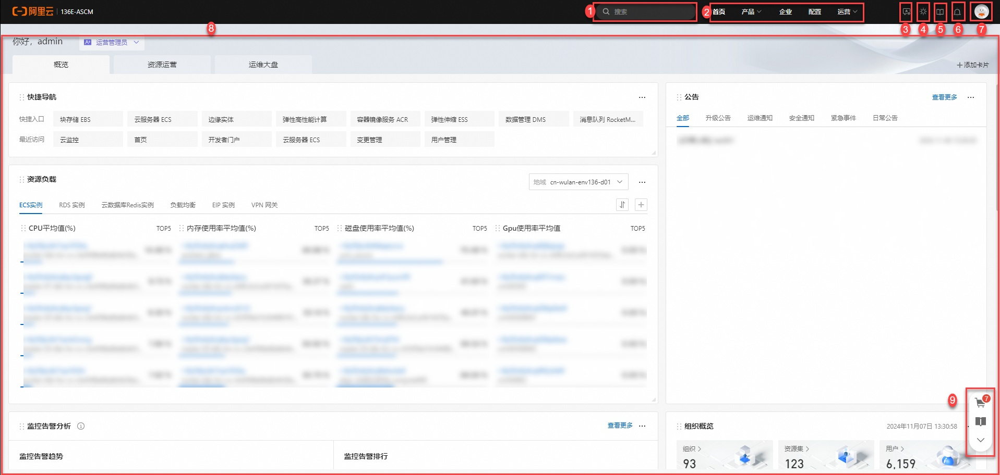

| 序号 | 区域 | 描述 |
| --- | --- | --- |
| ① | 搜索框 | 搜索资源、功能、产品、用户、文档等。搜索后会按综合、API、文档、控制台分类展示对应搜索内容，控制台分类下支持展示其级联菜单信息。鼠标单击搜索框后，会展示最近搜索、最近访问等内容。 |
| ② | 顶部菜单栏 | 鼠标悬浮或单击可选择相应的操作。 |
| ③ | 多语言切换 | 单击可切换语言，目前支持<strong>简体中文</strong>、<strong>繁體中文</strong>以及<strong>English</strong>。 |
| ④ | 颜色模式切换 | 单击可设置颜色模式，目前支持浅色模式和暗色模式。 |
| ⑤ | 帮助文档 | 单击可查看帮助中心在线文档。 |
| ⑥ | 消息通知 | 单击可选择<strong>查看更多</strong>，将跳转至<strong>消息中心</strong>页面，查看全部消息。 |
| ⑦ | 个人中心 | 单击可选择<strong>个人信息</strong>、<strong>查看版本信息</strong>、<strong>退出登录</strong>。 |

<table>
  <tr>
    <td>⑧</td>
    <td>信息展示和操作区</td>
    <td>根据不同页面展示不同的信息以及相关操作。<br>说明列表信息展示时：<br>• 列表上方会显示、、、等按钮，您可根据实际需要调整列<br>表展示。<br>：表示刷新列表。<br>：选择默认或紧凑展示列表信息。<br>：设置显示或隐藏列表的展示项。鼠标悬浮在展示项上，<br>单击展示项右侧的，还可以调整展示项的显示顺序。<br>：进入列表全屏模式。<br>• 列表支持自定义拖拽列宽，您可以根据实际情况拖拽列宽进行展示。列宽配置存储在浏览器本地Storage中，清除Storage后会失效。</td>
  </tr>
  <tr>
    <td>⑨</td>
    <td>悬浮菜单</td>
    <td>展开浮层菜单，可根据权限打开切换账号、购物车、帮助文档和平台导航跳转。<br>：表示切换账号，独立授权跳转类产品对于子账号甚至主账号的切换需<br>求。<br>：表示购物车。购物车上的数字代表当前已加入购物车的服务数量。购物<br>车的显示将根据用户当前的权限情况来进行判断。<br>：表示帮助文档。带有帮助文档的产品全部覆盖帮助文档悬浮球。<br>：表示平台导航。进入跳转类产品控制台后才会显示。单击平台导航图<br>标，展开<strong>首页与产品</strong>对话框，选择目标后，可跳转到目标控制台。</td>
  </tr>
</table>

<a id="section-2-3"></a>

## 2.3. 组织和权限模型介绍

Apsara Uni-manager运营控制台作为管理平台，需要对资源进行有效的管理。为了应对企业多级组织及项目的需求，资源管理采用了组织加资源集的管理方式。

**组织架构**

为了匹配企业的多层级组织结构，Apsara Uni-manager运营控制台提供了如下功能。

组织架构由一个根组织（Root）和多个组织单元组成树状结构。根组织由系统自动生成，位于整个组织树的顶端。组织单元可以有多个，可以理解为企业中的子公司、部门等，每个组织单元之间是平行并列关系。

> **说明**
>
> 一个组织单元只有一个一级组织，一级组织下可以有多个子组织，默认最多支持五级组织。

Apsara Uni-manager运营控制台中每个一级组织对应一个云账号，云账号是云内资源和用户的统一归属账号，各二级和其他下级组织与用户都归属于其一级组织对应的云账号。

一级组织创建完成后，系统还会自动生成组织AccessKey。AccessKey由AccessKey ID和AccessKey Secret组成，用于对某个请求的发送者进行身份验证。AccessKey ID用于标示用户，AccessKey Secret是用户用于加密签名字符串。

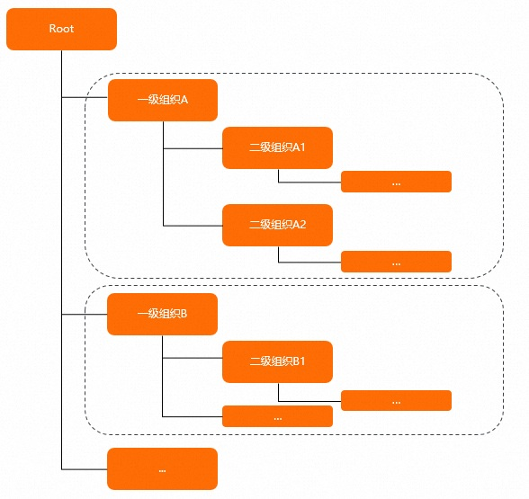

**组织与用户、用户组、角色、资源集之间的关系**

- **组织**：资源与账号的归属方，不直接管理资源，而是通过归属于组织的资源集对资源进行划分。类似于企业中的子公司、部门等。

- **用户**：即用户账号，作为角色的实体化展现。在创建用户时必须给用户关联角色，使账号获得对应角色的权限。使用Apsara Uni-manager运营控制台的实体，通过用户账号进行登录。

- **用户组**：一批拥有相同权限的用户集合。用户组可以像用户一样绑定角色，从而实现对用户组内所有用户进行批量授权。

- **角色**：一组访问权限的集合，在创建用户时，需要为该用户赋予不同的角色，以满足不同用户对系统的访问控制需求。

- **资源集**：类似于企业中的项目，是对资源进行管理的一个逻辑概念。所有资源都是归属于资源集，用户/用户组加入资源集后就能对资源集内的资源进行管理。

| 两两关系 | 关系类型 | 说明 |
| --- | --- | --- |
| 组织&amp;资源集 | 一对多 | 一个组织可以有多个资源集，但一个资源集只能隶属于一个组织。 |
| 组织&amp;用户 | 一对多 | 一个组织可以有多个用户，但一个用户只能隶属于一个组织。 |
| 用户&amp;资源集 | 多对多 | 一个用户可以加入到多个资源集中，一个资源集也可以分配给同一个一级组织下的多个用户。 |
| 用户&amp;角色 | 多对多 | 一个用户可以拥有多个角色，一个角色也可以分配给多个用户。 |
| 资源集&amp;资源 | 一对多 | 一个资源集可以有多个资源，但一个资源只能隶属于一个资源集。 |

**角色权限控制内容**

Apsara Uni-manager运营控制台通过精细化的权限管控手段，实现用户针对不同类型云资源设置不同的精细化读写权限点，帮助用户完成千人千面的权限管控体系。

一个用户可以具备多个角色，但在实际使用时，只能用其中一个角色进行管理操作。

- **管理权限**：为角色设置控制台相关维度的操作权限，如对组织、用户、资源集等操作进行授权。

- **应用权限**：为角色设置云产品相关权限点，主要用于决定用户需要哪些云产品的哪些操作权限。如只需要为用户设置云服务器ECS实例的查看权限，则只需要在界面上勾选云服务器ECS实例下的查看实例权限即可。

- **菜单权限**：为角色设置菜单项来控制角色可查看到的菜单，用来实现入口的屏蔽。如果是控制台用户，在管理权限和应用权限中如果勾选了对应的控制台操作权限和云产品权限，则需要同样赋予菜单权限，避免用户无法查看对应入口。

- **自定义权限策略**：为角色直接下发RAM（Resource Access Management） policy，通过设置应用RAM Action来精确地描述授权的资源以及对具体资源的操作。应用RAM Action的设置包括Allow和Deny，Allow表示允许操作，Deny表示拒绝操作。权限策略中既有Allow又有Deny时，遵循Deny优先原则。

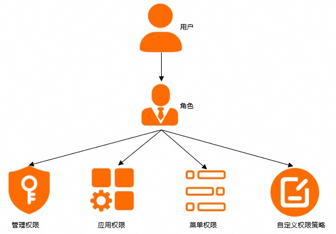

**账号权限模型**

Apsara Uni-manager运营控制台结合云平台的权限系统和账号系统，设计了一套账号权限统一的体系。即独立管理账号与角色，客户可通过关联账号与角色，实现企业对平台内权限管理体系的灵活控制。

在Apsara Uni-manager运营控制台中，对账号（用户）与角色进行绑定，可赋予或者限制对应的资源的操作权限和权限范围。

Apsara Uni-manager运营控制台的账号权限模型如下图所示。

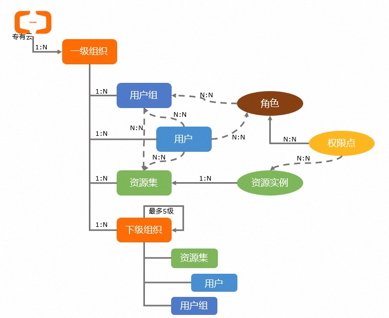

Apsara Uni-manager运营控制台提供的三种常见的授权用户权限的方式如下所示：

- **直接为用户授权预置角色或自定义角色**

  直接为用户提供预置角色或自定义角色是最常见的授权方式。

  - 预置角色是系统预先设定的一系列具有特定权限的角色，这些角色涵盖了日常中常见的一些职责和权限范围，可以直接分配给用户使用，简化了权限配置的过程。具体可参见预置角色及其权限说明。

  - 自定义角色允许管理员根据实际工作需要，自由定制角色的权限集，确保用户的权限与其工作职责紧密匹配，避免权限过度集中或分散。具体可参见创建角色。

    

- **通过用户组为用户批量授权**

  当一批用户具有相同权限时，可通过将用户加入用户组的方式为用户进行批量授权，只需要为用户组授权对应的角色，用户即可自动继承用户组角色的权限。具体操作可参见用户组管理。

  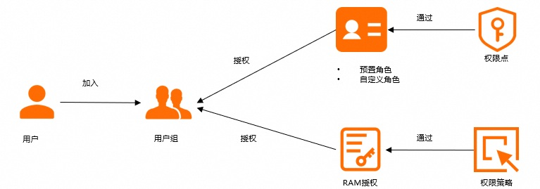

- **通过数据授权为用户授权**

  数据授权是一种关键的用户权限管理方式，它可以根据用户的特定需求，精确地赋予其对特定数据资源的访问、操作或管理权限，让用户能够在其职责范围内有效地使用所需的数据。数据授权可以具体到资源实例级别，以进一步精细化管控。具体操作可参见数据授权。

  

**应用价值**

- 清晰的层级关系

  将企业组织按照层级划分，形成明确的上下级关系。

- 方便的管理

  能够使管理者清晰的了解和管理各个部门和团队。

- 较高的灵活性

  可以根据企业的发展需要进行调整。

<a id="section-2-4"></a>

## 2.4. 初始化配置

<a id="section-2-4-1"></a>

### 2.4.1. 预置角色及其权限说明

Apsara Uni-manager运营控制台基于三权分立的管理理念和大量企业运营管理云平台的最佳实践，预置了一系列角色并根据角色定义赋予其相应的权限。

在使用Apsara Uni-manager运营控制台前，需要了解这些预置角色的定义及其权限，以便于灵活运用这些角色管理、运营云平台。

- 管理权限指角色权限的管理范围。

  - 所有组织：表示角色管理范围是所有组织。

  - 本组织及级联下级组织：表示角色管理范围是本组织及级联下级组织。

  - 资源集：表示角色管理范围是用户加入的资源集。

- 权限列表中包含了该角色在Apsara Uni-manager运营控制台上具有的管理操作权限以及接口调用场景下的权限。

> **说明**
>
> - 预置角色及其拥有的权限都不支持修改和删除。
>
> - 权限列表中的基础管理权限是封装好的一些基本操作权限的合集，包括门户首页、个人信息管理等。

**平台管理员（预置用户为super）**

负责整个专有云管控台的初始化配置工作，如技术组件参数配置和多语言配置，以及个性化相关的设置。

<table>
  <tr>
    <th>管理权限</th>
    <th colspan="2">权限列表</th>
  </tr>
  <tr>
    <td rowspan="4">所有组织</td>
    <td>企业</td>
    <td>• 用户管理查看用户、创建用户、删除用户、激活用户、禁用用户、操作用户<br>说明平台管理员仅支持查看系统预置的用户和自定义的运营管理员用户。<br>• 预置的用户：仅支持查看。<br>• 自定义的运营管理员：支持管理操作。<br>• AccessKey管理查看用户AccessKey、查看AccessKey日志、创建用户AccessKey、删除用户AccessKey、启用/禁用用户AccessKey<br>• 访问策略查看访问策略、创建/删除访问策略、操作访问策略<br>• RAM服务角色查看RAM服务角色、创建RAM服务角色</td>
  </tr>
  <tr>
    <td>配置</td>
    <td>• 菜单管理管理菜单<br>• 公告管理公告</td>
  </tr>
  <tr>
    <td>其他</td>
    <td>• 开发者门户查看页面集成配置、编辑页面集成配置、个性化设置修改权限<br>• 系统配置配置系统</td>
  </tr>
  <tr>
    <td>基础权限</td>
    <td>• 基础权限基础管理权限</td>
  </tr>
</table>

**运营管理员（预置用户为admin）**

负责整个专有云管控台的组织创建及管理、资源集创建及管理、人员添加及管理、角色分配及管理、资源开通及管理等相关工作。

**管理权限**

**权限列表**

- **API控制策略**

  查看AP控制策略、创建API控制策略、删除API控制策略、操作API控制策略

- **角色管理**

  查看角色、创建/删除角色、操作角色、锁定/解锁角色、云服务授权

- **服务边界**

  查看服务边界、创建服务边界、操作服务边界、删除服务边界、启用/禁用服务边界

- **用户管理**

  查看用户、创建用户、删除用户、激活用户、禁用用户、锁定/解锁用户、操作用户

- **标签管理**

  操作标签

- **AccessKey管理**

  查看用户AccessKey、查看组织AccessKey、创建组织AccessKey、删除组织AccessKey、激活组织AccessKey、禁用组织AccessKey、查看AccessKey日

**企业**

志、创建用户AccessKey、删除用户AccessKey、 启用/禁用用户AccessKey

- **资源集管理**

  查看资源集、创建/删除资源集、操作资源集

- **用户组管理**

  查看用户组、创建/删除用户组、操作用户组

- **组织管理**

  查看组织、创建/删除组织、操作组织

- **访问策略**

  查看访问策略、创建/删除访问策略、操作访问策略

- **变更管理**

  变更组织、变更资源集、变更用户、变更资源

- **RAM服务角色**

  查看RAM服务角色、创建RAM服务角色

- **配额管理**

  查看配额、操作配额、规格配额管理

- **闲置与瓶颈分析**

  查看闲置与瓶颈分析

- **文档管理**

  查看文档列表、删除文档、添加分类、删除分类、管理版本、创建/编辑/复制文档、发布文档、操作上下线文档、编辑/移动分类

- **折扣管理**

  查看折扣配置、删除折扣配置、创建/编辑折扣配置

所有组织

- **计费配置**

  查看计费定价、操作计费定价、创建和删除计费定价

- **健康分析**

  查看健康度、查看资源优化配置、编辑资源优化配置

- **操作日志**

  查看操作日志存储模式、设置操作日志存储模式

- **服务目录**

  查看服务目录列表、创建/编辑服务目录、删除服务目录、上架/下架服务目录、服务目录分类管理

- **碳账单**

**运营**

查看组织与资源集碳账单、导出碳账单

- **流程管理**

  查看流程定义列表、创建修改流程定义、删除流程定义、查看组织申请单、发布/停用流程定义

- **报表下载**

  查看任务、创建任务、删除任务、下载报表、查看推送规则、创建推送规则

- **调账管理**

  管理调账

- **门户管理**

  查看站点列表、创建/编辑站点、删除站点、上线/下线站点、查看页面列表、创建/编辑/复制页面、搭建页面、发布页面、删除页面、查看素材列表、上传/编辑素材、删除素材

- **计量管理**

  查看、导出计量

- **账单管理**

  查看组织和资源集账单、导出账单、重新生成账单

- **订单管理**

  查看组织订单

- **多云管理**

  管理多云组织、管理多云资源集、管理多云角色

- **公告**

  管理公告

**配置**

- **计费开关**

  编辑计费开关配置

- **多云管理平台托管**

  多云管理平台托管设置

- **开发者门户**

**其他**

查看调用统计、查看页面集成配置、编辑页面集成配置、个性化设置修改权限

- **基础权限**

**基础权限**

基础管理权限

**组织管理员**

负责本组织的管理以及下级组织的创建及管理、资源集创建及管理、人员添加及管理、角色分配及管理、资源开通及管理，以及指派下级组织、资源集管理员和配额，并且可以根据服务流程的设置审批资源的申请。

<table>
  <tr>
    <td>管理权限</td>
    <td>权限列表</td>
  </tr>
</table>

- **角色管理**

  查看角色、创建/删除角色、操作角色、云服务授权

- **用户管理**

  查看用户、创建用户、删除用户、激活用户、禁用用户、操作用户

- **标签管理**

  操作标签

- **AccessKey管理**

  查看用户AccessKey、查看组织AccessKey、创建组织AccessKey、删除组织AccessKey、激活组织AccessKey、禁用组织AccessKey、查看AccessKey日志、创建用户AccessKey、 删除用户AccessKey、启用/禁用用户AccessKey

- **资源集管理**

**企业**

查看资源集、创建/删除资源集、操作资源集

- **用户组管理**

  查看用户组、创建/删除用户组、操作用户组

- **组织管理**

  查看组织、创建/删除组织、操作组织

- **访问策略**

  查看访问策略、创建/删除访问策略、操作访问策略

- **变更管理**

  变更组织、变更资源集、变更用户、变更资源

- **RAM服务角色**

  查看RAM服务角色、创建RAM服务角色

本组织及级联下级组织

- **配额管理**

  查看配额、操作配额

- **闲置与瓶颈分析**

  查看闲置与瓶颈分析

- **健康分析**

  查看健康度、查看资源优化配置

- **服务目录**

  查看服务目录列表、创建/编辑服务目录、删除服务目录、上架/下架服务目录

- **碳账单**

  查看组织与资源集碳账单、导出碳账单

**运营**

- **流程管理**

  查看流程定义列表、查看组织申请单

- **报表下载**

  查看任务、创建任务、删除任务、下载报表、查看推送规则、创建推送规则

- **计量管理**

  查看、导出计量

- **账单管理**

  查看组织和资源集账单、导出账单

- **订单管理**

  查看组织订单

- **开发者门户**

**其他**

查看调用统计、查看页面集成配置

- **基础权限**

**基础权限**

基础管理权限

**资源集管理员**

负责本资源集的管理、人员添加及管理、资源开通及管理，并且可以根据服务流程的设置审批资源的申请。

| 管理权限 | 权限列表 |
| --- | --- |

<table>
  <tr>
    <td rowspan="3">资源集</td>
    <td>企业</td>
    <td>• 用户管理查看用户<br>• 标签管理操作标签<br>• AccessKey管理查看AccessKey日志<br>• 资源集管理查看资源集、操作资源集<br>• 用户组管理查看用户组<br>• 组织管理查看组织</td>
  </tr>
  <tr>
    <td>运营</td>
    <td>• 配额管理查看配额<br>• 闲置与瓶颈分析查看闲置与瓶颈分析<br>• 健康分析查看健康度<br>• 碳账单查看组织与资源集碳账单、导出碳账单<br>• 报表下载查看任务、创建任务、删除任务、下载报表、查看推送规则、创建推送规则<br>• 计量管理查看、导出计量</td>
  </tr>
  <tr>
    <td>基础权限</td>
    <td>• 基础权限基础管理权限</td>
  </tr>
</table>

**资源使用人**

使用运营管理员创建好并分配的云资源。

| 管理权限 | 权限列表 |
| --- | --- |

<table>
  <tr>
    <td rowspan="3">资源集</td>
    <td>企业</td>
    <td>• 标签管理操作标签<br>• 资源集管理查看资源集<br>• 组织管理查看组织<br>• RAM服务角色查看RAM服务角色</td>
  </tr>
  <tr>
    <td>运营</td>
    <td>• 配额管理查看配额<br>• 报表下载查看任务、创建任务、删除任务、下载报表、查看推送规则、创建推送规则</td>
  </tr>
  <tr>
    <td>基础权限</td>
    <td>• 基础权限基础管理权限</td>
  </tr>
</table>

**资源监察员（预置用户为auditor）**

拥有云平台所有资源（只包含云上）的查看（只读）权限。

**管理权限**

**权限列表**

- **角色管理**

  查看角色

- **用户管理**

  查看用户

- **AccessKey管理**

  查看用户AccessKey、查看AccessKey日志

- **资源集管理**

**企业**

查看资源集

- **用户组管理**

  查看用户组

- **组织管理**

  查看组织

- **访问策略**

  查看访问策略

- **配额管理**

  查看配额

- **闲置与瓶颈分析**

**所有组织**

查看闲置与瓶颈分析

- **计费配置**

  查看计费定价

- **健康分析**

  查看健康度

- **操作日志**

  查看操作日志、下载操作日志、查看操作日志存储模式

- **服务目录**

**运营**

查看服务目录列表

- **流程管理**

  查看组织申请单

- **报表下载**

  查看任务、下载报表、查看推送规则、创建推送规则

- **计量管理**

  查看、导出计量

- **账单管理**

  查看组织和资源集账单、导出账单

- **订单管理**

  查看组织订单

- **基础权限**

**基础权限**

基础管理权限

**组织资源监察员**

具有所在的组织的所有云资源的查看权限。

| 管理权限 | 权限列表 |
| --- | --- |

<table>
  <tr>
    <td rowspan="3">本组织及级联下级组织</td>
    <td>企业</td>
    <td>• 角色管理查看角色<br>• 用户管理查看用户<br>• AccessKey管理查看用户AccessKey、查看AccessKey日志<br>• 资源集管理查看资源集<br>• 用户组管理查看用户组<br>• 组织管理查看组织<br>• 访问策略查看访问策略</td>
  </tr>
  <tr>
    <td>运营</td>
    <td>• 配额管理查看配额<br>• 闲置与瓶颈分析查看闲置与瓶颈分析<br>• 健康分析查看健康度<br>• 操作日志查看操作日志、下载操作日志<br>• 服务目录查看服务目录列表<br>• 流程管理查看组织申请单<br>• 报表下载查看任务、下载报表、查看推送规则、创建推送规则<br>• 计量管理查看、导出计量<br>• 账单管理查看组织和资源集账单、导出账单<br>• 订单管理查看组织订单</td>
  </tr>
  <tr>
    <td>基础权限</td>
    <td>• 基础权限基础管理权限</td>
  </tr>
</table>

**安全审计员**

负责云平台的安全审计工作。

<table>
  <tr>
    <th>管理权限</th>
    <th colspan="2">权限列表</th>
  </tr>
  <tr>
    <td rowspan="3">所有组织</td>
    <td>运营</td>
    <td>• 操作日志查看操作日志、下载操作日志</td>
  </tr>
  <tr>
    <td>其他</td>
    <td>• 开发者门户查看调用统计、查看页面集成配置</td>
  </tr>
  <tr>
    <td>基础权限</td>
    <td>• 基础权限基础管理权限</td>
  </tr>
</table>

**平台安全管理员**

负责通过云安管中心SOC进行平台的安全管理工作。

<table>
  <tr>
    <th>管理权限</th>
    <th colspan="2">权限列表</th>
  </tr>
  <tr>
    <td rowspan="2">所有组织</td>
    <td>运营</td>
    <td>• 操作日志查看操作日志、下载操作日志</td>
  </tr>
  <tr>
    <td>基础权限</td>
    <td>• 基础权限基础管理权限</td>
  </tr>
</table>

**全局组织安全管理员（默认用户为yundunadmin）**

负责通过云安全管理中心SOC，进行云平台及所有租户的安全管理工作和ECS类安全产品的管理工作。

**管理权限**

**权限列表**

- **角色管理**

  查看角色、创建/删除角色、操作角色

- **用户管理**

  查看用户、激活用户、禁用用户、操作用户

- **AccessKey管理**

  查看AccessKey日志

**企业**

- **资源集管理**

  查看资源集

- **组织管理**

  查看组织

**所有组织**

- **RAM服务角色**

  查看RAM服务角色、创建RAM服务角色

- **操作日志**

**运营**

查看操作日志、下载操作日志

- **基础权限**

**基础权限**

基础管理权限

**组织安全管理员**

负责单个组织内的安全管理工作，包括云安全管理中心SOC、主机安全、应用安全、网络安全等，以及ECS类安全产品的管理工作。

<table>
  <tr>
    <th>管理权限</th>
    <th colspan="2">权限列表</th>
  </tr>
  <tr>
    <td rowspan="3">本组织及级联下级组织</td>
    <td>企业</td>
    <td>• 资源集管理查看资源集<br>• 组织管理查看组织<br>• RAM服务角色查看RAM服务角色、创建RAM服务角色</td>
  </tr>
  <tr>
    <td>运营</td>
    <td>• 操作日志查看操作日志、下载操作日志</td>
  </tr>
  <tr>
    <td>基础权限</td>
    <td>• 基础权限基础管理权限</td>
  </tr>
</table>

**安全系统配置管理员**

负责安全相关的系统配置工作，如升级中心、全局配置等。

<table>
  <tr>
    <th>管理权限</th>
    <th colspan="2">权限列表</th>
  </tr>
  <tr>
    <td rowspan="2">所有组织</td>
    <td>运营</td>
    <td>• 操作日志查看操作日志、下载操作日志</td>
  </tr>
  <tr>
    <td>基础权限</td>
    <td>• 基础权限基础管理权限</td>
  </tr>
</table>

**平台安全监察员**

负责通过云安管中心SOC查看平台的安全状况。

<table>
  <tr>
    <th>管理权限</th>
    <th colspan="2">权限列表</th>
  </tr>
  <tr>
    <td rowspan="3">所有组织</td>
    <td>企业</td>
    <td>• 资源集管理查看资源集<br>• 组织管理查看组织</td>
  </tr>
  <tr>
    <td>运营</td>
    <td>• 操作日志查看操作日志、下载操作日志</td>
  </tr>
  <tr>
    <td>基础权限</td>
    <td>• 基础权限基础管理权限</td>
  </tr>
</table>

**全局组织安全监察员**

负责通过云安管中心SOC查看全部组织的安全状况。

<table>
  <tr>
    <th>管理权限</th>
    <th colspan="2">权限列表</th>
  </tr>
  <tr>
    <td rowspan="3">所有组织</td>
    <td>企业</td>
    <td>• 资源集管理查看资源集<br>• 组织管理查看组织</td>
  </tr>
  <tr>
    <td>运营</td>
    <td>• 操作日志查看操作日志、下载操作日志</td>
  </tr>
  <tr>
    <td>基础权限</td>
    <td>• 基础权限基础管理权限</td>
  </tr>
</table>

**平台安全配置管理员**

负责平台安全产品的配置工作，如物理机安骑士配置、平台WAF配置等。

<table>
  <tr>
    <th>管理权限</th>
    <th colspan="2">权限列表</th>
  </tr>
  <tr>
    <td rowspan="2">所有组织</td>
    <td>运营</td>
    <td>• 操作日志查看操作日志、下载操作日志</td>
  </tr>
  <tr>
    <td>基础权限</td>
    <td>• 基础权限基础管理权限</td>
  </tr>
</table>

<a id="section-2-4-2"></a>

### 2.4.2. 配置说明

系统初始配置是指在使用Apsara Uni-manager运营控制台前，管理员需要根据配置流程，完成一系列基本配置操作，例如，组织、资源集、用户、角色的创建以及资源的初始化。

Apsara Uni-manager运营控制台基于服务化原则，将云数据中心涉及的组织、资源集、用户、角色进行统一管理，以便针对不同用户赋予不同的资源访问权限。

- 组织

  Apsara Uni-manager运营控制台部署后，默认产生一个root组织，即根组织，用户可以在根组织下创建其他组织。

  组织采用层级方式显示，用户可以在各级组织下创建子组织。

- 资源集

  资源存放的容器，所有资源都需要创建在对应资源集下。

- 用户

  资源的管理者，以及使用者。

- 角色

  角色是一组访问权限的集合，在创建用户时，需要为该用户赋予不同的角色，以满足不同用户对系统的访问控制需求。

组织、资源集、用户、角色和云资源的关系，如下表所示。

<a id="section-2-4-3"></a>

### 2.4.3. 配置流程

在使用Apsara Uni-manager运营控制台前，管理员需要按照下图所示流程，完成系统的初始配置。

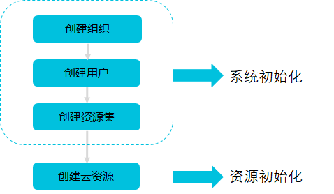

1. 创建组织

   创建组织用于存放资源集及资源集内的资源。

2. 创建用户

   管理员可以创建用户，并为用户赋予不同的角色，以满足不同用户对系统的访问控制需求。

3. 创建资源集

   申请资源前，需要先创建资源集。

   将用户添加到资源集中，用户就可以使用资源集中资源。具体可参见管理资源集中的“资源集成员授权”。

4. 创建云资源根据项目需要，管理员在各云产品的控制台上创建云产品实例。 创建云产品实例的具体操作方式请参见各云产品的用户指南。

<a id="section-3"></a>

# 3.门户首页

首页通过不同的卡片，从多个维度展示了各区域当前系统资源的使用情况及监控状态，帮助用户整体把握资源情况，为精细化运营和统计分析提供了有力的数据。

**操作步骤**

不同角色的门户首页默认显示不同的卡片和布局，您可以根据自己的需求和习惯添加卡片并调整布局。

1. 登录Apsara Uni-manager运营控制台。

2. 在顶部菜单栏，单击**首页**。

3. 如果有多个角色，您可以在左上角切换角色。

   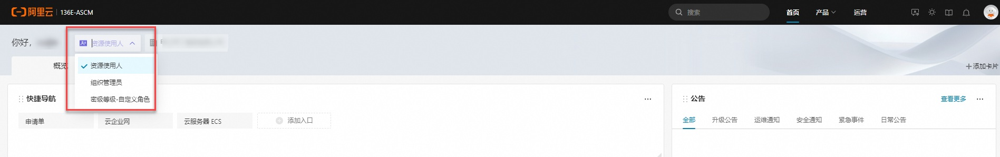

4. 在页面右上方，单击**添加卡片**。

   > **说明**
   >
   > 如果角色有多个页签，可单击页签后，再进行添加卡片操作，将卡片添加到对应页签下进行展示。

5. 在**添加卡片**面板，勾选或取消卡片，调整首页工作台展示信息。

   > **说明**
   >
   > - 勾选卡片即将卡片添加到工作台，取消勾选即将卡片移出工作台。卡片添加后也可以单击卡片右上角的  ，选择**移出工作台**。
   >
   > - 勾选卡片后，您可以在显示区域拖拽卡片右下角的
   >
   >   ，调整卡片的大小。拖拽卡片左上角的
   >
   >   
   >
   >   ，可以调整卡片的摆放位置。
   >
   >   
   >
   > - 在**添加卡片**面板底部，单击**恢复默认布局**，可恢复默认布局进行展示。

   

**卡片分类**

卡片分类包括常用信息、资源告警、资源健康分析、资源统计分析、资源账单分类。不同角色具有的权限有所不同，界面上会展示与自己角色相关的重点工作卡片。

**常用信息**

常用信息分类下的卡片包括**快捷导航**、**组织概览**、**公告**、**待办中心**、**支持与服务**、**物理资源概览**、**虚拟资源概览**、**资源概览**、**资源搜索**。

- **快捷导航**：提供快捷跳转的链接导航。展示**快捷入口**和**最近访问**，单击可快速跳转到对应页面。

  > **说明**
  >
  > 快捷入口支持自定义添加入口，最多展示12个产品与模块。单击**添加入口**，在对话框中选择产品，鼠
  >
  > 标悬浮在服务上单击  ，即可添加，添加成功后会变更为  。

  

- **组织概览**：展示组织的资源分布情况。单击可快速跳转到对应资源页面。

  

- **公告**：展示公告列表及详情。单击**查看更多**，展开**公告**面板查看更多公告信息。

  

- **待办中心**：展示当前角色的业务待办事项。单击**查看更多**，展开**待办中心**面板查看更多的待办事项。

  

- **支持与服务**：提供支持与帮助服务的链接。单击可跳转到目标页面。

  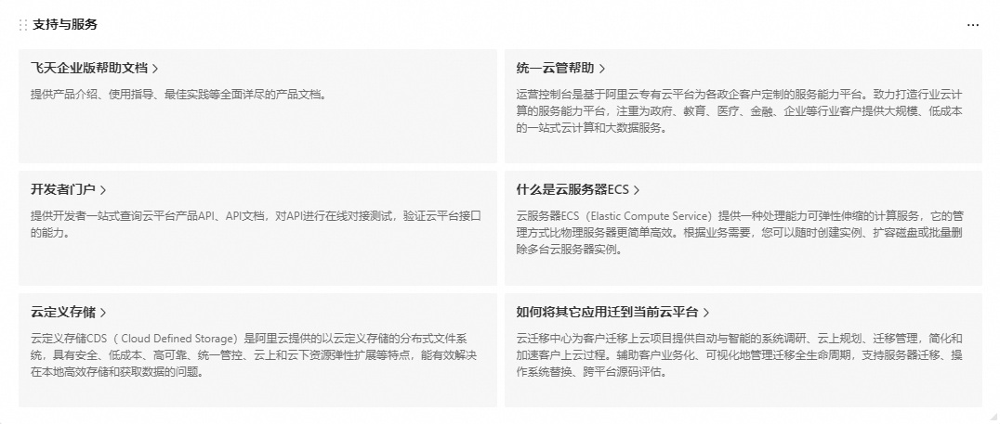

- **物理资源概览**：展示平台物理资源的数量统计信息。

  

- **虚拟资源概览**：展示平台云资源的数量统计信息。

  

- **资源概览**：展示当前全局资源列表视图。单击**创建资源**，展开服务对话框，查找目标服务，快速开通服务。

  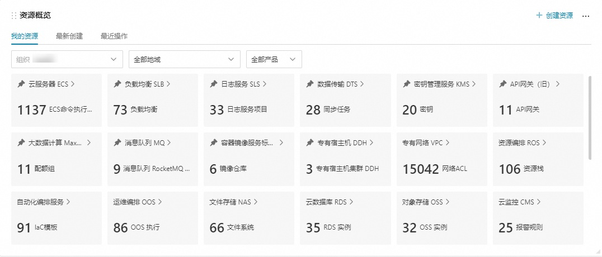

- **资源搜索**：云资源全局检索。支持通过选择产品类型、选择组织、选择资源集、选择地域、选择标签、资源ID、关键词等筛选条件快速搜索资源。

  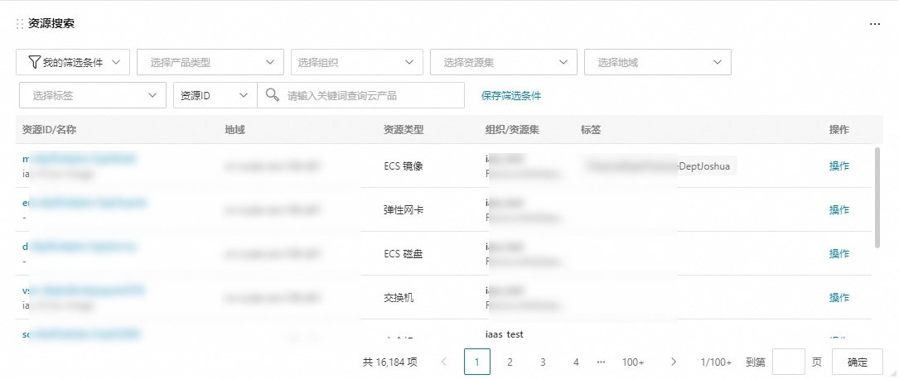

**资源告警**

资源告警分类下的卡片包括**资源负载**、**监控告警分析**、**告警**。

- **资源负载**：展示当前账号的资源负载情况。单击卡片上的地域列表，可切换地域。

  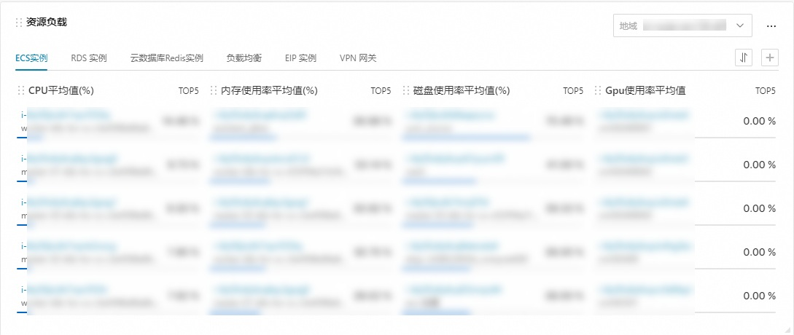

- **监控告警分析**：数据源于云监控CMS，展示当前账号的资源监控告警分析。单击**查看更多**，可跳转到云监控的**报警历史**页面。

  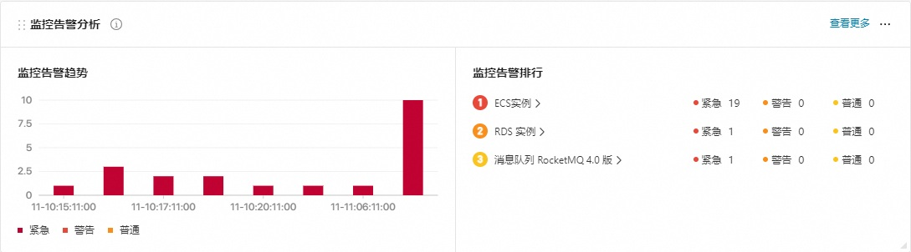

- **告警**：展示当前账号的告警列表。

  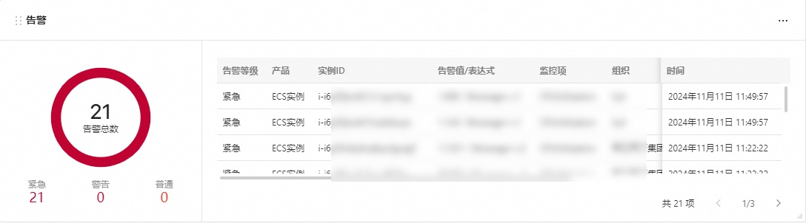

**资源健康分析**

资源健康分析分类下的卡片包括**资源健康度概况**、**资源健康度分析**、**闲置资源排名**、**瓶颈资源排名**。

- **资源健康度概况**：展示当前组织资源健康度统计信息。单击**去提升**，可跳转到运营菜单下的综合健康度页面。

  > **说明**
  >
  > - 总体健康度根据云平台内各个云资源使用率、资源闲置分析、资源合规分析结果综合计算出的健康度分数。
  >
  > - 健康度分数等级为：
  >
  >   - 0-50 分：差
  >
  >   - 51-70 分：一般
  >
  >   - 71-90 分：较好
  >
  >   - 91-100 分：健康

  

- **资源健康度分析**：展示当前账号资源、资源集的健康度，可按**从高到低**或**从低到高**排序。

  > **说明**
  >
  > - 单击  可自定义资源的展示顺序。
  >
  > - 单击  可添加需要展示的资源。

  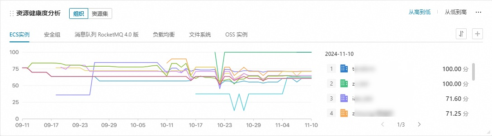

- **闲置资源排名**：展示组织、资源集、云资源闲置分析，提供分析明细数据。单击**查看更多**，可跳转到运营菜单下的闲置分析页面。

  > **说明**
  >
  > - 单击  可自定义资源的展示顺序。
  >
  > - 单击  可添加需要展示的资源。

  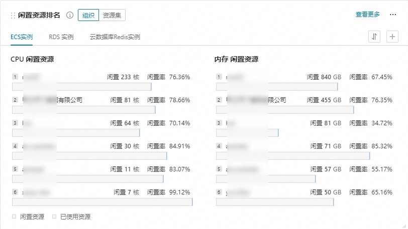

- **瓶颈资源排名**：展示组织、资源集、云资源瓶颈分析，提供分析明细数据。单击**查看更多**，可跳转到运营菜单下的瓶颈分析页面。

  > **说明**
  >
  > - 单击  可自定义资源的展示顺序。
  >
  > - 单击  可添加需要展示的资源。

  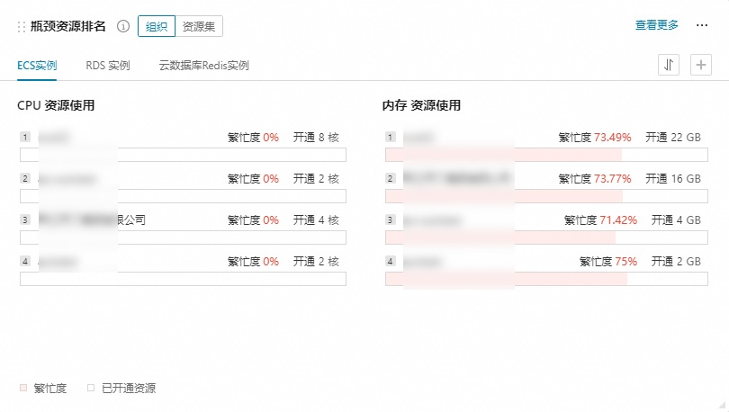

**资源统计分析**

资源统计分析分类下的卡片包括**云资源总量增长**、**云产品实例分布**、**实例总量分布**、**组织资源统计**、**资源数量**、**区域概览**、**服务器分布**、**配额概览**、**资源集资源统计**。

- **云资源总量增长**：展示累计资源总量及自然月增长量，其仅包含用户所在组织的资源实例总量。

  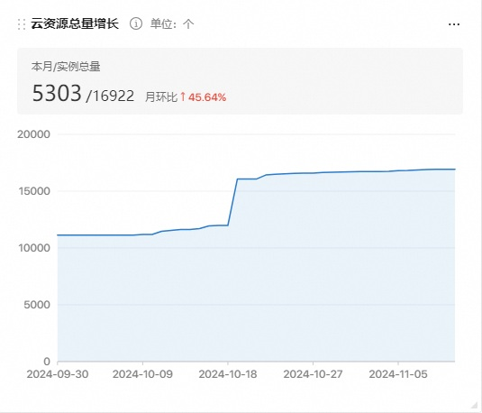

- **云产品实例分布**：展示云产品实例总量分布，查看产品类型及产品的实例数量分布。

  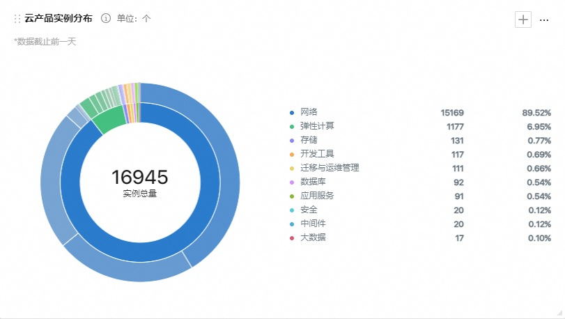

- **实例总量分布**：展示平台实例总开通量统计分布信息。

  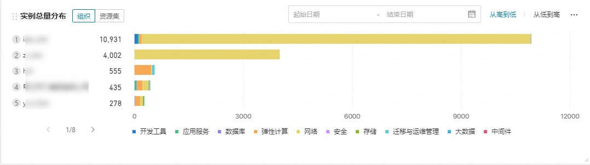

- **组织资源统计**：展示组织资源的概览统计信息。可根据组织、地域、云产品条件进行筛选。

  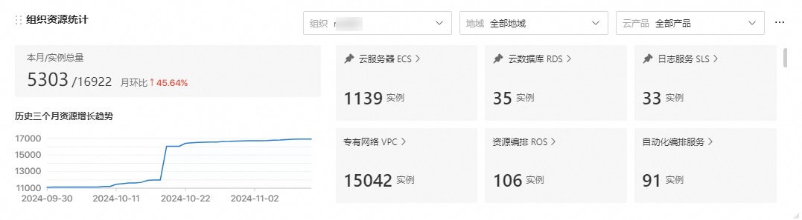

- **资源数量**：展示实例总量及历史开通量的增长情况。

  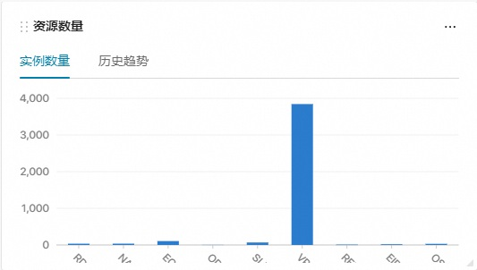

- **区域概览**：以地图的形式展示云平台地域概览。

  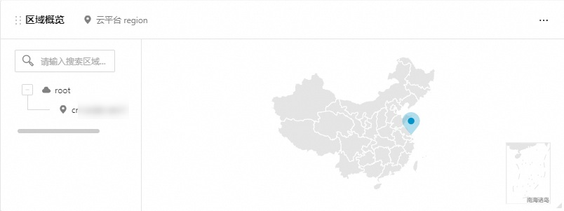

- **服务器分布**：展示服务器分布情况及实例的分布统计。

  > **说明**
  >
  > 数据源为当前用户管理权限范围内的资源总量，数据更新会有十几分钟延迟。

  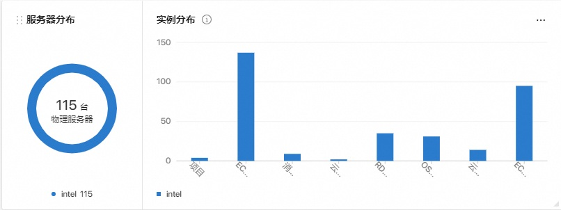

- **配额概览**：展示云产品的规格字段级资源配额的使用情况。单击卡片上的下拉列表，可选择组织、地域进行筛选。

  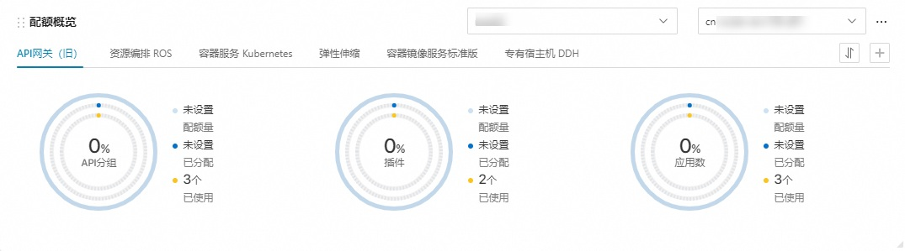

- **资源集资源统计**：展示资源集的资源统计信息。单击卡片上的下拉列表，可选择资源集、产品进行筛选。

  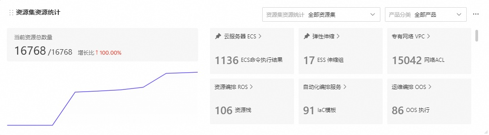

**资源账单**

资源账单分类下的卡片包括**费用统计**。

**费用统计**：展示组织、资源集的资源话费的统计分析。单击**查看更多**，可跳转到运营菜单下的组织账单概览页面。

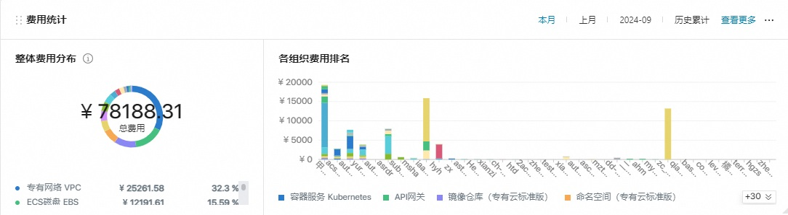

<a id="section-4"></a>

# 4.企业中心

<a id="section-4-1"></a>

## 4.1. 概述

由于现代化企业架构是多层级、变动的，因此Apsara Uni-manager运营控制台根据企业和政府客户的多级组织管理架构和项目运作机制，提供了一个可扩展的、满足多层级组织结构和项目管理的企业中心。

企业根据自身的组织架构模型，将平台内的资源准确归属到目标组织和项目中，为企业提供现代化的IT资源治理能力，助力企业以降低IT成本，实现资产精细化信息管理。

企业中心由以下几个模块组成：

<table>
  <tr>
    <th width="90">模块</th>
    <th>说明</th>
  </tr>
  <tr>
    <td>资源管理</td>
    <td>通过组织管理、资源集管理、地域管理、变更管理等功能，帮助企业构建符合自身的资源管理体系，灵活调整资源归属，从而使用资源集中的资源，提高资源的利用率。</td>
  </tr>
  <tr>
    <td>人员管理</td>
    <td>通过用户管理和用户组管理，帮助企业对人员的归属、权限、群组做集中管控，满足不同用户对系统和资源的访问需求，提升企业的管理效率。</td>
  </tr>
  <tr>
    <td>权限管理</td>
    <td>通过角色授权、数据授权、访问控制、权限边界、AccessKey日志等功能，实现不同场景下的权限划分，管控用户对系统和指定云产品的访问，提高系统的安全性。</td>
  </tr>
</table>

<a id="section-4-2"></a>

## 4.2. 资源管理

<a id="section-4-2-1"></a>

### 4.2.1. 概述

资源管理通过管理组织、资源集、地域和变更的能力，帮助企业构建符合自身的资源管理体系，灵活调整资源归属，从而使用资源集中的资源，提高资源的利用率。

**组织管理**

组织映射一个企业的组织架构，可以定义为公司或者部门，通过组织管理来构建符合企业自身的资源管理体系。

在Apsara Uni-manager运营控制台中，组织用于存放资源集及资源集内的资源。系统默认创建一个根组织root节点，此root节点是不具备任何能力的，不可将资源实例归属到这个组织中。root节点下的子节点为一级组织，一级组织下的子节点为二级组织，以此类推，可以最多支持创建五级组织。

一级组织创建完成后，系统自动为该组织创建一个组织云账号和组织Accesskey，这两个信息用于系统在后台开通云产品资源。

通过组织管理，您可以：

- 基本操作：创建组织、编辑组织、删除组织、自定义组织排序、变更组织归属

- 管理组织AccesssKey：创建组织AccessKey、禁用组织AccessKey、激活组织AccessKey、删除组织AccessKey

**资源集管理**

创建一个组织，系统默认为组织创建一个资源集。

资源集类似“项目”，是对资源的分组，每个资源集之间是相互隔离的，通过资源集隔离资源，可以解决用户授权等复杂性问题。一个组织可以包含多个资源集，一个资源集只能归属于一个组织。

用户在创建资源时，在创建资源的界面上会选择归属资源集，从而实现资源分组。经过授权加入到资源集中的用户，就可以使用资源集中的资源。

通过资源集管理，您可以：

- 创建资源集

- 修改资源集名称

- 资源集成员授权

- 删除资源集

**地域管理**

Apsara Uni-manager运营控制台支持多个地域，通过对组织关联的地域进行管理，可以变更组织和地域的关联关系，从而可以控制资源创建的位置。

地域是和一级组织进行关联的，因此只能更新一级组织与地域的关联。一个组织可以关联多个地域，一个地域也可以被多个组织进行关联。

**变更管理**

变更分为变更组织、变更资源和变更用户，便于企业在组织或者项目调整后，能够及时的对人员和云产品资源归属进行及时变更。变更时仅支持在同一个一级组织内进行变更，即不支持跨组织变更。

- 变更组织，指的是变更二级及以下组织的上下级关系，一级组织不支持变更。

- 变更资源，指的是变更资源实例所属的资源集，重新调整资源归属。

- 变更用户，指的是变更用户所属的组织，一级组织的用户也支持变更，变更用户时还可以重新分配用户角色。

<a id="section-4-2-2"></a>

### 4.2.2. 组织管理

<a id="section-4-2-2-1"></a>

#### 4.2.2.1. 创建组织

组织映射一个企业的组织架构，可以定义为公司或者部门，是人员、资源管理的核心，无论是分层分级的管理诉求，还是资源隔离范围上都具备了良好的扩展性。您可以根据企业的业务环境通过组织管理构建符合企业自身要求的资源管理体系，从而形成资源间的多层级关系。

**背景信息**

- 在Apsara Uni-manager运营控制台中，组织用于存放资源集及资源集内的资源。系统默认创建一个根组织root节点，此root节点是不具备任何能力的，不可将资源实例归属到这个组织中。

- 根组织（root）下的子节点为一级组织，一级组织下的子节点为二级组织，以此类推。

- 创建一个组织，系统会默认为该组织创建一个资源集。

- 一级组织创建完成后，系统自动生成组织AccessKey。AccessKey由AccessKey ID和AccessKey Secret组成，用于对云服务资源进行身份验证和授权。您可以根据业务需求，定期更换AccessKey，以增加安全性。同时系统会记录AccessKey日志信息，您可以通过查看AccessKey日志，及时发现异常活动，追踪和识别潜在的安全威胁。

**约束限制**

- 最多支持创建五级组织。

- 单次批量最多支持创建500个组织。

**组织规划**

在创建组织前，根据企业自身的业务需求规划组织架构。例如：

- 按企业部门和功能划分构建组织架构企业通常会根据不同的业务需求和职能划分不同的部门和功能。例如人力资源部、销售部门、研发部门等，每个部门负责不同的职能和业务。

- 按业务单元和地域分布构建组织架构

  大型企业通常将业务划分为不同的业务单元，每个业务单元可能负责特定的产品线或地域。

**创建单个组织**

1. 登录Apsara Uni-manager运营控制台。

2. 在页面顶部菜单栏上，单击**企业**。

3. 在左侧导航栏中单击**资源管理** > **组织管理**。

4. 在**组织管理**页面左侧组织架构中，选中目标节点（即上级组织），然后在页面右侧单击**创建组织**。

   > **说明**
   >
   > - 选中root节点，则创建root节点的子节点，即一级组织。
   >
   > - 创建二级组织则需要选中对应的一级组织节点，以此类推，最多支持创建五级组织。
   >
   > - 运营管理员支持创建一级到五级组织，组织管理员仅支持创建所属组织以下的子组织。

5. 在**添加组织**对话框，填写组织信息。

   <table>
     <tr>
       <th width="137">配置项</th>
       <th>说明</th>
     </tr>
     <tr>
       <td>名称</td>
       <td>组织的名称，长度为2-128个字符，名称的开头和结尾不允许有空格。<br>说明组织名称在组织架构内必须唯一。</td>
     </tr>
     <tr>
       <td>描述</td>
       <td>组织的相关描述信息。</td>
     </tr>
     <tr>
       <td>绑定第三方认证</td>
       <td>如果云平台未设置全局IdP，可选择<strong>立即设置</strong>或<strong>暂不设置</strong>。<br>• 选择<strong>立即设置</strong>，在<strong>IdP服务名称</strong>下拉列表选择需要绑定的局部IdP服务（仅允许绑定一个）。<br>• 选择<strong>暂不设置</strong>，则跳过绑定第三方认证的设置。<br>重要<br>• 仅创建一级组织时才会显示<strong>绑定第三方认证</strong>配置项。<br>• 如果云平台已设置全局IdP，则无法为一级组织绑定第三方认证，且<strong>立即设</strong><strong>置</strong>与<strong>暂不设置</strong>处于置灰状态，不可选。</td>
     </tr>
   </table>

6. 单击**确定**。

**批量创建组织**

1. 在**组织管理**页面左侧组织架构上方，单击**批量创建**。

2. 在**批量创建组织**对话框中，单击**批量创建组织模板**，将模板文件（**.xlsx**）下载到本地。

   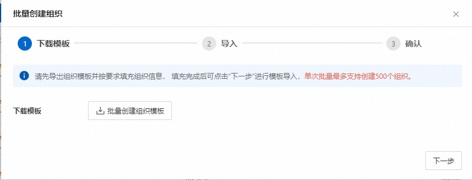

3. 在模板文件中填充需要创建的组织信息并进行保存。如填充信息如下图所示。

   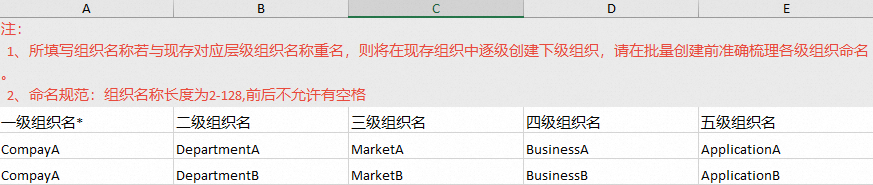

4. 单击**批量创建组织**对话框中的**下一步**，进入导入阶段。

   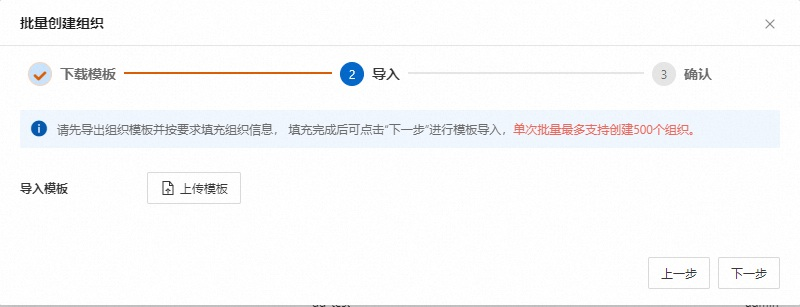

5. 单击**上传模板**，选择填充好的模板文件进行上传，模板文件校验成功后，单击**下一步**。

   > **重要**
   >
   > 模板文件上传后，系统将自动检测组织信息内容是否正确。若文件内包含错误内容则无法创建，需在本地修改模板文件，修改完成后再单击**重新上传**。

   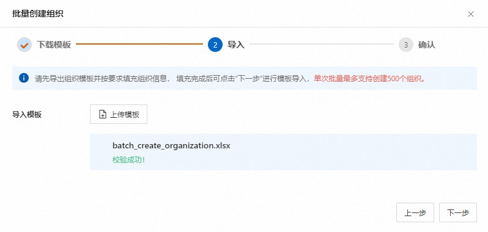

6. 确认组织信息无误后，单击**确定**。

   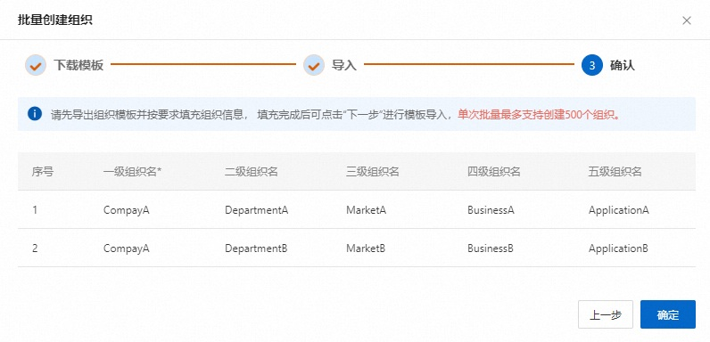

7. （可选）单击**任务列表**，查看创建结果。

   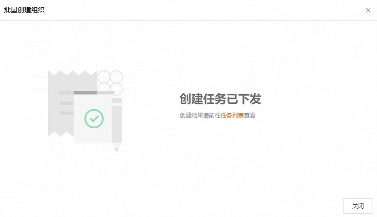

<a id="section-4-2-2-2"></a>

#### 4.2.2.2. 管理组织

当企业组织信息有变化时，可通过管理组织的功能进行调整适配。

**约束限制**

**组织AccessKey约束限制**

每个一级组织最多持有两对组织AccessKey。默认只有运营管理员和一级组织管理员才有权限获取组织AccessKey。

- 运营管理员可以管理所有一级组织AccessKey。

- 一级组织管理员仅支持管理自己归属组织的AccessKey。

**组织排序约束限制**

组织排序只能在同级组织间移动，不能跨层级移动。

**删除组织约束限制**

根组织（root）不支持删除。

**组织第三方认证约束限制**

- 仅一级组织的基本信息中显示第三方认证。

- 只能为一级组织绑定IdP服务，且每个一级组织只能绑定一个IdP服务（包含全局IdP服务）。

  - 组织绑定IdP服务后，将会对用户进行身份验证，这可能影响用户登录。

  - 如果云平台已经设置了全局IdP，则展示全局IdP，并且不可以修改。

  - 如果某一级组织绑定了局部IdP，其它一级组织仍可以绑定同一个或其它局部IdP。

  - 在组织绑定局部IdP场景下，授权登录入口统一不开放，仅支持通过第三方主动跳转登录。

- 为一级组织绑定、变更、解除关联的局部IdP服务前，请确保已完成局部IdP服务的设置，具体可参见第三方认证。

**查看组织信息**

查看组织的层级架构、基本信息、资源集、用户、用户组和多云组织管理。

1. 登录Apsara Uni-manager运营控制台。

2. 在页面顶部菜单栏上，单击**企业**。

3. 在左侧导航栏中选择**资源管理** > **组织管理**。

4. （可选）在**组织管理**页面左侧**组织架构**上方的文本框中，填写组织名称进行模糊查找。

5. 在左侧**组织架构**查看组织层级关系和名称。

   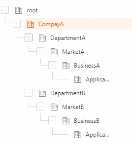

   > **说明**
   >
   > 如果一级组织绑定了多云组织，那么一级组织后面会显示“多云”。

6. 左侧单击组织名称后，在右侧查看组织信息。

   <table>
     <tr>
       <th width="89">区域</th>
       <th>说明</th>
     </tr>
     <tr>
       <td>基本信息</td>
       <td>展示<strong>组织名称</strong>、<strong>组织ID</strong>、<strong>组织层级</strong>、<strong>描述</strong>、<strong>第三方认证</strong>、<strong>创建人</strong>、<strong>创建时间</strong>等。<br>说明只有一级组织才会展示<strong>第三方认证</strong>，如果有绑定会展示具体的IdP服务名称。</td>
     </tr>
   </table>

   <table>
     <tr>
       <th width="121">资源集列表</th>
       <th>展示该组织下的资源集信息，包括<strong>资源集名称/ID</strong>、<strong>组织名称</strong>、<strong>密级等级</strong>、<strong>用户组</strong>、<strong>代替云资</strong><strong>源</strong>、<strong>创建人</strong>、<strong>创建时间</strong>等。<br><br>说明<br>• 单击资源集名称，跳转到<strong>资源集详情</strong>页面的资源列表页签。<br>• 单击列表上方的<strong>创建资源集</strong>，可新增资源集。</th>
     </tr>
     <tr>
       <td>用户列表</td>
       <td>展示该组织下的用户信息，包括<strong>用户名</strong>、<strong>显示名</strong>、<strong>组织</strong>、<strong>状态</strong>、<strong>角色</strong>等。<br>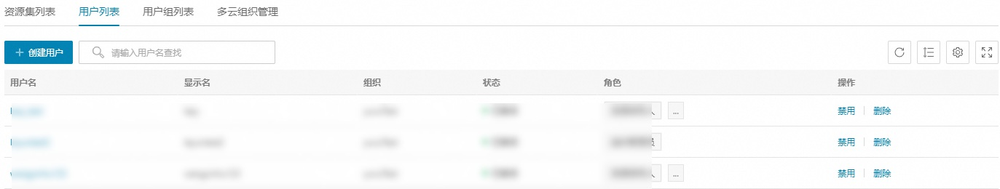<br>说明<br>• 单击用户名，可跳转至<strong>用户详情</strong>页面。<br>• 单击列表上方的<strong>创建用户</strong>，可新增用户。<br>• 单击<strong>操作</strong>列的<strong>禁用</strong>/<strong>启用</strong>，可以禁用或启用用户账号。<br>• 单击<strong>操作</strong>列的<strong>删除</strong>，可以删除用户。</td>
     </tr>
     <tr>
       <td>用户组列表</td>
       <td>展示该组织下的用户组信息，包括<strong>用户组名称/ID</strong>、<strong>组织</strong>、<strong>角色</strong>、<strong>用户</strong>、<strong>绑定资源集</strong>、<strong>创建时</strong><strong>间</strong>等。<br>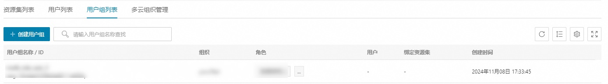<br>说明<br>• 单击列表上方的<strong>创建用户组</strong>，可新增用户组。<br>• <strong>用户</strong>列上的数字，表示已加入该用户组的用户数量。鼠标悬浮在数字上，可查看具体的用户。如果用户组中没有用户，则显示为-。</td>
     </tr>
     <tr>
       <td>多云组织管理</td>
       <td>仅一级组织展示。展示该组织下绑定的多云组织信息，包括<strong>云平台</strong>、<strong>云平台类型</strong>、<strong>专有云组织</strong><strong>名/公共云账号名</strong>、<strong>授权时间</strong>等。<br><br>重要仅主云的运营管理员才能使用该页面的绑定和解绑操作，其他管理员角色只能查看。<br>• 单击列表上方的<strong>绑定多云组织</strong>，可新增绑定。绑定前，请确保已在多云管理页面完成云平台的接入配置。一个一级组织只能绑定一个公共云主账号，一个公共云主账号也只能绑定一个一级组织。<br>• 单击<strong>操作</strong>列的<strong>解绑</strong>，可解除绑定。解除绑定后，将同步解绑当前组织范围内对应云平台资源集绑定关系，并删除当前组织下全部临时用户。</td>
     </tr>
   </table>

**管理组织AccessKey**

查看、新增、禁用、激活和删除组织AccessKey。

1. 在**组织管理**页面，单击左侧组织架构的一级组织名称。

2. 在右侧**基本信息**区域单击**管理AccessKey**。

3. 在**管理AccessKey**对话框上半部分，查看**该组织云账号别名**、**该组织云账号名称**、**UID**。

   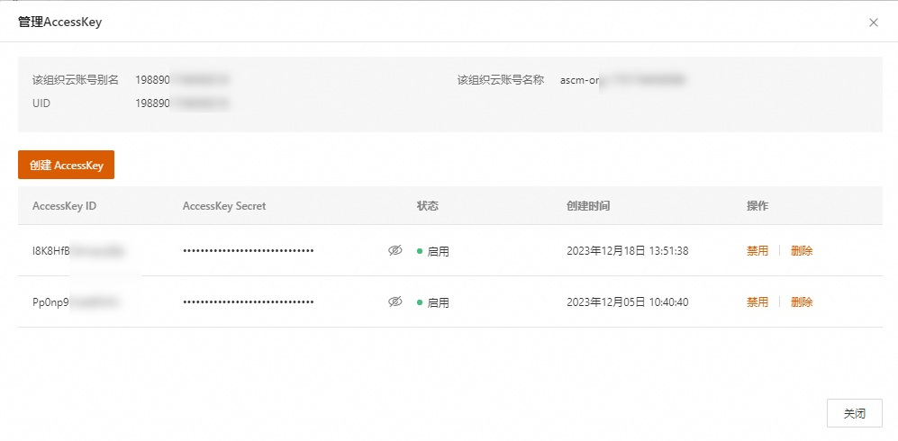

4. 在**管理AccessKey**对话框下半部分，管理该组织AccessKey。

   <table>
     <tr>
       <th width="175">操作任务</th>
       <th>操作步骤</th>
     </tr>
     <tr>
       <td>查看组织AccessKey</td>
       <td>查看组织AccessKey ID和AccessKey Secret。<br>• 单击，将隐藏的AccessKey Secret显示。<br>• 单击，将显示的AccessKey Secret隐藏。</td>
     </tr>
     <tr>
       <td>创建组织AccessKey</td>
       <td>单击<strong>创建AccessKey</strong>。<br>说明每个一级组织最多支持两对AccessKey。</td>
     </tr>
     <tr>
       <td>禁用组织AccessKey</td>
       <td>i. 单击目标AccessKey（<strong>启用</strong>状态）所在行的<strong>禁用</strong>。ii. 查看关联AccessKey信息，进行影响评估后，勾选<strong>我已知晓风险，确认禁用</strong>，单击<strong>禁用</strong>。禁用成功后，组织AccessKey状态变为<strong>禁用</strong>。<br>重要<br>• 单击<strong>操作</strong>列的<strong>查看该AccessKey日志信息</strong>，跳转到<strong>AccessKey日</strong><strong>志</strong>页面，查看AccessKey调用的日志信息，帮助进行影响评估。<br>• 禁用后将导致依赖该AccessKey的产品或应用程序不可用，请慎重操作。<br>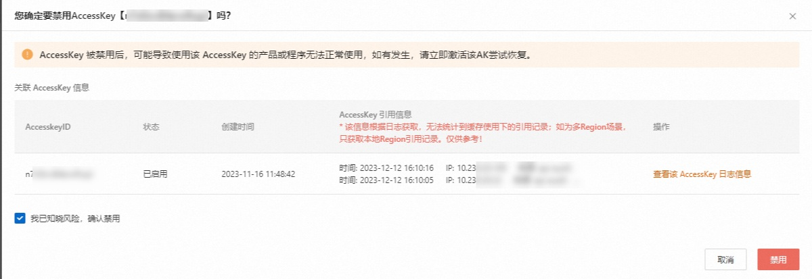</td>
     </tr>
     <tr>
       <td>激活组织AccessKey</td>
       <td>单击目标AccessKey（<strong>禁用</strong>状态）所在行的<strong>激活</strong>。激活成功后，组织AccessKey状态变为<strong>启用</strong>。</td>
     </tr>
   </table>

   <table>
     <tr>
       <td>删除组织AccessKey</td>
       <td>i. 单击目标AccessKey所在行的<strong>删除</strong>。ii. 查看关联AccessKey信息，进行影响评估后，勾选<strong>我已知晓风险，确认删除</strong>，单击<strong>删除</strong>。<br>重要<br>• 单击<strong>操作</strong>列的<strong>查看该AccessKey日志信息</strong>，跳转到<strong>AccessKey日</strong><strong>志</strong>页面，查看AccessKey调用的日志信息，帮助进行影响评估。<br>• 删除组织AccessKey后，将导致依赖该AccessKey的应用程序不可用，请慎重操作。<br>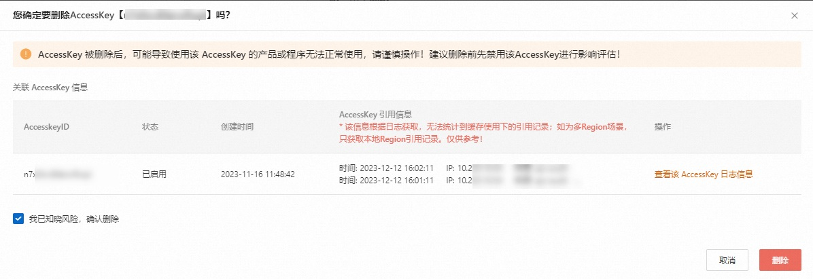</td>
     </tr>
   </table>

**修改组织名称和描述**

修改组织时仅支持修改组织的名称和描述信息。

1. 在**组织管理**页面，单击左侧组织架构的组织名称。

2. 在右侧**基本信息**区域单击**编辑**。

3. 在**修改组织**对话框中，编辑**名称**和**描述**后，单击**确定**。

   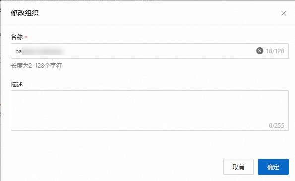

**组织排序**

1. 在**组织管理**页面左侧**组织架构**中，拖拽组织节点即可进行自定义排序。

   具体可参见页面上的**去查看**。

   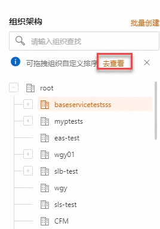

**管理组织的第三方认证**

1. 在**组织管理**页面，单击左侧组织架构的一级组织名称。

2. 在右侧**基本信息**区域单击  ，选择**第三方认证**。

3. 在**第三方认证**对话框，管理组织关联的局部IdP服务。

   | 操作任务 | 操作步骤 |
   | --- | --- |
   | 组织绑定局部IdP服务 | 该一级组织未绑定局部IdP服务且云平台未设置全局IdP时，可以为组织绑定局部IdP服务。<br>i. 在<strong>关联IdP</strong>下拉列表选择一个IdP服务。<br>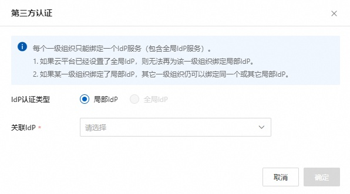<br>ii. 单击<strong>确定</strong>。 |
   | 组织变更关联的局部IdP服务 | i. 单击<strong>关联IdP</strong>右侧的<strong>修改</strong>。ii. 在<strong>关联IdP</strong>下拉列表重新选择一个IdP服务。<br>说明单击<strong>取消</strong>，可以取消变更关联IdP服务操作。<br>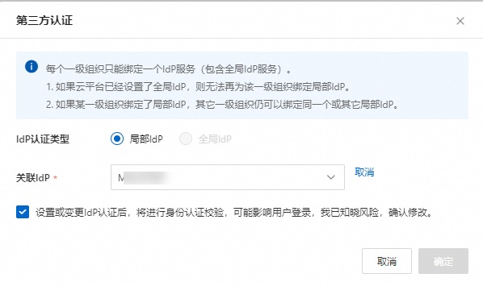<br>iii. 单击<strong>确定</strong>。 |
   | 组织解除关联的局部IdP服务 | i. 单击<strong>关联IdP</strong>右侧的<strong>修改</strong>。ii. 在<strong>关联IdP</strong>下拉列表选择<strong>解除当前IdP认证</strong>。<br>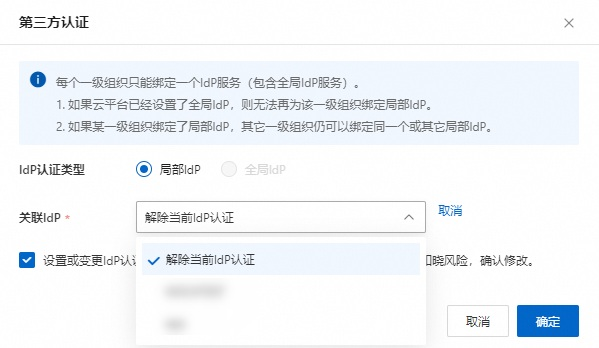<br>iii. 单击<strong>确定</strong>。 |

**删除组织**

1. 在**组织管理**页面，单击左侧组织架构的组织名称。

2. 在右侧**基本信息**区域单击  ，选择**删除**。

   > **重要**
   >
   > - 删除组织后，数据无法恢复，请谨慎操作。
   >
   > - 删除组织时，请确保该组织下无用户、资源集和子组织。

   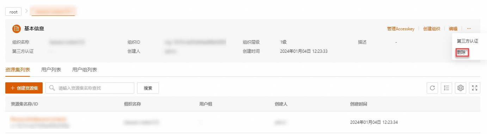

3. 单击**确定**。

<a id="section-4-2-3"></a>

### 4.2.3. 资源集管理

<a id="section-4-2-3-1"></a>

#### 4.2.3.1. 创建资源集

资源集类似“项目”，是对资源的分组，用户/用户组加入资源集后就能对资源集内的资源进行管理。通过资源集管理功能可以解决用户授权等复杂性问题。如果一个组织有多个项目，则可以在该组织中建立多个资源集，人员按所属资源集使用和管理对应资源。

**背景信息**

资源集是对资源进行管理的逻辑概念，所有资源的创建都需要归属在资源集中。用户在创建资源时，在创建资源的界面上会选择归属资源集，从而实现资源分组。

- 创建一个组织，系统默认为该组织创建一个资源集。

- 每个资源集之间是相互隔离的。

- 一个组织可以包含多个资源集，一个资源集只能归属于一个组织。

**前提条件**

创建资源集前，请确保已完成组织的创建。

**操作步骤**

1. 登录Apsara Uni-manager运营控制台。

2. 在顶部菜单栏上，单击**企业**。

3. 在左侧导航栏中，选择**资源管理** > **资源集管理**。

4. 单击左上角**创建资源集**。

5. 在**创建资源集**对话框中，填写资源集**名称**，选择**组织**。

   > **说明**
   >
   > 如果安全策略中启用了密级访问，那么创建资源集时还需要设置资源集的密级等级，并且资源集等级只能低于当前操作角色密级等级。

   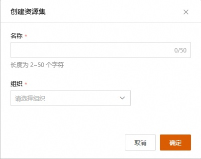

6. 单击**确定**。

<a id="section-4-2-3-2"></a>

#### 4.2.3.2. 管理资源集

资源集创建完成后，支持对资源集进行相关管理操作：编辑资源集、资源集成员授权和删除资源集等。

**操作步骤**

1. 登录Apsara Uni-manager运营控制台。

2. 在页面顶部菜单栏上，单击**企业**。

3. 在左侧导航栏中选择**资源管理** > **资源集管理**。

4. （可选）在资源集列表上方，选择组织名称，或者填写资源集名称。

5. 找到目标资源集，执行相关操作。

   | 操作任务 | 操作步骤 |
   | --- | --- |

   <table>
     <tr>
       <td>查看资源集</td>
       <td>单击目标资源集名称，进入资源集详情。<br>• 在<strong>基础信息</strong>区域，查看资源集名称、资源集ID、所属组织、创建人、创建时间等信息。<br>说明启用了密级访问时，还会显示资源集的密级等级信息。<br>• 在<strong>资源列表</strong>页签，查看资源集下的资源信息。<br>• 在<strong>成员列表</strong>页签，查看资源集下的成员信息。<br>说明<br>• 单击列表上方的<strong>成员授权</strong>，选择角色类型、选择用户/用户组，可将用户/用户组加入到资源集中。<br>• 单击成员操作列的<strong>移除授权</strong>，可将用户/用户组移除该资源集。<br>• 在<strong>多云资源集</strong>页签，查看绑定的多云资源集信息，包括<strong>云平台Code</strong>、<strong>云平台展示名</strong>、<strong>资</strong><strong>源集</strong>、<strong>云平台类型</strong>等。<br>重要仅主云的运营管理员和一级组织管理员才能使用该页面的绑定和解绑操作，其他管理员角色只能查看。绑定多云资源集前，请确保已完成云平台的接入配置。<br>• 单击列表上方的<strong>绑定多云资源集</strong>，选择云平台、组织和多云资源集，将多云资源集绑定进来。<br>• 单击多云资源集操作列的<strong>解绑</strong>，可以解除绑定。</td>
     </tr>
     <tr>
       <td>编辑资源集</td>
       <td>i. 单击目标资源集操作列的<strong>编辑</strong>。ii. 在修改资源集对话框中，更新资源集名称和密级等级。<br>说明更新资源集密级等级时，如果有用户加入，只允许等级从高往低修改。如果没有任何用户加入，那么可以随意修改。<br>iii. 单击<strong>确定</strong>。</td>
     </tr>
     <tr>
       <td>资源集成员授权</td>
       <td>i. 单击目标资源集操作列的<strong>成员授权</strong>。ii. 在成员授权对话框中，选择角色类型、选择用户/用户组。<br>重要启用密级访问后，只支持加入标识高于等于资源集标识的角色加入。<br>• 添加用户/用户组：在左下角区域中，选中目标用户/用户组名称前的复选框。<br>• 删除用户/用户组：在右下角区域中，单击目标用户/用户组操作列中的<strong>移除</strong>。iii. 单击<strong>确定</strong>。</td>
     </tr>
     <tr>
       <td>删除资源集</td>
       <td>重要<br>• 默认资源集不支持删除。<br>• 删除前请确认资源集中已不存在资源、用户、用户组，否则无法删除。<br>i. 单击目标资源集所在行的<strong>删除</strong>。ii. 单击<strong>确定</strong>。</td>
     </tr>
   </table>

<a id="section-4-2-4"></a>

### 4.2.4. 地域管理

地域管理是指对组织关联的地域进行管理，从而控制资源创建的位置。大型企业通常将业务划分为不同的业务单元，每个业务单元可能负责特定的产品线或地域，可能需要在特定的地理位置创建资源。这时就可以使用地域管理进行组织的关联，以满足企业的要求。

**背景信息**

- 一个组织支持关联多个地域，一个地域也支持被多个组织关联。

- 组织进行地域关联后，只能选择关联的地域创建资源。

**约束限制**

- 一级组织关联Region后，下级组织也能和Region绑定，绑定的范围为上级组织的子集。

- 如果组织支持的Region下已开通资源，则不能解除组织与该Region的关联关系。

**更新组织与Region的关联关系**

1. 登录Apsara Uni-manager运营控制台。

2. 在顶部菜单栏上，单击**企业**。

3. 在左侧导航栏中，选择**资源管理**> **地域管理**。

4. 在左侧组织架构，单击目标组织。

5. 在右侧的Region列表中，勾选/取消Region名称。

   勾选表示组织与该Region绑定，绑定后就可以在该Region下创建资源。取消表示组织与该Region解除关联关系，解除后则不能够在该Region下创建资源。

   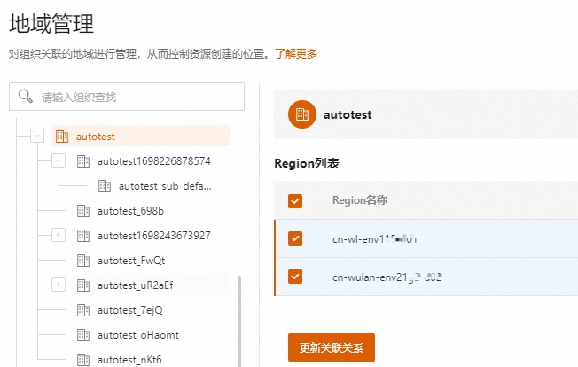

6. 单击**更新关联关系**。

<a id="section-4-2-5"></a>

### 4.2.5. 变更管理

在企业组织或者项目调整后，可以通过变更管理，能够及时的对组织、人员和云产品资源归属进行及时调整转移，与企业实际架构进行匹配。

变更不支持跨一级组织变更归属，变更前必须确认目标组织中不存在同名组织和用户。

**操作步骤**

1. 登录Apsara Uni-manager运营控制台。

2. 在顶部菜单栏上，单击**企业**。

3. 在左侧导航栏中，选择**资源管理 > 变更管理**。

4. （可选）在组织结构上方的文本框中，填写组织名称进行模糊查找。

5. 找到目标组织，执行相关操作。

   <table>
     <tr>
       <th width="90">操作任务</th>
       <th>操作步骤</th>
     </tr>
     <tr>
       <td>变更组织</td>
       <td>i. 单击组织名称。ii. 在页面右侧，单击<strong>变更组织</strong>。iii. 在<strong>变更组织到</strong>下拉列表中，选择目标组织。iv. 单击<strong>确定</strong>。<br>说明组织变更后，组织下的资源集和人员信息同步变更到目标组织。</td>
     </tr>
     <tr>
       <td>变更资源</td>
       <td>i. 单击目标组织前的图标，选择资源集。<br>ii. 在页面右侧，选择<strong>产品类型</strong>、<strong>资源类型</strong>。iii. 变更资源实例。<br>• 单个资源实例变更：在资源实例列表中，单击目标资源实例所在行的<strong>变更归属</strong>。<br>• 批量资源实例变更：在资源实例列表中，勾选需要多个目标资源实例，单击列表下方的<strong>批量</strong><strong>变更归属</strong>。iv. 在<strong>变更资源集到</strong>下拉列表中，选择目标资源集。<br>v. 单击<strong>确定</strong>。<br>说明<br>• 资源变更不会影响原组织和人员信息的变更，仅资源实例转到目标组织中。<br>• 单击资源操作列的<strong>查看资源关系</strong>，可以查看该资源的上级资源信息。如果当前资源存在上级资源，此资源暂不支持变更。如果仍要变更，建议对上级资源进行变更，当前资源的归属会自动跟随上级资源变更。</td>
     </tr>
     <tr>
       <td>变更用户</td>
       <td>i. 单击组织名称。ii. 在页面右侧，单击<strong>用户列表</strong>。iii. 在用户列表，单击目标用户所在行的<strong>变更</strong>。iv. 在<strong>变更组织到</strong>下拉列表中选择目标组织，在<strong>分配角色</strong>下拉列表中，选择角色。<br>v. 单击<strong>确定</strong>。<br>说明用户变更不会影响员组织和资源，仅用户转移到目标组织中。</td>
     </tr>
   </table>

<a id="section-4-3"></a>

## 4.3. 人员管理

<a id="section-4-3-1"></a>

### 4.3.1. 概述

通过用户管理和用户组管理，帮助企业对人员的归属、权限、群组做集中管控，满足不同用户对系统和资源的访问需求，提升企业的管理效率。

**用户管理**

对用户进行生命周期管理，并对用户进行角色授权、登录控制等管理，通过用户管理，您可以：

- 系统用户：创建用户、编辑用户、禁用用户、激活用户、删除用户、用户授权、配置登录策略、查看用户信息、加入用户组、移除用户组、MFA认证设置、查看用户初始密码、查看所属资源集

- 历史用户：恢复用户、彻底删除用户

**用户组管理**

将用户加入用户组，对该用户组进行角色授权，即可实现对用户组内所有用户进行批量角色权限管理。通过用户组管理，您可以：

- 创建用户组

- 编辑用户组

- 添加用户

- 用户组授权

- 移除用户

- 删除用户

<a id="section-4-3-2"></a>

### 4.3.2. 用户管理

<a id="section-4-3-2-1"></a>

#### 4.3.2.1. 创建用户

管理员可选择单个或批量创建用户，并为用户赋予不同的角色，以满足不同用户对系统的访问控制需求。

**背景信息**

运营管理员可以为所有组织创建用户，组织管理员只能为本级及以下组织创建用户。

一个用户只能配置一个登录策略，默认策略不限制登录时间和登录地址。如果需要针对不同类型的用户限制登录的时间及地址，可创建新的登录策略。

**约束限制批量创建用户约束限制**

批量创建用户时，单次批量最多支持创建100个用户。

**前提条件**

创建用户前，请确保已完成组织和角色的创建。

**创建单个用户**

1. 管理员登录Apsara Uni-manager运营控制台。

2. 在顶部菜单栏中单击**企业。**

3. 在左侧导航栏中，选择**人员管理** > **用户管理。**

4. 在**系统用户**页签，单击**创建用户。**

5. 在**创建用户**对话框中，配置用户信息。

   <table>
     <tr>
       <th width="121">名称</th>
       <th>描述</th>
     </tr>
     <tr>
       <td>用户名</td>
       <td>用户的个人云平台账号名，由英文大小写字母（A~Z、a~z）、阿拉伯数字（0~9）、短划线（-）、下划线（_）或半角句号（.）组成，长度为2~64个字符。</td>
     </tr>
     <tr>
       <td>显示名</td>
       <td>显示名，由中文汉字、英文大小写字母（A~Z、a~z）、阿拉伯数字（0~9）、短划线（-）、半角句号（.）或at（@）组成，长度为1~128个字符。</td>
     </tr>
     <tr>
       <td>角色</td>
       <td>选择用户的角色。</td>
     </tr>
     <tr>
       <td>组织</td>
       <td>选择用户所在的组织。</td>
     </tr>
     <tr>
       <td>登录策略</td>
       <td>登录策略将限制用户的登录时间和登录地址。默认情况下，新创建的用户会自动绑定默认策略。</td>
     </tr>
     <tr>
       <td>手机</td>
       <td>用户的手机号码。手机号码用于系统以短信形式通知用户资源的申请和使用情况，请填写正确的手机号码。<br>说明填写手机号时，需要选择正确的国际电话区号。</td>
     </tr>
     <tr>
       <td>座机</td>
       <td>用户的座机号码。座机号码仅允许输入数字（0~9）和短划线（-），长度为4~20个字符。</td>
     </tr>
     <tr>
       <td>Email</td>
       <td>用户的邮箱地址。邮箱用于系统以邮件方式通知用户资源的申请和使用情况，请填写正确的邮箱地址。</td>
     </tr>
     <tr>
       <td>钉钉密钥</td>
       <td>钉钉机器人的密钥，配置方法请参见钉钉开发文档。</td>
     </tr>
     <tr>
       <td>启用邮件通知</td>
       <td>启用后，Apsara Uni-manager运营控制台出现报警项且该用户是报警联系人时，Apsara Uni-manager运营控制台会将报警信息通过邮件通知用户。<br>说明邮件通知需要配置邮件服务器，具体请联系驻场运维工程师。</td>
     </tr>
     <tr>
       <td>启用钉钉通知</td>
       <td>启用后，Apsara Uni-manager运营控制台出现报警项且该用户是报警联系人时，Apsara Uni-manager运营控制台会将报警信息通过钉钉消息通知用户。</td>
     </tr>
   </table>

6. 单击**确定**。

**批量创建用户**

1. 在**系统用户**页签，单击**批量创建用户**。

   > **说明**
   >
   > 批量创建用户需要先导出用户模板并按要求填充用户信息，填充完成后再进行模板导入。

2. 在**批量创建用户**对话框中，单击**用户批量创建模板**。

   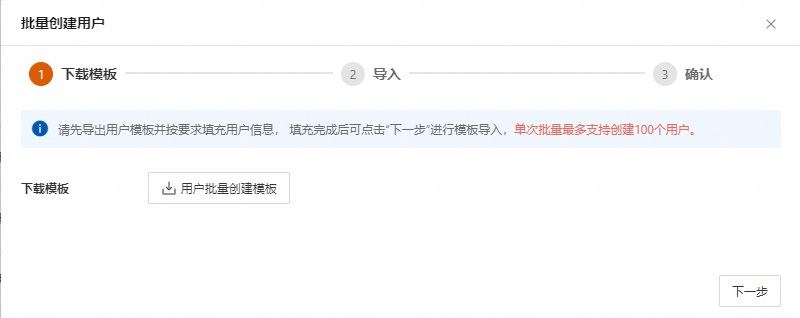

3. 在下载的模板文件中，按要求填充用户信息。

   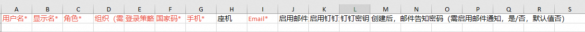

   | 名称 | 描述 |
   | --- | --- |
   | 用户名 | 用户的个人云平台账号名，由英文大小写字母（A~Z、a~z）、阿拉伯数字（0~9）、短划线（-）、下划线（_）或半角句号（.）组成，长度为2~64个字符。 |
   | 显示名 | 显示名，由中文汉字、英文大小写字母（A~Z、a~z）、阿拉伯数字（0~9）、短划线（-）、半角句号（.）或at（@）组成，长度为1~128个字符。 |
   | 角色 | 输入当前用户目标角色的名称。全部角色可在<strong>权限管理</strong> &gt;<strong> 角色授权</strong>中查看。 |
   | 组织 | 输入当前用户目标组织的路径。<br>重要路径需从root（根）组织开始，例如“root/一级组织/二级组织”。若root（根）组织名称已自定义，则以自定义名称为准。 |
   | 登录策略 | 输入当前用户所使用的登录策略的名称。全部登录策略可在<strong>权限管理</strong> &gt;<strong> 访问控制</strong>中查看。 |
   | 国家码 | 填写国际电话区号。 |
   | 手机 | 输入用户手机号码。手机号码用于系统以短信形式通知用户资源的申请和使用情况，请填写正确的手机号码。 |
   | 座机 | 用户的座机号码。座机号码仅允许输入数字（0~9）和短划线（-），长度为4~20个字符。 |
   | Email | 用户的邮箱地址。邮箱用于系统以邮件方式通知用户资源的申请和使用情况，请填写正确的邮箱地址。 |
   | 启用邮件通知 | 输入<strong>是</strong>或<strong>否</strong>。默认为<strong>否</strong>。启用后，Apsara Uni-manager运营控制台出现报警项且该用户是报警联系人时，Apsara Uni-manager运营控制台会将报警信息通过邮件通知用户。<br>说明邮件通知需要配置邮件服务器，具体请联系驻场运维工程师。 |
   | 启用钉钉通知 | 输入<strong>是</strong>或<strong>否</strong>，默认为<strong>否</strong>。启用后，Apsara Uni-manager运营控制台出现报警项且该用户是报警联系人时，Apsara Uni-manager运营控制台会将报警信息通过钉钉消息通知用户。 |
   | 钉钉密钥 | 钉钉机器人的密钥，配置方法请参见钉钉开发文档。<br>说明需启用钉钉通知。 |
   | 创建后，邮件告知密码 | 输入<strong>是</strong>或<strong>否</strong>，默认为<strong>否</strong>。<br>说明需启用邮件通知。 |

4. 模板文件补充完成并保存后，在**导入**向导中单击**上传模板**，上传完成后，单击**下一步**。

   > **说明**
   >
   > 模板文件上传后，系统将自动检测用户信息内容是否正确。若文件内包含错误内容则无法创建，需在本地修改模板文件，修改完成后再单击**重新上传**。

5. 在**确认**向导中预览检查需要导入的用户信息，单击**确定**。

6. （可选）任务创建成功后，可单击对话框中的**任务列表**，前往异步任务页面查看创建结果。

<a id="section-4-3-2-2"></a>

#### 4.3.2.2. 管理系统用户

对系统用户进行生命周期的管理，并对用户进行角色授权、登录控制等操作。

**背景信息**

运营管理员能够管理所有组织的系统用户，组织管理员仅支持管理本级及下级组织的系统用户。

**查看用户详情**

查看用户的基本信息和详情。

1. 登录Apsara Uni-manager运营控制台。

2. 在顶部菜单栏上，单击**企业**。

3. 在左侧导航栏中，选择**人员管理** **> 用户管理**。

4. 在**系统用户**页签的用户列表。

   > **说明**
   >
   > 列表具体的展示项可在
   >
   > 中进行设置。
   >
   > 

5. 单击用户名或**操作**列的**查看**，进入**用户详情**页面。

   - 在页面上半部分，查看用户的基本信息，包括**用户名**、**显示名**、**密码**、**所属组织**、**UID**、**手机号码**、**座机号码**、**电子邮箱**、**最近登录**、**外部系统关联**、**钉钉Token**、**备注**、**用户角色**、**用户组角色**等。

     

   - 在页面下半部分，切换**所属资源集**、**所属用户组**、**角色权限**页签，分别查看用户所属的资源集、所属的用户组和角色权限。

     - **查看用户所属的资源集**：在**所属资源集**页签的角色下拉列表切换用户的角色，查看用户对应角色已加入的资源集。

     - **查看用户所属用户组**：在**所属用户组**页签，查看用户已加入的用户组信息

       > **说明**
       >
       > **用户**列上的数字，表示已加入该用户组的用户数量。鼠标悬浮在数字上，可查看具体的用户。

     - **查看用户角色权限**：在**角色权限**页签，查看预置角色与自定义角色下**管理权限**、**应用权限**、**菜单权限**的具体权限点以及RAM授权信息。

**修改用户基本信息**

当用户信息变更时，可进行修改更新。

1. 在**系统用户**页签的用户列表，单击目标用户所在行的**编辑**。

2. 在**修改用户**对话框中，重新填写需要修改的信息。

   > **说明**
   >
   > 用户名和组织不支持修改。

   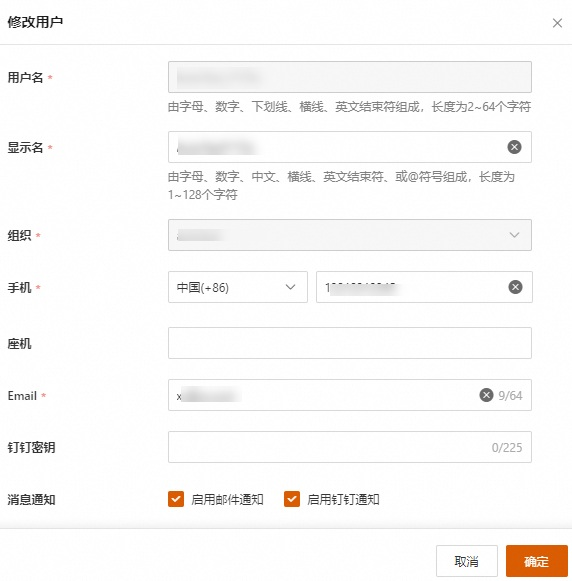

3. 单击**确定**。

**管理用户角色**

当需要调整用户角色时，可通过角色授权进行用户角色的管理。用户角色授权前，请确保已完成角色的创建。

1. 在**系统用户**页签的用户列表，单击目标用户所在行操作列的  ，选择**角色授权**。

2. 在**角色授权**对话框，根据需要添加或移除用户角色。

   > **说明**
   >
   > - 一个用户最多支持10个RAM授权角色（包含用户直接绑定和通过用户组绑定）。
   >
   > - 选择多云角色时，每个用户针对公共云只能绑定一个公共云的RAM角色。如果没有RAM角色，单击**去授权**可以创建RAM角色。已绑定RAM角色时，可以更新权限策略、移除角色。
   >
   > - 选择多云角色时，如果是专有云类型，只能选择管理权限是资源集范围的角色。

   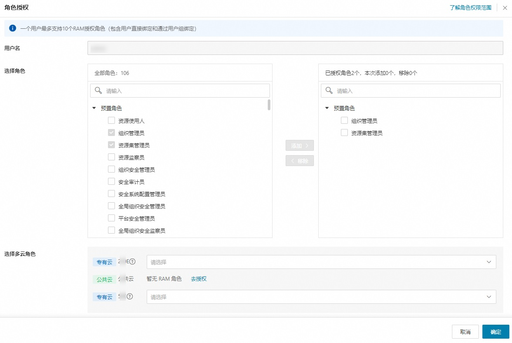

3. 单击**确定**。

**编辑多云角色**

用户的多云角色有更新时，可以进行修改。

1. 在**系统用户**页签的用户列表，单击目标用户所在行操作列的  ，选择**编辑多云角色**。

2. 在编辑多云角色对话框，重新选择多云角色，单击**确定**。

   > **说明**
   >
   > - 选择多云角色时，每个用户针对公共云只能绑定一个公共云的RAM角色。如果没有RAM角色，单击**去授权**可以创建RAM角色。
   >
   > - 选择多云角色时，如果是专有云类型，只能选择管理权限是资源集范围的角色。

   

**管理用户所属资源集**

当用户所属的资源集变更时，可通过资源集管理进行调整。

1. 在**系统用户**页签的用户列表，单击目标用户所在行的  ，选择**资源集管理**。

2. 在**用户详情**页面的**所属资源集**页签，切换用户角色查看用户已加入的资源集。

   > **说明**
   >
   > 单击**操作**列的**移出**，可以将用户移出该资源集。

3. 单击列表上方的**加入资源集**。

   > **重要**
   >
   > 用户加入资源集前，请确保已完成资源集的创建。

4. 在**加入资源集**对话框中，**选择角色类型**下拉列表选择用户的角色，**选择资源集**列表勾选需要加入的资源集。

   > **说明**
   >
   > 安全策略启用了密级访问时，只支持高于等于资源集密级等级的角色加入资源集。

5. 单击**确定**。

**管理用户所属用户组**

当用户所属的用户组变更时，可通过用户组管理进行调整。

1. 在**系统用户**页签的用户列表，单击目标用户所在行的  ，选择**用户组管理**。

2. 在**用户详情**页面的**所属用户组**页签，查看用户已加入的用户组信息，包括**用户组名称/ID**、**组织**、**角色**、**用户**、**绑定资源集**、**创建时间**等。

   > **说明**
   >
   > - **用户**列上的数字，表示已加入该用户组的用户数量。鼠标悬浮在数字上，可查看具体的用户。
   >
   > - 单击**操作**列的**移出**，可以将用户移出该用户组。

3. 单击列表上方的**加入用户组**。

   > **重要**
   >
   > 用户加入用户组前，请确保已完成用户组的创建。

4. 在**加入用户组**对话框中，勾选需要加入的用户组。

5. 单击**确定**。

**配置用户访问策略**

当用户的访问策略需要变更时，可通过配置登录策略进行调整。

- 单个配置登录策略

  <ol type="i">

  <li>

  在**系统用户**页签的用户列表，单击目标用户所在行操作列的  ，选择**配置访问控制策略**。

  </li>

  <li>

  在配置用户登录策略对话框，选择**登录策略**。

  

  </li>

  <li>

  单击**确定**。

  </li>

  </ol>

- 批量配置登录策略。

  <ol type="i">

  <li>

  在**系统用户**页签的用户列表，选择多个目标用户。

  </li>

  <li>

  单击列表下方的**配置登录策略**。

  </li>

  <li>

  在**批量配置用户登录策略**对话框中，选择**登录策略**。

  

  </li>

  <li>

  单击**确定**

  </li>

  </ol>

**用户MFA认证设置**

MFA认证需要绑定虚拟MFA设备（如阿里云App）搭配使用，是一种安全措施，要求用户在登录时提供多个身份验证，能够大大增强账号的安全性。

1. 在**系统用户**页签的用户列表，单击目标用户所在行操作列的  ，选择**MFA认证设置**。

2. 在**MFA认证设置**面板，开启或关闭认证。

   

    ：表示MFA认证开启。

   - **当MFA认证开启，但未绑定设备时**：用户通过用户名、密码登录后，会弹出**绑定虚拟MFA设备**页面，强制要求用户绑定。

     

   - **当MFA认证开启，并已绑定设备时**：用户通过用户名、密码登录后，就会进行动态MFA码的验证。

     > **重要**
     >
     > 如果需要解绑MFA设备，在**MFA认证设置**对话框勾选**解绑当前设备**，解绑设备后，用户原绑定的MFA设备失效。

     

    ：表示MFA认证未开启。

   - **当MFA认证未开启，但是已绑定MFA设备时**：用户通过用户名、密码登录后，还是会要求输入动态MFA码。

     > **重要**
     >
     > 如果需要解绑MFA设备，在**MFA认证设置**对话框勾选**解绑当前设备**，解绑设备后，用户原绑定的MFA设备失效。

   - **当MFA认证未开启，也未绑定MFA设备时**：通过用户名、密码登录后，不需要动态MFA码验证。

3. 单击**确定**。

**查看用户初始密码**

用户的初始密码仅支持用户在未登录过的情况下查看。如果用户已登录过控制台，查看时密码显示为空白。

1. 在**系统用户**页签的用户列表，单击目标用户所在行的  ，选择**查看用户初始密码**。

2. 在弹出的查看用户初始密码对话框中，查看显示的初始密码。

   

**重置用户密码**

当用户忘记密码，可重置用户密码。

1. 在**系统用户**页签的用户列表，单击目标用户，进入用户详情。

2. 在**密码**右侧单击**重置密码**后，单击  查看用户重置后的密码。

**管理用户AccessKey**

管理员可以手动轮转下级用户AccessKey。

1. 在**系统用户**页签的用户列表，单击目标用户所在行操作列的  ，选择**AccessKey管理**。

2. 在**管理用户AccessKey**对话框，管理用户AccessKey。

   - 在AccessKey列表，查看AccessKey ID、状态、创建时间、AccessKey审计日志等信息。

     > **说明**
     >
     > 管理员只能看到用户的AccessKey ID。AccessKey Secret信息，用户可以到自己的个人信息页面进行查看。

   - 在列表上方单击**创建AccessKey**，系统自动为用户创建AccessKey。每个用户最多持有两对用户AccessKey。

   - 在AccessKey列表单击操作列的**禁用**，在对话框中勾选**我已知晓风险，确认禁用**后，单击**禁用**。禁用后，AccessKey状态变为禁用。

     > **重要**
     >
     > - 仅**启用**状态的AccessKey支持禁用操作。
     >
     > - AccessKey被禁用后，可能导致使用该AccessKey的产品或程序无法正常使用，如有发生，请立即激活该AccessKey尝试恢复。

   - 在AccessKey列表单击操作列的**启用**。启用后，AccessKey状态变为启用。

     > **重要**
     >
     > 仅**禁用**状态的AccessKey支持启用操作。

   - 在AccessKey列表单击操作列的**删除**，在对话框中勾选**我已知晓风险，确认删除**后，单击**删除**。

     > **重要**
     >
     > AccessKey被删除后，可能导致使用该AccessKey的产品或程序无法正常使用，请谨慎操作！建议删除前先禁用该AccessKey进行影响评估！

**禁用用户**

当需要禁用用户时，可通过执行禁用操作实现。

> **重要**
>
> - 状态为**已激活**的用户支持禁用操作。禁用成功后，用户状态变为**已禁用**。
>
> - 禁用用户会导致：禁用用户登录、禁用用户AccessKey、用户登录状态失效。
>
> - AccessKey被禁用后，可能导致使用该AccessKey的产品或程序无法正常使用，如有发生，请立即激活该AccessKey试恢复。

1. 在**系统用户**页签的用户列表，单击目标用户所在行的  ，选择**禁用**。

2. 在确定禁用对话框中，勾选**我已知晓风险，确认禁用**。

   > **说明**
   >
   > 鼠标悬浮在AccessKey引用信息列，可以查看到AccessKey调用的事件列表信息。

   

3. 单击**禁用。**

**激活用户**

当禁用的用户需要激活时，可通过执行激活操作来实现。

> **重要**
>
> - 状态为**已禁用**的用户支持激活操作。激活成功后，用户状态变为**已激活**。
>
> - 激活用户时，其AccessKey会同时激活。

1. 在**系统用户**页签的用户列表，单击目标用户所在行的  ，选择**激活**。

2. 在确定激活对话框中，单击**确定**。

   > **说明**
   >
   > 鼠标悬浮在AccessKey引用信息列，可以查看到AccessKey调用的事件列表信息。

   

**删除用户**

当用户不需要时，可以删除。

> **重要**
>
> - 删除用户会导致：禁用用户登录、删除用户AccessKey、用户登录状态失效。
>
> - 删除的用户数据无法恢复，AccessKey被删除后，可能导致引用该AccessKey的产品或程序无法正常使用，建议您先禁用该用户，排查确认后再进行删除操作。

1. 在**系统用户**页签的用户列表，单击目标用户所在行操作列的  ，选择**删除**。

2. 在确定删除对话框中，勾选**我已知晓风险，确认删除**。

   

3. 单击**删除**。

   系统用户删除后会显示在**历史用户**页签中，您可以在历史用户页签中将用户恢复或彻底删除。

<a id="section-4-3-2-3"></a>

#### 4.3.2.3. 管理历史用户

历史用户是对删除后的系统用户的管理，包括恢复用户和彻底删除用户。

**操作步骤**

1. 登录Apsara Uni-manager运营控制台。

2. 在顶部菜单栏上，单击**企业**。

3. 在左侧导航栏中，选择**人员管理 > 用户管理**。

4. 单击**历史用户**页签，执行相关操作。

   <table>
     <tr>
       <th width="122">操作任务</th>
       <th>操作步骤</th>
     </tr>
     <tr>
       <td>恢复用户</td>
       <td>恢复已删除的用户，用户会重新显示在系统用户中。<br>i. 单击目标用户所在行的<strong>恢复</strong>。ii. 选择用户归属组织和角色。iii. 单击<strong>确定</strong>。</td>
     </tr>
     <tr>
       <td>彻底删除用户</td>
       <td>彻底删除用户后，用户就从历史用户中消失，将无法再恢复。<br>i. 单击目标用户所在行的<strong>彻底删除</strong>。ii. 单击<strong>删除</strong>。</td>
     </tr>
   </table>

<a id="section-4-3-3"></a>

### 4.3.3. 用户组管理

<a id="section-4-3-3-1"></a>

#### 4.3.3.1. 创建用户组

您可以在所选组织中创建用户组，批量对用户进行授权。

**前提条件**

已创建组织。创建组织的方法请参见创建组织。

**背景信息**

<table>
  <tr>
    <th width="138">关系</th>
    <th>关系说明</th>
  </tr>
  <tr>
    <td>用户组与组织</td>
    <td>• 用户组只能属于一个组织。<br>• 一个组织下可以创建多个用户组。</td>
  </tr>
  <tr>
    <td>用户组与用户</td>
    <td>• 用户组里可以包含0个到多个用户。<br>• 用户可以选择性的加入用户组，不是必须加入。<br>• 用户可以加入多个用户组。</td>
  </tr>
  <tr>
    <td>用户组与角色</td>
    <td>• 一个角色可以关联到多个用户组。<br>• 角色关联用户组时，自动为用户组内的用户授予该角色权限。</td>
  </tr>
  <tr>
    <td>用户组与资源集</td>
    <td>• 资源集可以添加0到多个用户组。<br>• 用户组可以加入到多个资源集。</td>
  </tr>
</table>

**操作步骤**

1. 登录Apsara Uni-manager运营控制台。

2. 在顶部菜单栏上，单击**企业**。

3. 在左侧导航栏中，选择**人员管理 > 用户组管理**。

4. 单击页面左上角**创建用户组**。

5. 在对话框中填写**用户组名**，选择**组织**和**角色授权**。

   <table>
     <tr>
       <th width="90">名称</th>
       <th>描述</th>
     </tr>
     <tr>
       <td>用户组名</td>
       <td>自定义用户组名称，由大写英文字母（A~Z）、小写英文字母（a~z）、数字（0~9）、中文字符、下划线（_）、短划线（-）、半角句号（.）或at（@）组成，长度为3~255个字符。</td>
     </tr>
     <tr>
       <td>组织</td>
       <td>用户组所属的组织。</td>
     </tr>
     <tr>
       <td>角色授权</td>
       <td>用户组拥有的角色授权。</td>
     </tr>
   </table>

6. 单击**确定**。

<a id="section-4-3-3-2"></a>

#### 4.3.3.2. 管理用户组

通过管理用户组，实现对用户组名称、权限、用户的调整等。

**操作步骤**

1. 登录Apsara Uni-manager运营控制台。

2. 在顶部菜单栏上，单击**企业**。

3. 在左侧导航栏中，选择**人员管理 > 用户组管理**。

4. 找到目标用户组，执行相关操作。

   <table>
     <tr>
       <th width="106">操作任务</th>
       <th>操作步骤</th>
     </tr>
     <tr>
       <td>查看用户组</td>
       <td>在用户组列表中，查看用户组归属的组织、授权角色、用户组中用户数量、绑定资源集等信息。</td>
     </tr>
     <tr>
       <td>编辑用户组</td>
       <td>用户组名称变更时，可以进行修改。<br>i. 单击目标用户组所在行的<strong>编辑</strong>。ii. 输入用户组名。iii. 单击<strong>确定</strong>。</td>
     </tr>
     <tr>
       <td>添加用户</td>
       <td>将用户加入用户组，用户即具有用户组角色权限。<br>i. 单击目标用户组所在行的<strong>添加用户</strong>。<br>ii. 在左侧用户列表勾选需要添加的用户后，单击添加用户到右侧列表。<br>iii. 单击<strong>确定</strong>。</td>
     </tr>
     <tr>
       <td>移除用户</td>
       <td>用户移除用户组后，就不具有对应用户组角色权限。<br>i. 单击目标用户组所在行的，选择<strong>移除用户</strong>。<br>ii. 在左侧用户列表勾选需要移除的用户后，单击移除用户到右侧列表。<br>iii. 单击<strong>确定</strong>。</td>
     </tr>
     <tr>
       <td>授权用户组</td>
       <td>通过授权为用户组进行角色授权，实现整个用户组成员批量赋予或解除相同的角色权限。<br>i. 单击目标用户组所在行的，选择<strong>授权</strong>。<br>ii. 在角色授权下拉列表中，选择为用户组需要授权的角色。iii. 单击<strong>确定</strong>。</td>
     </tr>
     <tr>
       <td>删除用户组</td>
       <td>重要删除用户组前，将自动解绑角色、用户、资源集等关联资源。<br>i. 单击目标用户组所在行的，选择<strong>删除</strong>。<br>ii. 单击<strong>确定</strong>。</td>
     </tr>
   </table>

<a id="section-4-4"></a>

## 4.4. 权限管理

<a id="section-4-4-1"></a>

### 4.4.1. 概述

通过角色授权、数据授权、访问控制、权限边界、AccessKey日志等功能，实现不同场景下的权限划分，管控用户对系统和指定云产品的访问，提高系统的安全性。

**角色授权**

通过创建不同角色并授权给用户或用户组，以实现对用户进行不同粒度权限控制。通过角色授权，您可以：

- 创建角色

- 禁用角色

- 激活角色

- 删除角色

- 复制角色

**数据授权**

可以为特定的云产品实例授权用户访问该产品实例的数据权限，授权后用户就具有该产品的数据权限了。同时还支持查看和修改用户所具备的所有的数据权限。通过数据授权，您可以：

- 设置资源实例的数据授权

- 查看用户数据权限

- 编辑用户数据权限

**访问控制**

通过设置访问策略，来控制相关账号访问平台的登录时间及登录地址。用户绑定策略后，只能在策略规定的登录时间和登录地址进行登录。通过访问控制，您可以：

- 创建访问策略

- 修改访问策略

- 禁用访问策略

- 激活访问策略

- 删除访问策略

**权限边界**

通过创建服务边界并绑定不同API控制策略，实现了在专有云核心网关上进行API拦截的能力，API控制策略可自定义。通过权限边界，您可以：

- 创建服务边界和API控制策略

- 查看服务边界和API控制策略详情

- 修改服务边界和API控制策略

- 编辑服务边界和API控制策略

- 启用/停用服务边界

- 修改服务边界的白名单

- 删除服务边界和API控制策略

**AccessKey日志**

通过AccessKeyID查看该AccessKey的调用日志，获知AccessKey的使用情况，进而帮助对AccessKey的安全管控。通过AccessKey日志，您可以：

- 查看AccessKey的基本信息

- 查看AccessKey访问的云服务

<a id="section-4-4-2"></a>

### 4.4.2. 角色授权

<a id="section-4-4-2-1"></a>

#### 4.4.2.1. 概述

角色是一组访问权限的集合，每个角色都有对应权限范围。Apsara Uni-manager运营控制台中，角色类型分为预置角色、自定义角色、RAM角色授权和RAM授权。

**角色类型**

**预置角色**

预置角色包含了特定操作的一组预设权限集合，是根据三权分立的设计概念，结合政企客户使用云平台时的通用权限分配逻辑的调研结果总结而来。当一个RAM用户被分配了预置角色后，该用户便拥有了对应操作权限。在进行鉴权时，系统会根据分配给用户的预置角色所包含的权限来判断其是否有权执行相应的操作。具体可参见预置角色及其权限说明。

**自定义角色**

自定义角色允许管理员根据实际业务需求，自由组合和设置权限策略。通过对权限共享范围、资源管理范围、应用操作权限、菜单权限和自定义权限策略的自主设置，灵活定义角色能够访问的具体服务、操作以及资源范围。相比预置角色，自定义角色提供了更高的灵活性和定制化程度。


> **说明**
>
> 自定义角色主要满足的是客户需要对云管控制台类型用户进行权限控制的场景。同时，在三方ISV厂商应用开发需要一个限定权限范围的AK来调用云服务API时，也可以通过自定义角色来解决。

**RAM角色授权**

RAM角色授权是指将RAM角色与RAM用户、其他阿里云账号或阿里云服务进行关联绑定的过程。通过扮演RAM角色，被授权的实体可以获得该角色所拥有的权限集合，而无需直接将权限策略授予该实体。


> **说明**
>
> RAM角色授权根据授信实体的不同，可以分为阿里云账号和阿里云服务角色。
>
> - 阿里云账号角色：允许RAM用户所扮演的角色。扮演角色的RAM用户可以是自己的阿里云账号，也可以是其他阿里云账号。该类角色主要用于解决跨账号访问或临时授权访问。
>
> - 阿里云服务角色：允许云服务所扮演的角色。该类角色主要用于解决跨云服务授权访问的问题。

**RAM授权**

每个RAM用户是一个具有唯一身份标识的用户实体，可以通过用户组直接为其授予自定义的权限策略，即将权限策略直接下发到用户上。这样，无论用户是否扮演角色，都始终具有这些固定的权限。


> **说明**
>
> - RAM授权底层是RAM Group，并非RAM Role。
>
> - RAM授权的作用是为了增强白屏化自定义角色更加细粒度的权限控制能力。当用户创建了自定义角色后，发现有些权限控制不能通过角色的权限点进行授权，则可以通过RAM授权为用户绑定RAM Policy补充。
>
> - RAM授权必须要结合用户组使用。

<a id="section-4-4-2-2"></a>

#### 4.4.2.2. RAM权限策略

在设置自定义角色、RAM角色授权和RAM授权角色中都可能涉及通过RAM权限策略语言描述云产品资源授权内容，用于定义具体的权限策略。

**权限策略结构**

RAM权限策略采用JSON格式，完整结构包括两部分：

- 版本号（Version）：用于记录权限策略版本号。

- 授权语句（Statement）：权限策略中的具体授权语句列表，每条授权语句都由效果（Effect）、操作（Action）、资源（Resource）、条件（Condition）和授权主体（Principal）等基本元素组成。


**授权语句基本元素**

授权语句由效果（Effect）、操作（Action）、资源（Resource）、条件（Condition）和授权主体（Principal）等基本元素组成。

**效果（Effect）**

Effect元素用于指定授权的效果是允许或拒绝，是权限策略的必选元素。Effect元素的取值：Allow和Deny。

> **说明**
>
> Deny优先原则：一个用户被授予多个权限策略，这些权限策略中既有Allow又有Deny时，遵循Deny优先原则；当一个权限策略中既有Allow又有Deny时，遵循Deny优先原则。

**示例**

```text
"Effect": "Allow"
```

**操作（Action）**

Action元素用于描述授权允许或拒绝的具体云产品操作，是权限策略的必选元素。Action元素的取值：云产品定义的API操作名称。

Action元素的格式为 `<ram-code>:<action-name>` 。

- `<ram-code>` ：云产品的RAM代码，一般为云产品的编码code。

- `<action-name>` ：云产品的开放API操作接口名称。

> **说明**
>
> Action元素的值通常不区分大小写，但为了保持业务行为的一致性，建议按照云产品提供的标准 `<ram-code>` 和 `<action-name>` 进行编写。

**示例**

```text
"Action": [
  "oss:ListBuckets",
  "ecs:Describe*",
  "rds:Describe*"
]
```

> **说明**
>
> 示例中的星号（\*）在权限策略中代表0个或多个任意的英文字母。例如， `"ecs:Describe*"` 表示云服务器ECS产品所有以Describe开头的API操作。

**资源（Resource）**

Resource元素用于描述授权的一个或多个云产品资源对象，适用于基于身份的策略，是权限策略的必选元素。Resource元素的取值：云产品所定义的资源ARN（Aliyun Resource Name）。


Resource元素的完整格式为 acs:&lt;ram-code>:&lt;region>:&lt;account-id>:&lt;relative-id> ，其中：


- acs ：固定值，Alibaba Cloud Service的首字母缩写，表示阿里云平台。

- `<ram-code>` ：云产品的RAM代码，一般为云产品的编码code。

- `<region>` ：指定资源的地域信息（RegionID）。使用星号（\*）表示全局资源（无需指定地域即可访问的资源）或全部地域的资源。

- `<account-id>` ：云账号ID，即一级组织对应的云账号。用于指定归属特定一级组织的资源。

- `<relative-id>` ：云产品资源描述部分，其语义由具体云产品约定，支持树状结构（类似文件路径）格式。以OSS为例，relative-id = "mybucket/dir1/object1.jpg"表示一个具体的OSS对象文件。

**示例**

```text
"Resource": [
 "acs:ecs:*:*:instance/inst-001",
 "acs:ecs:*:*:instance/inst-002",
 "acs:oss:*:*:mybucket",
 "acs:oss:*:*:mybucket/*"
]
```

**条件（Condition）**

Condition元素用于指定授权生效的限制条件，是可选元素。Condition元素也称为条件块（Condition Block），由一个或多个条件子句构成；一个条件子句由条件操作类型、条件关键字和条件值组成。

条件关键字（key）严格区分大小写，条件值（value）是否区分大小写取决于使用的条件运算符。例如，针对字符串类型的条件关键字，如果使用StringEquals运算符，则会将策略内容中的值和请求中的值进行匹配，区分大小写；如果使用StringEqualsIgnoreCase运算符，则会将策略内容中的值和请求中的值进行匹配，忽略大小写。

Condition元素的具体说明：

- 逻辑说明

  - 条件满足：一个条件关键字可以指定一个或多个条件值，在条件检查时，如果条件关键字的对应的请求值与指定的条件值中的某一个相同，即判定条件满足。

  - 条件子句满足：同一条件操作类型的条件子句中若包含多个条件关键字，则所有条件关键字必须同时满足，才能判定该条件子句满足。

  - 条件块满足：条件块中的所有条件子句同时满足的情况下，才能判定该条件块满足。

- 条件操作类型

  条件操作类型包括字符串类型（String）、数字类型（Number）、日期类型（Date and time）、布尔类型（Boolean）和IP地址类型（IP address）。

  | 条件操作类型 | 支持运算符 |
  | --- | --- |
  | 字符串类型（String） | • StringEquals<br>• StringNotEquals<br>• StringEqualsIgnoreCase<br>• StringNotEqualsIgnoreCase<br>• StringLike<br>• StringNotLike |
  | 数字类型（Number） | • NumericEquals<br>• NumericNotEquals<br>• NumericLessThan<br>• NumericLessThanEquals<br>• NumericGreaterThan<br>• NumericGreaterThanEquals |
  | 日期类型（Date and time） | • DateEquals<br>• DateNotEquals<br>• DateLessThan<br>• DateLessThanEquals<br>• DateGreaterThan<br>• DateGreaterThanEquals |
  | 布尔类型（Boolean） | Bool |
  | IP地址类型（IP address） | • IpAddress<br>• NotIpAddress |

- 条件关键字

  

  - 通用条件关键字命名格式： acs:&lt;condition-key> 。

    | 通用条件关键字 | 类型 | 描述 |
    | --- | --- | --- |
    | acs:CurrentTime | Date and time | 服务端接收到请求的时间。以ISO 8601格式表示，例如，2012-11-11T23:59:59Z。 |
    | acs:SecureTransport | Boolean | 客户端发送请求时是否使用安全信道，如HTTPS。 |
    | acs:SourceIp | IP address | 发送请求的客户端IP地址。支持具体IP地址和CIDR形式的IP地址段，但禁止将具体IP地址写成CIDR形式，例如，10.0.0.1不能写成10.0.0.1/32。 |
    | acs:MFAPresent | Boolean | 发送请求的用户登录时是否使用多因素认证（MFA）。 |
    | acs:PrincipalARN | String | 请求主体的身份。仅在RAM角色的信任策略中使用。 |

    

  - 云产品级别条件关键字命名格式： &lt;ram-code>:&lt;condition-key> 。

    | 服务级别条件关键字 | 云产品 | 类型 | 描述 |
    | --- | --- | --- | --- |
    | ecs:tag/&lt;tag-key&gt; | 云服务器ECS | String | ECS资源的标签关键字（key），可自定义。 |
    | rds:ResourceTag/&lt;t ag-key&gt; | 云数据库RDS | String | RDS资源的标签关键字（key），可自定义。 |
    | oss:Delimiter | 对象存储OSS | String | OSS对Object名字进行分组的分隔符。 |
    | oss:Prefix | 对象存储OSS | String | OSS Object名称的前缀。 |

**授权主体（Principal）**

Principal元素用于指定允许或拒绝操作云产品资源的主体，仅适用于基于资源的策略。例如，在RAM角色授权的信任策略中，使用Principal元素指定允许扮演该角色的对象。在基于资源的策略中，Principal元素是必选元素。

> **说明**
>
> 基于身份的策略中无法使用Principal元素。基于身份的策略是授予RAM身份（RAM授权）的权限策略，被授予RAM身份的对象（角色）即为授权主体。

Principal元素中可以添加多种主体类型，也可以为每个主体类型指定多个主体。多种主体类型间使用英文逗号（,）分隔；同一主体类型包含多个值时，使用方括号（[]）并用英文逗号（,）分隔。多个主体间是“或”的关系，即策略中的所有主体都是被授权的对象。

**示例**

```text
"Principal": {
 "RAM": [
 "acs:ram::123456789012****:root",
 "acs:ram::987654321098****:root"
 ],
 "Service": "ecs.aliyuncs.com"
}
```

授权主体是经过身份验证的实体，包括：

- 组织云账号

  在Principal元素中设置授权主体为云账号，即为该云账号对应的一级组织。在配置RAM角色授权的信任策略时，选择授信组织将自动添加一级组织对应的云账号ARN作为授权主体，例如 `acs:ram::165399189392****:root` 。

- 云服务

  在Principal元素中设置授权主体为指定云产品服务。在配置RAM角色授权的信任策略时，选择授信云服务将自动添加对应云产品服务的服务标识，例如 `ecs.aliyuncs.com` 。

**权限策略语法**

权限策略内容由版本号（version_block）和授权语句（statement_block）两大部分构成。

```text
policy = {
 <version_block>,
 <statement_block>
}
```

**版本号（version_block）**

当前权限策略版本号默认为1。

```xml
<version_block> = "Version" : ("1")
```

**授权语句（statement_block）**

一个权限策略可以包含多条授权语句（statement）。

```xml
<statement_block> = "Statement" : [ <statement>, <statement>, ... ]
```

- 每条授权语句由效果（effect_block）、操作（action_block）、资源（resource_block）、条件（condition_block）组成，其中条件元素为可选元素。

  ```xml
  <statement> = { 
   <effect_block>,
   <action_block>,
   <resource_block>,
   <condition_block?>
  }
  ```

  - 一条授权语句的效果（effect_block）为 `Allow` 或 `Deny` 。

    ```xml
    <effect_block> = "Effect" : ("Allow" | "Deny") 
    ```

  - 一条授权语句中，操作（action_block）和资源（resource_block）都支持定义多个值。

    ```xml
    <action_block> = "Action" : 
     ("*" | [<action_string>, <action_string>, ...])
    <resource_block> = "Resource" : 
     ("*" | [<resource_string>, <resource_string>, ...])
    ```

  - 每条授权语句都支持独立的条件块（condition_block），一个条件块可以支持定义多种条件操作类型以及多种条件的逻辑组合（condition_map）。

    ```xml
    <condition_block> = "Condition" : <condition_map>

    <condition_map> = {
      <condition_type_string> : { 
          <condition_key_string> : <condition_value_list>,
          <condition_key_string> : <condition_value_list>,
          ...
      },
      <condition_type_string> : {
          <condition_key_string> : <condition_value_list>,
          <condition_key_string> : <condition_value_list>,
          ...
      }, ...
    }  
    ```

**元素取值说明**

- 当元素取值为字符串类型（String）、数字类型（Number）、日期类型（Date and time）、布尔类型（Boolean）和IP地址类型（IP address）时，需要使用双引号（""）。

- 当元素取值为字符串值（String）时，支持使用星号（\*）和问号（?）进行模糊匹配。

  - 星号（\*）代表0个或多个任意的英文字母。 例如， `ecs:Describe*` 表示ECS所有以“Describe”开头的API操作。

  - 问号（?）代表一个任意的英文字母。

**权限策略格式检查**

RAM权限策略仅支持JSON格式。当创建或更新权限策略时，系统会自动检查权限策略内容的JSON格式正确性，建议使用JSON格式验证器和编辑器来辅助校验权限策略内容JSON文本的有效性。关于JSON的语法标准，参见RFC 7159。

<a id="section-4-4-2-3"></a>

#### 4.4.2.3. 创建角色

在Apsara Uni-manager运营控制台中创建自定义角色、RAM角色授权、RAM授权，以便更好地分配权限，满足不同的功能的需求。

**约束限制**

**资源集管理范围的约束限制**

创建自定义角色，当管理权限选择资源集时，默认该角色的管理范围是用户加入的资源集，主要用于对资源进行相关管理操作。管理权限页签中以下权限超出资源集管理范围，即使选择也不会生效，具体不支持的权限包括：

<table>
  <tr>
    <th width="154">管理权限</th>
    <th>具体权限</th>
  </tr>
  <tr>
    <td>用户管理</td>
    <td>创建用户、删除用户、激活用户、禁用用户、锁定、解锁用户、操作用户</td>
  </tr>
  <tr>
    <td>角色管理</td>
    <td>创建/删除角色、操作角色、锁定/解锁角色</td>
  </tr>
  <tr>
    <td>用户组管理</td>
    <td>查看用户组、创建删除用户组、操作用户组</td>
  </tr>
  <tr>
    <td>组织管理</td>
    <td>创建/删除组织、操作组织</td>
  </tr>
  <tr>
    <td>资源集管理</td>
    <td>创建、删除资源集</td>
  </tr>
  <tr>
    <td>AccessKey管理</td>
    <td>查看组织AccessKey、创建组织AccessKey、删除组织AccessKey、激活组织AccessKey、禁用组织AccessKey、查看用户AccessKey、查看AccessKey日志</td>
  </tr>
  <tr>
    <td>访问策略</td>
    <td>创建/删除访问策略、操作访问策略</td>
  </tr>
  <tr>
    <td>变更管理</td>
    <td>变更资源集、变更资源、变更用户</td>
  </tr>
  <tr>
    <td>账单管理</td>
    <td>查看云产品账单、查看组织和资源集账单、导出账单、修改账单</td>
  </tr>
  <tr>
    <td>RAM服务角色</td>
    <td>创建RAM服务角色</td>
  </tr>
  <tr>
    <td>流程管理</td>
    <td>查看组织申请单</td>
  </tr>
  <tr>
    <td>多云管理平台托管</td>
    <td>多云管理平台托管设置</td>
  </tr>
  <tr>
    <td>公告</td>
    <td>管理公告</td>
  </tr>
</table>

**创建自定义角色**

1. 登录Apsara Uni-manager运营控制台。

2. 在顶部菜单栏上，单击**企业**。

3. 在左侧导航栏中，选择**权限管理> 角色授权**。

4. 单击<strong>创建自定义角色，</strong>进入**创建自定义角色**页面。

5. 设置**基础配置**，单击**下一步**。

   **运营管理员创建自定义角色**

   

   **组织管理员创建自定义角色**

   

   <table>
     <tr>
       <th width="137">参数</th>
       <th>说明</th>
     </tr>
     <tr>
       <td>角色名称</td>
       <td>角色的名称。</td>
     </tr>
     <tr>
       <td>描述</td>
       <td>（可选）角色描述信息。</td>
     </tr>
     <tr>
       <td>共享范围</td>
       <td>代表用户进行角色授权时，该角色的可见性范围。运营管理员创建自定义角色时仅支持选择<strong>全局共享</strong>。<br>• <strong>全局共享</strong>：表示角色的共享范围为所有组织。<br>• <strong>本组织内共享</strong>：表示角色的共享范围为本级组织。<br>• <strong>下级组织共享</strong>：表示角色的共享范围为本级及下级组织使用。</td>
     </tr>
     <tr>
       <td>管理权限</td>
       <td>代表该角色能管理的资源范围，结合被授权给的用户所在组织，可管理对应范围的资源。组织管理员创建自定义角色时，仅支持选择<strong>本组织及级联下级组织</strong>和<strong>资源集</strong>。<br>• <strong>所有组织</strong>：表示此角色可以管理所有组织内的云产品资源。<br>• <strong>本组织及级联下级组织</strong>：表示此角色可以管理本组织及级联下级组织下的云资源。<br>• <strong>资源集</strong>：表示此角色只能管理某资源集下的云资源。关于资源集范围管理权限的约束限制可参见资源集管理范围的约束限制。</td>
     </tr>
     <tr>
       <td>密级访问</td>
       <td>为资源集类型角色配置密级等级。<br>说明<br>• 安全策略中启用了密级访问，并且<strong>管理权限</strong>选择资源集时，需要配置此项。<br>• 当前操作人的角色密级，决定了其可创建角色可选择的密级等级，只能低于等于当前操作人的角色密级。</td>
     </tr>
     <tr>
       <td>自定义权限策略</td>
       <td>可启用或关闭自定义权限策略。<br>：表示关闭。关闭后不支持定义权限策略。<br>：表示启用。启用后支持自定义权限策略。</td>
     </tr>
   </table>

6. 设置**管理权限**，单击**下一步**。

   管理权限是为角色设置控制台相关维度的操作权限，如对组织、用户、资源集等操作进行授权。

   > **重要**
   >
   > 当创建的自定义角色基础配置中管理权限选择的是资源集时，此处管理权限设置仅支持“只读权限”授权生效，“写权限”不生效。

7. 设置**应用权限**，单击**下一步**。

   应用权限是为角色设置云产品相关权限点，主要用于决定用户需要哪些云产品的哪些操作权限。如只需要为用户设置云服务器ECS实例的查看权限，则只需要在界面上勾选云服务器ECS实例下的查看实例权限即可。

   > **重要**
   >
   > 系统会自动选择此操作所依赖的其他操作权限，去掉依赖权限会引起操作受限。

8. 设置**菜单权限**，单击**下一步**或**创建**。

   菜单权限是为角色设置菜单项来控制角色可查看到的菜单，用来实现入口的屏蔽。

   > **重要**
   >
   > 如果是控制台用户，在管理权限和应用权限中勾选了对应的平台操作权限和云产品权限，则需要同样赋予菜单权限，避免用户无法查看对应入口。

9. （可选）设置**自定义权限策略**，单击**创建**。

   > **重要**
   >
   > 在基础配置时启用自定义权限策略后，才可设置自定义权限策略。

   自定义权限策略是通过设置应用RAM Action来精确地描述授权的资源以及对具体资源的操作。应用RAM Action的设置包括Allow和Deny，Allow表示允许操作，Deny表示拒绝操作。权限策略中既有Allow又有Deny时，遵循Deny优先原则。

   RAM Action的格式为&lt;ram-code>:&lt;action-name>，如果有多个Action则需要用逗号（,）进行分割。

   - &lt;ram-code>表示的是云产品的RAM代码，一般为云产品的编码code。

   - &lt;action-name>表示的是云产品的开放API操作接口名称。

   如在Allow中设置了 `oss:ListBuckets,ecs:Describe*,rds:Describe*` ，表示该角色可以列举对象存储服务OSS所有存储桶（Bucket）的操作权限、对云服务器ECS所有以Describe开头的API操作以及对云数据库RDS所有以Describe开头的API操作。

   

0. 创建成功，在**创建自定义角色**弹框单击**完成**。

   也可以单击弹框中的**立即授权**，立即进入**授权人员**页面，将角色授权给用户或用户组。

**创建RAM角色授权**

1. 在**创建自定义角色**页面，展开页面下方的**高级创建**，单击**创建RAM角色授权**。

2. 设置**基础配置**，单击**下一步**。

   <table>
     <tr>
       <th width="89">参数</th>
       <th>说明</th>
     </tr>
     <tr>
       <td>角色名称</td>
       <td>自定义名称。</td>
     </tr>
     <tr>
       <td>描述</td>
       <td>（可选）角色描述信息。</td>
     </tr>
     <tr>
       <td>共享范围</td>
       <td>代表该角色的可见性范围。运营管理员创建时仅支持选择<strong>全局共享</strong>。<br>• 全局共享：角色的共享范围为所有组织。<br>• 本组织内共享：角色的共享范围为本级组织。<br>• 下级组织共享：角色的共享范围为本级及下级组织使用。</td>
     </tr>
   </table>

3. 在**自定义权限策略配置**页面，勾选权限策略，单击**下一步**。

   如果没有合适的权限策略，可单击权限策略列表右上方的**创建权限策略**，自定义权限策略。单击权限策略**操作**列的**策略内容**，可以查看JSON格式的策略内容。

   

4. 在**信任策略配置**页面，选择**授信组织**、**授信云服务**，单击**下一步**。

   信任策略用来定义可以扮演RAM角色的实体，这里可以指定一级组织（即云账号）、云服务扮演RAM角色。

   > **说明**
   >
   > 开启OIDC功能后，您还可以选择授信OIDC Provider扮演RAM角色，同时还可以设置限制条件。

   - **授权组织**：指定一级组织（云账号）扮演该RAM角色，支持选择多个组织。

   - **授信云服务**：指定云服务扮演该RAM角色，支持选择多个云服务。

5. 在**策略预览**页面，查看已选权限策略和信任策略内容，确认后单击**创建**，完成该RAM角色模板的创建。

6. 在角色列表中，找到创建的RAM角色模板，单击**角色名称/ID**，进入详情。

7. 在详情页面的**RAM角色**页签，单击**新建**，选择一个一级组织，创建RAM角色实例。

   

8. 创建完成后，生成一个RAM角色实例，授信策略中的授信实体就可以扮演这个RAM角色去访问和操作对应的资源了。

   

**创建RAM授权**

1. 在**创建自定义角色**页面，展开页面下方的**高级创建**，单击**创建RAM授权**。

2. 填写**基本信息**。

   <table>
     <tr>
       <th width="89">参数</th>
       <th>说明</th>
     </tr>
     <tr>
       <td>角色名称</td>
       <td>角色的名称。</td>
     </tr>
     <tr>
       <td>描述</td>
       <td>（可选）角色描述信息。</td>
     </tr>
     <tr>
       <td>共享范围</td>
       <td>代表该角色的可见性范围。运营管理员创建时仅支持选择<strong>全局共享</strong>。<br>• <strong>全局共享</strong>：角色的共享范围为所有组织。<br>• <strong>本组织内共享</strong>：角色的共享范围为本级组织。<br>• <strong>下级组织共享</strong>：角色的共享范围为本级及下级组织使用。</td>
     </tr>
   </table>

3. 单击**创建RAM授权并配置**，在**角色授权**页面，进行角色授权配置。

   - **用户组管理**：用来定义权限策略授权的用户，支持添加和移除用户组。

     - **添加用户组**

       <ol type="a">

       <li>

       单击**用户组管理**页签。

       </li>

       <li>

       单击**添加用户组**，在**添加用户组**对话框中选择目标用户组后，单击**确定**。

       </li>

       </ol>

     - **移除用户组**

       <ol type="a">

       <li>

       单击**用户组管理**页签。

       </li>

       <li>

       单击用户组**操作**列的**移除**。

       </li>

       </ol>

   - **权限管理**：用来定义对资源的访问权限，支持添加和移除相关权限。

     - **添加权限策略**

       <ol type="a">

       <li>

       单击**权限管理**页签。

       </li>

       <li>

       单击**添加权限策略**，在**添加权限策略**对话框中选择权限策略，单击**确定**。如果现有权限策略不满足需求，您也可以自己创建权限策略。

       </li>

       </ol>

     - **移除权限策略**

       <ol type="a">

       <li>

       单击权限策略**操作**列的**移除权限**。

       </li>

       <li>

       单击**确定**。

       </li>

       </ol>

4. 配置完成后，单击**确定**。

<a id="section-4-4-2-4"></a>

#### 4.4.2.4. 管理角色

支持对角色权限和状态的调整，限制与角色绑定的用户对应权限与登录。

**约束限制**

- 系统预置角色不支持修改和删除。

- RAM授权和RAM角色授权类型不支持禁用、激活、复制操作。

- 删除角色前，该角色必须和用户、用户组解除绑定。

- 角色锁定后，将无法对该角色进行修改、删除、禁用、激活和授权人员等操作。

- 角色批量新增授权仅支持自定义角色类型。

**查看角色详情**

查看角色的基本信息和权限详情。

1. 登录Apsara Uni-manager运营控制台。

2. 在顶部菜单栏上，单击**企业**。

3. 在左侧导航栏中，选择**权限管理** > **角色授权**。

4. 单击目标角色名称，进入角色授权详情，查看角色详情信息。

5. 查看角色详情。

   - **查看预置角色与自定义角色详情**

     单击**管理权限**、**应用权限**、**菜单权限**、**授权人员**页签查看不同权限详情。

   - **查看RAM角色授权详情**

     单击**自定义权限策略**、**信任策略**、**RAM角色**页签查看已添加的权限策略、信任策略和RAM角色信息。

     

   - **查看RAM授权详情**单击**用户组管理**、**权限管理**页签，查看授权用户组与权限策略。

     

**修改角色信息**

当角色的基本信息和权限信息需要更新时，可以进行修改。

> **说明**
>
> 系统预置角色不支持修改。

1. 在**角色授权**页面，单击目标角色所在行的**修改**。

2. 单击**编辑基本信息**，根据角色类型修改对应基本信息。

3. 修改角色权限。

   - **修改自定义角色**

     单击**管理权限**、**应用权限**、**菜单权限**、**授权人员**页签，修改权限信息。

   - **修改RAM角色授权**

     - 在**自定义权限策略**页签，根据需要添加或移除权限策略。

     - 在**信任策略**页签，修改授信组织和授信云服务。

     - 在**RAM角色**页签，添加或移除RAM角色。

   - **修改RAM授权**

     - 在**用户组管理**页签，添加或移除用户组。

     - 在**权限管理**页签，添加或移除权限策略。

**禁用角色**

禁用角色即冻结有效角色的全部权限，禁用后所有与该角色绑定的用户无法登录。

> **说明**
>
> RAM授权和RAM角色授权类型不支持禁用。

1. 在**角色授权**页签，单击目标角色（状态为**有效**）所在行的**禁用**。

2. 单击**确定**。

**激活角色**

将已禁用的角色激活，激活角色后，原有绑定该角色的用户将恢复角色中包含的权限。

> **说明**
>
> RAM授权和RAM角色授权类型不支持激活。

1. 在**角色授权**页面，单击目标角色（状态为**失效**）所在行的**激活**，将已禁用角色激活，重新启用。

**复制角色**

> **说明**
>
> RAM授权和RAM角色授权类型不支持复制。

复制角色即快速新增一个相同权限的角色，可按需进行权限的调整，如果不做修改，则复制的角色与被复制角色的共享范围、管理权限、应用权限、菜单权限完全相同。

1. 在**角色授权**页面，单击目标角色所在行的  ，选择**复制**。

2. 根据需要调整角色的基础配置、管理权限、应用权限、菜单权限等。

   > **说明**
   >
   > 复制的角色名称不能与被复制的角色名称一样。

**删除角色**

当角色不再需要时，可以删除。

> **说明**
>
> - 系统预置的角色不支持删除。
>
> - 删除角色前，必须和用户、用户组解除绑定。

1. 在**角色授权**页面，单击目标角色所在行的  ，选择**删除**。

2. 单击**确定**。

**锁定角色**

当有外部系统关联该角色时，可以对角色进行锁定操作。

> **重要**
>
> 角色锁定后，将无法对该角色进行修改、删除、禁用、激活和授权人员等操作。

1. 在**角色授权**页面，单击目标角色所在行的  ，选择**锁定**。

2. 单击**确定**。

**解锁角色**

当角色被锁定时，可以通过解锁操作来解锁角色。

> **重要**
>
> 角色已与外部系统绑定时，若强行解锁，有可能造成与外部系统权限及数据同步问题，请谨慎操作！

1. 在**角色授权**页面，单击目标角色所在行的  ，选择**解锁**。

2. 单击**确定**。

**角色批量新增授权**

当在一些升级场景中，由于产品的演进，一些产品需要在新版本上新增权限点。对于某类角色需要一次性增加新的授权时，可以通过角色批量新增授权来完成，以提高后续权限新增工作的效率。

> **重要**
>
> 为选定的角色批量新增授权，是指为角色增补权限点授权，对原有角色权限点不减少、不覆盖。
>
> - 如果原角色不具备选中的新增权限点，则会进行增补。
>
> - 如果原角色已经具备，则不受影响。

1. 在**角色授权**页面的**角色类型**下拉列表，选择**自定义角色**。

2. 勾选多个需要批量授权的自定义角色。

3. 单击列表下方的**批量新增授权**，单击**确定**。

4. 根据流程向导依次完成角色权限点的增补。

   <ol type="i">

   <li>

   **选定角色**：确认已选的自定义角色。

   - 如果还需要增加角色，可以通过**添加角色**来新增。

   - 如果需要删除已选角色，单击目标角色**操作**列的**移除**。

   

   </li>

   <li>

   **新增管理权限**：为选定的角色勾选需要增加的权限点。

   </li>

   <li>

   **新增应用权限**：为选定的角色勾选需要增加的产品操作权限。

   </li>

   <li>

   **新增菜单权限**：为选定的角色勾选需要增加的菜单权限。

   </li>

   </ol>

5. （可选）创建完成后，可前往任务列表，查看角色批量授权任务的执行情况。

**多云角色**

1. 在**角色授权**页面，单击目标多云角色页签。

2. 查看和管理多云角色。

   - **专业云类型多云角色**

     在专有云角色页签下，查看接入的专有云角色，仅能查看到资源集管理权限范围的角色。

   - **公共云类型多云角色**

     在公共云角色页签下，查看和管理接入的公共云角色。

     - **创建RAM角色**

       <ol type="a">

       <li>

       单击列表上方的**创建RAM角色**。

       </li>

       <li>

       在创建RAM角色对话框，完成RAM角色配置后，单击**确定**。创建完成后，用户具有该RAM角色的权限。

       

       | 配置项 | 描述 |
       | --- | --- |
       | 角色名称 | 输入公共云RAM角色名称，长度不超过64个字符。 |
       | 用户所属组织 | 在下拉列表选择已绑定公共云的组织。 |
       | 绑定用户 | 在下拉列表选择已绑定公共云组织下的用户，即为用户授权该RAM角色。 |
       | 备注 | 输入RAM角色相关说明。 |
       | 权限策略 | 选择RAM角色权限策略，支持多选。 |

       </li>

       </ol>

     - **查看RAM角色**

       <ol type="a">

       <li>

       在RAM角色列表，查看已创建的RAM角色，包括角色名称、授权对象、备注、创建时间等。

       </li>

       <li>

       单击操作列的**查看**，展开查看RAM角色面板，可查看RAM角色绑定的权限策略信息。

       </li>

       </ol>

     - **更新RAM角色**

       <ol type="a">

       <li>

       在RAM角色列表，单击操作列的**更新**。

       </li>

       <li>

       在编辑RAM角色对话框，更新RAM角色的备注和权限策略后，单击**确定**。

       </li>

       </ol>

     - **删除RAM角色**

       <ol type="a">

       <li>

       在RAM角色列表，单击操作列的**删除**。

       </li>

       <li>

       在对话框，单击**删除**。删除RAM角色后，角色相关权限不可用。

       </li>

       </ol>

<a id="section-4-4-2-5"></a>

#### 4.4.2.5. 角色使用限制

**资源集管理范围的约束限制**

创建自定义角色，当管理权限选择资源集时，默认该角色的管理范围是用户加入的资源集，主要用于对资源进行相关管理操作。管理权限页签中以下权限超出资源集管理范围，即使选择也不会生效，具体不支持的权限包括：

<table>
  <tr>
    <th width="154">管理权限</th>
    <th>具体权限</th>
  </tr>
  <tr>
    <td>用户管理</td>
    <td>创建用户、删除用户、激活用户、禁用用户、锁定、解锁用户、操作用户</td>
  </tr>
  <tr>
    <td>角色管理</td>
    <td>创建/删除角色、操作角色、锁定/解锁角色</td>
  </tr>
  <tr>
    <td>用户组管理</td>
    <td>查看用户组、创建删除用户组、操作用户组</td>
  </tr>
  <tr>
    <td>组织管理</td>
    <td>创建/删除组织、操作组织</td>
  </tr>
  <tr>
    <td>资源集管理</td>
    <td>创建、删除资源集</td>
  </tr>
  <tr>
    <td>AccessKey管理</td>
    <td>查看组织AccessKey、创建组织AccessKey、删除组织AccessKey、激活组织AccessKey、禁用组织AccessKey、查看用户AccessKey、查看AccessKey日志</td>
  </tr>
  <tr>
    <td>访问策略</td>
    <td>创建/删除访问策略、操作访问策略</td>
  </tr>
  <tr>
    <td>变更管理</td>
    <td>变更资源集、变更资源、变更用户</td>
  </tr>
  <tr>
    <td>账单管理</td>
    <td>查看云产品账单、查看组织和资源集账单、导出账单、修改账单</td>
  </tr>
  <tr>
    <td>RAM服务角色</td>
    <td>创建RAM服务角色</td>
  </tr>
  <tr>
    <td>流程管理</td>
    <td>查看组织申请单</td>
  </tr>
  <tr>
    <td>多云管理平台托管</td>
    <td>多云管理平台托管设置</td>
  </tr>
  <tr>
    <td>公告</td>
    <td>管理公告</td>
  </tr>
</table>

<a id="section-4-4-2-6"></a>

#### 4.4.2.6. 操作案例

<a id="section-4-4-2-6-1"></a>

##### 4.4.2.6.1. 示例：针对ECS只读权限创建角色（自定义角色）

**背景信息**

CompayA（一级组织）公司为了实现运维专职，需要为公司中的ECS管理员小专，仅授予ECS资源的查看权限，实现对公司中所有ECS资源的查看。

**规划思路**

小专作为公司中ECS资源的运维人员，需要查看该公司下所有ECS资源。因此可以通过创建一个自定义角色，角色管理范围设置为本组织及下级组织，在应用权限中只授权ECS资源的查看权限，然后在菜单权限开通ECS资源入口即可。

**操作步骤**

默认该CompayA公司的一级组织管理员是orgA，以下内容以组织管理员orgA操作为例。

1. orgA登录Apsara Uni-manager运营控制台。

2. 在顶部菜单栏上，单击**企业**。

3. 在左侧导航栏中，选择**权限管理** **> 角色授权**。

4. 在**角色授权**页面，单击**创建自定义角色**。

5. 填写基础配置信息，单击**下一步**。

   - **角色名称**：ECS只读管理员

   - **描述**：ECS资源查看权限

   - **共享范围**：本组织内共享

   - **管理权限**：本组织及级联下级组织

   

6. **管理权限**是为角色设置控制台相关（如组织、资源集等）维度的操作权限，针对该ECS只读角色来说不需要进行授权，直接单击**下一步**。

7. 在**应用权限**页面，找到**云服务器ECS**云产品后，勾选资源对应的查看权限，或者直接单击页面右上方的**只读**，为该角色添加ECS只读权限后，单击**下一步**。

   

8. 在**菜单权限**页面，为ECS只读管理员添加云服务ECS云产品的入口，否则用户登录后没有ECS云产品入口进入。

   

9. 云服务器ECS入口添加完成后，单击**创建**，该ECS只读管理员角色创建完成。

   创建完成后即可将该角色授权给用户小专，小专就能够查看CompayA公司所有ECS资源。

   

<a id="section-4-4-2-6-2"></a>

##### 4.4.2.6.2. 示例：修改ECS只读管理员角色（自定义角色）

**背景信息**

由于A公司业务变化，需要小专查看公司所有ECS资源外，还要让他同时能够查看到公司所有VPC资源。小专的ECS只读管理员角色已创建，具体参见示例：针对ECS只读权限创建角色（自定义角色）。

**规划思路**

在ECS只读管理员角色的基础上，添加VPC的只读权限。

**操作步骤**

默认该CompayA公司的一级组织管理员是orgA，以下内容以组织管理员orgA操作为例。

1. orgA登录Apsara Uni-manager运营控制台。

2. 在顶部菜单栏上，单击**企业**。

3. 在左侧导航栏中，选择**权限管理** **> 角色授权**。

4. 在**角色授权**页面，找到创建好的ECS只读管理员角色。

5. 单击角色**操作**列的**修改**。

   

6. 在角色详情，修改角色基本信息和添加VPC资源只读权限。

   - 编辑基本信息：由于用户还同时查看VPC资源，因此可以将**角色名称**和**描述**内容修改为“ECS和VPC只读管理员”、“ECS和VPC资源查看权限”。单击页面右上方的**编辑基本信息**就可以进行修改。

     

   - 添加VPC资源只读权限：单击**应用权限**页签，找到专有网络VPC云产品后，勾选查看权限或单击页面右上方的**只读**。

     

7. 在**菜单授权**页面，勾选专有网络VPC资源入口，为该角色添加VPC资源操作入口。

   

8. 单击**更新**，完成ECS只读管理员角色的修改。在角色列表中查看修改后的角色。

   

<a id="section-4-4-2-6-3"></a>

##### 4.4.2.6.3. 示例：通过RAM角色为用户授权重启ECS实例权限（RAM角色授权）

**背景信息**

通过RAM角色为CompayA（一级组织）公司下的专职运维小专同学授予所有ECS实例的重启权限。

**规划思路**

在RAM角色授权中设置重启ECS实例权限策略，定义对所有ECS实例的重启操作，在信任策略中定义允许扮演角色的用户为小专。

**操作步骤**

默认该CompayA公司的一级组织管理员是orgA，以下内容以组织管理员orgA操作为例。

1. orgA登录Apsara Uni-manager运营控制台。

2. 在顶部菜单栏上，单击**企业**。

3. 在左侧导航栏中，选择**权限管理** **> 角色授权**。

4. 在**角色授权**页面，单击**创建自定义角色**。

5. 展开**高级创建**，单击**创建RAM角色授权**。

6. 在**基础配置**中，填写RAM角色的基本信息后，单击**下一步**。

   - **角色名称**：RebootECSRebootInstancesRamRole

   - **描述**：用户通过扮演RAM角色重启ECS实例

   - **共享范围**：本组织内共享

   

7. 在**自定义权限策略配置**中，单击**创建权限策略**，创建一个重启ECS实例的Policy，用来指定对所有ECS实例的重启操作权限。

   - **策略名称**：RebootECSInstancesoPolicy

   - **共享范围**：本组织内共享

   - **备注**：重启ECS实例的Policy

   - **策略内容**：

     ```json
     {
       "Version": "1",
       "Statement": [
         {
           "Action": "ecs:RebootInstance",
           "Resource": "*",
           "Effect": "Allow"
         }
       ]
     }
     ```

     

8. 在权限策略列表，勾选该条策略，单击**下一步**。

   

9. 在**信任策略配置**中，指定扮演角色的用户为小专（用户名为xiaozhuan）。

   <ol type="i">

   <li>

   可以先选择授信组织CompayA，即授权该云账号下所有RAM用户、RAM角色扮演，在信任策略中会自动填充该云账号的ARN，如 `acs:ram::139900176770****:root` 。

   > **说明**
   >
   > 
   >
   > - 云账号ARN语法格式： acs:ram::&lt;account-id>:root ，表示云账号下的RAM用户和RAM角色。
   >
   > - RAM用户ARN语法格式： `acs:ram::<account-id>:user/<user-name>` ，表示云账号下的RAM用户。
   >
   > - RAM角色ARN语法格式： `acs:ram::<account-id>:role/<role-name>` ，表示云账号下的RAM角色。
   >
   > - &lt;account-id>：表示云账号ID。

   </li>

   <li>

   由于只需要为用户小专授权，所以需要在信任策略中将ARN修改为 `acs:ram::139900176770****:user/xiaozhuan` 。

   

   </li>

   </ol>

0. 在策略预览中，确认权限策略和信任策略信息，单击**创建**。

   创建成功后，表示该RAM角色模板创建完成。

   

1. 在角色列表，单击角色名称，进入角色详情。

2. 在角色详情的**RAM角色**页签，单击**新建**，在**RAM角色创建所在组织**下拉列表选择companyA。表示在companyA云账号下创建该RAM角色实例，创建完成后，授权的用户小专就可以在companyA组织下扮演RAM角色重启ECS实例。

   

<a id="section-4-4-2-6-4"></a>

##### 4.4.2.6.4. 示例：通过RAM授权为用户授权查看和删除VPC实例权限（RAM授权）

**背景信息**

通过RAM授权方式为CompayA（一级组织）公司下VPC-Group用户组中的用户授权查看和删除VPC实例权限。

**规划思路**

在RAM授权中定义对所有VPC实例的查看和删除操作权限，然后将该用户组与权限策略绑定，将策略授权给用户组中的用户。

**操作步骤**

默认该CompayA公司的一级组织管理员是orgA，以下内容以组织管理员orgA操作为例。

1. orgA登录Apsara Uni-manager运营控制台。

2. 在顶部菜单栏上，单击**企业**。

3. 在左侧导航栏中，选择**权限管理** **> 角色授权**。

4. 在**角色授权**页面，单击**创建自定义角色**。

5. 展开**高级创建**，单击**创建RAM授权**。

6. 在**基本信息**中，填写RAM授权信息后，单击**创建RAM授权并配置**。

   - **角色名称**：查看和删除VPC实例权限授权

   - **描述**：通过RAM授权为用户授权查看和删除VPC实例权限

   - **共享范围**：本组织内共享

   

7. 在**角色授权**的**权限管理**页签，单击**添加权限策略**。

8. 在**添加权限策略**对话框，单击**创建权限策略**。

   - **策略名称**：DescribeAndDeleteVpcsPolicy

   - **共享范围**：本组织内共享

   - **备注**：查看和删除VPC实例权限策略

   - **策略内容**：

     ```json
     {
       "Version": "1",
       "Statement": [
         {
           "Action": [
             "vpc:DescribeVpcs",
             "vpc:DeleteVpc"
           ],
           "Effect": "Allow",
           "Resource": [
             "*"
           ]
         }
       ]
     }
     ```

     

9. 权限策略创建完成后，勾选该策略，单击**确定**，为该RAM授权添加该条策略。

   

0. 在**角色授权**的**用户组管理**页签，单击**添加用户组**。

1. 在**添加用户组**对话框，选择VPC-Group用户组，单击**确定**，实现用户组和DescribeAndDeleteVpcsPolicy权限策略的绑定。

   

2. 在**角色授权**页面，单击**确定**。RAM授权创建完成后，用户组中的用户就具有查看和删除VPC实例权限了。

<a id="section-4-4-3"></a>

### 4.4.3. 数据授权

数据授权可以为特定的云产品实例设置允许访问该产品实例的用户，并支持查看和修改指定用户所具备的所有数据权限。

**背景信息**

目前在专有云平台中，用户权限主要通过运营控制台中的可见性和可操作性进行控制，例如角色的管理权限、应用权限、菜单权限等。该方式授权的管理范围粒度最小是资源集或组织，对于某些特定场景，该权限范围还是过大，用户希望能够进行更加细粒度的授权。为了更符合这种业务场景，Apsara Uni-manager运营控制台提供了数据授权模式，将权限管理的粒度进一步细化到单个资源级别，用户不仅可以控制对资源集或资源的整体访问权限，还可以针对某个具体的资源实例的操作。

为了简化和优化实例级别的数据访问权限管理，Apsara Uni-manager运营控制台提供了更加直观和便捷的数据授权功能。管理员可以直接在数据授权页面上通过白屏化的方式给用户做云产品实例级授权。

除了白屏化的数据授权方式外，还可以通过编辑权限策略的方式为用户直接进行授权。在这种设置下，可以自定义云产品类型，不局限于白屏化界面所展示的云产品。

**白屏化数据授权支持的云产品**

目前通过白屏化方式给用户做实例级授权的云产品有：消息队列MQ、对象存储OSS、日志服务SLS、实时数据分发平台DataHub、容器服务Kubernetes、密钥管理服务、表格存储TableStore。

**典型用法说明**

针对用户控制台权限的控制，如果需要对用户的权限管控做到资源实例级别的操作限制或约束，可以使用自定义角色与数据授权结合的方式来实现。

1. 首先通过自定义角色的方式，定义资源集或组织管理范围的产品访问权限。具体操作可参见创建自定义角色。

2. 通过数据授权方式授权具体资源数据的访问和操作的精细化控制。具体操作可参见白屏化方式给用户做实例级数据授权。

例如，可以通过两次授权为用户授权MQ查看权限以解决用户查看资源集范围的所有资源，但是只能操作某一具体实例下的topic或group资源。

- **第一次授权**：在自定义角色中为用户授权资源集管理范围的MQ查看权限，这样用户可以在控制台上查看到资源集下所有MQ实例，但是无其他权限。

  

- **第二次授权**：通过数据授权方式为用户授权具体资源实例或更细粒度（某个topic或group实例）的操作权限。

  **产品实例列表**

  

  **数据授权**

  

**白屏化方式给用户做实例级数据授权**

> **说明**
>
> 进行实例级更加细粒度的授权。

**消息队列MQ的数据授权**

1. 登录Apsara Uni-manager运营控制台。

2. 在顶部菜单栏中单击**企业**。

3. 在左侧导航栏选择**权限管理** > **数据授权**。

4. 在**数据授权**页面的左侧区域，单击消息队列MQ实例所在的资源集后，在页面右侧区域**产品类型**选择**消息队列MQ**。

   

5. 消息队列MQ实例授权。

   <ol type="i">

   <li>

   在消息队列MQ实例列表中，单击实例**操作**列中的**授权**。

   </li>

   <li>

   在消息队列MQ实例的**数据授权**对话框左侧选择授权用户。也可以单击对话框右上方的**批量授权**，选择多个用户进行批量授权。

   </li>

   <li>

   在对话框右侧的实例权限列表，通过勾选或取消勾选**开启**来给用户设置实例的具体操作权限。也可以勾选右上角的**全部开启**授予用户该实例的全部操作权限。

   </li>

   <li>

   单击**确定**。

   </li>

   </ol>

6. 消息队列MQ下的Topic和Group实例授权。

   <ol type="i">

   <li>

   在消息队列MQ实例列表中，单击  展开Topic和Group实例。

   </li>

   <li>

   单击Topic或Group实例**操作**列的**授权**。

   </li>

   <li>

   在Topic或Group实例的**数据授权**对话框左侧，选择授权用户。也可以单击对话框右上方的**批量授权**，选择多个用户进行批量授权。

   </li>

   <li>

   在对话框右侧的实例权限列表，通过勾选或取消勾选**开启**Action来给用户设置Topic或Group实例的具体操作权限。也可以勾选右上角的**全部开启**授予用户该实例的全部操作权限。

   </li>

   </ol>

**对象存储OSS的数据授权**

1. 在**数据授权**页面的左侧区域，单击对象存储OSS实例所在的资源集后，在页面右侧区域**产品类型**选择**对象存储OSS**。

   

2. 单击对象存储OSS实例**操作**列的**授权**。

3. 在对象存储OSS实例的**数据授权**对话框左侧选择授权用户。也可以单击对话框右上方的**批量授权**，选择多个用户进行批量授权。

4. 在对话框右侧的实例权限列表，通过勾选或取消勾选**开启**来给用户设置实例的具体操作权限。也可以勾选右上角的**全部开启**授予用户该实例的全部操作权限。

5. 单击**确定**。

**日志服务SLS的数据授权**

1. 在**数据授权**页面的左侧区域，单击日志服务SLS实例所在的资源集后，在页面右侧区域**产品类型**选择**日志服务SLS**。

   

2. 单击日志服务SLS实例**操作**列的**授权**。

3. 在日志服务SLS实例的**数据授权**对话框左侧选择授权用户。也可以单击对话框右上方的**批量授权**，选择多个用户进行批量授权。

4. 在对话框右侧的实例权限列表，通过勾选或取消勾选**开启**来给用户设置实例的具体操作权限。也可以勾选右上角的**全部开启**授予用户该实例的全部操作权限。

5. 单击**确定**。

**实时数据分发平台DataHub的数据授权**

1. 在**数据授权**页面的左侧区域，单击实时数据分发平台DataHub实例所在的资源集后，在页面右侧区域**产品类型**选择**实时数据分发平台DataHub**。

   

2. 实时数据分发平台DataHub实例授权。

   <ol type="i">

   <li>

   在实时数据分发平台DataHub实例列表中，单击实例**操作**列中的**授权**。

   </li>

   <li>

   在实时数据分发平台DataHub实例的**数据授权**对话框左侧选择授权用户。也可以单击对话框右上方的**批量授权**，选择多个用户进行批量授权。

   </li>

   <li>

   在对话框右侧的实例权限列表，通过勾选或取消勾选**开启**来给用户设置实例的具体操作权限。也可以勾选右上角的**全部开启**授予用户该实例的全部操作权限。

   </li>

   <li>

   单击**确定**。

   </li>

   </ol>

3. 实时数据分发平台DataHub下的Topic实例授权。

   <ol type="i">

   <li>

   在实时数据分发平台DataHub实例列表中，单击  展开Topic实例。

   </li>

   <li>

   单击Topic实例**操作**列的**授权**。

   </li>

   <li>

   在Topic实例的**数据授权**对话框左侧，选择授权用户。也可以单击对话框右上方的**批量授权**，选择多个用户进行批量授权。

   </li>

   <li>

   在对话框右侧的实例权限列表，通过勾选或取消勾选**开启**Action来给用户设置Topic实例的具体操作权限。也可以勾选右上角的**全部开启**授予用户该实例的全部操作权限。

   </li>

   <li>

   单击**确定**。

   </li>

   </ol>

**容器服务Kubernetes的数据授权**

**在Apsara Uni-manager运营控制台上的授权操作**

> **说明**
>
> 在Apsara Uni-manager运营控制台上的授权操作，仅是授权具体集群实例操作权限给用户。

1. 在**数据授权**页面的左侧区域，单击容器服务Kubernetes实例所在的资源集后，在页面右侧区域**产品类型**选择**容器服务Kubernetes**。

   

2. 单击容器服务Kubernetes实例**操作**列的**授权**。

3. 在容器服务Kubernetes实例的**数据授权**对话框左侧选择授权用户。也可以单击对话框右上方的**批量授权**，选择多个用户进行批量授权。

4. 在对话框右侧的实例权限列表，通过勾选或取消勾选**开启**来给用户设置实例的具体操作权限。也可以勾选右上角的**全部开启**授予用户该实例的全部操作权限。

5. 单击**确定**。

**在容器服务Kubernetes控制台上的授权操作**

> **说明**
>
> 在容器服务Kubernetes控制台上的授权操作是对集群内RBAC权限的精细管理，以确保用户只能访问或操作集群内其被授权的数据和资源。例如，只能操作集群内指定命名空间下的资源。

1. 登录Apsara Uni-manager运营控制台。

2. 在顶部菜单栏中单击**产品** > **弹性计算** > **容器服务Kubernetes**。

3. 在左侧导航栏选择**授权管理**。

4. 在子账号/RAM角色页签列表中，选择需要授权的子账号/RAM角色，单击**操作**列的**管理权限**。

5. 在**集群RBAC配置**向导页面，单击**添加权限**，选择集群和命名空间级别的权限配置，并选择相应的预置角色或自定义角色，完成后单击**下一步**。

   集群和命名空间的角色权限说明如下。

   <table>
     <tr>
       <th width="90">角色</th>
       <th>集群内RBAC权限</th>
     </tr>
     <tr>
       <td>管理员</td>
       <td>对所有命名空间下所有资源的读写权限。</td>
     </tr>
     <tr>
       <td>运维人员</td>
       <td>对所有命名空间下资源的读写权限，对集群节点、存储卷、命名空间、配额的只读权限。</td>
     </tr>
     <tr>
       <td>开发人员</td>
       <td>对所有命名空间或所选命名空间下资源的读写权限。</td>
     </tr>
     <tr>
       <td>受限用户</td>
       <td>对所有命名空间或所选命名空间下资源的只读权限。</td>
     </tr>
     <tr>
       <td>自定义</td>
       <td>权限由您所选择的ClusterRole决定，请在确定所选ClusterRole对各类资源的操作权限后再进行授权，以免子账号获得不符合预期的权限。</td>
     </tr>
   </table>

**密钥管理服务的数据授权**

1. 在**数据授权**页面的左侧区域，单击密钥管理服务实例所在的资源集后，在页面右侧区域**产品类型**选择**密钥管理服务**。

   

2. 单击密钥管理服务实例**操作**列的**授权**。

3. 在密钥管理服务实例的**数据授权**对话框左侧选择授权用户。也可以单击对话框右上方的**批量授权**，选择多个用户进行批量授权。

4. 在对话框右侧的实例权限列表，通过勾选或取消勾选**开启**来给用户设置实例的具体操作权限。也可以勾选右上角的**全部开启**授予用户该实例的全部操作权限。

5. 单击**确定**。

**表格存储TableStore的数据授权**

1. 在**数据授权**页面的左侧区域，单击表格存储TableStore实例所在的资源集后，在页面右侧区域**产品类型**选择**表格存储TableStore**。

   

2. 单击表格存储TableStore实例**操作**列的**授权**。

3. 在表格存储TableStore实例的**数据授权**对话框左侧选择授权用户。也可以单击对话框右上方的**批量授权**，选择多个用户进行批量授权。

4. 在对话框右侧的实例权限列表，通过勾选或取消勾选**开启**来给用户设置实例的具体操作权限。也可以勾选右上角的**全部开启**授予用户该实例的全部操作权限。

5. 单击**确定**。

**编辑权限策略方式给用户做数据授权**

1. 在**数据授权**页面的左侧区域，单击目标用户所属组织下的**用户列表**后，在页面右侧区域找到目标用户。

   

2. 查看或修改用户的权限策略。具体的权限策略内容可参见RAM权限策略。

   - **查看用户的权限策略**

     <ol type="a">

     <li>

     单击用户**操作**列的**查看权限**。

     </li>

     <li>

     在**查看权限**对话框中，可以查看到所选用户的所有权限策略。单击**policy列表**中具体的policy，查看该policy具体的策略内容。

     

     > **说明**
     >
     > 例如图中所展示的权限策略，表示的是针对特定资源asc:mq:MQ\*\*\*\*的一系列权限规则，允许的执行动作包括创建消息队列组（mq:CreatGroup）。这样的授权设置意味着具有此策略的用户可以在指定的消息队列实例上进行创建操作。

     </li>

     </ol>

   - **修改用户的权限策略**

     - 单击用户**操作**列的**编辑权限**。

     - 在**编辑权限**对话框中，单击**policy列表**中具体的policy，在右侧编辑框中修改策略。

       

<a id="section-4-4-4"></a>

### 4.4.4. 访问控制

<a id="section-4-4-4-1"></a>

#### 4.4.4.1. 创建访问策略

为了提高Apsara Uni-manager运营控制台的安全性，管理员可以设置访问策略，控制用户登录地址及登录时间。

**背景信息**

访问策略主要用于控制用户的登录时间和登录地址。用户绑定策略后，只能在策略规定的登录时间及登录地址内进行登录。

Apsara Uni-manager运营控制台提供服务时，会自动生成一个默认策略，默认不限制登录时间与登录地址，且默认策略不允许删除。

**约束限制**

- 平台管理员（super）只允许创建本组织内共享的访问策略，且该策略只能配置给自定义的运营管理员。

- 运营管理员只允许创建全局共享的访问策略。

- 管理权限是所有组织的自定义角色，可以创建全局共享、本组织共享和下级组织共享范围的访问策略。

- 管理权限是本组织及级联下级组织的角色，只允许创建本组织内共享和下级组织共享范围的访问策略。

- 管理权限是资源集的自定义角色，即使授权访问策略的创建权限，也无法创建访问策略。

**操作步骤**

1. 登录Apsara Uni-manager运营控制台。

2. 在顶部菜单栏上，单击**企业**。

3. 在左侧导航栏中，选择**权限管理** > **访问控制**。

4. 单击页面左上角**创建访问策略**。

5. 在**创建访问策略**对话框中，输入策略名称、描述、共享范围、策略属性、登录时间以及登录地址。

   

   **用户策略配置说明**

   <table>
     <tr>
       <th width="89">名称</th>
       <th>描述</th>
     </tr>
     <tr>
       <td>名称</td>
       <td>访问策略名称必须为中英文或数字，长度为2~50个字符，并且不允许与系统中已存在策略名称同名。</td>
     </tr>
     <tr>
       <td>描述</td>
       <td>此访问策略的描述信息。</td>
     </tr>
     <tr>
       <td>共享范围</td>
       <td>此策略的可见范围。<br>• <strong>全局共享</strong>：所有组织都可以看到。<br>• <strong>本组织内共享</strong>：只有本组织可以看到这个策略，下级组织无法看到。<br>• <strong>下级组织共享</strong>：本组织及其所有下级组织都能看到这个策略。</td>
     </tr>
     <tr>
       <td>策略属性</td>
       <td>访问策略的认证方式。<br>重要需要同时匹配<strong>登录时间</strong>和<strong>登录地址</strong>才会生效。<br>• <strong>白名单</strong>：同时符合登录时间和登录地址设置的可以登录。<br>• <strong>黑名单</strong>：同时符合登录时间和登录地址设置的不可以登录。</td>
     </tr>
     <tr>
       <td>登录时间</td>
       <td>登录时间设置可选择<strong>按时间段</strong>、<strong>每天</strong>、<strong>每周</strong>，单击<strong>增加时间段</strong>可新增登录时间。<br>• <strong>按时间段</strong>：需设置起始日期、结束日期，以及具体登录时间。<br>• <strong>每天</strong>：仅需设置具体登录时间。<br>• <strong>每周</strong>：选择每周具体的周期（周一到周日）后，设置具体登录时间，周期选择支持多选。<br>说明登录时间的起始时间需小于结束时间。</td>
     </tr>
     <tr>
       <td>登录地址</td>
       <td>填写登录地址，单击<strong>增加IP地址</strong>可新增登录地址。网段地址格式如192.168.1.0/24，当掩码为32位时表示仅允许该IP地址登录，网段地址不能为空且不可重复。</td>
     </tr>
   </table>

6. 单击**确定**。

<a id="section-4-4-4-2"></a>

#### 4.4.4.2. 管理访问策略

访问策略创建完成后，支持查看、修改、禁用、激活、删除访问策略。

**约束限制**

- 系统默认策略全局共享且状态有效，但是不支持修改、禁用和删除。

- 平台管理员（super）可以查看系统默认策略和自己创建的访问策略，只能修改、禁用、激活、删除自己创建的访问策略。

- 管理权限是所有组织的角色，可查看全局共享、本组织内共享和下级组织共享的访问策略，可修改、禁用、激活和删除所有可见的访问策略（除默认策略）。

- 管理权限是本组织及下级组织的角色，可查看全局共享、本组织内共享和下级组织共享的访问策略，可修改、禁用、激活和删除管理范围内可见的访问策略。

- 管理权限是资源集的自定义角色，可查看全局共享、本组织内共享和下级组织共享访问策略，即使授权访问策略管理权限，也不能对访问策略进行修改、禁用、激活和删除操作。

**操作步骤**

1. 登录Apsara Uni-manager运营控制台。

2. 在顶部菜单栏上，单击**企业**。

3. 在左侧导航栏中，选择**权限管理** > **访问控制**。

4. 找到目标访问策略，执行相关操作。

   <table>
     <tr>
       <th width="122">操作任务</th>
       <th>操作步骤</th>
     </tr>
     <tr>
       <td>查看访问策略</td>
       <td>i. 在访问策略列表中，查看策略属性、状态、共享范围、人数、访问时间、访问地址和描述信息等。ii. 单击访问策略<strong>人数</strong>列的数字（不为0），可以查看配置该策略的具体用户。</td>
     </tr>
     <tr>
       <td>修改访问策略</td>
       <td>i. 单击目标策略所在行的<strong>修改</strong>。ii. 修改用户策略，包括策略名称、策略属性、描述、登录时间和登录地址等。iii. 单击<strong>确定</strong>。</td>
     </tr>
     <tr>
       <td>禁用访问策略</td>
       <td>策略不需要时可以暂时禁用。<br>重要禁用后绑定该策略的用户则无法登录Apsara Uni-manager运营控制台。<br>i. 单击目标策略<strong>操作</strong>列的<strong>禁用</strong>。ii. 在对话框中单击<strong>确定</strong>。</td>
     </tr>
     <tr>
       <td>激活访问策略</td>
       <td>单击目标策略所在行的<strong>激活</strong>，将已禁用策略激活，重新启用。</td>
     </tr>
     <tr>
       <td>删除访问策略</td>
       <td>重要删除访问策略前，需解绑与该策略绑定的用户。<br>i. 单击目标策略所在行的<strong>删除</strong>，将不需要的策略删除。ii. 单击<strong>确定</strong>。</td>
     </tr>
   </table>

<a id="section-4-4-5"></a>

### 4.4.5. 权限边界

<a id="section-4-4-5-1"></a>

#### 4.4.5.1. 服务边界管理

统一云管平台Apsara Uni-manager运营控制台通过专有云核心网关的API控制能力，为用户提供服务边界管理功能，通过针对云服务API、参数等制定精准的自定义控制策略，结合组织、调用方式、时间段等元素构建云服务边界，实现精细化的云服务访问控制。

<a id="section-4-4-5-1-1"></a>

##### 4.4.5.1.1. 创建服务边界

为特定云服务操作创建API控制策略后，用户可以创建服务边界并关联该API控制策略，设定服务边界的生效范围、管控方式，实现对该特定云服务操作的精准管控。

**背景信息**

通过服务边界，可实现对特定云服务操作在组织维度、时间维度、操作方式的管控，同时支持联动服务流程管理功能对云服务操作触发审批流程。

通过服务边界生效的管控策略覆盖云账号、RAM用户和STS Token等全部方式的调用，对于在控制台界面进行云产品操作时实际也是通过调用相关API接口的方式实现，因此服务边界关联的云服务操作（API控制策略）在控制台操作时同样受到管控。

> **重要**
>
> 通过服务边界设置的管控策略对于云产品间的接口操作调用同样有效，服务边界和API管控策略设置不当，可能导致部分云产品功能无法正常使用。对于云产品间存在的联动操作（如弹性伸缩、资源编排部分功能对云服务器ECS的API接口调用），需要在服务边界的白名单中添加相应的ARN放行，创建服务边界时务必谨慎评估后再启用。

**操作步骤**

1. 登录Apsara Uni-manager运营控制台。

2. 单击顶部菜单栏的**企业**，在左侧导航栏中选择**权限管理** > **权限边界** > **服务边界**。

3. 在**服务边界管理**页面，单击**创建服务边界**，设定服务边界配置项创建服务边界对关联的云服务操作（API控制策略）进行管控。

   **模块**

   **配置项**

   **说明**

   服务边界名称

   填写服务边界的名称。

   基本信息

   描述

   填写服务边界的相关描述。

   设置服务边界管控生效的组织范围，可选择**全局范围**或**指定组织**。选择对

   管理范围

   指定组织生效时，可根据需要选择一个或多个**授权组织**。

   管理范围

   选择需要关联的一个或多个API控制策略，即需要管控的云服务操作。API

   关联API控制策略

   控制策略支持针对API接口的请求参数设置自定义约束条件，定义具体特定操作。

   选择控制台界面操作命中管控范围时的处置方式。

   - **直接拒绝**：直接拒绝该操作请求，即用户无权限执行该操作。

   控制台调用

   - **流程审批**：触发服务流程管理功能的指定审批流程。选择流程审批处置方式后，需要单击**配置流程**，在**资源申请流程配置**对话框中选择需要触发的流程或创建对应流程。

   控制方式

   API调用

   选择API调用操作命中管控范围时的处置方式，默认为**直接拒绝**。

   <table>
     <tr>
       <td>时段设置</td>
       <td>启用时段</td>
       <td>选择服务边界管控生效的时间范围，即在启用时间段内的云服务操作将被管控。<br>• <strong>按时间段</strong>：选择启用的<strong>起止时间</strong>，时间格式为“YYYY-MM-DD HH:MM:SS”。<br>• <strong>每天</strong>：选择启用的<strong>起止时间</strong>和<strong>每天生效时间</strong>范围。<br>• <strong>每周</strong>：选择启用的<strong>起止时间</strong>、<strong>每周生效天数</strong>和<strong>每天生效时间</strong>范围。</td>
     </tr>
     <tr>
       <td rowspan="2">启用设置</td>
       <td>启用状态</td>
       <td>选择服务边界创建后的状态。<br>• <strong>启用</strong>：创建完成后服务边界状态为<strong>已开启</strong>。<br>• <strong>禁用</strong>：创建完成后服务边界状态为<strong>已停用</strong>。<br>重要强烈建议在创建服务边界时将状态设置为禁用，在全面评估服务边界的影响范围后再启用。</td>
     </tr>
     <tr>
       <td>白名单</td>
       <td>添加需要特殊放行的白名单，白名单以ARN形式表示，ARN可以表示云产品所定义的具体资源（RAM服务授权）、RAM用户、RAM角色。支持通过模糊匹配选择添加需要放行的ARN，也支持按照ARN语法规则添加自定义ARN。<br>说明一个服务边界的白名单最多支持添加10条ARN。</td>
     </tr>
   </table>

4. 配置完成后，单击**提交**，即完成服务边界的创建。

<a id="section-4-4-5-1-2"></a>

##### 4.4.5.1.2. 管理服务边界

在服务边界管理页面，可查看已创建的服务边界，并且支持对服务边界进行修改、启用/停用、白名单管理、删除等操作。

**操作步骤**

1. 登录Apsara Uni-manager运营控制台。

2. 单击顶部菜单栏的**企业**，在左侧导航栏中选择**权限管理**>**权限边界**>**服务边界**。

3. 在服务边界列表中，选择已创建的服务边界执行相关操作。

   <table>
     <tr>
       <th width="170">操作目的</th>
       <th>操作步骤</th>
     </tr>
     <tr>
       <td>查看服务边界详情</td>
       <td>单击目标服务边界的ID/名称，进入<strong>服务边界详情</strong>页面，可查看服务边界的基本信息、关联的API控制策略、关联的审批流程、白名单等详细信息。</td>
     </tr>
     <tr>
       <td>修改服务边界配置</td>
       <td>• 修改服务边界配置信息：单击目标服务边界<strong>操作</strong>列的<strong>编辑</strong>，可修改服务边界的<strong>基</strong><strong>本信息</strong>、<strong>管理范围</strong>、<strong>控制方式</strong>、<strong>时段设置</strong>。<br>• 修改服务边界关联策略：单击目标服务边界<strong>操作</strong>列的<strong>修改策略</strong>，在<strong>服务边界详</strong><strong>情</strong>页面的<strong>关联策略</strong>页签，单击<strong>添加API控制策略</strong>或<strong>移除</strong>为目标服务边界添加或移除API控制策略。</td>
     </tr>
     <tr>
       <td>启用/停用服务边界</td>
       <td>单击目标服务边界<strong>操作</strong>列的<strong>启用</strong>或<strong>禁用</strong>，可变更服务边界状态。</td>
     </tr>
     <tr>
       <td>管理服务边界白名单</td>
       <td>单击目标服务边界<strong>操作</strong>列的<strong>管理白名单</strong>，在<strong>服务边界详情</strong>页面的<strong>白名单</strong>页签，单击<strong>添</strong><strong>加</strong>或<strong>编辑</strong>，为服务边界添加或修改放行的ARN清单。</td>
     </tr>
     <tr>
       <td>删除服务边界</td>
       <td>单击目标服务边界<strong>操作</strong>列<strong>删除</strong>，即可删除该服务边界。</td>
     </tr>
   </table>

<a id="section-4-4-5-2"></a>

#### 4.4.5.2. 控制策略管理

API控制策略用于定义云服务的具体操作范围，与服务边界功能绑定使用，为用户提供更精细的访问控制管理能力。控制策略支持为云服务API接口的具体参数设定条件，通过关联服务边界，实现对特定云服务操作的管控。例如，通过API控制策略定义查看名称中包含特定内容的实例详情的操作，结合服务边界对该操作实现管控。

**支持产品范围**

API控制策略通过对云产品对应的云服务API接口操作定义所需管控的操作，目前支持以下云产品及其云服务API版本：

> **说明**
>
> 各云产品服务支持定义的API接口以控制台展示情况为准，配置使用时强烈建议结合相关云产品的API参考文档了解接口和参数的具体含义、作用。

**云产品**

**云服务**

**API版本**

2014-05-26

云服务器ECS

Ecs

2016-03-14

2017-06-26

NAS

文件存储NAS

专有网络VPC

Vpc

2016-04-28

云数据库RDS

Rds

2014-08-15

云原生关系型数据库PolarDB

polardb

2017-08-01

云数据库Redis

R-kvstore

2015-01-01

2015-12-01

云数据库MongoDB

Dds

2022-11-21

2016-02-01

API网关

CloudAPI

2016-07-01

2016-07-14

**控制策略内容**

API控制策略的控制内容由API坐标（coordinate）、参数（parameters）组成，在控制策略创建完成后以JSON格式存储，支持在控制策略详情页面通过自定义编辑方式直接对JSON格式控制内容进行编辑。

<table>
  <tr>
    <th width="119">参数</th>
    <th>描述</th>
  </tr>
  <tr>
    <td>coordinate</td>
    <td>API坐标，由云服务Code（popCode）、版本（version）、接口名称（action）三个元素确定具体云产品的API操作接口；格式为<code> ${popCode}:${version}:${action} </code>，其中version可用星号（*）表示包含所有版本。</td>
  </tr>
  <tr>
    <td>parameters</td>
    <td>API接口管控参数列表，包括接口参数名称（key）、条件表达式（condition）、接口参数值（value）三个子参数，约束具体管控范围。</td>
  </tr>
  <tr>
    <td>﹂condition</td>
    <td>条件表达式，各参数类型支持不同的条件表达式，详见参数类型和条件表达式部分内容。</td>
  </tr>
  <tr>
    <td>﹂value</td>
    <td>受管控的接口参数值，结合条件表达式（condition）约束接口参数（key）的取值范围。<br>说明只有当条件表达式（condition）为NotNull（不为空）或IsNull（为空）时，value参数可为空。</td>
  </tr>
  <tr>
    <td>﹂key</td>
    <td>受管控的API接口参数名称。</td>
  </tr>
</table>

**示例**

```json
[
 {
  "coordinate": "CloudAPI:2016-02-01:AbolishApi",
  "parameters": [
   {
    "condition": "IsNull",
    "value": "",
    "key": "AccessKeyId"
   }
  ]
 }
]
```

**参数类型和条件表达式**

在API控制策略中根据API参数类型支持不同的条件表达式。

**参数类型**

**条件表达式**

**表达式描述**

等于

NumericEquals

不等于

NumericNotEquals

小于

NumericLessThan

大于

NumericGreaterThan

数字类型

（包含Integer、Long、Float类型）

小于等于

NumericLessThanEquals

大于等于

NumericGreaterThanEquals

参数为空

IsNull

参数不为空

NotNull

包含字符

StringLike

不包含字符

StringNotLike

字符串完全匹配（区分大小写）

StringEquals

字符串不匹配（区分大小写）

StringNotEquals

String类型

字符串完全匹配（忽略分大小写）

StringEqualsIgnoreCase

参数为空

IsNull

参数不为空

NotNull

布尔值相等

Boolean_Equals

Boolean类型

参数为空

IsNull

参数不为空

NotNull

<a id="section-4-4-5-2-1"></a>

##### 4.4.5.2.1. 创建API控制策略

在Apsara Uni-manager运营控制台中，用户可以使用可视化界面的方式创建API控制策略，通过约束云服务API请求参数的值范围定义需要管控的云产品服务具体操作，用于在服务边界中被关联，最终实现针对该操作的精准控制。

**操作步骤**

1. 登录Apsara Uni-manager运营控制台。

2. 单击顶部菜单栏的**企业**，在左侧导航栏中选择**权限管理**>**权限边界**>**控制策略**。

3. 在**API控制策略管理**页面，单击**创建API控制策略**。

4. 在**创建控制策略**页面，填写控制策略名称和描述，在控制内容位置单击**添加**，设置API控制范围。

   | 配置项 | 描述 |
   | --- | --- |
   | 云服务 | 选择需要管控的云产品服务。 |
   | 版本 | 选择需要管控的云服务API版本，部分云产品服务接口可能涉及多个版本，一般推荐选择全部版本。 |
   | API | 选择需要管控的API接口。<br>说明一个规则对应一个API接口。若需选择多个API接口，可单击<strong>添加规则</strong>，添加规则定义更多API接口；在一个控制策略内容中的多个规则（API接口）间为<strong>或</strong>关系，即绑定服务边界后实际操作过程中命中任一规则的操作都会被管控。 |
   | 字段 | 选择需要管控API接口的请求参数字段、字段与字段自定义值的关系（即条件表达式）、参数字段的管控值。根据所选择的请求参数字段的参数类型不同，字段与字段自定义值的关系（条件表达式）可选择不同的值，例如<strong>类似于</strong>、<strong>等于字符串</strong>、<strong>等于（忽略大小写）</strong>、<strong>为空</strong>、<strong>不为</strong><strong>空</strong>等。<br>说明可通过单击<strong>添加字段</strong>来添加多个字段条件，多个字段条件间为<strong>与</strong>关系，即绑定服务边界后实际操作过程中操作必须命中所有字段条件才会被管控。<br><strong>示例</strong>：假设需要管控创建名称为test的VPC操作，则字段配置如下所示。<br> |

5. 配置完成后，单击**创建**，即完成API控制策略的创建，在服务边界中可关联该API控制策略对所定义的具体操作进行管控。

<a id="section-4-4-5-2-2"></a>

##### 4.4.5.2.2. 管理API控制策略

在API控制策略管理页面，可查看已创建的API控制策略详情，包括控制策略内容和服务边界引用情况，同时可对API控制策略进行修改、删除等操作。

**操作步骤**

1. 登录Apsara Uni-manager运营控制台。

2. 单击顶部菜单栏的**企业**，在左侧导航栏中选择**权限管理**>**权限边界**>**控制策略**。

3. 在API控制策略列表，查看筛选已创建的API控制策略并执行相关管理操作。

   <table>
     <tr>
       <th width="180">操作目的</th>
       <th>操作步骤</th>
     </tr>
     <tr>
       <td>查看API控制策略详情</td>
       <td>单击API控制策略的ID打开<strong>控制策略详情</strong>页面，查看该API控制策略的<strong>基本信息</strong>、<strong>控</strong><strong>制内容</strong>，在<strong>引用信息</strong>页签可查看已关联该控制策略的服务边界的相关信息，并且可执行<strong>解绑</strong>操作将该控制策略从指定服务边界中解除关联。</td>
     </tr>
   </table>

   <table>
     <tr>
       <td>修改API控制策略</td>
       <td>• 单击API控制策略<strong>操作</strong>列的<strong>编辑</strong>，在<strong>编辑控制策略</strong>对话框中，可编辑<strong>控制策略名</strong><strong>称</strong>和<strong>描述</strong>。<br>• 单击API控制策略<strong>操作</strong>列的<strong>修改控制内容</strong>前往<strong>控制策略详情</strong>页面，在控制内容规则列表中可编辑或删除已有规则，也可新增控制内容规则。<br>说明<br>• 修改控制内容规则时，无法修改云服务、版本和API信息。<br>• 删除控制内容规则，将直接影响引用该API控制策略的服务边界的管控效果，务必确认影响后再删除。<br>如果熟悉控制策略内容格式，还可单击<strong>自定义编辑</strong>，直接编辑控制内容的JSON信息。在JSON内容中可修改包括云服务、版本和API等任意信息，但必须符合控制策略内容格式要求，且务必确认修改后对相关服务边界管控效果的影响。</td>
     </tr>
     <tr>
       <td>删除API控制策略</td>
       <td>单击API控制策略管理<strong>操作</strong>列的<strong>删除</strong>，可删除已创建的API控制策略。<br>说明已关联服务边界的API控制策略无法删除。</td>
     </tr>
   </table>

<a id="section-4-4-6"></a>

### 4.4.6. AccessKey日志

通过查看AccessKey调用的日志信息，获知AccessKey的使用情况，进而帮助对AccessKey的安全管控。

**背景信息**

当前AccessKey日志支持的云产品如下。

<table>
  <tr>
    <th width="105">云产品类型</th>
    <th>云产品名称</th>
  </tr>
  <tr>
    <td>弹性计算</td>
    <td>• 裸机管理BMS<br>• 运维编排OOS<br>• 资源编排ROS<br>• 弹性伸缩ESS<br>• 专有宿主机DDH<br>• 容器镜像服务ACR<br>• 容器服务Kubernetes</td>
  </tr>
</table>

<table>
  <tr>
    <td>存储</td>
    <td>• 块存储EBS<br>• 文件存储NAS<br>• 日志服务SLS<br>说明当前产品受限支持。日志服务SLS可能包含富客户端鉴权，在富客户端鉴权使用AccessKey的情况下，AccessKey日志可能收集不全。<br>• 表格存储TableStore<br>说明当前产品受限支持。表格存储TableStore可能包含富客户端鉴权，在富客户端鉴权使用AccessKey的情况下，AccessKey日志可能收集不全。</td>
  </tr>
  <tr>
    <td>网络</td>
    <td>• VPN网关<br>• 专有网络VPC<br>• 负载均衡SLB<br>• NAT网关<br>• IPv6网关<br>• 高可用虚拟IP<br>• 高速通道<br>• 弹性公网IP<br>• 域名解析DNS</td>
  </tr>
  <tr>
    <td>数据库</td>
    <td>• 云原生分布式数据库PolarDB-X 1.0<br>• 云数据库RDS<br>• 云数据库Redis<br>• 云原生分布式数据库PolarDB-X 2.0<br>• 云原生关系型数据库PolarDB<br>• 云数据库MongoDB<br>• 数据传输DTS<br>• 数据管理DMS<br>• 数据库备份服务DBS</td>
  </tr>
  <tr>
    <td>中间件</td>
    <td>• 消息队列MQ<br>说明当前产品受限支持。消息队列MQ可能包含富客户端鉴权，在富客户端鉴权使用AccessKey的情况下，AccessKey日志可能收集不全。</td>
  </tr>
  <tr>
    <td>应用服务</td>
    <td>• API网关</td>
  </tr>
  <tr>
    <td>安全</td>
    <td>• 密钥管理服务KMS<br>说明当前产品受限支持。密钥管理服务KMS可能包含富客户端鉴权，在富客户端鉴权使用AccessKey的情况下，AccessKey日志可能收集不全。</td>
  </tr>
  <tr>
    <td>大数据</td>
    <td>• 数据总线DataHub<br>• 大数据计算MaxCompute<br>说明当前产品受限支持。大数据计算MaxCompute可能包含富客户端鉴权，在富客户端鉴权使用AccessKey的情况下，AccessKey日志可能收集不全。<br>• DataWorks<br>说明当前产品受限支持。DataWorks可能包含富客户端鉴权，在富客户端鉴权使用AccessKey的情况下，AccessKey日志可能收集不全。</td>
  </tr>
  <tr>
    <td>监控运维</td>
    <td>• 云监控CMS</td>
  </tr>
  <tr>
    <td>容灾</td>
    <td>• 同城容灾管理平台ASR</td>
  </tr>
</table>

**查看AccessKey日志**

1. 登录Apsara Uni-manager运营控制台。

2. 在顶部菜单栏单击**企业**。

3. 在左侧导航栏选择**权限管理** > **AccessKey日志**。

4. 在文本框输入待查询的AccessKeyID，单击  图标进行搜索。**AccessKey基本信息**区域和**访问的云服**

   **务**区域将展示当前AccessKey的相关信息。

   > **说明**
   >
   > AccessKey日志数据存在一定延迟（一般为1小时）且默认仅保存7天数据，请务必谨慎操作AccessKey变更。如需保存更长时间日志，需配置日志转存（依赖SLS日志服务）。日志转存设置请参考日志转存设置。

   - **AccessKey基本信息**

     - **所属类型**：当前AccessKey的类型。AccessKey分为用户AccessKey和组织AccessKey。

     - **所属用户登录名**：当前AccessKey所属用户的登录名。

       > **说明**
       >
       > 若当前查询的AccessKey为组织AccessKey，则展示为空。

     - **UID**：当前AccessKey所属组织或用户的UID。

     - **组织**：当前AccessKey所属组织的名称。

       > **说明**
       >
       > 若当前查询的AccessKey为用户AccessKey，则展示为空。

     - **AccessKeyID**：当前AccessKey的ID。

     - **最后使用时间**：当前AccessKey最后的使用时间。格式为 `YYYY`年`MM`月`DD`日 `hh:mm:ss` 。

     - **最后使用云服务**：当前AccessKey最后使用的云服务。

   - **访问的云服务**

     - **事件列表**：单击目标云服务**操作**列的**事件列表**，事件列表中展示当前AccessKey调用当前云服务接口的记录。

     - **IP列表**：单击目标云服务**操作**列的**IP列表**，IP列表中展示当前AccessKey历史使用者的IP记录。

     - **资源列表**：单击目标云服务**操作**列的**资源列表**，资源列表中展示当前AccessKey访问具体云实例的历史记录。

       > **说明**
       >
       > 仅当AccessKey访问到具体云产品实例时，资源列表中才产生记录。否则展示为空。

<a id="section-4-5"></a>

## 4.5. 多云纳管配置管理

<a id="section-4-5-1"></a>

### 4.5.1. 专有云纳管

<a id="section-4-5-1-1"></a>

#### 4.5.1.1. 导出本云数据

您可以将本云的数据信息以JSON文件的形式导出。

**操作步骤：**

1. 登录Apsara Uni-manager运营控制台。

2. 在顶部菜单栏中单击**企业**。

3. 在左侧导航栏中单击**多云纳管配置**。

4. 单击**专有云纳管**页签。

5. 单击**采集本云数据**，采集当前专有云的部署信息。

   

6. 单击**导出**，将当前专有云的信息以JSON文件的形式导出。

<a id="section-4-5-1-2"></a>

#### 4.5.1.2. 查看纳管云实例详情

您可以通过多云纳管配置查看云实例的详细信息。

**操作步骤**

1. 登录Apsara Uni-manager运营控制台。

2. 在顶部菜单栏中单击**企业**。

3. 在左侧导航栏中单击**多云纳管配置**。

4. 单击**专有云纳管**页签。

5. 单击**操作**列中的**详情**。

   

6. 在**纳管云实例**对话框中，进一步查看云版本、ASAPI地址和地域（Region）信息等。

   

<a id="section-4-5-2"></a>

### 4.5.2. VMware纳管

<a id="section-4-5-2-1"></a>

#### 4.5.2.1. 添加VMware节点

您可以将VMware添加到专有云VMware纳管配置中进行统一管理。

**前提条件**

- 从部署人员处获取VMware的配置文件。

- 目标VMware已完成纳管配置。

**操作步骤：**

1. 登录Apsara Uni-manager运营控制台。

2. 在顶部菜单栏单击**企业**。

3. 在左侧导航栏单击**多云纳管配置**。

4. 单击**VMware纳管**页签。

5. 单击**添加VMware节点**。

6. 在**添加vmware节点**对话框中输入配置信息后单击**确认**。

   

   | 名称 | 描述 |
   | --- | --- |
   | 云实例信息 | 选择VMware配置文件。 |
   | 云名称 | 自定义填写云名称。 |
   | 云描述信息 | 自定义填写描述信息。 |
   | AccessKey ID | VMware配置文件中的accesskeyId参数值。 |
   | AccessKey Secret | VMware配置文件中的accesskeySecret参数值。 |

<a id="section-4-5-2-2"></a>

#### 4.5.2.2. 修改VMware节点

当被纳管的VMware节点信息有变更后，您可以修改VMware节点的信息，保证该节点被有效管理。

**操作步骤**

1. 登录Apsara Uni-manager运营控制台。

2. 在顶部菜单栏中单击**企业**。

3. 在左侧导航栏中单击**多云纳管配置**。

4. 单击**VMware纳管**页签。

5. 在文本框中输入云名称，单击**搜索**，查找待修改VMware节点。

6. 在待修改VMware节点的**操作**栏中，单击**编辑**。

7. 在**编辑云实例**对话框中输入**云名称**、**描述**、**AccessKey ID**和**AccessKey Secret**后单击**确认**。

<a id="section-4-5-2-3"></a>

#### 4.5.2.3. 测试VMware连通性

您可以通过纳管VMware节点查看所有已纳管VMware当前是否能够连通。

**操作步骤**

1. 登录Apsara Uni-manager运营控制台。

2. 在顶部菜单栏中单击**企业**。

3. 在左侧导航栏中单击**多云纳管配置**。

4. 单击**VMware纳管**页签。

5. 在文本框中输入云名称，单击**搜索**，查找目标VMware节点。

6. 在待修改VMware节点的**操作**栏中，单击**纳管**。

7. 在**纳管云实例**对话框中，单击**测试连接**。

<a id="section-4-6"></a>

## 4.6. 异步任务

在异步任务页面，用户可以查看相关操作的执行进展及执行结果。

**背景信息**

在异步任务页面，用户能够清晰地看到各项异步任务的详细状态，包括任务名称、任务类型、执行状态、创建人、创建时间等。对于每一个任务，系统都会实时更新其执行情况，让用户随时掌握任务是否正常运行。

异步任务支持的任务类型：批量创建组织、批量创建用户、角色批量授权。

**查看任务**

1. 登录Apsara Uni-manager运营控制台。

2. 在页面顶部菜单栏上，单击**企业**。

3. 在左侧导航栏中单击**异步任务**。

4. 在**异步任务**页面，选择**起始日期**、**结束日期**、**任务类型**，输入**任务名称**，可快速筛选查找目标任务。

5. 在任务列表，查看任务信息。

   

6. 单击**任务名称**或**操作**列的**查看任务**，展开**任务详情**面板，查看任务的详情信息。

   

**删除任务**

1. 在**异步任务**页面，单击**操作**列的**删除**。

   

2. 在**删除**对话框中，单击**确定**。

   > **重要**
   >
   > 删除任务后，相关创建任务信息将无法查询，请谨慎操作。同时操作日志中会明确记录删除操作的信息。

<a id="section-5"></a>

# 5.配置中心

<a id="section-5-1"></a>

## 5.1. 资源池配置

通过对云资源的逻辑库存进行管理，以控制资源的最大使用量。

**背景信息**

云平台内资源是有限的，需要根据云平台内组织的职责范围，对每个组织的资源数量进行限制，使得每个部门都能够合理分配到资源。

云平台内关于配额设置的流程如下：

1. 平台管理员在资源池配置为整个云平台设置各云产品资源的使用总量上限。

2. 运营管理员参见平台管理员设置的逻辑库存，为各一级组织分配各云产品资源的配额。

3. 各组织管理员为下级组织或资源集依次进行配额的分配。

> **说明**
>
> 运营管理员和组织管理员进行配额的分配操作，可参见配额管理。

进行云产品的开通、变配、删除、变更归属等操作时，对于设置了配额的组织与资源集，会直接使用对应的配额进行资源的校验及开销计算更新。对于未设置配额的组织及资源集，则会向上查找与当前组织资源集有归属关系的组织的配额进行校验计算。

**约束限制**

- 当物理库存为无限制时，逻辑库存不能少于当前已分配库存。

- 当物理库存有限制时，默认逻辑库存不能少于当前已使用库存，且同时不能超过物理库存。

  > **重要**
  >
  > - 当逻辑库存少于已使用库存时，会限制资源的创建，导致创建资源失败。
  >
  > - 如果需要设置逻辑库存大于物理库存，可以联系技术支持关闭对于逻辑库存的校验，取消物理库存的限制。

**前提条件**

操作用户默认为平台管理员。

**设置配额项**

1. 登录Apsara Uni-manager运营控制台。

2. 在顶部菜单栏上，单击**配置**。

3. 在左侧导航栏中，单击**资源池配置**。

4. 多Region地域，可在页面左上方的Region下拉列表切换地域。在页面右上方，可勾选**仅查看触发告警的云产品**，对触发告警的云产品进行快速筛选

5. 单击目标云产品，进入云产品**资源池详情**面板。

   以云服务器ECS为例，查看云产品的**资源项**、**逻辑库存**、**物理库存**和**资源已开通总量**。

6. 在**资源池详情**面板，单击页面下方的**设置配额项**。

7. 在**设置配额项**对话框中，添加或移除配置项。

   - **添加配额项**：在左侧**可选配额项**列表，单击**操作**列的**添加**，将配额项添加到右侧的**已添加的配额项**列表。

   - **移除配额项**：在右侧**已添加的配额项**列表，单击**操作**列的**移除**，将已添加的配额项移除。

8. 单击**确定**。

**创建/修改库存**

1. 在**资源池详情**面板，单击页面下方的**创建库存**或**修改库存**。

2. 在**逻辑库存**列输入库存配额，以限制资源的最大使用量。

   > **说明**
   >
   > 单个资源项不填写配额时，默认表示不设置，不会限制对应项的资源开销。

3. 单击**保存**。

**取消配额**

> **重要**
>
> - 当要开通的资源数量+资源已开通总量大于物理库存时，这种情况下您可以通过取消配额，清空该产品的配额数据。清空配额数据后创建资源时，控制台则不会再校验该产品的资源了，以此来完成超卖。
>
> - 取消配额会清理该产品下所有组织及逻辑库存容量数据为未设置状态，配额校验关闭，请谨慎操作。

1. 在**资源池详情**面板，单击页面下方的**取消配额**。

2. 在**取消配额**对话框中，勾选**我已知晓风险，确定执行该操作**。

   

3. 单击**确定**。

<a id="section-5-2"></a>

## 5.2. 地域管理

通过地域管理为Region进行实际物理位置的绑定，当物理位置有变更时，可以重新修改Region绑定的地址信息。

**前提条件**

操作用户默认为平台管理员。

**操作步骤**

1. 登录Apsara Uni-manager运营控制台。

2. 在顶部菜单栏选择**配置**。

3. 在左侧导航栏选择**地域管理**。

4. 在地域管理页面，查看Region名称和已绑定的省、市、区等地理位置。

5. 单击目标Region所在行的**编辑地址位置**，在地图中选择Region需要绑定的省、市、区信息。

   > **说明**
   >
   > 绑定物理位置时必须选择到区。

6. 单击**确定**。

<a id="section-5-3"></a>

## 5.3. 多云管理

展示已接入的云平台列表，支持对多个专有云企业版以及阿里公共云的云资源统一管理。

**前提条件**

- 已打开多云开关。

- 操作用户默认为平台管理员。

**操作步骤**

1. 登录Apsara Uni-manager运营控制台。

2. 在顶部菜单栏选择**配置**。

3. 在左侧导航栏选择**多云管理**，进入**云平台**页面。

4. 单击**创建云平台**，接入专有云或公共云。

   - **接入专有云**

     <ol type="a">

     <li>

     在基本信息中输入接入的专有云基本配置和账号授权信息后，单击**下一步**。

     

     <table>
       <tr>
         <th colspan="2">配置项</th>
         <th>描述</th>
       </tr>
       <tr>
         <td rowspan="3">基础配置</td>
         <td>云平台名称</td>
         <td>输入接入的专有云的云平台名称。</td>
       </tr>
       <tr>
         <td>云平台类型</td>
         <td>云平台类型选择<strong>专有云</strong>。</td>
       </tr>
       <tr>
         <td>接入配置</td>
         <td>单击<strong>点击上传</strong>将需要接入的专有云配置文件进行上传。配置文件的获取可在目标专有云的多云纳管配置下导出。</td>
       </tr>
       <tr>
         <td rowspan="2">账号授权</td>
         <td>AccessKey ID</td>
         <td>输入目标专有云的平台管理员角色账号（默认是super账号）AccessKey ID。</td>
       </tr>
       <tr>
         <td>Accesskey Secret</td>
         <td>输入目标专有云的平台管理员角色账号（默认是super账号）AccessKey Secret。</td>
       </tr>
     </table>

     </li>

     <li>

     在初始化数据中进行**绑定运营管理员用户**的配置后，单击**提交**。

     > **说明**
     >
     > 运营管理员支持绑定多个。

     </li>

     </ol>

   - **接入公共云**

     <ol type="a">

     <li>

     在基本信息中输入接入的公共云基本配置和账号授权信息后，单击**下一步**。

     

     <table>
       <tr>
         <th colspan="2">配置项</th>
         <th>描述</th>
       </tr>
       <tr>
         <td rowspan="2">基础配置</td>
         <td>云平台名称</td>
         <td>输入接入的公共云的云平台名称。</td>
       </tr>
       <tr>
         <td>云平台类型</td>
         <td>云平台类型选择<strong>公共云</strong>。</td>
       </tr>
       <tr>
         <td rowspan="3">账号授权</td>
         <td>系统管理员账号UID</td>
         <td>输入目标公共云的阿里云账号（主账号）ID。</td>
       </tr>
       <tr>
         <td>AccessKey ID</td>
         <td>输入目标公共云子账号（具备AdministratorAccess权限）的AccessKey ID。</td>
       </tr>
       <tr>
         <td>AccessKey Secret</td>
         <td>输入目标公共云子账号（具备AdministratorAccess权限）的AccessKey Secret。</td>
       </tr>
     </table>

     </li>

     <li>

     在初始化数据中进行**绑定运营管理员用户**、**纳管区域**、**平台支持的云产品**配置后，单击**提交**。

     

     </li>

     </ol>

5. 接入完成后，您可以在云平台列表查看和管理已接入的云平台。

   

   - **查看云平台**

     <ol type="a">

     <li>

     在云平台页面的右上方，查看**已接入云平台**及**剩余可接入**数量。

     </li>

     <li>

     在云平台列表，查看已接入的云平台信息，包括**云平台名称/编码**、**云平台类型**、**授权状态**、**接入状态**等。

     > **说明**
     >
     > 列表中展示本地云和已接入云平台，本地云仅支持修改名称，其他操作不支持。

     </li>

     </ol>

   - **修改云平台名称**

     <ol type="a">

     <li>

     鼠标悬浮在云平台名称，单击  。

     </li>

     <li>

     重新输入名称后，单击**确定**。

     </li>

     </ol>

   - **继续创建云平台**

     创建云平台过程中，如果已完成基础信息配置，但是初始化数据未完成时，系统会保存已配置的内容，支持在此基础上继续完成创建。

     <ol type="a">

     <li>

     单击目标云平台操作列的**继续创建**。

     </li>

     <li>

     在初始化数据页面完成配置后，单击**提交**。

     </li>

     </ol>

   - **编辑云平台**

     > **说明**
     >
     > 编辑云平台时，云平台类型、接入配置、账号授权等信息不支持修改。

     <ol type="a">

     <li>

     单击已成功接入云平台操作列的**编辑**。

     </li>

     <li>

     在编辑云平台页面，更新云平台名称和初始化数据信息后，单击**提交**。

     </li>

     </ol>

   - **删除云平台**

     > **重要**
     >
     > 删除云平台时，将同步删除在该平台下创建的临时用户或RAM角色。

     <ol type="a">

     <li>

     单击目标云平台操作列的**删除**。

     </li>

     <li>

     单击**确定**。

     </li>

     </ol>

<a id="section-5-4"></a>

## 5.4. 安全策略

用于设置登录密码策略及登录相关控制、资源密级标签管理控制。

**前提条件**

操作用户默认为平台管理员。

**密码策略**

1. 登录Apsara Uni-manager运营控制台。

2. 在顶部菜单栏选择**配置**。

3. 在左侧导航栏选择**安全策略**，默认进入**密码策略**页签。

   

   **配置项**

   **说明**

   密码长度

   设置密码的最小长度。取值范围：8~32个字符。

   选择密码中必须包含的元素，可多选。

   - **小写字母**

   密码中须包含元素

   - **大写字母**

   基本设置

   - **数字**

   - **特殊字符**

   密码有效期，单位为**天**。当密码有效期超过指定数值后，系统会提示密码失效。取值范围：0~1095天。

   密码有效期（天）

   > **说明**
   >
   > 0表示密码永不过期。

   支持**不可登录**或**不限制登录**选项。

   - **不可登录**：密码过期后，禁止用户登录控制台。在下拉列表可选择**允许用户自行修改密码**或**不允许用户自行修改密码**。

     - **允许用户自行修改密码**：密码过期后，允许用户在登录页自行修改密码，修改后可自行登录。

     - **不允许用户自行修改密码**：密码过期后，用户无法在登录页进行密码修改，只能由管理员为该用户修改密码后才能重新登录。

   密码过期后

   - **不限制登录**：密码过期后，允许用户继续登录控制台。

     > **重要**
     >
     > 为避免密码泄露可能产生的安全风险，建议用户尽快修改密码，可以在登录页自行修改密码或者通知管理员进行修改。

   一小时内尝试使用错误密码登录的次数限制。达到限制次数后账户将锁定，暂时无法登录。取值范围：0~32次。

   密码重试约束

   > **说明**

   登录设置

   > 0表示不启用密码重试约束。

   账号冷冻时长，单位**分钟**。如果超过密码输入错误次数限制，则账号进入冷冻期，冷冻期内不能进行登录。取值范围：0~1440分钟。

   账号冷冻时长（分钟）

   > **说明**
   >
   > 0表示不启用账号冷冻。

   表示不能与历史密码重复。取值范围：0~24次。

   > **说明**
   >
   > 0表示不启用历史密码检查策略。

   历史密码检查策略

   例如：设置为3，则当前密码不能与最近3次使用的密码重复。

   密码到期后是否提醒。

   密码到期提醒

   - **提醒**

   - **不提醒**

   密码到期提醒消息的发送方式，可多选。

   - **邮件**

   - **钉钉**

   - **短信**

   提醒方式

   > **说明**
   >
   > 当选择密码到期提醒时，才需配置此参数。

   密码修改设置

   选择密码到期后发送提醒消息的模板。编辑模板内容请参见消息网关。

   提醒内容模板

   > **说明**
   >
   > 当选择密码到期提醒时，才需配置此参数。

   密码到期前N天提醒。取值范围：1~30天。

   提醒时间

   > **说明**
   >
   > 当选择密码到期提醒时，才需配置此参数。

4. 单击**保存**。

   可以单击**重置**，恢复默认设置。

**登录控制**

1. 在**安全策略**页面，单击**登录控制**页签。

2. 根据业务需求进行登录控制相关设置。

   

   <table>
     <tr>
       <th width="155">配置项</th>
       <th>说明</th>
     </tr>
     <tr>
       <td>会话控制</td>
       <td>选择会话方式。<br>• 单会话：一个用户同一时间只能在一个客户端登录。<br>• 多会话：一个用户被允许同时在多个客户端登录。</td>
     </tr>
     <tr>
       <td>全局MFA验证</td>
       <td>选择启用或关闭<strong>。</strong><br>• 启用：平台内用户账号需强制使用MFA进行登录认证。<br>• 关闭：平台内用户账号不强制使用MFA进行登录认证。</td>
     </tr>
     <tr>
       <td>作用用户账号范围</td>
       <td><strong>全局MFA验证</strong>启用后，选择作用账户的范围。<br>• 不包含系统预置用户（如admin等）<br>• 包含系统预置用户（如admin等）<br>说明仅当启用全局MFA验证时，才需配置此参数。</td>
     </tr>
     <tr>
       <td>SSO用户登录控制</td>
       <td>选择启用或关闭。<br>• 启用：SSO用户支持在本平台登录。<br>• 关闭：SSO用户无法直接在本平台登录，只允许通过SSO进行登录。<br>说明平台管理员不受该登录限制。</td>
     </tr>
     <tr>
       <td>无操作退出时长</td>
       <td>设置无操作退出时长，取值范围：5分钟~24小时。如果在设置时间内未触发按钮功能事件，将自动退出登录，需重新登录。</td>
     </tr>
     <tr>
       <td>强制退出登录时长</td>
       <td>设置强制退出时长。在设置的时间范围内，系统将强制提醒退出，需重新登录。<br>重要强制退出登录时长需大于等于无操作退出时长，分钟和小时均为0表示不启用该功能。</td>
     </tr>
   </table>

3. 单击**保存**。

**密级访问**

开启密级资源授权，将支持对资源集的授权进行密级控制。开启后则必须要给资源集、角色配置密级标识。向资源集加入账号时，必须要满足加入资源集的角色密级标识等级，高于或等于资源集的密级标识才能允许加入。

1. 在**安全策略**页面，单击**密级访问**页签。

2. 根据业务需求进行密级访问相关设置。

   

   <table>
     <tr>
       <th width="186">配置项</th>
       <th>说明</th>
     </tr>
     <tr>
       <td>开启密级资源集授权</td>
       <td>支持开启密级标识。<br>重要<br>• 开启密级访问后，不支持白屏化关闭。如果需要关闭，请联系技术支持协助解决。<br>• 开启密级访问后，资源集默认初始化为最低密级，预置角色除资源集管理员、资源使用人会初始化为最低密级，其它预置角色初始化为最高密级，开启后将无法变更角色的管理范围。</td>
     </tr>
     <tr>
       <td>密级等级（由低到高）</td>
       <td>密级默认等级：<strong>非密</strong>、<strong>秘密</strong>、<strong>机密一般</strong>、<strong>机密增强</strong>。<br>重要<br>• 密级等级最多支持十个。<br>• 未开启密级访问，可以增加、修改和删除密级。<br>• 开启密级访问后，可以修改密级的描述、增加密级等级，但是不能删除已有等级。</td>
     </tr>
   </table>

<a id="section-5-5"></a>

## 5.5. 鉴权信任模式

<a id="section-5-5-1"></a>

### 5.5.1. 鉴权信任模式说明

鉴权信任模式分为两种模式，令牌模式和混合鉴权。可根据不同等级要求的使用场景，选择适合的授权信任模式。

**令牌模式**

令牌模式依靠RAM、STS安全令牌服务，对用户及云服务发放临时安全令牌，对角色权限进行鉴权管理。

- 令牌鉴权模式下，所有云产品将采用安全令牌进行身份鉴权，可能会对尚未支持安全令牌服务的产品使用带来一定影响。例如：只有运营管理员和一级组织管理员才可进入跳转类产品的控制台等。

  > **说明**
  >
  > 云产品的支持状态可在鉴权信任页面查看。

- 开启令牌鉴权后，会影响北向接口鉴权方式。

  例如：在没有下发过RAM权限策略的情况下，通过RAM用户（子账号）的AccessKey调用云产品API对指定的资源（组织ID、资源集ID、资源ID）进行增删改查的操作，可能会返回权限错误。

  > **警告**
  >
  > 建议联系阿里云服务团队慎重评估后再打开令牌鉴权。如果出现调用问题，请及时回滚并关闭产品的令牌鉴权开关。

**混合鉴权**

在混合鉴权模式下支持RAM、STS安全令牌服务的云产品将采用令牌鉴权模式。未开启安全令牌服务的云产品将采用阿里云账号（主账号）和RAM用户（子账号）的鉴权逻辑进行及鉴权管理。您可以通过开关来控制云产品的鉴权模型，打开开关代表该云产品将采用安全令牌进行身份鉴权。

<a id="section-5-5-2"></a>

### 5.5.2. 开启鉴权信任模式

您可以根据不同等级要求的使用场景，选择适合的授权信任模式。

**前提条件**

操作用户默认为平台管理员。

**操作步骤**

1. 登录Apsara Uni-manager运营控制台。

2. 在顶部菜单栏选择**配置**。

3. 在左侧导航栏选择**鉴权信任模式**。

4. 根据不同等级要求的使用场景，选择**令牌模式**或**混合鉴权**。

   当选择**混合鉴权**，您可以通过开关来控制云产品的鉴权模型，打开开关代表该云产品将采用安全令牌进行身份鉴权。

   > **重要**
   >
   > 开启令牌鉴权后，会影响北向接口鉴权方式。建议联系阿里云服务团队慎重评估后再打开令牌鉴权。如果出现调用问题，请及时回滚并关闭产品的令牌鉴权开关。

5. 单击页面底部的**保存**。

<a id="section-5-6"></a>

## 5.6. 规格管理

<a id="section-5-6-1"></a>

### 5.6.1. 规格说明

平台管理员通过对不同云产品资源的规格进行启用/禁用控制，可以控制用户在创建云产品资源时可用的规格范围。规格管理功能支持管理多种云产品资源的可用规格，不同云产品规格具有不同的规格参数。

**弹性计算**

**云服务器ECS**

| 参数名称 | 描述 |
| --- | --- |
| 地域 | 云服务器ECS所属的地域。 |
| GPU数量 | 云服务器ECS的GPU数量。 |
| 规格族 | 根据业务场景不同而分类的多个实例类型。 |
| 规格名 | 云服务器ECS的规格名称。 |
| 磁盘类型 | 云服务器ECS的云盘类型。 |
| CPU型号 | 云服务器ECS的CPU型号。 |
| 规格分类 | 云服务器ECS的规格类型。 |
| CPU（核） | 云服务器ECS的CPU核数。 |
| 支持热变配 | 云服务器ECS是否支持热变配。 |
| 内存（GB） | 云服务器ECS的内存大小。 |
| CPU品牌 | 云服务器ECS的CPU品牌。 |
| 规格级别 | 云服务器ECS的规格级别。 |
| 支持网卡数量 | 云服务器ECS可支持的网卡数量。 |
| 支持部署集 | 云服务器ECS是否支持部署集。 |
| 可用区 | 云服务器ECS所属的可用区。 |
| 架构 | 云服务器ECS的架构类型。 |
| GPU规格 | 云服务器ECS的GPU规格。 |
| 私有IP地址数量 | 云服务器ECS的私有IP地址数量。 |
| 规格来源 | 云服务器ECS的规格来源。 |

**存储**

**对象存储OSS**

| 参数名称 | 描述 |
| --- | --- |
| 地域 | 对象存储OSS所属的地域。 |
| 存储类型 | 对象存储OSS的存储类型。 |
| 规格来源 | 对象存储OSS的规格来源。 |

**网络**

**NAT网关**

| 参数名称 | 描述 |
| --- | --- |
| 地域 | NAT网关所属的地域。 |
| 存储类型 | NAT网关的存储类型。 |
| 规格来源 | NAT网关的规格来源。 |

**负载均衡SLB**

| 参数名称 | 描述 |
| --- | --- |
| 地域 | 负载均衡SLB所属的地域。 |
| 新增连接数 | 负载均衡SLB的新增连接数。 |
| QPS | 负载均衡SLB的QPS。 |
| 规格类型 | 负载均衡SLB配置的规格类型。 |
| 描述 | 负载均衡SLB的规格描述。 |
| 规格 | 负载均衡SLB配置的规格。 |
| 最大连接数 | 负载均衡SLB的最大链接数。 |
| 规格来源 | 负载均衡SLB的规格来源。 |

**IPv6网关**

| 参数名称 | 描述 |
| --- | --- |
| 地域 | IPv6网关所属的地域。 |
| 规格 | IPv6网关的规格。 |
| 规格来源 | IPv6网关的规格来源。 |

**数据库**

**云数据库RDS**

| 参数名称 | 描述 |
| --- | --- |
| 地域 | 云数据库RDS所属的地域。 |
| 引擎版本 | 云数据库RDS的引擎版本号。 |
| 最大存储（GB） | 云数据库RDS的最大存储空间。 |
| 芯片类型 | 云数据库RDS配置的CPU芯片类型。 |
| 实例规格 | 云数据库RDS配置的实例规格类型。 |
| 内存（GB） | 云数据库RDS的内存大小。 |
| CPU（核） | 云数据库RDS的CPU核数。 |
| 存储类型 | 云数据库RDS的存储类型。 |
| 默认存储 | 云数据库RDS的默认存储空间大小。 |
| 数据库引擎 | 云数据库RDS的数据库引擎。 |
| 系列 | 云数据库RDS的实例系列类型。 |
| IOPS | 云数据库RDS的IOPS。 |
| 步长 | 云数据库RDS的步长。 |
| 最小存储 | 云数据库RDS的最小存储空间大小。 |
| 连接数 | 云数据库RDS的连接数。 |
| 规格来源 | 云数据库RDS的规格来源。 |

**云原生分布式数据库PolarDB-X 1.0**

| 参数名称 | 描述 |
| --- | --- |
| 地域 | 云原生分布式数据库PolarDB-X 1.0所属的地域。 |
| 内存（GB） | 云原生分布式数据库PolarDB-X 1.0的内存大小。 |
| CPU（核） | 云原生分布式数据库PolarDB-X 1.0的CPU核数。 |
| 规格 | 云原生分布式数据库PolarDB-X 1.0的规格。 |
| 实例系列 | 云原生分布式数据库PolarDB-X 1.0的实例系列。 |
| 规格来源 | 云原生分布式数据库PolarDB-X 1.0的规格来源。 |

**云原生分布式数据库PolarDB-X 2.0**

<table>
  <tr>
    <th width="115">参数名称</th>
    <th>描述</th>
  </tr>
  <tr>
    <td>地域</td>
    <td>云原生分布式数据库PolarDB-X 2.0所属的地域。</td>
  </tr>
  <tr>
    <td>引擎版本</td>
    <td>云原生分布式数据库PolarDB-X 2.0的数据库引擎版本。</td>
  </tr>
  <tr>
    <td>规格类型</td>
    <td>云原生分布式数据库PolarDB-X 2.0的规格类型。</td>
  </tr>
  <tr>
    <td>芯片类型</td>
    <td>云原生分布式数据库PolarDB-X 2.0的芯片架构类型。</td>
  </tr>
  <tr>
    <td>内存（GB）</td>
    <td>云原生分布式数据库PolarDB-X 2.0的内存大小。</td>
  </tr>
  <tr>
    <td>节点规格</td>
    <td>云原生分布式数据库PolarDB-X 2.0的节点规格，包括规格名称、内存大小、CPU核数。</td>
  </tr>
  <tr>
    <td>系列</td>
    <td>云原生分布式数据库PolarDB-X 2.0的系列。</td>
  </tr>
  <tr>
    <td>规格系列</td>
    <td>云原生分布式数据库PolarDB-X 2.0的规格系列。</td>
  </tr>
  <tr>
    <td>实例类型</td>
    <td>云原生分布式数据库PolarDB-X 2.0的实例类型。</td>
  </tr>
  <tr>
    <td><strong>CPU（核</strong>）</td>
    <td>云原生分布式数据库PolarDB-X 2.0的CPU核数。</td>
  </tr>
  <tr>
    <td>规格来源</td>
    <td>云原生分布式数据库PolarDB-X 2.0的规格来源。</td>
  </tr>
</table>

**云数据库MongoDB**

| 参数名称 | 描述 |
| --- | --- |
| 地域 | 云数据库MongoDB所属的地域。 |
| 版本 | 云数据库MongoDB的数据库引擎版本。 |
| 最大存储 | 云数据库MongoDB实例的最大磁盘容量。 |
| 芯片类型 | 云数据库MongoDB的芯片架构类型。 |
| 内存（GB） | 云数据库MongoDB的内存大小。 |
| <strong>CPU（核</strong>） | 云数据库MongoDB的CPU核数。 |
| 存储大小 | 云数据库MongoDB实例的存储空间。 |
| 节点类型 | 云数据库MongoDB的节点类型。 |
| 系列 | 云数据库MongoDB的系列。 |
| 规格 | 云数据库MongoDB的规格。 |
| 数据库实例类型 | 云数据库MongoDB的数据库实例类型。 |
| IOPS | 云数据库MongoDB实例的IOPS规格。 |
| 步长 | 云数据库MongoDB的步长。 |
| 连接数 | 云数据库MongoDB的连接数。 |
| 最小存储 | 云数据库MongoDB的最小磁盘容量。 |
| 规格来源 | 云数据库MongoDB的规格来源。 |

**云数据库Redis**

| 参数名称 | 描述 |
| --- | --- |
| 地域 | 云数据库Redis所属的地域。 |
| 引擎版本 | 云数据库Redis的引擎版本。 |
| 带宽 | 云数据库Redis的带宽。 |
| 内存（GB） | 云数据库Redis的内存大小。 |
| 系列 | 云数据库Redis的系列。 |
| 套餐类型 | 云数据库Redis的套餐类型。 |
| 规格 | 云数据库Redis的规格。 |
| 描述 | 云数据库Redis的相关介绍。 |
| 节点类型 | 云数据库Redis的节点类型。 |
| 架构类型 | 云数据库Redis的架构方式。 |
| CPU（核） | 云数据库Redis的CPU核数。 |
| 连接数 | 云数据库Redis的连接数。 |
| 规格来源 | 云数据库Redis的规格来源。 |

**云原生关系型数据库PolarDB**

| 参数名称 | 描述 |
| --- | --- |
| 地域 | 云原生关系型数据库PolarDB所属的地域。 |
| 代理内存（GB） | 云原生关系型数据库PolarDB的代理内存大小。 |
| 芯片类型 | 云原生关系型数据库PolarDB的CPU芯片类型。 |
| 节点规格 | 云原生关系型数据库PolarDB的节点规格。 |
| 规格系列 | 云原生关系型数据库PolarDB的规格系列。 |
| 内存（GB） | 云原生关系型数据库PolarDB的内存大小。 |
| 产品版本 | 云原生关系型数据库PolarDB的数据库引擎版本。 |
| 节点个数 | 云原生关系型数据库PolarDB的节点数量。 |
| 代理类型 | 云原生关系型数据库PolarDB的代理类型。 |
| 兼容性版本 | 云原生关系型数据库PolarDB的数据库引擎类型。 |
| CPU（核心数） | 云原生关系型数据库PolarDB的CPU核数。 |
| 代理规格 | 云原生关系型数据库PolarDB的代理规格。 |
| 代理CPU（核） | 云原生关系型数据库PolarDB的代理CPU核数。 |
| 产品形态 | 云原生关系型数据库PolarDB的产品形态。 |
| 规格来源 | 云原生关系型数据库PolarDB的规格来源。 |

<a id="section-5-6-2"></a>

### 5.6.2. 新建/同步规格

您可以自定义和同步资源类型的规格。

**前提条件**

操作用户默认为平台管理员。

**操作步骤**

1. 登录Apsara Uni-manager运营控制台。

2. 在顶部菜单栏选择**配置**。

3. 在左侧导航栏选择击**规格管理**。

4. 在**资源规格设置**下拉栏，选择资源类型。

5. 单击**资源规格**页签。

   - **新建规格**

     > **说明**
     >
     > 支持新建规格的资源类型有NAT网关、负载均衡SLB、IPv6网关、云数据库RDS、云数据库Redis、云原生分布式数据库PolarDB-X 1.0、云原生分布式数据库PolarDB-X 2.0、云数据库MongoDB、云原生关系型数据库PolarDB。

     <ol type="a">

     <li>

     单击**新建规格。**

     </li>

     <li>

     在对话框中填写规格信息。配额参数相关说明请参见规格说明。

     </li>

     </ol>

     <ol type="i" start="100">

     <li>

     填写完成后，单击**确定**。

     </li>

     </ol>

   - **同步规格**

     > **说明**
     >
     > 系统会根据云产品提供的API接口，调用API接口将云产品支持的新规格同步到当前系统中。支持同步规格的资源类型有云服务器ECS。

     <ol type="a">

     <li>

     单击**同步规格**。

     </li>

     <li>

     单击**确定**。

     </li>

     </ol>

<a id="section-5-6-3"></a>

### 5.6.3. 管理规格

通过对不同云资源的可使用规格进行启用/禁用控制，以控制资源创建的规格范围。

**前提条件**

操作用户默认为平台管理员。

**操作步骤**

1. 登录Apsara Uni-manager运营控制台。

2. 在顶部菜单栏选择**配置**。

3. 在左侧导航栏选择**规格管理。**

   <ol type="i">

   <li>

   在**规格同步设置**区域，设置规格同步机制。

   > **重要**
   >
   > 在版本升级中云产品可能会引入新规格，在这里设置规格同步机制，以确认在版本升级中规格的更新规则。

   <ol type="a">

   <li>

   单击**编辑**。选择**保持当前规格**或**同步更新规格。**

   - <strong>保持当前规格：</strong>规格保持现有规格，在版本升级中不做更新同步。

     > **说明**
     >
     > 如果版本升级需要保留原有规格配置，请选择**保持当前规格**模式。

   - <strong>同步更新规格：</strong>根据云产品在新版本支持的规格情况，同步更新资源规格配置。

     > **说明**
     >
     > 日常使用中建议开启该模式，以保障库存变更时规格能够及时同步。

   </li>

   <li>

   单击**保存**。

   </li>

   </ol>

   </li>

   <li>

   在**资源规格设置**下拉框，选择资源类型。

   <table>
     <tr>
       <th width="90">操作任务</th>
       <th>操作步骤</th>
     </tr>
     <tr>
       <td>查看规格</td>
       <td>• 单击<strong>资源规格</strong>页签，查看资源规格信息，包括规格的状态。<br>• 单击<strong>历史规格</strong>页签，查看历史规格信息。<br>• 单击<strong>已用规格</strong>页签，查看已被使用的规格及数量。</td>
     </tr>
     <tr>
       <td>禁用规格</td>
       <td>创建的规格默认为<strong>已启用</strong>状态，您可以根据需要将规格禁用，禁用后创建对应资源时则不能使用该规格。<br>a. 单击<strong>资源规格</strong>页签。<br>b. 单击目标规格操作列的<strong>禁用</strong>。<br>c. 单击<strong>确定</strong>。</td>
     </tr>
     <tr>
       <td>启用规格</td>
       <td>将已禁用的规格重新启用。<br>a. 单击<strong>资源规格</strong>页签。<br>b. 单击目标规格操作列的<strong>启用</strong>。<br>c. 单击<strong>确定</strong></td>
     </tr>
     <tr>
       <td>导出规格</td>
       <td>将规格信息导出保存在本地进行备份。<br>a. 单击<strong>资源规格</strong>页签。<br>b. 单击列表上方的<strong>导出</strong>。<br>c. 选择保存路径，设置文件名，单击<strong>下载</strong>。文件以.csv格式保存在本地。</td>
     </tr>
   </table>

   </li>

   </ol>

<a id="section-5-6-4"></a>

### 5.6.4. 操作案例

<a id="section-5-6-4-1"></a>

#### 5.6.4.1. 示例：创建云数据库RDS实例规格

**背景信息**

公司正在使用云计算服务提供商提供的RDS（关系型数据库服务）来部署和管理数据库实例。现在，公司需要创建一个新的RDS实例规格，来满足不同部门和应用程序的需求。

**规划思路**

了解部门和应用程序的具体需求，规格需要具备较高的CPU和丰富的内容资源，能够支撑大规模的数据库操作，存储容量和最大连接数可根据需要进行扩展，需要使用SSD存储，具备高速读写和较低的故障率等。根据业务需求规划规格的相关配置信息，例如：

CPU：8核

内存：16GB

存储：500GB SSD

最大连接数：1000

数据库引擎：MySQL 8.0

> **重要**
>
> 创建前请务必与云产品技术支持人员确认该规格是可用的。

**前提条件**

操作用户默认为平台管理员。

**操作步骤**

1. 登录Apsara Uni-manager运营控制台。

2. 在主菜单选择**配置**。

3. 在左侧导航栏选择**规格管理**。

4. 在**规格管理**页面的**资源规格设置**下拉列表选择**数据库** > **云数据库RDS**。

5. 在**资源规格**页签，单击**新建规格**。

6. 在**新建规格**对话框，填写规格信息，规格大致如下。

   - 数据库引擎：MySQL

   - 最小存储：500

   - 最大存储：3000

   - 规格名称：rds.mysql.A

   - 芯片类型：英特尔

   - 版本：8.0

   - CPU核数：8

   - 最大连接数：1000

   - 内存（GB）：16

   - 系列：双机房高可用版本

   - 磁盘类型：SSD云盘

7. 单击**确定**，在规格列表查看创建好的规格。

   

**后续影响**

以CompanyA公司的一级组织管理员是orgA为例，组织管理员orgA创建云数据库RDS实例时就可以选择到该规格。


<a id="section-5-6-4-2"></a>

#### 5.6.4.2. 示例：屏蔽云数据库RDS实例规格

**背景信息**

由于企业公司业务的变化，需要将rds.mysql.A云数据库RDS实例规格屏蔽，不让部门和应用程序再继续使用该规格。rds.mysql.A实例规格的创建，具体参见示例：创建云数据库RDS实例规格。

**规划思路**

由于需要屏蔽rds.mysql.A规格，则创建云数据库RDS实例时，该规格对用户将不可用，就需要在规格管理页面将该规格禁用。

**前提条件**

操作用户默认为平台管理员。

**屏蔽rds.mysql.A规格步骤**

1. 平台管理员（super）登录Apsara Uni-manager运营控制台。

2. 在主菜单选择**配置**。

3. 在左侧导航栏选择**规格管理**。

4. 在**规格管理**页面的**资源规格设置**下拉列表选择**数据库** > **云数据库RDS**。

5. 在**资源规格**页签，找到rds.mysql.A规格，单击**操作**列的**禁用**。

   

6. 单击**确定**，该规格**状态**变为**已禁用**。

   

**后续影响**

以CompayA公司的一级组织管理员是orgA为例，组织管理员orgA创建云数据库RDS实例时就无法看到并选择rds.mysql.A规格。


<a id="section-5-7"></a>

## 5.7. 菜单管理

<a id="section-5-7-1"></a>

### 5.7.1. 主菜单配置

用户可以根据自身需求设置菜单项，实现对产品及操作入口进行管理控制。

**背景信息**

支持集成外部链接到Apsara Uni-manager运营控制台进行统一管理，便于用户快速访问。大大简化了用户的操作流程，避免了频繁切换不同平台的操作，提升了工作效率。

此外，为了满足不同用户对于个性化和分类管理的需求，新建菜单还支持分组和命名，以便于管理和查找。这种高度灵活且人性化的设置方式，使得用户可以根据自身的使用习惯和需求，自由地创建、编辑和组织各类子菜单，并将相关功能归类到不同的分组中，能够帮助用户更快捷准确地定位所需功能，从而更好地满足不同应用场景与需求。

**前提条件**

操作用户默认为平台管理员。

**菜单配置项说明**

<table>
  <tr>
    <th width="105">配置项</th>
    <th>说明</th>
  </tr>
  <tr>
    <td>标题</td>
    <td>菜单的显示名称。</td>
  </tr>
  <tr>
    <td>URL链接</td>
    <td>菜单访问的地址。</td>
  </tr>
  <tr>
    <td>控制台类型</td>
    <td>不同控制台有不同的域名，支持oneconsole、other两种。<br>• <strong>oneconsole</strong>：URL只需写path，域名会自动匹配，以one.console开头。<br>• <strong>other</strong>：URL需要写域名。</td>
  </tr>
  <tr>
    <td>图标</td>
    <td>左侧导航栏显示的图标。可参考组件库混合云产品图标，输入图标名称。</td>
  </tr>
  <tr>
    <td>标识符</td>
    <td>系统内唯一，可用作导航是否选中状态等。一般禁止更改。</td>
  </tr>
  <tr>
    <td>排序</td>
    <td>同级菜单的展示顺序，数值越大显示越靠后。</td>
  </tr>
  <tr>
    <td>父级</td>
    <td>展示树状类目结构，在展示的结构中选择该菜单的上级菜单。</td>
  </tr>
  <tr>
    <td>分组</td>
    <td>父级选择<strong>产品</strong>时，需要选择归属分组。</td>
  </tr>
  <tr>
    <td>打开方式</td>
    <td>支持<strong>默认</strong>、<strong>新窗口打开</strong>两种方式。<br>• <strong>默认</strong>：当前页面打开。<br>• <strong>新窗口打开</strong>：打开一个新的页面。</td>
  </tr>
  <tr>
    <td>描述</td>
    <td>当前菜单的说明信息。</td>
  </tr>
</table>

**新建菜单**

1. 登录Apsara Uni-manager运营控制台。

2. 在顶部菜单栏选择**配置**。

3. 在左侧导航栏选择**菜单管理** > **主菜单配置**。

4. 在**主菜单**页面，选择**单云菜单**或**多云菜单**后，单击**新建**。

   > **说明**
   >
   > - **单云菜单**：管理单云角色下的菜单结构。
   >
   > - **多云菜单**：管理多云角色下的菜单结构。

5. 在**新建**对话框中，参见菜单配置项说明进行菜单配置。

   

6. 单击**确定**。

**编辑菜单**

菜单信息有变更时，可以对菜单信息进行修改。

> **重要**
>
> 系统默认菜单不支持编辑。

1. 在**主菜单**页面，选择**单云菜单**或**多云菜单**后，单击目标菜单操作列的**编辑**。

   

2. 在**编辑**对话框中，修改菜单信息后，单击**确定**。

   

**删除菜单**

菜单不需要时可以删除。

> **重要**
>
> 系统默认菜单不支持删除。

1. 在**主菜单**页面，选择**单云菜单**或**多云菜单**后，单击目标菜单操作列的**删除**。

   

2. 在**删除**对话框中，单击**确定**。

**显示或隐藏菜单**

1. 在**主菜单**页面，选择**单云菜单**或**多云菜单**后，勾选或取消勾选目标菜单列的**是否显示**。

   - 勾选  ：表示菜单会显示在控制台页面。

   - 取消勾选  ：表示菜单不会显示在控制台页面。

<a id="section-5-7-2"></a>

### 5.7.2. 创建页配置

为了让用户能够根据自身的需求定制化产品创建页面的体验，Apsara Uni-manager运营控制台提供了创建页配置功能，这个功能允许管理员全局性地调整一系列产品创建页面的参数和布局。

**背景信息**

通过创建页配置功能，用户可以自由选择并设定各类元素的显示与隐藏、必选与选填等。例如，针对创建专有网络VPC的过程，如果某个客户希望强化对“描述”字段的关注度，他们可以通过此配置将“描述”选项设为必填项，确保每次创建专有网络VPC时都能提供详尽的说明。

创建页配置支持配置产品创建页的必填项、隐藏项和选项等。

- 配置必填项：设置在产品创建时必须要填写的字段。

- 配置隐藏项：将一些字段隐藏，用户在创建产品页面时就看不到该字段。

- 配置选项：将字段的一些选项显示或隐藏，对用户选择性可见，还可以根据用户的使用习惯，调整选项的顺序。

**前提条件**

操作用户默认为平台管理员。

**配置必填项**

1. 登录Apsara Uni-manager运营控制台。

2. 在顶部菜单栏选择**配置**。

3. 在左侧导航栏选择**菜单管理** > **创建页配置**。

4. 在**创建页配置**页面，找到目标产品的表单。

   可通过列表上方的**产品**下拉列表和**dataId**，快速获取。

5. 单击目标表单**操作**列的**必填项配置**。

   

6. 在**必填项配置**对话框中，设置必填的字段，勾选字段即可。例如，勾选**描述**字段后，在产品创建时，该字段就变更为必填字段。

   > **说明**
   >
   > 无复选框的字段不支持进行设置。

   

7. 单击**确定**。

**配置隐藏项**

1. 单击目标表单**操作**列的  ，选择**隐藏项设置**。

   

2. 在**隐藏项设置**对话框，设置隐藏的字段，勾选字段即可。例如，勾选**IPv6网段**后，在创建产品时，用户在创建页就看不到该字段。

   > **说明**
   >
   > 无复选框的字段不支持进行设置。

   

3. 单击**确定**。

**配置选项**

1. 单击目标表单**操作**列的  ，选择**选项设置**。

   

2. 在**选项配置**对话框中，勾选需要设置选项的字段，单击**下一步**。例如，勾选字段**共享范围**。

   > **说明**
   >
   > 无复选框的字段不支持进行设置。

   

3. 设置选项**是否隐藏**，以及调整选项的顺序。

   > **说明**
   >
   > ：表示开启选项隐藏，该选项在创建页对用户不可见。
   >
   > 
   >
   > ：表示关闭选项隐藏，该选项在创建页对用户可见。
   >
   > 
   >
   > - 单击**选项**右侧的  ，选择**上移**或**下移**，即可调整选项的顺序。

   

4. 单击**确定**。

<a id="section-5-8"></a>

## 5.8. 公告管理

通过创建运维、运营、升级、日常等公告信息，将重要事项发布到平台上，起到广泛通知的作用。

**背景信息**

- 公告上线后，用户在首页工作台的公告模块中可以查看上线的公告消息，及时了解并关注平台侧公告消息。

  > **重要**
  >
  > - 用户可见公告的展示逻辑：
  >
  >   - 如果用户角色是全局角色，则忽略公告组织可见性，所有已上线公告都可以看到。
  >
  >   - 如果用户角色是非全局角色，则只可见全组织的以及当前组织对应的公告。
  >
  > - 用户可见公告按上线时间倒序排序展示。

- 后台公告管理功能支持创建、修改、查看、编辑和删除，并且实现了租户隔离。

  > **重要**
  >
  > - 平台管理员在创建和编辑公告时，组织可见只能选择全部或系统默认组织SystemDefaultOrganization，只有选择全部才有意义，如果选择了SystemDefaultOrganization，保存时会提示报错。
  >
  > - 全局类角色可以看到和管理所有组织公告。
  >
  > - 非全局类角色只能看到当前账号所属一级组织下的公告，创建和编辑公告时组织可见只能选择全部或自己所属一级的组织。

  - 公告支持设置组织可见范围。

  - 公告内容支持富文本编辑能力，可按需调整消息内容样式、插入图片、链接等。

  - 公告根据设置的上线时间和下线时间自动上下线。

  - 公告不需要时支持删除，删除后公告无法恢复。

**前提条件**

操作用户默认为平台管理员、运营管理员。

**创建公告**

1. 登录Apsara Uni-manager运营控制台。

2. 在顶部菜单栏选择**配置**。

3. 在左侧导航栏选择**公告管理**。

4. 在**公告管理**页面单击**创建公告**。

5. 在**创建公告**页面，完成如下配置。

   <table>
     <tr>
       <th width="127">配置项</th>
       <th>说明</th>
     </tr>
     <tr>
       <td>标题</td>
       <td>输入公告的标题。标题长度为2~120字符, 标题只允许中英文、数字及常用中英文标点符号（允许句号、逗号、分号、冒号、引号、问号、尖括号、感叹号与空格）。</td>
     </tr>
     <tr>
       <td>类型</td>
       <td>选择公告的类型。类型包括<strong>升级公告</strong>、<strong>运维通知</strong>、<strong>安全通知</strong>、<strong>紧急事件</strong>和<strong>日常公告</strong>。</td>
     </tr>
     <tr>
       <td>组织可见</td>
       <td>选择公告的可见范围。默认展示<strong>全部</strong>，可在下拉列表选择一级组织，选择全部，则公告可见范围为全部组织下的用户；选择目标一级组织，则公告可见范围仅为目标一级组织下的用户。<br>说明<br>• 平台管理员只能看到系统默认组织，创建公告时只能选择全部，选择系统默认组织没有实际意义。<br>• 运营管理员可在下拉列表看到全部一级组织，创建公告时可以全部或任意目标一级组织。<br>• 具有“管理公告”权限的自定义角色。<br>• 如果是全局类的自定义角色，可看到全部一级组织，创建公告时可以选择全部或任意目标一级组织。<br>• 如果是非全局类自定义角色，只能看到当前账号所属的一级组织，创建公告时可以选择全部或当前所属一级组织。</td>
     </tr>
     <tr>
       <td>上线-下线时间</td>
       <td>选择公告的上线时间和下线时间，上线时间和下线时间精确到秒。公告会根据设置的上线时间和下线时间自动上下线。上线时间必须大于当前时间，下线时间必须大于上线时间。</td>
     </tr>
     <tr>
       <td>公告内容</td>
       <td>输入公告内容，支持富文本编辑能力，可按需调整公告内容样式、插入图片、链接等。</td>
     </tr>
   </table>

6. 单击**创建**。

   > **说明**
   >
   > - 创建完成的公告自动上线后才会根据组织可见显示在对应组织用户的**首页**公告栏下。
   >
   > - 公告自动上下线有1~5秒左右延迟。

**查看后台公告列表和详情**

公告创建完成后，可在公告列表中查看已创建的公告。

1. （可选）在**公告管理**页面的搜索框中，输入公告名称可快速查找目标公告。

2. 在公告列表，查看目标公告的**公告类型**、**公告名称**、**状态**、**可见组织**、**修改时间**、**创建时间**、**上线时间**、**下线时间**。

   > **说明**
   >
   > - 单击**状态**列右侧的  ，可根据公告的状态（**待上线**、**已上线**、**已下线**）快速筛选公告。
   >
   > - 单击**修改时间**、**创建时间**、**上线时间**、**下线时间**列右侧的
   >
   >   ，可按时间进行升序或降序排列公
   >
   >   
   >
   >   告。

   

3. 单击公告名称，进入公告详情，查看公告详细内容。

   > **说明**
   >
   > 仅状态为**已上线**的公告支持进入详情。

**编辑公告**

公告信息有变更时，可以编辑公告。

1. 在**公告管理**页面，单击目标公告所在行的**编辑**。

2. 在**修改公告**页面，根据需要重新设置标题、类型、组织可见、上线-下线时间和内容信息等。

3. 单击**修改**。

**删除公告**

公告不需要时可以进行删除。

1. 在**公告管理**页面，单击目标公告所在行的**删除**。

   

2. 在**确认**对话框中，单击**确定**。

<a id="section-5-9"></a>

## 5.9. 个性化配置

按照用户使用风格对登录页面、平台logo等进行个性化设置。

**背景信息**

- 支持多语言设置，当前支持简体中文、繁体中文和英文，可为平台选择默认语言。

- 支持外观切换（浅色或深色），支持调整控制台的主题颜色。

- 支持开启页面水印，并自定义水印内容。

- 支持调整控制台的多语言品牌信息配置（包含浏览器ico图标、平台Logo、平台名称和登录页展示信息等）。

- 支持一键恢复出厂设置，恢复操作不可逆。

**前提条件**

操作用户默认为平台管理员。

**设置个性化配置**

1. 登录Apsara Uni-manager运营控制台。

2. 在顶部菜单栏选择**配置**。

3. 在左侧导航栏选择**个性化配置**。

   <table>
     <tr>
       <th width="105">配置项</th>
       <th>说明</th>
     </tr>
     <tr>
       <td>平台语言</td>
       <td>选择平台支持的语言，可多选。<br>• 简体中文<br>• 繁體中文<br>• English<br>选择平台默认语言。在选择了支持的语言范围内选择默认语言。</td>
     </tr>
     <tr>
       <td>外观和主题</td>
       <td>选择外观的色系模式（浅色模式或深色模式）和主题色。<br>说明主题色可以选择推荐主题色或自定义色板。</td>
     </tr>
     <tr>
       <td>页面水印</td>
       <td>设置页面是否需要加上水印。<br><br>：表示不加水印。<br><br>：表示添加水印，可自定义水印内容。</td>
     </tr>
     <tr>
       <td>预置信息</td>
       <td>设置用户头像：建议图片长宽比为1:1（如100像素 x 100像素），格式为gif、png、jpg或jpeg。</td>
     </tr>
     <tr>
       <td>品牌设置</td>
       <td>设置3种字体（简体中文、繁體中文、English）的logo和版本声明，设置项如下。<br>• <strong>浏览器ico图标</strong>：建议图片长宽比为1：1（如32像素 x 32像素），格式为gif、png、jpg或jpeg。<br>• <strong>平台Logo</strong>：建议图片分辨率为160像素 x 36像素，格式为gif、png、jpg或jpeg。<br>• <strong>平台名称</strong>：建议不超过4个中文汉字，或8个英文字符。<br>• <strong>登录页</strong>：可增加最多三屏。每一屏都可配置不同背景图片和图片文案。建议图片分辨率为1880像素 x 1600像素，格式为gif、png、jpg或jpeg。图片文案不超过120个字符。<br>• <strong>版本信息</strong>：版本信息说明。<br>• <strong>版权声明</strong>：声明现有版权。</td>
     </tr>
   </table>

4. 单击**确定**。

   当个性化配置需要恢复出厂设置时，可单击页面右上方**恢复出厂设置**，重新登录后生效。

<a id="section-5-10"></a>

## 5.10. 第三方认证

通过第三方认证的配置，实现Apsara Uni-manager运营控制台作为SP，对接客户系统作为IdP接入进来作为统一登录的支持，让用户仅登录一次，经过IdP认证之后就可以访问SP提供的资源，从而实现单点登录功能。第三方认证支持全局IdP设置和局部IdP设置。

**基本概念**

- SSO（Single Sign On ）：指单点登录。允许用户在进行一次登录后，无需再次输入凭据（用户名和密码），就能够访问其他系统。

- SLO（ Single Log Out）：指单点登出。用户只需要进行一次登出操作，就可以同时登出所有已登录的系统。

- IdP（ Identity Provider ）：指身份提供商，可以提供身份管理服务。

- SP（Service Provider）： 指服务提供商，利用IdP的身份管理功能，为用户提供具体服务的应用。

- SAML 2.0：实现企业级用户身份认证的标准协议。是SP和IdP之间实现沟通的技术实现方式之一，为在安全域间交换身份认证和授权数据。

- OAuth 2.0<strong>：</strong>是一个业界标准的授权协议，其定义了四种可以适用于各种应用场景的授权交互模式：授权码模式、应用授信模式、用户授信模式、简化模式。Apsara Uni-manager运营控制台在对接中使用了授权码模式。

**前提条件**

操作用户默认为平台管理员。

**用户SSO认证**

**全局IdP设置**

> **重要**
>
> - Apsara Uni-manager运营控制台作为SP，需要企业方作为IdP时的配置。在一云多Region场景下，所有Region登录均需要经过全局IdP认证。
>
> - 在全局认证场景下，用户登录时都走全局IdP认证，登录页展示授权登录入口，用户可直接登录。
>
> - 如果云平台已经设置了全局IdP，则无法再设置局部IdP，需将全局IdP清除后方可设置局部IdP。
>
> - 如果云平台已经设置了局部IdP，则不可再设置全局IdP，需将局部IdP删除后方可配置全局IdP。

1. 登录Apsara Uni-manager运营控制台。

2. 在顶部菜单栏上，单击**配置**。

3. 在左侧导航栏中，选择**第三方认证**，默认进入用户SSO认证。

4. 在**全局IdP设置**页签，单击**全局授权跳转**和**全局IdP设置**等配置模块的**编辑**，完成相关配置。

   > **说明**
   >
   > - 当**协议类型**选择**OAuth 2.0**时，需要配置**获取认证用户信息**。
   >
   > - **获取认证用户信息**不属于OAuth 2.0标准协议的配置，请根据现场实际情况配置。

   **配置项**

   **说明**

   系统登录或登出是否跳转至配置地址，可选择**是**或**否**。

   **启动跳转**

   当**启动跳转**选择为**是**时，配置此项。

   **授权的URL地**

   可输入授权的URL地址，配置成功后系统登录时则跳转至当前配置的URL地址，

   **址**

   若不填则默认跳转至IdP认证地址。

   **全局授权跳转**

   当**启动跳转**选择为**是**时，配置此项。

   **退出URL地址**

   可输入退出URL地址，配置成功后系统登出时则跳转至当前配置的URL地址，若不填则默认跳转至Apsara Uni-manager运营控制台登录页。

   平台登录页面下方**授权登录**按钮的显示名称，支持自定义。

   **授权登录入口自定义**

   如果不填写，默认显示为**授权登录**。

   输入IdP服务的名称，由英文大小写字母、数字、下划线（_）组成，不能以数字

   **IdP服务名称**

   开头，至多64个字符。

   选择**SAML 2.0**或**OAuth 2.0**协议。

   > **说明**

   **协议类型**

   > 当选择**SAML 2.0**协议时，请使用阿里云SAML服务提供商元数据。元数据可通过单击**下载元数据文件**进行下载。

   输入IdP认证地址，格式为 `http://URL` 或 `https://URL` 。

   **IdP认证地址**

   **协议类型**选择**SAML 2.0**时，配置此项。

   **IdP签名证书**

   输入SAML 2.0协议的第三方服务证书内容，base64编码。

   **协议类型**选择**SAML 2.0**时，配置此项。

   输入单点登出地址，格式为 `http://URL` 或 `https://URL` 。

   **SLO入口地址**

   > **说明**
   >
   > Apsara Uni-manager运营控制台响应企业IdP侧SLO的请求时，调用IdP侧的SLO入口地址。

   **协议类型**选择**SAML 2.0**时，配置此项。

   **SLO请求方法**

   选择单点登出请求方法。

   **全局IdP设置**

   **协议类型**选择**OAuth 2.0**时，配置此项。

   **客户端ID**

   输入客户端ID。

   **协议类型**选择**OAuth 2.0**时，配置此项。

   **客户端密钥**

   输入客户端密钥。

   **协议类型**选择**OAuth 2.0**时，配置此项。

   输入获取AccessToken的服务地址，格式为 `http://URL` 或 `https://URL` ，默认为POST请求。

   **获取AccessToke n的服务地址**

   > **说明**
   >
   > 单击**测试**，可测试服务地址网络连接是否通畅。

   **协议类型**选择**OAuth 2.0**时，配置此项。

   选择**application/json; charset=utf-8**或**application/x-www-form-urlencoded**。

   > **说明**
   >
   > Content-Type的配置依赖IdP侧的接口要求，支持form表单和json格式数

   **Content-**

   > 据。

   **Type**

   > - form表单：IdP侧接口接受的是form表单请求时，需要将**Content-Type**配置成**application/x-www-form-urlencoded**。
   >
   > - json格式：IdP侧接口接受的是json格式请求时，需要将**Content-Type**配置成**application/json; charset=utf-8**。

   输入获取认证用户的服务地址，格式为 `http://URL` 或 `https://URL` 。

   **获取认证用户**

   > **说明**

   **的服务地址**

   > 单击**测试**，可测试服务地址网络连接是否通畅。

   选择**GET**或**POST**请求类型。

   **请求类型**

   请求类型选择为**POST**时，配置此项。

   选择**application/json; charset=utf-8**或**application/x-www-form-urlencoded**。

   > **说明**
   >
   > Content-Type的配置依赖IdP侧的接口要求，支持form表单和json格式数

   **Content-**

   > 据。

   **Type**

   > - form表单：IdP侧接口接受的是form表单请求时，需要将**Content-Type**配置成**application/x-www-form-urlencoded**。
   >
   > - json格式：IdP侧接口接受的是json格式请求时，需要将**Content-Type**配置成**application/json; charset=utf-8**。

   默认值为 `[{ "key": "access_token", "value": " {{access_token}}" }]` 。

   > **说明**

   **AccessToke**

   **获取认证**

   **n请求Header**

   **用户信息**

   > - {{access_token}}会替换成获取到的AccessToken信息，必须

   **模板**

   > 保留。
   >
   > - Apsara Uni-manager运营控制台会将模板内的Key/Value作为Header参数的Key/Value信息，请求认证用户的服务地址。

   请求类型选择为**GET**时，配置此项。

   默认值为 `[{ "key": "access_token", "value": " {{access_token}}" }]` 。

   **AccessToke**

   > **说明**

   **n查询参数请求模板**

   > - {{access_token}}会替换成获取到的AccessToken信息，必须保留。
   >
   > - Apsara Uni-manager运营控制台会将模板内的Key/Value作为Header参数的Key/Value信息，请求认证用户的服务地址。

   请求类型选择为**POST**时，配置此项。

   - **Content-Type**选择**application/json; charset=utf-8**时，默认值为 `{ "access_token": "{{access_token}}" }` 。

   - **Content-Type**选择**application/x-www-form-urlencoded**时，默认值为 `[{ "key": "access_token", "value": " {{access_token}}" }]` 。

   **AccessToke n请求Body模板**

   > **说明**
   >
   > - {{access_token}}会替换成获取到的AccessToken信息，必须保留。
   >
   > - Apsara Uni-manager运营控制台会将模板内的Key/Value作为Header参数的Key/Value信息，请求认证用户的服务地址。

   输入获取认证用户名的解析路径，获取认证用户的服务必须返回的是JSON对象。

   > **说明**

   **获取认证用户名的解析路径**

   > 通过半角句号（.）代表用户名所在对象的层级。例如 `user` 表示用户名在对象的第一层； `ascm.user` 表示用户名在对象的第二层。

5. 配置完成后，单击各配置模块的**保存**。

   > **重要**
   >
   > 单击**恢复出厂设置**，即将全局IdP设置清空，登录将不经过全局IdP认证，请谨慎操作。

**局部IdP设置**

> **重要**
>
> - 在局部认证场景下，用户登录时登录页授权登录入口统一不开放，仅支持通过第三方主动跳转登录。
>
> - 创建局部IdP后，可在组织管理中为一级组织绑定相关IdP设置，以实现一级组织层级的IdP认证控制。每个一级组织只能同时绑定一个IdP服务（包含全局IdP服务）。
>
>   - 如果云平台已经设置了全局IdP，则无法再设置局部IdP，需将全局IdP清除后方可设置局部IdP。
>
>   - 如果云平台已经设置了局部IdP，则不可再设置全局IdP，需将局部IdP删除后方可配置全局IdP。
>
>   - 如果某一级组织绑定了局部IdP，其它一级组织仍可以配置局部IdP。

**创建局部IdP服务**

1. 在**局部IdP设置**页签，单击**创建局部IdP服务**。

2. 在**创建局部IdP服务**对话框，完成相关配置。

   > **说明**
   >
   > - 当**协议类型**选择**OAuth 2.0**时，需要配置**获取认证用户信息**。
   >
   > - **获取认证用户信息**不属于OAuth 2.0标准协议的配置，请根据现场实际情况配置。

   **配置项**

   **说明**

   输入IdP服务的名称，由英文大小写字母、数字、下划线（_）组成，不能以数字

   **IdP服务名称**

   开头，至多64个字符。

   IdP服务相关描述。

   **描述**

   选择**SAML 2.0**或**OAuth 2.0**协议。

   > **说明**

   **协议类型**

   > 当选择**SAML 2.0**协议时，请使用阿里云SAML服务提供商元数据。元数据可在局部IdP服务创建完成后，在详情页的基本信息中单击**下载元数据文件**进行下载。

   输入IdP认证地址，格式为 `http://URL` 或 `https://URL` 。

   **IdP认证地址**

   **协议类型**选择**SAML 2.0**时，配置此项。

   **IdP签名证书**

   输入SAML 2.0协议的第三方服务证书内容，base64编码。

   **协议类型**选择**SAML 2.0**时，配置此项。

   输入单点登出地址，格式为 `http://URL` 或 `https://URL` 。

   > **说明**
   >
   > Apsara Uni-manager运营控制台响应企业IdP侧SLO的请求时，调用IdP

   **SLO入口地址**

   > 侧的SLO入口地址。

   **IdP设置**

   **协议类型**选择**SAML 2.0**时，配置此项。

   **SLO请求方法**

   选择单点登出请求方法。

   **协议类型**选择**OAuth 2.0**时，配置此项。

   **客户端ID**

   输入客户端ID。

   **协议类型**选择**OAuth 2.0**时，配置此项。

   **客户端密钥**

   输入客户端密钥。

   **协议类型**选择**OAuth 2.0**时，配置此项。

   输入获取AccessToken的服务地址，格式

   **获取**

   为 `http://URL` 或 `https://URL` ，默认为POST请求。

   **AccessToke n的服务地址**

   > **说明**
   >
   > 单击**测试**，可测试服务地址网络连接是否通畅。

   选择**application/json; charset=utf-8**或**application/x-www-form-urlencoded**。

   > **说明**
   >
   > Content-Type的配置依赖IdP侧的接口要求，支持form表单和json格式数据。

   **Content-**

   > - form表单：IdP侧接口接受的是form表单请求时，需要

   **Type**

   > 将**Content-Type**配置成**application/x-www-form-urlencoded**。
   >
   > - json格式：IdP侧接口接受的是json格式请求时，需要将**Content-Type**配置成**application/json; charset=utf-8**。

   输入获取认证用户的服务地址，格式为 `http://URL` 或 `https://URL` 。

   **获取认证用户**

   > **说明**

   **的服务地址**

   > 单击**测试**，可测试服务地址网络连接是否通畅。

   选择**GET**或**POST**请求类型。

   **请求类型**

   请求类型选择为**POST**时，配置此项。

   选择**application/json; charset=utf-8**或**application/x-www-form-urlencoded**。

   > **说明**
   >
   > Content-Type的配置依赖IdP侧的接口要求，支持form表单和json格式数

   **Content-**

   > 据。

   **Type**

   > - form表单：IdP侧接口接受的是form表单请求时，需要将**Content-Type**配置成**application/x-www-form-urlencoded**。
   >
   > - json格式：IdP侧接口接受的是json格式请求时，需要将**Content-Type**配置成**application/json; charset=utf-8**。

   默认值为 `[{ "key": "access_token", "value": " {{access_token}}" }]` 。

   > **说明**

   **AccessToke n请求Header**

   > - {{access_token}}会替换成获取到的AccessToken信息，必须

   **模板**

   > 保留。
   >
   > - Apsara Uni-manager运营控制台会将模板内的Key/Value作为

   **获取认证**

   > Header参数的Key/Value信息，请求认证用户的服务地址。

   **用户信息**

   - **请求类型**选择**GET**：

     默认值为 `[{ "key": "access_token", "value": " {{access_token}}" }]` 。

   - **请求类型**选择**POST**：

     - **Content-Type**选择**application/json; charset=utf-8**时，默认值为 `{ "access_token": "{{access_token}}" }` 。

     - **Content-Type**选择**application/x-www-form-urlencoded**时，默

   **AccessToke**

   认值为 `[{ "key": "access_token", "value": "`

   **n请求Body模**

   `{{access_token}}" }]` 。

   **板**

   > **说明**
   >
   > - {{access_token}}会替换成获取到的AccessToken信息，必须保留。
   >
   > - Apsara Uni-manager运营控制台会将模板内的Key/Value作为Body参数的Key/Value信息，请求认证用户的服务地址。

   输入获取认证用户名的解析路径，获取认证用户的服务必须返回的是JSON对象。

   > **说明**

   **获取认证用户名的解析路径**

   > 通过半角句号（.）代表用户名所在对象的层级。例如 `user` 表示用户名在对象的第一层； `ascm.user` 表示用户名在对象的第二层。

3. 单击**确定**。

**查看局部IdP服务**

1. 在**局部IdP设置**页签，查看局部IdP服务列表，包括**IdP服务名称/ID**、**协议类型**、**绑定组织数**、**创建时间**等。

   > **说明**
   >
   > 单击**绑定组织数**列的数字，可跳转到IdP服务详情的**关联组织**页签，查看具体关联的组织信息。

   

2. 单击**操作**列的**详情**，进入IdP服务详情面板。

3. 在详情面板，查看基本信息和关联组织。

   - **基本信息**：展示局部IdP服务的基本配置信息。

     > **说明**
     >
     > **SAML 2.0**协议类型的局部IdP服务，可在基本信息中单击**下载元数据文件**进行元数据文件的下载。

     

   - **关联组织**：展示该局部IdP服务关联的组织信息，包括**组织ID/名称**、**描述**和**绑定时间**等。

     

**编辑局部IdP服务**

1. 在**局部IdP设置**页签，单击**操作**列的**编辑**。

   

2. 在**编辑局部IdP服务**对话框中，重新设置IdP相关配置。

   

3. 单击**确定**。

**删除局部IdP服务**

> **重要**
>
> 删除局部IdP服务时，需要先解除绑定组织。具体可参见管理组织的第三方认证。

1. 在**局部IdP设置**页签，单击**操作**列的**删除**。

   

2. 在弹出的对话框中，单击**删除**。

   

**OIDC身份认证**

> **重要**
>
> - OIDC（OpenID Connect）是建立在OAuth 2.0基础上的一个认证协议，基于此，应用可通过外部IdP与专有云RAM之间的身份认证关系。
>
> - 基于OIDC身份认证功能，您可以在集群内实现Pod维度的OpenAPI权限隔离，从而实现云资源访问权限的细粒度隔离，降低安全风险。
>
> - 当前仅容器服务Kubernetes版云产品支持OIDC认证，且OIDC Provider列表为容器Kubernetes集群所创建的OIDC身份提供商，不支持直接创建OIDC身份提供商。容器Kubernetes集群使用OIDC时，请联系技术支持开启OIDC功能。
>
> - 容器Kubernetes集群创建OIDC身份提供商后，平台管理员在OIDC身份认证页签可查看和删除已创建的OIDC身份提供商。

**查看OIDC身份提供商**

1. 在**第三方认证**页面，单击**OIDC身份认证**页签。

2. 在列表中查看已创建的OIDC身份提供商，包括**身份提供商名称**、**arn**、**颁发者URL**、**客户端ID**、**描述**、**创建时间**等。

   - **身份提供商名称**：创建的身份提供商名称。

   - **arn**：唯一表示该身份提供商的资源标识符。

   - **颁发者URL**：标识OIDC身份提供商的唯一URL，客户端会用来验证ID Token的来源。

   - **客户端ID**：应用用来向身份提供商验证自己的标识。

   - **描述**：关于身份提供商的简短说明或备注。

   - **创建时间**：身份提供商的创建时间。

   

**删除OIDC身份提供商**

当OIDC身份提供商不需要时，可以删除。

> **重要**
>
> 删除OIDC身份提供商后，引用该OIDC身份提供商的RAM角色将无法使用，会影响云产品鉴权，可能导致业务风险，请谨慎操作。

1. 在身份提供商列表，单击目标身份提供商操作列的**删除**。

2. 在确定删除对话框中，勾选**我已知晓风险，确定删除**。

3. 单击**确定**。

<a id="section-5-11"></a>

## 5.11. 消息网关

支持通过邮件、短信和钉钉的方式，为用户发送相关消息。在发送消息前，需要先完成对应方式的相关配置。

**背景信息**

支持配置邮件网关、短信网关、钉钉设置和消息模板。

**前提条件**

操作用户默认为平台管理员。

**配置邮件网关**

1. 登录Apsara Uni-manager运营控制台。

2. 在顶部菜单栏选择**配置**。

3. 在左侧导航栏选择**消息网关**。

4. 单击**邮件网关**页签。

5. 填写**发件人邮箱**、**发件人邮箱密码**、**Smtp服务器地址**、**端口**、**是否加密**、**是否启用**、**邮件附件**等信息。

   - **发件人邮箱**：邮件将通过该邮箱进行发送。

   - **发件人邮箱密码**：发件人邮箱的密码。

   - **Smtp服务器地址**：smtp服务器地址，即发送邮件服务器，一般为smtp.*xxx*.com。

   - **端口**：smtp服务器端口。

   - **是否加密**：可选择**不加密**、**SSL**、**TLS**三种方式。

   - **是否启用**：选择**启用**或**不启用**。

   - **邮件附件**：选择**启用**或**不启用**。

6. 单击**提交**，完成邮件配置。

   单击**重置**，可清空邮件网关配置后再重新配置。

   单击**测试邮件**，填写发送目标邮箱，测试邮件是否可以发送成功。

**配置短信网关**

1. 在**消息网关**页面，单击**短信网关**页签。

2. 填写**接口地址**、**接收号码参数名**、**短信内容参数名**、**请求头参数**、**请求体参数**、**内容编码**、**传递方式**、**是否启用**等信息。

   - **短信网关地址**：短信网关API地址。

   - **接收号码参数名**：短信网关中代表接收号码的参数名称。

   - **短信内容参数名**：短信网关中代表接收内容的参数名称。

   - **请求头参数**：请求短信网关时的header参数。

   - **请求体参数**：传递方式为POST时，接收号码参数和短信内容参数都放到请求体里；传递方式为GET时，接收号码参数和短信内容参数都会放到queryString里。

   - **内容编码**：选择**UTF-8**或**GBK。**

   - **传递方式**：选择**GET**或**POST**。当传递方式为GET时，忽略请求体参数，号码和内容都以GET方式拼接；当传递方式为POST时，请求体参数、接收号码和内容参数都会拼接到请求体里。

   - **是否启用**：选择**启用**或**不启用**。

3. 单击**提交**，完成短信配置。

   单击**重置**，可清空短信配置后再重新配置。

   单击**测试短信**，填写接收者电话号码，测试短信是否可以发送成功。

**配置钉钉设置**

1. 在**消息网关**页面，单击**钉钉设置**页签。

2. 填写**Hook地址**、**Secret密钥**、**是否启用**等参数信息。

   > **说明**
   >
   > 参数获取方法如下所示：
   >
   > <ol type="i">
   >
   > <li>
   >
   > 新建钉钉群聊。
   >
   > </li>
   >
   > <li>
   >
   > 添加智能群助手，选择自定义机器人。
   >
   > </li>
   >
   > <li>
   >
   > 机器人的安全设置方式选择**加签**，获取密钥。
   >
   > </li>
   >
   > </ol>

   - **Hook地址**：自定义机器人的Webhook。

   - **Secret密钥**：自定义机器人中**安全设置**中选择**加签**方式的密钥。

   - **是否启用**：选择**是**则启用该钉钉设置，选择**否**则不启用。

3. 单击**提交**，完成钉钉配置。

   单击**重置**，可清空钉钉设置后再重新配置。

   单击**测试钉钉**，测试通过钉钉是否可以发送成功。

**配置消息模板**

> **重要**
>
> 不支持新建消息模板，仅支持在已有的消息模板的基础上进行修改。

1. 在**消息网关**页面，单击**消息模板**页签。

2. 单击目标消息模板**操作**列的**编辑模板**。对模板内相关信息进行编辑。

   - **业务类型**：当前消息模板所属的业务类型。可选择**产品消息**、**运营消息**、**流程审批消息**、**应用运维消息**或**公告消息**。

   - **业务名称**：当前消息模板的名称。长度为2~50个字符。

     

   - **消息标题模板**：消息标题的模板，可以通过使用 ${xxx} 引入系统内置变量，系统内置变量是根据模板绑定的。

     > **说明**
     >
     > 模板内置变量会在模板中显示。在使用模板内置变量时，系统将自动转换参数为对应值。

   - **发送渠道及模板内容设置**

     

     - 消息内容模板：消息内容的模板，可以通过使用 ${xxx} 引入系统内置变量，系统内置变量是根据模板绑定的。

       > **说明**
       >
       > 模板内置变量会在模板中显示。在使用模板内置变量时，系统将自动转换参数为对应值。

     - 消息发送方式：可选择**邮件通知**、**短信通知**和**钉钉通知**。

3. 单击**确定**。

<a id="section-5-12"></a>

## 5.12. RAM服务角色

创建RAM服务角色，授权云服务对一级组织内的其他资源进行查看、操作。

**前提条件**

操作用户默认为运营管理员、组织管理员、全局组织安全管理员、组织安全管理员。

**创建RAM服务角色**

1. 登录Apsara Uni-manager运营控制台。

2. 在顶部菜单栏选择**配置**。

3. 在左侧导航栏选择**RAM服务角色**。

4. 在**RAM服务角色**页面，单击**创建RAM服务角色**。

5. 选择**服务名称**和**授权组织名称**。

   - 选择服务名称后，会在页面上展示该服务角色权限内容。

   - 选择授权组织名称时，可以选择多个组织同时进行授权。

6. 单击**确定**。

**查看RAM服务角色**

1. 在**RAM服务角色**页面，输入需要查看的**角色名称**，选择**组织名称**和**服务名称**。

2. 单击目标角色名称**操作**列的**详情**。

3. 在**RAM服务角色详情**页面，查看角色详情和角色策略。

   - 单击**角色详情**页签：在角色详情页面，查看角色名称、创建时间、描述以及信任策略等信息。

   - 单击**角色策略**页签：在角色策略列表，查看策略名称、策略类型、默认版本、描述、关联时间等信息。

     > **说明**
     >
     > 单击目标策略**操作**列的**详情**，进入策略详情，查看策略具体内容。

<a id="section-5-13"></a>

## 5.13. 计费开关

计费开关控制生成资源的账期。

**前提条件**

操作用户默认为运营管理员。

**操作步骤**

1. 登录Apsara Uni-manager运营控制台。

2. 在顶部菜单栏选择**配置**。

3. 在左侧导航栏选择**计费开关**。

4. 在页面下方单击**编辑**。

5. 输入月账单起始日期后，单击**保存**。

   > **说明**
   >
   > - 起始日期为选择日期的00:00:00到截止下一个自然月的同一天00:00:00。日期设置以15日为分界线，15日及之前日期的，账期的开始日期为本月，结束时间为下月；15日之后日期的，账期的开始时间为上月，结束时间为本月。如果调整账单周期，将在下一个月账期生效。
   >
   >   例如：
   >
   >   - 日期设定为10日，则2月账单的起始日期为：2月10日00:00:00-3月10日00:00:00。
   >
   >   - 日期设定为18日，则2月账单的起始日期为：1月18日00:00:00-2月18日00:00:00。
   >
   > - 如果选择的日期对应自然月不存在，则按照自然月的最后一天处理。例如，选择的是31日，则2月和其他30天的月份默认按照最后一天作为账期起始日，示例如下：
   >
   >   - 1月账期：12月31日00:00:00-1月31日00:00:00
   >
   >   - 2月账期：1月31日00:00:00-2月28日00:00:00
   >
   >   - 3月账期：2月28日00:00:00-3月31日00:00:00
   >
   >   - 4月账期：3月31日00:00:00-4月30日00:00:00
   >
   >   - 5月账期：4月30日00:00:00-5月31日00:00:00

   

<a id="section-5-14"></a>

## 5.14. 日志转存设置

设置用户对云产品操作日志及AccessKey日志的存储模式，便于安全管理员可以通过查询操作日志，了解Apsara Uni-manager运营控制台上各资源的使用状态，各个功能模块的运行情况，也可以将操作日志导出并保存至本地。

**背景信息**

- 日志转存设置针对的是用户对云产品操作日志和AccessKey日志的存储设置。

- 日志默认存储在底层SLS服务里，如果销售云没有SLS产品时，日志存储在飞天基础运维平台集群的SLS中，默认保存7天。

- 日志转储量的计算方式：5000000\*日志保存时长\* 组织数量/1024/1024/1024

  例如，组织数量为300，日志保存时长为180天，那么日志转储大约需要251.46GB的存储容量。

  > **说明**
  >
  > - 5000000代表预估的一天日志数据量（bytes），包含阿里云控制台、OpenAPI、开发者工具等方式进行的调用。
  >
  > - 计算结果的单位为GB。

**前提条件**

操作用户默认为运营管理员。

**设置操作日志转存储模式**

1. 登录Apsara Uni-manager运营控制台。

   > **说明**
   >
   > 推荐使用预置运营管理员登录进行设置，这样能保证创建的SLS日志服务的安全性，避免被误删。

2. 在顶部菜单栏上，单击**配置**。

3. 在左侧导航栏中，选择**日志转存设置**。

4. 单击页面下方的**编辑**，进行日志转存设置。

   日志转存设置支持**默认**、**全组织转存**、**指定组织转存**三种模式。

   <table>
     <tr>
       <th width="121">转存模式</th>
       <th>说明</th>
     </tr>
     <tr>
       <td>默认</td>
       <td>表示所有组织的用户操作日志均存储在系统SLS日志服务中，且日志保存时长为7天。<strong>事件类型</strong>仅支持<strong>所有事件</strong>。</td>
     </tr>
     <tr>
       <td>全组织转存</td>
       <td>表示所有组织的用户操作日志均转存到配置的SLS日志服务中（需采购SLS日志服务）。<br>• <strong>保存时长</strong>可选择30天、60天、90天、180天、360天、720天，最长支持720天存储。<br>• <strong>事件类型</strong>支持按<strong>所有事件</strong>、<strong>写事件</strong>、<strong>读事件</strong>进行选择。</td>
     </tr>
     <tr>
       <td>指定组织转存</td>
       <td>表示指定组织的用户操作日志转存到配置的SLS日志服务中（需采购SLS日志服务）。<br>• <strong>保存时长</strong>可选择30天、60天、90天、180天、360天、720天，最长支持720天存储。<br>• <strong>事件类型</strong>支持按<strong>所有事件</strong>、<strong>写事件</strong>、<strong>读事件</strong>进行选择。<br>• <strong>设置</strong>中进行<strong>选择组织</strong>，进行<strong>SLS配置</strong>（<strong>SLS地域</strong>、<strong>Project名称、Logstore名称</strong>）<strong>。</strong>单击<br>可新增转存组织配置，添加多个组织配置。<br>重要如果需增加多组织配置，不可同时对归属于同一个一级组织的组织进行设置。</td>
     </tr>
   </table>

5. 单击**保存**。

<a id="section-6"></a>

# 6.运营中心

<a id="section-6-1"></a>

## 6.1. 资源运营

<a id="section-6-1-1"></a>

### 6.1.1. 申请单

申请单展示平台提交的管理操作、云产品操作、服务目录业务场景的申请单。

**背景信息**

申请单展示我的申请单、待我审批和全部申请单三部分。

- 我的申请单，支持查看创建人为当前用户的所有申请单及详情，同时支持撤回、执行动作操作。

- 待我审批，支持查看待审批申请单详情，同时支持审批、转交、加签操作。

- 全部申请单，支持查看管理权限范围内的全部申请单。

**我的申请单**

**查看我的申请单**

1. 登录Apsara Uni-manager运营控制台。

2. 在菜单中选择**运营** > **资源运营**。

3. 在左侧导航栏中选择**申请单**。

4. 在**申请单**页面，选择**我的申请单**页签。

5. （可选）在**高级筛选**中选择**申请单编号**、**业务场景**、**申请单状态**，输入**流程名称**，单击**搜索**。

   > **说明**
   >
   > - **业务场景**包括**管理操作**、**云产品目录**、**服务目录**，选择具体场景后，还可以在对应的**管理操作**、**云产品操作**、**服务目录**筛选项中选择具体的业务操作。
   >
   > - **申请单状态**分为**流程全部状态**和**动作全部状态**。
   >
   >   - **流程全部状态**包括：**待提交**、**审批中**、**审批不通过**、**流程终止**。
   >
   >   - **动作全部状态**包括：**动作待执行**、**动作执行中**、**动作执行成功**、**动作执行失败**、**动作执行终止**。

6. 在申请单列表，查看**申请单编号**、**流程名称**、**流程来源**、**业务场景**、**业务操作**、**操作类型**、**组织**、**申请单状态**、**提交时间**、**更新时间**等信息。

   

7. 单击目标申请单的**申请单编号**，进入**详情**页面。

   

   > **说明**
   >
   > - 详情上方展示申请单的基本信息。
   >
   > - 详情中间展示申请单需求描述信息，不同业务场景显示的内容有所不同。
   >
   > - 详情下方展示申请单进度信息，单击右侧的**查看全部**，可查看详细的申请单进度。

**撤回我的申请单**

> **重要**
>
> 申请单状态为**审批中**时支持撤回。

1. 在**申请单**页面，选择**我的申请单**页签。

2. 在申请单列表，单击目标申请单**操作**列的**撤回**。

3. 在弹出的对话框中，单击**确定**。

4. 申请单撤回后，**申请单状态**变更为**流程终止**。

**执行动作**

> **重要**
>
> - 审批后执行方式选择手动执行时，执行此操作。
>
> - 申请单状态为**动作待执行**或**动作执行失败**时支持此操作。

1. 在**申请单**页面，选择**我的申请单**页签。

2. 在申请单列表，单击目标申请单**操作**列的**执行动作**。

3. 在弹出的对话框中，单击**确定**。

**待我审批**

**查看待审批申请单**

1. 在**申请单**页面，选择**待我审批**页签。

2. （可选）在**高级筛选**中输入**申请单编号**、**流程名称**，选择**业务场景**、**申请单状态**、**查询类型**、**申请的组织**、**是否包含子组织**，单击**搜索**。

   > **说明**
   >
   > **业务场景**包括**管理操作**、**云产品目录**、**服务目录**，选择具体场景后，还可以在对应的**管理操作**、**云产品操作**、**服务目录**筛选项中选择具体的业务操作。

3. 在申请单列表中，查看**申请单编号**、**流程名称**、**流程来源**、**业务场景**、**业务操作**、**操作类型**、**组织**、**申请单状态**、**提交时间**、**更新时间**、**申请人**等信息。

   

4. 单击目标申请单编号，进入申请单详情。

   

   > **说明**
   >
   > - 详情上方展示申请单的基本信息。
   >
   > - 详情中间展示申请单需求描述信息，不同业务场景显示的内容有所不同。
   >
   > - 详情下方展示申请单进度信息，单击右侧的**查看全部**，可查看详细的申请单进度。

**审批申请单**

用户有待审批的申请过来时，支持钉钉、站内信和邮件三种通知方式。

1. 在**申请单**页面，选择**待我审批**页签。

   > **说明**
   >
   > **全部申请单**或**我的申请单**页签中如果包含可以审批的申请单，也可在对应页签中进行审批操作。

2. 在申请单列表，单击操作列的**审批**。

3. 在**审批**对话框，选择**审批意见**，填写**审批说明**。

   > **说明**
   >
   > **审批意见**可选择**通过**或**不通过**。

   

4. 单击**确定**。

**转交申请单**

1. 在**申请单**页面，选择**待我审批**页签。

2. 在申请单列表，单击操作列的**转交**。

3. 在**转交**对话框，选择**转交人**，填写**转交意见**。

   

4. 单击**确定**。

**申请单加签**

> **重要**
>
> - 流程审批节点设置中只有设置了**支持审批人加签**的才能指定加签人。
>
> - 申请单加签时，仅支持添加一个用户。加签后会在当前节点前添加一个审批节点进行审批，加签后加签人可以收到与审批人相同的消息通知。

1. 在**申请单**页面，选择**待我审批**页签。

2. 在申请单列表，单击操作列的**加签**。

3. 在**加签**对话框，选择**加签人**，填写**加签意见**。

   

4. 单击**确定**。

**全部申请单**

**查看全部申请单**

> **说明**
>
> 运营管理员可以看到平台中的全部申请单，组织管理员仅能看到本组织内的全部申请单。

1. 在**申请单**页面，选择**全部申请单**页签。

2. （可选）在**高级筛选**中输入**申请单编号**、**流程名称**，选择**业务场景**、**申请单状态**、**查询类型**、**申请的组织**、**是否包含子组织**，单击**搜索**。

   > **说明**
   >
   > **业务场景**包括**管理操作**、**云产品目录**、**服务目录**，选择具体场景后，还可以在对应的**管理操作**、**云产品操作**、**服务目录**筛选项中选择具体的业务操作。

3. 在申请单列表中，查看**申请单编号**、**流程名称**、**流程来源**、**业务场景**、**业务操作**、**操作类型**、**组织**、**申请单状态**、**提交时间**、**更新时间**、**申请人**等信息。

   

4. 单击目标申请单编号，进入申请单详情。

   

   > **说明**
   >
   > - 详情上方展示申请单的基本信息。
   >
   > - 详情中间展示申请单需求描述信息，不同业务场景显示的内容有所不同。
   >
   > - 详情下方展示申请单进度信息，单击右侧的**查看全部**，可查看详细的申请单进度。

<a id="section-6-1-2"></a>

### 6.1.2. 流程审批

<a id="section-6-1-2-1"></a>

#### 6.1.2.1. 流程管理

创建流程定义，根据业务审批需要，定义不同的审批流程，从而满足不同组织、不同产品定义不同审批流。

**背景信息**

流程是平台的运营管控层，控制用户操作行为是否被允许执行，以此达到用户行为被审批的精细化运营的目的。流程主要是对用户的动作（比如创建资源）进行审批。平台使用中存在一些高危操作，这些动作行为需要一个更高权限或者集中权限的角色进行审批，从而防止误操作或未经授权的访问，以保障系统的安全、稳定和合规。

- 流程的发起人支持所有组织或指定组织下的所有用户、指定角色。

- 创建流程时可选择添加多个或签审批人或会签审批人。

  - 或签审批人：即当前节点下有多个人审批，任意一个审批人通过即流程通过。

  - 会签审批人：即当前节点下有多个人审批，所有审批人全部通过才算通过。

- 流程创建完成后，支持修改、发布、停用、删除流程。

  - 流程变更时，支持修改流程。

  - 支持将初始化和已停用的流程发布。发布即正式上线，已发布的流程可用于绑定管理操作、云产品操作或服务目录。

  - 已发布的流程支持停用。

  - 流程不再需要时，还可以删除流程。

**创建流程**

1. 登录Apsara Uni-manager运营控制台。

2. 在菜单中选择**运营** > **资源运营**。

3. 在左侧导航栏中选择**流程审批** > **流程管理**。

4. 在**流程管理**页面，单击**创建流程**。

5. 根据配置向导，依次完成**基本信息**和**流程配置**的设置。

   <ol type="i">

   <li>

   根据如下配置完成基本信息设置后，单击**下一步**。

   <table>
     <tr>
       <th width="137">配置项</th>
       <th>说明</th>
     </tr>
     <tr>
       <td>流程名称</td>
       <td>输入流程名称。</td>
     </tr>
     <tr>
       <td>流程描述</td>
       <td>输入流程相关描述信息。</td>
     </tr>
     <tr>
       <td>适用人员范围</td>
       <td>选择流程适用的范围，支持<strong>所有组织</strong>或<strong>选择组织</strong>。<br>• <strong>所有组织</strong>：支持所有组织绑定流程。<br>• <strong>选择组织</strong>：仅选择的组织支持绑定流程。</td>
     </tr>
     <tr>
       <td>选择组织</td>
       <td><strong>适用人员范围</strong>选中<strong>选择组织</strong>时，才需要配置此项。在<strong>选择组织</strong>下拉列表指定具体的组织，只能选择单一租户下的组织，仅支持单选，选择的组织生效，未选择的组织不生效。</td>
     </tr>
     <tr>
       <td>同步绑定子组织</td>
       <td><strong>适用人员范围</strong>选中<strong>选择组织</strong>时，才需要配置此项。对选择组织的子组织进行批量继承绑定操作，当同一个对象的子组织已有绑定，则不生效。在<strong>选择组织</strong>下拉列表指定具体的组织后，可通过开启或关闭开关来实现子组织的绑定。<br>：开启开关，表示绑定子组织。<br>：关闭开关，表示不绑定子组织。</td>
     </tr>
     <tr>
       <td>发起人选择</td>
       <td>选择<strong>所有用户</strong>或<strong>指定角色</strong>。在<strong>选择组织</strong>下如果开启了同步绑定子组织，则支持所选组织及其子组织下的<strong>所有用</strong><strong>户</strong>或<strong>指定角色</strong>。</td>
     </tr>
     <tr>
       <td>选择角色</td>
       <td><strong>发起人选择</strong>选中<strong>指定角色</strong>时，需要设置此项。在<strong>选择角色</strong>下拉列表指定流程发起人的具体角色时，可选择多个角色，所选角色下的所有用户都可以作为发起人。</td>
     </tr>
   </table>

   </li>

   <li>

   根据如下步骤完成流程配置后，单击**提交**。

   <ol type="a">

   <li>

   （可选）单击**流程开始**卡片，展开**发起人设置**面板，设置流程开始时是否允许发起人添加抄送人。

   - 允许：勾选**允许发起人添加抄送人**前的复选框。

     > **说明**
     >
     > 允许发起人添加抄送人时，发起人只能选择可见的用户范围进行添加。

   - 不允许：不勾选**允许发起人添加抄送人**前的复选框。

   </li>

   <li>

   在流程中间单击  ，选择添加审批，增加审批人节点。

   > **说明**
   >
   > 审批人节点添加完成后，单击审批人卡片右侧的  ，选择**删除**，可删除审批人节点。

   </li>

   </ol>

   <ol type="i" start="100">

   <li>

   单击**审批人**卡片，展开**审批节点设置**面板，进行审批节点配置。当申请人和审批节点的对应审批人是同一个人时，对应审批人自动通过，如会签存在多个人，则其他人正常审批。

   <table>
     <tr>
       <th width="105">配置项</th>
       <th>说明</th>
     </tr>
     <tr>
       <td>审批人</td>
       <td>审批人的<strong>类型</strong>支持<strong>指定人员</strong>、<strong>指定角色</strong>、<strong>主管</strong>、<strong>连续多级主管</strong>。<br>• <strong>类型</strong>选择<strong>指定人员</strong>时：在<strong>指定人员</strong>下拉列表指定审批人具体是哪些用户，可选择多个用户。<br>• <strong>类型</strong>选择<strong>指定角色</strong>时，在选择角色下拉列表指定审批人的角色信息，仅支持单选。<br>说明设置是否仅限发起人所在本级组织的对应角色可审批。选中复选框则仅限发起人所在本级组织的对应角色可审批，如不选中则一级组织内有该角色的用户均可审批<br>• <strong>类型</strong>选择<strong>主管</strong>时：在<strong>发起人的</strong>下拉列表指定审批人是发起人的几级主管，仅指定的单层级主管参与审批。可选择发起人的<strong>直属主管</strong>、<strong>第二级主管</strong>、<strong>第三级主管</strong>、<strong>第四级主</strong><strong>管</strong>或<strong>第五级主管</strong>，仅支持单选。<br>说明<br>• 按组织层级，向上逐级的“组织管理员”角色中的成员，为主管角色。选择直属主管，表示审批人为发起人所在组织的组织管理员；选择二级主管，表示审批人为发起人所在上级组织的组织管理员；以此类推，最高能选择到五级主管。<br>• 找不到主管时暂时自动通过，设置连续多级主管后，发起人的各级主管可依次审批。<br>• <strong>类型</strong>选择<strong>连续多级主管</strong>时：在<strong>审批终点</strong>下拉列表指定终点审批人是发起人的几级主管，审批时按组织层级逐级向上进行审批，直至到达终点审批层级，可能会涉及多个层级主管参与审批。终点审批支持选择<strong>直属主管</strong>、<strong>二级主管</strong>、<strong>三级主管</strong>、<strong>四级主管</strong>或<strong>五级主</strong><strong>管</strong>，仅支持单选。<br>说明<br>• 选择一级主管，表示终点审批人为发起人所在组织的组织管理员，仅所在组织管理员参与审批；选择二级主管，表示逐级向发起人所在组织、所在上级组织的组织管理员发起审批；以此类推，最高能选择到五级主管。<br>• 找不到主管时暂时自动通过，设置连续多级主管后，发起人的各级主管可依次审批。</td>
     </tr>
     <tr>
       <td>审批方式</td>
       <td>• <strong>审批人为多个时</strong>：支持选择<strong>或签（一人同意或拒绝即可）</strong>、<strong>会签（所有人同意才通</strong><strong>过）</strong>。<br>• <strong>审批人为空时</strong>：支持选择<strong>自动审批通过</strong>、<strong>不允许为空</strong>、<strong>指定人员办理。</strong><br>说明<br>• 审批人的<strong>类型</strong>选择<strong>主管</strong>或<strong>连续多级主管</strong>时，需要设置此项。<br>• <strong>审批人为空</strong>选择<strong>不允许为空</strong>时，如果提交任务的审批人为空，则会提示审批流程配置有误，无法提交，请联系运营管理员处理。<br>• <strong>审批人为空</strong>选择<strong>指定人员办理</strong>时，需要在<strong>指定人员</strong>下拉列表指定具体用户，可选择多个用户。<br>• <strong>支持审批人加签</strong>：设置是否允许审批人加签。<br>• 允许：勾选<strong>支持审批人加签</strong>前的复选框。<br>说明只有当前审批人可以增加新的加签，加签时可以指定多个加签人。<br>• 不允许：不勾选<strong>支持审批人加签</strong>前的复选框。</td>
     </tr>
     <tr>
       <td>添加抄送人</td>
       <td>在<strong>指定人员</strong>下拉列表指定审批任务的抄送人，可选择多个用户。</td>
     </tr>
   </table>

   </li>

   <li value="500">

   （可选）单击**流程结束**卡片，展开**结束节点设置**面板，添加流程结束通知人。当流程结束后，会自动发送审批结果通知到指定人员。

   在**指定人员**下拉列表，指定流程结束时的通知人，指定的人员是流程创建人可见的用户范围，可选择多个用户。

   </li>

   </ol>

   </li>

   </ol>

**查看流程**

1. 在**流程管理**页面，展开**高级筛选**进行搜索设置，以便快速查找目标流程。

2. 在流程列表，查看**流程名称/ID**、**流程类型**、**适用组织**、**包含下级组织**、**适用人员**、**创建人**、**创建时间**、**更新时间**、**流程状态**等。

   > **说明**
   >
   > 流程状态包括**初始化**、**已发布**或**已停用**，单击**流程状态**列的  ，可按状态快速筛选。

   

3. 单击流程名称，进入流程详情。

   

   > **说明**
   >
   > 单击配置信息中的卡片，可查看每个流程节点的详细配置。

**编辑流程**

> **重要**
>
> 仅**初始化**或**已停用**状态的流程支持编辑操作。

1. 在**流程管理**页面，单击目标流程**操作**列的**编辑**。

2. 在**编辑流程**页面，根据业务需要重新定义流程。具体可参见创建流程。

**发布流程**

> **重要**
>
> 仅**初始化**或**已停用**状态的流程支持发布操作。

1. 在**流程管理**页面，单击目标流程**操作**列的**发布**。

2. 在弹出的对话框中，单击**确定**。

   发布成功后，流程状态变更为**已发布**。

**停用流程**

> **重要**
>
> 仅**已发布**状态的流程支持停用操作。

1. 在**流程管理**页面，单击目标流程**操作**列的**管理** > **停用**。

2. 在弹出的对话框中，单击**确定**。

   停用成功后，流程状态变更为**已停用**。

**删除流程**

> **重要**
>
> 删除流程前，请先在绑定列表解除当前流程的绑定关系，否则删除流程将同步删除关联的绑定关系。

1. 在**流程管理**页面，单击目标流程**操作**列的**管理** > **删除**。

2. 在弹出的对话框中，单击**确定**。

<a id="section-6-1-2-2"></a>

#### 6.1.2.2. 流程绑定

配置流程和业务操作项的关联关系，满足多场景配置。

**背景信息**

- 建立流程与业务的绑定关系，根据具体的业务需求和流程设置，对发起人的操作进行审批拦截，审批通过后再执行相关操作。这样可以更好地控制业务流程的执行，确保业务活动的合规性和准确性。

- 支持创建、修改和删除流程绑定关系。

**创建流程绑定关系**

> **重要**
>
> 创建流程绑定关系前，请确保已完成流程的创建，并且流程为**已发布**状态。

1. 登录Apsara Uni-manager运营控制台。

2. 在菜单中选择**运营** > **资源运营**。

3. 在左侧导航栏中选择**流程审批** > **流程绑定**。

4. 在页面上方单击**流程绑定**。

5. 在**流程绑定**页面，完成如下绑定配置。

   <table>
     <tr>
       <th width="105">配置项</th>
       <th>说明</th>
     </tr>
     <tr>
       <td>流程名称</td>
       <td>在流程名称下拉列表，选择要绑定的流程。仅能选择到<strong>已发布</strong>状态的流程。</td>
     </tr>
     <tr>
       <td>业务场景</td>
       <td>流程支持与<strong>管理操作</strong>、<strong>云产品操作</strong>、<strong>服务目录</strong>业务场景进行绑定，仅支持单选。</td>
     </tr>
     <tr>
       <td>管理操作</td>
       <td><strong>业务场景</strong>选中<strong>管理操作</strong>时，配置此项。在执行相关管理操作时，需要经过流程审批。例如：操作组织、操作资源集等。</td>
     </tr>
     <tr>
       <td>云产品操作</td>
       <td><strong>业务场景</strong>选中<strong>云产品操作</strong>时，配置此项。在执行相关云产品操作时，需要经过流程审批。例如：选择云服务器ECS实例下的启动实例、停止实例。</td>
     </tr>
     <tr>
       <td>服务目录</td>
       <td><strong>业务场景</strong>选中<strong>服务目录</strong>时，配置此项。服务类型选择后，会显示对应的服务目录，在服务目录列表的<strong>操作</strong>列，勾选相关操作。例如：创建资源、变配资源。</td>
     </tr>
   </table>

6. 单击**提交**。

   > **说明**
   >
   > 在提交之前，你可以勾选**允许发起人没有对应操作权限**，即当发起人对流程中审批的操作无权限时，也可支持提交流程表单。

**查看流程绑定列表**

1. 在**流程绑定**页面，展开**高级筛选**，可通过**流程名称**、**适用人员**、**业务场景**快速查找目标流程。

2. 在绑定列表，查看**流程名称/ID**、**流程状态**、**流程描述**、**适用组织**、**包含下级组织**、**适用人员**、**业务场景**、**业务操作**、**创建时间**、**更新时间**等。

   > **说明**
   >
   > **业务场景**包括**管理操作**、**云产品目录**、**服务目录**，选择具体场景后，还可以在对应的**管理操作**、**云产品操作**、**服务目录**筛选项中选择具体的业务操作。

   

3. 单击流程名称或**操作**列的**查看**，进入流程详情。

   

   > **说明**
   >
   > 单击配置信息中的卡片，可查看每个流程节点的详细配置。

**编辑流程绑定关系**

> **说明**
>
> 编辑流程绑定关系时，仅支持对具体的管理操作、云产品操作或服务目录操作进行变更，其他配置不允许修改。

1. 在**流程绑定**页面，展开**高级筛选**进行搜索设置，以便快速查找已绑定业务的目标流程。

2. 在绑定列表，单击已绑定业务流程**操作**列的**编辑**。

3. 根据实际业务，更新具体的业务操作。

**删除流程绑定关系**

1. 在**流程绑定**页面，展开**高级筛选**进行搜索设置，以便快速查找已绑定业务的目标流程。

2. 在绑定列表，单击已绑定业务流程**操作**列的**删除**。

3. 单击**确定**。

**流程提交补充信息**

当业务场景与流程绑定后，在进行相关操作时会被流程管理拦截，需要进行补充信息方可完成提交，生成流程订单。


> **说明**
>
> 流程中设置了允许发起人添加抄送人时，才可添加抄送人。添加抄送人时，只能选择发起人可见的用户范围。

<a id="section-6-1-3"></a>

### 6.1.3. 配额管理

<a id="section-6-1-3-1"></a>

#### 6.1.3.1. 配额管理概述

一个组织的组织管理员和组织内用户，都能在此组织的各产品配额范围内创建相应资源。当组织下某个产品的配额用尽时，则无法再创建该产品的资源。如果需要继续创建资源，需要先增加组织中该产品的配额。不设置配额时将不限制资源的创建。

> **说明**
>
> 对于磁盘、内存、容量等配额，其配额的最小计算单位为**GB**，若为小数则按四舍五入处理为整数（例如：0.8GB计算配额时则计为1GB；0.2GB计算配额时则计为0GB）。

<a id="section-6-1-3-1-1"></a>

##### 6.1.3.1.1. 弹性计算

<a id="section-6-1-3-1-1-1"></a>

###### 6.1.3.1.1.1. 资源编排ROS

本文介绍资源编排ROS可配置的配额项、配额使用量计算方式以及库存来源。

**配额项**

| 名称 | 描述 |
| --- | --- |
| 资源栈（个） | 资源编排ROS产品可创建资源栈的个数。 |

**配额使用量计算方式**

ROS使用量 = 资源栈实例个数

> **说明**
>
> 资源编排ROS的配额使用量按对应资源实例数量计数。

**库存来源**

无库存概念，默认库存无限制。

<a id="section-6-1-3-1-1-2"></a>

###### 6.1.3.1.1.2. 云服务器ECS

本文介绍云服务器ECS可配置的配额项、配额使用量计算方式以及库存来源。

**配额项**

| 名称 | 描述 |
| --- | --- |
| CPU配额（核） | 云服务器ECS产品可创建的CPU总核数。 |
| GPU配额（卡数） | 云服务器ECS产品可创建的GPU总核数。 |
| 内存配额（G） | 云服务器ECS产品可创建的内存总容量。 |
| SSD（GB） | 云服务器ECS产品可创建的SSD总容量。 |
| 高效云盘（GB） | 云服务器ECS产品可创建的高效云盘总容量。 |
| 高性能云盘（GB） | 云服务器ECS产品可创建的高性能云盘总容量。 |
| 普通性能云盘（GB） | 云服务器ECS产品可创建的普通性能云盘总容量。 |

**配额使用量计算方式**

单个云服务器ECS实例的CPU、内存、GPU和磁盘使用量计算公式如下：

- CPU使用量 = instanceTypeId.cpu

- 内存使用量 = instanceTypeId.mem

- GPU使用量 = instanceTypeId.gpu

- 磁盘使用量 = ∑（系统盘、挂载盘）

> **说明**
>
> - 通过所选ECS实例规格获取的CPU、内存、GPU，即为当前实例CPU、内存、GPU使用量。
>
>   - instanceTypeId.cpu：表示所选实例规格的CPU。
>
>   - instanceTypeId.mem：表示所选实例规格的内存。
>
>   - instanceTypeId.gpu：表示所选实例规格的GPU。
>
> - 通过按照不同种类的磁盘分别累加系统盘与挂载盘大小，获得当前实例的磁盘使用量。

**库存来源**

Apsara Uni-manager运维控制台的容量管理

> **重要**
>
> 部分EBS集群可以设置打开多类型磁盘共享，设置逻辑库存时请注意多种磁盘的配额项逻辑库存相加不得大于物理库存。如IO15集群的物理库存为1000GB，可以共享开通高性能云盘与SSD云盘，则高性能云盘与SSD云盘的物理库存均会增加1000GB，设置时需要查询当前EBS集群是否开启共享并注意数值设置。

<a id="section-6-1-3-1-1-3"></a>

###### 6.1.3.1.1.3. 弹性伸缩ESS

本文介绍弹性伸缩ESS可配置的配额项、配额使用量计算方式以及库存来源。

**配额项**

| 名称 | 描述 |
| --- | --- |
| 伸缩组（个） | 弹性伸缩产品可创建伸缩组的个数。 |

**配额使用量计算方式**

ESS使用量 = 伸缩组实例个数

> **说明**
>
> 弹性伸缩ESS的配额使用量按对应资源实例数量计数。

**库存来源**

无库存概念，默认库存无限制。

<a id="section-6-1-3-1-1-4"></a>

###### 6.1.3.1.1.4. 专有宿主机DDH

本文介绍专有宿主机DDH可配置的配额项、配额使用量计算方式以及库存来源。

**配额项**

| 名称 | 描述 |
| --- | --- |
| DDH配额（个） | 专有宿主机DDH可创建的台数。 |

**配额使用量计算方式**

DDH使用量 = DDH实例个数

> **说明**
>
> 专有宿主机DDH的配额使用量按对应资源实例数量计数。

**库存来源**

无库存概念，默认库存无限制。

<a id="section-6-1-3-1-1-5"></a>

###### 6.1.3.1.1.5. 裸机管理BMS

本文介绍裸机管理BMS可配置的配额项、配额使用量计算方式以及库存来源。

**配额项**

| 名称 | 描述 |
| --- | --- |
| 裸机实例（个） | 裸机管理BMS产品可纳管的裸机实例总数。 |
| 带内实例（台） | 裸机管理BMS产品可创建的带内托管实例总数。 |
| 带外实例（台） | 裸机管理BMS产品可创建的带外托管实例总数。 |

**配额使用量计算方式**

- 裸机实例使用量 = 纳管的裸机实例个数

- 带内实例使用量 = 使用带内托管的裸机实例台数

- 带外实例使用量 = 使用带外托管的裸机实例台数

> **说明**
>
> 裸机管理BMS的配额使用量按对应资源实例数量计数。

**库存来源**

Apsara Uni-manager运维控制台的容量管理

<a id="section-6-1-3-1-1-6"></a>

###### 6.1.3.1.1.6. 容器服务Kubernetes

本文介绍容器服务Kubernetes可配置的配额项、配额使用量计算方式以及库存来源。

**配额项**

| 名称 | 描述 |
| --- | --- |
| 集群（个） | 容器服务Kubernetes产品可创建集群的个数。 |

**配额使用量计算方式**

Kubernetes使用量 = 集群实例个数

> **说明**
>
> 容器服务Kubernetes的配额使用量按对应资源实例数量计数。

**库存来源**

无库存概念，默认库存无限制。

<a id="section-6-1-3-1-1-7"></a>

###### 6.1.3.1.1.7. 运维编排OOS

本文介绍运维编排OOS可配置的配额项、配额使用量计算方式以及库存来源。

**配额项**

| 名称 | 描述 |
| --- | --- |
| 实例数（个） | 运维编排OOS产品可创建的实例个数。 |

**配额使用量计算方式**

OOS使用量 = OOS实例个数

> **说明**
>
> 运维编排OOS的配额使用量按对应资源实例数量计数。

**库存来源**

无库存概念，默认库存无限制。

<a id="section-6-1-3-1-1-8"></a>

###### 6.1.3.1.1.8. 容器镜像服务标准版

本文介绍容器镜像服务标准版可配置的配额项、配额使用量计算方式以及库存来源。

**配额项**

| 名称 | 描述 |
| --- | --- |
| 镜像仓库配额（个） | 容器镜像服务标准版可创建的镜像仓库实例个数。 |

**配额使用量计算方式**

容器镜像服务标准版使用量 = 容器镜像服务标准版镜像仓库实例使用个数

> **说明**
>
> 容器镜像服务标准版的配额使用量按对应资源实例数量计数。

**库存来源**

无库存概念，默认库存无限制。

<a id="section-6-1-3-1-2"></a>

##### 6.1.3.1.2. 存储

<a id="section-6-1-3-1-2-1"></a>

###### 6.1.3.1.2.1. 文件存储NAS

本文介绍NAS/CPFS可配置的配额项、配额使用量计算方式以及库存来源。

**配额项**

<table>
  <tr>
    <th width="183">名称</th>
    <th>描述</th>
  </tr>
  <tr>
    <td>NAS容量阈值（GB）</td>
    <td>文件存储（NAS）产品的存储总量。</td>
  </tr>
  <tr>
    <td>NAS已使用量（GB）</td>
    <td>该项为弱校验，用来设置已使用量的上限。当NAS实际使用量超过这里设置的配额时，会限制新实例的创建，但不限制已有实例的使用。</td>
  </tr>
  <tr>
    <td>性能型容量（GB）</td>
    <td>CPFS文件系统的性能型容量。</td>
  </tr>
  <tr>
    <td>容量型容量（GB）</td>
    <td>CPFS文件系统的容量型容量。</td>
  </tr>
</table>

**配额使用量计算方式**

单个NAS/CPFS实例使用量 = 所选NAS/CPFS实例的使用量

> **说明**
>
> - 通过当前实例的容量存储来获取预分配的空间上限，即为当前实例的容量阈值。
>
> - NAS实例的实际使用量会被计量在NAS已使用量这一配额项中。

**库存来源**

Apsara Uni-manager运维控制台的容量管理

<a id="section-6-1-3-1-2-2"></a>

###### 6.1.3.1.2.2. 对象存储OSS

本文介绍对象存储OSS可配置的配额项、配额使用量计算方式以及库存来源。

**配额项**

| 名称 | 描述 |
| --- | --- |
| Bucket容量阈值（GB） | 对象存储Bucket的总容量。 |
| Bucket已使用量（GB） | 该项为弱校验，用来设置已使用量的上限。当实际具体使用量超过这里设置的配额时，会限制新实例的创建，但不限制已有实例的使用。 |

**配额使用量计算方式**

单个Bucket实例容量阈值 = 所选实例的Bucket容量阈值

> **说明**
>
> - 通过当前实例的Bucket容量阈值来获取预分配的空间上限，即为当前实例的容量阈值。
>
> - 实例的具体使用量会被计量在Bucket已使用量这一配额项中。
>
> - 创建的无限制Bucket实例，容量阈值计算为0。

**库存来源**

Apsara Uni-manager运维控制台的容量管理

<a id="section-6-1-3-1-2-3"></a>

###### 6.1.3.1.2.3. 表格存储TableStore

本文介绍表格存储TableStore可配置的配额项、配额使用量计算方式以及库存来源。

**配额项**

| 名称 | 描述 |
| --- | --- |
| 实例数（个） | 表格存储TableStore产品可创建的实例个数。 |

**配额使用量计算方式**

TableStore使用量 = TableStore实例个数

> **说明**
>
> 表格存储TableStore的配额使用量按对应资源实例数量计数。

**库存来源**

无库存概念，默认库存无限制。

<a id="section-6-1-3-1-2-4"></a>

###### 6.1.3.1.2.4. APFS文件系统

本文介绍APFS文件系统可配置的配额项、配额使用量计算方式以及库存来源。

**配额项**

| 名称 | 描述 |
| --- | --- |
| 性能型容量（GB） | APFS文件系统的性能型容量。 |

**配额使用量计算方式**

性能型容量 = 性能型APFS实例的容量大小

**库存来源**

Apsara Uni-manager运维控制台的容量管理

<a id="section-6-1-3-1-3"></a>

##### 6.1.3.1.3. 网络

<a id="section-6-1-3-1-3-1"></a>

###### 6.1.3.1.3.1. 弹性公网IP（EIP）

本文介绍弹性公网IP可配置的配额项、配额使用量计算方式以及库存来源。

**配额项**

| 名称 | 描述 |
| --- | --- |
| EIP配额（个） | 弹性公网IP产品可创建的实例个数。 |

**配额使用量计算方式**

EIP使用量 = EIP实例个数

> **说明**
>
> EIP的配额使用量按对应资源实例数量计数。

**库存来源**

无库存概念，默认库存无限制。

<a id="section-6-1-3-1-3-2"></a>

###### 6.1.3.1.3.2. 负载均衡SLB

本文介绍负载均衡SLB可配置的配额项、配额使用量计算方式以及库存来源。

**配额项**

| 名称 | 描述 |
| --- | --- |
| 内网IP配额-经典网络（个） | 负载均衡SLB产品可创建的经典网络IP个数。 |
| 内网IP配额-VPC网络（个） | 负载均衡SLB产品可创建的VPC网络IP个数。 |
| 公网IP配额（个） | 负载均衡SLB产品可创建的外网IP个数。 |
| CA证书（个） | 负载均衡SLB产品可创建的CA证书个数。 |
| 服务器证书（个） | 负载均衡SLB产品可创建的服务器证书个数。 |

**配额使用量计算方式**

- 内网IP-经典网络使用量 = 经典网络IP实例个数

- 内网IP-VPC网络使用量 = VPC网络IP实例个数

- 公网IP使用量 = 外网IP实例个数

- CA证书使用量 = CA证书实例个数

- 服务器证书使用量 = 服务器证书实例个数

> **说明**
>
> 负载均衡SLB的配额使用量按对应资源实例数量计数。

**库存来源**

Apsara Uni-manager运维控制台的容量管理

<a id="section-6-1-3-1-3-3"></a>

###### 6.1.3.1.3.3. 高可用虚拟IP

本文介绍高可用虚拟IP可配置的配额项、配额使用量计算方式以及库存来源。

**配额项**

| 名称 | 描述 |
| --- | --- |
| HAVIP配额（个） | 高可用虚拟IP产品可创建实例个数。 |

**配额使用量计算方式**

HAVIP使用量 = HAVIP实例个数

> **说明**
>
> HAVIP的配额使用量按对应资源实例数量计数。

**库存来源**

无库存概念，默认库存无限制。

<a id="section-6-1-3-1-3-4"></a>

###### 6.1.3.1.3.4. 专有网络VPC

本文介绍专有网络VPC可配置的配额项、配额使用量计算方式以及库存来源。

**配额项**

| 名称 | 描述 |
| --- | --- |
| VPC配额（个） | 专有网络VPC产品可创建的VPC实例个数。 |

**配额使用量计算方式**

VPC使用量 = VPC实例个数

> **说明**
>
> VPC的配额使用量按对应资源实例数量计数。

**库存来源**

无库存概念，默认库存无限制。

<a id="section-6-1-3-1-3-5"></a>

###### 6.1.3.1.3.5. 高速通道

本文介绍高速通道可配置的配额项、配额使用量计算方式以及库存来源。

**配额项**

| 名称 | 描述 |
| --- | --- |
| 连接数（个） | 高速通道产品可创建的VBR上连和VPC互连的总数。 |

**配额使用量计算方式**

高速通道数量 = VBR上连和VPC互连的实例总数

> **说明**
>
> 高速通道的数量按对应资源实例数量计数。

**库存来源**

无库存概念，默认库存无限制。

<a id="section-6-1-3-1-3-6"></a>

###### 6.1.3.1.3.6. NAT网关

本文介绍NAT网关可配置的配额项、配额使用量计算方式以及库存来源。

**配额项**

| 名称 | 描述 |
| --- | --- |
| 实例数（个） | NAT网关产品可创建的实例个数。 |

**配额使用量计算方式**

NAT网关使用量 = NAT网关实例个数

> **说明**
>
> NAT网关的配额使用量按对应资源实例数量计数。

**库存来源**

无库存概念，默认库存无限制。

<a id="section-6-1-3-1-3-7"></a>

###### 6.1.3.1.3.7. VPN网关

本文介绍VPN网关可配置的配额项、配额使用量计算方式以及库存来源。

**配额项**

| 名称 | 描述 |
| --- | --- |
| 实例（个） | VPN网关产品可创建的实例个数。 |

**配额使用量计算方式**

VPN网关使用量 = VPN网关实例个数

> **说明**
>
> VPN网关的配额使用量按对应资源实例数量计数。

**库存来源**

无库存概念，默认库存无限制。

<a id="section-6-1-3-1-3-8"></a>

###### 6.1.3.1.3.8. 域名解析DNS

本文介绍域名解析DNS可配置的配额项、配额使用量计算方式以及库存来源。

**配额项**

| 名称 | 描述 |
| --- | --- |
| 私有线路（个） | 域名解析DNS产品可创建的私有线路个数。 |

**配额使用量计算方式**

私有线路使用量 = 私有线路实例个数

> **说明**
>
> 域名解析DNS的配额使用量按对应资源实例数量计数。

**库存来源**

无库存概念，默认库存无限制。

<a id="section-6-1-3-1-4"></a>

##### 6.1.3.1.4. 数据库

<a id="section-6-1-3-1-4-1"></a>

###### 6.1.3.1.4.1. 云数据库MongoDB

本文介绍云数据库MongoDB可配置的配额项、配额使用量计算方式以及库存来源。

**云数据库MongoDB**

| 名称 | 描述 |
| --- | --- |
| CPU配额（核） | 云数据库MongoDB产品可创建的CPU总核数。 |
| 内存配额（G） | 云数据库MongoDB产品可创建的内存总容量。 |
| 磁盘配额（GB） | 云数据库MongoDB产品可创建的存储总量。 |

**配额使用量计算方式**

- **副本集实例**

  - CPU使用量 = DBInstanceClass.cpu \* 主备节点数

  - 内存使用量 = DBInstanceClass.mem \* 主备节点数

  - 磁盘使用量 = DBInstanceStorage \* 主备节点数

  > **说明**
  >
  > 根据所选的节点规格获取CPU、内存，根据存储空间获取当前使用磁盘大小，分别乘以主备节点数，获得当前实例的CPU、内存和磁盘使用量。
  >
  > - DBInstanceClass.cpu：表示当前实例规格的CPU。
  >
  > - DBInstanceClass.mem：表示所选节点规格的内存。
  >
  > - DBInstanceStorage：：表示所选节点规格的存储空间。
  >
  > - 主备节点数：默认主备节点数为3。

- **分片集群实例**

  - CPU使用量 = mongosSpec.cpu \* mongosCount + shardSpec.cpu \* shardCount \* 副本数 + configserverSpec.cpu \* configserverCount \* 副本数

  - 内存使用量 = mongosSpec.mem \* mongosCount + shardSpec.mem \* shardCount \* 副本数+ configserverSpec.mem \* configserverCount \* 副本数

  - 磁盘使用量 = shardStorage \* shardCount \* 副本数 + configserverStorage \* configserverCount \* 副本数

  > **说明**
  >
  > 分别将mongos、shard和configserver三种节点的CPU、内存、磁盘使用量累加，得到当前实例的CPU、内存、磁盘使用量。
  >
  > - 根据当前所选mongos节点规格获取CPU、内存，乘以mongos节点数量，获取mongos节点的CPU、内存使用量。
  >
  >   - mongosSpec.cpu：表示所选mongos节点规格的CPU。
  >
  >   - mongosCount：表示所选mongos节点数量。
  >
  > - 根据当前所选shard节点规格获取CPU、内存，乘以shard节点数量，并乘以副本数，获取shard节点的CPU、内存使用量。根据存储空间获取当前磁盘大小，乘以shard节点数量，并乘以副本数，获取shard节点的磁盘使用量。
  >
  >   - shardSpec.cpu：表示所选shard节点规格的CPU。
  >
  >   - shardSpec.mem：表示所选shard节点规格的内存。
  >
  >   - shardStorage：表示所选shard节点的存储空间。
  >
  >   - shardCount：表示所选shard节点数量。
  >
  >   - 副本数：默认副本数为3。
  >
  > - 根据当前所选configserver节点规格获取CPU、内存，乘以configserver节点数量，并乘以副本数，获取shard节点的CPU、内存使用量。根据存储空间获取当前磁盘大小，乘以configserver节点数量，并乘以副本数，获取shard节点的磁盘使用量。
  >
  >   - configserverSpec.cpu：表示所选configserver节点规格的CPU。
  >
  >   - configserverSpec.mem：表示所选configserver节点规格的内存。
  >
  >   - configserverStorage：表示所选configserver节点的存储空间。
  >
  >   - configserverCount：表示所选configserver节点数量。
  >
  >   - 副本数：默认副本数为3。

**库存来源**

Apsara Uni-manager运维控制台的容量管理

> **说明**
>
> 因为云数据库MongoDB共享实例的CPU与内存为共享状态，与其他共享实例共享物理资源，不受物理库存限制，因此CPU与内存物理库存数据不代表确切的可售卖量，可售卖量可能大于物理库存。

<a id="section-6-1-3-1-4-2"></a>

###### 6.1.3.1.4.2. 云原生分布式数据库PolarDB-X 1.0（DRDS）

本文介绍云原生分布式数据库PolarDB-X 1.0可配置的配额项、配额使用量计算方式以及库存来源。

**配额项**

| 名称 | 描述 |
| --- | --- |
| CPU配额（核） | 云原生分布式数据库PolarDB-X 1.0产品可创建的CPU总核数。 |

**配额使用量计算方式**

CPU使用量 = drdsSpec.cpu

> **说明**
>
> 通过所选实例规格获取CPU，即为当前实例的CPU使用量。
>
> drdsSpec.cpu：表示所选实例规格的CPU。

**库存来源**

Apsara Uni-manager运维控制台的容量管理

<a id="section-6-1-3-1-4-3"></a>

###### 6.1.3.1.4.3. 云数据库RDS

本文介绍云数据库RDS可配置的配额项、配额使用量计算方式以及库存来源。

**数据库类型**

云数据库RDS的数据库类型分为MySQL、PostgreSQL、PolarDB、SQLServer四种，在配置配额时可根据不同的类型分别进行配置。

**配额项**

| 名称 | 描述 |
| --- | --- |
| CPU配额（核） | 云数据库RDS产品可创建的CPU总核数。 |
| 内存配额（G） | 云数据库RDS产品可创建的内存总容量。 |
| 磁盘配额（GB） | 云数据库RDS产品可创建的存储总量。 |

**配额使用量计算方式**

- **双机高可用版本**

  - CPU使用量 = dbInstanceClass.cpu \* 节点数

  - 内存使用量 = dbInstanceClass.mem \* 节点数

  - 磁盘使用量 = DBInstanceStorage \* 节点数

  > **说明**
  >
  > 通过实例规格获取CPU、内存，通过存储空间获取磁盘大小，分别乘以节点数，即当前实例CPU、内存、磁盘使用量。
  >
  > - dbInstanceClass.cpu：表示所选实例规格的CPU。
  >
  > - dbInstanceClass.mem：表示所选实例规格的内存。
  >
  > - DBInstanceStorage：表示所选实例规格的存储空间。
  >
  > - 节点数：默认节点数为2。

- **三节点企业版**

  - CPU使用量 = dbInstanceClass.cpu \* 常规节点数 + 副本节点CPU固定开销

  - 内存使用量 = dbInstanceClass.mem \* 常规节点数 + 副本节点内存固定开销

  - 磁盘使用量 = DBInstanceStorage \* 常规节点数 + 副本节点存储固定开销

  > **说明**
  >
  > - 通过实例规格获取CPU乘以常规节点数，再加上副本节点CPU固定开销。
  >
  >   - dbInstanceClass.cpu：表示所选实例规格的CPU。
  >
  >   - 常规节点数：默认常规节点数为2。
  >
  >   - 副本节点CPU固定开销：固定开销为2GB。
  >
  > - 通过实例规格获取内存乘以常规节点数2，再加上副本节点内存固定开销4GB，获得当前实例内存使用量。
  >
  >   - dbInstanceClass.mem：表示所选实例规格的内存。
  >
  >   - 常规节点数：默认常规节点数为2。
  >
  >   - 副本节点内存固定开销：固定开销为4GB。
  >
  > - 通过存储空间获取磁盘大小，乘以常规节点数2，再加上副本节点固定存储开销50GB，获得当前实例磁盘使用量。
  >
  >   - DBInstanceStorage：表示所选实例规格的存储空间。
  >
  >   - 常规节点数：默认常规节点数为2。
  >
  >   - 副本节点存储固定开销：固定开销为50GB。

**库存来源**

Apsara Uni-manager运维控制台的容量管理

> **说明**
>
> - 云数据库RDS的MySQL类型与云原生关系型数据库PolarDB的MySQL本地盘类型实例共享库存。
>
> - 因为云数据库RDS共享实例的CPU与内存为共享状态，与其他共享实例共享物理资源，不受物理库存限制，因此CPU与内存的物理库存数据不代表确切的可售卖量，可售卖量可能大于物理库存。

<a id="section-6-1-3-1-4-4"></a>

###### 6.1.3.1.4.4. 云数据库Redis

本文介绍云数据库Redis可配置的配额项、配额使用量计算方式以及库存来源。

**配额项**

| 名称 | 描述 |
| --- | --- |
| 内存配额（G） | 云数据库Redis产品可创建的内存总容量。 |

**配额使用量计算方式**

- **标准版（主从版）**

  内存使用量 = instanceClass.mem \* 副本数

  > **说明**
  >
  > 通过实例规格获取内存，乘以副本数，获得当前实例内存使用量。
  >
  > - instanceClass.mem：表示所选实例规格的内存。
  >
  > - 副本数：固定双副本，即副本数为2。

- **集群版**

  内存使用量 = instanceClass.mem \* 副本数 + 代理节点开销 + cs节点开销

  > **说明**
  >
  > 通过实例规格获取内存，乘以副本数，再加上代理节点开销与cs节点开销，获得当前实例内存使用量。
  >
  > - instanceClass.mem：表示所选实例规格的内存。
  >
  > - 副本数：固定双副本，即副本数为2。
  >
  > - 代理节点开销：可通过代理节点数获取对应的代理节点开销。代理节点数是指规格字段中proxy前的数字，如redis.logic.sharding.8g.8db.0rodb.8proxy.default中代理节点数为8。
  >
  > - cs节点开销：固定值1GB。

- **读写分离版**

  内存使用量 = instanceClass.mem \*（1 + 只读节点数）+ 代理节点开销

  > **说明**
  >
  > 通过实例规格获取内存，乘以（1 + 只读节点数），再加上当前规格代理节点开销，获得当前实例内存使用量。
  >
  > - instanceClass.mem：表示所选实例规格的内存。
  >
  > - 只读节点数：表示实例规格节点类型中选择的只读节点数，可选择1个或3个。
  >
  > - 代理节点开销：可通过代理节点数获取对应的代理节点开销。代理节点数是指规格字段中proxy前的数字，如redis.logic.sharding.8g.8db.0rodb.8proxy.default中代理节点数为8。

代理节点数与代理节点开销对应关系如下。

| 代理节点数 | 代理节点开销 |
| --- | --- |
| 4 | 20GB |
| 6 | 30GB |
| 8 | 40GB |
| 12 | 40GB |
| 16 | 60GB |
| 24 | 80GB |
| 32 | 120GB |
| 48 | 180GB |
| 64 | 240GB |
| 96 | 320GB |
| 128 | 480GB |
| 192 | 480GB |
| 256 | 480GB |
| 384 | 960GB |
| 512 | 1280GB |
| 768 | 1920GB |
| 1024 | 2560GB |

**库存来源**

Apsara Uni-manager运维控制台的容量管理

> **说明**
>
> 因为云数据库Redis共享实例的内存为共享状态，与其他共享实例共享物理资源，不受物理库存限制，因此内存的物理库存数据不代表确切的可售卖量，可售卖量可能大于物理库存。

<a id="section-6-1-3-1-4-5"></a>

###### 6.1.3.1.4.5. 云原生关系型数据库PolarDB

本文介绍云原生关系型数据库PolarDB可配置的配额项、配额使用量计算方式以及库存来源。

**配额项**

| 名称 | 描述 |
| --- | --- |
| CPU配额（核） | 云原生关系型数据库PolarDB产品可创建的CPU总核数。 |
| 内存配额（G） | 云原生关系型数据库PolarDB产品可创建的内存总容量。 |
| 磁盘配额（GB） | 云原生关系型数据库PolarDB产品可创建的存储总量。 |

**配额使用量计算方式**

- CPU使用量 = DBNodeClass.cpu \* DBNodeNum + 存储热备集群CPU开销 + 数据库代理CPU开销

- 内存使用量 = DBNodeClass.mem \* DBNodeNum + 存储热备集群内存开销 + 数据库代理内存开销

- 磁盘使用量 = StorageSpace + 存储热备集群磁盘开销

> **说明**
>
> - DBNodeClass.cpu：表示所选节点规格的CPU。
>
> - DBNodeNum：表示所选节点个数。如果选择**1读写+1只读**，则节点个数为2；如果选择**1读写**，则节点个数为1。
>
> - DBNodeClass.mem：表示所选节点规格的内存。
>
> - StorageSpace：表示所选存储空间大小。
>
> - 存储热备集群CPU开销：可选择关闭或开启。
>
>   - 如果存储热备集群关闭，则开销为0；
>
>   - 如果存储热备集群开启，则开销等于所选节点规格的CPU。
>
> - 数据库代理CPU开销：可选择关闭或开启。
>
>   - 如果数据库代理关闭，则数据库代理CPU开销为0；
>
>   - 如果数据库代理开启，开销具体计算方式如下：
>
>     - MySQL和PostgreSQL类型：数据库代理CPU开销 = 所选规格的CPU
>
>     - Oracle类型：数据库代理CPU开销 = 所选规格的CPU \* 2（默认双副本）
>
> - 存储热备集群内存开销：可选择关闭或开启。
>
>   - 如果存储热备集群关闭，则开销为0；
>
>   - 如果存储热备集群开启，则开销等于所选节点规格的内存。
>
> - 数据库代理内存开销：可选择关闭或开启。
>
>   - 如果数据库代理关闭，则数据库代理内存开销为0；
>
>   - 如果数据库代理开启，开销具体计算方式如下：
>
>     - MySQL和PostgreSQL类型：数据库代理内存开销 = 4GB（固定值）
>
>     - Oracle类型：数据库代理内存开销 = 所选规格的内存 \* 2（默认双副本）
>
> - 存储热备集群磁盘开销：可选择关闭或开启。
>
>   - 如果存储热备集群关闭，则开销为0；
>
>   - 如果存储热备集群开启，则开销等于所选存储空间大小。

**库存来源**

暂未接入，默认库存无限制。

<a id="section-6-1-3-1-4-6"></a>

###### 6.1.3.1.4.6. 数据传输DTS

本文介绍数据传输DTS可配置的配额项、配额使用量计算方式以及库存来源。

**配额项**

| 名称 | 描述 |
| --- | --- |
| 迁移任务（个） | 数据传输DTS产品可创建的迁移任务个数。 |
| 同步任务（个） | 数据传输DTS产品可创建的同步任务个数。 |
| 订阅任务（个） | 数据传输DTS产品可创建的订阅任务个数。 |

**配额使用量计算方式**

- 迁移任务使用量 = 迁移任务实例个数

- 同步任务使用量 = 同步任务实例个数

- 订阅任务使用量 = 订阅任务实例个数

> **说明**
>
> 数据传输DTS的配额使用量按对应资源实例数量计数。

**库存来源**

暂未接入，默认库存无限制。

<a id="section-6-1-3-1-5"></a>

##### 6.1.3.1.5. 大数据

<a id="section-6-1-3-1-5-1"></a>

###### 6.1.3.1.5.1. 大数据计算MaxCompute

本文介绍大数据计算MaxCompute可配置的配额项、配额使用量计算方式以及库存来源。

**配额项**

| 名称 | 描述 |
| --- | --- |
| CU配额（个） | MaxCompute产品可创建的CU总个数。 |
| 磁盘配额（GB） | MaxCompute产品可创建的存储总量。 |

**配额使用量计算方式**

- CU使用量 = 当前实例的CU数量

- 磁盘使用量 = 当前实例的磁盘空间

> **说明**
>
> - CU数量即为当前实例的CU使用量。
>
> - 通过申请的磁盘大小获取当前实例的磁盘使用量。

**库存来源**

Apsara Uni-manager运维控制台的容量管理

<a id="section-6-1-3-1-6"></a>

##### 6.1.3.1.6. 安全

<a id="section-6-1-3-1-6-1"></a>

###### 6.1.3.1.6.1. 特权访问管理

本文介绍特权访问管理可配置的配额项、配额使用量计算方式以及库存来源。

**配额项**

| 名称 | 描述 |
| --- | --- |
| 实例数（个） | 特权访问管理产品可创建实例的数量。 |

**配额使用量计算方式**

特权访问管理使用量 = 特权访问管理实例个数

> **说明**
>
> 特权访问管理的配额使用量按对应资源实例数量计数。

**库存来源**

无库存概念，默认库存无限制。

<a id="section-6-1-3-1-6-2"></a>

###### 6.1.3.1.6.2. 密钥管理服务KMS

本文介绍密钥管理服务KMS可配置的配额项、配额使用量计算方式以及库存来源。

**配额项**

| 名称 | 描述 |
| --- | --- |
| 实例数（个） | 密钥管理服务产品可创建实例的数量。 |

**配额使用量计算方式**

密钥管理服务使用量 = 密钥管理服务实例个数

> **说明**
>
> 密钥管理服务的配额使用量按对应资源实例数量计数。

**库存来源**

无库存概念，默认库存无限制。

<a id="section-6-1-3-1-7"></a>

##### 6.1.3.1.7. 中间件

<a id="section-6-1-3-1-7-1"></a>

###### 6.1.3.1.7.1. 消息队列MQ

本文介绍消息队列MQ可配置的配额项、配额使用量计算方式以及库存来源。

**配额项**

| 名称 | 描述 |
| --- | --- |
| MQ实例数（个） | 消息队列MQ产品可创建MQ实例的数量。 |
| 天宫MQ实例（个） | 消息队列MQ产品可创建天宫MQ实例的数量。 |

**配额使用量计算方式**

- MQ实例使用量 = MQ实例个数

- 天宫MQ实例使用量 = 天宫MQ实例个数

> **说明**
>
> 消息队列MQ的配额使用量按对应资源实例数量计数。

**库存来源**

无库存概念，默认库存无限制。

<a id="section-6-1-3-1-8"></a>

##### 6.1.3.1.8. 应用服务

<a id="section-6-1-3-1-8-1"></a>

###### 6.1.3.1.8.1. API网关

本文介绍API网关可配置的配额项、配额使用量计算方式以及库存来源。

**配额项**

| 名称 | 描述 |
| --- | --- |
| API分组（个） | API网关产品可创建的API分组个数。 |
| 插件（个） | API网关产品可创建的插件个数。 |
| 应用数（个） | API网关产品可创建的应用个数。 |

**配额使用量计算方式**

- API分组使用量 = API分组实例个数

- 插件使用量 = 插件实例个数

- 应用使用量 = 应用实例个数

> **说明**
>
> API网关的配额使用量按对应资源实例数量计数。

**库存来源**

无库存概念，默认库存无限制。

<a id="section-6-1-3-2"></a>

#### 6.1.3.2. 配额管理

云平台内的资源是有限的，需要根据云平台内组织的职责范围，对每个组织的资源数量进行限制。配额管理支持为各组织和资源集中各云产品创建、修改和清空配额。

**背景信息**

在Apsara Uni-manager运营控制台的配额管理中，包含物理库存、配额量、已分配量、已使用量和剩余量五个概念。

- 物理库存：某个组织或资源集可用的某类资源物理库存。物理库存资源可用于创建本级组织资源集，也可以分配给下级组织使用。

- 配额量：目标云产品可用的总资源量。

- 已分配量：某个组织已分配给其下级组织的某类资源量。每个组织所获得的资源量都是由上级组织分配的。

- 已使用量：某个组织或资源集中已创建的某类资源量，包含下级组织和资源集的已使用量。

- 剩余量：某个组织或资源集后续可创建的某类资源量，即物理库存减去已使用量。当待创建的资源量小于剩余量时，才能成功创建资源。

**约束限制**

- 在进行组织配额设置前，请确保平台管理员（super）已完成资源池的配置，具体可参见资源池配置。

- 请先创建父组织的配额，才可进行子组织配额的创建。只能逐级分配，不能跳级分配。

**创建/修改配额**

1. 运营管理员或当前组织的组织管理员登录Apsara Uni-manager运营控制台。

2. 在菜单中选择**运营** > **资源运营**。

3. 在左侧导航栏中，选择**配额管理** > **配额管理**。

4. 在**配额管理**页面左侧的组织树中，单击目标组织或资源集。

5. 多Region地域，可在右侧产品上方的Region下拉列表切换地域。在Region下拉列表的右侧，可勾选**仅查看触发告警的云产品**，对触发告警的云产品进行快速筛选。

6. 单击目标产品（以云服务器ECS为例）进入配额详情页面。各产品配额资源项可参见配额管理概述。

   

7. 单击**创建配额**/**修改配额**，设置该产品相关资源项的配额后，单击**保存**。

   > **重要**
   >
   > - 为一个组织创建目标云产品资源配额时，若该组织存在父组织（父组织为root组织时除外），则该组织可分配的配额 = 父组织配额 - 已分配的配额。
   >
   > - 单个资源项不填写配额时，默认表示不设置。不会在本级组织或资源集校验对应项的资源开销，但会向上查找当前组织资源集有归属关系的组织的配额进行校验计算。

**创建配额告警**

云产品资源项配额设置完成后，单击**创建配额告警**，可以为云产品创建配额告警，配额告警的配置项设置可参见创建配额告警规则。

**清空配额**

云产品配额设置完成后，您可以根据需要清空配额。

> **重要**
>
> - 清空配额后，会取消在本级组织或资源集云产品资源配额的校验，但会向上查找当前组织资源集有归属关系的组织的配额进行校验计算。
>
> - 清空配额前，需确保该组织下的所有子组织及资源集不存在配额。

1. 在右侧产品列表中，单击目标产品进入配额详情页面，单击**清空配额**。

2. 在**清空配额**对话框中，单击**确定**。

<a id="section-6-1-3-3"></a>

#### 6.1.3.3. 配额告警管理

<a id="section-6-1-3-3-1"></a>

##### 6.1.3.3.1. 创建配额告警规则

支持为组织和资源集下已有配额的云产品，创建配额告警规则。当配额达到预设的阈值时，您会收到告警通知，方便您提前申请提升配额。

**操作步骤**

1. 登录Apsara Uni-manager运营控制台。

2. 在菜单栏中选择**运营** > **资源运营**。

3. 在左侧导航栏中，选择**配额管理** > **配额告警管理**。

4. 在**配额告警管理**页面，单击**创建告警规则**。

5. 在**创建配额告警规则**对话框中，完成配置。

   

   **模块**

   **配置项**

   **说明**

   组织和资源集

   选择当前配额告警对象的组织和资源集。

   区域

   选择当前配额告警对象所在的区域。

   告警对象信息

   选择为哪种云产品创建配额告警。

   云产品

   > **重要**
   >
   > 仅支持选择当前组织下已有配额的云产品。

   输入当前配额告警规则的名称。名称支持英文字母大小写、数字、中文、短

   告警规则名称

   划线（-）和下划线（_）。

   - **已使用量**：当本级和下级组织已使用的配额高于设定的告警阈值时发出警告。

   告警类型

   - **剩余可用量**：当本级和下级组织剩余可用的配额低于设定的告警阈值时发出警告。

   告警信息

   - **资源类型**：默认为告警对象信息中所选的云产品。

   - **已使用量/配额**：默认为该云产品在告警对象的组织和资源集中的已使用量和配额值。

   告警阈值

   - **阈值形式**：支持百分比和数值两种形式。

   - **告警阈值**：设置告警阈值的值。当已使用量高于告警阈值，或剩余可用量低于告警阈值时，产生告警。

6. 单击**确定**。

<a id="section-6-1-3-3-2"></a>

##### 6.1.3.3.2. 管理配额告警规则

当组织配额变更时，可以通过修改或删除已有的配额告警规则来满足实际告警需求。告警产生后将生成告警历史，通过分析一段时间内的告警历史，可帮助运营人员了解组织下各资源的使用情况，便于更好地按需分配配额和创建相关告警规则。

**操作步骤**

1. 登录Apsara Uni-manager运营控制台。

2. 在菜单中选择**运营** > **资源运营**。

3. 在左侧导航栏中选择**配额管理** > **配额告警管理**。

4. （可选）展开**高级筛选**，输入**告警规则名称**，选择**组织和资源集**、**区域**、**云产品**后单击**搜索**，筛选配额告警规则。

5. 执行相关操作，管理配额告警。

   <table>
     <tr>
       <th width="154">操作任务</th>
       <th>操作步骤</th>
     </tr>
     <tr>
       <td>查看配额告警规则</td>
       <td>单击目标告警规则名称，可查看当前配额告警规则的配置信息。</td>
     </tr>
     <tr>
       <td>修改配额告警规则</td>
       <td>i. 单击目标配额告警规则<strong>操作</strong>列的<strong>编辑</strong>。ii. 在编辑配额告警规则对话框中对<strong>告警规则名称</strong>、<strong>告警类型</strong>、<strong>告警阈值</strong>进行修改。iii. 修改完成后，单击<strong>确定</strong>。</td>
     </tr>
     <tr>
       <td>查看告警历史</td>
       <td>i. 单击目标配额告警规则<strong>操作</strong>列的<strong>查看告警历史</strong>，跳转至<strong>配额告警历史</strong>页面。ii. 在<strong>配额告警历史</strong>页面，查看相关告警信息。<br>说明配额告警历史信息以小时为单位更新，每两小时更新一次。</td>
     </tr>
     <tr>
       <td>删除配额告警规则</td>
       <td>i. 单击目标配额告警规则<strong>操作</strong>列的<strong>删除</strong>。ii. 在<strong>删除配额告警</strong>对话框中，单击<strong>确定</strong>。</td>
     </tr>
   </table>

<a id="section-6-1-3-4"></a>

#### 6.1.3.4. 配额告警历史

当配额达到设置的告警阈值时，就会产生对应的告警信息，通过查看告警信息，您可以清晰地了解资源配额的使用情况，及时获取异常信息。

**前提条件**

已完成配额告警规则的创建，具体可参见配额告警管理。

**查看配额告警历史**

1. 登录Apsara Uni-manager运营控制台。

2. 在菜单中选择**运营** > **资源运营**。

3. 在左侧导航栏中，选择**配额管理** > **配额告警历史**。

4. （可选）展开**高级筛选**，选择**告警时间**、**组织和资源集**、**区域**、**云产品**，输入**告警规则名称**后，单击**搜索**，快速筛选目标配额告警。

5. 在告警列表查看**告警名称**、**归属组织**、**区域**、**云产品**、**规格**、**告警类型**、**告警阈值**、**当前值**、**告警时间**等。

   

   > **说明**
   >
   > 配额告警历史信息以小时为单位更新，每两小时更新一次。

6. （可选）单击目标配额告警**操作**列的**修改配额**，在**修改配额**对话框中可调整资源项配额的分配。

   

<a id="section-6-1-3-5"></a>

#### 6.1.3.5. 网络规格配额

网络规格配额提供针对实例粒度的规格可开通或可配置的规格限制。

**前提条件**

操作用户默认为运营管理员。

**操作步骤**

> **重要**
>
> - 仅一级组织可以设置网络规格配额。
>
> - 不同云产品的不同规格，其安全规格配额有所不同。设置的规格配额不得大于其安全规格配额。

1. 登录Apsara Uni-manager运营控制台。

2. 在菜单中选择**运营** > **资源运营**。

3. 在左侧导航栏中，选择**配额管理** > **网络规格配额**。

4. （可选）选择组织、地址、云产品名称和规格名称，快速查找目标规格。

5. 单击目标规格**操作**列的**编辑**。

6. 在**规格配额修改**对话框，修改规格配额后，单击**确定**。

   

<a id="section-6-1-4"></a>

### 6.1.4. 标签管理

标签用于从不同维度对资源分类管理，通过给云资源打上不同的标签，可以实现更精细化、智能化的资源管理。

**背景信息**

- 标签由标签键和标签值组成。

  - 标签键是标签的核心标识部分，用于定义资源分类或描述属性的类别名称，通常是一个简短、具有描述性的字符串。每个标签键在一个资源上必须是唯一的。

  - 标签值是指与标签键关联的具体内容，提供了关于资源更详细的数据点。

- 管理员可以根据业务需求定义各类标签，通过给云资源添加多个不同的标签键和对应的标签值，可以实现对资源进行多维度的分类和检索，方便用户在大量资源中迅速找到目标资源，提高云资源的管理效率。

**约束限制**

- 创建标签时，最多可同时创建20个标签，并同时绑定资源。

- 绑定资源时，最多可选择50个资源实例。

**创建/选择标签并绑定资源**

1. 登录Apsara Uni-manager运营控制台。

2. 在菜单中选择**运营** > **资源运营**。

3. 在左侧导航栏中选择**标签管理**。

4. 在**标签管理**页面，单击**创建/选择标签并绑定资源**。

5. 在**创建/选择标签并绑定资源**对话框，根据向导依次完成操作。

   <ol type="i">

   <li>

   **创建/选择标签**

   选择已有或输出入新的**标签键**和**标签值**，完成后单击**下一步**。

   

   > **说明**
   >
   > 在创建标签并绑定资源对话框中，支持同时创建多个标签。
   >
   > - 单击**添加**，可新增多个标签。
   >
   > - 单击
   >
   >   可删除标签。
   >
   >   

   </li>

   <li>

   **选择资源**

   **选择资源所在的组织和资源集**、**选择资源所在的区域**、**选择云产品**，完成后单击**下一步**。

   

   </li>

   <li>

   **确认信息**

   确认所创建的标签及所选的云产品实例信息，完成后单击**确认**。

   

   </li>

   </ol>

**查看标签绑定的资源**

1. 在**标签管理**页面的左侧**标签键**区域，找到目标标签键。

   可通过标签键右侧的  **筛选条件**，包括**资源所在的组织**、**资源所在的资源集**、**资源所在的地域**和**关键字**快

   速筛选。

   > **说明**
   >
   > - 列表上方标签键后面的数字，表示标签键的总数量。
   >
   > - 标签键列表中，具体标签键后面的数字，表示该标签键对应的标签值的数量。

2. 单击目标标签键，在右侧区域查看标签键对应的标签值和绑定的云产品。

   > **说明**
   >
   > - 在标签键区域下方，单击**添加标签值**，可为标签键新增标签值。
   >
   > - 在标签键列表，查看标签绑定的云产品数量。

   

3. 查看标签绑定的资源。

   <ol type="i">

   <li>

   单击列表中**标签值**前面的  ，查看标签具体绑定的云产品。

   

   </li>

   <li>

   单击展开的云产品资源前面的数字，查看绑定的具体资源。或者单击**操作**列的**查看资源**，选择具体云产品后，也可以查看绑定的具体资源。

   

   </li>

   </ol>

4. （可选）在标签值列表，单击**操作**列的**绑定资源**，选择需要绑定的资源后，单击**提交**。

   

<a id="section-6-1-5"></a>

### 6.1.5. 计量管理

查看资源计量使用情况，以小时或秒为粒度记录资源实例的信息及计量变化情况。

**支持的云产品**

计量管理模块支持的云产品资源包括：

<table>
  <tr>
    <th width="90">分类</th>
    <th>云产品</th>
  </tr>
  <tr>
    <td>弹性计算</td>
    <td>• 容器服务Kubernetes<br>• 裸机管理BMS<br>• 容器镜像服务ACR<br>• 镜像仓库<br>• 镜像仓库（专有云高级版）<br>• 命名空间<br>• 命名空间（专有云高级版）<br>• 云服务器ECS<br>• 云服务器ECS<br>• ECS磁盘EBS<br>• 专有宿主机DDH<br>• ECS快照SNAPSHOT<br>• 智能计算灵骏节点<br>• 弹性伸缩</td>
  </tr>
  <tr>
    <td>网络</td>
    <td>• 负载均衡SLB<br>• 专有网络VPC<br>• 专有网络VPC<br>• 弹性公网IP<br>• 高可用虚拟IP<br>• IPv6网关<br>• NAT网关<br>• 高速通道<br>• VPN网关<br>• 专有云DNS<br>• 租户内网域名</td>
  </tr>
  <tr>
    <td>数据库</td>
    <td>• 云数据库RDS<br>• 云数据库RDS MySQL<br>• 云数据库RDS PolarDB<br>• 云数据库RDS PostgreSQL<br>• 云数据库RDS SQLServer<br>• 云原生关系型数据库PolarDB<br>• 云数据库Redis<br>• 云数据库MongoDB<br>• 数据传输DTS<br>• 数据管理DMS<br>• 云原生分布式数据库PolarDB-X 2.0<br>• 云原生分布式数据库PolarDB-X 1.0</td>
  </tr>
  <tr>
    <td>存储</td>
    <td>• 文件存储NAS<br>• 对象存储OSS<br>• 表格存储TableStore<br>• 日志服务SLS<br>• 文件系统CPFS</td>
  </tr>
  <tr>
    <td>中间件</td>
    <td>• 消息队列MQ<br>• 消息队列 RocketMQ版</td>
  </tr>
  <tr>
    <td>大数据</td>
    <td>• 实时计算Realtime Compute<br>• 数据总线DataHub<br>• DataWorks<br>• 大数据计算MaxCompute<br>• 项目</td>
  </tr>
  <tr>
    <td>应用服务</td>
    <td>• API网关</td>
  </tr>
  <tr>
    <td>容灾</td>
    <td>• 备份管理平台ASR-BR</td>
  </tr>
  <tr>
    <td>安全</td>
    <td>• 云安全中心-安骑士<br>• 云安全中心（态势感知）<br>• 态势感知<br>• 云安全管理中心SOC<br>• 漏洞扫描<br>• 云盾堡垒机<br>• 老版堡垒机<br>• 密钥管理服务<br>• Web应用防火墙<br>• 网络流量检测与响应<br>• 流量安全监控<br>• 网络检测响应</td>
  </tr>
</table>

**小时明细**

以小时为粒度记录资源实例的计量数据。

1. 登录Apsara Uni-manager运营控制台。

2. 在菜单中选择**运营** > **资源运营**。

3. 在左侧导航栏单击**计量管理**，打开计量管理页面。

4. 在**小时明细**页签下，展开高级筛选，可按**组织**、**资源集**、**云产品**、**地域**、**时间**、**实例ID**快速查找目标资源的计量数据。

   

5. 单击列表上方的  ，可将计量数据以<strong>.xlsx</strong>文件格式导出至本地。

   > **说明**
   >
   > 在控制台查看和导出<strong>.xlsx</strong>文件时，最多只能查看或导出1000条计量数据。如需查询更多计量数据，需要调用计量查询接口进行获取。

**秒级明细**

以秒为粒度记录资源实例的计量数据。

1. 在**秒级明细**页签下，展开高级筛选，可按**组织**、**资源集**、**云产品**、**地域**、**时间**、**实例ID**快速查找目标资源的计量数据。

   

2. 单击列表上方的  ，可将计量数据以<strong>.xlsx</strong>文件格式导出至本地。

   > **说明**
   >
   > 在控制台查看和导出<strong>.xlsx</strong>文件时，最多只能查看或导出1000条计量数据。如需查询更多计量数据，需要调用计量查询接口进行获取。

<a id="section-6-1-6"></a>

### 6.1.6. 操作案例

<a id="section-6-1-6-1"></a>

#### 6.1.6.1. 示例：管理云服务器ECS的内存配额

本文以云服务器ECS的内存配额为例介绍如何管理资源的配额。

**前提条件**

- 操作用户默认为运营管理员或组织管理员。

- 父组织已创建配额。

**操作步骤**

1. 登录Apsara Uni-manager运营控制台。

2. 在主菜单选择**运营** > **资源运营**。

3. 在左侧导航栏选择**配额管理** > **配额管理**。

4. 在左侧组织架构选中目标组织或资源集。

5. 在页面右上方选择目标Region。

6. 单击**云服务器ECS**卡片，展开配额详情。

7. 在配额详情面板，查看云服务器ECS的资源项、配额、配额已分配（百分比/已分配量）、资源已开通（百分比/已开通量）。

   > **说明**
   >
   > - 配额：配额不填写时表示不设置该资源项的配额，即不会限制对应项的资源开销。
   >
   > - 配额已分配（百分比/已分配量）：展示分配给本组织及下级组织的配额总量，以百分比和已分配量分别展示。
   >
   > - 资源已开通（百分比/已开通量）：展示本组织及下级组织已开通的资源总量，以百分比和以开通量分别展示。

8. 单击面板下方的**创建配额**/**修改配额**。

9. 在<strong>内存配额（GB）</strong>资源项对应的**配额**列，输入需要设置的配额，例如500。

   

0. 单击**保存**。

<a id="section-6-1-6-2"></a>

#### 6.1.6.2. 示例：创建云服务器ECS的内存配额告警

本文以云服务ECS的内存配额为例介绍如何创建配额告警。

**前提条件**

- 操作用户默认为运营管理员或组织管理员。

- 已设置云服务器ECS的内存配额。

**操作步骤**

1. 登录Apsara Uni-manager运营控制台。

2. 在主菜单选择**运营** > **资源运营**。

3. 在左侧导航栏选择**配额管理** > **配额告警管理**。

4. 单击**创建告警**。

5. 在**创建配额告警**对话框，设置告警对象信息、告警信息。

   在告警对象信息，选择组织和资源集、区域和云产品类型，云产品类型选择**云服务器ECS**。

   在告警信息，设置告警名称、告警标准和告警阈值。例如，告警名称为ECS_memory；告警标准选择已使用量；在告警阈值中设置内存配额的阈值形式为数值，告警阈值设置为180，即当内存配额的已使用量超过180时就会产生告警。

   

6. 单击**确定**。

<a id="section-6-1-6-3"></a>

#### 6.1.6.3. 示例：自定义流程并发布

本文通过一个操作示例详细介绍了如何自定义流程并进行发布。

**前提条件**

操作用户默认为运营管理员。

**操作步骤**

1. 登录Apsara Uni-manager运营控制台。

2. 在菜单中选择**运营** > **资源运营**。

3. 在左侧导航栏中选择**流程审批** > **流程管理**。

4. 在**流程管理**页面，单击**创建流程**。

5. 填写基本信息后，单击**下一步**。

   - **流程名称**：自定义流程的名称。例如，baseservicetest组织流程。

   - **流程描述**：输入该流程的说明信息。例如，该流程用于baseservicetest组织。

   - **适用人员范围**：该流程支持**所有组织**或**选择组织**。例如，选中**选择组织**，然后在**选择组织**下拉列表选择baseservicetest组织。

     > **说明**
     >
     > 同步绑定子组织关闭，表示该流程不适用于子组织。如果子组织也需要该流程，则打开同步绑定子组织的开关即可。

   - **发起人选择**：支持**所有用户**或**指定角色**才能发起该流程。例如，选择**所有用户**。

6. 在流程配置中对流程节点进行配置，包含流程开始、审批人、流程结束等信息，配置完成后，单击**提交**。

   - **流程开始**：单击流程开始卡片，可设置是否允许发起人添加抄送人。例如，不勾选复选框，表示发起人发起该流程时不能够添加抄送人。

   - **审批人**：单击  ，添加审批人卡片，进行审批人、审批方式、添加抄送人等设置。

     - 审批人：设置审批人类型。例如，选择指定人员admin。

     - 审批方式：审批人为多个时支持或签或会签。上面审批人指定了admin进行审批，这里保持默认即可。设置是否支持审批人加签，只有当前审批人可以增加新的加签，加签时可以指定多个加签人。例如，勾选支持审批人，则admin用户在审批时可以进行加签操作。

     - 添加抄送人：在指定人员下拉列表可以添加审批任务的抄送人。例如，不指定审批任务抄送人。

   - **流程结束**：单击流程结束卡片，设置是否在流程结束后自动发送审批结果到指定人员进行通知。例如，不设置其他通知人员。

     > **说明**
     >
     > 如果需要设置其他通知人员，则在指定人员下拉列表中选择通知人员即可。这里可指定的人员是流程创建人可见范围的用户。

7. 流程创建完成后，在流程列表查看已创建的流程。

   

8. 单击流程操作列的**发布**。发布成功后，流程状态变更为已发布，已发布的流程才可进行流程绑定业务场景的操作。

<a id="section-6-1-6-4"></a>

#### 6.1.6.4. 示例：流程绑定管理操作

本文通过一个操作示例介绍如何将流程与管理操作业务场景中的创建、删除组织操作进行关联。

**前提条件**

- 已完成流程的创建和发布。例如，示例：自定义流程并发布中创建并发布的流程。

- 操作用户默认为运营管理员。

**操作步骤**

1. 登录Apsara Uni-manager运营控制台。

2. 在菜单中选择**运营** > **资源运营**。

3. 在左侧导航栏中选择**流程审批** > **流程绑定**。

4. 在**流程绑定**页面，单击**流程绑定**。

5. 设置流程绑定信息后，单击**提交**。

   - **流程名称**：例如，选择示例：自定义流程并发布中创建并发布的流程。

   - **业务场景**：例如，选择**管理操作**。

   - **管理操作**：例如，在左侧管理权限中找到组织管理，然后在右侧勾选**创建、删除组织**复选框。

6. 提交后，绑定列表会显示流程绑定信息。

   

**后续影响**

baseservicetest组织下的用户在进行创建、删除组织时，会被流程管理拦截，需要进行补充信息方可完成提交。


提交审批后，会生成流程申请单，需要审批人审批通过后才能执行创建、删除组织动作。


<a id="section-6-1-6-5"></a>

#### 6.1.6.5. 示例：流程绑定云产品操作

本文通过一个操作示例介绍如何将流程与修改VPC云产品操作进行关联。

**前提条件**

- 已完成流程的创建和发布。例如，示例：自定义流程并发布中创建并发布的流程。

- 操作用户默认为运营管理员。

**操作步骤**

1. 登录Apsara Uni-manager运营控制台。

2. 在菜单中选择**运营** > **资源运营**。

3. 在左侧导航栏中选择**流程审批** > **流程绑定**。

4. 在**流程绑定**页面，单击**流程绑定**。

5. 设置流程绑定信息后，单击**提交**。

   - **流程名称**：例如，选择示例：自定义流程并发布中创建并发布的流程。

   - **业务场景**：例如，选择**云产品操作**。

   - **云产品操作**：例如，在左侧云产品中找到**专有网络VPC**，然后在右侧找到**实例**下的**修改VPC**，选择目标云产品操作。

     > **说明**
     >
     > 操作置灰不可选择时，表示已被上级组织设置的流程已绑定。

6. 提交后，绑定列表会显示流程绑定信息。

   

**后续影响**

baseservicetest组织下的用户在进行修改VPC操作时，会被流程管理拦截，需要进行补充信息方可完成提交。


提交审批后，会生成流程申请单，需要审批人审批通过后才能执行修改VPC动作。


<a id="section-6-1-6-6"></a>

#### 6.1.6.6. 示例：流程绑定服务目录

本文通过一个操作示例介绍如何将流程与ECS服务目录进行关联。

**前提条件**

- 已完成流程的创建和发布。例如，示例：自定义流程并发布中创建并发布的流程。

- 操作用户默认为运营管理员。

**操作步骤**

1. 登录Apsara Uni-manager运营控制台。

2. 在菜单中选择**运营** > **资源运营**。

3. 在左侧导航栏中选择**流程审批** > **流程绑定**。

4. 在**流程绑定**页面，单击**流程绑定**。

5. 设置流程绑定信息后，单击**提交**。

   - **流程名称**：例如，选择示例：自定义流程并发布中创建并发布的流程。

   - **业务场景**：例如，选择**服务目录**。

   - **服务目录**：例如，选择云服务器ECS及ECS实例。找到ECS实例的预置基础服务，并选择创建资源。

     > **说明**
     >
     > 操作置灰不可选择时，表示已被上级组织设置的流程已绑定。

6. 提交后，绑定列表会显示流程绑定信息。

   

**后续影响**

baseservicetest组织下的用户在使用ECS实例预置的基础服务创建资源时，会被流程管理拦截，需要进行补充信息方可完成提交。


提交审批后，会生成流程申请单，需要审批人审批通过后才能执行创建ECS实例动作。


<a id="section-6-2"></a>

## 6.2. 数据分析

<a id="section-6-2-1"></a>

### 6.2.1. 自定义分析

<a id="section-6-2-1-1"></a>

#### 6.2.1.1. 产品数据分析

产品数据分析提供按产品维度进行资源详情、资源配额等业务数据导出、在线分析的能力。

**背景信息**

- 支持资源报表和配额报表的查看。

  - 资源报表：展示平台中所有该云产品资源实例的详细信息。

  - 配额报表：展示平台中该云产品资源各项配额的分配和使用情况。

- 支持通过设置筛选条件，添加条目，对数据进行关系检索、筛选等。

- 支持将资源报表和配额报表保存为自定义报表。

- 支持将数据以<strong>.xlsx</strong>文件格式保存至本地进行备份。

**查看数据表**

1. 登录Apsara Uni-manager运营控制台。

2. 在菜单中选择**运营** > **数据分析**。

3. 在左侧导航栏选择**自定义分析** > **产品数据分析**。

4. 在左上方下拉列表中选择目标云产品后，查看数据表。

   - **查看资源报表**：在左侧**资源报表**下选择资源类型后，在右侧**数据分析**区域查看对应的资源报表。

     

   - **查看配额报表**：在左侧**配额报表**下选择资源类型后，在右侧**数据分析**区域查看对应的配额报表。

     

5. （可选）单击列表的上方**刷新**，可即时更新列表中的数据和信息。

6. （可选）单击列表的上方**筛选**，通过添加条目，设置筛选条件，快速查找需要的数据。

   > **说明**
   >
   > - 在设置组织筛选条件时，支持按**组织及下级组织**或**仅包含此组织**条件进行筛选。
   >
   > - 在设置资源集筛选条件时，支持选择多个资源集进行筛选。
   >
   > - 导出数据时，也会按照当前筛选条件进行过滤导出。由于各产品字段不一致，在多产品导出时，只会保留组织、资源集、地域、创建时间和标签五个过滤条件，其余过滤条件会全部清空。

7. （可选）单击列表的上方**排序**，通过添加条目，设置排序条件，按升序或降序的顺序排列数据。同时只支持设置一个字段的排序。

8. （可选）单击列表上方的**字段**，通过勾选或取消勾选字段，来展示或隐藏字段及数据。

   > **说明**
   >
   > 导出数据时，也会按照当前显示的字段进行导出。

9. （可选）单击列表上方的**全屏**，即进入全屏模式。

**自定义展示图表**

1. 鼠标悬浮在列表中**组织**、**资源集**或**地域**字段。

2. 单击  下拉列表，选择目标场景，进入自定义图表展示页面。

3. 选中**数据配置**后，在页面右侧根据业务需要进行数据配置。

   | 数据配置 | 说明 |
   | --- | --- |
   | X轴 | 最多支持一个字段，可从字段明细处拖拽目标字段到此处。 |
   | Y轴 | 最多支持一个字段，可从字段明细处拖拽目标字段到此处。 |
   | 数据过滤 | 支持多个字段，可从字段明细处拖拽目标字段到此处。 |
   | 图表字段筛选 | 支持多个字段，可从字段明细处拖拽目标字段到此处。 |

4. 选择展示类型，单击图表  和表格  进行。

   > **说明**
   >
   > 选择图表
   >
   > 后，可在右侧图表类型选择柱状图
   >
   > 或饼状图
   >
   > 切换展示。
   >
   > 
   >
   > 
   >
   > 

5. 根据数据配置和选择的展示类型，查看自定义图表。

   > **说明**
   >
   > - 单击页面上方的**刷新**，刷新当前数据。
   >
   > - 单击页面上方的**全屏**，全屏展示该页面。
   >
   > - 单击图表区域右上方的
   >
   >   ，可将图表内容截图，以PNG格式保存至本地。
   >
   >   

**保存为我的数据表**

1. 在列表上方单击**保存为我的数据表**。

2. 填写**新名称**后，单击**确定**，将当前数据表保存为个人自定义数据表。

3. 在左侧**我的数据表**下，查看已保存的数据表。

   > **说明**
   >
   > - 鼠标悬浮在目标自定义数据表上，单击
   >
   >   可删除自定义数据表。
   >
   >   
   >
   > - 在我的数据表中，重新设置筛选、排序和字段，单击**更新我的数据表**，可更新当前选中的数据表。

   

**导出多表数据**

1. 单击列表上方的**导出多表数据**。

2. 填写**任务名称**，选择**报表类型**和**报表**。

   > **说明**
   >
   > - 导出多表数据，即创建报表下载任务。由于各产品字段不一致，在多产品导出时，只会保留组织、资源集、地域、创建时间和标签五个过滤条件，其余过滤条件会全部清空。
   >
   > - 导出多表数据成功后，可跳转至**报表下载**页面查看导出报表任务。

3. 单击**确定**。

**导出数据**

**导出所选数据**

1. 在**数据分析**区域的列表中，勾选需要导出的数据后，单击**导出数据**。

   

2. 在**导出数据**对话框，选择**导出范围**，填写**任务名称**后，单击**确定**。

   > **说明**
   >
   > - 此时导出范围支持**全部**和**所选**两种，您可以根据需要进行选择。
   >
   > - 导出的数据以<strong>.xlsx</strong>文件格式保存至本地。

   

**导出全部数据**

1. 在**数据分析**区域，不用勾选列表数据，单击**导出数据**，默认导出全部数据。

2. 在**导出数据**对话框，填写**任务名称**后，单击**确定**。

   > **说明**
   >
   > - 此时导出数据的**导出范围**默认**全部**。
   >
   > - 导出数据成功后，可跳转至**报表下载**页面查看导出报表任务。

<a id="section-6-2-1-2"></a>

#### 6.2.1.2. 组织数据分析

组织数据分析提供按组织或资源集维度进行资源详情、资源计量、资源配额等业务数据导出、在线分析的能力。

**背景信息**

- 支持查看资源类报表、计算类报表和存储类报表三种类型的数据报表。

  - 资源类报表：分为全量资源实例报表、多维度资源总量统计报表。

  - 计算类报表：分为计算型产品实例表、组织维度计算型资源统计表、资源集维度计算型资源统计表。

  - 存储类报表：分为组织维度存储型资源统计表、资源集维度存储型资源统计表。

- 支持通过设置筛选条件，添加条目，对数据进行关系检索、筛选等。

- 支持将数据报表保存为自定义报表。

- 支持将数据以<strong>.xlsx</strong>文件格式保存至本地进行备份。

**查看数据报表**

1. 登录Apsara Uni-manager运营控制台。

2. 在菜单中选择**运营** > **数据分析**。

3. 在左侧导航栏选择**自定义分析** > **组织数据分析**。

4. 在左侧**数据表**下选择需要查看的数据报表类型。

   

5. 在右侧查看对应报表的数据。

   

6. （可选）单击列表的上方**刷新**，可即时更新列表中的数据信息。

7. （可选）单击列表的上方**筛选**，通过添加条目，设置筛选条件，快速查找需要的数据。设置资源集筛选条件时，支持多选同时支持输入过滤。

   > **说明**
   >
   > - 在设置组织筛选条件时，支持按**组织及下级组织**或**仅包含此组织**条件进行筛选。
   >
   > - 在设置资源集筛选条件时，支持选择多个资源集进行筛选。
   >
   > - 导出数据时，也会按照当前筛选条件进行过滤导出。由于各产品字段不一致，在多产品导出时，只会保留组织、资源集、地域、创建时间和标签五个过滤条件，其余过滤条件会全部清空。

8. （可选）单击列表的上方**排序**，通过添加条目，设置排序条件，按升序或降序的顺序排列数据。同时只支持设置一个字段的排序。

9. （可选）单击列表上方的**字段**，通过勾选或取消勾选字段，来展示或隐藏字段及数据。同时导出数据，也会按照当前显示的字段进行导出。

0. （可选）单击列表上方的**全屏**，即进入全屏模式。

**保存为我的数据表**

1. 在列表上方单击**保存为我的数据表**。

2. 填写**新名称**后，单击**确定**，将当前数据表保存为个人自定义数据表。

3. 在左侧**我的数据表**下，查看已保存的数据表。

   > **说明**
   >
   > - 鼠标悬浮在目标自定义数据表上，单击
   >
   >   可删除自定义数据表。
   >
   >   
   >
   > - 在我的数据表中，重新设置筛选、排序和字段，单击**更新我的数据表**，可更新当前选中的数据表。

**导出多表数据**

1. 单击列表上方的**导出多表数据**。

2. 填写**任务名称**，选择**报表类型**和**报表**。

   > **说明**
   >
   > - 导出多表数据，即创建报表下载任务。由于各产品字段不一致，在多产品导出时，只会保留组织、资源集、地域、创建时间和标签五个过滤条件，其余过滤条件会全部清空。
   >
   > - 导出多表数据成功后，可跳转至**报表下载**页面查看导出报表任务。

3. 单击**确定**。

**导出全部数据**

1. 在**数据分析**区域，单击**导出数据**，默认导出全部数据。

2. 在**导出数据**对话框，填写**任务名称**后，单击**确定**。

   > **说明**
   >
   > - 此时导出数据的**导出范围**默认**全部**。
   >
   > - 导出数据成功后，可跳转至**报表下载**页面查看导出报表任务。

<a id="section-6-2-2"></a>

### 6.2.2. 报表管理

<a id="section-6-2-2-1"></a>

#### 6.2.2.1. 运营日报推送

统一云管平台Apsara Uni-manager运营控制台为用户提供报表订阅功能，通过运营日报推送规则，系统将按照所设定的时间、周期和报表内容定期生成报表，并推送至用户绑定的邮箱，帮助用户定期了解相关云产品的资源数量、监控告警情况。

**背景信息**

运营日报推送功能面向用户、角色维度，每个用户可以为拥有的每个角色配置最多10条运营日报推送规则。根据对应用户角色的权限统计报表规则中选定的企业运营、云产品数据生成报表（报表文件格式为.xlsx），按照报表规则设定的时间定期推送至该用户绑定的邮箱，即报表中的数据范围为报表规则对应的用户角色可见，且在规则中配置的资源数据。

**创建规则**

1. 登录Apsara Uni-manager运营控制台。

2. 在菜单中选择**运营** > **数据分析**。

3. 在左侧导航栏中选择**报表管理** > **运营日报推送**。

4. 在**运营日报推送**页面，单击**创建规则**。

   <table>
     <tr>
       <th>页签</th>
       <th>配置项</th>
       <th>描述</th>
     </tr>
     <tr>
       <td rowspan="5">基本设置</td>
       <td>规则名称</td>
       <td>填写运营日报推送规则的名称，支持中文、英文、数字、短划线（-）、下划线（_），长度为2~64个字符。</td>
     </tr>
     <tr>
       <td>规则描述</td>
       <td>填写规则描述。</td>
     </tr>
     <tr>
       <td>报表名称</td>
       <td>设置生成的报表文件名称，即运营日报推送邮件附件的文件名称。</td>
     </tr>
     <tr>
       <td>推送时间</td>
       <td>选择报表的生成推送周期，支持选择<strong>每天</strong>、<strong>每周</strong>。</td>
     </tr>
     <tr>
       <td>定时时间</td>
       <td>设置报表的生成推送任务的具体触发时间。<br>说明推送时间为每周时，需要选择触发的日期（即<strong>重复天数</strong>），支持多选。</td>
     </tr>
     <tr>
       <td colspan="2">内容设置</td>
       <td>设置报表内容，包括企业数据、运营数据、云产品数据三大部分。<br>• 企业数据：统计用户、角色、组织、资源集数量和变化情况。<br>• 运营数据：统计各产品配额使用、告警情况。<br>• 云产品数据：统计云产品资源数量变化和监控告警情况。<br>说明报表中的数据范围为当前用户角色可见的资源数据。</td>
     </tr>
     <tr>
       <td colspan="2">推送预览</td>
       <td>根据设定的报表内容，系统将统计当前相关报表数据供用户预览，确认报表内容。</td>
     </tr>
   </table>

5. 确认报表内容预览后，单击**创建**，即完成运营日报推送规则的创建，系统将按照规则内容定期推送报表至绑定的邮箱。

6. （可选）运营日报推送规则创建后，在运营日报推送页面可管理已创建的规则。

   - 单击运营日报推送规则的**详情**，可查看规则配置的详细信息、历史推送记录，并且在规则详情页面可修改报表内容设置。

     > **说明**
     >
     > - 在详情页面，单击规则内容区域的**编辑**，可修改报表内容。
     >
     > - 在详情页面，单击推送规则列表操作列的**下载**，可将推送任务以<strong>.xlsx</strong>文件保存到本地。

   - 单击运营日报推送规则的**修改属性**，可修改规则名称、规则描述、报表名称、推送周期和时间等配置，报表内容设置只能在规则详情页面修改。

   - 单击运营日报推送规则的**启用**/**禁用**，可变更规则的状态，禁用状态的推送规则不再触发推送任务。

     > **说明**
     >
     > 禁用状态的规则占用用户角色的运营日报推送规则数量，拥有10条运营日报推送规则后将无法创建规则。

   - 单击运营日报推送规则的**推送记录**，可查看该规则历史触发的推送任务情况，也可以直接下载历史报表文件。

   - 单击运营日报推送规则的**删除**，可删除运营日报推送规则。当运营日报推送规则数量达到限制时，可删除不再需要的推送规则。

<a id="section-6-2-2-2"></a>

#### 6.2.2.2. 报表下载

报表下载支持下载已有的资源报表和配额报表，也可通过创建下载任务，导出指定数据报表。

**背景信息**

- 所下载报表的格式为<strong>.xlsx</strong>，可在浏览器下载路径下查找下载报表。

- 当前支持的报表类型有：**计量统计报表**、**资源报表**、**配额报表**、**组织报表**、**资源集报表**、**访问策略报表**、**用户报表**、**用户组报表**、**角色报表**、**账单详情报表**。

**操作步骤**

1. 登录Apsara Uni-manager运营控制台。

2. 在菜单中选择**运营** > **数据分析**。

3. 在页面左侧导航栏中选择**报表管理** > **报表下载**。

4. （可选）输入目标**报表名称**，选择**报表类型**、**云产品**、**状态**、**起止时间**，单击**搜索**进行筛选。

5. 在**报表下载**页面，执行相关操作。

   | 操作任务 | 操作步骤 |
   | --- | --- |

   <table>
     <tr>
       <td>创建下载任务</td>
       <td>i. 单击<strong>创建下载任务</strong>。ii. 在<strong>创建下载任务</strong>对话框中，填入相应信息。<br>• <strong>报表名称</strong>：填入当前报表的名称。<br>• <strong>报表类型</strong>：选择报表类型。<br>说明当报表类型为<strong>组织报表</strong>、<strong>资源集报表</strong>、<strong>访问策略报表</strong>、<strong>用户报表</strong>、<strong>用户组报</strong><strong>表</strong>、<strong>角色报表</strong>时，仅需填写报表名称，即可创建下载任务。<br>• <strong>产品</strong>：选择目标云产品。<br>说明可在产品列表中单击<strong>全选</strong>，选择当前报表支持的全部云产品。<br>• <strong>起止时间</strong>：选择报表数据的起止时间。<br>说明仅当报表类型为<strong>计量统计报表</strong>或<strong>账单详情报表</strong>时，配置此项。<br>• <strong>组织资源集</strong>：选择目标组织资源集。<br>• <strong>区域</strong>：选择目标地域。<br>• <strong>账期</strong>：选择目标账期时间。<br>说明仅当报表类型为<strong>账单详情报表</strong>时，配置此项。<br>• <strong>发送用户</strong>：勾选<strong>完成后发送邮件</strong>后，选择需要发送的用户，可选择多个。iii. 单击<strong>确定</strong>。</td>
     </tr>
     <tr>
       <td>下载报表</td>
       <td>单击目标报表<strong>操作</strong>列的<strong>下载报表</strong>。<br>说明若报表状态为<strong>已失败</strong>或<strong>已取消</strong>，可单击<strong>重试</strong>，进行重试任务。当报表状态转为<strong>已完</strong><strong>成</strong>时，即可单击<strong>下载报表</strong>进行下载。</td>
     </tr>
     <tr>
       <td>删除报表</td>
       <td>• 单个删除<br>a. 单击目标报表<strong>操作</strong>列的<strong>删除</strong>。<br>b. 在<strong>删除任务</strong>对话框中，单击<strong>确定</strong>。<br>• 批量删除<br>a. 选中目标报表名称前的复选框。<br>b. 在列表左下方单击<strong>删除</strong>，单击<strong>确定</strong>。</td>
     </tr>
   </table>

<a id="section-6-2-3"></a>

### 6.2.3. 云资源优化

<a id="section-6-2-3-1"></a>

#### 6.2.3.1. 综合健康度

综合健康度围绕资源使用效率、安全性等核心指标提供多维度健康分析，帮助用户了解资源的健康状况，以持续提升整体资源治理水平并优化资源配置策略。

**背景信息**

- 平台从组织、资源集、资源维度分别展示健康分析。

  - 组织健康分析：汇集组织下所有资源集的健康度，默认不包含子组织。通过勾选合并计算子组织，可计算该组织本身和所有下级组织健康的平均值。

  - 资源集健康分析：汇集资源集下所有资源的健康度，查看资源集下所有资源的评分明细。

  - 资源健康分析：汇集当前资源下所有利用率、安全相关的数据采集指标，展示其评分明细。

- 健康度分布根据需要支持按天、周、月查看，清晰直观地展示。

  > **说明**
  >
  > 不同颜色代表不同的健康度评分。
  >
  >  ：表示优秀，健康度评分大于90分。
  >
  >  ：表示健康，健康度评分在70-90分。
  >
  >  ：表示一般，健康度评分在50-70分。
  >
  >  ：表示非常差，健康度评分在50分以下。

- 健康度明细从使用率评分、安全评分指标进行展示，并详细到算法规则、评分原因、优化建议等。

**组织健康分析**

1. 登录Apsara Uni-manager运营控制台。

2. 在菜单中选择**运营** > **数据分析**。

3. 在左侧导航栏中选择**云资源优化** > **综合健康度**。

4. 在**综合健康度**页面，选择**组织**页签。

5. 查看组织健康度分布。

   在页面上方查看组织健康度分布，支持按**天**、**周**、**月**进行切换查看，鼠标悬浮在柱状图上会显示健康度范围的组织数量。

   

6. 查看组织健康度明细。

   在页面下方查看组织健康度明细，可通过设置**评分日期**、**组织**、**组织健康度**、**使用率评分**、**安全评分**、**产品类别覆盖**、**云产品覆盖**等，快速筛选。

   > **说明**
   >
   > - 勾选列表上方的**合并计算子组织**，可计算该组织本身和所有下级组织健康的平均值。
   >
   > - 单击列表上方的
   >
   >   ，可将列表数据导出至本地进行保存。
   >
   >   

   

7. （可选）单击组织健康度明细**操作**列的**评分明细**，可展开该组织的计分明细总表，列出当前组织下所有资源的计分明细。

   > **说明**
   >
   > 勾选页面上方的**展示子组织的资源**，可将子组织的资源也展示出来。

   

8. （可选）在组织的**计分明细总表**页面，单击目标资源**操作**列的**评分明细**，查看该资源的评分明细。

   

**资源集健康分析**

1. 在**综合健康度**页面，选择**资源集**页签。

2. 查看资源集健康度分布。

   在页面上方查看资源集健康度分布，支持按**天**、**周**、**月**进行切换查看，鼠标悬浮在柱状图上会显示健康度范围的资源集数量。

   

3. 查看资源集健康度明细<strong>。</strong>

   在页面下方查看资源集健康度明细，可通过设置**评分日期**、**组织**、**资源集健康度**、**使用率评分**、**安全评分**、**产品类别覆盖**、**云产品覆盖**等，快速筛选。

   > **说明**
   >
   > 单击列表上方的
   >
   > ，可将列表数据导出至本地进行保存。
   >
   > 

   

4. （可选）单击**操作**列的**评分明细**，可展开该资源集的计分明细总表，列出当前资源集下所有资源的计分明细。

   

5. （可选）在资源集的**计分明细总表**页面，单击目标资源**操作**列的**评分明细**，查看该资源的评分明细。

   

**资源健康分析**

1. 在**综合健康度**页面，选择**资源**页签。

2. 查看资源健康度分布。

   在页面上方的下拉列表中选择云产品，查看目标云产品的资源健康度分布，支持按**天**、**周**、**月**进行切换查看，鼠标悬浮在柱状图上会显示健康度范围的资源数量。

   

3. 查看资源健康度明细<strong>。</strong>

   在页面下方查看资源健康度明细，可通过设置**评分日期**、**云产品类型**、**实例ID**、**实例名称**、**组织**、**资源集**、**区域**、**资源健康度**、**使用率评分**、**安全评分**等，快速筛选。

   > **说明**
   >
   > 单击列表上方的
   >
   > ，可将列表数据导出至本地进行保存。
   >
   > 

   

4. 单击目标资源**操作**列的**评分明细**，查看该资源的评分明细。

   

<a id="section-6-2-3-2"></a>

#### 6.2.3.2. 闲置分析

闲置分析围绕资源使用效率，通过对CPU和内存这两个核心指标提供资源的使用情况分析，帮助用户了解资源的利用情况，以持续提升整体资源治理水平并优化资源配置策略。

**背景信息**

- 当前仅支持云服务器ECS、云数据库RDS版、云数据库Redis版云产品。

- 组织闲置总数趋势图根据需要支持按天、周、月查看，清晰直观地展示相关数据。

- 闲置分析从闲置CPU（核）、闲置内存（GB）指标进行统计，并以组织、资源集、资源维度分别展示闲置明细。

- 在组织维度下，还支持以<strong>.xlsx</strong>文件格式将数据下载到本地进行保存。

**操作步骤**

1. 登录Apsara Uni-manager运营控制台。

2. 在菜单中选择**运营** > **数据分析**。

3. 在左侧导航栏中选择**云资源优化** > **闲置分析**。

4. 在页面上方区域，查看闲置统计概览信息。

   

   - **实例概览**：展示当前平台**实例总数（个）**、**总CPU（核）**、**总内存（GB）**。

   - **实例闲置统计**：展示当前平台**闲置CPU（核）**、**闲置内存（GB）**、**闲置占比**。

5. 在页面中间区域，查看组织限制总数趋势图。支持按**天**、**周**、**月**切换查看，鼠标悬浮在柱状图上会显示CPU、内存总数与闲置数。

   > **说明**
   >
   > 组织闲置总数趋势图的数据根据推荐规格进行计算，数据仅供参考。
   >
   > - 已使用核数：表示所有组织下所有支持的产品已使用的总核数。
   >
   > - 闲置核数：表示所有组织下所有支持的产品实例的闲置总核数。
   >
   > - 已使用内存数：表示所有组织下所有支持的产品已使用的总内存数。
   >
   > - 闲置内存数：表示所有组织下所有支持的产品实例的闲置总内存数。

   

6. 在页面下方区域，分别从**组织**、**资源集**、**资源**维度展示闲置统计。

   - 查看组织维度闲置统计

     在**组织**页签，可通过设置**统计日期**、**组织**等条件，快速筛选。

     > **说明**
     >
     > 单击列表上方的
     >
     > ，选择导出日期，将数据以<strong>.xlsx</strong>文件格式导出至本地保存。
     >
     > 

     

   - 查看资源集维度闲置统计

     在**资源集**页签，可通过设置**统计日期**、**组织**、**资源集**等条件，快速筛选。

     > **说明**
     >
     > 单击列表上方的
     >
     > ，选择导出日期，将数据以<strong>.xlsx</strong>文件格式导出至本地保存。
     >
     > 

     

   - 查看资源维度闲置统计

     <ol type="a">

     <li>

     在**资源**页签，可通过**统计日期**、**组织**、**资源集**、**资源ID**等条件，快速筛选。

     > **说明**
     >
     > 单击列表上方的
     >
     > ，选择导出日期，将数据以<strong>.xlsx</strong>文件格式导出至本地保存。
     >
     > 

     

     </li>

     <li>

     单击目标**资源**操作列**闲置明细**，进入资源闲置详情。详情页展示了资源的**实例信息**、**资源规格**、**变配建议**、**规格变更安全系数**、**CPU变配对比**、**内存变配对比**等。

     > **重要**
     >
     > 规格闲置预测数据是根据数据表现及用户配置算法进行计算模拟出的结果，仅供用户业务判断参考，不对具体优化后可能产生的风险负责。规格变更可能对业务造成影响，请用户谨慎操作！

     

     </li>

     </ol>

<a id="section-6-2-3-3"></a>

#### 6.2.3.3. 瓶颈分析

瓶颈分析围绕资源使用率，通过对CPU和内存这两个核心指标提供需扩容的分析。

**背景信息**

- 当前仅支持云服务器ECS和云数据库RDS两个产品。

- 组织需扩容总数趋势图根据需要支持按天、周、月查看，清晰直观地展示相关数据。

- 扩容分析从CPU核数、CPU需扩容数（核）、内存总数（GB）、内存需扩容数（GB）进行统计分析，并以组织、资源集、资源维度分别进行展示。

- 在组织维度下，还支持以<strong>.xlsx</strong>文件格式将数据下载到本地进行保存。

**操作步骤**

1. 登录Apsara Uni-manager运营控制台。

2. 在顶部菜单选择**运营** > **数据分析**。

3. 在左侧导航栏中选择**云资源优化** > **瓶颈分析**。

4. 在页面上方区域，查看实例概览和实例扩容统计信息。

   

   - **实例概览**：展示当前平台**实例总数**、**总CPU（核）**、**总内存（GB）**。

   - **实例扩容统计**：展示当前平台**需扩容CPU（核）**、**需扩容内存（GB）**、**需扩容实例占比**。

     > **说明**
     >
     > 需扩容实例占比=需要扩容的实例数/总实例数。

5. 在页面中间区域，查看组织需扩容总数趋势图。支持按**天**、**周**、**月**切换查看，鼠标悬浮在柱状图上会显示总核数与需扩容核数、总内存数和需扩容内存数。

   > **说明**
   >
   > 组织需扩容总数趋势图的数据根据推荐规格进行计算，数据仅供参考。

6. 在页面下方区域，分别从**组织**、**资源集**、**资源**维度展示组织需扩容数量。

   - 查看组织维度需扩容数

     在**组织**页签，可通过设置**统计日期**、**组织**等条件，快速筛选。

     > **说明**
     >
     > 单击列表上方的
     >
     > ，选择导出日期，将数据以<strong>.xlsx</strong>文件格式导出至本地保存。
     >
     > 

     

   - 查看资源集维度需扩容数

     在**资源集**页签，可通过设置**统计日期**、**组织**、**资源集**等条件，快速筛选。

     > **说明**
     >
     > 单击列表上方的
     >
     > ，选择导出日期，将数据以<strong>.xlsx</strong>文件格式导出至本地保存。
     >
     > 

     

   - 查看资源维度需扩容数

     <ol type="a">

     <li>

     在**资源**页签，可通过**统计日期**、**组织**、**资源集**、**资源ID**等条件，快速筛选。

     > **说明**
     >
     > 单击列表上方的
     >
     > ，选择导出日期，将数据以<strong>.xlsx</strong>文件格式导出至本地保存。
     >
     > 

     

     </li>

     <li>

     单击目标**资源**操作列**明细**，进入资源扩容详情。详情页展示了资源的**实例信息**、**资源规格**、**变配建议**、**规格变更安全系数**、**CPU变配对比**、**内存变配对比**等。

     > **重要**
     >
     > 规格扩容预测数据是根据数据表现及用户配置算法进行计算模拟出的结果，仅供用户业务判断参考，不对具体优化后可能产生的风险负责。规格变更可能对业务造成影响，请用户谨慎操作！

     

     </li>

     </ol>

<a id="section-6-2-3-4"></a>

#### 6.2.3.4. 安全合规分析

安全合规分析围绕资源安全，通过对资源安全指标的全面评估，帮助用户识别潜在的安全风险和不合规配置。

**背景信息**

- 平台从组织、资源集、资源维度分别展示安全合规分析。

  - 组织安全合规分析：汇集组织下所有资源集的安全合规，默认不包含子组织。通过勾选合并计算子组织，可计算该组织本身和所有下级组织安全的平均值。

  - 资源集安全合规分析：汇集资源集下所有资源的安全合规，查看资源集下所有资源的评分明细。

  - 资源安全合规分析：汇集当前资源下所有安全相关的数据采集指标，展示其评分明细。

- 健康度分布根据需要支持按天、周、月查看。

  > **说明**
  >
  > 不同颜色代表不同的安全评分。
  >
  >  ：表示优秀，安全评分大于90分（含）。
  >
  >  ：表示健康，安全评分在70（含）-90分（不含）。
  >
  >  ：表示一般，安全评分在50（含）-70分（不含）。
  >
  >  ：表示非常差，安全评分在50分（不含）以下。

**组织安全合规分析**

1. 登录Apsara Uni-manager运营控制台。

2. 在顶部菜单选择**运营** > **数据分析**。

3. 在左侧导航栏中选择**云资源优化** > **安全合规分析**。

4. 在**安全合规分析**页面，选择**组织**页签。

5. 查看组织安全分分布。

   在页面上方查看组织安全分分布，支持按**天**、**周**、**月**切换查看，鼠标悬浮在柱状图上会显示安全分范围的组织数量。

   

6. 查看组织安全分明细。

   在下方区域，查看组织安全分明细，可通过设置**评分日期**、**组织**、**安全评分**、**产品类别覆盖**、**云产品覆盖**等，快速筛选。

   > **说明**
   >
   > - 勾选列表上方的**合并计算子组织**，可计算该组织本身和所有下级组织安全分的平均值。
   >
   > - 单击列表上方的
   >
   >   ，可将列表数据导出至本地进行保存。
   >
   >   

   

7. （可选）单击组织安全分明细**操作**列的**评分明细**，跳转至该组织的**计分明细总表**，查看对应组织下所有资源的计分明细。

   > **说明**
   >
   > 勾选页面上方的**展示子组织的资源**，可将子组织的资源也展示出来。

   

8. （可选）在组织的**计分明细总表**页面，单击目标资源**操作**列的**评分明细**，查看该资源的评分明细。

   

**资源集安全合规分析**

1. 在**安全合规分析**页面，选择**资源集**页签。

2. 查看资源集安全分分布。

   在页面上方查看资源集安全分分布，支持按**天**、**周**、**月**切换查看，鼠标悬浮在柱状图上会显示安全分范围的资源集数量。

   

3. 查看资源集安全分明细。

   在页面下方查看资源集安全分明细，可以通过**评分日期**、**组织**、**资源集**、**安全评分**、**产品类别覆盖**、**云产品覆盖**等，快速筛选。

   > **说明**
   >
   > 单击列表上方的
   >
   > ，可将列表数据导出至本地进行保存。
   >
   > 

   

4. （可选）单击**操作**列的**评分明细**，跳转至该资源集的计分明细总表，列出当前资源集下所有资源的计分明细。

   

5. （可选）在资源集的计分明细总表页面，单击目标资源**操作**列的**评分明细**，查看该资源的评分明细。

   

**资源安全合规分析**

1. 在**安全合规分析**页面，选择**资源**页签。

2. 查看资源安全分分布。

   在页面上方的下拉列表中选择资源，查看目标资源的安全分分布，支持按**天**、**周**、**月**切换查看，鼠标悬浮在柱状图上会显示安全分范围的资源数量。

   

3. 查看资源安全分明细。

   在页面下方查看资源安全分明细，可通过设置**评分日期**、**产品类型**、**实例ID**、**实例名称**、**组织**、**资源集**、**区域**、**安全评分**等，快速筛选。

   > **说明**
   >
   > 单击列表上方的
   >
   > ，可将列表数据导出至本地进行保存。
   >
   > 

   

4. 单击目标资源**操作**列的**评分明细**，查看该资源的评分明细。

   

<a id="section-6-2-3-5"></a>

#### 6.2.3.5. 资源优化配置

对云资源进行闲置分析、优化分析、健康分析等分析配置策略，支持用户按需调整已有的配置策略。

**背景信息**

当前云优化支持的云产品及其优化类型配置策略名称如下。

**云产品类型**

**云产品**

**分类**

**配置名称**

- 云主机停机时间检查

闲置资源

- 闲置存储检查

云服务器ECS

- 磁盘利用率过低检查

弹性计算

- 磁盘利用率过高检查

待优化资源

- 利用率过高资源检查

- 利用率过低资源检查

块存储EBS

闲置资源

- EBS未绑定实例检查

闲置资源

- 闲置存储检查

对象存储OSS

存储

待优化资源

- 磁盘利用率过高检查

文件存储NAS

闲置资源

- 无读写流量

弹性公网IP

闲置资源

- EIP未绑定实例检查

网络

闲置资源

- 无访问请求

负载均衡SLB

不合规资源

- 负载均衡端口检查

闲置资源

- 无新建连接

- 利用率过低资源检查

云数据库RDS

- 磁盘利用率过高检查

待优化资源

- 利用率过高资源检查

- 利用率过高资源检查

云数据库Redis

待优化资源

- 利用率过低资源检查

云原生数据仓库

- 利用率过低资源检查

数据库

待优化资源

AnalyticDB

- 利用率过高资源检查

PostgreSQL版

- 利用率过低资源检查

云数据库MongoDB

待优化资源

- 利用率过高资源检查

云原生数据仓库

- 磁盘利用率过低检查

AnalyticDB MySQL版

待优化资源

- 磁盘利用率过高检查

3.0

- 利用率过高资源检查

云原生分布式数据库

待优化资源

PolarDB-X

- 利用率过低资源检查

- 利用率过高资源检查

大数据

交互式分析Hologres

待优化资源

- 利用率过低资源检查

中间件

消息队列MQ

闲置资源

- 消息堆积过多

**调整资源优化配置策略**

1. 登录ApsaraUni-manager运营控制台。

2. 在顶部菜单栏选择**运营** > **数据分析**。

3. 在左侧导航栏选择**云资源优化** **> 资源优化配置**。

4. （可选）通过**配置名称**、**分类**或**云产品**进行筛选。

5. 单击目标配置**操作**列的**编辑**，对该配置的**描述**、**时间范围**、**取值范围**、**阈值配置**、**修复建议**等进行修改。相关配置项说明如下。

   > **说明**
   >
   > 不同云优化配置可修改的配置项存在差异。

   <table>
     <tr>
       <th colspan="2">配置项</th>
       <th>说明</th>
     </tr>
     <tr>
       <td rowspan="4">基础信息</td>
       <td>名称</td>
       <td>配置名称，不允许修改。</td>
     </tr>
     <tr>
       <td>分类</td>
       <td>配置所属分类，不允许修改。</td>
     </tr>
     <tr>
       <td>描述</td>
       <td>当前云优化配置的描述说明。长度为1-300个字符。</td>
     </tr>
     <tr>
       <td>资源类型</td>
       <td>资源所属的类型，不允许修改。</td>
     </tr>
     <tr>
       <td>时间范围</td>
       <td>持续时长</td>
       <td>可选择<strong>一天</strong>、<strong>一周</strong>、<strong>两周</strong>。</td>
     </tr>
     <tr>
       <td rowspan="2">取值范围</td>
       <td>每小时使用率</td>
       <td>针对产品每小时使用率的取值。可选择<strong>平均值</strong>、<strong>最大值</strong>或<strong>最小值</strong>。</td>
     </tr>
     <tr>
       <td>每日使用率</td>
       <td>针对产品每日使用率的取值，可选择<strong>全部</strong>或<strong>定时</strong>。<br>说明当选择为<strong>定时</strong>时，还需要增加条目来配置<strong>时间区间</strong>和<strong>权重</strong>。可增加多个条目。</td>
     </tr>
     <tr>
       <td>阈值配置</td>
       <td>闲置规则</td>
       <td>配置当前云优化配置闲置规则的阈值。</td>
     </tr>
     <tr>
       <td>修复建议</td>
       <td>修复建议</td>
       <td>针对云资源配置给出的修复建议，长度为0-300个字符。</td>
     </tr>
   </table>

6. 单击**提交**。

<a id="section-6-3"></a>

## 6.3. 服务运营

<a id="section-6-3-1"></a>

### 6.3.1. 购物车

购物车支撑用户暂存开通的云服务信息和批量开通不同类型的云服务。

**背景信息**

用户能够将他们需要申请的多项服务添加至购物车中，可以在确认好所有所需服务后，直接从购物车里进行一次性提交申请，提高了用户的使用效率。

目前在申请服务页面设有加入购物车功能。服务加入购物车后，支持对购物车中的服务移除和变更配置，提交申请后生成服务订单。

**服务加入购物车**

以创建专有网络VPC为例。

1. 登录Apsara Uni-manager运营控制台。

2. 在菜单中选择**产品** > **网络** > **云上网络** > **专有网络VPC**。

3. 在左侧导航栏中选择**专有网络**。

4. 单击**创建专有网络**。

5. 在创建页面填写相关参数，具体参数设置请参见《专有网络VPC 用户指南》。

6. 参数设置完成后，单击页面下方的**加入购物车**。

**查看已加入购物车的服务**

1. 在控制台右下方单击  展开浮层菜单，选择  。

   > **说明**
   >
   > - 申请服务加入购物车后，也会自动跳转到购物车页面。
   >
   > - 购物车上的数字，表示当前已加入购物车的服务数量。

2. 在购物车列表，查看已加入购物车中的**服务**、**配置规格**、**计费方式**、**数量**等。

   

**移除购物车中的服务**

- **单个移除**

  <ol type="i">

  <li>

  在购物车列表，单击目标服务**操作**列的**移除**。

  </li>

  <li>

  单击**确定**。移除后，该服务从购物车中被删除。

  </li>

  </ol>

- **批量移除**

  <ol type="i">

  <li>

  在购物车列表，勾选目标服务前的复选框。

  </li>

  <li>

  单击页面下方的**批量移除**。

  </li>

  <li>

  单击**确定**。

  </li>

  </ol>

**变更购物车中服务配置**

1. 在购物车列表，单击目标服务**操作**列的**变更配置**。

2. 参见各云服务用户指南，根据业务需要修改配置。

**提交服务申请**

1. 在购物车列表，勾选目标服务前的复选框。

2. 单击页面下方的**立即申请**。

3. 在**确认订单**页面，单击**立即创建**。

<a id="section-6-3-2"></a>

### 6.3.2. 服务目录

<a id="section-6-3-2-1"></a>

#### 6.3.2.1. 服务

服务页面展示可用的全部服务，并通过开通服务快速创建资源。

**操作步骤**

1. 登录Apsara Uni-manager运营控制台。

2. 在菜单中选择**运营** > **服务运营**。

3. 在左侧导航栏中选择**服务目录** > **服务**。

4. 在左侧**服务分类**选中目标分类，在右侧找到目标服务。

   > **说明**
   >
   > 可通过页面上方搜索框快速查找。

5. 单击目标服务卡片的**开通服务**，跳转到资源创建页面进行资源的创建。

<a id="section-6-3-2-2"></a>

#### 6.3.2.2. 服务管理

服务管理展示用户可管理的服务，支持用户自定义、发布及授权服务。

**背景信息**

服务管理用于在企业或组织内对某些产品的特定规格进行一定的管理与控制。例如开通大规格的云服务器，需要进行流程审批，审批完成后才可开通；或限定某一特定的用户或组织下的用户不可开通大规格云服务器，这些都可通过服务管理实现，在服务管理中配置对应的规格以及此服务所面向的特定的用户。 当服务上架后，服务授权的组织或用户，在操作此类产品时则无法选择受限的规格，或在选择了大规格的型号时进行流程审批，从而达到限制与对规格粒度进行精细化管控的目的。

- **云产品服务**：展示服务化的云服务，来源包括“系统预置”和“自定义”，“系统预置”的服务不支持编辑、授权和删除。服务化的云服务默认包含基础信息、表单参数配置和定价配置。

- **自定义服务**：展示自定义类型的服务，来源包括“系统预置”和“自定义”，“系统预置”的服务不支持编辑、授权和删除。自定义类型的服务配置方式包括自定义配置、指定URL和云产品链接三种方式，其中云产品链接方式为系统预置的自定义服务，不支持配置。

**云产品服务支持的云产品及资源项**

| 云产品 | 资源项 |
| --- | --- |
| 云服务器ECS | • HPC集群<br>• 弹性网卡<br>• 专有宿主机DDH<br>• ECS磁盘<br>• 部署集<br>• 安全组<br>• 专有宿主机集群DDH<br>• ECS实例 |
| 容器镜像服务ACR | • 镜像仓库（专有云高级版）<br>• 命名空间（专有云高级版）<br>• 镜像仓库<br>• 命名空间 |
| 裸金属算力平台BMCP | • 裸金属-智算算力集群<br>• EVCP<br>• 容器-智算算力集群 |
| 裸机管理BMS | • 裸机实例<br>• 裸机实例（统一算力） |
| 文件存储NAS | • 统一命名空间<br>• 文件系统<br>• 权限组<br>• 文件系统（CPFS） |
| 表格存储Tablestore | • OTS实例 |
| 数据总线DataHub | • DataHub项目 |
| 大数据计算MaxCompute | • 项目<br>• 配额组 |
| 密钥管理服务KMS | • 密钥 |
| API网关（旧） | • API应用<br>• API分组<br>• API插件管理 |
| 消息队列 RocketMQ版 | • 消息队列MQ |
| 专有网络VPC | • VPN连接<br>• Ipv6网关<br>• 网络ACL<br>• 高可用虚拟IP<br>• 用户网关<br>• NAT网关<br>• VPN网关<br>• SSL客户端<br>• SSL服务端<br>• 路由表<br>• 交换机<br>• 专有网络VPC |
| 高速通道 | • 路由器接口（VPC互连）<br>• 物理专线<br>• 路由器接口（VBR上连）<br>• 路由器接口 |
| 负载均衡SLB | • 负载均衡 |
| 弹性公网IP | • EIP实例 |
| 云数据库Redis | • 云数据库Redis实例 |
| 云数据库RDS | • RDS实例 |
| 云原生关系型数据库PolarDB | • 云原生关系型数据库PolarDB-O共享存储版 |
| 云原生分布式数据库PolarDB-X 1.0 | • 分布式关系型数据库DRDS实例 |
| 云原生分布式数据库PolarDB-X 2.0 | • 云原生分布式数据库PolarDB-X2.0实例 |
| 云数据库MongoDB | • 云数据库MongoDB实例 |

**云产品服务**

**创建云产品服务**

1. 登录Apsara Uni-manager运营控制台。

2. 在菜单中选择**运营** > **服务运营**。

3. 在左侧导航栏中选择**服务目录** > **服务管理**。

4. 在**云产品服务**页签，单击**创建服务**，依次完成基础信息配置、表单参数配置、定价配置。

   <ol type="i">

   <li>

   **基础信息配置**：配置服务适用用户及审批流程。

   <table>
     <tr>
       <th colspan="2">配置项</th>
       <th>说明</th>
     </tr>
     <tr>
       <td rowspan="2">服务类型</td>
       <td>服务类型</td>
       <td>默认显示为<strong>云产品服务</strong>。</td>
     </tr>
     <tr>
       <td>云产品</td>
       <td>选择此服务需要对哪个云产品下的资源项进行限制。</td>
     </tr>
     <tr>
       <td rowspan="2">服务信息</td>
       <td>服务名称</td>
       <td>输入服务名称。长度为3~25个字，服务名称唯一，不可重复。</td>
     </tr>
     <tr>
       <td>服务描述</td>
       <td>输入服务说明信息，描述信息将展示在用户的服务目录中，长度为2~100个字。</td>
     </tr>
     <tr>
       <td rowspan="3">服务授权</td>
       <td>授权类型</td>
       <td>授权类型共分为：<br>• <strong>全局范围</strong>：允许所有组织下所有用户访问该服务。<br>• <strong>指定组织</strong>：允许指定组织下的所有用户访问该服务。<br>• <strong>指定用户</strong>：允许指定用户访问该服务。</td>
     </tr>
     <tr>
       <td>授权组织</td>
       <td>当授权类型选择<strong>指定组织</strong>时，则需要指定授权组织。</td>
     </tr>
     <tr>
       <td>授权用户</td>
       <td>当授权类型选择<strong>指定用户</strong>时，则需要指定授权用户。单击<strong>添加用户</strong>，选择组织和用户名，进行用户的授权。添加成功后，还可单击操作列的<strong>删除</strong>，将已添加用户从授权用户列表移除。</td>
     </tr>
     <tr>
       <td>申请配置</td>
       <td>配置明细</td>
       <td>展示该服务支持的表单类型。例如，新购（创建）、变配、释放。<br>说明<br>• 不同云产品及资源项支持的表单类型有所差异，具体支持的类型以界面显示为准。<br>• 如需设置流程审批，请创建服务后，在流程中心配置流程关联服务。</td>
     </tr>
   </table>

   </li>

   <li>

   **表单参数配置**：设置表单项的可选信息及提示信息。

   - 表单项

     单击**选择属性字段**，在展开的面板中选择需要指定的字段。根据所选择的字段生成字段规格配置。在对应字段区域，进行字段规格的配置。

     > **说明**
     >
     > - 服务管理会根据选择的服务类型获取不同的字段树，这些字段树是根据各个字段的依赖关系而组成的“关系树”。
     >
     > - 所有的资源在Apsara Uni-manager运营控制台开通、变配和释放时，都需要提供组织、资源集的详细信息，因此组织和资源集这两个节点不可选择。

   - 规格池

     - 添加规格池：当同时选择多个组织资源集时，切换不同的组织资源集需要多个规格池区分。可单击**添加**，添加多个规格池。

       > **说明**
       >
       > - 鼠标悬浮在规格池名称上，单击  修改规格池名称，默认规格池不支持修改。
       >
       > - 鼠标悬浮在规格池名称上，单击
       >
       >   删除规格池，默认规格池不支持删除。
       >
       >   

     - 预览完整表单：预览常规创建对应云产品资源时能看到的所有配置项。

   </li>

   <li>

   **定价配置**：预览该云产品的定价配置信息。

   > **说明**
   >
   > 如果有计费信息，单击**查看详情**，可跳转到计费配置详情页面。

   </li>

   </ol>

5. 单击**提交**，完成云产品服务的创建。创建的服务来源均显示为自定义。

**查看云产品服务**

1. 在**云产品服务**页签，根据需要在左侧选择目标服务分类。

   > **说明**
   >
   > 云产品服务页签下，仅展示预置的云产品服务分类：计算、存储、网络、安全、中间件、数据库、大数据计算、开发工具。分类支持二级树形展示，各层支持展开收起，全部名称可选中。

2. 在服务列表查看**服务ID/名称**、**云产品**、**云资源**、**来源**、**状态**、**授权类型**、**授权组织/用户**、**操作人**、**更新时间**等。

   > **说明**
   >
   > - 单击列表**来源**字段右侧的  ，可按**自定义**或**系统默认**来源快速筛选服务。
   >
   > - 单击列表**状态**字段右侧的  ，可按**已上架**、**已下架**、**待上架**状态快速筛选服务。

3. 单击服务ID，进入服务详情。

   - **基础信息**：展示该服务的服务名称、服务ID、云资源、服务描述、创建时间、上架时间、下架时间、操作人等。

     

   - **详细步骤**：展示该服务的**基础信息**、**表单参数配置**、**定价配置预览**等信息。

     > **说明**
     >
     > 单击对应步骤，切换查看详细配置内容。

     

**编辑云产品服务**

> **重要**
>
> - 仅自定义来源的云产品服务，并且是**待上架**或**已下架**状态才支持修改。
>
> - 修改云产品服务时，服务类型不允许变更。

1. 在**云产品服务**页签，单击目标服务**操作**列的**编辑**。

2. 在**编辑服务**页面修改服务信息。详细可参见创建云产品服务。

**上架云产品服务**

> **重要**
>
> **待上架**或**已下架**状态的云产品服务支持上架。

1. 在**云产品服务**页签，单击目标服务**操作**列的**上架**。

2. 单击**确定**。服务上架成功后，状态变更为**已上架**。

**下架云产品服务**

> **重要**
>
> **已上架**状态的云产品服务支持下架。

1. 在**云产品服务**页签，单击目标服务**操作**列的**下架**。

2. 单击**确定**。服务下架成功后，状态变更为**已下架**。

**复制云产品服务**

1. 在**云产品服务**页签，单击目标服务**操作**列的**复制**。

2. 单击**确定**。

**授权云产品服务**

> **重要**
>
> 仅自定义来源的云产品服务支持授权操作，重新指定授权组织和用户。

1. 在**云产品服务**页签，单击目标服务**操作**列的  ，选择**授权**。

2. 在对话框中，根据需要修改授权类型，指定组织或指定用户。

3. 单击**确定**。

**删除云产品服务**

> **重要**
>
> 仅自定义来源的云产品服务，并且是**待上架**或**已下架**状态才支持删除。

1. 在**云产品服务**页签，单击目标服务**操作**列的  ，选择**删除**。

2. 单击**确定**。

**自定义服务**

**创建自定义服务分类**

服务分类最多支持二级。自定义服务分类页签下，展示全部分类，包含预置的服务分类，预置的服务分类不支持任何操作。

1. 在**自定义服务**页签，单击**服务分类**标题右侧的  ，可创建一级服务分类。创建一级服务分类时，会自动创

   建一个默认二级分类。

   单击一级服务分类右侧的  ，选择**创建子级**，可创建二级服务分类。

2. 在对话框中输入目录名称，单击**确定**。

   > **说明**
   >
   > - 目录名称不可重复，最多30个字符。
   >
   > - 输入内容收尾空格会自动去掉。

**重命名自定义服务分类**

1. 在**自定义服务**页签，单击自定义服务分类右侧的  ，选择**重命名**。

2. 在对话框中更新目录名称，单击**确定**。

**移动自定义服务分类**

1. 在**自定义服务**页签，单击自定义服务分类右侧的  ，选择**移动到**。

2. 在对话框中选择**选择位置**和**移动至**，单击**确定**。

   > **重要**
   >
   > - 仅支持同级移动。
   >
   >   - 移动一级自定义服务分类时，选择位置仅能选择其他一级服务分类，可移动至之前或之后。
   >
   >   - 移动二级自定义服务分类时，选择位置仅能选择到同一级自定义服务分类下的其他二级自定义服务分类，可移动至之前或之后。
   >
   > - 预置的服务分类不支持移动。

**删除自定义服务分类**

> **重要**
>
> 自定义服务分类下存在服务时不能删除，需要先删除服务。

1. 在**自定义服务**页签，单击自定义服务分类右侧的  ，选择**删除**。

2. 单击**确定**。

**创建自定义服务**

1. 在**自定义服务**页签，单击**创建自定义服务**。依次完成基础信息配置、表单配置、定价配置。

   <ol type="i">

   <li>

   **基础信息配置**：配置服务适用用户及审批流程。

   **配置项**

   **说明**

   默认显示为**自定义服务**。

   **服务类型**

   **服务类型**

   输入服务名称。长度为3~25个字，服务名称唯一，不可重复。

   **服务名称**

   选择服务所属的分类，需要选择到二级分类。可选择预置的服务分类或自定义

   **服务分类**

   的服务分类。

   **服务信息**

   输入服务提供方信息，长度3~25个字。

   **服务提供方**

   输入服务说明信息，描述信息将展示在用户的服务目录中，长度为2~100个

   **服务描述**

   字。

   选择**自定义配置**或**指定URL**。

   - 自定义配置：支持自主配置开通申请表单。

   **服务配置方式**

   - 指定URL：第三方有独立开通页面的产品请选择指定URL方式。

   **配置方式**

   服务配置方式选择**自定义配置**时，需要配置此项。

   **交付角色**

   选择服务的交付角色，支持多选。对应交付角色的用户，可以操作订单交付完成。

   服务配置方式选择**指定URL**时，需要配置此项。

   **开通地址**

   输入服务的开通地址。

   授权类型共分为：

   - **全局范围**：允许所有组织下所有用户访问该服务。

   **授权类型**

   - **指定组织**：允许指定组织下的所有用户访问该服务。

   - **指定用户**：允许指定用户访问该服务。

   **服务授权**

   当授权类型选择**指定组织**时，则需要指定授权组织。

   **授权组织**

   当授权类型选择**指定用户**时，则需要指定授权用户。

   **授权用户**

   单击**添加用户**，选择组织和用户名，进行用户的授权。添加成功后，还可单击操作列的**删除**，将已添加用户从授权用户列表移除。

   **服务配置方式**选择**自定义配置**才会显示。展示该服务支持的表单类型。例如，新购（创建）、退订。

   **申请配置**

   **配置明细**

   > **说明**
   >
   > 如需设置流程审批，请创建服务后，在流程中心配置流程关联服务。

   </li>

   <li>

   **表单配置**：设置表单项的可选信息及提示信息。从左侧拖拽分组和组件至中间区域，然后在右侧进行分组和组件相关设置。组件分为五类：容器、输入、选择、时间、其他。

   > **重要**
   >
   > **服务配置方式**选择**自定义配置**才会显示。

   | 分类 | 组件 |
   | --- | --- |
   | 容器 | 包含分组，支持往分组内拖拽组件。 |
   | 输入 | 包含输入框、数字输入、多行输入、密码。 |
   | 选择 | 包含下拉选择、单选框、多选框。 |
   | 时间 | 包含日期选择、年选择、月选择、时间选择。 |
   | 其他 | 包含组织、资源集、地域、可用区。 |

   </li>

   <li>

   **定价配置**：预览该自定义服务的定价配置信息。

   > **重要**
   >
   > **服务配置方式**选择**自定义配置**才会显示。

   </li>

   </ol>

2. 单击**提交**。

**查看自定义服务**

1. 在**自定义服务**页签，根据需要在左侧选择目标服务分类。

   > **说明**
   >
   > - 自定义服务页签下，展示全部分类，包含预置的服务分类和自定义的服务分类。服务分类支持二级树形展示，各层支持展开收起，全部名称可选中。
   >
   > - 预置的服务分类包含：计算、存储、网络、安全、中间件、数据库、大数据计算、人工智能与机器学习、开发工具、物联网、容灾与备份、迁移与运维管理、应用、其他。

2. 在服务列表查看**服务ID/名称**、**来源**、**状态**、**授权类型**、**授权组织/用户**、**操作人**、**更新时间**等。

   > **说明**
   >
   > - 单击列表**来源**字段右侧的  ，可按**自定义**或**系统默认**来源快速筛选服务。
   >
   > - 单击列表**状态**字段右侧的  ，可按**已上架**、**已下架**、**待上架**状态快速筛选服务。

3. 单击服务ID，进入服务详情。

   - **基础信息**：展示该服务的服务名称、服务ID、服务描述、创建时间、上架时间、下架时间、操作人等。

   - **详细步骤**：展示该服务的**基础信息**、**表单配置**、**定价配置**等信息。

     > **说明**
     >
     > - 单击对应步骤，切换查看详细配置内容。
     >
     > - 不同服务配置方式显示的步骤信息有所不同。
     >
     >   - 自定义配置：包含基础信息、表单配置和定价配置步骤。
     >
     >   - 指定URL和云产品链接：包含基础信息和定价配置步骤，不支持表单配置。预置的自定义服务均是云产品链接方式，服务配置方式下的链接地址与产品菜单地址一致。

**编辑云产品服务**

> **重要**
>
> - 仅自定义来源的自定义服务，并且是**待上架**或**已下架**状态才支持修改。
>
> - 修改自定义服务时，服务类型不允许变更。

1. 在**云产品服务**页签，单击目标服务**操作**列的**编辑**。

2. 在**编辑服务**页面修改服务信息。详细可参见创建自定义服务。

**上架自定义服务**

> **重要**
>
> **待上架**或**已下架**状态的自定义服务支持上架。

1. 在**自定义服务**页签，单击目标服务**操作**列的**上架**。

2. 单击**确定**。服务上架成功后，状态变更为**已上架**。

**下架自定义服务**

> **重要**
>
> **已上架**状态的自定义服务支持下架。

1. 在**自定义服务**页签，单击目标服务**操作**列的**下架**。

2. 单击**确定**。服务下架成功后，状态变更为**已下架**。

**复制自定义服务**

1. 在**自定义服务**页签，单击目标服务**操作**列的**复制**。

2. 单击**确定**。

**授权自定义服务**

> **重要**
>
> 仅自定义来源的自定义服务支持授权操作，重新指定授权组织和用户。

1. 在**自定义服务**页签，单击目标服务**操作**列的  ，选择**授权**。

2. 在对话框中，根据需要修改授权类型，指定组织或指定用户。

3. 单击**确定**。

**删除自定义服务**

> **重要**
>
> 仅自定义来源的自定义服务，并且是**待上架**或**已下架**状态才支持删除。

1. 在**自定义服务**页签，单击目标服务**操作**列的  ，选择**删除**。

2. 单击**确定**。

**常见问题**

**一个服务可以授权多少规格？**

目前一个服务对支持的产品不限定规格数量，用户可以按需要配置多种不同的规格集。

**服务的生效范围如何指定？**

服务生效范围可以是用户或组织。支持按用户或按组织授权给多个用户，授权过后只有被授权的用户才能使用该服务。

**当用户同时有多个服务授权怎么办？**

当同一个用户被授权同一个资源类型的多个服务时，该用户在开通此资源类型时，控制台会弹出选择窗口，让用户选择具体通过哪个服务进行实例创建。如下图所示：


<a id="section-6-3-2-3"></a>

#### 6.3.2.3. 操作案例

<a id="section-6-3-2-3-1"></a>

##### 6.3.2.3.1. 示例：创建服务器ECS实例服务

本文以云服务ECS实例为例，介绍如何创建云产品服务。

**前提条件**

操作用户默认为运营管理员或组织管理员。

**操作步骤**

1. 登录Apsara Uni-manager运营控制台。

2. 在主菜单选择**运营** > **服务运营**。

3. 在左侧导航栏选择**服务目录** > **服务管理**。

4. 在**云产品管理**页签，单击**创建服务**。

5. 服务基础信息填写完成后，单击**下一步**。

   - **服务类型**

     在云产品第一个下拉列表选择**计算**类别下的**云服务器ECS**，第二个下拉列表选择**ECS实例**。

   - **服务信息**

     - **服务名称**：根据需要自定义服务的名称。例如，云服务ECS实例服务。

     - **服务描述**：输入该服务的说明信息。例如，baseservietest组织下所有用户创建ECS实例时，进行规格、磁盘及创建台数限制。

   - **服务授权**

     允许哪些组织下的哪些用户可以访问该服务。例如，选择**指定组织**后，在**授权组织**下拉列表选择baseservietest组织，则只有该组织下的所有用户账号能够访问该服务。

   - **申请配置**

     展示该服务新购（创建）、变配、退订（释放）类型的配置明细，如果需要设置审批流程，可创建服务后在流程中心配置流程关联服务。

6. 在表单参数配置中，选择属性字段并设置指定字段的内容后，单击**下一步**。

   例如：

   - 在选择属性字段中，选择**实例**下的**规格**，**存储**下的**系统盘**和**数据盘**、**基本信息**下的**创建台数**字段。

   - 在**数据盘**区域，添加规格，设置指定规格、系统盘类型及大小、数据盘类型及大小等。

   - **创建台数**区间设置为1~5，则创建台数一次最多只支持创建5台。

   

7. 在定价配置中，确认定价规则，单击**提交**。

8. 在服务列表中，单击该服务操作列的**上架**，将服务进行发布。

**后续影响**

baseservietest组织下的用户在创建云服务ECS实例时，如果选择上面的服务目录，就会受到服务目录限制。

**规格限制**


**系统盘、数据盘类型和大小限制**


**创建台数限制**


<a id="section-6-3-3"></a>

### 6.3.3. 订单管理

<a id="section-6-3-3-1"></a>

#### 6.3.3.1. 订单列表

订单列表显示可查看订单历史记录，包括订单状态、日期和费用信息，跟踪了解订单进展。

**背景信息**

- 订单包含开通、变配、退订三种类型订单，以下三种场景均会产生订单。

  - 开通：云服务首次开通实例，云产品控制台创建实例。

  - 变配：云产品资源变配（扩容、缩容、升配、降配）。

  - 退订：释放对应云服务或云产品资源。

- 一个云服务生成一个主订单，每个云产品资源生成一个子订单，无对应云产品的则一个服务生成一个主订单。子订单信息默认不展示在订单详情中，以实例信息进行展示。

**我的订单**

我的订单列表仅展示当前用户创建的订单，支持对已创建的订单执行重新下单、取消操作。

1. 登录Apsara Uni-manager运营控制台。

2. 在菜单中选择**运营** > **服务运营**。

3. 在左侧导航栏中选择**订单管理** > **订单列表**。

4. 单击**我的订单**页签。

5. 在订单列表，查看您所有的历史订单和当前的活动订单。

   

   > **说明**
   >
   > 鼠标悬浮在规格详情列的
   >
   > ，查看规格详细信息。
   >
   > 

   - **查看订单详情**：单击订单号或**操作**列的**详情**。

     <table>
       <tr>
         <th width="89">展示项</th>
         <th>说明</th>
       </tr>
       <tr>
         <td>基础信息</td>
         <td>显示该订单的组织、资源集、地域、创建者、创建时间、订单类型、计费方式等信息。</td>
       </tr>
       <tr>
         <td>服务信息</td>
         <td>显示该订单订购的服务配置信息和开通的实例明细。服务信息为该订单的子订单信息，主订单的状态根据子订单的实例开通状态进行关联展示。<br>• <strong>服务配置</strong>：显示服务的名称、配置规格和计算方式等。<br>• <strong>实例明细</strong>：显示订单关联的实例详细信息。信息展示为订单完成时的实例快照信息，如果实例发生变化，快照信息不变。<br>• 开通的整体情况：<br>• 总数量：订单订购的资源总数量。<br>• 已完成：成功的资源数量。<br>• 失败：失败的资源数量。有失败资源时，可以在页面上单击<strong>重新执行</strong>或<strong>取消</strong><strong>执行</strong>。<br>• 已取消：已取消的资源数量。<br>• 更新时间：显示最后一次更新的时间，包含重新执行或取消执行触发的操作。<br>• 实例明细列表：显示该订单实例的明细信息。</td>
       </tr>
       <tr>
         <td>执行进展</td>
         <td>显示该订单的整体执行进度。</td>
       </tr>
     </table>

   - **重新下单订单**：单击订单列表操作列的**重新下单**，进入对应创建页面。重新下单时会带入原有订单信息。

     > **说明**
     >
     > 仅**新购**类型订单支持重新下单操作。

   - **取消订单**：单击订单列表操作列的**取消**。操作取消后，订单变更为已取消状态。

     > **说明**
     >
     > 仅**审批拒绝**、**审批中**状态的订单支持取消操作。

**待我处理**

待我处理列表展示当前用户全部待交付处置的订单。

- 在订单列表，单击**待我处理**页签。

- 在订单列表，查看当前待我处理的订单。

  

  > **说明**
  >
  > 鼠标悬浮在规格详情列的  ，查看规格详细信息。

  - <strong>查看订单详情：</strong>单击订单号或**操作**列的**详情**。

    <table>
      <tr>
        <th width="89">展示项</th>
        <th>说明</th>
      </tr>
      <tr>
        <td>基础信息</td>
        <td>显示该订单的组织、资源集、地域、创建者、创建时间、订单类型、计费方式等信息。</td>
      </tr>
      <tr>
        <td>服务信息</td>
        <td>显示该订单订购的服务配置信息和开通的实例明细。服务信息为该订单的子订单信息，主订单的状态根据子订单的实例开通状态进行关联展示。<br>• <strong>服务配置</strong>：显示服务的名称、配置规格和计算方式等。<br>• <strong>实例明细</strong>：显示订单关联的实例详细信息。信息展示为订单完成时的实例快照信息，如果实例发生变化，快照信息不变。<br>• 开通的整体情况：<br>• 总数量：订单订购的资源总数量。<br>• 已完成：成功的资源数量。<br>• 失败：失败的资源数量。有失败资源时，可以在页面上单击<strong>重新执行</strong>或<strong>取</strong><strong>消执行</strong>。<br>• 已取消：已取消的资源数量。<br>• 更新时间：显示最后一次更新的时间，包含重新执行或取消执行触发的操作。<br>• 实例明细列表：显示该订单实例的明细信息。</td>
      </tr>
      <tr>
        <td>执行进展</td>
        <td>显示该订单的整体执行进度。</td>
      </tr>
    </table>

  - **执行交付**：单击订单**操作**列的**执行交付**，在对话框中输入**交付时间**和**说明**后，单击**确定**。

    

**全部订单**

全部订单列表展示当前用户角色管理权限范围的全部订单，例如全局范围、本组织及下级组织、资源集等。您可以看到管理权限范围的全部订单，但只能对自己的创建的订单执行重新下单、取消操作。

1. 在订单列表，单击**全部订单**页签。

2. 在订单列表，查看当前用户角色管理权限范围的全部订单。

   

   > **说明**
   >
   > 鼠标悬浮在规格详情列的
   >
   > ，查看规格详细信息。
   >
   > 

   - **查看订单详情**：单击订单号或**操作**列的**详情**。

     <table>
       <tr>
         <th width="89">展示项</th>
         <th>说明</th>
       </tr>
       <tr>
         <td>基础信息</td>
         <td>显示该订单的组织、资源集、地域、创建者、创建时间、订单类型、计费方式等信息。</td>
       </tr>
       <tr>
         <td>服务信息</td>
         <td>显示该订单订购的服务配置信息和开通的实例明细。服务信息为该订单的子订单信息，主订单的状态根据子订单的实例开通状态进行关联展示。<br>• <strong>服务配置</strong>：显示服务的名称、配置规格和计算方式等。<br>• <strong>实例明细</strong>：显示订单关联的实例详细信息。信息展示为订单完成时的实例快照信息，如果实例发生变化，快照信息不变。<br>• 开通的整体情况：<br>• 总数量：订单订购的资源总数量。<br>• 已完成：成功的资源数量。<br>• 失败：失败的资源数量。有失败资源时，可以在页面上单击<strong>重新执行</strong>或<strong>取</strong><strong>消执行</strong>。<br>• 已取消：已取消的资源数量。<br>• 更新时间：显示最后一次更新的时间，包含重新执行或取消执行触发的操作。<br>• 实例明细列表：显示该订单实例的明细信息。</td>
       </tr>
       <tr>
         <td>执行进展</td>
         <td>显示该订单的整体执行进度。</td>
       </tr>
     </table>

   - **重新下单订单**：单击订单列表操作列的**重新下单**，进入对应创建页面。重新下单时会带入原有订单信息。

     > **说明**
     >
     > 仅**新购**类型订单支持重新下单操作。

   - **取消订单**：单击订单列表操作列的**取消**。操作取消后，订单变更为已取消状态。

     > **说明**
     >
     > 仅**审批拒绝**、**审批中**状态的订单支持取消操作。

<a id="section-6-3-4"></a>

### 6.3.4. 账单管理

<a id="section-6-3-4-1"></a>

#### 6.3.4.1. 产品账单概览

产品账单概览展示月度产品维度的全景账单。

**背景信息**

产品账单概览支持产品维度查看账单概览和月账单概览。

- 账单概览：支持查看所选账期的资源项账单概览、资源项消费趋势、TOP5/TOP10资源项消费分布和全部资源项消费详情。

- 月账单概览：支持查看所选账期下资源项的全部账单，并支持以月度明细和流水明细进行查看。同时还支持将账单以<strong>.csv</strong>文件格式导出至本地进行保存。

**查看账单概览**

1. 登录Apsara Uni-manager运营控制台。

2. 在菜单中选择**运营** > **服务运营**。

3. 在左侧导航栏选择**账单管理** > **产品账单概览**，进入**产品账单概览**页面。

4. 在**账单概览**页签的**账期**下拉列表，选择需要查看的年月。

   - **资源项账单概览**：展示所选账期**已开通的资源项数（个）**、**本月产生费用的资源项数（个）**、**本月总费用**和**本年度总费用**。

     

   - **资源项消费趋势.近6个月**：展示所选账期当月及之前五个月中，各资源项的消费趋势。

     

     - 单击右上角的**Top 5**或**Top 10**选择展示每个月消费前五位或前十位的资源项。

       

       

     - 单击

       和

       图标，选择以柱状图或折线图展示资源项的消费趋势。

   - **Top 5/Top 10资源项消费分布**：展示所选账期当月，消费前五或前十的资源项费用和占比。

     

   - **全部资源项消费详情**：展示所选账期当月，所有资源项在各组织下的费用。

     在区域右上角下拉列表可以选择**按费用从高到低排序**或**按费用从低到高排序**。

     

**查看月账单概览**

1. 在**产品账单概览**页面，单击**月账单概览**页签。

2. （可选）按需要选择账期、资源项和组织后，单击**搜索**。

   > **说明**
   >
   > 选择资源项时，可通过文本框输入资源项名称快速查找。

3. 在列表中查看账期、组织、资源项、金额、计费周期。

   > **说明**
   >
   > - 单击**操作**列的**查看月度明细**，跳转到**账单明细**页面的**月度明细**页签，查看月度明细信息。
   >
   > - 单击**操作**列的**查看流水明细**，跳转到**账单明细**页面的**流水明细**页签，查看流水明细信息。

   

4. （可选）将数据以<strong>.csv格式</strong>导出保存至本地。

   - 单击**导出全部账单**，将所有查询到的数据导出。

   - 勾选目标数据前的复选框，单击**导出所选账单**，将所选的数据导出。

<a id="section-6-3-4-2"></a>

#### 6.3.4.2. 组织账单概览

组织账单概览展示月度组织和资源集维度的全景账单。

**背景信息**

组织账单概览支持组织、资源集维度查看账单概览和月账单概览。

- 账单概览：支持查看所选账期权限下的组织账单概览、组织消费趋势、TOP5/TOP10资源集消费分布和组织消费详情。

- 月账单概览：支持查看所选账期下组织或资源集维度的全部账单，并支持以月度明细和流水明细进行查看。同时还支持将账单以<strong>.csv</strong>文件格式导出至本地进行保存。

**查看账单概览**

1. 登录Apsara Uni-manager运营控制台。

2. 在菜单中选择**运营** > **服务运营**。

3. 在左侧导航栏选择**账单管理** > **组织账单概览**，进入**组织账单概览**页面。

4. 在**账单概览**页签的**账期**下拉列表，选择需要查看的年月。

   - **root下全部组织账单概览**：展示**组织数（个）**、**本月产生费用的组织数（个）**、**本月总费用**和**本年度总费用（全年）**。

     > **说明**
     >
     > 运营管理员可以看到全部组织账单概览。

     

   - **组织消费趋势.近6个月**：展示所选账期当月及之前五个月中，各组织的消费趋势。

     

     - 单击右上角的**Top 5**或 **Top 10**选择展示每个月消费前五位和前十位的组织。

       

       

     - 单击

       和

       图标，选择以柱状图或折线图展示组织的消费趋势。

   - **Top 5/Top 10资源集消费分布**：展示所选账期当月，消费前五或前十的资源集费用和占比。

     

   - **组织消费详情**：展示所选账期当月，所有组织消费的费用信息。

     在区域右上角下拉列表选择**按费用从高到低排序**或**按费用从低到高排序**。

     

**查看组织月账单概览**

1. 在**组织账单概览**页面，单击**组织月账单概览**页签。

2. （可选）展开高级筛选，按需选择**账期**、**组织**后，单击**搜索**。

3. 在列表中查看**组织**、**账期**、**金额（本级组织）**、**金额（含下级组织）**、**计费周期**等信息。

   

   > **说明**
   >
   > - 单击<strong>金额（含下级组织）</strong>右侧的  图标，可以按金额降序排序。
   >
   > - 单击<strong>金额（含下级组织）</strong>右侧的  图标，可以按金额升序排序。

   - 单击**操作**列的**查看月度明细**，跳转到**账单明细**页面的**月度明细**页签，查看月度明细信息。

   - 单击**操作**列的**查看流水明细**，跳转到**账单明细**页面的**流水明细**页签，查看流水明细信息。流水明细由于底层存储限制，跳转后将默认展示第一个产品的账单数据。

   - 单击**导出全部账单**，将所有查询到的数据导出。

   - 选中目标数据前的复选框，单击**导出所选账单**，将所选的数据导出。

**查看资源集月度账单**

1. 在**组织账单概览**页面，单击**资源集月账单概览**页签。

2. （可选）展开高级筛选，按需选择**账期**、**组织**和**资源集**后，单击**搜索**。

3. 在列表中查看**账期**、**组织名称**、**资源集名称**、**金额**、**计费周期**等信息。

   

   > **说明**
   >
   > - 单击<strong>金额（含下级组织）</strong>右侧的  图标，可以按金额降序排序。
   >
   > - 单击<strong>金额（含下级组织）</strong>右侧的  图标，可以按金额升序排序。

   - 单击**操作**列的**查看月度明细**，跳转到**账单明细**页面的**月度明细**页签，查看月度明细信息。

   - 单击**操作**列的**查看流水明细**，跳转到**账单明细**页面的**小时明细**页签，查看流水明细信息。流水明细由于底层存储限制，跳转后将默认展示第一个产品的账单数据。

   - 单击**导出全部账单**，将所有查询到的数据导出。

   - 选中目标数据前的复选框，单击**导出所选账单**，将所选的数据导出。

<a id="section-6-3-4-3"></a>

#### 6.3.4.3. 账单明细

账单明细以月、天和小时为粒度为用户提供账单明细，帮助用户了解特定时间内云产品的消费情况。

**背景信息**

- 月度明细：列出了各组织资源集下云产品实例在所选账期内的消费情况。每个条目详细展示了账期、云产品、资源项、产品类型、组织、资源集、实例ID、标签、规格、区域、计费周期、消费金额、应付金额等。同时还支持将月度明细导出。

- 按天明细：列出了各组织资源集下云产品实例在所选时间内的消费情况。每个条目详细展示了实例ID、标签、计费方式、类型、产品类型、云产品、资源项、规格、组织、资源集、区域、消费金额、免费金额、应付金额、账单来源、起止时间等。同时还支持将按天明细导出。

- 流水明细：列出了各组织资源集下云产品实例在所选时间内每个小时的消费情况。每个条目详细展示了实例ID、标签、计费方式、类型、产品类型、云产品、资源项、规格、组织、资源集、区域、消费金额、免费金额、应付金额、起止时间等。同时还支持将流水明细导出。

**查看月度明细**

1. 登录Apsara Uni-manager运营控制台。

2. 在菜单中选择**运营** > **服务运营**。

3. 在左侧导航栏中选择**账单管理** > **账单明细**，进入**账单明细**页面。

4. 在**账单明细**页面，单击**月度明细**页签。

5. （可选）选择**账期**、**云产品**、**资源项**、**组织**、**资源集**、**地域**，填写**实例ID**后，单击**搜索**。

   > **说明**
   >
   > 选择云产品时，可通过文本框输入云产品名称快速查找。

6. 在列表中查看月度明细。

   

   > **说明**
   >
   > - 标签是云资源实例设置的标签。
   >
   > - 消费金额=应付金额-免费金额

   - **导出全部明细**：单击**导出全部明细**，在**创建导出报表任务**对话框，填写**报表名称**，选择**账期**、**组织**、**资源集**、**云产品**、**资源项**和**区域**，单击**确定**。报表创建成功后，可前往**报表下载**页面查看，报表类型为**月度账单报表**。

   - **导出所选明细**：勾选目标数据前的复选框，单击页面上方的**导出所选明细**，将所选的数据下载保存至本地。

**查看按天明细**

1. 在**账单明细**页面，单击**按天明细**页签。

2. （可选）填写**实例ID**，选择**组织**、**资源集**、**云产品**、**资源项**、**地域**、**账期**、**起止时间**和**账单来源**后，单击**搜索**。

   > **说明**
   >
   > 账单来源分为系统生成和手动调账。

3. 在列表中查看按天明细信息。

   **系统生成账单明细**

   

   **手动调账账单明细**

   

   > **说明**
   >
   > - 标签是云资源实例设置的标签。
   >
   > - 消费金额是实例根据计费规则产生的消费费用，退款类型的消费金额为实际应退金额。
   >
   > - 手动调整来源的账单，单击**操作**列的**查看详情**，可查看该实例的计费详情。

4. 单击页面上方的**导出计费明细账单**，在**创建导出报表任务**对话框，填写**报表名称**，选择**组织**、**资源集**、**云产品**、**资源项**、**区域**和**账期**后，单击**确定**。

   > **说明**
   >
   > 报表创建成功后，可前往**报表下载**页面查看，报表类型为**账单详情报表**。

**查看小时明细**

1. 在**账单明细**页面，单击**小时明细**页签。

2. （可选）填写**实例ID**，选择**组织**、**资源集**、**云产品**、**资源项**、**地域**、**账期**、**起止时间**后，单击**搜索**。

3. 在列表中查看小时明细信息。

   

   > **说明**
   >
   > - 标签是云资源实例设置的标签。
   >
   > - 消费金额是实例根据计费规则产生的消费费用，退款类型的消费金额为实际应退金额。
   >
   > - 单击**操作**列的**查看详情**，可查看该实例的计费详情。

4. 单击页面上方的**导出计费明细账单**，在**创建导出报表任务**对话框，填写**报表名称**，选择**组织**、**资源集**、**云产品**、**资源项**、**区域**和**账期**后，单击**确定**。

   > **说明**
   >
   > 报表创建成功后，可前往**报表下载**页面查看，报表类型为**账单详情报表**。

**重新生成账单**

> **重要**
>
> 重新生成账单，历史记录不变，只根据调账插入新增记录。

1. 在**账单明细**页面，单击右上方的**重新生成账单**。

2. 在重新生成账单对话框，选择**云产品**、**资源项**和**账期**后，单击**确定**。

   

   > **说明**
   >
   > - 云产品和资源项支持多选。
   >
   > - 账期单次最多支持选择连续6个月的账期。
   >
   > - 重新生成账单以当时的计费规则信息为准。
   >
   >   - 生效中的根据调账增补进行添加明细。
   >
   >   - 已作废的根据历史调账记录进行删除明细。
   >
   >   - 重新生成后账单后，对应的月账单统计同步更新。

3. 账单重新生成后，您可以单击**重新生成记录**，查看详细的记录信息。

   

<a id="section-6-3-4-4"></a>

#### 6.3.4.4. 账单调账

账单调账功能允许在账单出现问题时，对账单进行调增或调减的修正，确保账单总金额的准确性。

**背景信息**

当账单出现问题后，无法进行修改和调整，不能保证月账单的总金额是正确的。这时，可以通过账单调账功能，基于实例调增调减。增加调账记录后，需要在账单中操作重新生成对应的调账，才会在账单中体现。对于历史账单，也可以重新生成。

**新增调账记录**

1. 登录Apsara Uni-manager运营控制台。

2. 在菜单中选择**运营** > **服务运营**。

3. 在左侧导航栏中选择**账单管理** > **账单调账**，进入**账单调账**页面。

4. 单击页面上方的**新增调账记录**。

5. 在**新增调账记录**对话框，完成调账配置后，单击**确定**。

   新创建的调账记录默认为“待生效”状态。

   <table>
     <tr>
       <th width="90">配置项</th>
       <th>说明</th>
     </tr>
     <tr>
       <td>产品</td>
       <td>选择需要调账的云产品。</td>
     </tr>
     <tr>
       <td>资源项</td>
       <td>选择云产品对应的资源项。</td>
     </tr>
     <tr>
       <td>账期</td>
       <td>选择需要调账的账期。</td>
     </tr>
     <tr>
       <td>实例ID</td>
       <td>选择需要调账的实例。<br>说明如果实例变更过归属，则需要按当时的归属生成新的账单。修改价格及价格计划不影响历史调账账单生成。</td>
     </tr>
     <tr>
       <td>调账类型</td>
       <td>调账类型支持<strong>冲正</strong>和<strong>增补</strong>。<br>• 冲正：是对已有账单金额进行减少，添加冲抵的账单调整记录，会根据调整金额生成负数金额。冲正显示为红色负数。<br>• 增补：是对已有账单金额进行增加，添加增补的账单调整记录，会根据调整金额生成正数金额。增补显示为蓝色正数。</td>
     </tr>
     <tr>
       <td>调整金额</td>
       <td>输入需要调整的金额。</td>
     </tr>
     <tr>
       <td>日期范围</td>
       <td>选择调账的具体时间范围。</td>
     </tr>
     <tr>
       <td>说明</td>
       <td>输入调账相关说明信息。</td>
     </tr>
   </table>

   

**查看调账记录**

1. 在**账单调账**页面，展开高级筛选，可按ID、实例ID、实例名称、产品、资源项、组织、资源集、状态等快速查找目标调账记录。

2. 在调账记录列表，查看调账记录信息。

   

**生效调账记录**

> **重要**
>
> - 仅“待生效”状态的调账记录支持生效操作。
>
> - 调账记录生效后，需要在账单明细页面操作重新生成账单，账单才会重新生成添加账单明细记录及调账金额。

1. 在**账单调账**页面，展开高级筛选，可按ID、实例ID、实例名称、产品、资源项、组织、资源集、状态等快速查找目标调账记录。

2. 单击目标调账记录操作列的**生效**。

3. 在对话框中，单击**确定**。生效成功后，调账记录变更为“生效中”状态。

**作废调账记录**

> **重要**
>
> “待生效”和“生效中”状态的调账记录支持作废操作。
>
> - “待生效”状态的调账记录作废后，不需要重新生成账单。
>
> - “生效中”状态调账记录作废后，需要在账单明细页面操作重新生成账单，历史调账添加的账单明细才会作废。

1. 在**账单调账**页面，展开高级筛选，可按ID、实例ID、实例名称、产品、资源项、组织、资源集、状态等快速查找目标调账记录。

2. 单击目标调账记录操作列的**作废**。

3. 在对话框中，单击**确定**。生效成功后，调账记录变更为“已作废”状态。

<a id="section-6-3-5"></a>

### 6.3.5. 服务定价

<a id="section-6-3-5-1"></a>

#### 6.3.5.1. 规则概览

规则概览中可全景查看平台内各计费规则配置的时间线，清晰地展示所有计费规则配置的生效时间。

**背景信息**

在规则概览中，能够一目了然地看到平台内全部的计费规则配置信息，并以时间轴的形式呈现出来，方便用户追溯历史计费规则配置变更情况。还支持从天、周、月、季和年维度分别展示计费策略情况，帮助企业用户更加清晰、高效地掌握自身的费用状况，实现精细化运营和成本优化。

**前提条件**

已完成计费规则配置的创建。

**查看规则概览**

1. 登录Apsara Uni-manager运营控制台。

2. 在顶部菜单栏中单击**运营** > **服务运营**。

3. 在左侧栏中选择**服务定价** > **规则概览**。

4. 在**规则概览**页面，以甘特图的形式为您展示平台中各计费策略的生效时间。

   

   > **说明**
   >
   > 计费规则默认按月展示，计费规则名称显示起止时间。

   - **切换甘特图的时间跨度**：单击**天视图**，在下拉列表中可选择**周视图**、**月视图**、**季视图**和**年视图**。

   - **查找目标计费规则配置**：在左侧计费规则列表上方搜索栏中，输入计费规则名称关键字进行筛选。

   - **查看计费规则配置详情**：单击目标计费规则的名称，跳转至**计费配置详情**页面。在**计费配置详情**页面中可查看当前计费配置的详细信息。

<a id="section-6-3-5-2"></a>

#### 6.3.5.2. 计费规则

计费方案定义，用户可根据产品定价策略或定价合同，配置不同产品的单位售卖价格，提供按量定价策略。

**背景信息**

- 计费规则配置的定价类型，支持按小时价、天价、月价进行设置。

- 计费项：计费项是产品收费方式（计费维度）的定义。

  例如数据库产品RDS，一般会按照规格和存储两个方面来进行计费，其中规格就是一个计费项，存储是另一个计费项。每个计费项定义了这个产品的某个类型应该如何定价和收费。

- 定价：产品某个特性在单位数量内的价格判定逻辑分为固定定价、计量定价和阶梯定价三种类型。

  - 固定定价：产品在单位数量内，每个小时每个实例的收费是固定的，不会随其他任何变量进行变化。

  - 计量定价：产品的定价具备规格等特性，不同的类型或者属性值，价格不一样。

  - 阶梯定价：同一产品不同的使用量对应不同的价格。可自定义一个或多个数字区间，指定各区间的对应价格。

- 数量：数量是产品在一小时内的使用量或者数量声明，数量分为固定数量和计量数量两种类型。

  - 固定数量：一条计量数据中，实例的数量定义是固定不变的。例如ECS实例，按照产品规格收费，每条计量数据代表一个实例，因此数量固定就是1。

  - 计量数量：计量数据中的某个字段是代表数量的，计费时系统会获取计量数据中该字段对应的值，作为数量进行计费。例如OSS等存储特性，计量数据中Storage字段对应的值代表存储的使用量，若按照使用量收费，那么计量数量就需要配置Storage字段来定义数量属性。

**创建计费配置**

1. 登录Apsara Uni-manager运营控制台。

2. 在菜单中选择**运营** > **服务运营**。

3. 在左侧导航栏选择**服务定价** > **计费规则**。

4. 单击**创建计费配置**。

5. 填写基本信息后，单击**下一步：计费配置**。

   <table>
     <tr>
       <th width="121">配置项</th>
       <th>说明</th>
     </tr>
     <tr>
       <td>计费配置名称</td>
       <td>填入当前计费配置的名称。长度为1~200个字符。<br>说明计费配置名称不可重复。</td>
     </tr>
     <tr>
       <td>生效时间</td>
       <td>选择当前计费配置生效的起始日期、结束日期。生效时间只能选择到日期，并且实际生效范围不包含选择的结束日期当天。例如，起始日期选择2024-08-13，结束日期选择2024-08-15，生效时间范围是2024年08月13日0点到2024年08月15日0点。</td>
     </tr>
     <tr>
       <td>计费方式</td>
       <td>仅支持<strong>按量计费</strong>。</td>
     </tr>
     <tr>
       <td>计划优先级</td>
       <td>输入当前计费配置优先级的数字，不能输入已存在的优先级。<br>说明数字越大，优先级越高。此优先级用于声明需要插入的配置位置，创建后会根据整体配置列表，按照顺序重新调整。</td>
     </tr>
     <tr>
       <td>适用组织</td>
       <td>选择当前计费配置生效的组织。仅支持一级组织，如选择根root则为全部组织。</td>
     </tr>
     <tr>
       <td>备注</td>
       <td>填入当前计费项的备注信息。长度为1~256个字符。</td>
     </tr>
   </table>

6. 在**计费配置**页面上方的**产品明细**下拉列表，选择目标云产品。

7. 单击产品明细列表**操作**列的**定价配置**，进行计费配置的设置。

   <ol type="i">

   <li>

   参见如下配置项填写计费项配置后，单击**下一步**。

   <table>
     <tr>
       <th width="152">配置项</th>
       <th>说明</th>
     </tr>
     <tr>
       <td>云产品</td>
       <td>显示云产品的名称。</td>
     </tr>
     <tr>
       <td>计费方式</td>
       <td>显示云产品计费方式。</td>
     </tr>
     <tr>
       <td>数据过滤条件设置</td>
       <td>可选择<strong>全匹配</strong>或<strong>条件匹配</strong>。<br>• <strong>全匹配</strong>：所有计量数据都参与计费，生成一条账单。<br>• <strong>条件匹配</strong>：可选择AND或OR。若选择AND，则计量数据需满足所有条件才会生成账单；若选择OR，则计量数据只需要满足一个条件即可生成账单。<br>说明当选择条件匹配时，还需要设置过滤条件。过滤条件由过滤字段和过滤值组成，可添加一个或多个数据过滤条件。当计量数据中对应过滤字段的值与过滤值相同时，则该条计量数据满足过滤要求，此条计量数据才会生成账单。</td>
     </tr>
     <tr>
       <td>价格类型</td>
       <td>可选择按<strong>月价</strong>、<strong>天价</strong>、<strong>小时价</strong>进行定价。<br>• 选择按<strong>月价</strong>定价时，可通过如下计算方式计算出<strong>小时价</strong>、<strong>天价</strong>、<strong>年价</strong>：<br>• 小时价=月价/30/24<br>• 天价=月价/30<br>• 年价=月价*12<br>• 选择按<strong>天价</strong>定价时，可通过如下计算方式计算出<strong>小时价</strong>、<strong>月价</strong>、<strong>年价</strong>：<br>• 小时价=天价/24<br>• 月价=天价*30<br>• 年价=月价*12<br>• 选择按<strong>小时价</strong>定价时，可通过如下计算方式计算出<strong>天价</strong>、<strong>月价</strong>、<strong>年价</strong>：<br>• 天价=小时价*24<br>• 月价=天价*30<br>• 年价=月价*12<br>说明<br>• 如果小数除不尽则第七位以后的金额自动抹除，不计算在单价内。小时价和天价计算后会存在和月价偏差情况，按量计费建议按小时价设置。<br>• 30表示的是每个自然月当月的天数，需要根据实际情况替换为当月实际天数。</td>
     </tr>
   </table>

   <table>
     <tr>
       <td>计费项管理</td>
       <td>可编辑当前已有计费项，也可以新增一个或多个计费项。<br>• <strong>计费项名称</strong>：当前计费项的名称。<br>• <strong>计费方式</strong>：默认与计费配置保持一致。<br>• <strong>单价信息设置</strong>：选择<strong>固定定价</strong>、<strong>计量定价</strong>或<strong>阶梯定价</strong>。<br>• <strong>数量信息设置</strong>：数量是产品在一小时内的使用量或者数量声明，分为固定数量和计量数量。可添加一个或多个数量设置。<br>• <strong>数量类型</strong>：计量数量根据某规格字段的使用量来计数；固定数量根据用户自定义数量值来计数。<br>重要当计费项单价信息设置为阶梯定价时，数量类型仅能选择计量数量。<br>• <strong>数量值</strong>：若数量类型为计量数据，则数量值为用于计量的规格字段；若数量类型为固定数量，则数量值为用户自定义数值。<br>• <strong>转换因子</strong>：将数量对应值和单价转换成一致的单位。<br>说明数量代表的单位可能和定价中单位数量的价格单位不一致。因此需要在每个数量定义中，同时声明单位转换的方案，也就是转换因子，将数量对应值和单价转换成一致的单位。</td>
     </tr>
   </table>

   </li>

   <li>

   参见如下配置项填写价格设置后，单击**确定**。

   | 配置项 | 说明 |
   | --- | --- |
   | 计费项说明 | 显示计费项。 |
   | 价格配置 | 显示各计费项价格配置信息，可在价格列对价格进行修改。 |
   | 单位 | 显示计费项的价格单位。 |

   </li>

   </ol>

8. 计费配置完成后，单击**下一步：计费配置核验**。

9. 在计费配置核验中，预览检查计费配置，单击**保存**。

   <table>
     <tr>
       <th width="105">核验项</th>
       <th>说明</th>
     </tr>
     <tr>
       <td>云产品</td>
       <td>显示云产品的名称。</td>
     </tr>
     <tr>
       <td>云产品分类</td>
       <td>显示云产品的分类信息。</td>
     </tr>
     <tr>
       <td>规格配置率</td>
       <td>展示当前云产品所有规格已配置价格的完成率 （价格非0的比例）。</td>
     </tr>
     <tr>
       <td>价格核验</td>
       <td>对规格配置的价格及价格的合理性核验。<br>说明当云产品存在为0的价格配置时（即规格配置率低于100%），说明用户可能未对相应规格进行价格配置，价格核验列显示为“不通过”来提醒用户。“不通过”仅做提示，并不影响计费配置创建操作。</td>
     </tr>
   </table>

**查看计费配置**

> **说明**
>
> 创建计费配置时，产品列表显示的是创建那一刻支持并已接入计费配置的产品及规格。后续如果有增量的产品及规格接入，则计费配置列表上会显示**待配置**，计费配置详情页面显示**New**，提示您进行计费配置的完善。

1. 在**规则配置**页面的列表中，查看平台中已设置的计费配置。

   

2. 单击目标计费配置名称，进入**计费配置详情**页面。

   - **查看基本信息**

     在页面上半部分，查看计费配置的基本信息，包括**配置名称**、**生效范围**、**计费方式**、**优先级**、**组织**、**备注**等。

     

   - **查看计费配置详情**

     在页面下半部分，查看计费配置详情，包括**产品明细**、**计费方式**、**计量指标**、**计费项说明**、**价格配置**、**单位**等。

     

**编辑计费配置的基本信息**

计费配置的基本信息变更时可以进行修改。

1. 在**规则配置**页面，单击**操作**列的**编辑**。

2. 在**计费配置详情**页面，单击**编辑基本信息**。

3. 在**修改基础信息**对话框，修改**计费配置名称**、**生效时间**、**计划优先级**、**组织**和**备注**。

   

4. 修改完成后，单击**保存**。

**编辑计费配置的价格和计费项**

计费价格或计费项发生变化时，可以进行修改。

1. 在**规则配置**页面，单击**操作**列的**编辑**。

2. 在**计费配置详情**页面查看已配置的计费信息。

3. 单击**操作**列的**定价配置**。

   > **说明**
   >
   > 单击**操作**列的**定价预览**，可预览计费项及其价格配置信息。

4. 在定价配置面板，根据需要修改计费项配置和价格设置。具体参数说明可参见创建计费配置。

**克隆计费配置**

通过克隆计费配置，允许复制现有的规则设置，以便快速创建类似的新规则。

1. 在**规则配置**页面，单击目标计费配置**操作**列的**克隆**。

2. 在配置向导中，以原有计费配置信息为基础进行修改。配置向导中各配置项说明请参见创建计费配置。

   > **说明**
   >
   > - **计费配置名称**不可重复，克隆时需要修改计费配置名称。
   >
   > - **计费方式**默认与原计费配置的计费方式保持一致，不支持修改。
   >
   > - **计费优先级**不可重复，克隆时需要重新配置计划优先级。

3. 修改完成后，单击**保存**。

**启用计费配置**

将停用的计费配置进行启用。仅停用状态的计费配置支持启用操作。

1. 在**规则配置**页面，单击目标计费配置名称，进入**计费配置详情**页面。

2. 单击页面上方**启用配置**右侧的  。

   > **说明**
   >
   > 如果当前计费配置存在待配置产品，请先配置后再操作启用。

3. 单击**确定**。启用成功后，计费配置状态变为**启用**。

**停用计费配置**

将启用的计费配置进行停用。仅启用状态的计费配置支持停用操作。

1. 在**规则配置**页面，单击目标计费配置名称，进入**计费配置详情**页面。

2. 单击页面上方**启用配置**右侧的  。

3. 单击**确定**。停用成功后，计费配置状态变为**停用**。

**批量上传定价配置**

仅停用状态的计费配置支持批量上传定价配置。

1. 在**规则配置**页面，单击目标计费配置的名称，进入**计费配置详情**。

2. 单击列表上方的**下载定价模板**，将定价模板下载至本地。

3. 在本地的定价模板中，设置单价信息。

   > **重要**
   >
   > - 定价模板中的“主定价因子”、“从定价因子”字段以导出模板为准，不可修改。
   >
   > - 定价模板中的“单价”字段默认为主定价因子1个单位数量的价格，最多支持小数点后6位，如不收费可定义为0.
   >
   > - 如果需要更改定价因子，请编辑对应计费项。

4. 单击列表上方的**批量上传定价配置**，上传已配置完成的定价模板。

**导出计费配置价目表**

需要将计费配置信息保存到本地时，可导出价目表。

1. 在**规则配置**页面，单击目标计费配置的名称，进入**计费配置详情**。

2. 在产品明细下拉列表选择目标云产品或选择**全部**，单击**导出价目表**。

> **说明**
>
> 导出的计费配置价目表格式为<strong>.xls</strong>。表中包含当前计费配置生效的组织、导出时间、起止时间和各云产品计费配置的详情（计费方式、定价规则、计费项描述、计费字段、规格、价格、计数方式、计数字段、单位和单位转换因子等）。

**删除计费配置**

计费配置不需要时可以删除。

1. 在**规则配置**页面，单击目标计费配置**操作**列的**删除**。

   或单击目标计费配置的名称，在**计费配置详情**中，单击**删除**。

2. 在弹出的对话框中，单击**确定**。

<a id="section-6-3-5-3"></a>

#### 6.3.5.3. 折扣管理

管理云产品的折扣，支持按组织、产品设置折扣。

**折扣规则状态对应的操作权限**

> **说明**
>
> 折扣规则状态有以下几种，不同状态下可执行的操作有所不同。√表示支持，X表示不支持。

| 状态/操作 | 详情 | 编辑 | 启用 | 停用 | 删除 | 撤销 | 审批详情 |
| --- | --- | --- | --- | --- | --- | --- | --- |
| 启用 | √ | X | X | √ | X | X | X |
| 停用 | √ | √ | √ | X | √ | X | X |
| 启用（停用-审批中） | √ | X | X | X | X | √ | √ |
| 启用（停用-审批拒绝） | √ | √ | X | √ | X | X | √ |
| 启用（停用失败） | √ | √ | X | √ | X | X | X |
| 停用（启用-审批中） | √ | X | X | X | X | √ | √ |
| 停用（启用-审批拒绝） | √ | √ | √ | X | √ | X | √ |
| 停用（启用失败） | √ | √ | √ | X | √ | X | X |

**前提条件**

操作用户默认为运营管理员。

**创建折扣规则**

1. 登录Apsara Uni-manager运营控制台。

2. 在菜单中选择**运营** > **服务运营**。

3. 在左侧导航栏选择**服务定价** > **折扣管理**。

4. 在**折扣管理**页面，单击**创建折扣规则**。

5. 在**创建折扣规则**面板，依次填写**基础配置**和**折扣配置**。

   <ol type="i">

   <li>

   **基础配置**

   

   <table>
     <tr>
       <th colspan="2">配置项</th>
       <th>说明</th>
     </tr>
     <tr>
       <td rowspan="2">基础信息</td>
       <td>规则名称</td>
       <td>输入折扣规则的名称。折扣规则名称长度为2-128，前后不允许有空格。</td>
     </tr>
     <tr>
       <td>描述</td>
       <td>输入折扣规则的说明信息。</td>
     </tr>
     <tr>
       <td rowspan="4">规则配置</td>
       <td>生效范围</td>
       <td>可选择<strong>全局范围</strong>或<strong>指定组织</strong>。</td>
     </tr>
     <tr>
       <td>指定组织</td>
       <td><strong>生效范围</strong>选择<strong>指定组织</strong>时需要配置此项。在下拉列表选择组织，支持多选。</td>
     </tr>
     <tr>
       <td>生效时间</td>
       <td>选择折扣的生效时间。</td>
     </tr>
     <tr>
       <td>优先级</td>
       <td>输入折扣的优先级，输入范围0-99。单击文本框会弹出已存在的优先级。<br>说明不能输入已存在的优先级。</td>
     </tr>
   </table>

   </li>

   <li>

   **折扣配置**

   - **统一折扣**：全部产品默认为统一的一个折扣。显示统一折扣输入框，单位为%，只支持填写1000以下的正整数。

     

   - **指定产品**：不展示统一折扣输入框，需要在下方服务列表后输入对应的折扣，单位为%，只支持填写1000以下的正整数。

     > **说明**
     >
     > 如果云平台有新增产品，则在对应折扣中默认增加该产品，对应折扣默认为100%。

     

   </li>

   <li>

   单击**提交**。

   </li>

   </ol>

**查看折扣规则**

折扣规则创建成功后，可在折扣规则列表查看。

1. 在**折扣管理**页面，展开高级筛选，可按**折扣规则**、**组织**快速查找折扣规则。

2. 在折扣规则列表，查看**折扣规则ID/名称**、**类型**、**描述**、**生效范围**、**生效时间**、**优先级**、**状态**、**操作人**、**更新时间**等。

   

3. 单击名称，跳转到**折扣详情**页面，查看**基础信息**、**规则详情**等。

   

**编辑折扣规则**

1. 在**折扣管理**页面，单击折扣规则**操作**列的**编辑**。

2. 在**编辑折扣规则**面板，修改折扣规则配置。配置项说明参见创建折扣规则。

**启用折扣规则**

1. 在**折扣管理**页面，单击折扣规则**操作**列的**启用**。

2. 在对话框中，单击**确定**。

**停用折扣规则**

> **重要**
>
> 折扣规则停用后将不参与价格费用计算。

1. 在**折扣管理**页面，单击折扣规则**操作**列的**停用**。

2. 在对话框中，单击**确定**。

**删除折扣规则**

1. 在**折扣管理**页面，单击折扣规则**操作**列的**删除**。

2. 单击**确定**。

**撤销折扣规则**

1. 在**折扣管理**页面，单击折扣规则**操作**列的  ，选择**撤销**。

2. 在对话框中，单击**确定**。

**查看折扣规则审批详情**

> **重要**
>
> 只有开启审批后，处于审批中或审批拒绝状态的可以查看审批详情。审批流程的创建和操作关系绑定详细操作可参见流程审批。

1. 在**折扣管理**页面，单击折扣规则**操作**列的  ，选择**审批详情**。

2. 在申请单详情页面，查看该折扣规则的申请单审批详细信息。

   

<a id="section-6-4"></a>

## 6.4. 门户管理

<a id="section-6-4-1"></a>

### 6.4.1. 站点管理

在站点管理，您可以管理全部站点，包括对站点的创建、进行站点导航的设置、对已有站点进行上下线管控、查看站点的全部页面等。

**背景信息**

站点，即一个独立的门户网站。运营管理员通过门户管理搭建独立的服务门户，为用户提供一个一站式的控制服务门户网站，展示各方面的信息包括栏目导航和页面内容，实现对组织内外部服务信息的集中管理和发布，对云平台用户展示云平台的服务能力及运营信息，提高信息流通效率。

**配置向导**

1. 站点创建：创建新站点，完成站点域名和导航设置，保证页面创建时可以直接关联站点导航。

2. 页面搭建：创建页面关联站点导航，配置组件和上传的素材、数据完成页面的搭建，发布上线。

3. 站点上线：在站点管理中检查站点导航是否均已配置页面，预览站点效果，操作站点上线。并检查上线后的站点效果，保证站点正常使用。

**前提条件**

操作用户默认为运营管理员。

**创建站点**

创建新站点，完成站点基础信息的配置，保证创建页面时，可以直接关联站点。

1. 登录Apsara Uni-manager运营控制台。

2. 在顶部菜单栏选择**运营** > **门户管理**。

3. 在左侧导航栏选择**站点管理**。

4. 在**站点管理**页面，单击**创建站点**。

5. 在**创建站点**对话框，设置站点基本信息、主题色配置、品牌配置、登录控制。

   **配置项**

   **说明**

   自定义站点的名称。

   **站点名称**

   **基本信息**

   填写站点相关说明信息。

   **描述**

   用于全国哀悼日或重大灾难日等需要进行哀悼的日期，仅服务门户生效。

    ：表示开启一键置灰。

   **一键置灰**

    ：表示关闭一键置灰。

   **主题色配置**

   配置站点主题色。

   **推荐主题**色

   > **说明**
   >
   > 仅当一键置灰关闭时，才能配置站点主题色。

   单击**上传图标**，上传浏览器icon图标。建议图片长宽比为1：1（如32像素 x 32

   **浏览器icon**

   像素），格式为gif、png、jpg或jpeg，图片大小不超过2MB。

   **图标**

   单击**上传Logo**，上传平台Logo。Logo将展示在站点导航的左上角，建议图片分辨率为160像素 x 36像素，格式为gif、png、jpg或jpeg，图片大小不超过2MB。

   **平台Logo**

   输入版本信息。版本信息会显示在页脚中，长度为1~40个字符。

   **版本信息**

   **品牌配置**

   输入版权声明。版权声明会显示在页脚中，长度为1~80个字符。

   **版权声明**

   配置页面是否显示。

    ：表示显示页脚。

   **显示页脚**

    ：表示隐藏页脚。

   开启登录后将直接进入控制台登录，登录后展示对应用户信息。

    ：表示开启。

   **登录**

    ：表示关闭。

   **登录控制**

   开启后将在门户站点顶导中展示控制台入口。

    ：表示开启。

   **控制台入口**

    ：表示关闭。

6. 单击**确定**。站点创建完成默认为**下线**状态。

**查看站点详情**

1. 在站点列表，查看平台中的已创建的全部站点。

   - 在列表上方可以通过输入站点名称和选择站点状态快速查找目标站点。

   - 在列表中可单击**状态**列右侧的  图标，按状态进行筛选。

   - 在列表中可单击**上线时间**列右侧的  图标，按上线时间进行升序或降序的排列。

2. 单击站点名称，进入站点详情。

3. 查看站点基本信息、导航和关联页面。

   - **站定信息**：展示站点名称、状态、描述、修改事件、上线时间、下线时间、上下线说明、版本信息、版权声明、显示页脚、站点主题色、浏览器icon图标、平台Logo。

   - **导航配置**：展示该站点配置的导航信息。站点导航的配置具体可参见配置站点导航。

   - **页面列表**：展示该站点关联的页面。站点页面的配置具体可参见配置站点页面。

**修改站点信息和设置站点首页**

站点创建完成后，如果站点信息需要变更，可以进行修改。

> **重要**
>
> **上线**状态的站点不支持修改站点信息和变更站点首页。

1. 在站点列表，单击目标站点操作列的**编辑**。

2. 在编辑站点对话框，根据业务需要，修改站点基本信息、主题色配置和品牌配置。配置项参数说明，可参见创建站点。

   > **说明**
   >
   > 编辑站点时，基本信息中增加了站点首页的配置。您可以根据业务需要设置站点首页，设置站点首页前，请确认已完成站点页面的创建。

3. 单击**确定**。

**配置站点导航**

1. 在站点列表，单击站点名称，进入站点详情。

2. 在**导航配置**页签，单击**添加**，进行站点导航配置。

3. 在**添加导航**对话框，设置导航配置项，单击**确定**。

   <table>
     <tr>
       <th width="106">配置项</th>
       <th>说明</th>
     </tr>
     <tr>
       <td>导航名称</td>
       <td>自定义导航名称。</td>
     </tr>
     <tr>
       <td>父级导航</td>
       <td>设置该导航所属的父导航。</td>
     </tr>
     <tr>
       <td>排序</td>
       <td>设置导航的显示顺序，数字越小优先级越高。</td>
     </tr>
     <tr>
       <td>导航类型</td>
       <td>可选择<strong>父级导航分组</strong>、<strong>页面导航</strong>或<strong>第三方链接</strong>。</td>
     </tr>
     <tr>
       <td>关联页面</td>
       <td><strong>导航类型</strong>选择<strong>页面导航</strong>时进行设置。为该导航选择需要关联的页面，如果没有可关联的页面，请先创建页面。</td>
     </tr>
     <tr>
       <td>第三方链接</td>
       <td><strong>导航类型</strong>选择<strong>第三方链接</strong>时进行设置。填写第三方链接的地址。</td>
     </tr>
     <tr>
       <td>打开方式</td>
       <td><strong>导航类型</strong>选择<strong>页面导航</strong>时进行设置。选择<strong>新窗口打开</strong>或<strong>当前窗口打开</strong>。</td>
     </tr>
     <tr>
       <td>是否展示</td>
       <td>设置导航是否展示，包含下级导航。如果设置为否，则导航及下级导航均不再展示。</td>
     </tr>
   </table>

4. 导航添加完成后，根据需要对导航进行修改和删除。

   - 单击导航操作列的**编辑**，对导航配置项信息进行修改。

   - 单击导航操作列的**添加子导航**，可为当前导航添加子级导航。

   - 单击导航操作列的**删除**，可将导航进行删除。

**配置站点页面**

1. 在站点列表，单击站点名称，进入站点详情。

2. 在**页面列表**页签，单击**新建页面**，进行站点页面配置。

3. 在**新建页面**对话框，设置页面配置项，单击**确定**。

   | 配置项 | 说明 |
   | --- | --- |
   | 页面名称 | 自定义页面的名称。长度为1~30个字符，不能和已有页面名称重复。 |
   | 页面类型 | 仅支持选择<strong>低代码搭建</strong>。 |
   | 所属站点 | 默认显示该站点名称。 |
   | 描述 | 填写站点页面相关说明描述，长度为1~200个字符。 |

4. 站点页面配置完成后，根据需要对页面进行修改、移除、页面内容搭建以及预览操作。

   - 单击页面操作列的**编辑**，可对页面基本配置进行修改。

   - 单击页面操作列的**查看页面**，可查看已发布的页面。

   - 单击页面操作列的**移除**，可将该页面从站点中移除。移除后，页面所属的站点变为空。

   - 单击页面操作列的**页面搭建**，可对页面布局、内容进行创建和更新。

**预览站点**

站点首页、导航和页面配置完成后，通过预览站点，检查站点展示效果，保证站点正常使用。

1. 在站点列表，单击站点操作列的**预览**。

   或者进入站点详情页面，单击页面右上方的**预览**。

2. 在展开的页面查看站点展示效果。

**上线站点**

检查站点配置的所有导航均已配置页面且页面均已发布，可操作站点上线。操作站点上线前，可先预览站点展示效果，确认没有问题再进行上线操作。

> **重要**
>
> 仅**下线**状态的站点支持上线操作。

1. 在站点列表，单击站点操作列的  选择**上线**。

   或者进入站点详情页面，单击页面右上方的**上线**。

2. 在对话框中，输入站点上线的相关说明后，单击**确定**。

**下线站点**

站点需要下线时，可操作站点下线。站点下线后用户无法看到该站点。

> **重要**
>
> 仅**上线**状态的站点支持下线。

1. 在站点列表，单击站点操作列的  选择**下线**。

   或者进入站点详情页面，单击页面右上方的**下线**。

2. 在对话框中，输入站点下线的相关说明后，单击**确定**。

**删除站点**

站点不需要时，可以删除。

> **重要**
>
> 仅**下线**状态的站点支持删除。

1. 在站点列表，单击站点操作列**删除**。

   或者进入站点详情页面，单击页面右上方的**删除**。

2. 在对话框中，单击**确定**。

**用户如何访问站点**

站点上线后，用户可以通过站点域名地址访问查看站点内容。站点域名地址格式为： `https://portal.console.con.{rootDomain}/coms/portal/sites/{siteID}/pages/{pageID}`  。

> **说明**
>
> - https://portal.console.con.{rootDomain}：表示门户域名。
>
>   域名前缀固定为https://portal.console.con.，在之后拼接交付的根域名{rootDomain}，例如根域名为xxx.shuguang.com。
>
> - /coms/portal/sites/{siteID}/pages/{pageID}：表示站点首页的路径，具体路径可在页面列表中查看。

平台默认会有一个预置站点，预置站点的访问地址为： `https://portal.console.con.{rootDomain}/coms/portal/sites/1/pages/1` 。

<a id="section-6-4-2"></a>

### 6.4.2. 页面管理

<a id="section-6-4-2-1"></a>

#### 6.4.2.1. 页面列表

在站点的生命周期中，根据需要对页面内容、结构等方面进行维护、更新和优化等操作，确保站点信息的时效性、准确性和良好的用户体验。

**背景信息**

页面是站点的重要组成部分，每个页面都承载着特定的信息或功能，为用户提供服务。在站点管理中，根据业务需要，可以将目标页面设置为站点首页，或与站点导航进行关联，以完成站点的构建。

**页面状态对应的操作权限**

> **说明**
>
> 页面状态有以下几种，不同状态下可执行的操作有所不同。√表示支持，X表示不支持。

| 状态/操作 | 编辑 | 预览 | 搭建页面 | 保存（有内容更新） | 发布 | 删除 | 撤销 | 审批详情 |
| --- | --- | --- | --- | --- | --- | --- | --- | --- |
| 草稿 | √ | √ | √ | √ | √ | √ | X | X |
| 待定时发布 | X | √ | √ | X | X | X | √ | X |
| 草稿(发布审批中) | X | √ | √ | X | X | X | √ | √ |
| 草稿(发布审批拒绝) | √ | √ | √ | √ | √ | √ | X | √ |
| 草稿(发布失败) | √ | √ | √ | √ | √ | √ | X | X |
| 已发布 | √ | √ | √ | √ | X | √ | X | X |
| 已发布(修改待发布) | √ | √ | √ | √ | √ | √ | X | X |
| 已发布(修改待定时发布) | X | √ | √ | X | X | X | √ | X |
| 已发布(修改发布审批中) | X | √ | √ | X | X | X | √ | √ |
| 已发布(修改发布审批拒绝) | √ | √ | √ | √ | √ | √ | X | √ |
| 已发布(修改发布失败) | √ | √ | √ | √ | √ | √ | X | X |

**前提条件**

操作用户默认为运营管理员。

**创建页面**

创建新页面，完成页面基础信息的配置。

1. 登录Apsara Uni-manager运营控制台。

2. 在顶部菜单栏选择**运营** > **门户管理**。

3. 在左侧导航栏选择**页面管理** > **页面列表**。

4. 在**页面列表**页面，单击**创建页面**。

5. 在**创建页面**对话框，设置页面基础配置。

   | 配置项 | 说明 |
   | --- | --- |
   | 页面名称 | 自定义页面的名称。长度为1~30个字符，不能和已有页面名称重复。 |
   | 页面类型 | 仅支持选择<strong>低代码搭建</strong>。 |
   | 所属站点 | 选择页面归属的站点。如果没有站点可选择，可前往站点管理页面创建新站点。 |
   | 页面说明 | 填写页面相关说明描述，长度为1~200个字符。 |

6. 单击**确定**。

**查看页面基础信息和发布内容**

页面列表展示已创建的全部页面。

1. 在页面列表，查看已创建的全部页面。

   - 可通过输入页面名称和页面描述，快速查找页面。

   - 在列表中可单击**页面状态**列右侧的  图标，按状态筛选。

   - 在列表中可单击**发布时间**列右侧的  图标，按发布时间进行升序或降序的排列。

2. 在列表中查看页面信息，包括**页面名称**、**页面状态**、**页面路径**、**所属站点**、**所属导航**、**页面说明**、**发布时间**、**更新时间**等。

   

**编辑页面**

页面的基础信息需要更新时，可以进行修改。

1. 在**页面列表**页面，单击操作列的**编辑**。

2. 在**编辑页面**对话框，根据需要进行页面信息的修改，配置项说明可参见创建页面。

**页面搭建**

通过页面搭建，完成页面内容与架构的配置。

1. 在**页面列表**页面，单击操作列的**页面搭建**。

2. 在**页面搭建**页面，根据需要添加组件、素材等，进行页面搭建。

   - 左侧：展示**大纲**和**组件**。

     - 大纲：大纲中展示页面已添加的组件，并支持对已添加组件的管理，包括移动、克隆和删除。

     - 组件：支持的组件类别包括页面信息、导航、卡片、图文、展示卡片、展示组件、其他等。根据需要将组件添加到页面。

   - 中间：展示已添加的组件，选中组件后，可对已添加的组件进行上移、下移、克隆和删除。

   - 右侧：对页面及组件的设置。

     - 页面设置：包括背景色、背景图片的设置。

       - 背景色：在输入框中输入颜色代码（如#d0021b）或单击颜色选择器进行选择。

       - 背景图片：支持**本地上传**或**素材中心**。

     - 组件设置：不同组件的配置项有所差异，可根据需要进行个性化配置。在中间选中目标组件后，右侧会展示组件相关配置，根据需要进行组件配置。

3. 页面搭建完成后，可单击右上方的**保存**。

   > **说明**
   >
   > - 单击**撤销**或**恢复**，可在页面搭建过程中对页面进行快速调整。
   >
   > - 单击**预览**，可在页面搭建过程中，预览页面搭建的展示效果。
   >
   > - 单击**发布**，可将已搭建页面发布。
   >
   > - 单击**查看已发布页面**，可查看已发布页面展示的内容。

**发布页面**

> **重要**
>
> 页面可以进行多次发布，每次发布都会生成一个版本，记录当前页面的内容。

1. 在**页面列表**页面，单击操作列的  ，选择**发布**。

   或者进入页面搭建，完成页面内容搭建并保存后，单击右上方的**发布**。

2. 在页面发布对话框，选择发布时间后，单击**确定**。

   发布时间支持**立即发布**或**定时发布**。

   - **立即发布**：确认发布后页面实时更新。

   - **定时发布**：选择定时发布后，还需要在下方进行时间设置，页面内容将在指定时间执行发布更新。定时发布后，如果需要修改时间，需要先撤销再重新发布。

**撤销页面发布**

1. 在**页面列表**页面，单击操作列的  ，选择**撤销发布**。

2. 在撤销发布对话框，单击**确定**。

**查看审批详情**

> **重要**
>
> 只有开启审批后，处于审批中或审批拒绝状态的页面可以查看审批详情。审批流程的创建和操作关系绑定详细操作可参见流程审批。

1. 在**页面列表**页面，单击操作列的  ，选择**查看审批详情**。

2. 在申请单详情页面，查看审批的详细信息。

**查看已发布页面**

> **重要**
>
> 仅已发布状态的页面支持查看已发布页面。

1. 在**页面列表**页面，单击操作列的**查看页面**。

   或者进入页面搭建，单击右上方的**查看已发布页面**。

2. 在展开的页面查看已发布页面的展示内容。

**管理页面版本**

1. 在**页面列表**页面，单击操作列的  ，选择**版本管理**。

2. 在页面历史版本面板，查看历史页面版本。

3. （可选）单击目标版本操作列的**查看**，查看页面详细信息。

4. 单击目标版本操作列的**恢复**，将页面内容恢复到当前选中版本，恢复后需要重新发布才可对外生效。

**复制页面**

复制页面即快速新增一个相同内容的页面。

1. 在**页面列表**页面，单击操作列的  ，选择**复制**。

2. 在对话框中，单击**确定**。

**删除页面**

页面不需要时，可以删除。

> **重要**
>
> 删除页面时，请先解除页面与站点的关联。

1. 在**页面列表**页面，单击操作列的  ，选择**删除**。

2. 在对话框中，单击**确定**。

<a id="section-6-4-3"></a>

### 6.4.3. 素材中心

您可以根据需要对站点素材（图片、视频）进行上传、修改和删除等操作。

**背景信息**

素材中心旨在管理站点所需的素材资源，涵盖图片、视频类型，以便管理员在管理站点时能够快速查找和使用。

**前提条件**

操作用户默认为运营管理员。

**上传图片、视频**

将站点需要的图片、视频素材上传到素材中心。

1. 登录Apsara Uni-manager运营控制台。

2. 在顶部菜单栏选择**运营** > **门户管理**。

3. 在左侧导航栏选择**素材中心**。

4. 在**素材中心**页面，单击**上传素材**。

5. 在**上传素材**对话框，输入**素材名称**，选择**素材类型**（图片或视频），单击**上传素材**添加文件。

   > **重要**
   >
   > - 图片格式和大小要求：
   >
   >   - 支持gif、png、jpg、jpeg、GIF格式。
   >
   >   - 图片大小不超过6MB。
   >
   > - 视频格式、分辨率和大小要求：
   >
   >   - 支持常用视频格式，推荐使用mp4、mkv、mov格式。
   >
   >   - 分辨率为360p（640像素×360像素）及以上。
   >
   >   - 视频文件大小不超过5GB。

6. 单击**确定**。

**预览素材**

素材上传完成后，可以预览已上传的图片、视频。

1. 在**素材中心**页面的上方，输入素材名称，选择素材类型（可选择全部、图片或视频），查找素材。

2. 素材卡片上会显示素材的类型、格式和最新更新时间，鼠标悬浮在素材卡片上，单击**预览**，即可预览素材。

**修改素材名称或更新图片**

图片、视频的名称或内容有更新时，可以进行更新。

> **重要**
>
> 预置类型的素材不支持编辑。

1. 鼠标悬浮在素材卡片上，单击**编辑**。

2. 在**编辑素材**对话框，可以修改素材名称或添加文件。

3. 单击**确定**。

**删除素材**

图片、视频等资源不需要时，可以进行删除。

> **重要**
>
> - 预置类型的素材不支持删除。
>
> - 删除素材时，请确认素材没有被页面引用。

1. 鼠标悬浮在素材卡片上，单击**删除**。

2. 在对话框中，单击**确定**。

<a id="section-6-5"></a>

## 6.5. 服务支持

<a id="section-6-5-1"></a>

### 6.5.1. 文档管理

<a id="section-6-5-1-1"></a>

#### 6.5.1.1. 文档列表

运营管理员通过维护更新文档信息，控制文档的查询和展示，包括帮助手册、使用规范等。

**背景信息**

云平台运营方通过文档管理，更新和维护云平台相关的知识文档，对其进行统一管理。为使用方提供知识文档检索和查看，获取相关说明介绍信息。例如：云产品使用规范、流程说明等，提供给云产品使用方在服务门户、帮助中心查询相关文档，方便知识信息及时展示。

- 文档列表：展示了云平台的全部文档列表。

- 文档库：展示划分文档库信息，支持创建、删除、修改、移动文档库，文档库默认为三级，一级对应为文档分类、二级对应为文档分组，三级目录为子文档库。

**目录状态对应的操作权限**

> **说明**
>
> 目录状态有以下几种，不同状态下可执行的操作有所不同。√表示支持，X表示不支持。

| 状态/操作 | 删除 | 撤销 | 审批详情 | 上线 | 下线 | 移动 | 重命名 |
| --- | --- | --- | --- | --- | --- | --- | --- |
| 已上线 | X | X | X | X | √ | X | √ |
| 已上线(下线审批中) | X | √ | √ | X | X | X | X |
| 已上线(下线审批拒绝) | X | X | √ | X | √ | X | √ |
| 已上线(下线失败) | X | X | X | X | √ | X | √ |
| 已下线 | √ | X | X | √ | X | √ | √ |

**文档状态对应的操作权限**

> **说明**
>
> 文档状态有以下几种，不同状态下可执行的操作有所不同。√表示支持，X表示不支持。

**文档编辑发布状态：**

| 状态/操作 | 编辑 | 发布 | 复制 | 删除 | 撤销 | 审批详情 | 上线 | 下线 | 移动 | 重命名 | 版本管理 |
| --- | --- | --- | --- | --- | --- | --- | --- | --- | --- | --- | --- |
| 草稿 | √ | √ | √ | √ | X | X | X | X | √ | √ | √ |
| 草稿(发布审批中) | X | X | √ | X | √ | √ | X | X | √ | X | √ |
| 草稿(发布审批拒绝) | √ | √ | √ | √ | X | √ | X | X | √ | √ | √ |
| 草稿(发布失败) | √ | √ | √ | √ | X | √ | X | X | √ | √ | √ |
| 已发布 | √ | X | √ | √ | X | X | √ | X | √ | √ | √ |
| 已发布(修改待发布) | √ | √ | √ | √ | X | X | √ | X | √ | √ | √ |
| 已发布(修改发布审批中) | X | X | √ | X | √ | √ | X | X | √ | X | √ |
| 已发布(修改发布审批拒绝) | √ | √ | √ | √ | X | √ | √ | X | √ | √ | √ |
| 已发布(修改发布失败) | √ | √ | √ | √ | X | X | √ | X | √ | √ | √ |

**文档上下线审批状态**：

| 状态/操作 | 编辑 | 发布 | 复制 | 删除 | 撤销 | 审批详情 | 上线 | 下线 | 移动 | 重命名 | 版本管理 |
| --- | --- | --- | --- | --- | --- | --- | --- | --- | --- | --- | --- |
| 已上线 | √ | √ | √ | X | X | X | X | √ | X | √ | √ |
| 已上线(下线审批中) | X | X | √ | X | √ | √ | X | X | X | X | √ |
| 已上线(下线审批拒绝) | √ | √ | √ | X | X | √ | X | √ | X | √ | √ |
| 已上线(下线失败) | √ | √ | √ | X | X | X | X | √ | X | √ | √ |
| 已下线 | √ | √ | √ | √ | X | X | √ | X | √ | √ | √ |
| 已下线(上线审批中) | X | X | √ | X | √ | √ | X | X | X | X | √ |
| 已下线(上线审批拒绝) | √ | √ | √ | √ | X | √ | √ | X | √ | √ | √ |
| 已下线(上线失败) | √ | √ | √ | √ | X | X | √ | X | √ | √ | √ |

**前提条件**

操作用户默认为运营管理员。

**管理文档库**

**新建文档分类**

1. 登录Apsara Uni-manager运营控制台。

2. 在顶部菜单栏选择**运营** > **服务支持**。

3. 在左侧导航栏选择**文档管理** > **文档列表**。

4. 在左侧文档分类区域单击  。

5. 在**新建**对话框，输入**名称**后，单击**确定**。

   > **说明**
   >
   > 文档分类包括文档库与分组，新建文档分类目录将自动创建一个默认下级分组（二级分类）和子文档分类（三级分类）。文档分类创建完成后，位置默认在最上方。
   >
   > - 文档库分组（二级分类）默认名称为“默认分组（{文档分类名称}）”。
   >
   > - 子文档库（三级分类）默认名称为“默认文档库（{文档分类名称}）”。

   

**新建文档库分组**

1. 在左侧文档分类区域，单击一级文档库右侧的  ，选择**创建子级**。

2. 在新建子级对话框，输入文档库分组**名称**后，单击**确定**。

   > **说明**
   >
   > 选择位置不用设置，系统默认置灰，显示的是该分组所在的位置信息。

   

**新建子文档库**

1. 在左侧文档分类区域，单击二级分组右侧的  ，选择**创建子级**。

2. 在新建子级对话框，输入子文档库**名称**后，单击**确定**。

   > **说明**
   >
   > 选择位置不用设置，系统默认置灰，显示的是该分组所在的位置信息。

   

**重命名文档库或分组名称**

1. 在左侧文档分类区域，单击文档库或分组右侧的  ，选择**重命名**。

2. 更改文档库或分组**名称**后，单击确定。

   

**移动文档库或分组**

1. 在左侧文档分类区域，单击文档库或分组右侧的  ，选择**移动到**。

2. 在选择位置下拉列表，选择需要移动的位置，单击**确定**。

   > **重要**
   >
   > - 只支持同级移动，文档库下的文档将跟随整体移动。
   >
   > - 放置的目录位置，可选择放置在选择分类之前或之后。

   

**删除文档库**

> **重要**
>
> - 删除文档分类，分类下的文档将一同删除。
>
> - 文档库下存在上线状态文档时不能删除，请将文档下线后再删除。
>
> - 文档库下存在审批中的文档时，也不允许删除。

1. 在左侧文档库区域，单击文档库右侧的  ，选择**删除**。

2. 单击**删除**。

**管理文档或目录**

**新建文档或目录**

> **重要**
>
> 文档或目录是归属不同文档分类下的，新建文档或目录之前，请确认已完成文档分类的创建。

1. 在左侧文档分类区域，选中归属的文档分类。

2. 在右侧文档列表区域，单击页面上方的**创建**。

3. 在**新建文档**对话框，配置文档或目录信息后，单击**确定**。

   <table>
     <tr>
       <th width="89">配置项</th>
       <th>说明</th>
     </tr>
     <tr>
       <td>名称</td>
       <td>输入文档或目录的名称。</td>
     </tr>
     <tr>
       <td>新建类型</td>
       <td>选择<strong>文档</strong>或<strong>目录</strong>。</td>
     </tr>
     <tr>
       <td>选择位置</td>
       <td>选择新建文档或目录的位置，非必选项。不选择时，文档或目录作为当前的一级文档或目录。</td>
     </tr>
   </table>

**重命名文档/目录名称**

1. 在左侧文档分类区域，选中归属的文档分类。

2. 在右侧文档列表区域，单击文档/目录**操作**列的  ，选择**重命名**。

   或者鼠标悬浮在名称上，单击  。

3. 在对话框中，重新输入名称后，单击**确定**。

**移动文档或目录**

> **重要**
>
> - 已上线的文档不允许移动。
>
> - 上/下线审批中的文档及子文档不允许移动。
>
> - 文档不允许移动到上/下线审批中的文档树中。

1. 在左侧文档分类区域，选中归属的文档分类。

2. 在右侧文档列表区域，单击文档或目录**操作**列的**移动**。

3. 在对话框中，选择位置后，单击**确定**。

**编辑文档内容**

1. 在左侧文档分类区域，选中归属的文档分类。

2. 在右侧文档列表区域，单击文档**操作**列的  ，选择**编辑**。

3. 在文档详情页面编辑文档的内容后，单击**保存并退出**。

**发布文档**

1. 在左侧文档分类区域，选中归属的文档分类。

2. 在右侧文档列表区域，单击文档名称。

3. 在文档详情页面，确认文档内容后，单击**发布**。

4. 在对话框中，输入说明后，单击**确定**。文档发布后，请在文档列表中操作上线。

**上线文档或目录**

> **重要**
>
> 目录上线前，下面必须有已上线的文档。操作文档上线时，上级节点将默认全部上线。

1. 在左侧文档分类区域，选中归属的文档分类。

2. 在右侧文档列表区域，单击文档或目录操作列的**上线**。

3. 在对话框中，输入说明后，单击**上线**。

**下线文档或目录**

> **重要**
>
> 操作文档下线时，下级节点将默认全部下线。

1. 在左侧文档分类区域，选中归属的文档分类。

2. 在右侧文档列表区域，单击文档或目录操作列的**下线**。

3. 在对话框中，输入说明后，单击**下线**。

**复制文档**

1. 在左侧文档分类区域，选中归属的文档分类。

2. 单击文档**操作**列的  ，选择**复制**，快速复制一个相同内容的文档。

**查看文档审批详情**

> **重要**
>
> 只有开启审批后，处于审批中或审批拒绝状态的可以查看审批详情。审批流程的创建和操作关系绑定详细操作可参见流程审批。

1. 在左侧文档分类区域，选中归属的文档分类。

2. 单击文档**操作**列的  ，选择**审批详情**，默认跳转到申请单详情页面。

3. 在申请单详情页面，查看审批的详细信息。

**撤销文档或目录发布、上下线**

> **重要**
>
> 文档或目录在发布、上下线操作时，如果关联了审批流程，在对应审批中状态下支持撤销对应的操作。

1. 在左侧文档分类区域，选中归属的文档分类。

2. 在右侧文档列表区域，单击文档或目录操作列的  ，选择**撤销**。

3. 在对画框中，单击**撤销**。

**管理文档版本**

1. 在左侧文档分类区域，选中归属的文档分类。

2. 在右侧文档列表区域，单击文档**操作**列的  ，选择**版本管理**。

3. 在版本管理页面的左侧，查看文档的历史版本。

4. 选中对应版本后，单击页面上方的**恢复为当前版本**，可将文档内容恢复到当前选中版本，恢复后需要重新发布才可对外生效。

**删除文档或目录**

> **重要**
>
> - 已上线、审批中的文档或目录不支持删除。

1. 在左侧文档分类区域，选中归属的文档分类。

2. 在右侧文档列表区域，单击文档**操作**列的  ，选择**删除**。

3. 在对话框中，单击**删除**。

**文档访问入口**

文档访问入口在现有的帮助文档中。帮助文档中增加展示用户创建全部的一级目录分类和二级目录分类，在预置目录分类后顺序展示。

进入帮助文档：登录Apsara Uni-manager运营控制台后，单击右上角的  ，即可进入帮助文档。

> **重要**
>
> 仅目录分类或下级目录分类有**上线**的文档才会展示。如果目录分类下的文档全部**下线**，则不展示对应目录分类。


<a id="section-7"></a>

# 7.安全中心

<a id="section-7-1"></a>

## 7.1. 概述

Apsara Uni-manger运营控制台从操作日志、AccessKey、多因素认证（MFA）三方面加固用户访问系统和资源时的安全。

<table>
  <tr>
    <th width="172">模块</th>
    <th>说明</th>
  </tr>
  <tr>
    <td>操作日志</td>
    <td>对Apsara Uni-manger运营控制台上各资源的访问和使用行为进行记录。<br>• 支持从操作时段、组织、云产品、用户名、资源ID等维度查询操作日志。<br>• 可以将操作日志转存到OSS，以文件的形式进行保存和下载。</td>
  </tr>
  <tr>
    <td>AccessKey</td>
    <td>AccessKey是用户个人访问云服务资源时的密钥。<br>• 支持查看个人阿里云AccessKey。<br>• 支持创建个人阿里云AccessKey，每个用户至多拥有两组AccessKey。<br>• 支持启用、禁用个人阿里云AccessKey，应保证至少一组AccessKey处于启用状态。<br>• 支持删除个人阿里云AccessKey，每个用户至少保留一组AccessKey。</td>
  </tr>
  <tr>
    <td>多因素认证（MFA）</td>
    <td>计算机系统中一种进行身份认证的方法，它能够在用户名和密码之外再额外增加一层安全保护。<br>• 支持查看用户是否开启MFA，若未开启可强制开启，但不支持强制关闭。<br>• 支持绑定、解绑虚拟MFA设备。<br>• 支持重置MFA密钥。</td>
  </tr>
</table>

<a id="section-7-2"></a>

## 7.2. 操作日志

<a id="section-7-2-1"></a>

### 7.2.1. 事件查询

事件查询记录了用户在专有云上的活动记录，包括通过阿里云控制台、OpenAPI、开发者工具对云上产品和服务的访问和使用行为。

**背景信息**

- 支持资源创建、修改、删除的精准查询。

- 支持创建事件导出任务，将日志保存至本地进行备份。

**支持资源创建、修改、删除精准查询的产品**

<table>
  <tr>
    <th>产品名称</th>
    <th>资源类型</th>
    <th>创建/修改事件</th>
    <th>删除事件</th>
  </tr>
  <tr>
    <td>实时计算Realtime Compute Flink</td>
    <td>命名空间</td>
    <td>• CreateNamespace<br>• UpdateNamespace</td>
    <td>• DeleteNamespace</td>
  </tr>
  <tr>
    <td rowspan="2">容器镜像服务标准版</td>
    <td>镜像仓库</td>
    <td>• CreateRepo</td>
    <td>• DeleteRepo</td>
  </tr>
  <tr>
    <td>命名空间</td>
    <td>• CreateNamespace</td>
    <td>• DeleteNamespace</td>
  </tr>
  <tr>
    <td>容器服务Kubernetes</td>
    <td>ACK集群</td>
    <td>• CreateCluster<br>• UpdateClusterName</td>
    <td>• DeleteCluster</td>
  </tr>
  <tr>
    <td>云原生关系型数据库PolarDB</td>
    <td>polardb集群</td>
    <td>• CreateDBCluster<br>• ModifyDBNodesClass<br>• ModifyDBNodeClass<br>• CreateDBNodes<br>• DeleteDBNodes<br>• CreateDBClusterProxy<br>• DeleteDBClusterProxy<br>• ModifyDBClusterProxyClass</td>
    <td>• DeleteDBCluster</td>
  </tr>
  <tr>
    <td rowspan="2">云数据库RDS</td>
    <td>RDS回收站</td>
    <td>-</td>
    <td>• DestroyDBInstance</td>
  </tr>
  <tr>
    <td>RDS 实例</td>
    <td>• CreateDBInstance<br>• CreateReadOnlyDBInstance<br>• CloneDBInstance<br>• CloneDBInstance<br>• CreateDdrInstance<br>• ModifyDBInstanceSpec</td>
    <td>• DeleteDBInstance</td>
  </tr>
  <tr>
    <td rowspan="2">大数据计算MaxCompute</td>
    <td>配额组</td>
    <td>-</td>
    <td>-</td>
  </tr>
  <tr>
    <td>项目</td>
    <td>• CreateCalcEngineForAscm</td>
    <td>• DeleteCalcEngineForAscm</td>
  </tr>
  <tr>
    <td>表格存储TableStore</td>
    <td>OTS实例</td>
    <td>• InsertInstance</td>
    <td>• DeleteInstance</td>
  </tr>
  <tr>
    <td>云数据库Redis</td>
    <td>云数据库Redis实例</td>
    <td>• CreateInstance<br>• CreateInstances<br>• ModifyInstanceSpec</td>
    <td>• DeleteInstance</td>
  </tr>
</table>

专有网络VPC

- CreateVpc

  - DeleteVpc

网络ACL

- CreateNetworkAcl

  - DeleteNetworkAcl

专有网络VPC

路由表

- CreateRouteTable

  - DeleteRouteTable

交换机

- CreateVSwitch

  - DeleteVSwitch

- CreatePhysicalConnectionN

物理专线

- DeletePhysicalConnection

ew

边界路由器

- CreateVirtualBorderRouter

  - DeleteVirtualBorderRouter

高速通道

- DeleteExpressConnect

路由器接口

- CreateRouterInterface

  - DeleteRouterInterface

消息队列Kafka

Kafka实例

- CreateInstanceRelation

  -

API分组

- CreateApiGroup

  - DeleteApiGroup

- CreateApi

API网关

- DeleteApi

- ImportSwagger

API网关

API 插件管理

- CreatePlugin

  - DeletePlugin

API应用

- CreateApp

  - DeleteApp

实时数据分发平台

DataHub项目

- CreateProject

  - DeleteProject

DataHub

- CreateInstance

Elasticsearch

Elasticsearch

- DeleteInstance

实例

- UpdateInstance

云原生数据仓库

- CreateDBInstance

分析型数据库

AnalyticDB

- DeleteDBInstance

PostgreSQL实例

- UpgradeDBInstance

PostgreSQL版

镜像仓库（专有

- CreateRepository

  - DeleteRepository

云高级版）

容器镜像服务高级版

命名空间（专有

- CreateNamespace

  - DeleteNamespace

云高级版）

- CreateFileSystem

文件系统

- DeleteFileSystem

- ModifyFileSystem

文件存储NAS

统一命名空间

- CreateNamespace

  - DeleteNamespace

- CreateAccessGroup

权限组

- DeleteAccessGroup

- ModifyAccessGroup

消息队列MQ

消息队列MQ

- ConsoleInstanceCreate

  - ConsoleInstanceDelete

- CreateLoadBalancer

- CreateLoadBalancerPro

- ModifyLoadBalancerInstanc

负载均衡

- DeleteLoadBalancer

eSpec

- ModifyLoadBalancerInternet

负载均衡SLB

Spec

服务器证书

- UploadServerCertificate

  - DeleteServerCertificate

CA证书

- UploadCACertificate

  - DeleteCACertificate

- PutBucket

OSS 实例

- BucketCreate

  - DeleteBucket

- SetBucketStorageCapacity

对象存储OSS

Single Tunnel

- CreateVpcip

  - DeleteVpcip

- CreateProject

日志服务SLS

日志服务项目

- AnalyzeProductLog

  - DeleteProject

- UpdateProject

集群列表

-

-

分布式应用服务

企业级分布式应用

-

-

EDAS

服务EDAS

- CreateMetricRuleTemplate

CMS告警模板

- ModifyMetricRuleTemplate

  - DeleteMetricRuleTemplate

- ApplyMetricRuleTemplate

云监控CMS

报警规则

- PutResourceMetricRule

  - DeleteMetricRules

密钥管理服务

密钥

- CreateKey

  -

KMS

ESS定时任务

- CreateScheduledTask

  - DeleteScheduledTask

弹性伸缩

ESS伸缩组

- CreateScalingGroup

  - DeleteScalingGroup

ESS告警任务

- CreateAlarm

  - DeleteAlarm

- CreateImage

ECS镜像

- ImportImage

  - DeleteImage

- CopyImage

弹性网卡

- CreateNetworkInterface

  - DeleteNetworkInterface

- CreateStorageSet

存储集

- DeleteStorageSet

- ModifyStorageSetAttribute

文件下发

- SendFile

  -

异步任务

-

-

部署集

- CreateDeploymentSet

  - DeleteDeploymentSet

ECS快照

- CreateSnapshot

  - DeleteSnapshot

SNAPSHOT

- CreateCommand

ECS命令

- DeleteCommand

- RunCommand

- CreateDisk

ECS磁盘

- DeleteDisk

- ResizeDisk

云服务器ECS

- DeleteInstances

ECS回收站

-

- RestoreSoftDeletedInstanc es

快照一致性组

- CreateSnapshotGroup

  - DeleteSnapshotGroup

自动快照策略

- CreateAutoSnapshotPolicy

  - DeleteAutoSnapshotPolicy

- RunInstances

- CreateInstance

ECS实例

- DeleteInstance

- ModifyInstanceSpec

- OpsModifyInstanceVmType Online

ECS命令执行结

- InvokeCommand

  -

果

安全组

- CreateSecurityGroup

  - DeleteSecurityGroup

- CreateKeyPair

密钥对

- DeleteKeyPairs

- ImportKeyPair

- StartRestore

- CreateDrdsInstance

云原生分布式数据

分布式关系型数

- RemoveDrdsInstance

库PolarDB-X 1.0

据库DRDS实例

- CreateDrdsCrossInstance

- UpgradeDrdsInstance

- CreateStack

STACK

- DeleteStack

- CreateStacks

资源编排ROS

模板管理

- CreateTemplate

  - DeleteTemplate

同步任务

- CreateSynchronizationJob

  - DeleteSynchronizationJob

订阅任务

- CreateSubscriptionInstance

  - DeleteSubscriptionInstance

数据传输DTS

迁移任务

- CreateMigrationJob

  - DeleteMigrationJob

<table>
  <tr>
    <td rowspan="4">域名解析DNS（云内）</td>
    <td>DNS 私有线路</td>
    <td>• AddPrivateLine<br>• UpdatePrivateLine<br>• UpdatePrivateLinePriority</td>
    <td>• DeletePrivateLine</td>
  </tr>
  <tr>
    <td>租户内网域名</td>
    <td>• AddPrivateZone<br>• UpdatePrivateZoneRemark<br>• BindZoneVpc<br>• AddPrivateZoneRecord<br>• DeletePrivateZoneRecord<br>• DeleteZoneVpc</td>
    <td>• DeletePrivateZone</td>
  </tr>
  <tr>
    <td>租户转发域名</td>
    <td>• AddPrivateForwardZone</td>
    <td>• DeletePrivateForwardZone</td>
  </tr>
  <tr>
    <td>租户默认转发配置</td>
    <td>• AddPrivateDefaultForwardZ one</td>
    <td>• DeletePrivateDefaultForwar dZone</td>
  </tr>
  <tr>
    <td>云数据库MongoDB</td>
    <td>云数据库MongoDB实例</td>
    <td>• CreateDBInstance<br>• CreateShardingDBInstance<br>• ModifyDBInstanceSpec</td>
    <td>• DeleteDBInstance</td>
  </tr>
</table>

**事件查询**

**查询事件**

1. 安全管理员登录Apsara Uni-manager运营控制台。

2. 在顶部菜单栏，选择**安全** > **全局平台安全** > **操作日志**。

3. 在左侧导航栏，选择**事件查询**。

4. 单击**事件列表**页签。

5. （可选）展开**高级筛选**，选择**用户名**、**组织**、**产品类型**、**资源类型**、**事件类型**、**起止时间**，填写**资源ID**、**源IP**、**关键词**等筛选条件可快速获取目标事件。

   > **说明**
   >
   > 事件类型根据选择的产品类型、资源类型自动进行联动。

6. 在列表中查看目标事件。

   <table>
     <tr>
       <th width="89">字段</th>
       <th>说明</th>
     </tr>
     <tr>
       <td>组织</td>
       <td>目标事件所在的组织。</td>
     </tr>
     <tr>
       <td>资源集</td>
       <td>目标事件所在的资源集。</td>
     </tr>
     <tr>
       <td>资源类型</td>
       <td>目标事件对应的资源类型。</td>
     </tr>
     <tr>
       <td>事件ID</td>
       <td>目标事件的ID。</td>
     </tr>
     <tr>
       <td>事件类型</td>
       <td>各云产品的相关操作。</td>
     </tr>
     <tr>
       <td>状态</td>
       <td>目标事件当前的状态。</td>
     </tr>
     <tr>
       <td>产品类型</td>
       <td>目标事件对应的云产品。</td>
     </tr>
     <tr>
       <td>调用来源</td>
       <td>目标事件发生的来源。</td>
     </tr>
     <tr>
       <td>源IP</td>
       <td>目标事件操作者的IP地址。</td>
     </tr>
     <tr>
       <td>用户名</td>
       <td>根据不同的调用方式，展示目标事件操作者的用户名、用户ID、角色ID或归属的组织UID等。</td>
     </tr>
     <tr>
       <td>时间</td>
       <td>目标事件操作完成时间。</td>
     </tr>
     <tr>
       <td>操作名称</td>
       <td>目标事件的具体操作名称。</td>
     </tr>
   </table>

   <table>
     <tr>
       <td>详情</td>
       <td>单击<strong>查看</strong>展开操作详情面板，查看<strong>基本信息</strong>和<strong>实例详情</strong>信息。<br></td>
     </tr>
   </table>

**创建事件导出**

通过将专有云产品的操作日志转存至OSS存储空间，可长期保存相关操作日志。通过创建异步转存任务，筛选特定范围的操作日志进行转存至OSS服务。

1. 在**事件列表**页签，单击**事件导出**。

2. 在**事件导出**对话框，设定需要导出的操作日志范围。

   | 配置项 | 说明 |
   | --- | --- |

   <table>
     <tr>
       <td>报表基本信息</td>
       <td>任务名称</td>
       <td>填写转存任务名称。</td>
     </tr>
     <tr>
       <td rowspan="7">导出对象</td>
       <td>组织与资源集</td>
       <td>选择需要转存的操作日志归属的组织、资源集。</td>
     </tr>
     <tr>
       <td>筛选条件名称</td>
       <td>根据需要设置云产品资源筛选条件筛选需要转存的日志范围。支持选择产品名称和资源类型两种筛选条件，对应产品或资源类型不支持多选。</td>
     </tr>
     <tr>
       <td>起止时间</td>
       <td>选择操作发生的时间范围。</td>
     </tr>
     <tr>
       <td>用户名</td>
       <td>根据需要填写操作者用户名，只支持填写一个用户名。</td>
     </tr>
     <tr>
       <td>资源ID</td>
       <td>根据需要填写操作相关的资源实例ID，只支持填写一个资源ID。</td>
     </tr>
     <tr>
       <td>源IP</td>
       <td>根据需要填写操作者的IP地址，只支持填写一个源IP。</td>
     </tr>
     <tr>
       <td>关键词</td>
       <td>根据需要填写关键词，筛选匹配该关键字的操作日志。支持事件ID、资源ID、资源IP、操作名称进行检索。</td>
     </tr>
   </table>

3. 单击**确定**。任务创建成功后可在导出记录页签进行查看。

**导出记录**

创建事件导出任务成功后，可在导出记录页签，查看任务进行状态。任务完成后，可将<strong>.xlsx</strong>格式日志文件保存这本地进行备份。

> **重要**
>
> 导出记录前，请先创建事件导出任务。

1. 在**事件查询**页面，单击**导出记录**页签。

2. （可选）展开**高级筛选**，填写**任务名称**、**创建人**，选择**状态**、**任务起止时间**，可快速查找目标事件导出任务。

3. 在列表中，查看事件导出任务信息，包括**任务名称**、**创建人**、**任务类型**、**状态**、**开始时间**、**结束时间**等。

   > **说明**
   >
   > 任务有以下几种状态:
   >
   > - **进行中**：表示任务正在执行中。
   >
   > - **下载中**：表示任务正在下载中。
   >
   > - **已完成**：表示任务已执行完成，同时可在**下载操作**列单击**下载报表**直接从OSS Bucket中将操作日志报表文件下载至本地。
   >
   > - **已失败**：表示转存任务失败，可在**下载操作**列单击**重试**尝试重新执行转存任务。
   >
   > - **已过期**：表示转存任务已失效过期。

<a id="section-7-3"></a>

## 7.3. 个人AccessKey

AccessKey由AccessKey ID和AccessKey Secret组成。在访问云服务资源时，为了保障云资源的安全性，阿里云用它来验证访问者身份，以确保访问者具有相关权限。

> **重要**
>
> AccessKey最多支持两组，并且需要至少保证一组AccessKey处于启用状态。

**操作步骤**

1. 登录Apsara Uni-manager运营控制台。

2. 在系统页面右上角，单击当前登录用户的头像，单击**个人信息**。

   | 操作任务 | 操作步骤 |
   | --- | --- |
   | 获取AccessKey | 在AccessKey区域查看个人的AccessKey信息。<br>说明Accesskey ID和AccessKey Secret是您访问云资源时的密钥，具有该账号完整的权限，请您妥善保管。 |
   | 创建AccessKey | 您可以创建新的个人AccessKey，并删除旧的个人AccessKey来实现个人AccessKey的轮转。<br>i. 在AccessKey区域右侧，单击<strong>创建AccessKey</strong>。ii. 创建成功后，单击<strong>关闭</strong>。 |
   | 禁用AccessKey | 重要禁用AccessKey可能导致使用该AccessKey的产品或程序无法正常使用，请谨慎操作。<br>i. 在AccessKey区域，单击目标AccessKey<strong>操作</strong>列的<strong>禁用</strong>。ii. 单击<strong>确定</strong>。 |
   | 启用AccessKey | 在AccessKey区域，单击目标AccessKey<strong>操作</strong>列的<strong>启用</strong>，将禁用的AccessKey激活。 |
   | 删除AccessKey | 重要删除AccessKey可能导致使用该AccessKey的产品或程序无法正常使用，请谨慎操作。<br>i. 在AccessKey区域，单击目标AccessKey<strong>操作</strong>列的<strong>删除</strong>。ii. 单击<strong>确定</strong>。 |
   | 查看该AccessKey日志信息 | i. 在AccessKey区域，单击目标AccessKey<strong>操作</strong>列的<strong>查看该AccessKey日志信息</strong>，跳转到<strong>AccessKey日志</strong>页面。AccessKey日志具体可参见AccessKey日志。 |

<a id="section-7-4"></a>

## 7.4. 多因素认证

<a id="section-7-4-1"></a>

### 7.4.1. 概述

多因素认证MFA（Multi-Factor Authentication），是计算机系统中一种进行身份认证的方法，它能够在用户名和密码之外再额外增加一层安全保护。

**MFA介绍**

启用MFA后，当您登录Apsara Uni-manager运营控制台时，系统将要求输入用户名和密码（第一安全要素），然后要求输入来自其MFA设备的动态验证码（第二安全要素），双因素的安全认证将为您的账户提供更高的安全保护。

MFA设备遵循TOTP（Time-Based One-Time Password）算法，能够基于时间产生6位数字的动态验证码。Apsara Uni-manager运营控制台支持基于软件的虚拟MFA设备。您可以在移动设备（如智能手机）上安装支持虚拟MFA的软件（如阿里云APP），以此来作为虚拟MFA设备。

**使用限制**

目前采用的基于时间序列的TOTP算法，使用时要求专有云服务的系统时钟要和公网的标准时间保持一致，否则可能存在由于时间不同步，导致MFA码不一致，无法登录的情况。

<a id="section-7-4-2"></a>

### 7.4.2. 管理多因素认证

多因素认证（MFA）能够在用户名和密码之外再额外增加一层安全保护。通过开启或关闭MFA功能，对用户安全身份认证进行管理。

**绑定虚拟MFA设备**

1. 登录Apsara Uni-manager运营控制台。

2. 在系统页面右上角，单击当前登录用户的头像，单击**个人信息**。

3. 单击<strong>多因素认证设备（MFA）</strong>区域右侧的**绑定虚拟MFA设备**。

4. 在**绑定虚拟MFA设备**页面中，按页面提示步骤绑定MFA设备。绑定成功后，MFA认证状态为已开启，设备状态为已绑定。

   

   > **说明**
   >
   > 绑定虚拟MFA设备成功后，下次登录Apsara Uni-manager运营控制台，输入完用户名和密码之后，您还需要再输入MFA码（6位数字），验证正确后才能成功登录。

**停用虚拟MFA设备**

1. 在**个人信息**页面，单击<strong>多因素认证设备（MFA）</strong>区域右侧的**停用虚拟MFA设备**。

2. 在对话框中单击**停用虚拟MFA设备**。

   关闭MFA功能之后，下次登录时您只需要输入用户名和密码即可。

**强制开启MFA**

管理员侧（平台管理员、运营管理员和组织管理员等角色）可以查看其所有管理的用户是否开启了MFA认证，如果没开启，可以替用户强制开启MFA。

1. 登录Apsara Uni-manager运营控制台。

2. 在顶部菜单栏中单击**企业**。

3. 在左侧导航栏中单击**人员管理** > **用户管理**。

4. 单击**系统用户**页签。

5. 在目标用户**操作**列中单击  ，选择**MFA认证设置**。

6. 在MFA认证设置对话框中，开启**MFA认证设置**，单击**确定**。

   > **说明**
   >
   > 只能替用户强制开启，不允许强制关闭。
   >
   > - 在未开启之前，MFA认证状态为**未启用未绑定**。
   >
   > - 开启后对应的MFA状态为**已启用但未绑定**。强制开启后，用户登录时需要跳转到MFA页面进行绑定操作，成功后才能进入系统。

<a id="section-8"></a>

# 8.个人信息管理

在个人信息页面，支持对个人基本信息、密码、多因素认证设备、消息管理、AccessKey等信息的管理。

**操作步骤**

1. 登录Apsara Uni-manager运营控制台。

2. 在页面右上角，单击当前登录用户的头像。

3. 单击**个人信息**。

   | 区域 | 说明 |
   | --- | --- |
   | 基本信息 | 在<strong>基本信息</strong>区域查看个人详细信息，单击右侧的<strong>编辑，</strong>可修改手机、座机、Email、钉钉Token、备注信息等。<br> |
   | 多因素认证设备 | 在<strong>多因素认证设备</strong>区域，开启或关闭MFA功能，多因素认证更多信息可参见管理多因素认证。<br> |
   | 消息管理 | 在<strong>消息管理</strong>区域，设置系统消息的接收方式，设置接收方式前，请确保对应消息方式的相关配置已完成，具体请参见消息网关。<br> |
   | AccessKey | 在<strong>AccessKey</strong>区域，管理个人AccessKey信息，具体请参见个人AccessKey。<br> |
   | 所属资源集 | 在<strong>所属资源集</strong>页签，切换不同的角色，查看对应角色已加入的资源集。<br>说明如果已绑定多云，可以切换多云页签，查看对应绑定的资源集。<br> |
   | 所属用户组 | 在<strong>所属用户组</strong>页签，查看该用户已加入的用户组。<br> |
   | 角色权限 | 在<strong>角色权限</strong>页签，切换不同的角色，查看目标角色下<strong>管理权限</strong>、<strong>应用权限</strong>、<strong>菜单权限</strong>的具体权限点。<br> |

   <table>
     <tr>
       <td>左侧区域</td>
       <td><br>说明如果用户已授权了多云角色，还会显示跨云身份信息。<br>• 单击左侧的<strong>切换当前角色</strong>，当用户有多个角色时可切换为其他角色，还支持同时设置默认角色。<br>• 单击左侧的<strong>修改密码</strong>，输入原密码、新密码、确认新密码，单击<strong>确认</strong>，修改密码信息。<br>• 单击左侧的<strong>查看当前角色策略</strong>，查看当前角色所在一级组织内对应的RAM Role、查看Policy和信任策略。</td>
     </tr>
   </table>

<a id="section-9"></a>

# 9.开发者门户

<a id="section-9-1"></a>

## 9.1. 概述

本文主要介绍开发者门户的权限说明和页面概览。

开发者门户是专有云能力集成的对外暴露入口，用于一站式提供OpenAPI的文档、调试工具、SDK以及示例。开发者门户提供了一系列API，将自身核心能力和服务对外共享，使外部开发者能够接入并利用这些资源进行创新和增长服务的开发。

**权限说明**

开发者门户默认的权限能力说明如下：

| 权限能力 | 说明 |
| --- | --- |
| 查看调用统计 | 查看调用统计菜单下的所有功能。 |
| 查看页面集成配置 | 查看页面集成配置下所有功能，不支持修改。 |
| 编辑页面集成配置 | 查看及修改页面集成配置下所有功能配置。 |

不同的角色在开发者门户有着不同的权限能力，下面是默认配置的角色名称以及对应的权限能力：

| 角色名称 | 权限能力 |
| --- | --- |
| 组织管理员 | 查看调用统计，查看页面集成配置。 |
| 运营管理员 | 查看调用统计，查看页面集成配置，编辑页面集成配置。 |
| 安全审计员 | 查看调用统计，查看页面集成配置。 |

**页面概览**

1. 登录Apsara Uni-manager运营控制台。

2. 单击顶部菜单栏**产品**，选择**开发工具** > **API与工具** > **开发者门户**。

3. 在**开发者门户**页面，根据需要选择相应的服务或功能。

   <table>
     <tr>
       <th width="89">菜单</th>
       <th>说明</th>
     </tr>
     <tr>
       <td>首页</td>
       <td>• <strong>API集成</strong>页签：提供查看API开发手册、试用及调试、SDK示例代码，提供API调用统计相关的能力（需要有权限）。您可以按云产品维度进行切换查找，以及通过文本内容进行搜索查找。展示热门产品和最近调用页签。<br>说明单击<strong>查看云产品调用Endpoint访问地址</strong>，可跳转到云产品Endpoint页面，进行各个云产品的访问地址Endpoint查询。<br>• <strong>页面集成</strong>页签：展示页面集成配置的流程，单击<strong>页面开放配置</strong>，可跳转到<strong>页面集成概览</strong>页面。详细配置操作请参见页面集成。</td>
     </tr>
     <tr>
       <td>API集成</td>
       <td>提供查看API手册、试用及调试、SDK示例代码，提供API统计相关的能力。<br>• <strong>API文档</strong>：查看云产品的API开发手册。<br>• <strong>API调试</strong>：对API进行接口调试。<br>• <strong>API变更历史</strong>：查看云产品API变更历史。<br>• <strong>SDK示例</strong>：查看下载API示例代码。</td>
     </tr>
     <tr>
       <td>调用统计</td>
       <td>支持查看<strong>调用概览</strong>、<strong>调用统计</strong>和<strong>统计报表</strong>。详细操作参见调用统计。<br>• <strong>调用概览</strong>：查看调用趋势和错误分布。<br>• <strong>调用趋势</strong>：根据调用日期，查看总调用次数、出错次数、出错率等。并以柱状图直观地展示各云产品的调用次数，鼠标悬浮在柱状图上，查看具体的调用成功次数和调用失败次数。<br>• <strong>错误分布</strong>：根据调用日期、云产品、API版本等筛选条件，查看API错误分布情况。<br>• <strong>调用统计</strong>：根据归属产品、API版本、API名称和调用时间等筛选条件，快速查找目标云产品API的调用统计情况（namespace、调用量/次、平均调用时长/次、成功率）。单击操作列的<strong>调用</strong><strong>来源分布</strong>，查看调用AK，明确操作的源头。<br>• <strong>统计报表</strong>：根据自身需求，创建统计报表任务，包括选择需要的间隔时间、数据源、统计策略、关键字和自定义聚合策略等。用户可以随时查看自己创建的报表任务，获取实时的报表状态和结果，以了解业务的运行状况。此外，还允许用户启动、停止和删除报表任务。</td>
     </tr>
     <tr>
       <td>IaC管理</td>
       <td>IaC管理包含了模板和任务。详细操作参见IaC管理。<br>• 模板：包括模板管理和模板中心。专有云基于Terraform提供了一系列模板，标准化管理云资源，同时还支持用户自定义上传模板、在线编辑模板等。<br>• 任务：基于模板对资源进行编排，在编排过程中跟进资源的状态。</td>
     </tr>
     <tr>
       <td>页面集成</td>
       <td>通过对专有云页面集成配置，支持将云管页面直接嵌入到第三方平台内，按需求隐藏云管的吊顶、调整配色等，适配第三方平台页面，最大化降低第三方平台的场景整合。详细配置操作请参见页面集成。</td>
     </tr>
   </table>

<a id="section-9-2"></a>

## 9.2. API集成

本文主要介绍在API集成模块的执行的操作。

**操作步骤**

1. 登录Apsara Uni-manager运营控制台。

2. 单击顶部菜单栏**产品**，选择**开发工具** > **API与工具** > **开发者门户**。

   - **查看云产品的API开发手册**

     <ol type="a">

     <li>

     在**开发者门户**页面，单击菜单栏的**API集成** > **API文档**。

     </li>

     <li>

     单击左上方  ，切换云产品。

     </li>

     </ol>

     <ol type="i" start="100">

     <li>

     在左侧目录选择变更历史和开发手册。

     - 选择变更历史，查看API变更历史信息，单击API接口前的  ，查看JSON数据格式的变更详情。

     - 选择开发手册：查看目标云产品API调用的方式及API参考信息。

     </li>

     </ol>

   - **对API进行接口调试**

     <ol type="a">

     <li>

     在**开发者门户**页面，单击菜单栏的**API集成** > **API调试**。

     </li>

     <li>

     单击左上方  ，切换云产品。

     </li>

     </ol>

     <ol type="i" start="100">

     <li>

     在**版本**下拉列表，选择目标版本。

     </li>

     <li value="500">

     在左侧文本框输入API进行搜索，快速找到目标API。

     </li>

     </ol>

     <ol type="a" start="5">

     <li>

     选中目标API，在**参数名**和**请求头**页签输入参数，单击**发起调用**。

     > **重要**
     >
     > - 平台通过已登录用户信息获取当前账号的AccessKey，发起调用可能对当前账号发起线上资源操作，请谨慎操作！
     >
     > - 单击**清空**，可将已填写的参数清空。
     >
     > - 在右侧**调试参数**页签，可查看请求参数信息。
     >
     > - 在右侧**SDK示例**页签，可查看Java、Python、Go语言SDK示例。在对应语言下，您还可以执行**下载完整工程**、**查看依赖文件**、**复制**操作。
     >
     > - 在右侧**调用结果**页签，查看API调用结果。
     >
     > - 在右侧**API文档**页签，查看对应API文档信息。

     </li>

     </ol>

   - **查看API变更概览**

     <ol type="a">

     <li>

     在**开发者门户**页面，单击菜单栏的**API集成** > **API变更历史**。

     </li>

     <li>

     选择**产品类目**、**产品名称**、**变更类型**，单击**搜索**。

     </li>

     </ol>

     <ol type="i" start="100">

     <li>

     在**变更结果**中查看API变更结果信息。

     </li>

     </ol>

   - **查看SDK示例**

     <ol type="a">

     <li>

     在**开发者门户**页面，单击菜单栏的**API集成** > **SDK示例**。

     </li>

     <li>

     单击左上方  ，切换云产品。

     </li>

     </ol>

     <ol type="i" start="100">

     <li>

     在**版本**下拉列表，选择目标版本。

     </li>

     <li value="500">

     在**SDK示例**页签下，选择**SDK类型**。SDK类型可以选择Common版或高级版。

     > **说明**
     >
     > - Common版指泛化调用，支持调试。
     >
     > - 选择高级版后，支持查看发布报告，在发布报告中您可以查看SDK版本、SDK API列表、可用性说明等信息。高级版暂不支持调试。
     >
     > - 如果SDK类型置灰，不支持选择，则表示产品不支持高级版或没有数据。

     </li>

     </ol>

     <ol type="a" start="5">

     <li>

     切换语言，查看对应语言的SDK示例。在对应语言下，你还可以执行**下载完整工程**、**查看依赖文件**、**复制**操作。

     </li>

     </ol>

<a id="section-9-3"></a>

## 9.3. 调用统计

本文介绍如何使用开发者门户上的调用统计模块。

**操作步骤**

1. 登录Apsara Uni-manager运营控制台。

2. 单击顶部菜单栏**产品**，选择**开发工具** > **API与工具** > **开发者门户**。

3. 在**开发者门户**页面，单击菜单栏的**调用统计**。

4. 在**调用统计**模块下，支持查看如下内容。

   - **调用概览**：在左侧导航栏选择**调用概览**。

     - **调用趋势**：根据**调用日期**查看**总调用次数**、**出错次数**以及**出错率**。并以柱状图形式展示各云产品的调用次数，鼠标悬浮在柱状图上，可以查看具体的**调用成功次数**和**调用失败次数**。

       

     - **错误分布**：根据**调用日期**、**云产品**以及**API版本**等筛选条件，查看API错误分布情况。

       

   - **调用统计**：在左侧导航栏选择**调用统计**。

     根据**归属产品**、**API版本**、**API名称**和**调用时间**等筛选条件，查找目标云产品API的调用统计情况，包括**API名称**、**归属产品**、**namespace**、**API版本**、**调用量/次**、**平均调用时长/s**以及**成功率**。

     > **说明**
     >
     > - **调用时间**查询范围限制在7天内。
     >
     > - 单击**操作**列的**调用来源分布**，查看**调用AK**，明确操作的源头。

     

   - **统计报表**：在左侧导航栏选择**统计报表**。

     - 创建统计报表：单击**创建统计报表**，配置如下参数后单击**确定**。

       | 参数 | 参数说明 |
       | --- | --- |
       | 任务名称 | 输入新建统计报表的任务名称。 |
       | 间隔时间 | 选择统计任务的间隔时间。<br>• 1小时<br>• 6小时<br>• 12小时<br>• 24小时 |
       | 数据源 | 选择任务统计数据的来源<strong>pop-sls</strong>。 |
       | 统计策略 | 仅支持<strong>关键字捞取</strong>。 |
       | 关键字 | 单击<strong>添加条目</strong>，输入对应的键值对。 |
       | 自定义聚合策略 | 选择自定义聚合策略。 |

     - 查看报表：在报表列表中查看已创建的报表。

       

       <ol type="a">

       <li>

       单击目标统计报表对应**操作**列的**查看报表**。

       </li>

       <li>

       页面显示报表任务的执行历史，单击对应**操作**列的**查看详情**获取报表详情，包括**基本信息**、**匹配信息**以及**时间分布**。

       </li>

       </ol>

     - 启动报表：在目标统计任务的**操作**列，单击**启动**。当**任务状态**为**运行中**时表示启动成功。

       > **说明**
       >
       > 当**任务状态**为**已取消**时，支持启动报表。

     - 停止报表：在目标统计任务的**操作**列，单击**停止**。当**任务状态**为**已取消**时表示停止成功。

       > **说明**
       >
       > 当**任务状态**为**运行中**时，支持停止报表。

     - 删除报表：在目标统计任务的**操作**列，单击**删除**，在弹出的对话框中单击**确定**。

<a id="section-9-4"></a>

## 9.4. IaC管理

本文主要介绍在IaC管理模块执行相关的操作。

**操作步骤**

1. 登录Apsara Uni-manager运营控制台。

2. 单击顶部菜单栏**产品**，选择**开发工具** > **API与工具** > **开发者门户**。

3. 在**开发者门户**页面，单击菜单栏的**IaC管理**。

4. 在页面左上方，选择具体的组织和资源集。

5. 在**IaC管理**模块下，支持如下内容。

   - **模板管理**：在左侧导航栏选择**模板** > **模板管理**，默认进入模板管理页签。

     - 新建模板：单击**新建模板**，配置如下参数后单击**确定**。

       <table>
         <tr>
           <th width="89">参数</th>
           <th>参数说明</th>
         </tr>
         <tr>
           <td>模板名称</td>
           <td>输入新建模板的模板名称。</td>
         </tr>
         <tr>
           <td>模板描述</td>
           <td>输入模板相关描述信息。</td>
         </tr>
         <tr>
           <td>模板文件</td>
           <td>单击<strong>文件上传</strong>，上传模板文件。<br>说明模板文件规范：<br>• 只支持zip压缩文件<br>• 使用UTF-8编码<br>• 区分大小写<br>• 长度必须在1~1023字节之间<br>• 不能包含“/ ”或者 “\”字符<br>• 文件大小不能超过10MB</td>
         </tr>
       </table>

     - 查看模板：在模板列表中查看已创建的模板。

       <ol type="a">

       <li>

       单击目标模板ID，进入模板详情。

       </li>

       <li>

       在模板详情页面，查看模板管理、版本管理和资源编排等信息。

       - **模板管理**：展示模板的**基本信息**、**版本信息**、**模板内容**。

         

         - **基本信息**：展示**模板ID**、**创建时间**、**模板名称**、**模板描述**、**来源路径**。

           - 单击模板名称右侧的**编辑**，可以修改模板名称。

           - 单击模板描述右侧的**编辑**，可以修改模板描述。

           - 单击来源路径右侧的**设置**，可以更新模板文件。

         - **版本管理**：展示模板的最新版本。当模板详情发生变化时，可以单击**发布新版本**，生成新的版本。

         - **模板内容**：展示模板详情及关联参数集。

           - 在模板详情页签单击**工程下载**，可将模板文件以<strong>.zip</strong>格式下载至本地进行保存。

           - 在模板详情页签单击**代码编辑**，可手动编辑模板。

           - 在关联参数集页签查看模板已关联的参数集信息。

             - 单击**关联已有参数集**，可选择已有参数集进行关联，最多支持关联五个参数集。

             - 已关联的参数集不需要时，可单击已关联参数集操作列的**解除关联**，将参数集与模板关联关系解除。

             - 如果已有参数集不满足需求，可单击**新建参数集**，按需求自定义参数集。

       - **版本管理**：展示模板的版本信息。

         

         - 单击**当前版本号**下拉列表，选择版本，进行版本切换，查看对应版本模板详情。

         - 单击**基于当前版本新建任务**，可基于当前版本创建新的任务。

         - 在模板详情页签单击**工程下载**，可将模板文件以<strong>.zip</strong>格式下载至本地进行保存。

         - 在关联参数集页签单击**关联已有参数集**，可选择已有参数集进行关联，最多支持关联五个参数集。如果已有参数集不满足需求，可单击**新建参数集**，按需求自定义参数集。

       - **资源编排**：展示模板关联的任务。

         

         - 单击**新建任务**，基于模板创建新的任务。

         - 单击任务ID，进入任务详情。

         - 单击目标任务操作列的**发起作业**，输入描述后单击**确定**，可启动一个新的作业。

       </li>

       </ol>

     - 修改模板：单击目标模板操作列的**编辑**，修改模板名称和模板描述后，单击**确定**。

     - 删除模板：单击目标模板操作列的**删除**，单击**确定**。

     - 新建任务：单击目标模板操作列的**新建任务**，可基于模板创建资源编排任务。

   - **参数集管理**：在左侧导航栏选择**模板** > **模板管理**后，单击**参数集管理**页签。

     - 新建参数集：单击**新建参数集**，配置如下参数后单击**确定**。

       <table>
         <tr>
           <th width="105">参数</th>
           <th>参数说明</th>
         </tr>
         <tr>
           <td>参数集名称</td>
           <td>输入新建参数集的参数集名称。名称必须以大小写字母或中文开头，不能以http://或https://开头，长度2~25位，允许使用短划线、下划线、字母和数字字符。</td>
         </tr>
         <tr>
           <td>参数集描述</td>
           <td>输入参数集相关描述信息。</td>
         </tr>
         <tr>
           <td>参数</td>
           <td>根据需要的新建、修改或删除参数。<br>• 新建参数：单击<strong>新建参数</strong>，输入参数名称、参数类型和参数值后，单击<strong>确定</strong>。<br>• 修改参数值：单击参数操作列的<strong>编辑</strong>，重新输入参数值后，单击<strong>确定</strong>。参数名称和参数类型不支持修改。<br>• 删除参数：单击参数操作列的<strong>删除</strong>，单击<strong>确定</strong>。或者勾选多个参数后，单击下方的<strong>批量删除</strong>，单击<strong>确定</strong>。</td>
         </tr>
       </table>

     - 查看参数集：在参数集列表查看已创建的参数集，单击目标参数集操作列的**详情**，可查看相关的参数列表。

     - 修改参数集：单击目标参数集操作列的**修改**，进入修改参数集面板，根据需要修改参数集名称、参数集描述和参数。

     - 删除参数集：单击目标参数集操作列的**删除**，在确认对话框单击**删除**。

       > **重要**
       >
       > 已关联任务或模板的参数集，不支持删除。

   - **模板中心**：在左侧导航栏选择**模板** > **模板中心**，查看系统预置的Terraform模板。

     - 查看详情：鼠标悬浮在模板上，单击**查看详情**，查看模板的基本信息和模板详情。

       

       - 基本信息中展示模板描述和模板名称。

       - 模板详情中展示模板的具体内容，包括目录结构及各文件的详细内容。

       - 在页面右上方单击**下载代码**，可将模板代码内容下载至本地进行保存。

       - 在页面右上方单击**引用模板**，以引用该模板文件内容，在新建模板面板完成模板的创建。

       - 页面右上方展示的时间，表示使用该模板操作云资源的预计时间。

     - 下载代码：鼠标悬浮在模板上，单击**下载代码**，可将模板内容下载至本地进行保存。或者在模板详情页面，单击**下载代码**。

   - **资源编排**：在左侧导航栏选择**任务** > **资源编排**。

     - 新建任务：单击**新建任务**，配置如下参数后单击**确定**。

       <table>
         <tr>
           <th width="146">参数</th>
           <th>参数说明</th>
         </tr>
         <tr>
           <td>任务名称</td>
           <td>输入新建任务的任务名称。任务名称必须以大小写字母或中文开头，不能以http://或https://开头，长度2~128位，允许使用短划线、下划线、字母和数字字符。</td>
         </tr>
         <tr>
           <td>组织</td>
           <td>默认显示页面左上方选择组织，不支持变更。</td>
         </tr>
         <tr>
           <td>资源集</td>
           <td>默认显示页面左上方选择资源集，不支持变更。</td>
         </tr>
         <tr>
           <td>选择模板ID/版本</td>
           <td>选择已创建模板和版本。</td>
         </tr>
         <tr>
           <td>关联参数集</td>
           <td>选择已创建的参数集，支持多选。<br>重要已经被模板、模板版本关联过的参数集和参数集中参数个数为0的参数集不允许被关联。</td>
         </tr>
         <tr>
           <td>执行模式</td>
           <td>支持选择<strong>手动执行</strong>或<strong>自动执行</strong>。<br>说明当执行计划预览完成并且预览结果存在变化的时候，手动执行计划将进入等待人工确认状态，需人工确认来完成执行。自动执行系统将跳过人工确认，自行触发执行。</td>
         </tr>
       </table>

     - 查看任务：在任务列表查看已创建的任务，包括**任务ID/名称**、**状态**、**模板ID/名称**、**模板描述**、**模板版本**、**组织**、**资源集**、**创建时间**。

       - 单击任务ID，进入任务详情，查看**任务详情**、**历史作业**和**资源管理**。

         - **任务详情**：展示任务的基本信息、当前作业和模板内容。

           > **说明**
           >
           > - 单击基本信息右侧的**发起新作业**，可重新发起新作业。
           >
           > - 单击基本信息右侧的**修改**，可修改任务。
           >
           > - 单击当前作业右侧的**状态详情**，跳转到任务执行详情页面，查看任务执行详情信息。

           

         - **历史作业**：展示任务的历史作业列表，包括**作业ID/作业名称**、**执行状态**、**执行版本**、**创建时间**。

           

         - **资源管理**：展示通过任务生成的资源实例，包括**实例ID/示例名称**、**云产品**、**组织**、**资源集**、**创建时间**。

           > **说明**
           >
           > 资源创建成功后，单击**详情**，可跳转至对应云资源的详情页面。

           

       - 单击模板ID，进入模板详情，查看**模板管理**、**版本管理**和**资源编排**。

     - 修改任务：单击目标任务操作列的**修改**，在修改任务面板修改任务信息。

       > **说明**
       >
       > 修改任务时，组织、资源集和模板ID不支持修改。

     - 发起新作业：单击目标任务操作列的**发起新作业**，在发起新作业对话框中输入描述后，单击**确定**。

     - 刷新资源状态：单击目标任务操作列的**状态刷新**，单击**确定**。

     - 销毁资源：当通过任务作业生成的资源不需要时可以进行销毁，单击目标任务操作列的  选择**销毁**

       **资源**，单击**确定**。

       > **重要**
       >
       > - 当任务状态为**执行成功**并且有资源生成时，才支持销毁资源。
       >
       > - 销毁资源将为您新建一个销毁资源的作业计划，该计划将销毁关联的Terraform模板管理的所有基础结构，请谨慎操作！

     - 删除任务：单击目标任务操作列的  选择**删除任务**，单击**确定**。

<a id="section-9-5"></a>

## 9.5. 页面集成

本文介绍页面集成的操作步骤。

**背景信息**

Apsara Uni-manager运营控制台提供页面集成相关配置能力，包括页面配色、语言、外观与主题色、品牌Logo、平台版本声明等配置定制，支持通过Apsara Uni-manager运营控制台页面的原有品牌信息隐藏、布局调整、页面风格变换，以匹配客户或三方ISV的云平台管理控制台风格，提升用户体验融合的一致性。

**前提条件**

客户自有或三方ISV管理控制台集成Apsara Uni-manager运营控制台页面前，需要通过统一云管平台提供的SSO认证，将需要集成Apsara Uni-manager运营控制台页面的管理控制台应用与专有云统一云管平台完成统一身份认证，即完成统一云管平台作为SP（Service Provider）、客户自有或三方ISV管理控制台作为IdP（Identity Provider）的登录授权配置，确保用户在平台间跳转时支持单点登录（SSO）。

Apsara Uni-manager运营控制台第三方认证具体配置方法，可参见第三方认证。

**操作步骤**

1. 登录Apsara Uni-manager运营控制台。

2. 单击顶部菜单栏**产品**，选择**开发工具** > **API与工具** > **开发者门户**。

3. 在**开发者门户**页面，单击菜单栏的**页面集成**。

4. 在**页面集成概览**页面，单击**页面开放配置**，完成页面开放配置流程。

   <ol type="i">

   <li>

   **嵌入目标应用配置**：填写需要集成Apsara Uni-manager运营控制台页面的管理控制台应用（即自有或第三方ISV管理控制台）的相关信息。

   <table>
     <tr>
       <th>区块</th>
       <th>配置项</th>
       <th>说明</th>
     </tr>
     <tr>
       <td rowspan="2">开关设置</td>
       <td>内嵌开关</td>
       <td>如果Apsara Uni-manager运营控制台的云产品管控页面需要被内嵌在管理控制台应用的页面中，可开启内嵌开关，嵌入时开放页面将自动隐藏页面原本的导航栏。如关闭，管理控制台应用则无法通过iFrame方式内嵌被集成的云产品管控页面。</td>
     </tr>
     <tr>
       <td>隐藏左侧导航</td>
       <td>开启隐藏左侧导航开关，管理控制台应用展示集成的云产品管控页面时默认隐藏页面的左侧导航栏，避免导航栏展示所有相关页面。左侧导航栏隐藏后，可通过接入相关页面具体访问地址，实现在管理控制台应用只展示部分所需的集成页面。</td>
     </tr>
     <tr>
       <td rowspan="3">基本信息</td>
       <td>应用名称</td>
       <td>需要集成Apsara Uni-manager运营控制台页面的应用的名称，应用名称支持填写3～25个字符。</td>
     </tr>
     <tr>
       <td>应用域名地址</td>
       <td>需要集成Apsara Uni-manager运营控制台页面的应用的域名地址，即自有或第三方ISV管理控制台域名。应用域名地址必须为HTTPS域名地址，例如https://console.example.com。<br>说明需要填写集成页面的应用域名涉及的所有域名地址（包括iFrame的主框架页面的域名地址），否则页面集成后可能出现浏览器安全限制导致嵌入的页面无法正常显示。配置多个域名地址时，使用英文逗号（,）分隔。</td>
     </tr>
     <tr>
       <td>应用描述</td>
       <td>需要集成Apsara Uni-manager运营控制台页面的应用的简单描述。</td>
     </tr>
   </table>

   </li>

   <li>

   **页面样式配置**：配置页面被集成时的展示样式，以管理控制台应用页面风格。

   <table>
     <tr>
       <th>区块</th>
       <th>配置项</th>
       <th>说明</th>
     </tr>
     <tr>
       <td rowspan="2">平台语言</td>
       <td>请选择平台支持的语言</td>
       <td>Apsara Uni-manager运营控制台页面开放支持多语言能力，选择集成页面的管理控制台应用所需支持的语言，包括简体中文、繁体中文、英文。</td>
     </tr>
     <tr>
       <td>选择平台默认语言</td>
       <td>选择集成页面的管理控制台应用的默认语言，被集成的Apsara Uni-manager运营控制台页面将默认以该语言展示。</td>
     </tr>
     <tr>
       <td rowspan="2">外观和主题</td>
       <td>外观</td>
       <td>支持选择被集成页面的外观风格，包括浅色和深色两种模式。</td>
     </tr>
     <tr>
       <td>主题色</td>
       <td>支持选择被集成页面的主题色。</td>
     </tr>
     <tr>
       <td>页面水印</td>
       <td>开关</td>
       <td>支持设置被集成页面的水印，开启开关后可设置所需展示的水印具体内容，水印内容最多支持填写10个字符。</td>
     </tr>
   </table>

   </li>

   <li>

   **嵌入页面列表配置**：配置Apsara Uni-manager运营控制台中开放的云产品管控页面在被集成时使用的页面URL地址。目前，Apsara Uni-manager运营控制台支持开放云服务器ECS、弹性伸缩、云数据库MongoDB、云数据库RDS、云原生多模数据库Lindorm、负载均衡SLB、专有网络VPC、云企业网产品的部分管控页面供管理控制台应用集成嵌入。

   为了支持被嵌入的云产品管控页面中云产品的创建、变配等资源操作按钮能够正常跳转至集成方管理控制台的资源创建、变配页面，需要为集成的云产品管控页面中的操作按钮配置相应的集成方资源操作链接地址，实现管理控制台资源管控操作与集成方业务融合的效果。

   > **说明**
   >
   > 操作链接URL地址必须归属于之前配置的应用域名地址（即自有或三方ISV管理控制台域名），且必须填写包含完整信息的绝对URL。

   </li>

   </ol>

5. 配置完成后，即可在需要集成Apsara Uni-manager运营控制台页面的管理控制台应用中，嵌入集成所需的云产品管控页面。

   在**页面集成概览**页面，单击**页面URL嵌入**，可查看所配置云产品管控页面操作链接URL。

<a id="section-10"></a>

# 10.边缘云管理

<a id="section-10-1"></a>

## 10.1. 边缘实体

边缘实体页面展示接入的边缘实体列表，可查看边缘实体的连接状态，并支持快捷跳转登录到边缘实体管控台。

**前提条件**

已完成边缘实体的接入，具体可参见边缘配置。

**查看边缘实体**

1. 登录Apsara Uni-manager运营控制台。

2. 单击顶部菜单栏**产品**，选择**计算** > **边缘计算** > **边缘实体**。

3. 在左侧导航栏，单击**边缘实体**。

4. 在顶部菜单栏左侧，选择**组织**、**资源集**和**地域**。

5. 在**边缘列表**页面，查看接入的边缘实体信息，包括**边缘实体ID/名称**、**组织/资源集**、**地域**、**边缘实体类型**、**边缘实体状态**、**边缘实体管控台**。

   > **说明**
   >
   > 单击边缘实体管控台列的**跳转边缘控制台**可跳转到边缘实体的管理控制台。

   

6. 单击边缘实体ID，进入**边缘实体概览**页面。

   - **查看基本信息**

     在基本信息区域，查看**边缘实体名称**、**边缘实体ID**、**边缘实体类型**、**组织**、**资源集**、**地域**、**边缘实体管控台**等信息。

     

   - **查看概览**

     在**概览**页签，查看边缘实体的**CPU容量**、**内存容量**、**主存储容量**、**告警统计**、**已开通实例数**等。

     | 展示项 | 描述 |
     | --- | --- |
     | CPU容量 | 展示该边缘实体的CPU<strong>已使用量</strong>、<strong>总库存</strong>以及已使用量的占比。 |
     | <strong>内存容量</strong>： | 展示该边缘实体的内存<strong>已使用量</strong>、<strong>总库存</strong>以及已使用量的占比。 |

     <table>
       <tr>
         <th width="121">主存储容量</th>
         <th>展示该边缘实体的主存储<strong>已使用量</strong>、<strong>总库存</strong>以及已使用量的占比。</th>
       </tr>
       <tr>
         <td>告警统计</td>
         <td>展示该边缘实体的<strong>告警总数</strong>以及<strong>紧急</strong>、<strong>严重、提示</strong>级别的告警数量。</td>
       </tr>
       <tr>
         <td>已开通实例数</td>
         <td>展示该边缘实体已开通的资源，包括每类资源的<strong>总数</strong>、<strong>运行中</strong>状态的数量以及运行中资源的占比。</td>
       </tr>
     </table>

     

   - **查看资源信息**

     在**资源信息**页签，查看该边缘实体的详细资源信息。可通过选择**云产品**、**资源类型**、**创建起止时间**，填写**资源名称**、**资源ID**，快速筛选资源。

     > **说明**
     >
     > - 单击列表上方的**创建资源**，在**选择资源类型**对话框中，选择**组织**、**资源集名称**、**边缘实体**、**云产品**提交后，可创建资源。
     >
     > - 单击资源ID，展开**资源详情**面板，查看资源的基础信息，包括云平台、资源名称、资源ID、地域、组织、资源集、创建时间和状态。
     >
     > - 单击资源**操作**列的**管理**，跳转至边缘站点的云产品资源管理页面，可进行云资源管理操作。
     >
     > - 云资源信息默认每一个小时自动更新一次。单击资源**操作**列的**同步更新**，可以手动实时同步更新云资源信息。

     

<a id="section-10-2"></a>

## 10.2. 资源列表

资源列表展示当前用户可管理的所有边缘实体资源。

**约束限制**

创建资源前，请确保已完成组织、资源集的创建和边缘实体的接入。

**创建资源**

1. 登录Apsara Uni-manager运营控制台。

2. 单击顶部菜单栏**产品**，选择**计算** > **边缘计算** > **边缘实体**。

3. 在左侧导航栏，单击**资源列表**。

4. 在顶部菜单栏左侧，选择**组织**、**资源集**和**地域**。

5. 在**资源列表**页面，单击**创建资源**。

6. 在**创建资源**对话框，选择**组织**、**资源集名称**、**边缘实体**、**云产品**。

   

7. 单击**提交**。

**查看资源列表**

1. 在**资源列表**页面，通过**资源名称**、**资源ID**、**边缘实体**、**云产品**、**资源类型**、**创建起止时间**快速查找资源。

2. 在资源列表，查看**资源ID/资源名称**、**边缘实体名称**、**云产品**、**资源类型**、**状态**、**组织/资源集**、**创建时间**等信息。

   > **说明**
   >
   > - 单击资源**操作**列**管理**，跳转至边缘站点的云产品资源管理页面，可进行云资源管理操作。
   >
   > - 单击资源**操作**列**同步更新**，手动同步更新云资源信息和状态。

   

3. 单击资源ID，展开**资源详情**面板，查看资源的基础信息，包括**云平台**、**资源名称**、**资源ID**、**地域**、**组织**、**资源集**、**创建时间**和**状态**等。

<a id="section-10-3"></a>

## 10.3. 边缘配置

边缘配置页面展示已接入的边缘实体，并支持对无组织、无资源集归属的边缘实体进行纳管。

**约束限制**

接入边缘实体前，请确保已完成组织、资源集的创建。

**接入边缘实体**

1. 登录Apsara Uni-manager运营控制台。

2. 单击顶部菜单栏**产品**，选择**计算** > **边缘计算** > **边缘实体**。

3. 在左侧导航栏，单击**边缘配置**。

4. 在**边缘实体配置**页面，单击**接入边缘实体**。

5. 按照配置向导，依次完成配置信息的填写。

   > **说明**
   >
   > 接入边缘实体过程中，如果有疑问，请联系阿里云技术支持协助解决。

   <ol type="i">

   <li>

   **基本信息**：选择接入边缘实体类型，设置边缘实体的**基础配置**、**关联组织配置**和**高级配置**。

   <table>
     <tr>
       <th colspan="2">配置项</th>
       <th>描述</th>
     </tr>
     <tr>
       <td rowspan="2">基础配置</td>
       <td>名称</td>
       <td>自定义边缘实体的<strong>名称</strong>。</td>
     </tr>
     <tr>
       <td>边缘实体类型</td>
       <td>选择<strong>边缘实体类型</strong>，支持<strong>阿里云超融合Z版</strong>和<strong>阿里云超融合S版</strong>。</td>
     </tr>
     <tr>
       <td rowspan="3">关联组织配置</td>
       <td>组织</td>
       <td>选择边缘实体归属的组织。</td>
     </tr>
     <tr>
       <td>资源集</td>
       <td>选择边缘实体归属的资源集。</td>
     </tr>
     <tr>
       <td>地域</td>
       <td>选择边缘实体归属的地域。</td>
     </tr>
     <tr>
       <td>高级配置</td>
       <td>接入配置</td>
       <td>填写<strong>接入配置</strong>信息。<br>• 阿里云超融合Z版：具体配置可参见阿里云超融合Z版配置模板。<br>• 阿里云超融合S版：具体配置可参见阿里云超融合S版配置模板。</td>
     </tr>
   </table>

   

   **阿里云超融合Z版配置模板**

   JSON

   ```json
   {
     "endPoint": "http://{ip1}:{port1}/zstack",  
     "properties":{
       "oidcAuthEndpoint":"http://{ip2}:{port2}/zstack",  
       "consoleEndpoint":"http://{ip3}:{port3}"
     }
   }
   ```

   > **说明**
   >
   > - endPoint：填写反向VPC配置跟SLB-API映射的IP地址和端口。
   >
   > - oidcAuthEndpoint：填写SLB配置中跟API映射的IP地址和端口。
   >
   > - consoleEndpoint：填写SLB配置中跟Portal映射的IP地址和端口。

   **阿里云超融合S版配置模板**

   JSON

   ```json
   {
    "endPoint": "http://{ip1}:{port1}/api/alpha/proxy/cloudtower-alpha-ali-cmp-service
   ",
    "properties": {
     "consoleEndpoint": "http://{ip2}:{port2}"
    }
   }
   ```

   > **说明**
   >
   > - endpoint：{ip1}和{port1}填写反向访问VIP的IP地址和端口。
   >
   > - consoleEndpoint：{ip2}填写SLB的IP地址，{port2}填写SLB监听的S版API管控portal的端口。

   </li>

   <li>

   **账号授权**：填写边缘实体的**授权凭证**，对账号授权及角色同步。

   | 配置项 | 描述 |
   | --- | --- |
   | AccessKey | 填写边缘实体的AccessKey ID。 |
   | AccessKey Secret | 填写边缘实体的AccessKey Secret。 |

   

   - **阿里云超融合Z版授权凭证获取方法**

     <ol type="a">

     <li>

     登录边缘实体Z版控制台<strong>。</strong>

     </li>

     <li>

     在**运营管理** > **访问控制** > **AccessKey管理**页面，查看对应的AccessKey ID和AccessKey Secret。

     > **说明**
     >
     > 如果没有AccessKey，单击**生成AccessKey**生成新的AccessKey。

     </li>

     </ol>

   - **阿里云超融合S版授权凭证获取方法**

     <ol type="a">

     <li>

     登录边缘实体S版如下地址： `http://{S`版`IP`地址`}/api/alpha/proxy/cloudtower-alpha-ali-cmp-service/admin/get-access-key` 。

     > **说明**
     >
     > {S版IP地址}：表示边缘实体S版控制台Portal的IP地址，请根据实际情况进行替换。

     </li>

     <li>

     输入ClusterManager的管理员root账号与密码，获取access和secret信息。

     > **说明**
     >
     > - access：边缘实体的AccessKey ID。
     >
     > - secret：边缘实体的AccessKey Secret。

     

     </li>

     </ol>

   </li>

   <li>

   **联合登录设置**：设置与第三方云管的统一登录。

   - **阿里云超融合Z版联合登录设置**

     <ol type="a">

     <li>

     在**联合登录设置**的**接入配置**中，获取**clientId**及**clientSecret**。

     

     </li>

     <li>

     登录到边缘实体Z版控制台页面，在**设置** > **第三方认证**页面，添加第三方认证服务器。

     | 配置项 | 描述 |
     | --- | --- |
     | 名称 | 自定义第三方服务器名称。 |
     | 简介 | 填写第三方服务器相关说明。 |
     | 类型 | 固定值OIDC。 |
     | Client ID | 填写从联合登录设置的接入配置中获取到的clientId。 |
     | Client Secret | 填写从联合登录设置的接入配置中获取到的clientSecret。 |
     | Authorization Request URL | URL格式：<code> https://{</code>域名<code>}/auth/realms/cmp/protocol/openid-</code><code>connect/auth</code><br>说明{域名}请根据环境配置，替换成相应环境的域名。<br>• v3.18.2之前的版本域名拼写规则：mcm.${global:internet-domain}<br>• v3.18.2及其之后的版本域名拼写规则：mcm.console.${global:internet-domain} |
     | Token Request URL | URL格式：<code> http://{IP</code>地址<code>}/auth/realms/cmp/protocol/openid-</code><code>connect/token</code><br>说明{IP地址}根据环境配置，替换成SingleTunnel的IP地址。 |
     | 用户映射规则 | • <strong>名称</strong>：固定值<strong>preferred_username</strong>。<br>• <strong>简介</strong>：用户映射规则相关说明。 |

     

     </li>

     </ol>

     <ol type="i" start="100">

     <li>

     单击**确定**后，获取**clientUuid**。

     

     </li>

     <li value="500">

     切回**联合登录设置**的**接入配置**，将上面获取的**clientUuid**填写到**oidcClientUuid**中，完成统一登录配置。

     

     </li>

     </ol>

   - **阿里云超融合S版联合登录设置**

     <ol type="a">

     <li>

     登录阿里云超融合S版如下地址： `https://{S`版`IP`地址`}/api/alpha/proxy/cloudtower-alpha-ali-cmp-service/authentication/sso/saml/metadata` ，获取免密登录的认证信息。

     </li>

     <li>

     切回**联合登录设置**的**接入配置**中，将获取到的免密登录认证的全部信息复制到文本框。

     </li>

     </ol>

   </li>

   <li>

   **数据同步**：设置**请选择需要的地域**和**平台支持的云产品**，完成数据的同步。

   </li>

   <li>

   **完成**：确认同步状态已完成后，返回列表页。

   </li>

   </ol>

**继续接入边缘实体的创建**

1. 在**边缘实体配置**页面，单击**操作**列的**继续创建**。

   > **说明**
   >
   > 接入边缘实体过程中，如果中途退出会自动保存上次的操作，用户可通过继续创建来完成上次未完成的操作。

   

2. 在接入边缘实体配置向导中 ，继续上次未完成的操作。

**同步边缘实体资源**

1. 在**边缘实体配置**页面，单击**操作**列的**同步资源**。

   > **说明**
   >
   > - 接入边缘实体后，边缘实体的云资源默认每小时自动同步一次。
   >
   > - 单击**操作**列的**同步资源**，可以手动实时同步云资源。

   

2. 在**同步资源**对话框，单击**确定**。

**编辑边缘实体名称**

1. 在**边缘实体配置**页面，单击**操作**列的**编辑**。

   > **说明**
   >
   > 边缘实体接入状态为**已成功**时，可以修改边缘实体的名称。

   

2. 在**编辑边缘实体**对话框，修改名称后，单击**确定**。

   

**边缘实体云账号授权**

边缘实体授权过期时，可通过云账号授权操作重新进行设置。

1. 在**边缘实体配置**页面，单击**操作**列的**云账号授权**。

   

2. 在**云账号授权**对话框，填写**AccessKey ID**和**AccessKey Secret**。

   

3. 单击**确定**。

**删除边缘实体**

边缘实体不需要时可以删除。

1. 在**边缘实体配置**页面，单击**操作**列的**删除**。

   > **说明**
   >
   > 当边缘实体不再需要时，可以删除。

   

2. 在**确认**对话框，单击**确定**。

<a id="section-11"></a>

# 11.多云管理平台

<a id="section-11-1"></a>

## 11.1. 概述

多云管理平台由多云接入管理、云产品管理、用户组织管理、权限管理、项目管理、资源管理、跨云授权、多云计量管理、审计日志、消息管理、系统配置管理等模块组成，为用户提供多云平台的接入管理、云产品与云资源的管理以及组织、用户、权限的管理等功能，帮助客户在异构云平台环境中实现多个云中心管理入口统一。

多云管理平台面向平台侧和租户侧设计不同的功能界面，根据用户角色身份提供相应的多云平台管理使用功能。

- 平台侧：主要提供云平台管理能力，包括云平台纳管、云产品目录分类等功能；同时提供平台侧用户权限管理、消息管理、系统配置等功能模块，用于多云管理平台在平台侧的配置管理。

- 租户侧：主要面向租户提供管理、使用已接入多云管理平台的各平台云资源的能力；提供组织、项目、用户维度的设置实现更便捷、更细粒度的多云平台资源的授权和管理；提供多云平台云资源计量统一管理能力；同时提供跨云授权、操作日志审计等功能。

<a id="section-11-2"></a>

## 11.2. 平台侧使用指导

<a id="section-11-2-1"></a>

### 11.2.1. 云平台管理

云平台管理页面中展示所有已接入多云管理平台纳管的云平台，支持添加阿里云公共云、专有云平台以及边缘云（阿里云超融合）进行纳管，也支持通过适配器接入其他异构云平台进行纳管；对于已接入纳管的云平台支持基本信息编辑、同步账号授权、租户和产品信息同步、地域管理配置等操作，供平台管理员管理纳管云平台的租户、产品、地域等基本信息。

**操作步骤**

1. 使用拥有多云运营管理员角色权限的账号登录多云管理平台。

   > **说明**
   >
   > - 在Apsara Uni-manager运营控制台中，使用拥有多云运营管理员角色的账号登录，并切换至该多云运营管理员角色，系统将自动为您跳转登录多云管理平台。
   >
   > - 在独立部署多云管理平台产品场景中，需要联系平台部署交付人员获取多云管理平台服务域名和平台管理员账号密码。

2. 单击顶部导航栏的**企业**进入企业中心，打开**多级云管理**类目中的**云平台**页面。

3. 在云平台列表中可以查看当前平台中已纳管的所有云平台。

4. 单击**创建云平台**或**适配器创建云平台**，通过纳管云平台流程接入待纳管的云平台。

   > **说明**
   >
   > 强烈建议由平台部署交付人员完成云平台的接入纳管操作，具体操作说明参见《多云管理平台部署指南》。

5. 完成云平台接入后，在**云平台**页面可以执行以下管理操作：

   - **编辑**：修改云平台的显示名称、代理地址和主题颜色等基本信息。

     - **代理地址**：如果接入纳管的云平台需要通过HTTP代理方式访问，在接入多云管理平台后使用的代理地址发生变化时，需要及时更新代理地址信息，格式为“代理IP:端口”，确保多云管理平台可正常访问已纳管的云平台。

     - **主题**：修改云平台的标识颜色，即该云平台图标在多云管理平台中的主色调，便于和其他云平台区分。

   - **云账号授权**：配置多云管理平台获取纳管云平台信息的访问账号凭证，包括AccessKey、AccessKeySecret。如果接入多云管理平台后使用的访问账号凭证发生变化，需要及时更新云平台配置的AccessKey和AccessKeySecret，避免无法正常同步已纳管云平台的信息。

   - **云租户**：查看纳管云平台中已同步的租户名称和创建时间，如果云平台中的租户信息发生变化，系统自动同步未及时更新时，您可单击**同步**进行手动同步，待同步完成后可在**云租户**窗口中查看确认。

   - **云产品配置**：查看纳管云平台中已同步的产品和当前状态，如果云平台中的产品数据发生变化，系统自动同步未及时更新时，可单击**同步**进行手动同步，待同步完成后可在**云产品配置**窗口中查看确认。

     > **说明**
     >
     > 需要确保在纳管云平台流程的接入配置中已按照要求填写相关产品的接入配置信息。

   - **地域管理**：查看纳管云平台中已同步的地域名称信息，支持通过**停用**、启用的方式管理是否在多云管理平台中纳管指定地域。同时，可通过**地图配置**完善地域的具体位置信息（支持精确到区县），多云管理平台将在云平台概览等地理图示中相应标识纳管云平台的地域位置。

   - **删除**：删除已纳管的云平台配置。无法删除与多云管理平台一同部署的专有云平台配置。

     > **警告**
     >
     > 谨慎删除纳管云平台配置，删除后该云平台所有信息将被同步删除。如需重新接入该云平台纳管，需要通过纳管云平台流程重新填写所有接入相关配置信息。

<a id="section-11-2-2"></a>

### 11.2.2. 租户管理

租户管理页面中展示所有已接入多云管理平台纳管云平台的租户信息，用于集中管理云平台的租户，支持创建租户、修改租户信息，管理租户的云平台访问授权等操作。

**操作步骤**

1. 使用拥有多云运营管理员角色权限的账号登录多云管理平台。

   > **说明**
   >
   > - 在Apsara Uni-manager运营控制台中，使用拥有多云运营管理员角色的账号登录，并切换至该多云运营管理员角色，系统将自动为您跳转登录多云管理平台。
   >
   > - 在独立部署多云管理平台产品场景中，需要联系平台部署交付人员获取多云管理平台服务域名和平台管理员账号密码。

2. 单击顶部导航栏的**企业**进入企业中心，打开**租户管理**类目中的**租户管理**页面。

3. 在租户列表中可以查看当前平台中已纳管的所有租户。

4. 单击**创建租户**，填写租户名称，单击**确定**即可手动创建租户。

5. 在**租户管理**页面可以执行以下管理操作：

   - **修改**：修改租户名称。

   - **云平台授权**：查看租户已授权访问的云平台。单击**云平台授权**，可为租户授权云平台；单击**解除授权**可解除指定云平台的访问授权。

     > **说明**
     >
     > 租户至少拥有一个云平台访问授权。

   - **删除**：删除租户时，需要输入租户唯一标识进行确认。

     > **警告**
     >
     > 删除租户将清除租户的所有数据，且无法回退。

<a id="section-11-2-3"></a>

### 11.2.3. 人员管理

人员管理包括用户管理模块，用于管理多云管理平台用户，支持创建用户账号、对账号进行授权、密码重置、查看账号详情、禁用账号等操作。

> **说明**
>
> 在多云管理平台与专有云飞天企业版云平台一同部署的场景中，默认拥有多云运营管理员角色权限的账号作为多云管理平台的平台侧管理员，拥有平台侧所有操作权限。平台侧的用户管理在Apsara Uni-manager运营控制台中统一配置，因此平台侧的用户管理模块功能与租户侧相同，具体操作方式参见租户侧用户管理使用指导。

**操作步骤**

1. 使用平台管理员账号登录多云管理平台。

2. 单击顶部导航栏的**企业**进入企业中心，打开**人员管理**类目中的**用户管理**页面。

3. 在用户列表中可以查看当前平台中的平台侧用户。

   > **说明**
   >
   > 在独立部署多云管理平台产品场景中，平台部署完成后，系统内置root和admin用户。其中，root用户为平台系统管理员账号，用于多云管理平台的平台侧配置管理；admin用户为租户侧管理员账号，用于多云管理平台的租户侧管理。

4. 单击**创建用户**，创建平台管理员用户。

   <table>
     <tr>
       <th width="90">配置项</th>
       <th>说明</th>
     </tr>
     <tr>
       <td>用户名</td>
       <td>填写用户名称，3-32位字符，支持使用英文、数字、下划线或中划线。<br>说明用户创建完成后，用户名无法修改。</td>
     </tr>
     <tr>
       <td>角色</td>
       <td>选择用户角色。平台内置平台管理员和平台安全管理员两种角色，不支持添加自定义角色。平台管理员拥有平台侧所有功能模块权限，平台安全管理员只拥有用户角色管理、安全策略、日志审计功能模块权限。</td>
     </tr>
     <tr>
       <td>显示名称</td>
       <td>填写用户显示名称，3-32位字符，支持使用中文、英文、数字、下划线或中划线。</td>
     </tr>
     <tr>
       <td>电话</td>
       <td>填写用户手机号码，用于接收多云管理平台的短信消息推送。<br>说明用户创建完成后，为了保护个人隐私信息，在用户列表默认隐藏电话和邮箱信息，单击查看图标后才会显示。</td>
     </tr>
     <tr>
       <td>邮箱</td>
       <td>填写用户邮箱地址，用于接收多云管理平台的邮件消息推送。</td>
     </tr>
   </table>

5. 单击**确定**后，用户创建成功，系统将自动为用户生成初始密码。

   > **说明**
   >
   > 使用系统初始密码首次登录时，必须完成重设密码操作。

6. 完成用户创建后，在**用户管理**页面可以执行以下用户管理操作：

   - **编辑**：用于编辑用户的显示名称、电话、邮箱等基本信息。

   - **启用**和**禁用**：启用或禁用指定用户账号。被禁用后该用户将无法登录，如果被禁用的用户当前已登录平台系统将禁用该用户的所有功能操作。

     > **说明**
     >
     > 无法禁用当前您登录使用的用户账号，必须使用其他平台管理员账号登录后禁用当前账号。

   - **角色授权**：管理用户的角色，平台侧只支持选择系统内置的平台管理员和平台安全管理员。

   - **重置密码**：重置用户密码，重置时系统将自动生成随机密码。用户使用随机密码首次登录时，必须修改密码。不支持重置当前您登录使用的用户的密码。

   - **删除**：删除用户。不支持删除系统内置用户，也不支持删除当前您登录使用的用户。

<a id="section-11-2-4"></a>

### 11.2.4. 权限管理

权限管理包括角色管理模块，用于查看平台侧的预置角色权限明细和角色已授权的用户，也支持在角色管理页面中进行用户角色的授权和取消授权操作。

> **说明**
>
> 在多云管理平台与专有云飞天企业版云平台一同部署的场景中，平台侧的角色权限管理和授权在Apsara Uni-manager运营控制台中统一配置，因此平台侧的角色管理模块功能与租户侧相同，具体操作方式参见租户侧角色管理使用指导。

**操作步骤**

1. 使用平台管理员账号登录多云管理平台。

2. 单击顶部导航栏的**企业**进入企业中心，打开**权限管理**类目中的**角色管理**页面。

3. 在列表中可以查看平台侧的预置角色相关信息，分为平台管理员和平台安全管理员两种角色，平台管理员拥有平台侧所有功能模块权限，平台安全管理员只拥有用户角色管理、安全策略、日志审计功能模块权限。

4. 单击角色名称，进入角色详情页面。

   - 在**权限详情**页签，可查看该角色所拥有的详细功能权限。

   - 在**授权对象**页签，可查看当前拥有该角色权限的用户列表。单击**用户授权**或**移除授权**可为指定用户授予该角色权限或移除指定用户的角色权限。

<a id="section-11-2-5"></a>

### 11.2.5. 跨云授权

在多云平台管理场景中，根据业务实际需要，存在为指定用户配置跨云的云产品资源的管理使用权限的需求，实现在多个云平台间的跨云数据同步。被授权的用户可通过支持的云产品，创建多个云平台之间数据同步任务。

目前支持的跨云授权的云产品包括阿里云容器镜像服务ACR。即通过多云管理平台，被授权的用户可直接使用所授权云平台中指定容器镜像服务实例的指定命名空间中的镜像仓库和所构建的镜像。

**操作步骤**

1. 使用平台管理员账号登录多云管理平台。

2. 单击顶部导航栏的**企业**进入企业中心，打开**权限管理**类目中的**跨云授权**页面。

3. 单击**创建授权**，为指定用户授予跨云权限。

   - 选择授权账号，即需要被授权的多云管理平台用户名。

   - 选择目标云平台和云租户，即被授权用户需要跨云使用的云产品资源所属的云平台和云租户。

   - 填写目标访问权限，即跨云访问目标云平台产品资源时使用的目标云平台的用户AccessKey（AK）和AccessKeySecret（SK）。跨云访问时将使用该AK/SK访问目标云平台的云产品资源，需要确保该用户AK具备相关权限。

   - 选择目标云产品，目前仅支持选择容器镜像服务产品。

   - 选择目标资源，即在选定的云平台中指定具体授权的云产品实例资源，需要指定跨云访问使用的地域、实例以及容器镜像服务的命名空间。

     > **说明**
     >
     > 通过添加实例，可授权该云平台上的多个容器镜像服务实例资源。

4. 跨云授权创建完成后，可在授权列表中进行编辑、删除操作。

   - 单击**编辑**，可编辑跨云授权的授权资源。授权主体、云平台和云产品信息不支持修改。

   - 单击**删除**，可删除该跨云授权记录。删除授权后，该被授权用户将无法管理在授权云平台上的实例资源；已授权且正在运行的应用的跨云访问不受影响，手动关闭应用后无法访问。

<a id="section-11-2-6"></a>

### 11.2.6. 多云产品目录

多云产品目录页面中展示所有产品分类，在多云平台场景中各云平台中云产品的名称可能各不相同，多云管理平台支持通过可自由定义的云产品分类将已纳管的云平台中的云产品进行有序分类，各云产品将在租户侧多云管理平台中按照云产品目录中定义的分类进行展示，实现多云平台场景中各云产品的分类管理。

> **说明**
>
> 一个云产品只能归属于一个产品分类；未分类的云产品将默认展示在**未分组**分类中。

**操作步骤**

1. 使用平台管理员账号登录多云管理平台。

   > **说明**
   >
   > 在多云管理平台与专有云飞天企业版云平台一同部署的场景中，使用平台管理员账号（Super账号）登录Apsara Uni-manager运营控制台。

2. 单击顶部导航栏的**配置**进入配置中心，打开**多云产品目录**页面。

3. 单击**添加分类**，设置分类名称即可自由创建产品分类。

   > **说明**
   >
   > 分类名称长度为2-32个字符，支持填写中文汉字、英文字母、数字字符。

4. 产品分类创建完成后，单击**管理云产品**，可管理该产品分类中的云产品。

   系统将列出所有已接入多云管理平台纳管的各云平台的云产品，在左侧云产品列表中勾选产品并添加至右侧列表，即可将选定的云产品添加至当前产品分类中。同样的，将云产品从右侧列表中移除即可从当前产品分类中移除该云产品。

5. 在**云产品目录**页面还可以执行以下产品分类管理操作：

   - **编辑**：编辑产品分类名称。

   - **删除**：删除产品分类。删除后，归属于该产品分类中的云产品将自动解除分类绑定。

<a id="section-11-2-7"></a>

### 11.2.7. 多云适配器管理

多云管理平台通过第三方云管适配器实现异构云平台的接入纳管能力，适配器管理页面用于管理多云管理平台中的第三方云管适配器，支持包括适配器接入、编辑和删除等管理操作。

**操作步骤**

1. 使用平台管理员账号登录多云管理平台。

   > **说明**
   >
   > 在多云管理平台与专有云飞天企业版云平台一同部署的场景中，使用平台管理员账号（Super账号）登录Apsara Uni-manager运营控制台。

2. 单击顶部导航栏的**配置**进入配置中心，打开**多云适配器**页面。

3. 单击**添加适配器**，接入第三方云管适配器。

   <table>
     <tr>
       <th width="90">配置项</th>
       <th>说明</th>
     </tr>
     <tr>
       <td>名称</td>
       <td>填写适配器名称，2-32位字符，支持使用中文汉字、英文字母、数字、下划线或中划线。</td>
     </tr>
     <tr>
       <td>接入配置</td>
       <td>上传所接入适配器的配置文件。<br>说明配置文件需联系适配器提供厂商获取。</td>
     </tr>
     <tr>
       <td>代理地址</td>
       <td>如果通过适配器接入纳管的异构云平台需要通过HTTP代理方式访问，填写代理地址信息，格式为“代理IP:端口”；如果无需通过代理访问，则无需填写该配置项。</td>
     </tr>
   </table>

4. 适配器创建完成后，可在**适配器**页面执行以下管理操作。

   - **详情**：查看已接入适配器的详细信息，包括适配器的基本信息、API服务地址以及适配器的云平台适配能力情况。

   - **编辑**：编辑适配器名称。

   - **删除**：删除适配器，删除后该适配器的配置信息将被同步删除。

<a id="section-11-3"></a>

## 11.3. 租户侧使用指导

<a id="section-11-3-1"></a>

### 11.3.1. 企业中心

企业中心是多云管理平台中重要的管理模块，用于管理云平台、云资源、组织、项目、人员、角色、权限等多云管理场景中最核心的元素。

在将多个云平台接入多云管理平台纳管后，各个平台的云资源需要按照不同的业务场景、组织进行授权，多云管理平台通过提供组织、项目、用户维度的资源授权，辅以基于业务功能、云平台云产品、角色的权限管理能力，帮助企业实现多云平台资源的精细化管理。

**组织管理**

- 提供组织机构的创建、修改、删除、查询等功能。

- 提供组织机构与云平台侧组织的映射能力，支持与已接入的云平台进行双向组织机构数据同步。

- 提供用户组织关系维护功能。

- 提供组织机构云资源维护功能，支持对组织机构授权云平台内资源。

**项目管理**

项目中主要包括用户组、云实例、云资源等属性，帮助客户以项目维度实现多云平台的用户、云服务资源的统一管控，支持客户通过项目粒度管理不同云平台资源，通过项目维度实现更细粒度的授权、管理。

- 提供项目的新建、修改、删除、查询等功能。

- 提供项目与已接入云平台资源间的关系维护功能，项目与云平台资源的关系为1：N。

- 提供项目与用户间的关系维护功能，项目与用户的关系为N：N。

- 提供项目与用户组关系维护功能，项目与用户组的关系为N：N。

**用户组管理**

- 提供用户组的创建、修改、删除、查询等功能。

- 提供用户与用户组关系维护能力。

- 提供用户组角色管理功能，支持将组内用户批量赋予指定角色。

- 支持用户组与项目的一对一绑定维护。

**用户管理**

- 提供用户的新建、修改、删除、查询等功能。

- 提供用户与云账号间的绑定、绑定账户查看、解绑等功能，实现用户与云平台侧账号间关系的维护。

- 提供用户与云平台侧的用户身份的映射能力，支持与已接入云平台进行双向用户数据同步。

**权限管理**

提供基于角色的权限管理能力，包括角色的创建、修改、删除、查询等功能；支持对角色进行授权管理操作，包括角色权限的增删改查、赋权记录查询等功能。

授权管理支持多种场景的授权操作：基于业务功能授权；基于云平台和云产品粒度授权；基于组织及项目粒度授权；基于项目级授权，对所属项目的用户、用户组实现单独授权；对组织、用户组、项目、用户直接进行授权。

<a id="section-11-3-1-1"></a>

#### 11.3.1.1. 组织管理

组织通常相当于企业的业务组织，通过组织架构的合理设计，对于多云平台场景中的云资源、用户、项目实现有序管理。

将云平台接入多云管理平台进行纳管时，系统会自动同步云平台中已有的组织架构、用户、云资源信息，您可以根据业务所需创建新的组织、调整组织架构、添加用户、创建项目、授予组织其他云平台权限。

**操作步骤**

1. 登录多云管理平台。

   > **说明**
   >
   > - 在Apsara Uni-manager运营控制台中，使用拥有多云管理平台相关角色权限的账号登录，并切换至该多云管理平台角色，系统将自动为您跳转登录多云管理平台。
   >
   > - 在独立部署多云管理平台产品场景中，需要联系平台部署交付人员获取多云管理平台服务域名和平台管理员账号密码。

2. 单击顶部菜单栏的**企业**进入企业中心，打开**资源管理**类目中的**组织管理**页面。

3. 在组织管理页面中可以查看当前平台中已同步或已创建的组织，组织中的资源、用户、项目、云平台授权信息。

   - 组织树：左侧组织树以树形结构方式展示多云管理平台中的所有拥有权限的组织。

     > **说明**
     >
     > 根据登录用户的权限，组织树展示相应组织信息。
     >
     > - 对于系统内置管理员或拥有全局权限角色的用户，展示所有组织信息。
     >
     > - 对于拥有部分组织权限角色的用户，展示用户管理的组织信息及其父组织，父组织仅展示组织名称，不允许查看父组织的详细信息。
     >
     > - 对于仅拥有部分项目权限角色的用户，仅展示用户归属的组织及其组织的名称，不允许查看组织详细信息。

   - 组织详情：右侧上部展示在组织树中当前选中组织的详细信息，包括创建时间、组织描述。

   - 资源列表：右侧下部的资源列表，展示当前选中组织中所有项目的云资源，包括资源名称、云平台、云产品、资源类型、状态、项目等信息。

     > **说明**
     >
     > 资源列表中展示的资源不包含当前选中组织的子组织中的项目资源。

   - 用户列表：右侧下部的用户列表，展示当前选中组织中所有直属的用户，包括用户名、邮箱、电话、状态等信息。

     > **说明**
     >
     > 用户列表中展示的用户不包含当前选中组织的子组织中的用户，仅展示组织直属用户。

   - 项目列表：右侧下部的项目列表，展示当前选中组织中所有直属的项目，包括项目名称、描述、创建时间等信息。

     > **说明**
     >
     > 用户列表中展示的用户不包含当前选中组织的子组织中的项目，仅展示组织直属项目。

   - 云平台授权：右侧下部的云平台授权列表，展示当前选中组织和云平台侧组织的授权和映射关系，包括云平台、云租户、云平台侧组织、授权时间等信息。

4. 在**组织管理**页面，可以执行以下组织管理操作：

   - 创建新组织：

     - 单击组织树上方的创建组织按钮，填写组织名称、组织描述，可创建一级组织。

     - 在组织树中选择组织，单击新建子组织按钮，填写组织名称、组织描述，可在所选的组织中创建子组织，支持最多创建五级组织。

   - 编辑组织信息：在组织树中选中组织，单击右侧上部的**编辑**，可编辑选中组织的名称和描述信息。

   - 删除组织：在组织树中选中组织，单击右侧上部的**删除**，可删除选中的组织。

     > **说明**
     >
     > 组织中拥有子组织或项目时不可删除。

5. 在组织树中选中组织后，可在右侧下方切换资源、用户、项目、云平台授权列表，执行以下管理操作：

   - 资源列表：

     - 单击**同步更新**，手动同步更新云资源信息和状态。

     - 单击**管理**，系统将跳转至云产品资源管理页面管理云资源。

   - 用户列表：支持在该组织中添加用户、启用或禁用用户、移除用户等操作管理当前选中组织中的直属用户。具体操作方式与用户管理页面操作一致，详情参见用户管理。

     > **说明**
     >
     > 在独立部署多云管理平台场景中，还支持管理用户角色授权、编辑用户信息、关联绑定云平台账号获取相关云产品权限、重置用户密码等操作。

   - 项目列表：支持在该组织中创建项目、编辑项目信息、删除项目等操作管理当前选中组织中的直属项目。具体操作方式与项目管理页面操作一致，详情参见项目管理。

   - 云平台授权列表：单击**云平台授权**，支持当前选中的组织与已接入多云管理平台纳管的云平台中的云租户进行绑定，为组织授予云平台权限，同时可实现与云平台侧组织信息的映射。

     - 对于不支持组织的纳管云平台，选择需要绑定的云平台和云租户进行云平台授权。

     - 对于支持且已有组织的纳管云平台，除云平台与云租户外，授权时还需选择云平台侧的组织进行绑定，实现组织信息的映射。

       > **说明**
       >
       > - 每一个云平台侧的组织仅可绑定多云管理平台中的一个组织。
       >
       > - 子组织仅支持绑定父组织已授权的云平台中的组织。
       >
       > - 父组织授权的云平台侧组织不可以是当前选中的子组织，即组织绑定不得出现父子组织的反转。例如，多云管理平台中的一个父组织已绑定某一个云平台的一个子组织，则该父组织的子组织不得绑定该云平台侧的父组织。

     对于已绑定的云平台租户或云平台组织，单击**解除授权**可解除绑定，解除后其他组织即可绑定该云平台组织。

<a id="section-11-3-1-2"></a>

#### 11.3.1.2. 项目管理

通过项目可以实现对于多个云平台的多种不同云产品资源进行集中管理，基于项目维度使用、管理多个云平台中的云资源，通过项目进行云资源、用户的集中管理和单独授权，满足企业多云平台云资源的项目粒度的管理需求。

**操作步骤**

1. 登录多云管理平台。

2. 单击顶部导航栏的**企业**进入企业中心，打开**资源管理**类目中的**项目管理**页面。

3. 单击**创建项目**，填写项目名称、项目描述，选择项目归属组织，即可根据业务需要创建项目。

   > **说明**
   >
   > - 一个项目归属于且仅可归属于一个组织，且创建完成后无法修改项目的归属组织。
   >
   > - 项目的名称必须保证全局唯一，不可重复。

4. 项目创建完成后，在**项目管理**页面可以执行以下项目管理操作：

   - 编辑：修改项目名称、项目描述。

   - 删除：删除项目，删除项目时不会删除项目中已创建的资源，但当项目中存在项目成员或用户组时项目无法删除。

5. 单击项目列表中的项目名称打开项目详情页，查看项目详细信息或管理项目的资源、成员用户、用户组、云平台授权。

   - 项目详情：包括项目名称、项目描述、归属组织、创建时间、项目中的资源数以及下方的资源列表、项目成员列表、用户组列表及授权的云平台列表。

   - 资源列表：展示该项目中所有云资源的信息，包括资源名称、云平台、云产品、资源类型、状态、项目等信息。

     - 单击**创建资源**，选择云平台和云产品，单击**提交**，系统将跳转至所选择云平台的云产品资源创建页面，根据需求填写云产品配置，即可为该项目创建云产品资源。

     - 单击**管理**，系统将跳转至云产品资源管理页面管理云资源。

     - 单击**同步更新**，手动同步更新云资源信息和状态。

   - 项目成员列表：展示该项目中所有项目成员信息，包括用户名称、授权的项目角色、授权时间等，支持在该项目中添加用户作为项目成员、或从项目成员中移除指定用户。

     - 单击**添加成员**，选择权限角色、选择用户即可将指定用户添加为项目成员，且支持批量添加。

       权限角色支持选择待添加用户可见的角色，且支持选择系统内置的项目管理员和资源使用人这两个项目专用角色。添加成员时仅可选择一个权限角色；添加完成后可在项目成员列表中选择用户并单击角色授权编辑按钮，授权多个角色。关于角色的可见性范围，参见角色管理。

     - 在项目成员列表中选择用户，单击**移除授权**，即可将该用户从项目中移除，移除后不再拥有该项目中的角色权限。

   - 云平台授权列表：单击**云平台授权**，支持为项目进行云平台授权，可授权的云平台必须为当前项目所属组织已授权的云平台。与已接入多云管理平台纳管的云平台中的云租户进行绑定，为项目授予云平台权限，同时可实现与云平台侧项目的映射。

     - 对于不支持项目的纳管云平台，选择需要绑定的云平台和云租户进行云平台授权。

     - 对于支持且已有项目的纳管云平台，除云平台与云租户外，授权时还需选择云平台侧的项目进行绑定，实现项目信息的映射。

       > **说明**
       >
       > - 每一个云平台侧的项目仅可绑定多云管理平台中的一个项目。
       >
       > - 如果项目的归属组织与云平台侧的组织进行绑定，仅可选择归属组织已绑定的云平台侧组织关联的下级项目，无法绑定该云平台其他组织中的项目。

     对于已绑定的云平台租户或云平台项目，单击**解除授权**可解除绑定，解除后其他项目即可绑定该云平台项目。

<a id="section-11-3-1-3"></a>

#### 11.3.1.3. 用户管理

用户是登录多云管理平台系统的凭证，将云平台接入多云管理平台进行纳管时，系统会同步云平台中已有的用户信息，您可以根据业务所需将云平台用户添加至多云管理平台、授予角色权限、绑定其他云平台账号获得相应云平台产品权限。

**操作步骤**

1. 登录多云管理平台。

2. 单击顶部导航栏的**企业**进入企业中心，打开**人员管理**类目中的**用户管理**页面。

3. 在用户管理页面中可以查看当前平台中已同步或已创建的用户信息，包括用户名、显示名、邮箱、电话、归属组织、状态等信息。

   > **说明**
   >
   > 为了保护用户隐私信息，用户的邮箱、电话信息默认隐藏，需要单击查看按钮逐一查看。

4. 单击**添加用户**，选择云平台组织、用户名后，系统将自动从对应云平台获取用户的显示名称、电话、邮箱信息。为该用户选择所需的多云管理平台角色，单击**确定**，即可将云平台用户添加至多云管理平台并授予角色权限。

   > **说明**
   >
   > 如果独立部署多云管理平台产品，即未与专有云飞天企业版云平台一同部署时，多云管理平台支持手动创建新用户，设置用户名、显示名称、电话、邮箱信息，选择归属组织和权限角色。
   >
   > 在独立部署多云管理平台场景中，用户创建成功后，系统会自动生成初始密码。用户使用初始密码首次登录时需重新设置密码。

5. 在用户列表中可以对已存在的用户执行以下管理操作：

   - 单击**启用**或**禁用**，可禁用或启用该用户。处于禁用状态的用户无法登录；如果禁用的用户已登录多云管理平台，系统将禁用该用户的所有功能。

     > **说明**
     >
     > 无法禁用当前您登录使用的用户账号，必须使用其他管理员账号登录后禁用当前账号。

   - 单击**角色授权**，可查看该用户拥有的角色列表，单击删除可删除指定权限角色；单击添加角色，选择管理范围，选择角色可授予该用户权限角色。

     > **说明**
     >
     > - 为用户授权角色时，仅可选择对该用户可见的角色。关于角色的可见性范围，参见角色管理。
     >
     > - 添加项目管理范围的角色时，需要进一步选择项目。

   - 单击**移除**，删除用户。不支持删除当前您登录使用的用户。

   > **说明**
   >
   > 在独立部署多云管理平台场景中，在用户列表中还可以对已存在的用户执行更多管理操作：
   >
   > - 单击**编辑**，编辑用户的基本信息，包括显示名称、邮箱、手机号码。用户名创建后无法修改。
   >
   > - 单击**云平台账号绑定**，可为用户绑定特定云平台账号，绑定后用户根据所绑定的账号可直接获得该云平台相关云产品的权限。
   >
   >   - 仅可选择绑定支持静态用户绑定功能的云平台，且必须为该用户归属组织已授权的云平台。
   >
   >   - 仅可选择该用户归属组织已绑定的云平台侧组织中的账号。
   >
   >   - 每个用户、每个云租户仅可绑定一个云平台账号。
   >
   > - 单击**重置密码**，重置用户密码，重置时系统将自动生成随机密码。用户使用随机密码首次登录时，必须修改密码。不支持重置当前您登录使用的用户的密码。

<a id="section-11-3-1-4"></a>

#### 11.3.1.4. 云平台管理

云平台管理页面展示已接入多云管理平台纳管的云平台列表。租户侧云平台管理主要供租户侧管理人员对资源进行纳管操作，将本身没有组织、项目概念的云平台中的资源归属至指定项目，实现基于项目维度的资源统一管理。

**操作步骤**

1. 登录多云管理平台。

2. 单击顶部导航栏的**企业**进入企业中心，打开**多级云管理**类目中的**云平台**页面。

3. 在云平台列表中可以查看当前已接入多云管理平台纳管的云平台，包括云平台名称、云厂商、平台类型、状态等信息。

4. 对于本身没有组织、项目概念类型的云平台，可执行资源纳管操作。单击**资源纳管**，打开资源纳管页面。

   - 单击**同步资源**，可手动发起资源同步任务，拉取该云平台中最新的未归属资源清单。

   - 选择资源，单击**变更项目**，可为该资源指定归属项目，满足项目维度的资源统一管理需求。

     > **说明**
     >
     > 指定的归属项目必须是已获得该云平台授权的项目。

<a id="section-11-3-1-5"></a>

#### 11.3.1.5. 角色管理

角色是用户权限的集合，通过为用户授予角色可赋予用户角色所拥有的权限。同时，支持为一个用户授予多个角色，用户所获得的权限为多个角色拥有权限的并集。

**权限类型**

权限分为功能权限和产品权限两种类型，根据需要为角色配置这两种权限的组合，并将角色授予指定用户即可实现用户的权限管理。

> **说明**
>
> 每个角色至少拥有一项功能权限。

- 功能权限为多云管理平台的功能节点权限，可赋予用户使用指定功能节点、执行指定操作的权限。

- 产品权限为接入多云管理平台纳管云平台中的云产品权限，包括云产品的查看、修改、创建权限。

**角色类型**

多云管理平台中包含预置角色和自定义角色两种角色类型。预置角色由系统默认创建，拥有特定的功能、产品权限，且不支持修改、删除；自定义角色由用户自行创建管理，根据业务需要授予相应的功能权限。

多云管理平台根据企业通用多云管理场景业务需要，提供四个预置角色：

| 角色名称 | 管理范围 | 角色描述 |
| --- | --- | --- |
| 多云资源使用人 | 项目 | 适用于在项目中对资源进行实际管理操作的用户，拥有角色、资源、项目、用户、云平台相关功能的查看权限及所有纳管云平台的云产品资源操作权限。 |
| 多云项目管理员 | 项目 | 适用于在项目中负责项目管理、人员添加及管理、资源开通及管理、审批资源使用人的资源申请、以及向上级发起资源或者配额申请的用户，拥有项目管理、项目成员管理、资源管理、权限管理、云平台查看相关功能权限及所有纳管云平台的云产品资源操作权限。 |
| 多云组织管理员 | 组织及下级组织 | 适用于在组织中负责本组织及下级组织的创建及管理、项目创建及管理、人员添加及管理、角色分配及管理、资源开通及管理、指派下级组织、项目管理员和资源配额、向上级发起资源或者配额申请、审批下级组织的资源或者配额的申请的用户，拥有组织管理、项目管理、用户管理、资源管理、权限管理、公告管理、云平台查看等绝大部分功能模块的功能权限以及所有纳管云平台的云产品资源操作权限。 |
| 多云资源监察员 | 全局共享 | 适用于在整个多云管理场景中监察所有云资源使用情况的用户，拥有云平台所有资源的查看权限，除拥有角色、资源、项目、用户、云平台相关功能的查看权限及所有纳管云平台的云产品资源的查看权限外，还拥有功能操作日志、平台操作日志的审计功能权限。 |

**角色管理范围**

角色管理范围用于约束角色的数据权限范围，分为全局、组织、项目三类：

- 全局共享：即不限定数据范围，拥有多云管理平台中所有组织、项目的数据权限。

  > **说明**
  >
  > 全局共享范围仅供特定系统预置角色使用，自定义角色无法使用全局共享管理范围。

- 组织及下级组织：角色权限的数据范围限定为所授予用户归属的组织及该组织的所有下级组织。

- 项目：角色权限的数据范围限定为所授予用户已加入的项目。

**角色可见性**

多云管理平台通过角色可见性限定用户可绑定的角色范围，通过限定角色仅在指定组织及其下级组织可见，在授予用户权限角色时仅可选择在该用户归属的组织及其所有上级组织可见的角色。

**操作步骤**

1. 登录多云管理平台。

2. 单击顶部导航栏的**企业**进入企业中心，打开**权限管理**类目中的**角色管理**页面。

3. 在左侧的组织树中选择组织，可在右侧的角色列表中查看或管理该组织中的角色。

   > **说明**
   >
   > 全部组织，即根组织，可查看或管理角色可见性为全部组织的角色。

4. 选择组织后，单击**创建角色**可在该组织或其下级组织中创建角色。

   <ol type="i">

   <li>

   填写角色名称、角色编码、角色描述。角色名称支持输入2-32个中英文、数字、下划线及中划线字符，必须全局唯一；角色编码支持输入3-32个英文、数字、下划线及中划线字符，必须全局唯一且创建后无法修改；角色描述最长不超过128个字符。

   </li>

   <li>

   设置组织可见性（角色可见性），默认为当前选择的组织，可选择该组织的下级组织或全部组织。

   </li>

   <li>

   选择角色管理范围，即角色的数据权限范围，结合角色被授予用户的归属组织或项目约束用户所拥有的数据权限范围。

   </li>

   <li>

   根据功能模块，依次选择角色的功能权限。

   > **说明**
   >
   > 自定义角色无法选择功能操作日志列表、平台操作日志列表、绑定云平台用户、解绑云平台用户、查询云平台用户映射权限，仅系统预置角色、账号拥有这些功能的权限。

   </li>

   <li>

   选择产品权限，系统默认列出所有已接入多云管理平台纳管的云平台及其云产品，根据角色需要勾选云产品的查看、创建、修改权限。

   </li>

   </ol>

5. 在角色列表中，还可以对已存在的角色执行以下管理操作：

   > **说明**
   >
   > 系统预置角色无法删除、修改，仅支持克隆和查看角色详情。

   - 单击**修改**，可修改角色的名称和描述。

   - 单击**克隆**，可复用所选择的角色所有配置信息，创建一个新的自定义角色。

   - 单击**删除**，可删除所选择的角色，无法删除已存在授权用户的角色。

   - 选择角色，单击角色名称可打开角色详情页面。在角色详情页面可查看角色的详细信息，并且可修改角色的功能权限和产品权限；在角色详情页面的**授权对象**页签中，可移除该角色已授权的用户/用户组或批量选择用户/用户组授予该角色权限。

<a id="section-11-3-2"></a>

### 11.3.2. 资源管理

完成组织、项目、用户、角色等配置后，用户即可通过多云管理平台来统一管理接入多云管理平台纳管的多个云平台中的资源或根据业务需要申请、创建云产品资源。

**操作步骤**

1. 登录多云管理平台，用户可在首页工作台中查看所归属组织的概览信息、云产品资源统计情况、以及组织所授权云平台的分布情况，同时可在公告区块中查看管理员推送的公告消息或根据工作需求自定义快捷功能入口。

2. 在顶部导航栏单击**产品**或**资源**可打开资源列表，以执行资源管理操作。

   > **说明**
   >
   > - 单击**产品**时，将展示平台管理员配置的云产品目录分类及相关云产品，切换云平台，选择单击指定云产品，管理该云平台的云产品资源。
   >
   > - 单击**资源**时，则直接进入资源列表页面，展示可查看管理的所有云平台的云产品资源。
   >
   > - 对于不支持资源管理的云产品，只能通过产品菜单跳转至云平台侧资源列表页进行资源管理。

3. 在资源列表页面，可执行以下资源管理操作：

   - 单击创建资源，选择项目名称、云平台、云产品可跳转至云平台侧的云产品资源创建页面创建云资源。

   - 设置云平台、云产品、资源名称、资源类型、组织、项目、创建时间等筛选条件，搜索符合指定条件的资源。

   - 单击资源ID，可查看云产品资源实例的基本信息，包括云平台、组织、项目、地域、资源名称、创建时间、状态等信息。

   - 单击**同步更新**，手动同步更新云资源信息和状态。

   - 单击**管理**，系统将跳转至云平台侧的云产品资源管理页面管理云资源。

<a id="section-11-3-3"></a>

### 11.3.3. 多云计量

多云管理平台提供多云平台云资源计量的统一管理能力。通过多云计量管理，从组织、项目维度汇集多个云平台中云资源的计量情况进行汇总统一展示，帮助用户了解多云平台的资源使用情况。

> **说明**
>
> 多云计量以小时为粒度记录资源实例的信息及计量变化情况，当前只支持阿里云专有云平台的计量数据展示。

**操作步骤**

1. 登录多云管理平台。

2. 单击顶部导航栏的**运营**进入运营中心，打开**多云计量**页面。

3. 在多云计量页面中，根据需要选择组织、项目、云产品和时间范围，查看指定时间段内该组织、项目的指定云产品资源使用情况；也可以进一步指定云平台、云平台侧项目来查看更精准范围的资源计量数据。

   > **说明**
   >
   > - 仅包含直接归属所选择组织的云产品资源的计量数据，不包含归属于其下级组织的资源计量数据。
   >
   > - 不同云产品的计量项根据云产品本身特性有所不同。

<a id="section-11-3-4"></a>

### 11.3.4. 日志审计

多云管理平台提供安全日志审计功能，支持查看多云管理平台的操作日志及纳管云平台的云产品操作日志，帮助企业实现多云管理场景中的安全审计。

> **说明**
>
> 日志审计功能仅支持拥有系统预置的资源监察员、租户安全审计员角色的用户使用，其他用户无法打开该功能节点。

**操作步骤**

1. 登录多云管理平台。

2. 单击顶部导航栏的**配置**进入配置中心，在**日志审计**类目中打开**操作日志**页面。

3. 选择功能日志或云产品日志页签，查看用户操作日志。

   - 功能日志记录用户在多云管理平台中的功能操作日志，可通过选定功能模块（日志类型）、具体操作、操作人、操作结果和时间范围，查看符合指定条件的功能操作日志。

   - 云产品日志记录用户在多云管理平台中对纳管云平台的云产品资源的操作日志，可通过选定云平台、云产品、资源类型、操作人、实例、操作类型、操作结果和时间范围，查看符合指定条件的云产品操作日志。

     > **说明**
     >
     > 操作日志一次支持最多返回10万条记录；时间范围的最大查询跨度为7天。

<a id="section-12"></a>

# 12.常见问题

<a id="section-12-1"></a>

## 12.1. 控制台登录异常

本文为您介绍Apsara Uni-manager运营控制台登录异常的解决办法。

**问题现象**

Apsara Uni-manager运营控制台页面输入正确的账号密码，单击账号登录后，页面出现异常无法正常登录。

**可能原因**

Apsara Uni-manager运营控制台内服务及依赖的底座服务（AAS、RAM、Tair、UMMAK）未达到终态。

**解决方案**

1. 登录Apsara Uni-manager运维控制台。

2. 在顶部菜单栏选择**产品运维** > **云平台运维** >**飞天基础运维平台**。

3. 在顶部菜单选择**运维** > **集群运维**，进入集群运维页面。

4. 在Project文本框中输入ascm、baseServiceAll、middleWareAll或ram。

   > **说明**
   >
   > - AAS和UMMAK服务是否到达终态可在产品baseServiceAll的集群中查看。
   >
   > - RAM服务是否到达终态可在产品ram的集群中查看。
   >
   > - Tair服务是否到达终态可在产品middleWareAll的集群中查看。

5. 单击集群名称，在集群Dashboard中查看集群的服务是否都已到达终态。

   - 如果有服务未到达终态，请先将对应服务调整至终态，然后重新登录Apsara Uni-manager运营控制台。

   - 如果服务均已到达终态，联系阿里云驻场运维工程师进一步定位问题原因。

<a id="section-12-2"></a>

## 12.2. 控制台调用VPC、ECS、SLB、RDS接口超时

本文为您介绍Apsara Uni-manager运营控制台中VPC、ECS、SLB、RDS等多个云产品页面均存在接口调用超时现象的排查方法。

**问题现象**

Apsara Uni-manager运营控制台中VPC、ECS、SLB、RDS等多个云产品页面均存在接口调用超时现象。

**可能原因**

该现象可能是由于频繁POPFullGC所导致。

**解决方案**

1. 进入 `webapp-pop.PopAliyunCom#` 容器。

   进入容器的方法请参见《*Apsara Uni-manager运营控制台 运维指南*》中的*日常巡检*章节。

2. 在容器中执行以下命令。

   ```text
   tail -f/home/admin/logs/eagleeye/stat-eagleeye-jvm.log | grep gc
   ```

   

   ConcurrentMarkSweep为FullGc的日志，可以看到每隔一两分钟就会FullGc一次。

3. 按照顺序依次重启容器：POP>ASAPI>Manage>ResourceManage>OneConsole。

4. 重启完成后，继续观察POPFullGC情况。

   若依旧频繁POPFullGC，请联系驻场运维工程师。

<a id="section-12-3"></a>

## 12.3. 控制台创建ACK集群超时

本文为您介绍在Apsara Uni-manager运营控制台中创建ACK集群失败，提示超时问题的排查方法。

**问题现象**

在Apsara Uni-manager运营控制台中创建ACK集群报错。错误提示为“java.net.SocketTimeoutException:Read timed out”。

**可能原因**

出现报错可能由以下两种原因：

- 网络问题。

- 后端服务负载较高导致性能下降。

**操作步骤**

1. 找到ASAPI及POP的调用日志。

   <ol type="i">

   <li>

   按F12键。重新单击**创建**。

   </li>

   <li>

   从响应数据中获取 `requestid` 。

   </li>

   <li>

   通过飞天基础运维平台进入<strong>asapi.ApiServer#</strong>容器。

   </li>

   <li>

   在容器中执行以下命令，获取鹰眼ID。

   ```text
   grep <requestid> /logs/asapi-logger/*
   ```

   

   </li>

   <li>

   根据搜索到的鹰眼ID，执行以下命令查询ASAPI侧的耗时。

   ```text
   grep <鹰眼ID> / logs/asapi-logger/*
   ```

   </li>

   <li>

   进入<strong>webapp-pop.PopAliyunCom#</strong>容器执行以下命令，获取POP日志及POP侧的耗时。

   ```text
   grep <鹰眼ID> /opt/tianji/alidata/www/logs/java/gateway/logs/trace/*
   ```

   </li>

   </ol>

2. 将ASAPI侧的耗时和POP侧的耗时进行比对，此时有两种情况：

   - 如果耗时相差不大，且POP耗时较长（如相差1s~2s内），则需要产品工程师进一步定位耗时问题。

   - 如果ASAPI的耗时比POP的耗时长很多，需要定位POP是否存在FullGC问题。具体操作请参见控制台调用VPC、ECS、SLB、RDS接口超时。

<a id="section-12-4"></a>

## 12.4. 控制台获取ACK集群列表超时

本文为您介绍在Apsara Uni-manager运营控制台中获取ACK集群列表失败，提示超时问题的排查方法。

**问题现象**

在Apsara Uni-manager运营控制台中获取ACK集群列表超时。错误提示为“java.net.SocketTimeoutException:Read timed out”。

**可能原因**

出现报错可能有以下两种原因：

- 网络问题。

- 后端服务负载较高导致性能下降。

**解决方案**

1. 按F12键后，刷新页面，重新调用列表接口。

   在**Headers**页签下找到 `_preventCache` 字段。

   

2. 进入<strong>asapi.ApiServer#</strong>容器。

   <ol type="i">

   <li>

   执行以下命令，通过_preventCache获取Manage日志。

   ```bash
   cat /logs/ascm-logger/main_trace* | grep <_preventCache>
   ```

   </li>

   <li>

   使用Manage日志中的鹰眼ID，执行以下命令，找到Manage调用ASAPI的日志。

   ```text
   grep /logs/ascm-logger/* | grep <鹰眼ID>
   ```

   </li>

   <li>

   执行以下命令，用鹰眼ID获取ASAPI调用POP的日志。

   ```text
   grep <鹰眼ID> logs/asapi-logger/*
   ```

   找到 `x-acs-signature-nonce` 的值。

   </li>

   </ol>

3. 查询POP日志。

   - 方式一：

     <ol type="a">

     <li>

     进入服务角色PopAliyunCom#所在vm。

     </li>

     <li>

     进入**pop-aliyun-com**容器，执行以下命令，查询POP调用日志。

     ```text
     grep <鹰眼ID> /opt/tianji/alidata/www/logs/java/gateway/logs/trace/trace.log
     ```

     > **重要**
     >
     > 容器内日志很快就会被刷新，进入POP容器获取日志需要在20分钟内完成。

     </li>

     </ol>

   - 方式二：

     <ol type="a">

     <li>

     进入SLS Portal页面。

     进入SLS查看日志的方法请参见查看日志。

     </li>

     <li>

     Project选择**ali-pop-log**，logstore选择**pop_rpc_trace_log**。

     </li>

     </ol>

     <ol type="i" start="100">

     <li>

     若使用鹰眼ID无法过滤出日志，请使用 `CS and DescribeClusters` 作为过滤条件，时间区间选择调用接口的时间，时间跨度请尽可能小。

     </li>

     </ol>

4. 根据以上获取到的日志，分析哪个模块耗时较长。

<a id="section-12-5"></a>

## 12.5. 控制台调用Blink产品接口返回异常

本文为您介绍Apsara Uni-manager运营控制台调用blink产品接口返回异常的处理方法。

**问题现象**

Apsara Uni-manager运营控制台调用blink产品接口返回异常，提示"ascm.manage.EntityNotExist.Instance"。

**操作步骤**

1. 进入容器**ascm-brm.Manage#**。

2. 在容器中执行以下命令进入BRM数据库。

   ```text
   mysql -u${db_user} -h${db_host} -p${db_password} -D${db_name} -P${db_port}
   ```

3. 在数据库中执行以下命令，查看结果中 `resource_instance.no_show_count` 是否为1， `instance_id` 是否有大写字母。

   ```sql
   select * from resource_instance where type ='foas_project' and instance_id = '$project_name' ;
   ```

   

   - 若 `inst  ance_id` 有大写字母，则执行以下命令，备份表数据，修改 `instance_id` 为全小写字母。

     10分钟后 `no_show_count` 会自动变为0，后续步骤不用执行。

     ```sql
     create table resource_instance_bak20210204 as select * from resource_instance;
     updateresource_instance set instance_id = lower(instance_id) where type ='foas_project';
     ```

   - 若 `instance_id` 没有大写字母， `no_show_count` 为1，则在容器<strong>ascm-brm.ResourceMgr#</strong>执行以下命令获取日志。

     ```bash
     cat /logs/ascm-logger/call_trace* |grep foas |grep ListProject |grep ECONNREFUSED |tail -5
     cat /logs/ascm-logger/call_trace* |grep foas |grep ListProject |grep 
     ServiceUnavailable | tail -5
     cat /logs/ascm-logger/call_trace* |grep foas |grep ListProject |grep '\"Code\"' | tail -5
     cat /logs/ascm-logger/call_trace* |grep foas |grep ListProject |grep 
     ResponseTimeoutError | tail -5
     cat /logs/ascm-logger/call_trace* |grep foas |grep ListProject |grep InternalError| 
     tail -5
     ```

     如果查询结果为空，则执行以下命令获取日志。

     ```bash
     cat /logs/ascm-logger/call_trace.log|grep foas |grep ListProject| grep $project所属
     的Region |grep $project所属组织的AccessKey |grep $project_name | tail -5
     cat /logs/ascm-logger/call_trace.log |grep foas |grep ListProject| grep $project所属
     的Region |grep $project所属组织的AccessKey | tail -5
     ```

4. 将收集到的日志提供给Apsara Uni-manager运营控制台的驻场运维工程师。

<a id="section-12-6"></a>

## 12.6. 自定义角色报错没有权限

本文为您介绍在Apsara Uni-manager运营控制台中提示没有权限问题的解决方案。

**问题现象**

在Apsara Uni-manager运营控制台中系统报错，提示没有权限。例如：提示没有数据总线DataHub查看权限。


**解决方案**

以添加数据总线DataHub查看权限为例。

1. 管理员登录Apsara Uni-manager运营控制台。

2. 在顶部菜单栏，选择**企业**。

3. 在左侧导航栏，选择**权限管理** > **角色授权**。

4. 在**角色授权**页面，找到用户绑定的自定义角色。

5. 单击目标自定义角色，进入角色详情。

6. 在**应用权限**页签，找到数据总线DataHub云产品，勾选**查看**权限。

   

7. 单击**更新**。

<a id="section-12-7"></a>

## 12.7. 控制台删除组织报错

本文为您介绍在Apsara Uni-manager运营控制台中删除组织报错的解决方案。

**问题现象**

Apsara Uni-manager运营控制台中，删除组织时出现报错，无法删除。

**可能原因**

- 该组织下存在云资源。

- 该组织下存在子组织。

- 该组织下存在用户。

- 该组织下存在用户组。

- 该组织下存在范围可见的RAM权限策略和角色。

- 该组织下存在范围可见的登录策略。

**解决方案**

**该组织下存在云资源**

根据报错提示，删除资源。

1. 登录Apsara Uni-manager运营控制台。

2. 在顶部菜单栏选择**企业**。

3. 在左侧导航栏选择**资源管理** > **资源集管理**。

4. 单击目标资源集，进入资源集详情。

5. 在**资源列表**页签，找到目标资源，单击资源前的数字，跳转到对应产品控制台。

6. 在目标产品控制台删除对应资源。

**该组织下存在子组织**

根据报错提示，删除子组织。

1. 进入**企业**菜单后，在左侧导航栏选择**资源管理** > **组织管理**。

2. 在左侧组织架构找到目标子组织，单击页面右侧的**删除**。

**该组织下存在用户**

根据报错提示，删除用户。

1. 进入**企业**菜单后，在左侧导航栏选择**人员管理** > **用户管理**。

2. 在**系统用户**页签，在组织下拉列表右侧输入目标组织，过滤组织下的用户。

3. 单击用户操作列的  ，选择**删除**。

4. 在对话框中，查看关联AccessKey信息，勾选**我已知晓风险，确认删除**，单击**删除**。

**该组织下存在用户组**

根据报错提示，删除用户组。

1. 进入**企业**菜单后，在左侧导航栏选择**人员管理** > **用户组管理**。

2. 在组织下拉列表右侧输入目标组织，过滤组织下的用户组。

3. 单击用户操作列的  ，选择**删除**。

4. 在对话框中，单击**确定**。

**该组织下存在范围可见的RAM权限策略和角色**

根据报错提示，删除RAM权限策略和角色。

1. 进入**企业**菜单后，在左侧导航栏选择**权限管理** > **角色管理**。

2. 删除目标RAM权限策略和角色。

   - 删除目标RAM权限策略：在RAM角色授权或RAM授权详情页面，找到权限策略列表，在权限策略列表面板中删除目标RAM权限策略。

   - 删除目标角色：在角色列表中，单击操作列的  ，选择**删除**，单击**确定**。

**该组织下存在范围可见的登录策略**

根据报错提示，删除登录策略。

1. 进入**企业**菜单后，在左侧导航栏选择**权限管理** > **访问控制**。

2. 在策略列表，找到目标登录策略。

3. 单击操作列的**删除**。

4. 单击**确定**。

<a id="section-12-8"></a>

## 12.8. 如何查看和导出控制台账号登录/登出的记录

本文为您介绍在Apsara Uni-manager运营控制台中如何导出控制台账号登录/登出的记录。

**查看控制台账号登录/登出记录**

1. 安全管理员登录Apsara Uni-manager运营控制台。

2. 在顶部菜单栏选择**安全** > **全局平台安全** > **操作日志**。

3. 在**事件查询**页面的**事件列表**，在高级筛选的**关键字**文本框中输入**OPLOG_Login**或**OPLOG_Logout.html**，选择需要查询的**组织**和**起止时间**，单击**搜索**。

   > **说明**
   >
   > - **关键字**文本框输入**OPLOG_Login**，表示查询账号登录记录。
   >
   > - **关键字**文本框输入**OPLOG_Logout.html**，表示查询账号登出记录。

4. 单击列表**详情**列的**查看**，可展开操作详情，查看详细信息。

**导出控制台账号登录/登出记录**

1. 在**事件查询**页面的**事件列表**页签，单击**事件导出**。

2. 在**事件导出**对话框，填写**任务名称**，选择**组织与资源集**、**起止时间**，在**关键词**文本框输入**OPLOG_Login**或**OPLOG_Logout.html**，单击**确定**。

   > **说明**
   >
   > - **关键字**文本框输入**OPLOG_Login**，表示查询账号登录记录。
   >
   > - **关键字**文本框输入**OPLOG_Logout.html**，表示查询账号登出记录。

3. 单击**导出记录**页签。

4. 在任务列表查看任务状态，等待任务状态变为**已完成**后，单击**下载操作**列的**下载报表**，将记录以<strong>.xlsx</strong>文件格式保存至本地进行备份。

<a id="section-12-9"></a>

## 12.9. 如何解决不同组织资源集下的云盘和实例无法挂载

本文为您介绍如何解决不同组织资源集下的云盘和实例无法挂载的问题。

**解决方案**

将实例变更到云盘所在组织资源集下后，再进行挂载。

**操作步骤**

1. 运营管理员或组织管理员登录Apsara Uni-manager运营控制台。

2. 在顶部菜单栏选择**企业**。

3. 在左侧导航栏选择**资源管理** > **变更管理**。

4. 在左侧组织架构，找到云服务ECS实例所在组织下的资源集。

5. 在页面右侧的**产品类型**选择**云服务器ECS**。

6. 在**资源类型**选择**ECS实例**。

7. 在实例列表找到目标实例，单击**操作**列的**变更归属**。

8. 在**变更资源集**对话框的**变更资源集到**下拉列表，选择云盘所在的组织资源集，将实例变更到云盘所在组织资源集下。将实例变更到云盘所在组织资源集后，再进行挂载。

   > **重要**
   >
   > 资源变更归属时，仅支持在同一个一级组织下进行变更。

<a id="section-12-10"></a>

## 12.10. 如何查看组织Accesskey和个人Accesskey

本文为您介绍如何在Apsara Uni-manager运营控制台中查看组织Accesskey和个人Accesskey。

**查看组织Accesskey**

> **说明**
>
> 每个一级组织最多持有两对组织AccessKey。默认只有运营管理员和一级组织管理员才有权限获取组织AccessKey。
>
> - 运营管理员可以查看所有一级组织AccessKey。
>
> - 一级组织管理员仅支持查看自己归属组织的AccessKey。

1. 运营部管理员或一级组织管理员登录Apsara Uni-manager运营控制台。

2. 在顶部菜单栏选择**企业**。

3. 在左侧导航栏选择**资源管理** > **组织管理**。

4. 在左侧组织架构单击目标一级组织。

5. 在页面右侧的基本信息区域，单击**管理Accesskey**。

6. 在管理Accesskey对话框，查看组织的AccessKey ID和AccessKey Secret。

**查看个人Accesskey**

1. 用户登录Apsara Uni-manager运营控制台。

2. 在顶部单击当前登录用户的头像。

3. 单击**个人信息**。

4. 在AccessKey区域查看个人的AccessKey ID和AccessKey Secret。
