阿里云  
专有云  
统一云管平台  
Apsara Uni-manager运营控制台  
运维指南  
产品版本：V3.18.3  
文档版本：20250124

**目录**

- [1.概述](#section-1)
- [2.高危操作清单](#section-2)
- [3.产品架构](#section-3)
    - [3.1. 系统架构](#section-3-1)
    - [3.2. 部署架构](#section-3-2)
    - [3.3. 组件架构](#section-3-3)
    - [3.4. 架构差异](#section-3-4)
        - [3.4.1. 部署架构](#section-3-4-1)
        - [3.4.2. 技术架构](#section-3-4-2)
    - [3.5. 底座服务依赖](#section-3-5)
    - [3.6. 服务角色列表](#section-3-6)
- [4.例行维护](#section-4)
    - [4.1. 监控项说明](#section-4-1)
    - [4.2. 告警配置](#section-4-2)
    - [4.3. 日常巡检](#section-4-3)
- [5.安全维护](#section-5)
- [6.故障处理](#section-6)
    - [6.1. 确认故障影响范围](#section-6-1)
    - [6.2. 收集故障日志信息](#section-6-2)
    - [6.3. 快速定位故障](#section-6-3)
- [7.告警处理](#section-7)
    - [7.1. identity_service_request_error_alarm](#section-7-1)
    - [7.2. one_router_business_error_alarm](#section-7-2)
    - [7.3. one_console_slow_request_alarm](#section-7-3)
    - [7.4. one_console_request_timeout_alarm](#section-7-4)
- [8.附录](#section-8)
    - [8.1. 模块日志列表](#section-8-1)
    - [8.2. 常用错误码](#section-8-2)
    - [8.3. 常用运维命令](#section-8-3)
    - [8.4. 查看日志](#section-8-4)
    - [8.5. 敏捷PaaS基本操作指令](#section-8-5)
    - [8.6. Apsara Uni-manager运营控制台实用命令](#section-8-6)
    - [8.7. ASAPI域名说明](#section-8-7)
- [9.常见问题排查](#section-9)
    - [9.1. 控制台登录异常](#section-9-1)
    - [9.2. 控制台调用VPC、ECS、SLB、RDS接口超时](#section-9-2)
    - [9.3. 控制台创建ACK集群超时](#section-9-3)
    - [9.4. 控制台获取ACK集群列表超时](#section-9-4)
    - [9.5. 控制台调用Blink产品接口返回异常](#section-9-5)
    - [9.6. 控制台操作提示无权限](#section-9-6)
    - [9.7. 使用SDK调用接口控制台提示请求接口未找到](#section-9-7)
    - [9.8. ASAPI HTTPS域名无法访问](#section-9-8)
    - [9.9. 控制台操作提示云产品接口尚未注册](#section-9-9)
    - [9.10. 控制台操作提示ASAPI调用接口超时](#section-9-10)
    - [9.11. Apsara Uni-manager运营控制台登录接口巡检告警](#section-9-11)

<a id="section-1"></a>

# 1.概述

本文介绍Apsara Uni-manager运营控制台运维的目的、要求、注意事项、以及寻求帮助的方式。

**目标**

本手册主要指导维护人员对Apsara Uni-manager运营控制台进行日常维护与故障处理。维护人员可以根据本手册的指导，处理维护过程中发现的系统问题。如果根据本手册无法解决系统问题，请寻求阿里云工程师的技术支持。

**要求**

- 维护人员必须拥有IT行业技能，包括计算机网络知识、计算机操作知识、问题分析排查能力。具体包括：Linux、Docker、网络DNS等常用命令。

- 维护人员必须经过阿里云系统岗前培训，学习必要的阿里云系统知识，包括但不限于飞天基础运维平台、ASD、以及其他维护工具的使用。

> **重要**
>
> 在维护操作过程中，维护人员务必遵守操作规章，确保人身安全和系统安全。对于用户数据，严格保密，未经用户书面许可，禁止复制、传播用户数据。

**注意事项**

为了系统运行的稳定，避免意外事故的发生，维护人员需遵循以下事项。

- 分层分权管理

  对网络、设备、系统、数据实行分层分权管理，相应业务的维护人员仅拥有完成自身角色任务相对应的权限，防止越权操作而引起系统故障。

- 系统安全

  - 在对系统进行任何操作前，需清楚地了解操作的结果，避免危险操作影响系统运行。

  - 在操作过程中遇到的问题，需清楚记录以便问题排查和故障处理。

- 人身和数据安全

  - 操作电气设备时，必须根据设备要求做好安全措施。

  - 需使用安全的设备接入业务网络。

  - 未经授权，严禁对数据进行复制和传播。

**寻求帮助**

维护人员在系统维护过程中，需要相关帮助，可以联系阿里云技术支持获取帮助。

<a id="section-2"></a>

# 2.高危操作清单

在使用Apsara Uni-manager运营控制台的过程中，高危操作可能会对业务稳定性造成较大影响，在使用前请认真了解以下高危操作及其影响，谨慎操作。

**控制台相关高危操作**

<table>
  <tr>
    <th>控制台模块</th>
    <th>高危操作</th>
    <th>影响</th>
    <th>恢复方案</th>
  </tr>
  <tr>
    <td rowspan="2">企业</td>
    <td>禁用用户。</td>
    <td>禁用用户会同时禁用该用户的AccessKey，可能会影响配置了AccessKey的客户业务。</td>
    <td>观察业务是否出现异常，若出现异常需尽快激活恢复被禁用的用户。激活已禁用的用户的具体操作请参见<em>Apsara Uni-manager运营控制</em><em>台 用户指南</em>&gt;<em>企业中心</em>&gt;<em>用户管</em><em>理</em>&gt;<em>系统用户管理</em>&gt;<em>禁用和激活用</em><em>户</em>。</td>
  </tr>
  <tr>
    <td>删除用户。</td>
    <td>删除用户会同时删除该用户的RAM子账号和AccessKey，可能会影响配置了AccessKey的客户业务。</td>
    <td>观察业务是否出现异常，若出现异常需尽快恢复已被删除的用户。恢复已删除用户的具体操作请参见<em>Apsara Uni-manager运营控制</em><em>台 用户指南</em>&gt;<em>企业中心</em>&gt;<em>用户管</em><em>理</em>&gt;<em>历史用户管理</em>&gt;<em>恢复历史用户</em>。正确做法：先通过用户管理的禁用功能做灰度验证，若出现影响业务等异常情况，应尽快回滚。</td>
  </tr>
  <tr>
    <td>多云管理平台（MCM）</td>
    <td>删除云平台。</td>
    <td>导致该云平台在多云管理平台中的多云管理数据丢失（多云的映射关系和资源的管理关系），不会影响该云平台的真实数据。</td>
    <td>不可恢复。</td>
  </tr>
</table>

**运维相关高危操作**

**分类**

**高危操作**

**影响**

**恢复方案**

导致Apsara Uni-

下线或删除某个SR。

manager运营控制台功能

重新部署。

异常。

导致Apsara Uni-

停止或关闭SR容器中的

manager运营控制台功能

重启SR容器。

Java和Nginx进程。

异常。

导致接口报错进而影响

将被修改的容器或宿主机的

修改容器或宿主机的时间。

Apsara Uni-manager运

时候恢复为正确的时间。

营控制台功能异常。

引起网络请求异常进而影响

将host、iptables等网络

修改host、iptables等网络

Apsara Uni-manager运

配置恢复成修改之前的配

服务角色SR

配置。

营控制台功能异常。

置。

导致Apsara Uni-

缩容容器的CPU、MEM和

恢复被修改容的相应规格配

manager运营控制台功能

DISK规格配置。

置。

异常。

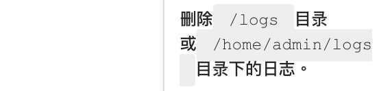

导致日志丢失。

不可恢复。

导致Apsara Uni-

删除或修改VIP、DNS。

manager运营控制台功能

不可恢复。

异常。

在asapi、ascm、cmp数

导致Apsara Uni-

据库上执行插入、更新或删

manager运营控制台功能

恢复为修改前的数据。

除操作。

异常。

数据库

导致Apsara Uni-

执行插入、更新或删除数据

manager运营控制台功能

不可恢复。

库操作之前没有备份。

异常、数据异常。

通过命令行工具修改tair数

导致多云管理平台功能异

删除缓存或等待缓存过期。

据。

常、数据异常。

多云管理平台（MCM）的命令行工具

通过命令行工具重置用户密

多云管理平台中该用户可能

重置用户密码。

码。

无法登录。

<a id="section-3"></a>

# 3.产品架构

<a id="section-3-1"></a>

## 3.1. 系统架构

本文为您介绍Apsara Uni-manager运营控制台的系统架构和其中包含的各组件。

Apsara Uni-manager运营控制台由前端、资源托管、ASAPI和后端服务四大模块组成。Apsara Uni-manager运营控制台的架构图如下所示。

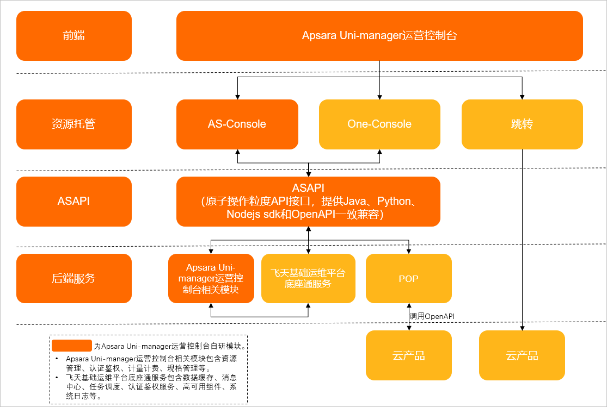

各模块功能如下：

- AS-Console：用于托管Apsara Uni-manager运营控制台自研的控制台页面（如，ECS控制台）。

- 资源托管：包括AS-Console和One-Console，两者都是托管服务，负责托管不同云产品前端使用的静态文件，并且为前端提供统一的API调用和配置服务。

- ASAPI：作为控制台的统一网关，实现Java、Python、Node.js、SDK和OpenAPI的一致性兼容，负责接收来自前端和SDK的请求，具有云内API管理的能力。具有以下功能特性：

  - 支持使用SDK统一调用云内各云产品的OpenAPI。

  - 支持账号校验、自动路由、限流、日志审计等功能。

  - 支持云产品、Apsara Uni-manager运营控制台相关模块和第三方客户集成系统的调用。

  - 核心模块采用了异步化高并发请求方案，包含了Jetty+NIO+Servlet 3.0非阻塞异步请求等能力，具备高并发、高吞吐量等优异特性。

  - 利用线程池隔离技术，将ASAPI内部分为业务处理线程、路由线程和结果处理线程，提高请求处理速度。

- 后端服务：由Apsara Uni-manager运营控制台相关模块、飞天基础运维平台底座通用服务、POP三个模块组成，各模块功能如下：

  - Apsara Uni-manager运营控制台相关模块：负责资源管理、认证鉴权、计量计费、规格管理等。

  - 飞天基础运维平台底座通用服务：包括数据缓存模块、消息中心、任务调度模块、认证鉴权模块、高可用组件、系统日志等部分。

  - POP：云计算底层统一网关。云产品的开放接口会经过ASAPI数据处理后，转发到POP中，再交给云产品进行资源处理。

<a id="section-3-2"></a>

## 3.2. 部署架构

本文为您介绍Apsara Uni-manager运营控制台各组件的部署说明。

| 组件 | 部署说明 |
| --- | --- |
| Portal | 集群部署，Portal一般为双节点部署。 |
| OneConsole | 集群部署，OneConsole一般为双节点部署。 |
| ASAPI | 集群部署，ASAPI一般为双节点部署。 |
| Auth | 集群部署，Auth一般为双节点部署。 |
| Common | 集群部署，Common一般为双节点部署。 |
| Manage | 集群部署，Manage一般为双节点部署。 |
| ResourceMgr | 集群部署，ResourceMgr一般为双节点部署。 |
| Metering | 集群部署，Metering一般为双节点部署。 |
| Billing | 集群部署，Billing一般为双节点部署。 |
| Cosmos | 集群部署，Cosmos一般为双节点部署。 |

<a id="section-3-3"></a>

## 3.3. 组件架构

本文为您介绍Apsara Uni-manager运营控制台的组件架构。

| 组件 | 飞天基础运维平台SR | 描述 |
| --- | --- | --- |
| Portal | ascm-portal.Portal# | Portal，用于自研产品控制台页面前端展现。 |
| One-Console | oneService.one-console-aliyun-com# | 用于托管云产品控制台页面，处理页面请求。ASConsole功能已经合并到OneConsole中。 |
| ASAPI | asapi.ApiServer# | API网关，用于处理Apsara Uni-manager运营控制台收到的所有内部调用及外部调用（客户通过SDK发起的API调用）。 |
| Auth | • V3.14.0及之后版本：unimanager-base.IdentityService#<br>• V3.14.0之前版本：ascm-brm.Auth# | Auth用于所有组织、用户、权限认证相关功能实现。 |
| Common | • V3.14.0及之后版本：unimanager-base.CommonServer#<br>• V3.14.0之前版本：ascm-common.CommonSrv# | Common用于云产品基础数据拉取（如Endpoint）、菜单配置等基础服务。 |
| Manage | ascm-brm.Manage# | Manage用于处理专有云资源管理的核心流程，云资源的创建、变更、查询、删除一般都会经过资源管理模块。 |
| ResourceMgr | ascm-brm.ResourceMgr# | 用于定时同步云产品资源列表信息。 |
| Metering | ascm-metering.metering_server# | Metering用于处理计量相关功能。 |
| Billing | unimanager-billing.billing# | Billing用于处理计费相关功能。 |
| Cosmos | ascm-cosmos.studio# | Cosmos用于处理大屏相关展现。 |

组件依赖关键图如下所示。

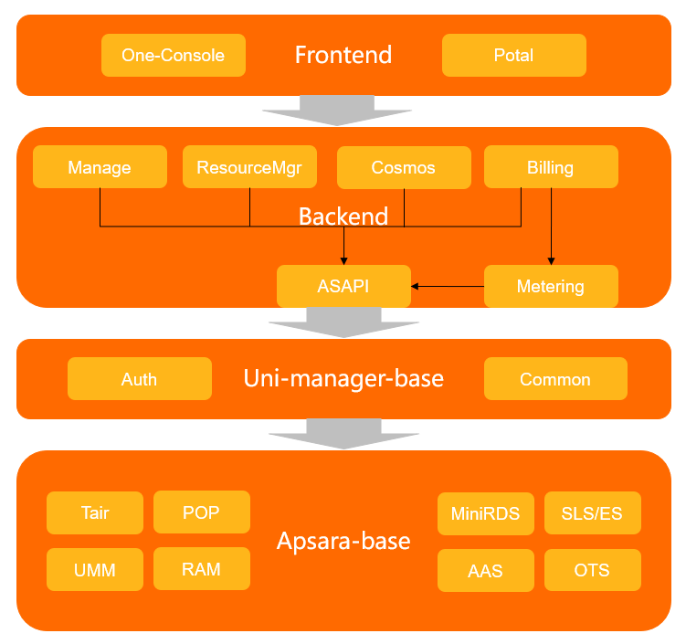

<a id="section-3-4"></a>

## 3.4. 架构差异

<a id="section-3-4-1"></a>

### 3.4.1. 部署架构

本文介绍了新部署架构与老部署架构的区别。

**部署架构对比**

企业版V3.14.0及之后版本的部署架构（以下统称为新架构）如下图所示：

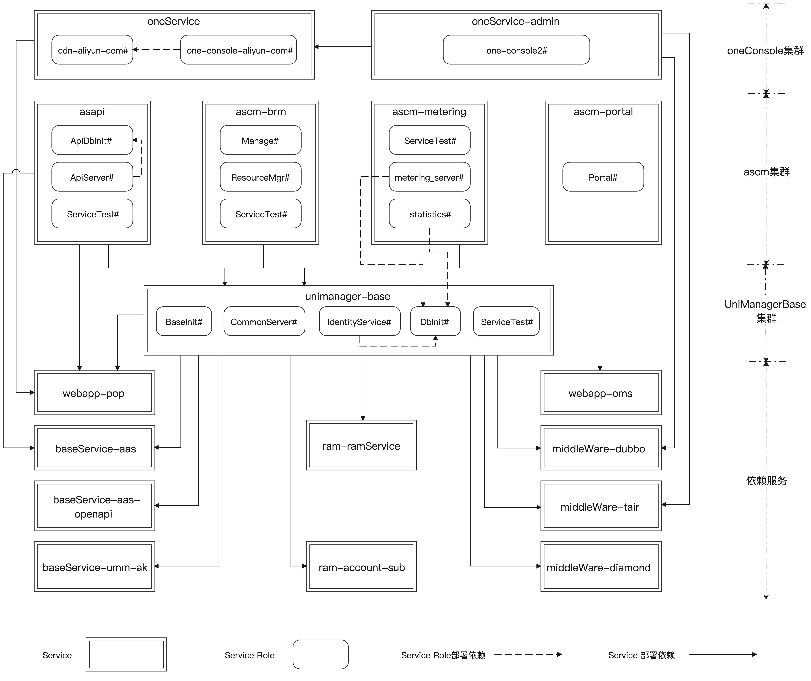

相对于老架构（V3.13.0及之前版本的部署架构），新架构对ASCM集群的Service进行了优化，将数量从8个缩减为4个，并引入了UniManagerBase集群。同时，部分底层服务（例如：用户、CommonServer）也被迁移到了该集群中，使得服务分层依赖更加清晰。此外，通过精简Service Role，还成功减少了资源消耗。

**集群**

**老架构Service Role**

**新架构Service Role**

**备注**

**Service**

无

cdn-aliyun-com#

cdn-aliyun-com#

one-console-aliyun-

无

com#

oneService

one-console-aliyun-

无

one-console2#

com#

无

one-console2-router#

OneConsole

console-common-

无

service#

oneService-admin

one-console2#

vipernew-aliyun-inc-

无

com#

console-common-

无

service-init#

无

ApiDbInit#

ApiDbInit#

无

asapi

ApiServer#

ApiServer#

无

ServiceTest#

ServiceTest#

无

Manage#

Manage#

无

ResourceMgr#

ResourceMgr#

无

ServiceTest#

ServiceTest#

ascm-brm

新架构迁移至unimanager-

ManageInit#

base.BaseInit#下。

无

新架构迁移至unimanager-

Auth#

base.IdentitySe rvice#下。

新架构迁移至unimanager-

无

ascm-init

DbInit#

base.DbInit#下。

ASCM

新架构删除，功能合入ascm-

无

ascm-saleconf

salereconf#

brm.Manage#下。

无

ascm-portal

Portal#

Portal#

无

CommonSrv#

新架构迁移至unimanager-base.CommonS erver#下。

ascm-common

无

ServiceTest#

无

SkylineDbInit#

新架构删除，业务移除对skyline

ascm-skyline

的依赖。

无

SkylineUnit#

无

ServiceTest#

ServiceTest#

无

metering_server#

metering_server#

ascm-metering

新架构运营增

无

statistics#

效，新增SR。

BaseInit#

CommonServer#

新架构承载了初始化、auth及

UniManagerB

无

unimanager-base

IdentityService#

commonServer

ase

等ASCM底层服务。

DbInit#

ServiceTest#

<a id="section-3-4-2"></a>

### 3.4.2. 技术架构

本文为您介绍新老技术架构之间的差异。

**技术架构对比**

企业版V3.15.0及之后版本的技术架构，解决了越权问题并提高了安全性。安全方面主要增强了账号权限、RAM鉴权和POP鉴权。

- 账号安全增强

  - 企业版V3.14.0及之前版本，通过换取一级组织对应的主账号Accesskey的方式，使用主账号访问云产品接口。

  - 企业版V3.15.0及之后版本，通过给子账号临时授权STS Token的方式访问特定的云资源，权限控制更加严格。

- RAM鉴权增强

  - 企业版V3.14.0及之前版本，通过换取主账号的方式访问云产品，RAM鉴权为pass状态，即未做鉴权。

  - 企业版V3.15.0及之后版本，通过给子账号临时授权STS Token的方式访问特定的云资源，RAM侧增加了RAM Proxy，即从Apsara Uni-manager运营控制台获取组织、资源集等访问权限的信息用于RAM鉴权。

- POP侧鉴权增加

  - 企业版V3.14.0及之前版本，直接调用POP。无组织、资源集等Apsara Uni-manager运营控制台用户权限鉴权逻辑。

  - 企业版V3.15.0及之后版本，POP侧增加代理。云产品请求POP会通过POP proxy先在Apsara Uni-manager运营控制台侧做鉴权，鉴权通过后再调用POP。

企业版V3.14.0及之前版本的技术架构如下图所示：

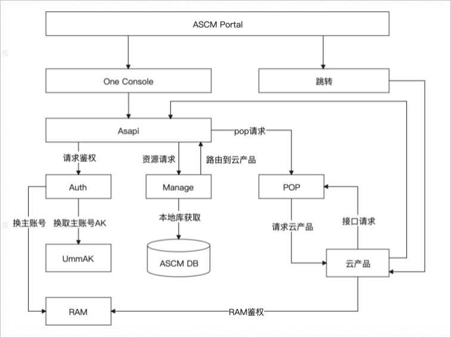

企业版V3.15.0及之后版本的技术架构如下图所示：

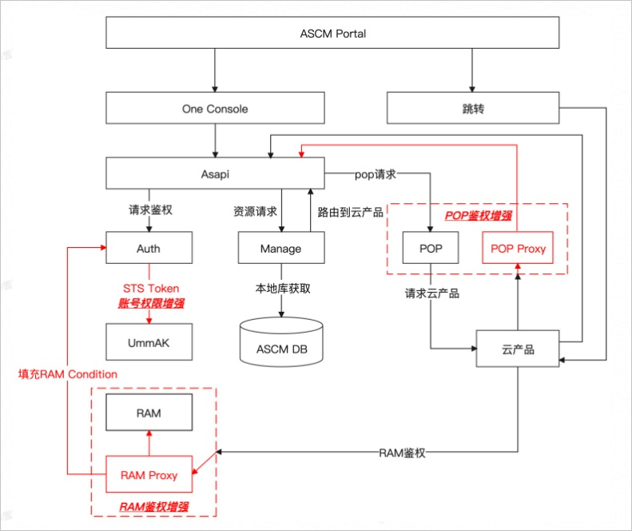

<a id="section-3-5"></a>

## 3.5. 底座服务依赖

本文为您介绍Apsara Uni-manager运营控制台所依赖的底座服务。

底座服务状态对Apsara Uni-manager运营控制台稳定运行至关重要。Apsara Uni-manager运营控制台部署与运行，需要依赖以下底座服务：

- MiniRDS：用于业务数据持久化，如保存组织、资源集数据。

- Tair：用于缓存经常访问的数据，如云资源列表。

- UMM：用于获取用户AccessKey ID和AccessKey Secret信息，进行身份认证。

- POP：用于产品接口API调用，是云产品的接入网关。

- RAM：用于实现授权功能，控制对资源的操作权限。

- AAS：用于实现账号管理。

- OTS：用于消息数据、时序数据处理，如消息推送、计量统计。

- SLS：用于保存调用日志，包括access、call、main等后端服务日志以及API调用审计日志。

<a id="section-3-6"></a>

## 3.6. 服务角色列表

本文为您介绍Apsara Uni-manager运营控制台的Project、集群、服务和服务角色，方便运维人员了解Apsara Uni-manager运营控制台的服务角色及其提供的功能。

Apsara Uni-manager运营控制台的服务角色如下：

集群

服务

服务角色

描述

Project

ASAPI网关核心组件，专有云控制台相关功能几乎都依赖ASAPI进行API请求转发。

ApiServer#依赖ApiDbInit#，依赖底座服务中

ApiServer#

的middleWare-tair、webapp-pop、ram-ramService、baseService-umm-ak、MinRDS以及unimanager-base。

Asapi

用于执行DB初始化（API定义初始化），只在部署

ApiDbInit#

或升级时执行一次。

ServiceTest

服务状态检查。

#

资源管理核心业务逻辑。

Manage#

ResourceM

资源定时调度任务。

ascm-brm

gr#

ServiceTest

服务状态检查。

#

metering_s

计量核心服务。

erver#

ascm

ascm-metering

ServiceTest

服务状态检查。

#

ascm

自研前端服务（逐渐下线整合到OneConsole）。

ascm-portal

Portal#

DB初始化。

DbInit#

IdentitySer

用户、角色、权限。

vice#

初始化配置数据（云产品配置元数据）。

BaseInit#

unimanager -base

公共组件，用于提供云产品元数据服务及菜单配

CommonSe

置。

rver#

ServiceTest

服务状态检查。

#

大屏的前端。

studio#

大屏的后端。

insight#

ascmcomm

ascm-

ander

cosmos

DB初始化。

DbInit#

ServiceTest

服务状态检查。

#

cdn-aliyun-

前端静态资源服务器。

com#

oneConsole

oneService

Cluster

one-

前端服务托管，包含了DB初始化脚本、前台页面

console-

渲染和API数据接口、DB操作模块和VIPER配置模

oneConsole

aliyun-

块。

com#

oneService

用于封装部分非POP类产品API调用，包括

oneService-

one-

AdminClust

Tablestore、OSS、API Gateway。

admin

console2#

er

<a id="section-4"></a>

# 4.例行维护

<a id="section-4-1"></a>

## 4.1. 监控项说明

本文为您介绍监控项的查看方法和指标说明。

**查看方法**

您可以通过以下两种方法查看监控项：

- 通过ASD进行机器指标监控

  <ol type="i">

  <li>

  登录专有云诊断系统·ASD。

  </li>

  <li>

  在左侧导航栏中，选择**管控全链路诊断**>**容器性能**。

  </li>

  <li>

  在页面中选择产品、服务角色、时间段和机器，单击**查询指标**，查看机器相关的指标趋势图。

  </li>

  </ol>

- 通过Linux命令查询监控项

  可使用的命令包括：vmstat、top、tsar、jstat(/opt/taobao/java/bin)。Apsara Uni-manager运营控制台提供常用的运维脚本，具体详情请参见常用运维命令。

**监控项说明**

| 指标名称 | 指标含义 | 异常判断 |
| --- | --- | --- |
| CPU | 容器CPU利用率 | CPU利用率较高，例如，超过70%。 |
| 内存 | 容器内存利用率 | 内存利用率较高，例如，超过70%；或者一段时间内内存利用率持续增长。 |
| 机器负载LOAD | CPU的平均负载 | 可结合日常运行平均水平基线进行判断，一般当LOAD &gt; 0.7 \* CPU时，可以判定为核心数较高。 |
| IO利用率(%) | 磁盘IO利用率 | 可结合日常运行平均水平基线进行判断，如当超过70%时，可以判定较高。 |
| TCP重传率(%) | TCP重传率，反映网络传输状况 | 如不超过5%。 |
| 网络流量 | 网络流量 | 可结合日常运行平均水平基线进行判断，如果发生激增，需要重点关注。 |
| Gc次数 | Gc是Java应用内存使用状态的重要指标 | 重点关注FullGC的发生（Concurrent Mark-Sweep）。 |
| Gc耗时 | Gc是Java应用内存使用状态的重要指标 | 一般Gc耗时在几十毫秒级别较为正常，如果达到秒级则需要重点关注。 |
| Jvm内存使用(单位M) | Jvm内存大小详情 | 可以结合Gc情况和Jvm实际配置，查看Jvm内存利用情况。 |
| netstat指标 | TCP连接相关详情 | 可结合日常运行平均水平基线进行判断，可关注TIME_WAIT是否增加。 |

<a id="section-4-2"></a>

## 4.2. 告警配置

您可以使用ASD（专有云诊断系统·ASD）进行告警配置，根据监控指标进行告警配置，以便查看实时告警，尽快发现系统问题。

1. 登录专有云诊断系统·ASD。

2. 在左侧导航栏中，选择**配置中心**>**服务告警**。**告警配置**页面显示已配置的告警规则信息，包括服务角色、状态、告警统计信息。

3. 新增告警规则。

   单击**新建**，在**添加告警**面板中设置告警规则的相关参数，完成后单击**确定**。参数说明如下：

   <table>
     <tr>
       <th width="172">名称</th>
       <th>描述</th>
     </tr>
     <tr>
       <td>服务角色</td>
       <td>服务角色名称。</td>
     </tr>
     <tr>
       <td>是否同步告警到ASO</td>
       <td>若选择为是，告警将同步至<em>Apsara Uni-manager运维控制台&gt;通用运维&gt;告</em><em>警管理&gt;告警列表</em>中。</td>
     </tr>
     <tr>
       <td>静默时间</td>
       <td>设置多长时间内不再触发相同告警。单位：分钟。</td>
     </tr>
     <tr>
       <td>告警类型</td>
       <td>为当前告警规则选择合适告警类型，可选择<strong>应用提供的HTTP接口</strong>、<strong>应用提供</strong><strong>的DUBBO接口</strong>、<strong>应用调用DB</strong>、<strong>应用调用Tair</strong>、<strong>容器指标</strong>、<strong>应用指</strong><strong>标</strong>、<strong>ASAPI网关API异常</strong>。</td>
     </tr>
     <tr>
       <td>告警规则</td>
       <td>• 指标：选择触发告警的指标。<br>• 持续时长：设置连续超过指标阈值的时间阈值，当指标连续超过指标阈值的时间达到该时间阈值时，将会触发告警。<br>• 阈值：设置指标阈值，并选择当指标<strong>等于</strong>、<strong>大于</strong>、<strong>大于等于</strong>、<strong>小于</strong>或<strong>小于等</strong><strong>于</strong>该值时，才能触发告警。<br>• 告警等级：设置告警为<strong>紧急</strong>、<strong>重要</strong>、<strong>告警</strong>或<strong>提醒</strong>。</td>
     </tr>
   </table>

4. （可选）修改告警规则。

   选择某一个服务角色，单击**操作**列中的**编辑**，在弹出的对话框中修改参数值，完成后单击**确定**。

5. （可选）禁用和启用告警规则。

   选择某一个服务角色，单击**操作**列中的**禁用**或**启用**，将会停止或开启对该服务角色告警的触发和上报。

<a id="section-4-3"></a>

## 4.3. 日常巡检

本文为您介绍日常巡检的方法。

**通过飞天基础运维平台进行巡检**

1. 登录飞天基础运维平台。

2. 在左侧导航栏中选单击**产品集群运维**。

3. 在**产品 | 集群**文本框中输入 `ascm` 。

4. 在产品列表中的**状态**列，查看目标集群是否达到终态。

5. （可选）单击目标集群**操作**列的**状态详情**，可在**产品详情**页面查看该集群内各服务及组件是否达到终态；或单击目标集群**操作**列的**集群详情**，在**集群详情**页面单击**服务列表**页签，在**服务列表**页签中，查看各服务是否达到终态。

**手动巡检**

不同的服务巡检步骤相同，本文以ASAPI服务为例介绍巡检方法。

1. 登录飞天基础运维平台。

2. 在左侧导航栏中选单击**产品集群运维**。

3. 在**产品 | 集群**文本框中输入 `ascm` 。

4. 单击目标集群**操作**列的**集群详情**，在**集群详情**页面单击**服务列表**页签。

5. 单击**asapi**服务**操作**栏中的**详情**。

6. 在左侧**组件列表**中单击目标组件，在右侧组件信息区域中，单击**实例列表**页签。

7. 单击目标实例**操作**列中的**Terminal**。

您可以执行以下命令进行巡检。

集群

服务

服务角色SR

健康检查

Project

容器内执行：  `curl`

```text
http://127.0.0.1:7001/api/version
```


返回成功样式如下：

ApiServer#

```json
 {"version":"v3.13","code":"200","api
```

```text
Count":13122,"desc":"update
```

```text
 xml pretty"} 
```

asapi

一般Docker执行大约5到10分钟会自动退出，如果长期未退出（飞天基础运维平台未到终态），则需要查询日志，检查日志中的报错信息：

ApiDbInit#

```bash
 docker logs <dockerid> 
```

执行成功的样例如下：

`Progress`为`100%`

容器内执行：

```text
 /alidata/bin/check_health.sh 
```

Manage#

成功返回：

```text
 ok 
```

ascm-brm

容器内执行：

```text
 /alidata/bin/check_health.sh 
```

ResourceM gr#

成功返回：

```text
 ok 
```

容器内执行：

```text
 /alidata/bin/check_health.sh 
```

ascm-

metering_s

metering

erver#

成功返回：

```text
 ok 
```

ascm

容器内执行：

```bash
  curl -s 
http://127.0.0.1/check.node 
```

ascm-portal

Portal#

成功返回：

```text
 success 
```

容器内执行：

```text
 /alidata/bin/check_health.sh 
```

ascm

unimanager

billing#

-billing

成功返回：

```text
 ok 
```

容器内执行：

DbInit#

```bash
 docker logs <dockerid> 
```

查看执行情况。

容器内执行：

```text
 /alidata/bin/check_health.sh 
```

IdentityServ ice#

成功返回：

```text
 ok 
```

unimanager -base

容器内执行：

BaseInit#

```bash
 docker logs <dockerid> 
```

查看执行情况。

容器内执行：

```bash
 curl --location --request GET 
```

CommonSe

```text
'localhost:8008/ascm/basic/welcome' 
```

rver#

成功返回：

```text
 welcome to basic. 
```

容器内执行：

```text
 /alidata/bin/check_health.sh 
```

studio#

成功返回：

```text
 ok 
```

容器内执行：

ascmcomm

ascm-

ander

cosmos

```text
 /alidata/bin/check_health.sh 
```

insight#

成功返回：

```text
 ok 
```

容器内执行：

DbInit#

```bash
 docker logs <dockerid> 
```

查看执行情况。

容器内执行：

`curl <`容器的

cdn-aliyun-

```text
IP>:80/api/console/check-health 
```

com#

成功返回：

```text
 ok 
```

oneConsole

oneService

Cluster

容器内执行：

one-

```bash
 curl 
```

console-

```text
http://127.0.0.1:7003/preload.htm 
```

oneConsole

aliyun-

成功返回：

com#

```text
 success 
```

容器内执行：

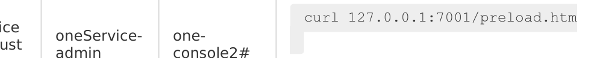

oneService AdminClust

admin

console2#

er

成功返回：

```text
 success 
```

<a id="section-5"></a>

# 5.安全维护

Apsara Uni-manager运营控制台的维护过程中，您需要关注账号密码的维护和日志审计。

**账号密码维护**

Apsara Uni-manager运营控制台运营管理员等全局角色，拥有所有资源的操作权限，所以要妥善保管相关密码，防止泄漏，建议采用复杂密码策略并进行定期更新。

**日志审计**

Apsara Uni-manager运营控制台提供两种级别的可审计的日志：

- 操作日志审计

  查看操作日志的方法请参见*Apsara Uni-manager运营控制台用户指南*中*查看操作日志*章节。

- API调用审计

  <ol type="i">

  <li>

  管理员或资源监察员登录Apsara Uni-manager运营控制台。

  </li>

  <li>

  在页面顶部菜单栏选择**产品**>**其他**>**API与工具**。

  </li>

  <li>

  在左侧导航栏中单击**API审计**。

  </li>

  <li>

  （可选）根据需要在顶部选择或输入待查看调用记录的信息。

  </li>

  <li>

  在API审计页面中可以查看API调用时的id、产品名称、API名称、调用状态、API耗时、访问时间和调用用户。

  </li>

  <li>

  单击**操作**列的  图标，查看API调用时的请求参数、返回结果和调用日志。

  </li>

  </ol>

由于底座存储空间的限制，目前上述日志不支持长期存储。存储最长周期为7天。

如果您需要长期存储日期，请使用日志存储SLS，该产品支持转储功能，详细方案可咨询产品团队。

<a id="section-6"></a>

# 6.故障处理

<a id="section-6-1"></a>

## 6.1. 确认故障影响范围

本文将为您介绍故障范围确认的大致思路。

1. 故障影响范围确定。如：

   - 物理环境是否正常（如，网络、DNS、防火墙）。

   - 底座环境是否正常（飞天基础运维平台底座服务是否终态，特别是Apsara Uni-manager依赖的服务）。

   - Apsara Uni-manager运营控制台是否可以登录。

   - 哪个地域受影响。

   - 哪个产品受影响。

   - 哪个功能受影响。

2. 故障类型确定。如：

   - 物理环境故障（请联系硬件厂商）。

   - 底座环境故障（请联系阿里云驻场运维工程师）。

   - 产品性能问题。

   - 产品功能问题。

<a id="section-6-2"></a>

## 6.2. 收集故障日志信息

本文为您介绍如何收集故障的日志信息。

1. 按照以下模板收集故障现象。

   | 项目 | 示例 |
   | --- | --- |
   | 操作人 | 某操作人员 |
   | 操作人角色 | 组织管理员 |
   | 所属组织（级别） | 二级组织 |
   | 所属资源集 | 默认资源集 |
   | 产品类型 | ECS |
   | 操作类型 | 创建ECS |
   | 异常控制台截图 | 创建ECS失败（截图） |
   | 异常返回值截图 | 通过浏览器，查看请求参数及请求返回值。 |
   | 异常发生条件 | 当选择可用区B时，发生异常。 |
   | 是否可重现 | 可以 |

2. 收集故障日志。

   <ol type="i">

   <li>

   获取故障发生时的鹰眼ID。

   - 如果Apsara Uni-manager运营控制台还可以访问，并且能够重现，则可以从浏览器（F12快捷键）拿到鹰眼ID（优先选择使用ResponseHeaders中的eagleeye-traceid，其次可以从查看Response中的eagleEyeTraceId）。

     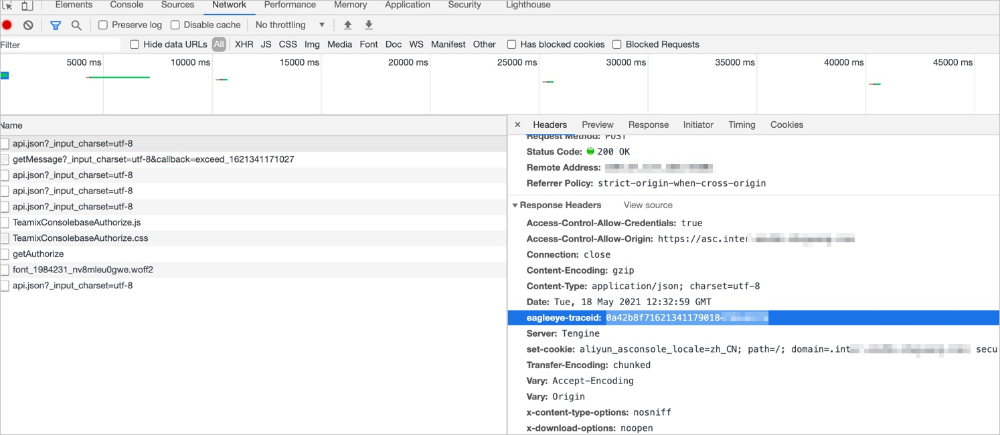

   - 如果Apsara Uni-manager运营控制台还可以访问，但问题不能重现，可以查询发生问题时的API调用日志，查询方式请参见安全维护。

   - 如果Apsara Uni-manager运营控制台已经无法访问，可以通过查询ASAPI容器内的access和call日志获取信息，过滤条件可以使用API名称和其他可以获取到的关键参数，从容器日志中可以得到鹰眼做进一步分析。

   </li>

   <li>

   获取API调用链路日志。

   - 通过API审计获取API调用记录，查询方式请参见安全维护。

   - 通过ASD调用链详情查看日志，查询方式请参见查看日志。

   - 通过SLS查询API调用日志，查询方式请参见查看日志。

   - 通过ASAPI容器查询API调用日志。具体日志功能请参见模块日志列表。

   </li>

   </ol>

<a id="section-6-3"></a>

## 6.3. 快速定位故障

本文为您介绍如何根据故障类型，逐层定位问题。

1. 排除底座环境等其他问题。

   <ol type="i">

   <li>

   使用不同的测试环境，排除由于浏览器、网络、防火墙、代理等导致的客户端问题。

   </li>

   <li>

   检查飞天基础运维平台及Apsara Uni-manager运维控制台，是否存在未达到终态或者其他告警。

   </li>

   <li>

   检查网络连通性及DNS解析是否正常。

   </li>

   </ol>

2. 解析业务异常。

   结合Apsara Uni-manager运营控制台的异常展示和API调用日志解析异常原因（参照附录：常见异常码）。

   <table>
     <tr>
       <th>返回值Key</th>
       <th>返回值含义</th>
       <th>用途描述</th>
     </tr>
     <tr>
       <td>API</td>
       <td>代表发生异常的API调用（包含产品名和版本）</td>
       <td rowspan="3">有效定位发生异常的产品或模块</td>
     </tr>
     <tr>
       <td>domain</td>
       <td>代表API请求的域名</td>
     </tr>
     <tr>
       <td>serverRole</td>
       <td>发生异常的SR</td>
     </tr>
     <tr>
       <td>ASAPIErrorCode</td>
       <td>错误异常码</td>
       <td rowspan="3">有效定位发生异常的具体原因</td>
     </tr>
     <tr>
       <td>ASAPIErrorMessge</td>
       <td>错误异常信息</td>
     </tr>
     <tr>
       <td>ASAPISuccess</td>
       <td>调用是否成功</td>
     </tr>
     <tr>
       <td>eagleEyeTraceId</td>
       <td>调用链路鹰眼ID</td>
       <td rowspan="2">可用于继续查询后端产品的日志</td>
     </tr>
     <tr>
       <td>ASAPIRequestId</td>
       <td>调用产品后端请求ID</td>
     </tr>
   </table>

   如果异常需要进一步排查，可根据链路鹰眼ID进一步搜索产品后端日志，获取更详细信息。

3. 使用ASD排查性能问题。

   <ol type="i">

   <li>

   查询慢接口统计数据。

   <ol type="a">

   <li>

   登录专有云诊断系统·ASD。

   </li>

   <li>

   在左侧导航栏中，选择**管控全链路诊断**>**服务性能**。

   </li>

   </ol>

   <ol type="i" start="100">

   <li>

   单击**提供服务详情**页签，选择相应的**服务角色**、**时间**、**排序**和**请求类型**，单击**查询**。

   </li>

   </ol>

   </li>

   <li>

   针对单个接口较慢，可以通过链路分析，输入鹰眼ID、选择时间段查询调用链详情。

   <ol type="a">

   <li>

   登录专有云诊断系统·ASD。

   </li>

   <li>

   在左侧导航栏中，选择**管控全链路诊断**>**链路分析**。

   </li>

   </ol>

   <ol type="i" start="100">

   <li>

   单击**调用链详情**页签。

   </li>

   <li value="500">

   在**TraceId**文本框中输入Trace ID，选择时间范围，单击**查询调用链**，查看调用链的详细信息。

   </li>

   </ol>

   </li>

   <li>

   查询机器性能指标。

   查询方式请参见监控项说明。

   </li>

   </ol>

<a id="section-7"></a>

# 7.告警处理

<a id="section-7-1"></a>

## 7.1. identity_service_request_error_alarm

OneConsole服务请求登录鉴权服务的接口报错。

**告警属性**

<table>
  <tr>
    <td>告警名称</td>
    <td>告警来源</td>
    <td>告警级别</td>
    <td>告警产品</td>
    <td>触发条件</td>
    <td>告警模块</td>
    <td>触发周期</td>
  </tr>
  <tr>
    <td>identity_ser vice_reques t_error_alar m</td>
    <td>tianjimon</td>
    <td>2</td>
    <td>oneConsole</td>
    <td>$business_e rror_count &gt; 0</td>
    <td>oneConsole</td>
    <td>{{interval| 60}}</td>
  </tr>
</table>

**适用版本**

适用于oneConsole企业版enterprise_v318_1_ST版本。

**dimensions参数解释**

| 参数 | 说明 |
| --- | --- |
| EntityType | 报错接口的product |
| ErrorType | 错误类型 |
| OperateType | 报错接口的action |

**告警原因**

登录鉴权服务的接口报错。

**告警影响**

可能会导致控制台无法正常登录。

**处理方法**

> **警告**
>
> 所有告警处理方法涉及到修改产品任何配置，均需要走生产变更流程确认方案的可行性以及流程规范性，若属紧急应急范畴需与TAM方确认后方可执行，否则不允许直接执行处理方法的任何步骤。

1. 请联系登录鉴权服务的研发，根据具体报错定位解决问题。

> **说明**
>
> 如果上述步骤未解决告警问题，请提工单（服务请求单）联系阿里云技术支持提供支持。

<a id="section-7-2"></a>

## 7.2. one_router_business_error_alarm

此告警表示oneConsole2服务处理请求时内部出错，可能会导致OSS、OTS等产品的控制台不可用。

**告警属性**

<table>
  <tr>
    <td>告警名称</td>
    <td>告警来源</td>
    <td>告警级别</td>
    <td>告警产品</td>
    <td>触发条件</td>
    <td>告警模块</td>
    <td>触发周期</td>
  </tr>
  <tr>
    <td>one_router_business_er ror_alarm</td>
    <td>tianjimon</td>
    <td>2</td>
    <td>oneConsole</td>
    <td>$business_e rror_count &gt; 0</td>
    <td>oneConsole</td>
    <td>{{interval| 60}}</td>
  </tr>
</table>

**适用版本**

适用于oneConsole企业版enterprise_v318_1_ST版本。

**dimensions参数解释**

| 参数 | 说明 |
| --- | --- |
| EntityType | 报错接口的product |
| ErrorType | 错误类型 |
| LocalIp | 报错docker的ip |
| OperateType | 报错接口的action |

**告警原因**

oneConsole2服务处理请求出错。

**告警影响**

可能会导致OSS、OTS等产品的控制台不可用。

**处理方法**

> **警告**
>
> 所有告警处理方法涉及到修改产品任何配置，均需要走生产变更流程确认方案的可行性以及流程规范性，若属紧急应急范畴需与TAM方确认后方可执行，否则不允许直接执行处理方法的任何步骤。

1. 复制报错请求的鹰眼id（Eagleeye-Traceid），进入SR：oneService-admin.one-console2#的docker中。在/logs/asconsole-logger目录下，执行如下命令，查看日志。

   ```text
   grep 报错请求的鹰眼id *
   ```

   查看报错相关的日志。

2. 请联系OneConsole产品研发定位并处理问题。

> **说明**
>
> 如果上述步骤未解决告警问题，请提工单（服务请求单）联系阿里云技术支持提供支持。

<a id="section-7-3"></a>

## 7.3. one_console_slow_request_alarm

OneConsole服务请求其他服务的接口，返回时间超过5秒。

**告警属性**

<table>
  <tr>
    <td>告警名称</td>
    <td>告警来源</td>
    <td>告警级别</td>
    <td>告警产品</td>
    <td>触发条件</td>
    <td>告警模块</td>
    <td>触发周期</td>
  </tr>
  <tr>
    <td>one_consol e_slow_req uest_alarm</td>
    <td>tianjimon</td>
    <td>3</td>
    <td>oneConsole</td>
    <td>$slow_requ est_count &gt; 0</td>
    <td>oneConsole</td>
    <td>{{interval| 60}}</td>
  </tr>
</table>

**适用版本**

适用于oneConsole企业版enterprise_v318_1_ST版本。

**dimensions参数解释**

| 参数 | 说明 |
| --- | --- |
| method_name | 报错请求的action |
| product_name | 报错请求的product |

**告警原因**

OneConsole服务请求其他服务的接口，返回时间超过5秒。

**告警影响**

可能会导致控制台响应较慢。

**处理方法**

> **警告**
>
> 所有告警处理方法涉及到修改产品任何配置，均需要走生产变更流程确认方案的可行性以及流程规范性，若属紧急应急范畴需与TAM方确认后方可执行，否则不允许直接执行处理方法的任何步骤。

1. 请根据product和action定位接口所属的服务。

2. 请联系接口所属服务的研发定位并解决问题。

> **说明**
>
> 如果上述步骤未解决告警问题，请提工单（服务请求单）联系阿里云技术支持提供支持。

<a id="section-7-4"></a>

## 7.4. one_console_request_timeout_alarm

OneConsole服务请求其他服务的接口，返回时间超过30秒。

**告警属性**

<table>
  <tr>
    <td>告警名称</td>
    <td>告警来源</td>
    <td>告警级别</td>
    <td>告警产品</td>
    <td>触发条件</td>
    <td>告警模块</td>
    <td>触发周期</td>
  </tr>
  <tr>
    <td>one_consol e_request_ti meout_alar m</td>
    <td>tianjimon</td>
    <td>2</td>
    <td>oneConsole</td>
    <td>$timeout_re quest_coun t &gt; 0</td>
    <td>oneConsole</td>
    <td>{{interval| 60}}</td>
  </tr>
</table>

**适用版本**

适用于oneConsole企业版enterprise_v318_1_ST版本。

**dimensions参数解释**

| 参数 | 说明 |
| --- | --- |
| method_name | 报错请求的action |
| product_name | 报错请求的product |

**告警原因**

OneConsole服务请求其他服务的接口，返回时间超过30秒。

**告警影响**

可能会导致其他业务控制台发起的请求超时，从而导致其他服务控制台不可用。

**处理方法**

> **警告**
>
> 所有告警处理方法涉及到修改产品任何配置，均需要走生产变更流程确认方案的可行性以及流程规范性，若属紧急应急范畴需与TAM方确认后方可执行，否则不允许直接执行处理方法的任何步骤。

1. 根据product和action定位接口所属的服务。

2. 联系接口所属服务的研发定位并解决问题。

> **说明**
>
> 如果上述步骤未解决告警问题，请提工单（服务请求单）联系阿里云技术支持提供支持。

<a id="section-8"></a>

# 8.附录

<a id="section-8-1"></a>

## 8.1. 模块日志列表

本文为您介绍不同日志文件的作用。

**组件**

**文件**

**说明**

/logs/asapi-logger/access_trace.log

历史版本（企业版V3.10.0）日志路径如下：

ASAPI收到API调用请求日志。

/opt/api-server/logs/apiServer-access.log

/logs/asapi-logger/call_trace.log

历史版本（企业版V3.10.0）日志路径如下：

ASAPI发起的对后端服务和产品的调用日志。

/opt/api-server/logs/apiServer-call.log

asapi.ApiServer#

/logs/asapi-logger/main_trace.log

历史版本（企业版V3.10.0）日志路径如下：

ASAPI调试日志打印。

/opt/api-server/logs/server.log /opt/api-server/logs/error.log

/logs/asapi-logger/exception_trace.log

历史版本（企业版V3.10.0）日志路径如下：

ASAPI异常错误打印。

/opt/api-server/logs/apiServer-exception.log

容器启动日志。

asapi.ApiDbInit#

docker logs

Portal异常日志打印。

/root/logs/ascm-portal/ascm-error.log

Portal收到页面调用请求日志。

/root/logs/ascm-portal/ascm-access.log

Portal进程日志。

/root/logs/ascm-portal/ascm-agent.log

Portal应用相关日志。

/root/logs/ascm-portal/ascm-web.log

ascm-portal.Portal#

Portal定时任务日志。

/root/logs/ascm-portal/egg-schedule.log

Portal框架内核、插件日志。

/root/logs/ascm-portal/egg-web.log

**组件**

**文件**

**说明**

Manage收到ASAPI调用请求日志。

/logs/ascm-logger/access_trace.log

Manage发起的对ASAPI的调用日志。

/logs/ascm-logger/call_trace.log

ascm-brm.Manage#

Manage异常错误打印。

/logs/ascm-logger/exception_trace.log

Manage调试日志打印。

/logs/ascm-logger/main_trace.log

Manage收到请求日志。

/logs/ascm-logger/access_trace.log

定时任务发起的对ASAPI的调用日志。

/logs/ascm-logger/call_trace.log

ascm-brm.ResourceMgr #

定时任务异常错误打印。

/logs/ascm-logger/exception_trace.log

定时任务调试日志打印。

/logs/ascm-logger/main_trace.log

Metering收到请求日志。

/logs/metering/access_trace.log

Metering发起的对其它ascm服务调用日志。

/logs/metering/call_trace.log

ascm-metering.meterin g_server#

Metering异常错误打印。

/logs/metering/exception_trace.log

Metering调试日志打印。

/logs/metering/main_trace.log

Billing收到请求日志。

/logs/billing/access_trace.log

Billing发起的对其它ascm服务调用日志。

/logs/billing/call_trace.log

unimanager-billing.billing#

Billing异常错误打印。

/logs/billing/exception_trace.log

Billing调试日志打印。

/logs/billing/main_trace.log

unimanager-

容器启动日志。

docker logs

base.DbInit#

unimanager-

容器启动日志。

docker logs

base.BaseInit#**组件**

**文件**

**说明**

IDENTITYSERVICE/Auth收到请求日志。

/logs/ascm-logger/access_trace.log

- V3.14.0及之后版本：unimanager-

  IDENTITYSERVICE/Auth发起的对其它底座

  /logs/ascm-logger/call_trace.log

  base.

  服务（如RAM）调用日志。

  IdentityService #

  IDENTITYSERVICE/Auth异常错误打印。

- V3.13.0及之前版

  /logs/ascm-logger/exception_trace.log

  本：ascm-brm.Auth#

  IDENTITYSERVICE/Auth调试日志打印。

  /logs/ascm-logger/main_trace.log

- V3.14.0及之后版

  CommonServer应用日志。

  /ascm/.logs/basic.log

  本：unimanager-base. CommonServer #

  CommonServer异常错误打印。

  /ascm/.logs/basic-error.log

- V3.13.0及之前版本：ascm-common.Comm onSrv#

  INSIGHT收到请求日志。

  /logs/data-processor/access_trace.log

  INSIGHT发起的对其它ascm服务调用日志。

  /logs/data-processor/call_trace.log

ascm-cosmos.insight#

INSIGHT异常错误打印。

/logs/data-processor/exception_trace.log

INSIGHT调试日志打印。

/logs/data-processor/main_trace.log

ascm-

容器启动日志。

docker logs

cosmos.DbInit#

ONE-CONSOLE-ALIYUN-COM收到请求日

/home/admin/logs/access_trace.log

志。

ONE-CONSOLE-ALIYUN-COM发起的对

/home/admin/logs/call_trace.log

ASAPI的调用日志。

ONE-CONSOLE-ALIYUN-COM异常错误打

oneService.one-

/home/admin/logs/exception_trace.log

印。

console-aliyun-com#

ONE-CONSOLE-ALIYUN-COM调试日志打

/home/admin/logs/main_trace.log

印。

**组件**

**文件**

**说明**

/home/admin/one-console2/logs/ascm-

One-Console2收到请求日志。

logger/access_trace.log

/home/admin/one-console2/logs/ascm-

One-Console2发起的对云产品的调用日志。

logger/call_trace.log

oneService-admin.one-console2#

/home/admin/one-console2/logs/ascm-

One-Console2异常错误打印。

logger/exception_trace.log

/home/admin/one-console2/logs/ascm-

One-Console2调试日志打印。

logger/main_trace.log

<a id="section-8-2"></a>

## 8.2. 常用错误码

本文为您介绍常见的一些报错信息和简单的处理办法。

模块

报错信息

错误说明

解决办法

检查以下项目：

- 通过飞天基础运维平台查看相关产品是否部署。

asapi.server.request.unkno

ASAPI请求后端产品域名失败。

- 通过飞天基础运维平台查看

wn.host

相关域名是否存在。

- 通过ASAPI容器关闭域名网络链路。

检查以下项目：

ASAPI无法找到调用方想要调用

- 检查调用参数是否正确。

asapi.server.api.notfound

的接口。

- 确认ASAPI库内是否注册此接口。

检查以下项目：

1. 在飞天基础运维平台中检查

ASAPI无法获取调用接口的

对应产品是否在环境中部

asapi.server.endpoint.notfo

Endpoint。

署，且是否到达终态。

und

2. 找ascm_common运维工程师进行后续定位。

找ascm_asapi运维工程师进行排查。

ASAPI内部错误。

asapi.server.internal.error

ASAPI获取到调用接口的

找ascm_common运维工程师

asapi.server.endpoint.notm

Endpoint异常。

进行排查。

atch

找ascm_asapi运维工程师进行

asapi.server.timeout.conne

与服务器建立连接的超时时间。

排查。

ct

ASCM->asapi

检查以下项目：

- 检查调用方参数中的

AccessKey非法或者获取

AccessKey ID和

asapi.server.request.param

AccessKey Secret失败的异

AccessKey Secret是否正

eter.accesskeyid.error

常。

确。

- 找ascm_asapi运维工程师进行排查。

检查调用参数中

asapi.server.request.param

RegionId未找到。

的 `regionId` 是否为空。

eter.regionid.not.found

检查以下项目：

- 是否通过ASAPI的SDK发起

asapi.server.request.validat

ASAPI检验签名失败。

调用。

e.signature.failed

- 找ascm_asapi运维工程师进行排查。

检查以下项目：

- 查看当前环境是否存在压

asapi.server.request.flow.c

接口被限流。

测。

ontrol

- 找ascm_asapi运维工程师进行排查。

找ascm_asapi运维工程师进行

asapi.server.request.upload

文件上传异常。

排查。

.file.error

找ascm_asapi运维工程师进行

asapi.server.request.downl

文件下载异常。

排查。

oad.file.error

找ascm_asapi运维工程师进行

asapi.server.api.no.permissi

API越权。

排查。

on.operate

ascm.manage.InvalidParam

账号只支持绑定一级组织。

无

eter.CloudAccount.OnlySup portAttachToTopOrg

ascm.manage.EntityNotExis

账号不存在。

创建账号。

t.CloudAccount

ascm.manage.DeleteConflic

删除账号前，必须和组织解除绑

无

t.CloudAccount.Organizatio

定。

n

ascm.manage.EntityNotExis

AccessKey不存在。

创建新的AccessKey。

t.AccessKey

ascm.manage.EntityNotExis

实例不存在。

创建实例。

t.Instance

ASCM->Manage

ascm.manage.EntityNotExis

角色不存在。

创建角色。

t.Role

ascm.manage.InvalidParam

新建对该用户可见的角色，或将

角色对该用户不可见。

eter.Role.NotVisibleToTheU

角色属性变更为该用户可见。

ser

ascm.manage.EntityNotExis

组织不存在。

创建组织。

t.Organization

ascm.manage.EntityNotExis

资源集不存在。

创建资源集。

t.ResourceSet

ascm.manage.EntityAlread

用户已存在。

无

yExisted.User

ascm.manage.EntityAlread

用户名已存在。

更换用户名。

yExisted.User.UserName

ascm.auth.invalidParameter

Token不合法。

更换合法的Token。

.token

使用管理员账号恢复后重新登

用户已被删除。

ascm.auth.account.deleted

录。

使用管理员账号激活后重新登

用户已被禁用。

ascm.auth.account.inactive

录。

ascm.auth.account.type.not

不支持此类型账户登录。

无

Supported

ascm.auth.account.notLogg

用户未登录或登录状态失效。

重新登录。

edIn

用户名为空，请重新输入。

输入用户名。

ascm.auth.username.null

密码为空，请重新输入。

输入密码。

ascm.auth.password.null

使用管理员账号重置密码后登

ascm.auth.password.expire

密码已过期。

录。

d

ascm.auth.account.userna

用户名或密码错误，登录失败。

输入正确的用户名和密码。

meOrPasswordError

ascm.auth.organizationId.n

组织ID为空。

输入组织ID。

ull

ascm.auth.organization.roo

不支持使用根组织跳转。

无

tNotSupported

用户绑定的登录策略已被禁用，

使用管理员账号管理员激活登录

ascm.auth.loginPolicy.deAct

当前无法录陆。

策略后重试。

ive

用户当前的角色已被禁用，无法

使用管理员账号管理员激活角色

执行此操作，请管理员解禁后重

ascm.auth.role.deActive

后重试。

试。

检查以下项目：

- 重新获取DNS。

ASCM-

exposed resource not found

获取DNS信息异常。

>Common

&lt;region.Identifier.dns>

- 找ascm_Common运维工程师进行排查。

检查以下项目：

- 重新获取签名并验证。

签名验证失败。

signature.verification.failed

- 找ascm_ONE-CONSOLE运维工程师进行排查。

Console系统报错-传入非法参

找ascm_ONE-CONSOLE运维

console.invalid.parameters

数。

工程师进行排查。

请重新登录。

无

console.need.login

ASCM->ONE-CONSOLE

找ascm_ONE-CONSOLE运维

Console系统报错-系统错误。

console.system.error

工程师进行排查。

Console系统报错-ASAPI调用

找ascm_ONE-CONSOLE运维

console.api.error

错误。

工程师进行排查。

Console系统错误-未获取到x-as-console-token，请刷新页

刷新页面重试。

console.token.not.found

面重试。

<a id="section-8-3"></a>

## 8.3. 常用运维命令

本文为您介绍一些Apsara Uni-manager运营控制台在运维过程中常用的命令。

- top

  `top` 显示系统当前的进程和其他状况，是一个动态显示过程。可以通过用户按键来不断刷新当前状态，如果在前台执行该命令，它将独占前台，直到用户终止该程序为止。

  命令格式： `top <`参数`>` 。

  | 命令 | 描述 |
  | --- | --- |
  | top -b | 批处理。 |
  | top -c | 显示完整的指命令。 |
  | top -l | 忽略失效过程。 |
  | top -s | 保密模式。 |
  | top -S | 累积模式。 |
  | top -i &lt;时间&gt; | 设置间隔时间。 |
  | top -u &lt;用户名&gt; | 指定用户名。 |
  | top -p &lt;进程号&gt; | 指定进程。 |
  | top -n &lt;次数&gt; | 循环显示次数。 |

- vmstat

  `vmstat` 命令是最常见的Linux、Unix监控工具，可以展现给定时间间隔的服务器的状态值，包括服务器的CPU使用率、内存使用、虚拟内存交换情况和IO读写情况。

  命令格式： `vmstat [<`参数`>]` 。

  <table>
    <tr>
      <th width="132">命令</th>
      <th>描述</th>
    </tr>
    <tr>
      <td>vmstat -a</td>
      <td>显示活跃和非活跃内存。</td>
    </tr>
    <tr>
      <td>vmstat -f</td>
      <td>显示从系统启动至今的Fork数量。</td>
    </tr>
    <tr>
      <td>vmstat -m</td>
      <td>显示Slabinfo。</td>
    </tr>
    <tr>
      <td>vmstat -n</td>
      <td>只在开始时显示一次各字段名称。</td>
    </tr>
    <tr>
      <td>vmstat -s</td>
      <td>显示内存相关统计信息及多种系统活动数量。</td>
    </tr>
    <tr>
      <td>vmstat delay</td>
      <td>刷新时间间隔。如果不指定，只显示一条结果。</td>
    </tr>
    <tr>
      <td>vmstat count</td>
      <td>刷新次数。如果不指定刷新次数，但指定了刷新时间间隔，这时刷新次数为无穷。</td>
    </tr>
    <tr>
      <td>vmstat -d</td>
      <td>显示磁盘相关统计信息。</td>
    </tr>
    <tr>
      <td>vmstat -p</td>
      <td>显示指定磁盘分区统计信息。</td>
    </tr>
    <tr>
      <td>vmstat -S</td>
      <td>使用指定单位显示。参数有k 、K 、m 、M，分别代表1000、1024、1000000、1048576字节（byte）。默认单位为K（1024 bytes）。</td>
    </tr>
    <tr>
      <td>vmstat -V</td>
      <td>显示vmstat版本信息。</td>
    </tr>
  </table>

- tsar

  `tsar` 是淘宝自主开发的一个采集工具，主要用来收集服务器的系统信息（如CPU、IO、MEM、TCP等），以及应用数据（如squid、haproxy、nginx等）。收集到的数据存储在磁盘上，可以随时查询历史信息，输出方式灵活多样。tsar在展示数据时，可以指定模块，并且可以对多条信息的数据进行merge输出，带 `–live` 参数可以输出秒级的实时信息。

  命令格式： `tsar <Modules Enabled> -i 1 -l <option>`

  Options参数如下：

  <table>
    <tr>
      <th width="117">参数</th>
      <th>描述</th>
    </tr>
    <tr>
      <td>-check</td>
      <td>查看最后一次的采集数据。</td>
    </tr>
    <tr>
      <td>--check/-C</td>
      <td>查看最后一次tsar的提醒信息。</td>
    </tr>
    <tr>
      <td>--cron/-c</td>
      <td>使用crond模式来进行tsar监控。</td>
    </tr>
    <tr>
      <td>--interval/-i</td>
      <td>指明tsar的间隔时间，默认单位分钟，默认显示间隔5分钟；带上<code> --live </code>参数则单位是秒，默认是5秒。</td>
    </tr>
    <tr>
      <td>--list/-L</td>
      <td>列出启用的模块。</td>
    </tr>
    <tr>
      <td>--live/-l</td>
      <td>启用实时模式，类似iostat等，可以配合-i参数和模块参数使用。</td>
    </tr>
    <tr>
      <td>--file/-f</td>
      <td>指定输入文件。</td>
    </tr>
    <tr>
      <td>--ndays/-n</td>
      <td>控制显示多长时间的历史数据，默认1天。</td>
    </tr>
    <tr>
      <td>--date/-d</td>
      <td>指定日期，YYYYMMDD或者n代表n天前。</td>
    </tr>
    <tr>
      <td>--detail/-D</td>
      <td>能够指定查看主要字段还是模块的所有字段。</td>
    </tr>
    <tr>
      <td>--spec/-s</td>
      <td>输出-s后指定的字段，如：<code> tsar –cpu -s sys,util </code></td>
    </tr>
    <tr>
      <td>--watch/-w</td>
      <td>显示最后多少分钟的记录。</td>
    </tr>
    <tr>
      <td>--merge/-m</td>
      <td>对有多个数据的展示，进行汇总，如机器上跑了3个squid，可以用<code> tsar–</code> <code>squid -m </code>的放式进行展示汇总。</td>
    </tr>
    <tr>
      <td>--item/-I</td>
      <td>显示指定项目数据。</td>
    </tr>
    <tr>
      <td>--help/-h</td>
      <td>显示提示信息和模块信息。</td>
    </tr>
  </table>

  Modules Enabled参数如下：

  | 参数 | 描述 |
  | --- | --- |
  | --cpu | CPU相关的监控计数。 |
  | --mem | 物理内存的使用情况。 |
  | --swap | 虚拟内存的使用情况。 |
  | --tcp | TCP协议IPv4的使用情况。 |
  | --udp | UDP协议IPv4的使用情况。 |
  | --traffic | 网络传出的使用情况。 |
  | --io | Linux IO的情况 |
  | --pcsw | 进程和上下文切换。 |
  | --partition | 磁盘使用情况。 |
  | --tcpx | TCP连接相关的数据参数。 |
  | --load | 系统负载情况。 |

- jstat

  jstat命令可以查看堆内存各部分的使用量，以及加载类的数量。

  命令格式：

  ```text
   jstat -<option> [-t] [-h<lines>]<vmid> [<interval> [<count>]] 
   jstat [ generalOption | outputOptions vmid[interval[s|ms] [count]] ] 
  ```

  命令参数解释：

  - `generalOption` ： 单个的常用的命令行选项，如 `-help` ,  `-options` , 或 `-version` 。

  - `outputOptions` ：一个或多个输出选项，由单个的statOption选项组成，可以和 `-t` 、  `-h` 、和 `-J` 等选项配合使用。

  # option 参数如下：

  | 参数 | 描述 |
  | --- | --- |
  | # -t | 可以在打印的列加上Timestamp列，用于显示系统运行的时间。 |
  | # -h | 在周期性收集数据的时候，指定输出多少行以后输出一次表头。 |
  | # vmid | Virtual Machine ID（ 进程的PID）。 |
  | # interval | 执行每次的间隔时间，单位为毫秒。 |
  | # count | 用于指定输出多少次记录，缺省则会一直打印。 |

  jstat参数选项如下：

  | 参数 | 描述 |
  | --- | --- |
  | -class | 显示ClassLoad的相关信息。 |
  | -compiler | 显示JIT编译的相关信息。 |
  | -gc | 显示和gc相关的堆信息。 |
  | -gccapacity | 显示各个代的容量以及使用情况。 |
  | -gcmetacapacity | 显示metaspace的大小。 |
  | -gcnew | 显示新生代信息。 |
  | -gcnewcapacity | 显示新生代大小和使用情况。 |
  | -gcold | 显示老年代和永久代的信息。 |
  | -gcoldcapacity | 显示老年代的大小。 |
  | -gcutil | 显示垃圾收集信息。 |
  | -gccause | 显示垃圾回收的相关信息（通-gcutil），同时显示最后一次或当前正在发生的垃圾回收的诱因。 |
  | -printcompilation | 输出JIT编译的方法信息。 |

<a id="section-8-4"></a>

## 8.4. 查看日志

本文为您介绍通过ASD调用链详情和SLS查看API调用日志的方法。

**通过ASD调用链详情查看日志**

1. 登录专有云诊断系统·ASD。

2. 在左侧导航栏中，选择**管控全链路诊断**>**链路分析**。

3. 在**TraceId**文本框中输入Trace ID，选择**时间范围**，单击**查询**查看调用链的详细信息。

**通过SLS查看日志**

1. 进入ASAPI所在容器（serverRole：asapi.ApiServer#）。进入容器的方法请参见日常巡检。

2. 执行以下命令，获取访问地址及AccessKey ID和AccessKey Secret。

   ```text
   env | grep sls
   ```

3. 将返回代码中的 `domain_dataendpoint` 值中的 `data` 替换为 `portal` ，获得SLS访问地址。

4. 通过浏览器访问SLS地址，账号和密码分别为步骤2所获取的AccessKey ID和AccessKey Secret。

5. 选择目标Project后即可在Logstore中查看日志。

<a id="section-8-5"></a>

## 8.5. 敏捷PaaS基本操作指令

敏捷版的底座是K8s，本文为您介绍一些进入ASAPI容器的常用的K8s命令。

在PaaS环境中，常用的运维指令有以下几种：

- 获取Apsara Uni-manager运营控制台访问地址。

  ```bash
  #ascm相关
  kubectl get ingress -n ascm
  #oneconsole相关
  kubectl get ingress -n oneconsole
  ```

- 获取Pods。

  ```bash
  #ascm相关
  kubectl get pods -n ascm
  #oneconsole相关
  kubectl get pods -n oneconsole
  ```

- 进入Pod。

  ```bash
  #ascm相关
  kubectl exec -it asapiapiserver-0 bash -n ascm
  #oneconsole相关
  kubectl exec -it oneserviceoneconsole-0 bash -n oneconsole
  ```

- 查看容器日志。

  ```bash
  #ascm相关
  kubectl logs -f asapiapidbinit-jqzk6 -n ascm
  #oneconsole相关
  kubectl logs -f  oneserviceoneconsole-0 bash -n oneconsole
  ```

- 重启Pod。

  ```bash
  kubectl get pod asapiapidbinit-6wjvm  -n ascm  -o yaml | kubectl replace --force -f -
  // 会删除之前的重新建⼀个
  ```

- 查看Pod详情。

  ```bash
  kubectl describe pod  asapiapiserver-0 -n ascm
  ```

- 退出PaaS环境。

  ```text
  exit
  ```

<a id="section-8-6"></a>

## 8.6. Apsara Uni-manager运营控制台实用命令

本文为您介绍Apsara Uni-manager运营控制台的实用命令。

过滤ASAPI容器中ECS的DescribeInstances接口耗时大于2s的鹰眼ID及耗时。

```bash
# 企业版V3.16.0及之后版本
cat /logs/asapi-logger/access_trace.* | grep Ecs | grep DescribeInstances | awk -F '[|][|]
' '$13 > 2000 {print $8,$15}'C
# 企业版V3.12.0及之后版本
cat /logs/asapi-logger/access_trace.* | grep Ecs | grep DescribeInstances | awk -F '[|][|]
' '$13 > 2000 {print $6,$13}'C
# 企业版V3.10.0版本
cat /opt/api-server/logs/apiServer-access.* | grep Ecs | grep DescribeInstances | awk -F '
[|][|]' '$13 > 2000 {print $6,$13}'
```

输出结果如下图所示：

图中第一列为鹰眼ID，第二列为ASAPI侧的实际耗时，可以根据鹰眼ID获取更多详细日志。

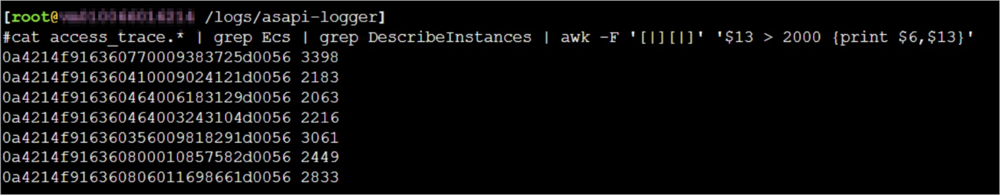

<a id="section-8-7"></a>

## 8.7. ASAPI域名说明

本文为您说明不同域名类型及其使用限制。

| 域名 | 类型 | 说明 |
| --- | --- | --- |
| public.asapi.${global:region}.${global:internet-domain} | 业务网络域、新对外域名。 | 新增域名，仅支持HTTPS（tengine7443转发到ASAPI）。 |
| server.asapi.${global:region}.${global:intranet-domain} | 业务网络域、历史对外域名。 | 历史域名，不再对外开放，仅支持HTTP（企业版V3.14.0版本改为使用tengine的8080端口转发到ASAPI，企业版V3.13.0和企业版V3.12.0直接到ASAPI的7001端口）。 |
| internal.asapi.${global:region}.$ {global:intranet-domain} | 管理网络域、内部域名。 | 新增域名，使用HTTP，直接映射到ASAPI的7001端口。 |
| asapi.${global:region}.${global:i ntranet-domain} | 运维网络域。 | 历史域名，使用HTTPS（HTTPS Proxy，使用tengine的8082端口转发到ASAPI）。 |

<a id="section-9"></a>

# 9.常见问题排查

<a id="section-9-1"></a>

## 9.1. 控制台登录异常

本文为您介绍Apsara Uni-manager运营控制台登录异常的解决办法。

**问题现象**

Apsara Uni-manager运营控制台页面输入正确的账号密码，单击登录后，页面无响应，或提示内部错误。

**可能原因**

控制台无法登录可能由以下三种原因引起：

- 网络问题。

- ascm-auth服务调用ASS服务报错。

- Apsara Uni-manager运营控制台内服务及依赖的底座服务（ASS、RAM、Tair、Ummak）未达到终态。

**解决方案**

1. 在飞天基础运维平台中查看当前Apsara Uni-manager运营控制台集群的服务是否到达终态。

   <ol type="i">

   <li>

   登录飞天基础运维平台。

   </li>

   <li>

   在左侧导航栏中单击**产品集群运维**。

   </li>

   <li>

   在**产品 | 集群**文本框中输入 `ascm` 。

   </li>

   <li>

   单击目标集群**操作**列的**集群详情**，在**集群详情**页面单击**服务列表**页签。在服务列表的**状态**列查看各服务的状态。

   如有服务未到达终态，请先将对应服务调整至终态，然后重新登录Apsara Uni-manager运营控制台。

   </li>

   </ol>

2. 若集群内服务均已到达终态，登录依然异常，则需要按照“前端页面>Portal容器>ASAPI容器>Auth/Manager容器”的顺序逐步排查是否为网络问题。

   排查方式：每个容器内执行 `curl` 命令联通下一个服务的Endpoint。

   <ol type="i">

   <li>

   单击**机器列表**页签。

   </li>

   <li>

   单击目标机器**操作**列的**Terminal**。

   </li>

   <li>

   在左侧机器名称列表中单击目标机器执行以下命令。

   ```text
   bash -c bash
   ```

   </li>

   <li>

   执行以下命令查询容器的ID。

   ```bash
   docker ps
   ```

   </li>

   <li>

   执行以下命令进入容器。

   ```bash
   sudo docker exec -it <容器ID> bash 
   ```

   </li>

   <li>

   在容器中执行操作指令。

   如有某个Endpoint无法联通，请联系驻场网络工程师解决网络问题。

   </li>

   </ol>

3. 若容器间网络均正常，则需要通过日志进行定位。

   <ol type="i">

   <li>

   打开Apsara Uni-manager运营控制台后输入账号和密码，按F12键。

   </li>

   <li>

   单击**登录**。

   </li>

   <li>

   单击Headers页签，获取 `eagleeye-traceid` 。

   </li>

   <li>

   按照步骤2进入<strong>ascm-portal.Portal#</strong>容器。

   </li>

   <li>

   在容器中执行以下命令。

   ```text
   grep <eagleeye-traceid>/root/logs/ascm-portal/ascm-error.log*
   ```

   根据搜索到的异常日志定位返回异常的服务。联系阿里云驻场运维工程师进一步定位问题原因。

   </li>

   </ol>

4. 当Auth容器正常及用户名密码均正确的情况，却依旧无法登录时，通常情况下是调用AAS服务报错。

   <ol type="i">

   <li>

   在Auth容器中执行以下命令。

   ```text
   grep {eagleeye-traceid} /logs/ascm-logger/*.log -5
   ```

   </li>

   <li>

   日志中出现返回值报错时即可确定为AAS调用出错。需要联系AAS的运维工程师进行进一步定位。

   </li>

   </ol>

<a id="section-9-2"></a>

## 9.2. 控制台调用VPC、ECS、SLB、RDS接口超时

本文为您介绍Apsara Uni-manager运营控制台中VPC、ECS、SLB、RDS等多个云产品页面均存在接口调用超时现象的排查方法。

**问题现象**

Apsara Uni-manager运营控制台中VPC、ECS、SLB、RDS等多个云产品页面均存在接口调用超时现象。

**可能原因**

该现象可能是由于频繁POPFullGC所导致。

**解决方案**

1. 进入 `webapp-pop.PopAliyunCom#` 容器，进入容器的方法请参见日常巡检。

2. 在容器中执行以下命令。

   ```text
   tail -f/home/admin/logs/eagleeye/stat-eagleeye-jvm.log | grep gc
   ```

   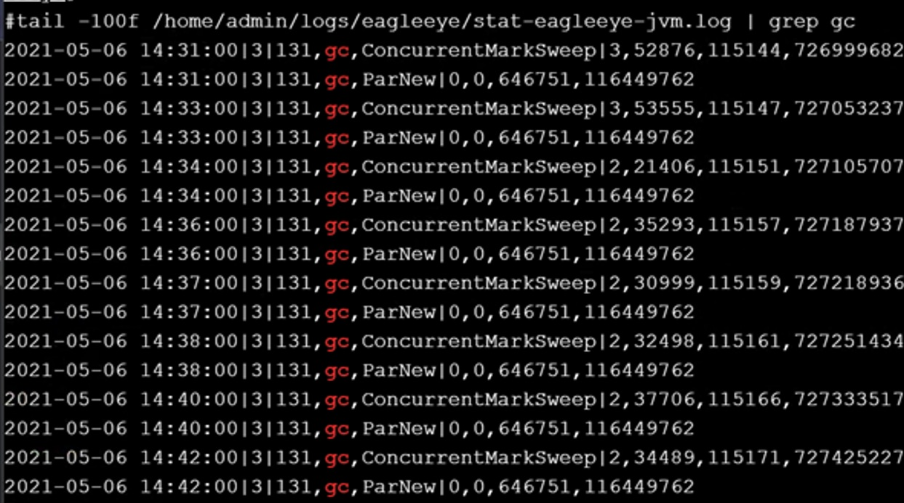

   ConcurrentMarkSweep为FullGc的日志，可以看到每隔一两分钟就会FullGc一次。

3. 按照顺序依次重启容器：POP>ASAPI>Manage>ResourceManage>OneConsole。

4. 重启完成后，继续观察POPFullGC情况。

   若依旧频繁POPFullGC，请联系驻场运维工程师。

<a id="section-9-3"></a>

## 9.3. 控制台创建ACK集群超时

本文为您介绍在Apsara Uni-manager运营控制台中创建ACK集群失败，提示超时问题的排查方法。

**问题现象**

在Apsara Uni-manager运营控制台中创建ACK集群报错。错误提示为“java.net.SocketTimeoutException:Read timed out”。

**可能原因**

出现报错可能由以下两种原因：

- 网络问题。

- 后端服务负载较高导致性能下降。

**操作步骤**

1. 找到ASAPI及POP的调用日志。

   <ol type="i">

   <li>

   按F12键。重新单击**创建**。

   </li>

   <li>

   从响应数据中获取 `requestid` 。

   </li>

   <li>

   通过飞天基础运维平台进入<strong>asapi.ApiServer#</strong>容器。

   </li>

   <li>

   在容器中执行以下命令，获取鹰眼ID。

   ```text
   grep <requestid> /logs/asapi-logger/*
   ```

   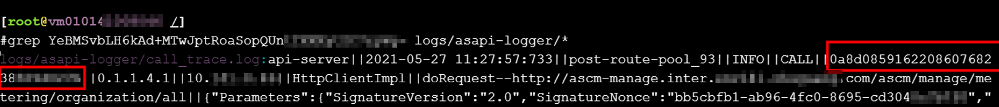

   </li>

   <li>

   根据搜索到的鹰眼ID，执行以下命令查询ASAPI侧的耗时。

   ```text
   grep <鹰眼ID> / logs/asapi-logger/*
   ```

   </li>

   <li>

   进入<strong>webapp-pop.PopAliyunCom#</strong>容器执行以下命令，获取POP日志及POP侧的耗时。

   ```text
   grep <鹰眼ID> /opt/tianji/alidata/www/logs/java/gateway/logs/trace/*
   ```

   </li>

   </ol>

2. 将ASAPI侧的耗时和POP侧的耗时进行比对，此时有两种情况：

   - 如果耗时相差不大，且POP耗时较长（如相差1s~2s内），则需要产品工程师进一步定位耗时问题。

   - 如果ASAPI的耗时比POP的耗时长很多，需要定位POP是否存在FullGC问题。具体操作请参见控制台调用VPC、ECS、SLB、RDS接口超时。

<a id="section-9-4"></a>

## 9.4. 控制台获取ACK集群列表超时

本文为您介绍在Apsara Uni-manager运营控制台中获取ACK集群列表失败，提示超时问题的排查方法。

**问题现象**

在Apsara Uni-manager运营控制台中获取ACK集群列表超时。错误提示为“java.net.SocketTimeoutException:Read timed out”。

**可能原因**

出现报错可能有以下两种原因：

- 网络问题。

- 后端服务负载较高导致性能下降。

**解决方案**

1. 按F12键后，刷新页面，重新调用列表接口。

   在**Headers**页签下找到 `_preventCache` 字段。

   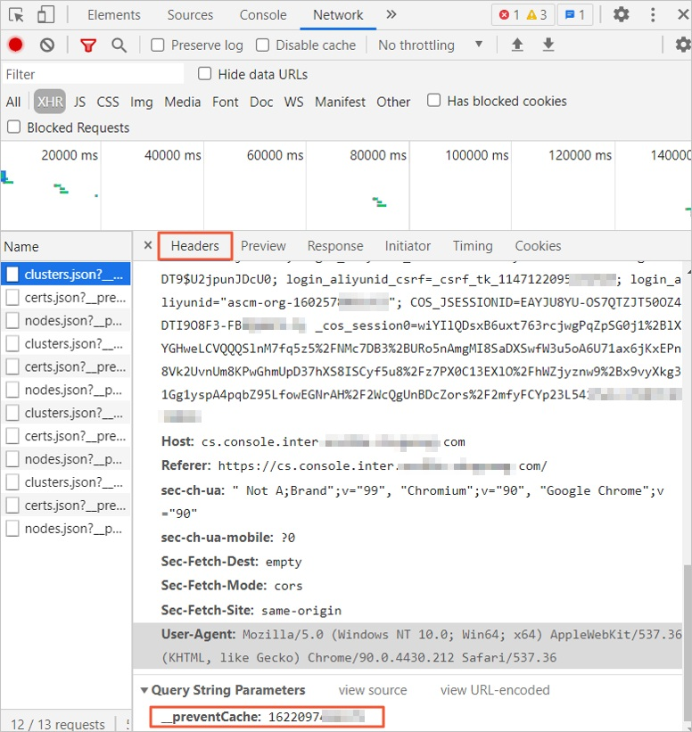

2. 进入<strong>asapi.ApiServer#</strong>容器。

   <ol type="i">

   <li>

   执行以下命令，通过_preventCache获取Manage日志。

   ```bash
   cat /logs/ascm-logger/main_trace* | grep <_preventCache>
   ```

   </li>

   <li>

   使用Manage日志中的鹰眼ID，执行以下命令，找到Manage调用ASAPI的日志。

   ```text
   grep /logs/ascm-logger/* | grep <鹰眼ID>
   ```

   </li>

   <li>

   执行以下命令，用鹰眼ID获取ASAPI调用POP的日志。

   ```text
   grep <鹰眼ID> logs/asapi-logger/*
   ```

   找到 `x-acs-signature-nonce` 的值。

   </li>

   </ol>

3. 查询POP日志。

   - 方式一：

     <ol type="a">

     <li>

     进入服务角色PopAliyunCom#所在vm。

     </li>

     <li>

     进入**pop-aliyun-com**容器，执行以下命令，查询POP调用日志。

     ```text
     grep <鹰眼ID> /opt/tianji/alidata/www/logs/java/gateway/logs/trace/trace.log
     ```

     > **重要**
     >
     > 容器内日志很快就会被刷新，进入POP容器获取日志需要在20分钟内完成。

     </li>

     </ol>

   - 方式二：

     <ol type="a">

     <li>

     进入SLS Portal页面。

     进入SLS查看日志的方法请参见查看日志。

     </li>

     <li>

     Project选择**ali-pop-log**，logstore选择**pop_rpc_trace_log**。

     </li>

     </ol>

     <ol type="i" start="100">

     <li>

     若使用鹰眼ID无法过滤出日志，请使用 `CS and DescribeClusters` 作为过滤条件，时间区间选择调用接口的时间，时间跨度请尽可能小。

     </li>

     </ol>

4. 根据以上获取到的日志，分析哪个模块耗时较长。

<a id="section-9-5"></a>

## 9.5. 控制台调用Blink产品接口返回异常

本文为您介绍Apsara Uni-manager运营控制台调用blink产品接口返回异常的处理方法。

**问题现象**

Apsara Uni-manager运营控制台调用blink产品接口返回异常，提示"ascm.manage.EntityNotExist.Instance"。

**操作步骤**

1. 进入容器**ascm-brm.Manage#**。进入方法请参见日常巡检。

2. 在容器中执行以下命令进入BRM数据库。

   ```text
   mysql -u${db_user} -h${db_host} -p${db_password} -D${db_name} -P${db_port}
   ```

3. 在数据库中执行以下命令，查看结果中 `resource_instance.no_show_count` 是否为1， `instance_id` 是否有大写字母。

   ```sql
   select * from resource_instance where type ='foas_project' and instance_id = 
   '$project_name' ;
   ```

   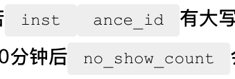

   - 若 `inst  ance_id` 有大写字母，则执行以下命令，备份表数据，修改 `instance_id` 为全小写字母。

     10分钟后 `no_show_count` 会自动变为0，后续步骤不用执行。

     ```sql
     create table resource_instance_bak20210204 as select * from resource_instance;
     updateresource_instance set instance_id = lower(instance_id) where type 
     ='foas_project';
     ```

   - 若 `instance_id` 没有大写字母， `no_show_count` 为1，则在容器<strong>ascm-brm.ResourceMgr#</strong>执行以下命令获取日志。

     ```bash
     cat /logs/ascm-logger/call_trace* |grep foas |grep ListProject |grep ECONNREFUSED |tail -5
     cat /logs/ascm-logger/call_trace* |grep foas |grep ListProject |grep 
     ServiceUnavailable | tail -5
     cat /logs/ascm-logger/call_trace* |grep foas |grep ListProject |grep '\"Code\"' | tail-5
     cat /logs/ascm-logger/call_trace* |grep foas |grep ListProject |grep 
     ResponseTimeoutError | tail -5
     cat /logs/ascm-logger/call_trace* |grep foas |grep ListProject |grep InternalError| tail -5
     ```

     如果查询结果为空，则执行以下命令获取日志。

     ```bash
     cat /logs/ascm-logger/call_trace.log|grep foas |grep ListProject| grep $project所属的Region |grep $project所属组织的AccessKey |grep $project_name | tail -5
     cat /logs/ascm-logger/call_trace.log |grep foas |grep ListProject| grep $project所属的Region |grep $project所属组织的AccessKey | tail -5
     ```

4. 将收集到的日志提供给Apsara Uni-manager运营控制台的驻场运维工程师。

<a id="section-9-6"></a>

## 9.6. 控制台操作提示无权限

本文为您介绍在Apsara Uni-manager运营控制台中创建实例提示没有权限问题的解决方案。

**问题现象**

在Apsara Uni-manager运营控制台中创建实例时系统报错，提示没有权限。

> **说明**
>
> 本文所介绍方法为判断权限点的通用方法，仅以创建实例报错进行举例。

**解决方案**

1. 按F12键，再次进行操作，在开发者工具的**Preview**页签中获取 `asapiErrorCode` 的值。

2. 进入<strong>ascm-brm.Manage#</strong>容器。

3. 执行以下命令进入BRM的数据库。

   ```text
   mysql -u${db_user} -h${db_host} -p${db_password} -D${db_name} -P${db_port} 
   ```

4. 执行以下命令确认权限点。

   ```sql
   select * from ascm_privilege wherecode='<asapiErrorCode>'\G
   ```

5. 确认当前用户角色权限是否勾选。

   <ol type="i">

   <li>

   管理员登录Apsara Uni-manager运营控制台。

   </li>

   <li>

   在顶部菜单栏中单击**企业**。

   </li>

   <li>

   在左侧导航栏中单击**用户管理**。

   </li>

   <li>

   找到提示报错的用户后，单击用户名。

   </li>

   <li>

   在头像下方查看用户角色。

   </li>

   <li>

   在顶部菜单栏中单击**企业**。

   </li>

   <li>

   在左侧导航栏中单击**角色管理**。

   </li>

   <li>

   单击目标角色的角色名称，查看步骤4中获取的权限是否勾选。

   </li>

   </ol>

> **说明**
>
> 只有自定义角色支持编辑权限。若系统预置角色不满足要求，请创建自定义角色后，为用户授权。创建角色及授权方法请参见*Apsara Uni-manager运营控制台用户指南*。

<a id="section-9-7"></a>

## 9.7. 使用SDK调用接口控制台提示请求接口未找到

本文为您介绍使用SDK调用接口控制台提示请求接口未找到的解决方法。

**问题现象**

使用SDK调用接口，Apsara Uni-manager运营控制台（ASCM）提示请求接口未找到（API not found）。

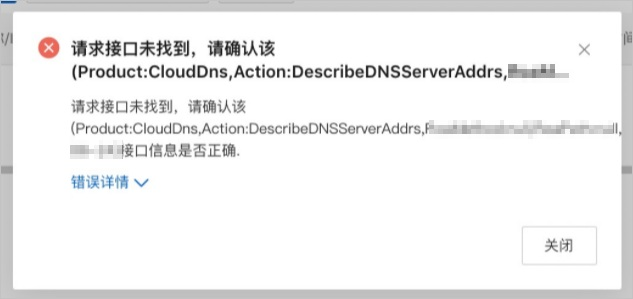

**可能原因**

- 请求参数中接口的Product、Action、Verison字段的值未正确传递。

- 当前接口在目前部署的Apsara Uni-manager运营控制台（ASCM）版本中不存在。

**解决方案**

1. 进入<strong>asapi.ApiServer#</strong>容器，执行以下命令，进入ASAPI数据库。

   ```text
   mysql -h${db_asapi_db_host} -P${db_asapi_port} -u${db_asapi_user} -p${db_asapi_password} 
   asapi
   ```

2. 执行以下SQL命令，查询当前调用的接口是否存在于ASAPI数据库。

   ```sql
   select * from ops_api where name = "接⼝名" and namespace = "产品名" and api_version = "版
   本号" and category_id = "privateCloud"\G
   ```

3. 查询此接口是否配置了从POP平台拉取。

   ```sql
   select * from asapi_product where name = "产品名";
   ```

   若查询结果为空，则需联系阿里云该产品相关人员将此接口注册至ASAPI。

4. 进入<strong>asapi.ApiServer#</strong>容器，尝试从POP平台拉取接口。

   ```bash
   cd /alidata/tools
   # ⽤⼯具从pop同步接⼝
   ./asapiTools pop -p 产品名 -v 版本
   例:
   ./asapiTools pop -p Ecs -v 2014-05-26
   ```

   查看输出的接口列表中是否包含当前需要调用的接口，若不包含，则需联系阿里云该产品相关人员检查此接口是否被注册到了POP平台中。若包含，则该接口已注册到ASAPI，请重新发起调用进行测试。

<a id="section-9-8"></a>

## 9.8. ASAPI HTTPS域名无法访问

本文为您介绍ASAPI HTTPS域名无法访问的解决方法。

**问题现象**

ASAPI HTTPS域名无法访问。

**可能原因**

HTTPS证书未更新。

使用 `curl` 命令可进行快速验证。进入<strong>asapi.ApiServer#</strong>容器，执行以下命令。

```bash
curl https://127.0.0.1:7443/api/version -k
或者
curl https://public.asapi..../api/verison -k
```

返回成功如下所示。

```json
{"version":"v3.13","code":"200","apiCount":14071,"desc":"update xml pretty"}
```

返回失败如下所示，需要更新HTTPS证书。

```text
curl: (35) Peer reports it experienced an internal error.
curl: (35) error:1407742E: SSL routines: SSL_23_GET_SERVER_HELLO:tlsvl alert protocol version
```

**解决方案**

1. 获取环境配置信息。

   <ol type="i">

   <li>

   获取TianJi System_Id。

   </li>

   <li>

   获取TianJi朱雀终态规划JSON文件。

   </li>

   </ol>

2. 生成证书文件。

   请联系阿里云HTTPSPROXY研发团队，生成ASAPI的证书。

   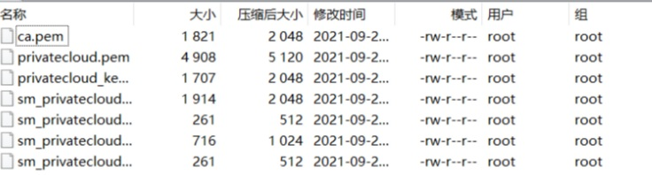

3. 飞天基础运维平台下发证书。

   <ol type="i">

   <li>

   进入**ascm**的飞天基础运维平台集群配置文件。

   </li>

   <li>

   在**asapi**文件夹下新建user及下级的文件目录，并将获取到的证书文件放入**cert**文件夹下。

   </li>

   <li>

   单击**保存并提交**。

   </li>

   </ol>

<a id="section-9-9"></a>

## 9.9. 控制台操作提示云产品接口尚未注册

本文为您介绍在Apsara Uni-manager运营控制台中遇到云产品接口尚未注册问题的解决方案。

**问题现象**

在Apsara Uni-manager运营控制台中操作时，提示云产品接口尚未注册。

**解决方案**

1. 通过API调用日志审计获取报错接口的产品名和版本号。

   具体操作请参见日志审计。

2. 进入 `asapi.ApiServer#` 容器。

   <ol type="i">

   <li>

   登录飞天基础运维平台。

   </li>

   <li>

   在左侧导航栏中单击**产品集群运维**。

   </li>

   <li>

   在**产品 | 集群**文本框中输入 `ascm` 。

   </li>

   <li>

   单击目标集群**操作**列的**集群详情**，在**集群详情**页面单击**机器列表**页签。

   </li>

   <li>

   单击目标机器**操作**列的**Terminal**。

   </li>

   <li>

   在左侧机器名称列表中单击目标机器执行以下命令。

   ```text
   bash -c bash
   ```

   </li>

   <li>

   执行以下命令查询容器的ID。

   ```bash
   docker ps
   ```

   </li>

   <li>

   执行以下命令进入容器。

   ```bash
   sudo docker exec -it <容器ID> bash 
   ```

   </li>

   </ol>

3. 执行命令 `cd /alidata/tools/` 进入注册工具目录。

   此目录下存放注册工具，X86架构下使用工具asapiTools，ARM架构下使用工具asapiTools-arm64。

4. 执行以下代码，将报错的产品版本下所有的接口，从POP同步至ASAPI中。

   > **重要**
   >
   > 此命令对产品名称大小写敏感，请按实际情况输入。

   ```text
   ./asapiTools pop -p <产品名> <版本号>
   ```

   获取接口成功之后，系统会打印详细接口名称，需要确认打印的接口列表中是否包含缺失的接口，如果不包含，您需要确认输入的产品名称和版本号是否正确，确认无误但仍然无法获取到对应接口，请联系阿里云的驻场运维工程师。

5. 同步成功之后，重新执行报错的操作。

<a id="section-9-10"></a>

## 9.10. 控制台操作提示ASAPI调用接口超时

本文为您介绍在Apsara Uni-manager运营控制台中遇到ASAPI调用接口超时的解决方案。

**问题现象**

在Apsara Uni-manager运营控制台中操作时，系统提示ASAPI调用接口超时。

**解决方案**

1. 获取故障发生时的鹰眼ID。

   <ol type="i">

   <li>

   按F12键。然后刷新页面，重新调用接口。

   </li>

   <li>

   在**Headers**页签下获取 `eagleeye-traceid` 的值。

   </li>

   </ol>

2. 通过 `eagleeye-traceid` 在API调用日志中获取报错接口的产品名和版本号。

   具体操作请参见日志审计。

3. 进入 `asapi.ApiServer#` 容器。

   <ol type="i">

   <li>

   登录飞天基础运维平台。

   </li>

   <li>

   在左侧导航栏中单击**产品集群运维**。

   </li>

   <li>

   在**产品 | 集群**文本框中输入 `ascm` 。

   </li>

   <li>

   单击目标集群**操作**列的**集群详情**，在**集群详情**页面单击**机器列表**页签。

   </li>

   <li>

   单击目标机器**操作**列的**Terminal**。

   </li>

   <li>

   在左侧机器名称列表中单击目标机器执行以下命令。

   ```text
   bash -c bash
   ```

   </li>

   <li>

   执行以下命令查询容器的ID。

   ```bash
   docker ps
   ```

   </li>

   <li>

   执行以下命令进入容器。

   ```bash
   sudo docker exec -it <容器ID> bash 
   ```

   </li>

   </ol>

4. 执行以下命令进入ASAPI的数据库。

   ```text
   mysql -h <db_asapi_db_host> -P<db_asapi_port> -u<db_asapi_user> -p<db_asapi_password> asapi
   ```

5. 在数据库中执行以下命令。

   ```sql
   #以PolarDB-X产品的接⼝为例，设置的超时时间根据后端接⼝实际耗时再来调整
   update ops_api set timeout = 30000 where namespace = "Drds" and name 
   ="DescribeDrdsRdsInstances" and api_version = "2019-01-23";
   ```

   ```sql
   insert into api_timeout_unlimited(namespace,name,api_version,category_id) values ("Drds 
   "," DescribeDrdsRdsInstances ","2019-01-23","privateCloud");
   ```

   > **说明**
   >
   > 如果当前版本没有表api_timeout_unlimited，则不需要执行第二段命令。

6. 执行成功之后，等待5分钟，重新执行控制台操作，观察调用情况。

   若问题仍未解决，请联系阿里云运维工程师进行操作。

<a id="section-9-11"></a>

## 9.11. Apsara Uni-manager运营控制台登录接口巡检告警

**背景信息**

Apsara Uni-manager运营控制台登录接口巡检告警是对Apsara Uni-manager运营控制台登录流程进行健康检查及登录接口进行定期巡检时有异常后发出的告警。

通常出现**ascm_login_check_health_alarm**和**ascm_login_api_inspect_alert**告警时，表示Apsara Uni-manager运营控制台登录链路存在异常，需要及时排查解决。

**告警属性**

| 监控项名称 | 告警来源 | 告警级别 | 告警产品 | 触发条件 | 执行周期 |
| --- | --- | --- | --- | --- | --- |
| ascm_login_ch eck_health_ala rm | ascm | P1 | 统一云管平台 | - | 1分钟执行一次，告警间隔时间5分钟。 |
| ascm_login_ap i_inspect_alert | asd | P1 | 统一云管平台 | 连续3分钟出现登录API巡检失败。 | 1分钟执行一次，告警间隔时间10分钟。 |

**问题现象**

影响Apsara Uni-manager运营控制台登录，严重会导致Apsara Uni-manager运营控制台无法登录。

**告警原因**

出现此告警存在两种原因：

- unimanager-base.IdentityService#服务存在异常，导致登录接口失败。

- unimanager-base.IdentityService#依赖下游AB基础服务异常，导致登录接口失败。

**解决方案**

1. 根据告警来源获取异常原因和TraceId。

   > **说明**
   >
   > - ascm_login_api_inspect_alert告警来源是ASD。
   >
   > - ascm_login_check_health_alarm告警来源是ASCM的ASAPI网关。

   <ol type="i">

   <li>

   登录SlsInner控制台。

   <ol type="i" start="2">

   <li>

   project: tjm-asd-console, logStore: biz_alert_log，查询条件为BizExType:AscmLoginFault。

   </li>

   </ol>

   project: tjm-asapi, logStore: tjmcollector_biz_alert_log_ascm_asapi，查询条件为BizExType:AsapiHealthCheck。

   下面是告警源为ASD的sls日志，可以从原始日志中获取EagleEyeTraceId。其中EntityType表示异常的组件和服务；ErrorType表示异常的错误码，起到异常定界的作用，可以定位影响ASCM登录功能的具体组件，如果EntityType取值为Ram、Aas、ummak、Pop、Tair这些组件，可以定界为底座基础服务异常。

   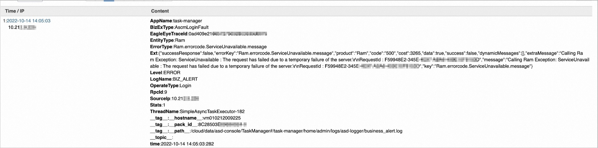

   </li>

   </ol>

2. 底座基础服务异常导致登录接口报错处理方式。

   <ol type="i">

   <li>

   使用ASD查询报错的具体原因和日志。

   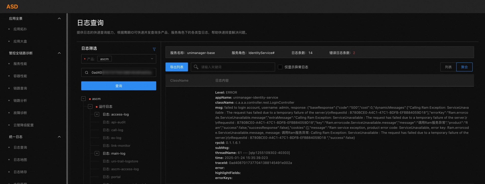

   </li>

   <li>

   使用ASCM白屏化故障应急模式。

   <ol type="a">

   <li>

   如果此时ascm出现无法登录的情况，在登录时会提示开启应急模式。

   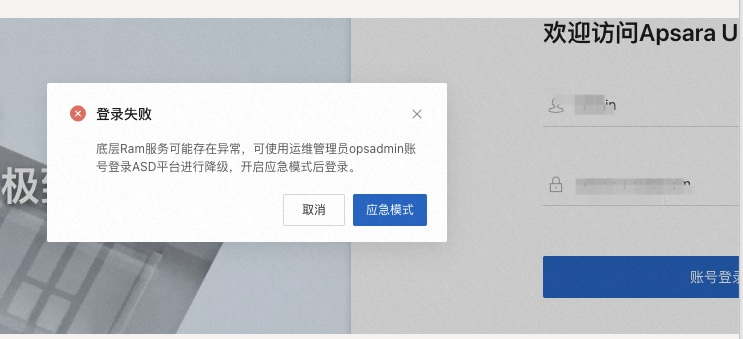

   </li>

   <li>

   单击应急模式。

   </li>

   </ol>

   <ol type="i" start="100">

   <li>

   登录ASD，进行故障诊断及开启应急模式。

   > **说明**
   >
   > ASD使用ASO登录，如果ASO也出现无法登录的情况，可使用ASO的应急模式进行登录。

   </li>

   <li value="500">

   进入ASD后会先进行诊断，然后引导开启ASCM的应急模式，如下图所示。

   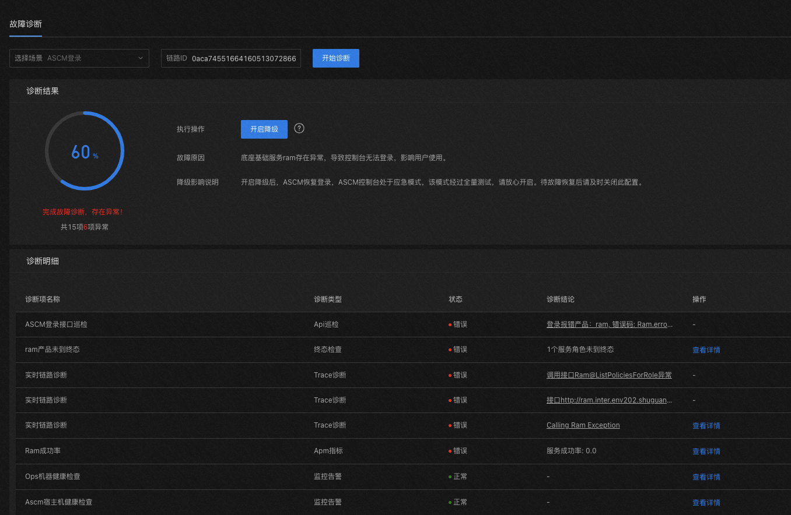

   </li>

   </ol>

   <ol type="a" start="5">

   <li>

   单击开启降级后ASCM恢复登录，可以登录ASCM后继续操作，登录ASCM后在吊顶会有统一提示。

   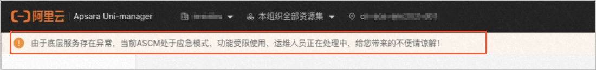

   </li>

   <li>

   （可选）如果需要关闭应急模式，需要在ASD的降级配置中关闭。

   </li>

   </ol>

   </li>

   </ol>

3. ASCM异常导致登录接口报错处理方式。

   <ol type="i">

   <li>

   登录ASD。

   </li>

   <li>

   使用ASD日志查询功能，查询服务角色unimanager-base.IdentityService#的日志。

   </li>

   <li>

   将日志发给研发同学排查解决。

   </li>

   </ol>
