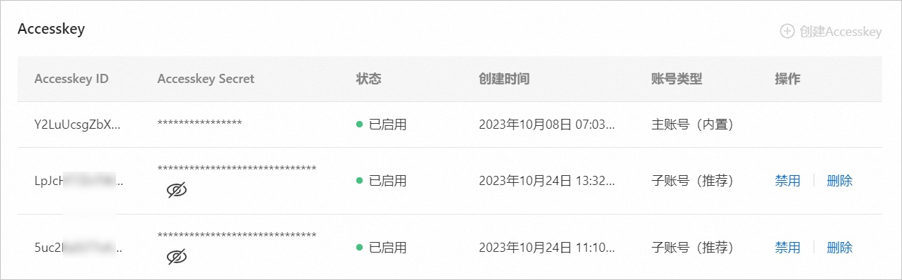

阿里云  
专有云  
统一云管平台  
Apsara Uni-manager运维控制台  
开发指南  
产品版本：v3.18.2  
文档版本：20251106

**目录**

- [1.开发文档使用说明](#section-1)
- [2.SDK发布历史](#section-2)
- [3.API可用性说明](#section-3)
- [4.准备工作](#section-4)
    - [4.1. 登录Apsara Uni-manager运维控制台](#section-4-1)
    - [4.2. 获取Region ID](#section-4-2)
    - [4.3. 知晓调用API所需权限](#section-4-3)
    - [4.4. 获取AccessKey](#section-4-4)
    - [4.5. 获取Apsara Uni-manager运维控制台的域名参数](#section-4-5)
    - [4.6. 检测网络连通性](#section-4-6)
    - [4.7. 获取Apsara Uni-manager运维控制台的SDK包](#section-4-7)
- [5.Java SDK调用示例](#section-5)
    - [5.1. 快速开始](#section-5-1)
    - [5.2. 使用手册](#section-5-2)
        - [5.2.1. 安装Java SDK](#section-5-2-1)
        - [5.2.2. 发起调用](#section-5-2-2)
- [6.Python SDK调用示例](#section-6)
    - [6.1. 快速开始](#section-6-1)
    - [6.2. 使用手册](#section-6-2)
        - [6.2.1. 安装Python SDK](#section-6-2-1)
        - [6.2.2. 发起调用](#section-6-2-2)
- [7.API参考](#section-7)
    - [7.1. Apsara Uni-manager运维控制台](#section-7-1)
        - [7.1.1. 监控告警](#section-7-1-1)
            - [7.1.1.1. GetIncidentAlertList](#section-7-1-1-1)
                - [7.1.1.1.1. GetIncidentAlertList告警指标详情](#section-7-1-1-1-1)
            - [7.1.1.2. GetMetricData](#section-7-1-1-2)
                - [7.1.1.2.1. GetMetricData监控指标详情](#section-7-1-1-2-1)
            - [7.1.1.3. ListAlertByUpdateTime](#section-7-1-1-3)
            - [7.1.1.4. GetAlertList](#section-7-1-1-4)
            - [7.1.1.5. GetCpuMetrics](#section-7-1-1-5)
            - [7.1.1.6. GetDiskMetrics](#section-7-1-1-6)
            - [7.1.1.7. GetIoMetrics](#section-7-1-1-7)
            - [7.1.1.8. GetLoadMetrics](#section-7-1-1-8)
            - [7.1.1.9. GetMemMetrics](#section-7-1-1-9)
            - [7.1.1.10. GetTrafficMetrics](#section-7-1-1-10)
        - [7.1.2. 库存管理](#section-7-1-2)
            - [7.1.2.1. GetOverview](#section-7-1-2-1)
            - [7.1.2.2. GetSlbInventoryInfo](#section-7-1-2-2)
            - [7.1.2.3. GetEcsInventoryByCurrent](#section-7-1-2-3)
            - [7.1.2.4. GetEcsInventoryList](#section-7-1-2-4)
            - [7.1.2.5. GetEcsInventoryByZoneId](#section-7-1-2-5)
            - [7.1.2.6. GetVms](#section-7-1-2-6)
            - [7.1.2.7. GetEbsClusterTypeInfo](#section-7-1-2-7)
            - [7.1.2.8. GetNasInventoryInfo](#section-7-1-2-8)
            - [7.1.2.9. GetOssInventoryInfo](#section-7-1-2-9)
            - [7.1.2.10. GetOtsInnerInventoryInfo](#section-7-1-2-10)
            - [7.1.2.11. GetRdsInventoryInfo](#section-7-1-2-11)
            - [7.1.2.12. GetSlsInnerInfo](#section-7-1-2-12)
            - [7.1.2.13. GetPanguInventoryByClusterName](#section-7-1-2-13)
            - [7.1.2.14. GetInventoryStat](#section-7-1-2-14)
            - [7.1.2.15. GetIntegratedProductInventory](#section-7-1-2-15)
                - [7.1.2.15.1. GetIntegratedProductInventory容量指标详情](#section-7-1-2-15-1)
        - [7.1.3. 巡检管理](#section-7-1-3)
            - [7.1.3.1. InspectionGetTaskList](#section-7-1-3-1)
            - [7.1.3.2. InspectionGetTaskExecution](#section-7-1-3-2)
            - [7.1.3.3. InspectionGetReport](#section-7-1-3-3)
        - [7.1.4. 平台产品](#section-7-1-4)
            - [7.1.4.1. GetProductListDetail](#section-7-1-4-1)
            - [7.1.4.2. GetProductList](#section-7-1-4-2)
            - [7.1.4.3. GetProductVersion](#section-7-1-4-3)
            - [7.1.4.4. DescribeProductStatus](#section-7-1-4-4)
            - [7.1.4.5. GetClusterListByProductDetail](#section-7-1-4-5)
            - [7.1.4.6. GetClusterListByProduct](#section-7-1-4-6)
            - [7.1.4.7. GetClusters](#section-7-1-4-7)
            - [7.1.4.8. GetServiceInstanceDetail](#section-7-1-4-8)
            - [7.1.4.9. GetServerRoleList](#section-7-1-4-9)
            - [7.1.4.10. GetServerroleVersion](#section-7-1-4-10)
            - [7.1.4.11. GetServiceRole](#section-7-1-4-11)
            - [7.1.4.12. GetServerRoleMachinesDetail](#section-7-1-4-12)
        - [7.1.5. 资产设备](#section-7-1-5)
            - [7.1.5.1. GetMachineByIp](#section-7-1-5-1)
            - [7.1.5.2. GetMachineByName](#section-7-1-5-2)
            - [7.1.5.3. GetMachineListDetail](#section-7-1-5-3)
            - [7.1.5.4. GetMachineList](#section-7-1-5-4)
            - [7.1.5.5. GetNetworkMachineByIp](#section-7-1-5-5)
            - [7.1.5.6. GetNetworkMachineByName](#section-7-1-5-6)
        - [7.1.6. 平台数据](#section-7-1-6)
            - [7.1.6.1. GetCurrentUserStats](#section-7-1-6-1)
            - [7.1.6.2. ListUsers](#section-7-1-6-2)
    - [7.2. 网络运维控制台](#section-7-2)
        - [7.2.1. 网元管理](#section-7-2-1)
            - [7.2.1.1. GetSwitchInfo](#section-7-2-1-1)
            - [7.2.1.2. GetTopoInfo](#section-7-2-1-2)
            - [7.2.1.3. ListPorts](#section-7-2-1-3)
            - [7.2.1.4. ListSwTotal](#section-7-2-1-4)
            - [7.2.1.5. GetPortInfo](#section-7-2-1-5)
            - [7.2.1.6. GetXnetFlow](#section-7-2-1-6)
            - [7.2.1.7. GetHardwareUtilization](#section-7-2-1-7)
            - [7.2.1.8. GetPortTransPowerByName](#section-7-2-1-8)
        - [7.2.2. 网络产品](#section-7-2-2)
            - [7.2.2.1. AllSlbClusters](#section-7-2-2-1)
            - [7.2.2.2. GetNodeList](#section-7-2-2-2)
            - [7.2.2.3. GetSlbLvsNodeStats](#section-7-2-2-3)
            - [7.2.2.4. GetSlbLvsClusterStats](#section-7-2-2-4)
            - [7.2.2.5. GetLbStats](#section-7-2-2-5)
            - [7.2.2.6. GetSlbProxyClusterStats](#section-7-2-2-6)
            - [7.2.2.7. GetSlbProxyNodeStats](#section-7-2-2-7)
            - [7.2.2.8. GetXgwClusterList](#section-7-2-2-8)
            - [7.2.2.9. GetXgwClusterAll](#section-7-2-2-9)
            - [7.2.2.10. GetXgwMachineList](#section-7-2-2-10)
    - [7.3. 存储运维控制台](#section-7-3)
        - [7.3.1. 盘古运维](#section-7-3-1)
            - [7.3.1.1. GetPanguStorageCapacity](#section-7-3-1-1)
        - [7.3.2. CDS运维](#section-7-3-2)
            - [7.3.2.1. DescribeOssCluster](#section-7-3-2-1)
            - [7.3.2.2. DescribeClusterCapacity](#section-7-3-2-2)
            - [7.3.2.3. DescribeHosts](#section-7-3-2-3)
            - [7.3.2.4. DescribeMetrics](#section-7-3-2-4)
            - [7.3.2.5. DescribeStorageClusters](#section-7-3-2-5)
            - [7.3.2.6. DescribeBlockClusters](#section-7-3-2-6)
    - [7.4. 数据库运维控制台](#section-7-4)
        - [7.4.1. RDS运维](#section-7-4-1)
            - [7.4.1.1. DescribeHostInfoByDbType](#section-7-4-1-1)
            - [7.4.1.2. DescribeCustInsSlaveInfo](#section-7-4-1-2)
            - [7.4.1.3. DescribeResourceInventory](#section-7-4-1-3)
            - [7.4.1.4. DescribeComboInventory](#section-7-4-1-4)
    - [7.5. Apsara Uni-manager运营控制台](#section-7-5)
        - [7.5.1. 平台数据](#section-7-5-1)
            - [7.5.1.1. GetCurrentUserStats](#section-7-5-1-1)

<a id="section-1"></a>

# 1.开发文档使用说明

本文为您介绍在使用专有云API进行开发工作时，如何查看所需要的产品文档。

**使用流程**

您可以按照以下流程图中步骤，判断自己所需要使用的开发文档。


**前提条件**

通过运维人员或运营管理员获取专有云的版本。

**操作步骤**

您可以通过阿里云专有云文档中心，获取需要的产品文档。

1. 通过浏览器打开专有云文档中心。

2. 根据专有云的版本单击**企业版**、**敏捷版**或**一体机**标签。

3. 在下拉列表中，选择对应的专有云版本。

4. 在左侧导航栏中，选择目标产品名称。

5. 在单击目标文档区域的**查看详情**或**下载PDF**。

<a id="section-2"></a>

# 2.SDK发布历史

本文为您介绍专有云v3.18.2版本中，Apsara Uni-manager运维控制台SDK发布历史，以及API发布、修改、问题记录。

**SDK版本编号**

| 版本号 | 发布时间 | 更新内容 |
| --- | --- | --- |
| 3.18.2.0 | 2024.03 | 全新发布专有云3.18.2对外API的SDK。 |

**API发布、修改、问题记录**

**Apsara Uni-manager运维控制台**

**分类**

**API名称**

**所在3.18.1版本（包括及以上）**

GetIncidentAlertList

v3.18.2 ASO RELEASE

GetMetricData

v3.18.2 ASO RELEASE

ListAlertByUpdateTime

v3.18.2 ASO RELEASE

GetAlertList

v3.18.2 ASO RELEASE

GetCpuMetrics

v3.18.2 ASO RELEASE

监控告警

GetDiskMetrics

v3.18.2 ASO RELEASE

GetIoMetrics

v3.18.2 ASO RELEASE

GetLoadMetrics

v3.18.2 ASO RELEASE

GetMemMetrics

v3.18.2 ASO RELEASE

GetTrafficMetrics

v3.18.2 ASO RELEASE

GetOverview

v3.18.2 ASO RELEASE

GetSlbInventoryInfo

v3.18.2 ASO RELEASE

GetEcsInventoryByCurrent

v3.18.2 ASO RELEASE

GetEcsInventoryList

v3.18.2 ASO RELEASE

v3.18.2 ASO RELEASE

GetEcsInventoryByZoneId

GetVms

v3.18.2 ASO RELEASE

GetEbsClusterTypeInfo

v3.18.2 ASO RELEASE

库存管理

GetNasInventoryInfo

v3.18.2 ASO RELEASE

GetOssInventoryInfo

v3.18.2 ASO RELEASE

GetOtsInnerInventoryInfo

v3.18.2 ASO RELEASE

GetRdsInventoryInfo

v3.18.2 ASO RELEASE

GetSlsInnerInfo

v3.18.2 ASO RELEASE

GetPanguInventoryByClusterName

v3.18.2 ASO RELEASE

GetInventoryStat

v3.18.2 ASO RELEASE

GetIntegratedProductInventory

v3.18.2 ASO RELEASE

InspectionGetReport

v3.18.2 ASO RELEASE

巡检管理

InspectionGetTaskExecution

v3.18.2 ASO RELEASE

InspectionGetTaskList

v3.18.2 ASO RELEASE

GetProductListDetail

v3.18.2 ASO RELEASE

GetProductList

v3.18.2 ASO RELEASE

GetProductVersion

v3.18.2 ASO RELEASE

DescribeProductStatus

v3.18.2 ASO RELEASE

GetClusterListByProductDetail

v3.18.2 ASO RELEASE

GetClusterListByProduct

v3.18.2 ASO RELEASE

平台产品

GetClusters

v3.18.2 ASO RELEASE

GetServiceInstanceDetail

v3.18.2 ASO RELEASE

GetServerRoleList

v3.18.2 ASO RELEASE

GetServerroleVersion

v3.18.2 ASO RELEASE

GetServiceRole

v3.18.2 ASO RELEASE

GetServerRoleMachinesDetail

v3.18.2 ASO RELEASE

GetMachineByIp

v3.18.2 ASO RELEASE

GetMachineByName

v3.18.2 ASO RELEASE

GetMachineListDetail

v3.18.2 ASO RELEASE

资产设备

GetMachineList

v3.18.2 ASO RELEASE

GetNetworkMachineByIp

v3.18.2 ASO RELEASE

GetNetworkMachineByName

v3.18.2 ASO RELEASE

GetCurrentUserStats

v3.18.2 ASO RELEASE

平台数据

ListUsers

v3.18.2 ASO RELEASE

**网络运维控制台**

<table>
  <tr>
    <th>分类</th>
    <th>API名称</th>
    <th>所在3.18.1版本（包括及以上）</th>
  </tr>
  <tr>
    <td rowspan="8">网元管理</td>
    <td>GetSwitchInfo</td>
    <td>v3.18.2 baseServiceAll RELEASE</td>
  </tr>
  <tr>
    <td>GetTopoInfo</td>
    <td>v3.18.2 baseServiceAll RELEASE</td>
  </tr>
  <tr>
    <td>ListPorts</td>
    <td>v3.18.2 baseServiceAll RELEASE</td>
  </tr>
  <tr>
    <td>ListSwTotal</td>
    <td>v3.18.2 baseServiceAll RELEASE</td>
  </tr>
  <tr>
    <td>GetPortInfo</td>
    <td>v3.18.2 baseServiceAll RELEASE</td>
  </tr>
  <tr>
    <td>GetXnetFlow</td>
    <td>v3.18.2 baseServiceAll RELEASE</td>
  </tr>
  <tr>
    <td>GetHardwareUtilization</td>
    <td>v3.18.2 baseServiceAll RELEASE</td>
  </tr>
  <tr>
    <td>GetPortTransPowerByName</td>
    <td>v3.18.2 baseServiceAll RELEASE</td>
  </tr>
  <tr>
    <td rowspan="10">网络产品</td>
    <td>AllSlbClusters</td>
    <td>v3.18.2 baseServiceAll RELEASE</td>
  </tr>
  <tr>
    <td>GetNodeList</td>
    <td>v3.18.2 baseServiceAll RELEASE</td>
  </tr>
  <tr>
    <td>GetSlbLvsNodeStats</td>
    <td>v3.18.2 baseServiceAll RELEASE</td>
  </tr>
  <tr>
    <td>GetSlbLvsClusterStats</td>
    <td>v3.18.2 baseServiceAll RELEASE</td>
  </tr>
  <tr>
    <td>GetLbStats</td>
    <td>v3.18.2 baseServiceAll RELEASE</td>
  </tr>
  <tr>
    <td>GetSlbProxyClusterStats</td>
    <td>v3.18.2 baseServiceAll RELEASE</td>
  </tr>
  <tr>
    <td>GetSlbProxyNodeStats</td>
    <td>v3.18.2 baseServiceAll RELEASE</td>
  </tr>
  <tr>
    <td>GetXgwClusterList</td>
    <td>v3.18.2 baseServiceAll RELEASE</td>
  </tr>
  <tr>
    <td>GetXgwClusterAll</td>
    <td>v3.18.2 baseServiceAll RELEASE</td>
  </tr>
  <tr>
    <td>GetXgwMachineList</td>
    <td>v3.18.2 baseServiceAll RELEASE</td>
  </tr>
</table>

**存储运维控制台**

<table>
  <tr>
    <th>分类</th>
    <th>API名称</th>
    <th>所在3.18.1版本（包括及以上）</th>
  </tr>
  <tr>
    <td>盘古运维</td>
    <td>GetPanguStorageCapacity</td>
    <td>v3.18.2 ASO RELEASE</td>
  </tr>
  <tr>
    <td rowspan="6">CDS运维</td>
    <td>DescribeClusterCapacity</td>
    <td>v3.18.2 CDS-Management RELEASE</td>
  </tr>
  <tr>
    <td>DescribeMetrics</td>
    <td>v3.18.2 CDS-Management RELEASE</td>
  </tr>
  <tr>
    <td>DescribeStorageClusters</td>
    <td>v3.18.2 CDS-Management RELEASE</td>
  </tr>
  <tr>
    <td>DescribeOssCluster</td>
    <td>v3.18.2 CDS-Management RELEASE</td>
  </tr>
  <tr>
    <td>DescribeBlockClusters</td>
    <td>v3.18.2 CDS-Management RELEASE</td>
  </tr>
  <tr>
    <td>DescribeHosts</td>
    <td>v3.18.2 CDS-Management RELEASE</td>
  </tr>
</table>

**数据库运维控制台**

<table>
  <tr>
    <th>分类</th>
    <th>API名称</th>
    <th>所在3.18.1版本（包括及以上）</th>
  </tr>
  <tr>
    <td rowspan="4">RDS运维</td>
    <td>DescribeComboInventory</td>
    <td>v3.18.2 RDS RELEASE</td>
  </tr>
  <tr>
    <td>DescribeCustInsSlaveInfo</td>
    <td>v3.18.2 RDS RELEASE</td>
  </tr>
  <tr>
    <td>DescribeHostInfoByDbType</td>
    <td>v3.18.2 RDS RELEASE</td>
  </tr>
  <tr>
    <td>DescribeResourceInventory</td>
    <td>v3.18.2 RDS RELEASE</td>
  </tr>
</table>

**Apsara Uni-manager运营控制台**

| 分类 | API名称 | 所在3.18.1版本（包括及以上） |
| --- | --- | --- |
| 平台数据 | GetCurrentUserStats | v3.18.2 ASCM RELEASE |

<a id="section-3"></a>

# 3.API可用性说明

在之前版本Apsara Uni-manager运维控制台曾提供过的API中，有部分已不推荐使用，有部分已废弃不支持。本文主要阐述不推荐使用和已不支持的API情况。

> **说明**
>
> - 对于**不推荐使用**的API，均存在替代接口，并且仍会在API参考中阐述该接口的调用方法。一般情况下，不推荐使用的API将不再在后续专有云版本中继续提供支持。
>
> - 对于**已不支持**的API，大部分均不存在替代接口，且不会在API参考中阐述该接口的调用方法；少部分已不支持的API有功能相似的替代API提供使用。

| API名称 | 可用性 | 替代API |
| --- | --- | --- |
| GetAlertList | 不推荐使用 | GetIncidentAlertList |
| GetCpuMetrics | 不推荐使用 | GetMetricData |
| GetDiskMetrics | 不推荐使用 | GetMetricData |
| GetIoMetrics | 不推荐使用 | GetMetricData |
| GetLoadMetrics | 不推荐使用 | GetMetricData |
| GetMemMetrics | 不推荐使用 | GetMetricData |
| GetTrafficMetrics | 不推荐使用 | GetMetricData |
| GetProductList | 不推荐使用 | GetProductListDetail |
| GetClusterListByProduct | 不推荐使用 | GetClusterListByProductDetail |
| GetMachineList | 不推荐使用 | GetMachineListDetail |
| GetOverview | 不推荐使用 | GetIntegratedProductInventory |
| GetSlbInventoryInfo | 不推荐使用 | GetIntegratedProductInventory |
| GetEcsInventoryByCurrent | 不推荐使用 | GetIntegratedProductInventory |
| GetEcsInventoryList | 不推荐使用 | GetIntegratedProductInventory |
| GetEcsInventoryByZoneId | 不推荐使用 | GetIntegratedProductInventory |
| GetEbsClusterTypeInfo | 不推荐使用 | GetIntegratedProductInventory |
| GetNasInventoryInfo | 不推荐使用 | GetIntegratedProductInventory |
| GetOssInventoryInfo | 不推荐使用 | GetIntegratedProductInventory |
| GetOtsInnerInventoryInfo | 不推荐使用 | GetIntegratedProductInventory |
| GetRdsInventoryInfo | 不推荐使用 | GetIntegratedProductInventory |
| GetSlsInnerInfo | 不推荐使用 | GetIntegratedProductInventory |
| GetPanguInventoryByClusterName | 不推荐使用 | GetIntegratedProductInventory |
| GetInventoryStat | 不推荐使用 | GetIntegratedProductInventory |
| GetHistoryAlert | 已不支持 | GetIncidentAlertList |
| PushToASO | 已不支持 | N/A |
| GetScriptInfo | 已不支持 | N/A |
| GetScriptList | 已不支持 | N/A |
| GetTaskExecuteHistory | 已不支持 | N/A |
| GetTaskOutput | 已不支持 | N/A |
| GetTaskInfo | 已不支持 | N/A |
| GetTaskList | 已不支持 | N/A |

<a id="section-4"></a>

# 4.准备工作

<a id="section-4-1"></a>

## 4.1. 登录Apsara Uni-manager运维控制台

本文介绍运维工程师等相关用户如何登录到Apsara Uni-manager运维控制台。

**前提条件**

- 已从部署人员或管理员处获取Apsara Uni-manager运维控制台的访问地址、用户名和密码。

  Apsara Uni-manager运维控制台访问地址格式为*region-id*.ops.console.*intranet-domain-id*。

- 推荐使用Chrome浏览器。

**操作步骤**

1. 打开浏览器。

2. 在地址栏中，输入Apsara Uni-manager运维控制台的访问地址，按回车键。

   

   > **说明**
   >
   > 您可以单击右上角的当前语言切换其它语言。当前支持简体中文、英文、繁体中文三种语言切换。

3. 输入正确的用户名及密码。

   > **说明**
   >
   > 登录Apsara Uni-manager运维控制台的用户名和密码请从部署人员或管理员处获取。

   首次登录Apsara Uni-manager运维控制台时，需要修改登录用户名的密码，请按照提示完成密码修改。

   为提高安全性，密码必须满足以下要求：

   - 必须包含英文大小写字母。

   - 必须包含阿拉伯数字（0~9）。

   - 必须包含特殊符号，包括感叹号（!）、at（@）、井号（#）、美元符号（$）、百分号（%）等。

   - 密码长度为10~20个字符。

4. 单击**账号登录**。

<a id="section-4-2"></a>

## 4.2. 获取Region ID

本文介绍获取Region ID的方法。

**背景信息**

Region ID为调用Apsara Uni-manager运维控制台API时的必备参数。

**操作步骤**

1. 登录Apsara Uni-manager运维控制台。

2. 在顶部菜单栏左侧，查看当前Region ID。

   

<a id="section-4-3"></a>

## 4.3. 知晓调用API所需权限

当使用阿里云专有云SDK访问阿里云专有云服务时，您需要提供授权的账号进行身份验证。本文介绍了如何判断账号拥有合适的权限调用API。

目前，调用API支持通过AccessKey进行身份验证，获取AccessKey的方法请参见获取AccessKey。

**但是，并非所有Apsara Uni-manager运维控制台用户均拥有调用API的权限。只有拥有了特定角色的运维控制台用户可以使用其AccessKey调用特定的API。其中拥有OAM超级管理员角色的用户，可以调用所有API。如何创建一个自定义角色，查看预置角色，请详见《Apsara Uni-manager运维控制台 用户指南》中的用户权限 > 角色管理。**

**Apsara Uni-manager运维控制台**

| 分类 | API名称 | 能够调用的角色 |
| --- | --- | --- |

预置角色：系统管理员、系统查看员

GetIncidentAlertList

用户自行创建的角色，拥有包含"告警事件_只读"、"告警事件_读写"一个或多个权限点。

预置角色：系统管理员、系统查看员

GetMetricData

用户自行创建的角色，拥有包含"告警事件_只读"、"告警事件_读写"一个或多个权限点。

预置角色：系统管理员、系统查看员

ListAlertByUpdateTime

用户自行创建的角色，拥有包含"告警事件_只读"、"告警事件_读写"一个或多个权限点。

预置角色：系统管理员、系统查看员

GetAlertList

用户自行创建的角色，拥有包含"告警事件_只读"、"告警事件_读写"一个或多个权限点。

预置角色：系统管理员、系统查看员

GetCpuMetrics

用户自行创建的角色，拥有包含"天基基础功能_只读"、"天基基础功能_读写"一个或多个权限点。

监控告警

预置角色：系统管理员、系统查看员

用户自行创建的角色，拥有包含"天基基础功能_只读"、"天

GetDiskMetrics

基基础功能_读写"一个或多个权限点。

预置角色：系统管理员、系统查看员

GetIoMetrics

用户自行创建的角色，拥有包含"天基基础功能_只读"、"天基基础功能_读写"一个或多个权限点。

预置角色：系统管理员、系统查看员

GetLoadMetrics

用户自行创建的角色，拥有包含"天基基础功能_只读"、"天基基础功能_读写"一个或多个权限点。

预置角色：系统管理员、系统查看员

GetMemMetrics

用户自行创建的角色，拥有包含"天基基础功能_只读"、"天基基础功能_读写"一个或多个权限点。

预置角色：系统管理员、系统查看员

GetTrafficMetrics

用户自行创建的角色，拥有包含"天基基础功能_只读"、"天基基础功能_读写"一个或多个权限点。

预置角色：系统管理员、系统查看员

GetOverview

用户自行创建的角色，拥有包含"容量管理_只读"、"容量管理_读写"一个或多个权限点。

预置角色：系统管理员、系统查看员

GetSlbInventoryInfo

用户自行创建的角色，拥有包含"容量管理_只读"、"容量管理_读写"一个或多个权限点。

预置角色：系统管理员、系统查看员

GetEcsInventoryByCurrent

用户自行创建的角色，拥有包含"容量管理_只读"、"容量管理_读写"一个或多个权限点。

预置角色：系统管理员、系统查看员

GetEcsInventoryList

用户自行创建的角色，拥有包含"容量管理_只读"、"容量管理_读写"一个或多个权限点。

预置角色：系统管理员、系统查看员

GetEcsInventoryByZoneId

用户自行创建的角色，拥有包含"容量管理_只读"、"容量管理_读写"一个或多个权限点。

预置角色：系统管理员、系统查看员

GetVms

预置角色：系统管理员、系统查看员

GetEbsClusterTypeInfo

用户自行创建的角色，拥有包含"容量管理_只读"、"容量管理_读写"一个或多个权限点。

预置角色：系统管理员、系统查看员

GetNasInventoryInfo

用户自行创建的角色，拥有包含"容量管理_只读"、"容量管理_读写"一个或多个权限点。

库存管理

预置角色：系统管理员、系统查看员

GetOssInventoryInfo

用户自行创建的角色，拥有包含"容量管理_只读"、"容量管理_读写"一个或多个权限点。

预置角色：系统管理员、系统查看员

GetOtsInnerInventoryInfo

用户自行创建的角色，拥有包含"容量管理_只读"、"容量管理_读写"一个或多个权限点。

预置角色：系统管理员、系统查看员

GetRdsInventoryInfo

用户自行创建的角色，拥有包含"容量管理_只读"、"容量管理_读写"一个或多个权限点。

预置角色：系统管理员、系统查看员

GetSlsInnerInfo

用户自行创建的角色，拥有包含"容量管理_只读"、"容量管理_读写"一个或多个权限点。

预置角色：系统管理员、系统查看员

GetPanguInventoryByClusterNam

用户自行创建的角色，拥有包含"容量管理_只读"、"容量管

e

理_读写"一个或多个权限点。

预置角色：系统管理员、系统查看员

GetInventoryStat

用户自行创建的角色，拥有包含"容量管理_只读"、"容量管理_读写"一个或多个权限点。

预置角色：系统管理员、系统查看员

GetIntegratedProductInventory

用户自行创建的角色，拥有包含"容量管理_只读"、"容量管理_读写"一个或多个权限点。

预置角色：系统管理员、系统查看员

InspectionGetTaskList

用户自行创建的角色，拥有包含"巡检管理_只读"、"巡检管理_读写"一个或多个权限点。

预置角色：系统管理员、系统查看员

巡检管理

InspectionGetTaskExecution

用户自行创建的角色，拥有包含"巡检管理_只读"、"巡检管理_读写"一个或多个权限点。

预置角色：系统管理员、系统查看员

InspectionGetReport

用户自行创建的角色，拥有包含"巡检管理_只读"、"巡检管理_读写"一个或多个权限点。

预置角色：系统管理员、系统查看员

GetProductListDetail

用户自行创建的角色，拥有包含"天基基础功能_只读"、"天基基础功能_读写"一个或多个权限点。

预置角色：系统管理员、系统查看员

GetProductList

用户自行创建的角色，拥有包含"天基基础功能_只读"、"天基基础功能_读写"一个或多个权限点。

预置角色：系统管理员、系统查看员

GetProductVersion

用户自行创建的角色，拥有包含"天基基础功能_只读"、"天基基础功能_读写"一个或多个权限点。

预置角色：系统管理员、系统查看员

DescribeProductStatus

用户自行创建的角色，拥有包含"天基基础功能_只读"、"天基基础功能_读写"一个或多个权限点。

预置角色：系统管理员、系统查看员

GetClusterListByProductDetail

用户自行创建的角色，拥有包含"天基基础功能_只读"、"天基基础功能_读写"一个或多个权限点。

预置角色：系统管理员、系统查看员

GetClusterListByProduct

用户自行创建的角色，拥有包含"天基基础功能_只读"、"天基基础功能_读写"一个或多个权限点。

平台产品

预置角色：系统管理员、系统查看员

GetClusters

用户自行创建的角色，拥有包含"天基基础功能_只读"、"天基基础功能_读写"一个或多个权限点。

预置角色：系统管理员、系统查看员

GetServiceInstanceDetail

用户自行创建的角色，拥有包含"天基基础功能_只读"、"天基基础功能_读写"一个或多个权限点。

预置角色：系统管理员、系统查看员

GetServerRoleList

用户自行创建的角色，拥有包含"天基基础功能_只读"、"天基基础功能_读写"一个或多个权限点。

预置角色：系统管理员、系统查看员

GetServerroleVersion

用户自行创建的角色，拥有包含"天基基础功能_只读"、"天基基础功能_读写"一个或多个权限点。

预置角色：系统管理员、系统查看员

GetServiceRole

用户自行创建的角色，拥有包含"天基基础功能_只读"、"天基基础功能_读写"一个或多个权限点。

预置角色：系统管理员、系统查看员

用户自行创建的角色，拥有包含"天基基础功能_只读"、"天

GetServerRoleMachinesDetail

基基础功能_读写"一个或多个权限点。

预置角色：系统管理员、系统查看员

GetMachineByIp

用户自行创建的角色，拥有包含"天基基础功能_只读"、"天基基础功能_读写"一个或多个权限点。

预置角色：系统管理员、系统查看员

GetMachineByName

用户自行创建的角色，拥有包含"天基基础功能_只读"、"天基基础功能_读写"一个或多个权限点。

预置角色：系统管理员、系统查看员

GetMachineListDetail

用户自行创建的角色，拥有包含"天基基础功能_只读"、"天基基础功能_读写"一个或多个权限点。

资产设备

预置角色：系统管理员、系统查看员

GetMachineList

用户自行创建的角色，拥有包含"天基基础功能_只读"、"天基基础功能_读写"一个或多个权限点。

预置角色：系统管理员、系统查看员

GetNetworkMachineByIp

用户自行创建的角色，拥有包含"天基基础功能_只读"、"天基基础功能_读写"一个或多个权限点。

预置角色：系统管理员、系统查看员

GetNetworkMachineByName

用户自行创建的角色，拥有包含"天基基础功能_只读"、"天基基础功能_读写"一个或多个权限点。

预置角色：系统管理员、系统查看员

GetCurrentUserStats

平台数据

预置角色：系统管理员、系统查看员

ListUsers

**网络运维控制台**

**分类**

**API名称**

**能够调用的角色**

预置角色：系统管理员、系统查看员

GetSwitchInfo

用户自行创建的角色，拥有包含"网络运维控制台_只读"、"网络运维控制台_读写"一个或多个权限点。

预置角色：系统管理员、系统查看员

GetTopoInfo

用户自行创建的角色，拥有包含"网络运维控制台_只读"、"网络运维控制台_读写"一个或多个权限点。

预置角色：系统管理员、系统查看员

ListPorts

用户自行创建的角色，拥有包含"网络运维控制台_只读"、"网络运维控制台_读写"一个或多个权限点。

预置角色：系统管理员、系统查看员

ListSwTotal

用户自行创建的角色，拥有包含"网络运维控制台_只读"、"网络运维控制台_读写"一个或多个权限点。

预置角色：系统管理员、系统查看员

网元管理

GetPortInfo

用户自行创建的角色，拥有包含"网络运维控制台_只读"、"网络运维控制台_读写"一个或多个权限点。

预置角色：系统管理员、系统查看员

GetXnetFlow

用户自行创建的角色，拥有包含"网络运维控制台_只读"、"网络运维控制台_读写"一个或多个权限点。

预置角色：系统管理员、系统查看员

GetHardwareUtilization

用户自行创建的角色，拥有包含"网络运维控制台_只读"、"网络运维控制台_读写"一个或多个权限点。

预置角色：系统管理员、系统查看员

GetPortTransPowerByName

用户自行创建的角色，拥有包含"网络运维控制台_只读"、"网络运维控制台_读写"一个或多个权限点。

预置角色：系统管理员、系统查看员

AllSlbClusters

用户自行创建的角色，拥有包含"网络运维控制台_只读"、"网络运维控制台_读写"一个或多个权限点。

ASO系统管理员、ASO产品运维、ASO产品运维_网络

GetNodeList

管理员、ASO产品运维_网络监察员

预置角色：系统管理员、系统查看员

GetSlbLvsNodeStats

用户自行创建的角色，拥有包含"网络运维控制台_只读"、"网络运维控制台_读写"一个或多个权限点。

预置角色：系统管理员、系统查看员

GetSlbLvsClusterStats

用户自行创建的角色，拥有包含"网络运维控制台_只读"、"网络运维控制台_读写"一个或多个权限点。

预置角色：系统管理员、系统查看员

GetLbStats

用户自行创建的角色，拥有包含"网络运维控制台_只读"、"网络运维控制台_读写"一个或多个权限点。

预置角色：系统管理员、系统查看员

网络产品

GetSlbProxyClusterStats

用户自行创建的角色，拥有包含"网络运维控制台_只读"、"网络运维控制台_读写"一个或多个权限点。

预置角色：系统管理员、系统查看员

GetSlbProxyNodeStats

用户自行创建的角色，拥有包含"网络运维控制台_只读"、"网络运维控制台_读写"一个或多个权限点。

预置角色：系统管理员、系统查看员

GetXgwClusterList

用户自行创建的角色，拥有包含"网络运维控制台_只读"、"网络运维控制台_读写"一个或多个权限点。

预置角色：系统管理员、系统查看员

GetXgwClusterAll

用户自行创建的角色，拥有包含"网络运维控制台_只读"、"网络运维控制台_读写"一个或多个权限点。

预置角色：系统管理员、系统查看员

GetXgwMachineList

用户自行创建的角色，拥有包含"网络运维控制台_只读"、"网络运维控制台_读写"一个或多个权限点。

**存储运维控制台**

<table>
  <tr>
    <th>分类</th>
    <th>API名称</th>
    <th>能够调用的角色</th>
  </tr>
  <tr>
    <td>盘古运维</td>
    <td>GetPanguStorageCapacity</td>
    <td>预置角色：系统管理员、系统查看员用户自行创建的角色，拥有包含"分布式存储运维_只读"、"分布式存储运维_读写"一个或多个权限点。</td>
  </tr>
  <tr>
    <td rowspan="6">CDS运维</td>
    <td>DescribeClusterCapacity</td>
    <td>预置角色：系统管理员用户自行创建的角色，拥有包含"云定义存储运维_只读"权限点。</td>
  </tr>
  <tr>
    <td>DescribeMetrics</td>
    <td>预置角色：系统管理员用户自行创建的角色，拥有包含"云定义存储运维_只读"权限点。</td>
  </tr>
  <tr>
    <td>DescribeStorageClusters</td>
    <td>预置角色：系统管理员用户自行创建的角色，拥有包含"云定义存储运维_只读"权限点。</td>
  </tr>
  <tr>
    <td>DescribeOssCluster</td>
    <td>预置角色：系统管理员用户自行创建的角色，拥有包含"云定义存储运维_只读"权限点。</td>
  </tr>
  <tr>
    <td>DescribeBlockClusters</td>
    <td>预置角色：系统管理员用户自行创建的角色，拥有包含"云定义存储运维_只读"权限点。</td>
  </tr>
  <tr>
    <td>DescribeHosts</td>
    <td>预置角色：系统管理员用户自行创建的角色，拥有包含"云定义存储运维_只读"权限点。</td>
  </tr>
</table>

**数据库运维控制台**

<table>
  <tr>
    <th>分类</th>
    <th>API名称</th>
    <th>能够调用的角色</th>
  </tr>
  <tr>
    <td rowspan="4">RDS运维</td>
    <td>DescribeComboInventory</td>
    <td>预置角色：系统管理员、系统查看员用户自行创建的角色，拥有包含"容量管理_只读"、"容量管理_读写"一个或多个权限点。</td>
  </tr>
  <tr>
    <td>DescribeCustInsSlaveInfo</td>
    <td>预置角色：系统管理员、系统查看员用户自行创建的角色，拥有包含"容量管理_只读"、"容量管理_读写"一个或多个权限点。</td>
  </tr>
  <tr>
    <td>DescribeHostInfoByDbType</td>
    <td>预置角色：系统管理员、系统查看员用户自行创建的角色，拥有包含"容量管理_只读"、"容量管理_读写"一个或多个权限点。</td>
  </tr>
  <tr>
    <td>DescribeResourceInventory</td>
    <td>预置角色：系统管理员、系统查看员用户自行创建的角色，拥有包含"容量管理_只读"、"容量管理_读写"一个或多个权限点。</td>
  </tr>
</table>

**Apsara Uni-manager运营控制台**

| 分类 | API名称 | 能够调用的角色 |
| --- | --- | --- |
| 平台数据 | GetCurrentUserStats | 预置角色：系统管理员、系统查看员 |

<a id="section-4-4"></a>

## 4.4. 获取AccessKey

本文介绍获取AccessKey ID与对应的AccessKey Secret的方法。

**背景信息**

AccessKey为调用Apsara Uni-manager运维控制台API时的必备参数。

AccessKey通过AccessKey ID和AccessKey Secret的对称加密，验证某个请求发送者的身份。其中AccessKey ID用于标识用户，AccessKey Secret是用户用于加密签名的字符串。

**操作步骤**

1. 登录Apsara Uni-manager运维控制台。

2. 在顶部菜单栏右侧，单击个人头像。

3. 在弹出的下拉框单击**个人信息**。

4. 在**Accesskey**区域，即可获得账号类型为子账号的AccessKey ID与对应的Accesskey Secret。

   

   > **说明**
   >
   > - <strong>主账号（内置）</strong>的AccessKey Secret不能显示，也不可用。请使用**子账号（推荐）**，其AccessKey Secret能够显示并可用。
   >
   > - 并非所有用户的AccessKey都可以调用任意API，只有拥有特定角色身份的用户可以调用特定的API。调用API所需的角色关系请参考知晓调用API所需权限。

5. 如果在上一步骤中，没有子账号的AccessKey ID可用，请单击**创建 Accesskey**，即可获得可用的AccessKey ID和AccessKey Secret。

   > **说明**
   >
   > 一个账号最多创建两个子账号的AccessKey，如果当前数量已经达到两个，则不可继续创建更多的AccessKey。

<a id="section-4-5"></a>

## 4.5. 获取Apsara Uni-manager运维控制台的域名参数

本文介绍如何获取Apsara Uni-manager运维控制台的域名参数。

**背景信息**

Intranet和Internet域名参数为调用Apsara Uni-manager运维控制台API时的必要参数。

**操作步骤**

1. 登录Apsara Uni-manager运维控制台。

2. 在顶部菜单栏右侧，单击个人头像。

3. 在弹出的菜单中，单击**个人信息**。

4. 在**专有云API调用使用**区域，获取Internet Domain和Intranet Domain字段信息。

   

<a id="section-4-6"></a>

## 4.6. 检测网络连通性

本文介绍如何测试网络链路的连通性，通过在计划调用OpenAPI的机器上执行如下检测步骤。

**前提条件**

- 已经获取中心Region ID和单元Region ID信息。

- 已经获取Internet Domain和Intranet Domain信息。

**检测方式**

**Apsara Uni-manager运维控制台**

```text
#中⼼Region域名
aso-mgr-pop-ops.${internetDomain}
#单元Region域名
aso-mgr-pop-ops.${region}.${internetDomain} 
```

**示例**

使用ping或者curl方法测试上述域名。

```bash
curl http://aso-mgr-pop-ops.inter.demo.aliyun.com
curl http://aso-mgr-pop-ops.cn-region02-d02.inter.demo.aliyun.com
```

**网络运维控制台**

```text
#中⼼Region域名
full-link-pop.${intranetDomain}
#单元Region域名
full-link-pop.${region}.${intranetDomain}
```

**示例**

使用ping或者curl方法测试上述域名。

```bash
curl http://full-link-pop.intra.demo.aliyun.com
curl http://full-link-pop.cn-region02-d02.intra.demo.aliyun.com
```

**存储运维控制台**

```text
#cds中⼼Region和单元域名相同
cds-management-ops-pop.${region}.${internetDomain}
#pgmon中⼼Region域名
slalink-pgmon-pop.${intranetDomain}
#pgmon单元Region域名
slalink-pgmon-pop.${单元region}.${intranetDomain}
```

**示例**

使用ping或者curl方法测试上述域名。

```bash
#cds
curl http://cds-management-ops-pop.cn-region01-d01.inter.demo.aliyun.com
curl http://cds-management-ops-pop.cn-region02-d02.inter.demo.aliyun.com
#pgmon
curl http://slalink-pgmon-pop.intra.demo.aliyun.com
curl http://slalink-pgmon-pop.cn-region02-d02.intra.demo.aliyun.com
```

**Apsara Uni-manager运营控制台**

```text
#中⼼Region域名
ascm-ops.${internetDomain}
#单元Region域名
ascm-ops.${单元region}.${internetDomain}
```

**示例**

使用ping或者curl方法测试上述域名。

```bash
curl http://ascm-ops.inter.demo.aliyun.com
curl http://ascm-ops.cn-region02-d02.inter.demo.aliyun.com
```

**检测结果**

根据返回结果判断网络链接情况：

- 若含有InvalidAction.NotFound字段或者Specified api is not found, please check your url and method字段，则表示域名已设置正确，网络已连通。

- 若含有Connection refused字段，则表示域名连接失败，那么需要做anytunnel的网络连通，连通的port number可设置80和443。

- 若含有Could not resolve host或者nodename nor servname provided, or not known字段，则表示域名解析失败，那么需要检查调用者本机的DNS配置。

<a id="section-4-7"></a>

## 4.7. 获取Apsara Uni-manager运维控制台的SDK包

通过POP网关调用专有云API时，需使用相应云产品的SDK。本文为您介绍如何获取阿里云开发工具包（SDK）。

软件开发工具包（SDK）包括代码以及示例。

目前SDK的语言支持Java，您可以前往阿里云开发工具包（SDK）中进行选择。

SDK核心库推荐使用阿里云官网的SDK核心库，其内容为所有云产品共用，且适用于专有云。

<a id="section-5"></a>

# 5.Java SDK调用示例

<a id="section-5-1"></a>

## 5.1. 快速开始

本文介绍如何获取Apsara Uni-manager运维控制台的Java SDK并开始调用。

**环境准备**

- 使用阿里云专有云Java SDK，您需要一个授权账号以及一对AccessKey ID和AccessKey Secret，请参见获取AccessKey。

- 获取Apsara Uni-manager运维控制台的Endpoint，具体操作请参见获取Apsara Uni-manager运维控制台的域名参数。

  阿里云专有云Java SDK需要版本为1.8及以上的JDK。

**安装阿里云专有云Java SDK**

如果您使用Apache Maven来管理Java项目，只需在项目的pom.xml中导入JAR文件。

要使用Apsara Uni-manager运维控制台的开发工具包，必须安装SDK核心库、gson以及产品的SDK。其中，SDK核心库推荐使用4.6.0及以上版本，gson推荐使用2.9.1及以上版本，SDK推荐使用最新版本号，可参考SDK发布历史获取。

以下为Java pom文件设置。

```xml
<dependencies>
    <!--必须要的依赖-->
    <dependency>
        <groupId>com.aliyun</groupId>
        <artifactId>aliyun-java-uni-sdk</artifactId>
        <version>${SDK最新版本号}</version>
        <scope>system</scope>
        <systemPath>${project.basedir}/libs/aliyun-java-uni-sdk-${SDK最新版本号}.jar</systemPath>
    </dependency>
    <dependency>
        <groupId>com.aliyun</groupId>
        <artifactId>aliyun-java-sdk-core</artifactId>
        <version>4.6.0</version>
    </dependency>
    <dependency>
        <groupId>com.google.code.gson</groupId>
        <artifactId>gson</artifactId>
        <version>2.9.1</version>
    </dependency>
</dependencies>
```

**使用Java SDK**

调用阿里云专有云Java SDK的主要操作步骤如下：

1. 创建并初始化DefaultAcsClient实例。

2. 创建API请求并设置参数。

3. 发起请求并处理应答或异常。

   以下代码以调用GetMachineListDetail接口为例进行说明。

   ```java
   import com.aliyun.apsarabase.unisdk.SdkManager;
   import com.aliyuncs.DefaultAcsClient;
   import com.aliyuncs.IAcsClient;
   import com.aliyuncs.asoops.model.v20220118.GetMachineListDetailRequest;
   import com.aliyuncs.asoops.model.v20220118.GetMachineListDetailResponse;
   import com.aliyuncs.http.HttpClientConfig;
   import com.aliyuncs.profile.DefaultProfile;

   public class Example {
       public static void main(String[] args) {
           // 设置调⽤API所需的基础参数
           String region = "<your region>";                    // 请替换为您实际的地域ID
           String ak = "<your ak>";                            // 请替换为您实际的AccessKey 
   ID
           String sk = "<your sk>";                            // 请替换为您实际的AccessKey 
   Secret
           String internetDomain = "<your internet domain>";   // 请替换为您实际的Internet 
   Domain
           String intranetDomain = "<your intranet domain>";   // 请替换为您实际的Intranet 
   Domain
           boolean isCenterRegion = true;                      // 请替换为您实际是否是中⼼reg
   ion的布尔值
   ```

   `//` 如果当前场景是单`region`，则设

   ```text
   置为true。
   ```

   `//` 如果当前场景是多`region`，所处

   ```text
   region是中⼼region，则设置为true。
   ```

   `//` 如果当前场景是多`region`，所处

   ```java
   region是单元region，则设置为false。
           String proxy = "<your proxy>";                      // 可选，请替换为您使⽤的代理信
   息

           // 初始化client
           DefaultProfile profile = DefaultProfile.getProfile(region, ak, sk);
           // ========设置代理信息，可选========
           HttpClientConfig httpClientConfig = HttpClientConfig.getDefault();
           httpClientConfig.setHttpProxy(proxy);
           profile.setHttpClientConfig(httpClientConfig);
           // ========结束设置代理信息========
           IAcsClient client = new DefaultAcsClient(profile);

           SdkManager sdkManager = new SdkManager(internetDomain, intranetDomain, 
   region, isCenterRegion);

           System.out.println("Start GetMachineListDetail Request");

           try {
               GetMachineListDetailRequest getMachineListDetailRequest = 
   sdkManager.getModel(GetMachineListDetailRequest.class);
               // ========设置当前API业务参数信息，有些参数是选填，有些参数是必填========
               getMachineListDetailRequest.setPageNum(1);
               getMachineListDetailRequest.setPageSize(10);
               // ========结束设置参数信息========
              GetMachineListDetailResponse getMachineListDetailResponse = 
   client.getAcsResponse(getMachineListDetailRequest);
               if (getMachineListDetailResponse != null && 
   Boolean.TRUE.equals(getMachineListDetailResponse.getSuccess())) {
                   // 业务数据正常处理
                   
   System.out.println(getMachineListDetailResponse.getData().get(0).getHostName());
               } else {
                   // 业务端失败，打印错误信息
                   System.out.println("GetMachineListDetail Request failed");
                   if (getMachineListDetailResponse != null) {
                       System.out.println("Error code is: " + 
   getMachineListDetailResponse.getErrorCode());
                       System.out.println("Error message is: " + 
   getMachineListDetailResponse.getErrorMessage());
                   } else {
                       System.out.println("Error getting GetMachineListDetail Response, r
   esponse is null");
                   }
               }
           } catch (Exception e) {
               // 客户端或服务端失败，打印错误信息
               System.out.println("GetMachineListDetail Request failed");
               e.printStackTrace();
           }
       }
   }
   ```

<a id="section-5-2"></a>

## 5.2. 使用手册

<a id="section-5-2-1"></a>

### 5.2.1. 安装Java SDK

本文介绍如何安装及调用Apsara Uni-manager运维控制台的Java SDK。

阿里云专有云Java SDK支持1.8及以上版本的JDK。要使用Apsara Uni-manager运维控制台的开发工具包，必须安装阿里云Java SDK核心库以及Apsara Uni-manager运维控制台的Java SDK。

1. SDK核心库（aliyun-java-sdk-core）推荐使用4.6.0及以上版本，可以通过添加Maven依赖或下载阿里云开发工具包（SDK）的方式安装专有云Java SDK。

2. Apsara Uni-manager运维控制台的Java SDK（aliyun-java-uni-sdk）可以进入阿里云专有云帮助中心页面下方下载。

3. gson推荐使用2.9.1及以上版本。

```xml
<dependencies>
    <!--必须要的依赖-->
    <dependency>
        <groupId>com.aliyun</groupId>
        <artifactId>aliyun-java-uni-sdk</artifactId>
        <version>${SDK最新版本号}</version>
        <scope>system</scope>
        <systemPath>${project.basedir}/libs/aliyun-java-uni-sdk-${SDK最新版本号}.jar</systemPath>
    </dependency>
    <dependency>
        <groupId>com.aliyun</groupId>
        <artifactId>aliyun-java-sdk-core</artifactId>
        <version>4.6.0</version>
    </dependency>
      <dependency>
        <groupId>com.google.code.gson</groupId>
        <artifactId>gson</artifactId>
        <version>2.9.1</version>
    </dependency>
</dependencies>
```

<a id="section-5-2-2"></a>

### 5.2.2. 发起调用

本文介绍如何使用Apsara Uni-manager运维控制台Java SDK发起请求。

**操作步骤**

1. 配置Pom文件。

   Pom文件的写法，详见安装Java SDK。

2. 使用地域、Accesskey Id、AccessKey Secret初始化身份。

   AccessKey Id、AccessKey Secret均对应着每一个运维控制台用户，需确保您的用户，拥有需要调用的API的角色权限。获取AccessKey详见获取AccessKey，必要的角色权限详见知晓调用API所需权限。

   ```text
   String region = "<yourRegionID>";                // 请替换为您实际的地域ID
   String ak = "<yourAccessKeyId>";                 // 请替换为您实际的AccessKey ID
   String sk = "<yourAccessKeySecret>";             // 请替换为您实际的AccessKey Secret
   DefaultProfile profile = DefaultProfile.getProfile(region, ak, sk);
   ```

3. （可选）配置链接、代理。

   如果您有代理服务器并需要使用，假设其IP为10.0.0.0，端口号为54321，则可进行如下配置：

   ```text
   HttpClientConfig httpClientConfig = HttpClientConfig.getDefault();
   httpClientConfig.setHttpProxy("http://10.0.0.0:54321");
   profile.setHttpClientConfig(httpClientConfig);
   ```

4. 初始化IAcsClient。

   ```text
   IAcsClient client = new DefaultAcsClient(profile);
   ```

5. 初始化SDKManager。

   SDKManager作为运维网关请求提供的总入口，初始化需要4个参数：**internetDomain**、**intranetDomain**、**region**、**isCenterRegion**。

   - 前三个参数请参考获取Region ID和获取Apsara Uni-manager运维控制台的域名参数设置。

   - 最后一个参数**isCenterRegion**需要开发者根据当前情况设置：如果**region**数是中心地域，则设置为true；如果**region**参数是单元地域，则设置为false。

   ```text
   String internetDomain = "<yourInternetDomain>";  // 请替换为您实际的Internet Domain
   String intranetDomain = "<yourIntranetDomain>";  // 请替换为您实际的Intranet Domain
   boolean isCenterRegion = true;                   // 请替换为您实际是否是中⼼region的布尔值
                                                    // 如果当前场景是单region，则设置为true
   ```

   `//` 如果当前场景是多`region`，所处`region`是中心

   ```text
   region，则设置为true
   ```

   `//` 如果当前场景是多`region`，所处`region`是单元

   ```text
   region，则设置为false
   SdkManager sdkManager = new SdkManager(internetDomain, intranetDomain, region, isCenterRegion);
   ```

6. 通过SDKManager创建请求。

   请求类的命名规范为${apiName}Request，其中${apiName}为API名称，例如GetMachineListDetailRequest对应API名称为GetMachineListDetail。

   因为SDK可能包含多个产品的API，有可能存在Request类同名的情况，请注意按照package区分。

   ```text
   GetMachineListDetailRequest getMachineListDetailRequest = 
   sdkManager.getModel(GetMachineListDetailRequest.class);
   // ========设置业务参数，有些参数是可填入，有些参数是必填========
   getMachineListDetailRequest.setPageNum(1);
   getMachineListDetailRequest.setPageSize(10);
   // ========结束设置参数信息========
   ```

7. 发起请求，处理异常。

   一般情况下，API出错会有两层处理情况，一层是SDK抛出的异常，需要捕获异常处理；另一层是业务出错，需要解析返回结果处理。这两种异常表现均需要开发人员处理。

   - 对于SDK抛出的异常，一般分为两类，ServerException是服务端错误信息；ClientException是客户端错误信息。

     例如，当出现如下错误时，表明客户端设置AccessKey Id不存在。您可以根据具体的错误信息，修改AccessKey ID即可。

     ```text
     com.aliyuncs.exceptions.ClientException: InvalidAccessKeyId.NotFound : Specified access key is not found.
     ```

   - 对于业务端抛出的异常，需要根据不同的业务进行处理。

     **Apsara Uni-manager运维控制台**

     对于这一类业务接口，从3.18版本开始，异常信息统一放置在response中的success、errorCode和errorMessage中。其中success为布尔值，表示业务异常与否；errorCode和errorMessage均为String，表示错误码和错误信息。下面以GetMachineListDetail接口为例，描述如何处理异常情况。

     ```java
     try {
         GetMachineListDetailRequest getMachineListDetailRequest = 
     sdkManager.getModel(GetMachineListDetailRequest.class);
         // ========设置业务参数信息，有些参数是可填入，有些参数是必填========
         getMachineListDetailRequest.setPageNum(1);
         getMachineListDetailRequest.setPageSize(10);
         // ========结束设置参数信息========
         GetMachineListDetailResponse getMachineListDetailResponse = 
     client.getAcsResponse(getMachineListDetailRequest);
         if (getMachineListDetailResponse != null && 
     Boolean.TRUE.equals(getMachineListDetailResponse.getSuccess())) {
             // 业务数据正常处理
             
     System.out.println(getMachineListDetailResponse.getData().get(0).getHostName());
         } else {
             // 业务端失败，打印错误信息
             System.out.println("GetMachineListDetail Request failed");
             if (getMachineListDetailResponse != null) {
                 System.out.println("Error code is: " + 
     getMachineListDetailResponse.getErrorCode());
                 System.out.println("Error message is: " + 
     getMachineListDetailResponse.getErrorMessage());
             } else {
                 System.out.println("Error getting GetMachineListDetail Response, 
     response is null");
             }
         }
     } catch (Exception e) {
         // 客户端或服务端失败，打印错误信息
         System.out.println("GetMachineListDetail Request failed");
         e.printStackTrace();
     }
     ```

**完整调用示例**

```java
import com.aliyun.apsarabase.unisdk.SdkManager;
import com.aliyuncs.DefaultAcsClient;
import com.aliyuncs.IAcsClient;
import com.aliyuncs.asoops.model.v20220118.GetMachineListDetailRequest;
import com.aliyuncs.asoops.model.v20220118.GetMachineListDetailResponse;
import com.aliyuncs.http.HttpClientConfig;
import com.aliyuncs.profile.DefaultProfile;

public class Example {
    public static void main(String[] args) {
        // 设置调⽤API所需的基础参数
        String region = "<your region>";                    // 请替换为您实际的地域ID
        String ak = "<your ak>";                            // 请替换为您实际的AccessKey ID
        String sk = "<your sk>";                            // 请替换为您实际的AccessKey Se
cret
        String internetDomain = "<your internet domain>";   // 请替换为您实际的Internet Domain
        String intranetDomain = "<your intranet domain>";   // 请替换为您实际的Intranet Domain
        boolean isCenterRegion = true;                      // 请替换为您实际是否是中⼼
region的布尔值
                                                            // 如果当前场景是单region，则设置
为true。
                                                            // 如果当前场景是多region，所处region是中⼼region，则设置为true。
                                                            // 如果当前场景是多region，所处region是单元region，则设置为false。
        String proxy = "<your proxy>";                      // 可选，请替换为您使⽤的代理信息

        // 初始化client
        DefaultProfile profile = DefaultProfile.getProfile(region, ak, sk);
        // ========设置代理信息，可选========
        HttpClientConfig httpClientConfig = HttpClientConfig.getDefault();
        httpClientConfig.setHttpProxy(proxy);
        profile.setHttpClientConfig(httpClientConfig);
        // ========结束设置代理信息========
        IAcsClient client = new DefaultAcsClient(profile);

        SdkManager sdkManager = new SdkManager(internetDomain, intranetDomain, region, isCenterRegion);

        System.out.println("Start GetMachineListDetail Request");

        try {
            GetMachineListDetailRequest getMachineListDetailRequest = 
sdkManager.getModel(GetMachineListDetailRequest.class);
            
            //设置超时参数：单位为毫秒，默认值是10000（10）秒。
            Integer readTimeoutMillis = 30000;
            getMachineListDetailRequest.setSysReadTimeout(readTimeoutMillis);
            //增加⽤于调试的请求ID，并打印到⽇志，⽅便排查
            String uuid = UUID.randomUUID().toString();
            getMachineListDetailRequest.putHeaderParameter("test-request-id", uuid);
            System.out.println("request uuid" + uuid);

            // ========设置当前API业务参数信息，有些参数是选填，有些参数是必填========
            getMachineListDetailRequest.setPageNum(1);
            getMachineListDetailRequest.setPageSize(10);
            // ========结束设置参数信息========
            GetMachineListDetailResponse getMachineListDetailResponse = 
client.getAcsResponse(getMachineListDetailRequest);
            //企业版3.18.0以及以上版本，推荐使⽤
Boolean.TRUE.equals(getMachineListDetailResponse.getSuccess()) 判断接⼝是否成功
            //针对更早版本，如果没有success字段，需要使
⽤"success".equalsIgnoreCase(getMachineListDetailResponse.getResult() 判断接⼝是否成功
            if (getMachineListDetailResponse != null && 
Boolean.TRUE.equals(getMachineListDetailResponse.getSuccess())) {
                // 业务数据正常处理
                
System.out.println(getMachineListDetailResponse.getData().get(0).getHostName());
            } else {
                // 业务端失败，打印错误信息
                System.out.println("GetMachineListDetail Request failed");
                if (getMachineListDetailResponse != null) {
                    System.out.println("Error response is: " + 
JSONObject.toJSONString(getMachineListDetailResponse));
                } else {
                    System.out.println("Error getting GetMachineListDetail Response, res
ponse is null");
                }
            }
        } catch (Exception e) {
            // 客户端或服务端失败，打印错误信息
            System.out.println("GetMachineListDetail Request failed");
            e.printStackTrace();
        }
    }
}
```

<a id="section-6"></a>

# 6.Python SDK调用示例

<a id="section-6-1"></a>

## 6.1. 快速开始

本文介绍如何获取Apsara Uni-manager运维控制台的python SDK并开始调用。

**环境准备**

- 使用阿里云专有云python SDK，您需要一个授权账号以及一对AccessKey ID和AccessKey Secret，请参见获取AccessKey。

- 获取Apsara Uni-manager运维控制台的Endpoint，具体操作请参见获取Apsara Uni-manager运维控制台的域名参数。

**安装阿里云专有云Python SDK**

要使用Apsara Uni-manager运维控制台的开发工具包，必须安装SDK核心库以及产品的SDK。其中，SDK核心库推荐使用2.11.5及以上版本，SDK推荐使用最新版本号，可参考SDK发布历史获取。详情可见安装Python SDK。

**使用python SDK**

调用阿里云专有云python SDK的主要操作步骤如下：

1. 创建并初始化AcsClient实例。

2. 创建API请求并设置参数。

3. 发起请求并处理应答或异常。

   以下代码以调用DescribeProductStatusRequest接口为例进行说明。

   ```python
   from aliyuncs.sdk_manager import UniSdk
   from aliyunsdkcore.acs_exception.exceptions import ServerException, ClientException
   from aliyunsdkcore.client import AcsClient
   from aliyuncs.aliyunsdkasoops.request.v20220118.DescribeProductStatusRequest import DescribeProductStatusRequest

   def testUniSDK():
     interDomain="<yourInternetDomain>"
     intraDomain="<yourIntranetDomain>"
     region="<yourRegion>"
     isCenterRegion=True #请根据实际region设置该值
     ak = "<yourAccessKeyId>"
     sk = "<yourAccessKeySecret>"
     client = AcsClient(ak=ak, secret=sk, region_id=region)
     sdkManager = UniSdk(interDomain=interDomain, intraDomain=intraDomain, 
   region=region, isCenterRegion=isCenterRegion)
     describeProductStatusInstance = sdkManager.get_class(DescribeProductStatusRequest)
     try:
       describeProductStatusInstance.set_project("aso")
       describeProductStatusResponse = 
   client.do_action_with_exception(describeProductStatusInstance)
       print(str(describeProductStatusResponse, encoding="utf-8"))
     except ServerException as e:
       print(str(e, encoding="utf-8")) #这⾥可以添加您⾃⼰的错误处理逻辑，例如，打印具体的错误信息
     except ClientException as e:
       print(str(e, encoding="utf-8"))#这⾥可以添加您⾃⼰的错误处理逻辑，例如，打印具体的错误信息

   if __name__ == "__main__":
     testUniSDK()
   ```

<a id="section-6-2"></a>

## 6.2. 使用手册

<a id="section-6-2-1"></a>

### 6.2.1. 安装Python SDK

本文介绍如何安装及调用Apsara Uni-manager运维控制台的Python SDK。

阿里云专有云Python SDK支持2.7及以上版本。要使用Apsara Uni-manager运维控制台的开发工具包，必须安装阿里云Python SDK核心库以及Apsara Uni-manager运维控制台的Python SDK。

1. SDK核心库（aliyun-python-sdk-core）推荐使用2.11.5及以上版本，可以通过下载阿里云开发工具包（SDK）的方式安装专有云Python SDK。或者执行以下命令安装阿里云SDK核心库。

   ```bash
   pip install aliyun-python-sdk-core
   ```

2. Apsara Uni-manager运维控制台的Python SDK（aliyun-python-uni-sdk）可以进入阿里云专有云帮助中心页面下方下载。如果您安装了pip，可以直接使用。

   ```bash
   pip install aliyun-python-uni-sdk-${SDK最新版本号}.tar.gz
   ```

   或者您可以解压tar包，使用python命令执行setup.py文件。

   ```bash
   tar -zxvf aliyun-python-uni-sdk-${SDK最新版本号}.tar.gz
   cd aliyun-python-uni-sdk-${SDK最新版本号}
   python setup.py install
   ```

<a id="section-6-2-2"></a>

### 6.2.2. 发起调用

本文介绍如何使用Apsara Uni-manager运维控制台Python SDK发起请求。

**操作步骤**

1. 本地安装Python SDK，详见安装Python SDK。

2. 使用地域、AccessKey Id、AccessKey Secret初始化身份。

   AccessKey Id、AccessKey Secret均对应着每一个运维控制台用户，需确保您的用户，拥有需要调用的API的角色权限。获取AccessKey详见获取AccessKey，必要的角色权限详见知晓调用API所需权限。

   ```text
   region = "<yourRegion>"   #请替换为您实际的地域ID
   ak = "<yourAccessKeyId>"  #请替换为您实际的AccessKey ID
   sk = "<yourAccessKeySecret>"  #请替换为您实际的AccessKey Secret
   ```

3. （可选）设置连接配置、代理。

   如果您有代理服务器并需要使用，假设其IP为10.0.0.0，端口号为54321，则可做如下配置：

   ```text
   proxy = "http://10.0.0.0:54321"
   client = AcsClient(ak=ak, secret=sk, region_id=region, proxy={"http": proxy})
   ```

4. 初始化AcsClient。

   如果您在上一步已完成连接配置的设置，并将proxy信息用于初始化client中了，则此步骤可以省略。

   ```text
   client = AcsClient(ak=ak, secret=sk, region_id=region)
   ```

5. 初始化sdkmanager。

   SdkManager作为运维网关请求提供的总入口，初始化需要4个参数：**internetDomain**、**intranetDomain**、**region**、**isCenterRegion**。

   - 前三个参数请参考获取Region ID和获取Apsara Uni-manager运维控制台的域名参数设置。

   - 最后一个参数**isCenterRegion**需要开发者根据当前情况设置：如果**region**参数是中心地域，则设置为true；如果**region**参数是单元地域，则设置为false。

   ```text
   interDomain="<yourInternetDomain>"  #请替换为您实际的Internet Domain
   intraDomain="<yourIntranetDomain>"  #请替换为您实际的Intranet Domain
   isCenterRegion=True                 #请替换为您实际是否是中⼼region的布尔值
                     #如果当前场景是单region，则设置为true
                                       #如果当前场景是多region，所处region是中⼼region，则设置为
   true
                                       #如果当前场景是多region，所处region是单元region，则设置为
   false
   sdk_manager = UniSdk(interDomain=interDomain, intraDomain=intraDomain, region=region, 
   isCenterRegion=isCenterRegion)
   ```

6. 通过sdkmanager创建请求。

   请求类的命名规范为${apiName}Request，其中${apiName}为API名称，例如DescribeProductStatusRequest对应API名称为DescribeProductStatus。

   ```python
   from aliyuncs.aliyunsdkasoops.request.v20220118.DescribeProductStatusRequest import DescribeProductStatusRequest
   describeProductStatusRequest = sdkmanager.get_class(DescribeProductStatusRequest)
   ```

   SDK可能包含多个产品的API，有可能存Request类同名的情况，引用的时候通过as进行了区分，类名为as后面的值，例如下面的引用类名为GetCurrentUserStatsAscmRequest。

   ```python
   from aliyuncs.aliyunsdkascmops.request.v20220531.GetCurrentUserStatsRequest import GetCurrentUserStatsRequest as GetCurrentUserStatsAscmRequest
   getCurrentUserStatsAscmRequest = sdkmanager.get_class(GetCurrentUserStatsAscmRequest)
   ```

7. 发起请求，处理异常。

   一般情况下，API出错会有两层处理情况，一层是SDK抛出的异常，需要捕获异常处理；另一层是业务出错，需要解析返回结果处理。这两种异常表现均需要开发人员处理。

   - 对于SDK抛出的异常，一般分为两类，ServerException是服务端错误信息；ClientException是客户端错误信息。

     例如，当出现如下错误时，表明客户端设置AccessKey Id不存在。您可以根据具体的错误信息，修改AccessKey ID即可。

     ```text
     aliyunsdkcore.acs_exception.exceptions.ServerException: HTTP Status: 404 Error:InvalidAccessKeyId.NotFound Specified access key is not found.
     ```

   - 对于业务端抛出的异常，需要根据不同的业务进行处理。

     **Apsara Uni-manager运维控制台**

     对于这一类业务接口，从3.18版本开始，异常信息统一放置在response中的success、errorCode和errorMessage中。其中success为布尔值，表示业务异常与否；errorCode和errorMessage均为String，表示错误码和错误信息。

     ```text
     #发起请求，查看结果
     describeProductStatusResponse = 
     client.do_action_with_exception(describeProductStatusInstance)
     #设置必填的业务参数
     describeProductStatusRequest.set_project("ASO")
     print(str(describeProductStatusResponse, encoding="utf-8"))
     ```

**完整调用示例**

```python
from aliyuncs.sdk_manager import UniSdk
from aliyunsdkcore.acs_exception.exceptions import ServerException, ClientException
from aliyunsdkcore.client import AcsClient
from aliyuncs.aliyunsdkasoops.request.v20220118.DescribeProductStatusRequest import DescribeProductStatusRequest

def testUniSDK():
  interDomain="<yourInternetDomain>"
  intraDomain="<yourIntranetDomain>"
  region="<yourRegion>"
  isCenterRegion=True #请根据实际region设置该值
  ak = "<yourAccessKeyId>"
  sk = "<yourAccessKeySecret>"
  client = AcsClient(ak=ak, secret=sk, region_id=region)
  sdkManager = UniSdk(interDomain=interDomain, intraDomain=intraDomain, region=region, isCenterRegion=isCenterRegion)
  describeProductStatusInstance = sdkManager.get_class(DescribeProductStatusRequest)
  try:
    describeProductStatusInstance.set_project("aso")
    describeProductStatusResponse = 
client.do_action_with_exception(describeProductStatusInstance)
    print(str(describeProductStatusResponse, encoding="utf-8"))
  except ServerException as e:
    print(str(e, encoding="utf-8")) #这⾥可以添加您⾃⼰的错误处理逻辑，例如，打印具体的错误信息
  except ClientException as e:
    print(str(e, encoding="utf-8"))#这⾥可以添加您⾃⼰的错误处理逻辑，例如，打印具体的错误信息

if __name__ == "__main__":
  testUniSDK()
```

<a id="section-7"></a>

# 7.API参考

<a id="section-7-1"></a>

## 7.1. Apsara Uni-manager运维控制台

<a id="section-7-1-1"></a>

### 7.1.1. 监控告警

<a id="section-7-1-1-1"></a>

#### 7.1.1.1. GetIncidentAlertList

获取告警列表。

1. 本接口功能与告警列表页面相似，使用时可参考页面信息帮助理解。

2. 关于如何理解告警ID，告警信息等，可参考Apsara Uni-manager运维控制台右上角的帮助文档“运维ASO>告警参考”。

3. 请优先使用本接口而非 `GetAlertList` ，后者将于专有云后续版本下线。

**请求头**

| 参数名称 | 类型 | 位置 | 是否必选 | 示例 | 说明 |
| --- | --- | --- | --- | --- | --- |
| aliyun_lan g | Strin g | Header | 否 | zh | 语言代码，国际化处理使用。可选值：<br>• 中文：zh<br>• 英文：en |
| aliyun_ter ritory | Strin g | Header | 否 | CN | 国家和地区代码，国际化处理使用。可选值：<br>• CN（与zh搭配使用）<br>• US（与en搭配使用）<br>• TW（与zh搭配使用） |

**请求语法**

```http
GET /openapi/popResource/aso/incident/api/alert/list HTTP/1.1
```

**请求参数**

| 参数名称 | 类型 | 位置 | 是否必选 | 示例 | 说明 |
| --- | --- | --- | --- | --- | --- |
| page | Integ er | Query | 否 | 1 | 分页页面序号。 |
| pageSize | Integ er | Query | 否 | 20 | 分页页码大小。 |
| keywords | Strin g | Query | 否 | ecs | 告警关键字，用于模糊搜索。 |
| code | Strin g | Query | 否 | CPUHigh | 告警代码。 |
| statusList | JSON ARRA Y | Query | 否 | 0 | 状态筛选列表，取值含义如下：<br>• 0：未处理<br>• 1：处理中<br>• 2：已关闭 |
| level | Integ er | Query | 否 | 1 | 告警等级，取值含义如下：<br>• 1：P1告警<br>• 2：P2告警<br>• 3：P3告警<br>• 4：P4告警 |
| startTime Min | Integ er | Query | 否 | 1920001300 | 告警开始时间下限，时间戳格式，单位为秒。 |
| startTime Max | Integ er | Query | 否 | 1920001300 | 告警开始时间上限，时间戳格式，单位为秒。 |
| source | Strin g | Query | 否 | tianjimon | 数据源。 |
| product | Strin g | Query | 否 | aso | 告警所属产品。 |
| orderBySt artTimeAs c | Boole an | Query | 否 | true | 是否按照告警开始时间顺序排序。 |

可以获取物理机告警的内容与方式如下：

- 磁盘状态（坏盘）：code设置为 `hardware_monitor_new` ，在返回结果中寻找alertName为 `hardware_monitor_new_alarm` ，且monitor为 `DiskBackplaneMonitor` 或 `SasRaidMonitor` 的数据条目。

- 风扇状态：code设置为 `hardware_monitor_new` ，在返回结果中寻找alertName为 `hardware_monitor_new_alarm` ，且monitor为 `FanMonitor` 的数据条目。

- 电源状态：code设置为 `hardware_monitor_new` ，在返回结果中寻找alertName为 `hardware_monitor_new_alarm` ，且monitor为 `PowerMonitor` 的数据条目。

- CPU状态：code设置为 `hardware_monitor_new` ，在返回结果中寻找alertName为 `hardware_monitor_new_alarm` ，且monitor为 `CPUMonitor` 的数据条目。

- 内存状态：code设置为 `hardware_monitor_new` ，在返回结果中寻找alertName为 `hardware_monitor_new_alarm` ，且monitor为 `MemoryMonitor` 的数据条目。

- 主板状态：code设置为 `hardware_monitor_new` ，在返回结果中寻找alertName为 `hardware_monitor_new_alarm` ，且monitor为 `BoardMonitor` 的数据条目。

- PCI状态：code设置为 `hardware_monitor_new` ，在返回结果中寻找alertName为 `hardware_monitor_new_alarm` ，且monitor为 `PcieFlashMonitor` 的数据条目。

- NTP偏移：code设置为 `ntp_cluster_host` ，在返回结果中寻找alertName为 `host_ntp_sync_state_alarm` 的数据条目。

可以获取盘古坏盘告警的方式是：code设置为 `check_pangu_disk_error` ，在返回结果中寻找alertName为 `check_pangu_disk_error` 的数据条目。

**返回数据**

| 参数名称 | 类型 | 示例 | 说明 |
| --- | --- | --- | --- |
| errorMessage | String | "" | 错误信息。 |
| data | Map | {"pageSize":"1","to tal":"42589","page ":"1","totalPage":"4 2589","objectList": \[{"shield":"false","c luster":"","checkInt erval":"0","metricN ame":"base_base_meta_project_chec ker","code":"base_base_meta_project _checker","source":"bcc","type":"defa ult","duration":"18 3463223","alarmC ount":"3052","host name":"docker010 212012134","start Time":"2022-11-12T00:01:16.000+ 0000","id":"31360", "product":"","handl eUserName":"","lev el":"2","updateTim e":"2022-11-14T02:58:38.000+ 0000","alarmName ":"base_base_meta _project_checker"," message":"base -base_base_meta_p roject_checker -warning - The Job: \[mc_export \] state is Failed!","lastAlarm Time":"2022-11-14T02:58:38.000+ 0000","serverRole":"","alarmRule":""," createTime":"2022 -11-12T00:01:16.000+ 0000","service":""," endTime":"1970-01-01T00:00:00.000+ 0000","region":"cn-XX-XX-XX","currentValue":"","dimensions": \[{"standard":"true","value":"docker01 23456789","key":" hostname"}, {"standard":"false","value":"tcheck","k ey":"source"}\],"sta tus":"0"}\]} | 返回结果。 |
| cost | Long | 30 | 花费时间，单位为毫秒。 |
| errorCode | String | "" | 错误码。 |
| success | Boolean | true | 请求结果，取值含义如下：<br>• true：成功<br>• false：失败 |
| eagleEyeTrace Id | String | 0acd10a61654599 3190765214d002a | 鹰眼ID。 |
| msg | String | "" | 错误消息。 |
| errorStack | String | "" | 错误堆栈。 |
| version | String | v1 | 内部接口版本。 |
| code | String | 200 | 请求返回代码，如为200，则请求成功。 |
| message | String | "" | 错误提示信息。 |
| successRespo nse | Boolean | true | 请求成功与否。<br>• 成功：true<br>• 失败：false |
| serverRole | String | aso-emergency.Inciden t# | 请求SR。 |
| path | String | /aso/incident/api/al ert/list | 接口路径。 |
| responseVersi on | String | v1 | 返回格式版本。 |
| errorTitle | String | 业务错误 | 错误标题。 |
| requestId | String | ab05b875-165f-43c1-ba0a-83b973201800 | 请求id。 |

data内部字段说明如下：

- totalPage: 总页数

- pageSize：每页数量

- total：总数

- page：页码

- objectList：结果列表

  - id：告警ID

  - startTime：告警开始时间

  - endTime：告警结束时间

  - duration：告警持续时间

  - message：告警消息

  - code：告警编码

  - metricName：监控名

  - metricProject：监控项目

  - alarmName：报警名

  - alarmRule：报警规则

  - currentValue：当前值

  - source：报警源

  - type：报警类型

  - dimensions：维度列表

    - key：维度key

    - value：维度值

    - standard：是否标准维度

  - level：告警级别，1~4表示告警级别为P1~P4。

  - status：告警状态，0表示未处理，1表示处理中，2表示已关闭。

  - alarmCount：报警数量

  - handleUserName：处理用户

  - shield：是否屏蔽

  - region：地域

  - product：产品

  - cluster：集群

  - service：服务

  - hostname：主机名

  - checkInterval：报警规则检查时间间隔

  - lastAlarmTime：最近一次报警时间

  - updateTime：更新时间

  - description：告警描述

**示例**

请求示例

```http
GET /openapi/popResource/aso/incident/api/alert/list HTTP/1.1
```

正常返回示例

`JSON`  格式

```text
HTTP/1.1 200 OK
Content-Type:application/json
{
 "msg":"\"\"",
 "eagleEyeTraceId":"0acd10a616545993190765214d002a",
 "cost":30,
 "code":"200",
 "data":{
  "total":"42589",
  "totalPage":"42589",
  "pageSize":"1",
  "page":"1",
  "objectList":[
   {
    "shield":"false",
    "cluster":"",
    "checkInterval":"0",
    "metricName":"base_base_meta_project_checker",
    "code":"base_base_meta_project_checker",
    "source":"bcc",
    "type":"default",
    "duration":"183463223",
    "alarmCount":"3052",
    "hostname":"docker010212012134",
    "startTime":"2022-11-12T00:01:16.000+0000",
    "id":"31360",
    "product":"",
    "handleUserName":"",
    "level":"2",
    "updateTime":"2022-11-14T02:58:38.000+0000",
    "alarmName":"base_base_meta_project_checker",
    "message":"base - base_base_meta_project_checker - warning - The Job: [mc_export ] state is Failed!",
    "lastAlarmTime":"2022-11-14T02:58:38.000+0000",
    "serverRole":"",
    "alarmRule":"",
    "createTime":"2022-11-12T00:01:16.000+0000",
    "service":"",
    "endTime":"1970-01-01T00:00:00.000+0000",
    "region":"cn-XX-XX-XX",
    "currentValue":"",
    "dimensions":[
     {
      "standard":"true",
      "value":"docker0123456789",
      "key":"hostname"
     },
     {
      "standard":"false",
      "value":"tcheck",
      "key":"source"
     }
    ],
    "status":"0"
   }
  ]
 },
 "errorMessage":"\"\"",
 "errorCode":"\"\"",
 "message":"\"\"",
 "version":"v1",
 "successResponse":true,
 "serverRole":"aso-emergency.Incident#",
 "path":"/aso/incident/api/alert/list",
 "responseVersion":"v1",
 "success":true,
 "errorTitle":"业务错误",
 "requestId":"ab05b875-165f-43c1-ba0a-83b973201800",
 "errorStack":"\"\""
}
```

<a id="section-7-1-1-1-1"></a>

##### 7.1.1.1.1. GetIncidentAlertList告警指标详情

本文是对 `GetIncidentAlertList` API的入参与出参的补充说明。

> **说明**
>
> - 对于出参$.data.objectList[\*].dimensions[\*].key取值，返回结果中可能有多个dimensions维度的告警，其中只有key值为如下值时才是该告警项。N/A表示key值不限。
>
> - 对于出参$. data.objectList[\*].dimensions[\*].value取值，返回结果中可能有多个dimensions维度的告警，其中只有value值为如下值时才是该告警项。N/A表示value值不限。
>
> - 关于如何理解告警ID，告警信息等，可参考Apsara Uni-manager运维控制台右上角的帮助文档“运维ASO->告警参考”。

出参

出参$.

告警项目

入参code取值

$.data.objectList[\*].di

data.objectList[\*].dime

mensions[\*].key取值

nsions[\*].value取值

CPU高温故障

CPUMonitor

主板电压异常

BoardMonitor

内存ECC错误

MemoryMonitor

硬盘介质错误>=100

DiskError

网卡收包错包率超过门限

NetworkCableMonitor

1/100000

网卡flapping告警

NetworkCableMonitor

hardware_monitor_ne

monitor

电源丢失或检测到故障

PowerMonitor

w_alarm

RAID卡故障

RaidCard

硬盘介质异常

DiskError

NVME卡温度过高

PcieFlashMonitor

RAID控制器重启，RAID

SasRaidMonitor

卡异常

风扇转速低于1000

FanMonitor

host_ntp_sync_state_al

NTP偏移

N/A

N/A

arm

check_pangu_disk_err

盘古坏盘

N/A

N/A

or

<a id="section-7-1-1-2"></a>

#### 7.1.1.2. GetMetricData

获取监控数据。

**请求头**

| 参数名称 | 类型 | 位置 | 是否必选 | 示例 | 说明 |
| --- | --- | --- | --- | --- | --- |
| aliyun_lan g | Strin g | Header | 否 | zh | 语言代码，国际化处理使用。可选值：<br>• 中文：zh<br>• 英文：en |
| aliyun_ter ritory | Strin g | Header | 否 | CN | 国家和地区代码，国际化处理使用。可选值：<br>• CN（与zh搭配使用）<br>• US（与en搭配使用）<br>• TW（与zh搭配使用） |

**请求语法**

```http
GET /openapi/popResource/aso/incident/api/metric/getMetricData HTTP/1.1
```

**请求参数**

| 参数名称 | 类型 | 位置 | 是否必选 | 示例 | 说明 |
| --- | --- | --- | --- | --- | --- |
| metricProj ect | Strin g | Query | 是 | tjm_tianji | 监控项目。 |
| metricNa me | Strin g | Query | 是 | cpu_host | 监控名。 |
| startTime | Long | Query | 是 | 1654582166000 | 开始时间，单位为毫秒。 |
| endTime | Long | Query | 是 | 1654582166000 | 结束时间，单位为毫秒。 |
| period | Integ er | Query | 是 | 600 | 监控时间周期，单位为秒。 |
| dimension s | Strin g | Query | 是 | {"host": "d22XXXX.XXX.XXX.XXX "} | 维度筛选条件，JSON格式。 |

生成与设置入参dimensions字段方式如下：

```text
Map<String, String> dimensionsMap = new HashMap<>();
dimensionsMap.put("cluster", "ECS-IO8XXX-X-XXXX");
dimensionsMap.put("host", "d22XXX.cloud.XXX.amtestXXX");
String dimensions = JSON.toJSONString(dimensionsMap);
getMetricDataRequest.setDimensions(dimensions);
...
```

关于为了获取某个指标而需要设置进 `dimensionsMap` 中的key，请参见后续详情表格。

**返回数据**

| 参数名称 | 类型 | 示例 | 说明 |
| --- | --- | --- | --- |
| errorCode | String | ASO_INCIDENT_SYS TEM_ERROR | 统一错误码。 |
| errorMessage | String | 响应错误，错误原因为：query tianjimon error, code=400 | 统一错误信息。 |
| data | Map | {"size":"1","datapo ints": \[{"util_max":"1.1"," hirq_avg":"0.0","sy s_avg":"0.4333333 333333333","sirq_avg":"0.0","wait_av g":"0.0999999999 9999999","util_avg ":"0.86666666666 66667","user_max":"0.5","hirq_max":" 0.0","host":"d22i0X X.XXX.XXX.XXX","s irq_max":"0.0","sys _max":"0.6","user_avg":"0.422222222 2222222","wait_m ax":"0.1","timesta mp":"1654582200 000"}\],"total":"1"} | 数据。 |
| cost | Long | 30 | 花费时间。 |
| errCode | String | failed | 错误码。 |
| success | Boolean | true | 请求结果，取值含义如下：<br>• true：成功<br>• false：失败 |
| eagleEyeTrace Id | String | 0acd18e31654599 3193995236d0029 | 鹰眼ID。 |
| errMessage | String | "" | 错误提示信息。 |
| errTitle | String | "" | 错误提示信息标题。 |
| requestURI | String | /aso/incident | 请求路径。 |
| responseVersi on | String | v1 | 返回版本。 |
| serviceRole | String | "" | 相关服务角色。 |
| code | String | 500 | 请求返回代码，如为200，则请求成功。 |
| message | String | "" | 错误信息。 |
| successRespo nse | Boolean | true | 请求成功与否，取值有：<br>• 成功：true<br>• 失败：false |
| serverRole | String | aso-emergency.Inciden t# | 请求SR。 |
| path | String | /aso/incident/api/m etric/getMetricData | 接口路径。 |
| errorTitle | String | 响应错误 | 错误标题。 |
| requestId | String | ab05b875-165f-43c1-ba0a-83b973201800 | 请求id。 |

**示例**

请求示例

```http
GET /openapi/popResource/aso/incident/api/metric/getMetricData HTTP/1.1
```

正常返回示例

`JSON`  格式

```text
HTTP/1.1 200 OK
Content-Type:application/json
{
 "eagleEyeTraceId":"0acd18e316545993193995236d0029",
 "cost":30,
 "code":"500",
 "data":{
  "datapoints":[
   {
    "util_max":"1.1",
    "hirq_avg":"0.0",
    "sys_avg":"0.4333333333333333",
    "sirq_avg":"0.0",
    "wait_avg":"0.09999999999999999",
    "util_avg":"0.8666666666666667",
    "user_max":"0.5",
    "hirq_max":"0.0",
    "host":"d22i0XX.XXX.XXX.XXX",
    "sirq_max":"0.0",
    "sys_max":"0.6",
    "user_avg":"0.4222222222222222",
    "wait_max":"0.1",
    "timestamp":"1654582200000"
   }
  ],
  "total":"1",
  "size":"1"
 },
 "errTitle":"\"\"",
 "serviceRole":"\"\"",
 "errorMessage":"响应错误，错误原因为：query tianjimon error, code=400",
 "errorCode":"ASO_INCIDENT_SYSTEM_ERROR",
 "requestURI":"/aso/incident ",
 "message":"\"\"",
 "successResponse":true,
 "serverRole":"aso-emergency.Incident#",
 "path":"/aso/incident/api/metric/getMetricData",
 "responseVersion":"v1",
 "errCode":"failed",
 "success":true,
 "errorTitle":"响应错误",
 "requestId":"ab05b875-165f-43c1-ba0a-83b973201800",
 "errMessage":"\"\""
}
```

<a id="section-7-1-1-2-1"></a>

##### 7.1.1.2.1. GetMetricData监控指标详情

本文是对 `GetMetricData` API的入参与出参的补充说明。

1. `metricProject` 入参设置为tjm_tianji。

2. 其他参数详情如下：

   Metric字段

   Metric特征

   Metric指标

   Metric名称

   （出参

   维度（入参

   最小粒度

   （入参

   Metric字段

   $.data.data

   dimensions

   Metric含义

   （入参

   单位

   points数组

   描述

   需要以JSON

   metricNam

   period最小

   e）

   的元素的

   格式设置的

   值）

   key）

   key值）

   脚本是否运行成功0

   state

   success 1 fail

   thread_usa

   宿主机线程

   %

   ge

   使用率

   服务器上进

   check_task

   cluster

   60

   程状态

   _host

   host

   Zombie进程

   个

   z_count

   数

   Defunc进程

   个

   d_count

   数

   宿主机pid使

   pid_usage

   %

   用率

   脚本是否运行成功0

   state

   success 1 fail

   服务器dns配

   check_dns_

   cluster

   60

   置状态

   host

   host

   DNS服务状

   dns_state

   态

   脚本是否运行成功0

   state

   success 1 fail

   cluster

   磁盘挂载状

   check_mou

   60

   mount_stat

   态

   mount状态

   nt_host

   host

   e

   是否有

   mount_poi

   mount_poi

   nt_state

   nt只读

   集群名称

   cluster

   物理机名称

   host

   内核OOM错

   check_kern

   cluster

   60

   误检查状态

   el_host

   host

   脚本是否运行成功0

   state

   success 1 fail

   kernel_stat

   Kernel状态

   e

   脚本是否运行成功0

   state

   success 1 fail

   服务器网络

   check_net

   cluster

   60

   链接状态

   work_host

   host

   close_wait_

   close wait

   个

   tcp数量

   count

   物理机名称

   host

   一分钟的系统平均负载

   load1_avg

   %

   avg

   一分钟的系统平均负载

   load1_max

   %

   max

   五分钟的系统平均负载

   load5_avg

   %

   服务负载

   cluster

   load_host

   60

   avg

   load

   host

   五分钟的系统平均负载

   load5_max

   %

   max

   十五分钟的系统平均负

   load15_avg

   %

   载avg

   十五分钟的

   load15_ma

   系统平均负

   %

   x

   载max

   物理机名称

   host

   用户态时间

   user_avg

   0

   平均值

   内核态时间

   sys_avg

   0

   平均值

   io wait 时间

   wait_avg

   0

   平均值

   服务器cpu使

   cluster

   cpu_host

   60

   用率

   host

   处理硬中断的CPU时间

   hirq_avg

   0

   平均值

   处理软中断的CPU时间

   sirq_avg

   0

   平均值

   CPU使用率

   util_avg

   0

   平均值

   CPU使用率

   util_max

   0

   最大值

   物理机名称

   host

   已使用内存

   used_avg

   KiB

   平均值

   已使用内存

   used_max

   KiB

   最大值

   buff内存平

   buff_avg

   KiB

   均值

   buff内存最

   buff_max

   KiB

   大值

   cache内存

   cach_avg

   KiB

   平均值

   cache内存

   cach_max

   KiB

   最大值

   服务器内容

   memo_hos

   cluster

   60

   使用率

   t

   host

   总内存平均

   total_avg

   KiB

   值

   总内存最大

   total_max

   KiB

   值

   内存使用率(util = (total - free - buff -cache) /

   util_avg

   0

   total \* 100%)平均值

   内存使用率(util = (total - free - buff -

   util_max

   0

   cache) /total \* 100%)最大值

   物理机名称

   host

   分区名称

   partition

   space空闲分区大小平

   free_avg

   Byte

   均值

   space空闲分区大小最

   free_max

   Byte

   大值

   space使用中分区大小

   used_avg

   Byte

   平均值

   space使用中分区大小

   used_max

   Byte

   最大值

   space总分区大小平均

   totl_avg

   Byte

   值space总分区大小最大

   totl_max

   Byte

   值

   space分区使用率平均

   util_avg

   0

   值

   cluster

   服务器磁盘

   disk_host

   host

   60

   空间使用率

   partition

   space分区使用率最大

   util_max

   0

   值

   空闲文件节

   个

   ifree_avg

   点数平均值

   空闲文件节

   个

   ifree_max

   点数最大值

   inode总文件节点数平均

   个

   itotl_avg

   值

   inode总文件节点数最大

   个

   itotl_max

   值

   inode使用中文件节点数

   个

   iused_avg

   平均值

   inode使用中文件节点数

   个

   iused_max

   最大值

   inode文件节点使用率平

   iutil_avg

   %

   均值

   inode文件节点使用率最

   iutil_max

   %

   大值

   物理机名称

   host

   in入口的网卡流量平均

   ifin_avg

   byte/s

   值in入口的网卡流量最大值

   ifin_max

   byte/s

   out出口的网卡流量平均

   ifout_avg

   byte/s

   值

   out出口的网卡流量最大

   ifout_max

   byte/s

   值

   服务器网络

   cluster

   traffic_host

   60

   网卡收包速

   流量

   host

   pktin

   packet/s

   率pktin

   网卡发包速

   pktout

   packet/s

   率pktout

   网卡错误发包速率平均

   pkterr_avg

   packet/s

   值

   网卡错误发包速率最大

   pkterr_max

   packet/s

   值

   网卡丢弃发包速率平均

   pktdrp_avg

   packet/s

   值

   网卡丢弃发

   pktdrp_ma

   包速率最大

   packet/s

   x

   值

   物理机名称

   host

   TCP总连接数

   _TCP

   个

   TCP总连接

   个

   _TCP_avg

   数平均值

   TCP总连接

   个

   _TCP_max

   数最大值

   ESTABLISH

   个

   _estab

   ED连接数

   ESTABLISH

   _estab_ma

   ED连接数最

   个

   x

   大值

   ESTABLISH

   _estab_su

   ED连接数总

   个

   m

   和

   ESTABLISH ED连接数平

   个

   _estab_avg

   均值

   SYNCRECEI

   个

   _synrecv

   VE连接数

   SYNCRECEI

   _synrecv_a

   VE连接数平

   个

   服务器tcp链

   cluster

   vg

   tcp_conns_

   均值

   60

   接状态

   host

   host

   CLOSED连

   个

   _closed

   接数

   CLOSED连

   _closed_ma

   个

   接数最大值

   x

   CLOSED连

   _closed_su

   个

   接数总和

   m

   CLOSED连

   _closed_av

   个

   接数平均值

   g

   TIMEDWAIT

   _timewait

   个

   连接数

   TIMEDWAIT

   _timewait_

   连接数最大

   个

   max

   值

   _timewait_

   TIMEDWAIT

   个

   连接数总和

   sum

   TIMEDWAIT

   _timewait_

   连接数平均

   个

   avg

   值

   PORTS数

   个

   _ports

   PORTS数平

   个

   _ports_avg

   均值

   PORTS数最

   个

   _ports_max

   大值

   物理机名称

   host

   主动打开的tcp连接数目

   个

   active_avg

   平均值

   被动打开的tcp连接数目

   个

   pasive_avg

   服务器tcp流

   cluster

   平均值

   tcp_host

   60

   量状态

   host

   在已建立的时间发生的

   EstReset_a

   个

   重置数平均

   vg

   值

   tcp重传率平

   retran_avg

   %

   均值

   物理机名称

   host

   磁盘设备名称（类似于

   disk

   sda、sdg、sdb等）

   向设备发出I/O请求的CPU时间百分比（设备

   util_avg

   %

   的带宽利用率）平均值

   向设备发出I/O请求的CPU时间百

   util_max

   %

   分比（设备的带宽利用率）最大值

   每秒向设备发出的合并

   次/s

   rrqms_avg

   读取请求数平均值

   每秒向设备发出的合并

   次/s

   rrqms_max

   读取请求数最大值

   每秒向设备发出的合并

   次/s

   wrqms_avg

   写入请求数平均值

   每秒向设备

   wrqms_ma

   发出的合并

   次/s

   x

   写入请求数最大值

   每秒向设备发出的读取

   次/s

   rs_avg

   请求数平均值

   每秒向设备发出的读取

   次/s

   rs_max

   请求数最大值

   每秒向设备发出的写入

   次/s

   ws_avg

   请求数平均值

   每秒向设备发出的写入

   次/s

   ws_max

   请求数最大

   cluster

   值

   服务器磁盘

   io_host

   60

   host disk

   io使用

   每秒从设备读取的扇区

   扇区数/s

   rsecs_avg

   数平均值每秒从设备读取的扇区

   扇区数/s

   rsecs_max

   数最大值

   每秒写入设备的扇区数

   扇区数/s

   wsecs_avg

   平均值

   每秒写入设备的扇区数

   扇区数/s

   wsecs_max

   最大值

   向设备发出的请求的平

   rqsize_avg

   KB

   均大小平均值

   向设备发出的请求的平

   rqsize_max

   KB

   均大小最大值

   向设备发出的请求的平

   个

   qusize_avg

   均队列长度平均值

   向设备发出的请求的平

   qusize_ma

   个

   均队列长度

   x

   最大值

   平均每次设备I/O操作的

   await_avg

   ms

   等待时间平均值

   平均每次设备I/O操作的

   await_max

   ms

   等待时间最大值

   向设备发出的I/O请求的

   svctm_avg

   ms

   平均服务时间平均值

   平均每次设备I/O操作的

   svctm_max

   ms

   服务时间最大值

   物理机名称

   host

   检查是否与NTP服务器

   _sync

   保持同步0否 1 是

   服务ntp时钟

   cluster

   ntp_host

   60

   状态

   host

   _offset[offs et依赖

   检查与NTP

   sync，当

   服务器相

   sync为1

   ms

   比，时间偏

   时，则

   移量

   offset只会为0]

   集群名称

   cluster

   一分钟的系统平均负载

   load1_avg

   0

   avg

   一分钟的系统平均负载

   load1_max

   0

   max

   五分钟的系统平均负载

   load5_avg

   0

   avg

   集群级别负

   load_cluste

   cluster

   60

   载统计

   r

   五分钟的系统平均负载

   load5_max

   0

   max

   十五分钟的系统平均负

   load15_avg

   0

   载avg

   十五分钟的

   load15_ma

   系统平均负

   0

   x

   载max

   集群名称

   cluster

   用户态时间

   user_avg

   0

   平均值

   内核态时间

   sys_avg

   0

   平均值

   io wait 时间

   wait_avg

   0

   平均值

   集群级别cpu

   cpu_cluster

   cluster

   60

   处理硬中断

   使用率统计

   的CPU时间

   hirq_avg

   0

   平均值

   处理软中断的CPU时间

   sirq_avg

   0

   平均值

   CPU使用率

   util_avg

   0

   平均值

   CPU使用率

   util_max

   0

   最大值

   集群名称

   cluster

   已使用内存

   used_avg

   KiB

   平均值

   已使用内存

   used_max

   KiB

   最大值

   buff内存平

   buff_avg

   KiB

   均值

   buff内存最

   buff_max

   KiB

   大值

   cache内存

   cach_avg

   KiB

   平均值

   cache内存

   cach_max

   KiB

   最大值

   cluster

   60

   集群级别内

   memo_clus

   存使用率统

   ter

   总内存平均

   total_avg

   KiB

   计

   值

   总内存最大

   total_max

   KiB

   值

   内存使用率(util = (total - free - buff -

   util_avg

   %

   cache) /total \* 100%)平均值

   内存使用率(util = (total - free - buff -

   util_max

   %

   cache) /total \* 100%)最大值

   集群名称

   cluster

   分区名称

   partition

   space空闲分区大小平

   free_avg

   Byte

   均值

   space空闲分区大小最

   free_max

   Byte

   大值

   space使用中分区大小

   used_avg

   Byte

   平均值

   space使用中分区大小

   used_max

   Byte

   最大值

   space总分区大小平均

   totl_avg

   Byte

   值space总分区大小最大

   totl_max

   Byte

   值

   space分区使用率平均

   util_avg

   %

   集群级别磁

   值

   disk_cluste

   cluster

   盘空间使用

   60

   r

   partition

   统计

   space分区使用率最大

   util_max

   %

   值

   空闲文件节

   个

   ifree_avg

   点数平均值

   空闲文件节

   个

   ifree_max

   点数最大值

   inode总文件节点数平均

   个

   itotl_avg

   值

   inode总文件节点数最大

   个

   itotl_max

   值

   inode使用中文件节点数

   个

   iused_avg

   平均值

   inode使用中文件节点数

   个

   iused_max

   最大值

   inode文件节点使用率平

   iutil_avg

   %

   均值

   inode文件节点使用率最

   iutil_max

   %

   大值

   集群名称

   cluster

   in入口的网卡流量平均

   ifin_avg

   byte/s

   值in入口的网卡流量最大

   ifin_max

   byte/s

   值

   out出口的网卡流量平均

   ifout_avg

   byte/s

   值

   out出口的网卡流量最大

   ifout_max

   byte/s

   值

   网卡收包速

   集群级别网

   traffic_clust

   pktin

   packet/s

   cluster

   60

   率pktin

   络流量统计

   er

   网卡发包速

   pktout

   packet/s

   率pktout

   网卡错误发包速率平均

   pkterr_avg

   packet/s

   值

   网卡错误发包速率最大

   pkterr_max

   packet/s

   值

   网卡丢弃发包速率平均

   pktdrp_avg

   packet/s

   值

   网卡丢弃发

   pktdrp_ma

   包速率最大

   packet/s

   x

   值

   集群名称

   cluster

   TCP总连接

   个

   _TCP

   数

   TCP总连接

   个

   _TCP_avg

   数平均值

   TCP总连接

   个

   _TCP_max

   数最大值

   ESTABLISH

   个

   _estab

   ED连接数

   ESTABLISH

   _estab_ma

   ED连接数最

   个

   x

   大值

   ESTABLISH

   _estab_su

   ED连接数总

   个

   m

   和

   ESTABLISH ED连接数平

   个

   _estab_avg

   均值

   SYNCRECEI

   个

   _synrecv

   VE连接数

   SYNCRECEI

   _synrecv_a

   VE连接数平

   个

   vg

   均值

   集群级别tpc

   tcp_conns_

   cluster

   60

   链接数统计

   CLOSED连

   cluster

   个

   _closed

   接数

   CLOSED连

   _closed_ma

   个

   接数最大值

   x

   CLOSED连

   _closed_su

   个

   接数总和

   m

   CLOSED连

   _closed_av

   个

   接数平均值

   g

   TIMEDWAIT

   个

   _timewait

   连接数

   TIMEDWAIT

   _timewait_

   连接数最大

   个

   max

   值

   _timewait_

   TIMEDWAIT

   个

   连接数总和

   sum

   TIMEDWAIT

   _timewait_

   连接数平均

   个

   avg

   值

   PORTS数

   个

   _ports

   PORTS数平

   个

   _ports_avg

   均值

   PORTS数最

   个

   _ports_max

   大值

   集群名称

   cluster

   主动打开的tcp连接数目

   个

   active_avg

   平均值

   被动打开的

   集群级别tpc

   tcp连接数目

   个

   pasive_avg

   网络流量统

   平均值

   tcp_cluster

   cluster

   60

   计

   在已建立的时间发生的

   EstReset_a

   个

   重置数平均

   vg

   值

   tcp重传率平

   retran_avg

   %

   均值

   集群名称

   cluster

   磁盘设备名称（类似于

   disk

   sda、sdg、sdb等）

   向设备发出I/O请求的CPU时间百

   util_avg

   %

   分比（设备的带宽利用率）平均值

   向设备发出I/O请求的CPU时间百

   util_max

   %

   分比（设备的带宽利用率）最大值

   每秒向设备发出的合并

   次/s

   rrqms_avg

   读取请求数平均值

   每秒向设备发出的合并

   次/s

   rrqms_max

   读取请求数最大值

   每秒向设备发出的合并

   次/s

   wrqms_avg

   写入请求数平均值

   每秒向设备发出的合并

   wrqms_ma

   次/s

   写入请求数

   x

   最大值

   每秒向设备发出的读取

   次/s

   rs_avg

   请求数平均值

   每秒向设备发出的读取

   次/s

   rs_max

   请求数最大值

   每秒向设备发出的写入

   次/s

   ws_avg

   请求数平均值

   每秒向设备发出的写入

   次/s

   ws_max

   请求数最大

   集群级别磁

   值

   io_cluster

   cluster disk

   60

   盘io统计

   每秒从设备读取的扇区

   扇区数/s

   rsecs_avg

   数平均值每秒从设备读取的扇区

   扇区数/s

   rsecs_max

   数最大值

   每秒写入设备的扇区数

   扇区数/s

   wsecs_avg

   平均值

   每秒写入设备的扇区数

   扇区数/s

   wsecs_max

   最大值

   向设备发出的请求的平

   rqsize_avg

   KB

   均大小平均值

   向设备发出的请求的平

   rqsize_max

   KB

   均大小最大值

   向设备发出的请求的平

   个

   qusize_avg

   均队列长度平均值

   向设备发出的请求的平

   qusize_ma

   个

   均队列长度

   x

   最大值

   平均每次设备I/O操作的

   await_avg

   ms

   等待时间平均值

   平均每次设备I/O操作的

   await_max

   ms

   等待时间最大值

   向设备发出的I/O请求的

   svctm_avg

   ms

   平均服务时间最大值

   平均每次设备I/O操作的

   svctm_max

   ms

   服务时间max

   集群名称

   cluster

   主机名称

   hostname

   服务角色

   serverRole

   应用名称（一个SR下

   app

   面会有多个app）

   cluster hostname

   容器监控名

   dockerNam

   serverRole

   称

   e

   tianji

   app

   docker_cpu

   docker实例

   60

   dockerNam

   _usage

   cpu使用率

   e

   用户CPU使

   cpu_usage

   用比例最小

   %

   _min

   值

   用户CPU使

   cpu_usage

   用比例最大

   %

   _max

   值

   用户CPU使

   cpu_usage

   用比例平均

   %

   _avg

   值

   cpu_util_av

   用户CPU使

   %

   g

   用比例

   集群名称

   cluster

   主机名称

   hostname

   服务角色

   serverRole

   应用名称（一个SR下

   app

   面会有多个app）

   tianji

   docker_cpu

   cluster

   60

   docker实例

   _system

   hostname

   容器监控名

   dockerNam

   cpu sys使用

   serverRole

   称

   e

   率

   app dockerNam e

   系统CPU使

   cpu_syste

   用比例最小

   %

   m_min

   值

   系统CPU使

   cpu_syste

   用比例最大

   %

   m_max

   值

   系统CPU使

   cpu_syste

   用比例平均

   %

   m_avg

   值

   集群名称

   cluster

   主机名称

   hostname

   服务角色

   serverRole

   应用名称（一个SR下

   app

   面会有多个

   cluster

   app）

   tianji

   hostname

   docker实例

   docker_cpu

   serverRole

   60

   cpu user使

   _user

   app

   容器监控名

   dockerNam

   用率

   dockerNam

   称

   e

   e

   总CPU使用

   cpu_user_

   %

   比例最小值

   min

   总CPU使用

   cpu_user_

   %

   比例最大值

   max

   总CPU使用

   cpu_user_a

   %

   比例平均值

   vg

   集群名称

   cluster

   主机名称

   hostname

   服务角色

   serverRole

   应用名称（一个SR下

   app

   cluster

   面会有多个

   hostname

   app）

   tianji

   docker_me

   serverRole

   docker实例

   60

   mory_max

   app

   内存用量

   dockerNam

   容器监控名

   dockerNam

   e

   称

   e

   最大内存使

   memory_m

   byte

   用量min

   ax_min

   最大内存使

   memory_m

   byte

   用量max

   ax_max

   最大内存使

   memory_m

   byte

   用量avg

   ax_avg

   集群名称

   cluster

   主机名称

   hostname

   服务角色

   serverRole

   应用名称（一个SR下

   app

   面会有多个

   cluster

   app）

   hostname

   tianji

   docker_me

   serverRole

   docker实例

   60

   mory_used

   app

   内存用量

   容器监控名

   dockerNam

   dockerNam

   称

   e

   e

   内存使用量

   memory_u

   byte

   sed_min

   min

   内存使用量

   memory_u

   byte

   sed_max

   max

   内存使用量

   memory_u

   byte

   sed_avg

   avg

   集群名称

   cluster

   主机名称

   hostname

   服务角色

   serverRole

   应用名称（一个SR下

   app

   cluster

   面会有多个

   tianji

   hostname

   app）

   docker实例

   docker_me

   serverRole

   60

   内存limit限

   mory_limit

   app

   制

   dockerNam

   容器监控名

   dockerNam

   e

   称

   e

   内存限制最

   memory_li

   byte

   小值

   mit_min

   内存限制最

   memory_li

   byte

   大值

   mit_max

   内存限制平

   memory_li

   byte

   均值

   mit_avg

   集群名称

   cluster

   主机名称

   hostname

   服务角色

   serverRole

   应用名称（一个SR下

   app

   面会有多个app）

   cluster hostname

   容器监控名

   dockerNam

   tianji

   docker_me

   serverRole

   称

   e

   docker实例

   60

   mory_util

   app

   内存使用率

   dockerNam e

   内存使用率

   memory_ut

   %

   最小值

   il_min

   内存使用率

   memory_ut

   %

   最大值

   il_max

   内存使用率

   memory_ut

   %

   平均值

   il_avg

   集群名称

   cluster

   主机名称

   hostname

   服务角色

   serverRole

   应用名称（一个SR下

   app

   面会有多个app）

   cluster hostname

   tianji

   docker_me

   serverRole

   docker实例

   mory_failcn

   60

   app

   容器监控名

   dockerNam

   内存错误数

   t

   dockerNam

   称

   e

   e

   内存失败错

   memory_fa

   个

   误数最小值

   ilcnt_min

   内存失败错

   memory_fa

   误数最大值

   个

   ilcnt_max

   内存失败错

   memory_fa

   个

   误数平均值

   ilcnt_avg

   集群名称

   cluster

   主机名称

   hostname

   服务角色

   serverRole

   应用名称（一个SR下

   app

   面会有多个app）

   cluster

   tianji

   hostname

   docker实例

   docker_io_r

   serverRole

   60

   容器监控名

   dockerNam

   磁盘io读速

   ead_speed

   app

   称

   e

   度

   dockerNam e

   读io速度最

   io_read_sp

   byte/s

   小值

   eed_min

   读io速度最

   io_read_sp

   byte/s

   大值

   eed_max

   读io速度平

   io_read_sp

   byte/s

   均值

   eed_avg

   集群名称

   cluster

   主机名称

   hostname

   服务角色

   serverRole

   应用名称（一个SR下

   app

   面会有多个app）

   cluster

   tianji

   hostname

   docker_io_

   docker实例

   serverRole

   write_spee

   60

   磁盘io写速

   app

   容器监控名

   dockerNam

   d

   度

   dockerNam

   称

   e

   e

   写io速度最

   io_write_sp

   byte/s

   小值

   eed_min

   写io速度最

   io_write_sp

   byte/s

   大值

   eed_max

   io_write_sp

   写io速度平

   byte/s

   eed_avg

   均值

   集群名称

   cluster

   主机名称

   hostname

   服务角色

   serverRole

   应用名称（一个SR下

   app

   面会有多个app）

   cluster

   tianji

   hostname

   docker_net

   容器监控名

   dockerNam

   docker实例

   serverRole

   work_recei

   60

   称

   e

   网络接收速

   app

   ve_speed

   度

   dockerNam e

   network_re

   网络接收速

   ceive_spee

   byte/s

   度最小值

   d_min network_re

   网络接收速

   ceive_spee

   byte/s

   度最大值

   d_max

   network_re

   网络接收速

   ceive_spee

   byte/s

   度平均值

   d_avg

   集群名称

   cluster

   主机名称

   hostname

   服务角色

   serverRole

   应用名称（一个SR下

   app

   面会有多个app）

   cluster

   tianji

   hostname

   docker_net

   docker实例

   serverRole

   容器监控名

   work_trans

   60

   dockerNam

   网络发送速

   app

   称

   mit_speed

   e

   度

   dockerNam e

   network_tr

   网络发送速

   ansmit_spe

   byte/s

   度最小值

   ed_min

   network_tr

   网络发送速

   ansmit_spe

   byte/s

   度最大值

   ed_max

   network_tr

   网络发送速

   ansmit_spe

   byte/s

   度平均值

   ed_avg

   集群名称

   cluster

   主机名称

   hostname

   服务器角色

   serverRole

   应用名称（一个SR下

   app

   面会有多个app）

   Tianji SR进

   process_cp

   cluster

   60

   程实例的cpu

   u_usage

   hostname

   容器监控名

   processTyp

   使用量

   serverRole

   称

   e

   app processTyp e

   ontianji进程

   cpu_usage

   CPU使用比

   %

   _min

   例最小值

   ontianji进程

   cpu_usage

   CPU使用比

   %

   _max

   例最大值

   ontianji进程

   cpu_usage

   CPU使用比

   %

   _avg

   例平均值

   集群名称

   cluster

   主机名称

   hostname

   服务器角色

   serverRole

   应用名称（一个SR下

   app

   面会有多个app）

   cluster hostname

   Tianji SR进

   process_m

   serverRole

   容器监控名

   processTyp

   程实例的内

   60

   em_usage

   app

   称

   e

   存使用量

   processTyp e

   ontianji进程

   mem_usag

   内存使用比

   %

   e_min

   例最小值

   ontianji进程

   mem_usag

   内存使用比

   %

   e_max

   例最大值

   ontianji进程

   mem_usag

   内存使用比

   %

   e_avg

   例

   集群名称

   cluster

   主机名称

   hostname serverRole

   服务器角色

   应用名称（一个SR下

   app

   面会有多个

   cluster

   app）

   hostname

   Tianji SR进

   process_op

   serverRole

   程实例的打

   60

   en_fd

   app

   开句柄数

   容器监控名

   processTyp

   processTyp

   称

   e

   e

   ontianji进程

   open_fd_mi

   打开文件句

   个

   n

   柄数最小值

   ontianji进程

   open_fd_m

   打开文件句

   个

   ax

   柄数最大值

   ontianji进程

   open_fd_av

   打开文件句

   个

   g

   柄数平均值

   集群名称

   cluster

   主机名称

   hostname

   serverRole

   服务器角色

   应用名称（一个SR下

   app

   面会有多个app）

   cluster

   容器监控名

   processTyp

   hostname

   Tianji SR进

   称

   e

   process_thr

   serverRole

   程实例的线

   60

   ead_num

   app

   程数

   processTyp e

   ontianji进程

   thread_nu

   的线程数最

   个

   m_min

   小值

   ontianji进程

   thread_nu

   的线程数最

   个

   m_max

   大值ontianji进程

   thread_nu

   的线程数平

   个

   m_avg

   均值

   集群名称

   cluster

   主机名称

   hostname

   服务器角色

   serverRole

   应用名称（一个SR下

   app

   面会有多个app）

   cluster

   容器监控名

   processTyp

   Tianji SR进

   hostname

   称

   e

   程实例的

   serverRole

   process_rss

   60

   RSS内存占

   app

   用量

   processTyp e

   ontianji进程占用的物理

   rss_min

   KB

   内存大小最小值

   ontianji进程占用的物理

   rss_max

   KB

   内存大小最大值

   ontianji进程占用的物理

   rss_avg

   KB

   内存大小平均值

   集群名称

   cluster

   主机名称

   hostname

   服务器角色

   serverRole

   应用名称（一个SR下

   app

   面会有多个app）

   容器监控名

   processTyp

   称

   e

   Tianji SR进

   process_re

   cluster

   60

   程实例的磁

   ad_bytes

   hostname

   盘读速率

   serverRole app processTyp e

   ontianji进程

   read_bytes

   读io速度最

   byte/sec

   _min

   小值

   ontianji进程读io速度最

   read_bytes

   大值

   byte/sec

   _max

   ontianji进程

   read_bytes

   读io速度平

   byte/sec

   _avg

   均值

   集群名称

   cluster

   主机名称

   hostname

   服务器角色

   serverRole

   应用名称（一个SR下

   app

   面会有多个app）

   cluster hostname

   Tianji SR进

   process_wr

   serverRole

   容器监控名

   processTyp

   程实例的磁

   60

   ite_bytes

   app

   称

   e

   盘写速率

   processTyp e

   ontianji进程

   write_bytes

   写io速度最

   byte/sec

   _min

   小值

   ontianji进程

   write_bytes

   写io速度最

   byte/sec

   _max

   大值

   ontianji进程

   write_bytes

   写io速度平

   byte/sec

   _avg

   均值

   集群名称

   cluster

   服务器角色

   serverrole

   主机名称

   host

   总线程数平

   个

   count_avg

   均值

   总线程数最

   jvm.thread.

   个

   count_max

   jvm服务实

   cluster

   大值

   deadlock_c

   例的线程死

   serverrole

   60

   luster_serv

   锁状态

   host

   errole

   deamon线

   deamon_co

   个

   程数平均值

   unt_avg

   deamon线

   deamon_co

   个

   程数最大值

   unt_max

   死锁线程数

   deadlock_c

   个

   平均值

   ount_avg

   死锁线程数

   deadlock_c

   个

   最大值

   ount_max

   集群名称

   cluster

   服务器角色

   serverrole

   主机名称

   host

   blocked状

   blocked_av

   态线程数平

   个

   g

   均值

   blocked状

   blocked_m

   态线程数最

   个

   ax

   大值

   new状态线

   个

   new_avg

   程数平均值

   new状态线

   个

   new_max

   程数最大值

   runnable状

   runnable_a

   态线程数平

   个

   vg

   均值

   jvm服务实

   jvm.thread.

   cluster

   60

   例的线程状

   state_clust

   serverrole

   runnable状

   runnable_

   态

   er_serverro

   host

   态线程数最

   个

   max

   le

   大值

   terminated

   terminated

   状态线程数

   个

   _avg

   平均值

   terminated

   terminated

   状态线程数

   个

   _max

   最大值

   timed_waiti

   timed_waiti

   ng状态线程

   个

   ng_avg

   数平均值

   timed_waiti

   timed_waiti

   ng状态线程

   个

   ng_max

   数最大值

   waiting状态

   waiting_av

   线程数平均

   个

   g

   值

   waiting状态

   个

   waiting_ma

   线程数最大

   x

   值

   集群名称

   cluster

   服务器角色

   serverrole

   主机名称

   host

   本次采集周期发生gc的

   个

   count_avg

   次数平均值

   cluster

   jvm.gc_clus

   serverrole

   jvm服务实

   本次采集周

   ter_serverr

   60

   host

   例的gc状态

   期发生gc的

   个

   count_max

   ole

   次数最大值

   name

   本次采集周期内gc消耗

   time_avg

   ms

   的时间平均值本次采集周期内gc消耗

   time_max

   ms

   的时间最大值

   集群名称

   cluster

   服务器角色

   serverrole

   主机名称

   host

   内存池名称

   name

   初始化内存

   init_avg

   byte

   大小平均值

   初始化内存

   init_max

   byte

   大小最大值

   当前可使用的内存大小

   committed

   byte

   平均值,包括

   _avg

   已使用的

   当前可使用

   committed

   的内存大小

   _max

   byte

   最大值,包括已使用的

   jvm服务实

   cluster

   已使用内存

   jvm.mem.p

   例的poll轮询

   used_avg

   byte

   serverrole

   平均值

   oll_cluster_

   60

   状态

   host

   serverrole

   name

   已使用内存

   used_max

   byte

   最大值

   最大可使用

   max_avg

   byte

   内存平均值

   最大可使用

   max_max

   byte

   内存最大值

   内存使用率平均值,used/ma x

   %

   usage_avg

   内存使用率最大

   usage_max

   %

   值,used/ma x

   集群名称

   cluster

   服务器角色

   serverrole

   主机名称

   host

   初始化内存

   byte

   init_avg

   大小平均值

   初始化内存

   init_max

   byte

   jvm服务实

   大小最大值

   cluster

   jvm.mem.t

   例的内存状

   serverrole

   60

   otal_cluster

   态

   host

   _serverrole

   已使用内存

   max_avg

   byte

   平均值

   已使用内存

   max_max

   byte

   最大值

   最大可使用

   used_avg

   byte

   内存平均值

   最大可使用

   used_max

   byte

   内存最大值

   集群名称

   cluster

   服务器角色

   serverrole

   主机名称

   host

   初始化内存

   init_avg

   byte

   大小平均值

   初始化内存

   init_max

   byte

   大小最大值

   当前可使用的内存大小

   committed

   byte

   平均值,包括

   _avg

   已使用的

   当前可使用

   jvm服务实

   的内存大小

   committed

   jvm.mem.h

   cluster

   byte

   例的内存堆

   最大值,包括

   _max

   eap_cluster

   serverrole

   60

   （heap）状

   已使用的

   _serverrole

   host

   态

   已使用内存

   used_avg

   byte

   平均值

   已使用内存

   used_max

   byte

   最大值

   最大可使用

   max_avg

   byte

   内存平均值

   最大可使用

   max_max

   byte

   内存最大值

   内存使用率平均

   usage_avg

   %

   值,used/ma x

   内存使用率最大

   usage_max

   %

   值,used/ma x

   集群名称

   cluster

   服务器角色

   serverrole

   主机名称

   host

   已加载class

   个

   loaded_avg

   个数平均值

   60

   jvm服务实

   jvm.classlo

   cluster

   例的class加

   ader_cluste

   serverrole

   已加载class

   loaded_ma

   个

   载状态

   r_serverrol

   host

   个数最大值

   x

   e

   已加载class

   unloaded_a

   个

   个数平均值

   vg

   已加载class

   unloaded_

   个

   个数最大值

   max

<a id="section-7-1-1-3"></a>

#### 7.1.1.3. ListAlertByUpdateTime

按更新时间遍历告警。

**请求头**

| 参数名称 | 类型 | 位置 | 是否必选 | 示例 | 说明 |
| --- | --- | --- | --- | --- | --- |
| aliyun_lan g | Strin g | Header | 否 | zh | 语言代码，国际化处理使用。可选值：<br>• 中文：zh<br>• 英文：en |
| aliyun_ter ritory | Strin g | Header | 否 | CN | 国家和地区代码，国际化处理使用。可选值：<br>• CN（与zh搭配使用）<br>• US（与en搭配使用）<br>• TW（与zh搭配使用） |

**请求语法**

```http
GET /openapi/popResource/aso/incident/api/alert/listByUpdateTime HTTP/1.1
```

**请求参数**

| 参数名称 | 类型 | 位置 | 是否必选 | 示例 | 说明 |
| --- | --- | --- | --- | --- | --- |
| page | Integ er | Query | 是 | 1 | 分页页码序号。 |
| minUpdat eTime | Long | Query | 是 | 1920001300000 | 最小更新时间，格式为毫秒时间戳。 |

**返回数据**

| 参数名称 | 类型 | 示例 | 说明 |
| --- | --- | --- | --- |
| errorMessage | String | 系统错误 | 统一错误信息。 |
| data | Struct |  | 返回数据。 |
| totalPage | Integer | 262 | 词条总页码数。 |
| pageSize | Integer | 100 | 页面大小。 |
| total | Integer | 26166 | 词条总数。 |
| page | Integer | 1 | 分页页码序号。 |
| objectList | Array of objectItem |  | 结果列表。 |
| id | Long | 844934 | 告警ID。 |
| startTime | String | 2022-02-24T08:33:29.000+ 0000 | 告警开始时间。 |
| endTime | String | 1970-01-01T00:00:00.000+ 0000 | 告警结束时间。 |
| duration | Long | 37197 | 告警持续时间。 |
| message | String | Tianji SR Postcheckfailed Alarm01.100.2000.00002 | 告警消息。 |
| code | String | tj_client_proxy_ma chine_sr_monitor_s tate | 告警编码。 |
| metricName | String | tj_client_proxy_ma chine_sr_monitor_s tate | 监控名。 |
| alarmName | String | private.C_ECS-CPUXXXXX_tianji_p ostheck_monitor_al arm__tianji_sub-tianjiclient | 报警名。 |
| alarmRule | String | $level==\\"error\\"\|\| $level==\\"ERROR\\" \|\|$level==\\"FATAL\\ "\|\|$level==\\"fatal\\" | 报警规则。 |
| currentValue | String | {\\"level\\":\\"error\\"} | 当前值。 |
| source | String | "" | 报警源。 |
| type | String | metric | 报警类型。 |
| dimensions | Array of dimension |  | 维度列表。 |
| key | String | cluste | 维度键。 |
| value | String | ECS-CPU-X-XXXX | 维度值。 |
| standard | Boolean | true | 是否标准维度。 |
| level | Integer | 1 | 告警级别，1~4表示P1~P4。 |
| status | Integer | 0 | 告警状态，取值含义如下：<br>• 0：未处理<br>• 1：处理中<br>• 2：已关闭 |
| alarmCount | Integer | 1 | 报警数量。 |
| handleUserNa me | String | "" | 处理用户。 |
| shield | Boolean | false | 是否屏蔽。 |
| region | String | cn-XX-XX-XX | 地域 |
| product | String | ecs | 产品 |
| cluster | String | ECS-CPU-X-XXXX | 集群 |
| service | String | tianji | 服务名。 |
| serverRole | String | "" | 服务角色。 |
| hostname | String | "" | 主机名。 |
| checkInterval | Integer | 0 | 报警规则检查时间间隔。 |
| lastAlarmTime | String | 2022-02-24T08:33:29.000+ 0000 | 最近一次报警时间。 |
| updateTime | String | 2022-11-14T02:58:38.000+ 0000 | 更新时间。 |
| description | String | test_description | 告警描述，默认中文。可以通过设置请求头 <code> aliyun_lang </code> 和<code>aliyun_territory</code>获取多语言结果。 |
| cost | Long | 30 | 请求花费时间，单位为毫秒。 |
| errorCode | String | ASO_INCIDENT_SYS TEM_ERROR | 统一错误码。 |
| success | Boolean | true | 请求结果，取值含义如下：<br>• true：成功<br>• false：失败 |
| eagleEyeTrace Id | String | 0acd0d041659596 1080397999d0027 | 鹰眼ID。 |
| msg | String | "" | 错误消息。 |
| errorStack | String | "" | 错误堆栈。 |
| code | String | 200 | 请求返回代码，如为200，则请求成功。 |
| message | String | "" | 错误提示信息。 |
| successRespo nse | Boolean | true | 请求成功与否，取值有：<br>• 成功：true<br>• 失败：false |
| serverRole | String | "" | 服务角色。 |
| path | String | /aso/incident/api/al ert/listByUpdateTi me | 接口路径。 |
| responseVersi on | String | v1 | 返回格式版本。 |
| errorTitle | String | 业务错误 | 错误标题。 |
| requestId | String | ab05b875-165f-43c1-ba0a-83b973201800 | 请求ID。 |

**示例**

请求示例

```text
http(s)://[Endpoint]/?Action=ListAlertByUpdateTime
&page=1
&minUpdateTime=1920001300000
&公共请求参数
```

正常返回示例

`JSON`  格式

```text
HTTP/1.1 200 OK
Content-Type:application/json
{
 "msg":"\"\"",
 "eagleEyeTraceId":"0acd0d0416595961080397999d0027",
 "cost":30,
 "code":"200",
 "data":{
  "total":26166,
  "totalPage":262,
  "pageSize":100,
  "page":1,
  "objectList":{
   "shield":false,
   "cluster":"ECS-CPU-X-XXXX",
   "checkInterval":0,
   "code":"tj_client_proxy_machine_sr_monitor_state",
   "metricName":"tj_client_proxy_machine_sr_monitor_state",
   "description":"test_description",
   "source":"\"\"",
   "type":"metric",
   "duration":37197,
   "alarmCount":1,
   "hostname":"\"\"",
   "startTime":"2022-02-24T08:33:29.000+0000",
   "id":844934,
   "product":"ecs",
   "level":1,
   "handleUserName":"\"\"",
   "alarmName":"private.C_ECS-CPUXXXXX_tianji_postheck_monitor_alarm__tianji_sub-tianjiclient",
   "updateTime":"2022-11-14T02:58:38.000+0000",
   "message":"Tianji SR Postcheckfailed Alarm01.100.2000.00002",
   "lastAlarmTime":"2022-02-24T08:33:29.000+0000",
   "serverRole":"\"\"",
   
"alarmRule":"$level==\\\"error\\\"||$level==\\\"ERROR\\\"||$level==\\\"FATAL\\\"||$level=
\\"fatal\\\"",
   "service":"tianji",
   "endTime":"1970-01-01T00:00:00.000+0000",
   "region":"cn-XX-XX-XX",
   "currentValue":"{\\\"level\\\":\\\"error\\\"}",
   "dimensions":{
    "standard":true,
    "value":"ECS-CPU-X-XXXX ",
    "key":"cluste"
   },
   "status":0
  }
 },
 "errorMessage":"系统错误",
 "errorCode":"ASO_INCIDENT_SYSTEM_ERROR",
 "message":"\"\"",
 "successResponse":true,
 "serverRole":"\"\"",
 "path":"/aso/incident/api/alert/listByUpdateTime",
 "responseVersion":"v1",
 "success":true,
 "errorTitle":"业务错误",
 "requestId":"ab05b875-165f-43c1-ba0a-83b973201800",
 "errorStack":"\"\""
}
```

<a id="section-7-1-1-4"></a>

#### 7.1.1.4. GetAlertList

调用GetAlertList来获取告警列表。

**请求头**

| 参数名称 | 类型 | 位置 | 是否必选 | 示例 | 说明 |
| --- | --- | --- | --- | --- | --- |
| aliyun_lan g | Strin g | Header | 否 | zh | 语言代码，国际化处理使用。可选值：<br>• 中文：zh<br>• 英文：en |
| aliyun_ter ritory | Strin g | Header | 否 | CN | 国家和地区代码，国际化处理使用。可选值：<br>• CN（与zh搭配使用）<br>• US（与en搭配使用）<br>• TW（与zh搭配使用） |

**请求语法**

```http
GET /openapi/popResource/aso/fullview/popapi/getAlertList HTTP/1.1
```

**请求参数**

| 参数名称 | 类型 | 位置 | 是否必选 | 示例 | 说明 |
| --- | --- | --- | --- | --- | --- |
| type | Strin g | Query | 否 | metric | 类型，取值含义如下：<br>• metric：指标类型<br>• event：事件类型 |
| cluster | Strin g | Query | 否 | OssHybridCluster-X-XX-XX | 集群名。 |
| alertName | Strin g | Query | 否 | alert_a | 告警名。 |
| metricNa me | Strin g | Query | 否 | aso_a | 监控项。 |
| level | Integ er | Query | 否 | 1 | 告警等级，取值范围为0~5。 |
| alertProdu ct | Strin g | Query | 否 | oss | 产品名。 |
| service | Strin g | Query | 否 | tianji | 服务名。 |
| startTime | Strin g | Query | 是 | 2021-12-01 00:00:00 | 告警开始时间，时间格式为yyyy-MMdd HH:mm:ss。 |
| endTime | Strin g | Query | 是 | 2021-12-01 00:00:00 | 告警结束时间，时间格式为yyyy-MMdd HH:mm:ss。 |
| page | Integ er | Query | 是 | 1 | 分页页面序号。 |
| pageSize | Integ er | Query | 是 | 15 | 分页页码大小。 |

**返回数据**

| 参数名称 | 类型 | 示例 | 说明 |
| --- | --- | --- | --- |
| errorCode | String | ASO_MONITOR_SYS TEM_ERROR | 错误码。 |
| errorMessage | String | 系统错误 | 错误信息。 |
| data | Struct |  | 数据。 |
| result | Array of result |  | 结果集。 |
| id | Integer | 46082 | 告警事件ID。 |
| hashCode | String | 295452124 | 告警事件哈希码。 |
| alertName | String | alert_name | 告警项名称。 |
| metricName | String | oss_service-cluster_error_code_from_chiji | 监控项。 |
| dimensions | String | {\\"cluster\\":\\"Oss2L 54Cluster-X-XX-XX\\",\\"serverrole\\": \\"oss-service.OssCluster Monitor#\\",\\"host\\":\\"vm010017XXXX\\ "} | 告警相关信息。 |
| alarmId | String | 02.305.0101.0000 5 | 告警ID。 |
| message | String | OSS集群前端读写延迟超过阈值，阈值为读写req延迟大于1000ms | 错误提示信息。 |
| region | String | "" | 地区。 |
| product | String | "" | 产品。 |
| cluster | String | OssXX-XX-XX | 集群。 |
| service | String | oss-service | 服务名。 |
| alertCount | Integer | 1 | 聚合的历史告警数。 |
| eventLevel | String | P3 | 事件级别。 |
| eventStatus | String | Done | 事件状态。 |
| startTime | Long | 1590393226471 | 开始时间。 |
| lastTime | Long | 1295964673 | 告警事件持续时间，单位为毫秒。 |
| processTime | Long | 1590393226471 | 处理时间。 |
| updateTime | Long | 1590393226471 | 更新时间。 |
| changeRecord | String | \[{\\"key\\":\\"Start\\",\\" time\\":1590393226 471,\\"value\\":\\"SER IOUS\\"}, {\\"key\\":\\"Recover\\ ",\\"time\\":1590402 946453,\\"value\\":\\" RECOVER\\"}\] | 改变的记录。 |
| notifyFlag | Boolean | true | 提醒标记。 |
| dataSource | String | tianjimon | 数据源。 |
| type | String | test | 类型。 |
| metricProject | String | tjm_oss_service | 监控项所属产品。 |
| eventType | Integer | 1 | 事件类型。 |
| metricType | String | METRIC | 事件类型。 |
| eventSource | Map | "" | 事件源。 |
| contacts | Array of contacts |  | 联系信息。 |
| id | Integer | 1 | 主键。 |
| username | String | admin | 用户名。 |
| telephone | String | "" | 电话。 |
| email | String | "" | 邮件。 |
| dingding | String | 1234567 | 钉钉。 |
| product | String | "" | 产品。 |
| role | String | "" | 角色。 |
| dutyStartTime | Long | 1592358292430 | 值班开始时间。 |
| dutyEndTime | Long | 1592358292430 | 值班结束时间。 |
| department | String | dept1 | 部门。 |
| region | String | "" | 地区。 |
| telephoneNotif icationOn | Boolean | true | 电话提醒状态。 |
| emailNotificati onOn | Boolean | true | 邮件提醒状态。 |
| dingdingNotifi cationOn | Boolean | true | 钉钉提醒状态。 |
| products | List | "" | 产品。 |
| levels | List | "" | 请求错误程度。 |
| combinationTy pe | Integer | 1 | 推送聚合维度。 |
| productsJson | String | "" | 负责的产品，JSON格式。 |
| levelsJson | String | "" | 告警等级，JSON格式。 |
| total | Integer | 200 | 词条数。 |
| pageSize | Integer | 15 | 分页大小。 |
| currentPage | Integer | 1 | 分页当前页面序号。 |
| cost | Long | 30 | 花费时间，单位为毫秒。 |
| code | String | 200 | 请求返回代码，如为200，则请求成功。 |
| successRespo nse | Boolean | true | 请求结果，取值含义如下：<br>• true：成功<br>• false：失败 |
| requestId | String | fccbab1d-a496-4ae6-88e8-83557f883a85 | 请求ID。 |
| message | String | success | 错误提示信息。 |
| key | String | SYSTEM_ERROR | 请求错误关键词。 |
| level | String | 1 | 请求错误程度。 |
| eagleEyeTrace Id | String | 0ab408f41680511 2341264295d00c9 | 鹰眼ID。 |
| serverRole | String | aso-monitor.Monitor# | 请求SR。 |
| path | String | /aso/fullview/popap i/getAlertList | 接口路径。 |
| responseVersi on | String | v1 | 返回格式版本。 |
| success | Boolean | true | 请求成功与否，取值有：<br>• 成功：true<br>• 失败：false |
| errorTitle | String | 业务错误 | 错误标题。 |

**示例**

请求示例

```http
GET /openapi/popResource/aso/fullview/popapi/getAlertList HTTP/1.1
```

正常返回示例

`JSON`  格式

```text
HTTP/1.1 200 OK
Content-Type:application/json
{
 "eagleEyeTraceId":"0ab408f416805112341264295d00c9",
 "cost":30,
 "code":"200",
 "data":{
  "result":{
   "lastTime":1295964673,
   "cluster":"OssXX-XX-XX",
   "metricName":"oss_service-cluster_error_code_from_chiji",
   "eventSource":"",
   "type":"test",
   "processTime":1590393226471,
   "changeRecord":"
[{\\\"key\\\":\\\"Start\\\",\\\"time\\\":1590393226471,\\\"value\\\":\\\"SERIOUS\\\"},{
\\\"key\\\":\\\"Recover\\\",\\\"time\\\":1590402946453,\\\"value\\\":\\\"RECOVER\\\"}]",

   "metricType":"METRIC",
   "eventLevel":"P3 ",
   "alertName":"alert_name ",
   "hashCode":"295452124",
   "alarmId":"02.305.0101.00005",
   "startTime":1590393226471,
   "id": "46082",
   "notifyFlag":true,
   "product":"\"\"",
   "updateTime":1590393226471,
   "eventType":1,
   "message":"OSS集群前端读写延迟超过阈值，阈值为读写req延迟⼤于1000ms",
   "metricProject":"tjm_oss_service",
   "alertCount":1,
   "service":"oss-service",
   "eventStatus":"Done",
   "region":"\"\"",
   "dataSource":"tianjimon",
   "contacts":{
    "product":"",
    "role":"\"\"",
    "dutyStartTime":1592358292430,
    "levelsJson":"\"\"",
    "telephone":"\"\"",
    "dingding":"1234567",
    "products":"\"\"",
    "dutyEndTime":1592358292430,
    "productsJson":"\"\"",
    dingdingNotificationOn:true,
    "combinationType":1,
    "telephoneNotificationOn":true,
    "id":"1",
    "department":"dept1",
    "region":"",
    "emailNotificationOn":true,
    "email":"\"\"",
    "levels":"\"\"",
    "username":"admin"
   },
   "dimensions":"{\\\"cluster\\\":\\\"Oss2L54Cluster-X-XX-
XX\\\",\\\"serverrole\\\":\\\"oss-
service.OssClusterMonitor#\\\",\\\"host\\\":\\\"vm010017XXXX\\\"}"
  },
  "total":200,
  "pageSize":15,
  "currentPage":1
 },
 "level":"1",
 "errorMessage":"系统错误",
 "errorCode":"ASO_MONITOR_SYSTEM_ERROR",
 "message":"success",
 "successResponse":true,
 "serverRole":"aso-monitor.Monitor#",
 "path":"/aso/fullview/popapi/getAlertList",
 "responseVersion":"v1",
 "requestId":"fccbab1d-a496-4ae6-88e8-83557f883a85",
 "success":true,
 "errorTitle":"业务错误",
 "key":"SYSTEM_ERROR"
}
```

<a id="section-7-1-1-5"></a>

#### 7.1.1.5. GetCpuMetrics

查询CPU使用率指标。

**请求头**

| 参数名称 | 类型 | 位置 | 是否必选 | 示例 | 说明 |
| --- | --- | --- | --- | --- | --- |
| aliyun_lan g | Strin g | Header | 否 | zh | 语言代码，国际化处理使用。可选值：<br>• 中文：zh<br>• 英文：en |
| aliyun_ter ritory | Strin g | Header | 否 | CN | 国家和地区代码，国际化处理使用。可选值：<br>• CN（与zh搭配使用）<br>• US（与en搭配使用）<br>• TW（与zh搭配使用） |

**请求语法**

```http
GET /openapi/popResource/aso/psm/metrics/cpu HTTP/1.1
```

**请求参数**

| 参数名称 | 类型 | 位置 | 是否必选 | 示例 | 说明 |
| --- | --- | --- | --- | --- | --- |
| hostname | Strin g | Query | 是 | m54a01212.cloud.a04.a mtest11 | 主机名。 |
| interval | Strin g | Query | 否 | 60 | 时间间隔，单位为秒，默认60。 |
| startTime | Strin g | Query | 是 | 1638348739166 | 统计的起始时间。 |
| endTime | Strin g | Query | 是 | 1638352339166 | 统计的结束时间。 |
| action | Strin g | Query | 是 | util_avg | 统计的维度。 |

**返回数据**

| 参数名称 | 类型 | 示例 | 说明 |
| --- | --- | --- | --- |
| errorCode | String | ASO_ASMGR_SYST EM_ERROR | 统一错误码。 |
| errorMessage | String | 系统错误 | 统一错误信息。 |
| data | Map | {"data":{"series": \[{"data": \[0.4,0.3,0.4,0.3,0.4\],"name":"util_avg"}\],"categories": \[1638352080000,1 638352140000,16 38352200000,163 8352260000,1638 352320000\]},"type ":"CPU"} | 数据。 |
| cost | Long | 54 | 花费时间，单位毫秒。 |
| code | String | 200 | 请求返回代码，如为200则请求成功。 |
| successRespo nse | Boolean | true | 成功：true，失败：false。 |
| requestId | String | 201a065d-d03a-4d33-b9ac-2d9fba9ec6b9 | 请求ID。 |
| message | String | "" | 错误提示信息。 |
| key | String | null | 请求错误关键词。 |
| level | String | null | 请求错误程度。 |
| eagleEyeTrace Id | String | 0ab408f41680511 2341264295d00c9 | 鹰眼id。 |
| serverRole | String | aso-mgr.asmgr# | 请求SR。 |
| path | String | /aso/psm/metrics/c pu | 接口路径。 |
| responseVersi on | String | v1 | 返回格式版本。 |
| success | Boolean | true | 请求成功与否。<br>• 成功：true<br>• 失败：false |
| errorTitle | String | 业务错误。 | 错误标题。 |

**示例**

请求示例

```http
GET /openapi/popResource/aso/psm/metrics/cpu HTTP/1.1
```

正常返回示例

`JSON`  格式

```text
HTTP/1.1 200 OK
Content-Type:application/json
{
 "eagleEyeTraceId":"0ab408f416805112341264295d00c9",
 "cost":54,
 "code":"200",
 "data":{
  "data":{
   "series":[
    {
     "data":[
      0.4,
      0.3,
      0.4,
      0.3,
      0.4
     ],
     "name":"util_avg"
    }
   ],
   "categories":[
    1638352080000,
    1638352140000,
    1638352200000,
    1638352260000,
    1638352320000
   ]
  },
  "type":"CPU"
 },
 "level":"null",
 "errorMessage":"系统错误",
 "errorCode":"ASO_ASMGR_SYSTEM_ERROR",
 "message":"\"\"",
 "successResponse":true,
 "serverRole":"aso-mgr.asmgr#",
 "path":"/aso/psm/metrics/cpu",
 "responseVersion":"v1",
 "requestId":"201a065d-d03a-4d33-b9ac-2d9fba9ec6b9",
 "success":true,
 "errorTitle":"业务错误。",
 "key":"null"
}
```

<a id="section-7-1-1-6"></a>

#### 7.1.1.6. GetDiskMetrics

查询磁盘使用率指标。

**请求头**

| 参数名称 | 类型 | 位置 | 是否必选 | 示例 | 说明 |
| --- | --- | --- | --- | --- | --- |
| aliyun_lan g | Strin g | Header | 否 | zh | 语言代码，国际化处理使用。可选值：<br>• 中文：zh<br>• 英文：en |
| aliyun_ter ritory | Strin g | Header | 否 | CN | 国家和地区代码，国际化处理使用。可选值：<br>• CN（与zh搭配使用）<br>• US（与en搭配使用）<br>• TW（与zh搭配使用） |

**请求语法**

```http
GET /openapi/popResource/aso/psm/metrics/disk HTTP/1.1
```

**请求参数**

| 参数名称 | 类型 | 位置 | 是否必选 | 示例 | 说明 |
| --- | --- | --- | --- | --- | --- |
| hostname | Strin g | Query | 是 | m5XXX.cloud.aXX.amXX X | 主机名。 |
| interval | Strin g | Query | 否 | 60 | 时间间隔，单位为秒，默认60。 |
| startTime | Strin g | Query | 是 | 1638348739166 | 统计的起始时间。 |
| endTime | Strin g | Query | 是 | 1638352339166 | 统计的结束时间。 |
| action | Strin g | Query | 是 | util_avg | 统计的维度。 |

**返回数据**

| 参数名称 | 类型 | 示例 | 说明 |
| --- | --- | --- | --- |
| errorCode | String | ASO_ASMGR_SYST EM_ERROR | 统一错误码。 |
| errorMessage | String | 系统错误 | 统一错误信息。 |
| data | Map | {"data":{"series": \[{"data": \[7.8,7.8,7.8,7.8,7.8\],"name":"util_avg"}\],"categories": \[1638348780000,1 638348840000,16 38348900000,163 8348960000,1638 349020000\]},"type ":"DISK"} | 数据。 |
| cost | Long | 30 | 花费时间，单位毫秒。 |
| code | String | 200 | 请求返回代码，如为200则请求成功。 |
| successRespo nse | Boolean | true | 成功：true，失败：false。 |
| requestId | String | c1310a2c-56e0-4ca4-8de0-87b842a47a9e | 请求ID。 |
| message | String | success | 错误提示信息。 |
| key | String | null | 请求错误关键词。 |
| level | String | null | 请求错误程度。 |
| eagleEyeTrace Id | String | 0ab408f41680511 2341264295d00c9 | 鹰眼id。 |
| serverRole | String | aso-mgr.asmgr# | 请求SR。 |
| path | String | /aso/psm/metrics/d isk | 接口路径。 |
| responseVersi on | String | v1 | 返回格式版本。 |
| success | Boolean | true | 请求成功与否。<br>• 成功：true<br>• 失败：false |
| errorTitle | String | 业务错误 | 错误标题。 |

**示例**

请求示例

```http
GET /openapi/popResource/aso/psm/metrics/disk HTTP/1.1
```

正常返回示例

`JSON`  格式

```text
HTTP/1.1 200 OK
Content-Type:application/json
{
 "eagleEyeTraceId":"0ab408f416805112341264295d00c9",
 "cost":30,
 "code":"200",
 "data":{
  "data":{
   "series":[
    {
     "data":[
      7.8,
      7.8,
      7.8,
      7.8,
      7.8
     ],
     "name":"util_avg"
    }
   ],
   "categories":[
    1638348780000,
    1638348840000,
    1638348900000,
    1638348960000,
    1638349020000
   ]
  },
  "type":"DISK"
 },
 "level":"null",
 "errorMessage":"系统错误",
 "errorCode":"ASO_ASMGR_SYSTEM_ERROR",
 "message":"success",
 "successResponse":true,
 "serverRole":"aso-mgr.asmgr#",
 "path":"/aso/psm/metrics/disk",
 "responseVersion":"v1",
 "requestId":"c1310a2c-56e0-4ca4-8de0-87b842a47a9e",
 "success":true,
 "errorTitle":"业务错误",
 "key":"null"
}
```

<a id="section-7-1-1-7"></a>

#### 7.1.1.7. GetIoMetrics

查询磁盘IO指标。

**请求头**

| 参数名称 | 类型 | 位置 | 是否必选 | 示例 | 说明 |
| --- | --- | --- | --- | --- | --- |
| aliyun_lan g | Strin g | Header | 否 | zh | 语言代码，国际化处理使用。可选值：<br>• 中文：zh<br>• 英文：en |
| aliyun_ter ritory | Strin g | Header | 否 | CN | 国家和地区代码，国际化处理使用。可选值：<br>• CN（与zh搭配使用）<br>• US（与en搭配使用）<br>• TW（与zh搭配使用） |

**请求语法**

```http
GET /openapi/popResource/aso/psm/metrics/io HTTP/1.1
```

**请求参数**

| 参数名称 | 类型 | 位置 | 是否必选 | 示例 | 说明 |
| --- | --- | --- | --- | --- | --- |
| hostname | Strin g | Query | 是 | m5XXX.cloud.aXX.amXX X | 主机名。 |
| interval | Strin g | Query | 否 | 60 | 时间间隔，单位为秒，默认60。 |
| startTime | Strin g | Query | 是 | 1638348739166 | 统计的起始时间。 |
| endTime | Strin g | Query | 是 | 1638352339166 | 统计的结束时间。 |
| action | Strin g | Query | 是 | util_avg | 统计的维度。 |

**返回数据**

| 参数名称 | 类型 | 示例 | 说明 |
| --- | --- | --- | --- |
| errorCode | String | ASO_ASMGR_SYST EM_ERROR | 统一错误码。 |
| errorMessage | String | 系统错误 | 统一错误信息。 |
| data | Map | {"data":{"series": \[{"data": \[0,0,0,0,0\],"name": "util_avg"}\],"categ ories": \[1638348780000,1 638348840000,16 38348900000,163 8348960000,1638 349020000,16383 49080000\]},"type":"IO"} | 数据。 |
| cost | Long | 30 | 花费时间，单位毫秒。 |
| code | String | 200 | 请求返回代码，如为200则请求成功。 |
| successRespo nse | Boolean | true | 成功：true，失败：false。 |
| requestId | String | db6ab7b0-f435-4d2a-80f7-529750fabf98 | 请求ID。 |
| message | String | success | 错误提示信息。 |
| key | String | null | 请求错误关键词。 |
| level | String | null | 请求错误程度。 |
| eagleEyeTrace Id | String | 0ab408f41680511 2341264295d00c9 | 鹰眼id。 |
| serverRole | String | aso-mgr.asmgr# | 请求SR。 |
| path | String | /aso/psm/metrics/i o | 接口路径。 |
| responseVersi on | String | v1 | 返回格式版本。 |
| success | Boolean | true | 请求成功与否，取值有：<br>• 成功：true<br>• 失败：false |
| errorTitle | String | 业务错误 | 错误标题。 |

**示例**

请求示例

```http
GET /openapi/popResource/aso/psm/metrics/io HTTP/1.1
```

正常返回示例

`JSON`  格式

```text
HTTP/1.1 200 OK
Content-Type:application/json
{
 "eagleEyeTraceId":"0ab408f416805112341264295d00c9",
 "cost":30,
 "code":"200",
 "data":{
  "data":{
   "series":[
    {
     "data":[
      0,
      0,
      0,
      0,
      0
     ],
     "name":"util_avg"
    }
   ],
   "categories":[
    1638348780000,
    1638348840000,
    1638348900000,
    1638348960000,
    1638349020000,
    1638349080000
   ]
  },
  "type":"IO"
 },
 "level":"null",
 "errorMessage":"系统错误",
 "errorCode":"ASO_ASMGR_SYSTEM_ERROR",
 "message":"success",
 "successResponse":true,
 "serverRole":"aso-mgr.asmgr#",
 "path":"/aso/psm/metrics/io",
 "responseVersion":"v1",
 "requestId":"db6ab7b0-f435-4d2a-80f7-529750fabf98",
 "success":true,
 "errorTitle":"业务错误",
 "key":"null"
}
```

<a id="section-7-1-1-8"></a>

#### 7.1.1.8. GetLoadMetrics

查询系统负载指标。

**请求头**

| 参数名称 | 类型 | 位置 | 是否必选 | 示例 | 说明 |
| --- | --- | --- | --- | --- | --- |
| aliyun_lan g | Strin g | Header | 否 | zh | 语言代码，国际化处理使用。可选值：<br>• 中文：zh<br>• 英文：en |
| aliyun_ter ritory | Strin g | Header | 否 | CN | 国家和地区代码，国际化处理使用。可选值：<br>• CN（与zh搭配使用）<br>• US（与en搭配使用）<br>• TW（与zh搭配使用） |

**请求语法**

```http
GET /openapi/popResource/aso/psm/metrics/load HTTP/1.1
```

**请求参数**

| 参数名称 | 类型 | 位置 | 是否必选 | 示例 | 说明 |
| --- | --- | --- | --- | --- | --- |
| hostname | Strin g | Query | 是 | mXXXX.cloud.aXX.amXX | 主机名。 |
| interval | Strin g | Query | 否 | 60 | 时间间隔，单位为秒，默认60。 |
| startTime | Strin g | Query | 是 | 1638348739166 | 统计的起始时间。 |
| endTime | Strin g | Query | 是 | 1638352339166 | 统计的结束时间。 |
| action | Strin g | Query | 是 | load1_avg | 统计的维度。 |

**返回数据**

| 参数名称 | 类型 | 示例 | 说明 |
| --- | --- | --- | --- |
| errorCode | String | ASO_ASMGR_SYST EM_ERROR | 统一错误码。 |
| errorMessage | String | 系统错误 | 统一错误信息。 |
| data | Map | {"data":{"series": \[{"data": \[1.1,1.1,1,1.2,1.4\]," name":"load1_avg"}\],"categories": \[1638348780000,1 638348840000,16 38348900000,163 8348960000,1638 349020000\]},"type ":"LOAD"} | 数据。 |
| cost | Long | 30 | 花费时间，单位毫秒。 |
| code | String | 200 | 请求返回代码，如为200则请求成功。 |
| successRespo nse | Boolean | true | 成功：true，失败：false。 |
| requestId | String | e15eef8f-69e4-47fc-ade7-8274622447d2 | 请求ID。 |
| message | String | success | 错误提示信息。 |
| key | String | null | 请求错误关键词。 |
| level | String | null | 请求错误程度。 |
| eagleEyeTrace Id | String | 0ab408f41680511 2341264295d00c9 | 鹰眼id。 |
| serverRole | String | aso-mgr.asmgr# | 请求SR。 |
| path | String | /aso/psm/metrics/l oad | 接口路径。 |
| responseVersi on | String | v1 | 返回格式版本。 |
| success | Boolean | true | 请求成功与否，取值有：<br>• 成功：true<br>• 失败：false |
| errorTitle | String | 业务错误 | 错误标题。 |

**示例**

请求示例

```http
GET /openapi/popResource/aso/psm/metrics/load HTTP/1.1
```

正常返回示例

`JSON`  格式

```text
HTTP/1.1 200 OK
Content-Type:application/json
{
 "eagleEyeTraceId":"0ab408f416805112341264295d00c9",
 "cost":30,
 "code":"200",
 "data":{
  "data":{
   "series":[
    {
     "data":[
      1.1,
      1.1,
      1,
      1.2,
      1.4
     ],
     "name":"load1_avg"
    }
   ],
   "categories":[
    1638348780000,
    1638348840000,
    1638348900000,
    1638348960000,
    1638349020000
   ]
  },
  "type":"LOAD"
 },
 "level":"null",
 "errorMessage":"系统错误",
 "errorCode":"ASO_ASMGR_SYSTEM_ERROR",
 "message":"success",
 "successResponse":true,
 "serverRole":"aso-mgr.asmgr#",
 "path":"/aso/psm/metrics/load",
 "responseVersion":"v1",
 "requestId":"e15eef8f-69e4-47fc-ade7-8274622447d2",
 "success":true,
 "errorTitle":"业务错误",
 "key":"null"
}
```

<a id="section-7-1-1-9"></a>

#### 7.1.1.9. GetMemMetrics

查询内存使用率指标。

**请求头**

| 参数名称 | 类型 | 位置 | 是否必选 | 示例 | 说明 |
| --- | --- | --- | --- | --- | --- |
| aliyun_lan g | Strin g | Header | 否 | zh | 语言代码，国际化处理使用。可选值：<br>• 中文：zh<br>• 英文：en |
| aliyun_ter ritory | Strin g | Header | 否 | CN | 国家和地区代码，国际化处理使用。可选值：<br>• CN（与zh搭配使用）<br>• US（与en搭配使用）<br>• TW（与zh搭配使用） |

**请求语法**

```http
GET /openapi/popResource/aso/psm/metrics/mem HTTP/1.1
```

**请求参数**

| 参数名称 | 类型 | 位置 | 是否必选 | 示例 | 说明 |
| --- | --- | --- | --- | --- | --- |
| hostname | Strin g | Query | 是 | mXXX.cloud.aXX.amXX | 主机名。 |
| interval | Strin g | Query | 否 | 60 | 时间间隔，单位为秒，默认60。 |
| startTime | Strin g | Query | 是 | 1638348739166 | 统计的起始时间。 |
| endTime | Strin g | Query | 是 | 1638352339166 | 统计的结束时间。 |
| action | Strin g | Query | 是 | util_avg | 统计的维度。 |

**返回数据**

| 参数名称 | 类型 | 示例 | 说明 |
| --- | --- | --- | --- |
| errorCode | String | ASO_ASMGR_SYST EM_ERROR | 统一错误码。 |
| errorMessage | String | 系统错误 | 统一错误信息。 |
| data | Map | {"data":{"series": \[{"data": \[10.7,10.7,10.7,10.7,10.7\],"name":"uti l_avg"}\],"categorie s": \[1638348780000,1 638348840000,16 38348900000,163 8348960000,1638 349020000\]},"type ":"MEM"} | 数据。 |
| cost | Long | 30 | 花费时间，单位毫秒。 |
| code | String | 200 | 请求返回代码，如为200则请求成功。 |
| successRespo nse | Boolean | true | 成功：true，失败：false。 |
| requestId | String | 48b17b90-621a-460c-92b4-f2fdd376b287 | 请求ID。 |
| message | String | success | 错误提示信息。 |
| key | String | null | 请求错误关键词。 |
| level | String | null | 请求错误程度。 |
| eagleEyeTrace Id | String | 0ab408f41680511 2341264295d0 | 鹰眼id。 |
| serverRole | String | aso-mgr.asmgr# | 请求SR。 |
| path | String | /aso/psm/metrics/mem | 接口路径。 |
| responseVersi on | String | v1 | 返回格式版本。 |
| success | Boolean | true | 请求成功与否，取值有：<br>• 成功：true<br>• 失败：false |
| errorTitle | String | 业务错误 | 错误标题。 |

**示例**

请求示例

```http
GET /openapi/popResource/aso/psm/metrics/mem HTTP/1.1
```

正常返回示例

`JSON`  格式

```text
HTTP/1.1 200 OK
Content-Type:application/json
{
 "eagleEyeTraceId":"0ab408f416805112341264295d0",
 "cost":30,
 "code":"200",
 "data":{
  "data":{
   "series":[
    {
     "data":[
      10.7,
      10.7,
      10.7,
      10.7,
      10.7
     ],
     "name":"util_avg"
    }
   ],
   "categories":[
    1638348780000,
    1638348840000,
    1638348900000,
    1638348960000,
    1638349020000
   ]
  },
  "type":"MEM"
 },
 "level":"null",
 "errorMessage":"系统错误",
 "errorCode":"ASO_ASMGR_SYSTEM_ERROR",
 "message":"success",
 "successResponse":true,
 "serverRole":"aso-mgr.asmgr#",
 "path":"/aso/psm/metrics/mem",
 "responseVersion":"v1",
 "requestId":"48b17b90-621a-460c-92b4-f2fdd376b287",
 "success":true,
 "errorTitle":"业务错误",
 "key":"null"
}
```

<a id="section-7-1-1-10"></a>

#### 7.1.1.10. GetTrafficMetrics

查询主机流量指标。

**请求头**

| 参数名称 | 类型 | 位置 | 是否必选 | 示例 | 说明 |
| --- | --- | --- | --- | --- | --- |
| aliyun_lan g | Strin g | Header | 否 | zh | 语言代码，国际化处理使用。可选值：<br>• 中文：zh<br>• 英文：en |
| aliyun_ter ritory | Strin g | Header | 否 | CN | 国家和地区代码，国际化处理使用。可选值：<br>• CN（与zh搭配使用）<br>• US（与en搭配使用）<br>• TW（与zh搭配使用） |

**请求语法**

```http
GET /openapi/popResource/aso/psm/metrics/traffic HTTP/1.1
```

**请求参数**

| 参数名称 | 类型 | 位置 | 是否必选 | 示例 | 说明 |
| --- | --- | --- | --- | --- | --- |
| hostname | Strin g | Query | 是 | m54a01212.cloud.a04.a mtest11 | 主机名 |
| interval | Strin g | Query | 否 | 60 | 时间间隔，单位为秒，默认60。 |
| startTime | Strin g | Query | 是 | 1638348739166 | 统计的起始时间。 |
| endTime | Strin g | Query | 是 | 1638352339166 | 1638352339166 |
| action | Strin g | Query | 是 | ifin_avg | 统计的维度。 |

**返回数据**

| 参数名称 | 类型 | 示例 | 说明 |
| --- | --- | --- | --- |
| errorCode | String | ASO_ASMGR_SYST EM_ERROR | 统一错误码。 |
| errorMessage | String | 系统错误 | 统一错误信息。 |
| data | Map | {"data":{"series": \[{"data": \[2.77,3.08,2.96,2.9 6,2.63\],"name":"ifi n_avg"}\],"categori es": \[1638348780000,1 638348840000,16 38348900000,163 8348960000,1638 349020000\]},"type ":"TRAFFIC"} | 数据。 |
| cost | Long | 30 | 花费时间，单位毫秒。 |
| code | String | 200 | 请求返回代码，如为200则请求成功。 |
| successRespo nse | Boolean | true | 成功：true，失败：false。 |
| requestId | String | 0067966f-d480-4628-b8c5-a467ea7ffdbf | 请求ID。 |
| message | String | success | 错误提示信息。 |
| key | String | null | 请求错误关键词。 |
| level | String | null | 请求错误程度。 |
| success | Boolean | true | 请求成功与否，取值有：<br>• 成功：true<br>• 失败：false |
| errorTitle | String | 业务错误 | 错误标题。 |
| eagleEyeTrace Id | String | 0ab408f41680511 2341264295d00c9 | 鹰眼ID。 |
| path | String | /aso/psm/metrics/tr affic | 接口路径。 |
| serverRole | String | aso-mgr.asmgr# | 请求ID。 |
| responseVersi on | String | v1 | 返回格式版本。 |

**示例**

请求示例

```http
GET /openapi/popResource/aso/psm/metrics/traffic HTTP/1.1
```

正常返回示例

`JSON`  格式

```text
HTTP/1.1 200 OK
Content-Type:application/json
{
 "eagleEyeTraceId":"0ab408f416805112341264295d00c9",
 "cost":30,
 "code":"200",
 "data":{
  "data":{
   "series":[
    {
     "data":[
      2.77,
      3.08,
      2.96,
      2.96,
      2.63
     ],
     "name":"ifin_avg"
    }
   ],
   "categories":[
    1638348780000,
    1638348840000,
    1638348900000,
    1638348960000,
    1638349020000
   ]
  },
  "type":"TRAFFIC"
 },
 "level":"null",
 "errorMessage":"系统错误",
 "errorCode":"ASO_ASMGR_SYSTEM_ERROR",
 "message":"success",
 "successResponse":true,
 "serverRole":"aso-mgr.asmgr#",
 "path":"/aso/psm/metrics/traffic",
 "responseVersion":"v1",
 "requestId":"0067966f-d480-4628-b8c5-a467ea7ffdbf",
 "success":true,
 "errorTitle":"业务错误",
 "key":"null"
}
```

<a id="section-7-1-2"></a>

### 7.1.2. 库存管理

<a id="section-7-1-2-1"></a>

#### 7.1.2.1. GetOverview

获取库存信息总览。

**请求头**

该接口使用公共请求头，无特殊请求头。请参见公共请求参数文档。

**请求语法**

```http
GET /openapi/popResource/aso/inventory/openapi/getOverview HTTP/1.1
```

**请求参数**

无

**返回数据**

| 名称 | 类型 | 示例值 | 描述 |
| --- | --- | --- | --- |
| code | String | 200 | 请求返回代码，如为200，则请求成功。 |
| cost | Long | 30 | 花费时间，单位为毫秒。 |
| data | Struct |  | 数据。 |
| ecs | Array of ecs |  | ECS库存信息。 |
| flavors | Array of JSONArray |  | 型号列表。 |
| flavor | String | ecs.sn1ne.8xlarge | 型号。 |
| soldAmount | Integer | 3 | 已售。 |
| totalAmount | Integer | 8 | 总量。 |
| vendibleAmou nt | Integer | 5 | 可用。 |
| zoneId | Integer | 132 | 区域ID。 |
| zoneName | String | ECS-XX-XX-XX-X | 区域名称。 |
| nas | Struct |  | NAS库存信息。 |
| clusters | Map | {"StandardNasClus ter-XX-XX-XX": {"disk_usage":"9.3 00003","disk_used":"13250.83","disk_t otal":"142482.0","d isk_remain":"1292 31.17"}} | 集群信息。 |
| oss | Struct |  | OSS库存信息。 |
| overview | Struct |  | 库存信息。 |
| cluster | String | "" | 集群信息。 |
| disk_remain | Float | 945318.56 | 磁盘剩余量。 |
| disk_total | Float | 1064488 | 磁盘总量。 |
| disk_usage | Float | 11.195 | 磁盘使用占比。 |
| disk_used | Float | 119169.43 | 磁盘使用量。 |
| ots | Struct |  | OTS库存信息。 |
| overview | Struct |  | 库存信息。 |
| cluster | String | "" | 集群信息。 |
| disk_remain | Float | 347621.84 | 磁盘剩余量。 |
| disk_total | Float | 389886 | 磁盘总量。 |
| disk_usage | Float | 10.840136 | 磁盘使用占比。 |
| disk_used | Float | 42264.17 | 磁盘使用量。 |
| rds | Struct |  | RDS库存信息。 |
| engines | Map | {"hawq": {"mem_used":"0.0 ","cpu_used":"0.0", "mem_usage":"0.0 ","disk_total":"0.0", "disk_used":"0.0"," disk_remain":"0.0", "cpu_remain":"0.0","disk_usage":"0.0", "mem_remain":"0.0","cpu_total":"0.0","cpu_usage":"0.0", "mem_total":"0.0"}} | RDS库存信息细则。 |
| overview | Struct |  | 库存信息。 |
| cluster | String | "" | 集群信息。 |
| disk_remain | Float | 55302 | 磁盘剩余量。 |
| disk_total | Float | 82826 | 磁盘总量。 |
| disk_usage | Float | 33.23232 | 磁盘使用占比。 |
| disk_used | Float | 27525 | 磁盘使用量。 |
| slb | Map | {"INTERNET": {"ip_usage":"8.984 375","ip_used":"23 ","ip_remain":"233","ip_total":"256","ty pe":"INTERNET"},"I NTRANET": {"ip_usage":"14.33 59375","ip_used":" 367","ip_remain":" 2193","ip_total":"2 560","type":"INTRA NET"}} | SLB库存信息。 |
| sls | Struct |  | SLS库存信息。 |
| overview | Struct |  | 信息总览。 |
| cluster | String | "" | 集群信息。 |
| disk_remain | Float | 245040.0 | 磁盘剩余量。 |
| disk_total | Float | 266122.0 | 磁盘总量。 |
| disk_usage | Float | 7.9219303 | 磁盘使用占比。 |
| disk_used | Float | 21082.0 | 磁盘使用量。 |
| key | String | "" | 请求错误关键词。 |
| level | String | "" | 请求错误程度。 |
| message | String | success | 错误提示信息。 |
| requestId | String | c6cb0637-40a1-4ac0-abe7-ad45efc848ac | 请求ID。 |
| successRespo nse | Boolean | true | 请求结果，取值含义如下：<br>• true：成功<br>• false：失败 |

**示例**

请求示例

```http
GET /openapi/popResource/aso/inventory/openapi/getOverview HTTP/1.1
OpsProduct: ASOOps
```

正常返回示例

`JSON` 格式

```json
{
    "successResponse": "true",
    "code": "200",
    "cost": "30",
    "data": {
        "slb": "{\"INTERNET\":
{\"ip_usage\":\"8.984375\",\"ip_used\":\"23\",\"ip_remain\":\"233\",\"ip_total\":\"256\",
type\":\"INTERNET\"},\"INTRANET\":
{\"ip_usage\":\"14.3359375\",\"ip_used\":\"367\",\"ip_remain\":\"2193\",\"ip_total\":\"25
\",\"type\":\"INTRANET\"}}",
        "ecs": [
            {
                "zoneId": "132",
                "zoneName": "ECS-XX-XX-XX-X",
                "flavors": [
                    {
                        "flavor": "ecs.sn1ne.8xlarge",
                        "totalAmount": "8",
                        "vendibleAmount": "5",
                        "soldAmount": "3"
                    }
                ]
            }
        ],
        "rds": {
            "engines": "{\"hawq\":
{\"mem_used\":\"0.0\",\"cpu_used\":\"0.0\",\"mem_usage\":\"0.0\",\"disk_total\":\"0.0\",\
isk_used\":\"0.0\",\"disk_remain\":\"0.0\",\"cpu_remain\":\"0.0\",\"disk_usage\":\"0.0\",
mem_remain\":\"0.0\",\"cpu_total\":\"0.0\",\"cpu_usage\":\"0.0\",\"mem_total\":\"0.0\"}}"

            "overview": {
                "cluster": "\"\"",
                "disk_used": "27525",
                "disk_total": "82826",
                "disk_remain": "55302",
                "disk_usage": "33.23232"
            }
        },
        "sls": {
            "overview": {
                "cluster": "\"\"",
                "disk_used": "21082.0",
                "disk_total": "266122.0",
                "disk_remain": "245040.0",
                "disk_usage": "7.9219303"
            }
        },
        "ots": {
            "overview": {
                "cluster": "\"\"",
                "disk_used": "42264.17",
                "disk_total": "389886",
                "disk_remain": "347621.84",
                "disk_usage": "10.840136"
            }
        },
        "nas": {
            "clusters": "{\"StandardNasCluster-XX-XX-XX\":
{\"disk_usage\":\"9.300003\",\"disk_used\":\"13250.83\",\"disk_total\":\"142482.0\",\"dis
remain\":\"129231.17\"}}"
        },
        "oss": {
            "overview": {
                "cluster": "\"\"",
                "disk_used": "119169.43",
                "disk_total": "1064488",
                "disk_remain": "945318.56",
                "disk_usage": "11.195"
            }
        }
    },
    "level": "\"\"",
    "requestId": "c6cb0637-40a1-4ac0-abe7-ad45efc848ac",
    "message": "success",
    "key": "\"\""
}
```

<a id="section-7-1-2-2"></a>

#### 7.1.2.2. GetSlbInventoryInfo

获取SLB库存信息总览。

**请求头**

| 参数名称 | 类型 | 位置 | 是否必选 | 示例 | 说明 |
| --- | --- | --- | --- | --- | --- |
| aliyun_lan g | Strin g | Header | 否 | zh | 语言代码，国际化处理使用。可选值：<br>• 中文：zh<br>• 英文：en |
| aliyun_ter ritory | Strin g | Header | 否 | CN | 国家和地区代码，国际化处理使用。可选值：<br>• CN（与zh搭配使用）<br>• US（与en搭配使用）<br>• TW（与zh搭配使用） |

**请求语法**

```http
GET /openapi/popResource/aso/inventory/openapi/getSlbInventoryInfo HTTP/1.1
```

**返回数据**

| 参数名称 | 类型 | 示例 | 说明 |
| --- | --- | --- | --- |
| errorCode | String | ASO_ASMGR_SYST EM_ERROR | 统一错误码。 |
| errorMessage | String | 系统错误 | 统一错误信息。 |
| data | Map | {"INTERNET": {"ip_usage":"5.078 125","ip_used":"26 ","ip_remain":"486","ip_total":"512","ty pe":"INTERNET"},"I NTRANET": {"ip_usage":"22.97 3633","ip_used":"9 41","ip_remain":"3 155","ip_total":"40 96","type":"INTRAN ET"}} | 数据。 |
| cost | Long | 30 | 花费时间，单位为毫秒。 |
| code | String | 200 | 请求返回代码，如为200，则请求成功。 |
| successRespo nse | Boolean | true | 请求结果，取值含义如下：<br>• true：成功<br>• false：失败 |
| requestId | String | 56bb6208-89f0-4b62-a2e6-5204db52fcf5 | 请求ID。 |
| message | String | success | 错误提示信息。 |
| key | String | "" | 请求错误关键词。 |
| level | String | "" | 请求错误程度。 |
| eagleEyeTrace Id | String | 0ab408f41680511 2341264295d00c9 | 鹰眼ID。 |
| serverRole | String | aso-mgr.asmgr# | 请求SR。 |
| path | String | /aso/inventory/ope napi/getSlbInvento ryInfo | 接口路径。 |
| responseVersi on | String | v1 | 返回格式版本。 |
| success | Boolean | true | 请求成功与否，取值有：<br>• 成功：true<br>• 失败：false |
| errorTitle | String | 业务错误 | 错误标题。 |

**示例**

请求示例

```http
GET /openapi/popResource/aso/inventory/openapi/getSlbInventoryInfo HTTP/1.1
```

正常返回示例

`JSON`  格式

```text
HTTP/1.1 200 OK
Content-Type:application/json
{
 "eagleEyeTraceId":"0ab408f416805112341264295d00c9",
 "cost":30,
 "code":"200",
 "data":{
  "INTERNET":{
   "ip_usage":"5.078125",
   "ip_total":"512",
   "ip_used":"26",
   "ip_remain":"486",
   "type":"INTERNET"
  },
  "INTRANET":{
   "ip_usage":"22.973633",
   "ip_total":"4096",
   "ip_used":"941",
   "ip_remain":"3155",
   "type":"INTRANET"
  }
 },
 "level":"\"\"",
 "errorMessage":"系统错误",
 "errorCode":"ASO_ASMGR_SYSTEM_ERROR",
 "message":"success",
 "successResponse":true,
 "serverRole":"aso-mgr.asmgr#",
 "path":"/aso/inventory/openapi/getSlbInventoryInfo",
 "responseVersion":"v1",
 "requestId":"56bb6208-89f0-4b62-a2e6-5204db52fcf5",
 "success":true,
 "errorTitle":"业务错误",
 "key":"\"\""
}
```

<a id="section-7-1-2-3"></a>

#### 7.1.2.3. GetEcsInventoryByCurrent

获取当前时刻ECS总CPU和内存信息。

**请求头**

| 参数名称 | 类型 | 位置 | 是否必选 | 示例 | 说明 |
| --- | --- | --- | --- | --- | --- |
| aliyun_lan g | Strin g | Header | 否 | zh | 语言代码，国际化处理使用。可选值：<br>• 中文：zh<br>• 英文：en |
| aliyun_ter ritory | Strin g | Header | 否 | CN | 国家和地区代码，国际化处理使用。可选值：<br>• CN（与zh搭配使用）<br>• US（与en搭配使用）<br>• TW（与zh搭配使用） |

**请求语法**

```http
GET /openapi/popResource/aso/inventory/openapi/getEcsInventoryByCurrent HTTP/1.1
```

**返回数据**

| 参数名称 | 类型 | 示例 | 说明 |
| --- | --- | --- | --- |
| errorCode | String | ASO_ASMGR_SYST EM_ERROR | 统一错误码。 |
| errorMessage | String | 系统错误 | 统一错误信息。 |
| data | Map | {"ECS-XXXX-X-XXXX-X": {"mem_used":"0.0 ","cpu_used":"0.0", "mem_usage":"0.0 ","cpu_remain":"56 0.0","mem_remain ":"2240.0","cpu_tot al":"560.0","cpu_us age":"0.0","mem_t otal":"2240.0"},"EC S-XXX-X-XXXX-X": {"mem_used":"656.0","cpu_used":"29 2.0","mem_usage": "47.67","cpu_remai n":"52.0","mem_re main":"720.0","cpu _total":"344.0","cp u_usage":"84.88"," mem_total":"1376.0"},"ECS-XXX-X-XXXX-X": {"mem_used":"384.0","cpu_used":"96.0","mem_usage":" 25.0","cpu_remain":"288.0","mem_re main":"1152.0","cp u_total":"384.0","c pu_usage":"25.0"," mem_total":"1536.0"}} | 数据。 |
| cost | Long | 30 | 花费时间，单位毫秒。 |
| code | String | 200 | 请求返回代码，如为200，则请求成功。 |
| successRespo nse | Boolean | true | 请求结果，取值含义如下：<br>• true：成功<br>• false：失败 |
| requestId | String | 04a9613b-8e04-475a-b028-ac66019edc91 | 请求ID。 |
| message | String | "" | 错误提示信息。 |
| path | String | /aso/inventory/ope napi/getEcsInvento ryByCurrent | 接口路径。 |
| key | String | "" | 请求错误关键词。 |
| level | String | "" | 请求错误程度。 |
| success | Boolean | true | 请求结果：<br>• 成功：true<br>• 失败：false |
| errorTitle | String | 业务错误 | 错误标题。 |
| eagleEyeTrace Id | String | 0ab408f41680511 2341264295d00c9 | 鹰眼id。 |
| serverRole | String | aso-mgr.asmgr# | 请求SR。 |
| responseVersi on | String | v1 | 返回格式版本。 |

**示例**

请求示例

```http
GET /openapi/popResource/aso/inventory/openapi/getEcsInventoryByCurrent HTTP/1.1
```

正常返回示例

`JSON`  格式

```text
HTTP/1.1 200 OK
Content-Type:application/json
{
 "eagleEyeTraceId":"0ab408f416805112341264295d00c9",
 "cost":30,
 "code":"200",
 "data":{
  "ECS-XXX-X-XXXX-X":{
   "mem_used":"384.0",
   "cpu_used":"96.0",
   "mem_usage":"25.0",
   "cpu_remain":"288.0",
   "mem_remain":"1152.0",
   "cpu_total":"384.0",
   "cpu_usage":"25.0",
   "mem_total":"1536.0"
  },
  "ECS-XXXX-X-XXXX-X":{
   "mem_used":"0.0",
   "cpu_used":"0.0",
   "mem_usage":"0.0",
   "cpu_remain":"560.0",
   "mem_remain":"2240.0",
   "cpu_total":"560.0",
   "cpu_usage":"0.0",
   "mem_total":"2240.0"
  }
 },
 "level":"\"\"",
 "errorMessage":"系统错误",
 "errorCode":"ASO_ASMGR_SYSTEM_ERROR",
 "message":"\"\"",
 "successResponse":true,
 "serverRole":"aso-mgr.asmgr#",
 "path":"/aso/inventory/openapi/getEcsInventoryByCurrent",
 "responseVersion":"v1",
 "requestId":"04a9613b-8e04-475a-b028-ac66019edc91",
 "success":true,
 "errorTitle":"业务错误",
 "key":"\"\""
}
```

<a id="section-7-1-2-4"></a>

#### 7.1.2.4. GetEcsInventoryList

获取ECS库存信息总览。

**请求头**

| 参数名称 | 类型 | 位置 | 是否必选 | 示例 | 说明 |
| --- | --- | --- | --- | --- | --- |
| aliyun_lan g | Strin g | Header | 否 | zh | 语言代码，国际化处理使用。可选值：<br>• 中文：zh<br>• 英文：en |
| aliyun_ter ritory | Strin g | Header | 否 | CN | 国家和地区代码，国际化处理使用。可选值：<br>• CN（与zh搭配使用）<br>• US（与en搭配使用）<br>• TW（与zh搭配使用） |

**请求语法**

```http
GET /openapi/popResource/aso/inventory/openapi/getEcsInventoryList HTTP/1.1
```

**返回数据**

| 参数名称 | 类型 | 示例 | 说明 |
| --- | --- | --- | --- |
| errorCode | String | ASO_ASMGR_SYST EM_ERROR | 统一错误码。 |
| errorMessage | String | 系统错误 | 统一错误信息。 |
| data | Array of JSONArray |  | 数据。 |
| zoneId | Integer | 131 | 区域ID。 |
| zoneName | String | ECS-XX-XX-XX | 区域名称。 |
| flavors | Array of JSONArray |  | 型号列表。 |
| flavor | String | ecs.mn4v2.2xlarge | 型号。 |
| totalAmount | Integer | 48 | 总量。 |
| soldAmount | Integer | 4 | 已售。 |
| vendibleAmou nt | Integer | 44 | 可用。 |
| cost | Long | 30 | 花费时间，单位为毫秒。 |
| code | String | 200 | 请求返回代码，如为200，则请求成功。 |
| successRespo nse | Boolean | true | 请求结果，取值含义如下：<br>• true：成功<br>• false：失败 |
| requestId | String | 8d526115-1347-4fba-8d48-6fe267701983 | 请求ID。 |
| message | String | "" | 错误提示信息。 |
| key | String | "" | 请求错误关键词。 |
| level | String | "" | 请求错误程度。 |
| eagleEyeTrace Id | String | 0ab408f41680511 2341264295d00c9 | 鹰眼id。 |
| serverRole | String | aso-mgr.asmgr# | 请求SR。 |
| path | String | /aso/inventory/ope napi/getEcsInvento ryList | 接口路径。 |
| responseVersi on | String | v1 | 返回格式版本。 |
| success | Boolean | true | 请求成功与否。<br>• 成功：true<br>• 失败：false |
| errorTitle | String | 业务错误 | 错误标题。 |

**示例**

请求示例

```http
GET /openapi/popResource/aso/inventory/openapi/getEcsInventoryList HTTP/1.1
```

正常返回示例

`JSON`  格式

```text
HTTP/1.1 200 OK
Content-Type:application/json
{
 "eagleEyeTraceId":"0ab408f416805112341264295d00c9",
 "cost":30,
 "code":"200",
 "data":{
  "flavors":{
   "flavor":"ecs.mn4v2.2xlarge",
   "totalAmount":48,
   "vendibleAmount":44,
   "soldAmount":4
  },
  "zoneId":131,
  "zoneName":"ECS-XX-XX-XX "
 },
 "level":"\"\"",
 "errorMessage":"系统错误",
 "errorCode":"ASO_ASMGR_SYSTEM_ERROR",
 "message":"\"\"",
 "successResponse":true,
 "serverRole":"aso-mgr.asmgr#",
 "path":"/aso/inventory/openapi/getEcsInventoryList",
 "responseVersion":"v1",
 "requestId":"8d526115-1347-4fba-8d48-6fe267701983",
 "success":true,
 "errorTitle":"业务错误",
 "key":"\"\""
}
```

<a id="section-7-1-2-5"></a>

#### 7.1.2.5. GetEcsInventoryByZoneId

根据区域ID获取ECS容量信息。

**请求头**

| 参数名称 | 类型 | 位置 | 是否必选 | 示例 | 说明 |
| --- | --- | --- | --- | --- | --- |
| aliyun_lan g | Strin g | Header | 否 | zh | 语言代码，国际化处理使用。可选值：<br>• 中文：zh<br>• 英文：en |
| aliyun_ter ritory | Strin g | Header | 否 | CN | 国家和地区代码，国际化处理使用。可选值：<br>• CN（与zh搭配使用）<br>• US（与en搭配使用）<br>• TW（与zh搭配使用） |

**请求语法**

```http
GET /openapi/popResource/aso/inventory/openapi/getEcsInventoryByZoneId HTTP/1.1
```

**请求参数**

| 参数名称 | 类型 | 位置 | 是否必选 | 示例 | 说明 |
| --- | --- | --- | --- | --- | --- |
| zoneId | Strin g | Query | 是 | 133 | 区域ID。 |

**返回数据**

| 参数名称 | 类型 | 示例 | 说明 |
| --- | --- | --- | --- |
| eagleEyeTrace Id | String | 0ab408f41680511 2341264295d00c9 | 鹰眼id。 |
| serverRole | String | aso-mgr.asmgr# | 请求SR。 |
| responseVersi on | String | v1 | 返回格式版本。 |
| success | Boolean | true | 请求成功与否。<br>• 成功：true<br>• 失败：false |
| errorTitle | String | 业务错误 | 错误标题。 |
| errorCode | String | ASO_ASMGR_SYST EM_ERROR | 统一错误码。 |
| errorMessage | String | 系统错误 | 统一错误信息。 |
| requestId | String | fa07ab18-06cf-470f-9417-c6ae644bbe2c | 请求ID。 |
| successRespo nse | Boolean | true | 请求结果：<br>• 成功：true<br>• 失败：false |
| message | String | "" | 错误提示信息。 |
| code | String | 200 | 请求返回代码，如为200，则请求成功。 |
| cost | Long | 30 | 花费时间，单位为毫秒。 |
| path | String | /aso/inventory/ope napi/getEcsInvento ryByZoneId | 接口路径。 |
| key | String | "" | 请求错误关键字。 |
| data | Array of data |  | 数据。 |
| zoneId | String | 133 | 区域ID。 |
| zoneName | String | ECS-XXX-X-XXXX-X | 区域名称。 |
| flavors | Array of flavors |  | ECS规格库存列表。 |
| flavor | String | ecs.XXX.XXX | 型号。 |
| totalAmount | Integer | 1 | 总量。 |
| soldAmount | Integer | 0 | 已售。 |
| vendibleAmou nt | Integer | 1 | 可用。 |

**示例**

请求示例

```http
GET /openapi/popResource/aso/inventory/openapi/getEcsInventoryByZoneId HTTP/1.1
```

正常返回示例

`JSON`  格式

```text
HTTP/1.1 200 OK
Content-Type:application/json
{
 "eagleEyeTraceId":"0ab408f416805112341264295d00c9",
 "code":"200",
 "cost":30,
 "data":{
  "flavors":{
   "flavor":"ecs.XXX.XXX ",
   "totalAmount":1,
   "vendibleAmount":1,
   "soldAmount":0
  },
  "zoneId":"133",
  "zoneName":"ECS-XXX-X-XXXX-X"
 },
 "errorMessage":"系统错误",
 "errorCode":"ASO_ASMGR_SYSTEM_ERROR",
 "message":"\"\"",
 "serverRole":"aso-mgr.asmgr#",
 "successResponse":true,
 "path":"/aso/inventory/openapi/getEcsInventoryByZoneId",
 "responseVersion":"v1",
 "success":true,
 "errorTitle":"业务错误",
 "requestId":"fa07ab18-06cf-470f-9417-c6ae644bbe2c",
 "key":"\"\""
}
```

<a id="section-7-1-2-6"></a>

#### 7.1.2.6. GetVms

获取ECS实例信息。

此接口不可调用过于频繁，至多每秒可调用1次。

**请求头**

| 参数名称 | 类型 | 位置 | 是否必选 | 示例 | 说明 |
| --- | --- | --- | --- | --- | --- |
| aliyun_lan g | Strin g | Header | 否 | zh | 语言代码，国际化处理使用。可选值：<br>• 中文：zh<br>• 英文：en |
| aliyun_ter ritory | Strin g | Header | 否 | CN | 国家和地区代码，国际化处理使用。可选值：<br>• CN（与zh搭配使用）<br>• US（与en搭配使用）<br>• TW（与zh搭配使用） |

**请求语法**

```http
GET /openapi/popResource/aso/api-adapter/ecs/getVms HTTP/1.1
```

**请求参数**

| 参数名称 | 类型 | 位置 | 是否必选 | 示例 | 说明 |
| --- | --- | --- | --- | --- | --- |
| region | Strin g | Query | 是 | cn-env-XXX-XXX | 地域。 |
| instanceId s | Strin g | Query | 否 | i-3ar015df5d2dagqh\*\*\*\*,i -3ar00ogdk61lnsgl\*\*\*\* | ECS实例ID，可输入多个ID，使用英文逗号分隔。 |
| status | Strin g | Query | 否 | Running | 实例状态，取值含义如下：<br>• Running：运行中<br>• Shutted：停止<br>• Pending：待启动<br>• Starting：启动中<br>• Shutting：停止中<br>• Resetting：重置中<br>• StartFailure：启动失败<br>• ShutFailure：停止失败<br>• ResetFailure：重置失败 |
| pageNum ber | Integ er | Query | 否 | 1 | 分页页码号，默认为1。 |
| pageSize | Integ er | Query | 否 | 10 | 分页页码大小，默认为10，最大可设置为10。 |

**返回数据**

| 参数名称 | 类型 | 示例 | 说明 |
| --- | --- | --- | --- |
| errorCode | String | ASO_ASMGR_SYST EM_ERROR | 统一错误码。 |
| errorMessage | String | 系统错误 | 统一错误信息。 |
| data | Struct |  | 数据。 |
| items | Array of items |  | 数据列表。 |
| regionId | String | cn-env-XXX-XXX | 地域。 |
| zoneId | String | cn-env-XXX-XXX-XXX | 区域。 |
| clusterId | String | ECS-XXX-XXX-XXX-XXX | 集群ID。 |
| instanceId | String | i-3ar015df5d2dagqh \*\*\*\* | 实例ID。 |
| instanceName | String | test_name | 实例名字。 |
| status | String | Running | 实例状态，取值含义如下：<br>• Running：运行中<br>• Shutted：停止<br>• Pending：待启动<br>• Starting：启动中<br>• Shutting：停止中<br>• Resetting：重置中<br>• StartFailure：启动失败<br>• ShutFailure：停止失败<br>• ResetFailure：重置失败 |
| requestId | String | A701B38D-DD64-4D84-8E39-1E035664C87E | ECS侧请求ID。 |
| pageNumber | Integer | 1 | 分页页码号。 |
| pageSize | Integer | 10 | 分页页码大小。 |
| totalCount | Integer | 1 | 总条目数。 |
| cost | Long | 1200 | 消耗时间，单位为毫秒。 |
| code | String | 200 | 请求返回代码，如为200，则请求成功。 |
| successRespo nse | Boolean | true | 请求结果，取值含义如下：<br>• true：成功<br>• false：失败 |
| requestId | String | 6878ff2c-93c7-4356-8a8c-c6296a3d5ef9 | 请求ID。 |
| message | String | success | 错误提示信息。 |
| key | String | "" | 请求错误关键词。 |
| level | String | "" | 请求错误程度。 |
| eagleEyeTrace Id | String | 0ab408f41680511 2341264295d00c9 | 鹰眼ID。 |
| serverRole | String | aso-mgr.asmgr# | 请求SR。 |
| path | String | /aso/api-adapter/ecs/opena pi/getVms | 接口路径。 |
| responseVersi on | String | v1 | 返回格式版本。 |
| success | Boolean | true | 请求成功与否。<br>• 成功：true<br>• 失败：false |
| errorTitle | String | 业务错误 | 错误标题。 |

**示例**

请求示例

```http
GET /openapi/popResource/aso/api-adapter/ecs/getVms HTTP/1.1
```

正常返回示例

`JSON`  格式

```text
HTTP/1.1 200 OK
Content-Type:application/json
{
 "eagleEyeTraceId":"0ab408f416805112341264295d00c9",
 "cost":1200,
 "code":"200",
 "data":{
  "pageNumber":1,
  "requestId":"A701B38D-DD64-4D84-8E39-1E035664C87E",
  "pageSize":10,
  "totalCount":1,
  "items":{
   "instanceId":"i-3ar015df5d2dagqh****",
   "regionId":"cn-env-XXX-XXX",
   "instanceName":"test_name",
   "zoneId":"cn-env-XXX-XXX-XXX",
   "clusterId":"ECS-XXX-XXX-XXX-XXX",
   "status":"Running"
  }
 },
 "level":"\"\"",
 "errorMessage":"系统错误",
 "errorCode":"ASO_ASMGR_SYSTEM_ERROR",
 "message":"success",
 "successResponse":true,
 "serverRole":"aso-mgr.asmgr#",
 "path":"/aso/api-adapter/ecs/openapi/getVms",
 "responseVersion":"v1",
 "requestId":"6878ff2c-93c7-4356-8a8c-c6296a3d5ef9",
 "success":true,
 "errorTitle":"业务错误",
 "key":"\"\""
}
```

<a id="section-7-1-2-7"></a>

#### 7.1.2.7. GetEbsClusterTypeInfo

获取EBS库存信息总览。

**请求头**

| 参数名称 | 类型 | 位置 | 是否必选 | 示例 | 说明 |
| --- | --- | --- | --- | --- | --- |
| aliyun_lan g | Strin g | Header | 否 | zh | 语言代码，国际化处理使用。可选值：<br>• 中文：zh<br>• 英文：en |
| aliyun_ter ritory | Strin g | Header | 否 | CN | 国家和地区代码，国际化处理使用。可选值：<br>• CN（与zh搭配使用）<br>• US（与en搭配使用）<br>• TW（与zh搭配使用） |

**请求语法**

```http
GET /openapi/popResource/aso/inventory/pgmon/queryEbsClusterTypeInventory HTTP/1.1
```

**返回数据**

| 参数名称 | 类型 | 示例 | 说明 |
| --- | --- | --- | --- |
| errorCode | String | ASO_ASMGR_SYST EM_ERROR | 统一错误码。 |
| errorMessage | String | 系统错误 | 统一错误信息。 |
| data | Map | {"EbsBlockSsdClus ter": \[{"cluster":"ECS-XX-XX-XX","freeSize":"283 45.57","totalSize":" 28391.00","modify Date":"165021078 0000","project":"ec s","id":"23233","re gion":"cn-XX-XX-XX","userdSize":"4 5.43","usedSpaceP ercent":"0.16"}\]} | 数据。 |
| cost | Long | 30 | 花费时间，单位为毫秒。 |
| code | String | 200 | 请求返回代码，如为200，则请求成功。 |
| successRespo nse | Boolean | true | 请求结果，取值含义如下：<br>• true：成功<br>• false：失败 |
| requestId | String | b2f7e0c7-ea6f-4282-bf87-9ad4aa4d9760 | 请求ID。 |
| message | String | "" | 错误提示信息。 |
| key | String | "" | 请求错误关键词。 |
| level | String | "" | 请求错误程度。 |
| eagleEyeTrace Id | String | 0ab408f41680511 2341264295d00c9 | 鹰眼id。 |
| serverRole | String | aso-mgr.asmgr# | 请求SR。 |
| path | String | /aso/inventory/pgm on/openapi/queryE bsClusterTypeInve ntory | 接口路径。 |
| responseVersi on | String | v1 | 返回格式版本。 |
| success | Boolean | true | 请求成功与否。<br>• 成功：true<br>• 失败：false |
| errorTitle | String | 业务错误 | 错误标题。 |

**示例**

请求示例

```http
GET /openapi/popResource/aso/inventory/pgmon/queryEbsClusterTypeInventory HTTP/1.1
```

正常返回示例

`JSON`  格式

```text
HTTP/1.1 200 OK
Content-Type:application/json
{
 "eagleEyeTraceId":"0ab408f416805112341264295d00c9",
 "cost":30,
 "code":"200",
 "data":{
  "EbsBlockSsdCluster":[
   {
    "cluster":"ECS-XX-XX-XX",
    "freeSize":"28345.57",
    "totalSize":"28391.00",
    "modifyDate":"1650210780000",
    "project":"ecs",
    "id":"23233",
    "region":"cn-XX-XX-XX",
    "userdSize":"45.43",
    "usedSpacePercent":"0.16"
   }
  ]
 },
 "level":"\"\"",
 "errorMessage":"系统错误",
 "errorCode":"ASO_ASMGR_SYSTEM_ERROR",
 "message":"\"\"",
 "successResponse":true,
 "serverRole":"aso-mgr.asmgr#",
 "path":"/aso/inventory/pgmon/openapi/queryEbsClusterTypeInventory",
 "responseVersion":"v1",
 "requestId":"b2f7e0c7-ea6f-4282-bf87-9ad4aa4d9760",
 "success":true,
 "errorTitle":"业务错误",
 "key":"\"\""
}
```

<a id="section-7-1-2-8"></a>

#### 7.1.2.8. GetNasInventoryInfo

获取NAS库存信息总览。

**请求头**

| 参数名称 | 类型 | 位置 | 是否必选 | 示例 | 说明 |
| --- | --- | --- | --- | --- | --- |
| aliyun_lan g | Strin g | Header | 否 | zh | 语言代码，国际化处理使用。可选值：<br>• 中文：zh<br>• 英文：en |
| aliyun_ter ritory | Strin g | Header | 否 | CN | 国家和地区代码，国际化处理使用。可选值：<br>• CN（与zh搭配使用）<br>• US（与en搭配使用）<br>• TW（与zh搭配使用） |

**请求语法**

```http
GET /openapi/popResource/aso/inventory/openapi/getNasInventoryInfo HTTP/1.1
```

**返回数据**

| 参数名称 | 类型 | 示例 | 说明 |
| --- | --- | --- | --- |
| errorCode | String | ASO_ASMGR_SYST EM_ERROR | 统一错误码。 |
| errorMessage | String | 系统错误 | 统一错误信息 |
| data | Struct |  | 数据。 |
| clusters | Map | {"StandardNasClus te r-XX-XX-XX": {"disk_usage":"9.3 00 003","disk_used":" 1 3250.83","disk_tota l ":"142482.0","disk_r emain":"129231.17 "}} | 数据信息。 |
| cost | Long | 30 | 花费时间， 单位为毫秒 |
| code | String | 200 | 请求返回代码，如为200，则请求成功。 |
| successRespo nse | Boolean | true | 请求结果，取值含义如下：<br>• true：成功<br>• false：失败 |
| requestId | String | adb1a2e2-ccea-4701-ac0b-cb1fe6034c17 | 请求ID。 |
| message | String | "" | 错误提示信息。 |
| key | String | "" | 请求错误关键词。 |
| level | String | "" | 请求错误程度。 |
| eagleEyeTrace Id | String | 0ab408f41680511 2341264295d00c9 | 鹰眼ID。 |
| serverRole | String | aso-mgr.asmgr# | 请求SR。 |
| path | String | /aso/inventory/ope napi/getNasInvento ryInfo | 接口路径。 |
| responseVersi on | String | v1 | 返回格式版本。 |
| success | Boolean | true | 请求成功与否，取值有：<br>• 成功：true<br>• 失败：false |
| errorTitle | String | 业务错误 | 错误标题。 |

**示例**

请求示例

```http
GET /openapi/popResource/aso/inventory/openapi/getNasInventoryInfo HTTP/1.1
```

正常返回示例

`JSON`  格式

```text
HTTP/1.1 200 OK
Content-Type:application/json
{
 "eagleEyeTraceId":"0ab408f416805112341264295d00c9",
 "cost":30,
 "code":"200",
 "data":{
  "clusters":{
   "StandardNasCluster-XX-XX-XX":{
    "disk_used":"13250.83",
    "disk_remain":"129231.17",
    "disk_usage":"9.300003",
    "disk_total":"142482.0"
   }
  }
 },
 "level":"\"\"",
 "errorMessage":"系统错误",
 "errorCode":"ASO_ASMGR_SYSTEM_ERROR",
 "message":"\"\"",
 "successResponse":true,
 "serverRole":"aso-mgr.asmgr#",
 "path":"/aso/inventory/openapi/getNasInventoryInfo",
 "responseVersion":"v1",
 "requestId":"adb1a2e2-ccea-4701-ac0b-cb1fe6034c17",
 "success":true,
 "errorTitle":"业务错误",
 "key":"\"\""
}
```

<a id="section-7-1-2-9"></a>

#### 7.1.2.9. GetOssInventoryInfo

获取OSS库存信息总览。

**请求头**

| 参数名称 | 类型 | 位置 | 是否必选 | 示例 | 说明 |
| --- | --- | --- | --- | --- | --- |
| aliyun_lan g | Strin g | Header | 否 | zh | 语言代码，国际化处理使用。可选值：<br>• 中文：zh<br>• 英文：en |
| aliyun_ter ritory | Strin g | Header | 否 | CN | 国家和地区代码，国际化处理使用。可选值：<br>• CN（与zh搭配使用）<br>• US（与en搭配使用）<br>• TW（与zh搭配使用） |

**请求语法**

```http
GET /openapi/popResource/aso/inventory/openapi/getOssInventoryInfo HTTP/1.1
```

**返回数据**

| 参数名称 | 类型 | 示例 | 说明 |
| --- | --- | --- | --- |
| errorCode | String | ASO_ASMGR_SYST EM_ERROR | 统一错误码。 |
| errorMessage | String | 系统错误 | 统一错误信息。 |
| data | Struct |  | 数据。 |
| overview | Struct |  | OSS库存信息总览。 |
| disk_total | Float | 119169.43 | 磁盘总量。 |
| disk_used | Float | 119169.43 | 磁盘使用量。 |
| disk_remain | Float | 945318.56 | 磁盘剩余量。 |
| disk_usage | Float | 945318.56 | 磁盘剩余量。 |
| cluster | String | "" | 集群信息。 |
| cost | Long | 30 | 花费时间，单位为毫秒。 |
| code | String | 200 | 请求返回代码，如为200，则请求成功。 |
| successRespo nse | Boolean | true | 请求结果，取值含义如下：<br>• true：成功<br>• false：失败 |
| requestId | String | 9ac36287-3ba4-4f94-a7de-ac14e91d0c1c | 请求ID。 |
| message | String | "" | 请求错误程度。 |
| key | String | "" | 请求错误关键词。 |
| level | String | "" | 请求错误程度。 |
| eagleEyeTrace Id | String | 0ab408f41680511 2341264295d00c9 | 鹰眼ID、 |
| serverRole | String | aso-mgr.asmgr# | 请求SR。 |
| path | String | /aso/inventory/ope napi/getOssInvento ryInfo | 接口路径。 |
| responseVersi on | String | v1 | 返回格式版本。 |
| success | Boolean | true | 请求成功与否，取值有：<br>• 成功：true<br>• 失败：false |
| errorTitle | String | 业务错误 | 错误标题。 |

**示例**

请求示例

```http
GET /openapi/popResource/aso/inventory/openapi/getOssInventoryInfo HTTP/1.1
```

正常返回示例

`JSON`  格式

```text
HTTP/1.1 200 OK
Content-Type:application/json
{
 "eagleEyeTraceId":"0ab408f416805112341264295d00c9",
 "cost":30,
 "code":"200",
 "data":{
  "overview":{
   "cluster":"\"\"",
   "disk_total":119169.43,
   "disk_used":119169.43,
   "disk_remain":945318.56,
   "disk_usage":945318.56
  }
 },
 "level":"\"\"",
 "errorMessage":"系统错误",
 "errorCode":"ASO_ASMGR_SYSTEM_ERROR",
 "message":"\"\"",
 "successResponse":true,
 "serverRole":"aso-mgr.asmgr#",
 "path":"/aso/inventory/openapi/getOssInventoryInfo",
 "responseVersion":"v1",
 "requestId":"9ac36287-3ba4-4f94-a7deac14e91d0c1c",
 "success":true,
 "errorTitle":"业务错误",
 "key":"\"\""
}
```

<a id="section-7-1-2-10"></a>

#### 7.1.2.10. GetOtsInnerInventoryInfo

获取OTS库存信息总览。

**请求头**

| 参数名称 | 类型 | 位置 | 是否必选 | 示例 | 说明 |
| --- | --- | --- | --- | --- | --- |
| aliyun_lan g | Strin g | Header | 否 | zh | 语言代码，国际化处理使用。可选值：<br>• 中文：zh<br>• 英文：en |
| aliyun_ter ritory | Strin g | Header | 否 | CN | 国家和地区代码，国际化处理使用。可选值：<br>• CN（与zh搭配使用）<br>• US（与en搭配使用）<br>• TW（与zh搭配使用） |

**请求语法**

```http
GET /openapi/popResource/aso/inventory/openapi/getOtsInnerInventoryInfo HTTP/1.
```

**返回数据**

| 参数名称 | 类型 | 示例 | 说明 |
| --- | --- | --- | --- |
| errorCode | String | ASO_ASMGR_SYST EM_ERROR | 统一错误码。 |
| errorMessage | String | 系统错误 | 统一错误信息。 |
| data | Struct |  | 数据。 |
| overview | Struct |  | 库存信息总览。 |
| disk_total | Float | 389886 | 磁盘总量。 |
| disk_used | Float | 347621.84 | 磁盘使用量。 |
| disk_remain | Float | 347621.84 | 磁盘剩余量。 |
| disk_usage | Float | 10.840136 | 磁盘使用占比。 |
| cluster | String | "" | 集群信息。 |
| cost | Long | 30 | 请求返回代码，如为200，则请求成功。 |
| code | String | 200 | 请求返回代码，如为200，则请求成功。 |
| successRespo nse | Boolean | true | 请求结果，取值含义如下：<br>• true：成功<br>• false：失败 |
| requestId | String | 466f9e0f-d0a8-4290-860b-dda9f792e438 | 请求ID。 |
| message | String | success | 错误提示信息。 |
| key | String | "" | 请求错误关键词。 |
| level | String | "" | 请求错误程度。 |
| eagleEyeTrace Id | String | 0ab408f41680511 2341264295d00c9 | 鹰眼ID。 |
| serverRole | String | aso-mgr.asmgr# | 请求SR。 |
| path | String | /aso/inventory/ope napi/getOtsInnerIn ventoryInfo | 接口路径 |
| responseVersi on | String | v1 | 返回格式版本。 |
| success | Boolean | true | 请求成功与否，取值有：<br>• 成功：true<br>• 失败：false |
| errorTitle | String | 业务错误 | 错误标题。 |

**示例**

请求示例

```http
GET /openapi/popResource/aso/inventory/openapi/getOtsInnerInventoryInfo HTTP/1.1
```

正常返回示例

`JSON`  格式

```text
HTTP/1.1 200 OK
Content-Type:application/json
{
 "eagleEyeTraceId":"0ab408f416805112341264295d00c9",
 "cost":30,
 "code":"200",
 "data":{
  "overview":{
   "cluster":"\"\"",
   "disk_total":389886.0,
   "disk_used":347621.84,
   "disk_remain":347621.84,
   "disk_usage":10.840136
  }
 },
 "level":"\"\"",
 "errorMessage":"系统错误",
 "errorCode":"ASO_ASMGR_SYSTEM_ERROR",
 "message":"success",
 "successResponse":true,
 "serverRole":"aso-mgr.asmgr#",
 "path":"/aso/inventory/openapi/getOtsInnerInventoryInfo",
 "responseVersion":"v1",
 "requestId":"466f9e0f-d0a8-4290-860b-dda9f792e438",
 "success":true,
 "errorTitle":"业务错误",
 "key":"\"\""
}
```

<a id="section-7-1-2-11"></a>

#### 7.1.2.11. GetRdsInventoryInfo

获取RDS库存信息总览。

**请求头**

| 参数名称 | 类型 | 位置 | 是否必选 | 示例 | 说明 |
| --- | --- | --- | --- | --- | --- |
| aliyun_lan g | Strin g | Header | 否 | zh | 语言代码，国际化处理使用。可选值：<br>• 中文：zh<br>• 英文：en |
| aliyun_ter ritory | Strin g | Header | 否 | CN | 国家和地区代码，国际化处理使用。可选值：<br>• CN（与zh搭配使用）<br>• US（与en搭配使用）<br>• TW（与zh搭配使用） |

**请求语法**

```http
GET /openapi/popResource/aso/inventory/openapi/getRdsInventoryInfo HTTP/1.1
```

**返回数据**

| 参数名称 | 类型 | 示例 | 说明 |
| --- | --- | --- | --- |
| errorCode | String | ASO_ASMGR_SYST EM_ERROR | 统一错误码。 |
| errorMessage | String | 系统错误 | 统一错误信息。 |
| data | Struct |  | 数据。 |
| overview | Struct |  | 库存信息总览。 |
| cpu_total | Float | 1.0 | CPU总量。 |
| cpu_used | Float | 0 | CPU使用量。 |
| cpu_remain | Float | 1.0 | CPU剩余量。 |
| cpu_usage | Float | 0 | CPU使用占比。 |
| mem_total | Float | 200.0 | 内存总量。 |
| mem_used | Float | 100.0 | 内存使用量。 |
| mem_remain | Float | 100.0 | 内存剩余量。 |
| mem_usage | Float | 50.0 | 内存使用占比。 |
| disk_total | Float | 82826 | 磁盘总量。 |
| disk_used | Float | 27525 | 磁盘使用量。 |
| disk_remain | Float | 55302 | 磁盘剩余量。 |
| disk_usage | Float | 33.23232 | 磁盘使用占比。 |
| engines | Map | {"hawq": {"mem_used":"0.0 ","cpu_used":"0.0", "mem_usage":"0.0 ","disk_total":"0.0", "disk_used":"0.0"," disk_remain":"0.0", "cpu_remain":"0.0","disk_usage":"0.0", "mem_remain":"0.0","cpu_total":"0.0","cpu_usage":"0.0", "mem_total":"0.0"}} | 库存信息细则。 |
| cost | Long | 30 | 花费时间，单位为毫秒。 |
| code | String | 200 | 请求返回代码，如为200，则请求成功。 |
| successRespo nse | Boolean | true | 请求结果，取值含义如下：<br>• true：成功<br>• false：失败 |
| requestId | String | c6cb0637-40a1-4ac0-abe7-ad45efc848ac | 请求ID。 |
| message | String | success | 错误提示信息。 |
| key | String | "" | 请求错误关键词。 |
| level | String | "" | 请求错误程度。 |
| eagleEyeTrace Id | String | 0ab408f41680511 2341264295d00c9 | 鹰眼ID。 |
| serverRole | String | aso-mgr.asmgr# | 请求SR。 |
| path | String | /aso/inventory/ope napi/getRdsInvento ryInfo | 接口路径。 |
| responseVersi on | String | v1 | 返回格式版本。 |
| success | Boolean | true | 请求成功与否，取值有：<br>• 成功：true<br>• 失败：false |
| errorTitle | String | 业务错误 | 错误标题。 |

**示例**

请求示例

```http
GET /openapi/popResource/aso/inventory/openapi/getRdsInventoryInfo HTTP/1.1
```

正常返回示例

`JSON`  格式

```text
HTTP/1.1 200 OK
Content-Type:application/json
{
 "eagleEyeTraceId":"0ab408f416805112341264295d00c9",
 "cost":30,
 "code":"200",
 "data":{
  "overview":{
   "mem_used":100.0,
   "cpu_used":0.0,
   "mem_usage":50.0,
   "disk_total":82826.0,
   "disk_used":27525.0,
   "disk_remain":55302.0,
   "cpu_remain":1.0,
   "mem_remain":100.0,
   "disk_usage":33.23232,
   "cpu_total":1.0,
   "cpu_usage":0.0,
   "mem_total":200.0
  },
  "engines":{
   "hawq":{
    "mem_used":"0.0",
    "cpu_used":"0.0",
    "mem_usage":"0.0",
    "disk_total":"0.0",
    "disk_used":"0.0",
    "disk_remain":"0.0",
    "cpu_remain":"0.0",
    "disk_usage":"0.0",
    "mem_remain":"0.0",
    "cpu_total":"0.0",
    "cpu_usage":"0.0",
    "mem_total":"0.0"
   }
  }
 },
 "level":"\"\"",
 "errorMessage":"系统错误",
 "errorCode":"ASO_ASMGR_SYSTEM_ERROR",
 "message":"success",
 "successResponse":true,
 "serverRole":"aso-mgr.asmgr#",
 "path":"/aso/inventory/openapi/getRdsInventoryInfo",
 "responseVersion":"v1",
 "requestId":"c6cb0637-40a1-4ac0-abe7-ad45efc848ac",
 "success":true,
 "errorTitle":"业务错误",
 "key":"\"\""
}
```

<a id="section-7-1-2-12"></a>

#### 7.1.2.12. GetSlsInnerInfo

获取SLS库存信息。

**请求头**

| 参数名称 | 类型 | 位置 | 是否必选 | 示例 | 说明 |
| --- | --- | --- | --- | --- | --- |
| aliyun_lan g | Strin g | Header | 否 | zh | 语言代码，国际化处理使用。可选值：<br>• 中文：zh<br>• 英文：en |
| aliyun_ter ritory | Strin g | Header | 否 | CN | 国家和地区代码，国际化处理使用。可选值：<br>• CN（与zh搭配使用）<br>• US（与en搭配使用）<br>• TW（与zh搭配使用） |

**请求语法**

```http
GET /openapi/popResource/aso/inventory/openapi/getSlsInnerInfo HTTP/1.1
```

**返回数据**

| 参数名称 | 类型 | 示例 | 说明 |
| --- | --- | --- | --- |
| errorCode | String | ASO_ASMGR_SYST EM_ERROR | 统一错误码。 |
| errorMessage | String | 系统错误 | 统一错误信息。 |
| data | Struct |  | 数据。 |
| overview | Struct |  | 总览。 |
| disk_total | Float | 266122 | 磁盘总量。 |
| disk_used | Float | 21082 | 磁盘使用量。 |
| disk_remain | Float | 245040 | 磁盘剩余量。 |
| disk_usage | Float | 7.9219303 | 磁盘使用占比。 |
| cluster | String | "" | 集群信息。 |
| cost | Long | 30 | 花费时间，单位为毫秒。 |
| code | String | 200 | 请求返回代码，如为200，则请求成功。 |
| successRespo nse | Boolean | true | 请求结果，取值含义如下：<br>• true：成功<br>• false：失败 |
| requestId | String | aae56eb7-74db-423b-b563-18ffd8f249ed | 请求ID。 |
| message | String | success | 错误提示信息。 |
| key | String | "" | 请求错误关键词。 |
| level | String | "" | 请求错误程度。 |
| eagleEyeTrace Id | String | 0ab408f41680511 2341264295d00c9 | 鹰眼ID。 |
| serverRole | String | so-mgr.asmgr# | 请求SR。 |
| path | String | /aso/inventory/ope napi/getSlsInnerInf o | 接口路径。 |
| responseVersi on | String | v1 | 返回格式版本。 |
| success | Boolean | true | 请求成功与否，取值有：<br>• 成功：true<br>• 失败：false |
| errorTitle | String | 业务错误 | 错误标题。 |

**示例**

请求示例

```http
GET /openapi/popResource/aso/inventory/openapi/getSlsInnerInfo HTTP/1.1
```

正常返回示例 `JSON`  格式

```text
HTTP/1.1 200 OK
Content-Type:application/json
{
 "eagleEyeTraceId":"0ab408f416805112341264295d00c9",
 "cost":30,
 "code":"200",
 "data":{
  "overview":{
   "cluster":"\"\"",
   "disk_total":266122.0,
   "disk_used":21082.0,
   "disk_remain":245040.0,
   "disk_usage":7.9219303
  }
 },
 "level":"\"\"",
 "errorMessage":"系统错误",
 "errorCode":"ASO_ASMGR_SYSTEM_ERROR",
 "message":"success",
 "successResponse":true,
 "serverRole":"so-mgr.asmgr#",
 "path":"/aso/inventory/openapi/getSlsInnerInfo",
 "responseVersion":"v1",
 "requestId":"aae56eb7-74db-423b-b563-18ffd8f249ed",
 "success":true,
 "errorTitle":"业务错误",
 "key":"\"\""
}
```

<a id="section-7-1-2-13"></a>

#### 7.1.2.13. GetPanguInventoryByClusterName

根据集群名获取盘古库存信息。

**请求头**

| 参数名称 | 类型 | 位置 | 是否必选 | 示例 | 说明 |
| --- | --- | --- | --- | --- | --- |
| aliyun_lan g | Strin g | Header | 否 | zh | 语言代码，国际化处理使用。可选值：<br>• 中文：zh<br>• 英文：en |
| aliyun_ter ritory | Strin g | Header | 否 | CN | 国家和地区代码，国际化处理使用。可选值：<br>• CN（与zh搭配使用）<br>• US（与en搭配使用）<br>• TW（与zh搭配使用） |

**请求语法**

```http
GET /openapi/popResource/aso/inventory/openapi/getPanguInventoryByClusterName HTTP/1.1
```

**请求参数**

| 参数名称 | 类型 | 位置 | 是否必选 | 示例 | 说明 |
| --- | --- | --- | --- | --- | --- |
| clusterNa me | Strin g | Query | 是 | ECS-XXX-X-XXXX | 集群名。 |

**返回数据**

| 参数名称 | 类型 | 示例 | 说明 |
| --- | --- | --- | --- |
| errorCode | String | ASO_ASMGR_SYST EM_ERROR | 统一错误码。 |
| errorMessage | String | 系统错误 | 统一错误信息。 |
| requestId | String | 2740eec5-a674-4651-b959-9f24e71ab2ba | 请求ID。 |
| successRespo nse | Boolean | true | 请求成功与否，取值有：<br>• 成功：true<br>• 失败：false |
| message | String | "" | 错误提示信息。 |
| code | String | 200 | 请求返回代码，如为200，则请求成功。 |
| cost | Long | 30 | 花费时间，单位为毫秒。 |
| path | String | /aso/inventory/ope napi/getPanguInve ntoryByClusterNam e | 接口路径。 |
| data | Array of data |  | 数据。 |
| modifyDate | Long | 1657295602000 | 修改时间。 |
| regionId | String | "" | 地域ID。 |
| id | Long | 91 | 记录项ID，内部字段无实际价值。 |
| project | String | aso | 产品名。 |
| cluster | String | ECS-XXX-X-XXXX | 集群名。 |
| region | String | cn-XXXX-XXXX-XX | 地域。 |
| totalSize | String | 249478 | 磁盘总量。 |
| usedSpacePer cent | String | 0.0000 | 磁盘使用占比。 |
| userdSize | String | 0.0000 | 磁盘使用量。 |
| freeSize | String | 249478.0000 | 磁盘空闲量。 |
| key | String | "" | 请求错误关键字。 |
| eagleEyeTrace Id | String | 0ab408f41680511 2341264295d00c9 | 鹰眼ID。 |
| serverRole | String | aso-mgr.asmgr# | 请求SR。 |
| responseVersi on | String | v1 | 返回格式版本。 |
| success | Boolean | true | 请求成功与否，取值有：<br>• 成功：true<br>• 失败：false |
| errorTitle | String | 业务错误 | 错误标题。 |

**示例**

请求示例

```http
GET /openapi/popResource/aso/inventory/openapi/getPanguInventoryByClusterName HTTP/1.1
```

正常返回示例

`JSON`  格式

```text
HTTP/1.1 200 OK
Content-Type:application/json
{
 "eagleEyeTraceId":"0ab408f416805112341264295d00c9",
 "code":"200",
 "cost":30,
 "data":{
  "cluster":"ECS-XXX-X-XXXX",
  "totalSize":"249478",
  "freeSize":"249478.0000",
  "modifyDate":1657295602000,
  "regionId":"\"\"",
  "project":"aso",
  "id":91,
  "region":"cn-XXXX-XXXX-XX ",
  "userdSize":"0.0000",
  "usedSpacePercent":"0.0000"
 },
 "errorMessage":"系统错误",
 "errorCode":"ASO_ASMGR_SYSTEM_ERROR",
 "message":"\"\"",
 "successResponse":true,
 "serverRole":"aso-mgr.asmgr#",
 "path":"/aso/inventory/openapi/getPanguInventoryByClusterName",
 "responseVersion":"v1",
 "requestId":"2740eec5-a674-4651-b959-9f24e71ab2ba",
 "success":true,
 "errorTitle":"业务错误",
 "key":"\"\""
}
```

<a id="section-7-1-2-14"></a>

#### 7.1.2.14. GetInventoryStat

获取SLB库存信息。

**请求头**

| 参数名称 | 类型 | 位置 | 是否必选 | 示例 | 说明 |
| --- | --- | --- | --- | --- | --- |
| aliyun_lan g | Strin g | Header | 否 | zh | 语言代码，国际化处理使用。可选值：<br>• 中文：zh<br>• 英文：en |
| aliyun_ter ritory | Strin g | Header | 否 | CN | 国家和地区代码，国际化处理使用。可选值：<br>• CN（与zh搭配使用）<br>• US（与en搭配使用）<br>• TW（与zh搭配使用） |

**请求语法**

```http
GET /openapi/popResource/aso/inventory/slb/stat HTTP/1.1
```

**请求参数**

| 参数名称 | 类型 | 位置 | 是否必选 | 示例 | 说明 |
| --- | --- | --- | --- | --- | --- |
| label | Strin g | Query | 否 | default | 标签。 |
| clusterNa me | Strin g | Query | 否 | slbCluster-XXXXX-XXXX | 集群名。 |

**返回数据**

| 参数名称 | 类型 | 示例 | 说明 |
| --- | --- | --- | --- |
| errorCode | String | ASO_ASMGR_SYST EM_ERROR | 统一错误码。 |
| errorMessage | String | 系统错误 | 统一错误信息。 |
| requestId | String | 82ecd983-62d8-4be4-8d87-1957cd09b796 | 请求ID。 |
| successRespo nse | Boolean | true | 请求结果<br>• 成功：true<br>• 失败：false |
| message | String | "" | 错误提示信息。 |
| path | String | /aso/inventory/slb/openapi/stat | 接口路径。 |
| code | String | 200 | 请求返回代码，如为200，则请求成功。 |
| cost | Long | 30 | 花费时间，单位为毫秒。 |
| data | Array of data |  | 数据。 |
| modifyDate | Long | 1660780800000 | 编辑时间。 |
| regionId | String | cn-XXXX-XXXX-XX | 地域ID。 |
| id | Integer | 84 | 主键ID。 |
| type | String | INTRANET | 类型。 |
| assignedCount | Integer | 628 | 已分配数量。 |
| frozenCount | Integer | 3468 | 冻结数量。 |
| releasedCount | Integer | 0 | 释放数量。 |
| protectedCoun t | Integer | 0 | 保护数量。 |
| label | String | default | 标签。 |
| suName | String | su_0 | su名。 |
| ppoName | String | proxy_XXX_XXX_1 | ppo名。 |
| zoneId | String | cn-XXXX-XXXX-amtest1XXXX-X | 区域ID。 |
| key | String | "" | 请求错误关键字。 |
| eagleEyeTrace Id | String | 0ab408f41680511 2341264295d00c9 | 鹰眼id。 |
| serverRole | String | aso-mgr.asmgr# | 请求SR。 |
| responseVersi on | String | v1 | 返回格式版本。 |
| success | Boolean | true | 请求成功与否：<br>• 成功：true<br>• 失败：false |
| errorTitle | String | 业务错误 | 错误标题。 |

**示例**

请求示例

```http
GET /openapi/popResource/aso/inventory/slb/stat HTTP/1.1
```

正常返回示例 `JSON`  格式

```text
HTTP/1.1 200 OK
Content-Type:application/json
{
 "eagleEyeTraceId":"0ab408f416805112341264295d00c9",
 "code":"200",
 "cost":30,
 "data":{
  "protectedCount":0,
  "frozenCount":3468,
  "ppoName":"proxy_XXX_XXX_1",
  "modifyDate":1660780800000,
  "regionId":"cn-XXXX-XXXX-XX",
  "releasedCount":0,
  "assignedCount":628,
  "zoneId":"cn-XXXX-XXXX-amtest1XXXX-X",
  "id":84,
  "label":"default",
  "type":"INTRANET",
  "suName":"su_0"
 },
 "errorMessage":"系统错误",
 "errorCode":"ASO_ASMGR_SYSTEM_ERROR",
 "message":"\"\"",
 "successResponse":true,
 "serverRole":"aso-mgr.asmgr#",
 "path":"/aso/inventory/slb/openapi/stat",
 "responseVersion":"v1",
 "requestId":"82ecd983-62d8-4be4-8d87-1957cd09b796",
 "success":true,
 "errorTitle":"业务错误",
 "key":"\"\""
}
```

<a id="section-7-1-2-15"></a>

#### 7.1.2.15. GetIntegratedProductInventory

查询单产品容量。

**请求头**

该接口使用公共请求头，无特殊请求头。请参见公共请求参数文档。

**请求参数**

| 参数名称 | 类型 | 位置 | 是否必选 | 示例 | 说明 |
| --- | --- | --- | --- | --- | --- |
| region | Strin g | Quer y | 否 | cn-XX-XX-XX | 地域。 |
| paged | Bool ean | Quer y | 否 | true | 是否分页。 默认值：true |
| pageSize | Integ er | Quer y | 否 | 20 | 分页查询，每页条数。 |
| product | Strin g | Quer y | 是 | oss | 产品code。<br>• ecs<br>• ebs<br>• oss<br>• nas<br>• ots<br>• sls<br>• slb<br>• rds |
| dimension | Strin g | Quer y | 否 | sale | 查询维度，目前仅支持sale可售卖。 |
| cluster | Strin g | Quer y | 否 | OssHybridCluster-A-XX-XX | 产品逻辑集群。 |
| pageIndex | Integ er | Quer y | 否 | 1 | 分页参数，页面序号。 |

**返回数据**

| 参数名称 | 类型 | 示例 | 说明 |
| --- | --- | --- | --- |
| success | Boolean | true | 请求是否成功。<br>• true：是<br>• false：否 |
| cost | Long | 22 | 请求时长，单位为毫秒。 |
| path | String | /aso/inventory/inte grate/presentDetail | 请求路径。 |
| serverRole | String | aso-mgr.asmgr# | 请求SR。 |
| responseVersi on | String | v1 | 返回值版本。 |
| errorCode | String | "" | 统一错误码。 |
| errorTitle | String | "" | 错误标题。 |
| errorMessage | String | "" | 统一错误信息。 |
| requestId | String | 0ab408921688116 7637553107d0045 | 请求ID。 |
| eagleEyeTrace Id | String | 0ab408921688116 7637553107d0045 | 鹰眼ID。 |
| data | Struct |  | 数据。 |
| -list | Array |  | 数据列表。 |
| --regionId | String | cn-XX-XX-XX | 地域。 |
| --cluster | String | OssHybridCluster-A-XX-XX | 集群。 |
| --dimension | String | sale | 维度，具体可参考GetIntegratedProductInventory容量指标详情章节。 |
| --dimensionValu e | String | flavor | 次级维度，具体可参考GetIntegratedProductInventory容量指标详情章节。 |
| --metric | String | disk_type | 指标。 |
| --metricValue | String | default | 指标值。 |
| --unit | String | GB | 单位。 |
| --total | Integer | 128778 | 总量。 |
| --used | Integer | 58142 | 已使用。 |
| --free | Integer | 70635 | 剩余量。 |
| --usage | Integer | 45 | 使用率，例如45则表示45%使用率。 |
| -pageInfo | Struct |  | 返回值的分页信息。 |
| --currentPage | Integer | 1 | 当前页码。 |
| --pageSize | Integer | 20 | 每页条数。 |
| --total | Long | 30 | 总条目数。 |
| --totalPage | Long | 2 | 总页数。 |

**示例**

请求示例

```http
GET /openapi/popResource/aso/inventory/integrate/presentDetail HTTP/1.1
&product=oss
&公共请求参数
```

正常返回示例

`JSON`  格式

```json
{
 "serverRole":"aso-mgr.asmgr#",
 "path":"/aso/inventory/integrate/presentDetail",
 "eagleEyeTraceId":"0ab4089216881167637553107d0045",
 "cost":22,
 "responseVersion":"v1",
 "data":{
  "pageInfo":{
   "total":30,
   "totalPage":2,
   "pageSize":20,
   "currentPage":1
  },
  "list":{
   "cluster":"OssHybridCluster-A-XX-XX",
   "unit":"GB",
   "total":128778,
   "dimensionValue":"flavor",
   "regionId":"cn-XX-XX-XX",
   "metric":"disk_type",
   "usage":45,
   "metricValue":"default",
   "used":58142,
   "free":70635,
   "dimension":"sale"
  }
 },
 "success":true,
 "errorTitle":"\"\"",
 "requestId":"0ab4089216881167637553107d0045",
 "errorMessage":"\"\"",
 "errorCode":"\"\""
}
```

<a id="section-7-1-2-15-1"></a>

##### 7.1.2.15.1. GetIntegratedProductInventory容量指标详情

本文是对 `GetIntegratedProductInventory` API的入参与出参的补充说明，描述了目前该API支持的业务数据。

<table>
  <tr>
    <th>入参</th>
    <th colspan="5">出参</th>
  </tr>
  <tr>
    <td>product<br>产品code</td>
    <td>dimension<br>维度</td>
    <td>dimensionValu e<br>维度值</td>
    <td>unit<br>单位</td>
    <td>metric<br>指标</td>
    <td>metricValue<br>指标值</td>
  </tr>
</table>

- share - 共享

- exclude - 独享

sale -

cpu_type -

flavor - 容量

Core

- bareMetal - 裸

CPU容量

产品逻辑容量

金属

ecs

- default - 未识别

sale -

default：默认，非

mem_type

flavor - 容量

GB

- 内存容量

枚举值

产品逻辑容量

非枚举值，该值为ebs支持的规格

sale -

disk_type

flavor - 容量

ebs

GB

示例：

- 磁盘容量

产品逻辑容量

IO7，IO8，IO15，IO16

- HYBRID - 混闪

sale -

disk_type

flavor - 容量

oss

GB

- 磁盘容量

产品逻辑容量

- SSD - 全闪

- HYBRID - 混闪

sale -

disk_type

flavor - 容量

nas

GB

- 磁盘容量

产品逻辑容量

- SSD - 全闪

- HYBRID - 混闪

sale -

disk_type

flavor - 容量

ots

GB

- 磁盘容量

产品逻辑容量

- SSD - 全闪

- HYBRID - 混闪

sale -

disk_type

flavor - 容量

sls

GB

- 磁盘容量

产品逻辑容量

- SSD - 全闪

internet -

default：默认，非

公网容量

无

枚举值

default：默认，非

intranet -

无

内网容量

枚举值

sale -

flavor - 容量

slb

产品逻辑容量

<table>
  <tr>
    <td rowspan="3">rds</td>
    <td rowspan="3">sale -<br>产品逻辑容量</td>
    <td rowspan="3">实例引擎<br>• redis<br>• pgsql<br>• mongodb<br>• mysql<br>• gpdb<br>• ppassql<br>• hbase<br>• mssql</td>
    <td>Core</td>
    <td>cpu_type -CPU容量</td>
    <td rowspan="3">• blank - 空主机<br>• share - 共享<br>• exclusive - 专享</td>
  </tr>
  <tr>
    <td>GB</td>
    <td>mem_type<br>- 内存容量</td>
  </tr>
  <tr>
    <td>GB</td>
    <td>disk_type<br>- 磁盘容量</td>
  </tr>
</table>

<a id="section-7-1-3"></a>

### 7.1.3. 巡检管理

<a id="section-7-1-3-1"></a>

#### 7.1.3.1. InspectionGetTaskList

通过此接口获取巡检场景列表。

**请求头**

| 参数名称 | 类型 | 位置 | 是否必选 | 示例 | 说明 |
| --- | --- | --- | --- | --- | --- |
| aliyun_lan g | Strin g | Hea der | 否 | zh | 语言代码，国际化处理使用。可选值：<br>• 中文：zh<br>• 英文：en |
| aliyun_terr itory | Strin g | Hea der | 否 | CN | 国家和地区代码，国际化处理使用。可选值：<br>• CN（与zh搭配使用）<br>• US（与en搭配使用）<br>• TW（与zh搭配使用） |

**请求参数**

| 参数名称 | 类型 | 位置 | 是否必选 | 示例 | 说明 |
| --- | --- | --- | --- | --- | --- |
| pageSize | Integ er | Quer y | 否 | 15 | 分页查询，每页条数。 |
| page | Integ er | Quer y | 否 | 1 | 分页查询，页码序号。 |

**返回数据**

| 参数名称 | 类型 | 示例 | 说明 |
| --- | --- | --- | --- |
| success | Boolean | true | 请求是否成功。<br>• true：成功<br>• false：失败 |
| cost | Long | 74 | 请求耗时，单位毫秒。 |
| path | String | /aso/inspection/so mepath | 请求路径。 |
| serverRole | String | inspection# | 请求对应后端服务SR。 |
| responseVersi on | String | v1 | 请求响应模型版本。 |
| errorCode | String | "" | 请求失败错误码。 |
| errorTitle | String | "" | 请求失败错误标题。 |
| errorMessage | String | "" | 请求失败错误信息。 |
| requestId | String | 8ae2a476-52b1-4bac-98c4-4ca17671482a | 请求RequestID。 |
| eagleEyeTrace Id | String | "" | 请求鹰眼ID。 |
| data | Struct |  | 业务数据。 |
| -objectList | Array |  | 结果列表。 |
| --inspectionItem s | Array |  | 巡检项列表。 |
| ---id | Long | 10001 | 巡检项ID。 |
| ---inspectionCate goryId | Long | 10001 | 巡检项类别ID。 |
| ---name | String | 网络巡检 | 巡检项名称。 |
| ---description | String | 网络巡检 | 巡检项描述。 |
| ---preinstall | Boolean | true | 是否预置。<br>• true：是<br>• false：否 |
| ---capabilityId | Long | 1 | 原子能力ID。 |
| ---capabilityPara m | Map | {"":""} | 原子能力参数。 |
| ---active | Boolean | true | 是否激活。<br>• true：是<br>• false：否 |
| ---atomCapabilit y | Struct |  | 原子能力。 |
| ----id | Long | 1 | 原子能力ID。 |
| ----name | String | 网络巡检 | 原子能力名称。 |
| ----description | String | 网络巡检 | 原子能力描述。 |
| ----preinstall | Boolean | true | 原子能力是否预置。<br>• true：是<br>• false：否 |
| ----capabilityType | Integer | 1 | 原子能力类别。 |
| ----capabilityType Name | String | 脚本 | 原子能力类别名称。 |
| ----active | Boolean | true | 是否激活。<br>• true：是<br>• false：否 |
| ----content | Map | {"":""} | 原子能力内容。 |
| ---executionResu lt | Struct |  | 执行结果。 |
| ----dimensionTitle s | String | "" | 维度标题。 |
| ----checkResults | Array |  | 检查详细结果。 |
| -----dimensions | String | "" | 维度。 |
| -----id | Long | 1 | 详细ID。 |
| -----atomCapabilit yExecutionId | Long | 1 | 原子能力执行ID。 |
| -----checkStatus | Integer | 0 | 检查状态。<br>• 0：正常<br>• 1：警告<br>• 2：错误 |
| -----description | String | 成功巡检 | 结果描述。 |
| -----detail | String | 成功巡检 | 结果详情。 |
| ----id | Long | 1 | 执行结果ID。 |
| ----capabilityId | Long | 1 | 原子能力ID。 |
| ----param | Map | {"":""} | 原子能力参数。 |
| ----status | Integer | 0 | 执行状态,。<br>• 0初始化<br>• 1执行中<br>• 2执行成功<br>• 3执行失败<br>• 4执行跳过 |
| ----message | String | 巡检成功 | 结果消息。 |
| ----extraInfo | String | 巡检成功 | 详细消息。 |
| ----checkStatus | Integer | 0 | 检查状态。<br>• 0：正常<br>• 1：警告<br>• 2：错误 |
| ----startTime | String | 2023-07-25T12:01:26.000+ 0000 | 开始时间。 |
| ----endTime | String | 2023-09-25T12:01:26.000+ 0000 | 结束时间。 |
| ----updateTime | String | 2023-08-25T12:01:26.000+ 0000 | 更新时间。 |
| ----executionType | Integer | 0 | 执行类型。 |
| ----taskExecutionI d | Long | 1 | 场景执行ID。 |
| ----configId | Long | 1 | 配置ID。 |
| ----capability | Struct |  | 原子能力。 |
| -----id | Long | 1 | 原子能力ID。 |
| -----name | String | 网络巡检 | 原子能力名称。 |
| -----description | String | 网络巡检 | 原子能力描述。 |
| -----preinstall | Boolean | true | 原子能力是否预置。<br>• true：是<br>• false：否 |
| -----capabilityType | Integer | 1 | 原子能力类别。 |
| -----capabilityType Name | String | 脚本 | 原子能力类别名称。 |
| -----active | Boolean | true | 是否激活。<br>• true：是<br>• false：否 |
| -----content | Map | {"":""} | 能力内容。 |
| ----statistics | Struct |  | 统计。 |
| -----totalItemsCou nt | Integer | 10 | 巡检项总数。 |
| -----executionSkip pedItemsCoun t | Integer | 1 | 巡检项执行跳过数。 |
| -----executionInitC ount | Integer | 1 | 巡检项执行初始化数。 |
| -----executingItem sCount | Integer | 1 | 巡检项执行中数。 |
| -----executionSucc essItemsCount | Integer | 10 | 巡检项执行成功数。 |
| -----executionFaile dItemsCount | Integer | 0 | 巡检项执行失败数。 |
| -----errorItemsCou nt | Integer | 0 | 巡检项错误数。 |
| -----warningItemsC ount | Integer | 0 | 巡检项警告数。 |
| -----normalItemsC ount | Integer | 10 | 巡检项正常数。 |
| -----errorDetailCou nt | Integer | 0 | 巡检详细错误数。 |
| -----warningDetail Count | Integer | 0 | 巡检详细警告数。 |
| -----normalDetailC ount | Integer | 10 | 巡检详细正常数。 |
| -----cancelDetailCo unt | Integer | 0 | 巡检详细取消数。 |
| -----totalDetailCou nt | Integer | 10 | 巡检详细总数。 |
| --schedules | Array |  | 定时执行配置。 |
| ---weekDays | Integer | 1 | 生效日期。 |
| ---timeStr | String | 12:01:26 | 时间字符串。 |
| --inspectionCate gories | Array |  | 巡检类别。 |
| ---subCategories | Array |  | 巡检子类别。 |
| ----inspectionItem s | Array |  | 巡检项列表。 |
| -----id | Long | 1 | 巡检项ID。 |
| -----inspectionCate goryId | Long | 1 | 巡检项类别ID。 |
| -----name | String | 网络巡检 | 巡检项名称。 |
| -----description | String | 网络巡检 | 巡检项描述。 |
| -----preinstall | Boolean | true | 是否预置。<br>• true：是<br>• false：否 |
| -----capabilityId | Long | 1 | 原子能力ID。 |
| -----capabilityPara m | Map | {"":""} | 原子能力参数。 |
| -----active | Boolean | true | 是否激活。<br>• true：是<br>• false：否 |
| -----atomCapabilit y | Struct |  | 原子能力。 |
| ------id | Long | 1 | 原子能力ID。 |
| ------name | String | 网络巡检 | 原子能力名称。 |
| ------description | String | 网络巡检 | 原子能力描述。 |
| ------preinstall | Boolean | true | 原子能力是否预置。<br>• true：是<br>• false：否 |
| ------capabilityType | Integer | 1 | 原子能力类别。 |
| ------capabilityType Name | String | 脚本 | 原子能力类别名称。 |
| ------active | Boolean | true | 是否激活。<br>• true：是<br>• false：否 |
| ------content | Map | {"":""} | 原子能力内容。 |
| -----executionResu lt | Struct |  | 执行结果。 |
| ------dimensionTitle s | String | "" | 维度标题。 |
| ------checkResults | Array |  | 检查详细结果。 |
| -------dimensions | String | "" | 维度。 |
| -------id | Long | 1 | 详细ID。 |
| -------atomCapabilit yExecutionId | Long | 1 | 原子能力执行ID。 |
| -------checkStatus | Integer | 0 | 检查状态。<br>• 0：正常<br>• 1：警告<br>• 2：错误 |
| -------description | String | 成功巡检 | 解说描述。 |
| -------detail | String | 成功巡检 | 结果详情。 |
| ------id | Long | 1 | 执行结果ID。 |
| ------capabilityId | Long | 1 | 原子能力ID。 |
| ------param | Map | {"":""} | 原子能力参数。 |
| ------status | Integer | 0 | 执行状态,。<br>• 0：初始化<br>• 1：执行中<br>• 2：执行成功<br>• 3：执行失败<br>• 4：执行跳过 |
| ------message | String | 巡检成功 | 结果消息。 |
| ------extraInfo | String | 巡检成功 | 详细信息。 |
| ------checkStatus | Integer | 0 | 检查状态。<br>• 0：正常<br>• 1：警告<br>• 2：错误 |
| ------startTime | String | 2023-07-25T12:01:26.000+ 0000 | 开始时间。 |
| ------endTime | String | 2023-09-25T12:01:26.000+ 0000 | 结束时间。 |
| ------updateTime | String | 2023-08-25T12:01:26.000+ 0000 | 更新时间。 |
| ------executionType | Integer | 1 | 执行类型。 |
| ------taskExecutionI d | Long | 1 | 场景执行ID。 |
| ------configId | Long | 1 | 配置ID。 |
| ------capability | Struct |  | 原子能力。 |
| -------id | Long | 1 | 原子能力ID。 |
| -------name | String | 网络巡检 | 原子能力名称。 |
| -------description | String | 网络巡检 | 原子能力描述。 |
| -------preinstall | Boolean | true | 原子能力是否预置。<br>• true：是<br>• false：否 |
| -------capabilityType | Integer | 1 | 原子能力类别。 |
| -------capabilityType Name | String | 脚本 | 原子能力类别名称。 |
| -------active | Boolean | true | 是否激活。<br>• true：是<br>• false：否 |
| -------content | Map | {"":""} | 能力内容。 |
| ------statistics | Struct |  | 统计。 |
| -------totalItemsCou nt | Integer | 10 | 巡检项总数。 |
| -------executionSkip pedItemsCoun t | Integer | 1 | 巡检项执行跳过数。 |
| -------executionInitC ount | Integer | 1 | 巡检项执行初始化数。 |
| -------executingItem sCount | Integer | 1 | 巡检项执行中数。 |
| -------executionSucc essItemsCount | Integer | 10 | 巡检项执行成功数。 |
| -------executionFaile dItemsCount | Integer | 0 | 巡检项执行失败数。 |
| -------errorItemsCou nt | Integer | 0 | 巡检项错误数。 |
| -------warningItemsC ount | Integer | 0 | 巡检项警告数。 |
| -------normalItemsC ount | Integer | 10 | 巡检项正常数。 |
| -------errorDetailCou nt | Integer | 0 | 巡检详细错误数。 |
| -------warningDetail Count | Integer | 0 | 巡检详细警告数。 |
| -------normalDetailC ount | Integer | 10 | 巡检详细正常数。 |
| -------cancelDetailCo unt | Integer | 0 | 巡检详细取消数。 |
| -------totalDetailCou nt | Integer | 10 | 巡检详细总数。 |
| ----id | Long | 1 | 巡检类别ID。 |
| ----name | String | 基础巡检 | 巡检类别名称。 |
| ----code | String | network | 巡检类别Code。 |
| ----parentId | Long | 0 | 巡检父类别ID。 |
| ----startTime | String | 2023-07-25T12:01:26.000+ 0000 | 开始时间。 |
| ----endTime | String | 2023-09-25T12:01:26.000+ 0000 | 结束时间。 |
| ----executionStat us | Integer | 0 | 执行状态。<br>• 0：初始化<br>• 1：执行中<br>• 2：执行成功<br>• 3：执行失败<br>• 4：执行跳过 |
| ----checkStatus | Integer | 0 | 检查状态。<br>• 0：正常<br>• 1：警告<br>• 2：错误 |
| ----order | Integer | 0 | 顺序。 |
| ----inspectionItem Statistics | Struct |  | 统计信息。 |
| -----totalItemsCou nt | Integer | 10 | 巡检项总数。 |
| -----executionSkip pedItemsCoun t | Integer | 1 | 巡检项执行跳过数。 |
| -----executionInitC ount | Integer | 1 | 巡检项执行初始化数。 |
| -----executingItem sCount | Integer | 1 | 巡检项执行中数。 |
| -----executionSucc essItemsCount | Integer | 10 | 巡检项执行成功数。 |
| -----executionFaile dItemsCount | Integer | 0 | 巡检项执行失败数。 |
| -----errorItemsCou nt | Integer | 0 | 巡检项错误数。 |
| -----warningItemsC ount | Integer | 0 | 巡检项警告数。 |
| -----normalItemsC ount | Integer | 10 | 巡检项正常数。 |
| -----errorDetailCou nt | Integer | 0 | 巡检详细错误数。 |
| -----warningDetail Count | Integer | 0 | 巡检详细警告数。 |
| -----normalDetailC ount | Integer | 10 | 巡检详细正常数。 |
| -----cancelDetailCo unt | Integer | 0 | 巡检详细取消数。 |
| -----totalDetailCou nt | Integer | 10 | 巡检详细总数。 |
| ---inspectionItem s | Array |  | 巡检项列表。 |
| ----id | Long | 10001 | 巡检项ID。 |
| ----inspectionCate goryId | Long | 10001 | 巡检项类别ID。 |
| ----name | String | 网络巡检 | 巡检项名称。 |
| ----description | String | 网络巡检 | 巡检项描述。 |
| ----preinstall | Boolean | true | 是否预置。<br>• true：是<br>• false：否 |
| ----capabilityId | Long | 1 | 原子能力ID。 |
| ----capabilityPara m | Map | {"":""} | 能力参数。 |
| ----active | Boolean | true | 是否激活。<br>• true：是<br>• false：否 |
| ----atomCapabilit y | Struct |  | 原子能力。 |
| -----id | Long | 1 | 原子能力ID。 |
| -----name | String | 网络巡检 | 原子能力名称。 |
| -----description | String | 网络巡检 | 原子能力描述。 |
| -----preinstall | Boolean | true | 原子能力是否预置。<br>• true：是<br>• false：否 |
| -----capabilityType | Integer | 1 | 原子能力类别。 |
| -----capabilityType Name | String | 脚本 | 原子能力类别名称。 |
| -----active | Boolean | true | 是否激活。<br>• true：是<br>• false：否 |
| -----content | Map | {"":""} | 能力内容。 |
| ----executionResu lt | Struct |  | 执行结果。 |
| -----dimensionTitle s | String | "" | 维度标题。 |
| -----checkResults | Array |  | 检查详细结果。 |
| ------dimensions | String | "" | 维度。 |
| ------id | Long | 1 | 详细ID。 |
| ------atomCapabilit yExecutionId | Long | 1 | 原子能力执行ID。 |
| ------checkStatus | Integer | 0 | 检查状态。<br>• 0：正常<br>• 1：警告<br>• 2：错误 |
| ------description | String | 成功巡检 | 结果描述。 |
| ------detail | String | 成功巡检 | 结果详情。 |
| -----id | Long | 1 | 执行结果ID。 |
| -----capabilityId | Long | 1 | 原子能力ID。 |
| -----param | Map | {"":""} | 能力参数。 |
| -----status | Integer | 0 | 执行状态。<br>• 0：初始化<br>• 1：执行中<br>• 2：执行成功<br>• 3：执行失败<br>• 4：执行跳过 |
| -----message | String | 巡检成功 | 结果消息。 |
| -----extraInfo | String | 巡检成功 | 详细消息。 |
| -----checkStatus | Integer | 0 | 检查状态。<br>• 0：正常<br>• 1：警告<br>• 2：错误 |
| -----startTime | String | 2023-07-25T12:01:26.000+ 0000 | 开始时间。 |
| -----endTime | String | 2023-09-25T12:01:26.000+ 0000 | 结束时间。 |
| -----updateTime | String | 2023-08-25T12:01:26.000+ 0000 | 更新时间。 |
| -----executionType | Integer | 0 | 执行类型。 |
| -----taskExecutionI d | Long | 1 | 场景执行ID。 |
| -----configId | Long | 1 | 配置ID。 |
| -----capability | Struct |  | 原子能力。 |
| ------id | Long | 1 | 原子能力ID。 |
| ------name | String | 网络巡检 | 原子能力名称。 |
| ------description | String | 网络巡检 | 原子能力描述。 |
| ------preinstall | Boolean | true | 原子能力是否预置。<br>• true：是<br>• false：否 |
| ------capabilityType | Integer | 1 | 原子能力类别。 |
| ------capabilityType Name | String | 脚本 | 原子能力类别名称。 |
| ------active | Boolean | true | 是否激活。<br>• true：是<br>• false：否 |
| ------content | Map | {"":""} | 能力内容。 |
| -----statistics | Struct |  | 统计。 |
| ------totalItemsCou nt | Integer | 10 | 巡检项总数。 |
| ------executionSkip pedItemsCoun t | Integer | 1 | 巡检项执行跳过数。 |
| ------executionInitC ount | Integer | 1 | 巡检项执行初始化数。 |
| ------executingItem sCount | Integer | 1 | 巡检项执行中数。 |
| ------executionSucc essItemsCount | Integer | 10 | 巡检项执行成功数。 |
| ------executionFaile dItemsCount | Integer | 0 | 巡检项执行失败数。 |
| ------errorItemsCou nt | Integer | 0 | 巡检项错误数。 |
| ------warningItemsC ount | Integer | 0 | 巡检项警告数。 |
| ------normalItemsC ount | Integer | 10 | 巡检项正常数。 |
| ------errorDetailCou nt | Integer | 0 | 巡检详细错误数。 |
| ------warningDetail Count | Integer | 0 | 巡检详细警告数。 |
| ------normalDetailC ount | Integer | 10 | 巡检详细正常数。 |
| ------cancelDetailCo unt | Integer | 0 | 巡检详细取消数。 |
| ------totalDetailCou nt | Integer | 10 | 巡检详细总数。 |
| ---id | Long | 1 | 巡检类别ID。 |
| ---name | String | 网络巡检 | 巡检类别名称。 |
| ---code | String | network | 巡检类别Code。 |
| ---parentId | Long | 0 | 巡检父类别ID。 |
| ---startTime | String | 2023-07-25T12:01:26.000+ 0000 | 开始时间。 |
| ---endTime | String | 2023-09-25T12:01:26.000+ 0000 | 结束时间。 |
| ---executionStat us | Integer | 0 | 执行状态。<br>• 0：初始化<br>• 1：执行中<br>• 2：执行成功<br>• 3：执行失败<br>• 4：执行跳过 |
| ---checkStatus | Integer | 0 | 检查状态。<br>• 0：正常<br>• 1：警告<br>• 2：错误 |
| ---order | Integer | 0 | 巡检项顺序。 |
| ---inspectionItem Statistics | Struct |  | 统计信息。 |
| ----totalItemsCou nt | Integer | 10 | 巡检项总数。 |
| ----executionSkip pedItemsCoun t | Integer | 1 | 巡检项执行跳过数。 |
| ----executionInitC ount | Integer | 1 | 巡检项执行初始化数。 |
| ----executingItem sCount | Integer | 1 | 巡检项执行中数。 |
| ----executionSucc essItemsCount | Integer | 10 | 巡检项执行成功数。 |
| ----executionFaile dItemsCount | Integer | 0 | 巡检项执行失败数。 |
| ----errorItemsCou nt | Integer | 0 | 巡检项错误数。 |
| ----warningItemsC ount | Integer | 0 | 巡检项警告数。 |
| ----normalItemsC ount | Integer | 10 | 巡检项正常数。 |
| ----errorDetailCou nt | Integer | 0 | 巡检详细错误数。 |
| ----warningDetail Count | Integer | 0 | 巡检详细警告数。 |
| ----normalDetailC ount | Integer | 10 | 巡检详细正常数。 |
| ----cancelDetailCo unt | Integer | 0 | 巡检详细取消数。 |
| ----totalDetailCou nt | Integer | 10 | 巡检详细总数。 |
| --inspectionItem sCount | Integer | 100 | 巡检项总数。 |
| --id | Long | 1 | 场景ID。 |
| --name | String | 网络巡检 | 场景名称。 |
| --description | String | 网络巡检 | 场景描述。 |
| --preinstall | Boolean | true | 场景是否预置。<br>• true：是<br>• false：否 |
| --active | Boolean | true | 场景是否激活。<br>• true：是<br>• false：否 |
| --createTime | String | 2023-07-25T12:01:26.000+ 0000 | 创建时间。 |
| --createUserNa me | String | opsadmin | 创建用户名。 |
| --executionCoun t | Integer | 10 | 执行次数。 |
| --orders | Integer | 0 | 巡检场景顺序。 |
| -totalPage | Integer | 2 | 总页数。 |
| -pageSize | Integer | 15 | 每页条数。 |
| -total | Integer | 20 | 总条数。 |
| -page | Integer | 1 | 当前页。 |

**示例**

请求示例

```http
GET /openapi/popResource/aso/inspection/api/inspection/getTaskList HTTP/1.1
&公共请求参数
```

正常返回示例

`JSON`  格式

```json
{
 "serverRole":"inspection#",
 "path":"/aso/inspection/somepath",
 "eagleEyeTraceId":"\"\"",
 "cost":74,
 "responseVersion":"v1",
 "data":{
  "total":20,
  "totalPage":2,
  "pageSize":15,
  "page":1,
  "-objectList":{
   "preinstall":true,
   "description":"⽹络巡检",
   "active":true,
   "createUserName":"opsadmin",
   "inspectionCategories":{
    "checkStatus":0,
    "code":"network",
    "executionStatus":0,
    "name":"⽹络巡检",
    "inspectionItemStatistics":{
     "totalItemsCount":10,
     "totalDetailCount":10,
     "executionSkippedItemsCount":1,
     "executionInitCount":1,
     "errorItemsCount":0,
     "normalItemsCount":10,
     "errorDetailCount":0,
     "executionSuccessItemsCount":10,
     "warningItemsCount":0,
     "warningDetailCount":0,
     "normalDetailCount":10,
     "cancelDetailCount":0,
     "executionFailedItemsCount":0,
     "executingItemsCount":1
    },
    inspectionItems:{
     "executionResult":{
      "capabilityId":1,
      "dimensionTitles":"\"\"",
      "executionType":0,
      "capability":{
       "preinstall":true,
       "name":"⽹络巡检",
       "description":"⽹络巡检",
       "active":true,
       "capabilityTypeName":"脚本",
       "id":1,
       "capabilityType":1,
       "content":{
        "":""
       }
      },
      "updateTime":"2023-08-25T12:01:26.000+0000",
      "message":"巡检成功",
      "statistics":{
       "totalItemsCount":10,
       "totalDetailCount":10,
       "executionSkippedItemsCount":1,
       "executionInitCount":1,
       "errorItemsCount":0,
       "normalItemsCount":10,
       "errorDetailCount":0,
       "executionSuccessItemsCount":10,
       "warningItemsCount":0,
       "warningDetailCount":0,
       "normalDetailCount":10,
       "cancelDetailCount":0,
       "executionFailedItemsCount":0,
       "executingItemsCount":1
      },
      "checkStatus":0,
      "taskExecutionId":1,
      "param":{
       "":""
      },
      "configId":1,
      "checkResults":{
       "checkStatus":0,
       "description":"成功巡检",
       "id":1,
       "detail":"成功巡检",
       "dimensions":"\"\"",
       "atomCapabilityExecutionId":1
      },
      "startTime":"2023-07-25T12:01:26.000+0000",
      "id":1,
      "endTime":"2023-09-25T12:01:26.000+0000",
      "status":0,
      "extraInfo":"巡检成功"
     },
     "inspectionCategoryId":10001,
     "capabilityId":1,
     "preinstall":true,
     "name":"⽹络巡检",
     "atomCapability":{
      "preinstall":true,
      "name":"⽹络巡检",
      "description":"⽹络巡检",
      "active":true,
      "capabilityTypeName":"脚本",
      "id":1,
      "capabilityType":1,
      "content":{
       "":""
      }
     },
     "description":"⽹络巡检",
     "active":true,
     "id":10001,
     "capabilityParam":{
      "":""
     }
    },
    "startTime":"2023-07-25T12:01:26.000+0000",
    "subCategories":{
     "checkStatus":0,
     "code":"network",
     "inspectionItemStatistics":{
      "totalItemsCount":10,
      "totalDetailCount":10,
      "executionSkippedItemsCount":1,
      "executionInitCount":1,
      "errorItemsCount":0,
      "normalItemsCount":10,
      "errorDetailCount":0,
      "executionSuccessItemsCount":10,
      "warningItemsCount":0,
      "warningDetailCount":0,
      "normalDetailCount":10,
      "cancelDetailCount":0,
      "executionFailedItemsCount":0,
      "executingItemsCount":1
     },
     "inspectionItems":{
      "atomCapability":{
       "preinstall":true,
       "name":"⽹络巡检",
       "description":"⽹络巡检",
       "active":true,
       "capabilityTypeName":"脚本",
       "id":1,
       "capabilityType":1,
       "content":{
        "":""
       }
      },
      "inspectionCategoryId":1,
      "capabilityId":1,
      "preinstall":true,
      "name":"⽹络巡检",
      "description":"⽹络巡检",
      "active":true,
      "id":1,
      "capabilityParam":{
       "":""
      },
      "executionResult":{
       "checkResults":{
        "checkStatus":0,
        "description":"成功巡检",
        "id":1,
        "detail":"成功巡检",
        "dimensions":"\"\"",
        "atomCapabilityExecutionId":1
       },
       "capabilityId":1,
       "dimensionTitles":"\"\"",
       "executionType":1,
       "statistics":{
        "totalItemsCount":10,
        "totalDetailCount":10,
        "executionSkippedItemsCount":1,
        "executionInitCount":1,
        "errorItemsCount":0,
        "normalItemsCount":10,
        "errorDetailCount":0,
        "executionSuccessItemsCount":10,
        "warningItemsCount":0,
        "warningDetailCount":0,
        "normalDetailCount":10,
        "cancelDetailCount":0,
        "executionFailedItemsCount":0,
        "executingItemsCount":1
       },
       "capability":{
        "preinstall":true,
        "name":"⽹络巡检",
        "description":"⽹络巡检",
        "active":true,
        "capabilityTypeName":"脚本",
        "id":1,
        "capabilityType":1,
        "content":{
         "":""
        }
       },
       "updateTime":"2023-08-25T12:01:26.000+0000",
       "message":"巡检成功",
       "checkStatus":0,
       "taskExecutionId":1,
       "param":{
        "":""
       },
       "configId":1,
       "startTime":"2023-07-25T12:01:26.000+0000",
       "id":1,
       "endTime":"2023-09-25T12:01:26.000+0000",
       "status":0,
       "extraInfo":"巡检成功"
      }
     },
     "executionStatus":0,
     "name":"基础巡检",
     "startTime":"2023-07-25T12:01:26.000+0000",
     "id":1,
     "endTime":"2023-09-25T12:01:26.000+0000",
     "parentId":0,
     "order":0
    },
    "id":1,
    "endTime":"2023-09-25T12:01:26.000+0000",
    "parentId":0,
    "order":0
   },
   "inspectionItems":{
    "inspectionCategoryId":10001,
    "capabilityId":1,
    "preinstall":true,
    "name":"⽹络巡检",
    "description":"⽹络巡检",
    "active":true,
    "executionResult":{
     "capability":{
      "preinstall":true,
      "name":"⽹络巡检",
      "description":"⽹络巡检",
      "active":true,
      "capabilityTypeName":"脚本",
      "id":1,
      "capabilityType":1,
      "content":{
       "":""
      }
     },
     "capabilityId":1,
     "dimensionTitles":"\"\"",
     "executionType":0,
     "checkResults":{
      "checkStatus":0,
      "description":"成功巡检",
      "id":1,
      "detail":"成功巡检",
      "dimensions":"\"\"",
      "atomCapabilityExecutionId":1
     },
     "updateTime":"2023-08-25T12:01:26.000+0000",
     "message":"巡检成功",
     "statistics":{
      "totalItemsCount":10,
      "totalDetailCount":10,
      "executionSkippedItemsCount":1,
      "executionInitCount":1,
      "errorItemsCount":0,
      "normalItemsCount":10,
      "errorDetailCount":0,
      "executionSuccessItemsCount":10,
      "warningItemsCount":0,
      "warningDetailCount":0,
      "normalDetailCount":10,
      "cancelDetailCount":0,
      "executionFailedItemsCount":0,
      "executingItemsCount":1
     },
     "checkStatus":0,
     "taskExecutionId":1,
     "param":{
      "":""
     },
     "configId":1,
     "startTime":"2023-07-25T12:01:26.000+0000",
     "id":1,
     "endTime":"2023-09-25T12:01:26.000+0000",
     "status":0,
     "extraInfo":"巡检成功"
    },
    "atomCapability":{
     "preinstall":true,
     "name":"⽹络巡检",
     "description":"⽹络巡检",
     "active":true,
     "capabilityTypeName":"脚本",
     "id":1,
     "capabilityType":1,
     "content":{
      "":""
     }
    },
    "id":10001,
    "capabilityParam":{
     "":""
    }
   },
   "inspectionItemsCount":100,
   "schedules":{
    "weekDays":1,
    "timeStr":"12:01:26"
   },
   "createTime":"2023-07-25T12:01:26.000+0000",
   "name":"⽹络巡检",
   "executionCount":10,
   "orders":0,
   "id":1
  }
 },
 "success":true,
 "errorTitle":"\"\"",
 "requestId":"8ae2a476-52b1-4bac-98c4-4ca17671482a",
 "errorMessage":"\"\"",
 "errorCode":"\"\""
}
```

<a id="section-7-1-3-2"></a>

#### 7.1.3.2. InspectionGetTaskExecution

通过此接口获取巡检记录列表。

**请求头**

| 参数名称 | 类型 | 位置 | 是否必选 | 示例 | 说明 |
| --- | --- | --- | --- | --- | --- |
| aliyun_lan g | Strin g | Header | 否 | zh | 语言代码，国际化处理使用。可选值：<br>• 中文：zh<br>• 英文：en |
| aliyun_ter ritory | Strin g | Header | 否 | CN | 国家和地区代码，国际化处理使用。可选值：<br>• CN（与zh搭配使用）<br>• US（与en搭配使用）<br>• TW（与zh搭配使用） |

**请求参数**

| 参数名称 | 类型 | 位置 | 是否必选 | 示例 | 说明 |
| --- | --- | --- | --- | --- | --- |
| pageSize | Integ er | Query | 否 | 15 | 分页查询，每页条数。 |
| page | Integ er | Query | 否 | 1 | 分页查询，页码序号。 |
| taskId | Long | Query | 否 | 1 | 巡检场景ID。 |

**返回数据**

| 参数名称 | 类型 | 示例 | 说明 |
| --- | --- | --- | --- |
| success | Boolean | true | 请求是否成功。<br>• true：成功<br>• false：失败 |
| cost | Long | 74 | 请求耗时，单位毫秒。 |
| path | String | /aso/inspection/so mepath | 请求路径。 |
| serverRole | String | "" | 请求对应后端服务SR。 |
| responseVersi on | String | v1 | 请求响应模型版本。 |
| errorCode | String | "" | 请求失败错误码。 |
| errorTitle | String | "" | 请求失败错误标题。 |
| errorMessage | String | "" | 请求失败错误信息。 |
| requestId | String | 8ae2a476-52b1-4bac-98c4-4ca17671482a | 请求RequestID。 |
| eagleEyeTrace Id | String | "" | 请求鹰眼ID。 |
| data | Struct |  | 业务数据。 |
| -objectList | Array |  | 结果列表。 |
| --id | Long | 1 | 巡检执行ID。 |
| --executionStat us | Integer | 0 | 执行状态。<br>• 0：初始化<br>• 1：执行中<br>• 2：执行成功<br>• 3：执行失败<br>• 4：执行跳过 |
| --createTime | String | 2023-07-25T12:01:26.000+ 0000 | 创建时间。 |
| --startTime | String | 2023-07-25T12:01:26.000+ 0000 | 开始时间。 |
| --endTime | String | 2023-09-25T12:01:26.000+ 0000 | 结束时间。 |
| --executorUserN ame | String | opsadmin | 执行人。 |
| --message | String | 巡检成功 | 结果消息。 |
| --extraInfo | String | 巡检成功 | 详细消息。 |
| --inspectionTask | Struct |  | 巡检场景。 |
| ---inspectionItem s | Array |  | 巡检项列表。 |
| ----id | Long | 10001 | 巡检项ID。 |
| ----inspectionCate goryId | Long | 10001 | 巡检项类别ID。 |
| ----name | String | 网络巡检 | 巡检项名称。 |
| ----description | String | 网络巡检 | 巡检项描述。 |
| ----preinstall | Boolean | true | 是否预置。<br>• true：是<br>• false：否 |
| ----capabilityId | Long | 1 | 原子能力ID。 |
| ----capabilityPara m | Map | {"":""} | 原子能力参数。 |
| ----active | Boolean | true | 是否激活。<br>• true：是<br>• false：否 |
| ----atomCapabilit y | Struct |  | 原子能力。 |
| -----id | Long | 1 | 原子能力ID。 |
| -----name | String | 网络巡检 | 原子能力名称。 |
| -----description | String | 网络巡检 | 原子能力描述。 |
| -----preinstall | Boolean | true | 原子能力是否预置。<br>• true：是<br>• false：否 |
| -----capabilityType | Integer | 1 | 原子能力类别。 |
| -----capabilityType Name | String | 脚本 | 原子能力类别名称。 |
| -----active | Boolean | true | 是否激活。<br>• true：是<br>• false：否 |
| -----content | Map | {"":""} | 原子能力内容。 |
| ----executionResu lt | Struct |  | 执行结果。 |
| -----dimensionTitle s | String | "" | 维度标题。 |
| -----checkResults | Array |  | 检查详细结果。 |
| ------dimensions | String | "" | 维度。 |
| ------id | Long | 1 | 详细ID。 |
| ------atomCapabilit yExecutionId | Long | 1 | 原子能力执行ID。 |
| ------checkStatus | Integer | 0 | 检查状态。<br>• 0：正常<br>• 1：警告<br>• 2：错误 |
| ------description | String | 成功巡检 | 结果描述。 |
| ------detail | String | 成功巡检 | 结果详情。 |
| -----id | Long | 1 | 执行结果ID。 |
| -----capabilityId | Long | 1 | 能力ID。 |
| -----param | Map | {"":""} | 能力参数。 |
| -----status | Integer | 0 | 执行状态。<br>• 0：初始化<br>• 1：执行中<br>• 2：执行成功<br>• 3：执行失败<br>• 4：执行跳过 |
| -----message | String | 巡检成功 | 结果消息。 |
| -----extraInfo | String | 巡检成功 | 详细消息。 |
| -----checkStatus | Integer | 0 | 检查状态。<br>• 0：正常<br>• 1：警告<br>• 2：错误 |
| -----startTime | String | 2023-07-25T12:01:26.000+ 0000 | 开始时间。 |
| -----endTime | String | 2023-09-25T12:01:26.000+ 0000 | 结束时间。 |
| -----updateTime | String | 2023-08-25T12:01:26.000+ 0000 | 更新时间。 |
| -----executionType | Integer | 0 | 执行类型。 |
| -----taskExecutionI d | Long | 1 | 场景执行ID。 |
| -----configId | Long | 1 | 配置ID。 |
| -----capability | Struct |  | 原子能力。 |
| ------id | Long | 1 | 原子能力ID。 |
| ------name | String | 网络巡检 | 原子能力名称。 |
| ------description | String | 网络巡检 | 原子能力描述。 |
| ------preinstall | Boolean | true | 原子能力是否预置。<br>• true：是<br>• false：否 |
| ------capabilityType | Integer | 1 | 原子能力类别。 |
| ------capabilityType Name | String | 脚本 | 原子能力类别名称。 |
| ------active | Boolean | true | 是否激活。<br>• true：是<br>• false：否 |
| ------content | Map | {"":""} | 原子能力内容。 |
| -----statistics | Struct |  | 统计。 |
| ------totalItemsCou nt | Integer | 10 | 巡检项总数。 |
| ------executionSkip pedItemsCoun t | Integer | 1 | 巡检项执行跳过数。 |
| ------executionInitC ount | Integer | 1 | 巡检项执行初始化数。 |
| ------executingItem sCount | Integer | 1 | 巡检项执行中数。 |
| ------executionSucc essItemsCount | Integer | 10 | 巡检项执行成功数。 |
| ------executionFaile dItemsCount | Integer | 0 | 巡检项执行失败数。 |
| ------errorItemsCou nt | Integer | 0 | 巡检项错误数。 |
| ------warningItemsC ount | Integer | 0 | 巡检项警告数。 |
| ------normalItemsC ount | Integer | 10 | 巡检项正常数。 |
| ------errorDetailCou nt | Integer | 0 | 巡检详细错误数。 |
| ------warningDetail Count | Integer | 0 | 巡检详细警告数。 |
| ------normalDetailC ount | Integer | 10 | 巡检详细正常数。 |
| ------cancelDetailCo unt | Integer | 0 | 巡检详细取消数。 |
| ------totalDetailCou nt | Integer | 10 | 巡检详细总数。 |
| ---schedules | Array |  | 定时执行配置。 |
| ----weekDays | Integer | 1 | 生效日期。 |
| ----timeStr | String | 12:01:26 | 时间字符串。 |
| ---inspectionCate gories | Array |  | 巡检类别。 |
| ----subCategories | Array |  | 巡检子类别。 |
| -----inspectionItem s | Array |  | 巡检项列表。 |
| ------id | Long | 1 | 巡检项ID。 |
| ------inspectionCate goryId | Long | 1 | 巡检项类别ID。 |
| ------name | String | 网络巡检 | 巡检项名称。 |
| ------description | String | 网络巡检 | 巡检项描述。 |
| ------preinstall | Boolean | true | 是否预置。<br>• true：是<br>• false：否 |
| ------capabilityId | Long | 1 | 原子能力ID。 |
| ------capabilityPara m | Map | {"":""} | 原子能力参数。 |
| ------active | Boolean | true | 是否激活。<br>• true：是<br>• false：否 |
| ------atomCapabilit y | Struct |  | 原子能力。 |
| -------id | Long | 1 | 原子能力ID。 |
| -------name | String | 网络巡检 | 原子能力名称。 |
| -------description | String | 网络巡检 | 原子能力描述。 |
| -------preinstall | Boolean | true | 原子能力是否预置。<br>• true：是<br>• false：否 |
| -------capabilityType | Integer | 1 | 原子能力类别。 |
| -------capabilityType Name | String | 脚本 | 原子能力类别名称。 |
| -------active | Boolean | true | 是否激活。<br>• true：是<br>• false：否 |
| -------content | Map | {"":""} | 原子能力内容。 |
| ------executionResu lt | Struct |  | 执行结果。 |
| -------dimensionTitle s | String | "" | 维度标题。 |
| -------checkResults | Array |  | 检查详细结果。 |
| --------dimensions | String | "" | 维度。 |
| --------id | Long | 1 | 详细ID。 |
| --------atomCapabilit yExecutionId | Long | 1 | 原子能力执行ID。 |
| --------checkStatus | Integer | 0 | 检查状态。<br>• 0：正常<br>• 1：警告<br>• 2：错误 |
| --------description | String | 成功巡检 | 结果描述。 |
| --------detail | String | 成功巡检 | 详情描述。 |
| -------id | Long | 1 | 执行结果ID。 |
| -------capabilityId | Long | 1 | 能力ID。 |
| -------param | Map | {"":""} | 能力参数。 |
| -------status | Integer | 0 | 执行状态。<br>• 0：初始化<br>• 1：执行中<br>• 2：执行成功<br>• 3：执行失败<br>• 4：执行跳过 |
| -------message | String | 巡检成功 | 结果消息。 |
| -------extraInfo | String | 巡检成功 | 详细消息。 |
| -------checkStatus | Integer | 0 | 检查状态。<br>• 0：正常<br>• 1：警告<br>• 2：错误 |
| -------startTime | String | 2023-07-25T12:01:26.000+ 0000 | 开始时间。 |
| -------endTime | String | 2023-09-25T12:01:26.000+ 0000 | 结束时间。 |
| -------updateTime | String | 2023-08-25T12:01:26.000+ 0000 | 更新时间。 |
| -------executionType | Integer | 1 | 执行类型。 |
| -------taskExecutionI d | Long | 1 | 场景执行ID。 |
| -------configId | Long | 1 | 配置ID。 |
| -------capability | Struct |  | 原子能力。 |
| --------id | Long | 1 | 原子能力ID。 |
| --------name | String | 网络巡检 | 原子能力名称。 |
| --------description | String | 网络巡检 | 原子能力描述。 |
| --------preinstall | Boolean | true | 原子能力是否预置。<br>• true：是<br>• false：否 |
| --------capabilityType | Integer | 1 | 原子能力类别。 |
| --------capabilityType Name | String | 脚本 | 原子能力类别名称。 |
| --------active | Boolean | true | 是否激活。<br>• true：是<br>• false：否 |
| --------content | Map | {"":""} | 原子能力内容。 |
| -------statistics | Struct |  | 统计。 |
| --------totalItemsCou nt | Integer | 10 | 巡检项总数。 |
| --------executionSkip pedItemsCoun t | Integer | 1 | 巡检项执行跳过数。 |
| --------executionInitC ount | Integer | 1 | 巡检项执行初始化数。 |
| --------executingItem sCount | Integer | 1 | 巡检项执行中数。 |
| --------executionSucc essItemsCount | Integer | 10 | 巡检项执行成功数。 |
| --------executionFaile dItemsCount | Integer | 0 | 巡检项执行失败数。 |
| --------errorItemsCou nt | Integer | 0 | 巡检项错误数。 |
| --------warningItemsC ount | Integer | 0 | 巡检项警告数。 |
| --------normalItemsC ount | Integer | 10 | 巡检项正常数。 |
| --------errorDetailCou nt | Integer | 0 | 巡检详细错误数。 |
| --------warningDetail Count | Integer | 0 | 巡检详细警告数。 |
| --------normalDetailC ount | Integer | 10 | 巡检详细正常数。 |
| --------cancelDetailCo unt | Integer | 0 | 巡检详细取消数。 |
| --------totalDetailCou nt | Integer | 10 | 巡检详细总数。 |
| -----id | Long | 1 | 巡检类别ID。 |
| -----name | String | 基础巡检 | 巡检类别名称。 |
| -----code | String | network | 巡检类别Code。 |
| -----parentId | Long | 0 | 巡检父类别ID。 |
| -----startTime | String | 2023-07-25T12:01:26.000+ 0000 | 开始时间。 |
| -----endTime | String | 2023-09-25T12:01:26.000+ 0000 | 结束时间。 |
| -----executionStat us | Integer | 0 | 执行状态。<br>• 0：初始化<br>• 1：执行中<br>• 2：执行成功<br>• 3：执行失败<br>• 4：执行跳过 |
| -----checkStatus | Integer | 0 | 检查状态。<br>• 0：正常<br>• 1：警告<br>• 2：错误 |
| -----order | Integer | 0 | 顺序。 |
| -----inspectionItem Statistics | Struct |  | 统计信息。 |
| ------totalItemsCou nt | Integer | 10 | 巡检项总数。 |
| ------executionSkip pedItemsCoun t | Integer | 1 | 巡检项执行跳过数。 |
| ------executionInitC ount | Integer | 1 | 巡检项执行初始化数。 |
| ------executingItem sCount | Integer | 1 | 巡检项执行中数。 |
| ------executionSucc essItemsCount | Integer | 10 | 巡检项执行成功数。 |
| ------executionFaile dItemsCount | Integer | 0 | 巡检项执行失败数。 |
| ------errorItemsCou nt | Integer | 0 | 巡检项错误数。 |
| ------warningItemsC ount | Integer | 0 | 巡检项警告数。 |
| ------normalItemsC ount | Integer | 10 | 巡检项正常数。 |
| ------errorDetailCou nt | Integer | 0 | 巡检详细错误数。 |
| ------warningDetail Count | Integer | 0 | 巡检详细警告数。 |
| ------normalDetailC ount | Integer | 10 | 巡检详细正常数。 |
| ------cancelDetailCo unt | Integer | 0 | 巡检详细取消数。 |
| ------totalDetailCou nt | Integer | 10 | 巡检详细总数。 |
| ----inspectionItem s | Array |  | 巡检项列表。 |
| -----id | Long | 10001 | 巡检项ID。 |
| -----inspectionCate goryId | Long | 10001 | 巡检项类别ID。 |
| -----name | String | 网络巡检 | 巡检项名称。 |
| -----description | String | 网络巡检 | 巡检项描述。 |
| -----preinstall | Boolean | true | 是否预置。<br>• true：是<br>• false：否 |
| -----capabilityId | Long | 1 | 原子能力ID。 |
| -----capabilityPara m | Map | {"":""} | 原子能力参数。 |
| -----active | Boolean | true | 是否激活。<br>• true：是<br>• false：否 |
| -----atomCapabilit y | Struct |  | 原子能力。 |
| ------id | Long | 1 | 原子能力ID。 |
| ------name | String | 网络巡检 | 原子能力名称。 |
| ------description | String | 网络巡检 | 原子能力描述。 |
| ------preinstall | Boolean | true | 原子能力是否预置。<br>• true：是<br>• false：否 |
| ------capabilityType | Integer | 1 | 原子能力类别。 |
| ------capabilityType Name | String | 脚本 | 原子能力类别名称。 |
| ------active | Boolean | true | 是否激活。<br>• true：是<br>• false：否 |
| ------content | Map | {"":""} | 原子能力内容。 |
| -----executionResu lt | Struct |  | 执行结果。 |
| ------dimensionTitle s | String | "" | 维度标题。 |
| ------checkResults | Array |  | 检查详细结果。 |
| -------dimensions | String | "" | 维度。 |
| -------id | Long | 1 | 详细ID。 |
| -------atomCapabilit yExecutionId | Long | 1 | 原子能力执行ID。 |
| -------checkStatus | Integer | 0 | 检查状态。<br>• 0：正常<br>• 1：警告<br>• 2：错误 |
| -------description | String | 成功巡检 | 结果描述。 |
| -------detail | String | 成功巡检 | 详情描述。 |
| ------id | Long | 1 | 执行结果ID。 |
| ------capabilityId | Long | 1 | 能力ID。 |
| ------param | Map | {"":""} | 能力参数。 |
| ------status | Integer | 0 | 执行状态。<br>• 0：初始化<br>• 1：执行中<br>• 2：执行成功<br>• 3：执行失败<br>• 4：执行跳过 |
| ------message | String | 巡检成功 | 结果消息。 |
| ------extraInfo | String | 巡检成功 | 详细消息。 |
| ------checkStatus | Integer | 0 | 检查状态。<br>• 0：正常<br>• 1：警告<br>• 2：错误 |
| ------startTime | String | 2023-07-25T12:01:26.000+ 0000 | 开始时间。 |
| ------endTime | String | 2023-09-25T12:01:26.000+ 0000 | 结束时间。 |
| ------updateTime | String | 2023-08-25T12:01:26.000+ 0000 | 更新时间。 |
| ------executionType | Integer | 0 | 执行类型。 |
| ------taskExecutionI d | Long | 1 | 场景执行ID。 |
| ------configId | Long | 1 | 配置ID。 |
| ------capability | Struct |  | 原子能力。 |
| -------id | Long | 1 | 原子能力ID。 |
| -------name | String | 网络巡检 | 原子能力名称。 |
| -------description | String | 网络巡检 | 原子能力描述。 |
| -------preinstall | Boolean | true | 原子能力是否预置。<br>• true：是<br>• false：否 |
| -------capabilityType | Integer | 1 | 原子能力类别。 |
| -------capabilityType Name | String | 脚本 | 原子能力类别名称。 |
| -------active | Boolean | true | 是否激活。<br>• true：是<br>• false：否 |
| -------content | Map | {"":""} | 原子能力内容。 |
| ------statistics | Struct |  | 统计信息。 |
| -------totalItemsCou nt | Integer | 10 | 巡检项总数。 |
| -------executionSkip pedItemsCoun t | Integer | 1 | 巡检项执行跳过数。 |
| -------executionInitC ount | Integer | 1 | 巡检项执行初始化数。 |
| -------executingItem sCount | Integer | 1 | 巡检项执行中数。 |
| -------executionSucc essItemsCount | Integer | 10 | 巡检项执行成功数。 |
| -------executionFaile dItemsCount | Integer | 0 | 巡检项执行失败数。 |
| -------errorItemsCou nt | Integer | 0 | 巡检项错误数。 |
| -------warningItemsC ount | Integer | 0 | 巡检项警告数。 |
| -------normalItemsC ount | Integer | 10 | 巡检项正常数。 |
| -------errorDetailCou nt | Integer | 0 | 巡检详细错误数。 |
| -------warningDetail Count | Integer | 0 | 巡检详细警告数。 |
| -------normalDetailC ount | Integer | 10 | 巡检详细正常数。 |
| -------cancelDetailCo unt | Integer | 0 | 巡检详细取消数。 |
| -------totalDetailCou nt | Integer | 10 | 巡检详细总数。 |
| ----id | Long | 1 | 巡检类别ID。 |
| ----name | String | 网络巡检 | 巡检类别名称。 |
| ----code | String | network | 巡检类别Code。 |
| ----parentId | Long | 0 | 巡检父类别ID。 |
| ----startTime | String | 2023-07-25T12:01:26.000+ 0000 | 开始时间。 |
| ----endTime | String | 2023-09-25T12:01:26.000+ 0000 | 结束时间。 |
| ----executionStat us | Integer | 0 | 执行状态。<br>• 0：初始化<br>• 1：执行中<br>• 2：执行成功<br>• 3：执行失败<br>• 4：执行跳过 |
| ----checkStatus | Integer | 0 | 检查状态。<br>• 0：正常<br>• 1：警告<br>• 2：错误 |
| ----order | Integer | 0 | 巡检项顺序。 |
| ----inspectionItem Statistics | Struct |  | 统计信息。 |
| -----totalItemsCou nt | Integer | 10 | 巡检项总数。 |
| -----executionSkip pedItemsCoun t | Integer | 1 | 巡检项执行跳过数。 |
| -----executionInitC ount | Integer | 1 | 巡检项执行初始化数。 |
| -----executingItem sCount | Integer | 1 | 巡检项执行中数。 |
| -----executionSucc essItemsCount | Integer | 10 | 巡检项执行成功数。 |
| -----executionFaile dItemsCount | Integer | 0 | 巡检项执行失败数。 |
| -----errorItemsCou nt | Integer | 0 | 巡检项错误数。 |
| -----warningItemsC ount | Integer | 0 | 巡检项警告数。 |
| -----normalItemsC ount | Integer | 10 | 巡检项正常数。 |
| -----errorDetailCou nt | Integer | 0 | 巡检详细错误数。 |
| -----warningDetail Count | Integer | 0 | 巡检详细警告数。 |
| -----normalDetailC ount | Integer | 10 | 巡检详细正常数。 |
| -----cancelDetailCo unt | Integer | 0 | 巡检详细取消数。 |
| -----totalDetailCou nt | Integer | 10 | 巡检详细总数。 |
| ---inspectionItem sCount | Integer | 100 | 巡检项总数。 |
| ---id | Long | 1 | 场景ID。 |
| ---name | String | 网络巡检 | 场景名称。 |
| ---description | String | 网络巡检 | 场景描述。 |
| ---preinstall | Boolean | true | 场景是否预置。<br>• true：是<br>• false：否 |
| ---active | Boolean | true | 场景是否激活。<br>• true：是<br>• false：否 |
| ---createTime | String | 2023-09-25T12:01:26.000+ 0000 | 创建时间。 |
| ---createUserNa me | String | opsadmin | 创建用户名称。 |
| ---executionCoun t | Integer | 10 | 执行次数。 |
| ---orders | Integer | 0 | 巡检场景顺序。 |
| --inspectionItem Statistics | Struct |  | 统计信息。 |
| ---totalItemsCou nt | Integer | 10 | 巡检项总数。 |
| ---executionSkip pedItemsCoun t | Integer | 1 | 巡检项执行跳过数。 |
| ---executionInitC ount | Integer | 1 | 巡检项执行初始化数。 |
| ---executingItem sCount | Integer | 1 | 巡检项执行中数。 |
| ---executionSucc essItemsCount | Integer | 10 | 巡检项执行成功数。 |
| ---executionFaile dItemsCount | Integer | 0 | 巡检项执行失败数。 |
| ---errorItemsCou nt | Integer | 0 | 巡检项错误数。 |
| ---warningItemsC ount | Integer | 0 | 巡检项警告数。 |
| ---normalItemsC ount | Integer | 10 | 巡检项正常数。 |
| ---errorDetailCou nt | Integer | 0 | 巡检详细错误数。 |
| ---warningDetail Count | Integer | 0 | 巡检详细警告数。 |
| ---normalDetailC ount | Integer | 10 | 巡检详细正常数。 |
| ---cancelDetailCo unt | Integer | 0 | 巡检详细取消数。 |
| ---totalDetailCou nt | Integer | 10 | 巡检详细总数。 |
| -totalPage | Integer | 2 | 总页数。 |
| -pageSize | Integer | 15 | 每页条数。 |
| -total | Integer | 20 | 总条数。 |
| -page | Integer | 1 | 当前页。 |

**示例**

`JSON`  格式

```json
{
 "serverRole":"\"\"",
 "path":"/aso/inspection/somepath",
 "eagleEyeTraceId":"\"\"",
 "cost":74,
 "responseVersion":"v1",
 "data":{
  "total":20,
  "totalPage":2,
  "pageSize":15,
  "page":1,
  "objectList":{
   "executorUserName":"opsadmin",
   "createTime":"2023-07-25T12:01:26.000+0000",
   "inspectionTask":{
    "preinstall":true,
    "inspectionCategories":{
     "checkStatus":0,
     "code":"network",
     "inspectionItemStatistics":{
      "totalItemsCount":10,
      "totalDetailCount":10,
      "executionSkippedItemsCount":1,
      "executionInitCount":1,
      "errorItemsCount":0,
      "normalItemsCount":10,
      "errorDetailCount":0,
      "executionSuccessItemsCount":10,
      "warningItemsCount":0,
      "warningDetailCount":0,
      "normalDetailCount":10,
      "cancelDetailCount":0,
      "executionFailedItemsCount":0,
      "executingItemsCount":1
     },
     "inspectionItems":{
      "atomCapability":{
       "preinstall":true,
       "name":"⽹络巡检",
       "description":"⽹络巡检",
       "active":true,
       "capabilityTypeName":"脚本",
       "id":1,
       "capabilityType":1,
       "content":{
        "":""
       }
      },
      "inspectionCategoryId":10001,
      "capabilityId":1,
      "preinstall":true,
      "name":"⽹络巡检",
      "description":"⽹络巡检",
      "active":true,
      "id":10001,
      "capabilityParam":{
       "":""
      },
      "executionResult":{
       "checkResults":{
        "checkStatus":0,
        "description":"成功巡检",
        "id":1,
        "detail":"成功巡检",
        "dimensions":"\"\"",
        "atomCapabilityExecutionId":1
       },
       "capabilityId":1,
       "dimensionTitles":"\"\"",
       "executionType":0,
       "statistics":{
        "totalItemsCount":10,
        "totalDetailCount":10,
        "executionSkippedItemsCount":1,
        "executionInitCount":1,
        "errorItemsCount":0,
        "normalItemsCount":10,
        "errorDetailCount":0,
        "executionSuccessItemsCount":10,
        "warningItemsCount":0,
        "warningDetailCount":0,
        "normalDetailCount":10,
        "cancelDetailCount":0,
        "executionFailedItemsCount":0,
        "executingItemsCount":1
       },
       "capability":{
        "preinstall":true,
        "name":"⽹络巡检",
        "description":"⽹络巡检",
        "active":true,
        "capabilityTypeName":"脚本",
        "id":1,
        "capabilityType":1,
        "content":{
         "":""
        }
       },
       "updateTime":"2023-08-25T12:01:26.000+0000",
       "message":"巡检成功",
       "checkStatus":0,
       "taskExecutionId":1,
       "param":{
        "":""
       },
       "configId":1,
       "startTime":"2023-07-25T12:01:26.000+0000",
       "id":1,
       "endTime":"2023-09-25T12:01:26.000+0000",
       "status":0,
       "extraInfo":"巡检成功"
      }
     },
     "executionStatus":0,
     "name":"⽹络巡检",
     "startTime":"2023-07-25T12:01:26.000+0000",
     "id":1,
     "endTime":"2023-09-25T12:01:26.000+0000",
     "subCategories":{
      "checkStatus":0,
      "inspectionItems":{
       "inspectionCategoryId":1,
       "capabilityId":1,
       "preinstall":true,
       "name":"⽹络巡检",
       "description":"⽹络巡检",
       "active":true,
       "id":1,
       "capabilityParam":{
        "":""
       },
       "atomCapability":{
        "preinstall":true,
        "name":"⽹络巡检",
        "description":"⽹络巡检",
        "active":true,
        "capabilityTypeName":"脚本",
        "id":1,
        "capabilityType":1,
        "content":{
         "":""
        }
       },
       "executionResult":{
        "checkResults":{
         "checkStatus":0,
         "description":"成功巡检",
         "id":1,
         "detail":"成功巡检",
         "dimensions":"\"\"",
         "atomCapabilityExecutionId":1
        },
        "capabilityId":1,
        "dimensionTitles":"\"\"",
        "executionType":1,
        "capability":{
         "preinstall":true,
         "name":"⽹络巡检",
         "description":"⽹络巡检",
         "active":true,
         "capabilityTypeName":"脚本",
         "id":1,
         "capabilityType":1,
         "content":{
          "":""
         }
        },
        "updateTime":"2023-08-25T12:01:26.000+0000",
        "message":"巡检成功",
        "statistics":{
         "totalItemsCount":10,
         "totalDetailCount":10,
         "executionSkippedItemsCount":1,
         "executionInitCount":1,
         "errorItemsCount":0,
         "normalItemsCount":10,
         "errorDetailCount":0,
         "executionSuccessItemsCount":10,
         "warningItemsCount":0,
         "warningDetailCount":0,
         "normalDetailCount":10,
         "cancelDetailCount":0,
         "executionFailedItemsCount":0,
         "executingItemsCount":1
        },
        "checkStatus":0,
        "taskExecutionId":1,
        "param":{
         "":""
        },
        "configId":1,
        "startTime":"2023-07-25T12:01:26.000+0000",
        "id":1,
        "endTime":"2023-09-25T12:01:26.000+0000",
        "status":0,
        "extraInfo":"巡检成功"
       }
      },
      "code":"network",
      "executionStatus":0,
      "name":"基础巡检",
      "startTime":"2023-07-25T12:01:26.000+0000",
      "id":1,
      "endTime":"2023-09-25T12:01:26.000+0000",
      "parentId":0,
      "inspectionItemStatistics":{
       "totalItemsCount":10,
       "totalDetailCount":10,
       "executionSkippedItemsCount":1,
       "executionInitCount":1,
       "errorItemsCount":0,
       "normalItemsCount":10,
       "errorDetailCount":0,
       "executionSuccessItemsCount":10,
       "warningItemsCount":0,
       "warningDetailCount":0,
       "normalDetailCount":10,
       "cancelDetailCount":0,
       "executionFailedItemsCount":0,
       "executingItemsCount":1
      },
      "order":0
     },
     "parentId":0,
     "order":0
    },
    "description":"⽹络巡检",
    "active":true,
    "createUserName":"opsadmin",
    "schedules":{
     "weekDays":1,
     "timeStr":"12:01:26"
    },
    "inspectionItemsCount":100,
    "createTime":"2023-09-25T12:01:26.000+0000",
    "name":"⽹络巡检",
    "inspectionItems":{
     "executionResult":{
      "capabilityId":1,
      "dimensionTitles":"\"\"",
      "executionType":0,
      "capability":{
       "preinstall":true,
       "name":"⽹络巡检",
       "description":"⽹络巡检",
       "active":true,
       "capabilityTypeName":"脚本",
       "id":1,
       "capabilityType":1,
       "content":{
        "":""
       }
      },
      updateTime:20230825T12:01:26.000+0000,
      "message":"巡检成功",
      "statistics":{
       "totalItemsCount":10,
       "totalDetailCount":10,
       "executionSkippedItemsCount":1,
       "executionInitCount":1,
       "errorItemsCount":0,
       "normalItemsCount":10,
       "errorDetailCount":0,
       "executionSuccessItemsCount":10,
       "warningItemsCount":0,
       "warningDetailCount":0,
       "normalDetailCount":10,
       "cancelDetailCount":0,
       "executionFailedItemsCount":0,
       "executingItemsCount":1
      },
      "checkStatus":0,
      "taskExecutionId":1,
      "param":{
       "":""
      },
      "configId":1,
      "checkResults":{
       "checkStatus":0,
       "description":"成功巡检",
       "id":1,
       "detail":"成功巡检",
       "dimensions":"\"\"",
       "atomCapabilityExecutionId":1
      },
      "startTime":"2023-07-25T12:01:26.000+0000",
      "id":1,
      "endTime":"2023-09-25T12:01:26.000+0000",
      "status":0,
      "extraInfo":"巡检成功"
     },
     "inspectionCategoryId":10001,
     "capabilityId":1,
     "preinstall":true,
     "name":"⽹络巡检",
     "atomCapability":{
      "preinstall":true,
      "name":"⽹络巡检",
      "description":"⽹络巡检",
      "active":true,
      "capabilityTypeName":"脚本",
      "id":1,
      "capabilityType":1,
      "content":{
       "":""
      }
     },
     "description":"⽹络巡检",
     "active":true,
     "id":10001,
     "capabilityParam":{
      "":""
     }
    },
    "executionCount":10,
    "orders":0,
    "id":1
   },
   "inspectionItemStatistics":{
    "totalItemsCount":10,
    "totalDetailCount":10,
    "executionSkippedItemsCount":1,
    "executionInitCount":1,
    "errorItemsCount":0,
    "normalItemsCount":10,
    "errorDetailCount":0,
    "executionSuccessItemsCount":10,
    "warningItemsCount":0,
    "warningDetailCount":0,
    "normalDetailCount":10,
    "cancelDetailCount":0,
    "executionFailedItemsCount":0,
    "executingItemsCount":1
   },
   "executionStatus":0,
   "startTime":"2023-07-25T12:01:26.000+0000",
   "id":1,
   "endTime":"2023-09-25T12:01:26.000+0000",
   "message":"巡检成功",
   "extraInfo":"巡检成功"
  }
 },
 "success":true,
 "errorTitle":"\"\"",
 "requestId":"8ae2a476-52b1-4bac-98c4-4ca17671482a",
 "errorMessage":"\"\"",
 "errorCode":"\"\""
}
```

**错误码**

| HttpCo de | 错误码 | 错误信息 | 描述 |
| --- | --- | --- | --- |
| 400 | OpsApiError | %s | %s |

<a id="section-7-1-3-3"></a>

#### 7.1.3.3. InspectionGetReport

通过此接口获取巡检报告。

**请求头**

| 参数名称 | 类型 | 位置 | 是否必选 | 示例 | 说明 |
| --- | --- | --- | --- | --- | --- |
| aliyun_lan g | Strin g | Header | 否 | zh | 语言代码，国际化处理使用。可选值：<br>• 中文：zh<br>• 英文：en |
| aliyun_ter ritory | Strin g | Header | 否 | CN | 国家和地区代码，国际化处理使用。可选值：<br>• CN（与zh搭配使用）<br>• US（与en搭配使用）<br>• TW（与zh搭配使用） |

**请求参数**

| 参数名称 | 类型 | 位置 | 是否必选 | 示例 | 说明 |
| --- | --- | --- | --- | --- | --- |
| executionI d | Long | Query | 是 | 1 | 巡检执行ID。 |

**返回数据**

| 参数名称 | 类型 | 示例 | 说明 |
| --- | --- | --- | --- |
| success | Boolean | true | 请求是否成功。<br>• true：成功<br>• false：失败 |
| cost | Long | 74 | 请求耗时，单位毫秒。 |
| path | String | /aso/inspection/so mepath | 请求路径。 |
| serverRole | String | "" | 请求对应后端服务SR。 |
| responseVersi on | String | v1 | 请求响应模型版本。 |
| errorCode | String | "" | 请求失败错误码。 |
| errorTitle | String | "" | 请求失败错误标题。 |
| errorMessage | String | "" | 请求失败错误信息。 |
| requestId | String | 8ae2a476-52b1-4bac-98c4-4ca17671482a | 请求RequestID。 |
| eagleEyeTrace Id | String | "" | 请求鹰眼ID。 |
| data | Struct |  | 业务数据。 |
| -suggestion | String | 巡检成功 | 建议。 |
| -inspectionTask Execution | Struct |  | 巡检执行。 |
| --id | Long | 1 | 巡检执行ID。 |
| --executionStat us | Integer | 0 | 执行状态。<br>• 0：初始化<br>• 1：执行中<br>• 2：执行成功<br>• 3：执行失败<br>• 4：执行跳过 |
| --createTime | String | 2023-07-25T12:01:26.000+ 0000 | 创建时间。 |
| --startTime | String | 2023-07-25T12:01:26.000+ 0000 | 开始时间。 |
| --endTime | String | 2023-09-25T12:01:26.000+ 0000 | 结束时间。 |
| --executorUserN ame | String | opsadmin | 执行用户。 |
| --message | String | 巡检成功 | 结果消息。 |
| --extraInfo | String | 巡检成功 | 详细消息。 |
| --inspectionTask | Struct |  | 巡检场景。 |
| ---inspectionItem s | Array |  | 巡检项列表。 |
| ----id | Long | 10001 | 巡检项ID。 |
| ----inspectionCate goryId | Long | 10001 | 巡检项类别ID。 |
| ----name | String | 网络巡检 | 巡检项名称。 |
| ----description | String | 网络巡检 | 巡检项描述。 |
| ----preinstall | Boolean | true | 是否预置。<br>• true：是<br>• false：否 |
| ----capabilityId | Long | 1 | 原子能力ID。 |
| ----capabilityPara m | Map | {"":""} | 能力参数。 |
| ----active | Boolean | true | 是否激活。<br>• true：是<br>• false：否 |
| ----atomCapabilit y | Struct |  | 原子能力。 |
| -----id | Long | 1 | 原子能力ID。 |
| -----name | String | 网络巡检 | 原子能力名称。 |
| -----description | String | 网络巡检 | 原子能力描述。 |
| -----preinstall | Boolean | true | 原子能力是否预置。<br>• true：是<br>• false：否 |
| -----capabilityType | Integer | 1 | 原子能力类别。 |
| -----capabilityType Name | String | 脚本 | 原子能力类别名称。 |
| -----active | Boolean | true | 是否激活。<br>• true：是<br>• false：否 |
| -----content | Map | {"":""} | 原子能力内容。 |
| ----executionResu lt | Struct |  | 执行结果。 |
| -----dimensionTitle s | String | "" | 维度标题。 |
| -----checkResults | Array |  | 检查详细结果。 |
| ------dimensions | String | "" | 维度。 |
| ------id | Long | 1 | 详细ID。 |
| ------atomCapabilit yExecutionId | Long | 1 | 原子能力执行ID。 |
| ------checkStatus | Integer | 0 | 检查状态。<br>• 0：正常<br>• 1：警告<br>• 2：错误 |
| ------description | String | 成功巡检 | 结果描述。 |
| ------detail | String | 成功巡检 | 详情描述。 |
| -----id | Long | 1 | 执行结果ID。 |
| -----capabilityId | Long | 1 | 能力ID。 |
| -----param | Map | {"":""} | 能力参数。 |
| -----status | Integer | 0 | 执行状态。<br>• 0：初始化<br>• 1：执行中<br>• 2：执行成功<br>• 3：执行失败<br>• 4：执行跳过 |
| -----message | String | 巡检成功 | 结果消息。 |
| -----extraInfo | String | 巡检成功 | 详细消息。 |
| -----checkStatus | Integer | 0 | 检查状态。<br>• 0：正常<br>• 1：警告<br>• 2：错误 |
| -----startTime | String | 2023-07-25T12:01:26.000+ 0000 | 开始时间。 |
| -----endTime | String | 2023-09-25T12:01:26.000+ 0000 | 结束时间。 |
| -----updateTime | String | 2023-08-25T12:01:26.000+ 0000 | 更新时间。 |
| -----executionType | Integer | 0 | 执行类型。 |
| -----taskExecutionI d | Long | 1 | 场景执行ID。 |
| -----configId | Long | 1 | 配置ID。 |
| -----capability | Struct |  | 原子能力。 |
| ------id | Long | 1 | 原子能力ID。 |
| ------name | String | 网络巡检 | 原子能力名称。 |
| ------description | String | 网络巡检 | 原子能力描述。 |
| ------preinstall | Boolean | true | 原子能力是否预置。<br>• true：是<br>• false：否 |
| ------capabilityType | Integer | 1 | 原子能力类别。 |
| ------capabilityType Name | String | 脚本 | 原子能力类别名称。 |
| ------active | Boolean | true | 是否激活。<br>• true：是<br>• false：否 |
| ------content | Map | {"":""} | 原子能力内容。 |
| -----statistics | Struct |  | 统计信息。 |
| ------totalItemsCou nt | Integer | 10 | 巡检项总数。 |
| ------executionSkip pedItemsCoun t | Integer | 1 | 巡检项执行跳过数。 |
| ------executionInitC ount | Integer | 1 | 巡检项执行初始化数。 |
| ------executingItem sCount | Integer | 1 | 巡检项执行中数。 |
| ------executionSucc essItemsCount | Integer | 10 | 巡检项执行成功数。 |
| ------executionFaile dItemsCount | Integer | 0 | 巡检项执行失败数。 |
| ------errorItemsCou nt | Integer | 0 | 巡检项错误数。 |
| ------warningItemsC ount | Integer | 0 | 巡检项警告数。 |
| ------normalItemsC ount | Integer | 10 | 巡检项正常数。 |
| ------errorDetailCou nt | Integer | 0 | 巡检详细错误数。 |
| ------warningDetail Count | Integer | 0 | 巡检详细警告数。 |
| ------normalDetailC ount | Integer | 10 | 巡检详细正常数。 |
| ------cancelDetailCo unt | Integer | 0 | 巡检详细取消数。 |
| ------totalDetailCou nt | Integer | 10 | 巡检详细总数。 |
| ---schedules | Array |  | 定时执行配置。 |
| ----weekDays | Integer | 1 | 生效日期。 |
| ----timeStr | String | 12:01:26 | 时间字符串。 |
| ---inspectionCate gories | Array |  | 巡检类别。 |
| ----subCategories | Array |  | 巡检子类别。 |
| -----inspectionItem s | Array |  | 巡检项列表。 |
| ------id | Long | 1 | 巡检项ID。 |
| ------inspectionCate goryId | Long | 1 | 巡检项类别ID。 |
| ------name | String | 网络巡检 | 巡检项名称。 |
| ------description | String | 网络巡检 | 巡检项描述。 |
| ------preinstall | Boolean | true | 是否预置。<br>• true：是<br>• false：否 |
| ------capabilityId | Long | 1 | 原子能力ID。 |
| ------capabilityPara m | Map |  | 原子能力参数。 |
| ------active | Boolean |  | 是否激活。<br>• true：是<br>• false：否 |
| ------atomCapabilit y | Struct |  | 原子能力。 |
| -------id | Long | 1 | 原子能力ID。 |
| -------name | String | 网络巡检 | 原子能力名称。 |
| -------description | String | 网络巡检 | 原子能力描述。 |
| -------preinstall | Boolean | true | 原子能力是否预置。<br>• true：是<br>• false：否 |
| -------capabilityType | Integer | 1 | 原子能力类别。 |
| -------capabilityType Name | String | 脚本 | 原子能力类别名称。 |
| -------active | Boolean | true | 是否激活。<br>• true：是<br>• false：否 |
| -------content | Map | {"":""} | 原子能力内容。 |
| ------executionResu lt | Struct |  | 执行结果。 |
| -------dimensionTitle s | String | "" | 维度标题。 |
| -------checkResults | Array |  | 检查详细结果。 |
| --------dimensions | String | "" | 维度。 |
| --------id | Long | 1 | 详细ID。 |
| --------atomCapabilit yExecutionId | Long | 1 | 原子能力执行ID。 |
| --------checkStatus | Integer | 0 | 检查状态。<br>• 0：正常<br>• 1：警告<br>• 2：错误 |
| --------description | String | 成功巡检 | 结果描述。 |
| --------detail | String | 成功巡检 | 详情描述。 |
| -------id | Long | 1 | 执行结果ID。 |
| -------capabilityId | Long | 1 | 能力ID。 |
| -------param | Map | {"":""} | 能力参数。 |
| -------status | Integer | 0 | 执行状态。<br>• 0：初始化<br>• 1：执行中<br>• 2：执行成功<br>• 3：执行失败<br>• 4：执行跳过 |
| -------message | String | 巡检成功 | 结果消息。 |
| -------extraInfo | String | 巡检成功 | 详细消息。 |
| -------checkStatus | Integer | 0 | 检查状态。<br>• 0：正常<br>• 1：警告<br>• 2：错误 |
| -------startTime | String | 2023-07-25T12:01:26.000+ 0000 | 开始时间。 |
| -------endTime | String | 2023-09-25T12:01:26.000+ 0000 | 结束时间。 |
| -------updateTime | String | 2023-08-25T12:01:26.000+ 0000 | 更新时间。 |
| -------executionType | Integer | 1 | 执行类型。 |
| -------taskExecutionI d | Long | 1 | 场景执行ID。 |
| -------configId | Long | 1 | 配置ID。 |
| -------capability | Struct |  | 原子能力。 |
| --------id | Long | 1 | 原子能力ID。 |
| --------name | String | 网络巡检 | 原子能力名称。 |
| --------description | String | 网络巡检 | 原子能力描述。 |
| --------preinstall | Boolean | true | 原子能力是否预置。<br>• true：是<br>• false：否 |
| --------capabilityType | Integer | 1 | 原子能力类别。 |
| --------capabilityType Name | String | 脚本 | 原子能力类别名称。 |
| --------active | Boolean | true | 是否激活。<br>• true：是<br>• false：否 |
| --------content | Map | {"":""} | 原子能力内容。 |
| -------statistics | Struct |  | 统计信息。 |
| --------totalItemsCou nt | Integer | 10 | 巡检项总数。 |
| --------executionSkip pedItemsCoun t | Integer | 1 | 巡检项执行跳过数。 |
| --------executionInitC ount | Integer | 1 | 巡检项执行初始化数。 |
| --------executingItem sCount | Integer | 1 | 巡检项执行中数。 |
| --------executionSucc essItemsCount | Integer | 10 | 巡检项执行成功数。 |
| --------executionFaile dItemsCount | Integer | 0 | 巡检项执行失败数。 |
| --------errorItemsCou nt | Integer | 0 | 巡检项错误数。 |
| --------warningItemsC ount | Integer | 0 | 巡检项警告数。 |
| --------normalItemsC ount | Integer | 10 | 巡检项正常数。 |
| --------errorDetailCou nt | Integer | 0 | 巡检详细错误数。 |
| --------warningDetail Count | Integer | 0 | 巡检详细警告数。 |
| --------normalDetailC ount | Integer | 10 | 巡检详细正常数。 |
| --------cancelDetailCo unt | Integer | 0 | 巡检详细取消数。 |
| --------totalDetailCou nt | Integer | 10 | 巡检详细总数。 |
| -----id | Long | 1 | 巡检类别ID。 |
| -----name | String | 基础巡检 | 巡检类别名称。 |
| -----code | String | network | 巡检类别Code。 |
| -----parentId | Long | 0 | 巡检父类别ID。 |
| -----startTime | String | 2023-07-25T12:01:26.000+ 0000 | 开始时间。 |
| -----endTime | String | 2023-09-25T12:01:26.000+ 0000 | 结束时间。 |
| -----executionStat us | Integer | 0 | 执行状态。<br>• 0：初始化<br>• 1：执行中<br>• 2：执行成功<br>• 3：执行失败<br>• 4：执行跳过 |
| -----checkStatus | Integer | 0 | 检查状态。<br>• 0：正常<br>• 1：警告<br>• 2：错误 |
| -----order | Integer | 0 | 顺序。 |
| -----inspectionItem Statistics | Struct |  | 统计信息。 |
| ------totalItemsCou nt | Integer | 10 | 巡检项总数。 |
| ------executionSkip pedItemsCoun t | Integer | 1 | 巡检项执行跳过数。 |
| ------executionInitC ount | Integer | 1 | 巡检项执行初始化数。 |
| ------executingItem sCount | Integer | 1 | 巡检项执行中数。 |
| ------executionSucc essItemsCount | Integer | 10 | 巡检项执行成功数。 |
| ------executionFaile dItemsCount | Integer | 0 | 巡检项执行失败数。 |
| ------errorItemsCou nt | Integer | 0 | 巡检项错误数。 |
| ------warningItemsC ount | Integer | 0 | 巡检项警告数。 |
| ------normalItemsC ount | Integer | 10 | 巡检项正常数。 |
| ------errorDetailCou nt | Integer | 0 | 巡检详细错误数。 |
| ------warningDetail Count | Integer | 0 | 巡检详细警告数。 |
| ------normalDetailC ount | Integer | 10 | 巡检详细正常数。 |
| ------cancelDetailCo unt | Integer | 0 | 巡检详细取消数。 |
| ------totalDetailCou nt | Integer | 10 | 巡检详细总数。 |
| ----inspectionItem s | Array |  | 巡检项列表。 |
| -----id | Long | 10001 | 巡检项ID。 |
| -----inspectionCate goryId | Long | 10001 | 巡检项类别ID。 |
| -----name | String | 网络巡检 | 巡检项名称。 |
| -----description | String | 网络巡检 | 巡检项描述。 |
| -----preinstall | Boolean | true | 是否预置。<br>• true：是<br>• false：否 |
| -----capabilityId | Long | 1 | 原子能力ID。 |
| -----capabilityPara m | Map | {"":""} | 原子能力参数。 |
| -----active | Boolean | true | 是否激活。<br>• true：是<br>• false：否 |
| -----atomCapabilit y | Struct |  | 原子能力。 |
| ------id | Long | 1 | 原子能力ID。 |
| ------name | String | 网络巡检 | 原子能力名称。 |
| ------description | String | 网络巡检 | 原子能力描述。 |
| ------preinstall | Boolean | true | 原子能力是否预置。<br>• true：是<br>• false：否 |
| ------capabilityType | Integer | 1 | 原子能力类别。 |
| ------capabilityType Name | String | 脚本 | 原子能力类别名称。 |
| ------active | Boolean | true | 是否激活。<br>• true：是<br>• false：否 |
| ------content | Map | {"":""} | 原子能力内容。 |
| -----executionResu lt | Struct |  | 执行结果。 |
| ------dimensionTitle s | String | "" | 维度标题。 |
| ------checkResults | Array |  | 检查详细结果。 |
| -------dimensions | String | "" | 维度。 |
| -------id | Long | 1 | 详细ID。 |
| -------atomCapabilit yExecutionId | Long | 1 | 原子能力执行ID。 |
| -------checkStatus | Integer | 0 | 检查状态。<br>• 0：正常<br>• 1：警告<br>• 2：错误 |
| -------description | String | 成功巡检 | 结果描述。 |
| -------detail | String | 成功巡检 | 详情描述。 |
| ------id | Long | 1 | 执行结果ID。 |
| ------capabilityId | Long | 1 | 能力ID。 |
| ------param | Map | {"":""} | 能力参数。 |
| ------status | Integer | 0 | 执行状态。<br>• 0：初始化<br>• 1：执行中<br>• 2：执行成功<br>• 3：执行失败<br>• 4：执行跳过 |
| ------message | String | 巡检成功 | 结果消息。 |
| ------extraInfo | String | 巡检成功 | 详细消息。 |
| ------checkStatus | Integer | 0 | 检查状态。<br>• 0：正常<br>• 1：警告<br>• 2：错误 |
| ------startTime | String | 2023-07-25T12:01:26.000+ 0000 | 开始时间。 |
| ------endTime | String | 2023-09-25T12:01:26.000+ 0000 | 结束时间。 |
| ------updateTime | String | 2023-08-25T12:01:26.000+ 0000 | 更新时间。 |
| ------executionType | Integer | 0 | 执行类型。 |
| ------taskExecutionI d | Long | 1 | 场景执行ID。 |
| ------configId | Long | 1 | 配置ID。 |
| ------capability | Struct |  | 原子能力。 |
| -------id | Long | 1 | 原子能力ID。 |
| -------name | String | 网络巡检 | 原子能力名称。 |
| -------description | String | 网络巡检 | 原子能力描述。 |
| -------preinstall | Boolean | true | 原子能力是否预置。<br>• true：是<br>• false：否 |
| -------capabilityType | Integer | 1 | 原子能力类别。 |
| -------capabilityType Name | String | 脚本 | 原子能力类别名称。 |
| -------active | Boolean | true | 是否激活。<br>• true：是<br>• false：否 |
| -------content | Map | {"":""} | 原子能力内容。 |
| ------statistics | Struct |  | 统计信息。 |
| -------totalItemsCou nt | Integer | 10 | 巡检项总数。 |
| -------executionSkip pedItemsCoun t | Integer | 1 | 巡检项执行跳过数。 |
| -------executionInitC ount | Integer | 1 | 巡检项执行初始化数。 |
| -------executingItem sCount | Integer | 1 | 巡检项执行中数。 |
| -------executionSucc essItemsCount | Integer | 10 | 巡检项执行成功数。 |
| -------executionFaile dItemsCount | Integer | 0 | 巡检项执行失败数。 |
| -------errorItemsCou nt | Integer | 0 | 巡检项错误数。 |
| -------warningItemsC ount | Integer | 0 | 巡检项警告数。 |
| -------normalItemsC ount | Integer | 10 | 巡检项正常数。 |
| -------errorDetailCou nt | Integer | 0 | 巡检详细错误数。 |
| -------warningDetail Count | Integer | 0 | 巡检详细警告数。 |
| -------normalDetailC ount | Integer | 10 | 巡检详细正常数。 |
| -------cancelDetailCo unt | Integer | 0 | 巡检详细取消数。 |
| -------totalDetailCou nt | Integer | 10 | 巡检详细总数。 |
| ----id | Long | 1 | 巡检类别ID。 |
| ----name | String | 网络巡检 | 巡检类别名称。 |
| ----code | String | network | 巡检类别Code。 |
| ----parentId | Long | 0 | 巡检父类别ID。 |
| ----startTime | String | 2023-07-25T12:01:26.000+ 0000 | 开始时间。 |
| ----endTime | String | 2023-09-25T12:01:26.000+ 0000 | 结束时间。 |
| ----executionStat us | Integer | 0 | 执行状态。<br>• 0：初始化<br>• 1：执行中<br>• 2：执行成功<br>• 3：执行失败<br>• 4：执行跳过 |
| ----checkStatus | Integer | 0 | 检查状态。<br>• 0：正常<br>• 1：警告<br>• 2：错误 |
| ----order | Integer | 0 | 巡检项顺序。 |
| ----inspectionItem Statistics | Struct |  | 统计信息。 |
| -----totalItemsCou nt | Integer | 10 | 巡检项总数。 |
| -----executionSkip pedItemsCoun t | Integer | 1 | 巡检项执行跳过数。 |
| -----executionInitC ount | Integer | 1 | 巡检项执行初始化数。 |
| -----executingItem sCount | Integer | 1 | 巡检项执行中数。 |
| -----executionSucc essItemsCount | Integer | 10 | 巡检项执行成功数。 |
| -----executionFaile dItemsCount | Integer | 0 | 巡检项执行失败数。 |
| -----errorItemsCou nt | Integer | 0 | 巡检项错误数。 |
| -----warningItemsC ount | Integer | 0 | 巡检项警告数。 |
| -----normalItemsC ount | Integer | 10 | 巡检项正常数。 |
| -----errorDetailCou nt | Integer | 0 | 巡检详细错误数。 |
| -----warningDetail Count | Integer | 0 | 巡检详细警告数。 |
| -----normalDetailC ount | Integer | 10 | 巡检详细正常数。 |
| -----cancelDetailCo unt | Integer | 0 | 巡检详细取消数。 |
| -----totalDetailCou nt | Integer | 10 | 巡检详细总数。 |
| ---inspectionItem sCount | Integer | 10 | 巡检项总数。 |
| ---id | Long | 1 | 场景ID。 |
| ---name | String | 网络巡检 | 场景名称。 |
| ---description | String | 网络巡检 | 场景描述。 |
| ---preinstall | Boolean | true | 场景是否预置。<br>• true：是<br>• false：否 |
| ---active | Boolean | true | 场景是否激活。<br>• true：是<br>• false：否 |
| ---createTime | String | 2023-09-25T12:01:26.000+ 0000 | 创建时间。 |
| ---createUserNa me | String | opsadmin | 创建用户。 |
| ---executionCoun t | Integer | 10 | 执行次数。 |
| ---orders | Integer | 0 | 巡检场景顺序。 |
| --inspectionItem Statistics | Struct |  | 统计信息。 |
| ---totalItemsCou nt | Integer | 10 | 巡检项总数。 |
| ---executionSkip pedItemsCoun t | Integer | 1 | 巡检项执行跳过数。 |
| ---executionInitC ount | Integer | 1 | 巡检项执行初始化数。 |
| ---executingItem sCount | Integer | 1 | 巡检项执行中数。 |
| ---executionSucc essItemsCount | Integer | 10 | 巡检项执行成功数。 |
| ---executionFaile dItemsCount | Integer | 0 | 巡检项执行失败数。 |
| ---errorItemsCou nt | Integer | 0 | 巡检项错误数。 |
| ---warningItemsC ount | Integer | 0 | 巡检项警告数。 |
| ---normalItemsC ount | Integer | 10 | 巡检项正常数。 |
| ---errorDetailCou nt | Integer | 0 | 巡检详细错误数。 |
| ---warningDetail Count | Integer | 0 | 巡检详细警告数。 |
| ---normalDetailC ount | Integer | 10 | 巡检详细正常数。 |
| ---cancelDetailCo unt | Integer | 0 | 巡检详细取消数。 |
| ---totalDetailCou nt | Integer | 10 | 巡检详细总数。 |
| -inspectionItem Statistics | Struct |  | 统计信息。 |
| --totalItemsCou nt | Integer | 10 | 巡检项总数。 |
| --executionSkip pedItemsCoun t | Integer | 1 | 巡检项执行跳过数。 |
| --executionInitC ount | Integer | 1 | 巡检项执行初始化数。 |
| --executingItem sCount | Integer | 1 | 巡检项执行中数。 |
| --executionSucc essItemsCount | Integer | 10 | 巡检项执行成功数。 |
| --executionFaile dItemsCount | Integer | 0 | 巡检项执行失败数。 |
| --errorItemsCou nt | Integer | 0 | 巡检项错误数。 |
| --warningItemsC ount | Integer | 0 | 巡检项警告数。 |
| --normalItemsC ount | Integer | 10 | 巡检项正常数。 |
| --errorDetailCou nt | Integer | 0 | 巡检详细错误数。 |
| --warningDetail Count | Integer | 0 | 巡检详细警告数。 |
| --normalDetailC ount | Integer | 10 | 巡检详细正常数。 |
| --cancelDetailCo unt | Integer | 0 | 巡检详细取消数。 |
| --totalDetailCou nt | Integer | 10 | 巡检详细总数。 |

**示例**

请求示例

```http
GET /openapi/popResource/aso/inspection/api/inspection/getReport HTTP/1.1
&executionId=1
&公共请求参数
```

正常返回示例

`JSON`  格式

```json
{
 "serverRole":"\"\"",
 "path":"/aso/inspection/somepath",
 "eagleEyeTraceId":"\"\"",
 "cost":74,
 "responseVersion":"v1",
 "data":{
  "suggestion":"巡检成功",
  "inspectionItemStatistics":{
   "totalItemsCount":10,
   "totalDetailCount":10,
   "executionSkippedItemsCount":1,
   "executionInitCount":1,
   "errorItemsCount":0,
   "normalItemsCount":10,
   "errorDetailCount":0,
   "executionSuccessItemsCount":10,
   "warningItemsCount":0,
   "warningDetailCount":0,
   "normalDetailCount":10,
   "cancelDetailCount":0,
   "executionFailedItemsCount":0,
   "executingItemsCount":1
  },
  "inspectionTaskExecution":{
   "executorUserName":"opsadmin",
   "createTime":"2023-07-25T12:01:26.000+0000",
   "inspectionTask":{
    "preinstall":true,
    "inspectionCategories":{
     "checkStatus":0,
     "code":"network",
     "inspectionItemStatistics":{
      "totalItemsCount":10,
      "totalDetailCount":10,
      "executionSkippedItemsCount":1,
      "executionInitCount":1,
      "errorItemsCount":0,
      "normalItemsCount":10,
      "errorDetailCount":0,
      "executionSuccessItemsCount":10,
      "warningItemsCount":0,
      "warningDetailCount":0,
      "normalDetailCount":10,
      "cancelDetailCount":0,
      "executionFailedItemsCount":0,
      "executingItemsCount":1
     },
     "inspectionItems":{
      "atomCapability":{
       "preinstall":true,
       "name":"⽹络巡检",
       "description":"⽹络巡检",
       "active":true,
       "capabilityTypeName":"脚本",
       "id":1,
       "capabilityType":1,
       "content":{
        "":""
       }
      },
      "inspectionCategoryId":10001,
      "capabilityId":1,
      "preinstall":true,
      "name":"⽹络巡检",
      "description":"⽹络巡检",
      "active":true,
      "id":10001,
      "capabilityParam":{
       "":""
      },
      "executionResult":{
       "checkResults":{
        "checkStatus":0,
        "description":"成功巡检",
        "id":1,
        "detail":"成功巡检",
        "dimensions":"\"\"",
        "atomCapabilityExecutionId":1
       },
       "capabilityId":1,
       "dimensionTitles":"\"\"",
       "executionType":0,
       "statistics":{
        "totalItemsCount":10,
        "totalDetailCount":10,
        "executionSkippedItemsCount":1,
        "executionInitCount":1,
        "errorItemsCount":0,
        "normalItemsCount":10,
        "errorDetailCount":0,
        "executionSuccessItemsCount":10,
        "warningItemsCount":0,
        "warningDetailCount":0,
        "normalDetailCount":10,
        "cancelDetailCount":0,
        "executionFailedItemsCount":0,
        "executingItemsCount":1
       },
       "capability":{
        "preinstall":true,
        "name":"⽹络巡检",
        "description":"⽹络巡检",
        "active":true,
        "capabilityTypeName":"脚本",
        "id":1,
        "capabilityType":1,
        "content":{
         "":""
        }
       },
       "updateTime":"2023-08-25T12:01:26.000+0000",
       "message":"巡检成功",
       "checkStatus":0,
       "taskExecutionId":1,
       "param":{
        "":""
       },
       "configId":1,
       "startTime":"2023-07-25T12:01:26.000+0000",
       "id":1,
       "endTime":"2023-09-25T12:01:26.000+0000",
       "status":0,
       "extraInfo":"巡检成功"
      }
     },
     "executionStatus":0,
     "name":"⽹络巡检",
     "startTime":"2023-07-25T12:01:26.000+0000",
     "id":1,
     "endTime":"2023-09-25T12:01:26.000+0000",
     "subCategories":{
      "checkStatus":0,
      "inspectionItems":{
       "inspectionCategoryId":1,
       "capabilityId":1,
       "preinstall":true,
       "name":"⽹络巡检",
       "description":"⽹络巡检",
       "active":"",
       "id":1,
       "capabilityParam":"",
       "atomCapability":{
        "preinstall":true,
        "name":"⽹络巡检",
        "description":"⽹络巡检",
        "active":true,
        "capabilityTypeName":"脚本",
        "id":1,
        "capabilityType":1,
        "content":{
         "":""
        }
       },
       "executionResult":{
        "checkResults":{
         "checkStatus":0,
         "description":"成功巡检",
         "id":1,
         "detail":"成功巡检",
         "dimensions":"\"\"",
         "atomCapabilityExecutionId":1
        },
        "capabilityId":1,
        "dimensionTitles":"\"\"",
        "executionType":1,
        "capability":{
         "preinstall":true,
         "name":"⽹络巡检",
         "description":"⽹络巡检",
         "active":true,
         "capabilityTypeName":"脚本",
         "id":1,
         "capabilityType":1,
         "content":{
          "":""
         }
        },
        "updateTime":"2023-08-25T12:01:26.000+0000",
        "message":"巡检成功",
        "statistics":{
         "totalItemsCount":10,
         "totalDetailCount":10,
         "executionSkippedItemsCount":1,
         "executionInitCount":1,
         "errorItemsCount":0,
         "normalItemsCount":10,
         "errorDetailCount":0,
         "executionSuccessItemsCount":10,
         "warningItemsCount":0,
         "warningDetailCount":0,
         "normalDetailCount":10,
         "cancelDetailCount":0,
         "executionFailedItemsCount":0,
         "executingItemsCount":1
        },
        "checkStatus":0,
        "taskExecutionId":1,
        "param":{
         "":""
        },
        "configId":1,
        "startTime":"2023-07-25T12:01:26.000+0000",
        "id":1,
        "endTime":"2023-09-25T12:01:26.000+0000",
        "status":0,
        "extraInfo":"巡检成功"
       }
      },
      "code":"network",
      "executionStatus":0,
      "name":"基础巡检",
      "startTime":"2023-07-25T12:01:26.000+0000",
      "id":1,
      "endTime":"2023-09-25T12:01:26.000+0000",
      "parentId":0,
      "inspectionItemStatistics":{
       "totalItemsCount":10,
       "totalDetailCount":10,
       "executionSkippedItemsCount":1,
       "executionInitCount":1,
       "errorItemsCount":0,
       "normalItemsCount":10,
       "errorDetailCount":0,
       "executionSuccessItemsCount":10,
       "warningItemsCount":0,
       "warningDetailCount":0,
       "normalDetailCount":10,
       "cancelDetailCount":0,
       "executionFailedItemsCount":0,
       "executingItemsCount":1
      },
      "order":0
     },
     "parentId":0,
     "order":0
    },
    "description":"⽹络巡检",
    "active":true,
    "createUserName":"opsadmin",
    "schedules":{
     "weekDays":1,
     "timeStr":"12:01:26"
    },
    "inspectionItemsCount":10,
    "createTime":"2023-09-25T12:01:26.000+0000",
    "name":"⽹络巡检",
    "inspectionItems":{
     "executionResult":{
      "capabilityId":1,
      "dimensionTitles":"\"\"",
      "executionType":0,
      "capability":{
       "preinstall":true,
       "name":"⽹络巡检",
       "description":"⽹络巡检",
       "active":true,
       "capabilityTypeName":"脚本",
       "id":1,
       "capabilityType":1,
       "content":{
        "":""
       }
      },
      "updateTime":"2023-08-25T12:01:26.000+0000",
      "message":"巡检成功",
      "statistics":{
       "totalItemsCount":10,
       "totalDetailCount":10,
       "executionSkippedItemsCount":1,
       "executionInitCount":1,
       "errorItemsCount":0,
       "normalItemsCount":10,
       "errorDetailCount":0,
       "executionSuccessItemsCount":10,
       "warningItemsCount":0,
       "warningDetailCount":0,
       "normalDetailCount":10,
       "cancelDetailCount":0,
       "executionFailedItemsCount":0,
       "executingItemsCount":1
      },
      "checkStatus":0,
      "taskExecutionId":1,
      "param":{
       "":""
      },
      "configId":1,
      "checkResults":{
       "checkStatus":0,
       "description":"成功巡检",
       "id":1,
       "detail":"成功巡检",
       "dimensions":"\"\"",
       "atomCapabilityExecutionId":1
      },
      "startTime":"2023-07-25T12:01:26.000+0000",
      "id":1,
      "endTime":"2023-09-25T12:01:26.000+0000",
      "status":0,
      "extraInfo":"巡检成功"
     },
     "inspectionCategoryId":10001,
     "capabilityId":1,
     "preinstall":true,
     "name":"⽹络巡检",
     "atomCapability":{
      "preinstall":true,
      "name":"⽹络巡检",
      "description":"⽹络巡检",
      "active":true,
      "capabilityTypeName":"脚本",
      "id":1,
      "capabilityType":1,
      "content":{
       "":""
      }
     },
     "description":"⽹络巡检",
     "active":true,
     "id":10001,
     "capabilityParam":{
      "":""
     }
    },
    "executionCount":10,
    "orders":0,
    "id":1
   },
   "inspectionItemStatistics":{
    "totalItemsCount":10,
    "totalDetailCount":10,
    "executionSkippedItemsCount":1,
    "executionInitCount":1,
    "errorItemsCount":0,
    "normalItemsCount":10,
    "errorDetailCount":0,
    "executionSuccessItemsCount":10,
    "warningItemsCount":0,
    "warningDetailCount":0,
    "normalDetailCount":10,
    "cancelDetailCount":0,
    "executionFailedItemsCount":0,
    "executingItemsCount":1
   },
   "executionStatus":0,
   "startTime":"2023-07-25T12:01:26.000+0000",
   "id":1,
   "endTime":"2023-09-25T12:01:26.000+0000",
   "message":"巡检成功",
   "extraInfo":"巡检成功"
  }
 },
 "success":true,
 "errorTitle":"\"\"",
 "requestId":"8ae2a476-52b1-4bac-98c4-4ca17671482a",
 "errorMessage":"\"\"",
 "errorCode":"\"\""
}
```

**错误码**

| HttpCo de | 错误码 | 错误信息 | 描述 |
| --- | --- | --- | --- |
| 400 | OpsApiError | %s | %s |

<a id="section-7-1-4"></a>

### 7.1.4. 平台产品

<a id="section-7-1-4-1"></a>

#### 7.1.4.1. GetProductListDetail

查询所有产品。

请优先使用本接口而非 `GetProductList` 。

**请求头**

| 参数名称 | 类型 | 位置 | 是否必选 | 示例 | 说明 |
| --- | --- | --- | --- | --- | --- |
| aliyun_lan g | Strin g | Header | 否 | zh | 语言代码，国际化处理使用。可选值：<br>• 中文：zh<br>• 英文：en |
| aliyun_ter ritory | Strin g | Header | 否 | CN | 国家和地区代码，国际化处理使用。可选值：<br>• CN（与zh搭配使用）<br>• US（与en搭配使用）<br>• TW（与zh搭配使用） |

**请求语法**

```http
GET /openapi/popResource/aso/cmdb/machines/getProductList HTTP/1.1
```

**请求参数**

| 参数名称 | 类型 | 位置 | 是否必选 | 示例 | 说明 |
| --- | --- | --- | --- | --- | --- |
| pageSize | Integ er | Query | 否 | 1000 | 分页页码大小，默认为1000。 |
| pageNum | Integ er | Query | 否 | 1 | 分页页码序号，默认为1。 |

**返回数据**

| 参数名称 | 类型 | 示例 | 说明 |
| --- | --- | --- | --- |
| errorCode | String | ASO_ASMGR_SYST EM_ERROR | 统一错误码。 |
| errorMessage | String | 系统错误 | 统一错误信息。 |
| result | String | success | 请求结果，取值含义如下：<br>• success：成功<br>• failed：失败 |
| responseCode | String | 200 | 请求返回码。 |
| errorMsg | String | "" | 错误信息，如果请求成功，则此字段信息为空。 |
| errorDetail | String | "" | 错误详细信息，如果请求成功，则此字段信息为空。 |
| data | List | \["acr","acs","ads"," aliware-taokeeper","ans"," apigateway","appst reaming"\] | 数据。 |
| pageSize | Integer | 10 | 分页页码大小。 |
| pageNum | Integer | 1 | 分页页码序号。 |
| totalRows | Long | 37 | 所查询信息的总行数。 |
| return_subCod e | String | "" | 二级错误码。 |
| return_subMsg | String | "" | 业务错误信息。 |
| eagleEyeTrace Id | String | 0ab408f41680511 2341264295d00c9 | 鹰眼ID。 |
| code | String | 200 | 请求返回代码，如为200，则请求成功。 |
| cost | Long | 67 | 花费时间，单位毫秒。 |
| message | String | success | 错误提示信息。 |
| successRespo nse | Boolean | true | 请求成功与否，取值有：<br>• 成功：true<br>• 失败：false |
| serverRole | String | aso-mgr.asmgr# | 请求SR。 |
| path | String | "" | 接口路径。 |
| responseVersi on | String | v1 | 返回格式版本。 |
| success | Boolean | true | 请求成功与否，取值有：<br>• 成功：true<br>• 失败：false |
| errorTitle | String | 业务错误 | 错误标题。 |
| requestId | String | ab05b875-165f-43c1-ba0a-83b973201800 | 请求ID。 |

**示例**

请求示例

```http
GET /openapi/popResource/aso/cmdb/machines/getProductList HTTP/1.1
```

正常返回示例

`JSON`  格式

```text
HTTP/1.1 200 OK
Content-Type:application/json
{
 "return_subCode":"\"\"",
 "eagleEyeTraceId":"0ab408f416805112341264295d00c9",
 "code":"200",
 "cost":67,
 "data":"[\"acr\",\"acs\",\"ads\",\"aliware-
taokeeper\",\"ans\",\"apigateway\",\"appstreaming\"]",
 "errorMessage":"系统错误",
 "errorCode":"ASO_ASMGR_SYSTEM_ERROR",
 "pageSize":10,
 "totalRows":37,
 "message":"success",
 "pageNum":1,
 "responseCode":"200",
 "errorMsg":"\"\"",
 "result":"success",
 "successResponse":true,
 "serverRole":"aso-mgr.asmgr#",
 "path":"\"\"",
 "responseVersion":"v1",
 "success":true,
 "errorTitle":"业务错误",
 "requestId":"ab05b875-165f-43c1-ba0a-83b973201800",
 "return_subMsg":"\"\"",
 "errorDetail":"\"\""
}
```

<a id="section-7-1-4-2"></a>

#### 7.1.4.2. GetProductList

查询所有产品。

请优先使用 `GetProductListDetail` 而非本接口。

**请求头**

| 参数名称 | 类型 | 位置 | 是否必选 | 示例 | 说明 |
| --- | --- | --- | --- | --- | --- |
| aliyun_lan g | Strin g | Header | 否 | zh | 语言代码，国际化处理使用。可选值：<br>• 中文：zh<br>• 英文：en |
| aliyun_ter ritory | Strin g | Header | 否 | CN | 国家和地区代码，国际化处理使用。可选值：<br>• CN（与zh搭配使用）<br>• US（与en搭配使用）<br>• TW（与zh搭配使用） |

**请求语法**

```http
GET /openapi/popResource/aso/cmdb/machines/getProductList HTTP/1.1
```

**返回数据**

| 参数名称 | 类型 | 示例 | 说明 |
| --- | --- | --- | --- |
| errorCode | String | ASO_ASMGR_SYST EM_ERROR | 统一错误码。 |
| errorMessage | String | 系统错误 | 统一错误信息。 |
| result | String | success | 请求结果，取值含义如下：<br>• success：成功<br>• failed：失败 |
| responseCode | String | 200 | 请求返回代码，如为200，则请求成功。 |
| errorMsg | String | "" | 错误信息，如果请求成功，则此字段信息为空。 |
| errorDetail | String | "" | 错误详细信息，如果请求成功，则此字段信息为空。 |
| data | String | \[\\"ans\\",\\"asa\\",\\"as cm\\",\\"asd\\",\\"aso\\",\\"astc\\",\\"baseServ iceAll\\",\\"buffer\\",\\" cms\\",\\"config-assist\\",\\"ecs\\"\] | 数据。 |
| pageSize | Integer | 10 | 分页页码大小。 |
| pageNum | Integer | 1 | 当前页面序号。 |
| totalRows | Long | 13 | 所查询信息的总行数。 |
| return_subCod e | String | "" | 二级错误码。 |
| return_subMsg | String | "" | 业务错误信息。 |
| eagleEyeTrace Id | String | 0ab408f41680511 2341264295d00c9 | 鹰眼ID。 |
| code | String | 200 | 请求返回代码，如为200，则请求成功。 |
| cost | Long | 67 | 花费时间，单位毫秒。 |
| message | String | failed | 错误提示信息。 |
| successRespo nse | Boolean | true | 请求成功与否，取值有：<br>• 成功：true<br>• 失败：false |
| serverRole | String | aso-mgr.asmgr# | 请求SR。 |
| path | String | "" | 请求路径。 |
| responseVersi on | String | v1 | 返回格式版本。 |
| success | Boolean | true | 请求成功与否，取值有：<br>• 成功：true<br>• 失败：false |
| errorTitle | String | 业务错误 | 错误标题。 |
| requestId | String | ab05b875-165f-43c1-ba0a-83b973201800 | 请求ID。 |

**示例**

请求示例

```http
GET /openapi/popResource/aso/cmdb/machines/getProductList HTTP/1.1
```

正常返回示例

`JSON`  格式

```text
HTTP/1.1 200 OK
Content-Type:application/json
{
 "return_subCode":"\"\"",
 "eagleEyeTraceId":"0ab408f416805112341264295d00c9",
 "code":"200",
 "cost":67,
 "data":"
[\\\"ans\\\",\\\"asa\\\",\\\"ascm\\\",\\\"asd\\\",\\\"aso\\\",\\\"astc\\\",\\\"baseServic
ll\\\",\\\"buffer\\\",\\\"cms\\\",\\\"config-assist\\\",\\\"ecs\\\"]",
 "errorMessage":"系统错误",
 "errorCode":"ASO_ASMGR_SYSTEM_ERROR",
 "pageSize":10,
 "totalRows":13,
 "message":"failed",
 "pageNum":1,
 "responseCode":"200",
 "errorMsg":"\"\"",
 "result":"success",
 "successResponse":true,
 "serverRole":"aso-mgr.asmgr#",
 "path":"\"\"",
 "responseVersion":"v1",
 "success":true,
 "errorTitle":"业务错误",
 "requestId":"ab05b875-165f-43c1-ba0a-83b973201800",
 "return_subMsg":"\"\"",
 "errorDetail":"\"\""
}
```

<a id="section-7-1-4-3"></a>

#### 7.1.4.3. GetProductVersion

获取产品版本信息。

**请求头**

| 参数名称 | 类型 | 位置 | 是否必选 | 示例 | 说明 |
| --- | --- | --- | --- | --- | --- |
| aliyun_lan g | Strin g | Header | 否 | zh | 语言代码，国际化处理使用。可选值：<br>• 中文：zh<br>• 英文：en |
| aliyun_ter ritory | Strin g | Header | 否 | CN | 国家和地区代码，国际化处理使用。可选值：<br>• CN（与zh搭配使用）<br>• US（与en搭配使用）<br>• TW（与zh搭配使用） |

**请求语法**

```http
GET /openapi/popResource/aso/cmdb/machines/getProductVersion HTTP/1.1
```

**请求参数**

| 参数名称 | 类型 | 位置 | 是否必选 | 示例 | 说明 |
| --- | --- | --- | --- | --- | --- |
| pageSize | Integ er | Query | 否 | 15 | 分页页码大小。 |
| pageNum | Integ er | Query | 否 | 1 | 分页页码序号。 |
| project | Strin g | Query | 否 | aso | 产品名。 |

**返回数据**

| 参数名称 | 类型 | 示例 | 说明 |
| --- | --- | --- | --- |
| errorCode | String | ASO_ASMGR_SYST EM_ERROR | 统一错误码。 |
| errorMessage | String | 系统错误 | 统一错误信息。 |
| result | String | success | 请求结果：<br>• success：成功<br>• failed：失败 |
| responseCode | String | 200 | 协议码，成功为200，失败为500。 |
| errorMsg | String | "" | 子错误信息，请求成功则为空。 |
| errorDetail | String |  | 子错误详情，请求成功则为空。 |
| data | String | \[{\\"product\\":\\"aso\\ ",\\"product_version \\":\\"ccec1cf3-91ec-4c89-9e9e-fa65ccfc33ae\\",\\"id c\\":\\"A\\"}\] | 数据。 |
| pageSize | Integer | 15 | 分页页码大小。 |
| pageNum | Integer | 1 | 分页当前页面序号。 |
| totalRows | Long | 1 | 总行数。 |
| return_subCod e | String | "" | 业务码，成功为空，失败为500。 |
| return_subMsg | String | "" | 业务错误信息。 |
| eagleEyeTrace Id | String | 0ab408f41680511 2341264295d00c9 | 鹰眼ID。 |
| code | String | 200 | 错误码。 |
| cost | Long | 67 | 花费时间，单位毫秒。 |
| message | String | success | 错误提示信息。 |
| successRespo nse | Boolean | true | 请求成功与否，取值有：<br>• 成功：true<br>• 失败：false |
| serverRole | String | aso-mgr.asmgr#a | 请求SR。 |
| path | String | "" | 接口路径。 |
| responseVersi on | String | v1 | 返回格式版本。 |
| success | Boolean | true | 请求成功与否，取值有：<br>• 成功：true<br>• 失败：false |
| errorTitle | String | 业务错误 | 错误标题。 |
| requestId | String | ab05b875-165f-43c1-ba0a-83b973201800 | 请求ID。 |

**示例**

请求示例

```http
GET /openapi/popResource/aso/cmdb/machines/getProductVersion HTTP/1.1
```

正常返回示例

`JSON`  格式

```text
HTTP/1.1 200 OK
Content-Type:application/json
{
 "return_subCode":"\"\"",
 "eagleEyeTraceId":"0ab408f416805112341264295d00c9",
 "code":"200",
 "cost":67,
 "data":"[{\\\"product\\\":\\\"aso\\\",\\\"product_version\\\":\\\"ccec1cf3-91ec-4c89-9e9e-fa65ccfc33ae\\\",\\\"idc\\\":\\\"A\\\"}]",
 "errorMessage":"系统错误",
 "errorCode":"ASO_ASMGR_SYSTEM_ERROR",
 "pageSize":15,
 "totalRows":1,
 "message":"success",
 "pageNum":1,
 "responseCode":"200",
 "errorMsg":"\"\"",
 "result":"success",
 "successResponse":true,
 "serverRole":"aso-mgr.asmgr#a",
 "path":"\"\"",
 "responseVersion":"v1",
 "success":true,
 "errorTitle":"业务错误",
 "requestId":"ab05b875-165f-43c1-ba0a-83b973201800",
 "return_subMsg":"\"\"",
 "errorDetail":""
}
```

<a id="section-7-1-4-4"></a>

#### 7.1.4.4. DescribeProductStatus

根据产品名获取产品下的集群和服务的终态情况。

**请求头**

| 参数名称 | 类型 | 位置 | 是否必选 | 示例 | 说明 |
| --- | --- | --- | --- | --- | --- |
| aliyun_lan g | Strin g | Header | 否 | zh | 语言代码，国际化处理使用。可选值：<br>• 中文：zh<br>• 英文：en |
| aliyun_ter ritory | Strin g | Header | 否 | CN | 国家和地区代码，国际化处理使用。可选值：<br>• CN（与zh搭配使用）<br>• US（与en搭配使用）<br>• TW（与zh搭配使用） |

**请求语法**

```http
GET /openapi/popResource/aso/cmdb/getComponentStatus HTTP/1.1
```

**请求参数**

| 参数名称 | 类型 | 位置 | 是否必选 | 示例 | 说明 |
| --- | --- | --- | --- | --- | --- |
| project | Strin g | Query | 是 | aso | 产品名。 |

**返回数据**

| 参数名称 | 类型 | 示例 | 说明 |
| --- | --- | --- | --- |
| errorCode | String | ASO_ASMGR_SYST EM_ERROR | 统一错误码。 |
| errorMessage | String | 系统错误 | 统一错误信息。 |
| successRespo nse | Boolean | true | 请求成功与否，取值有：<br>• 成功：true<br>• 失败：false |
| code | String | 200 | 请求返回代码，如为200，则请求成功。 |
| message | String | failed | 错误提示信息。 |
| requestId | String | ab05b875-165f-43c1-ba0a-83b973201800 | 请求ID。 |
| data | Struct |  | 数据。 |
| product | Map | {"aso":"notfinal"} | 产品名称及其终态状态。 |
| cluster | Map | {"asoCluster-XXXXXXXXX":"notfi nal"} | 集群名称及其终态状态。 |
| service | Map | {"aso-scm":"final","aso-ecsops":"final","as o-tools":"final","aso-doc":"final","os":"fi nal","aso-mgr":"notfinal","tia nji":"final","aso-systemMgr":"final", "aso-inventoryMgr":"fina l","aso-opr":"final","aso-physicalOps":"final ","tianji-dockerdaemon":"fi nal","aso-cplatformOps":"fin al","staragent-client":"final","aso-standalone":"final", "aso-slalink":"final","aso -console":"final","tia nji-sshtunnel-client":"final","aso-emergency":"final", "aso-monitor":"final"} | 服务名及其终态状态。 |
| cost | Long | 63 | 花费时间，单位毫秒。 |
| path | String | /aso/cmdb/openapi/getComponentStat us | 接口路径。 |
| key | String | ASO-GW-1-INTERNAL_SERVER _ERROR | 请求错误关键字。 |
| eagleEyeTrace Id | String | 0ab408f41680511 2341264295d00c9 | 鹰眼ID。 |
| serverRole | String | aso-mgr.asmgr# | 请求SR。 |
| responseVersi on | String | v1 | 返回格式版本。 |
| success | Boolean | true | 请求成功与否，取值有：<br>• 成功：true<br>• 失败：false |
| errorTitle | String | resource not found | 错误标题。 |

**示例**

请求示例

```http
GET /openapi/popResource/aso/cmdb/getComponentStatus HTTP/1.1
```

正常返回示例

`JSON`  格式

```text
HTTP/1.1 200 OK
Content-Type:application/json
{
 "eagleEyeTraceId":"0ab408f416805112341264295d00c9",
 "code":"200",
 "cost":63,
 "data":{
  "cluster":{
   "asoCluster-X\u0002XXXX\u0002XXXX":"notfinal"
  },
  "product":{
   "aso":"notfinal"
  },
  "service":{
   "aso-scm":"final",
   "aso-ecsops":"final",
   "aso-tools":"final",
   "aso-doc":"final",
   "os":"final",
   "aso-mgr":"notfinal",
   "tianji":"final",
   "aso-systemMgr":"final",
   "aso-inventoryMgr":"final",
   "aso-opr":"final",
   "aso-physicalOps":"final",
   "tianji-dockerdaemon":"final",
   "aso-cplatformOps":"final",
   "staragent-client":"final",
   "aso-standalone":"final",
   "aso-slalink":"final",
   "aso-console":"final",
   "tianji-sshtunnel-client":"final",
   "aso-emergency":"final",
   "aso-monitor":"final"
  }
 },
 "errorMessage":"系统错误",
 "errorCode":"ASO_ASMGR_SYSTEM_ERROR",
 "message":"failed",
 "successResponse":true,
 "serverRole":"aso-mgr.asmgr#",
 "path":"/aso/cmdb/openapi/getComponentStatus",
 "responseVersion":"v1",
 "requestId":"ab05b875-165f-43c1-ba0a-83b973201800",
 "success":true,
 "errorTitle":"resource not found",
 "key":"ASO-GW-1-INTERNAL_SERVER_ERROR"
}
```

<a id="section-7-1-4-5"></a>

#### 7.1.4.5. GetClusterListByProductDetail

通过产品名获取集群名。

请优先使用本接口而非 `GetClusterListByProduct` 。

**请求头**

| 参数名称 | 类型 | 位置 | 是否必选 | 示例 | 说明 |
| --- | --- | --- | --- | --- | --- |
| aliyun_lan g | Strin g | Header | 否 | zh | 语言代码，国际化处理使用。可选值：<br>• 中文：zh<br>• 英文：en |
| aliyun_ter ritory | Strin g | Header | 否 | CN | 国家和地区代码，国际化处理使用。可选值：<br>• CN（与zh搭配使用）<br>• US（与en搭配使用）<br>• TW（与zh搭配使用） |

**请求语法**

```http
GET /openapi/popResource/aso/cmdb/machines/getClusterListByProductDetail HTTP/1.1
```

**请求参数**

| 参数名称 | 类型 | 位置 | 是否必选 | 示例 | 说明 |
| --- | --- | --- | --- | --- | --- |
| pageSize | Integ er | Query | 否 | 10 | 分页页码大小。 |
| pageNum | Integ er | Query | 否 | 1 | 分页页码序号。 |
| project | Strin g | Query | 否 | aso | 产品名。 |

**返回数据**

| 参数名称 | 类型 | 示例 | 说明 |
| --- | --- | --- | --- |
| errorCode | String | ASO_ASMGR_SYST EM_ERROR | 统一错误码。 |
| errorMessage | String | 系统错误 | 同一错误信息。 |
| result | String | success | 请求结果，取值含义如下：<br>• success：请求成功<br>• failed：请求失败 |
| responseCode | String | 200 | 请求返回码。 |
| errorMsg | String | "" | 错误信息，如果请求成功，此字段信息为空。 |
| errorDetail | String | "" | 错误详细信息，如果请求成功，此字段信息为空。 |
| data | Map | {"asa": \["asaCluster-XX-XX-XX"\],"appstreamin g": \["ManageCluster-XX-XX-XX"\],"acs": \["AcsControlCluster -XX-XX-XX"\],"apigateway": \["classicCluster-XX-XX-XX"\],"ads": \["ads-XX-XX-XX"\],"ascm": \["ascm-XX-XX-XX","UniManagerB ase-XX-XX-XX","unimanagerBi lling-XX-XX-XX"\]} | 产品与其集群对应关系。 |
| pageSize | Integer | 10 | 分页页码大小。 |
| pageNum | Integer | 1 | 分页当前页面序号。 |
| totalRows | Long | 29 | 查询信息总行数。 |
| return_subCod e | String | "" | 二级错误码。 |
| return_subMsg | String | "" | 业务错误消息。 |
| eagleEyeTrace Id | String | 0ab408f41680511 2341264295d00c9 | 鹰眼id。 |
| code | String | 200 | 请求返回代码。 |
| cost | Long | 67 | 花费时间，单位为毫秒。 |
| message | String | success | 错误信息。 |
| successRespo nse | Boolean | true | 请求结果，取值含义如下：<br>• true：成功<br>• false：失败 |
| serverRole | String | aso-mgr.asmgr# | 请求SR。 |
| path | String | "" | 接口路径。 |
| responseVersi on | String | v1 | 返回格式版本。 |
| success | Boolean | true | 请求成功与否。<br>• 成功：true<br>• 失败：false |
| errorTitle | String | 业务错误 | 错误标题。 |
| requestId | String | fccbab1d-a496-4ae6-88e8-83557f883a85 | 请求id。 |

**示例**

请求示例

```http
GET /openapi/popResource/aso/cmdb/machines/getClusterListByProductDetail HTTP/1.1
```

正常返回示例

`JSON`  格式

```text
HTTP/1.1 200 OK
Content-Type:application/json
{
 "return_subCode":"\"\"",
 "eagleEyeTraceId":"0ab408f416805112341264295d00c9",
 "code":"200",
 "cost":67,
 "data":{
  "acs":[
   "AcsControlCluster-XX-XX-XX"
  ],
  "apigateway":[
   "classicCluster-XX-XX-XX"
  ],
  "ads":[
   "ads-XX-XX-XX"
  ],
  "ascm":[
   "ascm-XX-XX-XX",
   "UniManagerBase-XX-XX-XX",
   "unimanagerBilling-XX-XX-XX"
  ],
  "asa":[
   "asaCluster-XX-XX-XX"
  ],
  "appstreaming":[
   "ManageCluster-XX-XX-XX"
  ]
 },
 "errorMessage":"系统错误",
 "errorCode":"ASO_ASMGR_SYSTEM_ERROR",
 "pageSize":10,
 "totalRows":29,
 "message":"success",
 "pageNum":1,
 "responseCode":"200",
 "errorMsg":"\"\"",
 "result":"success",
 "successResponse":true,
 "serverRole":"aso-mgr.asmgr#",
 "path":"\"\"",
 "responseVersion":"v1",
 "success":true,
 "errorTitle":"业务错误",
 "requestId":"fccbab1d-a496-4ae6-88e8-83557f883a85",
 "return_subMsg":"\"\"",
 "errorDetail":"\"\""
}
```

<a id="section-7-1-4-6"></a>

#### 7.1.4.6. GetClusterListByProduct

通过产品获取集群信息。

请优先使用 `GetClusterListByProductDetail` 而非本接口。

**请求头**

| 参数名称 | 类型 | 位置 | 是否必选 | 示例 | 说明 |
| --- | --- | --- | --- | --- | --- |
| aliyun_lan g | Strin g | Header | 否 | zh | 语言代码，国际化处理使用。可选值：<br>• 中文：zh<br>• 英文：en |
| aliyun_ter ritory | Strin g | Header | 否 | CN | 国家和地区代码，国际化处理使用。可选值：<br>• CN（与zh搭配使用）<br>• US（与en搭配使用）<br>• TW（与zh搭配使用） |

**请求语法**

```http
GET /openapi/popResource/aso/cmdb/machines/getClusterListByProduct HTTP/1.1
```

**请求参数**

| 参数名称 | 类型 | 位置 | 是否必选 | 示例 | 说明 |
| --- | --- | --- | --- | --- | --- |
| pageSize | Integ er | Query | 否 | 10 | 分页页码大小。 |
| pageNum | Integ er | Query | 否 | 1 | 分页页码序号。 |
| project | Strin g | Query | 否 | aso | 产品名。 |

**返回数据**

| 参数名称 | 类型 | 示例 | 说明 |
| --- | --- | --- | --- |
| errorCode | String | ASO_MANAGE_SYS TEM_ERROR | 错误码。 |
| errorMessage | String | 系统错误 | 错误信息。 |
| result | String | success | 取值含义如下：<br>• success：请求成功<br>• failed：请求失败 |
| responseCode | String | 200 | 请求返回码。 |
| errorMsg | String | "" | 错误信息，如果请求成功，此字段信息为空。 |
| errorDetail | String | "" | 错误详细信息，如果请求成功，此字段信息为空。 |
| data | String | "{\\"astoolbox\\": \[\\"Basic-ASTB-Cluster-XX-XX-XX\\"\],\\"asrdr\\": \[\\"StandardCloudCl uster-XX-XX-XX\\"\]}" | 数据。 |
| pageSize | Integer | 10 | 分页页码大小。 |
| pageNum | Integer | 1 | 分页当前页面序号。 |
| totalRows | Long | 29 | 所查询信息的总行数。 |
| return_subCod e | String | "" | 错误信息。如果请求成功，则此字段信息为空。 |
| return_subMsg | String | "" | 错误详细信息。如果请求成功，则此字段信息为空。 |
| success | Boolean | true | 请求成功与否。<br>• 成功：true<br>• 失败：false |
| successRespo nse | Boolean | true | 请求结果，取值含义如下：<br>• true：成功<br>• false：失败 |
| errorTitle | String | 业务错误 | 错误标题。 |
| code | String | 200 | 请求返回代码。 |
| message | String | success | 错误信息。 |
| eagleEyeTrace Id | String | 0ab408f41680511 2341264295d00c9 | 鹰眼id。 |
| requestId | String | fccbab1d-a496-4ae6-88e8-83557f883a85 | 请求id。 |
| cost | Long | 67 | 请求时长。 |
| path | String | "" | 接口路径。 |
| serverRole | String | aso-mgr.asmgr# | 所属SR。 |
| responseVersi on | String | v1 | 返回格式版本。 |

**示例**

请求示例

```http
GET /openapi/popResource/aso/cmdb/machines/getClusterListByProduct HTTP/1.1
```

正常返回示例

`JSON`  格式

```text
HTTP/1.1 200 OK
Content-Type:application/json
{
 "return_subCode":"\"\"",
 "eagleEyeTraceId":"0ab408f416805112341264295d00c9",
 "code":"200",
 "cost":67,
 "data":"\"{\\\"astoolbox\\\":[\\\"Basic-ASTB-Cluster-XX-XX-XX\\\"],\\\"asrdr\\\":[\\\"
StandardCloudCluster-XX-XX-XX\\\"]}\"",
 "errorMessage":"系统错误",
 "errorCode":"ASO_MANAGE_SYSTEM_ERROR",
 "pageSize":10,
 "totalRows":29,
 "message":"success",
 "pageNum":1,
 "responseCode":"200",
 "errorMsg":"\"\"",
 "result":"success",
 "successResponse":true,
 "serverRole":"aso-mgr.asmgr#",
 "path":"\"\"",
 "responseVersion":"v1",
 "success":true,
 "errorTitle":"业务错误",
 "requestId":"fccbab1d-a496-4ae6-88e8-83557f883a85",
 "return_subMsg":"\"\"",
 "errorDetail":"\"\""
}
```

<a id="section-7-1-4-7"></a>

#### 7.1.4.7. GetClusters

获取集群列表以及状态。

请优先使用本接口而非 `GetClusterListByProduct` 。

**请求头**

| 参数名称 | 类型 | 位置 | 是否必选 | 示例 | 说明 |
| --- | --- | --- | --- | --- | --- |
| aliyun_lan g | Strin g | Header | 否 | zh | 语言代码，国际化处理使用。可选值：<br>• 中文：zh<br>• 英文：en |
| aliyun_ter ritory | Strin g | Header | 否 | CN | 国家和地区代码，国际化处理使用。可选值：<br>• CN（与zh搭配使用）<br>• US（与en搭配使用）<br>• TW（与zh搭配使用） |

**请求语法**

```http
GET /openapi/popResource/aso/cmdb/clusters HTTP/1.1
```

**请求参数**

| 参数名称 | 类型 | 位置 | 是否必选 | 示例 | 说明 |
| --- | --- | --- | --- | --- | --- |
| productNa me | Strin g | Query | 否 | aso | 产品名。 |
| clusterNa me | Strin g | Query | 否 | asoCluster-XXXX-XX | 集群名。 |
| clusterSta tus | Strin g | Query | 否 | final | 集群状态：<br>• final：终态<br>• notfinal：未终态 |
| pageNum | Integ er | Query | 否 | 1 | 分页页码编号。 |
| pageSize | Integ er | Query | 否 | 10 | 分页页码大小。 |

**返回数据**

| 参数名称 | 类型 | 示例 | 说明 |
| --- | --- | --- | --- |
| errorCode | String | ASO_ASMGR_SYST EM_ERROR | 错误码。 |
| errorMessage | String | 系统错误 | 错误信息。 |
| data | Struct |  | 数据。 |
| result | Array of result |  | 结果集。 |
| region | String | cn-XX-XX-XX | 地区。 |
| projectName | String | aso | 产品名。 |
| name | String | asoCluster-XX-XX-XX | 集群名。 |
| status | String | notfinal | 集群状态：<br>• final：终态<br>• notfinal：未终态 |
| serverCount | Integer | 5 | 机器数。 |
| serviceRoleCo unt | Integer | 25 | 服务角色数。 |
| total | Integer | 100 | 词条总数。 |
| totalPage | Integer | 4 | 词条总页数。 |
| pageSize | Integer | 10 | 分页页码大小。 |
| currentPage | Integer | 1 | 分页当前页面序号。 |
| cost | Long | 30 | 花费时间，单位毫秒。 |
| code | String | 200 | 请求返回代码，如为200，则请求成功。 |
| successRespo nse | Boolean | true | 请求成功与否：<br>• true：成功<br>• false：失败 |
| requestId | String | 32b53c70-97a8-4e89-837f-d129f746688b | 请求ID。 |
| message | String | "" | 错误提示信息。 |
| key | String | "" | 请求错误关键词。 |
| level | String | "" | 请求错误程度。 |
| eagleEyeTrace Id | String | 0ab408f41680511 2341264295d00c9 | 鹰眼id。 |
| serverRole | String | aso-mgr.asmgr# | 请求SR。 |
| path | String | "" | 接口路径。 |
| responseVersi on | String | v1 | 返回格式版本。 |
| success | Boolean | true | 请求结果，取值含义如下：<br>• true：成功<br>• false：失败 |
| errorTitle | String | 业务错误 | 错误标题。 |

**示例**

请求示例

```http
GET /openapi/popResource/aso/cmdb/clusters HTTP/1.1
```

正常返回示例

`JSON`  格式

```text
HTTP/1.1 200 OK
Content-Type:application/json
{
 "eagleEyeTraceId":"0ab408f416805112341264295d00c9",
 "cost":30,
 "code":"200",
 "data":{
  "result":{
   "serverCount":5,
   "serviceRoleCount":25,
   "name":"asoCluster-XX-XX-XX",
   "region":"cn-XX-XX-XX",
   "projectName":"aso",
   "status":"notfinal"
  },
  "total":100,
  "totalPage":4,
  "pageSize":10,
  "currentPage":1
 },
 "level":"\"\"",
 "errorMessage":"系统错误",
 "errorCode":"ASO_ASMGR_SYSTEM_ERROR",
 "message":"\"\"",
 "successResponse":true,
 "serverRole":"aso-mgr.asmgr#",
 "path":"\"\"",
 "responseVersion":"v1",
 "requestId":"32b53c70-97a8-4e89-837f-d129f746688b",
 "success":true,
 "errorTitle":"业务错误",
 "key":"\"\""
}
```

<a id="section-7-1-4-8"></a>

#### 7.1.4.8. GetServiceInstanceDetail

获取服务实例信息。

**请求头**

| 参数名称 | 类型 | 位置 | 是否必选 | 示例 | 说明 |
| --- | --- | --- | --- | --- | --- |
| aliyun_lan g | Strin g | Header | 否 | zh | 语言代码，国际化处理使用。可选值：<br>• 中文：zh<br>• 英文：en |
| aliyun_ter ritory | Strin g | Header | 否 | CN | 国家和地区代码，国际化处理使用。可选值：<br>• CN（与zh搭配使用）<br>• US（与en搭配使用）<br>• TW（与zh搭配使用） |

**请求语法**

```http
GET /openapi/popResource/aso/cmdb/machines/getServiceInstanceDetail HTTP/1.1
```

**请求参数**

| 参数名称 | 类型 | 位置 | 是否必选 | 示例 | 说明 |
| --- | --- | --- | --- | --- | --- |
| pageSize | Integ er | Query | 否 | 20 | 分页页码大小，默认为20。 |
| pageNum | Integ er | Query | 否 | 1 | 分页页码序号，默认为1。 |
| project | Strin g | Query | 是 | aso | 产品名。 |
| cluster | Strin g | Query | 是 | asoCluster-XX-XX-XX | 集群。 |

**返回数据**

| 参数名称 | 类型 | 示例 | 说明 |
| --- | --- | --- | --- |
| errorCode | String | ASO_ASMGR_SYST EM_ERROR | 统一错误码。 |
| errorMessage | String | 系统错误 | 统一错误信息。 |
| result | String | success | 请求结果，取值含义如下：<br>• success：成功<br>• failed：失败 |
| responseCode | String | 200 | 请求返回码。 |
| errorMsg | String | "" | 错误信息，如果请求成功此字段信息为空。 |
| errorDetail | String | "" | 错误详细信息，如果请求成功此字段信息为空。 |
| data | Array of data |  | 数据。 |
| name | String | aso-console | 服务名。 |
| state | String | good | 服务状态，取值含义如下：<br>• good：正常<br>• probation：观察期<br>• error：异常 |
| expectedServe rRoleCount | Integer | 1 | 预期服务角色数。 |
| deletingServer RoleCount | Integer | 0 | 删除中服务角色数量。 |
| goodExpected ServerRoleCou nt | Integer | 1 | 预期服务角色状态正常数量。 |
| pageSize | Integer | 10 | 分页页码大小。 |
| pageNum | Integer | 1 | 分页页码序号。 |
| totalRows | Long | 100 | 查询信息总条目数。 |
| return_subCod e | String | "" | 二级错误码。 |
| return_subMsg | String | "" | 业务错误消息。 |
| eagleEyeTrace Id | String | 0ab408f41680511 2341264295d00c9 | 鹰眼ID。 |
| code | String | 200 | 请求返回代码，如为200，则请求成功。 |
| cost | Long | 63 | 花费时间，单位毫秒。 |
| message | String | failed | 错误提示信息。 |
| successRespo nse | Boolean | true | 请求成功与否，取值有：<br>• 成功：true<br>• 失败：false |
| serverRole | String | aso-mgr.asmgr# | 请求SR。 |
| path | String | "" | 请求路径。 |
| responseVersi on | String | v1 | 返回格式版本。 |
| success | Boolean | true | 请求成功与否，取值有：<br>• 成功：true<br>• 失败：false |
| errorTitle | String | 业务错误 | 错误标题。 |
| requestId | String | ab05b875-165f-43c1-ba0a-83b973201800 | 请求ID。 |

**示例**

请求示例

```http
GET /openapi/popResource/aso/cmdb/machines/getServiceInstanceDetail HTTP/1.1
```

正常返回示例

`JSON`  格式

```text
HTTP/1.1 200 OK
Content-Type:application/json
{
 "return_subCode":"\"\"",
 "eagleEyeTraceId":"0ab408f416805112341264295d00c9",
 "code":"200",
 "cost":63,
 "data":{
  "expectedServerRoleCount":1,
  "goodExpectedServerRoleCount":1,
  "name":"aso-console",
  "deletingServerRoleCount":0,
  "state":"good"
 },
 "errorMessage":"系统错误",
 "errorCode":"ASO_ASMGR_SYSTEM_ERROR",
 "pageSize":10,
 "totalRows":100,
 "message":"failed",
 "pageNum":1,
 "responseCode":"200",
 "errorMsg":"\"\"",
 "result":"success",
 "successResponse":true,
 "serverRole":"aso-mgr.asmgr#",
 "path":"\"\"",
 "responseVersion":"v1",
 "success":true,
 "errorTitle":"业务错误",
 "requestId":"ab05b875-165f-43c1-ba0a-83b973201800",
 "return_subMsg":"\"\"",
 "errorDetail":"\"\""
}
```

<a id="section-7-1-4-9"></a>

#### 7.1.4.9. GetServerRoleList

获取服务角色列表。

**请求头**

| 参数名称 | 类型 | 位置 | 是否必选 | 示例 | 说明 |
| --- | --- | --- | --- | --- | --- |
| aliyun_lan g | Strin g | Header | 否 | zh | 语言代码，国际化处理使用。可选值：<br>• 中文：zh<br>• 英文：en |
| aliyun_ter ritory | Strin g | Header | 否 | CN | 国家和地区代码，国际化处理使用。可选值：<br>• CN（与zh搭配使用）<br>• US（与en搭配使用）<br>• TW（与zh搭配使用） |

**请求语法**

```http
GET /openapi/popResource/aso/cmdb/machines/getServerRoleList HTTP/1.1
```

**请求参数**

| 参数名称 | 类型 | 位置 | 是否必选 | 示例 | 说明 |
| --- | --- | --- | --- | --- | --- |
| pageSize | Integ er | Query | 否 | 15 | 分页页码大小。 |
| pageNum | Integ er | Query | 否 | 1 | 分页页码序号。 |
| project | Strin g | Query | 否 | aso | 产品名。 |
| cluster | Strin g | Query | 否 | asoCluster-X-XXXX-XXXX | 集群名。 |
| server | Strin g | Query | 否 | aso-monitor | 服务名。 |
| idc | Strin g | Query | 否 | A | 机房名。 |
| type | Strin g | Query | 否 | vm | 类型。 |
| machineIp | Strin g | Query | 否 | 10.66.XX.XX | 机器IP。 |
| machine | Strin g | Query | 否 | vm01006600XXXX | 机器名。 |

**返回数据**

| 参数名称 | 类型 | 示例 | 说明 |
| --- | --- | --- | --- |
| errorCode | String | ASO_ASMGR_SYST EM_ERROR | 统一错误码。 |
| errorMessage | String | 系统错误 | 统一错误信息。 |
| result | String | success | 请求结果：<br>• success：成功<br>• failed：失败 |
| responseCode | String | 200 | 协议码，成功为200，失败为500。 |
| errorMsg | String | "" | 子错误信息，请求成功则为空。 |
| errorDetail | String | "" | 子错误详情，请求成功则为空。 |
| data | String | \[{\\"cluster\\":\\"asoC luster-X-XXXX-XXXX\\",\\"dockerIp\\":\\"\\",\\"id\\":3044,\\"id c\\":\\"A\\",\\"machine\\ ":\\"vm01006600XX XX\\",\\"machineIp\\": \\"10.66.XX.XX\\",\\" modifyTime\\":1660 837174000,\\"produ ct\\":\\"aso\\",\\"server \\":\\"aso-monitor\\",\\"serverr ole\\":\\"Tpcmon#\\",\\ "type\\":\\"vm\\"}\] | 数据。 |
| pageSize | Integer | 15 | 分页页码大小。 |
| pageNum | Integer | 1 | 分页当前页面序号。 |
| totalRows | Long | 1 | 总行数。 |
| return_subCod e | String | "" | 业务码，成功为空，失败为500。 |
| return_subMsg | String | "" | 业务错误信息。 |
| eagleEyeTrace Id | String | 0ab408f41680511 2341264295d00c9 | 鹰眼ID。 |
| code | String | 200 | 请求返回代码，如为200，则请求成功。 |
| cost | Long | 67 | 花费时间，单位毫秒。 |
| message | String | failed | 错误提示信息。 |
| successRespo nse | Boolean | true | 请求成功与否，取值有：<br>• 成功：true<br>• 失败：false |
| serverRole | String | aso-mgr.asmgr# | 请求SR。 |
| path | String | "" | 接口路径。 |
| responseVersi on | String | v1 | 返回格式版本。 |
| success | Boolean | true | 请求成功与否，取值有：<br>• 成功：true<br>• 失败：false |
| errorTitle | String | 业务错误 | 错误标题。 |
| requestId | String | ab05b875-165f-43c1-ba0a-83b973201800 | 请求ID。 |

**示例**

请求示例

```http
GET /openapi/popResource/aso/cmdb/machines/getServerRoleList HTTP/1.1
```

正常返回示例

`JSON`  格式

```text
HTTP/1.1 200 OK
Content-Type:application/json
{
 "return_subCode":"\"\"",
 "eagleEyeTraceId":"0ab408f416805112341264295d00c9",
 "code":"200",
 "cost":67,
 "data":"[{\\\"cluster\\\":\\\"asoCluster-X-XXXX-
XXXX\\\",\\\"dockerIp\\\":\\\"\\\",\\\"id\\\":3044,\\\"idc\\\":\\\"A\\\",\\\"machine\\\":
\"vm01006600XXXX\\\",\\\"machineIp\\\":\\\"10.66.XX.XX\\\",\\\"modifyTime\\\":16608371740
,\\\"product\\\":\\\"aso\\\",\\\"server\\\":\\\"aso-
monitor\\\",\\\"serverrole\\\":\\\"Tpcmon#\\\",\\\"type\\\":\\\"vm\\\"}]",
 "errorMessage":"系统错误",
 "errorCode":"ASO_ASMGR_SYSTEM_ERROR",
 "pageSize":15,
 "totalRows":1,
 "message":"failed",
 "pageNum":1,
 "responseCode":"200",
 "errorMsg":"\"\"",
 "result":"success",
 "successResponse":true,
 "serverRole":"aso-mgr.asmgr#",
 "path":"\"\"",
 "responseVersion":"v1",
 "success":true,
 "errorTitle":"业务错误",
 "requestId":"ab05b875-165f-43c1-ba0a-83b973201800",
 "return_subMsg":"\"\"",
 "errorDetail":"\"\""
}
```

<a id="section-7-1-4-10"></a>

#### 7.1.4.10. GetServerroleVersion

获取服务角色版本信息。

**请求头**

| 参数名称 | 类型 | 位置 | 是否必选 | 示例 | 说明 |
| --- | --- | --- | --- | --- | --- |
| aliyun_lan g | Strin g | Header | 否 | zh | 语言代码，国际化处理使用。可选值：<br>• 中文：zh<br>• 英文：en |
| aliyun_ter ritory | Strin g | Header | 否 | CN | 国家和地区代码，国际化处理使用。可选值：<br>• CN（与zh搭配使用）<br>• US（与en搭配使用）<br>• TW（与zh搭配使用） |

**请求语法**

```http
GET /openapi/popResource/aso/cmdb/machines/getServerroleVersion HTTP/1.1
```

**请求参数**

| 参数名称 | 类型 | 位置 | 是否必选 | 示例 | 说明 |
| --- | --- | --- | --- | --- | --- |
| pageSize | Integ er | Query | 否 | 15 | 分页页码大小。 |
| pageNum | Integ er | Query | 否 | 1 | 分页页码大小。 |
| serverrole | Strin g | Query | 否 | ApiInit# | 服务角色。 |

**返回数据**

| 参数名称 | 类型 | 示例 | 说明 |
| --- | --- | --- | --- |
| errorCode | String | ASO_ASMGR_SYST EM_ERROR | 统一错误码。 |
| errorMessage | String | 系统错误 | 统一错误信息。 |
| result | String | success | 请求结果：<br>• success：成功<br>• failed：失败 |
| responseCode | String | 200 | 协议码，成功为200，失败为500。 |
| errorMsg | String | "" | 子错误信息，请求成功则为空。 |
| errorDetail | String | "" | 子错误详情，请求成功则为空。 |
| data | String | \[{\\"cluster\\":\\"asoC luster-X-XXXX-XXXX\\",\\"serverrole \\":\\"ApiInit#\\",\\"ser verrole_version\\":\\" 3474896_aso-ecsops_ApiInit_f7b eb90b\\",\\"product\\":\\"aso\\",\\"service\\": \\"aso-ecsops\\",\\"idc\\":\\"A\\ "}, {\\"cluster\\":\\"ECS-controller-X-XXXX\\",\\"serverrole \\":\\"ApiInit#\\",\\"ser verrole_version\\":\\" 3533672_ecs-YaochiInit_ApiInit_6 4216aeb\\",\\"produc t\\":\\"ecs\\",\\"service \\":\\"ecs-YaochiInit\\",\\"idc\\":\\ "A\\"}, {\\"cluster\\":\\"opsap iCluster-X-XXXX-XXXX\\",\\"serverrole \\":\\"ApiInit#\\",\\"ser verrole_version\\":\\" 3535084_opsapi_A piInit_c7620cd2\\",\\ "product\\":\\"opsapi \\",\\"service\\":\\"opsa pi\\",\\"idc\\":\\"A\\"}\] | 数据、 |
| pageSize | Integer | 15 | 分页页码大小。 |
| pageNum | Integer | 1 | 分页当前页码序号。 |
| totalRows | Long | 1 | 总行数。 |
| return_subCod e | String | "" | 业务码，成功为空，失败为500。 |
| return_subMsg | String | "" | 业务错误信息。 |
| eagleEyeTrace Id | String | 0ab408f41680511 2341264295d00c9 | 鹰眼ID。 |
| code | String | 200 | 请求返回代码，如为200，则请求成功。 |
| cost | Long | 30 | 花费时间，单位毫秒。 |
| message | String | failed | 错误提示信息。 |
| successRespo nse | Boolean | true | 请求成功与否，取值有：<br>• 成功：true<br>• 失败：false |
| serverRole | String | aso-mgr.asmgr# | 请求SR。 |
| path | String | "" | 请求路径。 |
| responseVersi on | String | v1 | 返回格式版本。 |
| success | Boolean | true | 请求结果：<br>• 成功：true<br>• 失败：false |
| errorTitle | String | 业务错误 | 错误标题。 |
| requestId | String | fa07ab18-06cf-470f-9417-c6ae644bbe2c | 请求ID。 |

**示例**

请求示例

```http
GET /openapi/popResource/aso/cmdb/machines/getServerroleVersion HTTP/1.1
```

正常返回示例

`JSON`  格式

```text
HTTP/1.1 200 OK
Content-Type:application/json
{
 "return_subCode":"\"\"",
 "eagleEyeTraceId":"0ab408f416805112341264295d00c9",
 "code":"200",
 "cost":30,
 "data":"[{\\\"cluster\\\":\\\"asoCluster-X-XXXX-
XXXX\\\",\\\"serverrole\\\":\\\"ApiInit#\\\",\\\"serverrole_version\\\":\\\"3474896_aso-
ecsops_ApiInit_f7beb90b\\\",\\\"product\\\":\\\"aso\\\",\\\"service\\\":\\\"aso-ecsops\
\\",\\\"idc\\\":\\\"A\\\"},{\\\"cluster\\\":\\\"ECS-controller-X-
XXXX\\\",\\\"serverrole\\\":\\\"ApiInit#\\\",\\\"serverrole_version\\\":\\\"3533672_ecs-
YaochiInit_ApiInit_64216aeb\\\",\\\"product\\\":\\\"ecs\\\",\\\"service\\\":\\\"ecs-YaochiInit\\\",\\\"idc\\\":\\\"A\\\"},{\\\"cluster\\\":\\\"opsapiCluster-X-XXXX-XXXX\\\",\
\\"serverrole\\\":\\\"ApiInit#\\\",\\\"serverrole_version\\\":\\\"3535084_opsapi_ApiInit_
620cd2\\\",\\\"product\\\":\\\"opsapi\\\",\\\"service\\\":\\\"opsapi\\\",\\\"idc\\\":\\\"
\\"}]",
 "errorMessage":"系统错误",
 "errorCode":"ASO_ASMGR_SYSTEM_ERROR",
 "pageSize":15,
 "totalRows":1,
 "message":"failed",
 "pageNum":1,
 "responseCode":"200",
 "errorMsg":"\"\"",
 "result":"success",
 "successResponse":true,
 "serverRole":"aso-mgr.asmgr#",
 "path":"\"\"",
 "responseVersion":"v1",
 "success":true,
 "errorTitle":"业务错误",
 "requestId":"fa07ab18-06cf-470f-9417-c6ae644bbe2c",
 "return_subMsg":"\"\"",
 "errorDetail":"\"\""
}
```

<a id="section-7-1-4-11"></a>

#### 7.1.4.11. GetServiceRole

获取服务角色列表以及状态。

**请求头**

| 参数名称 | 类型 | 位置 | 是否必选 | 示例 | 说明 |
| --- | --- | --- | --- | --- | --- |
| aliyun_lan g | Strin g | Header | 否 | zh | 语言代码，国际化处理使用。可选值：<br>• 中文：zh<br>• 英文：en |
| aliyun_ter ritory | Strin g | Header | 否 | CN | 国家和地区代码，国际化处理使用。可选值：<br>• CN（与zh搭配使用）<br>• US（与en搭配使用）<br>• TW（与zh搭配使用） |

**请求语法**

```http
GET /openapi/popResource/aso/cmdb/serviceRole HTTP/1.1
```

**请求参数**

| 参数名称 | 类型 | 位置 | 是否必选 | 示例 | 说明 |
| --- | --- | --- | --- | --- | --- |
| productNa me | Strin g | Query | 否 | aso | 产品名。 |
| clusterNa me | Strin g | Query | 否 | asoCluster-XX-XX-XX | 集群名。 |
| serviceNa me | Strin g | Query | 否 | aso-mgr | 服务名。 |
| serviceRol eName | Strin g | Query | 否 | asmgr# | 服务角色名。 |
| status | Strin g | Query | 否 | good | 服务角色状态，取值含义如下：<br>• GOOD：正常<br>• PROBATION：观察期<br>• ERROR：异常 |
| pageNum | Integ er | Query | 否 | 1 | 分页页码序号。 |
| pageSize | Integ er | Query | 否 | 15 | 分页页码序号。 |

**返回数据**

| 参数名称 | 类型 | 示例 | 说明 |
| --- | --- | --- | --- |
| errorCode | String | ASO_ASMGR_SYST EM_ERROR | 统一错误码。 |
| errorMessage | String | 系统错误 | 统一错误信息。 |
| data | Struct |  | 数据。 |
| result | Array of result |  | 结果。 |
| region | String | cn-XX-XX-XX | 地域名。 |
| product | String | aso | 产品名。 |
| clusterName | String | asoCluster-XX-XX-XX | 集群名。 |
| serviceName | String | aso-mgr | 服务名。 |
| name | String | asmgr# | 服务角色名。 |
| status | String | GOOD | 服务角色状态，取值含义如下：<br>• GOOD：正常<br>• PROBATION：观察期<br>• ERROR：异常 |
| machinesCoun t | Integer | 2 | 机器数。 |
| errorMachines Count | Integer | 0 | 异常机器数。 |
| normalMachin esCount | Integer | 2 | 正常机器数。 |
| alarmCount | Integer | 0 | 机器告警数。 |
| machineInfoLi st | Array of machineInfoLi st |  | 机器列表。 |
| machine | String | test_vm | 机器名。 |
| machine_ip | String | 10.25.XX.X | 机器IP。 |
| status | String | GOOD | 机器状态，取值含义如下：<br>• GOOD：正常<br>• OS_ERROR：系统异常<br>• PROBATION：观察期<br>• ERROR：异常<br>• OS_PROBATION：系统观察期 |
| sn | String | test_vm | 机器SN。 |
| total | Integer | 1 | 查询信息词条总数。 |
| totalPage | Integer | 1 | 查询信息页码总数。 |
| pageSize | Integer | 10 | 页面大小。 |
| currentPage | Integer | 1 | 当前页面序号。 |
| cost | Long | 30 | 花费时间，单位为毫秒。 |
| code | String | 200 | 请求返回代码，如为200，则请求成功。 |
| successRespo nse | Boolean | true | 请求结果，取值含义如下：<br>• true：成功<br>• false：失败 |
| requestId | String | b91429a7-0762-4b21-882d-35eb5a80ff2d | 请求ID。 |
| message | String | "" | 错误提示信息。 |
| key | String | "" | 请求错误关键词。 |
| level | String | "" | 请求错误程度。 |
| eagleEyeTrace Id | String | 0ab408f41680511 2341264295d00c9 | 鹰眼ID。 |
| serverRole | String | aso-mgr.asmgr# | 请求SR。 |
| path | String | /aso/cmdb/openapi/serviceRole | 接口路径。 |
| responseVersi on | String | v1 | 返回格式版本。 |
| success | Boolean | true | 请求成功与否，取值有：<br>• 成功：true<br>• 失败：false |
| errorTitle | String | 业务错误 | 错误标题。 |

**示例**

请求示例

```http
GET /openapi/popResource/aso/cmdb/serviceRole HTTP/1.1
```

正常返回示例

`JSON`  格式

```text
HTTP/1.1 200 OK
Content-Type:application/json
{
 "eagleEyeTraceId":"0ab408f416805112341264295d00c9",
 "cost":30,
 "code":"200",
 "data":{
  "result":{
   "alarmCount":0,
   "product":"aso",
   "errorMachinesCount":0,
   "clusterName":"asoCluster-XX-XX-XX",
   "name":"asmgr#",
   "machinesCount":2,
   "normalMachinesCount":2,
   "machineInfoList":{
    "machine":"test_vm",
    "machine_ip":"10.25.XX.X",
    "sn":"test_vm",
    "status":"GOOD"
   },
   "region":"cn-XX-XX-XX",
   "serviceName":"aso-mgr",
   "status":"GOOD"
  },
  "total":1,
  "totalPage":1,
  "pageSize":10,
  "currentPage":1
 },
 "level":"\"\"",
 "errorMessage":"系统错误",
 "errorCode":"ASO_ASMGR_SYSTEM_ERROR",
 "message":"\"\"",
 "successResponse":true,
 "serverRole":"aso-mgr.asmgr#",
 "path":"/aso/cmdb/openapi/serviceRole",
 "responseVersion":"v1",
 "requestId":"b91429a7-0762-4b21-882d-35eb5a80ff2d",
 "success":true,
 "errorTitle":"业务错误",
 "key":"\"\""
}
```

<a id="section-7-1-4-12"></a>

#### 7.1.4.12. GetServerRoleMachinesDetail

获取角色机器关联信息。

**请求头**

| 参数名称 | 类型 | 位置 | 是否必选 | 示例 | 说明 |
| --- | --- | --- | --- | --- | --- |
| aliyun_lan g | Strin g | Header | 否 | zh | 语言代码，国际化处理使用。可选值：<br>• 中文：zh<br>• 英文：en |
| aliyun_ter ritory | Strin g | Header | 否 | CN | 国家和地区代码，国际化处理使用。可选值：<br>• CN（与zh搭配使用）<br>• US（与en搭配使用）<br>• TW（与zh搭配使用） |

**请求语法**

```http
GET /openapi/popResource/aso/cmdb/machines/getServerRoleMachinesDetail HTTP/1.1
```

**请求参数**

| 参数名称 | 类型 | 位置 | 是否必选 | 示例 | 说明 |
| --- | --- | --- | --- | --- | --- |
| pageSize | Integ er | Query | 否 | 20 | 分页页码大小，默认为20。 |
| pageNum | Integ er | Query | 否 | 1 | 分页页码序号，默认为1。 |
| project | Strin g | Query | 是 | aso | 产品名。 |
| cluster | Strin g | Query | 是 | asoCluster-XX-XX-XX | 集群。 |
| service | Strin g | Query | 是 | aso-mgr | 服务名。 |
| serverrole | Strin g | Query | 是 | asmgr# | 服务角色。 |

**返回数据**

| 参数名称 | 类型 | 示例 | 说明 |
| --- | --- | --- | --- |
| errorCode | String | ASO_ASMGR_SYST EM_ERROR | 统一错误码。 |
| errorMessage | String | 系统错误 | 统一错误信息。 |
| result | String | success | 请求结果，取值含义如下：<br>• success：成功<br>• failed：失败 |
| responseCode | String | 200 | 请求返回码。 |
| errorMsg | String | "" | 错误信息，如果请求成功，则此字段信息为空。 |
| errorDetail | String | "" | 错误详细信息，如果请求成功，则此字段信息为空。 |
| data | Array of data |  | 数据。 |
| sn | String | test_vm | 机器SN号。 |
| state | String | good | 服务角色状态，取值含义如下：<br>• good：正常<br>• probation：观察期<br>• error：异常 |
| cluster | String | asoCluster-XX-XX-XX | 集群。 |
| idc | String | test_idc | 机房。 |
| ip | String | 10.205.XX.XX | 机器IP。 |
| machineState | String | good | 机器状态。 |
| pageSize | Integer | 20 | 分页页码大小。 |
| pageNum | Integer | 1 | 分页页面序号。 |
| totalRows | Long | 100 | 词条总行数。 |
| return_subCod e | String | "" | 二级错误码。 |
| return_subMsg | String | "" | 二级错误信息。 |
| eagleEyeTrace Id | String | 0ab408f41680511 2341264295d00c9 | 鹰眼ID。 |
| code | String | 500 | 请求返回代码，如为200，则请求成功。 |
| cost | Long | 63 | 花费时间，单位毫秒。 |
| message | String | failed | 错误提示信息。 |
| successRespo nse | Boolean | true | 请求成功与否，取值有：<br>• 成功：true<br>• 失败：false |
| serverRole | String | aso-mgr.asmgr# | 请求SR。 |
| path | String | "" | 接口路径。 |
| responseVersi on | String | v1 | 返回格式版本。 |
| success | Boolean | true | 请求成功与否，取值有：<br>• 成功：true<br>• 失败：false |
| errorTitle | String | 业务错误 | 错误标题。 |
| requestId | String | ab05b875-165f-43c1-ba0a-83b973201800 | 请求ID。 |

**示例**

请求示例

```http
GET /openapi/popResource/aso/cmdb/machines/getServerRoleMachinesDetail HTTP/1.1
```

正常返回示例

`JSON`  格式

```text
HTTP/1.1 200 OK
Content-Type:application/json
{
 "return_subCode":"\"\"",
 "eagleEyeTraceId":"0ab408f416805112341264295d00c9",
 "code":"500",
 "cost":63,
 "data":{
  "cluster":"asoCluster-XX-XX-XX",
  "machineState":"good",
  "ip":"10.205.XX.XX",
  "idc":"test_idc",
  "sn":"test_vm",
  "state":"good"
 },
 "errorMessage":"系统错误",
 "errorCode":"ASO_ASMGR_SYSTEM_ERROR",
 "pageSize":20,
 "totalRows":100,
 "message":"failed",
 "pageNum":1,
 "responseCode":"200",
 "errorMsg":"\"\"",
 "result":"success",
 "successResponse":true,
 "serverRole":"aso-mgr.asmgr#",
 "path":"\"\"",
 "responseVersion":"v1",
 "success":true,
 "errorTitle":"业务错误",
 "requestId":"ab05b875-165f-43c1-ba0a-83b973201800",
 "return_subMsg":"\"\"",
 "errorDetail":"\"\""
}
```

<a id="section-7-1-5"></a>

### 7.1.5. 资产设备

<a id="section-7-1-5-1"></a>

#### 7.1.5.1. GetMachineByIp

通过IP获取物理机信息。

**请求头**

| 参数名称 | 类型 | 位置 | 是否必选 | 示例 | 说明 |
| --- | --- | --- | --- | --- | --- |
| aliyun_lan g | Strin g | Header | 否 | zh | 语言代码，国际化处理使用。可选值：<br>• 中文：zh<br>• 英文：en |
| aliyun_ter ritory | Strin g | Header | 否 | CN | 国家和地区代码，国际化处理使用。可选值：<br>• CN（与zh搭配使用）<br>• US（与en搭配使用）<br>• TW（与zh搭配使用） |

**请求语法**

```http
GET /openapi/popResource/aso/cmdb/machines/getMachineByIp HTTP/1.1
```

**请求参数**

| 参数名称 | 类型 | 位置 | 是否必选 | 示例 | 说明 |
| --- | --- | --- | --- | --- | --- |
| pageSize | Integ er | Query | 否 | 15 | 分页页码大小。 |
| pageNum | Integ er | Query | 否 | 1 | 分页页码序号。 |
| ip | Strin g | Query | 否 | 10.66.XX.XX | 机器IP。 |

**返回数据**

| 参数名称 | 类型 | 示例 | 说明 |
| --- | --- | --- | --- |
| errorCode | String | ASO_ASMGR_SYST EM_ERROR | 统一错误码。 |
| errorMessage | String | 系统错误 | 统一错误信息。 |
| result | String | success | 请求结果<br>• success：成功<br>• failed：失败 |
| responseCode | String | 200 | 协议码，成功为200，失败为500。 |
| errorMsg | String | "" | 子错误信息，请求成功则为空。 |
| errorDetail | String | "" | 子错误详情，请求成功则为空。 |
| data | String | \[{"machine_type_fr om_manufacturer": "","cluster":"Standa rdAsrbrCluster-X-XXXX-XXXX","project":"a srbr","max_docker_number":"0","sm_n ame":"VM","spec":" {}","TianjiCluster": "StandardAsrbrClus ter-X-XXXX-XXXX","guarantee_brandname":"vm_d ocker","is_vm":"tru e","hostname":"vm 01006602XXXX","s tate_description":" PROBATION slice wind end since 1657164399113.ti meout = 30000ms\[default\].","hw_mem":"18636 ","state":"GOOD","a zone":"cn-XXXX-XXXX-amtestXXXX-a","machine_type_with_nic_type":"VM ","npod":"ASW.XXX X-1","big_container_n umber":"0","ip":"10.66.XX.XXX","idc":" amtestXXXX","part ":"ALdefault","use_vm_number":"0","h w_cpu":"2","host_ty pe":"vm","cpu_arc h":"x86_64","srg_q uota":" {"cpu":8.9,"diskSiz e":64,"memory":18.2,"gpu":0}","hw_h arddisk":"65536"," use_big_container_number":"0","powe r":"0","sn":"vm010 06602XXXX","expe cted_os":" {"os":"AliOS7U2-x86-64","part":"ALdefa ult","app_name":"d ockervm"}","curre nt_os":" {"os":"AliOS7U2-x86-64","part":"ALdefa ult","app_name":"d ockervm"}","use_d ocker_number":"0"}\] | 数据。 |
| pageSize | Integer | 15 | 分页页码大小。 |
| pageNum | Integer | 1 | 分页当前页面序号。 |
| totalRows | Long | 1 | 总行数。 |
| return_subCod e | String | "" | 业务码，成功为空，失败为500。 |
| return_subMsg | String | "" | 业务错误信息。 |
| success | Boolean | true | 请求成功与否，取值有：<br>• 成功：true<br>• 失败：false |
| successRespo nse | Boolean | true | 请求成功与否，取值有：<br>• 成功：true<br>• 失败：false |
| errorTitle | String | 业务错误 | 错误标题。 |
| code | String | 200 | 请求返回代码。 |
| message | String | "" | 错误信息。 |
| eagleEyeTrace Id | String | 0ab408f41680511 2341264295d00c9 | 鹰眼id。 |
| requestId | String | ab05b875-165f-43c1-ba0a-83b973201800 | 请求id。 |
| cost | Long | 67 | 花费时间，单位毫秒。 |
| path | String | "" | 接口路径。 |
| serverRole | String | aso-mgr.asmgr# | 所属SR。 |
| responseVersi on | String | v1 | 返回格式版本。 |

**示例**

请求示例

```http
GET /openapi/popResource/aso/cmdb/machines/getMachineByIp HTTP/1.1
```

正常返回示例

`JSON`  格式

```text
HTTP/1.1 200 OK
Content-Type:application/json
{
 "return_subCode":"\"\"",
 "eagleEyeTraceId":"0ab408f416805112341264295d00c9",
 "code":"200",
 "cost":67,
 "data":"[{\"machine_type_from_manufacturer\":\"\",\"cluster\":\"StandardAsrbrCluster-X-XXXX-
XXXX\",\"project\":\"asrbr\",\"max_docker_number\":\"0\",\"sm_name\":\"VM\",\"spec\":\"
{}\",\"TianjiCluster\":\"StandardAsrbrCluster-X-XXXX-
XXXX\",\"guarantee_brandname\":\"vm_docker\",\"is_vm\":\"true\",\"hostname\":\"vm01006602
XX\",\"state_description\":\"PROBATION slice wind end since 1657164399113.timeout = 30000ms[default].\",\"hw_mem\":\"18636\",\"state\":\"GOOD\",\"azone\":\"cn-XXXX-XXXX-amtestXXXX-a\",\"machine_type_with_nic_type\":\"VM\",\"npod\":\"ASW.XXXX-
1\",\"big_container_number\":\"0\",\"ip\":\"10.66.XX.XXX\",\"idc\":\"amtestXXXX\",\"part\
\"ALdefault\",\"use_vm_number\":\"0\",\"hw_cpu\":\"2\",\"host_type\":\"vm\",\"cpu_arch\":
x86_64\",\"srg_quota\":\"
{\"cpu\":8.9,\"diskSize\":64,\"memory\":18.2,\"gpu\":0}\",\"hw_harddisk\":\"65536\",\"use
ig_container_number\":\"0\",\"power\":\"0\",\"sn\":\"vm01006602XXXX\",\"expected_os\":\"
{\"os\":\"AliOS7U2-x86-
64\",\"part\":\"ALdefault\",\"app_name\":\"dockervm\"}\",\"current_os\":\"
{\"os\":\"AliOS7U2-x86-
64\",\"part\":\"ALdefault\",\"app_name\":\"dockervm\"}\",\"use_docker_number\":\"0\"}]",

 "errorMessage":"系统错误",
 "errorCode":"ASO_ASMGR_SYSTEM_ERROR",
 "pageSize":15,
 "totalRows":1,
 "message":"\"\"",
 "pageNum":1,
 "responseCode":"200",
 "errorMsg":"\"\"",
 "result":"success",
 "successResponse":true,
 "serverRole":"aso-mgr.asmgr#",
 "path":"\"\"",
 "responseVersion":"v1",
 "success":true,
 "errorTitle":"业务错误",
 "requestId":"ab05b875-165f-43c1-ba0a-83b973201800",
 "return_subMsg":"\"\"",
 "errorDetail":"\"\""
}
```

<a id="section-7-1-5-2"></a>

#### 7.1.5.2. GetMachineByName

根据机器名获取物理机信息。

**请求头**

| 参数名称 | 类型 | 位置 | 是否必选 | 示例 | 说明 |
| --- | --- | --- | --- | --- | --- |
| aliyun_lan g | Strin g | Header | 否 | zh | 语言代码，国际化处理使用。可选值：<br>• 中文：zh<br>• 英文：en |
| aliyun_ter ritory | Strin g | Header | 否 | CN | 国家和地区代码，国际化处理使用。可选值：<br>• CN（与zh搭配使用）<br>• US（与en搭配使用）<br>• TW（与zh搭配使用） |

**请求语法**

```http
GET /openapi/popResource/aso/cmdb/machines/getMachineByName HTTP/1.1
```

**请求参数**

| 参数名称 | 类型 | 位置 | 是否必选 | 示例 | 说明 |
| --- | --- | --- | --- | --- | --- |
| pageSize | Integ er | Query | 否 | 15 | 分页页码大小。 |
| pageNum | Integ er | Query | 否 | 1 | 分页页码序号。 |
| name | Strin g | Query | 否 | vm01006602XXXX | 机器名。 |

**返回数据**

| 参数名称 | 类型 | 示例 | 说明 |
| --- | --- | --- | --- |
| errorCode | String | ASO_ASMGR_SYST EM_ERROR | 统一错误码。 |
| errorMessage | String | 系统错误 | 统一错误信息。 |
| result | String | success | 请求结果：<br>• success：成功<br>• failed：失败 |
| responseCode | String | 200 | 协议码，成功为200，失败为500。 |
| errorMsg | String | "" | 子错误信息，请求成功返回空。 |
| errorDetail | String | "" | 子错误详情，请求成功返回空。 |
| data | String | \[{"machine_type_fr om_manufacturer": "","cluster":"Standa rdAsrbrCluster-X-2022XXXX-XXXX","project":"a srbr","max_docker_number":"0","sm_n ame":"VM","spec":" {}","TianjiCluster": "StandardAsrbrClus ter-X-XXXX-XXXX","guarantee_brandname":"vm_d ocker","is_vm":"tru e","hostname":"vm 01006602XXXX","h w_mem":"18636"," security_domain":" ","state":"GOOD","a zone":"cn-XXXX-XXXX-amtest1XXXX-a","machine_type_with_nic_type":"VM ","npod":"ASW.XXX X-1","big_container_n umber":"0","ip":"10.66.XX.XX","idc":"a mtestXX","bucket": "default","is_ops_wi th_vm":"N/A","expe cted_link":" \[\]","part":"ALdefaul t","use_vm_numbe r":"0","hw_cpu":"2", "host_type":"vm","c pu_arch":"x86_64", "srg_quota":" {"cpu":8.9,"diskSiz e":64,"memory":18.2,"gpu":0}","hw_h arddisk":"65536"," use_big_container_number":"0","powe r":"0","sn":"vm010 06602XXXX","expe cted_os":" {"os":"AliOS7U2-x86-64","part":"ALdefa ult","app_name":"d ockervm"}","curre nt_os":" {"os":"AliOS7U2-x86-64","part":"ALdefa ult","app_name":"d ockervm"}","use_d ocker_number":"0"}\] | 数据。 |
| pageSize | Integer | 15 | 分页页码大小。 |
| pageNum | Integer | 1 | 分页当前页面序号。 |
| totalRows | Long | 1 | 总行数。 |
| return_subCod e | String | "" | 业务码，成功为空，失败为500。 |
| return_subMsg | String | "" | 业务错误信息。 |
| eagleEyeTrace Id | String | 0ab408f41680511 2341264295d00c9 | 鹰眼id。 |
| code | String | 200 | 返回值。 |
| cost | Long | 67 | 花费时间，单位为毫秒。 |
| message | String | "" | 错误提示信息。 |
| successRespo nse | Boolean | true | 请求成功与否，取值有：<br>• 成功：true<br>• 失败：false |
| serverRole | String | aso-mgr.asmgr# | 所属SR。 |
| path | String | "" | 接口路径。 |
| responseVersi on | String | v1 | 返回格式版本。 |
| success | Boolean | true | 请求成功与否，取值有：<br>• 成功：true<br>• 失败：false |
| errorTitle | String | 业务错误 | 错误标题。 |
| requestId | String | ab05b875-165f-43c1-ba0a-83b973201800 | 请求id。 |

**示例**

请求示例

```http
GET /openapi/popResource/aso/cmdb/machines/getMachineByName HTTP/1.1
```

正常返回示例

`JSON`  格式

```text
HTTP/1.1 200 OK
Content-Type:application/json
{
 "return_subCode":"\"\"",
 "eagleEyeTraceId":"0ab408f416805112341264295d00c9",
 "code":"200",
 "cost":67,
 "data":"[{\"machine_type_from_manufacturer\":\"\",\"cluster\":\"StandardAsrbrCluster-X-2022XXXX-
XXXX\",\"project\":\"asrbr\",\"max_docker_number\":\"0\",\"sm_name\":\"VM\",\"spec\":\"
{}\",\"TianjiCluster\":\"StandardAsrbrCluster-X-XXXX-
XXXX\",\"guarantee_brandname\":\"vm_docker\",\"is_vm\":\"true\",\"hostname\":\"vm01006602
XX\",\"hw_mem\":\"18636\",\"security_domain\":\"\",\"state\":\"GOOD\",\"azone\":\"cn-XX
XX-XXXX-amtest1XXXX-a\",\"machine_type_with_nic_type\":\"VM\",\"npod\":\"ASW.XXXX-1\",\
"big_container_number\":\"0\",\"ip\":\"10.66.XX.XX\",\"idc\":\"amtestXX\",\"bucket\":\"de
ult\",\"is_ops_with_vm\":\"N/A\",\"expected_link\":\"
[]\",\"part\":\"ALdefault\",\"use_vm_number\":\"0\",\"hw_cpu\":\"2\",\"host_type\":\"vm\"
"cpu_arch\":\"x86_64\",\"srg_quota\":\"
{\"cpu\":8.9,\"diskSize\":64,\"memory\":18.2,\"gpu\":0}\",\"hw_harddisk\":\"65536\",\"use
ig_container_number\":\"0\",\"power\":\"0\",\"sn\":\"vm01006602XXXX\",\"expected_os\":\"
{\"os\":\"AliOS7U2-x86-
64\",\"part\":\"ALdefault\",\"app_name\":\"dockervm\"}\",\"current_os\":\"
{\"os\":\"AliOS7U2-x86-
64\",\"part\":\"ALdefault\",\"app_name\":\"dockervm\"}\",\"use_docker_number\":\"0\"}]",

 "errorMessage":"系统错误",
 "errorCode":"ASO_ASMGR_SYSTEM_ERROR",
 "pageSize":15,
 "totalRows":1,
 "message":"\"\"",
 "pageNum":1,
 "responseCode":"200",
 "errorMsg":"\"\"",
 "result":"success",
 "successResponse":true,
 "serverRole":"aso-mgr.asmgr#",
 "path":"\"\"",
 "responseVersion":"v1",
 "success":true,
 "errorTitle":"业务错误",
 "requestId":"ab05b875-165f-43c1-ba0a-83b973201800",
 "return_subMsg":"\"\"",
 "errorDetail":"\"\""
}
```

<a id="section-7-1-5-3"></a>

#### 7.1.5.3. GetMachineListDetail

获取机器列表详细信息。

请优先使用本接口而非 `GetMachineList` 。

**请求头**

| 参数名称 | 类型 | 位置 | 是否必选 | 示例 | 说明 |
| --- | --- | --- | --- | --- | --- |
| aliyun_lan g | Strin g | Header | 否 | zh | 语言代码，国际化处理使用。可选值：<br>• 中文：zh<br>• 英文：en |
| aliyun_ter ritory | Strin g | Header | 否 | CN | 国家和地区代码，国际化处理使用。可选值：<br>• CN（与zh搭配使用）<br>• US（与en搭配使用）<br>• TW（与zh搭配使用） |

**请求语法**

```http
GET /openapi/popResource/aso/cmdb/machines/getMachineListDetail HTTP/1.1
```

**请求参数**

| 参数名称 | 类型 | 位置 | 是否必选 | 示例 | 说明 |
| --- | --- | --- | --- | --- | --- |
| pageSize | Integ er | Query | 否 | 20 | 分页页码大小，默认为20。 |
| pageNum | Integ er | Query | 否 | 1 | 分页页码序号，默认为1。 |
| project | Strin g | Query | 否 | aso | 产品。 |
| cluster | Strin g | Query | 否 | asoCluster-XX-XX-XX | 集群。 |
| idc | Strin g | Query | 否 | amtestxxx | 机房。 |

**返回数据**

| 参数名称 | 类型 | 示例 | 说明 |
| --- | --- | --- | --- |
| errorCode | String | ASO_ASMGR_SYST EM_ERROR | 统一错误码。 |
| errorMessage | String | 系统错误 | 统一错误信息。 |
| result | String | success | 请求结果，取值含义如下：<br>• success：成功<br>• failed：失败 |
| responseCode | String | 200 | 请求返回码，如果为200，则请求成功。 |
| errorMsg | String | "" | 错误信息，如果请求成功，则此字段信息为空。 |
| errorDetail | String | "" | 错误详细信息，如果请求成功，则此字段信息为空。 |
| data | Array of data |  | 数据。 |
| sn | String | test_vm | 机器SN号。 |
| hostName | String | test_vm | 主机名。 |
| ip | String | 10.205.XX.XX | 主机IP。 |
| model | String | docker | 类型，取值含义如下：<br>• physical：物理<br>• docker：虚拟机 |
| isVm | Integer | 1 | 是否为虚拟机，取值含义如下：<br>• 0：否<br>• 1：是 |
| machineType WithNicType | String | VM | 机型。 |
| idc | String | test_idc | 机房。 |
| room | String | "" | 包间。 |
| rack | String | "" | 机柜。 |
| cpu | Integer | 2 | CPU核数。 |
| memory | Integer | 17817 | 内存，单位为MB。 |
| disk | Integer | 144384 | 磁盘，单位为MB。 |
| azone | String | cn-XX-XX-XX-X | 可用区。 |
| cpuArch | String | x86_64 | CPU架构。 |
| smName | String | VM | 机型。 |
| rackUnitId | String | "" | 机柜ID。 |
| rackGroup | String | ASW.XX-X | 机柜组。 |
| devFunction | String | Controller | 机器功能，取值含义如下：<br>• Controller：控制节点<br>• Worker：工作节点<br>• VmHost：虚拟机 |
| clusterName | String | asoCluster-XX-XX-XX | 集群名。 |
| status | String | GOOD | 机器状态，取值含义如下：<br>• GOOD：正常<br>• OS_ERROR：系统异常<br>• PROBATION：观察期<br>• ERROR：异常<br>• OS_PROBATION：系统观察期 |
| project | String | aso | 产品名。 |
| cpuAvg | Integer | 57 | CPU使用率。 |
| loadAvg | Integer | 1 | CPU load值。 |
| diskAvg | Integer | 13 | 磁盘使用率。 |
| memAvg | Integer | 3 | 内存使用率。 |
| trafficAvg | Integer | 21776 | 网络流量，单位为B。 |
| ioAvg | Integer | 14 | IO负载。 |
| targetHost | String | test_host | 宿主机。 |
| pageSize | Integer | 20 | 分页页码大小。 |
| pageNum | Integer | 1 | 分页当前页面序号。 |
| totalRows | Long | 100 | 所查询信息的总行数。 |
| return_subCod e | String | "" | 错误信息代码。如果请求成功，则此字段信息为空。 |
| return_subMsg | String | "" | 错误信息。如果请求成功，则此字段信息为空。 |
| eagleEyeTrace Id | String | 0ab408f41680511 2341264295d00c9 | 鹰眼id。 |
| code | String | 200 | 请求返回代码。 |
| cost | Long | 30 | 花费时间，单位为毫秒。 |
| message | String | failed | 请求错误提示。 |
| successRespo nse | Boolean | true | 请求成功与否，取值有：<br>• 成功：true<br>• 失败：false |
| serverRole | String | aso-mgr.asmgr# | 请求SR。 |
| path | String | "" | 接口路径。 |
| responseVersi on | String | v1 | 返回格式版本。 |
| success | Boolean | true | 请求成功与否，取值有：<br>• 成功：true<br>• 失败：false |
| errorTitle | String | 业务错误 | 错误标题。 |
| requestId | String | ab05b875-165f-43c1-ba0a-83b973201800 | 请求id。 |

**示例**

请求示例

```http
GET /openapi/popResource/aso/cmdb/machines/getMachineListDetail HTTP/1.1
```

正常返回示例

`JSON`  格式

```text
HTTP/1.1 200 OK
Content-Type:application/json
{
 "return_subCode":"\"\"",
 "eagleEyeTraceId":"0ab408f416805112341264295d00c9",
 "code":"200",
 "cost":30,
 "data":{
  "hostName":"test_vm",
  "memory":17817,
  "trafficAvg":21776,
  "devFunction":"Controller",
  "project":"aso",
  "machineTypeWithNicType":"VM",
  "rackUnitId":"\"\"",
  "clusterName":"asoCluster-XX-XX-XX",
  "diskAvg":13,
  "model":"docker",
  "cpuAvg":57,
  "sn":"test_vm",
  "loadAvg":1,
  "azone":"cn-XX-XX-XX-X",
  "rackGroup":"ASW.XX-X",
  "rack":"\"\"",
  "targetHost":"test_host ",
  "ip":"10.205.XX.XX ",
  "smName":"VM",
  "idc":"test_idc",
  "cpu":2,
  "cpuArch":"x86_64 ",
  "room":"\"\"",
  "isVm":1,
  "disk":144384,
  "ioAvg":14,
  "status":"GOOD",
  "memAvg":3
 },
 "errorMessage":"系统错误",
 "errorCode":"ASO_ASMGR_SYSTEM_ERROR",
 "pageSize":20,
 "totalRows":100,
 "message":"failed",
 "pageNum":1,
 "responseCode":"200",
 "errorMsg":"\"\"",
 "result":"success",
 "successResponse":true,
 "serverRole":"aso-mgr.asmgr#",
 "path":"\"\"",
 "responseVersion":"v1",
 "success":true,
 "errorTitle":"业务错误",
 "requestId":"ab05b875-165f-43c1-ba0a-83b973201800",
 "return_subMsg":"\"\"",
 "errorDetail":"\"\""
}
```

<a id="section-7-1-5-4"></a>

#### 7.1.5.4. GetMachineList

获取物理机列表。

请优先使用 `GetMachineListDetail` 而非本接口。

**请求头**

| 参数名称 | 类型 | 位置 | 是否必选 | 示例 | 说明 |
| --- | --- | --- | --- | --- | --- |
| aliyun_lan g | Strin g | Header | 否 | zh | 语言代码，国际化处理使用。可选值：<br>• 中文：zh<br>• 英文：en |
| aliyun_ter ritory | Strin g | Header | 否 | CN | 国家和地区代码，国际化处理使用。可选值：<br>• CN（与zh搭配使用）<br>• US（与en搭配使用）<br>• TW（与zh搭配使用） |

**请求语法**

```http
GET /openapi/popResource/aso/cmdb/machines/getMachineList HTTP/1.1
```

**请求参数**

| 参数名称 | 类型 | 位置 | 是否必选 | 示例 | 说明 |
| --- | --- | --- | --- | --- | --- |
| dataVersi on | Strin g | Query | 否 | v3 | 数据版本，默认为v3。 |
| pageSize | Integ er | Query | 否 | 10 | 分页页码大小。 |
| pageNum | Integ er | Query | 否 | 1 | 分页页码序号。 |
| project | Strin g | Query | 否 | oss | 产品。 |
| cluster | Strin g | Query | 否 | OssHybridCluster-XX-XX-XX | 集群。 |
| idc | Strin g | Query | 否 | test_idc | 机房。 |

**返回数据**

| 参数名称 | 类型 | 示例 | 说明 |
| --- | --- | --- | --- |
| errorCode | String | ASO_ASMGR_SYST EM_ERROR | 统一错误码。 |
| errorMessage | String | 系统错误 | 统一错误信息。 |
| result | String | success | 请求结果，取值含义如下：<br>• success：请求成功<br>• failed：请求失败 |
| responseCode | String | 200 | 错误信息。如果请求成功，则此字段信息为空。 |
| errorMsg | String | "" | 错误信息，如果请求成功此字段信息为空。 |
| errorDetail | String | "" | 错误详细信息，如果请求成功此字段信息为空。 |
| data | String | \[{"machine_type_fr om_manufacturer": "","node_group":"", "cluster":"ansClust er-XX-XX-XX","project":"ans","max_docker_num ber":"0","sm_name ":"VM","action_par ams":"","nic_info":" ","rack_unit_id":""," spec":" {}","TianjiCluster": "ansCluster-XX-XX-XX","ecs_region":"","guarantee_brand name":"vm_docker ","is_vm":"true","ho stname":"test_vm", "hw_mem":"1331", "date_purchase":"","uniform_type":""," action_name":""," model":"","security _domain":"","state":"GOOD","ip_config ":"","machine_type _with_nic_type":"V M","npod":"ASW.X X-XX","vm_host_tag": "","big_container_n umber":"0","idc":"t est_idc"}\] | 数据。 |
| pageSize | Integer | 20 | 分页页码大小。 |
| pageNum | Integer | 1 | 分页当前页面序号。 |
| totalRows | Long | 100 | 所查询信息的总行数。 |
| return_subCod e | String | "" | 二级错误码。 |
| return_subMsg | String | "" | 错误详细信息。 |
| eagleEyeTrace Id | String | 0ab408f41680511 2341264295d00c9 | 鹰眼id。 |
| code | String | 200 | 请求返回代码。 |
| cost | Long | 67 | 花费时间，单位为毫秒。 |
| message | String | "" | 错误提示信息。 |
| successRespo nse | Boolean | true | 请求成功与否，取值有：<br>• 成功：true<br>• 失败：false |
| serverRole | String | aso-mgr.asmgr# | 请求SR。 |
| path | String | "" | 接口路径。 |
| responseVersi on | String | v1 | 返回格式版本。 |
| success | Boolean | true | 请求成功与否，取值有：<br>• 成功：true<br>• 失败：false |
| errorTitle | String | 业务错误 | 错误标题。 |
| requestId | String | ab05b875-165f-43c1-ba0a-83b973201800 | 请求id。 |

**示例**

请求示例

```http
GET /openapi/popResource/aso/cmdb/machines/getMachineList HTTP/1.1
```

正常返回示例

`JSON`  格式

```text
HTTP/1.1 200 OK
Content-Type:application/json
{
 "return_subCode":"\"\"",
 "eagleEyeTraceId":"0ab408f416805112341264295d00c9",
 "code":"200",
 "cost":67,
 "data":"
[{\"machine_type_from_manufacturer\":\"\",\"node_group\":\"\",\"cluster\":\"ansCluster-
XX-XX-
XX\",\"project\":\"ans\",\"max_docker_number\":\"0\",\"sm_name\":\"VM\",\"action_params\"
"\",\"nic_info\":\"\",\"rack_unit_id\":\"\",\"spec\":\"
{}\",\"TianjiCluster\":\"ansCluster-XX-XX-
XX\",\"ecs_region\":\"\",\"guarantee_brandname\":\"vm_docker\",\"is_vm\":\"true\",\"hostn
e\":\"test_vm\",\"hw_mem\":\"1331\",\"date_purchase\":\"\",\"uniform_type\":\"\",\"action
ame\":\"\",\"model\":\"\",\"security_domain\":\"\",\"state\":\"GOOD\",\"ip_config\":\"\",
machine_type_with_nic_type\":\"VM\",\"npod\":\"ASW.XX-
XX\",\"vm_host_tag\":\"\",\"big_container_number\":\"0\",\"idc\":\"test_idc\"}]",
 "errorMessage":"系统错误",
 "errorCode":"ASO_ASMGR_SYSTEM_ERROR",
 "pageSize":20,
 "totalRows":100,
 "message":"\"\"",
 "pageNum":1,
 "responseCode":"200",
 "errorMsg":"\"\"",
 "result":"success",
 "successResponse":true,
 "serverRole":"aso-mgr.asmgr#",
 "path":"\"\"",
 "responseVersion":"v1",
 "success":true,
 "errorTitle":"业务错误",
 "requestId":"ab05b875-165f-43c1-ba0a-83b973201800",
 "return_subMsg":"\"\"",
 "errorDetail":"\"\""
}
```

<a id="section-7-1-5-5"></a>

#### 7.1.5.5. GetNetworkMachineByIp

通过IP获取网络设备信息。

**请求头**

| 参数名称 | 类型 | 位置 | 是否必选 | 示例 | 说明 |
| --- | --- | --- | --- | --- | --- |
| aliyun_lan g | Strin g | Header | 否 | zh | 语言代码，国际化处理使用。可选值：<br>• 中文：zh<br>• 英文：en |
| aliyun_ter ritory | Strin g | Header | 否 | CN | 国家和地区代码，国际化处理使用。可选值：<br>• CN（与zh搭配使用）<br>• US（与en搭配使用）<br>• TW（与zh搭配使用） |

**请求语法**

```http
GET /openapi/popResource/aso/cmdb/machines/getNetworkMachineByIp HTTP/1.1
```

**请求参数**

| 参数名称 | 类型 | 位置 | 是否必选 | 示例 | 说明 |
| --- | --- | --- | --- | --- | --- |
| pageSize | Integ er | Query | 否 | 15 | 分页页码大小。 |
| pageNum | Integ er | Query | 否 | 1 | 分页页码序号。 |
| ip | Strin g | Query | 否 | 10.66.XX.X | 设备IP |

**返回数据**

| 参数名称 | 类型 | 示例 | 说明 |
| --- | --- | --- | --- |
| errorCode | String | ASO_ASMGR_SYST EM_ERROR | 统一错误码。 |
| errorMessage | String | 系统错误 | 统一错误信息。 |
| result | String | success | 请求结果：<br>• success：成功<br>• failed：失败 |
| responseCode | String | 200 | 协议码，成功为200，失败为500。 |
| errorMsg | String | "" | 子错误信息，请求成功则为空。 |
| errorDetail | String | "" | 子错误详情，请求成功则为空。 |
| data | String | \[{\\"stack\\":\\"false\\",\\"role\\":\\"ASW.10G E\\",\\"expected_link\\ ":\\"- startport:\\ name: EthernetXXXX\\ speed: \\\\\\"40000\\\\\\"\\ endport:\\ name: FortyGigE0/XXXX\\ speed: \\\\\\"40000\\\\\\"\\ enddevice: DSW-VM-XX-X-X.AMTEXXXX\\-startport:\\ name: EthernetXXXX\\ speed: \\\\\\"40000\\\\\\"\\ endport:\\ name: EthernetXXXX\\ speed: \\\\\\"40000\\\\\\"\\ enddevice: ASW-XX-X-XX.AMTEXXXX-X.AMTEXXXX\\\\",\\"d evice_type\\":\\"netw ork_device\\",\\"host _type\\":\\"network_device\\",\\"TianjiClu ster\\":\\"amteXXXX\\ ",\\"manufacturer\\": \\"Cisco\\",\\"hostnam e\\":\\"ASW-XX-X-DXX.AMTEXXXX-1.AMTEXXXX\\",\\"np od_id\\":\\"ASW.XXX X-X\\",\\"model\\":\\"N9K -C921XXXX-X\\",\\"power\\":\\"0\\",\\ "sn\\":\\"FDO2351XX XX\\",\\"location_in_r ack\\":\\"52\\",\\"rack\\":\\"D13\\",\\"device_id \\":\\"ASW.XXXX-X.X\\",\\"ip\\":\\"10.66.XXX.XX\\",\\"idc\\":\\"A MTEXXXX\\",\\"index \\":\\"2\\",\\"weight\\":\\" 0\\",\\"pair\\":\\"true\\", \\"room\\":\\"A3-4\\",\\"is_ops_with_v m\\":\\"N/A\\",\\"pod_i d\\":\\"ASW.XXXX-X\\"}\] | 数据。 |
| pageSize | Integer | 15 | 分页页码大小。 |
| pageNum | Integer | 1 | 分页当前页面序号。 |
| totalRows | Long | 1 | 总行数。 |
| return_subCod e | String | "" | 业务码，成功为空，失败为500。 |
| return_subMsg | String | "" | 业务错误信息。 |
| eagleEyeTrace Id | String | 0ab408f41680511 2341264295d00c9 | 鹰眼ID。 |
| code | String | 200 | 请求返回代码。 |
| cost | Long | 67 | 花费时间，单位毫秒。 |
| message | String | "" | 错误信息。 |
| successRespo nse | Boolean | true | 请求成功与否，取值有：<br>• 成功：true<br>• 失败：false |
| serverRole | String | aso-mgr.asmgr# | 请求SR。 |
| path | String | "" | 接口路径。 |
| responseVersi on | String | v1 | 返回格式版本。 |
| success | Boolean | true | 请求成功与否，取值有：<br>• 成功：true<br>• 失败：false |
| errorTitle | String | 业务错误 | 错误标题。 |
| requestId | String | ab05b875-165f-43c1-ba0a-83b973201800 | 请求ID。 |

**示例**

请求示例

```http
GET /openapi/popResource/aso/cmdb/machines/getNetworkMachineByIp HTTP/1.1
```

正常返回示例

`JSON`  格式

```text
HTTP/1.1 200 OK
Content-Type:application/json
{
 "return_subCode":"\"\"",
 "eagleEyeTraceId":"0ab408f416805112341264295d00c9",
 "code":"200",
 "cost":67,
 "data":"
[{\\\"stack\\\":\\\"false\\\",\\\"role\\\":\\\"ASW.10GE\\\",\\\"expected_link\\\":\\\"- 
startport:\\ name: EthernetXXXX\\ speed: \\\\\\\"40000\\\\\\\"\\ endport:\\ name: Forty
GigE0/XXXX\\ speed: \\\\\\\"40000\\\\\\\"\\ enddevice: DSW-VM-XX-X-X.AMTEXXXX\\- startport:\\ name: EthernetXXXX\\ speed: \\\\\\\"40000\\\\\\\"\\ endport:\\ name: 
EthernetXXXX\\ speed: \\\\\\\"40000\\\\\\\"\\ enddevice: ASW-XX-X-XX.AMTEXXXX-X.AMTEXXX
X\\\\\",\\\"device_type\\\":\\\"network_device\\\",\\\"host_type\\\":\\\"network_device\\
,\\\"TianjiCluster\\\":\\\"amteXXXX\\\",\\\"manufacturer\\\":\\\"Cisco\\\",\\\"hostname\\
:\\\"ASW-XX-X-DXX.AMTEXXXX-1.AMTEXXXX\\\",\\\"npod_id\\\":\\\"ASW.XXXX-
X\\\",\\\"model\\\":\\\"N9K-C921XXXX-
X\\\",\\\"power\\\":\\\"0\\\",\\\"sn\\\":\\\"FDO2351XXXX\\\",\\\"location_in_rack\\\":\\\
2\\\",\\\"rack\\\":\\\"D13\\\",\\\"device_id\\\":\\\"ASW.XXXX-
X.X\\\",\\\"ip\\\":\\\"10.66.XXX.XX\\\",\\\"idc\\\":\\\"AMTEXXXX\\\",\\\"index\\\":\\\"2\
",\\\"weight\\\":\\\"0\\\",\\\"pair\\\":\\\"true\\\",\\\"room\\\":\\\"A3-
4\\\",\\\"is_ops_with_vm\\\":\\\"N/A\\\",\\\"pod_id\\\":\\\"ASW.XXXX-X\\\"}]",
 "errorMessage":"系统错误",
 "errorCode":"ASO_ASMGR_SYSTEM_ERROR",
 "pageSize":15,
 "totalRows":1,
 "message":"\"\"",
 "pageNum":1,
 "responseCode":"200",
 "errorMsg":"\"\"",
 "result":"success",
 "successResponse":true,
 "serverRole":"aso-mgr.asmgr#",
 "path":"\"\"",
 "responseVersion":"v1",
 "success":true,
 "errorTitle":"业务错误",
 "requestId":"ab05b875-165f-43c1-ba0a-83b973201800",
 "return_subMsg":"\"\"",
 "errorDetail":"\"\""
}
```

<a id="section-7-1-5-6"></a>

#### 7.1.5.6. GetNetworkMachineByName

通过设备名获取网络设备信息。

**请求头**

| 参数名称 | 类型 | 位置 | 是否必选 | 示例 | 说明 |
| --- | --- | --- | --- | --- | --- |
| aliyun_lan g | Strin g | Header | 否 | zh | 语言代码，国际化处理使用。可选值：<br>• 中文：zh<br>• 英文：en |
| aliyun_ter ritory | Strin g | Header | 否 | CN | 国家和地区代码，国际化处理使用。可选值：<br>• CN（与zh搭配使用）<br>• US（与en搭配使用）<br>• TW（与zh搭配使用） |

**请求语法**

```http
GET /openapi/popResource/aso/cmdb/machines/getNetworkMachineByName HTTP/1.1
```

**请求参数**

| 参数名称 | 类型 | 位置 | 是否必选 | 示例 | 说明 |
| --- | --- | --- | --- | --- | --- |
| pageSize | Integ er | Query | 否 | 15 | 分页页码大小。 |
| pageNum | Integ er | Query | 否 | 1 | 分页页码序号。 |
| name | Strin g | Query | 否 | OSW-XX-4-XX-S-1.AMTESTXXXX | 设备名。 |

**返回数据**

| 参数名称 | 类型 | 示例 | 说明 |
| --- | --- | --- | --- |
| errorCode | String | ASO_ASMGR_SYST EM_ERROR | 统一错误码。 |
| errorMessage | String | 系统错误 | 统一错误信息。 |
| result | String | success | 请求结果：<br>• success：成功<br>• failed：失败 |
| responseCode | String | 200 | 协议码，成功为200，失败为500。 |
| errorMsg | String | "" | 子错误信息，请求成功则为空。 |
| errorDetail | String | "" | 子错误详情，请求成功则为空。 |
| data | String | \[{\\"stack\\":\\"false\\",\\"role\\":\\"OSWS\\",\\ "expected_link\\":\\"-startport:\\ name: GigabitEtherneXXX X\\ speed: \\\\\\"1000\\\\\\"\\ endport:\\ name: GigabitEthernXXXX \\ speed: \\\\\\"1000\\\\\\"\\ enddevice: OMR-XX-X-E11-1.AMTEXXXX\\-startport:\\ name: GigabitEtherneXXX X\\ speed: \\\\\\"1000\\\\\\"\\ endport:\\ name: GigabitEtherneXXX X\\ speed: \\\\\\"1000\\\\\\"\\ enddevice: OMR-XX-4-EXX-2.AMTEXXXX\\\\",\\"d evice_type\\":\\"netw ork_device\\",\\"dock er_config\\":\\"\\",\\"do cker_version\\":\\"\\",\\ "rack_unit_id\\":\\"\\", \\"host_type\\":\\"net work_device\\",\\"Tia njiCluster\\":\\"amte XXXX\\",\\"manufact urer\\":\\"Cisco\\",\\"ho stname\\":\\"OSW-XX-4-EXX-S-1.AMTEXXXX\\",\\"np od_id\\":\\"\\",\\"model \\":\\"WS-C2960XR-48TS-I\\",\\"power\\":\\"0\\",\\" sn\\":\\"FDO2351F0G B\\",\\"location_in_ra ck\\":\\"40\\",\\"rack\\": \\"E12\\",\\"device_id\\ ":\\"OSWS-1\\",\\"ip\\":\\"10.66.X X.XX\\",\\"idc\\":\\"AM TEXXXX\\",\\"index\\": \\"1\\",\\"weight\\":\\"0\\ ",\\"pair\\":\\"false\\",\\" room\\":\\"A3-4\\",\\"is_ops_with_v m\\":\\"N/A\\",\\"pod_i d\\":\\"\\"}\] | 数据。 |
| pageSize | Integer | 15 | 分页页码大小。 |
| pageNum | Integer | 1 | 分页当前页面序号。 |
| totalRows | Long | 1 | 总行数。 |
| return_subCod e | String | "" | 业务码，成功为空，失败为500。 |
| return_subMsg | String | "" | 业务错误信息。 |
| eagleEyeTrace Id | String | 0ab408f41680511 2341264295d00c9 | 鹰眼ID。 |
| code | String | 200 | 请求返回代码，如为200，则请求成功。 |
| cost | Long | 63 | 花费时间，单位毫秒。 |
| message | String | "" | 错误信息。 |
| successRespo nse | Boolean | true | 请求成功与否，取值有：<br>• 成功：true<br>• 失败：false |
| serverRole | String | aso-mgr.asmgr# | 请求SR。 |
| path | String | "" | 请求路径。 |
| responseVersi on | String | v1 | 返回格式版本。 |
| success | Boolean | true | 请求成功与否，取值有：<br>• 成功：true<br>• 失败：false |
| errorTitle | String | 业务错误 | 错误标题。 |
| requestId | String | ab05b875-165f-43c1-ba0a-83b973201800 | 请求ID。 |

**示例**

请求示例

```http
GET /openapi/popResource/aso/cmdb/machines/getNetworkMachineByName HTTP/1.1
```

正常返回示例

`JSON`  格式

```text
HTTP/1.1 200 OK
Content-Type:application/json
{
 "return_subCode":"\"\"",
 "eagleEyeTraceId":"0ab408f416805112341264295d00c9",
 "code":"200",
 "cost":63,
 "data":"
[{\\\"stack\\\":\\\"false\\\",\\\"role\\\":\\\"OSWS\\\",\\\"expected_link\\\":\\\"- startport:\\ name: GigabitEtherneXXXX\\ speed: \\\\\\\"1000\\\\\\\"\\ endport:\\ name: GigabitEthernXXXX\\ speed: \\\\\\\"1000\\\\\\\"\\ enddevice: OMR-XX-X-E11-1.AMTEXXXX\\- startport:\\ name: GigabitEtherneXXXX\\ speed: \\\\\\\"1000\\\\\\\"\\ endport:\\ name: GigabitEtherneXXXX\\ speed: \\\\\\\"1000\\\\\\\"\\ enddevice: OMR-XX-4-EXX-
2.AMTEXXXX\\\\\",\\\"device_type\\\":\\\"network_device\\\",\\\"docker_config\\\":\\\"\\\
\\\"docker_version\\\":\\\"\\\",\\\"rack_unit_id\\\":\\\"\\\",\\\"host_type\\\":\\\"netwo
_device\\\",\\\"TianjiCluster\\\":\\\"amteXXXX\\\",\\\"manufacturer\\\":\\\"Cisco\\\",\\\
ostname\\\":\\\"OSW-XX-4-EXX-S-
1.AMTEXXXX\\\",\\\"npod_id\\\":\\\"\\\",\\\"model\\\":\\\"WS-C2960XR-48TS-
I\\\",\\\"power\\\":\\\"0\\\",\\\"sn\\\":\\\"FDO2351F0GB\\\",\\\"location_in_rack\\\":\\\
0\\\",\\\"rack\\\":\\\"E12\\\",\\\"device_id\\\":\\\"OSWS-
1\\\",\\\"ip\\\":\\\"10.66.XX.XX\\\",\\\"idc\\\":\\\"AMTEXXXX\\\",\\\"index\\\":\\\"1\\\"
\\"weight\\\":\\\"0\\\",\\\"pair\\\":\\\"false\\\",\\\"room\\\":\\\"A3-
4\\\",\\\"is_ops_with_vm\\\":\\\"N/A\\\",\\\"pod_id\\\":\\\"\\\"}]",
 "errorMessage":"系统错误",
 "errorCode":"ASO_ASMGR_SYSTEM_ERROR",
 "pageSize":15,
 "totalRows":1,
 "message":"\"\"",
 "pageNum":1,
 "responseCode":"200",
 "errorMsg":"\"\"",
 "result":"success",
 "successResponse":true,
 "serverRole":"aso-mgr.asmgr#",
 "path":"\"\"",
 "responseVersion":"v1",
 "success":true,
 "errorTitle":"业务错误",
 "requestId":"ab05b875-165f-43c1-ba0a-83b973201800",
 "return_subMsg":"\"\"",
 "errorDetail":"\"\""
}
```

<a id="section-7-1-6"></a>

### 7.1.6. 平台数据

<a id="section-7-1-6-1"></a>

#### 7.1.6.1. GetCurrentUserStats

查询Apsara Uni-manager运维控制台当前登录用户数据。

**请求头**

| 参数名称 | 类型 | 位置 | 是否必选 | 示例 | 说明 |
| --- | --- | --- | --- | --- | --- |
| aliyun_lan g | Strin g | Header | 否 | zh | 语言代码，国际化处理使用。可选值：<br>• 中文：zh<br>• 英文：en |
| aliyun_ter ritory | Strin g | Header | 否 | CN | 国家和地区代码，国际化处理使用。可选值：<br>• CN（与zh搭配使用）<br>• US（与en搭配使用）<br>• TW（与zh搭配使用） |

**请求语法**

```http
GET /openapi/popResource/aso/auth/user/getCurrentUserStats HTTP/1.1
```

**返回数据**

| 参数名称 | 类型 | 示例 | 说明 |
| --- | --- | --- | --- |
| errorCode | String | ASO_ASMGR_SYST EM_ERROR | 统一错误码。 |
| errorMessage | String | 系统错误 | 统一错误信息。 |
| data | Array of AsoUserStat |  | 数据。 |
| username | String | admin | 用户名。 |
| loginName | String | admin | 登录名。 |
| lastLoginTime | Long | 1654596285000 | 上次登录时间。 |
| sessionInfoList | Array of SessionInfo |  | 当前有效登录态信息列表。 |
| loginTime | Long | 1654589231158 | 登录时间。 |
| cost | Long | 30 | 花费时间，单位为毫秒。 |
| code | String | 200 | 请求返回代码，如为200，则请求成功。 |
| successRespo nse | Boolean | true | 请求结果，取值范围如下：<br>• true：成功<br>• false：失败 |
| requestId | String | 37d50d06-2089-48d6-ad02-f3cb6009a2af | 请求ID。 |
| message | String | success | 错误提示信息。 |
| key | String | "" | 请求错误关键词。 |
| level | String | "" | 请求错误程度。 |
| eagleEyeTrace Id | String | 0ab408f41680511 2341264295d00c9 | 鹰眼id。 |
| serverRole | String | aso-mgr.asmgr# | 请求SR。 |
| path | String | /aso/auth/user/ope napi/getCurrentUse rStats | 接口路径。 |
| responseVersi on | String | v1 | 返回格式版本。 |
| success | Boolean | true | 请求成功与否。<br>• 成功：true<br>• 失败：false |
| errorTitle | String | 业务错误 | 错误标题。 |

**示例**

请求示例

```http
GET /openapi/popResource/aso/auth/user/getCurrentUserStats HTTP/1.1
```

正常返回示例

`JSON`  格式

```text
HTTP/1.1 200 OK
Content-Type:application/json
{
 "eagleEyeTraceId":"0ab408f416805112341264295d00c9",
 "cost":30,
 "code":"200",
 "data":{
  "lastLoginTime":1654596285000,
  "loginName":"admin",
  "sessionInfoList":{
   "loginTime":1654589231158
  },
  "username":"admin"
 },
 "level":"\"\"",
 "errorMessage":"系统错误",
 "errorCode":"ASO_ASMGR_SYSTEM_ERROR",
 "message":"success",
 "successResponse":true,
 "serverRole":"aso-mgr.asmgr#",
 "path":"/aso/auth/user/openapi/getCurrentUserStats",
 "responseVersion":"v1",
 "requestId":"37d50d06-2089-48d6-ad02-f3cb6009a2af",
 "success":true,
 "errorTitle":"业务错误",
 "key":"\"\""
}
```

<a id="section-7-1-6-2"></a>

#### 7.1.6.2. ListUsers

获取用户列表。

**请求头**

该接口使用公共请求头，无特殊请求头。请参见公共请求参数文档。

**请求参数**

| 参数名称 | 类型 | 位置 | 是否必选 | 示例 | 说明 |
| --- | --- | --- | --- | --- | --- |
| name | Strin g | Query | 否 | test | 用户名，可模糊搜索。 |
| pageSize | Integ er | Query | 是 | 15 | 分页查询，每页条数。 |
| lock | Boole an | Query | 是 | false | 用户是否被放入回收站。 |
| currentPa ge | Integ er | Query | 是 | 1 | 分页查询的当前页面序号。 |
| role | Strin g | Query | 否 | ASO产品运维员 | 角色名。 |
| deptName | Strin g | Query | 否 | root-dept | 部门名称。<br>• 当不填用户、部门信息时：查询当前用户部门下的全部用户，若部门是root-dept则返回全部用户。<br>• 当不填用户、填写部门信息时：查询目标部门下的全部用户。<br>• 当填写用户、部门信息时：查询目标部门下的目标用户。<br>• 当填写用户、不填部门信息时：查询当前用户部门下的目标用户，若部门是root-dept则返回全部用户。 |

**返回数据**

| 参数名称 | 类型 | 示例 | 说明 |
| --- | --- | --- | --- |
| success | Boolean | true | 请求是否成功。 |
| data | Struct |  | 数据。 |
| items | Array of user |  | 用户列表。 |
| roles | Array of 角色信息 |  | 角色信息列表。 |
| roleName | String | ASO产品运维员 | 角色名称。 |
| aliuid | String | 165238201113541 2 | 账号ID。 |
| parentAliuid | String | 140688221715314 3 | 主账号ID，如果当前为主账号，则该值为空。如果当前为子账号，则该值为其主账号ID。 |
| name | String | opsadmin | 用户名。 |
| fullName | String | fullname_1682303 525103 | 显示名。 |
| departmentId | Integer | 1 | 所属部门ID。 |
| deptName | String | root-dept | 所属部门名称。 |
| telephone | String | 19500000000 | 电话。 |
| email | String | asotest@alibaba-inc.com | 邮箱。 |
| loginTime | String | 1682319987000 | 登录时间。 |
| status | String | ACTIVE | 状态。 |
| ruleName | String | default_rule | 登录策略。 |
| userExternalId | String | "" | 用户外键ID，Idaas使用。 |
| deptExternalId | String | "" | 部门外键ID，Idaas使用。 |
| createTime | String | 2023-04-21 01:18:55 | 用户创建时间。 |
| page | Struct |  | 分页信息。 |
| currentPage | Integer | 1 | 当前页面。 |
| pageSize | Integer | 15 | 每页条数。 |
| total | Long | 20 | 结果总条数。 |
| totalPage | Long | 2 | 结果总页数。 |
| cost | Long | 74 | 请求时长，单位毫秒。 |
| path | String | /aso/auth/user/ope napi/listUsers | 请求路径。 |
| serverRole | String | "" | 访问的服务名称。 |
| responseVersi on | String | v1 | 返回值版本。 |
| errorCode | String | "" | 统一错误码。 |
| errorTitle | String | "" | 错误标题。 |
| errorMessage | String | "" | 统一错误信息。 |
| requestId | String | 8ae2a476-52b1-4bac-98c4-4ca17671482a | 请求唯一标识。 |
| eagleEyeTrace Id | String | "" | 鹰眼ID，访问链路标识。 |

**示例**

请求示例

```text
http(s)://[Endpoint]/?Action=ListUsers
&pageSize=20
&lock=false
&currentPage=1
&公共请求参数
```

正常返回示例

`JSON`  格式

```text
HTTP/1.1 200 OK
Content-Type:application/json
{
 "serverRole":"\"\"",
 "path":"/aso/auth/user/openapi/listUsers",
 "eagleEyeTraceId":"\"\"",
 "cost":74,
 "responseVersion":"v1",
 "data":{
  "page":{
   "total":20,
   "totalPage":2,
   "pageSize":15,
   "currentPage":1
  },
  "items":{
   "deptName":"root-dept",
   "deptExternalId":"\"\"",
   "roles":{
    "roleName":"ASO产品运维员"
   },
   "departmentId":1,
   "fullName":"fullname_1682303525103",
   "parentAliuid":"1406882217153143",
   "telephone":"19500000000",
   "loginTime":"1682319987000",
   "createTime":"2023-04-21 01:18:55",
   "name":"opsadmin",
   "ruleName":"default_rule",
   "userExternalId":"\"\"",
   "aliuid":"1652382011135412",
   "email":"asotest@alibaba-inc.com",
   "status":"ACTIVE"
  }
 },
 "success":true,
 "errorTitle":"\"\"",
 "requestId":"8ae2a476-52b1-4bac-98c4-4ca17671482a",
 "errorMessage":"\"\"",
 "errorCode":"\"\""
}
```

<a id="section-7-2"></a>

## 7.2. 网络运维控制台

<a id="section-7-2-1"></a>

### 7.2.1. 网元管理

<a id="section-7-2-1-1"></a>

#### 7.2.1.1. GetSwitchInfo

调用该接口获取设备详情。

**请求参数请求参数**

| 名称 | 类型 | 是否必选 | 示例值 | 描述 |
| --- | --- | --- | --- | --- |
| Action | String | 是 | GetSwitchInfo | 系统规定参数。取值：GetSwitchInfo。 |
| ip | String | 是 | 10.205.XX.XX | 设备IP。 |
| OpsProduct | String | 否 | NrmOps | 产品名称。 |

**返回数据**

| 名称 | 类型 | 示例值 | 描述 |
| --- | --- | --- | --- |
| Data | Array of JSONArray |  | 设备信息详情。 |
| GmtCreate | Long | 1654593453 | 条目创建时间。 |
| HostName | String | ASW-XX-XX-XXXX | 网络设备的SYSNAME。 |
| IDC | String | amtestXXX | 机房名称。 |
| IP | String | 10.205.XX.XX | 网络设备管理IP 。 |
| LastUpdate | Long | 1654593453 | 条目上次更新时间戳。 |
| Manufacturer | String | Huawei | 网络设备厂商。 |
| Model | String | CEXX-XX-XXXX | 网络设备型号。 |
| PingConn | Integer | 1 | PING连通性，取值含义如下：<br>• 1：可达<br>• -1：不可达 |
| Role | String | ASW | 网络设备角色。 |
| SN | String | 210XXXXXXXXX | 网络设备SN，如堆叠则存储2台设备的SN。 |
| SnmpConn | Integer | 1 | SNMP连通性，取值含义如下：<br>• 1：可达<br>• -1：不可达 |
| SoftwareRelea se | String | V10XXXXXXXXXX | 网络设备的软件发行号。 |
| SoftwareVersi on | String | 8.1XXX | 网络设备的软件版本号。 |
| UpTime | String | 2693524135 | 网络设备主控启动运行时间。 |
| message | String | success | 响应提示信息。 |

**示例**

请求示例

```text
http(s)://[Endpoint]/?Action=GetSwitchInfo
&ip=10.205.XX.XX
&<公共请求参数>
```

正常返回示例

`XML` 格式

```xml
<Data>
    <LastUpdate>1654593453</LastUpdate>
    <IP>10.205.XX.XX</IP>
    <IDC>amtestXXX</IDC>
    <SoftwareRelease>V10XXXXXXXXXX</SoftwareRelease>
    <Role>ASW</Role>
    <PingConn>1</PingConn>
    <GmtCreate>1654593453</GmtCreate>
    <SoftwareVersion>8.1XXX</SoftwareVersion>
    <SnmpConn>1</SnmpConn>
    <UpTime>2693524135</UpTime>
    <Model>CEXX-XX-XXXX</Model>
    <Manufacturer>Huawei</Manufacturer>
    <SN>210XXXXXXXXX</SN>
    <HostName>ASW-XX-XX-XXXX</HostName>
</Data>
<message>success</message>
```

`JSON` 格式

```json
{
    "Data": {
        "LastUpdate": 1654593453,
        "IP": "10.205.XX.XX",
        "IDC": "amtestXXX",
        "SoftwareRelease": "V10XXXXXXXXXX",
        "Role": "ASW",
        "PingConn": 1,
        "GmtCreate": 1654593453,
        "SoftwareVersion": "8.1XXX",
        "SnmpConn": 1,
        "UpTime": 2693524135,
        "Model": "CEXX-XX-XXXX",
        "Manufacturer": "Huawei",
        "SN": "210XXXXXXXXX",
        "HostName": "ASW-XX-XX-XXXX"
    },
    "message": "success"
}
```

<a id="section-7-2-1-2"></a>

#### 7.2.1.2. GetTopoInfo

调用该接口获取网络拓扑信息。

**请求参数**

| 名称 | 类型 | 是否必选 | 示例值 | 描述 |
| --- | --- | --- | --- | --- |
| Action | String | 是 | GetTopoInfo | 系统规定参数。取值：GetTopoInfo。 |
| idc | String | 是 | amtestXXX | 机房名称。 |
| query_type | String | 否 | base | 拓扑类型，取值含义如下：<br>• base：基准拓扑（默认值）<br>• dynamic：实时拓扑 |

**返回数据**

| 名称 | 类型 | 示例值 | 描述 |
| --- | --- | --- | --- |
| Code | String | 200 | 响应标识。 |
| Data | Struct |  | 拓扑数据集合。 |
| Edges | Array of JSONArray |  | 链路集合。 |
| Color | String | #ccc | 链路颜色。 |
| EdgeFrom | String | 10.205.XX.XX | 链路的起始设备。 |
| EdgeTo | String | 10.202.XX.XX | 链路的终点设备。 |
| EndPort | String | FortyGigXXXXX | 链路的终点设备端口。 |
| ID | String | 256XXXXXXXXXXX | 链路ID，是一个hash值。 |
| IDC | String | amtestXXX | 机房名称。 |
| NodePair | String | 54XXXXXXXXXXXX | hash值，相同的值的edge使用一条线进行表示。 |
| StartPort | String | 40GE X/X/X | 链路的起始设备端口。 |
| Groups | Struct |  | 节点分组集合。 |
| ASW | Struct |  | ASW设备角色分组。 |
| Image | String | /assets/bdm/ASW.p ng | 当前分组的ICON。 |
| Shape | String | image | ICON类型。 |
| CSW | Struct |  | CSW设备角色分组。 |
| Image | String | /assets/bdm/CSW.p ng | 当前分组的ICON。 |
| Shape | String | image | ICON类型。 |
| DSW | Struct |  | DSW设备角色分组。 |
| Image | String | /assets/bdm/DSW.p ng | 当前分组的ICON。 |
| Shape | String | image | ICON类型。 |
| HSW | Struct |  | HSW设备角色分组。 |
| Image | String | /assets/bdm/HSW.p ng | 当前分组的ICON。 |
| Shape | String | image | ICON类型。 |
| ISW | Struct |  | ISW设备角色分组。 |
| Image | String | /assets/bdm/ISW.p ng | 当前分组的ICON。 |
| Shape | String | image | ICON类型。 |
| LSW | Struct |  | LSW设备角色分组。 |
| Image | String | /assets/bdm/LSW.p ng | 当前分组的ICON。 |
| Shape | String | image | ICON类型。 |
| Nodes | Array of JSONArray |  | 拓扑节点集合。 |
| ID | String | 10.205.XX.XX | 元素ID。 |
| IDC | String | amtestXXX | 机房名称。 |
| Label | String | ASW-XX-XX-XXXX | 元素标签。 |
| Name | String | ASW-XX-XX-XXXX | 元素名称。 |
| NodeGroup | String | ASW | 节点设备所属角色组，与该节点设备用的ICON有关。 |
| Pid | String | \["10.XX.XX.01"，"1 0.XX.XX.02" \] | 用作ASW-DSW展开使用，PID代表子节点的列表，只有DSW这个字段有数据。 |
| SubIDs | String | \["10.XX.XX.03"，"1 0.XX.XX.04" \] | 用作ASW-DSW展开使用，SubIDs代表子节点的列表，只有DSW这个字段有数据。 |
| X | String | -200 | 节点x坐标。 |
| Y | String | 500 | 节点y坐标。 |
| ErrMsg | String | ok | 提示信息。 |
| ErrNo | String | 0 | 自定义状态码。 |
| RequestId | String | 256XXXXXXXXXXX XXXXXXXX | 请求ID。 |
| Success | Boolean | true | 响应成功标志。 |
| successRespo nse | String | true | 响应成功标志。 |

**示例**

请求示例

```text
http(s)://[Endpoint]/?Action=GetTopoInfo
&idc=amtestXXX
&<公共请求参数>
```

正常返回示例

`XML` 格式

```xml
<successResponse>true</successResponse>
<RequestId>256XXXXXXXXXXXXXXXXXXX</RequestId>
<ErrMsg>ok</ErrMsg>
<ErrNo>0</ErrNo>
<Data>
    <Edges>
        <EdgeFrom>10.205.XX.XX</EdgeFrom>
        <NodePair>54XXXXXXXXXXXX</NodePair>
        <StartPort>40GE X/X/X</StartPort>
        <EndPort>FortyGigXXXXX</EndPort>
        <EdgeTo>10.202.XX.XX</EdgeTo>
        <Color>#ccc</Color>
        <IDC>amtestXXX</IDC>
        <ID>256XXXXXXXXXXX</ID>
    </Edges>
    <Nodes>
        <X>-200</X>
        <SubIDs>[ "10.XX.XX.03"，"10.XX.XX.04" ]</SubIDs>
        <Label>ASW-XX-XX-XXXX</Label>
        <Y>500</Y>
        <IDC>amtestXXX</IDC>
        <Pid>[ "10.XX.XX.01"，"10.XX.XX.02" ]</Pid>
        <ID>10.205.XX.XX</ID>
        <NodeGroup>ASW</NodeGroup>
        <Name>ASW-XX-XX-XXXX</Name>
    </Nodes>
    <Groups>
        <ASW>
            <Shape>image</Shape>
            <Image>/assets/bdm/ASW.png</Image>
        </ASW>
        <CSW>
            <Shape>image</Shape>
            <Image>/assets/bdm/CSW.png</Image>
        </CSW>
        <DSW>
            <Shape>image</Shape>
            <Image>/assets/bdm/DSW.png</Image>
        </DSW>
        <ISW>
            <Shape>image</Shape>
            <Image>/assets/bdm/ISW.png</Image>
        </ISW>
        <HSW>
            <Shape>image</Shape>
            <Image>/assets/bdm/HSW.png</Image>
        </HSW>
        <LSW>
            <Shape>image</Shape>
            <Image>/assets/bdm/LSW.png</Image>
        </LSW>
    </Groups>
</Data>
<Code>200</Code>
<Success>true</Success>
```

`JSON` 格式

```json
{
    "successResponse": true,
    "RequestId": "256XXXXXXXXXXXXXXXXXXX",
    "ErrMsg": "ok",
    "ErrNo": 0,
    "Data": {
        "Edges": {
            "EdgeFrom": "10.205.XX.XX",
            "NodePair": "54XXXXXXXXXXXX",
            "StartPort": "40GE X/X/X",
            "EndPort": "FortyGigXXXXX",
            "EdgeTo": "10.202.XX.XX",
            "Color": "#ccc",
            "IDC": "amtestXXX",
            "ID": "256XXXXXXXXXXX"
        },
        "Nodes": {
            "X": -200,
            "SubIDs": "[ \"10.XX.XX.03\"，\"10.XX.XX.04\" ]",
            "Label": "ASW-XX-XX-XXXX",
            "Y": 500,
            "IDC": "amtestXXX",
            "Pid": "[ \"10.XX.XX.01\"，\"10.XX.XX.02\" ]",
            "ID": "10.205.XX.XX",
            "NodeGroup": "ASW",
            "Name": "ASW-XX-XX-XXXX"
        },
        "Groups": {
            "ASW": {
                "Shape": "image",
                "Image": "/assets/bdm/ASW.png"
            },
            "CSW": {
                "Shape": "image",
                "Image": "/assets/bdm/CSW.png"
            },
            "DSW": {
                "Shape": "image",
                "Image": "/assets/bdm/DSW.png"
            },
            "ISW": {
                "Shape": "image",
                "Image": "/assets/bdm/ISW.png"
            },
            "HSW": {
                "Shape": "image",
                "Image": "/assets/bdm/HSW.png"
            },
            "LSW": {
                "Shape": "image",
                "Image": "/assets/bdm/LSW.png"
            }
        }
    },
    "Code": 200,
    "Success": true
}
```

<a id="section-7-2-1-3"></a>

#### 7.2.1.3. ListPorts

调用该接口获取设备端口信息列表。

**请求参数**

| 名称 | 类型 | 是否必选 | 示例值 | 描述 |
| --- | --- | --- | --- | --- |
| Action | String | 是 | ListPorts | 系统规定参数。取值：ListPorts。 |
| ip | String | 是 | 10.205.XX.XX | 设备IP。 |
| OpsProduct | String | 否 | NrmOps | 产品名称。 |

**返回数据**

| 名称 | 类型 | 示例值 | 描述 |
| --- | --- | --- | --- |
| Data | Array of JSONArray |  | 设备端口信息列表。 |
| EndDevice | String | d22i0XX.XXX.XX | 链路对端设备名称。 |
| EndPort | String | ethX | 链路对端端口名称。 |
| EndPortIfAlias | String | Link_XXXXX-X | 链路对端端口描述。 |
| GmtCreate | Long | 1654491059 | 条目创建时间戳。 |
| IP | String | 10.205.XX.XX | 端口所属网络设备IP。 |
| IfAdminStatus | String | 1 | 端口管理状态，取值含义如下：<br>• 1：UP<br>• 2：DOWN |
| IfAlias | String | Link_XXXX-XX | 端口描述信息。 |
| IfIndex | String | 10 | 端口索引。 |
| IfOperStatus | String | 1 | 端口操作状态，取值含义如下：<br>• 1：UP<br>• 2：DOWN |
| IfSpeed | String | 10000 | 端口速率。 |
| LastUpdate | Long | 1654593824 | 条目最近更新时间戳。 |
| ifName | String | 10GEX/X/X | 端口名称。 |
| message | String | success | 提示信息。 |

**示例**

请求示例

```text
http(s)://[Endpoint]/?Action=ListPorts
&ip=10.205.XX.XX
&<公共请求参数>
```

正常返回示例

`XML` 格式

```xml
<Data>
    <IfSpeed>10000</IfSpeed>
    <IfAdminStatus>1</IfAdminStatus>
    <EndPortIfAlias>Link_XXXXX-X</EndPortIfAlias>
    <GmtCreate>1654491059</GmtCreate>
    <EndDevice>d22i0XX.XXX.XX</EndDevice>
    <LastUpdate>1654593824</LastUpdate>
    <EndPort>ethX</EndPort>
    <IP>10.205.XX.XX</IP>
    <ifName>10GEX/X/X</ifName>
    <IfIndex>10</IfIndex>
    <IfAlias>Link_XXXX-XX</IfAlias>
    <IfOperStatus>1</IfOperStatus>
</Data>
<message>success</message>
```

`JSON` 格式

```json
{
    "Data": {
        "IfSpeed": 10000,
        "IfAdminStatus": 1,
        "EndPortIfAlias": "Link_XXXXX-X",
        "GmtCreate": 1654491059,
        "EndDevice": "d22i0XX.XXX.XX",
        "LastUpdate": 1654593824,
        "EndPort": "ethX",
        "IP": "10.205.XX.XX",
        "ifName": "10GEX/X/X",
        "IfIndex": 10,
        "IfAlias": "Link_XXXX-XX",
        "IfOperStatus": 1
    },
    "message": "success"
}
```

<a id="section-7-2-1-4"></a>

#### 7.2.1.4. ListSwTotal

调用该接口获取设备信息列表。

**请求参数**

| 名称 | 类型 | 是否必选 | 示例值 | 描述 |
| --- | --- | --- | --- | --- |
| Action | String | 是 | ListSwTotal | 系统规定参数。取值：ListSwTotal。 |
| idc | String | 否 | amtestXXX | 默认为None，可选“all”或者实际机房名称。 |
| OpsProduct | String | 否 | NrmOps | 产品名称。 |

**返回数据**

| 名称 | 类型 | 示例值 | 描述 |
| --- | --- | --- | --- |
| Data | Array of JSONArray |  | 设备信息列表。 |
| GmtCreate | Long | 1653585092 | 条目创建时间戳。 |
| HostName | String | ASW-XX-XX-XXXX | 网络设备的SYSNAME。 |
| IDC | String | amtestXXX | 机房。 |
| IP | String | 10.205.XX,XX | 网络设备管理IP。 |
| LastUpdate | Long | 1654593453 | 条目上次更新时间戳。 |
| Manufacturer | String | Huawei | 网络设备厂商。 |
| Model | String | CEXX-XX-XXX | 网络设备型号。 |
| PingConn | Integer | 1 | PING连通性，取值含义如下：<br>• 1：可达<br>• -1：不可达 |
| Role | String | ASW | 网络设备角色。 |
| SN | String | 210XXXXXXXXXXX XX | 网络设备SN，如堆叠则存储2台设备的SN。 |
| ScanSource | String | null | 多余无效字段。 |
| SnmpConn | Integer | 1 | SNMP连通性，取值含义如下：<br>• 1：可达<br>• -1：不可达 |
| SoftwareRelea se | String | V100XXXXXXXXXX XX | 网络设备的软件发行号。 |
| SoftwareVersi on | String | 8.XXXX | 网络设备的软件版本号。 |
| UpTime | String | 2693524135 | 网络设备主控启动运行时间。 |
| message | String | success | 提示信息。 |

**示例**

请求示例

```text
http(s)://[Endpoint]/?Action=ListSwTotal
&<公共请求参数>
```

正常返回示例

`XML` 格式

```xml
<Data>
    <ScanSource>null</ScanSource>
    <LastUpdate>1654593453</LastUpdate>
    <IP>10.205.XX,XX</IP>
    <IDC>amtestXXX</IDC>
    <SoftwareRelease>V100XXXXXXXXXXXX</SoftwareRelease>
    <Role>ASW</Role>
    <PingConn>1</PingConn>
    <GmtCreate>1653585092</GmtCreate>
    <SoftwareVersion>8.XXXX</SoftwareVersion>
    <SnmpConn>1</SnmpConn>
    <UpTime>2693524135</UpTime>
    <Model>CEXX-XX-XXX</Model>
    <Manufacturer>Huawei</Manufacturer>
    <SN>210XXXXXXXXXXXXX</SN>
    <HostName>ASW-XX-XX-XXXX</HostName>
</Data>
<message>success</message>
```

`JSON` 格式

```json
{
    "Data": {
        "ScanSource": "null",
        "LastUpdate": 1654593453,
        "IP": "10.205.XX,XX",
        "IDC": "amtestXXX",
        "SoftwareRelease": "V100XXXXXXXXXXXX",
        "Role": "ASW",
        "PingConn": 1,
        "GmtCreate": 1653585092,
        "SoftwareVersion": "8.XXXX",
        "SnmpConn": 1,
        "UpTime": 2693524135,
        "Model": "CEXX-XX-XXX",
        "Manufacturer": "Huawei",
        "SN": "210XXXXXXXXXXXXX",
        "HostName": "ASW-XX-XX-XXXX"
    },
    "message": "success"
}
```

<a id="section-7-2-1-5"></a>

#### 7.2.1.5. GetPortInfo

调用该接口获取网络设备端口详情信息。

**请求参数**

| 名称 | 类型 | 是否必选 | 示例值 | 描述 |
| --- | --- | --- | --- | --- |
| Action | String | 是 | GetPortInfo | 系统规定参数。取值：GetPortInfo。 |
| ip | String | 是 | 10.205.XX.XX | 网络设备管理IP。 |
| port | String | 是 | Ten-GigabitEthernet 1/0/1 | 网络设备端口名称。 |

**返回数据**

| 名称 | 类型 | 示例值 | 描述 |
| --- | --- | --- | --- |
| Data | Struct |  | 网络设备端口详情信息。 |
| EndDevice | String | d22i0XX.XXX.X | 链路对端设备名称。 |
| EndPort | String | ethX | 链路对端端口名称。 |
| EndPortIfAlias | String | Link_XXXXX-X | 链路对端端口描述。 |
| GmtCreate | Long | 1654491059 | 条目创建时间戳。 |
| IP | String | 10.205.XX.XX | 端口所属网络设备IP。 |
| IfAdminStatus | String | 1 | 端口管理状态，取值含义如下：1：UP 2：DOWN |
| IfAlias | String | Link_XXXX-XX | 端口描述信息。 |
| IfIndex | String | 100 | 端口索引。 |
| IfOperStatus | String | 1 | 端口操作状态，取值含义如下：1：UP 2：DOWN |
| IfSpeed | String | 1000 | 端口速率。 |
| LastUpdate | Long | 1654593824 | 条目最近更新时间戳。 |
| ifName | String | 10GEX/X/X | 端口名称。 |
| Message | String | ok | 响应提示信息。 |

**示例**

请求示例

```text
http(s)://[Endpoint]/?Action=GetPortInfo
&ip=10.205.XX,XX
&port=Ten-GigabitEthernet1/0/1
&<公共请求参数>
```

正常返回示例

`XML` 格式

```xml
<Message>ok</Message>
<Data>
    <IfSpeed>1000</IfSpeed>
    <IfAdminStatus>1</IfAdminStatus>
    <EndPortIfAlias>Link_XXXXX-X</EndPortIfAlias>
    <GmtCreate>1654491059</GmtCreate>
    <EndDevice>d22i0XX.XXX.X</EndDevice>
    <LastUpdate>1654593824</LastUpdate>
    <EndPort>ethX</EndPort>
    <IP>10.205.XX.XX</IP>
    <ifName>10GEX/X/X</ifName>
    <IfIndex>100</IfIndex>
    <IfAlias>Link_XXXX-XX</IfAlias>
    <IfOperStatus>1</IfOperStatus>
</Data>
```

`JSON` 格式

```json
{
    "Message": "ok",
    "Data": {
        "IfSpeed": 1000,
        "IfAdminStatus": 1,
        "EndPortIfAlias": "Link_XXXXX-X",
        "GmtCreate": 1654491059,
        "EndDevice": "d22i0XX.XXX.X",
        "LastUpdate": 1654593824,
        "EndPort": "ethX",
        "IP": "10.205.XX.XX",
        "ifName": "10GEX/X/X",
        "IfIndex": 100,
        "IfAlias": "Link_XXXX-XX",
        "IfOperStatus": 1
    }
}
```

<a id="section-7-2-1-6"></a>

#### 7.2.1.6. GetXnetFlow

调用该接口获取网络设备端口水位数据。

**请求参数**

| 名称 | 类型 | 是否必选 | 示例值 | 描述 |
| --- | --- | --- | --- | --- |
| Action | String | 是 | GetXnetFlow | 系统规定参数。取值：GetXnetFlow。 |
| end_time | Long | 是 | 1655894604 | 结束时间戳。 |
| hostname | String | 是 | ASW-C4-3-AXXX | 网络设备的SYSNAME。 |
| info_type | String | 是 | interface | 查询数据类型。固定值：“interface”。 |
| item | String | 是 | 10GE1/0/6 | 网络设备端口名称。 |
| start_time | Long | 是 | 1655891004 | 起始时间戳。 |

**返回数据**

| 名称 | 类型 | 示例值 | 描述 |
| --- | --- | --- | --- |
| Data | Array of JSONArray |  | 网络设备端口数据集合。 |
| Array | Array of JSONArray |  | 网络设备端口水位数据集合。 |
| TimeStamp | Long | 1655894040 | 时间戳。 |
| Value | Long | 21808258 | 水位值。 |
| Calc | Boolean | true | 水位数据是否需要计算速率标识。 |
| Item | String | in_discard | 水位数据类型。 |
| Message | String | success | 响应提示信息。 |

**示例**

请求示例

```text
http(s)://[Endpoint]/?Action=GetXnetFlow
&end_time=1655894604
&hostname=ASW-C4-3-AXXX
&info_type=interface
&item=10GE1/0/6
&start_time=1655891004
&<公共请求参数>
```

正常返回示例

`XML` 格式

```xml
<Message>success</Message>
<Data>
    <Item>in_discard</Item>
    <Calc>true</Calc>
    <Array>
        <Value>21808258</Value>
        <TimeStamp>1655894040</TimeStamp>
    </Array>
</Data>
```

`JSON` 格式

```json
{
    "Message": "success",
    "Data": {
        "Item": "in_discard",
        "Calc": true,
        "Array": {
            "Value": 21808258,
            "TimeStamp": 1655894040
        }
    }
}
```

<a id="section-7-2-1-7"></a>

#### 7.2.1.7. GetHardwareUtilization

调用该接口查询网络设备CPU或内存使用率信息。

**请求参数**

| 名称 | 类型 | 是否必选 | 示例值 | 描述 |
| --- | --- | --- | --- | --- |
| Action | String | 是 | GetHardwareUtil ization | 系统规定参数。取值：GetHardwareUtilization。 |
| hardware | String | 是 | mem | 硬件类型，取值含义如下：<br>• cpu：CPU<br>• mem：内存 |
| hostname | String | 是 | ASW-XX-XX-XXXX | 网络设备的SYSNAME。 |
| ip | String | 是 | 10.205.XX.XX | 网络设备管理IP。 |
| start_time | Long | 否 | 1654593453 | 开始时间戳。 |
| end_time | Long | 否 | 1654598453 | 结束时间戳。 |

**返回数据**

| 名称 | 类型 | 示例值 | 描述 |
| --- | --- | --- | --- |
| Code | Integer | 200 | 响应自定义状态码。 |
| Data | Array of JSONArray |  | 设备硬件利用率信息集合。 |
| Item | String | CPU_CE6XXX-48S6Q-HI.X | 设备硬件类目。 |
| Utiliz | String | 28 | 利用率百分比。 |
| Message | String | success | 响应提示信息。 |
| SuccessRespo nse | Boolean | true | 响应成功标识。 |

**示例**

请求示例

```text
http(s)://[Endpoint]/?Action=GetHardwareUtilization
&hardware=mem
&hostname=ASW-XX-XX-XXXX
&ip=10.205.XX.XX
&<公共请求参数>
```

正常返回示例

`XML` 格式

```xml
<SuccessResponse>true</SuccessResponse>
<Message>success</Message>
<Data>
    <Item>CPU_CE6XXX-48S6Q-HI.X</Item>
    <Utiliz>28</Utiliz>
</Data>
<Code>200</Code>
```

`JSON` 格式

```json
{
    "SuccessResponse": true,
    "Message": "success",
    "Data": {
        "Item": "CPU_CE6XXX-48S6Q-HI.X",
        "Utiliz": 28
    },
    "Code": 200
}
```

<a id="section-7-2-1-8"></a>

#### 7.2.1.8. GetPortTransPowerByName

调用GetPortTransPowerByName获取网络设备端口的收光功率和发光功率数据。

**请求参数**

| 名称 | 类型 | 是否必选 | 示例值 | 描述 |
| --- | --- | --- | --- | --- |
| Action | String | 是 | GetPortTransPo werByName | 系统规定参数，取值：GetPortTransPowerByName。 |
| IP | String | 是 | 10.205.XX.XX | 设备IP。 |
| Port | String | 是 | 10GEI/X/X | 设备端口名称。 |
| StartTime | Long | 否 | 1655604751 | 起始时间戳。 |
| EndTime | Long | 否 | 1655608351 | 结束时间戳。 |

**返回数据**

| 名称 | 类型 | 示例值 | 描述 |
| --- | --- | --- | --- |
| Data | Struct |  | 网络设备端口的光功率信息集合。 |
| IP | String | 10.205.XX.XX | 设备IP。 |
| IfIndex | String | 16850178 | 设备端口索引。 |
| Port | String | 10GEI/X/X | 设备端口名称。 |
| Timestamps | List | \["1655607000","16 55607060","16556 07060"\] | 时间戳集合。 |
| TransceiverCu rRXPower | List | \["-220","-220","-223"\] | 收光功率数据集合。 |
| TransceiverCu rTXPower | List | \["-261","-259","-259"\] | 发光功率数据集合。 |
| Message | String | ok | 响应提示信息。 |

**示例**

请求示例

```text
http(s)://[Endpoint]/?Action=GetPortTransPowerByName
&IP=10.205.XX.XX
&Port=10GEI/X/X
&<公共请求参数>
```

正常返回示例

`XML` 格式

```xml
<Message>ok</Message>
<Data>
    <Port>10GEI/X/X</Port>
    <IP>10.205.XX.XX</IP>
    <IfIndex>16850178</IfIndex>
    <TransceiverCurRXPower>["-220","-220","-223"]</TransceiverCurRXPower>
    <TransceiverCurTXPower>["-261","-259","-259"]</TransceiverCurTXPower>
    <Timestamps>["1655607000","1655607060","1655607060"]</Timestamps>
</Data>
```

`JSON` 格式

```json
{
    "Message": "ok",
    "Data": {
        "Port": "10GEI/X/X",
        "IP": "10.205.XX.XX",
        "IfIndex": 16850178,
        "TransceiverCurRXPower": "[\"-220\",\"-220\",\"-223\"]",
        "TransceiverCurTXPower": "[\"-261\",\"-259\",\"-259\"]",
        "Timestamps": "[\"1655607000\",\"1655607060\",\"1655607060\"]"
    }
}
```

<a id="section-7-2-2"></a>

### 7.2.2. 网络产品

<a id="section-7-2-2-1"></a>

#### 7.2.2.1. AllSlbClusters

调用该接口获取slb或者slb-proxy的集群列表。

**请求头**

该接口使用公共请求头，无特殊请求头。请参见公共请求参数文档。

**请求参数**

| 参数名称 | 类型 | 位置 | 是否必选 | 示例 | 说明 |
| --- | --- | --- | --- | --- | --- |
| Service | Strin g | Query | 否 | slb-lvs | 服务名称，取值含义如下：<br>• slb-lvs：slb集群<br>• slb-proxy：slb-proxy集群 |

**返回数据**

| 参数名称 | 类型 | 示例 | 说明 |
| --- | --- | --- | --- |
| ErrMsg | String | success | 提示信息。 |
| ErrNo | String | 0 | 自定义响应状态码。 |
| RequestId | String | 0ED8XXXX-XXXX-XXXX-XXXX | 请求ID。 |
| Success | Boolean | true | 正常响应标识。 |
| Data | Map | {"slbCluster-A-XXXXXXX-XXXX":"slbCluster-B-XXXXXXX-XXXX"} | 集群列表。 |
| Code | String | 200 | 响应自定义状态码。 |
| Message | String | ok | 响应提示信息。 |
| eagleEyeTrace Id | String | 0a421xxxxxxxxxxx xxxxxxxxxxxx | 鹰眼ID。 |
| cost | Integer | 905 | 请求耗时。 |
| success | Boolean | true | 请求成功标识。 |
| requestURI | String | /slalink/fulllink/clas sic/XXXXXX | 请求的URL。 |
| serviceRole | String | baseXXXXX.baseX XXXXXX.XXXX# | 接口服务角色。 |
| responseVersi on | String | v1 | 请求响应版本号。 |
| errCode | String | ASO_NETWORK_EX ISTING | 错误响应码。 |
| errTitle | String | 数据已存在。 | 错误响应标头。 |
| errMessage | String | 数据已存在，请检查参数。 | 错误响应提示信息。 |

**示例**

请求示例

```text
http(s)://[Endpoint]/?Action=AllSlbClusters
&公共请求参数
```

正常返回示例

`JSON`  格式

```text
HTTP/1.1 200 OK
Content-Type:application/json
{
 "eagleEyeTraceId":"0a421xxxxxxxxxxxxxxxxxxxxxxx",
 "cost":905,
 "RequestId":"0ED8XXXX-XXXX-XXXX-XXXX",
 "Message":"ok",
 "ErrMsg":"success",
 "serviceRole":"baseXXXXX.baseXXXXXXX.XXXX#",
 "errTitle":"数据已存在。",
 "ErrNo":"0",
 "Data":{
  "slbCluster-A-XXXXXXX-XXXX":"slbCluster-B-XXXXXXX-XXXX"
 },
 "requestURI":"/slalink/fulllink/classic/XXXXXX",
 "Code":"200",
 "Success":true,
 "responseVersion":"v1",
 "success":true,
 "errCode":"ASO_NETWORK_EXISTING",
 "errMessage":"数据已存在，请检查参数。"
}
```

<a id="section-7-2-2-2"></a>

#### 7.2.2.2. GetNodeList

调用该接口获取slb或者slb-proxy的节点列表。

**请求头**

该接口使用公共请求头，无特殊请求头。请参见公共请求参数文档。

**请求参数**

| 参数名称 | 类型 | 位置 | 是否必选 | 示例 | 说明 |
| --- | --- | --- | --- | --- | --- |
| ClusterNa me | Strin g | Query | 是 | slbCluster-A-XXXXXXX | slb或slb-proxy的集群名称，取值为AllSlbClusters接口返回的数据。 |
| Service | Strin g | Query | 否 | slb-lvs | 服务名称，取值含义如下：<br>• slb-lvs：slb集群<br>• slb-proxy：slb-proxy集群 |

**返回数据**

| 参数名称 | 类型 | 示例 | 说明 |
| --- | --- | --- | --- |
| ErrMsg | String | success | 提示信息。 |
| ErrNo | String | 0 | 自定义响应状态码。 |
| RequestId | String | 0ED8XXXX-XXXX-XXXX-XXXX | 请求ID。 |
| Success | Boolean | true | 正常响应标识。 |
| Data | Array of TestListModel |  | 节点信息列表。 |
| enabled | Integer | 1 | 启用状态，取值含义如下：<br>• 1：启用<br>• 0：禁用 |
| gmt_create | Long | 1681179099000 | 创建时间戳。 |
| gmt_modify | Long | 1681179205000 | 更新时间戳。 |
| id | Integer | 12 | 节点ID。 |
| instance_id | String | lvsNode-XXXXXX | 实例ID。 |
| ip_addr | String | 10.XX.XX.X | 节点IP。 |
| laddr | String | 10.XX.XX.XX/25 | 节点所属网段。 |
| service_enable d | String | disabled | 服务状态。 |
| status | String | online | 节点状态。 |
| Ip | String | 10.XX.XX.X | IP地址。 |
| MachineState | String | good | 主机状态。 |
| Hostname | String | c27b0XXXX.XXX | 主机名称。 |
| Code | String | 200 | 响应自定义状态码。 |
| Message | String | ok | 响应提示信息。 |
| eagleEyeTrace Id | String | 0a421xxxxxxxxxxx xxxxxxxxxxxx | 鹰眼ID。 |
| cost | Integer | 905 | 请求耗时。 |
| success | Boolean | true | 请求成功标识。 |
| requestURI | String | /slalink/fulllink/clas sic/XXXXXX | 请求的URL。 |
| serviceRole | String | baseXXXXX.baseX XXXXXX.XXXX# | 接口服务角色。 |
| responseVersi on | String | v1 | 请求响应版本号。 |
| errCode | String | ASO_NETWORK_EX ISTING | 错误响应码。 |
| errTitle | String | 数据已存在。 | 错误响应标头。 |
| errMessage | String | 数据已存在，请检查参数。 | 错误响应提示信息。 |

**示例**

请求示例

```text
http(s)://[Endpoint]/?Action=GetNodeList
&ClusterName=slbCluster-A-XXXXXXX
&公共请求参数
```

正常返回示例

`JSON`  格式

```text
HTTP/1.1 200 OK
Content-Type:application/json
{
 "eagleEyeTraceId":"0a421xxxxxxxxxxxxxxxxxxxxxxx",
 "cost":905,
 "RequestId":"0ED8XXXX-XXXX-XXXX-XXXX",
 "Message":"ok",
 "ErrMsg":"success",
 "serviceRole":"baseXXXXX.baseXXXXXXX.XXXX#",
 "errTitle":"数据已存在。",
 "ErrNo":"0",
 "Data":{
  "gmt_create":1681179099000,
  "laddr":"10.XX.XX.XX/25",
  "instance_id":"lvsNode-XXXXXX",
  "Ip":"10.XX.XX.X",
  "gmt_modify":1681179205000,
  "service_enabled":"disabled",
  "Hostname":"c27b0XXXX.XXX",
  "id":12,
  "ip_addr":"10.XX.XX.X",
  "enabled":1,
  "MachineState":"good",
  "status":"online"
 },
 "requestURI":"/slalink/fulllink/classic/XXXXXX",
 "Code":"200",
 "Success":true,
 "responseVersion":"v1",
 "success":true,
 "errCode":"ASO_NETWORK_EXISTING",
 "errMessage":"数据已存在，请检查参数。"
}
```

<a id="section-7-2-2-3"></a>

#### 7.2.2.3. GetSlbLvsNodeStats

调用该接口获取SLB node节点的水位数据。

**请求头**

该接口使用公共请求头，无特殊请求头。请参见公共请求参数文档。

**请求参数**

| 参数名称 | 类型 | 位置 | 是否必选 | 示例 | 说明 |
| --- | --- | --- | --- | --- | --- |
| ClusterNa me | Strin g | Quer y | 是 | slbCluster-A-XXXXXXX | slb的集群名称，取值范围为AllSlbClusters接口返回的数据。 |
| NodeIP | Strin g | Quer y | 是 | 1.XX.XX.X | node节点IP，取值范围为GetNodeList接口返回数据IPAddr字段的值。 |
| StartTime | Strin g | Quer y | 否 | 1681446655 | 开始时间戳，默认值为1小时之前时间戳。 |
| EndTime | Strin g | Quer y | 否 | 1685082869 | 结束时间戳，默认值为当前时间戳。 |

**返回数据**

| 参数名称 | 类型 | 示例 | 说明 |
| --- | --- | --- | --- |
| ErrMsg | String | success | 提示信息。 |
| ErrNo | String | 0 | 自定义响应状态码。 |
| RequestId | String | 0ED8XXXX-XXXX-XXXX-XXXX | 请求ID。 |
| Success | Boolean | true | 正常响应标识。 |
| Data | Struct |  | 水位数据列表。 |
| actConnsPS | List | \[0,0,0,0,0\] | 活跃连接数，单位：cps。 |
| connsPS | List | \[1,2,2,3,4\] | 新建连接数，单位：cps。 |
| dropConnPS | List | \[0,0,0,0,0\] | 每秒丢弃连接数，单位：cps。 |
| failConnPS | List | \[1,2,2,3,4\] | 每秒失败连接数，单位：cps。 |
| inActConnPS | List | \[1,2,2,3,4\] | 非活跃连接数，单位：cps。 |
| inBitsPS | List | \[0,0,0,0,0\] | 每秒入bit数，单位：bps。 |
| inDBitesPS | List | \[0,0,0,0,0\] | 每秒入丢弃bit数，单位：bps。 |
| inDPktsPS | List | \[0,0,0,0,0\] | 每秒入丢包数，单位：pps。 |
| inPktsPS | List | \[0,0,0,0,0\] | 每秒入包数，单位：pps。 |
| maxConnsPs | List | \[0,0,0,0,0\] | 连接总数，单位：cps。 |
| outBitsPS | List | \[1,2,2,3,4\] | 每秒出bit数，单位：bps。 |
| outDBitesPS | List | \[1,2,2,3,4\] | 每秒出丢弃bit数，单位：bps。 |
| outDPktsPS | List | \[0,0,0,0,0\] | 每秒出丢包数，单位：pps。 |
| outPktsPS | List | \[0,0,0,0,0\] | 每秒出包数，单位：pps。 |
| msTimestamp | List | \["1681446655000","1681446713000", "1681446771000", "1681446829000", "1681446887000"\] | 时间戳，单位毫秒。 |
| Code | String | 200 | 响应自定义状态码。 |
| Message | String | ok | 响应提示信息。 |
| eagleEyeTrace Id | String | 0a421xxxxxxxxxxx xxxxxxxxxxxx | 鹰眼ID。 |
| cost | Integer | 905 | 请求耗时。 |
| success | Boolean | true | 请求成功标识。 |
| requestURI | String | /slalink/fulllink/clas sic/XXXXXX | 请求的URL。 |
| serviceRole | String | baseXXXXX.baseX XXXXXX.XXXX# | 接口服务角色。 |
| responseVersi on | String | v1 | 请求响应版本号。 |
| errCode | String | ASO_NETWORK_EX ISTING | 错误响应码。 |
| errTitle | String | 数据已存在。 | 错误响应标头。 |
| errMessage | String | 数据已存在，请检查参数。 | 错误响应提示信息。 |

**示例**

请求示例

```text
http(s)://[Endpoint]/?Action=GetSlbLvsNodeStats
&ClusterName=slbCluster-A-XXXXXXX
&NodeIP=1.XX.XX.X
&公共请求参数
```

正常返回示例

`JSON`  格式

```text
HTTP/1.1 200 OK
Content-Type:application/json
{
 "eagleEyeTraceId":"0a421xxxxxxxxxxxxxxxxxxxxxxx",
 "cost":905,
 "RequestId":"0ED8XXXX-XXXX-XXXX-XXXX",
 "Message":"ok",
 "ErrMsg":"success",
 "serviceRole":"baseXXXXX.baseXXXXXXX.XXXX#",
 "errTitle":"数据已存在。",
 "ErrNo":"0",
 "Data":{
  "inDPktsPS":"[0,0,0,0,0]",
  "inPktsPS":"[0,0,0,0,0]",
  "inBitsPS":"[0,0,0,0,0]",
  "msTimestamp":"
[\"1681446655000\",\"1681446713000\",\"1681446771000\",\"1681446829000\",\"1681446887000\
",
  "maxConnsPs":"[0,0,0,0,0]",
  "outPktsPS":"[0,0,0,0,0]",
  "inDBitesPS":"[0,0,0,0,0]",
  "outDBitesPS":"[1,2,2,3,4]",
  "outBitsPS":"[1,2,2,3,4]",
  "dropConnPS":"[0,0,0,0,0]",
  "actConnsPS":"[0,0,0,0,0]",
  "inActConnPS":"[1,2,2,3,4]",
  "connsPS":"[1,2,2,3,4]",
  "failConnPS":"[1,2,2,3,4]",
  "outDPktsPS":"[0,0,0,0,0]"
 },
 "requestURI":"/slalink/fulllink/classic/XXXXXX",
 "Code":"200",
 "Success":true,
 "responseVersion":"v1",
 "success":true,
 "errCode":"ASO_NETWORK_EXISTING",
 "errMessage":"数据已存在，请检查参数。"
}
```

Nrm

2022-04-25

GetSlbLvsNodeStats

<a id="section-7-2-2-4"></a>

#### 7.2.2.4. GetSlbLvsClusterStats

调用该接口获取slb集群的聚合水位数据。

**请求头**

该接口使用公共请求头，无特殊请求头。请参见公共请求参数文档。

**请求参数**

| 参数名称 | 类型 | 位置 | 是否必选 | 示例 | 说明 |
| --- | --- | --- | --- | --- | --- |
| ClusterNa me | Strin g | Query | 是 | slbCluster-A-XXXXXXX | slb的集群名称，取值范围为AllSlbClusters接口返回的数据。 |
| StartTime | Strin g | Query | 否 | 1681446655 | 开始时间戳，默认值为1小时之前时间戳。 |
| EndTime | Strin g | Query | 否 | 1681446655 | 结束时间戳，默认值为当前时间戳。 |

**返回数据**

| 参数名称 | 类型 | 示例 | 说明 |
| --- | --- | --- | --- |
| ErrMsg | String | success | 提示信息。 |
| ErrNo | String | 0 | 自定义响应状态码。 |
| RequestId | String | 0ED8XXXX-XXXX-XXXX-XXXX | 请求ID。 |
| Success | Boolean | true | 正常响应标识。 |
| Data | Struct |  | 水位数据列表。 |
| aclDBitsPS | List | \[1,2,2,3,4\] | 每秒acl阻拦的bit数，单位：bps。 |
| aclDPktsPS | List | \[1,2,2,3,4\] | 每秒acl阻拦的数据包数目，单位：pps。 |
| actConnsPS | List | \[0,0,0,0,0\] | 活跃连接数，单位：cps。 |
| connsPS | List | \[1,2,2,3,4\] | 新建连接数，单位：cps。 |
| dropConnPS | List | \[0,0,0,0,0\] | 每秒丢弃连接数，单位：cps。 |
| failConnPS | List | \[1,2,2,3,4\] | 每秒失败连接数，单位：cps。 |
| inActConnPS | List | \[1,2,2,3,4\] | 非活跃连接数，单位：cps。 |
| inBitsPS | List | \[0,0,0,0,0\] | 每秒入bit数，单位：bps。 |
| inDBitesPS | List | \[0,0,0,0,0\] | 每秒入丢弃bit数，单位：bps。 |
| inDPktsPS | List | \[0,0,0,0,0\] | 每秒入包数，单位：pps。 |
| inPktsPS | List | \[0,0,0,0,0\] | 每秒入包数，单位：pps。 |
| maxConnsPs | List | \[0,0,0,0,0\] | 连接总数，单位：cps。 |
| outBitsPS | List | \[1,2,2,3,4\] | 每秒出bit数，单位：bps。 |
| outDBitesPS | List | \[1,2,2,3,4\] | 每秒出丢弃bit数，单位：bps。 |
| outDPktsPS | List | \[0,0,0,0,0\] | 每秒出丢包数，单位：pps。 |
| outPktsPS | List | \[0,0,0,0,0\] | 每秒出包数，单位：pps。 |
| msTimestamp | List | \["1681446655000","1681446713000", "1681446771000", "1681446829000", "1681446887000"\] | 时间戳，单位毫秒。 |
| Code | String | 200 | 响应自定义状态码。 |
| Message | String | ok | 响应提示信息。 |
| eagleEyeTrace Id | String | 0a421xxxxxxxxxxx xxxxxxxxxxxx | 鹰眼ID。 |
| cost | Integer | 905 | 请求耗时。 |
| success | Boolean | true | 请求成功标识。 |
| requestURI | String | /slalink/fulllink/clas sic/XXXXXX | 请求的URL。 |
| serviceRole | String | baseXXXXX.baseX XXXXXX.XXXX# | 接口服务角色。 |
| responseVersi on | String | v1 | 请求响应版本号。 |
| errCode | String | ASO_NETWORK_EX ISTING | 错误响应码。 |
| errTitle | String | 数据已存在。 | 错误响应标头。 |
| errMessage | String | 数据已存在，请检查参数。 | 错误响应提示信息。 |

**示例**

请求示例

```text
http(s)://[Endpoint]/?Action=GetSlbLvsClusterStats
&ClusterName=slbCluster-A-XXXXXXX
&公共请求参数
```

正常返回示例

`JSON`  格式

```text
HTTP/1.1 200 OK
Content-Type:application/json
{
 "eagleEyeTraceId":"0a421xxxxxxxxxxxxxxxxxxxxxxx",
 "cost":905,
 "RequestId":"0ED8XXXX-XXXX-XXXX-XXXX",
 "Message":"ok",
 "ErrMsg":"success",
 "serviceRole":"baseXXXXX.baseXXXXXXX.XXXX#",
 "errTitle":"数据已存在。",
 "ErrNo":"0",
 "Data":{
  "inDPktsPS":"[0,0,0,0,0]",
  "inPktsPS":"[0,0,0,0,0]",
  "inBitsPS":"[0,0,0,0,0]",
  "msTimestamp":"
[\"1681446655000\",\"1681446713000\",\"1681446771000\",\"1681446829000\",\"1681446887000\
",
  "maxConnsPs":"[0,0,0,0,0]",
  "aclDBitsPS":"[1,2,2,3,4]",
  "outPktsPS":"[0,0,0,0,0]",
  "inDBitesPS":"[0,0,0,0,0]",
  "outDBitesPS":"[1,2,2,3,4]",
  "outBitsPS":"[1,2,2,3,4]",
  "dropConnPS":"[0,0,0,0,0]",
  "aclDPktsPS":"[1,2,2,3,4]",
  "actConnsPS":"[0,0,0,0,0]",
  "inActConnPS":"[1,2,2,3,4]",
  "connsPS":"[1,2,2,3,4]",
  "failConnPS":"[1,2,2,3,4]",
  "outDPktsPS":"[0,0,0,0,0]"
 },
 "requestURI":"/slalink/fulllink/classic/XXXXXX",
 "Code":"200",
 "Success":true,
 "responseVersion":"v1",
 "success":true,
 "errCode":"ASO_NETWORK_EXISTING",
 "errMessage":"数据已存在，请检查参数。"
}
```

<a id="section-7-2-2-5"></a>

#### 7.2.2.5. GetLbStats

调用该接口获取slb实例水位数据。

**请求头**

该接口使用公共请求头，无特殊请求头。请参见公共请求参数文档。

**请求参数**

| 参数名称 | 类型 | 位置 | 是否必选 | 示例 | 说明 |
| --- | --- | --- | --- | --- | --- |
| ClusterNa me | Strin g | Query | 是 | slbCluster-A-XXXXXXX | slb的集群名称，取值范围为AllSlbClusters接口返回的数据。 |
| LbIndex | Strin g | Query | 是 | 1.XX.XX.X | 实例ID或VIP地址。 |
| StartTime | Long | Query | 否 | 1681446655 | 开始时间戳，默认值为1小时之前时间戳。 |
| EndTime | Long | Query | 否 | 1681446655 | 结束时间戳，默认值为当前时间戳。 |

**返回数据**

| 参数名称 | 类型 | 示例 | 说明 |
| --- | --- | --- | --- |
| ErrMsg | String | success | 提示信息。 |
| ErrNo | String | 0 | 自定义响应状态码。 |
| RequestId | String | 0ED8XXXX-XXXX-XXXX-XXXX | 请求ID。 |
| Success | Boolean | true | 正常响应标识。 |
| Data | Array of TestListModel |  | 水位数据。 |
| Array | Struct |  | 水位数据列表。 |
| actConnsPS | List | \[0,0,0,0,0\] | 活跃连接数，单位：cps。 |
| connsPS | List | \[1,2,2,3,4\] | 新建连接数，单位：cps。 |
| dropConnPS | List | \[0,0,0,0,0\] | 每秒丢弃连接数，单位：cps。 |
| failConnPS | List | \[1,2,2,3,4\] | 每秒失败连接数，单位：cps。 |
| inActConnPS | List | \[1,2,2,3,4\] | 非活跃连接数，单位：cps。 |
| inBitsPS | List | \[0,0,0,0,0\] | 每秒入bit数，单位：bps。 |
| inDBitesPS | List | \[0,0,0,0,0\] | 每秒入丢弃bit数，单位：bps。 |
| inDPktsPS | List | \[0,0,0,0,0\] | 每秒入包数，单位：pps。 |
| inPktsPS | List | \[0,0,0,0,0\] | 每秒入包数，单位：pps。 |
| maxConnsPs | List | \[0,0,0,0,0\] | 连接总数，单位：cps。 |
| msTimestamp | List | \["1681446655000","1681446713000", "1681446771000", "1681446829000", "1681446887000"\] | 时间戳，单位毫秒。 |
| outBitsPS | List | \[1,2,2,3,4\] | 每秒出bit数，单位：bps。 |
| outDBitesPS | List | \[1,2,2,3,4\] | 每秒出丢弃bit数，单位：bps。 |
| outDPktsPS | List | \[0,0,0,0,0\] | 每秒出丢包数，单位：pps。 |
| outPktsPS | List | \[0,0,0,0,0\] | 每秒出包数，单位：pps。 |
| Protocol | String | tcp | 协议。 |
| Port | String | 80 | 端口。 |
| Code | String | 200 | 响应自定义状态码。 |
| Message | String | ok | 响应提示信息。 |
| eagleEyeTrace Id | String | 0a421xxxxxxxxxxx xxxxxxxxxxxx | 鹰眼ID。 |
| cost | Integer | 905 | 请求耗时。 |
| success | Boolean | true | 请求成功标识。 |
| requestURI | String | /slalink/fulllink/clas sic/XXXXXX | 请求的URL。 |
| serviceRole | String | baseXXXXX.baseX XXXXXX.XXXX# | 接口服务角色。 |
| responseVersi on | String | v1 | 请求响应版本号。 |
| errCode | String | ASO_NETWORK_EX ISTING | 错误响应码。 |
| errTitle | String | 数据已存在。 | 错误响应标头。 |
| errMessage | String | 数据已存在，请检查参数。 | 错误响应提示信息。 |

**示例**

请求示例

```text
http(s)://[Endpoint]/?Action=GetLbStats
&ClusterName=slbCluster-A-XXXXXXX
&LbIndex=1.XX.XX.X
&公共请求参数
```

正常返回示例

`JSON`  格式

```text
HTTP/1.1 200 OK
Content-Type:application/json
{
 "eagleEyeTraceId":"0a421xxxxxxxxxxxxxxxxxxxxxxx",
 "cost":905,
 "RequestId":"0ED8XXXX-XXXX-XXXX-XXXX",
 "Message":"ok",
 "ErrMsg":"success",
 "serviceRole":"baseXXXXX.baseXXXXXXX.XXXX#",
 "errTitle":"数据已存在。",
 "ErrNo":"0",
 "Data":{
  "Array":{
   "inDPktsPS":"[0,0,0,0,0]",
   "inPktsPS":"[0,0,0,0,0]",
   "inBitsPS":"[0,0,0,0,0]",
   "msTimestamp":"
[\"1681446655000\",\"1681446713000\",\"1681446771000\",\"1681446829000\",\"1681446887000\
",
   "maxConnsPs":"[0,0,0,0,0]",
   "outPktsPS":"[0,0,0,0,0]",
   "inDBitesPS":"[0,0,0,0,0]",
   "outDBitesPS":"[1,2,2,3,4]",
   "outBitsPS":"[1,2,2,3,4]",
   "dropConnPS":"[0,0,0,0,0]",
   "actConnsPS":"[0,0,0,0,0]",
   "inActConnPS":"[1,2,2,3,4]",
   "connsPS":"[1,2,2,3,4]",
   "failConnPS":"[1,2,2,3,4]",
   "outDPktsPS":"[0,0,0,0,0]"
  },
  "Port":"80",
  "Protocol":"tcp"
 },
 "requestURI":"/slalink/fulllink/classic/XXXXXX",
 "Code":"200",
 "Success":true,
 "responseVersion":"v1",
 "success":true,
 "errCode":"ASO_NETWORK_EXISTING",
 "errMessage":"数据已存在，请检查参数。"
}
```

<a id="section-7-2-2-6"></a>

#### 7.2.2.6. GetSlbProxyClusterStats

调用该接口获取slb-proxy集群水位数据。

**请求头**

该接口使用公共请求头，无特殊请求头。请参见公共请求参数文档。

**请求参数**

| 参数名称 | 类型 | 位置 | 是否必选 | 示例 | 说明 |
| --- | --- | --- | --- | --- | --- |
| ClusterNa me | Strin g | Query | 是 | slbCluster-A-XXXXXXX | slb的集群名称，取值范围为AllSlbClusters接口返回的数据。 |
| StartTime | Strin g | Query | 否 | 1681446655 | 开始时间戳，默认值为1小时之前时间戳。 |
| EndTime | Strin g | Query | 否 | 1681446655 | 结束时间戳，默认值为当前时间戳。 |

**返回数据**

| 参数名称 | 类型 | 示例 | 说明 |
| --- | --- | --- | --- |
| ErrMsg | String | success | 提示信息。 |
| ErrNo | String | 0 | 自定义响应状态码。 |
| RequestId | String | 0ED8XXXX-XXXX-XXXX-XXXX | 请求ID。 |
| Success | Boolean | true | 正常响应标识。 |
| Data | Struct |  | 水位数据。 |
| ClusterName | String | slbCluster-A-XXXXXXX | 集群名称。 |
| Info | Struct |  | 水位数据集合。 |
| handleps | List | \[0,0,0,0,0\] | 平均处理连接数。 |
| httpqps | List | \[2.3,2.4,2.4\] | HTTP每秒处理请求数。 |
| qps | List | \[0,0,0,0,0\] | 每秒处理的请求数。 |
| read | List | \[0,0,0,0,0\] | 读取请求数据的连接数目。 |
| reqs | List | \[0,0,0,0,0\] | 总共产生请求数目。 |
| rt | List | \[0,0,0,0,0\] | 平均响应时间ms。即（request_time\[x\] -request_time\[x-1\]） / (requests\[x\] -requests\[x-1\])。 |
| spdyps | List | \[1,2,2,3,4\] | 每秒处理的spdy请求数。 |
| sslf | List | \[0,0,0,0,0\] | SSL连接失败数。 |
| sslhst | List | \[2.3,2.4,2.4\] | 平均ssl握手时间ms。 |
| sslqps | List | \[0,0,0,0,0\] | 每秒处理的SSL请求数。 |
| msTimestamp | List | \["1681446655000","1681446713000", "1681446771000", "1681446829000", "1681446887000"\] | 时间戳，单位毫秒。 |
| sslv3f | List | \[2.3,2.4,2.4\] | SSLv3连接失败数。 |
| wait | List | \[1,2,2,3,4\] | 长连接等待的连接数目。 |
| write | List | \[2.0,2.0,2.0\] | 向用户写响应数据的连接数目。 |
| accept | List | \[1,2,2,3,4\] | 总共接收的新连接数目。 |
| active | List | \[0,0,0,0,0\] | 主动发起连接的每秒次数。 |
| cps | List | \[0,0,0,0,0\] | 每秒平均收到的连接。 |
| count | List | \[1,2,2,3,4\] | 连接总数。 |
| h2qps | List | \[2.3,2.4,2.4\] | HTTP2每秒处理请求数。 |
| handle | List | \[1,2,2,3,4\] | 总共处理的连接数目。 |
| Code | String | 200 | 响应自定义状态码。 |
| Message | String | ok | 响应提示信息。 |
| eagleEyeTrace Id | String | 0a421xxxxxxxxxxx xxxxxxxxxxxx | 鹰眼ID。 |
| cost | Integer | 905 | 请求耗时。 |
| success | Boolean | true | 请求成功标识。 |
| requestURI | String | /slalink/fulllink/clas sic/XXXXXX | 请求的URL。 |
| serviceRole | String | baseXXXXX.baseX XXXXXX.XXXX# | 接口服务角色。 |
| responseVersi on | String | v1 | 请求响应版本号。 |
| errCode | String | ASO_NETWORK_EX ISTING | 错误响应码。 |
| errTitle | String | 数据已存在。 | 错误响应标头。 |
| errMessage | String | 数据已存在，请检查参数。 | 错误响应提示信息。 |

**示例**

请求示例

```text
http(s)://[Endpoint]/?Action=GetSlbProxyClusterStats
&ClusterName=slbCluster-A-XXXXXXX
&公共请求参数
```

正常返回示例

`JSON`  格式

```text
HTTP/1.1 200 OK
Content-Type:application/json
{
 "eagleEyeTraceId":"0a421xxxxxxxxxxxxxxxxxxxxxxx",
 "cost":905,
 "RequestId":"0ED8XXXX-XXXX-XXXX-XXXX",
 "Message":"ok",
 "ErrMsg":"success",
 "serviceRole":"baseXXXXX.baseXXXXXXX.XXXX#",
 "errTitle":"数据已存在。",
 "ErrNo":"0",
 "Data":{
  "ClusterName":"slbCluster-A-XXXXXXX",
  "Info":{
   "reqs":"[0,0,0,0,0]",
   "rt":"[0,0,0,0,0]",
   "wait":"[1,2,2,3,4]",
   "read":"[0,0,0,0,0]",
   "spdyps":"[1,2,2,3,4]",
   "cps":"[0,0,0,0,0]",
   "count":"[1,2,2,3,4]",
   "msTimestamp":"
[\"1681446655000\",\"1681446713000\",\"1681446771000\",\"1681446829000\",\"1681446887000\
",
   "active":"[0,0,0,0,0]",
   "handle":"[1,2,2,3,4]",
   "sslf":"[0,0,0,0,0]",
   "sslqps":"[0,0,0,0,0]",
   "accept":"[1,2,2,3,4]",
   "handleps":"[0,0,0,0,0]",
   "qps":"[0,0,0,0,0]",
   "sslhst":"[2.3,2.4,2.4]",
   "sslv3f":"[2.3,2.4,2.4]",
   "h2qps":"[2.3,2.4,2.4]",
   "httpqps":"[2.3,2.4,2.4]",
   "write":"[2.0,2.0,2.0]"
  }
 },
 "requestURI":"/slalink/fulllink/classic/XXXXXX",
 "Code":"200",
 "Success":true,
 "responseVersion":"v1",
 "success":true,
 "errCode":"ASO_NETWORK_EXISTING",
 "errMessage":"数据已存在，请检查参数。"
}
```

<a id="section-7-2-2-7"></a>

#### 7.2.2.7. GetSlbProxyNodeStats

调用该接口获取slb-proxy节点node水位数据。

**请求头**

该接口使用公共请求头，无特殊请求头。请参见公共请求参数文档。

**请求参数**

| 参数名称 | 类型 | 位置 | 是否必选 | 示例 | 说明 |
| --- | --- | --- | --- | --- | --- |
| ClusterNa me | Strin g | Query | 是 | slbCluster-A-XXXXXXX | slb的集群名称。 |
| Hostname | Strin g | Query | 是 | c27b0XXXXXXXX | 节点主机名称，取值范围为GetNodeList接口返回数据Hostname字段的值。 |
| StartTime | Strin g | Query | 否 | 1681446655 | 开始时间戳，默认值为1小时之前时间戳。 |
| EndTime | Strin g | Query | 否 | 1681446655 | 结束时间戳，默认值为当前时间戳。 |

**返回数据**

| 参数名称 | 类型 | 示例 | 说明 |
| --- | --- | --- | --- |
| ErrMsg | String | success | 提示信息。 |
| ErrNo | String | 0 | 自定义响应状态码。 |
| RequestId | String | 0ED8XXXX-XXXX-XXXX-XXXX | 请求ID。 |
| Success | Boolean | true | 正常响应标识。 |
| Data | Struct |  | 水位数据。 |
| slb_proxy_cpu | Struct |  | 水位数据集合。 |
| hirq | List | \[2.3,2.4,2.4\] | 系统处理硬中断所花费的时间百分比。 |
| sirq | List | \[2.3,2.4,2.4\] | 系统处理软中断所花费的时间百分比。 |
| sys | List | \[1.1,1.2\] | CPU在内核运行时间，系统CPU占用率高，表明系统某部分存在瓶颈。通常值越低越好。 |
| user | List | \[1.1,1.2\] | CPU执行用户进程的时间，通常期望用户空间CPU越高越好。 |
| util | List | \[2.0,2.0,2.0\] | 内存使用率。 |
| wait | List | \[2.3,2.4,2.4\] | 长连接等待的连接数目。 |
| msTimestamp | List | \["1681446655000","1681446713000", "1681446771000", "1681446829000", "1681446887000"\] | 时间戳，单位毫秒。 |
| slb_proxy_disk io | Struct |  |  |
| msTimestamp | List | \["1681446655000","1681446713000", "1681446771000", "1681446829000", "1681446887000"\] | 时间戳，单位毫秒。 |
| await | List | \[2.0,2.0,2.0\] | I/O请求发送到要服务的设备的平均时间(以毫秒为单位)。这包括队列中请求所花费的时间和为它们服务所花费的时间。 |
| qusize | List | \[1.1,1.2\] | 发送到设备的请求的平均队列长度。 |
| rqsize | List | \[2.0,2.0,2.0\] | 发送到设备的请求的平均大小(以扇区为单位)。 |
| rrqms | List | \[2.0,2.0,2.0\] | 每秒并发到设备的读请求数。 |
| rs | List | \[2.0,2.0,2.0\] | 每秒向设备发出的读请求数。 |
| rsecs | List | \[1.1,1.2\] | 每秒从设备读取的扇区数。 |
| svctm | List | \[1.1,1.2\] | 发送到设备的I/O请求的平均服务时间(以毫秒为单位)。 |
| util | List | \[2.0,2.0,2.0\] | 向设备发出I/O请求的CPU时间百分比(设备的带宽利用率)。当该值接近100%时，设备饱和发生。 |
| wrqms | List | \[2.0,2.0,2.0\] | 每秒并发给设备的写请求数。 |
| ws | List | \[2.0,2.0,2.0\] | 每秒向设备发出的写请求数。 |
| wsecs | List | \[1.1,1.2\] | 每秒写入设备的扇区数。 |
| slb_proxy_load | Struct |  |  |
| load1 | List | \[1.1,1.2\] | 一分钟的系统平均负载。 |
| load15 | List | \[1.1,1.2\] | 十五分钟的系统平均负载 。 |
| load5 | List | \[1.1,1.2\] | 五分钟的系统平均负载 。 |
| plit | List | \[1.1,1.2\] | 在采样时刻,系统中活跃的任务的个数（不包括运行已经结束的任务）。 |
| runq | List | \[1.1,1.2\] | 在采样时刻,运行队列的任务的数目,与/proc/stat的procs_running表示相同意思。 |
| msTimestamp | List | \["1681446655000","1681446713000", "1681446771000", "1681446829000", "1681446887000"\] | 时间戳，单位毫秒。 |
| slb_proxy_me m | Struct |  |  |
| Dirty | List | \[1.1,1.2\] | 等待被写回到磁盘的大小。 |
| SReclaimable | List | \[1.1,1.2\] | Slab的一部分。当内存压力大时，可以reclaim。 |
| Shmem | List | \[1.1,1.2\] | 已经被分配的共享内存。 |
| Slab | List | \[1.1,1.2\] | 内核数据结构缓存。 |
| Writeback | List | \[1.1,1.2\] | 正在写回的数据大小。 |
| buff | List | \[1.1,1.2\] | buff使用的内存大小。 |
| cach | List | \[1.1,1.2\] | 操作系统会把经常访问的东西放在cache中加快执行速度。 |
| free | List | \[1.1,1.2\] | 空闲的物理内存的大小。 |
| total | List | \[1.1,1.2\] | 系统总的内存大小。 |
| used | List | \[1.1,1.2\] | 已经使用的内存大小。 |
| util | List | \[1.1,1.2\] | 内存使用率。 |
| msTimestamp | List | \["1681446655000","1681446713000", "1681446771000", "1681446829000", "1681446887000"\] | 时间戳，单位毫秒。 |
| slb_proxy_qps | Struct |  |  |
| accept | List | \[1.1,1.2\] | 总共接收的新连接数目。 |
| active | List | \[1.1,1.2\] | 活跃的连接数,等于read+write+wait。 |
| cps | List | \[1.1,1.2\] | 每秒平均收到的连接。 |
| h2qps | List | \[1.1,1.2\] | HTTP2每秒处理请求数。 |
| handle | List | \[1.1,1.2\] | 总共处理的连接数目。 |
| handleps | List | \[1.1,1.2\] | 平均处理连接数。 |
| httpqps | List | \[1.1,1.2\] | HTTP每秒处理请求数。 |
| qps | List | \[1.1,1.2\] | 每秒处理的请求数。 |
| read | List | \[1.1,1.2\] | 读取请求数据的连接数目。 |
| reqs | List | \[1.1,1.2\] | 总共产生请求数目。 |
| rt | List | \[1.1,1.2\] | 平均响应时间ms。 |
| spdyps | List | \[1.1,1.2\] | 每秒处理的spdy请求数。 |
| sslf | List | \[1.1,1.2\] | 连接失败数。 |
| sslhst | List | \[1.1,1.2\] | 平均ssl握手时间ms。 |
| sslqps | List | \[1.1,1.2\] | 每秒处理的SSL请求数。 |
| sslv3f | List | \[1.1,1.2\] | SSLv3连接失败数。 |
| wait | List | \[1.1,1.2\] | 长连接等待的连接数目。 |
| write | List | \[1.1,1.2\] | 向用户写响应数据的连接数目。 |
| msTimestamp | List | \["1681446655000","1681446713000", "1681446771000", "1681446829000", "1681446887000"\] | 时间戳，单位毫秒。 |
| slb_proxy_tcp | Struct |  |  |
| AtmpFa | List | \[1.1,1.2\] | 发起连接失败的每秒次数，比如半连接队列满导致syn包被丢弃等等。 |
| CurrEs | List | \[1.1,1.2\] | 当前TCP连接数。 |
| EstRes | List | \[1.1,1.2\] | 连接被重置的每秒次数。 |
| active | List | \[1.1,1.2\] | 主动发起连接的每秒次数。 |
| iseg | List | \[1.1,1.2\] | tcp segment流入每秒数量。 |
| lisove | List | \[1.1,1.2\] | 由于listen accept队列满导致被丢弃的数量。 |
| outseg | List | \[1.1,1.2\] | tcp segment流出每秒数量。 |
| pasive | List | \[1.1,1.2\] | 被动生成连接的每秒次数。 |
| retran | List | \[1.1,1.2\] | 根据重传segment和总的segment，计算出来的重传率。 |
| msTimestamp | List | \["1681446655000","1681446713000", "1681446771000", "1681446829000", "1681446887000"\] | 时间戳，单位毫秒。 |
| Code | String | 200 | 响应自定义状态码。 |
| Message | String | ok | 响应提示信息。 |
| eagleEyeTrace Id | String | 0a421xxxxxxxxxxx xxxxxxxxxxxx | 鹰眼ID。 |
| cost | Integer | 905 | 请求耗时。 |
| success | Boolean | true | 请求成功标识。 |
| requestURI | String | /slalink/fulllink/clas sic/XXXXXX | 请求的URL。 |
| serviceRole | String | baseXXXXX.baseX XXXXXX.XXXX# | 接口服务角色。 |
| responseVersi on | String | v1 | 请求响应版本号。 |
| errCode | String | ASO_NETWORK_EX ISTING | 错误响应码。 |
| errTitle | String | 数据已存在。 | 错误响应标头。 |
| errMessage | String | 数据已存在，请检查参数。 | 错误响应提示信息。 |

**示例**

请求示例

```text
http(s)://[Endpoint]/?Action=GetSlbProxyNodeStats
&ClusterName=slbCluster-A-XXXXXXX
&Hostname=c27b0XXXXXXXX
&公共请求参数
```

正常返回示例

`JSON`  格式

```text
HTTP/1.1 200 OK
Content-Type:application/json
{
 "eagleEyeTraceId":"0a421xxxxxxxxxxxxxxxxxxxxxxx",
 "cost":905,
 "RequestId":"0ED8XXXX-XXXX-XXXX-XXXX",
 "Message":"ok",
 "ErrMsg":"success",
 "serviceRole":"baseXXXXX.baseXXXXXXX.XXXX#",
 "errTitle":"数据已存在。",
 "ErrNo":"0",
 "Data":{
  "slb_proxy_diskio":{
   "rs":"[2.0,2.0,2.0]",
   "svctm":"[1.1,1.2]",
   "util":"[2.0,2.0,2.0]",
   "rqsize":"[2.0,2.0,2.0]",
   "await":"[2.0,2.0,2.0]",
   "rsecs":"[1.1,1.2]",
   "msTimestamp":"
[\"1681446655000\",\"1681446713000\",\"1681446771000\",\"1681446829000\",\"1681446887000\
",
   "wsecs":"[1.1,1.2]",
   "rrqms":"[2.0,2.0,2.0]",
   "ws":"[2.0,2.0,2.0]",
   "wrqms":"[2.0,2.0,2.0]",
   "qusize":"[1.1,1.2]"
  },
  "slb_proxy_cpu":{
   "hirq":"[2.3,2.4,2.4]",
   "sirq":"[2.3,2.4,2.4]",
   "wait":"[2.3,2.4,2.4]",
   "util":"[2.0,2.0,2.0]",
   "msTimestamp":"
[\"1681446655000\",\"1681446713000\",\"1681446771000\",\"1681446829000\",\"1681446887000\
",
   "sys":"[1.1,1.2]",
   "user":"[1.1,1.2]"
  },
  "slb_proxy_load":{
   "plit":"[1.1,1.2]",
   "runq":"[1.1,1.2]",
   "msTimestamp":"
[\"1681446655000\",\"1681446713000\",\"1681446771000\",\"1681446829000\",\"1681446887000\
",
   "load5":"[1.1,1.2]",
   "load1":"[1.1,1.2]",
   "load15":"[1.1,1.2]"
  },
  "slb_proxy_tcp":{
   "lisove":"[1.1,1.2]",
   "retran":"[1.1,1.2]",
   "AtmpFa":"[1.1,1.2]",
   "EstRes":"[1.1,1.2]",
   "outseg":"[1.1,1.2]",
   "active":"[1.1,1.2]",
   "msTimestamp":"
[\"1681446655000\",\"1681446713000\",\"1681446771000\",\"1681446829000\",\"1681446887000\
",
   "CurrEs":"[1.1,1.2]",
   "iseg":"[1.1,1.2]",
   "pasive":"[1.1,1.2]"
  },
  "slb_proxy_qps":{
   "reqs":"[1.1,1.2]",
   "rt":"[1.1,1.2]",
   "wait":"[1.1,1.2]",
   "read":"[1.1,1.2]",
   "spdyps":"[1.1,1.2]",
   "cps":"[1.1,1.2]",
   "active":"[1.1,1.2]",
   "msTimestamp":"
[\"1681446655000\",\"1681446713000\",\"1681446771000\",\"1681446829000\",\"1681446887000\
",
   "handle":"[1.1,1.2]",
   "sslf":"[1.1,1.2]",
   "sslqps":"[1.1,1.2]",
   "accept":"[1.1,1.2]",
   "handleps":"[1.1,1.2]",
   "qps":"[1.1,1.2]",
   "sslhst":"[1.1,1.2]",
   "sslv3f":"[1.1,1.2]",
   "h2qps":"[1.1,1.2]",
   "httpqps":"[1.1,1.2]",
   "write":"[1.1,1.2]"
  },
  "slb_proxy_mem":{
   "SReclaimable":"[1.1,1.2]",
   "Shmem":"[1.1,1.2]",
   "total":"[1.1,1.2]",
   "Writeback":"[1.1,1.2]",
   "util":"[1.1,1.2]",
   "msTimestamp":"
[\"1681446655000\",\"1681446713000\",\"1681446771000\",\"1681446829000\",\"1681446887000\
",
   "used":"[1.1,1.2]",
   "free":"[1.1,1.2]",
   "Dirty":"[1.1,1.2]",
   "Slab":"[1.1,1.2]",
   "buff":"[1.1,1.2]",
   "cach":"[1.1,1.2]"
  }
 },
 "requestURI":"/slalink/fulllink/classic/XXXXXX",
 "Code":"200",
 "Success":true,
 "responseVersion":"v1",
 "success":true,
 "errCode":"ASO_NETWORK_EXISTING",
 "errMessage":"数据已存在，请检查参数。"
}
```

<a id="section-7-2-2-8"></a>

#### 7.2.2.8. GetXgwClusterList

调用该接口获取xgw集群列表。

**请求头**

该接口使用公共请求头，无特殊请求头。请参见公共请求参数文档。

**请求参数**

| 参数名称 | 类型 | 位置 | 是否必选 | 示例 | 说明 |
| --- | --- | --- | --- | --- | --- |
| ProductNa me | Strin g | Query | 是 | vpc | 产品名称，固定取值为vpc。 |
| ClusterTy pe | Strin g | Query | 否 | xgw | 集群类型，默认值为xgw。 |

**返回数据**

| 参数名称 | 类型 | 示例 | 说明 |
| --- | --- | --- | --- |
| ErrMsg | String | success | 提示信息。 |
| ErrNo | String | 0 | 自定义响应状态码。 |
| RequestId | String | 0ED8XXXX-XXXX-XXXX-XXXX | 请求ID。 |
| Success | Boolean | true | 正常响应标识。 |
| Data | Map | {"vpcAzoneCluster -A-XXXXXXX-XXXX":"vpcAzoneCl uster-B-XXXXXXX-XXXX"} | 集群列表。 |
| Code | String | 200 | 响应自定义状态码。 |
| Message | String | ok | 响应提示信息。 |
| eagleEyeTrace Id | String | 0a421xxxxxxxxxxx xxxxxxxxxxxx | 鹰眼ID。 |
| cost | Integer | 905 | 请求耗时。 |
| success | Boolean | true | 请求成功标识。 |
| requestURI | String | /slalink/fulllink/clas sic/XXXXXX | 请求的URL。 |
| serviceRole | String | baseXXXXX.baseX XXXXXX.XXXX# | 接口服务角色。 |
| responseVersi on | String | v1 | 请求响应版本号。 |
| errCode | String | ASO_NETWORK_EX ISTING | 错误响应码。 |
| errTitle | String | 数据已存在。 | 错误响应标头。 |
| errMessage | String | 数据已存在，请检查参数。 | 错误响应提示信息。 |

**示例**

请求示例

```text
http(s)://[Endpoint]/?Action=GetXgwClusterList
&ProductName=vpc
&公共请求参数
```

正常返回示例

`JSON`  格式

```text
HTTP/1.1 200 OK
Content-Type:application/json
{
 "eagleEyeTraceId":"0a421xxxxxxxxxxxxxxxxxxxxxxx",
 "cost":905,
 "RequestId":"0ED8XXXX-XXXX-XXXX-XXXX",
 "Message":"ok",
 "ErrMsg":"success",
 "serviceRole":"baseXXXXX.baseXXXXXXX.XXXX#",
 "errTitle":"数据已存在。",
 "ErrNo":"0",
 "Data":{
  "vpcAzoneCluster-A-XXXXXXX-XXXX":"vpcAzoneCluster-B-XXXXXXX-XXXX"
 },
 "requestURI":"/slalink/fulllink/classic/XXXXXX",
 "Code":"200",
 "Success":true,
 "responseVersion":"v1",
 "success":true,
 "errCode":"ASO_NETWORK_EXISTING",
 "errMessage":"数据已存在，请检查参数。"
}
```

<a id="section-7-2-2-9"></a>

#### 7.2.2.9. GetXgwClusterAll

调用该接口获取xgw集群及节点node的水位数据。

**请求头**

该接口使用公共请求头，无特殊请求头。请参见公共请求参数文档。

**请求参数**

| 参数名称 | 类型 | 位置 | 是否必选 | 示例 | 说明 |
| --- | --- | --- | --- | --- | --- |
| Host | Strin g | Query | 否 | c27b02007.cloudXXXXX XXXXXX | 节点node主机名称，查询节点node水位时需传入，取值为GetXgwMachineList接口响应的 Hostname字段的值。 |
| ClusterTy pe | Strin g | Query | 否 | xgw | 集群类型，默认值为xgw。 |
| StartTime | Long | Query | 否 | 1681446655 | 开始时间戳。 |
| EndTime | Long | Query | 否 | 1681446655 | 结束时间戳。 |

**返回数据**

| 参数名称 | 类型 | 示例 | 说明 |
| --- | --- | --- | --- |
| ErrMsg | String | success | 提示信息。 |
| ErrNo | String | 0 | 自定义响应状态码。 |
| RequestId | String | 0ED8XXXX-XXXX-XXXX-XXXX | 请求ID。 |
| Success | Boolean | true | 正常响应标识。 |
| Data | Struct |  | 水位数据列表。 |
| TimeStamp | List | \[1681446660000,1 681446720000,16 81446780000\] | 时间戳，单位毫秒。 |
| PacketLossRat eIn | List | \["0","0","0"\] | 入方向报文丢弃速率，单位：pps。 |
| PacketLossRat eOut | List | \["0","0","0"\] | 出方向报文丢弃速率，单位：pps。 |
| PacketRateIn | List | \["51","68","70"\] | 入方向报文速率， 单位：pps。 |
| PacketRateOut | List | \["46","58","61"\] | 出方向报文速率，单位：pps。 |
| OutByteRate | List | \["43416","51792"," 54904"\] | 出向带宽速率，单位：Bps。 |
| InByteRate | List | \["49560","66968"," 64744"\] | 入向带宽速率，单位：Bps。 |
| Code | String | 200 | 响应自定义状态码。 |
| Message | String | ok | 响应提示信息。 |
| eagleEyeTrace Id | String | 0a421xxxxxxxxxxx xxxxxxxxxxxx | 鹰眼ID。 |
| cost | Integer | 905 | 请求耗时。 |
| success | Boolean | true | 请求成功标识。 |
| requestURI | String | /slalink/fulllink/clas sic/XXXXXX | 请求的URL。 |
| serviceRole | String | baseXXXXX.baseX XXXXXX.XXXX# | 接口服务角色。 |
| responseVersi on | String | v1 | 请求响应版本号。 |
| errCode | String | ASO_NETWORK_EX ISTING | 错误响应码。 |
| errTitle | String | 数据已存在。 | 错误响应标头。 |
| errMessage | String | 数据已存在，请检查参数。 | 错误响应提示信息。 |

**示例**

请求示例

```text
http(s)://[Endpoint]/?Action=GetXgwClusterAll
&公共请求参数
```

正常返回示例

`JSON`  格式

```text
HTTP/1.1 200 OK
Content-Type:application/json
{
 "eagleEyeTraceId":"0a421xxxxxxxxxxxxxxxxxxxxxxx",
 "cost":905,
 "RequestId":"0ED8XXXX-XXXX-XXXX-XXXX",
 "Message":"ok",
 "ErrMsg":"success",
 "serviceRole":"baseXXXXX.baseXXXXXXX.XXXX#",
 "errTitle":"数据已存在。",
 "ErrNo":"0",
 "Data":{
  "PacketLossRateIn":"[\"0\",\"0\",\"0\"]",
  "PacketLossRateOut":"[\"0\",\"0\",\"0\"]",
  "PacketRateOut":"[\"46\",\"58\",\"61\"]",
  "OutByteRate":"[\"43416\",\"51792\",\"54904\"]",
  "PacketRateIn":"[\"51\",\"68\",\"70\"]",
  "InByteRate":"[\"49560\",\"66968\",\"64744\"]",
  "TimeStamp":"[1681446660000,1681446720000,1681446780000]"
 },
 "requestURI":"/slalink/fulllink/classic/XXXXXX",
 "Code":"200",
 "Success":true,
 "responseVersion":"v1",
 "success":true,
 "errCode":"ASO_NETWORK_EXISTING",
 "errMessage":"数据已存在，请检查参数。"
}
```

<a id="section-7-2-2-10"></a>

#### 7.2.2.10. GetXgwMachineList

调用该接口获取xgw节点node列表。

**请求头**

该接口使用公共请求头，无特殊请求头。请参见公共请求参数文档。

**请求参数**

| 参数名称 | 类型 | 位置 | 是否必选 | 示例 | 说明 |
| --- | --- | --- | --- | --- | --- |
| ClusterNa me | Strin g | Query | 是 | vpcAzoneCluster-AXXXXXXX | 集群名称，取值范围为GetXgwClusterList接口响应的数据。 |
| ClusterTy pe | Strin g | Query | 否 | xgw | 集群类型，默认值为xgw。 |

**返回数据**

| 参数名称 | 类型 | 示例 | 说明 |
| --- | --- | --- | --- |
| ErrMsg | String | success | 提示信息。 |
| ErrNo | String | 0 | 自定义响应状态码。 |
| RequestId | String | 0ED8XXXX-XXXX-XXXX-XXXX | 请求ID。 |
| Success | Boolean | true | 正常响应标识。 |
| Data | Array of TestListModel |  | 集群列表。 |
| HostName | String | c27b0XXXXXXXXX XX | 节点主机名称。 |
| IDC | String | amXXXX | 节点IDC。 |
| IP | String | 10.XX.XX.X | 节点IP。 |
| State | String | good | 节点状态。 |
| Code | String | 200 | 响应自定义状态码。 |
| Message | String | ok | 响应提示信息。 |
| eagleEyeTrace Id | String | 0a421xxxxxxxxxxx xxxxxxxxxxxx | 鹰眼ID。 |
| cost | Integer | 905 | 请求耗时。 |
| success | Boolean | true | 请求成功标识。 |
| requestURI | String | /slalink/fulllink/clas sic/XXXXXX | 请求的URL。 |
| serviceRole | String | baseXXXXX.baseX XXXXXX.XXXX# | 接口服务角色。 |
| responseVersi on | String | v1 | 请求响应版本号。 |
| errCode | String | ASO_NETWORK_EX ISTING | 错误响应码。 |
| errTitle | String | 数据已存在。 | 错误响应标头。 |
| errMessage | String | 数据已存在，请检查参数。 | 错误响应提示信息。 |

**示例**

请求示例

```text
http(s)://[Endpoint]/?Action=GetXgwMachineList
&ClusterName=vpcAzoneCluster-AXXXXXXX
&公共请求参数
```

正常返回示例

`JSON`  格式

```text
HTTP/1.1 200 OK
Content-Type:application/json
{
 "eagleEyeTraceId":"0a421xxxxxxxxxxxxxxxxxxxxxxx",
 "cost":905,
 "RequestId":"0ED8XXXX-XXXX-XXXX-XXXX",
 "Message":"ok",
 "ErrMsg":"success",
 "serviceRole":"baseXXXXX.baseXXXXXXX.XXXX#",
 "errTitle":"数据已存在。",
 "ErrNo":"0",
 "Data":{
  "State":"good",
  "IP":"10.XX.XX.X",
  "IDC":"amXXXX",
  "HostName":"c27b0XXXXXXXXXXX"
 },
 "requestURI":"/slalink/fulllink/classic/XXXXXX",
 "Code":"200",
 "Success":true,
 "responseVersion":"v1",
 "success":true,
 "errCode":"ASO_NETWORK_EXISTING",
 "errMessage":"数据已存在，请检查参数。"
}
```

<a id="section-7-3"></a>

## 7.3. 存储运维控制台

<a id="section-7-3-1"></a>

### 7.3.1. 盘古运维

<a id="section-7-3-1-1"></a>

#### 7.3.1.1. GetPanguStorageCapacity

通过此接口获取盘古容量数据。

**请求头**

该接口使用公共请求头，无特殊请求头。请参见公共请求参数文档。

**请求参数**

| 参数名称 | 类型 | 位置 | 是否必选 | 示例 | 说明 |
| --- | --- | --- | --- | --- | --- |
| productCo de | Strin g | Query | 是 | hologres | 产品名称。 |

请求参数可以为oss、nas、cds、hologres、ecs、tianji、odps等，具体可参考**ApsaraUni-manager**

中展示的产品名称。

**运维控制台**

> **产品运维**

> **分布式存储运维·盘古**

> **盘古大盘**

**返回数据**

| 参数名称 | 类型 | 示例 | 说明 |
| --- | --- | --- | --- |
| code | String | 200 | 请求结果返回码，取值含义如下：<br>• 200：成功处理。<br>• 500：未知异常错误，需排查后端服务接口。 |
| data | Array of PanguStorage Capacity |  | 盘古存储数据。 |
| totalSize | String | 88542 | 产品总容量，单位为GB。 |
| totalFreeSize | String | 83801 | 产品剩余容量，单位为GB。 |
| usedSpacePer cent | String | 5.3500 | 使用百分比。 |

**示例**

请求示例

```text
http(s)://[Endpoint]/?Action=GetPanguStorageCapacity
&productCode=hologres
&公共请求参数
```

正常返回示例

`JSON`  格式

```text
HTTP/1.1 200 OK
Content-Type:application/json
{
 "code":"200",
 "data":[{
  "totalSize":"88542",
  "totalFreeSize":"83801",
  "usedSpacePercent":"5.3500"
 }]
}
```

<a id="section-7-3-2"></a>

### 7.3.2. CDS运维

<a id="section-7-3-2-1"></a>

#### 7.3.2.1. DescribeOssCluster

调用DescribeOssCluster接口，根据集群ID值获取对象存储服务信息

**请求头**

| 参数名称 | 类型 | 位置 | 是否必选 | 示例 | 说明 |
| --- | --- | --- | --- | --- | --- |
| OpsProduc t | Strin g | Hea der | 否 |  |  |

**请求参数**

| 参数名称 | 类型 | 位置 | 是否必选 | 示例 | 说明 |
| --- | --- | --- | --- | --- | --- |
| storageClu sterId | Strin g | Body | 否 | sc-0000266w2des2hk08oj6 | 存储集群ID，通过DescribeStorageClusters获取存储集群列表，获取其ID值 |
| ossClusterI d | Strin g | Body | 否 | oc-0000266w2des2hk08oj6 | 对象存储id值，和storageId条件至少传递一个，如果两个都传递，以storageId值为主 |

**返回数据**

| 参数名称 | 类型 | 示例 | 说明 |
| --- | --- | --- | --- |
| success | Boolean | true | 请求返回成功校验，true表示成功 |
| requestId | String | 2b88c1d1-dbcd-4204-b0ea-ed768a7ef863 | 请求ID |
| code | String | 200 | 请求返回状态码，200表示成功 |
| message | String | successful | 请求返回信息 |
| storageCluster Id | String | sc-0000263bm0ssvce 7ika2 | 存储集群ID |
| ossClusterId | String | oc-0000263bm0ssvce 9qsp4 | 对象存储集群ID |
| slaDay | Float | 100.0 | 标准存储型SLA比例（%） |
| totalRequest | Long | 14590646 | 总请求数 |
| totalReadRequ est | Long | 14493831 | 读请求数 |
| totalWriteReq uest | Long | 80184 | 写请求数 |
| trafficIn | Float | 148674670 | 今日集群入流量（Byte） |
| trafficOut | Float | 63725396 | 今日集群出流量（Byte） |
| bucketCount | Long | 82 | bucket数量 |
| bucketCountT odayInc | Long | 0 | 今日新增bucket数量 |
| totalObjectCou nt | Long | 516829340 | 对象数 |
| totalObjectCou ntTodayInc | Long | 15333291 | 今日新增对象数量 |
| storage | Long | 41647257681920 | 对象存储（oss）逻辑使用容量 |
| storageInc | Long | 0 | 今日对象存储（oss）逻辑使用增量 |
| overdue | Boolean | false | 是否过期，true表示是 |
| updatedTime | Long | 0 | 更新时间 |
| ossUsed | Long | 0 | 弃用 |
| ossUsedRate | Float | 38.81 | 已使用容量比例（%） |
| ossTotalSizeT | Float | 432 | 总容量（TiB） |
| ossUsedT | Float | 3.41 | 已使用容量(TiB) |

**示例**

请求示例

```json
{
    "storageClusterId":"sc-0000266w2des2hk08oj6"
}
```

正常返回示例

`JSON`  格式

```json
{
 "updatedTime": 0,
 "ossUsed": 0,
 "totalObjectCount": 516829340,
 "code": "200",
 "trafficIn": 148674670,
 "trafficOut": 63725396,
 "ossUsedT": 141.71,
 "slaDay": 100,
 "storageClusterId": "sc-0000263bm0ssvce7ika2",
 "storageInc": 0,
 "storage": 41647257681920,
 "message": "successful",
 "ossTotalSizeT": 365.14,
 "totalReadRequest": 14493831,
 "totalObjectCountTodayInc": -15333291,
 "totalRequest": 14590646,
 "bucketCountTodayInc": 0,
 "overdue": false,
 "success": true,
 "requestId": "2b88c1d1-dbcd-4204-b0ea-ed768a7ef863",
 "ossClusterId": "oc-0000263bm0ssvce9qsp4",
 "bucketCount": 82,
 "ossUsedRate": 38.81,
 "totalWriteRequest": 80184
}
```

**错误码**

| HttpCode | 错误码 | 错误信息 | 描述 |
| --- | --- | --- | --- |
| 400 | OpsApiError | %s | %s |

<a id="section-7-3-2-2"></a>

#### 7.3.2.2. DescribeClusterCapacity

调用DescribeClusterCapacity获取存储集群容量数据信息。

**请求头**

| 参数名称 | 类型 | 位置 | 是否必选 | 示例 | 说明 |
| --- | --- | --- | --- | --- | --- |
| OpsProduc t | Strin g | Hea der | 否 |  |  |

**请求参数**

| 参数名称 | 类型 | 位置 | 是否必选 | 示例 | 说明 |
| --- | --- | --- | --- | --- | --- |
| clusterNa me | Strin g | Body | 否 | CdsOtsSearchSsdCluster-A-20230910-004c | 存储集群名称，传入多个用","隔开。 |

**返回数据**

| 参数名称 | 类型 | 示例 | 说明 |
| --- | --- | --- | --- |
| data | Array |  |  |
| -clusterName | String | CdsEbsHybridClust er-A-20230910-0048 | 集群名称 |
| -clusterAliasNa me | String | CdsEbsHybridClust er-A-20230910-0048 | 集群别名 |
| -ioType | String | io8,io16 | 块集群io类型 返回类型是块存储（EBS）的时候才有值 |
| -media | String | hybrid | 存储介质:hybrid - 混闪, ssd - 全闪 |
| -storageType | String | EBS | 存储产品类型<br>• 块存储<br>-EBS<br>• 对象存储<br>-OSS |
| -factoryBytes | Long | 864009981001728 | 单位(Byte)，物理额定容量 |
| -plannedBytes | Long | 544326237028352 | 单位(Byte)，朱雀规划容量 |
| -consumedByte s | Long | 515396075520 | 单位(Byte)，产品已用逻辑空间/已售卖空间，计算公式由单产品提供 |
| -provisionedByt es | Long | 726580450151103 | 单位(Byte)，产品总逻辑空间/总售卖空间, 计算公式由单产品提供 |
| -allocatedBytes | Long | 8761529272893 | 单位(Byte)，从盘古视角看到的产品已用物理空间，不包含缓存盘已用部分 该指标单产品数据和盘古数据未必一致，因此，优先以单产品管控接口获取到的为准，其次再考虑用盘古的已用物理空间 |
| -guaranteedByt es | Long | 854800529589534 | 单位(Byte)，从盘古视角看到的产品总物理空间，不包含缓存盘 该指标单产品数据和盘古数据是一致的，因此，可以直接用盘古的总物理空间 |
| success | Boolean | true | 请求是否成功，true表示请求成功 |
| requestId | String | 7ac0e3b8-1f9e-4793-aa0c-850fba0394c0 | 请求ID |
| code | String | 200 | 请求返回状态码 |
| message | String | successful | 请求返回信息 |

**示例**

请求示例

```json
{
    "clusterName": "CdsEbsHybridCluster-A-20230910-0048,CdsOssHybridCluster-A-20230830-004e"
}
```

正常返回示例

`JSON`  格式

```json
{
 "code": "200",
 "data": [{
   "allocatedBytes": 8761529272893,
   "clusterAliasName": "CdsEbsHybridCluster-A-20230910-0048",
   "clusterName": "CdsEbsHybridCluster-A-20230910-0048",
   "consumedBytes": 515396075520,
   "factoryBytes": 864009981001728,
   "guaranteedBytes": 854800529589534,
   "ioType": "io8,io16",
   "media": "hybrid",
   "plannedBytes": 544326237028352,
   "provisionedBytes": 726580450151103,
   "storageType": "EBS"
  },
  {
   "allocatedBytes": 81972049518,
   "clusterAliasName": "CdsOssHybridCluster-A-20230830-004e",
   "clusterName": "CdsOssHybridCluster-A-20230830-004e",
   "consumedBytes": 0,
   "factoryBytes": 864009981001728,
   "guaranteedBytes": 814263822100000,
   "plannedBytes": 330483808337920,
   "provisionedBytes": 244256501399552,
   "media": "hybrid",
   "storageType": "OSS"
  }
 ],
 "message": "successful",
 "requestId": "7ac0e3b8-1f9e-4793-aa0c-850fba0394c0",
 "success": true
}
```

**错误码**

| HttpCode | 错误码 | 错误信息 | 描述 |
| --- | --- | --- | --- |
| 400 | OpsApiError | %s | %s |

<a id="section-7-3-2-3"></a>

#### 7.3.2.3. DescribeHosts

获取主机列表信息

**请求头**

| 参数名称 | 类型 | 位置 | 是否必选 | 示例 | 说明 |
| --- | --- | --- | --- | --- | --- |
| OpsProduc t | Strin g | Hea der | 否 |  |  |

**请求参数**

| 参数名称 | 类型 | 位置 | 是否必选 | 示例 | 说明 |
| --- | --- | --- | --- | --- | --- |
| storageClu sterId | Strin g | Body | 否 | sc-0009x1sadxxl4s399d40 | 存储集群ID |
| sortBy | Strin g | Body | 否 | hostName | 排序字段，返回数据的时候按照这个字段排序，为空的情况，按照创建时间排序。 |
| orderBy | Strin g | Body | 否 | DESC | 排序规则：<br>• ASC（升序）<br>• DESC（降序，默认） |
| page | Integ er | Body | 否 | 1 | 页码：默认1 |
| size | Integ er | Body | 否 | 10 | 分页大小：默认10，最大不超过100 |

**返回数据**

| 参数名称 | 类型 | 示例 | 说明 |
| --- | --- | --- | --- |
| hosts | Array |  | 主机列表信息 |
| -storageCluster Id | String | sc-000ekx55q5mf27z d5a3p | 存储集群ID |
| -hostId | String | hs-000ekx55q5mf27z g1z2m | 返回数据主要关注字段，主机主键信息 |
| -hostName | String | 21e03018.cloud.e0 3.amtest212 | 主机名称 |
| -clusterName | String | CdsOssHybridClust er-A-20230820-013c | 集群名称 |
| -clusterAliasNa me | String | CdsOssHybridClust er-A-20230820-013c | 集群别名 |
| -ipAddress | String | 10.212.1.8 | IP地址 |
| -cpu | Integer | 64 | CPU (核) |
| -memory | Long | 274877906944 | 内存（Byte） |
| -state | String | GOOD | 直接判断主机是否可用，"GOOD"表示可用，否则是不可用 |
| -status | String | NORMAL | 状态<br>• NORMAL 正常<br>• PINGERROR PING不通<br>• OPS 运维中<br>• NOHEARTBEAT 无心跳<br>• STATUSERROR 状态错误<br>• SCALEIN 缩容中<br>• SCALEOUT 扩容中 |
| -machineType | String | PN68P2M1S1.22 | 机器类型 |
| -os | String | AliOS7U2-x86-64 | 操作系统 |
| -sn | String | 221266574 | 序列号 |
| -azone | String | cn-wulan-env212-amtest212001-a | 可用区 |
| -idc | String | amtest212 | IDC |
| -room | String | C2-1 | 机房 |
| -rack | String | E03 | 主机所在的机架位置 |
| -rackUnitId | Integer | 18 | 主机机架单元ID |
| success | Boolean | true | 接口调用是否成功，成功返回true |
| requestId | String | 80eb5f0b-11d9-4992-95df-2a15be050a25 | 请求ID |
| code | String | 200 | 接口调用状态码，200表示成功 |
| message | String | successful | 调用接口返回信息 |
| totalElements | Long | 6 | 总条数 |
| totalPages | Long | 1 | 总页码 |
| numberOfElem ents | Long | 6 | 返回对象个数 |
| sorted | Boolean | true | 是否排序，true表示是 |
| paged | Boolean | true | 是否分页，true表示是 |
| firstPage | Boolean | true | 是否是第一页，true表示是 |
| lastPage | Boolean | true | 是否是最后一页，true表示是 |
| page | Integer | 1 | 当前页 |
| size | Integer | 10 | 页码大小 |

**示例**

请求示例

```json
{
 "storageClusterId": "sc-0009x1sadxxl4s399d40",
 "page": 1,
 "size": 10
}
```

正常返回示例

`JSON`  格式

```json
{
    "paged": true,
    "code": "200",
    "lastPage": true,
    hosts: [
        {
            "hostName": "c21e03018.cloud.e03.amtest212",
            "rack": "E03",
            "memory": 274877906944,
            "os": "AliOS7U2-x86-64",
            "ipAddress": "10.212.1.8",
            "cpu": 64,
            "hostId": "hs-000ekx55q5mf27zg1z2m",
            "idc": "amtest212",
            "storageClusterId": "sc-000ekx55q5mf27zd5a3p",
            "rackUnitId": 18,
            "room": "C2-1",
            "clusterName": "CdsOssHybridCluster-A-20230820-013c",
            "sn": "221266574",
            "state": "GOOD",
            "azone": "cn-wulan-env212-amtest212001-a",
            "machineType": "PN68P2M1S1.22",
            "status": "NORMAL"
        },
        {
            "hostName": "c21e03117.cloud.e04.amtest212",
            "rack": "E04",
            "memory": 274877906944,
            "os": "AliOS7U2-x86-64",
            "ipAddress": "10.212.1.9",
            "cpu": 64,
            "hostId": "hs-000ekx55q5mf27zkqyop",
            "idc": "amtest212",
            "storageClusterId": "sc-000ekx55q5mf27zd5a3p",
            "rackUnitId": 17,
            "room": "C2-1",
            "clusterName": "CdsOssHybridCluster-A-20230820-013c",
            "sn": "221268367",
            "state": "GOOD",
            "azone": "cn-wulan-env212-amtest212001-a",
            "machineType": "PN68P2M1S1.22",
            "status": "NORMAL"
        },
        {
            "hostName": "c21e05016.cloud.e05.amtest212",
            "rack": "E05",
            "memory": 274877906944,
            "os": "AliOS7U2-x86-64",
            "ipAddress": "10.212.2.8",
            "cpu": 64,
            "hostId": "hs-000ekx55q5mf27zjhkjr",
            "idc": "amtest212",
            "storageClusterId": "sc-000ekx55q5mf27zd5a3p",
            "rackUnitId": 16,
            "room": "C2-1",
            "clusterName": "CdsOssHybridCluster-A-20230820-013c",
            "sn": "221268368",
            "state": "GOOD",
            "azone": "cn-wulan-env212-amtest212001-a",
            "machineType": "PN68P2M1S1.22",
            "status": "NORMAL"
        },
        {
            "hostName": "c21e05114.cloud.e06.amtest212",
            "rack": "E06",
            "memory": 274877906944,
            "os": "AliOS7U2-x86-64",
            "ipAddress": "10.212.2.9",
            "cpu": 64,
            "hostId": "hs-000ekx55q5mf27zlhlgz",
            "idc": "amtest212",
            "storageClusterId": "sc-000ekx55q5mf27zd5a3p",
            "rackUnitId": 14,
            "room": "C2-1",
            "clusterName": "CdsOssHybridCluster-A-20230820-013c",
            "sn": "221268369",
            "state": "GOOD",
            "azone": "cn-wulan-env212-amtest212001-a",
            "machineType": "PN68P2M1S1.22",
            "status": "NORMAL"
        },
        {
            "hostName": "c21e07017.cloud.e07.amtest212",
            "rack": "E07",
            "memory": 274877906944,
            "os": "AliOS7U2-x86-64",
            "ipAddress": "10.212.3.6",
            "cpu": 64,
            "hostId": "hs-000ekx55q5mf27zfyylr",
            "idc": "amtest212",
            "storageClusterId": "sc-000ekx55q5mf27zd5a3p",
            "rackUnitId": 17,
            "room": "C2-1",
            "clusterName": "CdsOssHybridCluster-A-20230820-013c",
            "sn": "221268372",
            "state": "GOOD",
            "azone": "cn-wulan-env212-amtest212001-a",
            "machineType": "PN68P2M1S1.22",
            "status": "NORMAL"
        },
        {
            "hostName": "c21e07102.cloud.e08.amtest212",
            "rack": "E08",
            "memory": 274877906944,
            "os": "AliOS7U2-x86-64",
            "ipAddress": "10.212.3.7",
            "cpu": 64,
            "hostId": "hs-000ekx55q5mf27zc0vxj",
            "idc": "amtest212",
            "storageClusterId": "sc-000ekx55q5mf27zd5a3p",
            "rackUnitId": 2,
            "room": "C2-1",
            "clusterName": "CdsOssHybridCluster-A-20230820-013c",
            "sn": "221268375",
            "state": "GOOD",
            "azone": "cn-wulan-env212-amtest212001-a",
            "machineType": "PN68P2M1S1.22",
            "status": "NORMAL"
        }
    ],
    "message": "successful",
    "totalElements": 6,
    "sorted": true,
    "firstPage": true,
    "numberOfElements": 6,
    "size": 9,
    "requestId": "80eb5f0b-11d9-4992-95df-2a15be050a25",
    "success": true,
    "totalPages": 1,
    "page": 1
}
```

**错误码**

| HttpCode | 错误码 | 错误信息 | 描述 |
| --- | --- | --- | --- |
| 400 | OpsApiError | %s | %s |

<a id="section-7-3-2-4"></a>

#### 7.3.2.4. DescribeMetrics

调用DescribeMetrics接口，获取指标信息。

指标类型详细说明

- STORAGE_CLUSTER

当指标的类型是"STORAGE_CLUSTER"的时候，表示获取存储集群相关的指标。这里需要先获取集群的id，再把它作为entityId，加上对应的指标名称一起获取集群对应指标信息。您可以通过获取集群ID接口DescribeStorageClusters获取对应的存储集群ID。

- BLOCK_CLUSTER

当指标的类型是"BLOCK_CLUSTER"的时候，表示获取块存储集群相关的指标。这里需要先获取块存储集群id，再把它作为entityId，加上对应的指标名称一起获取块存储集群对应指标信息。您可以通过获取块存储集群ID接口DescribeBlockClusters获取对应的块存储集群ID。

- OSS_CLUSTER

当指标的类型是"OSS_CLUSTER"的时候，表示获取对象存储集群相关的指标。这里需要先获取对象存储集群id，再把它作为entityId，加上对应的指标名称一起获取块存储集群对应指标信息。您可以通过获取对象存储集群ID接口DescribeOssCluster获取对应的对象存储集群ID。

- HOST

当指标的类型是"HOST"的时候，表示获取主机相关的指标。这里需要先获取主机的id，再把它作为entityId，加上对应的指标名称一起获取对应指标信息。您可以通过获取主机ID接口DescribeHosts获取对应的主机ID。

- OSS_BUCKET

当指标的类型是"OSS_BUCKET"的时候，表示获取bucket相关的指标。entityI固定传入"oss_bucket"，然后在Tags字段传入您要获取指标的bucket名称，加上对应的指标名称一起获取bucket对应指标信息。您可以通过OSS SDK的ListBucket API获得对应的Bucket名称。

- 例子

我们想要获取某个OSS存储集群里的"qps1", "qps2"指标信息，需要按照以下步骤来获取我们需要的信息。

- 步骤1、获取对应集群ID

通过调用'DescribeStorageClusters"接口获取到对应的"storageClusterId"值

- 步骤2、获取OSS服务ID

把第一步获取到的"storageClusterId"作为参数，调用"DescribeOssCluster"接口获取对应的"ossClusterId"值

- 步骤3、获取指标信息

把第二步获取到的"ossClusterId"作为"entiryId"参数；"qps1", "qps2"作为"metrics"参数，调用"DescribeMetrics"接口获取对应指标信息

**请求头**

| 参数名称 | 类型 | 位置 | 是否必选 | 示例 | 说明 |
| --- | --- | --- | --- | --- | --- |
| OpsProduc t | Strin g | Hea der | 否 |  |  |

**请求参数**

| 参数名称 | 类型 | 位置 | 是否必选 | 示例 | 说明 |
| --- | --- | --- | --- | --- | --- |
| entityId | Strin g | Body | 否 | oc-0000266w2des2hjxvno4 | 需要获取指标的对应实体id。目前支持的实体类型有：<br>• 存储集群(STORAGE_CLUSTER)<br>• 块存储集群(BLOCK_CLUSTER)<br>• 对象存储集群(OSS_CLUSTER)<br>• 主机(HOST)如果需要获取的是OSS Bucket的指标信息，请传入固定值"oss_bucket"。具体的Bucket名称参数在Tags字段传入 |
| startTs | Long | Body | 否 | 1693185016323 | 采集开始时间（ms） |
| endTs | Long | Body | 否 | 1693188616323 | 采集结束时间（ms） |
| resolution | Integ er | Body | 否 | 400 | 指标在开始时间和结束时间之间的采样个数。推荐为400，最小是1，最大是960。实际返回的样本个数会依据该值和起始、结束时间进行计算。返回合理均衡的样本个数 |
| metrics | Strin g | Body | 否 | sync_in_intranet_recv,syn c_in_intranet_send | 要获取的指标名称，可以同时传入多个指标。中间用“,”隔开。 传入的指标名称需要和实体ID对应的实体类型一样。按照实体类型的不同，我们把指标类型划分为5种类型：<br>1. STORAGE_CLUSTER<br>2. BLOCK_CLUSTER<br>3. OSS_CLUSTER<br>4. HOST<br>5. OSS_BUCKET<br>每种类型支持的指标信息会在下文中详细说明。 |
| tags | List | Body | 否 | \[{"key":"bucket","value":" aes202308281511"}\] | 目前只有"oss_bucket"指标需要这个传入这个参数{"key":"bucket","value":" aes202308281511"}，传入过滤条件入口，例子中的就是获取bucket值为aes202308281511相关的指标信息 |

**返回数据**

| 参数名称 | 类型 | 示例 | 说明 |
| --- | --- | --- | --- |
| success | Boolean | true | 请求返回成功校验，true表示成功 |
| requestId | String | 2b88c1d1-dbcd-4204-b0ea-ed768a7ef863 | 请求ID |
| code | String | 200 | 请求返回状态码，200表示成功 |
| message | String | successful | 请求返回信息 |
| body | String | \[{\\"columns\\": \[\\"time\\", \\"value\\"\],\\"name\\": \\"sync_in_intranet_recv\\",\\"values\\": \[\[1692938670000, 0.0\], \[1692938680000, 0.0\], \[1692938690000, 0.0\], \[1692938700000, 0.0\]\] }, {\\"columns\\": \[\\"time\\", \\"value\\"\],\\"name\\": \\"sync_in_intranet_send\\", \\"values\\": \[\[1692938670000, 0.0\], \[1692938680000, 0.0\], \[1692938690000, 0.0\], \[1692938700000, 0.0\], \[1692938710000, 0.0\]\]}\] | JSON Array字符串；使用时，需要先转化成JSON Array对象，字段包括<br>• name<br>对应指标key值<br>• columns<br>返回的指标的column值：<br><code>- time</code>：样本对应的采样时间<br><code>- value</code>：对应指标值<br>• values<br>返回的指标的样本数据，和上面columns一一对应。比如第一条信息是\[1692938670000, 0.0\]表示{"time": 1692938670000, "value": 0.0}, |

**示例**

请求示例

```json
{
 "_tag": "default",
 "entityId": "oc-0000266w2des2hjxvno4",
 "startTs": 1693185016323,
 "endTs": 1693188616323,
 "metrics": "sync_in_intranet_recv,sync_in_intranet_send",
 "tags": [],
 "resolution": 400
}
```

正常返回示例

`JSON`  格式

```json
{
    "code": "200",
    "success": true,
    "requestId": "a3ff0f3d-bff6-4b29-8e27-d05aae23f069",
    "message": "successful",
    "body": "[{\"columns\": [\"time\", \"value\"],\"name\": 
\"sync_in_intranet_recv\",\"values\": [[1692938670000, 0.0],[1692938680000, 0.0],[1692938690000, 0.0],[1692938700000, 0.0]] }, {\"columns\": [\"time\", 
\"value\"],\"name\":\"sync_in_intranet_send\", \"values\": [[1692938670000, 0.0],[1692938680000, 0.0],[1692938690000, 0.0], [1692938700000, 0.0],[1692938710000, 0.0]]}]"
}
```

**错误码**

| HttpCode | 错误码 | 错误信息 | 描述 |
| --- | --- | --- | --- |
| 400 | OpsApiError | %s | %s |

**指标信息**

指标类型目前支持五个大类分别是"STORAGE_CLUSTER","BLOCK_CLUSTER"," BLOCK_CLUSTER","HOST","OSS_BUCKET"

**HOST**

| 说明 | 指标 |
| --- | --- |
| CPU | host_cpu |
| 内存 | host_mem |
| 1分钟负载均值 | host_load1_avg |
| 5分钟负载均值 | host_load5_avg |
| 15分钟负载均值 | host_load15_avg |
| iops | host_iops |
| 流量流出 | host_traffic_out |
| 流量流入 | host_traffic_in |
| iops | host_iops |
| NTP时间偏移（ms） | host_ntp_offset |
| NTP同步状态（0为正常） | host_ntp_sync |

**STORAGE_CLUSTER**

<table>
  <tr>
    <td>说明</td>
    <td>指标</td>
  </tr>
  <tr>
    <td>CPU</td>
    <td>cluster_cpu</td>
  </tr>
  <tr>
    <td>内存</td>
    <td>cluster_mem</td>
  </tr>
  <tr>
    <td>1分钟负载均值</td>
    <td>cluster_load1_avg</td>
  </tr>
  <tr>
    <td>5分钟负载均值</td>
    <td>cluster_load5_avg</td>
  </tr>
  <tr>
    <td>15分钟负载均值</td>
    <td>cluster_load15_avg</td>
  </tr>
  <tr>
    <td>硬盘IOPS</td>
    <td>cluster_disk_iops</td>
  </tr>
</table>

**OSS_CLUSTER**

**对象存储QPS**

| 说明 | 指标 |
| --- | --- |
| QPSI(PUT/POST/DELETE) | qps1 |
| QPSII(GET/Head) | qps2 |

**对象存储带宽**

| 说明 | 指标 |
| --- | --- |
| 内网流入 | private_net_in_traffic |
| 内网流出 | private_net_out_traffic |

**带宽统计**

| 说明 | 指标 |
| --- | --- |
| 公网流入 | public_net_in_traffic |
| 内网流入 | private_net_in_traffic |
| cdn流入 | cdn_in |
| vpc流入 | vpc_in |
| 同步(sync_public)流入 | sync_in |
| 同步(sync_private)流入 | sync_in_intranet_recv |
| Qos流控流入 | qos_bw_in |
| 公网流出 | public_net_out_traffic |
| 内网流出 | private_net_out_traffic |
| cdn流出 | cdn_out |
| vpc流出 | vpc_out |
| 同步(sync_public)流出 | sync_out |
| 同步(sync_private)流出 | sync_in_intranet_send |
| Qos流控 | qos_bw_out |

**QPS**

| 说明 | 指标 |
| --- | --- |
| 请求总数 | total_request |
| qps流控 | qos_qps |
| QPSI(PUT/POST/DELETE) | qps1 |
| QPSII(GET/Head) | qps2 |
| 同步写 | sync_in_qpsi_count |
| 同步读 | sync_in_qpsii_count |
| copy object | copy_object_count |
| upload part copy | upload_part_copy_count |
| get_object(0~100KB) | small2_get_object_count |
| get_object(100~200KB) | small1_get_object_count |
| get_object(200~1MB) | small_get_object_count |
| get_object(1MB~) | big_get_object_count |
| put_object(0~100KB) | small2_put_object_count |
| put_object(100~200KB) | small1_put_object_count |
| put_object(200~1MB) | small_put_object_count |
| put_object(1MB~) | big_put_object_count |
| upload_part(0~100KB) | small2_upload_part_count |
| upload_part(100~200KB) | small1_upload_part_count |
| upload_part(200~1MB) | small_upload_part_count |
| upload_part(1MB~) | big_upload_part_count |
| post_object(0~100KB) | small2_post_object_count |
| post_object(100~200KB) | small1_post_object_count |
| post_object(200~1MB) | small_post_object_count |
| post_object(1MB~) | big_post_object_count |
| append_object(0~100KB) | small2_append_object_count |
| append_object(100~200KB) | small1_append_object_count |
| append_object(200~1MB) | small_append_object_count |
| append_object(1MB~) | big_append_object_count |
| head object | head_object_count |
| get object info | get_object_info_count |
| img_process(0~100KB) | small2_img_process_count |
| img_process(100~200KB) | small1_img_process_count |
| img_process(200~1MB) | small_img_process_count |
| img_process(1MB~) | big_img_process_count |

**存储量**

| 说明 | 指标 |
| --- | --- |
| 归档存储量 | ar_real_storage |
| 归档存储增量 | ar_real_storage_inc |
| 写入量 | delta_add |
| 删除量 | delta_del |
| 低频存储量 | ia_real_storage |
| 低频存储量增量 | ia_real_storage_inc |
| 标准存储量 | std_storage |
| 标准存储增量 | std_storage_inc |
| 总量 | storage_quota |
| 增量 | storage_quota_inc |

**Latency**

| 说明 | 指标 |
| --- | --- |
| avg_sl_put(0~100KB) | small2_put_object_sl |
| avg_sl_put(100~200KB) | small1_put_object_sl |
| avg_sl_put(200~1MB) | small_put_object_sl |
| avg_sl_put(1MB~) | big_put_object_sl |
| max_sl_put(0~100KB) | max_small2_put_object_sl |
| max_sl_put(100~200KB) | max_small1_put_object_sl |
| max_sl_put(200~1MB) | max_small_put_object_sl |
| max_sl_put(1MB~) | max_big_put_object_sl |
| avg_rl_put(0~100KB) | small2_put_object_rl |
| avg_rl_put(100~200KB) | small1_put_object_rl |
| avg_rl_put(200~1MB) | small_put_object_rl |
| avg_rl_put(1MB~) | big_put_object_rl |
| max_rl_put(0~100KB) | max_small2_put_object_rl |
| max_rl_put(100~200KB) | max_small1_put_object_rl |
| max_rl_put(200~1MB) | max_small_put_object_rl |
| max_rl_put(1MB~) | max_big_put_object_rl |
| avg_sl_get(0~100KB) | small2_get_object_sl |
| avg_sl_get(100~200KB) | small1_get_object_sl |
| avg_sl_get(200~1MB) | small_get_object_sl |
| avg_sl_get(1MB~) | big_get_object_sl |
| max_sl_get(0~100KB) | max_small2_get_object_sl |
| max_sl_get(100~200KB) | max_small1_get_object_sl |
| max_sl_get(200~1MB) | max_small_get_object_sl |
| max_sl_get(1MB~) | max_big_get_object_sl |
| avg_rl_get(0~100KB) | small2_get_object_rl |
| avg_rl_get(100~200KB) | small1_get_object_rl |
| avg_rl_get(200~1MB) | small_get_object_rl |
| avg_rl_get(1MB~) | big_get_object_rl |
| max_rl_get(0~100KB) | max_small2_get_object_rl |
| max_rl_get(100~200KB) | max_small1_get_object_rl |
| max_rl_get(200~1MB) | max_small_get_object_rl |
| max_rl_get(1MB~) | max_big_get_object_rl |
| avg_sl_upload_part(0~100KB) | small2_upload_part_sl |
| avg_sl_upload_part(100~200KB) | small1_upload_part_sl |
| avg_sl_upload_part(200~1MB) | small_upload_part_sl |
| avg_sl_upload_part(1MB~) | big_upload_part_sl |
| max_sl_upload_part(0~100KB) | max_small2_upload_part_sl |
| max_sl_upload_part(100~200KB) | max_small1_upload_part_sl |
| max_sl_upload_part(200~1MB) | max_small_upload_part_sl |
| max_sl_upload_part(1MB~) | max_big_upload_part_sl |
| avg_rl_upload_part(0~100KB) | small2_upload_part_rl |
| avg_rl_upload_part(100~200KB) | small1_upload_part_rl |
| avg_rl_upload_part(200~1MB) | small_upload_part_rl |
| avg_rl_upload_part(1MB~) | big_upload_part_rl |
| max_rl_upload_part(0~100KB) | max_small2_upload_part_rl |
| max_rl_upload_part(100~200KB) | max_small1_upload_part_rl |
| max_rl_upload_part(200~1MB) | max_small_upload_part_rl |
| max_rl_upload_part(1MB~) | max_big_upload_part_rl |
| avg_sl_post(0~100KB) | small2_post_object_sl |
| avg_sl_post(100~200KB) | small1_post_object_sl |
| avg_sl_post(200~1MB) | small_post_object_sl |
| avg_sl_post(1MB~) | big_post_object_sl |
| max_sl_post(0~100KB) | max_small2_post_object_sl |
| max_sl_post(100~200KB) | max_small1_post_object_sl |
| max_sl_post(200~1MB) | max_small_post_object_sl |
| max_sl_post(1MB~) | max_big_post_object_sl |
| avg_rl_post(0~100KB) | small2_post_object_rl |
| avg_rl_post(100~200KB) | small1_post_object_rl |
| avg_rl_post(200~1MB) | small_post_object_rl |
| avg_rl_post(1MB~) | big_post_object_rl |
| max_rl_post(0~100KB) | max_small2_post_object_rl |
| max_rl_post(100~200KB) | max_small1_post_object_rl |
| max_rl_post(200~1MB) | max_small_post_object_rl |
| max_rl_post(1MB~) | max_big_post_object_rl |
| avg_sl_append(0~100KB) | small2_append_object_sl |
| avg_sl_append(100~200KB) | small1_append_object_sl |
| avg_sl_append(200~1MB) | small_append_object_sl |
| avg_sl_append(1MB~) | big_append_object_sl |
| max_sl_append(0~100KB) | max_small2_append_object_sl |
| max_sl_append(100~200KB) | max_small1_append_object_sl |
| max_sl_append(200~1MB) | max_small_append_object_sl |
| max_sl_append(1MB~) | max_big_append_object_sl |
| avg_rl_append(0~100KB) | small2_append_object_rl |
| avg_rl_append(100~200KB) | small1_append_object_rl |
| avg_rl_append(200~1MB) | small_append_object_rl |
| avg_rl_append(1MB~) | big_append_object_rl |
| max_rl_append(0~100KB) | max_small2_append_object_rl |
| max_rl_append(100~200KB) | max_small1_append_object_rl |
| max_rl_append(200~1MB) | max_small_append_object_rl |
| max_rl_append(1MB~) | max_big_append_object_rl |
| avg_sl_copy | copy_object_sl |
| max_sl_copy | max_copy_object_sl |
| avg_rl_copy | copy_object_rl |
| max_rl_copy | max_copy_object_rl |
| avg_sl_upload_part_copy | upload_part_copy_sl |
| max_sl_upload_part_copy | max_upload_part_copy_sl |
| avg_rl_upload_part_copy | upload_part_copy_rl |
| max_rl_upload_part_copy | max_upload_part_copy_rl |
| avg_sl_head | head_object_sl |
| max_sl_head | max_head_object_sl |
| avg_rl_head | head_object_rl |
| max_rl_head | max_head_object_rl |
| avg_sl_get_object_info | get_object_info_sl |
| max_sl_get_object_info | max_get_object_info_sl |
| avg_rl_get_object_info | get_object_info_rl |
| max_rl_get_object_info | max_get_object_info_rl |
| avg_sl_img(0~100KB) | small2_img_process_server_latency |
| avg_sl_img(100~200KB) | small1_img_process_server_latency |
| avg_sl_img(200~1MB) | small_img_process_server_latency |
| avg_sl_img(1MB~) | big_img_process_server_latency |
| max_sl_img(0~100KB) | max_small2_img_process_server_latency |
| max_sl_img(100~200KB) | max_small1_img_process_server_latency |
| max_sl_img(200~1MB) | max_small_img_process_server_latency |
| max_sl_img(1MB~) | max_big_img_process_server_latency |
| avg_rl_img(0~100KB) | small2_img_process_request_latency |
| avg_rl_img(100~200KB) | small1_img_process_request_latency |
| avg_rl_img(200~1MB) | small_img_process_request_latency |
| avg_rl_img(1MB~) | big_img_process_request_latency |
| max_rl_img(0~100KB) | max_small2_img_process_request_latency |
| max_rl_img(100~200KB) | max_small1_img_process_request_latency |
| max_rl_img(200~1MB) | max_small_img_process_request_latency |
| max_rl_img(1MB~) | max_big_img_process_request_latency |

**SLA**

| 说明 | 指标 |
| --- | --- |
| 标准存储型SLA | sla |

**Http Status**

| 说明 | 指标 |
| --- | --- |
| error_5xx | error_5xx |
| error_503 | error_503 |
| error_403 | error_403 |
| error_404 | error_404 |
| error_499 | error_499 |
| error_4xx_other | error_4xx_other |
| success_2xx | success_2xx |
| success_3xx | success_3xx |
| sync_in5xx_count | sync_in5xx_count |

**BLOCK_CLUSTER**

**容量趋势图**

| 说明 | 指标 |
| --- | --- |
| 已用逻辑空间 | cluster_total_sale |
| 已用物理空间 | cluster_total_pangu_usage |
| 总物理空间 | cluster_total |

**云盘和快照趋势图**

| 说明 | 指标 |
| --- | --- |
| 云盘数量 | device_total |
| 快照数量 | snapshot_total |

**块存储集群总IOPS**

| 说明 | 指标 |
| --- | --- |
| 读 | read_sum_iops |
| 写 | write_sum_iops |

**块存储集群总吞吐量**

| 说明 | 指标 |
| --- | --- |
| 读 | read_sum_bps |
| 写 | write_sum_bps |

**集群监控**

| 说明 | 指标 |
| --- | --- |
| cpu | cluster_cpu |
| 内存 | cluster_mem |
| 1分钟负载均值 | cluster_load1_avg |
| 5分钟负载均值 | cluster_load5_avg |
| 15分钟负载均值 | cluster_load15_avg |
| 硬盘IOPS | cluster_disk_iops |

**平均延迟**

| 说明 | 指标 |
| --- | --- |
| 读 | read_latency |
| 写 | write_latency |

**NC平均延迟**

| 说明 | 指标 |
| --- | --- |
| 读 | nc_read_latency |
| 写 | nc_write_latency |

**NC读写IOPS**

| 说明 | 指标 |
| --- | --- |
| 读 | nc_read_iops |
| 写 | nc_write_iops |

**NC吞吐量**

| 说明 | 指标 |
| --- | --- |
| 读 | nc_read_bps |
| 写 | nc_write_bps |

**云盘平均延迟**

<table>
  <tr>
    <td>说明</td>
    <td>指标</td>
  </tr>
  <tr>
    <td>读</td>
    <td>device_read_latency</td>
  </tr>
  <tr>
    <td>写</td>
    <td>device_write_latency</td>
  </tr>
</table>

**云盘读写IOPS**

| 说明 | 指标 |
| --- | --- |
| 读 | device_read_iops |
| 写 | device_write_iops |

**云盘吞吐量**

| 说明 | 指标 |
| --- | --- |
| 读 | device_read_bps |
| 写 | device_write_bps |

**OSS_BUCKET**

| 说明 | 指标 |
| --- | --- |
| bucket标准存储型SLA | bucket_sla |
| 公网流入流量 | bucket_public_net_in_traffic |
| 公网流出流量 | bucket_public_net_out_traffic |
| 内网流入流量 | bucket_private_net_in_traffic |
| 内网流出流量 | bucket_private_net_out_traffic |
| cdn流入流量 | bucket_cdn_in |
| cdn流出流量 | bucket_cdn_out |
| vpc流入流量 | bucket_vpc_in |
| vpc流出流量 | bucket_vpc_out |
| 同步流入流量（公网） | bucket_sync_in |
| 同步流出流量（公网） | bucket_sync_out |
| 同步流入流量（内网） | bucket_sync_in_intranet_recv |
| 同步流出流量（内网） | bucket_sync_in_intranet_send |
| QoS流控流入 | bucket_qos_bw_in |
| QoS流控流出 | bucket_qos_bw_out |
| 请求总数 | bucket_total_request |
| 流控qps | bucket_qos_qps |
| 收费 POST/PUT/DELETE | bucket_qps1 |
| 收费 GET/HEAD | bucket_qps2 |
| 同步写请求 | bucket_sync_in_qpsi_count |
| 同步读请求 | bucket_sync_in_qpsii_count |
| copy object | bucket_copy_object_count |
| upload copy part | bucket_upload_part_copy_count |
| get object (0 ~ 100KB) | bucket_small2_get_object_count |
| get object (100 ~ 200KB) | bucket_small1_get_object_count |
| get object (200KB ~ 1MB) | bucket_small_get_object_count |
| get object (&gt;= 1MB) | bucket_big_get_object_count |
| put object (0 ~ 100KB) | bucket_small2_put_object_count |
| put object (100KB ~ 200KB) | bucket_small1_put_object_count |
| put object (200KB ~ 1MB) | bucket_small_put_object_count |
| put object (&gt;= 1MB) | bucket_big_put_object_count |
| upload part (0 ~ 100KB) | bucket_small2_upload_part_count |
| upload part (100KB ~ 200KB) | bucket_small1_upload_part_count |
| upload part (200KB ~ 1MB) | bucket_small_upload_part_count |
| upload part (&gt;= 1MB) | bucket_big_upload_part_count |
| post object (0 ~ 100KB) | bucket_small2_post_object_count |
| post object (100KB ~ 200KB) | bucket_small1_post_object_count |
| post object (200KB ~ 1MB) | bucket_small_post_object_count |
| post object (&gt;=1MB) | bucket_big_post_object_count |
| append object (0 ~ 100KB) | bucket_small2_append_object_count |
| append object (100KB ~ 200KB) | bucket_small1_append_object_count |
| append object (200KB ~ 1MB) | bucket_small_append_object_count |
| append object (&gt;= 1MB) | bucket_big_append_object_count |
| head object | bucket_head_object_count |
| get object info | bucket_get_object_info_count |
| image process (0 ~ 100KB) | bucket_small2_img_process_count |
| image process (100KB ~ 200KB) | bucket_small1_img_process_count |
| image process (200KB ~ 1MB) | bucket_small_img_process_count |
| image process (&gt;= 1MB) | bucket_big_img_process_count |
| average put object server latency (0 ~ 100KB) | bucket_small2_put_object_sl |
| average put object server latency (100KB ~ 200KB) | bucket_small1_put_object_sl |
| average put object server latency (200KB ~ 1MB) | bucket_small_put_object_sl |
| average put object server latency (&gt;= 1MB) | bucket_big_put_object_sl |
| max put object server latency (0 ~ 100KB) | bucket_max_small2_put_object_sl |
| max put object server latency (100KB ~ 200KB) | bucket_max_small1_put_object_sl |
| max put object server latency (200KB ~ 1MB) | bucket_max_small_put_object_sl |
| max put object server latency (&gt;= 1MB) | bucket_max_big_put_object_sl |
| average put object request latency (0 ~ 100KB) | bucket_small2_put_object_rl |
| average put object request latency (100KB ~ 200KB) | bucket_small1_put_object_rl |
| average put object request latency (200KB ~ 1MB) | bucket_small_put_object_rl |
| average put object request latency (&gt;= 1MB) | bucket_big_put_object_rl |
| max put object request latency (0 ~ 100KB) | bucket_max_small2_put_object_rl |
| max put object request latency (100KB ~ 200KB) | bucket_max_small1_put_object_rl |
| max put object request latency (200KB ~ 1MB) | bucket_max_small_put_object_rl |
| max put object request latency (&gt;= 1MB) | bucket_max_big_put_object_rl |
| average get object server latency (0 ~ 100KB) | bucket_small2_get_object_sl |
| average get object server latency (100KB ~ 200KB) | bucket_small1_get_object_sl |
| average get object server latency (200KB ~ 1MB) | bucket_small_get_object_sl |
| average get object server latency (&gt;= 1MB) | bucket_big_get_object_sl |
| max get object server latency (0 ~ 100KB) | bucket_max_small2_get_object_sl |
| max get object server latency (100KB ~ 200KB) | bucket_max_small1_get_object_sl |
| max get object server latency (200KB ~ 1MB) | bucket_max_small_get_object_sl |
| max get object server latency (&gt;= 1MB) | bucket_max_big_get_object_sl |
| average get object request latency (0 ~ 100KB) | bucket_small2_get_object_rl |
| average get object request latency (100KB ~ 200KB) | bucket_small1_get_object_rl |
| average get object request latency (200KB ~ 1MB) | bucket_small_get_object_rl |
| average get object request latency (&gt;= 1MB) | bucket_big_get_object_rl |
| max get object request latency (0 ~ 100KB) | bucket_max_small2_get_object_rl |
| max get object request latency (100KB ~ 200KB) | bucket_max_small1_get_object_rl |
| max get object request latency (200KB ~ 1MB) | bucket_max_small_get_object_rl |
| max get object request latency (&gt;= 1MB) | bucket_max_big_get_object_rl |
| average upload part server latency (0 ~ 100KB) | bucket_small2_upload_part_sl |
| average upload part server latency (100KB ~ 200KB) | bucket_small1_upload_part_sl |
| average upload part server latency (200KB ~ 1MB) | bucket_small_upload_part_sl |
| average upload part server latency (&gt;= 1MB) | bucket_big_upload_part_sl |
| max upload part server latency (0 ~ 100KB) | bucket_max_small2_upload_part_sl |
| max upload part server latency (100KB ~ 200KB) | bucket_max_small1_upload_part_sl |
| max upload part server latency (200KB ~ 1MB) | bucket_max_small_upload_part_sl |
| max upload part server latency (&gt;= 1MB) | bucket_max_big_upload_part_sl |
| average upload part request latency (0 ~ 100KB) | bucket_small2_upload_part_rl |
| average upload part request latency (100KB ~ 200KB) | bucket_small1_upload_part_rl |
| average upload part request latency (200KB ~ 1MB) | bucket_small_upload_part_rl |
| average upload part request latency (&gt;= 1MB) | bucket_big_upload_part_rl |
| max upload part request latency (0 ~ 100KB) | bucket_max_small2_upload_part_rl |
| max upload part request latency (100KB ~ 200KB) | bucket_max_small1_upload_part_rl |
| max upload part request latency (200KB ~ 1MB) | bucket_max_small_upload_part_rl |
| max upload part request latency (&gt;= 1MB) | bucket_max_big_upload_part_rl |
| average post object server latency (0 ~ 100KB) | bucket_small2_post_object_sl |
| average post object server latency (100KB ~ 200KB) | bucket_small1_post_object_sl |
| average post object server latency (200KB ~ 1MB) | bucket_small_post_object_sl |
| average post object server latency (&gt;= 1MB) | bucket_big_post_object_sl |
| max post object server latency (0 ~ 100KB) | bucket_max_small2_post_object_sl |
| max post object server latency (100KB ~ 200KB) | bucket_max_small1_post_object_sl |
| max post object server latency (200KB ~ 1MB) | bucket_max_small_post_object_sl |
| max post object server latency (&gt;= 1MB) | bucket_max_big_post_object_sl |
| average post object request latency (0 ~ 100KB) | bucket_small2_post_object_rl |
| average post object request latency (100KB ~ 200KB) | bucket_small1_post_object_rl |
| average post object request latency (200KB ~ 1MB) | bucket_small_post_object_rl |
| average post object request latency (&gt;= 1MB) | bucket_big_post_object_rl |
| max post object request latency (0 ~ 100KB) | bucket_max_small2_post_object_rl |
| max post object request latency (100KB ~ 200KB) | bucket_max_small1_post_object_rl |
| max post object request latency (200KB ~ 1MB) | bucket_max_small_post_object_rl |
| max post object request latency (&gt;= 1MB) | bucket_max_big_post_object_rl |
| average append object server latency (0 ~ 100KB) | bucket_small2_append_object_sl |
| average append object server latency (100KB ~ 200KB) | bucket_small1_append_object_sl |
| average append object server latency (200KB ~ 1MB) | bucket_small_append_object_sl |
| average append object server latency (&gt;= 1MB) | bucket_big_append_object_sl |
| max append object server latency (0 ~ 100KB) | bucket_max_small2_append_object_sl |
| max append object server latency (100KB ~ 200KB) | bucket_max_small1_append_object_sl |
| max append object server latency (200KB ~ 1MB) | bucket_max_small_append_object_sl |
| max append object server latency (&gt;= 1MB) | bucket_max_big_append_object_sl |
| average append object request latency (0 ~ 100KB) | bucket_small2_append_object_rl |
| average append object request latency (100KB ~ 200KB) | bucket_small1_append_object_rl |
| average append object request latency (200KB ~ 1MB) | bucket_small_append_object_rl |
| average append object request latency (&gt;= 1MB) | bucket_big_append_object_rl |
| max append object request latency (0 ~ 100KB) | bucket_max_small2_append_object_rl |
| max append object request latency (100KB ~ 200KB) | bucket_max_small1_append_object_rl |
| max append object request latency (200KB ~ 1MB) | bucket_max_small_append_object_rl |
| max append object request latency (&gt;= 1MB) | bucket_max_big_append_object_rl |
| average copy object server latency | bucket_copy_object_sl |
| max copy object server latency | bucket_max_copy_object_sl |
| average copy object request latency | bucket_copy_object_rl |
| max copy object request latency | bucket_max_copy_object_rl |
| average upload part copy server latency | bucket_upload_part_copy_sl |
| max upload part copy server latency | bucket_max_upload_part_copy_sl |
| average upload part copy request latency | bucket_upload_part_copy_rl |
| max upload part copy request latency | bucket_max_upload_part_copy_rl |
| average head object server latency | bucket_head_object_sl |
| max head object server latency | bucket_max_head_object_sl |
| average head object request latency | bucket_head_object_rl |
| max head object request latency | bucket_max_head_object_rl |
| average get object info server latency | bucket_get_object_info_sl |
| max get object info server latency | bucket_max_get_object_info_sl |
| average get object info request latency | bucket_get_object_info_rl |
| max get object info request latency | bucket_max_get_object_info_rl |
| average image process server latency (0 ~ 100KB) | bucket_small2_img_process_server_latency |
| average image process server latency (100KB ~ 200KB) | bucket_small1_img_process_server_latency |
| average image process server latency (200KB ~ 1MB) | bucket_small_img_process_server_latency |
| average image process server latency (&gt;= 1MB) | bucket_big_img_process_server_latency |
| max image process server latency (0 ~ 100KB) | bucket_max_small2_img_process_server_latency |
| max image process server latency (100KB ~ 200KB) | bucket_max_small1_img_process_server_latency |
| max image process server latency (200KB ~ 1MB) | bucket_max_small_img_process_server_latency |
| max image process server latency (&gt;= 1MB) | bucket_max_big_img_process_server_latency |
| average image process request latency (0 ~ 100KB) | bucket_small2_img_process_request_latency |
| average image process request latency (100KB ~ 200KB) | bucket_small1_img_process_request_latency |
| average image process request latency (200KB ~ 1MB) | bucket_small_img_process_request_latency |
| average image process request latency (&gt;= 1MB) | bucket_big_img_process_request_latency |
| max image process request latency (0 ~ 100KB) | bucket_max_small2_img_process_request_latenc y |
| max image process request latency (100KB ~ 200KB) | bucket_max_small1_img_process_request_latenc y |
| max image process request latency (200KB ~ 1MB) | bucket_max_small_img_process_request_latency |
| max image process request latency (&gt;= 1MB) | bucket_max_big_img_process_request_latency |
| 5xx | bucket_error_5xx |
| 503 | bucket_error_503 |
| 403 | bucket_error_403 |
| 404 | bucket_error_404 |
| 499 | bucket_error_499 |
| other 4xx | bucket_error_4xx_other |
| success 2xx | bucket_success_2xx |
| success 3xx | bucket_success_3xx |
| sync 5xx | bucket_sync_in5xx_count |
| 存储量 | bucket_storage_quota |
| 存储增量 | bucket_storage_quota_inc |
| 标准存储量 | bucket_std_storage |
| 标准存储增量 | bucket_std_storage_inc |
| IA存储量 | bucket_ia_real_storage |
| IA存储增量 | bucket_ia_real_storage_inc |
| archive存储量 | bucket_ar_real_storage |
| archive存储增量 | bucket_ar_real_storage_inc |
| 写入量 | bucket_delta_add |
| 删除量 | bucket_delta_del |

<a id="section-7-3-2-5"></a>

#### 7.3.2.5. DescribeStorageClusters

调用DescribeStorageClusters接口，获取存储集群列表信息。

**请求头**

该接口使用公共请求头，无特殊请求头。请参见公共请求参数文档。

**返回数据**

| 参数名称 | 类型 | 示例 | 说明 |
| --- | --- | --- | --- |
| storageCluster s | Array |  | 集群列表 |
| -storageService s | Array |  | 集群服务信息 |
| --tags | Array |  | 标签信息 |
| ---id | Long | 29 | 标签ID |
| ---tagName | String | io16 | 标签名称 |
| ---tagJsonInfo | String | {\\"closeable\\":false,\\"color\\":\\"purple\\", \\"tagKey\\":\\"ioType \\"} | 标签表单信息<br>• closeable：是否使用<br>• color： 颜色<br>• tagKey：唯一key值 |
| ---gmtCreate | Long | 1691395655 | 创建时间 |
| ---gmtModify | Long | 1691395655 | 修改时间 |
| --service | String |  | 服务名称 |
| --isPluginServic e | Boolean | false | 是否可以扩展 |
| --isManaged | Boolean | true | 是否是主集群 |
| -storageCluster Id | String | sc-0000266w2des2fk qw7r5 | 存储集群ID |
| -name | String | CdsEbsHybridClust er-A-20220927-0f22 | 集群名称 |
| -totalMetaServ erNumber | Integer | 3 | 总Meta服务数 |
| -abnormalMeta ServerNumber | Integer | 0 | 异常Meta服务数 |
| -totalChunkSer verNumber | Integer | 6 | 总Chunk 服务器数 |
| -abnormalChun kServerNumbe r | Integer | 0 | 异常Chunk服务数 |
| -totalDiskNumb er | Integer | 84 | 总硬盘数 |
| -abnormalDisk Number | Integer | 0 | 异常硬盘数 |
| -totalSize | Long | 571492643373056 | 总容量（Byte） |
| -totalFreeSize | Long | 564899868573696 | 已使用容量（Byte） |
| -totalChunkNu mber | Long | 10 | 总的快照数 |
| -totalHostNum ber | Integer | 6 | 总主机个数 |
| -abnormalHost Number | Integer | 0 | 异常主机个数 |
| -refreshErrors | String | \[{\\\\\\"entityType\\\\\\": \\\\\\"STORAGE_CLUS TER\\\\\\",\\\\\\"failureM OCount\\\\\\":1,\\\\\\"sa mpleEntityId\\\\\\":\\\\\\" sc-0000iyzeojfcberqw 4g9\\\\\\",\\\\\\"sampleE rrorMessage\\\\\\":\\\\\\"j ava.lang.IllegalStat eException: Duplicate key HostEntity(hostNa me=c25a04106.clo ud.a05.amtest38, clusterName=CdsC pfsCluster-A-20230704-0599, ipAddress=10.38.4.22, cpu=64, memory=2748779 06944, state=GOOD, machineType=PL7 2P1M2.0JRA, os=AnolisOS-8.4-4.19-x86_64, sn=210235A2UBH 225000340, azone=cn-wulan-env38-amtest38001-a, idc=amtest38, room=C2-5, rack=A05, rackUnitId=6, status=NORMAL)\\\\\\ "}\]\\ | 错误信息 |
| -media | String | hybrid | EBS类别，hybrid - 混闪, ssd - 全闪 |
| -products | String | CDS:3.16 | 产品类别，基本格式为"CDS:" + 对应产品版本信息 例如：CDS:3.16~，CDS:～3.15 |
| -updatedTime | Long | 1693190066 | 更新时间 |
| -overdue | Boolean | false | true： “是否逾期，false表示已逾期” |
| -zoneInfo | String | {\\"isMasterZone\\":\\ "true\\",\\"myCluster Name\\":\\"CdsEbsH ybridCluster-A-20220927-0f22\\",\\"oppositeCl uster\\":\\"\\",\\"zone\\":\\"cn-wulan-env174-amtest174001-a\\"} | 集群存储集服务信息 |
| success | Boolean | true | 接口调用是否成功，true表示是 |
| requestId | String | eaf53a13-141f-49c1-86db-5c741de5dd01 | 请求ID,定位日志需要 |
| code | String | 200 | 调用接口返回code，200表示成功 |
| message | String | successful | 调用接口返回信息 |

**示例**

`JSON`  格式

```json
{
    "code": "200",
    "message": "successful",
    "requestId": "75dcfee2-57f2-4f9a-8d2a-57480f244823",
    "storageClusters": [
        {
            "abnormalChunkServerNumber": 0,
            "abnormalDiskNumber": 0,
            "abnormalHostNumber": 0,
            "abnormalMetaServerNumber": 0,
            "alias": "CdsCpfsCluster-A-20230704-0598",
            "hasPanshi": false,
            "media": "hybrid",
            "name": "CdsCpfsCluster-A-20230704-0598",
            "overdue": false,
            "panguBased": false,
            "products": "CDS:3.16~",
            "refreshErrors": "[]",
            "storageClusterId": "sc-0009itmtcei3le3zs43z",
            "storageServices": [
                {
                    "isManaged": true,
                    "isPluginService": true,
                    "service": "cpfs"
                }
            ],
            "totalChunkNumber": 0,
            "totalChunkServerNumber": 0,
            "totalDiskNumber": 90,
            "totalFreeSize": 2225751910776832,
            "totalHostNumber": 6,
            "totalMetaServerNumber": 0,
            "totalSize": 2364290375876608,
            "totalUsedSize": 138538465099776,
            "updatedTime": 1695188782,
            "zoneInfo": "
{\"isMasterZone\":\"true\",\"oppositeCluster\":\"\",\"zone\":\"cn-wulan-env38-amtest38001-a\"}"
        },
        {
            "abnormalChunkServerNumber": 0,
            "abnormalDiskNumber": 0,
            "abnormalHostNumber": 0,
            "abnormalMetaServerNumber": 0,
            "alias": "CdsCpfsCluster-A-20230704-0599",
            "hasPanshi": false,
            "media": "ssd",
            "name": "CdsCpfsCluster-A-20230704-0599",
            "overdue": false,
            "panguBased": false,
            "products": "CDS:3.16~",
            "refreshErrors": "[]",
            "storageClusterId": "sc-0009itmtcei3le45xoie",
            "storageServices": [
                {
                    "isManaged": true,
                    "isPluginService": true,
                    "service": "cpfs"
                }
            ],
            "totalChunkNumber": 0,
            "totalChunkServerNumber": 0,
            "totalDiskNumber": 273,
            "totalFreeSize": 342356138131456,
            "totalHostNumber": 11,
            "totalMetaServerNumber": 0,
            "totalSize": 353351254409216,
            "totalUsedSize": 10995116277760,
            "updatedTime": 1695188861,
            "zoneInfo": "
{\"isMasterZone\":\"true\",\"oppositeCluster\":\"\",\"zone\":\"cn-wulan-env38-amtest38001-a\"}"
        },
        {
            "abnormalChunkServerNumber": 0,
            "abnormalDiskNumber": 0,
            "abnormalHostNumber": 0,
            "abnormalMetaServerNumber": 0,
            "alias": "CdsCpfsCluster-A-20230816-088a",
            "hasPanshi": false,
            "name": "CdsCpfsCluster-A-20230816-088a",
            "overdue": false,
            "panguBased": false,
            "products": "CDS:3.16~",
            "refreshErrors": "[]",
            "storageClusterId": "sc-0009itmtcei3le42sqol",
            "storageServices": [
                {
                    "isManaged": true,
                    "isPluginService": true,
                    "service": "cpfs"
                }
            ],
            "totalChunkNumber": 0,
            "totalChunkServerNumber": 0,
            "totalDiskNumber": 64,
            "totalFreeSize": 0,
            "totalHostNumber": 6,
            "totalMetaServerNumber": 0,
            "totalSize": 0,
            "totalUsedSize": 0,
            "updatedTime": 1695188800,
            "zoneInfo": "
{\"isMasterZone\":\"true\",\"oppositeCluster\":\"\",\"zone\":\"cn-wulan-env38-amtest38001-a\"}"
        },
        {
            "abnormalChunkServerNumber": 0,
            "abnormalDiskNumber": 0,
            "abnormalHostNumber": 0,
            "abnormalMetaServerNumber": 0,
            "alias": "CdsEbsOssHybridCluster-A-20221210-0068",
            "hasPanshi": true,
            "media": "hybrid",
            "name": "CdsEbsOssHybridCluster-A-20221210-0068",
            "overdue": false,
            "panguBased": true,
            "products": "CDS:3.16",
            "refreshErrors": "[]",
            "storageClusterId": "sc-0009itmtcei3le46tifx",
            "storageServices": [
                {
                    "isManaged": true,
                    "isPluginService": false,
                    "service": "ebs",
                    "tags": [
                        {
                            "gmtCreate": 1693816339,
                            "gmtModify": 1693816339,
                            "id": 5,
                            "tagJsonInfo": "
{\"closeable\":false,\"color\":\"purple\",\"tagKey\":\"ioType\"}",
                            "tagName": "io16"
                        }
                    ]
                },
                {
                    "isManaged": true,
                    "isPluginService": false,
                    "service": "oss",
                    "tags": []
                }
            ],
            "totalChunkNumber": 22116432,
            "totalChunkServerNumber": 6,
            "totalDiskNumber": 84,
            "totalFreeSize": 508645460672512,
            "totalHostNumber": 6,
            "totalMetaServerNumber": 3,
            "totalSize": 814263522295808,
            "totalUsedSize": 305618061623296,
            "updatedTime": 1695188801,
            "zoneInfo": "
{\"isMasterZone\":\"true\",\"myClusterName\":\"CdsEbsOssHybridCluster-A-20221210-0068\",\"oppositeCluster\":\"\",\"zone\":\"cn-wulan-env38-amtest38001-a\"}"
        }
    ],
    "success": true
}
```

`XML`  格式

```xml
<code>200</code>
<message>successful</message>
<requestId>75dcfee2-57f2-4f9a-8d2a-57480f244823</requestId>
<storageClusters>
 <abnormalChunkServerNumber>0</abnormalChunkServerNumber>
 <abnormalDiskNumber>0</abnormalDiskNumber>
 <abnormalHostNumber>0</abnormalHostNumber>
 <abnormalMetaServerNumber>0</abnormalMetaServerNumber>
 <alias>CdsCpfsCluster-A-20230704-0598</alias>
 <hasPanshi>false</hasPanshi>
 <media>hybrid</media>
 <name>CdsCpfsCluster-A-20230704-0598</name>
 <overdue>false</overdue>
 <panguBased>false</panguBased>
 <products>CDS:3.16~</products>
 <refreshErrors>[]</refreshErrors>
 <storageClusterId>sc-0009itmtcei3le3zs43z</storageClusterId>
 <storageServices>
  <isManaged>true</isManaged>
  <isPluginService>true</isPluginService>
  <service>cpfs</service>
 </storageServices>
 <totalChunkNumber>0</totalChunkNumber>
 <totalChunkServerNumber>0</totalChunkServerNumber>
 <totalDiskNumber>90</totalDiskNumber>
 <totalFreeSize>2225751910776832</totalFreeSize>
 <totalHostNumber>6</totalHostNumber>
 <totalMetaServerNumber>0</totalMetaServerNumber>
 <totalSize>2364290375876608</totalSize>
 <totalUsedSize>138538465099776</totalUsedSize>
 <updatedTime>1695188782</updatedTime>
 <zoneInfo>
{&quot;isMasterZone&quot;:&quot;true&quot;,&quot;oppositeCluster&quot;:&quot;&quot;,&quot
one&quot;:&quot;cn-wulan-env38-amtest38001-a&quot;}</zoneInfo>
</storageClusters>
<storageClusters>
 <abnormalChunkServerNumber>0</abnormalChunkServerNumber>
 <abnormalDiskNumber>0</abnormalDiskNumber>
 <abnormalHostNumber>0</abnormalHostNumber>
 <abnormalMetaServerNumber>0</abnormalMetaServerNumber>
 <alias>CdsCpfsCluster-A-20230704-0599</alias>
 <hasPanshi>false</hasPanshi>
 <media>ssd</media>
 <name>CdsCpfsCluster-A-20230704-0599</name>
 <overdue>false</overdue>
 <panguBased>false</panguBased>
 <products>CDS:3.16~</products>
 <refreshErrors>[]</refreshErrors>
 <storageClusterId>sc-0009itmtcei3le45xoie</storageClusterId>
 <storageServices>
  <isManaged>true</isManaged>
  <isPluginService>true</isPluginService>
  <service>cpfs</service>
 </storageServices>
 <totalChunkNumber>0</totalChunkNumber>
 <totalChunkServerNumber>0</totalChunkServerNumber>
 <totalDiskNumber>273</totalDiskNumber>
 <totalFreeSize>342356138131456</totalFreeSize>
 <totalHostNumber>11</totalHostNumber>
 <totalMetaServerNumber>0</totalMetaServerNumber>
 <totalSize>353351254409216</totalSize>
 <totalUsedSize>10995116277760</totalUsedSize>
 <updatedTime>1695188861</updatedTime>
 <zoneInfo>
{&quot;isMasterZone&quot;:&quot;true&quot;,&quot;oppositeCluster&quot;:&quot;&quot;,&quot
one&quot;:&quot;cn-wulan-env38-amtest38001-a&quot;}</zoneInfo>
</storageClusters>
<storageClusters>
 <abnormalChunkServerNumber>0</abnormalChunkServerNumber>
 <abnormalDiskNumber>0</abnormalDiskNumber>
 <abnormalHostNumber>0</abnormalHostNumber>
 <abnormalMetaServerNumber>0</abnormalMetaServerNumber>
 <alias>CdsCpfsCluster-A-20230816-088a</alias>
 <hasPanshi>false</hasPanshi>
 <name>CdsCpfsCluster-A-20230816-088a</name>
 <overdue>false</overdue>
 <panguBased>false</panguBased>
 <products>CDS:3.16~</products>
 <refreshErrors>[]</refreshErrors>
 <storageClusterId>sc-0009itmtcei3le42sqol</storageClusterId>
 <storageServices>
  <isManaged>true</isManaged>
  <isPluginService>true</isPluginService>
  <service>cpfs</service>
 </storageServices>
 <totalChunkNumber>0</totalChunkNumber>
 <totalChunkServerNumber>0</totalChunkServerNumber>
 <totalDiskNumber>64</totalDiskNumber>
 <totalFreeSize>0</totalFreeSize>
 <totalHostNumber>6</totalHostNumber>
 <totalMetaServerNumber>0</totalMetaServerNumber>
 <totalSize>0</totalSize>
 <totalUsedSize>0</totalUsedSize>
 <updatedTime>1695188800</updatedTime>
 <zoneInfo>
{&quot;isMasterZone&quot;:&quot;true&quot;,&quot;oppositeCluster&quot;:&quot;&quot;,&quot
one&quot;:&quot;cn-wulan-env38-amtest38001-a&quot;}</zoneInfo>
</storageClusters>
<storageClusters>
 <abnormalChunkServerNumber>0</abnormalChunkServerNumber>
 <abnormalDiskNumber>0</abnormalDiskNumber>
 <abnormalHostNumber>0</abnormalHostNumber>
 <abnormalMetaServerNumber>0</abnormalMetaServerNumber>
 <alias>CdsEbsOssHybridCluster-A-20221210-0068</alias>
 <hasPanshi>true</hasPanshi>
 <media>hybrid</media>
 <name>CdsEbsOssHybridCluster-A-20221210-0068</name>
 <overdue>false</overdue>
 <panguBased>true</panguBased>
 <products>CDS:3.16</products>
 <refreshErrors>[]</refreshErrors>
 <storageClusterId>sc-0009itmtcei3le46tifx</storageClusterId>
 <storageServices>
  <isManaged>true</isManaged>
  <isPluginService>false</isPluginService>
  <service>ebs</service>
  <tags>
   <gmtCreate>1693816339</gmtCreate>
   <gmtModify>1693816339</gmtModify>
   <id>5</id>
   <tagJsonInfo>
{&quot;closeable&quot;:false,&quot;color&quot;:&quot;purple&quot;,&quot;tagKey&quot;:&quo
ioType&quot;}</tagJsonInfo>
   <tagName>io16</tagName>
  </tags>
 </storageServices>
 <storageServices>
  <isManaged>true</isManaged>
  <isPluginService>false</isPluginService>
  <service>oss</service>
  <tags  />
 </storageServices>
 <totalChunkNumber>22116432</totalChunkNumber>
 <totalChunkServerNumber>6</totalChunkServerNumber>
 <totalDiskNumber>84</totalDiskNumber>
 <totalFreeSize>508645460672512</totalFreeSize>
 <totalHostNumber>6</totalHostNumber>
 <totalMetaServerNumber>3</totalMetaServerNumber>
 <totalSize>814263522295808</totalSize>
 <totalUsedSize>305618061623296</totalUsedSize>
 <updatedTime>1695188801</updatedTime>
 <zoneInfo>
{&quot;isMasterZone&quot;:&quot;true&quot;,&quot;myClusterName&quot;:&quot;CdsEbsOssHybri
luster-A-20221210-
0068&quot;,&quot;oppositeCluster&quot;:&quot;&quot;,&quot;zone&quot;:&quot;cn-wulan-env38-amtest38001-a&quot;}</zoneInfo>
</storageClusters>
<success>true</success>
```

<a id="section-7-3-2-6"></a>

#### 7.3.2.6. DescribeBlockClusters

调用DescribeBlockClusters接口，根据集群ID值获取块存储服务信息

**请求头**

| 参数名称 | 类型 | 位置 | 是否必选 | 示例 | 说明 |
| --- | --- | --- | --- | --- | --- |
| OpsProduc t | Strin g | Hea der | 否 |  |  |

**请求参数**

| 参数名称 | 类型 | 位置 | 是否必选 | 示例 | 说明 |
| --- | --- | --- | --- | --- | --- |
| storageClu sterId | Strin g | Body | 否 | sc-000ekx55q5me4udn21jp | 集群ID |

**返回数据**

| 参数名称 | 类型 | 示例 | 说明 |
| --- | --- | --- | --- |
| blockClusters | Array |  |  |
| -blockClusterId | String | bc-000021owan7tk5o sxnf0 | 返回数据主要关注字段，块存储主键信息 |
| -clusterName | String | ECS-IO7-A-00a4 | 块存储名称 |
| -clusterAliasNa me | String | ECS-IO7-A-00a4 | 别名信息 |
| -totalSale | Long | 16580721246208 | 已用逻辑空间（Byte） |
| -totalUsedSize | Long | 14547054231552 | 已用物理空间（Byte） |
| -totalBlockMast erNumber | Long | 3 | 主服务器 BlockMaster数（正常） |
| -abnormalBlock MasterNumber | Long | 0 | 主服务器 BlockMaster数（异常） |
| -totalBlockServ erNumber | Long | 4 | 存储服务器 BlockServer数（正常） |
| -abnormalBlock ServerNumber | Long | 0 | 存储服务器 BlockServer数（异常） |
| -totalBlockDevi ceNumber | Long | 150 | 云盘数（正常） |
| -abnormalBlock DeviceNumber | Long | 0 | 云盘数（异常） |
| -totalSnapshot Number | Long | 25 | 快照数（正常） |
| -abnormalSnap shotNumber | Long | 0 | 快照数（异常） |
| -storageType | String | io7 | IO类型 |
| -products | String | EBS-1.0:~ | "CDS:~": "cds"；表示对应的云产品code为cds<br>"OSS:~": "oss"；表示对应的云产品code为oss "EBS-1.0:~": "ecs"；表示对应的云产品code为ecs "EBS-2.0:~3.14", "ecs"；表示对应的云产品code为ecs "EBS-2.0:3.15~", "cds"；表示对应的云产品code为cds "PanguStack:~": "tianji"；表示对应的云产品code为tianji |
| -zoneInfo | String | {\\"isMasterZone\\":\\ "true\\",\\"oppositeCl uster\\":\\"\\",\\"zone\\":\\"cn-wulan-env212-amtest212001-a\\"} | 集群存储集服务信息 |
| success | Boolean | true | 接口调用是否成功，成功返回true |
| requestId | String | f893bad3-66f3-4b84-9411-85375d3429b0 | 请求ID |
| code | String | 200 | 接口调用状态码，200表示成功 |
| message | String | successful | 调用接口返回信息 |

**示例**

请求示例

```json
{
    "storageClusterId":"sc-0000266w2des2hk08oj6"
}
```

正常返回示例

`JSON`  格式

```json
{
 "code": "200",
 "data": {
  "blockClusters": [{
   "blockClusterId": "bc-000021owan7tk5osxnf0",
   "abnormalSnapshotNumber": 0,
   "totalSnapshotNumber": 25,
   "totalUsedSize": 14547054231552,
   "abnormalBlockDeviceNumber": 0,
   "abnormalBlockServerNumber": 0,
   "products": "EBS-1.0:~",
   "totalBlockDeviceNumber": 150,
   "zoneInfo": "{\"isMasterZone\":\"true\",\"oppositeCluster\":\"\",\"zone\":\"cn-wulan-env212-amtest212001-a\"}",
   "abnormalBlockMasterNumber": 0,
   "clusterName": "ECS-IO7-A-00a4",
   "totalBlockMasterNumber": 3,
   "storageType": "io7",
   "totalSale": 16580721246208,
   "totalBlockServerNumber": 4
  }],
  "eagleEyeTraceId": "0ad414c416932924601235587e0033",
  "asapiSuccess": true,
  "code": "200",
  "asapiRequestId": "f893bad3-66f3-4b84-9411-85375d3429b0",
  "success": true,
  "requestId": "f893bad3-66f3-4b84-9411-85375d3429b0",
  "message": "successful"
 },
 "cost": 27,
 "apiCost": 25,
 "eagleEyeTraceId": "0ad414c416932924601235587e0033",
 "successResponse": true
}
```

**错误码**

| HttpCode | 错误码 | 错误信息 | 描述 |
| --- | --- | --- | --- |
| 400 | OpsApiError | %s | %s |

<a id="section-7-4"></a>

## 7.4. 数据库运维控制台

<a id="section-7-4-1"></a>

### 7.4.1. RDS运维

<a id="section-7-4-1-1"></a>

#### 7.4.1.1. DescribeHostInfoByDbType

根据dbType查询主机相关信息。

**请求头**

该接口使用公共请求头，无特殊请求头。请参见公共请求参数文档。

**请求参数**

| 参数名称 | 类型 | 位置 | 是否必选 | 示例 | 说明 |
| --- | --- | --- | --- | --- | --- |
| Engine | Strin g | Query | 是 | mysql | 数据库类型。 |
| CpuLabel | Strin g | Query | 否 | intel | 芯片类型。 |
| IsolateHos t | Strin g | Query | 否 | 0 | 隔离级别。 |
| RequestId | Strin g | Query | 是 | 0ab4107a1t3wq6a6aaq 73561d0a106144 | 请求ID。 |
| Action | Strin g | Query | 否 | DescribeHostInfoByDbTy pe | 业务接口。 |

**返回数据**

| 参数名称 | 类型 | 示例 | 说明 |
| --- | --- | --- | --- |
| Code | String | 200 | 状态码。 |
| Message | String | successful | 成功或失败信息。 |
| Data | Struct |  | 数据。 |
| Items | Array of Items |  | 结果集。 |
| dbType | String | “” | 数据库引擎。 |
| hostIp | String | 10.10.1.1 | 机器IP。 |
| hostName | String | a36b04135.cloud.b 05.amtest17 | 机器名称。 |
| subDomain | String | cn-XXX-XXX-XXX | 子域名称。 |
| siteName | String | amtest17 | 机房名称。 |
| cabinet | String | a36b041 | 机柜名称。 |
| dbVersion | String | 5.6 | 数据库版本。 |
| ecsHost | Boolean | false | 是否为ECS。 |
| label | String | intel\|x86\|mix | 机器芯片。 |
| isolateHost | Integer | 0 | 隔离级别。<br>• 0：共享<br>• 1：独占<br>• 2：独享<br>• 3：空机器 |
| memSizeForSa le | Integer | 174785 | mem可售。 |
| memSizeUsed Scale | Integer | 174785 | mem可用。 |
| memSizeSold | Integer | 110592 | mem已售。 |
| memSizeUsed | Integer | 64097 | mem已用。 |
| diskSizeForSal e | Integer | 4875422 | disk可售。 |
| diskSizeUsedS cale | Integer | 3412795 | disk可用。 |
| diskSizeSold | Integer | 4817920 | disk已售。 |
| dataSpaceUse d | Integer | 38427 | disk已用。 |
| cpuCores | Integer | 40 | cpu核数。 |
| cpuCoresForSa le | Integer | 360000 | cpu可售。 |
| cpuCoresSold | Integer | 52 | cpu已售。 |
| insCount | Integer | 27 | 已有实例数。 |
| status | Integer | 1 | 运行状态。<br>• 1：正常运行<br>• 2：宕机<br>• 3：准备下线 |
| serviceStatus | Integer | 1 | 健康状态。<br>• 1：正常<br>• 2：异常 |
| isAvail | Boolean | true | 主机是否可用。 |
| avail | Integer | 1 | 主机是否关闭分配。 |
| comment | String | Available now. | 主机当前状态短语。 |
| summary | String | “” | 概要。 |
| exceptionStac k | Boolean | “” | 错误堆栈。 |
| requestId | String | “” | 请求ID。 |
| traceId | String | “” | traceId。 |

**示例**

请求示例

```text
http(s)://[Endpoint]/?Action=ops.api.rds.DescribeHostInfoByDbType.2023-08-17
&Engine=mysql
&RequestId=0ab4107a1t3wq6a6aaq73561d0a106144
&公共请求参数
```

正常返回示例

`JSON`  格式

```text
HTTP/1.1 200 OK
Content-Type:application/json
{
 "summary":"“”",
 "traceId":"“”",
 "exceptionStack":false,
 "Message":"successful",
 "requestId":"“”",
 "Data":{
  "Items":{
   "memSizeUsed":64097,
   "hostName":"a36b04135.cloud.b05.amtest17",
   "subDomain":"cn-XXX-XXX-XXX",
   "siteName":"amtest17",
   "memSizeForSale":174785,
   "dataSpaceUsed":38427,
   "isAvail":true,
   "serviceStatus":1,
   "cpuCoresSold":52,
   "diskSizeForSale":4875422,
   "ecsHost":false,
   "avail":1,
   "hostIp":"10.10.1.1",
   "isolateHost":0,
   "dbVersion":"5.6",
   "dbType":"“”",
   "label":"intel|x86|mix",
   "insCount":27,
   "diskSizeSold":4817920,
   "memSizeUsedScale":174785,
   "diskSizeUsedScale":3412795,
   "cpuCores":40,
   "cpuCoresForSale":360000,
   "memSizeSold":110592,
   "comment":"Available now.",
   "cabinet":"a36b041",
   "status":1
  }
 },
 "Code":"200"
}
```

<a id="section-7-4-1-2"></a>

#### 7.4.1.2. DescribeCustInsSlaveInfo

根据实例名查询主机实例备库连接信息。

**请求头**

该接口使用公共请求头，无特殊请求头。请参见公共请求参数文档。

**请求参数**

| 参数名称 | 类型 | 位置 | 是否必选 | 示例 | 说明 |
| --- | --- | --- | --- | --- | --- |
| instanceN ame | Strin g | Query | 是 | dds-3jl17fbba9336e74.2023 0816145326 | 实例名称。 |
| RequestId | Strin g | Query | 是 | 0ab4107a1t3wq6a6aaq 73561d0a106145 | 请求ID。 |
| Action | Strin g | Query | 否 | DescribeCustInsSlaveInf o | 业务接口。 |

**返回数据**

| 参数名称 | 类型 | 示例 | 说明 |
| --- | --- | --- | --- |
| Code | String | 200 | 状态码。 |
| Message | String | successful | 成功或失败信息。 |
| Data | Struct |  | 数据。 |
| describeCustIn sSlaveInfo | Array of describeCustIn sSlaveInfo |  | 结果集。 |
| hostId | String | 21 | 备库ID。 |
| ip | String | 10.10.1.1 | 备库IP。 |
| port | String | 3005 | 备库端口。 |
| summary | String | “” | 概要。 |
| exceptionStac k | Boolean | “” | 错误堆栈。 |
| requestId | String | “” | 请求ID。 |
| traceId | String | “” | traceId。 |

**示例**

请求示例

```text
http(s)://[Endpoint]/?Action=ops.api.rds.DescribeCustInsSlaveInfo.2023-08-17
&instanceName=dds-3jl17fbba9336e74.20230816145326
&RequestId=0ab4107a1t3wq6a6aaq73561d0a106145
&公共请求参数
```

正常返回示例

`JSON`  格式

```text
HTTP/1.1 200 OK
Content-Type:application/json
{
 "summary":"“”",
 "traceId":"“”",
 "exceptionStack":false,
 "Message":"successful",
 "requestId":"“”",
 "Data":{
  "describeCustInsSlaveInfo":{
   "port":"3005",
   "ip":"10.10.1.1",
   "hostId":"21"
  }
 },
 "Code":"200"
}
```

<a id="section-7-4-1-3"></a>

#### 7.4.1.3. DescribeResourceInventory

获取subdomain的资源信息。

**请求头**

该接口使用公共请求头，无特殊请求头。请参见公共请求参数文档。

**请求参数**

| 参数名称 | 类型 | 位置 | 是否必选 | 示例 | 说明 |
| --- | --- | --- | --- | --- | --- |
| Engine | Strin g | Query | 否 | mysql | 数据库类型。 |
| RequestId | Strin g | Query | 是 | 0ab4107a1t3wq6a6aaq 73561d0a106146 | 请求ID。 |
| SubDomai n | Strin g | Query | 是 | cn-XXX-XXX-XXX | 子域。 |
| Action | Strin g | Query | 否 | DescribeResourceInvent ory | 业务接口。 |

**返回数据**

| 参数名称 | 类型 | 示例 | 说明 |
| --- | --- | --- | --- |
| Code | String | 200 | 状态码。 |
| Message | String | successful | 成功或失败信息。 |
| Data | Struct |  | 数据。 |
| SubDomain | String | cn-XXX-XXX-XXX | 子域名称。 |
| Items | Array of Items |  | 结果集。 |
| Engine | String | Redis | 数据库引擎。 |
| HostType | String | 0 | 机器类型。<br>• 0：SSD<br>• 1：SATA<br>• 3：HyBird |
| ResourceType | String | cpu | 资源类型，取值：memory、disk、cpu等。 |
| ResourceUnit | String | core | 资源类型单位。 |
| ResourceTotal | String | 160 | 资源总量。 |
| ResourceUsed | String | 10 | 资源使用量。 |
| ResourceSold | String | 870 | 资源售卖量。 |
| ResourceSoldC eiling | String | 144 | 资源最大可售卖量。 |
| summary | String | “” | 概要。 |
| exceptionStac k | Boolean | "" | 错误堆栈。 |
| requestId | String | “” | 请求ID。 |
| traceId | String | “” | traceId。 |

**示例**

请求示例

```text
http(s)://[Endpoint]/?Action=ops.api.rds.DescribeResourceInventory.2023-08-17
&RequestId=
&SubDomain=
&公共请求参数
```

正常返回示例

`JSON`  格式

```text
HTTP/1.1 200 OK
Content-Type:application/json
{
 "summary":"“”",
 "traceId":"“”",
 "exceptionStack":false,
 "Message":"successful",
 "requestId":"“”",
 "Data":{
  "SubDomain":"cn-XXX-XXX-XXX",
  "Items":{
   "ResourceUnit":"core",
   "HostType":"0",
   "ResourceTotal":"160",
   "ResourceSold":"870",
   "ResourceUsed":"10",
   "ResourceType":"cpu",
   "Engine":"Redis",
   "ResourceSoldCeiling":"144"
  }
 },
 "Code":"200"
}
```

<a id="section-7-4-1-4"></a>

#### 7.4.1.4. DescribeComboInventory

查询资源组合库存。

**请求头**

该接口使用公共请求头，无特殊请求头。请参见公共请求参数文档。

**请求参数**

| 参数名称 | 类型 | 位置 | 是否必选 | 示例 | 说明 |
| --- | --- | --- | --- | --- | --- |
| Engine | Strin g | Query | 否 | mysql | 数据库类型。 |
| RequestId | Strin g | Query | 是 | 0ab4107a1t3wq6a6aaq 73561d0a106147 | 请求ID。 |
| SubDomai n | Strin g | Query | 是 | cn-XXX-XXX-XXX | 子域。 |
| Action | Strin g | Query | 否 | DescribeComboInventor y | 业务接口。 |

**返回数据**

| 参数名称 | 类型 | 示例 | 说明 |
| --- | --- | --- | --- |
| Code | String | 200 | 状态码。 |
| Message | String | successful | 成功或失败信息。 |
| Data | Struct |  | 数据。 |
| SubDomain | String | cn-XXX-XXX-XXX | 子域名称。 |
| Items | Array of Items |  | 结果集。 |
| Engine | String | redis | 数据库引擎。 |
| EngineVersion | String | 2.8 | 数据库版本。 |
| HostType | String | 0 | 当前规格机器类型。<br>• 0：SSD<br>• 1：SATA<br>• 3：HyBird |
| MemSize | Integer | 1024 | 当前规格内存大小。 |
| DiskSize | Integer | 20480 | 当前规格磁盘大小。 |
| CpuCores | Integer | 3 | CPU核数。 |
| ClassCode | String | redis.master.small.special1x | 规格代码。 |
| IsolateLevel | String | 0 | 规格隔离级别。<br>• 0：共享<br>• 1：独享<br>• 2：专享 |
| AvailableCoun t | Integer | 0 | 可创建个数。 |
| summary | String | “” | 概要。 |
| exceptionStac k | Boolean | "" | 错误堆栈。 |
| requestId | String | “” | 请求ID。 |
| traceId | String | “” | traceId。 |

**示例**

请求示例

```text
http(s)://[Endpoint]/?Action=ops.api.rds.DescribeComboInventory.2023-08-17
&RequestId=0ab4107a1t3wq6a6aaq73561d0a106147
&SubDomain=cn-XXX-XXX-XXX
&公共请求参数
```

正常返回示例

`JSON`  格式

```text
HTTP/1.1 200 OK
Content-Type:application/json
{
 "summary":"“”",
 "traceId":"“”",
 "exceptionStack":false,
 "Message":"successful",
 "requestId":"“”",
 "Data":{
  "SubDomain":"cn-XXX-XXX-XXX",
  "Items":{
   "IsolateLevel":"0",
   "HostType":"0",
   "EngineVersion":"2.8",
   "ClassCode":"redis.master.small.special1x",
   "MemSize":1024,
   "DiskSize":20480,
   "CpuCores":3,
   "AvailableCount":0,
   "Engine":"redis"
  }
 },
 "Code":"200"
}
```

<a id="section-7-5"></a>

## 7.5. Apsara Uni-manager运营控制台

<a id="section-7-5-1"></a>

### 7.5.1. 平台数据

<a id="section-7-5-1-1"></a>

#### 7.5.1.1. GetCurrentUserStats

查询Apsara Uni-manager运营控制台用户统计信息。

**请求头**

该接口使用公共请求头，无特殊请求头。请参见公共请求参数文档。

**请求语法**

```http
POST /openapi/popResource/ascm/auth/stat/user HTTP/1.1
```

**请求参数**

| 名称 | 类型 | 位置 | 是否必选 | 示例值 | 描述 |
| --- | --- | --- | --- | --- | --- |
| currentPage | Integer | Body | 否 | 1 | 分页查询参数，表示查询第几页数据。 |
| pageSize | Integer | Body | 否 | 10 | 分页查询参数，表示显示多少条数据。 |

**返回数据**

| 名称 | 类型 | 示例值 | 描述 |
| --- | --- | --- | --- |
| code | Integer | 200 | 错误码。 |
| cost | Integer | 17 | 花费时间，单位为毫秒。 |
| data | Array of JSONArray |  | 业务数据。 |
| loginName | String | test_login_name | Apsara Uni-manager运营控制台用户登录名。 |
| sessionInfoList | Array of JSONArray |  | Apsara Uni-manager运营控制台用户登录记录。 |
| loginTime | Long | 1655045432302 | 用户登录时间。 |
| username | String | test_user | Apsara Uni-manager运营控制台用户名。 |
| pageInfo | Struct |  | 分页查询的分页信息。 |
| currentPage | Integer | 1 | 表示分页查询时的当前页页码。 |
| pageSize | Integer | 10 | 每页显示数据条数。 |
| total | Integer | 27 | 数据总条数。 |
| totalPage | Integer | 24 | 分页查询总页数。 |
| message | String | 参数错误 | 错误提示信息。 |
| success | Boolean | true | 请求成功标识，取值含义如下：<br>• true：成功<br>• false：失败 |

**示例**

请求示例

```http
POST /openapi/popResource/ascm/auth/stat/user HTTP/1.1
```

正常返回示例 `JSON` 格式

```json
{
    "cost": "17",
    "code": "200",
    "data": [
        {
            "loginName": "test_login_name",
            "username": "test_user",
            "sessionInfoList": [
                {
                    "loginTime": "1655045432302"
                }
            ]
        }
    ],
    "success": "true",
    "pageInfo": {
        "total": "27",
        "totalPage": "24",
        "pageSize": "10",
        "currentPage": "1"
    },
    "message": "参数错误"
}
```
