阿里云  
专有云  
统一云管平台  
Apsara Uni-manager运维控制台  
用户指南  
产品版本：v3.18.2  
文档版本：20251106

**目录**

- [1.概述](#section-1)
- [2.入门](#section-2)
    - [2.1. 准备运维账号](#section-2-1)
    - [2.2. 登录Apsara Uni-manager运维控制台](#section-2-2)
    - [2.3. 运维工作台](#section-2-3)
- [3.监控告警](#section-3)
    - [3.1. 监控管理](#section-3-1)
    - [3.2. 告警管理](#section-3-2)
        - [3.2.1. 告警概览](#section-3-2-1)
        - [3.2.2. 告警列表](#section-3-2-2)
        - [3.2.3. 告警设置](#section-3-2-3)
            - [3.2.3.1. 策略管理](#section-3-2-3-1)
            - [3.2.3.2. 告警模板](#section-3-2-3-2)
            - [3.2.3.3. 告警通知](#section-3-2-3-3)
            - [3.2.3.4. 告警屏蔽](#section-3-2-3-4)
            - [3.2.3.5. 已屏蔽告警](#section-3-2-3-5)
            - [3.2.3.6. 告警规则配置](#section-3-2-3-6)
    - [3.3. 巡检管理](#section-3-3)
        - [3.3.1. 一键巡检](#section-3-3-1)
        - [3.3.2. 巡检大盘](#section-3-3-2)
        - [3.3.3. 巡检配置](#section-3-3-3)
        - [3.3.4. 巡检记录](#section-3-3-4)
        - [3.3.5. 巡检通知](#section-3-3-5)
    - [3.4. 事件中心](#section-3-4)
        - [3.4.1. 事件列表](#section-3-4-1)
        - [3.4.2. 事件定级](#section-3-4-2)
        - [3.4.3. 我的事件](#section-3-4-3)
- [4.平台运维](#section-4)
    - [4.1. 飞天基础运维平台](#section-4-1)
        - [4.1.1. 资源管理](#section-4-1-1)
            - [4.1.1.1. 产品集群运维](#section-4-1-1-1)
                - [4.1.1.1.1. 列表视图](#section-4-1-1-1-1)
                    - [4.1.1.1.1.1. 集群详情](#section-4-1-1-1-1-1)
                    - [4.1.1.1.1.2. 组件详情](#section-4-1-1-1-1-2)
                - [4.1.1.1.2. 全景视图](#section-4-1-1-1-2)
            - [4.1.1.2. 机器管理](#section-4-1-1-2)
                - [4.1.1.2.1. 列表视图](#section-4-1-1-2-1)
                    - [4.1.1.2.1.1. 机器详情](#section-4-1-1-2-1-1)
                - [4.1.1.2.2. 机房维度](#section-4-1-1-2-2)
            - [4.1.1.3. 资源标签](#section-4-1-1-3)
            - [4.1.1.4. 底座机器资源大盘](#section-4-1-1-4)
        - [4.1.2. Kubernetes管理](#section-4-1-2)
            - [4.1.2.1. 集群概况](#section-4-1-2-1)
            - [4.1.2.2. 节点管理](#section-4-1-2-2)
        - [4.1.3. 硬件维修](#section-4-1-3)
            - [4.1.3.1. 硬盘维修](#section-4-1-3-1)
                - [4.1.3.1.1. 准备](#section-4-1-3-1-1)
                - [4.1.3.1.2. 维修](#section-4-1-3-1-2)
                - [4.1.3.1.3. 历史](#section-4-1-3-1-3)
            - [4.1.3.2. 整机维修](#section-4-1-3-2)
        - [4.1.4. 运维工具](#section-4-1-4)
            - [4.1.4.1. 任务管理](#section-4-1-4-1)
            - [4.1.4.2. 服务管理](#section-4-1-4-2)
            - [4.1.4.3. 虚拟机大盘](#section-4-1-4-3)
            - [4.1.4.4. 服务注册变量大盘](#section-4-1-4-4)
            - [4.1.4.5. 资源大盘](#section-4-1-4-5)
            - [4.1.4.6. 基础服务监控](#section-4-1-4-6)
        - [4.1.5. Web终端](#section-4-1-5)
            - [4.1.5.1. Web终端登录](#section-4-1-5-1)
                - [4.1.5.1.1. 服务器登录](#section-4-1-5-1-1)
                - [4.1.5.1.2. 数据库登录](#section-4-1-5-1-2)
                - [4.1.5.1.3. 交换机登录](#section-4-1-5-1-3)
            - [4.1.5.2. 账号授权](#section-4-1-5-2)
            - [4.1.5.3. 命令管控](#section-4-1-5-3)
            - [4.1.5.4. 操作审计](#section-4-1-5-4)
    - [4.2. 容量管理](#section-4-2)
        - [4.2.1. 容量概览](#section-4-2-1)
        - [4.2.2. 计算容量](#section-4-2-2)
            - [4.2.2.1. ECS容量](#section-4-2-2-1)
        - [4.2.3. 网络容量](#section-4-2-3)
            - [4.2.3.1. 负载均衡SLB](#section-4-2-3-1)
        - [4.2.4. 存储容量](#section-4-2-4)
            - [4.2.4.1. 块存储EBS](#section-4-2-4-1)
            - [4.2.4.2. 对象存储OSS](#section-4-2-4-2)
            - [4.2.4.3. 表格存储OTS](#section-4-2-4-3)
            - [4.2.4.4. 日志服务SLS](#section-4-2-4-4)
            - [4.2.4.5. 文件存储NAS](#section-4-2-4-5)
        - [4.2.5. 底座容量](#section-4-2-5)
            - [4.2.5.1. 天基存储容量](#section-4-2-5-1)
        - [4.2.6. 数据库容量](#section-4-2-6)
            - [4.2.6.1. 云数据库RDS版](#section-4-2-6-1)
            - [4.2.6.2. 云数据库PostgreSQL版](#section-4-2-6-2)
            - [4.2.6.3. 云数据库Redis版](#section-4-2-6-3)
            - [4.2.6.4. 云数据库MongoDB版](#section-4-2-6-4)
            - [4.2.6.5. 云原生数据仓库AnalyticDB PostgreSQL版](#section-4-2-6-5)
            - [4.2.6.6. 云原生数据库PolarDB PostgreSQL版](#section-4-2-6-6)
            - [4.2.6.7. 云原生分布式数据库PolarDB-X版](#section-4-2-6-7)
            - [4.2.6.8. 云数据库OceanBase](#section-4-2-6-8)
        - [4.2.7. 中间件容量](#section-4-2-7)
            - [4.2.7.1. 消息队列kafka版](#section-4-2-7-1)
    - [4.3. 管控服务运维](#section-4-3)
    - [4.4. 运维变更](#section-4-4)
        - [4.4.1. 日志清理](#section-4-4-1)
            - [4.4.1.1. 规则管理](#section-4-4-1-1)
            - [4.4.1.2. 执行计划](#section-4-4-1-2)
            - [4.4.1.3. 清理记录](#section-4-4-1-3)
        - [4.4.2. 流程审批](#section-4-4-2)
            - [4.4.2.1. 我的提交](#section-4-4-2-1)
            - [4.4.2.2. 待我审批](#section-4-4-2-2)
    - [4.5. 容灾管理](#section-4-5)
    - [4.6. 日志中心](#section-4-6)
        - [4.6.1. 日志地图](#section-4-6-1)
        - [4.6.2. 日志查询](#section-4-6-2)
        - [4.6.3. 日志转存](#section-4-6-3)
        - [4.6.4. 水位监控](#section-4-6-4)
- [5.产品运维](#section-5)
- [6.安全管理](#section-6)
    - [6.1. 安全审计](#section-6-1)
        - [6.1.1. 操作审计](#section-6-1-1)
            - [6.1.1.1. 白屏审计](#section-6-1-1-1)
            - [6.1.1.2. 黑屏审计](#section-6-1-1-2)
    - [6.2. 主机安全](#section-6-2)
        - [6.2.1. 安骑士用户指南](#section-6-2-1)
            - [6.2.1.1. 安骑士（平台侧）](#section-6-2-1-1)
                - [6.2.1.1.1. 创建和授权账号](#section-6-2-1-1-1)
                - [6.2.1.1.2. 机器](#section-6-2-1-1-2)
                    - [6.2.1.1.2.1. 管理服务器组](#section-6-2-1-1-2-1)
                    - [6.2.1.1.2.2. 管理主机列表](#section-6-2-1-1-2-2)
                - [6.2.1.1.3. 机器指纹](#section-6-2-1-1-3)
                    - [6.2.1.1.3.1. 管理监听端口](#section-6-2-1-1-3-1)
                    - [6.2.1.1.3.2. 管理软件版本](#section-6-2-1-1-3-2)
                    - [6.2.1.1.3.3. 管理运行进程](#section-6-2-1-1-3-3)
                    - [6.2.1.1.3.4. 管理账号信息](#section-6-2-1-1-3-4)
                    - [6.2.1.1.3.5. 管理计划任务](#section-6-2-1-1-3-5)
                    - [6.2.1.1.3.6. 设置主机指纹采集频率](#section-6-2-1-1-3-6)
                - [6.2.1.1.4. 安全告警](#section-6-2-1-1-4)
                    - [6.2.1.1.4.1. 安全告警类型概述](#section-6-2-1-1-4-1)
                    - [6.2.1.1.4.2. 查看和处理告警](#section-6-2-1-1-4-2)
                    - [6.2.1.1.4.3. 查看告警自动化关联分析](#section-6-2-1-1-4-3)
                    - [6.2.1.1.4.4. 文件隔离箱](#section-6-2-1-1-4-4)
                    - [6.2.1.1.4.5. 安全告警设置](#section-6-2-1-1-4-5)
                - [6.2.1.1.5. 日志检索](#section-6-2-1-1-5)
                    - [6.2.1.1.5.1. 各日志源字段说明](#section-6-2-1-1-5-1)
                    - [6.2.1.1.5.2. 语法逻辑说明](#section-6-2-1-1-5-2)
                    - [6.2.1.1.5.3. 查询日志](#section-6-2-1-1-5-3)
                - [6.2.1.1.6. 配置物理机安全](#section-6-2-1-1-6)
    - [6.3. 网络安全](#section-6-3)
        - [6.3.1. 网络安全管理中心](#section-6-3-1)
            - [6.3.1.1. 东西向安全管理](#section-6-3-1-1)
                - [6.3.1.1.1. 策略中心](#section-6-3-1-1-1)
                    - [6.3.1.1.1.1. 策略内容管理](#section-6-3-1-1-1-1)
                    - [6.3.1.1.1.2. 平台VIP安全防护](#section-6-3-1-1-1-2)
                - [6.3.1.1.2. DNS转发规则](#section-6-3-1-1-2)
                - [6.3.1.1.3. 设备网络准入管理](#section-6-3-1-1-3)
    - [6.4. 账号安全](#section-6-4)
        - [6.4.1. Linux系统账号管理](#section-6-4-1)
            - [6.4.1.1. root密码管理](#section-6-4-1-1)
            - [6.4.1.2. SSH密钥管理](#section-6-4-1-2)
            - [6.4.1.3. 系统用户管理](#section-6-4-1-3)
            - [6.4.1.4. Linux账号管理任务](#section-6-4-1-4)
                - [6.4.1.4.1. 任务模板管理](#section-6-4-1-4-1)
                - [6.4.1.4.2. 任务执行记录](#section-6-4-1-4-2)
        - [6.4.2. 云产品账号管理](#section-6-4-2)
            - [6.4.2.1. 账号ACL控制](#section-6-4-2-1)
            - [6.4.2.2. 服务边界](#section-6-4-2-2)
                - [6.4.2.2.1. 控制策略](#section-6-4-2-2-1)
                - [6.4.2.2.2. 运维开关](#section-6-4-2-2-2)
    - [6.5. 访问控制](#section-6-5)
        - [6.5.1. 安全策略](#section-6-5-1)
        - [6.5.2. 登录策略](#section-6-5-2)
        - [6.5.3. 双因素认证](#section-6-5-3)
- [7.系统配置](#section-7)
    - [7.1. 授权信息](#section-7-1)
    - [7.2. 个性化配置](#section-7-2)
    - [7.3. 通知管理](#section-7-3)
        - [7.3.1. 通道管理](#section-7-3-1)
        - [7.3.2. 推送记录](#section-7-3-2)
    - [7.4. Region坐标管理](#section-7-4)
    - [7.5. 归档管理](#section-7-5)
        - [7.5.1. 备份配置](#section-7-5-1)
        - [7.5.2. 备份详情](#section-7-5-2)
        - [7.5.3. 备份产品管理](#section-7-5-3)
        - [7.5.4. 备份服务器配置](#section-7-5-4)
- [8.用户权限](#section-8)
    - [8.1. 用户管理](#section-8-1)
    - [8.2. 用户组管理](#section-8-2)
    - [8.3. 角色管理](#section-8-3)
    - [8.4. 部门管理](#section-8-4)
    - [8.5. 部门Region关联Region](#section-8-5)
    - [8.6. 菜单管理](#section-8-6)
- [9.故障应急](#section-9)
    - [9.1. Watchdog监控告警](#section-9-1)
    - [9.2. 场景诊断](#section-9-2)
    - [9.3. 应急预案](#section-9-3)
- [10.开放平台](#section-10)

# 1.概述

本文介绍阿里云专有云的运维服务管理体系。

**阿里云专有云运维服务管理框架**

阿里云专有云采用ISO20000系列标准的思想，并参考ITSS、ITIL框架规定的方法，形成了阿里云专有云的运维服务管理框架。阿里云专有云的运维服务管理框架如下图所示。

图 1. 专有云统一运维系统

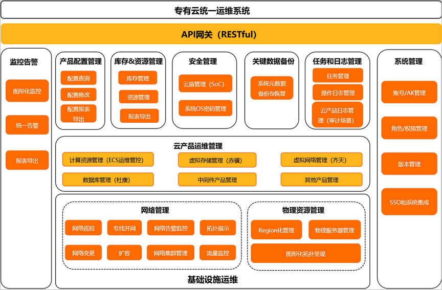

阿里云专有云运维服务管理框架以ITIL和ISO20000为基础，以适应各种管理模式为目标，以管理支撑工具为手段，以流程化、规范化、标准化管理为方法，实现对运维服务全过程的体系化管理。它包含了IT运维服务全生命周期管理方法、管理标准和规范、管理模式、管理支撑工具、管理对象以及基于流程的管理方法。

阿里云专有云运维服务管理体系规定了运维活动涉及的各类实体，以及这些实体间的相互关系。相关的实体按照运维服务管理体系进行有机组织并协调工作，按照服务协议要求提供不同级别的运维服务。

**Apsara Uni-manager运维控制台**

Apsara Uni-manager运维控制台是阿里云专有云统一的智能化运维平台。它根据ITIL和ITSM的标准，对运维的过程和要求进行抽象，将共性的高频操作通过智能化自动化的运维工具来完成；对于个性化的操作，利用接口和多级审核的方式，降低运维操作风险。

Apsara Uni-manager运维控制台根据阿里云专有云对云运维的理解，将云运维分为三个层次，即基础设施运维、云产品和云服务运维以及业务运维。

通过对三个层次体系运维经验的积累和数据的收集，阿里云专有云将运维平台收集到的数据汇聚到平台的CMDB中，由Apsara Uni-manager运维控制台对数据进行整合分析和综合处理。同时，阿里云专有云把丰富的实践经验和运维能力固化到平台运维工具中，以面向终态的设计理念，通过统一的运维工具完成平台的故障发现、故障追踪、链路展示、ITIL流程以及自愈的故障修复，最后达成AIOPS的终极目标。

Apsara Uni-manager运维控制台为用户提供统一的运维Portal，通过运维Portal，为用户提供一致化的运维体验及统一的运维入口。Apsara Uni-manager运维控制台支持与第三方平台的对接，提供统一的运维API能力，可以将运维系统中的数据通过API的形式提供给第三方系统。

Apsara Uni-manager运维控制台对云计算环境中的物理设备、操作系统、计算、网络、存储、数据库、中间件、业务应用等进行统一的自动化部署、升级变更、配置管理。同时，Apsara Uni-manager运维控制台还提供了故障、性能、配置等方面的监控报警、自动分析诊断处理功能，通过分析、处理和评估云平台运行的状态和质量，保障云计算业务应用的持续稳定运行，同时为运维服务流程提供服务与支撑，构建完善的运维服务管理平台。

**运维支撑服务**

除了运维工具以外，阿里云专有云还提供了驻场服务、专家护航服务、业务咨询服务、业务优化服务和重大问题的研发现场支持服务，通过一线、二线和三线的支持体系支持客户解决平台问题，并提供升级渠道支持客户解决紧急问题。阿里云专有云通过完全自主可控的平台，保证技术问题及时有效解决。

# 2.入门

## 2.1. 准备运维账号

在通过Apsara Uni-manager运维控制台开始运维操作前，您需要从角色管理员处获取相应权限的运维账号。

**操作步骤**

1. 角色管理员登录Apsara Uni-manager运维控制台。

2. 创建待分配给运维账号的角色，详情请参见角色管理。

3. 创建待分配给运维账号的部门，详情请参见部门管理。

4. 创建运维账号，同时将已创建的角色分配给该账号，详情请参见用户管理。

   > **说明**
   >
   > 如果需要对运维角色权限进行更细粒度的划分，角色管理员可参考**运维权限管理系统OAM**的内容创建基础角色，并给角色分配权限后，再将该角色分配给相应的运维账号。

## 2.2. 登录Apsara Uni-manager运维控制台

本文介绍运维工程师等相关用户如何登录到Apsara Uni-manager运维控制台。

**前提条件**

- 已从部署人员或管理员处获取Apsara Uni-manager运维控制台的访问地址、用户名和密码。

  Apsara Uni-manager运维控制台访问地址格式为*region-id*.ops.console.*intranet-domain-id*。

- 推荐使用Chrome浏览器。

**操作步骤**

1. 打开浏览器。

2. 在地址栏中，输入Apsara Uni-manager运维控制台的访问地址，按回车键。

   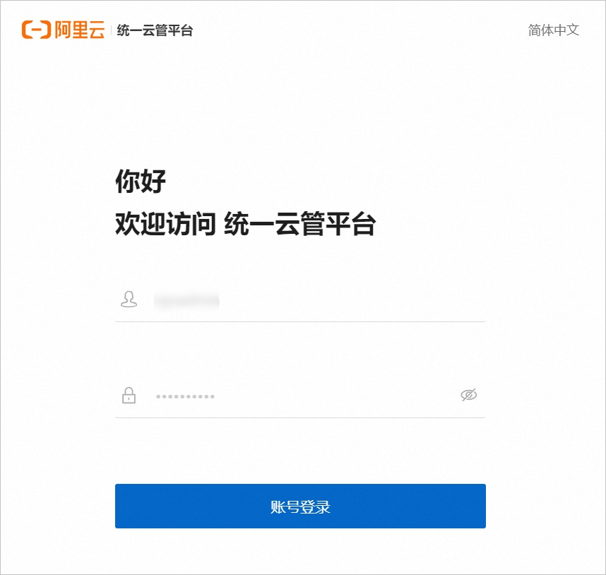

   > **说明**
   >
   > 您可以单击右上角的当前语言切换其它语言。当前支持简体中文、英文、繁体中文三种语言切换。

3. 输入正确的用户名及密码。

   > **说明**
   >
   > 登录Apsara Uni-manager运维控制台的用户名和密码请从部署人员或管理员处获取。

   首次登录Apsara Uni-manager运维控制台时，需要修改登录用户名的密码，请按照提示完成密码修改。

   为提高安全性，密码必须满足以下要求：

   - 必须包含英文大小写字母。

   - 必须包含阿拉伯数字（0~9）。

   - 必须包含特殊符号，包括感叹号（!）、at（@）、井号（#）、美元符号（$）、百分号（%）等。

   - 密码长度为10~20个字符。

4. 单击**账号登录**。

## 2.3. 运维工作台

本文介绍Apsara Uni-manager运维控制台的运维工作台页面各区域的操作和功能说明。

**操作步骤**

1. 登录Apsara Uni-manager运维控制台。

2. 在顶部菜单栏中，单击**运维工作台**。

3. 页面各区域的操作和功能说明如下表所示。

   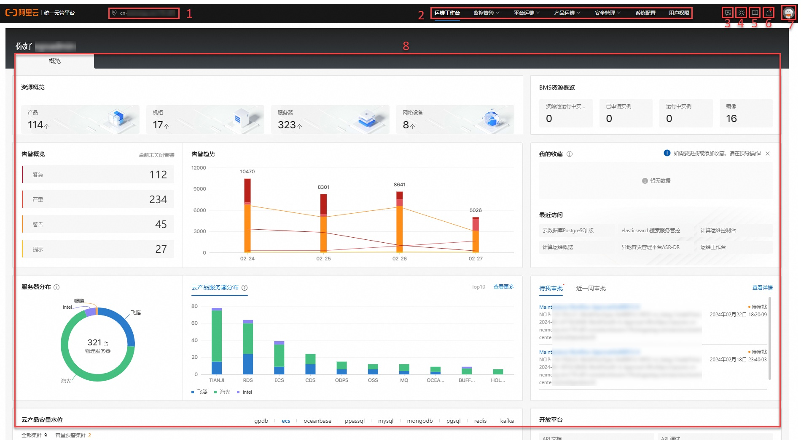

   | 序号 | 区域 | 描述 |
   | --- | --- | --- |
   | ① | 多地域选择区 | 单击列表选项，可以对不同的地域进行切换，实现对各地域统一运维管理。 |
   | ② | 顶部菜单栏区 | 悬停或单击可选择相应的运维操作。 |
   | ③ | 多语言切换区 | 单击可切换语言，目前支持<strong>简体中文</strong>、<strong>繁體中文</strong>以及<strong>English</strong>。 |
   | ④ | 颜色模式设置区 | 单击可设置颜色模式，目前支持<strong>浅色模式</strong>和<strong>深色模式</strong>。 |
   | ⑤ | 帮助中心 | 单击可查看帮助中心在线文档。 |
   | ⑥ | 消息中心 | 单击可查看系统当前未处理的<strong>审批消息</strong>和<strong>告警消息</strong>。 |
   | ⑦ | 个人中心 | 单击可选择菜单，修改<strong>个人信息</strong>、<strong>查看版本信息</strong>，也可以<strong>退出登录</strong>。 |
   | ⑧ | 概览 | 信息展示区和操作区。 |

4. **概览**区域由如下内容组成。

   <table>
     <tr>
       <th width="152">区域</th>
       <th>说明</th>
     </tr>
     <tr>
       <td>资源概览</td>
       <td>查看<strong>产品</strong>、<strong>机柜</strong>、<strong>服务器</strong>和<strong>网络设备</strong>的数量概览。</td>
     </tr>
     <tr>
       <td>BMS资源概览</td>
       <td>查看BMS相关的数据。 • <strong>资源池运行中实例</strong>：成功被纳管进资源池并且状态为<strong>运行中</strong>的裸机实例。该数据与ASCM BMS控制台<strong>概览</strong>页面<strong>资源池实例总数</strong>数据一致。 • <strong>已申请实例</strong>：在租户侧被用户申请的所有实例，不根据状态过滤。该数据与ASCM BMS控制台<strong>概览</strong>页面<strong>已申请实例总数</strong>数据在选择<strong>root</strong>组织时一致，选择其他组织时不一致。 • <strong>运行中实例</strong>：在已申请实例的基础上汇总状态为运行中的实例数据。该数据与ASCM BMS控制台<strong>概览</strong>页面<strong>运行中实例总数</strong>数据在选择<strong>root</strong>组织时一致，选择其他组织时不一致。 • <strong>镜像</strong>：根据所选Region汇总自定义镜像与公共镜像的总数。在多Region场景中，选择相同Region时，该数据与ASCM BMS控制台<strong>概览</strong>页面<strong>镜像</strong>数据一致，选择不同Region时不一致。在单Region场景中，该数据与ASCM BMS控制台<strong>概览</strong>页面<strong>镜</strong><strong>像</strong>数据一致。</td>
     </tr>
     <tr>
       <td>告警概览</td>
       <td>查看当前未关闭的各等级告警数量。</td>
     </tr>
     <tr>
       <td>告警趋势</td>
       <td>查看各等级告警的数量以及趋势图。</td>
     </tr>
     <tr>
       <td>我的收藏</td>
       <td>展示用户收藏的顶部菜单栏功能，如果需要更换或添加收藏，请在顶部菜单栏进行操作。</td>
     </tr>
     <tr>
       <td>最近访问</td>
       <td>展示用户最近访问的菜单栏功能页面。</td>
     </tr>
     <tr>
       <td>服务器分布</td>
       <td>展示物理服务器按照CPU维度的数量分布以及物理服务器总数。</td>
     </tr>
     <tr>
       <td>云产品服务器分布</td>
       <td>展示租户侧云产品服务器按CPU维度的数量分布。</td>
     </tr>
     <tr>
       <td>待我审批</td>
       <td>• 展示待审批的工作流内容以及提交时间，单击<strong>查看详情</strong>页面跳转到待审批工作流页面。 • 切换<strong>近一周审批</strong>页签，页面展示最近一周已经审批的工作流内容以及审批时间。</td>
     </tr>
     <tr>
       <td>云产品容量水位</td>
       <td>展示各云产品相关的容量情况。</td>
     </tr>
     <tr>
       <td>开放平台</td>
       <td>提供开发平台的快捷入口，具体内容可参考开放平台。</td>
     </tr>
   </table>

# 3.监控告警

## 3.1. 监控管理

本文列出了支持的监控管理相关的产品控制台，具体运维操作请参考对应的产品文档。

- 云平台监控•云监控

- TianjiMon集群监控大盘•grafana

## 3.2. 告警管理

本文介绍了告警管理相关的功能特性。

**功能定位**

当云基础设施及云平台软件出现问题或故障时，会触发产生告警。告警来源包括监控的云产品、监控系统自身及管理对象等。告警产生后，告警概览、告警列表及告警详情页面将从多个维度展示告警信息。例如，告警概览页面会以产品维度汇聚产品各模块告警总数，告警列表会对告警进行收敛，并持续递增告警次数，告警详情展示告警的具体模块信息，帮助客户更快定位问题。

**应用价值**

通过告警主动上报或采集监控数据匹配告警规则，统一汇聚云平台各模块的告警信息，实现云资源的集中告警管理，帮助用户高效地定位和处理故障，从而保障业务的正常运行。

**功能特性**

<table>
  <tr>
    <th width="90">特性</th>
    <th>特性描述</th>
  </tr>
  <tr>
    <td>告警概览</td>
    <td>按照地域、告警来源、告警趋势、告警分布以及云产品归属等多个维度进行查看统计的告警总览信息。</td>
  </tr>
  <tr>
    <td>告警列表</td>
    <td>查看所有上报的告警列表信息，包括已关闭的告警。您可以通过此页面查看告警的详细信息、变更告警状态、导出告警信息。</td>
  </tr>
  <tr>
    <td>告警设置</td>
    <td>提供告警配置相关的管理功能，包括策略管理、告警模板、通知管理、告警屏蔽、告警规则配置等。</td>
  </tr>
</table>

**告警源信息**

告警数据从以下告警源中获取。

| 原始值 | 名称 |
| --- | --- |
| tianjimon | 集群监控TianjiMon |
| tpcmon | 专有云轻量监控TPCMon |
| dts | 数据传输服务DTS |
| Bcmc# | 灾备管理中心同城容灾Bcmc |
| DB | 专有云产品授权Licence |
| asapi | 专有云接口网关ASAPI |
| drds | 分布式关系型数据库PolarDB |
| asrbr-backup | 灾备管理中心备份和恢复ASRBR |
| ascm | Apsara Uni-manager运营控制台 |
| dbs-dbs | 数据库备份服务DBS |
| admin-server | admin-server |
| asd | 专有云诊断工具ASD |
| sds-management | sds-management |
| bcc | 大数据管家BCC |
| aso-inventory | Apsara Uni-manager运维控制台库存监控 |
| OcpApiV2 | 云数据库OceanBase |

### 3.2.1. 告警概览

本文介绍了按照地域、告警来源以及云产品维度统计的告警总览信息，并定时定位的查看告警详情。

**前提条件**

已获得系统管理员权限。

**操作步骤**

1. 登录Apsara Uni-manager运维控制台。

2. 在顶部菜单栏中，选择**监控告警** > **告警管理** > **告警概览**。

3. 当前页面包含以下五个部分，从不同角度分析和统计告警信息。

   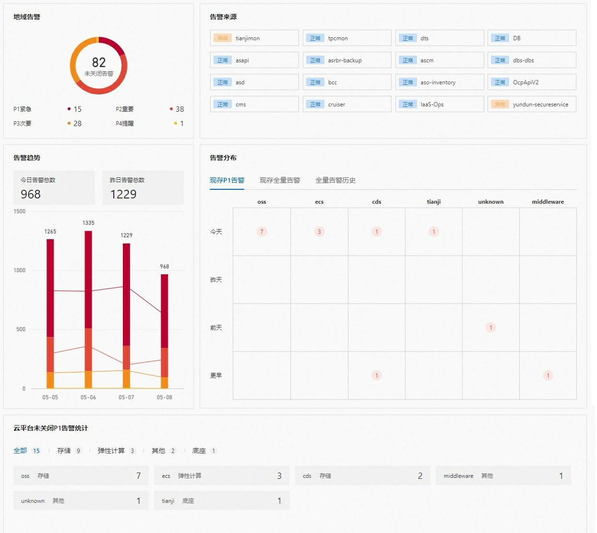

   - **地域告警**：按照每个地域进行划分，统计每个地域的告警数量和等级。

     P1~P4四级告警对应不同的颜色显示在环状图上，每一个级别的告警数量越多，在环状图上占比面积越大。

   - **告警来源**：统计各个告警源的状态。

     橙色表示告警源异常，蓝色表示告警源正常。

   - **告警趋势**：按照时间进行划分统计告警数量。

     - 每个柱面不同颜色的区域表示告警等级，对于每个色块，颜色越深代表告警等级越高。

     - 每个柱面的面积越大代表对应告警等级下的告警数量越多。

     - 将鼠标悬停在柱面上时，系统会显示当天每个告警等级对应的数量统计。

     - 折线图展示了不同告警级别数量在一段时间的趋势图。

   - **告警分布**：从**现存P1告警**、**现存全量告警**、**全量告警历史**等维度，统计不同产品的告警和等级。

     色块越大代表告警数量越多，鼠标悬停在色块上时，系统会显示当前色块的告警等级及数量。

   - **云平台未关闭P1告警统计**：统计未关闭P1级别告警的云平台及对应的告警数量。

     每个页签是每个产品所属的分类，单击不同页签即可查看不同类别下含有未关闭P1告警级别的产品及对应的告警数量。

**后续操作**

按照需求获取告警概览信息后，可通过告警列表进一步查看告警的信息。

### 3.2.2. 告警列表

您可以查看当前所有告警的详细信息，并支持修改告警状态。根据需求自定义查询所需查看的告警信息，同时可以将告警信息以表格形式导出。

**前提条件**

已获得系统管理员权限。

**操作步骤**

1. 登录Apsara Uni-manager运维控制台。

2. 在顶部菜单栏中，选择**监控告警** > **告警管理** > **告警列表**。

3. 系统默认进入**未关闭**页签，您可以通过此页面查看未关闭的告警列表，包括**告警等级**、**告警项ID/告警项中文名**、**资源归属**、**告警状态**、**告警开始时间**、**最近告警时间/持续时间**、**告警次数**、**拓展属性**、**告警对象**、**对象类型**以及**告警来源**。

   > **说明**
   >
   > - 通过切换**已关闭**页签查看已关闭的告警列表。
   >
   > - **告警等级**和**最近告警时间/持续时间**支持排序展示。

4. 在页面上方，可以选择**资源归属**，输入告警关键字进行模糊搜索，关键字范围包括告警ID、告警信息以及拓展属性关键字。

   也可以单击**高级筛选**，根据**告警项ID**、**告警项中文名**、**告警开始时间**、**告警等级**、**告警状态**、**告警来源**、**告警对象**以及**对象类型**组合筛选获取目标告警数据。

   

   > **说明**
   >
   > 在**未关闭**页签下，系统默认不展示已关闭的告警信息，但在**高级筛选**中，支持过滤并展示已关闭的告警信息。同理，在**已关闭**页签下，系统默认不展示未关闭的告警信息，但在**高级筛选**中，支持过滤并展示未关闭的告警信息。

5. 单击目标告警的**告警项ID/告警项中文名**进入告警详情页面，获取告警的详细信息。

   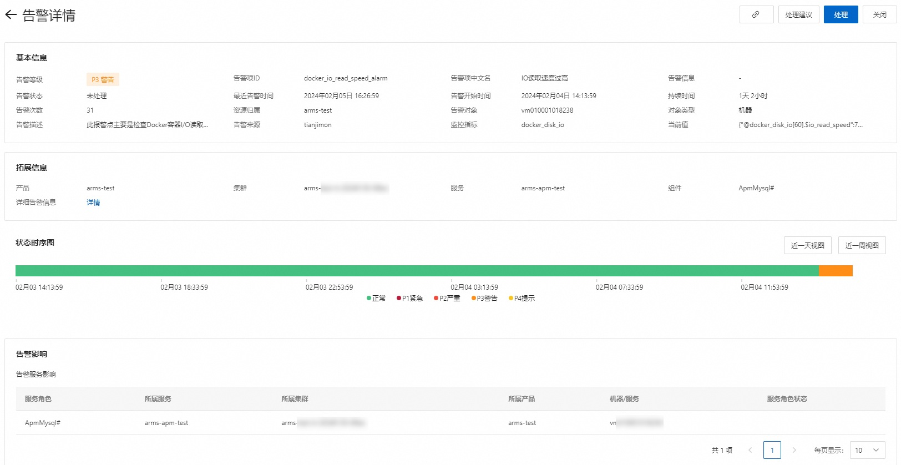

   - 在页面右上角可以执行如下操作。

     - 单击**处理**或**关闭**，可以修改当前的告警状态。

   - 在**基本信息**区域查看告警基本信息。

   - 在**拓展信息**区域查看告警拓展信息。

     > **说明**
     >
     > 将鼠标悬停在**详细告警信息**的**详情**上，系统会显示详细的告警信息。

   - 在**状态时序图**区域查看告警指标的视图。

     - 查看近一天视图：单击**近一天视图**，查看发生告警前一天的告警指标的视图。

     - 查看近一周视图：单击**近一周视图**，查看发生告警前一周的告警指标的视图。

   - 在**告警影响**区域查看告警的影响范围。

     您可以查看可能受到影响的服务角色以及对应的状态。同时，如果确定服务角色归属，还会显示出服务角色归属的服务、集群、产品和所在的物理机。

6. 当告警清除完成后，系统按照告警规则会定期同步告警状态。如果告警清除后，系统未及时更新告警状态，您可以手动变更告警状态，将告警状态置为**处理中**或**关闭**状态。

   - 置为**处理中**：

     - 单个告警：在**告警列表**页面中，单击目标告警**操作**列的**处理**，系统会将目标告警的**告警状态**修改为**处理中**。

     - 多个告警：选中目标告警，在页面左下方，单击**批量处理**，系统会将目标告警的**告警状态**修改为**处理中**。

   - 置为**已关闭**：

     - 单个告警：在**告警列表**页面中，单击目标告警**操作**列的**关闭**，系统会将目标告警的**告警状态**修改为**已关闭**。修改完成后会在**已关闭**页签下的告警列表中显示关闭的告警。

     - 多个告警：选中目标告警，在页面左下方，单击**批量关闭** ，系统会将目标告警的**告警状态**修改为**已关闭**。修改完成后会在**已关闭**页签下的告警列表中显示关闭的告警。

7. 在页面的上方，单击**报表导出**，以表格的形式导出告警报表文件。

### 3.2.3. 告警设置

**功能特性**

<table>
  <tr>
    <th width="122">特性</th>
    <th>特性描述</th>
  </tr>
  <tr>
    <td>策略管理</td>
    <td>提供了告警通知联系人、联系人组以及静态参数配置的功能。</td>
  </tr>
  <tr>
    <td>告警模板</td>
    <td>云平台告警模板的管理。</td>
  </tr>
  <tr>
    <td>通知管理</td>
    <td>通过配置告警通知通道信息，将告警信息通过配置的方式推送给相关责任人。</td>
  </tr>
  <tr>
    <td>告警屏蔽</td>
    <td>支持对指定时间段、资源归属、集群、服务、服务角色、机器、告警等级、告警来源的告警进行屏蔽，同时也支持对单个告警ID进行精准屏蔽。</td>
  </tr>
  <tr>
    <td>已屏蔽告警</td>
    <td>展示命中告警屏蔽规则的告警列表，您可以通过此页面查看被屏蔽的告警详情以及关联的屏蔽规则。</td>
  </tr>
  <tr>
    <td>告警规则配置</td>
    <td>展示触发告警的规则信息。</td>
  </tr>
</table>

#### 3.2.3.1. 策略管理

策略管理提供了告警通知联系人、联系人组配置及静态参数配置功能。

**联系人**

您可以根据业务需要，查询、添加、修改以及删除告警联系人。

**操作步骤**

1. 登录Apsara Uni-manager运维控制台。

2. 在顶部菜单栏，选择**监控告警** > **告警管理** > **告警设置**。

3. 在左侧导航栏，选择**策略管理**。

4. 您可以进行如下操作：

   - 查询告警联系人

     在左上方的搜索栏中选择对应的产品名称，输入联系人姓名，就可以在列表中查看符合查询条件的告警联系人信息。

   - 添加告警联系人

     单击左上角**添加联系人**，配置如下参数后单击**确定**。

     <table>
       <tr>
         <th width="90">参数</th>
         <th>参数说明</th>
       </tr>
       <tr>
         <td>姓名</td>
         <td>输入新增告警联系人的姓名。</td>
       </tr>
       <tr>
         <td>角色</td>
         <td>选择新增告警联系人角色。 • Developer：开发人员 • TAM：运维人员</td>
       </tr>
       <tr>
         <td>产品</td>
         <td>选择产品，多可选。</td>
       </tr>
       <tr>
         <td>告警等级</td>
         <td>选择告警等级，可多选。 • P1：紧急告警 • P2：重要告警 • P3：次要告警 • P4：提醒告警</td>
       </tr>
       <tr>
         <td>聚合维度</td>
         <td>选择告警推送方式。 • 逐条推送 • 产品 • 监控指标 • 机器</td>
       </tr>
       <tr>
         <td>值班时间</td>
         <td>选择新增告警联系人值班的起始时间和结束时间。</td>
       </tr>
       <tr>
         <td>钉钉</td>
         <td>输入新增告警联系人的钉钉。</td>
       </tr>
       <tr>
         <td>邮箱</td>
         <td>输入新增告警联系人的邮箱。</td>
       </tr>
     </table>

     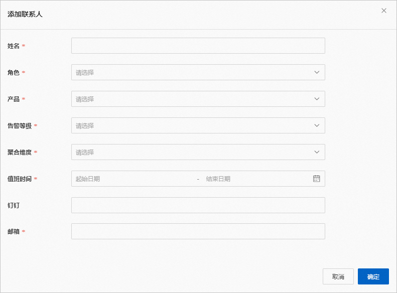

   - 修改告警联系人

     单击目标告警联系人对应**操作**列的**编辑**，在弹出的对话框中修改相关信息，完成后单击**确定**。

   - 删除告警联系人

     单击目标告警联系人对应**操作**列的**删除**，在弹出的确认框中单击**确定**。

**联系人组**

您可以根据业务需要，查询、添加、修改以及删除告警联系人组。

**前提条件**

已创建告警联系人。

**操作步骤**

1. 登录Apsara Uni-manager运维控制台。

2. 在顶部菜单栏，选择**监控告警** > **告警管理** > **告警设置**。

3. 在左侧导航栏，单击**策略管理**。

4. 单击**联系人组**页签。

5. 您可以进行如下操作。

   - 查询告警联系人组

     在上方的搜索框中输入**组名**，可以查看符合查询条件的告警联系人组信息。

   - 添加告警联系人组

     单击左上角**添加联系人组**，配置如下参数后单击**确定**。

     | 参数 | 参数说明 |
     | --- | --- |
     | 组名 | 输入告警联系人组名称。 |
     | 描述 | 输入告警联系人组描述信息。 |
     | 选择联系人 | 选择待添加到联系人组中的联系人。 |

     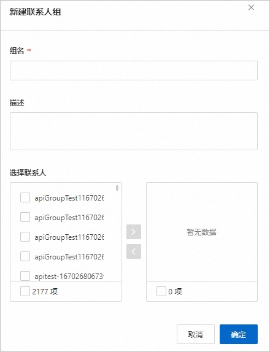

   - 修改告警联系人组

     单击目标告警联系人组对应**操作**列的**编辑**，在弹出的对话框中修改相关信息，完成后单击**确定**。

   - 删除告警联系人组

     - 单个联系人组：单击目标告警联系人组对应**操作**列的**删除**，在弹出的确认框中单击**确定**。

     - 多个联系人组：勾选多个目标告警联系人组，在页面下方单击**批量删除**，在弹出的确认框中单击**确定**。

**静态参数配置**

您可以根据业务需求，配置告警相关的静态参数。

**背景信息**

当前版本暂不支持添加新的告警配置。

**操作步骤**

1. 登录Apsara Uni-manager运维控制台。

2. 在顶部菜单栏，选择**监控告警** > **告警管理** > **告警设置**。

3. 在左侧导航栏，单击**策略管理**。

4. 单击**静态参数配置**页签。

   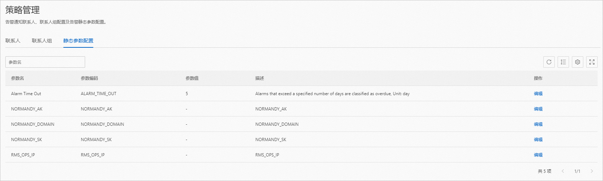

5. 在页面上方的搜索框中，输入参数名，查询符合条件的静态参数配置信息。

6. 选择需要修改的静态参数，在对应的**操作**列中，单击**编辑**。

7. 在**编辑静态参数**对话框中，修改如下参数后单击**确定**。

   | 名称 | 描述 |
   | --- | --- |
   | 参数名 | 填写一个与配置相关的参数名。 |
   | 参数值 | 默认值为5，表示5天。 |
   | 描述 | 填写与配置相关的描述。 |

   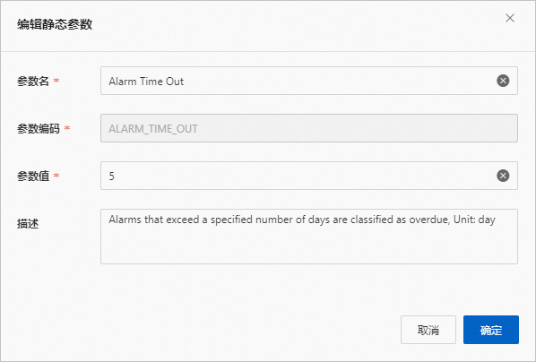

#### 3.2.3.2. 告警模板

对于部署在PaaS平台的蚂蚁金融服务产品，您可以通过上传告警模板，对触发告警的规则进行配置或调整。

**操作步骤**

1. 登录Apsara Uni-manager运维控制台。

2. 在顶部菜单栏，选择**监控告警** > **告警管理** > **告警设置**。

3. 在左侧导航栏，选择**告警模板**。

4. 在页面上方**服务**下拉列表中选择对应服务，页面下方会显示服务的详细信息，单击关联模板名称可以查看详细的模板内容。

   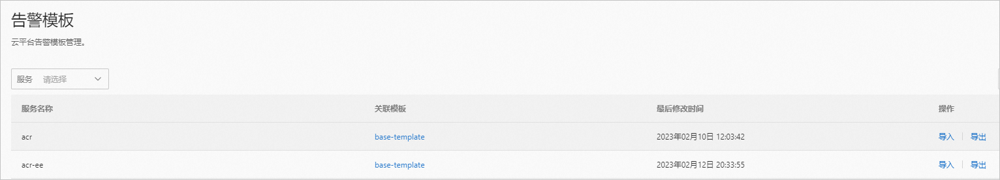

5. 下载告警模板。

   > **说明**
   >
   > 部署在PaaS平台的蚂蚁金融服务产品请使用simple_template.json模板。

6. 单击服务信息对应**操作**列的**导入**，在**导入模板**对话框中单击**上传文件并解析**，选中模板，单击**打开**，上传完成后，单击**确定**，完成对应服务模板的导入。

   > **说明**
   >
   > 也可以导出模板。

#### 3.2.3.3. 告警通知

通过告警通知功能，可以配置告警通知通道，进而将告警信息通过一定的方式推送给运维工程师。

**创建订阅**

1. 登录Apsara Uni-manager运维控制台。

2. 在顶部菜单栏，选择**监控告警** > **告警管理** > **告警设置**。

3. 在左侧导航栏，选择**告警通知**。

4. 在**订阅**页签中，单击**创建订阅**，在弹出的对话框中填写相关配置项并单击**确定**。

   | 参数 | 参数说明 |
   | --- | --- |
   | 通道名称 | 新增的订阅通道的名称。 |
   | 订阅语言 | 可以选择<strong>中文</strong>或<strong>英文</strong>两种语言。 |
   | 订阅地域 | 默认显示当前订阅所在地域。 |
   | 推送告警等级 | 选择推送告警的等级，支持多选。 |
   | 推送协议 | 目前只支持<strong>HTTP</strong>的方式推送。 |
   | 推送接口地址 | 推送接口的IP地址。 |
   | 推送接口端口 | 推送接口的端口。 |
   | 推送接口URL | 推送接口的URL。 |
   | 推送请求方法 | 目前仅支持<strong>POST</strong>的方式推送。 |
   | 推送周期（分钟） | 推送周期，按分钟计算。 |
   | 一次推送的告警数量 | 每次推送告警的数量。 |
   | 推送模式 | 目前支持如下两种方式： • <strong>ALL</strong>：每个推送周期推送所有的告警。 • <strong>TOP</strong>：每个推送周期推送高优先级的告警。 |
   | 通道自定义字段（格式JSON） | 推送的接收方可以通过该字段进行自定义设置标识符等，格式必须为JSON。 |
   | 推送开关 | 选择是否进行推送。如果这里未开启推送，也可以在订阅通道配置完成后，在通道对应的<strong>推送开</strong><strong>关</strong>列开启推送功能。 |

   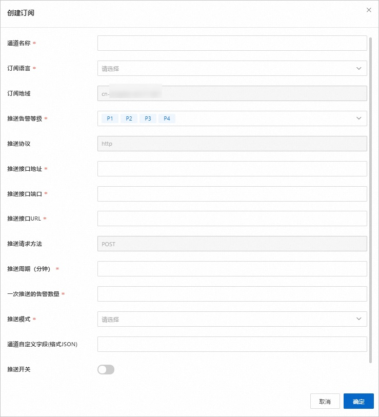

5. 完成推送通道设置，并开启推送开关后，单击**推送**页签，在此页面查看推送记录。

**更多操作**

**修改告警通道信息**

1. 单击目标告警通道对应**操作**列的**编辑**。

2. 在弹出的对话框中修改配置参数信息，完成后单击**确定**。

   > **说明**
   >
   > 在目标告警通道列表的**推送开关**列，打开或关闭开关，可以将告警通道设置为生效或不生效。

**检测告警通道连通性**

单击目标告警通道对应**操作**列的**测试**，检测推送通道的连通性。

**删除告警通道信息**

1. 单击目标告警通道对应**操作**列的**删除**。

2. 在弹出的对话框中单击**确定**。

#### 3.2.3.4. 告警屏蔽

告警屏蔽支持对指定屏蔽时间段、指定多个告警产品、集群、服务、服务角色、机器的告警进行屏蔽，同时支持针对单个告警ID进行精准屏蔽。

**前提条件**

已经获取对告警屏蔽菜单操作的权限。

**创建屏蔽规则**

1. 登录Apsara Uni-manager运维控制台。

2. 在顶部菜单栏，选择**监控告警** > **告警管理** > **告警设置**。

3. 在左侧导航栏，选择**告警屏蔽**。

4. 在页面上方，单击**创建屏蔽规则**，在弹出的对话框中配置需要屏蔽的告警筛选项并单击**确定**。

   <table>
     <tr>
       <th width="105">参数</th>
       <th>参数说明</th>
     </tr>
     <tr>
       <td>资源归属</td>
       <td>可选，表示待屏蔽的告警所属的产品名称。</td>
     </tr>
     <tr>
       <td>集群</td>
       <td>可选，表示待屏蔽的告警所属的集群名称。</td>
     </tr>
     <tr>
       <td>机器</td>
       <td>可选，表示待屏蔽的ECS实例的宿主机名称。</td>
     </tr>
     <tr>
       <td>服务</td>
       <td>可选，表示待屏蔽的告警所属的服务名称。</td>
     </tr>
     <tr>
       <td>服务角色</td>
       <td>可选，表示待屏蔽的告警所属的服务角色名称。</td>
     </tr>
     <tr>
       <td>告警ID</td>
       <td>可选，表示待屏蔽告警的ID。</td>
     </tr>
     <tr>
       <td>告警等级</td>
       <td>可选，告警分为以下几个等级： • P1：表示紧急告警。 • P2：表示严重告警。 • P3：表示警告告警。 • P4：表示提示告警。</td>
     </tr>
     <tr>
       <td>告警来源</td>
       <td>可选，表示待屏蔽告警的告警来源。</td>
     </tr>
     <tr>
       <td>屏蔽时间段</td>
       <td>可选，表示待屏蔽告警发生的时间范围。</td>
     </tr>
     <tr>
       <td>生效状态</td>
       <td>必选，表示屏蔽规则是否生效。</td>
     </tr>
   </table>

   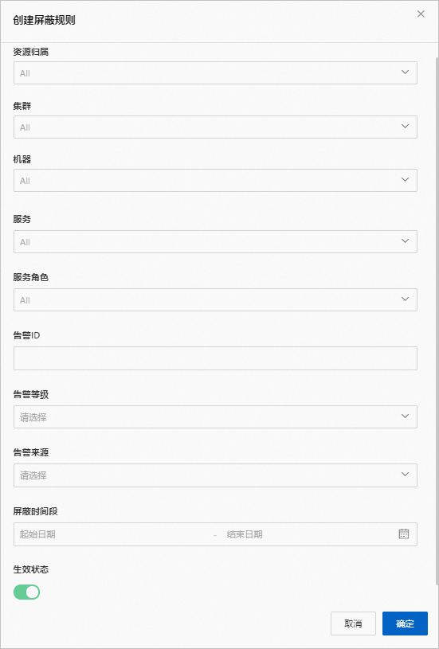

**更多操作**

**查看告警屏蔽规则**

- 在文本输入框中输入告警关键字，支持模糊查询，筛选目标屏蔽规则。

- 单击**高级筛选**，可以根据**资源归属**、**集群**、**服务**、**服务角色**以及**机器**组合筛选获取目标屏蔽规则。

  

- 在**生效状态**列，可以筛选**开启**或**关闭**的屏蔽规则。

**修改告警屏蔽规则**

1. 单击目标告警屏蔽规则对应**操作**列的**编辑**。

2. 在弹出的对话框中修改配置参数信息，完成后单击**确定**。

   > **说明**
   >
   > 在目标告警屏蔽规则的**生效状态**列，打开或关闭开关，可以将告警屏蔽规则设置为生效或不生效。

**删除告警屏蔽规则**

1. 单击目标告警屏蔽规则对应**操作**列的**删除**。

2. 在弹出的对话框中单击**确定**。

#### 3.2.3.5. 已屏蔽告警

可以查看用户创建并生效的告警屏蔽规则所屏蔽的告警详情。

**前提条件**

- 已经获取已屏蔽告警的查看权限。

- 已创建并生效至少一条告警屏蔽规则。

**操作步骤**

1. 登录Apsara Uni-manager运维控制台。

2. 在顶部菜单栏，选择**监控告警** > **告警管理** > **告警设置**。

3. 在左侧导航栏，选择**已屏蔽告警**。

   页面显示被屏蔽告警的**告警ID**、**告警资源**、**告警等级**、**告警信息**、**资源归属**、**告警时间**、**告警来源**以及关联**屏蔽规则**（即告警被哪一条屏蔽规则命中而被屏蔽）。

   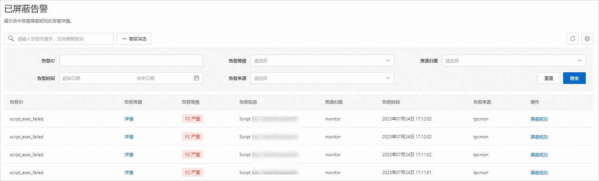

4. 输入告警关键字查询目标告警，支持模糊查询。也可以单击**高级筛选**，根据**告警ID**、**告警等级**、**资源归属**、**告警时间**以及**告警来源**组合筛选获取目标告警。

5. 将鼠标悬停于目标告警的**告警资源**列的**详情**，系统将显示告警资源的详细信息，包括告警归属的产品、集群、服务、服务角色、主机等。

6. 在目标告警的**操作**列，单击**屏蔽规则**，系统将弹出对话框展示屏蔽规则信息。

   - 如果屏蔽规则未被删除，对话框中将显示屏蔽规则的详细信息。您也可以在对话框中修改配置参数信息，完成后单击**确定**。

   - 如果屏蔽规则已被删除，对话框将显示**屏蔽规则已被删除**。

#### 3.2.3.6. 告警规则配置

本文介绍了对告警规则的配置修改，包括告警规则启用状态、触发次数、触发规则。相比于原来复杂的告警模板，降低了现场查看、修改告警规则配置的门槛，让用户可以一键修改告警规则配置，免去了原有繁琐的修改流程。

**背景信息**

- 告警规则配置仅支持云平台集群监控TianjiMon。

- 在修改告警触发规则时仅支持修改包含数字的规则。

- 修改告警规则经校验无误生效后，将会全局改变该告警的策略。若规则修改不当，可能存在告警数量激增或无告警的风险。

**操作步骤**

1. 登录Apsara Uni-manager运维控制台。

2. 在顶部菜单栏，选择**监控告警** > **告警管理** > **告警设置**。

3. 在左侧导航栏，选择**告警规则配置**。

4. 单击**高级筛选**，可以通过**监控名**、**产品**、**集群**、**服务**以及**规则状态**组合筛选目标告警规则，告警规则的主要参数含义如下表所示。

   | 参数 | 参数说明 |
   | --- | --- |
   | 产品 | 告警规则配置的产品，告警规则配置在指定的产品告警上生效。 |
   | 集群 | 告警规则配置的集群，告警规则配置在指定的集群上生效。 |
   | 服务 | 告警规则配置的服务，告警规则配置在指定的服务上生效。 |
   | 关联模板 | 告警规则关联的模板。 |
   | 监控名 | 告警规则对应的监控名，告警规则配置在指定的监控名告警上生效。 |
   | 告警名 | 告警名称。 |
   | 告警触发规则 | 触发告警的规则条件。 |
   | 检测周期（s） | 告警规则执行的间隔时间，单位为秒。 |
   | 最后修改时间 | 最后修改告警规则的时间。 |
   | 规则生效状态 | 告警规则的状态。一共有三种状态：<strong>已生效</strong>、<strong>未生效</strong>、<strong>验证中</strong>。 |
   | 规则是否启用 | 告警规则的启用状态。一共有两种状态：<strong>已启用</strong>、<strong>未启用</strong>。 |

   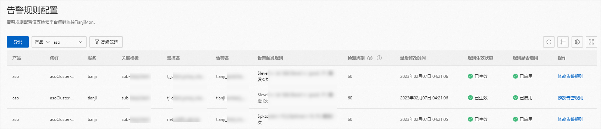

5. 在目标告警规则的**操作**列，单击**修改告警规则**，在弹出的对话框中修改如下告警规则，完成后单击**保存并验证**。

   <table>
     <tr>
       <th width="89">参数</th>
       <th>参数说明</th>
     </tr>
     <tr>
       <td>是否启用</td>
       <td>选择是否启用告警规则。</td>
     </tr>
     <tr>
       <td>告警等级</td>
       <td>选择告警的等级。</td>
     </tr>
     <tr>
       <td>触发次数</td>
       <td>输入告警生效的触发次数。</td>
     </tr>
     <tr>
       <td>触发规则</td>
       <td>为防止规则修改错误导致告警失效，仅支持对阈值的修改，只能输入数字（包括整数和小数）。</td>
     </tr>
   </table>

   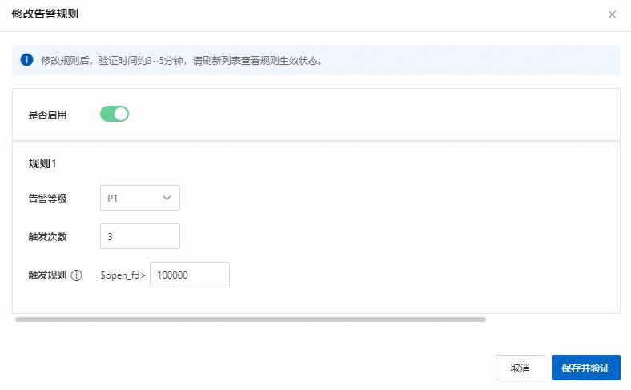

   > **说明**
   >
   > 修改规则后，验证时间约3～5分钟，请刷新列表查看规则生效状态。

6. 在左上方单击**导出**，可导出当前页面显示的告警规则。

## 3.3. 巡检管理

本文介绍了巡检管理相关的功能特性。

**功能特性**

Apsara Uni-manager运维控制台支持多种巡检场景进行快速检查，帮助维护系统及云产品状态。

| 特性 | 特性描述 |
| --- | --- |
| 一键巡检 | 支持多种巡检场景的快速检查，包括系统预置巡检场景以及自定义巡检场景。 |
| 巡检大盘 | 展示一段时间内巡检场景执行的数据统计。 |
| 巡检配置 | 提供自定义巡检场景的配置，让巡检摸底更高效。 |
| 巡检记录 | 展示所有巡检操作记录，并支持查看对应的巡检报告。 |
| 巡检通知 | 提供配置发送巡检报告通知的方式。 |

### 3.3.1. 一键巡检

本文介绍了系统支持的多种巡检场景检查，帮助维护系统及云产品状态，可以根据需要启动对应场景下的巡检任务。

**前提条件**

- 已获取ASO系统管理员权限。

- 若要启动自定义巡检，请先完成自定义巡检配置，具体可参考巡检配置。

**操作步骤**

1. 登录Apsara Uni-manager运维控制台。

2. 在顶部菜单栏，选择**监控告警** > **巡检管理** > **一键巡检**。

3. 系统支持多种巡检场景的快速检查，包括预置巡检场景以及自定义巡检场景。选择目标巡检场景后，可以获取巡检场景相关的巡检项列表。

   - 将鼠标悬停于目标巡检项对应**操作**列的**巡检参数**，可以查看对应的巡检参数。

   - 将鼠标悬停于目标巡检项对应**操作**列的**巡检内容**，可以查看对应的巡检内容。

4. 单击**立即巡检**，在需要用邮箱接收巡检通知时配置邮箱信息，然后单击**确定**触发巡检。

   > **说明**
   >
   > - 在设置邮箱时，支持配置多个邮箱号，多个邮箱用英文分号进行隔开。
   >
   > - 页面提示未配置巡检通知通道，导致无法发送巡检通知，可以在**巡检通知**页面进行配置。如果不需要配置接收邮箱，可以直接单击**执行**触发巡检。

5. 巡检启动后，系统将展示巡检的进度详情。如果需要终止巡检，可单击**终止**，在弹出的对话框中单击**终止**。

   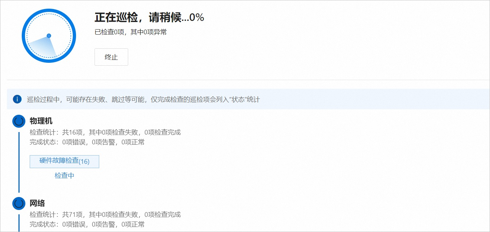

6. 巡检完成后，查看巡检结果。

   - 在页面上方，查看**巡检场景**、**开始执行**、**结束执行**、**发起人**、**执行策略**以及**结果建议**等基本信息。

   - 在**巡检概览**区域，可以查看巡检通过率、巡检项总数、巡检项失败数、巡检项错误数、巡检项警告数、巡检项正常数。单击巡检状态对应的数据可以查看对应巡检状态下的详细巡检结果。

   - 在**完成巡检项结果概览**区域，可以查看各巡检项类型下的巡检结果，包括巡检错误数、巡检告警数以及巡检正常数。单击巡检项类型可以查看对应类型下的详细巡检结果。

     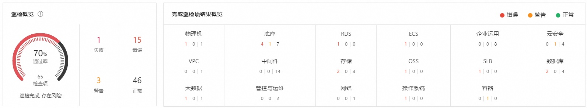

   - 在页面下方，单击**高级筛选**，可以根据**巡检项类型**、**巡检状态**、**巡检项名称**、**巡检项描述**组合筛选查看目标巡检结果明细。

     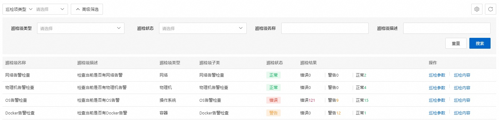

     - 将鼠标悬停于目标巡检项对应**操作**列的**巡检参数**，可以查看对应的巡检参数。

     - 将鼠标悬停于目标巡检项对应**操作**列的**巡检内容**，可以查看对应的巡检内容。

     - 单击目标巡检项对应**巡检结果**列的数字，可以在对话框中查看巡检结果详情。

       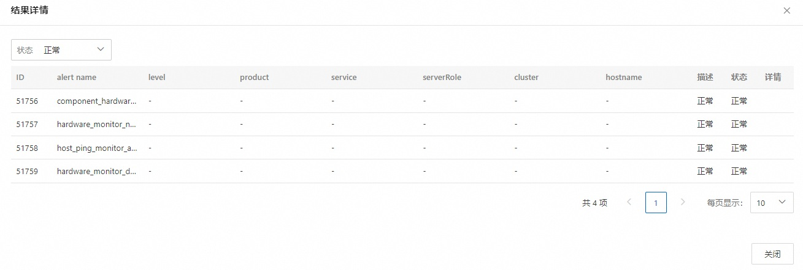

   - 单击页面右上角的**查看报告接收邮箱**，可以获取巡检报告接收的邮箱信息。

   - 单击页面右上角的**导出报告**，可以将巡检报告下载至本地进行查看。

     > **说明**
     >
     > 支持导出json和excel两种格式的巡检报告。

**更多操作**

**定时巡检**

1. 选择目标巡检场景后，单击**定时巡检**。

2. 配置如下参数后单击**确定**。定时巡检设置后每周均会按设定规则执行。

   <table>
     <tr>
       <th width="121">参数</th>
       <th>参数说明</th>
     </tr>
     <tr>
       <td>邮箱设置</td>
       <td>输入接收巡检通知的邮箱号，多个邮箱用英文分号进行隔开。</td>
     </tr>
     <tr>
       <td>定时规则设置</td>
       <td>单击<strong>新增生效时间周期</strong>，配置<strong>生效时间</strong>和<strong>生效周期</strong>。 说明单击可以删除生效时间周期。 </td>
     </tr>
   </table>

### 3.3.2. 巡检大盘

查看一段时间内巡检场景执行的数据统计。

**操作步骤**

1. 登录Apsara Uni-manager运维控制台。

2. 在顶部菜单栏，选择**监控告警** > **巡检管理** > **巡检大盘**。

3. 在页面右上角选择**时间范围**，支持**近七天**、**近一个月**、**近三个月**。

4. 在当前页面可以获取如下内容。

   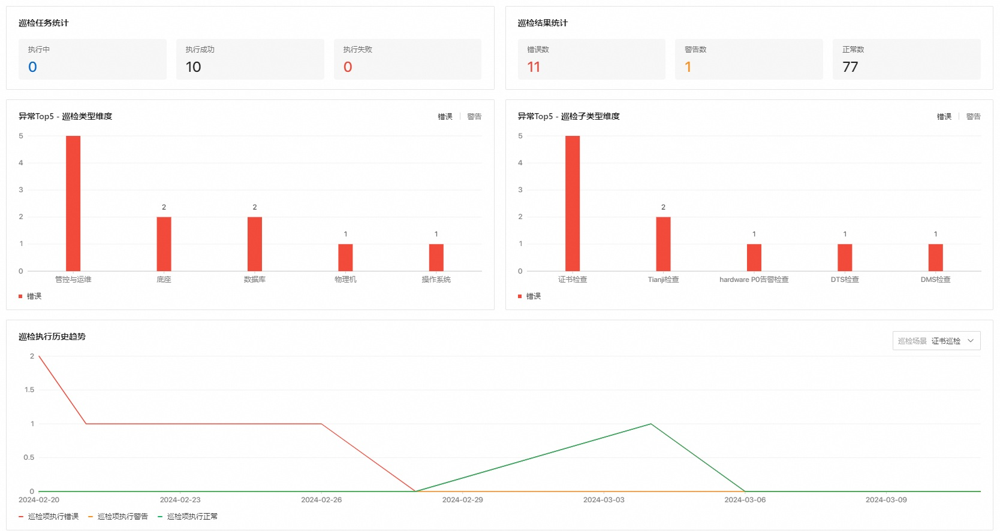

   - 在**巡检任务统计**区域查看巡检任务执行结果，包括**执行中**、**执行成功**以及**执行失败**的数量。

   - 在**巡检结果统计**区域查看巡检项执行结果，包括**错误数**、**告警数**以及**正常数**。

   - 在**异常Top-巡检类型维度**区域，以巡检类型为维度，展示巡检错误数和巡检告警数的前五项以及对应的数量。

   - 在**异常Top-巡检子类型维度**区域，以巡检子类型为维度，展示巡检错误数和巡检告警数的前五项以及对应的数量。

   - 在**巡检执行历史趋势**区域，在**巡检场景**下拉框中选择目标巡检场景，查看对应巡检场景下**巡检项执行错误**、**巡检项执行警告**、**巡检项执行正常**在目标时间段的趋势图。将鼠标悬停于节点上，查看对应时间节点的数据。

### 3.3.3. 巡检配置

本文介绍了用户自定义巡检场景的配置，让巡检摸底更高效。

**新建巡检场景**

1. 登录Apsara Uni-manager运维控制台。

2. 在顶部菜单栏，选择**监控告警** > **巡检管理** > **巡检配置**。

3. 在**巡检场景**页签下，单击**新建巡检场景**，配置如下参数后单击**确定**。

   <table>
     <tr>
       <th width="105">参数</th>
       <th>参数说明</th>
     </tr>
     <tr>
       <td>场景名称</td>
       <td>输入自定义巡检场景名称。</td>
     </tr>
     <tr>
       <td>场景描述</td>
       <td>输入自定义巡检场景的相关描述信息。</td>
     </tr>
     <tr>
       <td>配置巡检项</td>
       <td>选择自定义巡检场景下的巡检项目，选择巡检项目后会在下方展示具体的巡检内容。 • 将鼠标悬停于目标巡检项对应<strong>操作</strong>列的<strong>巡检参数</strong>，可以查看对应的巡检参数。 • 将鼠标悬停于目标巡检项对应<strong>操作</strong>列的<strong>巡检内容</strong>，可以查看对应的巡检内容。 • 单击目标巡检项对应<strong>操作</strong>列的<strong>删除</strong>，可以删除自定义巡检场景的巡检项。</td>
     </tr>
   </table>

   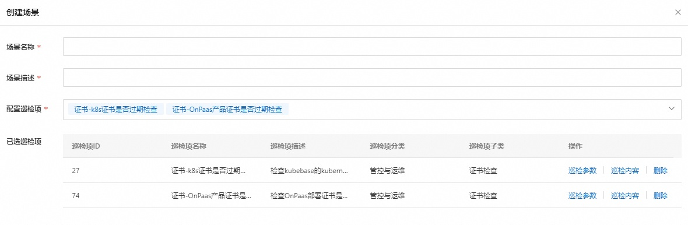

**更多操作**

**查看巡检场景详情**

1. 单击**高级筛选**，根据**巡检场景名称**、**巡检场景描述**、**是否预置**、**创建时间**组合筛选获取目标巡检场景。

   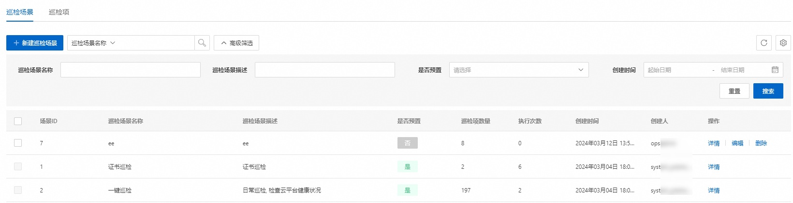

2. 在目标巡检场景**操作**列，单击**详情**。

3. 在**场景详情**页面，获取巡检**场景名称**、**场景描述**、**配置巡检项**以及巡检项详细列表。

**查看巡检项**

1. 切换至**巡检项**页签，获取全部巡检项的内容。

2. 单击**高级筛选**，根据**巡检项类型**、**巡检项子类型**、**巡检方式**、**巡检项名称**、**巡检项描述**、**是否预置**组合筛选获取目标巡检项。

   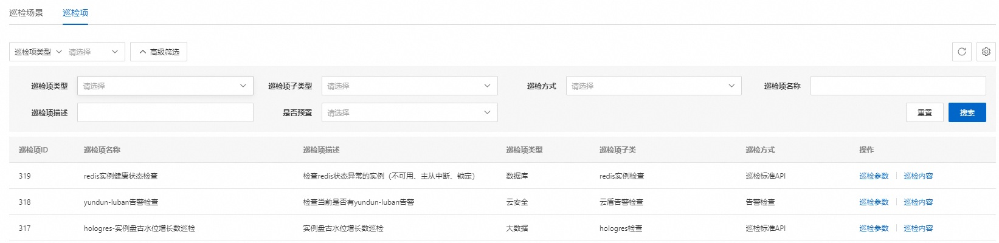

   - 将鼠标悬停于目标巡检项对应**操作**列的**巡检参数**，可以查看对应的巡检参数。

   - 将鼠标悬停于目标巡检项对应**操作**列的**巡检内容**，可以查看对应的巡检内容。

**编辑巡检场景**

> **说明**
>
> 预置巡检场景不可修改。

1. 在目标巡检场景**操作**列，单击**编辑**。

2. 在弹出的对话框中修改相关参数，完成后单击**确定**。

**删除巡检场景**

> **说明**
>
> 预置巡检场景不可删除。

1. 在目标巡检场景**操作**列，单击**删除**。

2. 在弹出的对话中单击**确定**。

**导入巡检数据包**

1. 在页面右上角，单击**导入巡检数据包**。

2. 在弹出的对话框中单击**选择文件**，选择巡检数据包后单击**打开**。

3. 在**导入巡检数据包**对话框中单击**上传**即可完成巡检数据包的导入。

   巡检数据包导入后，将更新产品巡检项，提升平台巡检能力。

4. 单击**导入巡检数据包**下方的**查看**，可以获取数据包的版本信息。

### 3.3.4. 巡检记录

通过此页面查看所有的巡检操作记录，并支持查看对应的巡检报告。

**操作步骤**

1. 登录Apsara Uni-manager运维控制台。

2. 在顶部菜单栏，选择**监控告警** > **巡检管理** > **巡检记录**。

3. 在当前页面可以查看所有巡检的记录，也可以单击**高级筛选**，通过**巡检场景**、**是否预置**、**任务状态**、**开始执行时间**、**结束执行时间**组合筛选获取目标巡检记录。

   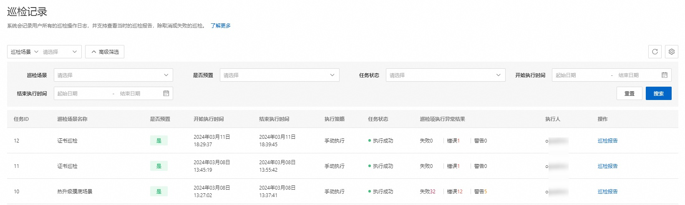

4. 在目标巡检记录**操作**列，单击**巡检报告**，跳转至**巡检报告**页面下查看巡检详细报告。

   > **说明**
   >
   > **执行状态**为**取消**或**执行失败**时，无法查看巡检报告。

5. 在**巡检报告**页面下，可以查看近期的所有巡检报告，系统默认展示最近一次巡检的巡检报告，也可以在巡检场景后按照时间筛选历史巡检报告。

6. 在页面上方，查看**巡检场景**、**开始执行**、**结束执行**、**发起人**、**执行策略**以及**结果建议**等基本信息。

7. 在**巡检概览**区域，可以查看巡检通过率、巡检项总数、巡检项失败数、巡检项错误数、巡检项警告数、巡检项正常数。单击巡检状态对应的数据可以查看对应巡检状态下的详细巡检结果。

8. 在**完成巡检项结果概览**区域，可以查看各巡检项类型下的巡检结果，包括巡检错误数、巡检告警数以及巡检正常数。单击巡检项类型可以查看对应类型下的详细巡检结果。

   

9. 在页面下方，单击**高级筛选**，可以根据**巡检项类型**、**巡检状态**、**巡检项名称**、**巡检项描述**组合筛选查看目标巡检结果明细。

   

   - 将鼠标悬停于目标巡检项对应**操作**列的**巡检参数**，可以查看对应的巡检参数。

   - 将鼠标悬停于目标巡检项对应**操作**列的**巡检内容**，可以查看对应的巡检内容。

   - 单击目标巡检项对应**巡检结果**列的数字，可以在对话框中查看巡检结果详情。

     

0. 单击页面右上角的**查看报告接收邮箱**，可以获取巡检报告接收的邮箱信息。

1. 单击页面右上角的**导出报告**，可以将巡检报告下载至本地进行查看。

   > **说明**
   >
   > 支持导出json和excel两种格式的巡检报告。

### 3.3.5. 巡检通知

本文介绍了配置发送巡检报告通知的方式。

**前提条件**

已添加ANS组件，并配置通知通道。

**操作步骤**

1. 登录Apsara Uni-manager运维控制台。

2. 在顶部菜单栏，选择**监控告警** > **巡检管理** > **巡检通知**。

3. 在**邮件通知**区域，单击**配置**。

4. 在弹出的对话框中输入**Token**后单击**确定**。

   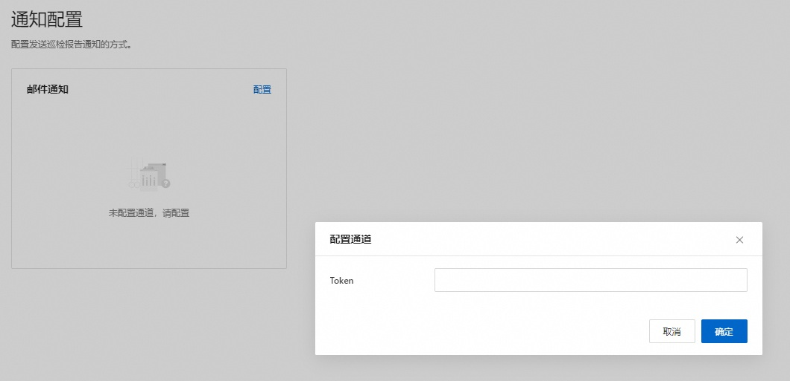

**更多操作**

**更新邮件通知**

1. 在**邮件通知**区域，单击**更新**。

2. 更新**Token**后单击**确定**。

**关闭邮件通知**

1. 在**邮件通知**区域，单击**关闭**。

2. 在弹出的对话框中单击**确定**。

   > **说明**
   >
   > 关闭通道操作会清除Email配置信息，巡检结果不再使用当前通道发送通知。

## 3.4. 事件中心

事件中心是专有云统一的事件管理平台，对**云+应用**的告警进行统一管理和定级。通过对多类型告警的分层聚合及定级，可以有效收敛告警，聚合成为需要人工处置跟进的事件，有效提升专有云平台的运维效率。

**功能特性**

<table>
  <tr>
    <th width="90">特性</th>
    <th>特性描述</th>
  </tr>
  <tr>
    <td>事件列表</td>
    <td>统一查询和处理各等级事件，包括查看事件详情、处理事件等。</td>
  </tr>
  <tr>
    <td>事件定级</td>
    <td>云平台事件定级策路是一组将云平台告警转换成事件的转换配置，按云产品分类，每个云产品都有各自的定级策略。</td>
  </tr>
  <tr>
    <td>我的事件</td>
    <td>提供事件快速处理入口，统一显示<strong>待我处理</strong>和<strong>我参与的</strong>的事件。</td>
  </tr>
</table>

### 3.4.1. 事件列表

通过此页面可以统一查询和处理各等级事件，包括查看事件详情、处理事件等。

**操作步骤**

1. 登录Apsara Uni-manager运维控制台。

2. 在顶部菜单栏，选择**监控告警** > **事件中心** > **事件列表**。

3. 页面默认展示**事件等级**为L1至L5的且**处理状态**是**待响应**、**处理中**的事件。

   - 事件列表默认根据开始时间倒序显示事件数据，最新的事件会优先显示。

   - 事件列表右上角，单击  图标可以对事件列表的字段和显示顺序进行调整。

   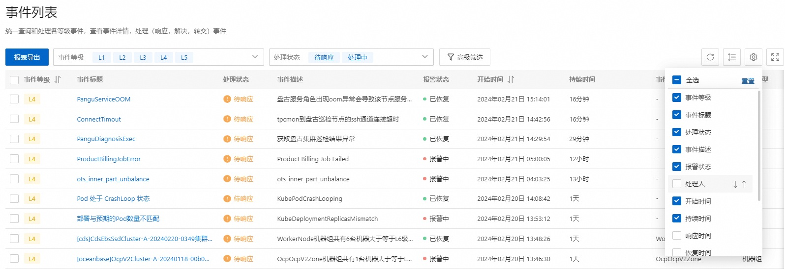

4. 事件列表支持根据**事件等级**和**处理状态**获取目标事件数据，**事件等级**和**处理状态**都支持多选。也可以单击**高级筛选**，根据**事件ID**、**事件标题**、**事件描述**、**开始时间**、**恢复时间**、**组件**、**服务**、**集群**以及**产品**组合筛选获取目标事件数据。

   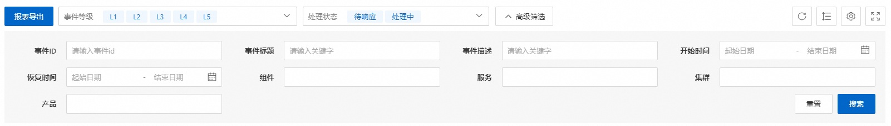

5. 单击目标事件的**事件标题**，可以查看事件详细内容。

   - 在页面右上角，单击  图标可以复制事件详情链接。

   - 在页面右上角，单击**响应**可以对该事件进行响应操作。

     > **说明**
     >
     > 响应后的事件支持**转交**和**结单**操作。

   - 在**事件详情**区域，可以查看事件的详细信息，包含**基本属性**、**事件处理**以及**关联的子事件**。

     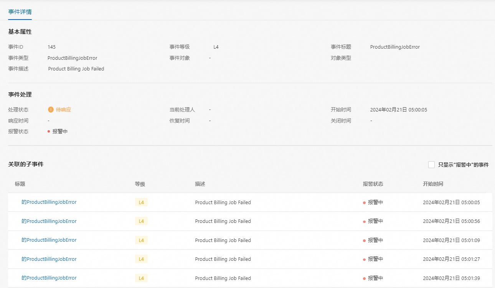

     > **说明**
     >
     > 在**关联的子事件**中支持如下操作：
     >
     > - 右上角支持**只显示“报警中”的事件**。
     >
     > - 单击子事件**标题**可以查看子事件的**详细信息**、**报警历史**以及**原始信息**。单击**查看ASO告警**可以跳转至相关的**告警详情**页查看告警信息。
     >
     >   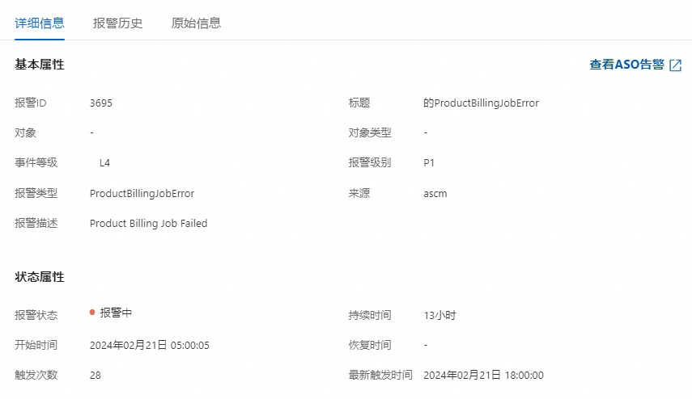

   - 在**事件轨迹**区域，主要记录事件从生成到结束的所有轨迹信息。

     

**更多操作**

**报表导出**

在事件列表上方，单击**报表导出**将事件数据导出到本地查看。

**批量响应**

勾选目标事件，单击事件列表下方的**批量响应**。

**批量结单**

1. 勾选目标事件，单击事件列表下方的**批量结单**。

2. 配置如下参数后单击**确认**。

   | 参数 | 参数说明 |
   | --- | --- |
   | 是否有效 | 选择事件接单是否有效。 • 有效 • 无效 |
   | 事件原因 | 选择事件原因。 |
   | 详情原因 | 输入事件详情原因。 |
   | 处理结果 | 输入事件处理结果。 |

   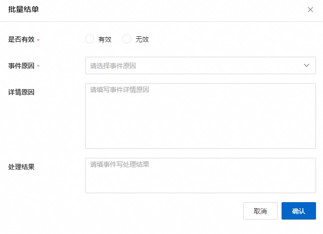

### 3.4.2. 事件定级

云平台事件定级策路是一组将云平台告警转换成事件的转换配置，按云产品分类，每个云产品都有各自的定级策略。

**功能介绍**

事件定级分为三个阶段：

1. 告警映射：将不同类型的告警一比一转换成事件，并设置事件等级。

2. 比例关联：将同类（云服务实例、工作&管控软件实例或工作节点实例）事件合并生成新事件，并根据异常实例的比例和云产品的重要性等级赋予不同的事件等级。

3. 就高合并：将多个事件对象相同的事件合并生成新事件。

**操作步骤**

1. 登录Apsara Uni-manager运维控制台。

2. 在顶部菜单栏，选择**监控告警** > **事件中心** > **事件定级**。

3. 在**告警映射**列，单击目标策略。

   <ol type="i">

   <li>

   在策略详情页，查看告警转事件的详细信息，包括**基本信息**、**匹配条件**以及**定级规则**。

   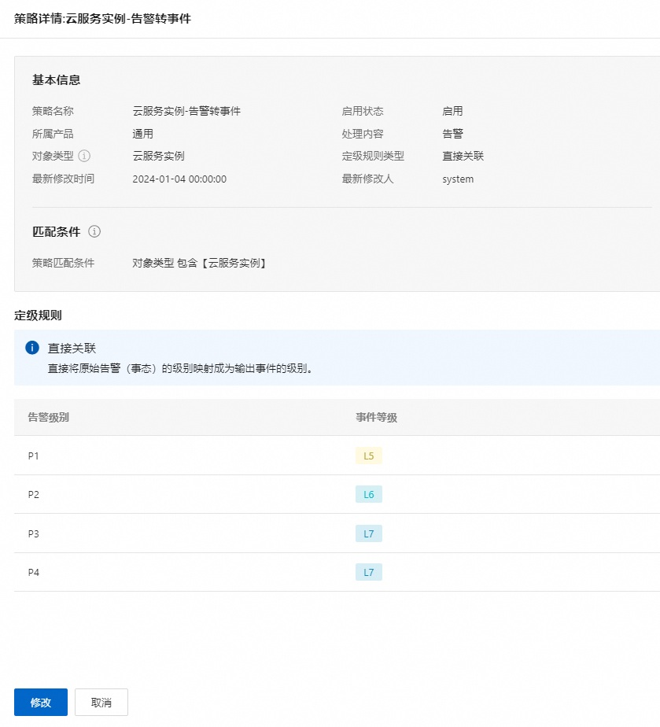

   </li>

   <li>

   单击**修改**，支持编辑**事件等级**，修改后单击**保存**。

   </li>

   </ol>

4. 在**比例关联**列，单击目标策略。

   <ol type="i">

   <li>

   在策略详情页，查看事件比例关联的详细信息，包括**基本信息**、**匹配条件**以及**定级规则**。

   > **说明**
   >
   > 当实例出现对应等级子事件时，将按照发生此类事件实例数量的占比及所属云产品的重要等级（A为重要，B为普通，C为不重要）判定比例关联后的事件等级。多组规则生成多个等级时，最终按照最高等级定义比例关联事件的最高等级。
   >
   > 例如，B级产品共有10个实例，其中4个实例出现L5等级子事件（按比例关联规则判定为L3等级事件），5个实例出现L6等级子事件（按比例关联规则判定为L2等级事件），则整体比例关联事件等级为L2。

   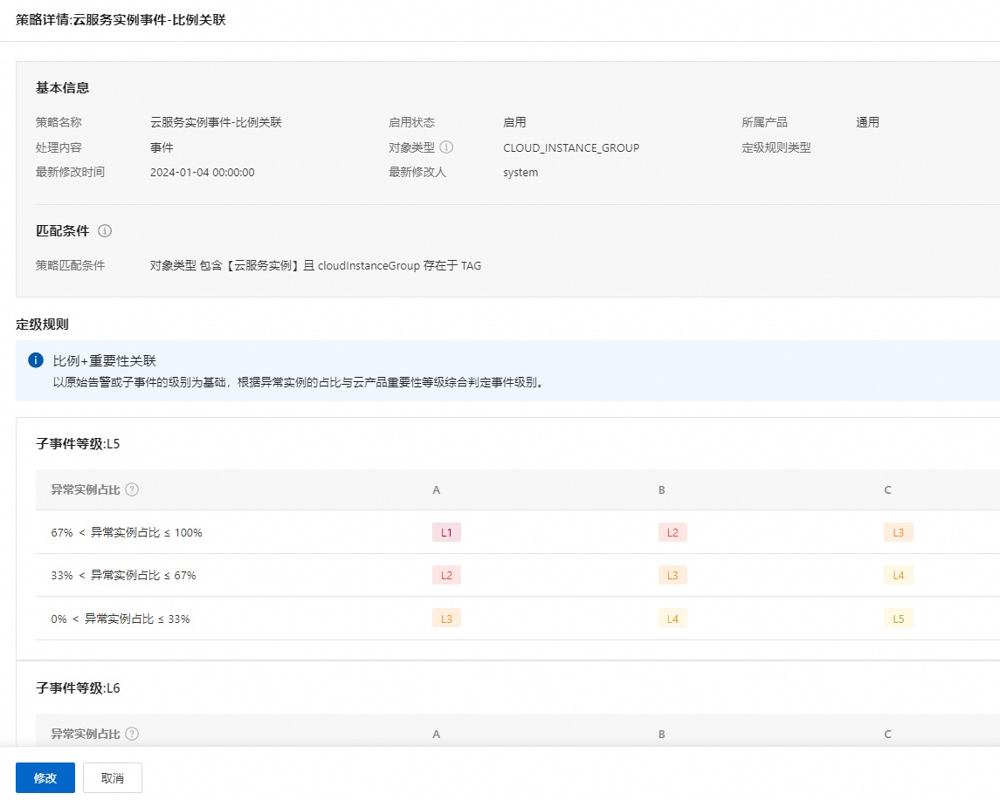

   </li>

   <li>

   单击**修改**，支持新增或删除异常实例占比的分界点，也支持编辑异常实例占比对应的事件等级，修改后单击**保存**。

   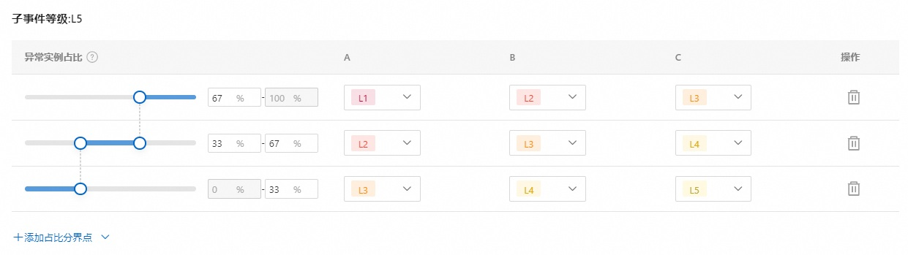

   </li>

   </ol>

5. 在**就高合并**列，将同类子事件就高关联合并成一条事件，事件等级等于子事件中的最高等级。

   > **说明**
   >
   > 该规则是固定策略无需配置。

### 3.4.3. 我的事件

提供事件快速处理入口，统一显示**待我处理**和**我参与的**的事件。

**操作步骤**

1. 登录Apsara Uni-manager运维控制台。

2. 在顶部菜单栏，选择**监控告警** > **事件中心** > **我的事件**。

3. 在**待我处理**页签下，显示所有当前需要我处理的事件，主要来自于自己主动响应和他人转交的事件。

   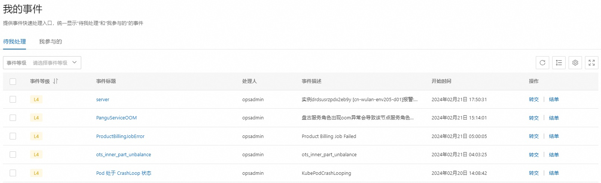

   <ol type="i">

   <li>

   在列表上方可以根据**事件等级**获取目标事件数据。

   </li>

   <li>

   单击**事件标题**可以查看事件详情。

   </li>

   <li>

   可以对事件进行如下操作：

   | 操作 | 操作步骤 |
   | --- | --- |
   | 结单 | 事件处理完成后，可以单击<strong>结单</strong>结束事件。 • 单个事件： a. 单击目标事件对应<strong>操作</strong>列的<strong>结单</strong>，或者在事件详情页右上角单击<strong>结单</strong>。 b. 配置如下参数后单击<strong>确认</strong>。 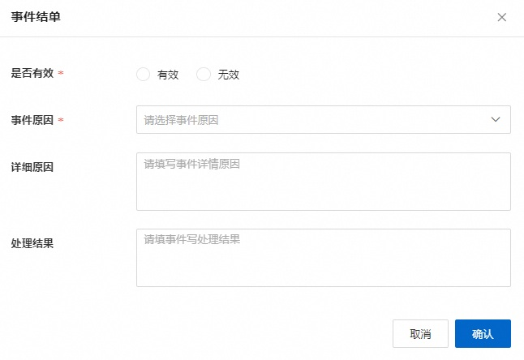 • 多个事件： a. 勾选多个目标事件，单击列表下方的<strong>批量结单</strong>。 b. 配置如下参数后单击<strong>确认</strong>。  |

   <table>
     <tr>
       <td>转交</td>
       <td>• 单个事件： a. 单击目标事件对应<strong>操作</strong>列的<strong>转交</strong>，或者在事件详情页右上角单击<strong>转交</strong>。 b. 选择<strong>被转交人</strong>后单击<strong>确认</strong>。 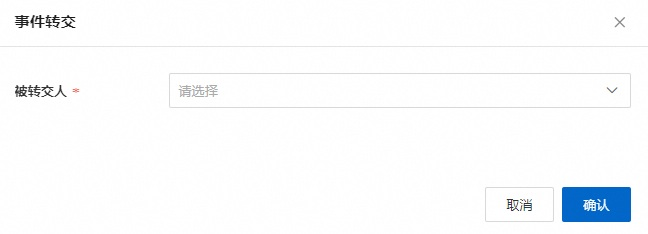 • 多个事件： a. 勾选多个目标事件，单击列表下方的<strong>批量转交</strong>。 b. 选择<strong>被转交人</strong>后单击<strong>确认</strong>。 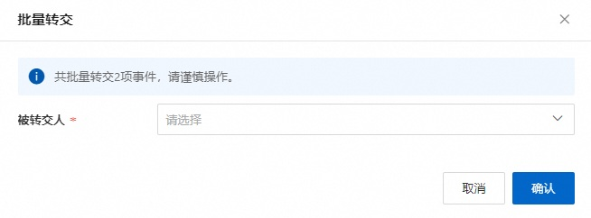</td>
     </tr>
   </table>

   </li>

   </ol>

4. 在**我参与的**页签下，显示当前用户所有**处理中**、**已关闭**的事件。

   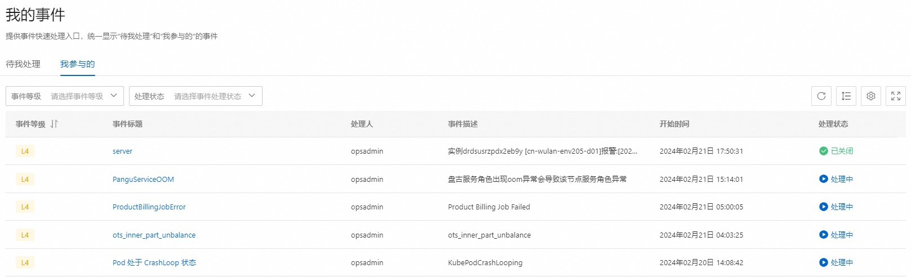

   - 支持根据**事件等级**和**处理状态**获取目标事件。

   - 事件列表支持按照**事件等级**进行排序展示，单击**事件标题**可以获取事件详情。

# 4.平台运维

## 4.1. 飞天基础运维平台

### 4.1.1. 资源管理

本文介绍了资源管理相关的功能特性。

**功能特性**

<table>
  <tr>
    <th width="154">特性</th>
    <th>特性描述</th>
  </tr>
  <tr>
    <td>产品集群运维</td>
    <td>从云产品维度查看云平台全部资源，包括各产品及其集群、服务、组件等。</td>
  </tr>
  <tr>
    <td>机器管理</td>
    <td>从机房维度查看云平台全部资源，包括各机房、机柜、机器等详情。</td>
  </tr>
  <tr>
    <td>资源标签</td>
    <td>用于将用户关注的资源进行统一展示和管理，您可以通过此页面进行绑定、查询、解绑、修改以及导出资源标签。</td>
  </tr>
  <tr>
    <td>底座机器资源大盘</td>
    <td>从机器和产品两个视角为用户展示静态资源总量和资源使用情况。</td>
  </tr>
</table>

#### 4.1.1.1. 产品集群运维

##### 4.1.1.1.1. 列表视图

产品维度展示产品状态和产品维度的统计数据，包括下辖集群数量，产品归属和层级关系等。

**操作步骤**

1. 登录Apsara Uni-manager运维控制台。

2. 在顶部菜单栏，选择**平台运维 > 飞天基础运维平台 > 资源管理 > 产品集群运维**。

3. 在**产品维度**页面查看产品及产品部署集群状态信息。数据统计包含部署在Tianji或PaaS上的所有产品。

   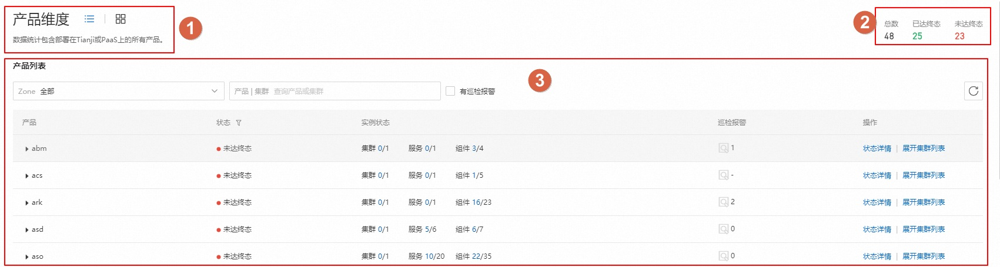

   <table>
     <tr>
       <td>序号</td>
       <td>区域</td>
       <td>描述</td>
     </tr>
     <tr>
       <td>①</td>
       <td>模式切换区域</td>
       <td>您可以在此区域选择切换产品维度页面显示模式。 • 系统默认显示列表模式。 • 单击图标可切换至层级架构模式。展示产品归属以及层级关系。具体详情可见 全景视图。 • 单击图标可切换至列表模式。列表模式展示产品状态和产品维度的统计数据，包 括下辖集群数量等。</td>
     </tr>
     <tr>
       <td>②</td>
       <td>概括区域</td>
       <td>您可以在此区域查看当前环境上部署的产品总数及各状态产品数量。产品状态包括<strong>已达</strong><strong>终态</strong>和<strong>未达终态</strong>。 说明产品是由集群、服务实例、组件组成的，产品状态是按照组件、服务实例、集群状态层层汇聚上来的。</td>
     </tr>
     <tr>
       <td>③</td>
       <td>产品列表区域</td>
       <td>• 在产品列表区域，查看产品名称、状态、实例状态、巡检报警等。 • 选择某个Zone过滤此Zone下的产品及集群。 • 可快速搜索产品或集群。 • 勾选<strong>有巡检报警</strong>快速过滤出产生巡检报警的产品。</td>
     </tr>
   </table>

   列表区域详细信息见下表。

   | 参数 | 描述 |
   | --- | --- |
   | 产品 | 展示产品的名称。 • 单击<strong>产品</strong>列左侧的图标或者<strong>操作</strong>列的<strong>展开集群列表</strong>，可快捷展开该产品下的集群列表。 • Tianji、PaaS产品均支持编辑/修改集群别名。 |
   | 状态 | 展示产品和集群的状态。单击列表上方的，选择<strong>已达终态</strong>或<strong>未达终态</strong>，按状态快速过滤产品。 |

   <table>
     <tr>
       <td>实例状态</td>
       <td>• 产品由集群、服务实例、组件组成的，产品状态是按照组件、服务实例、集群状态层层汇聚上来的。 • 当前列展示一个产品下已达终态的集群、服务实例、组件的数量以及对应的总数。 • 单击数字会展示各级资源的名称和状态。表示未达终态。表示已达终态。 • 单击实例状态列<strong>集群</strong>、<strong>服务</strong>或者<strong>组件</strong>，即可查看该产品下集群构成图。单击集群名，跳转至集群详情页，单击服务名或者组件名，跳转至组件详情页。 说明此设计目的在于帮助用户盯屏时，可以快速看到<strong>未达终态</strong>的变化。比如一个产品状态为未达终态，用户已经进行了修复。那么在接下来的时间里，用户不需要进入详情页，即可看到当前未达终态的组件等是否发生了变化。</td>
     </tr>
     <tr>
       <td>巡检报警</td>
       <td>按照产品维度统计最近一次运行失败的巡检任务数量。 - 表示没有查询到巡检任务（可能是没有巡检任务，或者查询失败）。 • 0表示有巡检任务，但是没有失败的。 • 其他数字：表示有几个巡检任务失败。单击可查看具体哪个任务失败。</td>
     </tr>
     <tr>
       <td>操作</td>
       <td>• 产品级别提供了<strong>展开集群列表</strong>操作。 • 集群级别操作提供了<strong>集群详情</strong>（直接进入集群详情页）操作。</td>
     </tr>
   </table>

###### 4.1.1.1.1.1. 集群详情

您可查看集群详细信息及集群服务列表、机器列表、终态配置、操作历史、资源详情等。

**操作步骤**

1. 登录Apsara Uni-manager运维控制台。

2. 在顶部菜单栏，选择**平台运维 > 飞天基础运维平台 > 资源管理 > 产品集群运维**。

3. 进入集群详情有两种方法：

   - 产品列表中，单击**展开集群列表**，您可以查看到产品下所有集群信息，选择目标集群，单击**集群详情**，跳转至集群详情页。

   - 产品列表中实例状态列，在集群下拉列表中单击目标集群名称，跳转至集群详情页。

4. 查看集群详情。

   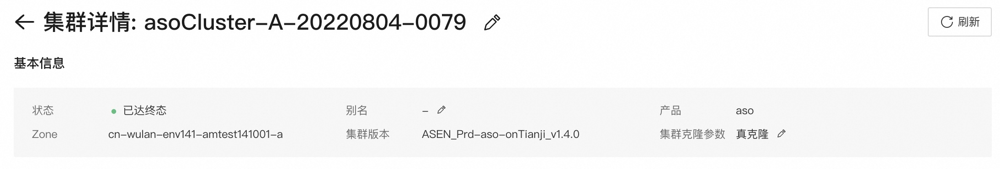

   <table>
     <tr>
       <th width="122">区域</th>
       <th>描述</th>
     </tr>
     <tr>
       <td>基本信息</td>
       <td>• 展示集群基本信息，包括集群状态、归属产品、归属Zone、集群版本、集群克隆参数等信息。 • Tianji、PaaS均支持集群别名的编辑/修改。 说明长度为0～128个字符，不能以特殊字符及数字开头，只可包含特殊字符中的点号（.）、下划线（_）、连字符（-）和半角冒号（:），支持中文、英文。 • 单击修改集群克隆参数，克隆参数分为真克隆和假克隆。 说明 • 真克隆：机器在扩容业务集群时，会触发系统克隆装机。终态配置中Legacy为False。 • 假克隆：机器在扩容业务集群时，不会触发系统克隆装机。终态配置中Legacy为True。 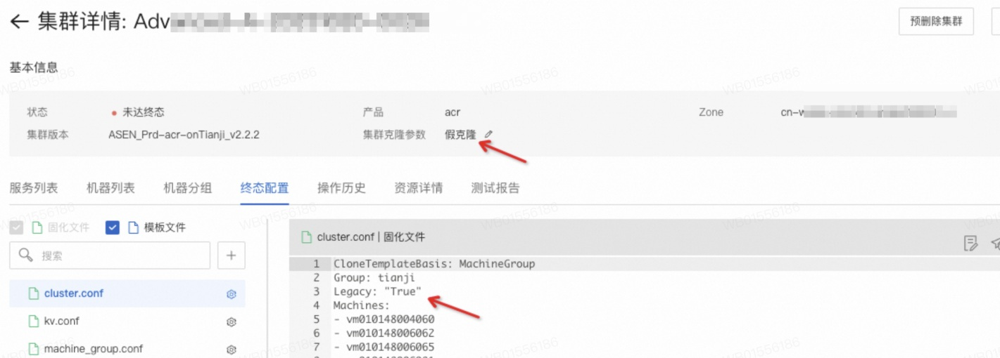 • 通过PaaS部署的集群，提供触发Rolling操作。 警告 • 此操作实际会触发集群上所有组件的Rolling操作。 • Rolling操作会按照灰度策略重启组件的pod。 • 比较常用的场景是，如果程序引用的服务注册变量发生变化，需要更新的时候，会使用Rolling功能。 • 通过Tianji部署的集群，提供<strong>预删除集群</strong>操作。 警告 • 集群删除是极高危操作，请谨慎操作。删除前请咨询GTS专家支持团队。 • 集群删除操作会经过两步，先设置成预删除状态，再正式删除。设置成预删除状态后，集群无法触发变更操作。</td>
     </tr>
     <tr>
       <td>集群详细信息</td>
       <td>通过Tianji和PaaS部署的集群详细信息有差别，具体见下表。</td>
     </tr>
   </table>

   集群详细信息表

   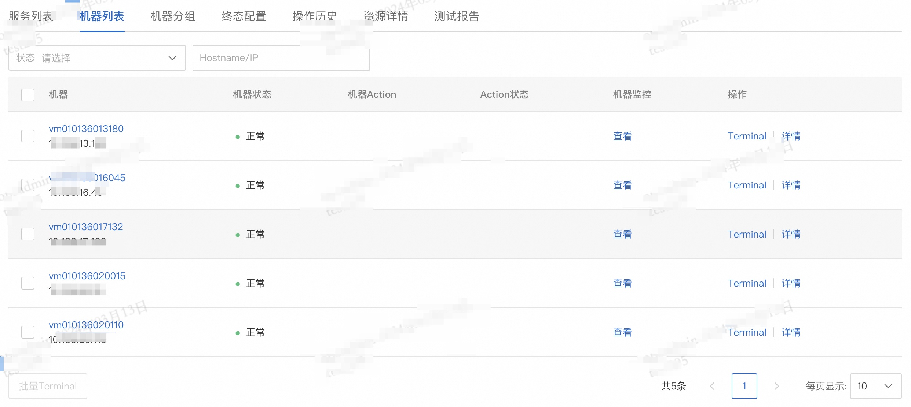

   <table>
     <tr>
       <th>底座</th>
       <th>参数</th>
       <th>描述</th>
     </tr>
     <tr>
       <td rowspan="5"></td>
       <td>服务列表</td>
       <td>• 展示当前集群部署的服务以及服务状态。 • 单击操作列<strong>详情</strong>，进入组件详情页面查看服务下的组件详情。 • 单击操作列<strong>升级</strong>，可执行服务升级操作。服务升级支持通过修改服务模板版本的方式升级。 • 单击操作列<strong>下线</strong>，可将服务从当前集群下线。 警告集群下线为高危操作，请谨慎执行。</td>
     </tr>
     <tr>
       <td>机器列表</td>
       <td>• 展示可以被当前集群使用的机器列表及状态。 • 单击机器监控列<strong>查看</strong>，您可以查看机器监控页详情。机器监控由组件详情、机器监控、系统服务监控组成。物理机提供维修、重启操作。 • 单击操作列<strong>Terminal</strong>，登录机器。 • 单击操作列<strong>详情</strong>，跳转至机器详情页。</td>
     </tr>
     <tr>
       <td>机器分组</td>
       <td>• 展示机器和组件之间的规划信息。例如一个机器组，角色是什么，包含哪些机器，可以被哪些组件使用。 • 单击<strong>关联机器</strong>列的机器名称，可查看机器管理。 • 单击<strong>关联组件</strong>列的组件名称，可查看组件详情。</td>
     </tr>
     <tr>
       <td>终态配置</td>
       <td>展示集群的终态配置文件。 说明通过Tianji部署的集群支持终态配置文件修改操作。</td>
     </tr>
     <tr>
       <td></td>
       <td></td>
     </tr>
   </table>

   - 展示集群的变更历史。

   - 单击操作列**任务详情**，进入任务详情页面查看任务详细信息，包含基本信息、相关集群、变更内容。

     - 任务基本信息可查看任务状态、提交时间、提交人等。

     - 相关集群可查看集群/产品、状态、进度、版本/提交时间、操作。在操作列可查看构建详情、资源任务详情。

     - 变更内容包含组件变更和机器变更。

       - 组件变更页签，可对任务进行终止、重试、暂停的操作。单击操作列**详情**，查看组件任务进度。

         - **概览信息**：包含组件的Commit Id、Rolling状态、审批策略、升级方案等。单击右上角**查看详情**，跳转至Rolling概要页面，查看组件升级详情。

           - 进入**Rolling概要**页面。

           - 概览信息模块中，您可单击**重试**、**终止**和**暂停**按钮，对任务进行相关操作，仅支持未结束任务。

           - 系统支持SLA变更监控展示，您可以查看组件的实时检测状态。

             - 单击**查看日志**，可查看SLA监测日志。

             - 单击**修改SLA配置**，可对SLA配置进行修改。

               > **说明**
               >
               > 只有打开SLA功能的服务才能看到SLA相关内容。

           - 单击**查看全部**，查看组件升级详情。

           - 单击**编辑参数**，可对相关配置进行修改，仅支持未结束任务。

           - **实例详情**模块中，支持对组件任务进行批量添加黑名单。

         - **实例详情**：查看组件实例的变更状态、组件Action、监控等。

           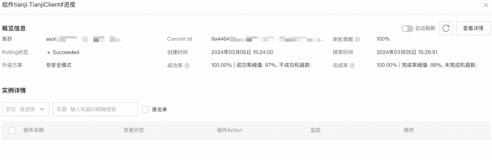

       - 机器变更页签，查看机器名、变更类型、状态等。单击操作列**Terminal**，跳转terminal页面登录机器；单击操作列**详情**，进入机器概要页面查看机器概要详情。

         > **说明**
         >
         > 机器变更页签在机器扩容、机器缩容、组件扩容、组件下线四种变更状态下才会触发展示。

   Tianji

   <table>
     <tr>
       <td></td>
       <td>操作历史</td>
       <td>• 进入<strong>机器概要</strong>页面，页面包含基本信息和详情两部分。 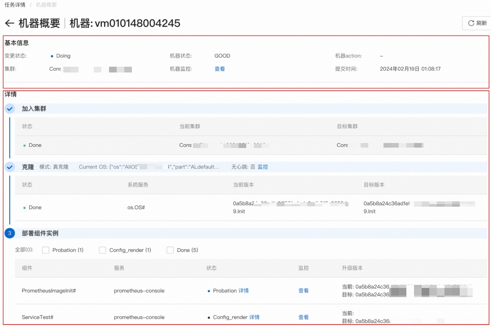 • <strong>基本信息</strong>：展示变更状态、机器状态、机器action、集群、机器监控等信息。</td>
     </tr>
   </table>

   - **详情**：包含**加入集群**、**克隆**、**部署组件实例**三部分。

     - **加入集群**：上图中以机器扩容为例，新节点加入集群。

       - **状态**：机器变更状态分为以下五种：

         - Failed：表示变更失败。

         - Cancel：表示变更任务被取消，如机器扩容变更还未完成，又提交了机器缩容变更。

         - Doing：表示正在变更。

         - Waiting：表示在等待变更。

         - Done：表示变更完成。

       - **当前集群**：当前正在使用或操作集群。

       - **目标集群**：期望进行新增节点操作的集群。

     - **克隆**：机器扩容业务集群时，克隆系统的操作。

       - 克隆模式包含真克隆和假克隆。

         - **假克隆**：机器在扩容业务集群时，会触发系统克隆装机。

         - **真克隆**：机器在扩容业务集群时，不会触发系统克隆装机。

       - 单击**监控**按钮，弹出监控详情窗口，查看**组件监控**、**机器监控**、**系统服务监控**详细信息。

       - **状态**：见**加入集群**步骤中的状态项。

   - 展示集群中各组件申请的资源列表。

     - **系统服务**：克隆的系统。

   **资源详情**

   - 单击操作列的**相关版本**，查看资源相关版本。

     - 当前版本：服务角色在机器上的当前版本。

     - 目标版本：期望升级到所使用的特定版本。

   - 展示集群下服务的测试报告列表。

     - **部署组件实例**：展示机器加入集群成功之后，新增机器上部署组件实

   **测试报告**

   例。

   - 单击操作列的**详情**，查看服务失败用例、成功用例、已跳过用例的详细信息。

     - **组件**：组件的名称。

   - 展示当前集群部署的服务以及服务状态。

     - **服务**：组件隶属的服务。

   - 单击操作列**详情**，进入组件详情页面查看服务下的组件详情。

     - **状态**：见**加入集群**步骤中的状态项。

   **服务列表**

   - 单击操作列**Rolling**，执行Rolling操作。

     - 单击状态列**详情**，可查看组件部署的状态详情。

     - 单机监控列<strong>查看，</strong>弹出监控详情窗口，查看**组件监控**、**机器监控**、**系统服务监控**详细信息。

   展示集群的终态配置文件。

   **终态配置**

   - **升级版本**

     - 当前版本：服务角色在机器上的当前版本。

     - 目标版本：期望升级到所使用的特定版本。

   - 单击操作列**版本差异**，进入版本差异页面，查看配置文件不同版本间差异。

   PaaS

   - 展示集群的变更历史。

   - 单击操作列**任务详情**，进入任务详情查看任务详细信息。

     - 任务基本信息可查看任务状态、任务ID、任务Message、开始时间等。

     - 子任务列表展示ID/描述、状态、描述、变更对象、执行方式等。

       - 单击操作列**查看参数**，查看任务参数。

       - 单击操作列**查看Yaml**，查看配置文件。

         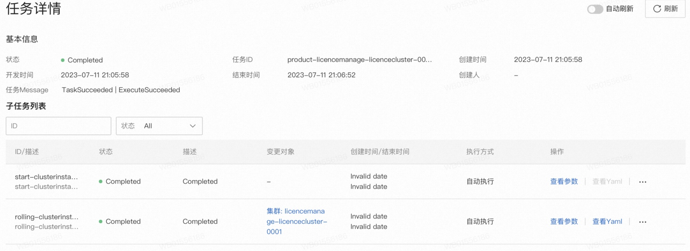

   **操作历史**

   > **说明**
   >
   > 集群变更主要指的是终态变更，不包含集群中机器维修等机器操作。

   展示集群中各组件申请的资源列表。

   **资源详情**

###### 4.1.1.1.1.2. 组件详情

您可以查看组件的基本信息和详细信息。

**操作步骤**

1. 登录Apsara Uni-manager运维控制台。

2. 在顶部菜单栏，选择**平台运维 > 飞天基础运维平台 > 资源管理 > 产品集群运维**。

3. 进入组件详情分为两种情况：

   - 产品列表中实例状态列，在集群下拉列表中单击目标组件或者服务名称，跳转至**组件详情**页。

   - 在**集群详情**页面的**服务列表**页签，单击对应的服务名称，进入**组件详情**页面。

4. 查看服务组件详情，服务组件举例如下图所示。

   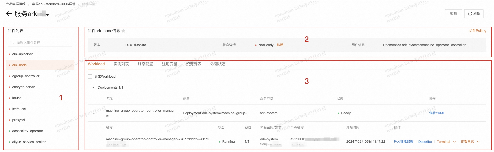

   | 序号 | 区域 | 描述 |
   | --- | --- | --- |
   | ① | 组件列表 | • 展示服务下的组件列表信息。 • 单击对应组件，在右侧区域查看该组件的基本信息和详细信息。 |
   | ② | 组件基本信息 | 展示当前组件名称、版本、状态详情和组件信息。通过PaaS部署的组件，单击右上角<strong>组件Rolling</strong>，触发组件rolling。 |
   | ③ | 组件详细信息 | 通过Tianji和PaaS部署的组件，详细信息有差异，具体见下表。 |

   Tianji和PaaS部署的组件详细信息表。

   **底座**

   **参数**

   **描述**

   - 展示部署在机器上的组件的状态，包含组件在机器上的版本是否对齐、是否有正在做的action、机器状态等。

     > **说明**
     >
     > 版本不一致，表示当前运行的版本和终态设置的版本不一致。可能是正在升级、升级失败、或者即将升级（终态版本已经修改，但是还未轮到组件升级）。

   - 单击操作列**诊断**，Tianji会初步诊断版本不一致或状态不为Good的原因。

     > **说明**
     >
     > 仅当版本不一致或状态不是Good的时候显示**诊断**。

   **实例列表**

   - 单击操作列**组件信息** > **监控**，查看组件监控、机器监控、系统服务监控详细信息。

   - 单击操作列**组件信息** > **APP列表**，查看组件在这台机器上的APP及版本。

     > **说明**
     >
     > - _tianji_config是个特殊的APP，表示下发到机器上的配置文件。
     >
     > - _tianji_config版本可以作为配置文件内容的一个版本号，如果配置文件内容变化，则版本号发生变化，如果内容不变，则版本号也不变。
     >
     > - 其他APP为用户程序。

   - 单击操作列**组件信息** > **状态详情**，查看组件在这台机器上的详细状态，比如描述状态等。

   - 单击操作列**Terminal**，跳转terminal页面登录机器。

   - 单击操作列**操作** > **重启**，重启机器上此组件下的APP进程。

   - 通过Tianji部署的组件会展示与这个组件相关的变更任务。

   **变更历史**

   - 单击操作列**详情**，进入任务详情查看任务详细信息。

   Tianji

   查看组件的终态配置，包含固化文件，可以对组件的终态进行编辑。

   **终态配置**

   展示组件注册的变量，可以被其他组件使用。比如程序的endpoint。

   **注册变量**

   - 展示组件申请的资源信息。

   **资源列表**

   - 单击操作列的**相关版本**，查看资源相关版本信息。

   展示组件的依赖状态，左右关系为左侧组件依赖于右侧组件。如下图所示。

   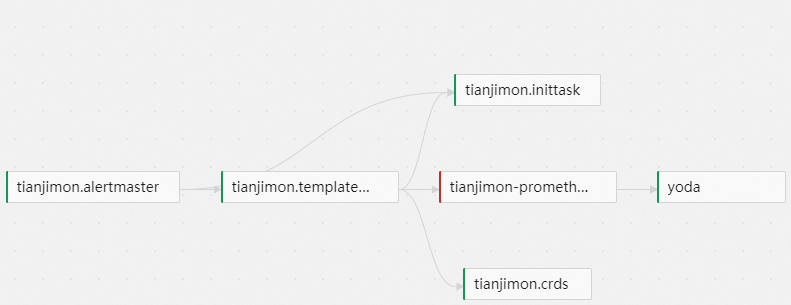

   **依赖状态**

   - 显示模式支持**全部组件**和**NotReady相关**。

     - 全部组件：显示依赖树中的全部组件。

     - NotReady相关：显示依赖树中未到终态的节点和其叶子节点。如果都到达终态，只显示根节点的直接依赖关系。

   - 显示依赖关系支持**强依赖**和**弱依赖**。

     - 强依赖：指的是如果依赖不满足则当前组件启动状态会受到直接影响。

     - 弱依赖：指的是如果依赖不满足当前组件仍然会启动，但是某些功能会受到影响。例如一些不在关键路径上的配置之类的信息。

   - 展示组件的Workload基本信息。

   - 针对Deployment、Statefulset、DaemonSets三种Workload，页面会展示Workload申请的Pod信息，并提供登录部署在Pod上的容器的能力。

   - 单击**操作**列**查看YAML**，可以查看Workload的原始的配置信息和运行信息。

   - 单击  图标，展开pod列表，可查看集群中每个 pod 的状态、名称、容器、节点名

   **Workload**

   称、所在的命名空间等关键信息。

   - 单击操作列**Pod性能数据**，查看Pod性能数据。

   - 单击操作列**Describe**，查看当前Pod的配置、状态或属性信息。

   - 单击操作列**Terminal**，跳转terminal页面登录机器。

   - 单击操作列**查看日志**，查看pod上容器输出到stdout的日志。

   PaaS

   - 展示Workload申请的Pod及其所部属的K8s节点状态。

   **实例列表**

   - 单击操作列Terminal，可登录机器。

   展示组件的终态配置。

   **终态配置**

   展示组件注册的变量，可以被其他组件使用。比如程序的endpoint。

   **注册变量**

   展示组件申请的资源信息。

   **资源列表**

   **依赖状态**

   展示组件对其他组件的依赖关系数据。同Tianji依赖状态。

##### 4.1.1.1.2. 全景视图

产品维度页面以层级架构模式展示产品状态和产品维度的统计数据，以及产品归属和层级关系。

**操作步骤**

1. 登录Apsara Uni-manager运维控制台。

2. 在顶部菜单栏，选择**平台运维 > 飞天基础运维平台 > 资源管理 > 产品集群运维**。

3. 单击  图标切换至产品全景视图。

   产品全景视图包括专有云部署的全量云产品，需重点关注“异常”的产品（橙色），这些产品可能未达到终态（就绪态），或者存在未处理的P1紧急告警和P2严重告警。

   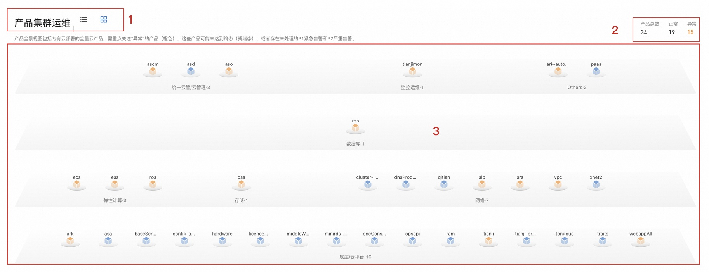

   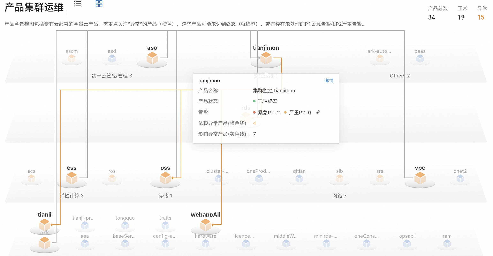

   <table>
     <tr>
       <td>序号</td>
       <td>区域</td>
       <td>描述</td>
     </tr>
     <tr>
       <td>1</td>
       <td>模式切换区域</td>
       <td>您可以在此区域选择切换产品维度页面显示模式。 • 系统默认显示列表模式。 • 单击图标可切换至层级架构模式。展示产品归属以及层级关系。 • 单击图标可切换至列表模式。列表模式展示产品状态和产品维度的统计数据，包 括下辖集群数量等。</td>
     </tr>
     <tr>
       <td>2</td>
       <td>概括区域</td>
       <td>您可以在此区域查看当前环境上部署的产品总数及各状态产品数量。产品状态包括<strong>正</strong><strong>常</strong>和<strong>异常</strong>。</td>
     </tr>
     <tr>
       <td>3</td>
       <td>产品区域</td>
       <td>• 产品共分四层，从上至下依次如下所示。 • 第一层为各种云管平台、监控和容灾备份产品。包括统一云管及云管理、容灾、监控运维和其他产品。其他产品指的是一些未归类的产品。 • 第二层为PaaS产品。包括中间件、大数据、数据库、应用服务、物联网类产品。 • 第三层为IaaS产品。包括弹性计算、网络、存储和安全类产品。 • 第四层为底座产品，用于支撑其他云产品运行的公共组件。 说明正常产品呈现蓝色，异常产品呈现橙色。 • 鼠标单击或悬停在云产品图标上时，系统将展示云产品名称、状态、告警等级和异常情况，产品之间的依赖异常和影响异常关系分别使用橙色线和灰色线条来表示。 说明 • 橙色线条连接的产品表示依赖关系。 • 灰色线条连接的产品表示影响关系。 • 单击产品浮窗中<strong>详情</strong>，跳转至产品详情拓扑图页面。具体参数请见下表。</td>
     </tr>
   </table>

4. 在单个产品的悬浮窗中可单击右上角的详情，进入产品详情拓扑图页面。

   单产品的拓扑图详细组成：

   - tianji底座产品包括五个层次：产品->集群->服务->组件->（组件）实例。

   - PaaS底座产品包括四个层次：产品->集群->服务->组件。

     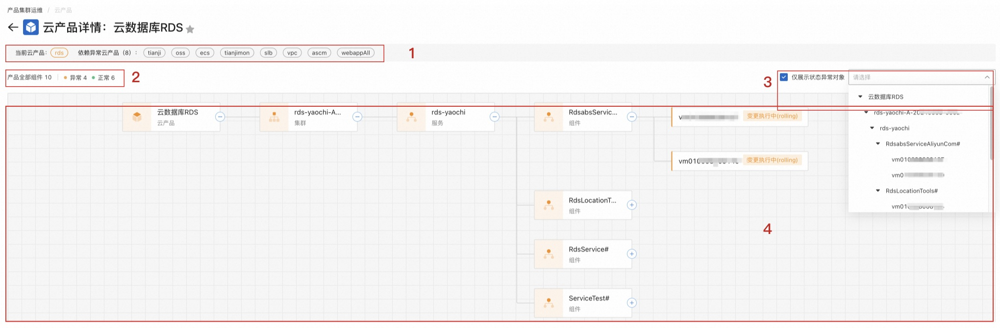

     | 序号 | 区域 | 描述 |
     | --- | --- | --- |
     | 1 | 产品关系概览区域 | 您可以在此区域查看产品的关系概览。 • 包括当前云产品、依赖异常云产品。 • 单击目标依赖异常云产品，跳转至该产品的拓扑图。 |
     | 2 | 概括区域 | 您可以在此区域查看当前产品总数及各状态产品数量。产品状态包括<strong>正常</strong>和<strong>异</strong><strong>常</strong>。 |
     | 3 | 搜索区域 | • 勾选仅展示状态异常对象，拓扑图展示异常的集群、组件、服务、实例。如果您取消勾选，则下方会展开全部节点，包括异常和正常。 • 搜索框下拉列表展示了集群、服务、组件、实例的从属关系。单击名称，拓扑图定位到节点并高亮显示该节点卡片。 |
     | 4 | 产品组件区域 | 页面以卡片形式展示产品、集群、服务、组件、实例的层级关系。 • 鼠标悬停或者单击某个节点时，系统展示该节点的情况，包含状态告警及详情或者Terminal。 • 鼠标悬停云产品，当云产品出现告警时，单击告警右侧图标，页面跳 转至<strong>Apsara Uni-manager运维控制台 &gt; 监控告警 &gt; 告警管理 &gt;</strong><strong>告警列表</strong>页面查看告警详情。 • 鼠标悬停实例，单击节点状态、实例状态右侧的图标，跳转至机器详 情页面查看机器详情。 • 单击目标节点<strong>详情</strong>，跳转至相应的详情页面，集群跳转至集群详情页，组件跳转至组件详情页。 • 单击目标实例节点<strong>Terminal</strong>，跳转至机器登录页面。 说明产品是由集群、服务实例、组件组成的，产品状态是按照组件、服务实例、集群状态层层汇聚上来的。 |

#### 4.1.1.2. 机器管理

##### 4.1.1.2.1. 列表视图

通过机器管理，您可以查看机器基本信息、机器上部署的组件列表等信息。

**操作步骤**

1. 登录Apsara Uni-manager运维控制台。

2. 在顶部菜单栏，选择**平台运维 > 飞天基础运维平台 > 资源管理 > 机器管理**。

3. 单击  图标，您进入机房维度查看硬件机房拓扑图。具体操作请参见机房维度。

4. 机器管理页面列表包含所有被管理的物理机和虚拟机。

   单击**高级筛选**，填写Hostname/IP、状态、产品、集群，系统筛选出符合条件的机器列表。

   

   - （可选）单击**上线/下线**，进入机器上线/下线页面，对机器可以进行上线或下线的操作。

     - 机器上线

       <ol type="a">

       <li>

       单击**机器上线**页签。

       </li>

       <li>

       选择机器上线的**目标Product**和**目标Bucket**。

       </li>

       </ol>

       <ol type="i" start="100">

       <li>

       单击**下载Schema**，下载machine_list.xlsx文件，按照文件要求填写机器信息。

       > **说明**
       >
       > 其中nodename、Sn、Ip是必填字段。

       </li>

       <li value="500">

       单击**选取文件**，进入**上传Schema**对话框。

       </li>

       </ol>

       <ol type="a" start="5">

       <li>

       单击**上传文件并解析**，将填写的machine_list机器信息文件上传。

       </li>

       <li>

       文件解析成功后，单进**导入**。导入后在**机器上线**页面查看导入的机器信息（主机名、IP、SN和状态）。

       - 单击目标机器操作列的**清除**，可将机器从该页面的机器列表中删除。

       - 单击目标机器操作列的**详情**，可查看机器的详情信息，如机器所在的IDC、Rack、Room等。

       </li>

       <li>

       单击页面右下方的**批量上线**。

       </li>

       </ol>

     - 机器下线

       <ol type="a">

       <li>

       单击**机器下线**页签。

       </li>

       <li>

       在左侧**机器输入框**中输入目标下线机器的hostname或IP，右侧显示对应的机器信息。

       在右侧单击目标机器操作列的**清除**，将对应机器从列表中删除。

       </li>

       </ol>

       <ol type="i" start="100">

       <li>

       单击页面右下方的**批量下线**。

       </li>

       </ol>

   - 在**Hostname/IP**下拉列表选择**Hostname/IP**、**状态**、**产品**或**集群**，在文本框输入机器对应信息，或者通过高级筛选快速过滤出所需机器。

     <table>
       <tr>
         <th width="141">名称</th>
         <th>描述</th>
       </tr>
       <tr>
         <td>Hostname/IP</td>
         <td>主机名称和机器IP。</td>
       </tr>
       <tr>
         <td>状态</td>
         <td>展示当前机器状态，机器有以下七种状态。 • 状态异常：表示机器在tianji上状态为非Good状态，且已排除<strong>Ping不通</strong>和<strong>无心跳</strong>问题。 • Ping不通：表示tianji管控服务无法Ping通机器。 • 无心跳：表示机器当前无法向tianji管控服务汇报心跳。 • 缩容：表示机器正在从某个集群退出。 • 扩容：表示机器正在加入某个集群。 • 维修中：表示机器正在进行运维操作，如整机维修。 • 正常：表示机器状态正常，机器没有进行任何运维操作且机器在tianji中状态为Good。</td>
       </tr>
       <tr>
         <td>所属集群/产品</td>
         <td>机器所属集群和产品。</td>
       </tr>
       <tr>
         <td>机器监控</td>
         <td>单击机器状态，弹出<strong>监控详情</strong>窗口，查看组件监控、机器监控、系统服务监控详细信息。</td>
       </tr>
       <tr>
         <td>操作</td>
         <td>• 单击<strong>Terminal</strong>跳转terminal页面登录该机器，进行相关操作。也可以选中多台机器，单击页面左下角的<strong>批量Terminal</strong>进行批量操作。 • 单击<strong>机器状态面板</strong>可打开<strong>机器状态面板</strong>页面，查看机器信息、服务进程列表及App详情信息。 • 单击<strong>详情</strong>可跳转<strong>机器详情</strong>页面。</td>
       </tr>
     </table>

###### 4.1.1.2.1.1. 机器详情

通过机器详情，您可以查看机器基本信息、机器上部署的组件列表等信息。

**操作步骤**

1. 登录Apsara Uni-manager运维控制台。

2. 在顶部菜单栏，选择**平台运维 > 飞天基础运维平台 > 资源管理 > 机器管理**。

3. 查看机器列表，选择机器，单击操作列**详情**。

4. 进入**机器详情**页，您可以查看机器基本信息、机器上部署的组件列表等信息。

   - 左侧区域按照IDC（机房）、Rack（机柜）| Room（包间）、物理机 、 虚拟机层级依次展示，选择IDC、Rack | Room、物理机或虚拟机，右侧区域会展示对应详情信息。

     - 支持通过机器名和机器别名的显示。

     - 支持通过机器名和机器别名作为过滤条件的搜索。

       | 层级 | 详细信息 |
       | --- | --- |
       | IDC（机房） | • 右侧区域上方展示该机房名称、机柜（指该机房下的机柜数量）、机器数量（包含物理机和虚拟机）、异常机器数量（包含物理机和虚拟机）。 • 单击右侧区域下方的<strong>全部机器</strong>或<strong>异常机器</strong>页签，查看该机房具体的<strong>产品分布</strong>和<strong>机型分</strong><strong>布</strong>。 |
       | Rack（机柜）\| Room（包间） | • 右侧区域上方展示该机柜名称、包间名称、机器数量（包含物理机和虚拟机）、异常机器数量（包含物理机和虚拟机）。 • 单击右侧区域下方的<strong>全部机器</strong>或<strong>异常机器</strong>页签，查看该机柜具体的<strong>产品分布</strong>和<strong>机型分</strong><strong>布</strong>。 |
       | 物理机/虚拟机 | • 右侧区域上方展示该物理机/虚拟机的基本信息，包括IP、状态、机器Action、所属集群、IDC、SN、机型、Kubernetes节点状态（如果机器是一个K8s节点会展示节点状态）、宿主机（如果机器是虚拟机时显示）等。 • 支持编辑/修改主机别名、修改SN号。 • 单击机器名右侧的<strong>Terminal</strong>，跳转terminal页面登录机器。 • 单击机器名右侧的<strong>机器状态面板</strong>，查看机器信息、服务进程列表、App详情等。 • 单击机器名右侧<strong>机器监控</strong>，跳转至云监控平台，查看机器监控概览。虚拟机不展示此功能。 • 单击机器名右侧<strong>机器操作</strong>下拉列表，包含<strong>重启</strong>、<strong>关机维修</strong>或<strong>维修并克隆</strong>，此操作仅支持物理机。具体操作步骤请见机器操作。 警告 • 带外重启和机器维修（关机维修、维修并克隆）均为高危操作，操作前请先咨询专家团队。 • 单击右侧的<strong>刷新</strong>，刷新当前页面。 • 单击右侧的<strong>导出</strong>，机器基本信息将生成xlsx格式的文件，并可通过浏览器下载至本地。 • 单击所属集群内容<strong>详情</strong>，跳转至集群详情页，查看集群详情。 • 单击机型内容<strong>详情</strong>，可查看机器的基本信息、位置信息和硬件信息。其中硬件信息中包含硬盘、内存、CPU、CPU构架和CPU厂商等。 • 单击Kubernetes节点状内容<strong>详情</strong>，可查看节点状态详情，包含基本信息、操作系统、Kubelet、用量。仅机器是K8s节点时展示。 • 单击右侧区域下方的<strong>组件</strong>、<strong>虚拟机</strong>、<strong>污点管理</strong>、<strong>标签管理</strong>页签，查看详细信息。 • <strong>组件</strong>：展示机器上部署的组件列表，包括组件的状态、Action、组件监控等。 • 单击目标组件的组件监控列<strong>查看</strong>，可查组件监控、机器监控、系统服务监控等信息。 • 单击目标组件的操作列<strong>重启</strong>，可重启组件。 • 单击目标组件的操作列<strong>详情</strong>，跳转至组件详情页查看组件信息。  说明 • 当机器作为k8s节点时，将展示机器通过PaaS部署的组件所运行的Pod。 • 通过Tianji部署的组件，支持组件进程重启操作。 • <strong>虚拟机</strong>：展示宿主机上启动的虚拟机列表。仅机器是宿主机时展示。 • <strong>污点管理</strong>：展示K8s节点的污点信息，并支持添加和删除污点的操作。仅机器是K8s节点时展示。 • 进入<strong>污点管理</strong>页签。 • 单击页签右上方的加号图标，在弹出的<strong>添加污点</strong>对话框中，输入自定义的污点名称和值，并选择污点作用后单击<strong>确定</strong>。 • <strong>尽量不调度(PreferNoSchedule)</strong>：尽量不让Pod调度到该节点。 • <strong>禁止调度(NoSchedule)</strong>：不允许Pod调度到该节点。 • <strong>禁止执行(NoExecute)</strong>：不仅不允许Pod调度到该节点，还会驱逐已经在本节点运行的Pod。 • 选择目标污点，单击<strong>操作</strong>列的<strong>删除</strong>。 • <strong>标签管理</strong>：展示K8s节点的标签信息，并支持添加和删除标签的操作。仅机器是K8s节点时展示。  • 进入<strong>标签管理</strong>页签。 • 单击页签右上方的加号图标，在弹出的<strong>添加标签</strong>对话框中，输入自定义的标签键值，单击<strong>确认</strong>。 • 选择目标标签，单击<strong>操作</strong>列的<strong>删除</strong>。 |

**机器操作**

进入机器详情页，基本信息模块右上角单击**机器操作**，操作包含**重启**、**维修并克隆**、**关机维修**。

| 操作任务 | 操作步骤 |
| --- | --- |
| 重启服务器 | 在页面右上方单击<strong>机器操作</strong> &gt; <strong>重启</strong>，在弹出的对话框中单击<strong>确定</strong>。 |

<table>
  <tr>
    <td>维修并克隆</td>
    <td rowspan="2">说明根据业务需求选择维修并克隆或关机维修操作。有些维修例如：系统盘，必须要维修并克隆，需要克隆装系统。有些维修例如：内存，只需要停机，不需要克隆。 1. 在页面右上方单击<strong>机器操作</strong> &gt; <strong>维修并克隆</strong>/<strong>关机维修</strong>。 2. 在弹出的对话框中输入<strong>REPAIR</strong>，单击<strong>确定</strong>。 3. 单击状态后侧的<strong>维修详情</strong>，进入机器维修页面。 4. 前置检查。在前置检查步骤中，单击页面右上方的<strong>执行前置检查</strong>，单击<strong>确定</strong>。系统会自动执行前置任务的检查操作，以确保机器维修的顺利进行和安全性。 说明当前置检查失败时，可单击页面右上方的<strong>重试</strong>，重试执行前置检查操作。 5. 审批。 i. 前置检查执行完成后，单击页面右下方的<strong>进入审批</strong>，单击<strong>确定</strong>，进入审批步骤。ii. 在审批步骤中查看需要审批的组件列表，单击操作列的<strong>审批</strong>。iii. 在弹出的对话框中输入<strong>APPROVED</strong>后，单击<strong>确定</strong>。 重要当前操作会把Action的状态从pending修改为approved，不会修改Action。进入approved状态后，Action对应动作将会执行。替代Decider程序设置approved状态为高危操作，有数据丢失风险，需要联系相关技术支持人员确认。 6. 维修。 i. 组件审批完成后，单击页面右下方的<strong>开始维修</strong>，单击<strong>确定</strong>，进入维修步骤。ii. 在维修步骤中会显示机器信息（机器、IP、SN、Project）等，维修人员根据实际需要在线下对该机器完成维修操作。 7. 后置检查。 i. 完成机器维修后，在维修页面右下方单击<strong>进入后置检查</strong>，单击<strong>确定</strong>，进入后置检查步骤。ii. 在后置检查步骤中，单击页面右上方的<strong>执行后置检查</strong>，单击<strong>确定</strong>。 说明当后置检查失败时，可单击页面右上方的<strong>重试</strong>，重试执行后置检查操作。 iii. 后置检查任务完成后，单击页面右下方的<strong>完成维修</strong>。iv. 在弹出的对话框中，输入<strong>FINISHREPAIR</strong>，单击<strong>确定</strong>，机器维修完成。</td>
  </tr>
  <tr>
    <td>关机维修</td>
  </tr>
</table>

##### 4.1.1.2.2. 机房维度

通过机房维度，您可以了解硬件机房拓扑图，按照机房（IDC）维度展示包含的网络设备、机柜，以及物理机器之间的拓扑关系。

**操作步骤**

1. 登录Apsara Uni-manager运维控制台。

2. 在顶部菜单栏，选择**平台运维 > 飞天基础运维平台 > 资源管理 > 机器管理**。

3. 单击  图标切换至机房维度。

   硬件机房拓扑图按照机房（IDC）维度展示包含的网络设备、机柜，以及物理机器之间的拓扑关系，其中，网络设备包括 ISW、LSW、CSW、DSW 以及 ASW 等多种类型，物理机器是指物理设备 HOST，点击物理机器详情可查看运行在其上的 DockerVM 以及云产品组件。

   

   | 序号 | 区域 | 描述 |
   | --- | --- | --- |
   | 1 | 模式切换区域 | 您可以在此区域选择切换产品维度页面显示模式。 • 系统默认显示列表模式。 • 单击图标可切换至层级架构模式。包含的网络设备、机柜，以及物理机器之间 的拓扑关系。 • 单击图标可切换至列表模式。列表模式展示所有被管理的物理机/虚拟机的状 态、所属集群等信息。 |
   | 2 | 概括区域 | 您可以在此区域查看网络设备和物理设备的异常数量。每个设备名称下展示异常数和总数概览。左边表示异常数量、右边表示总数。 |
   | 3 | 异常统计区域 | 您可以在此区域查看该机房内网络设备和物理设备的异常数量。每个设备名称后展示异常数和总数概览。左边表示异常数量、右边表示总数。 |
   | 4 | 搜索区域 | • 勾选仅展示异常服务器及其关联的节点，拓扑图展示异常节点，包含机柜和机器。如果您取消勾选，则下方会展开全部节点，包括异常和正常。 • 搜索框下拉列表展示了机器、机柜、物理机/网络虚拟机的从属关系。单击机器名，拓扑图定位到节点并高亮显示该节点卡片。 |
   | 5 | 机柜区域 | • 不同类型的硬件分组支持展开收起，默认情况下自动展开第一个柜机。 • 收起状态下，系统以卡片形式展示异常和全部的数量概览。鼠标悬停在卡片上不显示详情。 • 展开状态下，系统将以图标形式为您展示设备和机器的基本信息，包含位置信息和所属集群。鼠标悬停在卡片上，系统展示详情。 • 单击设备节点<strong>详情</strong>，跳转至<strong>网络运维控制台 &gt; 网元管理 &gt; 设备名称</strong>，查看详情。 • 单击目标机器节点<strong>详情</strong>，跳转至机器详情页查看。 • 单击目标实例节点<strong>Terminal</strong>，跳转至机器登录页面。 说明 • 正常节点为蓝色图标。异常节点为橙色图标。 • 两个设备之间的连线为灰色，表示设备链路状态正常。 • 两个设备之间的连线为橙色，表示设备链路状态异常，很可能是端口问题。 • 聚合节点的连线为虚线。 |

#### 4.1.1.3. 资源标签

资源标签用于将用户关注的资源进行统一展示和管理。

**操作步骤**

1. 登录Apsara Uni-manager运维控制台。

2. 在顶部菜单栏，选择**平台运维 > 飞天基础运维平台 > 资源管理 > 资源标签**。

3. 我的关注模块。

   - 首先，您可以通过**平台运维 > 飞天基础运维平台 > 资源管理 > 机器管理**页面，机器详情页，单击**收藏**。

   - 收藏完成后，您可以在资源标签页面查看已关注的节点。单击目标节点，即可进入节点详情页面。

     

4. 资源列表模块。

   - 相关操作。

     <table>
       <tr>
         <th width="122">操作步骤</th>
         <th>操作说明</th>
       </tr>
       <tr>
         <td>查看资源标签</td>
         <td>您可以查看已绑定标签的资源列表，也可以通过<strong>资源名称</strong>、<strong>资源类型</strong>、<strong>标签</strong>搜索需要查看的资源及标签信息。</td>
       </tr>
       <tr>
         <td>绑定资源标签</td>
         <td>您可以绑定目标资源的所有资源标签。选中目标资源，单击<strong>绑定标签</strong>。 • 选择标签。系统支持对标签进行添加、删除、批量删除的操作。 • 您可以从<strong>产品视图</strong>页签或<strong>机房视图</strong>页签选择目标资源。您可以选择多个资源。 • 确认完成后，完成标签绑定。</td>
       </tr>
       <tr>
         <td>解绑资源标签</td>
         <td>您可以解绑目标资源的所有资源标签。选中目标资源，单击<strong>解绑标签</strong>，在弹出的对话框中单击<strong>确定</strong>。</td>
       </tr>
       <tr>
         <td>修改资源标签</td>
         <td>您可以删除不需要的资源标签。在目标资源的<strong>操作</strong>列，单击<strong>修改标签</strong>，在弹出的对话框中单击需要删除的标签右侧的图标，单击<strong>确定</strong>。</td>
       </tr>
       <tr>
         <td>导出资源标签</td>
         <td>您可以导出资源列表中的所有信息。单击<strong>导出</strong>，在弹出的对话框中选择下载地址后单击<strong>下载</strong>。 说明如果您希望导出部分资源标签信息，可以先选中目标资源，再单击<strong>导出</strong>，然后在弹出的对话框中选择下载地址后单击<strong>下载</strong>。</td>
       </tr>
     </table>

     

#### 4.1.1.4. 底座机器资源大盘

底座机器资源大盘从机器和产品两个视角为用户展示静态资源总量和资源使用情况。这里的资源维度包括：CPU、Memory、GPU、共享盘、独占盘等五个维度，汇集了通过Tianji和PaaS部署的服务、DockerVM、预留资源在内的不同类别的资源的使用情况，支持查看指定机器或者指定产品的资源详情。

1. 登录Apsara Uni-manager运维控制台。

2. 在顶部菜单栏，选择**平台运维 > 飞天基础运维平台 > 资源管理 > 底座机器资源大盘**。

   页面默认以机器维度展示资源使用情况，单击页面上方  图标可切换产品维度查看。

3. （可选）查找待查看的机器。

   在**机器列表**区域搜索框中或单击**高级筛选**，输入机器名称、机器的标签或污点信息，搜索待查看机器。

4. 在**机器列表**区域，展示机器资源信息，包括已分配CPU、已分配Memory、已分配GPU等信息。

   

   | 参数 | 说明 | 示例 |
   | --- | --- | --- |
   | 机器 | 表示机器名称及机器IP地址。 | e21j10005.cloud.j10.amtest 98 10.98.2.9 |
   | 已分配CPU | CPU资源已使用的百分比（已使用资源/可用资源）、可用资源总量、已使用资源量、超卖比，其中超卖比是在规划阶段配置的参数，可用资源总量=机器可用资源\*超卖比。 | 29.54% 1343/396.7 Cores(超卖1400%) |
   | 已分配Memory | Memory资源已使用的百分比（已使用资源/可用资源）、可用资源总量、已使用资源量、超卖比，其中超卖比是在规划阶段配置的参数，可用资源总量=机器可用资源\*超卖比。 | 77.6% 828.1/642.6 GiB(超卖220%) |
   | 已分配GPU | <strong>GPU</strong>资源已使用的百分比（已使用资源/可用资源）、已使用量、资源总量。其中-表示机器没有GPU资源。 | 50% 1/2块 |
   | Yoda Disk | 独占磁盘资源已使用的百分比（已使用资源/可用资源）、可用资源总量和已使用资源量，这里资源总量为机器上全部独占盘的资源总量。 | 26.84% 43.7/11.7 TiB |
   | Yoda Lvm | 共享磁盘资源中已使用的百分比（已使用资源/可用资源）、可用资源总量和已使用资源量，这里的资源总量为机器上全部共享磁盘的资源总量。 | 11.7% 1.3/0.2 TiB |
   | 标签 | 机器上的标签列表，默认展示该机器已有标签数量。鼠标悬停标签数量会展示机器全部标签。 | 标签：34 |
   | 污点 | 机器上的污点列表，默认展示该机器已有污点数量。鼠标悬停污点数量会展示机器全部污点。 | 污点：1 |
   | pod总数 | 调度到该节点的pod集合，默认展示pod数量。选择机器，单击pod总数，即可展示pod列表，可查看Pod详细信息。列表中的pod会根据产品和app名称排序。 | 31 |
   | 操作 | • 单击<strong>资源详情</strong>，可跳转至资源信息页面，页面以图表的形式展示CPU、Memory、GPU、Yoda Lvm的资源分布和Yoda Disk资源规划情况。 • 单击<strong>机器详情</strong>，可跳转机器详情页查看机器详细信息。 |  |

### 4.1.2. Kubernetes管理

本文提供了Kubernetes相关的集群和节点的基础信息、资源用量等信息。

**功能特性**

<table>
  <tr>
    <th width="90">特性</th>
    <th>特性描述</th>
  </tr>
  <tr>
    <td>集群概况</td>
    <td>运维侧Kubernetes集群表示由Tianji底座创建并管理的Kubernetes集群，可查看集群资源用量。</td>
  </tr>
  <tr>
    <td>节点管理</td>
    <td>可查看底座管理的所有Kubernetes节点基本信息。</td>
  </tr>
</table>

#### 4.1.2.1. 集群概况

您可以在集群概况页面查看运维侧Kubernetes集群维度的集群资源用量，包括CPU、内存、容器组、逻辑卷存储的水位信息。运维侧Kubernetes集群表示由Tianji底座创建并管理的Kubernetes集群。

**操作步骤**

1. 登录Apsara Uni-manager运维控制台。

2. 在顶部菜单栏，选择**平台运维 > 飞天基础运维平台 > Kubernetes管理 > 集群概况**。

3. 在**集群概况**页面，查看集群的基本信息、资源用量和节点列表信息。

   

   | 名称 | 描述 |
   | --- | --- |
   | 运维侧Kubernetes集群概况 | 您可以在此区域查看集群的Kubenetes版本、注册时间、CPU物理规格和内存物理规格等基本信息。页面右上角单击下拉选择框您可以切换集群。 |
   | 集群资源用量 | 您可以在此区域查看集群的CPU、内存、容器组和逻辑卷存储的用量信息，包括已用量、总可用量、用量单位和用量百分比等数据。 |
   | 节点列表 | 您可以在此区域查看集群的节点详细信息。 • 单击<strong>高级筛选</strong>，您可填写名称、标签、污点、角色任一内容进行表格的筛选。 • 单击目标节点操作列<strong>Terminal</strong>，您可登录机器。 • 单击目标节点操作列<strong>机器状态面板</strong>，查看机器信息、服务进程列表、App详情等。 • 单击目标节点操作列<strong>节点性能数据</strong>，查看节点性能的数据详情。 • 单击目标节点操作列<strong>详情</strong>，跳转至机器详情页面查看详情。 |

#### 4.1.2.2. 节点管理

您可以查看部署在平台上的各节点基本信息，包括节点名称、状态、IP、角色、资源用量、标签和污点等信息，并提供查看节点性能数据、Terminal登录、 机器状态面板跳转和查看机器详情操作。

**操作步骤**

1. 登录Apsara Uni-manager运维控制台。

2. 在顶部菜单栏，选择**平台运维 > 飞天基础运维平台 > Kubernetes管理 > 节点管理**。

3. 在**节点管理**页面，查看运维侧Kubernetes各类型节点数量、各节点的名称、IP、状态、角色、标签数、污点数和资源用量等信息。

4. （可选）在节点列表上方的搜索框中，搜索待查看的节点。

   

5. 查看节点信息，具体参数如下表所示。

   <table>
     <tr>
       <th width="121">参数</th>
       <th>说明</th>
     </tr>
     <tr>
       <td>名称/IP</td>
       <td>节点名称及节点IP地址。</td>
     </tr>
     <tr>
       <td>状态</td>
       <td>节点当前状态，包括已达终态、未达终态、Unknown。页面支持根据状态过滤机器。</td>
     </tr>
     <tr>
       <td>角色</td>
       <td>表示节点的业务角色。例如，master表示主节点、redis1表示部署Redis服务的节点1。</td>
     </tr>
     <tr>
       <td>标签/污点</td>
       <td>该节点已有标签数量和污点数量。标签和节点是决定程序是否可以在该节点上部署的条件。</td>
     </tr>
     <tr>
       <td>已分配CPU</td>
       <td>当前CPU使用量占可分配CPU总量的百分比。</td>
     </tr>
     <tr>
       <td>已分配内存</td>
       <td>当前内存使用量占可分配内存总量的百分比。</td>
     </tr>
     <tr>
       <td>本地共享存储</td>
       <td>共享磁盘资源中已使用资源占可分配资源的百分比。</td>
     </tr>
     <tr>
       <td>操作</td>
       <td>• 单击<strong>Terminal</strong>可以登录该机器，进行相关操作。也可以选中多台机器，单击页面左下角的<strong>批</strong><strong>量Terminal</strong>进行批量操作。 • 单击<strong>机器状态面板</strong>可打开<strong>机器状态面板</strong>页面，查看机器基本信息、磁盘用量、机器上部署的服务进程列表及APP详情信息。 • 单击<strong>节点性能数据</strong>可跳转Grafana大盘查看节点水位信息，如CPU使用率等信息。 • 单击<strong>详情</strong>可跳转<strong>机器详情</strong>页面。</td>
     </tr>
   </table>

### 4.1.3. 硬件维修

本文提供了硬盘维修的操作步骤和整机维修的记录查询。

**功能特性**

<table>
  <tr>
    <th width="90">特性</th>
    <th>特性描述</th>
  </tr>
  <tr>
    <td>硬盘维修</td>
    <td>支持数据盘更换全流程，帮助用户高效、安全的完成硬盘维修。 • 准备：发起换盘流程后，需要先进行准备工作，包括上报、审批、下盘。 • 维修：换盘的准备工作完成后，开始进行维修工作，包括换盘、上盘、巡检。 • 历史：展示所有硬盘维修记录列表，包括维修的机器、硬盘以及维修结果。</td>
  </tr>
  <tr>
    <td>整机维修</td>
    <td>提供整机维修的记录查询。</td>
  </tr>
</table>

#### 4.1.3.1. 硬盘维修

本功能支持数据盘更换全流程。当发现数据盘故障时，自动确认硬盘使用状态，卸载硬盘并静默，确保在线更换硬盘不会影响云产品业务。在更换硬盘后，自动进行格式化和挂载，恢复硬盘状态，重新提供存储能力。

**功能特性**

| 特性 | 特性描述 |
| --- | --- |
| 准备 | 在发起换盘流程后，需要先进行准备工作，包括上报、审批、下盘。 |
| 维修 | 换盘的准备工作完成后，开始进行换盘及巡检。 |
| 历史 | 您可以查看所有维修记录列表，查看维修过的机器和硬盘以及维修结果。 |

##### 4.1.3.1.1. 准备

在发起换盘流程后，需要先进行准备工作，包括上报、审批、下盘。

**前提条件**

使用本功能在线更换硬盘需要满足以下条件：

- 硬盘为数据盘，并且被盘古使用，对外提供存储能力。

- 硬盘上没有存储其他文件。

- 硬盘所在机器部署了tianji、ecs、odps等支持更换硬盘的云产品。

- 硬盘在盘古中已经标记为异常状态。

上述条件在维修过程中会自动进行检查确认，不符合条件的硬盘不会触发换盘流程，或者在前置检查中报错。

**背景信息**

- 无视流程中的报错信息，强行操作可能导致数据丢失。

- 本功能当前仅能处理盘古自动上报的坏盘，不支持人工上报坏盘。

- 本功能仅支持更换损坏数据盘的场景，如果没有更换新盘会导致流程无法继续。

- 目前支持tianji、odps、oss、sls产品的数据盘维修。

**操作步骤**

1. 登录Apsara Uni-manager运维控制台。

2. 在顶部菜单栏，选择**平台运维 > 飞天基础运维平台 > 硬件维修 > 硬盘维修**。

   系统默认进入**准备**页签，您可以通过进度和机器名称筛选需要查看的换盘任务。

3. 根据不同的阶段的状态，进行相应的操作。

   准备流程分3个阶段，包括上报、审批、下盘，这3个阶段又分别有未开始（灰色）、进行中（蓝色）、完成（绿色）、失败（红色）4个状态，对应可执行的操作如下表所示。

   | 上报 | 审批 | 下盘 | 可执行操作 |
   | --- | --- | --- | --- |
   | 进行中 | 未开始 | 未开始 | 取消 |
   | 完成 | 未开始 | 未开始 | 开始维修、取消 |
   | 失败 | 未开始 | 未开始 | 取消 |
   | 完成 | 进行中 | 未开始 | 单击<strong>审批详情</strong>后，可以选择人工审批 |
   | 完成 | 完成 | 进行中 | 无 |
   | 完成 | 完成 | 下盘完成，静默时间未完成 | 无 |
   | 完成 | 完成 | 下盘完成，静默时间已完成 | 准备更换 |

   相关操作说明：

   - 取消：单击**取消**后，在弹出的对话框中单击**确定**，换盘任务会被取消。

   - 开始维修：

     单击**开始维修**：

     - 如果需要二维码审批，系统会弹出二维码，使用钉钉小程序诸葛云台扫描二维码获取授权码，将授权码输入后提交，后台验证通过后，会进入到下一步。

     - 如果不需要二维码审批，则在弹出的对话框中单击**确定**，将开始维修流程，进入软件自动审批阶段。

   - 人工审批：在**操作**列显示为**审批详情**时，单击**审批详情**，在弹出的对话框中的目标服务角色的**操作**列，单击**审批**，在对话框中输入**APPROVED**，单击**确定**。

     > **重要**
     >
     > 审批前请保证硬盘上业务所需数据已完成备份。

   - 准备更换：单击**准备更换**，该换盘任务会进入维修阶段，展示在**维修**页签。

     **下盘**下面显示的时间为静默时间，超过7天，才能进行换盘操作。

     

##### 4.1.3.1.2. 维修

换盘的准备工作完成后，开始进行换盘及巡检。

**前提条件**

使用本功能在线更换硬盘需要满足以下条件：

- 硬盘为数据盘，并且被盘古使用，对外提供存储能力。

- 硬盘上没有存储其他文件。

- 硬盘所在机器部署了tianji、ecs、odps等支持更换硬盘的云产品。

- 硬盘在盘古中已经标记为异常状态。

- 换盘的准备工作已完成。

上述条件在维修过程中会自动进行检查确认，不符合条件的硬盘不会触发换盘流程，或者在前置检查中报错。

**背景信息**

- 无视流程中的报错信息，强行操作可能导致数据丢失。

- 本功能当前仅能处理盘古自动上报的坏盘，不支持人工上报坏盘。

- 本功能仅支持更换损坏数据盘的场景，如果没有更换新盘会导致流程无法继续。

- 目前支持tianji、odps、oss、sls产品的数据盘维修。

**操作步骤**

1. 登录Apsara Uni-manager运维控制台。

2. 在顶部菜单栏，选择**平台运维 > 飞天基础运维平台 > 硬件维修 > 硬盘维修**。

3. 单击**维修**页签。

   您可以通过进度和机器名称筛选需要查看的换盘任务。

4. 根据不同的阶段的状态，进行相应的操作。

   维修流程分3个阶段，包括换盘、上盘、巡检：

   - 换盘：更换故障的硬盘。

   - 上盘：核对新硬盘的基本信息，然后进行格式化和挂载等初始化操作。

   - 巡检：等待相关业务对新硬盘进行检测，检查通过后，业务将会开始使用新硬盘。如未检测通过，请产品排查未通过原因。

   这3个阶段又分别有未开始（灰色）、进行中（蓝色）、完成（绿色）、失败（红色）4个状态，对应可执行的操作如下表所示。

   | 换盘 | 上盘 | 巡检 | 可执行操作 |
   | --- | --- | --- | --- |
   | 未开始 | 未开始 | 未开始 | 开始更换 |
   | 进行中 | 未开始 | 未开始 | 更换完成 |
   | 完成 | 进行中 | 未开始 | 重新换盘 |
   | 完成 | 失败 | 未开始 | 重新换盘 |
   | 完成 | 完成 | 进行中 | 无 |
   | 完成 | 完成 | 失败 | 无 |

   相关操作说明：

   - 开始更换：单击**开始更换**，会开始执行换盘操作。

   - 更换完成：单击**更换完成**，会开始执行上盘操作。

   - 重新换盘：单击**重新换盘**，会开始重新换盘。

##### 4.1.3.1.3. 历史

您可以查看所有维修记录列表，查看维修过的机器和硬盘以及维修结果。

**操作步骤**

1. 登录Apsara Uni-manager运维控制台。

2. 在顶部菜单栏，选择**平台运维 > 飞天基础运维平台 > 硬件维修 > 硬盘维修**。

3. 单击**历史**页签。

   您可以通过集群和状态筛选需要查看的换盘任务详情。

4. 在目标换盘任务的**操作**列，单击**操作详情**，可以在弹出的面板中查看任务执行情况，包括从上报开始的每一步详细信息。

   

#### 4.1.3.2. 整机维修

提供整机维修的记录查询和维修历史信息。

**操作步骤**

1. 登录Apsara Uni-manager运维控制台。

2. 在顶部菜单栏，选择**平台运维 > 飞天基础运维平台 > 硬件维修 > 整机维修**。

3. 进入整机维修页面，查看整机维修记录。您可以通过下拉搜索框，根据机器名称、状态、集群以及维修方式的筛选条件，查找需要进行的机器维修任务。也可以单击**高级筛选**，进行筛选查询。

4. 列表展示整机维修记录详情，具体内容如下：

   <table>
     <tr>
       <th width="110">名称</th>
       <th>描述</th>
     </tr>
     <tr>
       <td>ID</td>
       <td>任务ID。</td>
     </tr>
     <tr>
       <td>机器名称/IP</td>
       <td>主机名称和机器IP。</td>
     </tr>
     <tr>
       <td>集群</td>
       <td>机器所属集群。</td>
     </tr>
     <tr>
       <td>维修方式</td>
       <td>机器维修的方式。</td>
     </tr>
     <tr>
       <td>状态</td>
       <td>机器维修状态分为以下四种： • failed：表示维修失败。 • cancel：表示维修任务被取消。 • doing：表示正在维修。 • done：表示维修完成。</td>
     </tr>
     <tr>
       <td>开始时间</td>
       <td>触发整机维修开始的时间。</td>
     </tr>
     <tr>
       <td>结束时间</td>
       <td>整机维修结束的时间。</td>
     </tr>
     <tr>
       <td>操作</td>
       <td>单击<strong>详情</strong>，进入维修详情页查看维修历史信息。</td>
     </tr>
   </table>

   

   

### 4.1.4. 运维工具

本文介绍了运维工具相关的功能特性。

**功能特新**

| 特性 | 特性描述 |
| --- | --- |
| 任务管理 | 通过任务管理可查看Tianji和PaaS任务详情。 |
| 服务管理 | 管理部署在Tianji底座上的服务，以及服务模板。 |
| 服务管理 | 虚拟机大盘展示环境中由Tianji底座拉起并管理的DockerVM列表。 |
| 服务注册变量大盘 | 服务注册变量大盘展示产品注册的服务变量和内容。 |
| 资源大盘 | 资源大盘展示产品通过Tianji底座服务申请的诸如DNS、VIP的资源实例。 |
| 基础服务监控 | 展示底座基础服务监控信息，快速发现底座基础服务异常状况。 |

#### 4.1.4.1. 任务管理

通过任务管理可查看Tianji和PaaS任务详情。

**操作步骤**

1. 登录Apsara Uni-manager运维控制台。

2. 在顶部菜单栏，选择**平台运维 > 飞天基础运维平台 > 运维工具 > 任务管理**。

3. 进入任务大盘页面。

4. 默认进入Tianji页签，选择时间范围查看Tianji任务详情列表。您可以单击**1小时**、**1天**、**1周**，进行时间范围的快捷选择。

   选择**Tianji任务**，单击操作列**详情**，页面跳转至任务详情页。

   

   - Tianji变更任务详情

     

     | 序号 | 区域 | 描述 |
     | --- | --- | --- |
     | ① | 基本信息区域 | 展示任务<strong>基本信息</strong>包括<strong>任务名称</strong>、<strong>任务状态</strong>、<strong>提交人</strong>、<strong>提交时间</strong>、<strong>运行时长</strong>等信息。 |

     <table>
       <tr>
         <td>②</td>
         <td>相关集群区域</td>
         <td>展示当前任务变更的集群列表。一个任务可以包含多个集群的变更。当前专有云任务基本上都只有一个集群。 • <strong>集群/产品</strong>：任务变更的集群及集群所属产品。 • <strong>状态</strong>：集群状态主要包含以下几个状态。 • Failed：任务失败 • Terminated：任务终止 • Running：任务进行中 • Paused：任务暂停 • Succeeded： 任务成功结束 • Waiting：等待任务开始 • <strong>进度</strong>：主要是对正在进行任务状态的一个细分状态。任务变更前一般会先进行构建。 • 构建相关状态有：等待构建、构建中、构建完成、构建失败。 说明构建指的是Tianji正在根据终态，计算要变更什么内容，比如版本是否需要升级、升级到什么版本等。 • 任务变更相关状态有：等待变更、变更中、变更完成、变更失败。 • <strong>版本/提交时间</strong>：版本信息及任务变更提交时间。 • <strong>操作</strong>： • 单击<strong>构建详情</strong>，可查看集群组件及状态、进度情况。 • 单击<strong>资源任务详情</strong>，可查看资源申请任务的状态、归属、及错误信息。</td>
       </tr>
       <tr>
         <td>③</td>
         <td>变更内容区域</td>
         <td>展示某个集群的变更内容。集群变更内容包含两个维度，组件变更和机器变更。 • <strong>组件变更</strong>：组件变更指的是组件的版本变更。按照服务进行分类，展示所有组件的版本变更状态。界面会展示每个服务下组件状态统计个数。 说明每种任务状态对应展示的<strong>终止</strong>、<strong>重试</strong>、<strong>暂停</strong>、<strong>继续</strong>的操作按钮不同。 • <strong>running</strong> =&gt; <strong>终止</strong>和<strong>暂停</strong> • <strong>Paused</strong> =&gt; <strong>继续</strong> • <strong>Failed</strong>、<strong>Terminate</strong> =&gt; <strong>重试</strong>。但是要求当前集群或者sr，在当前没有新的任务提交。 • 单击列表右上角<strong>终止</strong>，可对任务进行终止操作。 • 单击列表右上角<strong>重试</strong>，可对任务进行重试升级、强制重试及重试回滚的操作。 • 单击列表右上角<strong>暂停</strong>，可对任务进行暂停操作。 • 单击列表右上角<strong>继续</strong>，可对任务进行继续操作。 • 单击目标服务左侧的图标，可查看服务下各组件详细变更信息。详细信息 见组件变更表。 • 单击目标服务操作列<strong>详情</strong>，可查看组件进度。 • <strong>概览信息</strong>：包含组件的Commit Id、Rolling状态、审批策略、升级方案等。单击右上角<strong>查看详情</strong>，跳转至Rolling概要页面，查看组件升级详情。 • 进入<strong>Rolling概要</strong>页面。 • 概览信息模块中，您可单击<strong>重试</strong>、<strong>终止</strong>和<strong>暂停</strong>按钮，对任务进行相关操作，仅支持未结束任务。 • 系统支持SLA变更监控展示，您可以查看组件的实时检测状态。 • 单击<strong>查看日志</strong>，可查看SLA监测日志。 • 单击<strong>修改SLA配置</strong>，可对SLA配置进行修改。 说明只有打开SLA功能的服务才能看到SLA相关内容。 • 单击<strong>查看全部</strong>，查看组件升级详情。 • 单击<strong>编辑参数</strong>，可对相关配置进行修改，仅支持未结束任务。 • <strong>实例详情</strong>模块中，支持对组件任务进行批量添加黑名单。 • <strong>实例详情</strong>：查看组件实例的变更状态、组件Action、监控等。  说明机器变更页签在机器扩容、机器缩容、组件扩容、组件下线四种变更类型下才会触发展示。 • <strong>机器变更</strong>：机器变更指的是机器扩缩容操作，不包括维修等其他操作。 • 机器变更通过<strong>机器</strong>、<strong>变更类型</strong>、<strong>状态</strong>、<strong>操作</strong>四部分内容展示。 • <strong>机器</strong>：机器名称。 • <strong>变更类型</strong>：机器扩容、机器缩容、组件扩容、组件下线。 • <strong>状态</strong>：见机器概要中加入集群步骤中的状态项。 • <strong>操作</strong>：登录机器和查看机器概要。 • 单击操作列<strong>Terminal</strong>按钮，登录机器。 • 单击操作列<strong>详情</strong>按钮，进入机器概要页面查看机器概要详情。  • <strong>基本信息</strong>：展示<strong>变更状态</strong>、<strong>机器状态</strong>、<strong>机器action</strong>、<strong>集群</strong>、<strong>机器监控</strong>、<strong>提</strong><strong>交时间</strong>信息。 • <strong>详情</strong>：包含<strong>加入集群</strong>、<strong>克隆</strong>、<strong>部署组件实例</strong>三部分。 • <strong>加入集群</strong>：上图中以机器扩容为例，新节点加入集群。 • <strong>状态</strong>：机器变更状态分为以下五种： • Failed：表示变更失败。 • Cancel：表示变更任务被取消，如机器扩容变更还未完成，又提交了机器缩容变更。 • Doing：表示正在变更。 • Waiting：表示在等待变更。 • Done：表示变更完成。 • <strong>当前集群</strong>：当前正在使用或操作集群。 • <strong>目标集群</strong>：期望进行新增节点操作的集群。 • <strong>克隆</strong>：机器扩容业务集群时，克隆系统的操作。 • 克隆模式 • <strong>假克隆</strong>：机器在扩容业务集群时，会触发系统克隆装机。 • <strong>真克隆</strong>：机器在扩容业务集群时，不会触发系统克隆装机。 • 单击<strong>监控</strong>按钮，弹出监控详情窗口，查看<strong>组件监控</strong>、<strong>机器监控</strong>、<strong>系统服</strong><strong>务监控</strong>详细信息。 • <strong>状态</strong>：见<strong>加入集群</strong>步骤中的状态项。 • <strong>系统服务</strong>：克隆的系统。 • <strong>当前版本</strong>：服务角色在机器上的当前版本。 • <strong>目标版本</strong>：期望升级到所使用的特定版本。 • <strong>部署组件实例</strong>：展示机器加入集群成功之后，新增机器上部署组件实例。 • <strong>组件</strong>：组件的名称。 • <strong>服务</strong>：组件隶属的服务。 • <strong>状态</strong>：见<strong>加入集群</strong>步骤中的状态项。 • 单击状态列<strong>详情</strong>，可查看组件部署的状态详情。 • 单机监控列<strong>查看，</strong>弹出监控详情窗口，查看<strong>组件监控</strong>、<strong>机器监控</strong>、<strong>系统</strong><strong>服务监控</strong>详细信息。</td>
       </tr>
     </table>

     - **升级版本**

     **组件变更表**

     - **当前版本**：服务角色在机器上的当前版本。

     | 参数 | • <strong>目标版本</strong>：期望升级到所使用的特定版本描述 |
     | --- | --- |
     | 组件 | 服务下组件列表。 |

     <table>
       <tr>
         <td>状态</td>
         <td>组件状态包含如下状态： • Building：构建中 • Build Failed：构建失败 • Waiting：等待变更 • Running：变更中 • Paused：已暂停 • Rolling Back：正在回滚 • Rolling Back Prepared：回滚准备中 • Downloading：机器正在下载对应程序和配置。 • Ready：正在等待依赖组件升级完毕。 • Download Timeout：下载超时 • Succeeded：变更成功 • Failed：变更失败 • Blocked：由于依赖组件变更失败，导致当前组件未开始升级。 • Obstructed：有前序任务阻挡当前变更。 • Terminated：任务终止 • Rolling Back Failed：回滚失败 • Rolled Back：回滚成功 • Resource Checking：资源检查中 • Resource Apply Failed：资源申请失败 • Su Paused：灰度批次暂停，用户指定灰度规则的时候，指定每几次暂停观察一下。 • Su Binary Paused：非灰度变更时，触发了批次暂停。 • Su Failed Paused：灰度批次失败暂停，当一个灰度批次失败了，需要停下来让用户观察下是否可以继续。 • Precheck： 变更任务在Download阶段开始前，组件会检查是否可以开始升级。 • Precheck Failed：Precheck检查失败。 • Postcheck：变更任务成功后，组件进行检查。 • Postcheck Failed：Postcheck检查失败。</td>
       </tr>
       <tr>
         <td>依赖关系</td>
         <td>展示组件的升级依赖。组件升级必须得等它依赖的组件升级成功才能开始升级。查看依赖关系有助与找到任务阻塞在哪个组件上。</td>
       </tr>
       <tr>
         <td>操作</td>
         <td>单击<strong>操作</strong>列<strong>详情</strong>，可查看组件变更详情。</td>
       </tr>
     </table>

5. 默认进入PaaS页签，选择时间范围查看PaaS任务详情列表。您可以单击**1小时**、**1天**、**1周**，进行时间范围的快捷选择。

   选择**PaaS任务**，单击操作列**详情**，页面跳转至任务详情页。

   - PaaS变更任务详情。

     

     <table>
       <tr>
         <th width="105">区域</th>
         <th>描述</th>
       </tr>
       <tr>
         <td>基本信息</td>
         <td>展示任务基本信息，包括<strong>任务ID</strong>、<strong>状态</strong>、<strong>创建人</strong>、<strong>创建时间</strong>、<strong>开始时间</strong>、<strong>结束时间</strong>等信息。</td>
       </tr>
       <tr>
         <td>子任务列表</td>
         <td>展示子任务列表的信息，包括<strong>ID/描述</strong>、<strong>状态</strong>、<strong>描述</strong>、<strong>变更对象</strong>、<strong>创建时间/结束时间</strong>、<strong>执行</strong><strong>方式</strong>、 <strong>操作</strong>等信息。<strong>状态</strong>包括： • Failed（失败） • Processing（运行中） • Suspended（已暂停） • Waiting（等待中） • Completed（已完成）单击变更对象列的<strong>集群</strong>，跳转至<strong>资源管理 &gt; 产品集群运维</strong>查看集群详情。单击操作列的<strong>查看参数</strong>，查看详细的参数名和参数值信息。单击操作列的<strong>查看Yaml</strong>，查看详细的存储配置信息。单击操作列的<strong>修改执行配置</strong>，可修改任务的配置。单击操作列的<strong>审批</strong>，可对任务进行审批。</td>
       </tr>
     </table>

#### 4.1.4.2. 服务管理

管理部署在Tianji底座上的服务，以及服务模板。

**操作步骤**

1. 登录Apsara Uni-manager运维控制台。

2. 在顶部菜单栏，选择**平台运维 > 飞天基础运维平台 > 运维工具 > 服务管理**。

3. 进入**服务管理**页面，选择**服务**，页面展示该服务的**服务模板**和**服务实例**。

4. 在**服务模板**区域。

   - 单击**添加模板**，创建新模板，模板详细信息见下表。

     | 名称 | 描述 |
     | --- | --- |

     <table>
       <tr>
         <th width="89">基本信息</th>
         <th>• <strong>名称</strong>：模板的名称（必填）。 • <strong>分组</strong>：将创建的模板进行分类，可以选择已有的分组，也可以单击分组项下面的<strong>+新增分组</strong>按钮新建分组。 • <strong>描述</strong>：模板内容的描述（必填）。</th>
       </tr>
       <tr>
         <td>模板内容</td>
         <td>• 搜索框填写文件名或文件夹名，对模板文件进行筛选。 • 单击按钮，<strong>新增文件</strong>或<strong>新增文件夹</strong>。 • 选中新增的文件，单击<strong>显示内容</strong>在弹出的文本框中输入文件的内容，输入完成后单击<strong>预览并提交</strong>按钮。 • <strong>预览并提交</strong>后需要再次确认提交。 • <strong>提交描述</strong>：模板内容的描述。 • <strong>差异文件</strong>：和前一次文件的差异。</td>
       </tr>
     </table>

   - 搜索框填写模板名称，对**服务模板**进行筛选，支持模糊查询。

   - **服务模板**列表信息：

     <table>
       <tr>
         <th width="121">名称</th>
         <th>描述</th>
       </tr>
       <tr>
         <td>模板</td>
         <td>服务模板名称。</td>
       </tr>
       <tr>
         <td>描述</td>
         <td>模板内容的描述。</td>
       </tr>
       <tr>
         <td>分组</td>
         <td>将创建的模板进行分类。</td>
       </tr>
       <tr>
         <td>最近修改时间</td>
         <td>服务模板最近修改的时间。</td>
       </tr>
       <tr>
         <td>被引用数</td>
         <td>服务模板被引用数量。单击目标模板被引用数量，进入服务模板详情页，查看模板在不同的版本和集群中被引用的详情。</td>
       </tr>
       <tr>
         <td>操作</td>
         <td>• 单击<strong>编辑</strong>，进入模板详情，您可对模板进行编辑。 • 单击<strong>删除</strong>，可对模板进行删除操作。 • 单击<strong>操作历史</strong>，可查看模板操作历史详情，包含描述、版本、操作人、操作时间等。 • 单击操作列<strong>版本差异</strong>，可查看当前版本和其他版本的差异对比。</td>
       </tr>
     </table>

5. 在**服务实例**区域，**服务实例**从**集群**、**产品**、**操作**三部分进行展示，详细信息见下表。

   | 名称 | 描述 |
   | --- | --- |
   | 集群 | • 服务部署的集群。 • 单击集群名，跳转至集群详情页，您可查看集群详情。 |
   | 产品 | 集群所属产品。 |
   | 操作 | 单击<strong>详情</strong>，跳转至组件详情页，您可查看服务详情。 |

#### 4.1.4.3. 虚拟机大盘

虚拟机大盘展示环境中由Tianji底座拉起并管理的DockerVM列表。

**操作步骤**

1. 登录Apsara Uni-manager运维控制台。

2. 在顶部菜单栏，选择**平台运维 > 飞天基础运维平台 > 运维工具 > 虚拟机大盘**。

3. 进入**虚拟机大盘**页面。

4. 在搜索框选择输入或单击**高级筛选**通过**虚拟机**、**产品**、**集群**、**当前部署物理机**、**期望部署物理机**筛选获取目标资源数据。

5. **虚拟机大盘**列表信息。

   <table>
     <tr>
       <th width="152">名称</th>
       <th>描述</th>
     </tr>
     <tr>
       <td>产品</td>
       <td>云产品名称。</td>
     </tr>
     <tr>
       <td>集群</td>
       <td>虚拟机归属的集群。</td>
     </tr>
     <tr>
       <td>虚拟机</td>
       <td>• 虚拟机名称。 • 单击虚拟机名，跳转至机器详情页，您可查看机器详情。 • 单击虚拟机列<strong>Terminal</strong>，登录机器。</td>
     </tr>
     <tr>
       <td>当前部署物理机</td>
       <td>• 当前的虚拟机所在的物理机。 • 单击当前部署物理机名，跳转至机器详情页，您可查看机器详情。 • 单击当前部署物理机列<strong>Terminal</strong>，登录机器。</td>
     </tr>
     <tr>
       <td>期望部署的物理机</td>
       <td>• 虚拟机正在迁移到预设的新目标物理机。 • 单击期望部署物理机名，跳转至机器详情页，您可查看机器详情。 • 单击期望部署物理机列<strong>Terminal</strong>，登录机器。</td>
     </tr>
   </table>

#### 4.1.4.4. 服务注册变量大盘

服务注册变量大盘展示产品注册的服务变量和内容。

**操作步骤**

1. 登录Apsara Uni-manager运维控制台。

2. 在顶部菜单栏，选择**平台运维 > 飞天基础运维平台 > 运维工具 > 服务注册变量大盘**。

3. 进入服务注册变量大盘页面。

4. 在页面右上角单击下载，列表配置具备导出功能，生成<strong>.xlsx</strong>格式的文件，可通过浏览器下载至本地。

5. 在页面上方可以在搜索框选择输入或者单击**高级筛选**通过**Service Registration**、**服务**、**集群**筛选获取目标注册变量。

   

6. 在页面下方可以查看变量的**服务**、**Service Registration**、**集群**及**更新时间**等信息。

   

   - 单击目标服务**Service Registration**列的**显示/隐藏**开关，可以查看和隐藏服务注册信息。

   - 单击目标服务**Service Registration**列的信息，可以通过弹窗查看服务注册信息的完整内容。

#### 4.1.4.5. 资源大盘

资源大盘展示产品通过Tianji底座服务申请的诸如DNS、VIP的资源实例。

**操作步骤**

1. 登录Apsara Uni-manager运维控制台。

2. 在顶部菜单栏，选择**平台运维 > 飞天基础运维平台 > 运维工具 > 资源大盘**。

3. 进入资源大盘页面。

4. 在页面右上角单击下载，列表配置具备导出功能，生成<strong>.json</strong>格式的文件，可通过浏览器下载至本地。

5. 在页面上方可以在搜索框选择输入或单击**高级筛选**通过**Name**、**产品**、**集群**、**服务**、**组件**、**App**、**Resource Type**、**Resource Status**、**Parameters**、**Result**获取目标资源数据。

   

6. 在页面下方可以查看资源的**Name**、**产品/集群**、**组件/APP**、**Resource Status**、**Parameters**、**Result**、**Resource ID**、**Reprocess Status**、**Reprocess Message**、**Reprocess Result**、**业务附加配置**、**Refer Version List**及**Error Message**等信息。

   

   - 单击目标资源的**Parameters**列、**Result**列和**Reprocess Result**列的**显示/隐藏**开关，可以查看和隐藏资源参数、资源申请结果和二次申请状态信息。

   - 单击目标资源**Parameters**列、**Result**列和**Reprocess Result**列的信息，可以通过弹窗查看隐藏资源参数、资源申请结果和二次申请状态的完整内容。

     **资源状态表**

     | 项目 | 说明 |
     | --- | --- |
     | Name | 资源名称 |
     | 产品/集群 | 服务的产品信息、集群信息 |
     | 组件/APP | 服务角色的组件、APP信息 |
     | Resource Status | 资源申请状态 |
     | Parameters | 资源申请的参数，例如VIP配置等 |
     | Result | 资源申请结果，例如rds分配的endpoint、vip ip等 |
     | Resource ID | 资源标识符 |
     | Reprocess Status | 二次申请状态（第一次失败后自动重试） |
     | Reprocess Message | 二次申请（第一次失败后自动重试），申请信息 |
     | Reprocess Result | 二次申请结果 |
     | 业务附加配置 | 业务服务给资源附加的一些自定义配置，非通过天基设置的配置信息 |
     | Refer Version List | 资源被使用过的版本 |
     | Error Message | 异常信息 |

#### 4.1.4.6. 基础服务监控

展示底座基础服务监控信息，快速发现底座基础服务异常状况。

**操作步骤**

1. 登录Apsara Uni-manager运维控制台。

2. 在顶部菜单栏，选择**平台运维 > 飞天基础运维平台 > 运维工具 > 基础服务监控**。

3. 进入基础服务监控页面，可以查看控制台API状态和Tianji数据状态。

   - **控制台API状态**：展示控制台API接口状态、天基API联通状态、k8s状态接口状态、网关API连通状态。

   - **Tianji数据状态**：展示Tianji DB数据同步时间和Tianji终态计算时间。

     

### 4.1.5. Web终端

本文提供机器黑屏登录及远程运维功能，支持高危操作可拦截、可审批，所有操作可审计。

**功能特性**

<table>
  <tr>
    <th width="126">特性</th>
    <th>特性描述</th>
  </tr>
  <tr>
    <td>Web终端登录</td>
    <td>安全运维功能提供一个Web终端，支持以下功能： • 服务器登录：查询服务器、vm、容器信息，可登录服务器、vm、容器。 • 数据库登录：查询服务申请的元数据库，可登录元数据库。 • 交换机登录：查询交换机信息，可登录交换机。</td>
  </tr>
  <tr>
    <td>账号授权</td>
    <td>管理临时账号授权。</td>
  </tr>
  <tr>
    <td>命令管控</td>
    <td>管控经过Web终端进行的黑屏操作命令。</td>
  </tr>
  <tr>
    <td>操作审计</td>
    <td>审计通过Web终端进行的运维操作。</td>
  </tr>
</table>

#### 4.1.5.1. Web终端登录

Web终端登录包含服务器登录、数据库登录、交换机登录。

##### 4.1.5.1.1. 服务器登录

您可以按不同维度搜索并登录到容器、vm、物理机上进行相关运维操作，可快速登录ops1-ops4管控节点进行相关运维操作。

**操作步骤**

1. 登录Apsara Uni-manager运维控制台。

2. 在顶部菜单栏，选择**平台运维 > 飞天基础运维平台 > Web终端 > Web终端登录 > 服务器登录**

3. 服务器登录包含ServerRole 登录、MachineGroup登录。

4. 进入Server Role登录页签。

   - 在**Server Role**下拉列表中选择Server Role名称，支持模糊搜索。

   - 在**宿主机**列表上方，显示集群名、状态、所属项目。您可以单击相关登录项，登录到Server Role相关的虚拟机或宿主机。

     - **登录**表示登录Server Role所在虚拟机。

     - **登录vm宿主机**表示登录Server Role所在虚拟机的宿主机。登录步骤如下：

       - 单击Docker列  图标刷新，尝试获取dockerID。

       - 若获取成功，则出现登录按钮。

       - 单击登录按钮进行登录。

         > **说明**
         >
         > 如果在刷新后没有出现 DockerID，则说明未获取到 DockerID，可能有两种原因：
         >
         > - 当前容器状态异常。
         >
         > - 该sr是进程形态，没有docker容器。

     

   - 登录到web terminal页面，单击可登录节点或者  图标，弹窗选择账号，默认选中ops账号。

     - 如果没有符合您权限要求的登录账号，您可申请临时账号。

       

       - 您可以选择账号类型并申请。

         

       - 提交账号申请成功后，请等待审批，通过后重新登录服务器事生效。

         

     - 在黑屏上输入Linux命令，进行相关操作。

       

     - 单击**文件操作**，您可以上传和下载文件。

       - 单击**上传文件**，您可以采用以下两种方式：

         - 单击虚线框，在弹出的对话框中选中待上传的文件，单击**打开**，然后在**文件上传**对话框中单击**上传**。

         - 将文件拖动到虚线框内，单击**上传**。

       - 单击**文件下载**，系统将弹出**文件下载**对话框，在**文件目录**和**文件名**文本框中输入对应参数，单击**下载**，可以将文件下载到本地浏览器默认的download文件夹中。

       > **说明**
       >
       > 上传和下载的文件均不能超过200M。

   - 在**Docker**列，您可以单击**登录docker**、**docker日志**，**docker巡检报告**，您可以登录容器，查看容器的日志和巡检报告。

5. 切换至MachineGroup登录页签。

   - 在**集群**下拉列表中选择集群名称，支持模糊搜索。

   - 在下方列表中选择一个机器名称，在其右侧单击**登录**，登录到机器。

     

   - 登录到web terminal页面，单击可登录节点或者  图标，弹窗选择账号，默认选中ops账号。

     - 如果没有符合您权限要求的登录账号，您可申请临时账号。

       

       - 您可以选择账号类型并申请。

         

       - 提交账号申请成功后，请等待审批，通过后重新登录服务器事生效。

         

     - 在黑屏上输入Linux命令，执行相关操作。

       

     - 单击**文件操作**，您可以上传和下载文件。

       - 单击**上传文件**，您可以采用以下两种方式：

         - 单击虚线框，在弹出的对话框中选中待上传的文件，单击**打开**，然后在**文件上传**对话框中单击**上传**。

         - 将文件拖动到虚线框内，单击**上传**。

       - 单击**文件下载**，系统将弹出**文件下载**对话框，在对话框中输入文件目录和文件名，单击**下载**，可以将文件下载到本地浏览器默认的download文件夹中。

       > **说明**
       >
       > 上传和下载的文件均不能超过200M。

##### 4.1.5.1.2. 数据库登录

您可以登录Service包含的Server Role所使用的数据库，进行相关操作。

**操作步骤**

1. 登录Apsara Uni-manager运维控制台。

2. 在顶部菜单栏，选择**平台运维 > 飞天基础运维平台 > Web终端 > Web终端登录 > 数据库登录**。

3. 进入**数据库登录**页面。

4. 在**Service**下拉列表中选择Service名称，支持模糊搜索。

5. 页面下方展示了Service包含的所有Server Role所使用的数据库，选择其中一个数据库，在对应的**操作**列，单击**登录**。

   

6. 登录到web terminal页面，单击可登录节点或者  图标。

   在黑屏上输入SQL语句，进行相关操作。

   

##### 4.1.5.1.3. 交换机登录

您可以登录交换机，进行相关操作。

**操作步骤**

1. 登录Apsara Uni-manager运维控制台。

2. 在顶部菜单栏，选择**平台运维 > 飞天基础运维平台 > Web终端 > Web终端登录 > 交换机登录**

3. 在目标交换机对应的**操作**列，单击**登录**登录到对应的交换机。

   

4. 登录到web terminal页面，单击可登录节点或者  图标，弹窗提示输入用户名之后确认登录。

   - 根据提示手动输入密码，只有输入正确的密码才能进入交换机。如果密码输入错误，将以ops用户的身份退回到跳板机中。

   - 进入交换机后，在黑屏上输入Linux命令，执行相关操作。

     

#### 4.1.5.2. 账号授权

您可以查看临时账号授权的相关信息。

**操作步骤**

1. 登录Apsara Uni-manager运维控制台。

2. 在顶部菜单栏，选择**平台运维 > 飞天基础运维平台 > Web终端 > 账号授权**。

3. 进入账号授权页面，查看并管理临时账号授权。

4. 您可以通过**用户**和**状态**的筛选条件，查找临时账号授权信息。

   <table>
     <tr>
       <th width="90">内容</th>
       <th>描述</th>
     </tr>
     <tr>
       <td>用户</td>
       <td>ASO用户名称。</td>
     </tr>
     <tr>
       <td>类型</td>
       <td>黑屏账号类型。</td>
     </tr>
     <tr>
       <td>登录账号</td>
       <td>• ops：ops是linux普通账号，属于ops用户组，对文件的读、写、执行操作遵循文件权限的控制。建议日常运维使用。OAM超级管理员、天基web终端管理员、天基web终端审计监察员、天基web终端安全管理员、天基web终端基础运维员，均可具备该账号的使用权。 • aduit：audit是linux普通账号，属于audit用户组，可免密sudo aureport、auditctl、ausearch、last、lastlog、cat、less、more、head、tail操作，可免密stop auditd、rsyslog，是/var/log目录的所有者。天基web终端审计监察员，可默认具备该账号使用权，且具备该账号临时授权的审批/回收权。 • security：security是linux普通账号，属于security用户组，可免密sudo passwd、chown、chmod、chgrp、usermod、chage、visudo操作。天基web终端安全管理员，可默认具备该账号使用权，且具备该账号临时授权的审批/回收权。 • admin：admin是linux普通账号，属于admin用户组，可以免密进行sudo操作，具有较高权限。天基web终端管理员，可默认具备该账号使用权，且具备该账号临时授权的审批/回收权。 • root：root是linux超级账号，对设备有超管权限。OAM超级管理员，可默认具备该账号使用权，且具备该账号临时授权的审批/回收权。</td>
     </tr>
     <tr>
       <td>状态</td>
       <td>• 生效中：授权有效期内。 • 已回收：在授权有效期内，被账号管理员主动回收。 • 已失效：已经超出授权有效期，授权失效。</td>
     </tr>
     <tr>
       <td>授权时间</td>
       <td>临时授权申请通过的时刻。</td>
     </tr>
     <tr>
       <td>过期时间</td>
       <td>授权过期时间。</td>
     </tr>
     <tr>
       <td>操作</td>
       <td>回收权限。 说明同时满足以下两种情况才可进行授权回收操作： • 未失效的授权。 • 用户具有授权账号的回收权限。比如：仅OAM超级管理员可回收root账号的授权。</td>
     </tr>
   </table>

   

#### 4.1.5.3. 命令管控

您可管控经过Web终端进行的黑屏操作命令。

**操作步骤**

1. 登录Apsara Uni-manager运维控制台。

2. 在顶部菜单栏，选择**平台运维 > 飞天基础运维平台 > Web终端 > 命令管控**。

3. 进入命令管控页面，查看并配置命令管控策略。

   - 单击**创建策略**，您可以通过配置策略名称、管控用户、管控维度、命令集等信息，创建新的策略任务。

   - 单击**导入**，您可以导入策略任务。

     > **说明**
     >
     > 支持导入文件格式.xls .xlsx。

   - 您可以在搜索框快速搜索策略项。

   - 列表区域详细信息见下表。

     <table>
       <tr>
         <th width="106">名称</th>
         <th>描述</th>
       </tr>
       <tr>
         <td>策略名称</td>
         <td>策略名称(支持中文、英文、数字、中划线，长度0~32个英文字符)。</td>
       </tr>
       <tr>
         <td>命令集</td>
         <td>需要管控的命令集合。</td>
       </tr>
       <tr>
         <td>命令集类型</td>
         <td>分为黑名单、白名单。</td>
       </tr>
       <tr>
         <td>管控用户</td>
         <td>受到该策略管控的ASO用户名称。 说明管控用户支持选择所有用户，并排除某些特定用户。</td>
       </tr>
       <tr>
         <td>管控维度</td>
         <td>包含机器维度、组件容器维度。</td>
       </tr>
       <tr>
         <td>管控组件</td>
         <td>受管控的组件名称。 说明支持选择所有组件，并排除某些特定组件。</td>
       </tr>
       <tr>
         <td>管控机器</td>
         <td>受管控的机器列表，可填写机器的hostname，按行分割。</td>
       </tr>
       <tr>
         <td>状态</td>
         <td>包含开启、关闭。</td>
       </tr>
       <tr>
         <td>创建时间</td>
         <td>命令创建的时间。</td>
       </tr>
       <tr>
         <td>操作</td>
         <td>单击目标策略操作列<strong>编辑</strong>，您可下载查看策略项详情。单击目标策略操作列<strong>删除</strong>，您可删除该策略项。</td>
       </tr>
     </table>

     - 勾选策略项，单击**导出**，您可下载并查看该策略项。

       

#### 4.1.5.4. 操作审计

您可以审计通过Web终端进行的运维操作。

**操作步骤**

1. 登录Apsara Uni-manager运维控制台。

2. 在顶部菜单栏，选择**平台运维 > 飞天基础运维平台 > Web终端 > 操作审计**。

3. 审计页面分为命令记录、上传下载审计、回放三个页签，默认进入**命令记录**页签。

**命令记录**

您可以查看在webterminal功能上执行的命令操作记录。

1. 在搜索框选择名称并输入内容，进行搜索，搜索名称包含命令、操作时间、机器以及操作人。

2. 单击**高级筛选**，可以根据**命令**、**操作时间**、**机器**以及**操作人**组合筛选获取目标命令记录。

3. 在命令记录列表中，可以获取操作**命令**、**操作人**、**操作时间**、**机器/容器**、**目标类型**、**SessionId**、**审核结果**。

   

**上传下载审计**

您可以查看在功能上执行的文件上传和下载的相关信息。

1. 单击**上传下载审计**页签。

2. 切换至**上传下载审计**页签，查看**上传次数**、**下载次数**以及上传下载列表。

3. 列表包含了**操作类型**、**文件路径**、**操作人**、**操作时间**、**机器/容器**。

   

**回放**

您可以查看在机器上执行的所有命令的操作视频。

1. 单击**回放**页签。

2. 单击**高级筛选**，可以根据**操作时间**、**操作人**、**机器**组合筛选获取目标视频记录。

   

3. 选择一个操作记录，在对应的**操作**列单击**观看**。

4. 在视频播放界面，单击  图标，观看命令操作视频。

## 4.2. 容量管理

本文介绍了容量管理相关的功能特性。

**功能特性**

可以根据各产品容量使用情况和使用习惯，预测产品的容量趋势，以便进行扩容等操作。

<table>
  <tr>
    <th width="106">特性</th>
    <th>特性描述</th>
  </tr>
  <tr>
    <td>容量概览</td>
    <td>展示各个云产品整体容量水位及异常情况，快速发现问题。</td>
  </tr>
  <tr>
    <td>计算容量</td>
    <td>获取计算相关产品的容量使用情况以及使用趋势，以便根据实际需求进行相关运维操作。</td>
  </tr>
  <tr>
    <td>网络容量</td>
    <td>获取网络相关产品的容量使用情况以及使用趋势，以便根据实际需求进行相关运维操作。</td>
  </tr>
  <tr>
    <td>存储容量</td>
    <td>获取存储相关产品的容量使用情况以及使用趋势，以便根据实际需求进行相关运维操作。</td>
  </tr>
  <tr>
    <td>底座容量</td>
    <td>获取底座相关产品的容量使用情况以及使用趋势，以便根据实际需求进行相关运维操作。</td>
  </tr>
  <tr>
    <td>数据库容量</td>
    <td>获取数据库相关产品的容量使用情况以及使用趋势，以便根据实际需求进行相关运维操作。</td>
  </tr>
  <tr>
    <td>中间件容量</td>
    <td>获取中间件相关产品的容量使用情况以及使用趋势，以便根据实际需求进行相关运维操作。</td>
  </tr>
</table>

### 4.2.1. 容量概览

本文展示了各云产品的整体容量水位及异常情况，可以快速发现问题。

**操作步骤**

1. 登录Apsara Uni-manager运维控制台。

2. 在顶部菜单栏，选择**平台运维** > **容量管理** > **容量概览**。

3. 在当前页面查看如下内容。

   

   - **产品统计**：展示当前环境已对接容量的**产品总数**、**当前正常产品**数以及**当前异常产品**数。

   - **自定义云产品容量异常统计**：展示自定义云产品当前存在异常和预测可能异常的集群数。单击右上角的**自定义云产品**，可以对展示的产品进行自定义。

     > **说明**
     >
     > 最少选择一个产品，最多选择五个产品。

   - **云产品容量概览**：展示全部云产品的容量概览，包括集群以及容量项的展示。

     - 若存在**当前异常集群**或**预期异常集群**，则产品右上角展示**集群容量异常**。

     - 单击**全部集群**、**当前异常集群**或**预期异常集群**对应的数据，可以查看对应的集群详情。

       

4. 单击页面右上角的**更新数据**，可以对容量概览数据进行更新。

5. 单击页面右上角的**导出容量报表**，选择所需产品后单击**导出**可以将产品容量数据导出到本地进行查看。

### 4.2.2. 计算容量

#### 4.2.2.1. ECS容量

通过查看ECS容量，可以了解当前产品相关资源的容量使用情况以及使用趋势，以便根据实际需求进行相关运维操作。

**操作步骤**

1. 登录Apsara Uni-manager运维控制台。

2. 在顶部菜单栏，选择**平台运维** > **容量管理** > **计算容量**。

3. 在左侧导航栏，选择**ECS容量**。

4. 在页面上方查看ECS的**容量概览**和**容量分配率趋势**。

   - **容量概览**主要展示全部集群的**vCPU容量**、**GPU容量**和**内存容量**情况，包括**总量**、**已分配**容量以及**容量分配率**。

   - **容量分配率趋势**主要展示全部集群或单集群在不同时间段下**vCPU**、**内存**和**GPU**的分配率趋势图。将鼠标悬停于节点上，查看对应时间节点的数据。

   

5. 在页面下方**集群容量**页签下，单击**高级筛选**，可以根据**集群**、**集群类型**、**可用区**以及**CPU处理器**组合筛选查询目标容量详情。

   - 单击**vCPU分配率**、**内存分配率**、**GPU分配率**、**GPU容量**列，集群容量详情列表可以按照升序或降序进行排序。

     > **说明**
     >
     > 当分配率超过水位警戒线阈值（80%）会触发数值高亮展示，水位警戒线阈值暂不支持用户自定义。

   - 单击目标集群对应**容量规划公式**列的**详情**，可以获取详细的容量规划公式。

   - 单击**导出**可以将集群容量数据导出到本地查看。

     

6. 在**规格库存**页签下，可以根据**规格**查询目标实例规格详情，支持模糊搜索。

   - 单击**可创建**或**已创建**列，实例规格列表可以按照升序或降序进行排序。

   - 单击**实例规格**名称，获取实例规格内集群详情。

   - 单击**导出**可以将规格库存数据导出到本地查看。

   

### 4.2.3. 网络容量

#### 4.2.3.1. 负载均衡SLB

通过查看SLB容量，可以了解当前产品相关资源的容量使用情况以及使用趋势，以便根据实际需求进行相关运维操作。

**操作步骤**

1. 登录Apsara Uni-manager运维控制台。

2. 在顶部菜单栏，选择**平台运维** > **容量管理** > **网络容量**。

3. 在左侧导航栏，选择**负载均衡SLB**。

4. 在页面右上方选择目标集群，可查看不同集群的容量数据。

   > **说明**
   >
   > - 集群名称中带有**slbCluster**关键字的集群，表示SLB的默认集群。
   >
   > - 集群名称中带有**slbExtraCluster**关键字的集群，表示SLB的扩容集群。

5. 在页面上方查看SLB的**容量概览**和**集群分配率趋势**。

   - **容量概览**主要展示目标集群的**外网VIP容量**和**内网VIP容量**情况，包括**总量**、**已分配**容量以及**容量分配率**。

   - **集群分配率趋势**主要展示目标集群在不同时间段下**外网VIP**和**内网VIP**的分配率趋势图。将鼠标悬停于节点上，查看对应时间节点的数据。

   

6. 在页面下方**容量详情**区域下，可以根据**集群**查询目标集群的容量详情。单击**导出**可以将容量数据导出到本地查看。

   

### 4.2.4. 存储容量

#### 4.2.4.1. 块存储EBS

通过查看EBS块存储容量，可以了解当前产品相关资源的容量使用情况以及使用趋势，以便根据实际需求进行相关运维操作。

**操作步骤**

1. 登录Apsara Uni-manager运维控制台。

2. 在顶部菜单栏，选择**平台运维** > **容量管理** > **存储容量**。

3. 在左侧导航栏，选择**块存储EBS**。

4. 在页面上方查看EBS的**物理容量概览**和**物理容量使用率趋势**。

   - **物理容量概览**主要展示全部**混闪集群**和**全闪集群**的容量情况，包括**总量**、**已使用**容量以及**容量使用率**。

   - **物理容量使用率趋势**主要展示**全部全闪集群**、**全部混闪集群**或单集群在不同时间段下物理容量使用率的趋势图。将鼠标悬停于节点上，查看对应时间节点的数据。

   

5. 在页面下方**容量详情**区域下，可以根据**集群**、**可用区**、**存储类型**、**规格**以及**CPU处理器**组合筛选获取目标容量详情。

   - 单击**物理容量使用率**、**物理容量使用量**、**逻辑容量使用率**、**逻辑容量使用量**、**库存容量分配率**、**库存容量分配量**列，列表可以按照升序或降序进行排序。

     > **说明**
     >
     > - 物理容量：盘古上报的物理容量总和。
     >
     > - 逻辑容量：用户实际可以写入的最大数据容量。
     >
     > - 库存容量：用户可以创建的云盘容量总和。

   - 单击**导出**可以将容量详情数据导出到本地查看。

   

#### 4.2.4.2. 对象存储OSS

通过查看OSS对象存储容量，可以了解当前产品相关资源的使用及剩余情况，以便根据实际需求进行相关运维操作。

**操作步骤**

1. 登录Apsara Uni-manager运维控制台。

2. 在顶部菜单栏，选择**平台运维** > **容量管理** > **存储容量**。

3. 在左侧导航栏，选择**对象存储OSS**。

4. 在页面上方查看**物理容量概览**和**物理容量分配率趋势**。

   - **物理容量概览**主要展示了全部**混闪集群**的**总量**、**已分配**容量以及**容量分配率**数据。

   - **物理容量分配率趋势**主要展示了全部混闪集群或单集群在不同时间段下的物理容量分配率趋势，将鼠标悬停于节点上，查看对应时间节点的容量数据。

   

5. 在页面下方**容量详情**区域，单击**高级筛选**，可以根据**集群**、**可用区**、**存储类型**以及**CPU处理器**组合筛选查询目标容量详情。

   - 单击**物理容量使用率**、**物理容量使用量**、**逻辑容量使用率**、**逻辑容量使用量**列，列表可以按照升序或降序进行排序。

     > **说明**
     >
     > 物理容量：盘古上报的物理容量总和。
     >
     > 逻辑容量：用户实际可以写入的最大数据容量。

   - 单击**导出**可以将容量详情数据导出到本地查看。

   

#### 4.2.4.3. 表格存储OTS

通过查看OTS表格存储容量，可以了解当前产品相关资源的使用及剩余情况，以便根据实际需求进行相关运维操作。

**操作步骤**

1. 登录Apsara Uni-manager运维控制台。

2. 在顶部菜单栏，选择**平台运维** > **容量管理** > **存储容量**。

3. 在左侧导航栏，选择**表格存储OTS**。

4. 在页面上方查看**物理容量概览**和**物理容量分配率趋势**。

   - **物理容量概览**主要展示了全部**混闪集群**的**总量**、**已分配**容量以及**容量分配率**数据。

   - **物理容量分配率趋势**主要展示了全部混闪集群或单集群在不同时间段下的物理容量分配率趋势，将鼠标悬停于节点上，查看对应时间节点的容量数据。

   

5. 在页面下方**容量详情**区域，单击**高级筛选**，可以根据**集群**、**可用区**、**存储类型**以及**CPU处理器**组合筛选查询目标容量详情。

   - 单击**物理容量使用率**、**物理容量使用量**、**逻辑容量使用率**、**逻辑容量使用量**列，列表可以按照升序或降序进行排序。

     > **说明**
     >
     > 物理容量：盘古上报的物理容量总和。
     >
     > 逻辑容量：用户实际可以写入的最大数据容量。

   - 单击**导出**可以将容量详情数据导出到本地查看。

   

#### 4.2.4.4. 日志服务SLS

通过查看SLS日志存储容量，可以了解当前产品相关资源的使用及剩余情况，以便根据实际需求进行相关运维操作。

**操作步骤**

1. 登录Apsara Uni-manager运维控制台。

2. 在顶部菜单栏，选择**平台运维** > **容量管理** > **存储容量**。

3. 在左侧导航栏，选择**日志服务SLS**。

4. 在页面上方查看**物理容量概览**和**物理容量分配率趋势**。

   - **物理容量概览**主要展示了全部**混闪集群**的**总量**、**已分配**容量以及**容量分配率**数据。

   - **物理容量分配率趋势**主要展示了全部混闪集群或单集群在不同时间段下的物理容量分配率趋势，将鼠标悬停于节点上，查看对应时间节点的容量数据。

   

5. 在页面下方**容量详情**区域，单击**高级筛选**，可以根据**集群**、**可用区**、**存储类型**以及**CPU处理器**组合筛选查询目标容量详情。

   - 单击**物理容量使用率**、**物理容量使用量**、**逻辑容量使用率**、**逻辑容量使用量**列，列表可以按照升序或降序进行排序。

     > **说明**
     >
     > 物理容量：盘古上报的物理容量总和。
     >
     > 逻辑容量：用户实际可以写入的最大数据容量。

   - 单击**导出**可以将容量详情数据导出到本地查看。

   

#### 4.2.4.5. 文件存储NAS

通过查看NAS文件存储容量，可以了解当前产品相关资源的使用及剩余情况，以便根据实际需求进行相关运维操作。

**操作步骤**

1. 登录Apsara Uni-manager运维控制台。

2. 在顶部菜单栏，选择**平台运维** > **容量管理** > **存储容量**。

3. 在左侧导航栏，选择**文件存储NAS**。

4. 在页面上方查看**物理容量概览**和**物理容量分配率趋势**。

   - **物理容量概览**主要展示了全部**混闪集群**的**总量**、**已分配**容量以及**容量分配率**数据。

   - **物理容量分配率趋势**主要展示了全部混闪集群或单集群在不同时间段下的物理容量分配率趋势，将鼠标悬停于节点上，查看对应时间节点的容量数据。

   

5. 在页面下方**容量详情**区域，单击**高级筛选**，可以根据**集群**、**可用区**、**存储类型**以及**CPU处理器**组合筛选查询目标容量详情。

   - 单击**物理容量使用率**、**物理容量使用量**、**逻辑容量使用率**、**逻辑容量使用量**列，列表可以按照升序或降序进行排序。

     > **说明**
     >
     > 物理容量：盘古上报的物理容量总和。
     >
     > 逻辑容量：用户实际可以写入的最大数据容量。

   - 单击**导出**可以将容量详情数据导出到本地查看。

   

### 4.2.5. 底座容量

#### 4.2.5.1. 天基存储容量

通过查看天基存储容量，可以了解当前产品相关资源的使用及剩余情况，以便根据实际需求进行相关运维操作。

**操作步骤**

1. 登录Apsara Uni-manager运维控制台。

2. 在顶部菜单栏，选择**平台运维** > **容量管理** > **底座容量**。

3. 在左侧导航栏，选择**天基存储容量**。

4. 在页面上方查看**物理容量概览**和**物理容量使用率趋势**。

   - **物理容量概览**主要展示了**全部集群**的**总量**、**已使用**容量以及**容量使用率**数据。

   - **物理容量使用率趋势**主要展示了全部集群或单集群在不同时间段下的物理容量使用率趋势，将鼠标悬停于节点上，查看对应时间节点的容量数据。

   

5. 在页面下方**容量详情**区域，单击**高级筛选**，可以根据**集群**、**可用区**以及**CPU处理器**组合筛选查询目标容量详情。

   - 单击**物理容量使用率**、**物理容量使用量**列，列表可以按照升序或降序进行排序。

   - 单击**导出**可以将容量详情数据导出到本地查看。

   

### 4.2.6. 数据库容量

#### 4.2.6.1. 云数据库RDS版

通过查看MySQL容量，可以了解当前产品相关资源的使用及剩余情况，以便根据实际需求进行相关运维操作。

**操作步骤**

1. 登录Apsara Uni-manager运维控制台。

2. 在顶部菜单栏，选择**平台运维** > **容量管理** > **数据库容量**。

3. 在左侧导航栏，选择**云数据库RDS版**。

4. 在页面上方查看**容量概览**以及**集群容量分配率趋势**。

   - **容量概览**主要展示全部集群的**CPU容量**、**内存容量**和**磁盘容量**情况，包括**总数**、**已使用**以及**容量分配率**。

   - **集群容量分配率趋势**主要展示全部集群或单集群在不同时间段下**内存**、**CPU**和**磁盘**的分配率趋势图。将鼠标悬停于节点上，查看对应时间节点的数据。

     

5. 在页面下方可以根据不同维度查看对应的云数据库RDS版容量数据。

   - **可用区维度**

     - 在**逻辑集群容量**页签下，根据**逻辑集群**和**容量类型**组合筛选获取目标容量信息。

       

       - 当分配率超过水位警戒线阈值（80%）会触发数值高亮展示，水位警戒线阈值暂不支持用户自定义。

       - 单击**导出**可以将容量详情数据导出到本地查看。

     - 在**规格库存**页签下，根据**规格名**和**规格类型**组合筛选获取目标实例规格详情。单击**导出**可以将规格库存数据导出到本地查看。

       

   - **物理机维度**

     根据**所属天基集群**、**物理机**、**物理IP**、**容量类型**、**可用区**以及**CPU处理器**组合筛选获取目标容量信息。

     

     - 当分配率超过水位警戒线阈值（80%）会触发数值高亮展示，水位警戒线阈值暂不支持用户自定义。

     - 单击**CPU分配率**、**内存分配率**、**磁盘分配率**列，集群容量详情列表可以按照升序或降序进行排序。

     - 单击**导出**可以将容量详情数据导出到本地查看。

   - **天基集群维度**

     根据**集群**、**可用区**以及**CPU处理器**组合筛选获取目标容量信息。

     

     - 当分配率超过水位警戒线阈值（80%）会触发数值高亮展示，水位警戒线阈值暂不支持用户自定义。

     - 单击**导出**可以将容量详情数据导出到本地查看。

#### 4.2.6.2. 云数据库PostgreSQL版

通过查看PostgreSQL容量，可以了解当前产品相关资源的使用及剩余情况，以便根据实际需求进行相关运维操作。

**操作步骤**

1. 登录Apsara Uni-manager运维控制台。

2. 在顶部菜单栏，选择**平台运维** > **容量管理** > **数据库容量**。

3. 在左侧导航栏，选择**云数据库PostgreSQL版**。

4. 在页面右上方选择**全部集群**或目标集群，可查看对应集群的容量数据。

5. 在页面上方查看**容量概览**以及**集群容量分配率趋势**。

   - **容量概览**主要展示全部集群或单集群的**CPU容量**、**内存容量**和**磁盘容量**情况，包括**总数**、**已使用**以及**容量分配率**。

   - **集群容量分配率趋势**主要展示全部集群或单集群在不同时间段下**内存**、**CPU**和**磁盘**的分配率趋势图。将鼠标悬停于节点上，查看对应时间节点的数据。

     

6. 在页面下方可以根据不同维度查看对应的云数据库PostgreSQL版容量数据。

   - **可用区维度**

     - 在**逻辑集群容量**页签下，根据**逻辑集群**和**容量类型**组合筛选获取目标容量信息。

       

       - 当分配率超过水位警戒线阈值（80%）会触发数值高亮展示，水位警戒线阈值暂不支持用户自定义。

       - 单击**导出**可以将容量详情数据导出到本地查看。

     - 在**规格库存**页签下，根据**规格名**和**规格类型**组合筛选获取目标实例规格详情。单击**导出**可以将规格库存数据导出到本地查看。

       

   - **物理机维度**

     根据**所属天基集群**、**物理机**、**物理IP**、**容量类型**、**可用区**以及**CPU处理器**组合筛选获取目标容量信息。

     

     - 当分配率超过水位警戒线阈值（80%）会触发数值高亮展示，水位警戒线阈值暂不支持用户自定义。

     - 单击**CPU分配率**、**内存分配率**、**磁盘分配率**列，集群容量详情列表可以按照升序或降序进行排序。

     - 单击**导出**可以将容量详情数据导出到本地查看。

   - **天基集群维度**

     根据**集群**、**可用区**以及**CPU处理器**组合筛选获取目标容量信息。

     

     - 当分配率超过水位警戒线阈值（80%）会触发数值高亮展示，水位警戒线阈值暂不支持用户自定义。

     - 单击**CPU分配率**、**内存分配率**、**磁盘分配率**列，集群容量详情列表可以按照升序或降序进行排序。

     - 单击**导出**可以将容量详情数据导出到本地查看。

#### 4.2.6.3. 云数据库Redis版

通过查看Redis容量，可以了解当前产品相关资源的使用及剩余情况，以便根据实际需求进行相关运维操作。

**操作步骤**

1. 登录Apsara Uni-manager运维控制台。

2. 在顶部菜单栏，选择**平台运维** > **容量管理** > **数据库容量**。

3. 在左侧导航栏，选择**云数据库Redis版**。

4. 在页面右上方选择**全部集群**或目标集群，可查看对应集群的容量数据。

5. 在页面上方查看**容量概览**以及**集群容量分配率趋势**。

   - **容量概览**主要展示全部集群或单集群的**CPU容量**、**内存容量**和**磁盘容量**情况，包括**总数**、**已使用**以及**容量分配率**。

   - **集群容量分配率趋势**主要展示全部集群或单集群在不同时间段下**内存**、**CPU**和**磁盘**的分配率趋势图。将鼠标悬停于节点上，查看对应时间节点的数据。

     

6. 在页面下方可以根据不同维度查看对应的云数据库Redis版容量数据。

   - **可用区维度**

     - 在**逻辑集群容量**页签下，根据**逻辑集群**和**容量类型**组合筛选获取目标容量信息。

       

       - 当分配率超过水位警戒线阈值（80%）会触发数值高亮展示，水位警戒线阈值暂不支持用户自定义。

       - 单击**导出**可以将容量详情数据导出到本地查看。

     - 在**规格库存**页签下，根据**规格名**和**规格类型**组合筛选获取目标实例规格详情。单击**导出**可以将规格库存数据导出到本地查看。

       

   - **物理机维度**

     根据**所属天基集群**、**物理机**、**物理IP**、**容量类型**、**可用区**以及**CPU处理器**组合筛选获取目标容量信息。

     

     - 当分配率超过水位警戒线阈值（80%）会触发数值高亮展示，水位警戒线阈值暂不支持用户自定义。

     - 单击**CPU分配率**、**内存分配率**、**磁盘分配率**列，集群容量详情列表可以按照升序或降序进行排序。

     - 单击**导出**可以将容量详情数据导出到本地查看。

   - **天基集群维度**

     根据**集群**、**可用区**以及**CPU处理器**组合筛选获取目标容量信息。

     

     - 当分配率超过水位警戒线阈值（80%）会触发数值高亮展示，水位警戒线阈值暂不支持用户自定义。

     - 单击**CPU分配率**、**内存分配率**、**磁盘分配率**列，集群容量详情列表可以按照升序或降序进行排序。

     - 单击**导出**可以将容量详情数据导出到本地查看。

#### 4.2.6.4. 云数据库MongoDB版

通过查看MongoDB容量，可以了解当前产品相关资源的使用及剩余情况，以便根据实际需求进行相关运维操作。

**操作步骤**

1. 登录Apsara Uni-manager运维控制台。

2. 在顶部菜单栏，选择**平台运维** > **容量管理** > **数据库容量**。

3. 在左侧导航栏，选择**云数据库MongoDB版**。

4. 在页面右上方选择**全部集群**或目标集群，可查看对应集群的容量数据。

5. 在页面上方查看**容量概览**以及**集群容量分配率趋势**。

   - **容量概览**主要展示全部集群或单集群的**CPU容量**、**内存容量**和**磁盘容量**情况，包括**总数**、**已使用**以及**容量分配率**。

   - **集群容量分配率趋势**主要展示全部集群或单集群在不同时间段下**内存**、**CPU**和**磁盘**的分配率趋势图。将鼠标悬停于节点上，查看对应时间节点的数据。

     

6. 在页面下方可以根据不同维度查看对应的云数据库MongoDB版容量数据。

   - **可用区维度**

     - 在**逻辑集群容量**页签下，根据**逻辑集群**和**容量类型**组合筛选获取目标容量信息。

       

       - 当分配率超过水位警戒线阈值（80%）会触发数值高亮展示，水位警戒线阈值暂不支持用户自定义。

       - 单击**导出**可以将容量详情数据导出到本地查看。

     - 在**规格库存**页签下，根据**规格名**和**规格类型**组合筛选获取目标实例规格详情。单击**导出**可以将规格库存数据导出到本地查看。

       

   - **物理机维度**

     根据**所属天基集群**、**物理机**、**物理IP**、**容量类型**、**可用区**以及**CPU处理器**组合筛选获取目标容量信息。

     

     - 当分配率超过水位警戒线阈值（80%）会触发数值高亮展示，水位警戒线阈值暂不支持用户自定义。

     - 单击**CPU分配率**、**内存分配率**、**磁盘分配率**列，集群容量详情列表可以按照升序或降序进行排序。

     - 单击**导出**可以将容量详情数据导出到本地查看。

   - **天基集群维度**

     根据**集群**、**可用区**以及**CPU处理器**组合筛选获取目标容量信息。

     

     - 当分配率超过水位警戒线阈值（80%）会触发数值高亮展示，水位警戒线阈值暂不支持用户自定义。

     - 单击**CPU分配率**、**内存分配率**、**磁盘分配率**列，集群容量详情列表可以按照升序或降序进行排序。

     - 单击**导出**可以将容量详情数据导出到本地查看。

#### 4.2.6.5. 云原生数据仓库AnalyticDB PostgreSQL版

通过查看AnalyticDB PostgreSQL版（gpdb）容量，可以了解当前产品相关资源的使用及剩余情况，以便根据实际需求进行相关运维操作。

**操作步骤**

1. 登录Apsara Uni-manager运维控制台。

2. 在顶部菜单栏，选择**平台运维** > **容量管理** > **数据库容量**。

3. 在左侧导航栏，选择**云原生数据仓库AnalyticDB PostgreSQL版**。

4. 在页面右上方选择**全部集群**或目标集群，可查看对应集群的容量数据。

5. 在页面上方查看**容量概览**以及**集群容量分配率趋势**。

   - **容量概览**主要展示全部集群或单集群的**CPU容量**、**内存容量**和**磁盘容量**情况，包括**总数**、**已使用**以及**容量分配率**。

   - **集群容量分配率趋势**主要展示全部集群或单集群在不同时间段下**内存**、**CPU**和**磁盘**的分配率趋势图。将鼠标悬停于节点上，查看对应时间节点的数据。

     

6. 在页面下方可以根据不同维度查看对应的云原生数据仓库AnalyticDB PostgreSQL版容量数据。

   - **可用区维度**

     - 在**逻辑集群容量**页签下，根据**逻辑集群**和**容量类型**组合筛选获取目标容量信息。

       

       - 当分配率超过水位警戒线阈值（80%）会触发数值高亮展示，水位警戒线阈值暂不支持用户自定义。

       - 单击**导出**可以将容量详情数据导出到本地查看。

     - 在**规格库存**页签下，根据**规格名**和**规格类型**组合筛选获取目标实例规格详情。单击**导出**可以将规格库存数据导出到本地查看。

   - **物理机维度**

     根据**所属天基集群**、**物理机**、**物理IP**、**容量类型**、**可用区**以及**CPU处理器**组合筛选获取目标容量信息。

     

     - 当分配率超过水位警戒线阈值（80%）会触发数值高亮展示，水位警戒线阈值暂不支持用户自定义。

     - 单击**CPU分配率**、**内存分配率**、**磁盘分配率**列，集群容量详情列表可以按照升序或降序进行排序。

     - 单击**导出**可以将容量详情数据导出到本地查看。

   - **天基集群维度**

     根据**集群**、**可用区**以及**CPU处理器**组合筛选获取目标容量信息。

     

     - 当分配率超过水位警戒线阈值（80%）会触发数值高亮展示，水位警戒线阈值暂不支持用户自定义。

     - 单击**CPU分配率**、**内存分配率**、**磁盘分配率**列，集群容量详情列表可以按照升序或降序进行排序。

     - 单击**导出**可以将容量详情数据导出到本地查看。

#### 4.2.6.6. 云原生数据库PolarDB PostgreSQL版

通过查看PolarDB PostgreSQL（ppassql）容量，可以了解当前产品相关资源的使用及剩余情况，以便根据实际需求进行相关运维操作。

**操作步骤**

1. 登录Apsara Uni-manager运维控制台。

2. 在顶部菜单栏，选择**平台运维** > **容量管理** > **数据库容量**。

3. 在左侧导航栏，选择**云原生数据库PolarDB PostgreSQL版**。

4. 在页面右上方选择**全部集群**或目标集群，可查看对应集群的容量数据。

5. 在页面上方查看**容量概览**以及**集群容量分配率趋势**。

   - **容量概览**主要展示全部集群或单集群的**CPU容量**、**内存容量**和**磁盘容量**情况，包括**总数**、**已使用**以及**容量分配率**。

   - **集群容量分配率趋势**主要展示全部集群或单集群在不同时间段下**内存**、**CPU**和**磁盘**的分配率趋势图。将鼠标悬停于节点上，查看对应时间节点的数据。

     

6. 在页面下方可以根据不同维度查看对应的云原生数据库PolarDB PostgreSQL版容量数据。

   - **可用区维度**

     - 在**逻辑集群容量**页签下，根据**逻辑集群**和**容量类型**组合筛选获取目标容量信息。

       

       - 当分配率超过水位警戒线阈值（80%）会触发数值高亮展示，水位警戒线阈值暂不支持用户自定义。

       - 单击**导出**可以将容量详情数据导出到本地查看。

     - 在**规格库存**页签下，根据**规格名**和**规格类型**组合筛选获取目标实例规格详情。单击**导出**可以将规格库存数据导出到本地查看。

       

   - **物理机维度**

     根据**所属天基集群**、**物理机**、**物理IP**、**容量类型**、**可用区**以及**CPU处理器**组合筛选获取目标容量信息。

     

     - 当分配率超过水位警戒线阈值（80%）会触发数值高亮展示，水位警戒线阈值暂不支持用户自定义。

     - 单击**CPU分配率**、**内存分配率**、**磁盘分配率**列，集群容量详情列表可以按照升序或降序进行排序。

     - 单击**导出**可以将容量详情数据导出到本地查看。

   - **天基集群维度**

     根据**集群**、**可用区**以及**CPU处理器**组合筛选获取目标容量信息。

     

     - 当分配率超过水位警戒线阈值（80%）会触发数值高亮展示，水位警戒线阈值暂不支持用户自定义。

     - 单击**CPU分配率**、**内存分配率**、**磁盘分配率**列，集群容量详情列表可以按照升序或降序进行排序。

     - 单击**导出**可以将容量详情数据导出到本地查看。

#### 4.2.6.7. 云原生分布式数据库PolarDB-X版

通过查看DRDS容量，可以了解当前产品相关资源的使用及剩余情况，以便根据实际需求进行相关运维操作。

**操作步骤**

1. 登录Apsara Uni-manager运维控制台。

2. 在顶部菜单栏，选择**平台运维** > **容量管理** > **数据库容量**。

3. 在左侧导航栏，选择**云原生分布式数据库PolarDB-X版**。

4. 在页面上方查看如下内容。

   - **云原生分布式数据库 PolarDB-X（DRDS）容量概览**主要展示全部集群的**CPU容量**和**内存容量**情况，包括**总量**、**已使用**以及**容量使用率**。

   - **云原生分布式数据库 PolarDB-X（DRDS）容量分配率趋势**主要展示全部集群或单集群在不同时间段下**CPU**和**内存**的分配率趋势图。将鼠标悬停于节点上，查看对应时间节点的数据。

     

5. 在页面下方**容量详情**区域下，可以根据**集群**以及**CPU处理器**组合筛选查询目标集群的容量详情。

   

   - 当分配率超过水位警戒线阈值（80%）会触发数值高亮展示，水位警戒线阈值暂不支持用户自定义。

   - 单击**CPU分配率**、**内存分配率**列，集群容量详情列表可以按照升序或降序进行排序。

   - 单击目标**集群**名称，可以查看集群内物理机详情。

     

   - 单击**导出**可以将容量数据导出到本地查看。

#### 4.2.6.8. 云数据库OceanBase

通过查看OceanBase容量，可以了解当前产品相关资源的使用及剩余情况，以便根据实际需求进行相关运维操作。

**操作步骤**

1. 登录Apsara Uni-manager运维控制台。

2. 在顶部菜单栏，选择**平台运维** > **容量管理** > **数据库容量**。

3. 在左侧导航栏，选择**云数据库OceanBase**。

4. 在页面上方展示**集群资源分配率TOP5**以及**容量分配率/使用率趋势**。

   - **集群资源分配率TOP5**主要展示**CPU**、**内存**以及**磁盘**按照分配率/使用率进行排序的集群资源信息。

   - **容量分配率/使用率趋势**主要展示各集群在不同时间段下**内存**、**CPU**和**磁盘**的分配率/使用率趋势图。将鼠标悬停于节点上，查看对应时间节点的数据。

   

5. 在页面下方查看云数据库OceanBase的容量详情。

   

   - 单击目标集群名称，可以查看集群内物理机详情。

     

   - 当分配率/使用率超过水位警戒线阈值（80%）会触发数值高亮展示，水位警戒线阈值暂不支持用户自定义。

   - 单击**CPU分配率**、**内存分配率**、**磁盘使用率**列，集群容量详情列表可以按照升序或降序进行排序。

   - 单击**导出**可以将容量详情数据导出到本地查看。

### 4.2.7. 中间件容量

#### 4.2.7.1. 消息队列kafka版

展示MySQL容量使用趋势及当前容量使用情况。

**操作步骤**

1. 登录Apsara Uni-manager运维控制台。

2. 在顶部菜单栏，选择**平台运维** > **容量管理** > **中间件容量**。

3. 在左侧导航栏，选择**消息队列kafka版**。

4. 在页面上方展示目标集群在目标时间段内的吞吐流量趋势，包括**BYTES_IN**和**BYTES_OUT**。

   

5. 在页面下方展示全部集群容量详情。

   

   - 在**集群**下拉框选择集群，获取目标集群的数据。

   - 单击**近6小时峰值**、**近6小时均值**、**近12小时峰值**、**近12小时均值**、**近48小时峰值**、**近48小时均值**，容量列表以流入流量为基准按照升序或降序进行排序。

   - 单击**导出**可以将容量数据导出到本地查看。

## 4.3. 管控服务运维

本文列出了支持的管控服务运维相关的产品控制台，具体运维操作请参考对应的产品文档。

- SRE技术保障平台•铜雀

- 基础服务管控

- 配置管理平台•CMDB

- 专有云诊断系统•ASD

- 服务器硬件运维•Server Insight

- 底座容器运维平台

- API运维平台

- UniConsole管控研发平台

## 4.4. 运维变更

本文介绍了变更管理相关的功能特性。

**功能特性**

| 特性 | 特性描述 |
| --- | --- |
| 日志清理 | 提供对系统指定容器或物理机中指定日志文件的日志清除功能。 |
| 流程审批 | 提供运维工作流的审批管理功能。 |

### 4.4.1. 日志清理

本文介绍了日志清理相关的功能特性，日志清理模块提供了对系统中指定容器（Docker）或物理机（虚拟机或裸机）中指定日志文件的日志清除功能。

**功能特性**

<table>
  <tr>
    <th width="90">特性</th>
    <th>特性描述</th>
  </tr>
  <tr>
    <td>规则管理</td>
    <td>提供日志清理的规则管理功能，支持导入、查询、修改、导出、删除日志清理规则。</td>
  </tr>
  <tr>
    <td>执行计划</td>
    <td>提供日志清理规则的执行计划功能，包括获取容器或物理机水位情况、清除日志信息等。</td>
  </tr>
  <tr>
    <td>清理记录</td>
    <td>提供日志清理的详细记录。</td>
  </tr>
</table>

#### 4.4.1.1. 规则管理

本文介绍了如何导入日志清理规则及相关操作，如果本地有已配置好的日志清理规则，也可以批量导入多条容器或物理机的清理规则。

**背景信息**

- 导入规则增量增加。

- 根据Product、Service、ServerRole、SrcPath、MatchFile、Threshold、Method判断导入规则是否已经存在，如果各属性值完全一致，表示规则已经存在。规则存在则做去重处理，不重新导入。

- 规则导入前，需要联系技术支持人员提供加密序列。

- 导入后自动去除规则中的空格、回车、换行符、制表符等特殊符号。

- 规则的磁盘最大使用率区间为[0%,100%]，且单位%前必须为整数。否则，导入时会自动过滤掉该规则。推荐设置磁盘最大使用率为75%。

- 确保规则的清理方法经测试可正常执行，否则可能导致日志清理异常。

**导入规则**

1. 登录Apsara Uni-manager运维控制台。

2. 在顶部菜单栏，选择**平台运维** > **运维变更** > **日志清理**。

3. 在左侧导航栏，选择**规则管理**。

4. 单击**容器**或**物理机**页签。

5. 单击**导入**，单击**请选择要上传的文件**，选择待导入的XLS或XLSX文件，单击**打开**，导入日志清理规则。

   规则导入后，会异步生成相应的执行计划。

**更多操作**

**导出日志清理规则**

根据业务需要，批量导出多条容器或物理机的日志清理规则。

1. 单击**容器**或**物理机**页签。

2. 进行如下操作导出容器或物理机的日志清理规则。

   - 全部导出：单击**导出**，导出全部日志清理规则。

   - 部分导出：单击**高级筛选**，根据**产品**、**服务**及**服务角色**组合筛选获取目标日志清理规则，选中目标日志清理规则并单击**导出**，导出日志清理规则。

     > **说明**
     >
     > 进入页面后，产品、服务及服务角色列表中默认没有可选数据。首次选择产品、服务及服务角色时，您需要在列表的文本框中输入想查询的产品、服务及服务角色并选择相应的搜索结果。在后续的查询操作中，系统即可加载出列表中的所有可选数据。

**修改日志清理规则**

根据业务需要，及时调整日志清理规则。

1. 单击**容器**或**物理机**页签。

2. 在目标清理规则的**操作**列，单击**修改**。

3. 在弹出的面板中，修改**磁盘最大使用率**及**是否自动清理**符合清理规则的日志。

   > **说明**
   >
   > - 磁盘最大使用率区间为[0%,100%]，且单位%前必须为整数。推荐设置磁盘最大使用率为75%。
   >
   > - 在目标清理规则的**自动删除**列，打开或关闭开关，也可以将自动清理日志规则设置为生效或不生效。

4. 单击**确定**。

> **说明**
>
> - 勾选目标清理规则，单击页面下方**开启自动清理**或**关闭自动清理**，可以批量将自动清理日志规则设置为生效或不生效。
>
> - 修改清理规则后，其对应的执行计划并不会同步更新。每天02:00:00系统会清除原有执行计划，并根据当前清理规则重新生成对应的执行计划。

**删除日志清理规则**

根据业务需要，删除不需要的日志清理规则。

1. 单击**容器**或**物理机**页签。

2. 在目标清理规则的**操作**列，单击**删除**。

3. 在弹出的对话框中，单击**确定**。

> **说明**
>
> 删除清理规则后，其对应的执行计划并不会同步删除。每天02:00:00系统会清除原有执行计划，并根据当前清理规则重新生成对应的执行计划。

**获取执行计划**

1. 单击**容器**或**物理机**页签。

2. 在目标清理规则的**操作**列，单击**执行计划**，跳转到**执行计划**页面查看对应清理规则的执行计划列表信息。

#### 4.4.1.2. 执行计划

本文介绍了日志清理规则的执行计划，包括获取容器或物理机水位情况以及如何清除日志信息等。

**操作步骤**

1. 登录Apsara Uni-manager运维控制台。

2. 在顶部菜单栏，选择**平台运维** > **运维变更** > **日志清理**。

3. 在左侧导航栏，单击**执行计划**。

4. 单击**容器**或**物理机**页签。

5. 在页面上方，根据**产品**、**服务**及**服务角色**组合筛选获取目标执行计划。

   > **说明**
   >
   > 进入页面后，产品、服务及服务角色列表中默认没有可选数据。首次选择产品、服务及服务角色时，您需要在列表的文本框中输入想查询的产品、服务及服务角色并选择相应的搜索结果。在后续的查询操作中，系统即可加载出列表中的所有可选数据。

6. 执行如下操作获取容器或物理机水位信息来了解磁盘的使用情况。

   - 在目标执行计划的**操作**列，单击**获取水位**，在弹出的对话框中单击**确定**，刷新页面后查看**磁盘当前使用率**来获取单个容器或物理机的水位信息。

   - 勾选多个执行计划，单击**批量获取水位**，在弹出的对话框中单击**确定**，刷新页面后查看**磁盘当前使用率**来获取多个容器或物理机的水位信息。

7. 执行如下操作清除执行计划中的日志信息。

   - 在目标执行计划的**操作**列，单击**执行清除**，在弹出的对话框中单击**确定**，清除单个执行计划的日志信息。

   - 勾选多个执行计划，单击**批量执行清除**，在弹出的对话框中单击**确定**，清除多个执行计划的日志信息。

   > **说明**
   >
   > 由于**执行清除**为异步操作，您需要通过**清理记录**页面查看日志清除结果。

8. 在目标执行计划的**操作**列，单击**清除记录**，跳转到执行计划对应的日志**清理记录**页面。

#### 4.4.1.3. 清理记录

本文介绍了如何查看清除日志的详细记录。

**操作步骤**

1. 登录Apsara Uni-manager运维控制台。

2. 在顶部菜单栏，选择**平台运维** > **运维变更** > **日志清理**。

3. 在左侧导航栏，单击**清理记录**。

4. 在页面上方获取如下信息。

   - 每执行一次日志清除操作，**执行清理次数**、**SR数**和**机器数**数值同步加一。

   - **清理日志文件数**为当前所有日志清理规则匹配到的日志文件数，即可以清理的日志文件数，而非实际清理后的日志文件数。

   - **清理空间**为累加的日志清理总空间大小。

5. 根据**产品**、**服务**及**服务角色**组合筛选获取目标清理记录。

   > **说明**
   >
   > 进入页面后，产品、服务及服务角色列表中默认没有可选数据。首次选择产品、服务及服务角色时，您需要在列表的文本框中输入想查询的产品、服务及服务角色并选择相应的搜索结果。在后续的查询操作中，系统即可加载出列表中的所有可选数据。

6. 在目标清理记录的**查看详情**列，单击**查看详情**，查看详细的清除信息。

### 4.4.2. 流程审批

本文介绍了流程审批相关的功能特性。

**功能特性**

| 特性 | 特性描述 |
| --- | --- |
| 我的提交 | 展示当前用户提供的运维工作流列表，并支持查询、撤销运维工作流。 |
| 待我审批 | 展示待当前用户审批的运维工作流列表，并支持查询、审批运维工作流。 |

#### 4.4.2.1. 我的提交

您可以通过此页面获取当前用户提交的运维工作流详情，并支持对提交的运维工作流进行撤销操作。

**操作步骤**

1. 登录Apsara Uni-manager运维控制台。

2. 在顶部菜单栏，选择**平台运维** > **运维变更** > **流程审批**。

3. 在左侧导航栏，选择**我的提交**。

4. 在此页面可以查看当前用户提交的所有运维工作流列表。

   单击**高级筛选**，可以根据**工作流单号**、**执行状态**、**工作流标题**、**创建时间**以及**归属产品**组合筛选获取目标运维工作流。

   

5. 还可以执行如下操作。

   <table>
     <tr>
       <th width="170">操作项</th>
       <th>操作说明</th>
     </tr>
     <tr>
       <td>查看运维工作流详情</td>
       <td>i. 单击目标运维<strong>工作流单号</strong>或对应<strong>操作</strong>列的<strong>查看详情</strong>。ii. 在<strong>工作流详情</strong>页面，可以查看运维工作流的<strong>基本信息</strong>和<strong>审批进度</strong>。  iii. （可选）在页面右上角单击<strong>查看运维详情</strong>，系统跳转至<strong>预案任务详情</strong>页面获取运维详情。</td>
     </tr>
     <tr>
       <td>撤销运维工作流</td>
       <td>说明当运维工作流状态为<strong>待审批</strong>时才可以执行撤销操作。 i. 单击目标运维工作流对应<strong>操作</strong>列的<strong>撤销</strong>。ii. 在弹出的对话框中单击<strong>确定</strong>。</td>
     </tr>
   </table>

#### 4.4.2.2. 待我审批

通过此页面获取待当前用户审批的运维工作流，并支持对运维工作流的审批、驳回以及转交等操作。

**操作步骤**

1. 登录Apsara Uni-manager运维控制台。

2. 在顶部菜单栏，选择**平台运维** > **运维变更** > **流程审批**。

3. 在左侧导航栏，选择**待我审批**。

4. 在此页面可以查看待当前用户审批的所有运维工作流列表。

   单击**高级筛选**，可以根据**工作流单号**、**执行状态**、**工作流标题**、**创建时间**以及**归属产品**组合筛选获取目标运维工作流。

   

5. 单击目标运维**工作流单号**或对应**操作**列的**查看详情**，可以查看运维工作流的**基本信息**和**审批进度**。

   > **重要**
   >
   > 当运维工作流状态为**待审批**时才可以执行审批操作。

   

6. 在**审批进度**区域，可以对运维工作流进行审批。

   - 通过：单击**同意**，在弹出的对话框中单击**确定**。

   - 驳回：输入审批意见，单击**驳回**，在弹出的对话框中单击**确定**。

   - 转交：输入审批意见，单击**转交**，在弹出的对话框中选择转交人后单击**确定**。

7. （可选）在页面右上角单击**查看运维详情**，系统跳转至**预案任务详情**页面获取运维详情。

## 4.5. 容灾管理

本文列出了支持的容灾管理相关的产品控制台，具体运维操作请参考对应的产品文档。

- 同城容灾管理平台ASR

- 异地容灾管理平台ASR-DR

## 4.6. 日志中心

本文介绍了日志中心相关的功能特性。

**功能定位**

全面收集平台内各系统和应用产生的日志信息，实现日志数据的集中存储与管理。提供实时日志浏览、搜索及追踪、记录和分析系统的运行情况、错误信息、警告和其他重要事件，帮助用户进行故障排查、性能优化和安全分析。

**应用价值**

实现日志数据的一站式收集、存储和分析，将分散在各系统的日志信息整合，帮助用户快速识别并解决运维问题，提升运维响应速度与业务稳定性。

**功能特性**

<table>
  <tr>
    <th width="90">特性</th>
    <th>特性描述</th>
  </tr>
  <tr>
    <td>日志地图</td>
    <td>提供平台日志信息概览，展示已接入统一日志的产品、日志数据。</td>
  </tr>
  <tr>
    <td>日志查询</td>
    <td>提供日志的快速查询能力，可快速并发查询多产品、服务角色下的各类型日志，帮助快速排查解决问题。</td>
  </tr>
  <tr>
    <td>日志转存</td>
    <td>提供底座日志转存到租户侧SLS/OSS的能力，全面满足安全合规要求。</td>
  </tr>
  <tr>
    <td>水位监控</td>
    <td>提供底座日志存储容量及流量数据的水位监控能力，为平台日志管理提供依据。</td>
  </tr>
</table>

### 4.6.1. 日志地图

本文介绍了平台日志信息概览，展示已接入统一日志的产品以及相关的日志数据。

**前提条件**

已获得日志中心读写权限。

**操作步骤**

1. 登录Apsara Uni-manager运维控制台。

2. 在顶部菜单栏中，选择**平台运维** > **日志中心** > **日志地图**。

3. 在页面右上角可以查看日志**覆盖产品数**、**运行日志产品数**以及**操作日志产品数**。

4. 在页面上方可以查看：

   

   - **日志统计**：展示覆盖产品的日志总数以及各日志类型的数量。

   - **采集类型**：展示不同采集类型的日志数量。

5. 在页面下方可以根据**产品**、**服务**、**日志类型**、**日志名称**、**状态**、**采集类型**、**转存状态**组合筛选获取目标日志数据。

   

6. 在页面下方可以查看日志的**产品名称**、**服务**、**日志类型**、**日志名称**、**存储类型**、**日志存储时长**、**存储状态**、**采集类型**、**归属账号**、**转存状态**及**日志大小**。

   

7. 单击目标日志对应的**详情**进入产品日志详情页面。

   - **日志信息**：可以查看目标日志的**日志名称**、**日志类型**、**日志容量大小**、**创建时间**、**Project**、**LogStore**、**Tags标签**、**日志描述**及**日志状态**。

     

     - **文件采集**：对于“托管采集”类型的日志，可以在这里查看日志接入时的文件采集相关配置，配置信息仅供参考，调整接入请修改产品基线或者到天基控制台修改集群终态配置。

     - **存储配置**：查看日志接入时的存储相关配置，如LogStore的索引配置，配置信息仅供参考，调整接入请修改产品基线或者到天基控制台修改集群终态配置。

   - **日志归属**：可以查看到目标日志的**归属产品**、**服务名称**、**服务角色**及**归属主账号**。

     

   - **脱敏配置**：支持添加、查看、编辑、删除字段级别的日志脱敏配置，在日志采集到SLS时，对指定字段进行脱敏处理，确保敏感信息不被存储、泄露。

     

     - **编辑**：单击对应配置的**编辑**可以对配置信息进行修改。

     - **删除**：单击对应配置的**删除**，在弹出的对话框中单击**删除**后删除配置信息。

     - **添加**：单击**添加**可以通过**字段**、**类型**、**替换常量**、**前缀正则**、**内容正则**来添加脱敏配置。

       

       <table>
         <tr>
           <th width="89">参数</th>
           <th>参数说明</th>
         </tr>
         <tr>
           <td>字段</td>
           <td>取自日志详情右上方“文件采集”配置中解析出的字段列表（fields），表示在日志采集阶段对该字段做脱敏处理。</td>
         </tr>
         <tr>
           <td>类型</td>
           <td>可以选择<strong>const</strong>或者<strong>md5</strong>。其中const表示将敏感信息直接替换为下方的“替换常量”，md5表示将敏感信息替换为其对应的MD5码。</td>
         </tr>
         <tr>
           <td>替换常量</td>
           <td>需指定字段值中的敏感信息替换为一个固定常量。</td>
         </tr>
         <tr>
           <td>前缀正则</td>
           <td>敏感内容前缀的正则表达式，用于查找敏感内容。</td>
         </tr>
         <tr>
           <td>内容正则</td>
           <td>需要指定一个匹配规则，用于确定哪些数据应当被处理或转换。</td>
         </tr>
       </table>

   - **机器状态**：可以查看当前日志对应的机器列表，包括机器名称、IP地址、账号信息是否下发到机器，右侧操作列“重试”可以主动触发将“日志归属”中的主账号信息下发到对应机器，保证日志采集的权限放通。

**更多操作**

**操作记录**

单击目标日志对应操作列的**操作记录**进入操作记录页面，可以查看**操作名称**、**操作内容**、**状态**、**操作人**、**操作时间**。

**开启采集**

- 单个：在日志记录为关闭采集时，单击日志记录对应操作列的**开启采集**，在弹出的对话框中单击**确定**后开启对应日志的采集，日志将被采集到平台侧SLS。

- 批量：勾选多目标单击**开启采集**，在弹出的对话框中单击**确定**后开启对应日志的采集，日志将被采集到平台侧SLS。

**关闭采集**

- 单个：在日志记录为开启采集时，单击日志记录对应操作列的**关闭采集**，在弹出的对话框中单击**确定**后对应日志将不被采集到平台侧SLS。

- 批量：勾选多目标单击**关闭采集**，在弹出的对话框中单击**确定**后对应日志将不被采集到平台侧SLS。

### 4.6.2. 日志查询

本文介绍了日志查询功能，提供了高效的筛选、搜索及跨产品分析各类日志数据的能力，能够支持对复杂分布式系统中日志信息的深度洞察与问题定位。

**前提条件**

已获得日志中心读写权限。

**操作步骤**

1. 登录Apsara Uni-manager运维控制台。

2. 在顶部菜单栏中，选择**平台运维** > **日志中心** > **日志查询**。

3. 在页面上方可以根据**产品**、**链路TraceId**、**查询参数**、**时间范围**、**日志类型**及**日志名称**组合筛选获取日志数据。其中**产品**和**时间范围**为必选项。

   

4. 在页面下方查询结果展示：

   

   - 页签左侧：通过搜索日志名称或服务角色、导航树查询到目标日志。

   - 页面右侧：可以查看到产品的**产品名称**、**服务名称**、**服务角色**、**日志名称**、**日志条数**及**错误日志条数**。可以通过关键词对当前日志做进一步检索，勾选“仅显示异常日志”将过滤出所有的异常日志。可以查看日志的具体内容。

   - **导出列表**：单击可以导出日志内容信息。

   - **列表**：单击以列表形式展示目标日志内容。

   - **聚合**：单击以综合方式展示目标日志内容。

   - **详情**：单击进入日志详情界面，获取日志内容。

### 4.6.3. 日志转存

本文介绍的日志转存功能，支持将平台侧日志由SLS-Inner转存到SLS-Pub或OSS中，从而实现平台侧日志的长期存储，提升云平台安全合规能力。

**前提条件**

已获得日志中心读写权限。

**操作步骤**

1. 登录Apsara Uni-manager运维控制台。

2. 在顶部菜单栏中，选择**平台运维** > **日志中心** > **日志转存**。

3. 选择管理的转存类型：

   

   - **离线转存**：采用离线的方式将产品日志从SLS-Inner转存到SLS-Pub，特点是转存效率高，适合日志长期保存场景。已经配置的离线转存会按照LogStore生成转存任务，可以在任务管理页签下查看和管理。

   - **实时同步**：将产品日志从SLS-Inner实时同步到SLS-Pub，如目标日志无实时性需求，推荐使用"离线转存"方式。已经配置的实时同步会按照LogStore生成同步任务，可以在任务管理页签下查看和管理。

   - **OSS存档**：采用离线的方式将产品日志从SLS-Inner转存到OSS。已经配置的OSS存档会按照LogStore生成存档任务， 可以在任务管理页签下查看和管理。

   > **说明**
   >
   > - **离线转存**和**OSS存档**是每天根据各项转存配置生成前一天24小时的日志转存任务。
   >
   > - **实时同步**是在配置提交时生成两份转存任务，分别在两个转存节点对日志做实时转存。

4. 在**任务管理**页签下：可以根据**产品**、**日志类型**筛选获取任务数据。可以查看**源Project、源LogStore**、**日志归属信息**、**目标组织**、**目标Project**、**目标LogStore**、**日志保存时长**、**服务端加密存储**及**转存状态**。

   

   - **相关日志列表**：单击日志归属信息列的**相关日志列表**，查看**产品名称**、**服务名称**、**服务角色**、**日志名称**及**日志类型**。

     

   - **操作**：单击**删除**或者多选列表后单击列表下方的**批量删除**，在弹出的对话框中单击**删除**后，即可对所选转存任务进行删除。

5. 在**任务清单**页签下：可以查看根据转存配置所创建的具体的转存任务，并且可以通过**产品**、**日志类型**、**时间**、**转存状态**进行筛选。任务清单中可以**查看任务ID**、**源Project**、**源LogStore**、**目标组织**、**目标Project**、**目标LogStore**、**开始时间**、**转存状态**、**进度**及**耗时**。其中，**转存状态**主要包括：待转存/待同步、转存中/同步中、异常、延迟、已完成、已取消。

   

6. **新建日志转存任务**：日志转存任务是管理和维护系统日志的重要步骤，以满足日志的长期存储要求。

   

   > **说明**
   >
   > 同一个LogStore仅支持同时配置一种转存。**离线转存**、**实时同步**、**OSS存档**配置方式相同。

   - **选择日志**：可以根据**产品**、**日志类型**、**转存状态**筛选获取目标日志。勾选目标日志，单击**下一步**进入**授权配置**页面。

     

   - **授权配置**：可配置**日志保存时长（天）**、**ARN**、**地域**、**组织**、**资源集**、**日志加密存储**等选项，其中**ARN**是指完成授权的RAM角色的ARN，授权流程可参考附录，授权过程中需要提供的**权限策略**、**信任策略**可以通过单击ARN输入框右侧的**获取RAM授权信息**获得。配置完成后，单击**下一步**进行**日志库配置**页面。

     

     <table>
       <tr>
         <th width="168">参数</th>
         <th>参数说明</th>
       </tr>
       <tr>
         <td>日志保存时长（天）</td>
         <td>设置日志转存后的存储时长，默认为180天。</td>
       </tr>
       <tr>
         <td>ARN</td>
         <td>用于给日志转存任务授权的RAM角色的ARN，请联系所属一级组织的组织管理员参考附录进行授权，并将得到的ARN填写到日志转存配置页。</td>
       </tr>
       <tr>
         <td>地域</td>
         <td>选择日志服务的数据中心所在地域。</td>
       </tr>
       <tr>
         <td>组织</td>
         <td>选择日志转存的目的组织，所需的相关资源（如SLS侧的Project、OSS侧的Bucket）将会在该组织下创建。如果同名资源已存在，请确保所选组织有相应资源的访问权限。</td>
       </tr>
       <tr>
         <td>资源集</td>
         <td>选择日志转存的目的资源集，所需的相关资源（如SLS侧的Project或者OSS侧的Bucket）将会在该资源集下创建。</td>
       </tr>
       <tr>
         <td>日志加密存储</td>
         <td>日志转存后支持在SLS/OSS服务端做加密存储，开启后不会影响控制台访问，但加解密运算会一定程度增加服务端负载，请根据需要选择是否开启。</td>
       </tr>
     </table>

   - **日志库配置**：可以查看**Project**、**LogStore**、**日志详情**、**目标Project**、**目标LogStore**及**转存目标资源状态**，其中**目标Project**、**目标LogStore**默认与转存前的**Project**、**LogStore**保持一致，当使用同名Project无法转存或者有其他特定需要时，可以修改这两个配置。单击**完成创建**，日志转存任务创建完成。

     

**附录1：RAM角色授权**

1. **登录ASCM对应组织的管理员账号**

如无权操作，请联系目标组织（一级组织）管理员协助；

2. **创建RAM授权**

1. 登录 **Apsara Uni-manager运营控制台**。

2. 顶部导航栏选中 **企业**，而后左侧导航栏找 **权限管理** -> **角色授权**，进入角色授权界面。

3. 单击左上方的 **创建自定义角色** 按钮，展开下方的 **高级创建**，选择 **创建RAM授权**。

4. 填写**角色名称**“log-dump-role”和**描述**“用于平台侧日志转存业务RAM授权”，而后单击**下一步**。

   

5. 填写**策略名称**“log-dump-policy”，而后复制日志转存配置界面给出的**RAM授权信息**中的**权限策略**，将其填充到**策略内容**输入框，单击**确定**。

   

6. 搜索刚刚创建的**权限策略**并选中，单击界面右下角的**下一步**。

   

7. 复制日志转存配置界面给出的**RAM授权信息**中的授信策略，将其填充到**信任策略**输入框，单击**下一步**。

   

8. 预览上述步骤中配置的**权限策略**和**信任策略**，确认无误后单击右下方的**创建**。

9. 角色授权列表页搜索刚刚创建的**RAM角色授权**“log-dump-role”，点击角色名称进入角色详情页的**RAM角色**页签下，单击**新建**按钮，选择日志需要转存的目标一级组织，单击**确定**按钮。

   

0. 在创建的**RAM角色**中，复制对应的**ARN**，将其填充到日志转存配置界面，完成授权。

   

### 4.6.4. 水位监控

介绍了日志存储容量实时监控功能，以便用户及时掌握并预警日志数据量的增长情况，防止因存储空间不足导致的问题发生。

**前提条件**

已获得日志中心读写权限。

**操作步骤**

1. 登录Apsara Uni-manager运维控制台 。

2. 在顶部菜单栏中，选择**平台运维** > **日志中心** > **水位监控**。

3. **日志容量**：

   - 在页签上方可以查看：

     

     **容量使用趋势**：存储容量趋势，展示总存储容量和使用存储容量。

   - 在页签下方可以查看：

     

     **容量详情**：根据**产品**、**日期**筛选获取目标日志占用存储大小。可以查看目标日志容量数据，包括**日期**、**地域**、**产品**、**已使用（GB）**、<strong>产品可用(GB)</strong>及**使用率**。

4. **日志流量**：

   - 在页签上方可以查看：

     

     **总流量趋势**：展示总流量（MB/分）大小。

     > **说明**
     >
     > 可以根据时间查询总日志流量大小，仅支持查询七天内的数据。

   - 在页签下方可以查看：

     

     **流量详情**：根据**产品**、**日期**、**时间**筛选获取目标日志。可以查看目标日志的**SlsProject**、**LogStore**、**相关产品**、**日志类型**及**日志流量**。

> **说明**
>
> 同一时间点底座日志只会存储到sls-inner/sls-pub中的一种，在切换到sls-pub部署形态之前仅展示sls-inner。

# 5.产品运维

本文列出了Apsara Uni-manager运维控制台所支持运维操作的产品控制台，具体产品的运维操作请参考《专有云运维平台操作指南》。

**分类**

**产品**

计算运维控制台

计算运维

ECS诊断

裸机管理运维控制台-BMS

网络运维控制台

网络运维

虚拟网络管理2.0·齐天

CDS运维·CDS-OPS

分布式存储运维·盘古

块存储运维·EBS

存储运维

OSS运维·OSS赤骥

NAS运维·NAS赤骥

OTS运维·OTS赤骥

RDS运维·杜康

DTS运维·DTS

DRDS运维·DRDS管家

DRDS同步工具·精卫数据同步服务

数据库运维

OceanBase运维管理·OB云平台数据库备份服务·DBS

云数据库统一运维平台·杜康

中间件日志服务·Tlog

中间件运维

全局事务服务·GTS

云服务总线运维·CSB

大数据通用运维·大数据管家

大数据运维

elasticsearch搜索服务管控

智能数据构建与管理

安全运维

安全运营中心·云盾运维

# 6.安全管理

## 6.1. 安全审计

### 6.1.1. 操作审计

#### 6.1.1.1. 白屏审计

可查询平台用户通过控制台进行的操作行为记录，默认展示近24小时平台用户的操作行为。

**操作步骤**

1. 登录Apsara Uni-manager运维控制台。

2. 在顶部菜单栏，选择**安全管理** > **安全审计** > **操作审计**。

3. 在左侧导航栏，选择**白屏审计**。

4. 在**白屏审计**页面，可以进行如下操作：

   - 查询白屏操作记录

     根据**用户名**和**时间范围**组合筛选获取目标白屏操作记录。

     

   - 导出白屏操作记录

     > **说明**
     >
     > 导出白屏操作记录时，如果当前展示的白屏操作记录数超过了最大导出阈值（默认为10000），则只能导出前10000条日志信息。

     - 批量导出：勾选目标白屏操作记录，单击列表下方的**批量导出**，导出选中的操作记录。

     - 全部导出：单击列表上方的**导出列表**，导出当前展示的所有操作信息。

#### 6.1.1.2. 黑屏审计

可审计在机器或容器上的黑屏运维操作，默认展示最近24小时的操作日志，最多可查询一周的日志。

**操作步骤**

1. 登录Apsara Uni-manager运维控制台。

2. 在顶部菜单栏，选择**安全管理** > **安全审计** > **操作审计**。

3. 在左侧导航栏，选择**黑屏审计**。

4. 在**黑屏审计**页面，可以进行如下操作：

   - 查询黑屏操作记录根据**日志来源**、**Linux账号**、**机器/容器**以及**操作时间**组合筛选获取目标黑屏操作记录。

     

   - 导出黑屏操作记录

     勾选要导出的黑屏操作记录，单击**导出列表**可以导出选中的黑屏操作记录。如果不勾选指定黑屏操作记录，则导出当前展示的所有黑屏操作记录。

     > **说明**
     >
     > 导出黑屏操作记录时，如果当前展示的黑屏操作记录数超过了最大导出阈值（默认为10000），则只能导出前10000条黑屏操作记录。

## 6.2. 主机安全

### 6.2.1. 安骑士用户指南

#### 6.2.1.1. 安骑士（平台侧）

##### 6.2.1.1.1. 创建和授权账号

物理机主机安全用于保障平台侧物理机的主机安全，需要专门用于平台侧的安全管理账号。本文介绍如何创建和授权该安全管理账号。

**操作步骤**

1. 登录Apsara Uni-manager运维控制台。

   具体操作，请参见<strong>《Apsara Uni-manager运营控制台 用户指南》</strong>的**入门 > 登录Apsara Uni-manager运维控制台**。

2. 创建专门用于管理物理机主机安全的组织并获取组织的PrimaryKey。

   > **重要**
   >
   > 请确保该组织仅用于管理物理机主机安全等平台安全产品，请勿添加任何ECS实例到该组织。

   <ol type="i">

   <li>

   创建组织。

   具体操作，请参见<strong>《Apsara Uni-manager运营控制台 用户指南》</strong>的**企业中心 > 资源管理 > 组织管理 > 创建组织**。

   </li>

   <li>

   获取组织的**PrimaryKey**。

   具体操作，请参见<strong>《Apsara Uni-manager运营控制台 用户指南》</strong>的**企业中心 > 资源管理 > 组织管理 > 获取组织AccessKey**。

   </li>

   </ol>

3. 创建专门用于管理物理机主机安全的账号。

   具体操作，请参见 <strong>《Apsara Uni-manager运营控制台 用户指南》</strong>的**企业中心 > 人员管理 > 用户管理 > 创建用户**。

   > **说明**
   >
   > 创建账号时，**组织**和**角色**要求如下：
   >
   > - 在**组织**中选择上个步骤中新创建的组织。
   >
   > - 在**角色**中选择**平台安全配置管理员**和**安全系统配置管理员**。

4. 登录Apsara Uni-manager运维控制台。

   具体操作，请参见<strong>《Apsara Uni-manager运营控制台 用户指南》</strong>的**入门 > 登录Apsara Uni-manager运维控制台**。

5. 在物理机主机防护配置中添加组织的**PrimaryKey**。

   <ol type="i">

   <li>

   在控制台顶部菜单栏，单击**安全**，在**全局平台安全**区域，单击**系统配置**。

   </li>

   <li>

   在左侧导航栏，单击**全局设置**。

   </li>

   <li>

   在**全局设置**页面，单击**物理主机防护配置**页签。

   </li>

   <li>

   单击**添加**。

   </li>

   <li>

   在**添加物理机安骑士账号**对话框中，填写**用户名**和**所属部门Primary Key**信息。

   

   - **用户名**为上面步骤中创建的账号。

   - **所属部门Primary Key**为上面步骤中获取的组织**PrimaryKey**。

   </li>

   <li>

   单击**确定**，完成配置。

   </li>

   </ol>

**执行结果**

设置完成后，您可以使用本章节创建的账号维护平台的物理机安全。

##### 6.2.1.1.2. 机器

###### 6.2.1.1.2.1. 管理服务器组

为了方便对特定服务器进行安全管控，可以对服务器进行分组，通过分组的维度查看安全事件。

**操作步骤**

未进行分组时，所有的服务器都在未分组中。当您删除某个分组时，该分组中的服务器也将默认移入未分组中。

1. 登录Apsara Uni-manager运维控制台。

   具体操作，请参见<strong>《Apsara Uni-manager运营控制台 用户指南》</strong>的**入门 > 登录Apsara Uni-manager运维控制台**。

2. 在顶部菜单栏，单击**安全合规**。

3. 在**主机安全**区域，单击**安骑士**。

4. 在左侧导航栏， 选择**资产中心** > **机器**。

5. 在左侧导航栏的**资产分类管理**区域，单击**服务器组**。

6. 在**服务器组**页面，管理服务器分组。

   <table>
     <tr>
       <th width="90">场景</th>
       <th>操作步骤</th>
     </tr>
     <tr>
       <td>添加分组</td>
       <td>i. 在<strong>服务器组</strong>页面，单击<strong>添加分组</strong>。ii. 在<strong>添加分组</strong>对话框，输入分组名称，选择包含的服务器，单击<strong>确定</strong>。</td>
     </tr>
     <tr>
       <td>修改分组</td>
       <td>i. 在<strong>服务器组</strong>页面，定位到目标分组，在<strong>操作</strong>列，单击<strong>管理</strong>。ii. 在<strong>分组管理</strong>对话框，修改分组名称或重新选择包含的服务器，单击<strong>确定</strong>。</td>
     </tr>
     <tr>
       <td>删除分组</td>
       <td>i. 在<strong>服务器组</strong>页面，定位到目标分组，在<strong>操作</strong>列，单击<strong>删除</strong>。ii. 在<strong>提示</strong>对话框，单击<strong>确定</strong>。 说明删除后该分组中的服务器默认移入<strong>未分组</strong>。</td>
     </tr>
   </table>

###### 6.2.1.1.2.2. 管理主机列表

在主机列表页面，可以查看安骑士已防护的服务器的状态。

**操作步骤**

1. 登录Apsara Uni-manager运维控制台。

   具体操作，请参见<strong>《Apsara Uni-manager运营控制台 用户指南》</strong>的**入门 > 登录Apsara Uni-manager运维控制台**。

2. 在顶部菜单栏，单击**安全合规**。

3. 在**主机安全**区域，单击**安骑士**。

4. 在左侧导航栏， 选择**资产中心** > **机器**。

5. （**可选**）在**机器**页面，搜索服务器。

   如需查看某台服务器的安全状态，可通过自动识别、公网IP、私网IP等信息搜索。

6. 查看服务器的保护状态和安全信息，并管理服务器。

   | 功能 | 操作说明 |
   | --- | --- |
   | 更换分组 | 选中服务器，单击<strong>更换分组</strong>，更改服务器所在的分组。 |
   | 指令下发 | 选中服务器，单击<strong>指令下发</strong>，向服务器下发指令，例如端口数据、软件资产等。 |
   | 数据导出 | 选中服务器，单击<strong>数据导出</strong>，导出资产的基本信息。 |

##### 6.2.1.1.3. 机器指纹

###### 6.2.1.1.3.1. 管理监听端口

本文介绍如何查看服务器的对外端口监听信息，便于您快速定位可疑监听行为。

**背景信息**

监听端口的应用场景包括：

- 清点一个端口被哪些服务器监听。

- 清点一台服务器开通了哪些端口。

**操作步骤**

1. 登录Apsara Uni-manager运维控制台。

   具体操作，请参见<strong>《Apsara Uni-manager运营控制台 用户指南》</strong>的**入门 > 登录Apsara Uni-manager运维控制台**。

2. 在顶部菜单栏，单击**安全合规**。

3. 在**主机安全**区域，单击**安骑士**。

4. 在左侧导航栏， 选择**资产中心** > **机器指纹**。

5. 在**机器指纹**页面，单击**端口**页签，查看所有**监听端口号**、**网络协议**、**指纹数**和服务器信息。

   您可以通过搜索端口号、服务器进程名称、服务器名称或IP，快速查找端口。

   在服务器信息列表中，查看服务器的**对应进程**、**IP**、**最新扫描时间**。

###### 6.2.1.1.3.2. 管理软件版本

本文介绍如何定期查看、收集服务器的软件版本信息，便于您清点软件资产。

**背景信息**

软件版本的应用场景包括：

- 清点非法软件资产（非法安装）。

- 清点版本过低软件资产。

- 漏洞爆发时快速定位受影响资产范围。

**操作步骤**

1. 登录Apsara Uni-manager运维控制台。

   具体操作，请参见<strong>《Apsara Uni-manager运营控制台 用户指南》</strong>的**入门 > 登录Apsara Uni-manager运维控制台**。

2. 在顶部菜单栏，单击**安全合规**。

3. 在**主机安全**区域，单击**安骑士**。

4. 在左侧导航栏， 选择**资产中心** > **机器指纹**。

5. 在**软件**页签，查看所有使用中的**软件资产**和使用这些软件的**服务器数**。

   您可以使用软件名、版本、软件安装目录、服务器名称或IP进行搜索。

6. 单击软件名，查看其对应资产、软件版本等信息。

   单击右上角  图标，下载软件版本数据表到本地，方便后续盘点资产。

###### 6.2.1.1.3.3. 管理运行进程

本文介绍定期收集服务器的进程信息，并对变动情况进行记录的方法。便于进程清点和历史进程变动查看。

**背景信息**

运行进程的应用场景包括：

- 清点一个进程在哪些服务器中运行。

- 清点一台服务器运行了哪些进程。

**操作步骤**

1. 登录Apsara Uni-manager运维控制台。

   具体操作，请参见<strong>《Apsara Uni-manager运营控制台 用户指南》</strong>的**入门 > 登录Apsara Uni-manager运维控制台**。

2. 在顶部菜单栏，单击**安全合规**。

3. 在**主机安全**区域，单击**安骑士**。

4. 在左侧导航栏， 选择**资产中心** > **机器指纹**。

5. 在**机器指纹**页面，单击**进程**页签，查看所有运行中进程和运行这些进程的主机数。

   您可以使用**进程名**、**运行用户**、**启动参数**或**服务器名称或IP**进行搜索。

6. 单击进程名，查看进程对应资产、路径、启动参数等详细信息。

###### 6.2.1.1.3.4. 管理账号信息

本文介绍定期收集服务器的账号信息，并对变动情况进行记录的方法。便于账号清点和历史账号变动查看。

**背景信息**

账号信息应用场景包括：

- 清点一个账号被哪些服务器创建。

- 清点一台服务器创建了哪些账号。

**操作步骤**

1. 登录Apsara Uni-manager运维控制台。

   具体操作，请参见<strong>《Apsara Uni-manager运营控制台 用户指南》</strong>的**入门 > 登录Apsara Uni-manager运维控制台**。

2. 在顶部菜单栏，单击**安全合规**。

3. 在**主机安全**区域，单击**安骑士**。

4. 在左侧导航栏， 选择**资产中心** > **机器指纹**。

5. 在**机器指纹**页面，单击**账户**页签，查看所有已登录的系统账号和使用这些账号的主机数。

   您可以使用账号名、root权限、服务器名称或IP进行搜索。

6. 单击账号名，查看对应资产、root权限、用户组等详细信息。

###### 6.2.1.1.3.5. 管理计划任务

本文介绍如何收集服务器计划任务，便于您清点任务。

**操作步骤**

1. 登录Apsara Uni-manager运维控制台。

   具体操作，请参见<strong>《Apsara Uni-manager运营控制台 用户指南》</strong>的**入门 > 登录Apsara Uni-manager运维控制台**。

2. 在顶部菜单栏，单击**安全合规**。

3. 在**主机安全**区域，单击**安骑士**。

4. 在左侧导航栏， 选择**资产中心** > **机器指纹**。

5. 在**机器指纹**页面，单击**计划任务**页签，查看所有任务的路径和运行这些任务的主机数。

   您可以使用任务路径、服务器名称或IP进行搜索。

6. 单击任务路径，查看对应资产、执行命令、任务周期等详细信息。

###### 6.2.1.1.3.6. 设置主机指纹采集频率

通过主机指纹设置功能，选择运行进程、系统账号、开放端口、软件版本数据的采集频率。

**操作步骤**

1. 登录Apsara Uni-manager运维控制台。

   具体操作，请参见<strong>《Apsara Uni-manager运营控制台 用户指南》</strong>的**入门 > 登录Apsara Uni-manager运维控制台**。

2. 在顶部菜单栏，单击**安全合规**。

3. 在**主机安全**区域，单击**安骑士**。

4. 在左侧导航栏， 选择**资产中心** > **机器指纹**。

5. 在**机器指纹**页面右上角，单击**配置管理**。

6. 在**配置管理**对话框，选择对应项目的采集频率，单击**确定**。

##### 6.2.1.1.4. 安全告警

###### 6.2.1.1.4.1. 安全告警类型概述

主机安全支持敏感文件篡改、进程异常行为、网站后门、异常登录、恶意进程等安全告警类型，通过全面的安全告警类型帮助您及时发现资产中的安全威胁、实时掌握您资产的安全态势。

云盾安全中心可对您已开启的告警防御能力提供总览数据，帮助您快速了解已开启和未开启的防御项目。您可在**安全告警**页面，查看安全告警的统计和防御项目的信息。

**安全告警类型列表**

防御项目包含的内容如下表所示：

<table>
  <tr>
    <th width="121">告警名称</th>
    <th>告警说明</th>
  </tr>
  <tr>
    <td>异常登录</td>
    <td>检测服务器上的异常登录行为。通过设置合法登录IP、时间及账号，对于例外的登录行为进行告警。支持手动添加和自动更新常用登录地，对指定资产的异地登录行为进行告警。可检测以下子项： • ECS非合法IP登录 • ECS在非常用地登录 • ECS登录后执行异常指令序列（SSH） • ECS被暴力破解成功（SSH）</td>
  </tr>
  <tr>
    <td>应用白名单</td>
    <td>通过在白名单策略中设置需要重点防御的服务器应用，检测服务器中是否存在可疑或恶意进程，并对不在白名单中的进程进行告警提示。</td>
  </tr>
  <tr>
    <td>网站后门</td>
    <td>使用自主查杀引擎检测常见后门文件，支持定期查杀和实时防护，并提供一键隔离功能： • Web目录中文件发生变动会触发动态检测，每日凌晨扫描整个Web目录进行静态检测。 • 支持针对网站后门检测的资产范围配置。 • 对发现的木马文件支持隔离、恢复和忽略。</td>
  </tr>
  <tr>
    <td>异常网络连接</td>
    <td>检测网络显示断开或不正常的网络连接状态。</td>
  </tr>
  <tr>
    <td>精准防御</td>
    <td>对主流勒索病毒、DDoS木马、挖矿和木马程序、恶意程序、后门程序和蠕虫病毒等类型进行防御。</td>
  </tr>
  <tr>
    <td>异常账号</td>
    <td>检测非合法的登录账号。</td>
  </tr>
  <tr>
    <td>持久化后门</td>
    <td>检测服务器上存在的可疑计划任务，对攻击者持久入侵用户服务器的威胁行为进行告警。</td>
  </tr>
  <tr>
    <td>进程异常行为</td>
    <td>检测资产中是否存在超出正常执行流程的行为。</td>
  </tr>
  <tr>
    <td>恶意软件</td>
    <td>检测模型发现您的服务器上正在执行恶意的软件。</td>
  </tr>
  <tr>
    <td>敏感文件篡改</td>
    <td>检测是否存在对服务器中的敏感文件进行恶意修改，包含Linux共享库文件预加载配置文件的可疑篡改等行为。</td>
  </tr>
  <tr>
    <td>恶意脚本</td>
    <td>检测资产的系统功能是否受到恶意脚本的攻击或篡改，对可能的恶意脚本攻击行为进行告警提示。恶意脚本分为有文件脚本和无文件脚本。攻击者在拿到服务器权限后，使用脚本作为载体来达到进一步攻击利用的目的。利用方式包括植入挖矿程序、添加系统后门、添加系统账户等操作。恶意脚本的语言主要包括Bash、Python、Perl、PowerShell、BAT、VBS。</td>
  </tr>
  <tr>
    <td>漏洞利用</td>
    <td>检测模型发现您的服务器上运行了漏洞利用程序，漏洞利用程序用于攻击或尝试攻击操作系统、应用程序的已知漏洞，用于实现提权、逃逸、任意代码执行等目的。</td>
  </tr>
</table>

###### 6.2.1.1.4.2. 查看和处理告警

本文介绍如何查看和处理已检测出的告警事件。

**背景信息**

云盾检测出入侵事件后，会在控制台**安全告警**页面展示相关告警信息。如果告警事件未被处理，会展示在**安全告警**页面的**待处理告警**列表中。告警事件处理完成后，将从**待处理告警**状态转化为**已处理**。

> **说明**
>
> 在**安全告警**页面为您一直保留**待处理告警**和**已处理告警**记录。默认展示**待处理告警**记录。

**查看告警事件**

1. 登录Apsara Uni-manager运维控制台。

   具体操作，请参见<strong>《Apsara Uni-manager运营控制台 用户指南》</strong>的**入门 > 登录Apsara Uni-manager运维控制台**。

2. 在顶部菜单栏，单击**安全合规**。

3. 在**主机安全**区域，单击**安骑士**。

4. 在左侧导航栏，选择**平台安全检测** > **安全告警**。

5. 在安全告警列表中，查看或搜索所有检测到的入侵和威胁告警及其详细信息。

**处理告警事件**

1. 登录Apsara Uni-manager运维控制台。

   具体操作，请参见<strong>《Apsara Uni-manager运营控制台 用户指南》</strong>的**入门 > 登录Apsara Uni-manager运维控制台**。

2. 在顶部菜单栏，单击**安全合规**。

3. 在**主机安全**区域，单击**安骑士**。

4. 在左侧导航栏，选择**平台安全检测** > **安全告警**。

5. 在**安全告警**页面，定位到目标告警事件，在**操作**列，单击**处理**，对不同告警事件执行相应的处理后单击**立即处理**。

   > **说明**
   >
   > 如果告警事件包含多个关联异常，单击**处理**，会打开该告警事件的详情页面，您可对不同的异常事件分别进行处理。

   - **加白名单**：如果告警为误报，您可以将本次告警加入白名单。告警加入白名单后该告警状态将变为**已处理**，后续安骑士不会再对该事件进行告警。您可以在**已处理**列表中定位到该事件对其进行**取消白名单**的操作。

     > **说明**
     >
     > 告警误报是指系统对正常程序进行告警。常见的告警误报有**对外异常TCP发包可疑进程**，提示您服务器上有进程在对其他设备发起了疑似扫描行为。

   - **忽略**：忽略本次告警，该告警状态将变为**已处理**，后续不会再对该事件进行告警。

   - **我已手工处理**：该告警为可疑的异常行为，建议您根据处置建议进行排查，排查后点击立即处理后，该告警状态将更新为已处理。

   - **同时处理相同告警**：对多个告警事件进行批量处理。批量处理告警事件前，请详细了解告警事件的信息。

6. （**可选**）如果您已确认一个或多个告警事件需要忽略或为误报，可在**安全告警**页面，选中一个或多个告警事件，直接进行**忽略本次**或**加白名单**处理。

**导出告警事件**

1. 登录Apsara Uni-manager运维控制台。

   具体操作，请参见<strong>《Apsara Uni-manager运营控制台 用户指南》</strong>的**入门 > 登录Apsara Uni-manager运维控制台**。

2. 在顶部菜单栏，单击**安全合规**。

3. 在**主机安全**区域，单击**安骑士**。

4. 在左侧导航栏，选择**平台安全检测** > **安全告警**。

5. 在安全告警页面，单击  图标，导出报表。

   报表导出完成后，安全告警页面右上角会提示**导出完成**。

6. 在**安全告警处理**页面右上角**导出完成**对话框中，单击**下载**。

   安全告警事件文件会下载到本地。

###### 6.2.1.1.4.3. 查看告警自动化关联分析

安骑士支持告警自动化关联分析。您可在安全告警列表页面单击单个告警事件名称进入告警自动关联分析页面，查看和处理告警事件所有关联的异常情况并进行攻击自动溯源，帮助您对告警事件进行全方位分析和便捷处理。

**背景信息**

- 告警自动关联分析功能可对相关的异常事件进行实时自动化关联，挖掘出潜藏的入侵威胁。

- 告警自动化关联以告警发生的时间顺序聚合成关联的告警，帮助您更便捷地分析和处理告警事件，提升您系统的应急响应机制。

- 告警自动化关联分析聚合后的告警以图标  标识。

**操作步骤**

1. 登录Apsara Uni-manager运维控制台。

   具体操作，请参见<strong>《Apsara Uni-manager运营控制台 用户指南》</strong>的**入门 > 登录Apsara Uni-manager运维控制台**。

2. 在顶部菜单栏，单击**安全合规**。

3. 在**主机安全**区域，单击**安骑士**。

4. 在左侧导航栏，选择**平台安全检测** > **安全告警**。

5. 在安全告警列表中，单击目标**告警名称**打开告警事件详情面板。

6. 在告警事件详情面板，查看告警事件的详细信息、关联的异常事件和对告警的异常事件进行处理。

   - 查看告警详细信息

     您可查看受该告警事件影响的资产信息、告警首次发生或最新发生时间、关联异常事件的详情。

   - 查看受影响资产

     鼠标悬停在**受影响资产**名称上，会弹出对应资产的详情页面，方便您集中查看该资产的机器名称、机器类型等基础信息。

   - 查看和处理**关联异常**

     您可在**关联异常**区域查看该告警事件关联的所有异常情况的详细信息和建议方案。

     - 单击各关联异常区域右侧的**备注**，可为该关联异常事件添加备注信息。

     - 单击备注信息右侧的  图标，即可删除备注信息。

###### 6.2.1.1.4.4. 文件隔离箱

安骑士可对检测到的威胁文件进行隔离处理，被成功隔离的文件会添加到安全告警处理页面的文件隔离箱中。被成功隔离的文件可在30天内进行一键恢复，且隔离30天后系统将自动清除被隔离文件。本文介绍如何查看隔离文件和解除文件隔离。

**操作步骤**

1. 登录Apsara Uni-manager运维控制台。

   具体操作，请参见<strong>《Apsara Uni-manager运营控制台 用户指南》</strong>的**入门 > 登录Apsara Uni-manager运维控制台**。

2. 在顶部菜单栏，单击**安全合规**。

3. 在**主机安全**区域，单击**安骑士**。

4. 在左侧导航栏，选择**平台安全检测** > **安全告警**。

5. 在**安全告警**页面，单击右上角**文件隔离箱**。

   您可在**文件隔离箱**进行以下操作：

   - 在文件隔离箱列表中可以查看被隔离的文件主机地址、文件路径、状态和修改时间等信息。

   - 单击文件隔离箱页面右侧**操作**栏的**恢复**，可以将指定的被隔离文件从文件隔离箱中移除。恢复的文件将重新回到安全告警列表中。

###### 6.2.1.1.4.5. 安全告警设置

安骑士的安全告警设置支持手动维护常用登录地和Web目录，并支持高级登录报警功能。

**背景信息**

安骑士提供高级登录报警功能，支持配置更精细的异常登录检测，例如设置合法登录的IP、时间、账号。

**操作步骤**

1. 登录Apsara Uni-manager运维控制台。

   具体操作，请参见<strong>《Apsara Uni-manager运营控制台 用户指南》</strong>的**入门 > 登录Apsara Uni-manager运维控制台**。

2. 在顶部菜单栏，单击**安全合规**。

3. 在**主机安全**区域，单击**安骑士**。

4. 在左侧导航栏，选择**平台安全检测** > **安全告警**。

5. 在安全告警页面，单击右上角**安全告警设置**。

   选择相应的功能页签，完成以下配置：

   - 添加常用登录地

     <ol type="a">

     <li>

     单击**常用登录地**右侧的**管理**按钮。

     </li>

     <li>

     选中要添加的常用登录地点，然后选择添加应用的服务器。

     </li>

     </ol>

     <ol type="i" start="100">

     <li>

     单击**确定**，完成添加。

     </li>

     </ol>

     安骑士支持**编辑**和**删除**已成功添加的常用登录地。

     - 单击目标常用登录地右侧的**编辑**，修改该登录地的生效服务器。

     - 单击目标常用登录地右侧的**删除**，删除该常用登录地配置。

   - 配置高级登录报警

     > **说明**
     >
     > 配置高级登录告警，可进一步指定常用的登录IP、时间段和账号。配置完成后，安骑士会对指定外的登录情形进行告警。以下功能的操作类似**常用登录地**配置，可参考上文进行**添加**、**编辑**、**删除**。

     - 单击**常用登录IP**右侧的切换开关，打开或关闭登录IP检查，开启后通过非指定IP登录会触发报警。

     - 单击**常用登录时间**右侧的切换开关，打开或关闭登录时间检查，开启后在非指定时间登录会触发报警。

     - 单击**常用账号**右侧的切换开关，打开或关闭登录账号检查，开启后使用非指定账号登录会触发报警。

   - 自定义Web目录

     安骑士会自动检测您服务器资产中的Web目录，并进行动态检测和静态扫描；您也可以手动添加服务器中的其它Web目录进行检测扫描。

     <ol type="a">

     <li>

     单击**Web目录定义**右侧的**管理**。

     </li>

     <li>

     输入一个合法的Web路径，然后选中生效服务器，该路径将被添加到扫描路径的服务器。

     > **说明**
     >
     > 出于性能效率考虑，不支持直接添加root目录作为Web目录。

     </li>

     </ol>

     <ol type="i" start="100">

     <li>

     单击**确定**，完成添加。

     </li>

     </ol>

   - 编辑加白规则

     您可以在加白规则区域，编辑资产的加白规则。

     <ol type="a">

     <li>

     定位到需要编辑的资产，在**操作**列，单击**编辑**。

     </li>

     <li>

     在**编辑规则**对话框，设置加白字段、通配符和加白规则，单击**确定**。

     如果您不需要该加白规则，可在**操作**列，单击**删除**。

     </li>

     </ol>

##### 6.2.1.1.5. 日志检索

###### 6.2.1.1.5.1. 各日志源字段说明

本文介绍了日志检索功能可以采集并供检索的原始日志类型和字段说明。

日志检索功能支持您查询下表列述的日志源。您可以单击一个日志源查看其支持的字段信息。

| 日志源 | 说明 |
| --- | --- |
| 登录流水 | 系统登录成功的日志记录。 |
| 进程快照 | 某一时刻主机上的进程运行信息。 |
| 端口监听快照 | 某一时刻主机上的监听端口信息。 |
| 账号快照 | 某一时刻主机上的账号登录信息。 |
| 进程启动日志 | 主机上进程启动的相关信息。 |
| 网络连接日志 | 主机对外主动连接的日志。 |

**登录流水**

登录流水查询支持下表描述的字段。

| 字段 | 数据类型 | 说明 |
| --- | --- | --- |
| uuid | string | 客户端编号 |
| IP | string | IP地址 |
| warn_ip | string | 登录来源IP |
| warn_port | string | 登录端口 |
| warn_user | string | 登录用户名 |
| warn_type | string | 登录类型 |
| warn_count | string | 登录次数 |

**进程启动日志**

进程启动日志查询支持下表描述的字段。

| 字段 | 数据类型 | 说明 |
| --- | --- | --- |
| uuid | string | 客户端编号 |
| IP | string | IP地址 |
| pid | string | 进程ID |
| groupname | string | 用户组 |
| ppid | string | 父进程ID |
| uid | string | 用户ID |
| username | string | 用户名 |
| filename | string | 文件名 |
| pfilename | string | 父进程文件名 |
| cmdline | string | 命令行 |
| filepath | string | 进程路径 |
| pfilepath | string | 父进程路径 |

**端口监听快照**

端口监听快照查询支持下表描述的字段。

| 字段 | 数据类型 | 说明 |
| --- | --- | --- |
| uuid | string | 客户端编号 |
| IP | string | IP地址 |
| src_port | string | 监听端口 |
| src_ip | string | 监听IP |
| proc_path | string | 进程路径 |
| pid | string | 进程ID |
| proc_name | string | 进程名 |
| proto | string | 协议 |

**账号快照**

账号快照查询支持下表描述的字段。

| 字段 | 数据类型 | 说明 |
| --- | --- | --- |
| uuid | string | 客户端编号 |
| IP | string | IP地址 |
| perm | string | 是否拥有root权限 |
| home_dir | string | home目录 |
| warn_time | string | 密码到期提醒时间 |
| groups | string | 用户属于的组 |
| login_ip | string | 最后一次登录的IP地址 |
| last_chg | string | 密码最后修改时间 |
| shell | string | Linux的shell命令 |
| domain | string | Windows域 |
| tty | string | 登录的终端 |
| account_expire | string | 账号超期时间 |
| passwd_expire | string | 密码超期时间 |
| last_logon | string | 最后登录时间 |
| user | string | 用户 |
| status | string | 用户状态： • 0表示禁用 • 1表示正常 |

**进程快照**

进程快照查询支持下表描述的字段。

| 字段 | 数据类型 | 说明 |
| --- | --- | --- |
| uuid | string | 客户端编号 |
| IP | string | IP地址 |
| path | string | 进程路径 |
| start_time | string | 进程启动时间 |
| uid | string | 用户ID |
| cmdline | string | 命令行 |
| pname | string | 父进程名 |
| name | string | 进程名 |
| pid | string | 进程ID |
| user | string | 用户名 |
| md5 | string | 进程文件MD5值，超过1 MB不计算 |

**网络连接日志**

网络连接日志查询支持下表描述的字段。

| 字段 | 数据类型 | 说明 |
| --- | --- | --- |
| uuid | string | 客户端编号 |
| IP | string | IP地址 |
| src_ip | string | 源IP |
| src_port | string | 源端口 |
| proc_path | string | 进程路径 |
| dst_port | string | 目标端口 |
| proc_name | string | 进程名 |
| dst_ip | string | 目标IP |
| status | string | 状态 |

###### 6.2.1.1.5.2. 语法逻辑说明

日志检索支持多条件逻辑检索，您可以在一个搜索条件（一个日志源）下增加多个判断逻辑，也可以对多个搜索条件（不同的日志源）进行逻辑组合。本文介绍了日志检索支持的语法逻辑，也列举了部分用例，帮助您理解和使用。

日志检索支持下表中列举的语法逻辑。 表 1. 语法逻辑说明

<table>
  <tr>
    <th width="89">逻辑名称</th>
    <th>描述</th>
  </tr>
  <tr>
    <td>and</td>
    <td>双目运算符。形式为<code> query 1 and query 2 </code>，搜索结果展示<code> query 1 </code>和<code> query 2 </code>查询结果的交集。 说明如果多个单词间没有语法关键词，默认是and的关系。</td>
  </tr>
  <tr>
    <td>or</td>
    <td>双目运算符。形式为<code> query 1 or query 2 </code>，搜索结果展示<code> query 1 </code>和<code> query 2 </code>查询结果的并集。</td>
  </tr>
  <tr>
    <td>not</td>
    <td>双目运算符。 形式为<code> query 1 not query 2 </code>，搜索结果展示符合<code> query 1 </code>并且不符合<code> query 2 </code>的结果，相当于<code> query 1 - query 2 </code>。 说明如果只有<code> not query 1 </code>，那么表示从全部日志中选取不包含<code> query 1 </code>的结果。</td>
  </tr>
</table>

###### 6.2.1.1.5.3. 查询日志

本文介绍如何搜索和查看主机日志。

**操作步骤**

1. 登录Apsara Uni-manager运维控制台。

   具体操作，请参见<strong>《Apsara Uni-manager运营控制台 用户指南》</strong>的**入门 > 登录Apsara Uni-manager运维控制台**。

2. 在顶部菜单栏，单击**安全合规**。

3. 在**主机安全**区域，单击**安骑士**。

4. 在左侧导航栏，选择**日志检索** > **快速检索**。

5. 在**快速检索**页面<strong>，</strong>设置日志检索条件，单击**搜索**，查看搜索结果。

   - **重置**：如果不需要原来设置的搜索条件，单击**重置**，搜索条件回到初始状态。

   - **保存搜索逻辑**：如果以后需要重用这个搜索条件，单击**保存搜索逻辑**进行保存。

   - **已保存搜索逻辑**：如果需要执行以前保存的搜索条件，单击**已保存搜索逻辑**，选择已有的搜索条件执行。

   日志源、字段和语法逻辑说明，请参见<strong>《安骑士用户指南》</strong>的**日志检索**＞**各日志源字段说明**和**语法逻辑**。

##### 6.2.1.1.6. 配置物理机安全

本文介绍了如何设置物理机的安全配置，包括周期性木马查杀和安骑士Agent工作模式。

**操作步骤**

1. 请使用创建和授权的账号。

   创建和授权账号的具体操作，请参见《安骑士用户指南》中的**安骑士（平台侧）**＞**配置物理机安全**章节。

2. 在左侧导航栏中，选择**物理机主机安全 > 设置**。

3. 配置对服务器进行周期性木马查杀。

   <ol type="i">

   <li>

   单击**管理**。

   </li>

   <li>

   选择哪些服务器需要进行周期性的木马查杀。

   </li>

   <li>

   单击**确认**，完成配置。

   </li>

   </ol>

4. 单击**管理**。设置服务器的防护模式。

   - **业务优先模式**：CPU占用峰值小于10%，内存占用峰值小于50 MB。

   - **防护优先模式**：CPU占用峰值小于20%，内存占用峰值小于80 MB。

   

## 6.3. 网络安全

### 6.3.1. 网络安全管理中心

#### 6.3.1.1. 东西向安全管理

##### 6.3.1.1.1. 策略中心

###### 6.3.1.1.1.1. 策略内容管理

通过此页面查看并管理网段白名单、VPC白名单和SLB白名单。

**使用背景**

- 网段白名单作为经典网络VIP和平台主账号AK的访问控制策略内容，限制仅白名单内调用来源（即云平台侧）的请求才能访问经典网络VIP和使用平台主账号调用API。

- VPC白名单作为AnyTunnel VIP的策略内容，限制仅白名单内的VPC才能访问指定的AnyTunnel VIP。

**操作步骤**

1. 登录Apsara Uni-manager运维控制台。

2. 在顶部菜单栏，选择**安全管理** > **网络安全** > **网络安全管理中心**。

3. 在左侧导航栏，选择**东西向安全管理** > **策略中心** > **策略内容管理**。

4. 在**网段白名单**页签下，可以执行如下操作：

   - 新增网段白名单：单击**新增网段白名单**，配置如下参数后单击**确定**。

     | 参数 | 参数说明 |
     | --- | --- |
     | 网段 | 输入新增白名单网段。 |
     | 网段类型 | 选择白名单网段类型，目前仅支持<strong>ipv4</strong>。 |

     

   - 查看网段白名单：单击**高级筛选**，可以根据**网段**、**IP地址**组合筛选获取目标网段白名单信息。

     

   - 删除网段白名单：单机目标网段白名单对应**操作**列的**删除**，在弹出的对话框中单击**确定**。

     > **说明**
     >
     > 仅支持删除自定义网段白名单。

5. 在**VPC白名单**页签下，可以执行如下操作：

   - 新增VPC白名单：单击**新增VPC白名单**，配置如下参数后单击**确定**。

     <table>
       <tr>
         <th width="94">参数</th>
         <th>参数说明</th>
       </tr>
       <tr>
         <td>VPC ID</td>
         <td>输入新增VPC白名单的VPC ID。</td>
       </tr>
       <tr>
         <td>VPC名称</td>
         <td>输入新增VPC白名单的VPC名称。</td>
       </tr>
       <tr>
         <td>网段</td>
         <td>输入新增VPC白名单网段，多个网段按照英文逗号（,）分割。</td>
       </tr>
       <tr>
         <td>产品</td>
         <td>输入新增VPC归属产品。</td>
       </tr>
       <tr>
         <td>账号名</td>
         <td>输入新增VPC归属账号ID。</td>
       </tr>
       <tr>
         <td>访问组件</td>
         <td>选择新增VPC白名单的访问组件，可多选。 • pop-inner • asapi-inner • sls-inner • docker-registry</td>
       </tr>
       <tr>
         <td>Region</td>
         <td>选择新增VPC白名单生效的Region。</td>
       </tr>
     </table>

     

   - 查看VPC白名单：单击**高级筛选**，可以根据**VPC名称**、**VPC ID**、**Tunnel ID**、**网段cidr**、**VPC归属账号**、**VPC归属产品**以及**访问组件**组合筛选获取目标VPC白名单信息。

     

6. 在**SLB后端挂载范围白名单**页签下，可以执行如下操作。

   - 查看租户侧SLB可挂载后端realserver范围。

     

   - 管理租户侧SLB可挂载后端realserver范围：单击目标策略对应**操作**列的**编辑**，修改策略属性后单击**确定**。

     

     > **重要**
     >
     > 该配置存在风险，请与现场安全负责人确认后增改该策略。

     > **说明**
     >
     > - 策略属性格式为{"$AliUid":["cidr1"，“cidr2”]}。
     >
     > - 默认该范围只允许挂载租户自身ECS等资源，增加后可扩展挂载客户线下机房服务器NC等。
     >
     > - 禁止在白名单中增加云平台本身的内部地址；禁止配置0.0.0.0或X.0.0.0/8大范围地址段。

###### 6.3.1.1.1.2. 平台VIP安全防护

平台VIP安全防护包括经典网络VIP和AnyTunnel VIP两类VIP的安全防护策略，该功能用于限制经典网络VIP和AnyTunnelVIP的访问范围，避免过大开放访问范围所存在的安全隐患。

**背景信息**

- 经典网络VIP安全防护：借助SLB ACL能力，限制经典网络VIP仅底座经典网络可访问。

- 平台AnyTunnel VIP安全防护：对平台侧提供的AnyTunnel类型的VIP，借助SLB ACL能力，设置VPC白名单，仅允许可信VPC访问。

**操作步骤**

1. 登录Apsara Uni-manager运维控制台。

2. 在顶部菜单栏，选择**安全管理** > **网络安全** > **网络安全管理中心**。

3. 在左侧导航栏，选择**东西向安全管理** > **策略中心** > **平台VIP安全防护**。

4. 在**经典网络VIP**页签下，可以执行如下操作：

   - 单击**编辑**修改**经典网络VIP控制策略状态**

     - **开启**：新增经典网络VIP会默认下发经典网络IP段的访问控制策略，仅允许其在网段白名单范围内使用。

     - **关闭**：新增经典网络VIP会不再下发经典网络IP段的访问控制策略，可能存在安全风险。

     - **观察模式**：所有VIP都会进行来源判断，并正常进行异常来源请求的拦截。但若判断出某一个VIP存在误拦截了云平台网络的情况，则会自动关闭该VIP的观察模式，并将VIP状态设置为已禁用。

   - 查看经典网络VIP的白名单策略内容

     <ol type="a">

     <li>

     单击**高级筛选**，可以根据**LB ID**、**VIP IP**、**VPC归属**以及**状态**组合筛选获取目标经典网络VIP的白名单策略信息。

     

     </li>

     <li>

     单击目标经典网络VIP对应**策略内容**列的**网段白名单**，页面跳转至**策略内容管理**页面的**网段白名单**页签，获取相关的网段白名单信息。

     </li>

     </ol>

   - 启用经典网络VIP的白名单策略

     > **说明**
     >
     > 当经典网络VIP的白名单策略的**状态**为**已禁用**时，且**描述**列内容不是**当前VIP已绑定过其他ACL策略，无法下发白名单策略**则支持启用经典网络VIP的白名单策略。

     - 单个启用：单击目标经典网络VIP对应**操作**列的**启用**，在弹出的对话框中确认信息无误后单击**确定**。

     - 批量启用：勾选多个经典网络VIP，单击列表下方的**启用**。

   - 禁用经典网络VIP的白名单策略

     > **说明**
     >
     > - 当经典网络VIP的白名单策略的**状态**为**已启用**时，支持禁用经典网络VIP的白名单策略。
     >
     > - 禁用操作会导致经典网络VIP无安全防控策略，存在安全隐患。

     - 单个禁用：单击目标经典网络VIP对应**操作**列的**禁用**，在弹出的对话框中确认信息无误后单击**确定**。

     - 批量禁用：勾选多个经典网络VIP，单击列表下方的**禁用**。

   - 查看经典网络VIP控制策略的日志

     <ol type="a">

     <li>

     单击目标经典网络VIP控制策略对应**操作**列的**查看日志**。

     </li>

     <li>

     获取日志相关内容，包括**实例ID**、**lvs机器IP**、**丢包数**、**关联VIP**、**VIP端口**、**关联VPC**以及**请求时间**。

     </li>

     </ol>

   - 存量VIP策略全部禁用

     > **重要**
     >
     > 存量VIP策略全部禁用会对已经下发到所有VIP的访问控制策略全部禁用，将不具备来源IP的安全防控能力，面临一定程度的安全风险。执行过存量VIP策略全部禁用后，想要重新开启平台VIP安全防护需要逐个LB手动启用，因此请最终确认后再执行。

     <ol type="a">

     <li>

     在页面上方单击**存量VIP策略全部禁用**。

     </li>

     <li>

     在弹出的对话框中单击**确定**。

     </li>

     </ol>

5. 在**AnyTunnel VIP**页签下，可以执行如下操作：

   - 单击**编辑**修改**AnyTunnel观察模式**

     - **开启**：新增AnyTunnel VIP默认下发访问控制策略，仅允许其在网段白名单范围内使用。

     - **关闭**：新增AnyTunnel VIP不再下发访问控制策略，可能存在安全风险。

     - **观察模式**：所有VIP都会进行来源判断，并正常进行异常来源请求的拦截。但若判断出某一个VIP存在误拦截了云平台网络的情况，则会自动关闭该VIP的观察模式，并将VIP状态设置为已禁用。

   - 查看AnyTunnel VIP的白名单策略信息

     

     > **说明**
     >
     > - AnyTunnel类型的VIP已启用表示支持白名单内的VPC和天宫访问，已禁用表示仅支持天宫访问。
     >
     > - classToAnyTunnel类型的VIP已启用表示支持白名单内的VPC和天宫访问，已禁用表示不配置白名单策略，任意VPC均可访问。

     <ol type="a">

     <li>

     单击目标AnyTunnel VIP对应**策略内容**列的**VPC白名单**。

     </li>

     <li>

     页面跳转至**策略内容管理**页面的**VPC白名单**页签，获取相关的VPC白名单信息。

     </li>

     </ol>

   - 启用AnyTunnel VIP的白名单策略

     > **说明**
     >
     > - 当AnyTunnel VIP的白名单策略的**状态**为**已禁用**时，支持启用AnyTunnel VIP的白名单策略。
     >
     > - 启用操作会允许VPC白名单中的VPC网络可以访问此AnyTunnel VIP。

     - 单个启用：单击目标AnyTunnel VIP对应**操作**列的**启用**，在弹出的对话框中确认信息无误后单击**确定**。

     - 批量启用：勾选多个AnyTunnel VIP，单击列表下方的**启用**。

   - 禁用AnyTunnel VIP的白名单策略

     > **说明**
     >
     > - 当AnyTunnel VIP的白名单策略的**状态**为**已启用**时，支持禁用AnyTunnel VIP的白名单策略。
     >
     > - asapi和pop的anyTunnelVIP不支持手动禁用。
     >
     > - 禁用操作会导致AnyTunnel VIP无安全防控策略，存在安全隐患。

     - 单个禁用：单击目标AnyTunnel VIP对应**操作**列的**禁用**，在弹出的对话框中确认信息无误后单击**确定**。

     - 批量禁用：勾选多个AnyTunnel VIP，单击列表下方的**禁用**。

   - 查看AnyTunnel VIP访问控制策略的日志

     <ol type="a">

     <li>

     单击目标AnyTunnel VIP控制策略对应**操作**列的**查看日志**。

     </li>

     <li>

     获取日志相关内容，包括**实例ID**、**lvs机器IP**、**丢包数**、**关联VIP**、**VIP端口**、**关联VPC**以及**请求时间**。

     </li>

     </ol>

##### 6.3.1.1.2. DNS转发规则

用于云平台对外的通用DNS服务的转发范围管理，用以保护和限制合理的来源可解析的云平台地址范围。例如针对云上租户ECS、平台运维区等来源配置默认安全的DNS转发规则，避免过大开放范围所存在的安全隐患。

**新增规则**

1. 登录Apsara Uni-manager运维控制台。

2. 在顶部菜单栏，选择**安全管理** > **网络安全** > **网络安全管理中心**。

3. 在左侧导航栏，选择**东西向安全管理** > **DNS转发规则**。

4. 在页面上方单击**编辑**，修改DNS转发规则的状态后单击**保存**。

   - **开启**：开启DNS转发规则。

   - **关闭**：关闭DNS转发规则，则不支持以下操作。

   - **观察模式**：开启观察模式后，DNS规则将不再生效，只会记录当前规则下的DNS转发失败日志。

5. 单击**新增规则**，配置如下参数后单击**确定**。

   <table>
     <tr>
       <th width="94">参数</th>
       <th>参数说明</th>
     </tr>
     <tr>
       <td>来源类型</td>
       <td>选择DNS转发规则来源类型。 • 经典网络 • VPC</td>
     </tr>
     <tr>
       <td>网段</td>
       <td>输入DNS转发规则的网段。</td>
     </tr>
     <tr>
       <td>域名范围</td>
       <td>选择DNS转发规则的域名范围。 • 全局ALL • 运维标准范围 • 租户标准范围 • NTP服务器</td>
     </tr>
     <tr>
       <td>VPC名称</td>
       <td>当<strong>来源类型</strong>选择<strong>VPC</strong>时生效。输入VPC名称。</td>
     </tr>
     <tr>
       <td>VPC ID</td>
       <td>当<strong>来源类型</strong>选择<strong>VPC</strong>时生效。输入VPC ID。</td>
     </tr>
     <tr>
       <td>产品</td>
       <td>当<strong>来源类型</strong>选择<strong>VPC</strong>时生效。输入产品名称。</td>
     </tr>
     <tr>
       <td>账号名</td>
       <td>当<strong>来源类型</strong>选择<strong>VPC</strong>时生效。输入用户的aliUid。</td>
     </tr>
   </table>

   

6. 单击**高级筛选**，根据**域名范围**、**网段**、**IP地址**、**VPC名称**以及**VPC ID**组合筛选获取目标转发规则信息。

   

**更多操作**

**删除规则**

> **说明**
>
> 默认规则不支持删除。

- 单个删除：单击目标规则对应**操作**列**删除**，在弹出的对话框中单击**确定**。

- 批量删除：勾选多个规则，单击列表下方的**删除**。

**查看日志**

1. 单击目标规则对应**操作**列**查看日志**。

2. 获取转发规则日志内容，包括**是否命中ACL策略**、**解析结果**、**客户端IP**、**访问时间**以及**访问域名**。

##### 6.3.1.1.3. 设备网络准入管理

本文介绍了设备网络接入专有云的管控。

**操作步骤**

1. 登录Apsara Uni-manager运维控制台。

2. 在顶部菜单栏，选择**安全管理** > **网络安全** > **网络安全管理中心**。

3. 在左侧导航栏，选择**东西向安全管理** > **设备网络准入管理**。

4. 在页面上方可以开启或关闭**非法设备检查**开关。

   > **说明**
   >
   > **非法设备检查**开关默认开启，若特殊原因需要关闭，请联系安全管理团队进行确认，后续变更完成后，请再次开启此开关。关闭后不支持以下操作。

5. 在**交换机端口映射设备信息**页签下，查看交换机端口映射设备列表。单击**高级筛选**，可以根据**交换机名称**、**端口名称**、**端口状态**以及**巡检结果**获取目标交换机端口映射设备信息。

   

6. 当交换机端口映射设备**巡检结果**为**警告**时，如果信任该设备，则单击对应**操作**列的**添加信任**，配置如下参数后单击**确定**。

   | 参数 | 参数说明 |
   | --- | --- |
   | 选择MAC地址 | 选择信任的MAC地址。 |
   | 信任时长 | 输入信任MAC地址的时长，最小可设置为1天。勾选<strong>永久</strong>则为永久信任。 |
   | 加白原因 | 输入信任该设备的原因。 |

   

7. 在**用户添加信任MAC地址**页签下，单击**添加白名单**，参考步骤6配置参数后单击**确定**可以提前给信任的设备加入白名单。

## 6.4. 账号安全

### 6.4.1. Linux系统账号管理

#### 6.4.1.1. root密码管理

可以通过此页面获取专有云环境中所有物理机及KVM的root用户密码管理，包括密码更新与轮转能力。

**操作步骤**

1. 登录Apsara Uni-manager运维控制台。

2. 在顶部菜单栏，选择**安全管理** > **账号安全** > **Linux系统账号管理**。

3. 在左侧导航栏，选择**root密码管理**。

4. 在**密码管理**页签下，展示了专有云环境中所有物理机及KVM的信息，可以进行如下操作：

   - 获取物理机及KVM信息

     <ol type="a">

     <li>

     根据**产品**、**机器名**、**IP**组合筛选获取目标机器。在列表中获取如下图的相关信息。

     

     </li>

     <li>

     单击**密码**列中  图标，系统将以明文的形式显示该机器的密码，间隔十秒后自动恢复密文。

     </li>

     </ol>

   - 更新密码

     - 更新单个机器密码：单击目标机器对应**操作**列中的**更新密码**，在弹出的对话框中输入**密码**和**确认密码**，然后单击**确定**。

     - 更新多个机器密码：勾选多个目标机器，单击页面下方的**批量更新**，在弹出的对话框中输入**密码**和**确认密码**，然后单击**确定**。

       > **说明**
       >
       > - 密码的长度为8~30位，必须包含数字、小写字母、大写字母、特殊字符四种类型。
       >
       > - 请保证两次输入的密码一致。

   - 配置密码更新周期

     - 配置单个机器的密码更新周期：单击目标机器对应**操作**列中的**配置**，在弹出的对话框中输入**密码更新周期**，然后单击**确定**。

     - 配置多个机器的密码更新周期：勾选多个目标机器，单击页面下方的**批量配置**，在弹出的对话框中输入**密码更新周期**，然后单击**确定**。

       > **说明**
       >
       > 密码更新周期取值范围为1~180天。

5. 在**密码历史**页签下，展示了专有云环境中所有物理机及KVM密码更新的历史纪录。

   根据**产品**、**机器名**、**IP**组合筛选获取指定机器的密码历史纪录，单击**密码**列中  图标，系统将以明文的

   形式显示该机器的历史密码，间隔十秒后自动恢复密文。

   

6. 在**配置**页签下，可以查看并修改物理机及KVM的密码配置策略，单击**提交**更新配置策略。

   具体参数含义如下表所示。

   <table>
     <tr>
       <th width="121">参数</th>
       <th>参数说明</th>
     </tr>
     <tr>
       <td>密码纳管开关</td>
       <td>开启或关闭密码纳管开关。 • 开启时表示支持配置物理机及KVM密码配置策略，包括更新密码以及自动轮转等功能。 • 关闭时表示不支持配置物理机及KVM密码配置策略，包括更新密码以及自动轮转等功能。</td>
     </tr>
     <tr>
       <td>初始密码</td>
       <td>物理机及KVM密码管理部署在专有云环境时的初始密码。</td>
     </tr>
     <tr>
       <td>密码长度</td>
       <td>系统自动更新密码时，密码支持的最大长度。</td>
     </tr>
     <tr>
       <td>失败重试次数</td>
       <td>密码更新失败后进行重试的次数。</td>
     </tr>
     <tr>
       <td>密码轮转开关</td>
       <td>开启或关闭物理机及KVM密码的自动轮转开关。 • 开启时表示支持物理机及KVM密码自动轮转。 • 关闭时表示不支持物理机及KVM密码的自动轮转。</td>
     </tr>
   </table>

   

#### 6.4.1.2. SSH密钥管理

支持查看与管理专有云平台物理机、KVM及容器层面的SSH密钥管理，包括全量密钥的查看、密钥生效记录及使用记录的查询及临时密钥管理。

**前提条件**

- 已经获得宿主机SSH密钥管理的权限。

- Tianji-sshtunnel服务已达到终态。

**操作步骤**

1. 登录Apsara Uni-manager运维控制台。

2. 在顶部菜单栏，选择**安全管理** > **账号安全** > **Linux系统账号管理**。

3. 在左侧导航栏，选择**SSH密钥管理**。

4. 在**全量密钥**页签下，可以通过**公钥状态**、**私钥状态**以及**密钥指纹**组合筛选获取目标密钥指纹的相关信息，**密钥指纹**字段支持模糊查询。

   

   - 在目标密钥指纹的**生效机器**列，单击任意蓝色字样，可以在弹出的面板中查看**公钥**信息（**公钥**、**创建时间**）和**私钥**信息（**机器名**、**所属用户**、**密钥路径**、**容器ID**、**状态**、**创建时间**）。

   - 单击目标密钥指纹**操作**列的**使用记录**，在弹出的面板中查看密钥的**源端**、**目的端**以及**使用时间**。

5. 在**临时密钥**页签下，可以创建临时通道用来获取临时密钥。

   - 单击**创建临时通道**，配置如下参数后单击**创建**完成临时通道的创建。

     <table>
       <tr>
         <th width="121">参数</th>
         <th>参数说明</th>
       </tr>
       <tr>
         <td>通道名称</td>
         <td>输入临时通道的名称。</td>
       </tr>
       <tr>
         <td>有效期</td>
         <td>选择临时通道的<strong>起始日期</strong>和<strong>结束日期</strong>。</td>
       </tr>
       <tr>
         <td>机器圈定方式</td>
         <td>选择目标机器的圈定方式。 • 产品维度 • 物理机维度 • 全量机器（包括天基管理的物理机、dockerVM及KVM）</td>
       </tr>
       <tr>
         <td>产品</td>
         <td>当<strong>机器圈定方式</strong>选择<strong>产品维度</strong>时生效。选择产品，支持模糊匹配。</td>
       </tr>
       <tr>
         <td>SR</td>
         <td>当<strong>机器圈定方式</strong>选择<strong>产品维度</strong>时生效。选择SR，可多选。</td>
       </tr>
       <tr>
         <td>机器名称</td>
         <td>当<strong>机器圈定方式</strong>选择<strong>物理机维度</strong>时生效。选择机器名称，支持模糊匹配。</td>
       </tr>
     </table>

     

   - 还以执行如下相关操作：

     <table>
       <tr>
         <th width="122">操作</th>
         <th>操作说明</th>
       </tr>
       <tr>
         <td>查看临时通道</td>
         <td>a. 单击<strong>高级筛选</strong>，根据<strong>通道名称</strong>、<strong>密钥指纹</strong>、<strong>公钥状态</strong>以及<strong>私钥状态</strong>组合筛选获取目标通道信息。  b. 单击目标临时通道对应<strong>公钥生效机器/预期机器</strong>列的数字，在弹出的面板中查看公钥生效机器列表，包括<strong>机器名</strong>、<strong>容器ID</strong>、<strong>所属用户</strong>、<strong>密钥路径</strong>以及<strong>状态</strong>。</td>
       </tr>
       <tr>
         <td>克隆临时通道</td>
         <td>a. 单击目标临时通道对应<strong>操作</strong>列的<strong>克隆</strong>，在弹出的对话框中可以看到一个拥有相同配置的临时通道。 b. 根据使用需求修改参数信息后单击<strong>创建</strong>完成克隆。</td>
       </tr>
       <tr>
         <td>查看执行记录</td>
         <td>a. 单击目标临时通道对应<strong>操作</strong>列的<strong>执行记录</strong>。 b. 页面跳转到<strong>Linux账号管理任务</strong> &gt; <strong>任务执行记录</strong>页面，获取执行记录详情。</td>
       </tr>
       <tr>
         <td>修改有效期</td>
         <td>a. 单击目标临时通道对应<strong>操作</strong>列的<strong>修改有效期</strong>。 b. 在弹出的对话框中修改临时通道的有效期，且有效期最多允许时长为90天，修改完成后单击<strong>确定</strong>。 说明当临时通道的有效期失效时，不支持修改有效期。</td>
       </tr>
     </table>

#### 6.4.1.3. 系统用户管理

针对云平台物理机及容器层面的Linux系统用户、密码、SSH密钥进行统一管理，包括授信/取消授信、禁用/启用以及临时系统用户的创建。

**操作步骤**

1. 登录Apsara Uni-manager运维控制台。

2. 在顶部菜单栏，选择**安全管理** > **账号安全** > **Linux系统账号管理**。

3. 在左侧导航栏，选择**系统用户管理**。

4. 在**全量用户**页签下，单击**高级筛选**，可以根据**系统用户**、**机器**、**产品**、**密文密码**、**密钥指纹**、**密钥状态**、**用户信息状态**、**密码信任状态**、**密钥信任状态**、**service**以及**sr**组合筛选获取目标系统用户的相关信息。

   > **说明**
   >
   > - 在**用户状态**和**密码状态**列，可以筛选**禁用**或**启用**的用户。
   >
   > - 单击**密文密码**列中
   >
   >   图标，将以明文的形式显示该系统用户的密码，间隔十秒后自动恢复密
   >
   >   
   >
   >   文。

   

5. 还可以执行如下操作：

   - 获取免密公钥信息

     <ol type="a">

     <li>

     在目标系统用户的**免密公钥**列，单击公钥数。

     </li>

     <li>

     在弹出的面板中查看免密公钥信息，包括**公钥**、**密钥指纹**、**密钥信任状态**、**密钥状态**以及**获取时间**。

     

     </li>

     </ol>

     <ol type="i" start="100">

     <li>

     在对应**操作**列，若**密钥状态**为**启用**，单击**禁用密钥**，在弹出的对话框中单击**确定**则可以禁用密钥；若**密钥状态**为**禁用**，单击**启用密钥**，在弹出的对话框中单击**确定**则可以启用密钥。

     > **说明**
     >
     > 非信任的密钥将会被定期自动移除。

     </li>

     <li value="500">

     在对应**操作**列，单击**管理密钥信任关系**，在弹出的对话框中设置允许哪些sr信任该密钥的存在，或者取消不再信任该密钥的sr，然后单击**确定**。

     > **说明**
     >
     > 当**密钥信任状态**为**平台信任**时，不支持管理密钥信任关系。

     </li>

     </ol>

   - 获取部署SR信息

     <ol type="a">

     <li>

     在目标系统用户的**操作**列，单击**查看部署SR**。

     </li>

     <li>

     在弹出的面板中查看部署SR列表，包括**产品**、**service**、**sr**、**用户信任状态**以及**密码信任状态**。

     

     </li>

     </ol>

     <ol type="i" start="100">

     <li>

     在对应操作列，单击**信任用户**或**信任密码**加入用户信任状态，单击**取消信任用户**或**取消信任密码**可以取消用户信任。

     > **说明**
     >
     > - 当**用户信任状态**或**密码信任状态**为**平台信任**时，不支持取消信任。
     >
     > - 在执行信任密码操作时，我们会对机器上存在的系统用户进行扫描并验证密码是否满足您的预期，以防被其他各种原因导致的密码篡改等潜在风险。

     </li>

     </ol>

   - 禁用/启用系统用户

     <ol type="a">

     <li>

     在目标系统用户的**操作**列，单击**禁用用户**或**启用用户**。

     > **说明**
     >
     > 当**用户状态**为**启用**时支持**禁用用户**操作，当**用户状态**为**禁用**时支持**启用用户**操作。

     </li>

     <li>

     在弹出的对话框中确认**系统用户**、**物理机**以及**容器**信息，确认无误后单击**确定**。

     </li>

     </ol>

   - 禁用/启用用户密码

     <ol type="a">

     <li>

     在目标系统用户的**操作**列，单击**禁用密码**或**启用密码**。

     > **说明**
     >
     > 当**密码状态**为**启用**时支持**禁用密码**操作，当**密码状态**为**禁用**时支持**启用密码**操作。

     </li>

     <li>

     在弹出的对话框中确认**系统用户**信息，确认无误后单击**确定**。

     </li>

     </ol>

6. 在**临时用户**页签下，可以创建临时用户。

   - 单击**创建临时用户**，配置如下参数后单击**确定**完成临时用户的创建。

     <table>
       <tr>
         <th width="157">参数</th>
         <th>参数说明</th>
       </tr>
       <tr>
         <td>用户名</td>
         <td>输入临时用户的名称。</td>
       </tr>
       <tr>
         <td>用户类型</td>
         <td>选择用户类型。 • 普通用户 • sudo用户</td>
       </tr>
       <tr>
         <td>是否启用密码</td>
         <td>选择是否启用密码。 • 是 • 否</td>
       </tr>
       <tr>
         <td>输入密码</td>
         <td>当<strong>是否启用密码</strong>选择<strong>是</strong>时生效。输入临时用户的密码，密码长度为12~30位，至少包含数字、小写字母、大写字母、特殊字符中的三种类型。</td>
       </tr>
       <tr>
         <td>确认密码</td>
         <td>当<strong>是否启用密码</strong>选择<strong>是</strong>时生效。再次输入临时用户的密码，请保证两次输入的密码一致。</td>
       </tr>
       <tr>
         <td>是否启用SSH密钥</td>
         <td>选择是否启用SSH密钥。 • 是 • 否</td>
       </tr>
       <tr>
         <td>描述</td>
         <td>输入临时用户相关描述信息。</td>
       </tr>
     </table>

     <table>
       <tr>
         <th width="121">有效期</th>
         <th>选择临时用户的<strong>起始日期</strong>和<strong>结束日期</strong>。</th>
       </tr>
       <tr>
         <td>机器圈定方式</td>
         <td>选择目标机器的圈定方式。 • 产品维度 • 物理机维度 • 全量机器（包括天基管理的物理机、dockerVM及KVM）</td>
       </tr>
       <tr>
         <td>产品</td>
         <td>当<strong>机器圈定方式</strong>选择<strong>产品维度</strong>时生效。选择产品，支持模糊匹配。</td>
       </tr>
       <tr>
         <td>SR</td>
         <td>当<strong>机器圈定方式</strong>选择<strong>产品维度</strong>时生效。选择SR，可多选。</td>
       </tr>
       <tr>
         <td>机器名称</td>
         <td>当<strong>机器圈定方式</strong>选择<strong>物理机维度</strong>时生效。选择机器名称，支持模糊匹配。</td>
       </tr>
     </table>

     

   - 还以执行如下相关操作：

     <table>
       <tr>
         <th width="154">操作</th>
         <th>操作说明</th>
       </tr>
       <tr>
         <td>查看临时用户信息</td>
         <td>a. 在<strong>用户名</strong>文本框中输入关键字获取目标用户信息。  b. 单击目标临时用户对应<strong>生效机器/预期机器</strong>列的数字，在弹出的面板中查看生效机器列表，包括<strong>机器名</strong>、<strong>容器ID</strong>、<strong>用户家目录</strong>以及<strong>创建时间</strong>。</td>
       </tr>
       <tr>
         <td>克隆临时用户</td>
         <td>a. 单击目标临时用户对应<strong>操作</strong>列的<strong>克隆</strong>，在弹出的对话框中可以看到一个拥有相同配置的临时用户。 b. 根据使用需求修改参数信息后单击<strong>确定</strong>完成克隆。</td>
       </tr>
       <tr>
         <td>查看执行详情</td>
         <td>a. 单击目标临时用户对应<strong>操作</strong>列的<strong>执行详情</strong>。 b. 页面跳转到<strong>Linux账号管理任务</strong> &gt; <strong>任务执行记录</strong>页面，获取执行记录详情。</td>
       </tr>
       <tr>
         <td>设置有效期</td>
         <td>a. 单击目标临时用户对应<strong>操作</strong>列的<strong>设置有效期</strong>。 b. 在弹出的对话框中修改临时用户的有效期，且有效期最多允许时长为90天，修改完成后单击<strong>确定</strong>。 说明当临时用户的有效期失效时，不支持修改有效期。</td>
       </tr>
     </table>

#### 6.4.1.4. Linux账号管理任务

##### 6.4.1.4.1. 任务模板管理

宿主机任务模板为指定密钥设定自动轮转周期，它将定期自动完成密钥的轮转操作，提升密钥等敏感信息的安全性。也可以预先创建一个人工轮转任务模板，在需要轮换时进行触发操作。支持全局免密通道移除、OPS应急运维通道创建、SSH密钥轮转、临时通道创建、临时用户创建等任务类型。

**前提条件**

- 已经获得操作宿主机任务模板管理的权限。

- Tianji-sshtunnel服务已到达终态。

**创建任务模板**

1. 登录Apsara Uni-manager运维控制台。

2. 在顶部菜单栏，选择**安全管理** > **账号安全** > **Linux系统账号管理**。

3. 在左侧导航栏，选择**Linux账号管理任务** > **任务模板管理**。

4. 单击**创建任务模板**，配置如下参数后单击**下一步**。

   <table>
     <tr>
       <th width="132">参数</th>
       <th>参数说明</th>
     </tr>
     <tr>
       <td>任务模板名称</td>
       <td>输入自定义任务模板的名称。</td>
     </tr>
     <tr>
       <td>任务类型</td>
       <td>选择轮转任务类型，目前仅支持<strong>SSH密钥轮转</strong>。</td>
     </tr>
     <tr>
       <td>触发方式</td>
       <td>选择轮转任务触发的方式，支持<strong>人工触发</strong>和<strong>自动触发</strong>两种模式。</td>
     </tr>
     <tr>
       <td>触发周期</td>
       <td>仅在<strong>触发方式</strong>选择<strong>自动触发</strong>时生效。选择自动轮转任务的周期和下次执行时间。 说明周期取值范围为7~365天。</td>
     </tr>
     <tr>
       <td>跨Region</td>
       <td>选择是否支持跨Region。</td>
     </tr>
     <tr>
       <td>选择SSH key</td>
       <td>输入SSH密钥。</td>
     </tr>
   </table>

   

5. 在**配置任务阶段**区域中选择需要的任务阶段。

   > **说明**
   >
   > 当**触发方式**选择**人工触发**时，可选择是否增加**灰度移除原私钥**的任务阶段。
   >
   > 

6. 在**任务模板预览**区域中确认轮转任务模板信息，无误后单击**创建**。

**更多操作**

**查看轮转任务模板**

1. 在**任务模板名称**文本框中输入关键字获取目标任务信息，包括**任务模板名称**、**任务类型**、**任务阶段**、**创建时间**、**触发方式**以及**下次执行时间**。

   

2. 在目标轮转任务模板对应的**操作**列，单击**详情**获取任务模板详情。

**编辑轮转任务模板**

1. 在目标轮转任务模板对应的**操作**列，单击**编辑**。

2. 修改**基本配置**下的参数后，单击**下一步**。

3. 修改**配置任务阶段**中的参数，在**任务模板预览**中确认轮转任务模板信息，无误后单击**更新**。

   > **说明**
   >
   > 预置轮转任务模板不支持修改。

**执行轮转任务**

1. 在目标轮转任务模板对应的**操作**列，单击**执行**。

2. 在弹出的对话框中单击**确定**。

**查看轮转任务执行纪录**

1. 在目标轮转任务模板对应的**操作**列，单击**执行记录**。

2. 页面跳转至**任务执行记录**页面<strong>，</strong>可以在此页面查看该轮转任务模板执行的所有记录。

##### 6.4.1.4.2. 任务执行记录

支持查看包含全局免密通道移除、OPS应急运维通道创建、SSH密钥轮转、临时通道创建、临时用户创建等任务类型的执行记录，包括当前Region下的每次密钥轮转操作。可以看到当前密钥是如何从多个历史密钥逐个替换更新的，也可以查看每次轮转时执行的操作及操作时间。

**前提条件**

- 已经获得操作宿主机任务执行记录的权限。

- Tianji-sshtunnel服务已到达终态。

**背景信息**

- 为了兼容多Region的局点现场，任务还存在子任务的概念。所有的子任务均以当前Region作为子任务的后缀，可以通过任务名称来判断，也可以基于这个名称确定它的父任务。

- 子任务的状态与其父任务保持同步且不可人工介入更新。父任务的阶段在任务创建出来之后即完全确定，子任务的任务阶段信息只有在该父任务完全执行完之后才会全量展示，在执行过程中只能看到已执行的任务阶段和当前任务阶段。

**操作步骤**

1. 登录Apsara Uni-manager运维控制台。

2. 在顶部菜单栏，选择**安全管理** > **账号安全** > **Linux系统账号管理**。

3. 在左侧导航栏，选择**Linux账号管理任务** > **任务执行纪录**。

4. 单击**高级筛选**，根据**任务ID**、**任务模板ID**、**任务模板名称**以及**当前执行状态**组合筛选获取目标执行记录信息。

   

5. 单击目标任务执行记录对应**操作**列的**详情**，在弹出的面板中获取任务执行记录详情。

**更多操作**

**暂停轮转任务**

> **说明**
>
> 当**任务执行状态**为**运行中**时支持暂停轮转任务。

1. 在目标轮转任务对应的**操作**列，单击**暂停**。

2. 在弹出的对话框中单击**确定**，将暂停轮转任务。

**继续轮转任务**

> **说明**
>
> 当**任务执行状态**为**暂停**时支持继续轮转任务。

1. 在目标轮转任务对应的**操作**列，单击**继续**。

2. 在弹出的对话框中单击**确定**，将继续执行轮转任务。

**回退轮转任务**

> **说明**
>
> 当任务类型为**SSH密钥轮转**（含跨region任务）或**全局免密通道移除任务**（含跨region任务）时支持回退轮转任务。

1. 在目标轮转任务对应的**操作**列，单击**回退**。

2. 在弹出的对话框中选择**回退类型**，单击**确定**，将生成一个新的任务，用来将密钥回退到目标密钥对。

   > **说明**
   >
   > - **回退类型**支持**本次回退**和**初始化回退**。
   >
   > - 回退后本云会增加全局打通root账户密钥，潜在造成云平台处于非安全状态，请注意及时回收。

**灰度配置**

> **说明**
>
> 当任务类型为**SSH密钥轮转**且配置了**灰度移除原私钥**任务时支持灰度配置，具体可参考任务模板管理。

1. 在目标轮转任务对应的**操作**列，单击**灰度配置**。

2. 在弹出的对话框中配置如下参数后单击**确定**。

   > **重要**
   >
   > - 参数配置由上至下，依次生效。
   >
   > - 当配置已灰度的机器数量和总数一致时，当前参数才配置完成。

   

**获取执行实例**

1. 在目标轮转任务对应的**操作**列，单击**执行实例**。或者单击目标轮转任务对应**任务ID**列的ID。

2. 进入**任务执行实例**页面，根据**目标机器**、**任务阶段**以及**当前执行状态**获取目标实例信息。

   

3. 单击目标实例对应**操作**列的**详情**，在弹出的面板中获取任务执行实例详情。

   > **说明**
   >
   > 当**实例执行状态**为**失败**或**超时失败**时，可以执行如下操作：
   >
   > - 单击**操作**列的**重试**，在弹出的对话框中单击**确定**对所选任务实例进行重试。
   >
   > - 单击**操作**列的**跳过**，在弹出的对话框中单击**确定**跳过当前任务执行实例。

### 6.4.2. 云产品账号管理

#### 6.4.2.1. 账号ACL控制

由于平台账号的权限较大，该功能用于限制平台账号的使用范围，仅允许平台侧网络范围内使用，避免过大开放使用范围所存在的安全隐患。

**操作步骤**

1. 登录Apsara Uni-manager运维控制台。

2. 在顶部菜单栏，选择**安全管理** > **账号安全** > **云产品账号管理**。

3. 在左侧导航栏，选择**账号ACL控制**。

4. 在页面上方，单击**编辑**修改账号ACL控制状态。

   - **开启**：新增平台账号AK下发经典网络IP段的访问控制策略，仅允许其在网络白名单范围内使用，存量AK不做处理。

   - **关闭**：新增平台账号AK不下发经典网络IP段的访问控制策略，可能存在安全隐患。

   - **观察模式**：所有平台账号的AK进行任何请求都会进行来源判断，并记录异常来源的日志，但是请求依旧放行。

5. 单击**高级筛选**，根据**账号ID**、**账号名**以及**Ak**组合筛选获取目标账号的策略信息。

   

6. 单击目标账号对应**操作**列的**策略内容**，获取相关的**网段白名单**以及**VPC白名单**信息。

   - 在**网络白名单**页签下，支持对**网段**以及**IP地址**进行搜索。

     

   - 在**VPC白名单**页签下，单击**高级筛选**，可以根据**VPC名称**、**VPC ID**、**Tunnel ID**、**VPC归属产品**以及**访问组件**组合筛选获取目标VPC信息。

     

**更多操作**

**禁用平台账号AK的访问控制策略**

> **说明**
>
> - 当平台账号AK的访问控制策略**状态**为**已启用**时，支持禁用平台账号AK的访问控制策略。
>
> - 禁用操作会导致平台账号AK无安全防控策略，不能根据请求来源对账号AK的使用进行限制，存在安全隐患。

- 目标账号禁用

  <ol type="i">

  <li>

  单击目标账号对应**操作**列的**禁用**。

  </li>

  <li>

  在弹出的对话框中确认**账号名**和**AK**，无误后单击**确定**。

  </li>

  </ol>

- 批量账号禁用：勾选多个目标账号，单击列表下方的**禁用**。

**启用平台账号AK的访问控制策略**

> **说明**
>
> - 当平台账号AK的访问控制策略**状态**为**已禁用**时，支持启用平台账号AK的访问控制策略。
>
> - 启用操作会给平台账号下发访问控制策略，仅允许其在网络白名单范围内使用。

- 目标账号启用

  <ol type="i">

  <li>

  单击目标账号对应**操作**列的**启用**。

  </li>

  <li>

  在弹出的对话框中确认**账号名**和**AK**，无误后单击**确定**。

  </li>

  </ol>

- 批量账号启用：勾选多个目标账号，单击列表下方的**启用**。

**获取拦截日志**

1. 单击目标账号对应**操作**列的**拦截日志**。

2. 查看AK策略拦截的日志信息，包括**调用来源**、**客户端观察模式**、**鉴权方式**、**鉴权AK**、**请求IP**、**VPC ID**、**鉴权结果**、**策略状态**以及**拦截时间**。

**存量AK策略全部禁用**

> **重要**
>
> 存量AK策略全部禁用会将存量已经下发的平台账号AK的访问控制策略全部禁用，将不具备对平台账号的请求来源安全防控能力，将面临一定程度的安全风险。执行过存量AK策略全部禁用后，想要重新开启账号ACL控制需要逐个AK手动启用，因此请最终确认后再执行。

1. 单击**存量AK策略全部禁用**。

2. 在弹出的对话框中单击**确定**。

#### 6.4.2.2. 服务边界

##### 6.4.2.2.1. 控制策略

主要支持平台类账号的白屏策略展示，单击API控制策略ID可以查看策略详情。

**操作步骤**

1. 登录Apsara Uni-manager运维控制台。

2. 在顶部菜单栏，选择**安全管理** > **账号安全** > **云产品账号管理**。

3. 在左侧导航栏，选择**服务边界** > **控制策略**。

4. 单击**高级筛选**，根据**API控制策略ID**、**uid**、**策略类型**、**归属账号**以及**创建时间**组合筛选获取目标API控制策略。

   

5. 单击目标**API控制策略ID**，页面进入API控制策略详情页，获取详细的实例信息和控制内容。

   

##### 6.4.2.2.2. 运维开关

通过此页面可以对服务边界的运维开关进行管理。

**操作步骤**

1. 登录Apsara Uni-manager运维控制台。

2. 在顶部菜单栏，选择**安全管理** > **账号安全** > **云产品账号管理**。

3. 在左侧导航栏，选择**服务边界** > **运维开关**。

4. 单击**编辑**，选择**服务边界运维开关**的状态后单击**保存**。

   

   - **开启**：平台账号将全量开启服务边界管控，新增平台账号也会默认开启服务边界管控。

   - **关闭**：所有存量/新增平台账号默认关闭服务边界管控。

   - **观察模式**：对于新增/存量的平台账号，服务边界会对请求进行权限校验，并记录鉴权失败日志，放通该请求。

## 6.5. 访问控制

### 6.5.1. 安全策略

您可以通过修改安全策略，变更当前账号的账号策略以及密码策略。

**操作步骤**

1. 登录Apsara Uni-manager运维控制台。

2. 在顶部菜单栏，选择**安全管理** > **访问控制** > **安全策略**。

3. 在**账号策略**页签下，配置如下参数后单击**提交**。

   | 参数 | 参数说明 |
   | --- | --- |
   | 登录超时时间（分钟） | 设置当前账号登录超时的时间。登录时间超过指定的分钟数后，系统会提示登录超时，需要重新登录。取值范围：10~180 |
   | 多端登录设置 | 设置当前账号是否允许在多个终端同时登录。 |
   | ASO账号有效期（天） | 设置账号有效期，当超出指定的有效期后，系统会将此账号锁定，需要使用安全保密员账号解锁。取值范围：10~365 |
   | 账号冻结策略（天） | 设置账号冻结时间，当超出指定的时间后，系统会将此账号冻结。取值范围： • 0：表示不开启账号冻结策略 • 10~365 |
   | 安全策略是否对预置账号生效 | 设置安全策略是否对预置账号生效。 • 开启：安全策略到期（如账号到期、密码到期），预置账号将无法登录，建议保持较长的有效期。 • 关闭：预置账号不受有限期限制，即永不过期。默认值：关闭 |

   

4. 切换至**密码策略**页签下，配置如下参数后单击**提交**。

   <table>
     <tr>
       <th width="215">参数</th>
       <th>参数说明</th>
     </tr>
     <tr>
       <td>密码最小长度</td>
       <td>设置当前账号密码的最小长度。取值范围：10~20</td>
     </tr>
     <tr>
       <td>密码中须包含元素</td>
       <td>选择密码中必须包含的元素，可多选。 • 小写字母 • 大写字母 • 数字 • 特殊字符</td>
     </tr>
     <tr>
       <td>密码过期后</td>
       <td>选择当前账号密码过期后的登录方式。 • 不可登录 • 不限制登录</td>
     </tr>
     <tr>
       <td>密码过期前提醒时间（天）</td>
       <td>设置密码过期前提醒的时间，设置为10，表示密码过期前10天时，在用户登录时开启过期提醒，输入为0表示不提醒。取值范围：0~30</td>
     </tr>
     <tr>
       <td>密码有效期（天）</td>
       <td>设置当前账号的密码有效期，当密码有效期超过指定数值后，系统会提示密码失效。输入为0表示永不过期。取值范围：0~1095</td>
     </tr>
     <tr>
       <td>历史密码检查策略</td>
       <td>历史密码检查策略表示不能与历史次数密码重复。设置为3，表示不能与最近3次使用的密码重复。输入为0表示不启用历史密码检查策略。取值范围：0~24</td>
     </tr>
   </table>

   

### 6.5.2. 登录策略

管理员可以通过登录策略控制用户的登录时间和登录地址。

**背景信息**

系统初始有一个默认策略，可以根据自身需求设置登录策略，以便更好地控制用户的读写权限，提高系统的安全性。

**新增策略**

1. 登录Apsara Uni-manager运维控制台。

2. 在顶部菜单栏，选择**安全管理** > **访问控制** > **登录策略**。

3. 单击**新增策略**，在弹出的对话框中配置如下参数后，单击**确定**。

   <table>
     <tr>
       <th width="152">参数</th>
       <th>参数说明</th>
     </tr>
     <tr>
       <td>策略名</td>
       <td>输入登录策略名称。</td>
     </tr>
     <tr>
       <td>策略生效时间段</td>
       <td>配置登录策略生效的起始时间段。</td>
     </tr>
     <tr>
       <td>描述</td>
       <td>输入登录策略的相关描述信息。</td>
     </tr>
     <tr>
       <td>共享范围</td>
       <td>目前仅支持<strong>全局共享</strong>。</td>
     </tr>
     <tr>
       <td>策略属性</td>
       <td>• 白名单 • 黑名单</td>
     </tr>
     <tr>
       <td>策略生效开始时间</td>
       <td>配置允许用户登录的起始时间，起始时间不得大于结束时间。</td>
     </tr>
     <tr>
       <td>策略生效结束时间</td>
       <td>配置允许用户登录的结束时间。</td>
     </tr>
     <tr>
       <td>登录地址</td>
       <td>配置登录地址。如果<strong>策略属性</strong>选择<strong>白名单</strong>，则配置的是允许登录地址；如果<strong>策略属性</strong>选择<strong>黑名单</strong>，则配置的是禁止登录地址。IP网段地址格式如192.168.1.0/24，当掩码为32位时表示仅允许该IP地址登录，网段地址不能为空且不可重复，如有多个，请用英文逗号分隔。</td>
     </tr>
   </table>

   

**更多操作**

**查询策略**

根据**策略名**筛选获取目标登录策略的相关信息。

**修改策略**

1. 在目标登录策略的**操作**列，单击**修改**。

2. 在弹出的对话框中修改登录策略相关信息，完成后单击**确定**。

**删除策略**

1. 在目标登录策略的**操作**列，单击**删除**。

2. 在弹出的对话框中单击**确定**。

   > **说明**
   >
   > 当登录策略已绑定用户时不允许删除，需要解除绑定后再删除。

**禁用策略**

1. 在目标登录策略的**操作**列，单击**禁用**。

2. 在弹出的对话框中单击**确定**。

   > **说明**
   >
   > - 禁用策略后，绑定该策略的用户将无法登录。
   >
   > - 当**启用状态**为**启用**时，支持禁用策略。

**启用策略**

1. 在目标登录策略的**操作**列，单击**启用**。

2. 在弹出的对话框中单击**确定**。

   > **说明**
   >
   > 当**启用状态**为**禁用**时，支持启用策略。

### 6.5.3. 双因素认证

为了提升用户登录的安全性，可以对用户进行双因素认证的配置。

**背景信息**

Apsara Uni-manager运维控制台当前仅支持**Google二次认证**。增加密钥完成后，就可以在登录中使用随机码验证，保证账户安全。

**操作步骤**

1. 登录Apsara Uni-manager运维控制台。

2. 在顶部菜单栏，选择**安全管理** > **访问控制** > **双因素认证**。

3. 在页面上方选择**当前认证方式**：

   - **Google二次认证**

     - 添加密钥

       <ol type="a">

       <li>

       单击页面右上角的**添加密钥**，在对话框中输入**用户名**后并单击**确定**，添加成功后的用户将会在用户列表中显示。

       </li>

       <li>

       在目标用户对应的**操作**列，单击**添加密钥**，当系统提示**添加成功**后，**操作**列中会出现**显示密钥**的按钮。

       </li>

       </ol>

       <ol type="i" start="100">

       <li>

       单击**显示密钥**后，密钥将会以明文的形式进行显示；单击**隐藏密钥**后，密钥将会以密文的形式进行显示。

       </li>

       </ol>

     - 删除密钥

       <ol type="a">

       <li>

       在目标用户对应的**操作**列，单击**删除密钥**。

       </li>

       <li>

       在弹出的对话框中单击**确定**。

       </li>

       </ol>

     

   - **无认证**

     选择**无认证**后，将关闭双因素认证，所有双因素认证方式将失效。

# 7.系统配置

## 7.1. 授权信息

展示专有云产品授权规格信息。

**前提条件**

- 已具有管理员级别的权限。

- 如果是正式授权，需要输入授权码才可以查看授权信息。授权码相关信息请在当前项目合同附带的授权函中获取，或者也可以联系当前项目的商务经理（CBM）获取。

**操作步骤**

1. 登录Apsara Uni-manager运维控制台。

2. 在顶部菜单栏，选择**系统配置**。

3. 在左侧导航栏，选择**授权信息**。

4. 在**授权详情**页签中，查看授权信息。

   - 在**基本信息**区域，查看当前专有云环境中的授权基本信息，各项授权信息说明如下表所示。

     

     <table>
       <tr>
         <th width="121">授权信息</th>
         <th>描述</th>
       </tr>
       <tr>
         <td>授权版本</td>
         <td>可以通过版本中的BP编号迅速关联项目或合同。其中： • <strong>TRIAL</strong>表示当前是试用授权，试用授权的有效期为从部署起的90天内。 • <strong>FORMAL</strong>表示当前是正式授权，其产品授权信息来源于合同签署的内容。</td>
       </tr>
       <tr>
         <td>授权类型</td>
         <td>表示当前的授权类型和授权状态。 • 授权类型包括以下两种： • 试用授权 • 正式授权 • 授权状态包括以下五种： • 未激活 • 即将过期 • 生效中 • 已过期 • 过期/超量</td>
       </tr>
       <tr>
         <td>客户ID</td>
         <td>一般客户的唯一标识。</td>
       </tr>
       <tr>
         <td>云实例ID</td>
         <td>现场环境对应规划系统上的云实例ID。</td>
       </tr>
       <tr>
         <td>客户UID</td>
         <td>会员客户的唯一标识。</td>
       </tr>
       <tr>
         <td>云平台版本</td>
         <td>表示当前云平台的专有云版本号。</td>
       </tr>
       <tr>
         <td>客户名称</td>
         <td>购买专有云产品的客户名称。</td>
       </tr>
       <tr>
         <td>授权创建时间</td>
         <td>表示授权开始的时间。</td>
       </tr>
     </table>

   - 在列表下方查看查看Region中各云产品授权信息，具体的授权规格信息说明如下表所示。

     

     | 列表项 | 描述 |
     | --- | --- |
     | 商品名称 | 云产品名称。 |
     | 商品规格名称 | 云产品规格名称。 |
     | 授权模式 | 云产品授权模式。 • 授权模式 • 订阅模式 • 临时附加模式 |
     | 授权数量 | 云产品的合同购买授权数量。 |
     | 授权有效时间 | 云产品授权有效期。 |
     | 实际授权数量 | 云产品实际交付授权数量。 |
     | 软件许可更新和技术支持有效时间 | 项目RENEW有效期。试用授权Renew未起算，按生成日起默认90天；正式授权展示项目实际Renew期限。 |
     | 授权状态 | 云产品授权规格当前的授权状态。 • 生效中 • RENEW服务已过期 • 产品规格已超量 重要如果某个产品的<strong>授权状态</strong>栏中出现如下提示信息时，请注意 ： • <strong>RENEW服务已过期</strong>：表示需要客户尽快进行产品的维保续保，否则现场的运维服务包括工单处理等将终止。 • <strong>产品规格已超量</strong>：表示当前产品在现场部署的规格数量已经超过了合同中签订的数量上限，需要客户尽快进行产品扩容。 |

5. 在**授权规格详情**页签中，分别查看机房级别和地域级别已有产品的授权规格信息。

   

   具体的授权规格信息说明如下表所示。

   | 列表项 | 描述 |
   | --- | --- |
   | 商品名称 | 已授权的云产品名称。 |
   | 授权规格名称 | 已授权的云产品的规格名称。 |
   | 授权规格用量 | 云产品授权规格当前已使用的数量。 |
   | 授权规格上限 | 云产品授权规格可使用的上限。 说明将鼠标悬浮至数据后的图标可以查看详细的可用授权额度。  |
   | 授权规格用量更新时间 | 云产品授权规格用量的更新时间。 |
   | 授权规格状态 | 云产品授权规格当前的授权状态。 |

6. 在**授权规格信息统计**页签中，查看已有产品授权规格的统计信息及授权规格超量的产品统计信息。

   <ol type="i">

   <li>

   根据**授权规格级别**、**区域ID/机房ID**、**商品名称**以及**时间范围**组合筛选获取目标产品当前的授权规格统计信息。

   </li>

   <li>

   在**授权规格信息统计**区域，查看授权规格信息统计列表，包括**本时段内规格数量的最大值**、**最大值发生时间**、**本时段内规格数量的最小值**、**最小值发生时间**以及**本时段内规格数量的平均值**。

   </li>

   <li>

   单击目标产品前的  折叠按钮，查看该产品该规格在所选时间内最近一天的**授权规格名称**、**授权规格用**

   **量**、**授权规格上限**以及**授权规格记录时间**。

   

   </li>

   <li>

   单击**查看更多数据**，在弹出的对话框中可以按日期查看该产品在所选时间内的授权规格统计信息。

   

   </li>

   <li>

   在**授权规格超量信息统计**区域，可以查看授权规格超量的产品信息。

   </li>

   <li>

   单击目标产品前的  折叠按钮，查看该产品该规格在所选时间内最近一天的**授权规格名称**、**授权规格用**

   **量**、**授权规格上限**以及**授权规格记录时间**。

   

   </li>

   <li>

   单击**查看更多数据**，在弹出的对话框中可以按日期查看该产品在所选时间内的授权规格超量统计信息。

   </li>

   </ol>

## 7.2. 个性化配置

对登录页面、平台Logo等进行个性化设置。

**操作步骤**

1. 登录Apsara Uni-manager运维控制台。

2. 在顶部菜单栏，选择**系统配置**。

3. 在左侧导航栏，选择**个性化配置**。

4. 对下列选项进行个性化配置。

   - **平台语言**：选择平台支持的语言和默认语言，包括简体中文、繁体中文、英文。

     

   - **外观和主题**：选择**外观**的色系模式（**浅色模式**、**深色模式**）和**主题色**。

     

   - **页面水印**：选择页面是否需要加上水印。

   - **品牌设置**：可以设置3种语言的**浏览器ico图标**、**平台logo**、**平台名称**、**登录页**、**版本信息**和**版权声明**。

     

5. 设置完成后，单击**确定**。

6. 在页面右上角，单击**恢复出厂设置**，在弹出的对话框中单击**恢复出厂设置**，会将个性化配置恢复至出厂配置，重新登录后生效。

   > **重要**
   >
   > 该操作不可逆，请谨慎操作！

## 7.3. 通知管理

### 7.3.1. 通道管理

云平台消息通知管理，支持消息外发及通道配置。

**创建通道**

1. 登录Apsara Uni-manager运维控制台。

2. 在顶部菜单栏，选择**系统配置**。

3. 在左侧导航栏，选择**通知管理** > **通道管理**。

4. 单击**创建通道**，配置如下参数。

   | 参数 | 参数说明 |
   | --- | --- |
   | 通道组 | 输入通道组名称。 |
   | 通道名称 | 输入通道的名称。 |
   | 通道类型 | 目前支持如下通道类型： • 钉钉 • 电子邮件 • Webhook |
   | 钉钉消息推送URL | 当<strong>通道类型</strong>选择为<strong>钉钉</strong>时生效。输入钉钉机器人推送URL，默认为https://oapi.dingtalk.com/robot/send。 |
   | 机器人AccessToken | 当<strong>通道类型</strong>选择为<strong>钉钉</strong>时生效。输入钉钉机器人AccessToken。 |
   | 机器人SecretKey | 当<strong>通道类型</strong>选择为<strong>钉钉</strong>时生效。输入钉钉机器人SecretKey。 |
   | smtp服务器地址 | 当<strong>通道类型</strong>选择为<strong>电子邮件</strong>时生效。输入smtp服务器的地址。 |
   | smtp服务器端口 | 当<strong>通道类型</strong>选择为<strong>电子邮件</strong>时生效。输入smtp服务器的端口。 |
   | 用户名 | 当<strong>通道类型</strong>选择为<strong>电子邮件</strong>时生效。输入登录smtp服务器后用于发送消息的用户名。 |
   | 密码 | 当<strong>通道类型</strong>选择为<strong>电子邮件</strong>时生效。用户名对应的登录密码。 |
   | 是否启用StartTLS | 当<strong>通道类型</strong>选择为<strong>电子邮件</strong>时生效。选择是否启用StartTLS扩展协议用于协商加密通信协议。 |
   | 是否启用SSL | 当<strong>通道类型</strong>选择为<strong>电子邮件</strong>时生效。选择是否启用SSL作为加密通信协议。 |
   | 推送URL | 当<strong>通道类型</strong>选择为<strong>Webhook</strong>时生效。输入推送URL。 |
   | 自定义URL参数 | 当<strong>通道类型</strong>选择为<strong>Webhook</strong>时生效。POST请求中URL请求参数。支持预置参数映射： • ${contact_list}：联系人列表 • ${content_title}：内容标题 • ${content_body}：内容正文 |
   | 自定义header | 当<strong>通道类型</strong>选择为<strong>Webhook</strong>时生效。POST请求中header参数。支持预置参数映射。 |
   | 请求体模板（JSON字符串） | 当<strong>通道类型</strong>选择为<strong>Webhook</strong>时生效。POST请求中请求体。支持预置参数映射。 |
   | 消息内容大小（byte） | 输入允许发送消息的最大字节数，最大不超过8192。 |

   

5. 单击**测试**可以检测通道的连通性。

6. 单击**确定**完成通道的创建。

**更多操作**

**查看通道信息**

1. 在页面上方可以根据**通道组**、**通道名称**、**Token**、**通道类型**以及**通道状态**组合筛选目标通道信息。

2. 在目标通道信息对应的**操作**列，单击**详情**，可以获取通道的详细信息。

3. 在通道详情页面，单击**测试**可以检测通道的连通性。

**编辑通道信息**

1. 在目标通道信息对应的**操作**列，单击**编辑**。

2. 在弹出的对话框中修改参数信息后单击**测试**检测通道的连通性。

3. 单击**确定**完成通道信息的修改。

**删除通道**

1. 在目标通道信息对应的**操作**列，单击**删除**。

2. 在弹出的对话框中单击**确定**。

### 7.3.2. 推送记录

您可以获取云平台消息推送记录。

**操作记录**

1. 登录Apsara Uni-manager运维控制台。

2. 在顶部菜单栏，选择**系统配置**。

3. 在左侧导航栏，选择**通知管理** > **推送记录**。

4. 在页面上方的下拉列表中，可以选择**通道组**、**通道名称**、**通知来源**、**通知标题**或**发送状态**并输入对应的信息后获取目标推送记录。

5. 也可以单击**高级筛选**，通过**通道组**、**通道名称**、**通知来源**、**通知标题**以及**发送状态**组合筛选获取目标推送记录。

   

## 7.4. Region坐标管理

如果当前环境是多Region环境，多Region配置管理员和超级管理员可以进行多Region配置。配置后，可以在同一个运维平台上切换到不同的云数据中心，查看或进行相关运维操作。

**前提条件**

进行Region配置前，请确认以下信息：

- 各Region之间的网络已完成互通，且各Region上有账号和密码相同的账号。

- 具备多Region配置管理员或超级管理员权限。

**操作步骤**

1. 登录Apsara Uni-manager运维控制台。

2. 在顶部菜单栏，选择**系统配置**。

3. 在左侧导航栏，选择**Region坐标管理**。

4. 在页面上方，单击**新增**，配置如下参数后单击**确定**。

   | 参数 | 参数说明 |
   | --- | --- |
   | Region Console链接 | Region的Console链接。请务必填写正确的信息，如果填写的信息有误，则会提示添加失败。 |
   | 云名称 | 云的名称。 |
   | 经度 | Region的地理经度值。取值范围：73~134 |
   | 纬度 | Region的地理纬度值。取值范围：18~53 |

   

5. 配置成功后，您可以使用各Region之间都有的账号登录Apsara Uni-manager运维控制台，切换到不同的Region上进行运维操作。

**更多操作**

可以修改已经添加成功的Region配置。

1. 在目标Region配置对应的**操作**列，单击**编辑**。

2. 在弹出的对话框中修改配置信息后单击**确定**。

## 7.5. 归档管理

本文介绍了归档管理相关的功能特性。

**功能介绍**

归档管理用于备份专有云关键的元数据信息，备份的元数据信息主要用于专有云故障的快速恢复。

**前提条件**

- 已经获取ASO系统管理员相关权限。

- 目前仅支持pangu和opsdns元数据的备份。

**功能特性**

| 特性 | 特性描述 |
| --- | --- |
| 备份配置 | 展示产品的归档配置，通过此页面进行修改归档配置信息、触发备份操作。 |
| 备份详情 | 展示各归档项的归档详情，包括归档产品、归档项、文件名、开始时间以及归档状态。 |
| 备份产品管理 | 展示产品的归档信息，配置归档产品信息，并对归档产品进行管理。 |
| 备份服务器配置 | 配置归档服务器，用于后续存放备份文件。 |

### 7.5.1. 备份配置

本文介绍了产品归档项的配置。

**前提条件**

- 已完成备份服务器的配置。

- 已添加归档产品，具体操作可参考备份产品管理。

**操作步骤**

1. 登录Apsara Uni-manager运维控制台。

2. 在顶部菜单栏，选择**系统配置**。

3. 在左侧导航栏，选择**归档管理** > **备份配置**。

   页面左侧以树状层次结构展示当前的归档项。其中，根节点为产品列表，展示当前归档系统提供的归档产品。

   > **说明**
   >
   > 目前支持pangu和opsdns元数据的归档。

4. 单击目标产品归档项，在右侧区域框中配置如下归档信息，然后单击**修改**触发归档操作。

   > **说明**
   >
   > 如果产品的集群中部署了#FTPMaster服务器，则系统会自动填写ecs pangu归档信息。

   

   <table>
     <tr>
       <th width="152">名称</th>
       <th>描述</th>
     </tr>
     <tr>
       <td>产品集群地址</td>
       <td>实际中转机的IP地址。</td>
     </tr>
     <tr>
       <td>归档文件存放目录</td>
       <td>归档文件存放目录为中转机上的目录，不需要手动创建，在页面编辑即可。示例： • pangu的目录：/apsarapangu/disk8/pangu_master_bak/<em>产品名称</em>_pangu/bak • opsdns的目录：/apsarapangu/disk8/opsdns_bak/opsdns/bak</td>
     </tr>
     <tr>
       <td>脚本执行目录</td>
       <td>脚本执行目录为中转机上的目录，不需要手动创建，在页面编辑即可。示例： • pangu的目录：/apsarapangu/disk8/pangu_master_bak/<em>产品名称</em>_pangu/bin • opsdns的目录：/apsarapangu/disk8/opsdns_bak/opsdns/bak</td>
     </tr>
     <tr>
       <td>脚本执行参数</td>
       <td>必须填写为<strong>--ip=xxx.xxx.xxx.xxx</strong>，其中： • pangu的IP地址为pangu master的任意一个IP地址。 • opsdns的IP地址建议填写为<strong>--ip=127.0.0.1</strong>。</td>
     </tr>
     <tr>
       <td>执行周期</td>
       <td>填写1，表示执行1次。</td>
     </tr>
     <tr>
       <td>执行周期单位</td>
       <td>可以选择<strong>天</strong>、<strong>时</strong>和<strong>分</strong>。选择<strong>时</strong>，表示按小时执行。</td>
     </tr>
     <tr>
       <td>超时时间</td>
       <td>配置超时时间，单位为毫秒，默认值为3600毫秒。</td>
     </tr>
   </table>

5. 重复执行上一步，完成所有产品归档项的配置。

**后续操作**

完成所有产品归档项配置后，需要在**备份详情**页面查看归档详情和状态。

### 7.5.2. 备份详情

本文介绍了如何查看各个归档项的归档详情。

**前提条件**

已完成归档配置并触发归档操作。

**操作步骤**

1. 登录Apsara Uni-manager运维控制台。

2. 在顶部菜单栏，选择**系统配置**。

3. 在左侧导航栏，选择**归档管理** > **备份详情**。

4. 根据**产品**、**归档项**以及**日期**组合筛选获取目标归档详情。

5. 查看归档项的归档详情，包括**产品**、**归档项**、**文件名**（当前需要归档的文件）、**开始时间**以及**状态**。 其中，归档状态包括**未开始**、**传输中**、**完成**、**超时**及**失败**。

   

   > **说明**
   >
   > 当有归档项**状态**为**完成**时，需要查看归档文件的MD5值，确认离线归档服务与归档服务器上的MD5值一致，则表示归档成功。

### 7.5.3. 备份产品管理

本章节介绍了如何添加归档的产品信息。

**前提条件**

- 当前版本仅支持归档pangu和opsdns元数据。

- 已完成归档服务器的配置。

**新增产品**

1. 登录Apsara Uni-manager运维控制台。

2. 在顶部菜单栏，选择系统配置。

3. 在左侧导航栏，选择**归档管理** > **备份产品管理**。

4. 单击**新增产品**，在弹出的对话框中，按照下表添加一个产品信息，完成后单击**确定**。

   

   | 参数 | 参数说明 | 示例 |
   | --- | --- | --- |
   | 产品 | 在下拉列表中选择对应的产品。 • pangu • opsdns | pangu |
   | 脚本 | 归档脚本名，系统根据产品自动选择，无需操作。 | metadata_backup.py |
   | 归档项 | 输入需要归档的产品信息。 说明归档项是归档的最小单位。对于pangu，根据专有云的不同情况，可以归档ecs pangu、ots pangu、oss pangu、ads pangu等不同的pangu的元数据。 | ecs_pangu |
   | 出错重试次数 | 出错后进行重试的次数，默认值为3。 | 3 |

5. 重复执行上一步添加所有归档项（一般会有多个归档项）。

**更多操作**

**修改产品归档项**

1. 单击目标产品归档项对应**操作**列的**修改**。

2. 在弹出的对话框中修改参数信息，完成后单击**确定**。

   > **说明**
   >
   > 仅支持修改**出错重试次数**。

**删除产品归档项**

1. 单击目标产品归档项对应**操作**列的**删除**。

2. 在弹出的对话框中单击**确定**。

**后续操作**

完成所有新增产品配置后，产品归档项会显示在**备份配置**页面，并在此页面下进行归档配置。

### 7.5.4. 备份服务器配置

本章节介绍了如何配置归档服务器，用于后续存放归档文件。

**操作步骤**

1. 登录Apsara Uni-manager运维控制台。

2. 在顶部菜单栏，选择**系统配置**。

3. 在左侧导航栏，选择**归档管理** > **备份服务器配置**。

4. 配置如下归档服务器信息，然后单击**提交**。

   > **说明**
   >
   > 如果产品的集群中部署了#FTPMaster服务器，则系统会自动填写ecs pangu归档服务器信息。

   <table>
     <tr>
       <th width="154">参数</th>
       <th>参数说明</th>
     </tr>
     <tr>
       <td>归档服务器地址</td>
       <td>归档服务器的IP地址。归档服务器需要满足以下要求： • 是一台独立的物理服务器。 • 由飞天基础运维平台管控。 • 其网络与专有云内的其他机器互通。 • 服务器上不能部署盘古，至少存储归档元数据的磁盘不能部署盘古。</td>
     </tr>
     <tr>
       <td>归档服务监听路径</td>
       <td>归档服务器上归档文件的存放路径。 说明 • 备份目录若不是以/apsarapangu开头的目录，则会默认添加/ASO-backup。 • 归档服务通过监听归档服务器上指定的文件夹发现新增归档文件，并通过比较归档文件和原始文件的MD5值来确定归档是否成功。</td>
     </tr>
     <tr>
       <td>归档文件清理周期</td>
       <td>实际保存归档文件的时间（天），超期的归档文件会被删除。</td>
     </tr>
   </table>

   

5. 在弹出的对话框中确认操作的影响，勾选**我已阅读上述提示，并确认操作**，单击**确定**。

**后续操作**

完成服务器归档配置后，需要在**备份产品管理**页面下进行新增产品归档项。

# 8.用户权限

## 8.1. 用户管理

管理员可以创建用户，并为用户赋予不同的角色，以满足不同用户对系统的访问控制需求。

**前提条件**

- 已拥有角色管理员的权限。

- 已完成部门的创建。

- 已完成登录策略的创建。

- 若需要为新增用户配置自定义角色，请先完成自定义角色的创建。

**注意事项**

opsadmin用户为ASO的超级管理员，具备ASO的全部管理权限，并且OAM超级管理员的权限仅赋予opsadmin用户。

**新增用户**

1. 登录Apsara Uni-manager运维控制台。

2. 在顶部菜单栏，选择**用户权限**。

3. 在左侧导航栏，选择**用户管理**。

4. 在**用户列表**页签下，单击**添加**，在弹出的对话框中配置如下参数后，单击**确定**。

   <table>
     <tr>
       <th width="122">参数</th>
       <th>参数说明</th>
     </tr>
     <tr>
       <td>用户名</td>
       <td>输入用户名称。取值范围：最长48个字符，可包含数字、字母、下划线（_）、短横线（-）、点（.），支持邮箱格式。</td>
     </tr>
     <tr>
       <td>密码</td>
       <td>输入用户登录密码。取值范围：10~20个字符，必须包含：小写字母、大写字母、数字、特殊字符，不能使用中文字符。</td>
     </tr>
     <tr>
       <td>再次确认密码</td>
       <td>再次输入用户登录密码，请保证两次输入的密码一致。</td>
     </tr>
     <tr>
       <td>显示名</td>
       <td>输入用户对应的显示名称。</td>
     </tr>
     <tr>
       <td>登录策略</td>
       <td>选择用户登录策略。也可以在<strong>安全管理</strong> &gt; <strong>访问控制</strong> &gt; <strong>登录策略</strong>下创建新的登录策略。</td>
     </tr>
     <tr>
       <td>角色</td>
       <td>选择用户角色权限。也可以在<strong>用户权限</strong> &gt; <strong>角色管理</strong>下创建新的角色。 说明可以给用户添加多个角色。</td>
     </tr>
     <tr>
       <td>部门</td>
       <td>选择用户所属部门。也可以在<strong>用户权限</strong> &gt; <strong>部门管理</strong>下创建新的部门。</td>
     </tr>
     <tr>
       <td>手机</td>
       <td>输入用户手机信息。</td>
     </tr>
     <tr>
       <td>邮箱</td>
       <td>输入用户邮箱信息。</td>
     </tr>
     <tr>
       <td>允许创建AK</td>
       <td>选择是否允许创建AK。</td>
     </tr>
   </table>

   

5. 用户添加成功后，可以在**用户列表**中看到新增的用户信息。

**更多操作**

**查询用户**

1. 单击**高级筛选**。

2. 根据**用户名**、**角色**以及**部门**组合筛选获取目标用户的相关信息。

   

**导出用户列表**

勾选需要导出的用户，单击**导出列表**将目标用户信息导出到本地查看。

> **说明**
>
> 不勾选默认导出所有用户信息。

**导入用户列表**

1. 单击**导入列表**。

2. 单击**点击此处上传文件**，选择用户信息文件并导入。

**修改用户**

1. 在目标用户的**操作**列，单击**修改**。

2. 在弹出的**修改用户**对话框中修改参数信息后，单击**确定**完成修改。

**删除用户**

1. 在目标用户的**操作**列，单击**删除**。

2. 在弹出的对话框中单击**确定**，该用户将会被删除。

   > **说明**
   >
   > 删除用户会同时禁用该用户的子账号AK，可能导致使用这些AK的产品或程序无法正常运行。

3. 在**回收站**页签下，可以查看被删除的用户信息。

   > **说明**
   >
   > 如果需要恢复用户，在**回收站**页签下，选择要恢复的用户并单击**操作**列中的**恢复**，在弹出的对话框中单击**确定**，即可恢复该用户。

**激活用户**

若用户超过账号冻结策略的时间未登录导致冻结，可以联系管理员进行激活。

1. 在目标用户的**操作**列，单击**激活**。

2. 在弹出的对话框中单击**确定**，该用户将会被激活。

**批量修改用户的登录策略**

1. 勾选目标用户，单击页面下方的**修改登录策略**。

2. 在弹出的对话框中，选择**登录策略**，单击**确定**。

   > **说明**
   >
   > opsadmin用户禁止修改登录策略。

## 8.2. 用户组管理

管理员可以将多个用户加入到一个用户组中，并为其添加相同的角色，便于统一管理。

**前提条件**

- 已拥有角色管理员的权限。

- 已完成部门的创建。

**增加用户组**

1. 登录Apsara Uni-manager运维控制台。

2. 在顶部菜单栏，选择**用户权限**。

3. 在左侧导航栏，选择**用户组管理**。

4. 单击**增加**，在弹出的对话框中配置如下参数后单击**确定**。

   <table>
     <tr>
       <th width="89">参数</th>
       <th>参数说明</th>
     </tr>
     <tr>
       <td>用户组名</td>
       <td>输入用户组名称。</td>
     </tr>
     <tr>
       <td>部门</td>
       <td>选择用户组所属部门。也可以在<strong>用户权限</strong> &gt; <strong>部门管理</strong>下创建新的部门。</td>
     </tr>
     <tr>
       <td>角色</td>
       <td>选择用户组角色权限。也可以在<strong>用户权限</strong> &gt; <strong>角色管理</strong>下创建新的角色。 说明可以给用户组添加多个角色。</td>
     </tr>
   </table>

   

**更多操作**

**查看用户组**

1. 单击**高级筛选**。

2. 根据**部门名称**、**角色**、**用户组名称**以及**用户名称**组合筛选获取目标用户组的相关信息。

   

**编辑用户组**

1. 在目标用户组的**操作**列，单击**编辑用户组**。

2. 在弹出的对话框中修改**用户组名**，然后单击**确定**。

**删除用户组**

1. 在目标用户组的**操作**列，单击**删除用户组**。

2. 在弹出的对话框中单击**确定**。

**管理用户**

1. 在目标用户组的**操作**列，单击**管理用户**。

2. 在弹出的对话框中，可以添加用户或删除用户。

   - 新增：单击**添加**，在弹出的对话框中勾选一个或多个待添加的用户名，单击**确定**。

   - 删除：在目标用户名的**操作**列，单击**删除**，即可删除用户。

3. 单击**确定**。

**添加角色**

用户组角色信息为空时，可以为用户组添加角色。

1. 在目标用户组的**操作**列，单击**添加角色**。

2. 在弹出的对话框中选择**角色**信息，然后单击**确定**。

   > **说明**
   >
   > 可以给用户组添加多个角色。

**修改用户组角色**

用户组角色信息不为空时，可以为用户组修改角色。

1. 在目标用户组的**操作**列，单击**修改用户组角色**。

2. 在弹出的对话框中修改**角色**信息，然后单击**确定**。

## 8.3. 角色管理

角色是一组访问权限的集合，在创建用户时，需要为该用户赋予不同的角色，以满足不同用户对系统的访问控制需求。因此可以在Apsara Uni-manager运维控制台中添加自定义角色，以便更好地为用户分配权限。

**前提条件**

- 已拥有角色管理员的权限。

- 基础角色的创建最多支持100个。

**背景信息**

角色分为预置角色和用户自定义角色两大类。其中预置角色由系统预置，用户无权修改和删除。

如下表为系统预置角色以及对应的菜单权限说明。

<table>
  <tr>
    <th>角色名称</th>
    <th>职责</th>
    <th>菜单权限</th>
  </tr>
  <tr>
    <td>系统管理员</td>
    <td>负责平台的运维操作管理。</td>
    <td rowspan="2">• 监控告警 • 平台运维 • 产品运维 • 系统配置 • 开放平台</td>
  </tr>
  <tr>
    <td>系统查看员</td>
    <td>负责平台的运维查看管理。</td>
  </tr>
  <tr>
    <td>安全管理员</td>
    <td>负责平台安全相关的运维管理。</td>
    <td>• 安全管理 • 安全运营 • 数据安全 • 主机安全 • 网络安全 • 账号安全 • 访问控制 • 平台运维 • 飞天基础运维平台</td>
  </tr>
  <tr>
    <td>安全审计员</td>
    <td>负责平台安全相关运维操作进行审计、跟踪和分析。</td>
    <td>• 安全管理 • 安全审计 • 平台运维 • 飞天基础运维平台</td>
  </tr>
  <tr>
    <td>系统配置管理员</td>
    <td>负责平台系统配置操作管理。</td>
    <td rowspan="2">系统配置</td>
  </tr>
  <tr>
    <td>系统配置查看员</td>
    <td>负责平台系统配置查看管理。</td>
  </tr>
  <tr>
    <td>角色管理员</td>
    <td>负责平台用户权限操作管理。</td>
    <td rowspan="2">用户权限</td>
  </tr>
  <tr>
    <td>角色查看员</td>
    <td>负责平台用户权限查看管理。</td>
  </tr>
</table>

**创建角色**

1. 登录Apsara Uni-manager运维控制台。

2. 在顶部菜单栏，选择**用户权限**。

3. 在左侧导航栏，选择**角色管理**。

4. 在页面上方，单击**创建角色**。

5. 在**基础配置**下，配置如下参数后单击**下一步：ASO控制台权限**。

   | 参数 | 参数说明 |
   | --- | --- |
   | 角色名 | 输入角色名称。 |
   | 角色描述 | 输入角色的相关描述信息。 |
   | 角色 | 选择基础角色权限，开关开启后会展示全部角色。 |

   

6. 在**ASO控制台权限**下，选择新建角色的ASO控制台权限，然后单击**下一步：产品控制台权限**。

   > **说明**
   >
   > 在控制台权限列表上方支持关键字搜索，也支持仅查看已授权的菜单。

   

7. 在**产品控制台权限**下，选择新建角色的产品控制台权限，然后单击**下一步：菜单权限**。

   > **说明**
   >
   > 在控制台权限列表上方支持关键字搜索，也支持仅查看已授权的菜单。

   

8. 在**菜单权限**下，选择新建角色的菜单权限，然后单击**创建**。

   

**更多操作**

**查看角色详情**

1. 在角色列表上方可以输入**角色名**获取目标角色信息。

2. 单击目标角色名称，进入**角色详情**页，查看角色的基础信息、**ASO控制台权限**、**产品控制台权限**、**菜单权限**以及**授权人员**。

   > **说明**
   >
   > 在页面右上角，单击**编辑**支持修改自定义角色信息。

   

3. 在**授权人员**页签下，可以获取角色相关的用户列表。

   

   - 单击**新增授权人员**，输入**用户名称**后，勾选目标用户，然后单击**确定**可以为目标用户授权角色。

   - 单击目标用户对应**操作**列的**移除**，在弹出的对话框中单击**移除**可以为目标用户删除角色权限。

**修改角色**

> **说明**
>
> 系统预置角色不支持修改。

1. 在目标角色的**操作**列，单击**修改**。

2. 参考创建角色步骤修改角色权限，然后单击**更新**。

**删除角色**

> **说明**
>
> - 系统预置角色不支持删除。
>
> - 在删除角色前，请确认该角色未被任何用户绑定，否则将无法执行删除操作。

1. 在目标角色的**操作**列，单击**删除**。

2. 在弹出的对话框单击**确定**即可删除角色。

## 8.4. 部门管理

Apsara Uni-manager运维控制台部署后，默认会产生一个root部门，即根部门。此页面支持在根部门下对其他部门的增删改查，同时支持为部门创建用户和用户组。

**前提条件**

- 已拥有角色管理员的权限。

- 最多支持创建5级部门级别。

**添加部门**

1. 登录Apsara Uni-manager运维控制台。

2. 在顶部菜单栏，选择**用户权限**。

3. 在左侧导航栏，选择**部门管理**。

4. 在当前页面左侧，可以看到所有部门的树状结构。

   单击部门名称，可以获取对应部门下的用户和用户组信息。

5. 选择目标部门，在右侧单击**添加部门**，输入**部门名称**后单击**确定**。

   添加成功后，新增部门为目标部门的子部门，可以在左侧树状目录上看到新创建的部门。

   > **说明**
   >
   > **部门名称**最长64位，可包含中文、大小写字母、数字、下划线、中划线。

   

**更多操作**

**修改部门**

1. 在左侧树状目录中选择目标部门，单击**修改部门**。

2. 在弹出的对话框中重新输入**部门名称**，单击**确定**。

**删除部门**

> **说明**
>
> 删除部门前，请确保该部门下已无子部门、用户和用户组，否则将无法执行删除操作。

1. 在左侧树状目录中选择目标部门，单击**删除部门**。

2. 在弹出的对话框中单击**确定**，该部门被删除。

**为部门添加用户**

1. 在左侧树状目录中选择目标部门，单击**新增用户**。

2. 在弹出的对话框中，配置新增用户信息，具体参数介绍可以参见用户管理，然后单击**确定**。

   添加成功后，可以在**用户管理**页面下看到新添加的用户信息。

**为部门添加用户组**

1. 在左侧树状目录中选择目标部门，单击**新增用户组**。

2. 在弹出的对话框中，输入**用户组名称**，选择**角色**权限，然后单击**确定**。

   添加成功后，可以在**用户组管理**页面下看到新添加的用户组信息。

## 8.5. 部门Region关联Region

多Region（地域）场景下，运维人员可以将部门和Region绑定。绑定后，该部门内的用户可以对该Region内的资源进行运维管理和查看。

**背景信息**

多Region场景下，每个Region均由各自的管理员进行管理。各管理员从中心Region登录Apsara Uni-manager运维控制台后，只能管理被关联管理的Region内的资源。

部门与Region的关系如下：

- 一个部门可以绑定多个Region。

- 一个Region可以被多个部门同时绑定。

**限制条件**

部门与Region的关联仅支持一级部门的Region关联。

**操作步骤**

1. 登录Apsara Uni-manager运维控制台。

2. 在顶部菜单栏，选择**用户权限**。

3. 在左侧导航栏，选择**部门Region关联Region**。

4. 在左侧树状目录中选择目标部门，在右侧的**关联列表**中，勾选一个或多个待绑定的Region。

   

5. 单击**更新关联关系**。

## 8.6. 菜单管理

您可以根据业务需要，新增菜单数据。

**注意事项**

新建菜单最多支持五级层级。

**新增菜单数据**

1. 登录Apsara Uni-manager运维控制台。

2. 在顶部菜单栏，选择**用户权限**。

3. 在左侧导航栏，选择**菜单管理**。

4. 在页面上方单击**新增菜单数据**，或者单击目标菜单路径对应**操作**列的**添加子菜单**，配置如下参数后单击**确定**。

   <table>
     <tr>
       <th width="137">参数</th>
       <th>参数说明</th>
     </tr>
     <tr>
       <td>父节点标识</td>
       <td>选择父级菜单。新增一级菜单时无需配置。</td>
     </tr>
     <tr>
       <td>唯一标识</td>
       <td>输入英文字符，作为函数调用时的唯一标识。长度建议为5~20个字符。</td>
     </tr>
     <tr>
       <td>默认展示名称</td>
       <td>输入该菜单的默认展示名称。</td>
     </tr>
     <tr>
       <td>中文名称</td>
       <td>输入该菜单的中文名称。在中文环境下，如果设置了菜单的中文名称，则菜单的默认展示名称为设置的中文名称。</td>
     </tr>
     <tr>
       <td>英文名称</td>
       <td>输入该菜单的英文名称。在英文环境下，如果设置了菜单的英文名称，则菜单的默认展示名称为设置的英文名称。</td>
     </tr>
     <tr>
       <td>描述</td>
       <td>输入对该菜单的描述信息。</td>
     </tr>
     <tr>
       <td>是否展示</td>
       <td>设置新增后是否展示该菜单，默认为开启状态。</td>
     </tr>
     <tr>
       <td>是否是链接</td>
       <td>设置单击该菜单是否会跳转到其他页面，默认为关闭状态。</td>
     </tr>
     <tr>
       <td>链接地址</td>
       <td>当<strong>是否是链接</strong>开关为打开状态时生效。输入单击该菜单后跳转到的链接地址： • 如果是本系统的链接地址，请填写页面的绝对路径或相对路径。 • 如果是第三方系统的链接地址，请填写页面的绝对路径。</td>
     </tr>
     <tr>
       <td>链接新页面打开</td>
       <td>当<strong>是否是链接</strong>开关为打开状态时生效。设置单击该菜单后跳转的链接地址是否在新页面打开，默认为关闭状态。</td>
     </tr>
     <tr>
       <td>当前顺序</td>
       <td>该菜单在父级菜单中的排列顺序。当前页面不可设置，可以待菜单创建完毕后，在菜单管理页面进行调整。</td>
     </tr>
   </table>

   

5. 添加成功后，在菜单列表可以看到新增的菜单。

**更多操作**

**修改菜单**

1. 在目标菜单的**操作**列，单击**修改**。

2. 在弹出的对话框中修改参数信息后单击**确定**。

3. 在目标菜单的**操作**列，单击**上移**或**下移**调整菜单的排序。

**删除菜单**

1. 在目标菜单的**操作**列，单击**删除**。

2. 在弹出的对话框中单击**确定**。

   > **说明**
   >
   > 系统内置菜单不支持删除。

# 9.故障应急

本文介绍了故障应急触发的使用场景，当ASO平台触发降级，进入应急模式，ASO的应急模式登录成功后会自动跳转到故障应急页。

**使用场景**

1. 登录Apsara Uni-manager运维控制台。

2. 当ASO平台发生故障触发降级，如下图所示。

   

3. 单击**开启应急模式**，自动跳转到ASO的应急模式登录界面。

4. 输入正确的用户名及密码，单击**账号登录**。

   > **说明**
   >
   > 登录Apsara Uni-manager运维控制台和ASO应急模式的账号密码相同。

   

5. ASO的应急模式登录成功，自动跳转到故障应急页。

   

## 9.1. Watchdog监控告警

专有云的一些全局性故障（如minirds故障、物理网络故障、opsDNS故障）会导致专有云管控异常。本文介绍**Watchdog监控告警**作为全局可用性监控告警，覆盖可能引起全局性故障和原有告警列表失效的故障场景，通过**重点产品终态概览（异常/全部SR）**、**监控状态**、**告警状态**三部分内容来展示。

> **说明**
>
> 此页面仅展现watchdog监控及告警项，其他监控告警请到ASO告警菜单（**监控告警** > **告警管理** > **告警列表**）下查看。

**主要功能**

<table>
  <tr>
    <th width="218">功能</th>
    <th>详情</th>
  </tr>
  <tr>
    <td>支持专有云全局故障的检测</td>
    <td>• 专有云内的网络全局故障检测，探活检测SLB、DNS、网关、物理链路等网络组件是否正常。 • 专有云内的minirds数据库整体故障或部分重点实例故障的检测。</td>
  </tr>
  <tr>
    <td>支持告警链路故障检测</td>
    <td>• ASO的功能检测，覆盖首页登录，用户鉴权，报警源报警是否异常等功能检测。 • 支持Tianjimon功能检测，在数据产出/报警产出异常时发出报警。</td>
  </tr>
  <tr>
    <td>支持告警查看和外发</td>
    <td>• 支持现场注册报警回调网关，在检测异常时，从带外网络发送报警。 • 提供简单的数据查看页面。</td>
  </tr>
</table>

**操作步骤**

1. 登录应急模式Apsara Uni-manager运维控制台。

2. 在顶部菜单栏中，选择**故障应急** > **Watchdog监控告警**。

3. 在<strong>重点产品终态概览（异常/全部SR）</strong>区域<strong>，</strong>查看各重点产品的全部SR以及异常SR数据，单击存在异常SR数据的产品名称，可以查看详细的异常SR信息。

   

   

4. 在**监控状态**区域。

   - 在搜索检查项文本框中输入检查项名称关键字筛选检查项，支持模糊查询。

   - 如下图所示，**监控状态**通过**检查项**、**描述**、**检查时间**、**状态**、**错误描述信息**五部分内容展示。

     

5. 在**告警状态**区域。

   - 在搜索告警ID/告警信息文本框输入搜索告警ID/告警信息关键字筛选，支持模糊查询。

   - 如下图所示，数据通过**告警ID**、**告警信息**、**资源归属**、**最近告警时间**、**告警次数**五部分内容展示<strong>。</strong>

     

## 9.2. 场景诊断

本文介绍了服务预置的故障场景，通过选择对应的场景触发执行诊断分析。

**操作步骤**

1. 登录应急模式Apsara Uni-manager运维控制台。

2. 在顶部菜单栏中，选择**故障应急** > **场景诊断。**

3. 在**场景诊断**界面，可进行如下两部分操作。

- <strong>诊断预案：</strong>内置了常见的故障场景，可通过单击**执行**按钮对相应的场景进行触发。

  - 在搜索预案名称文本框中输入预案名称关键字筛选预案，支持模糊查询。

  - 如下图所示，**诊断预案**通过**预案名称**、**场景描述**、**操作**三部分进行展示<strong>。</strong>

    

  - 单击**诊断预案**页签，在操作列下单击**执行**，进入具体的执行过程，可以查看执行过程和结果。

    

  - 内置的常见预案如下表所示。

    | 预案名称 | 场景描述 |
    | --- | --- |
    | ASO/ASCM管控平台无法登录场景诊断 | 管控平台首页可以访问但登录异常时，使用此预案进行诊断分析。预案将针对ops主机、aas、ummAK、tair、minirds进行巡检诊断。 |
    | 管控portal页面无法访问 | 管控portal完全无法打开、访问的场景下，使用此预案进行诊断。预案将针对ops机器、opsDNS、slb、网络组件、minirds进行巡检诊断。 |
    | 天基大面积不终态诊断 | 天基大面积不终态场景诊断预案。此预案将针对ops机器、dockerhost、minirds、天基基础服务、opsdns进行诊断分析。 |
    | ops机器状态检查 | 故障时如怀疑ops机器存在故障，可执行此预案进行检查。 |
    | dockerHost机器检查 | 故障时如怀疑dockerhost机器存在故障，可执行此预案进行检查。 |
    | MiniRDS宿主机诊断检查 | 如果MiniRDS状态异常，可执行此预案对minirds物理机进行检查。 |

- <strong>执行历史：</strong>若执行了诊断预案操作，则会在执行历史页签中展示。

  - 在搜索预案名称文本框中输入预案名称关键字筛选已执行或执行中的预案，支持模糊查询。

  - 如下图所示，执行历史通过**预案名称**、**场景描述**、**执行时间**、**执行结果**、**操作**五部分内容展示。

    

  - 单击**执行历史**页签，在操作列下单击**详情**，进入到已经执行完成或执行中的场景诊断中。

    

  - 如下图所示，详情页展示了执行过程和结果，当前详情页只列举了其中一个已执行的诊断预案。

    

## 9.3. 应急预案

本文介绍了内置的常见故障预案，用户可通过选择对应的场景触发执行操作。

**操作步骤**

1. 登录应急模式Apsara Uni-manager运维控制台。

2. 在顶部菜单栏中，选择**故障应急** > **应急预案。**

3. 在**应急预案**界面，可进行如下三部分操作。

- <strong>实例信息：</strong>展示已经对接的运维平台的实例信息，单击对应平台后面的**链接**按钮可以进入到对应的运维平台进行操作。

  

- **应急预案**：内置了常见的**故障预案**，可通过单击**执行**按钮对相应的场景进行触发。

  - 在搜索预案名称文本框中输入预案名称关键字筛选预案，支持模糊查询。

  - 如下图所示，应急预案通过**预案名称**、**场景描述**、**操作**三部分内容展示。

    

  - 单击**应急预案**页签，在操作列下单击**执行**，进入具体的执行过程，可以查看执行过程和结果。

    

  - 内置的常见**故障预案**如下表所示。

    | 预案名称 | 场景描述 |
    | --- | --- |
    | Stop Ops2机器ops.OpsDnsSlave__.dnsslave服务 | 在ops2 dns解析异常的场景下，可以使用此方案停止dns slave服务。 |
    | 关闭天基鉴权 | 采用此方案临时关闭天基鉴权，登录天基控制台进行运维操作。 |
    | 开启天基鉴权 | 采用此方案可以开启天基鉴权。 |
    | 关闭杜康鉴权 | 采用此方案可以关闭mini杜康鉴权，采用本地账号登录。 |
    | 开启杜康鉴权 | 故障恢复后，使用此方案恢复杜康鉴权。 |
    | 重启aas&amp;ummAK | 当鉴权链路存在异常时，可使用此预案进行重启鉴权组件。 |
    | 重启POP | 当pop存在异常时，使用此预案进行重启。 |
    | 重启ops1机器ops.OpsDnsSlave__.dnsslave | 在ops1 dns解析异常的场景下，可以使用此方案重启dns slave。 |
    | 重启ops2机器ops.OpsDnsSlave__.dnsslave | 在ops2 dns解析异常的场景下，可以使用此方案重启dns slave。 |
    | 重启ops1机器ops.OpsDnsSlave__.dnsslave named服务 | 在ops1 dns解析异常的场景下，可以使用此方案重启dns slave named服务。 |
    | 重启ops2机器ops.OpsDnsSlave__.dnsslave named服务 | 在ops2 dns解析异常的场景下，可以使用此方案重启dns slave named服务。 |
    | Stop Ops1机器ops.OpsDnsSlave__.dnsslave服务 | 在ops1 dns解析异常的场景下，可以使用此方案停止dns slave服务。 |

- **执行历史**：若执行了**应急预案**操作，则会在执行历史页签中展示。

  - 在搜索预案名称文本框中输入预案名称关键字筛选已执行或执行中的预案，支持模糊查询。

  - 如下图所示，**执行历史**通过**预案名称**、**场景描述**、**执行时间**、**执行结果**、**操作**五部分内容展示。

    

  - 单击**执行历史**页签，在操作列下单击**详情**，进入到已经执行完成或正在执行的预案中。

    

  - 如下图所示，详情页展示了执行过程和结果，当前详情页只列举了其中一个已执行的应急预案。

    

# 10.开放平台

**操作步骤**

1. 登录Apsara Uni-manager运维控制台。

2. 在顶部菜单栏中，单击**运维工作台**。

3. 在页面下方的**开放平台**区域，提供开发平台的快捷入口。

   <table>
     <tr>
       <th width="89">菜单</th>
       <th>说明</th>
     </tr>
     <tr>
       <td>首页</td>
       <td>在<strong>API集成</strong>页签中，可以查看<strong>热门产品</strong>和<strong>最近调用</strong>API信息。也可以按产品维度切换查找，以及通过文本内容搜索查找API文档、SDK文档。</td>
     </tr>
     <tr>
       <td>API集成</td>
       <td>提供查看API手册、试用及调试、SDK示例代码，提供API统计相关的能力。 • <strong>API文档</strong>：查看云产品的API开发手册。 • <strong>API调试</strong>：对API进行接口调试。 • <strong>API变更历史</strong>：查看云产品API变更历史。 • <strong>SDK示例</strong>：查看下载API示例代码。</td>
     </tr>
     <tr>
       <td>调用统计</td>
       <td>支持查看<strong>调用概览</strong>、<strong>调用统计</strong>和<strong>统计报表</strong>，具体可参考步骤4。 • <strong>调用概览</strong>：查看调用趋势和错误分布。 • <strong>调用统计</strong>：查找云产品API的调用统计情况。 • <strong>统计报表</strong>：根据自身需求，支持创建统计报表任务。用户可以随时查看自己创建的报表任务，获取实时的报表状态和结果，以了解业务的运行状况。此外，还允许用户启动、停止和删除报表任务。</td>
     </tr>
     <tr>
       <td>最佳实践</td>
       <td>专有云基于Terraform提供了一系列模板，标准化管理云资源。</td>
     </tr>
   </table>

4. 在**调用统计**模块下，支持查看如下内容。

   - **调用概览**

     - **调用趋势**：根据**调用日期**查看**总调用次数**、**出错次数**以及**出错率**。并以柱状图形式展示各云产品的调用次数，鼠标悬浮在柱状图上，可以查看具体的**调用成功次数**和**调用失败次数**。

       

     - **错误分布**：根据**调用日期**、**云产品**以及**API版本**等筛选条件，查看API错误分布情况。

       

   - **调用统计**：根据**归属产品**、**API名称**和**调用时间**等筛选条件，查找目标云产品API的调用统计情况，包括**API名称**、**归属产品**、**调用量**、**平均调用时长**以及**成功率**。

     > **说明**
     >
     > - **调用时间**查询范围限制在7天内。
     >
     > - 单击**操作**列的**调用来源分布**，查看**调用AK**，明确操作的源头。

     

   - **统计报表**

     - 创建统计报表：单击**创建统计报表**，配置如下参数后单击**确定**。

       | 参数 | 参数说明 |
       | --- | --- |
       | 任务名称 | 输入新建统计报表的任务名称。 |
       | 间隔时间 | 选择统计任务的间隔时间。 • 1小时 • 6小时 • 12小时 • 24小时 |
       | 数据源 | 选择任务统计数据的来源。 • opsapi-sls • pop-sls |
       | 统计策略 | 仅支持<strong>关键字捞取</strong>。 |
       | 关键字 | 单击<strong>添加条目</strong>，输入对应的键值对。 |
       | 自定义聚合策略 | 选择自定义聚合策略。 |

       

     - 查看报表：

       

       <ol type="a">

       <li>

       单击目标统计报表对应**操作**列的**查看报表**。

       </li>

       <li>

       页面显示报表任务的执行历史，单击对应**操作**列的**查看详情**获取报表详情，包括**基本信息**、**匹配信息**以及**时间分布**。

       

       </li>

       </ol>

     - 启动报表：在目标统计任务的**操作**列，单击**启动**。当**任务状态**为**运行中**时表示启动成功。

       > **说明**
       >
       > 当**任务状态**为**已取消**时，支持启动报表。

     - 停止报表：在目标统计任务的**操作**列，单击**停止**。当**任务状态**为**已取消**时表示停止成功。

       > **说明**
       >
       > 当**任务状态**为**运行中**时，支持停止报表。

     - 删除报表：在目标统计任务的**操作**列，单击**删除**，在弹出的对话框中单击**确定**。
