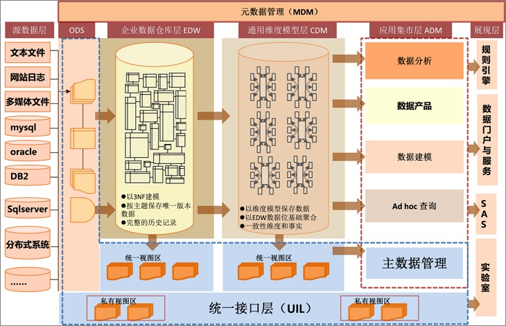
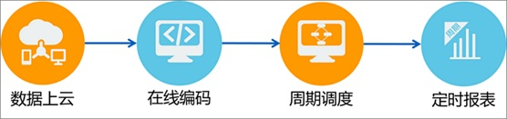
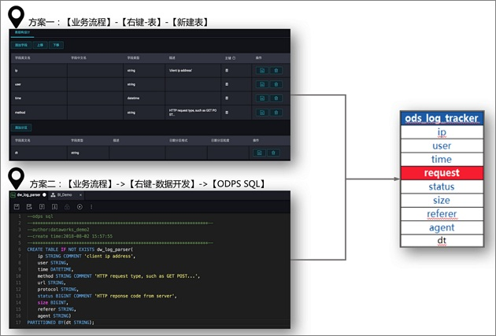
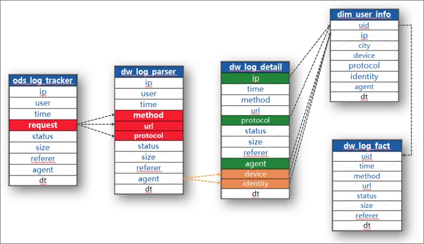
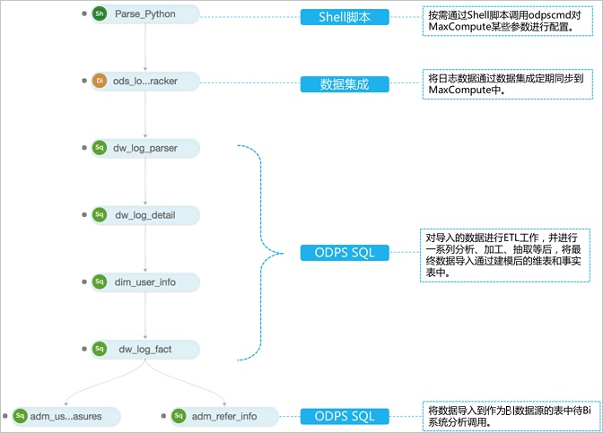
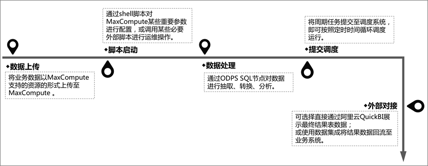
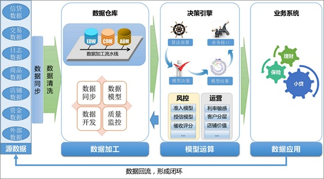

阿里云  
专有云  
DataWorks  
产品简介  
产品版本：V3.18.6  
文档版本：20250728

**目录**

- [1.DataWorks](#section-1)
    - [1.1. 产品详情](#section-1-1)
    - [1.2. 产品价值](#section-1-2)
    - [1.3. 应用场景](#section-1-3)
    - [1.4. 功能特性](#section-1-4)
        - [1.4.1. 数据集成](#section-1-4-1)
        - [1.4.2. 数据开发](#section-1-4-2)
        - [1.4.3. 运维中心](#section-1-4-3)
        - [1.4.4. 数据地图](#section-1-4-4)
        - [1.4.5. 数据质量](#section-1-4-5)
        - [1.4.6. 安全中心](#section-1-4-6)
        - [1.4.7. 数据保护伞](#section-1-4-7)
        - [1.4.8. 数据治理中心](#section-1-4-8)
        - [1.4.9. 数据资产](#section-1-4-9)
        - [1.4.10. 数据分析](#section-1-4-10)
        - [1.4.11. 数据服务](#section-1-4-11)
        - [1.4.12. 审批中心](#section-1-4-12)
        - [1.4.13. 迁移助手](#section-1-4-13)
        - [1.4.14. 开放平台](#section-1-4-14)
        - [1.4.15. 工作空间管理](#section-1-4-15)
        - [1.4.16. 组织管理](#section-1-4-16)
        - [1.4.17. 国际化](#section-1-4-17)

<a id="section-1"></a>

# 1.DataWorks

DataWorks基于MaxCompute、Hologres、AnalyticDB等大数据引擎，为数据仓库、数据湖、湖仓一体等解决方案提供统一的全链路大数据开发治理平台。从2009年起，DataWorks不断沉淀阿里巴巴大数据建设方法论，支撑数据平台建设，同时与数万名政务、央国企、金融、零售、互联网、能源、制造、工业等行业的客户携手，不断提升数据应用效率，助力产业数字化升级。

<a id="section-1-1"></a>

## 1.1. 产品详情

DataWorks十多年沉淀数百项核心能力，通过全域数据集成、高效数据生产、主动数据治理、全面数据安全、数据分析服务等全链路数据治理的能力，帮助企业治理内部不断上涨的“数据悬河”，释放企业的数据生产力。

**数据集成**

DataWorks的数据集成功能模块是稳定高效、弹性伸缩的数据同步平台，致力于提供复杂网络环境下、丰富的异构数据源之间高速稳定的数据移动及同步能力。

DataWorks数据集成支持离线同步、实时同步，以及离线和实时一体化的全增量同步，其亮点功能如下：

- 离线同步场景下，支持设置离线同步任务的调度周期。

- 支持数据库、数仓、NoSQL数据库、文件存储、消息队列等近50多种不同异构数据源之间的数据同步。

- 支持以插件的方式部署采集工具至数据源端的服务器，完成数据信息的同步采集工作。

- 支持各种复杂网络环境下的数据传输。例如，本地跨私网环境、VPC环境等。

  > **说明**
  >
  > 对长链路传输通过协议加速能更高效、稳定的传输大批量数据。

- 控制友好，提供精准流控保证，支持通道、记录流、字节流三种流控模式，并提供完备的容错处理，支持线程级别、进程级别、作业级别多层次局部或全局的重跑。

- 传输速度快，充分利用单机网卡能力，并使用分布式模型架构，保障数据吞吐量水平扩展，能够提供GB级、TB级的数据流量。

- 支持数据流入管控，各种数据类型转换时，能精确识别脏数据，进行过滤、采集、展示，提供可靠的脏数据处理能力，助力用户准确把控数据流入内容，提供作业全链路的流量、数据量、脏数据探测和运行时汇报。

**智能数据建模**

智能数据建模是阿里云DataWorks自主研发的智能数据建模产品，沉淀了阿里巴巴十多年来数仓建模方法论的最佳实践，包含数仓规划、数据标准、维度建模及数据指标四大模块，帮助企业在搭建数据中台、数据集市建设过程中提升建模及逆向建模的能力，并通过数据建模快速构建企业数据资产。

智能数据建模产品包含**数仓规划**、**数据标准**、**维度建模**、**数据指标**四大产品模块：

- **数仓规划**：数仓规划支持数仓分层、数据域、业务过程等的规划，支持设置模型设计空间，不同部门可共享一套数据标准和数据模型。

- **数据标准**：数据标准字段标准、标准代码、度量单位、命名词典的定义，保障后续建模与应用过程中数据处理的一致性，从源头上保障数据的标准化生产，节约后续数据应用和处理的成本。

- **维度建模**：维度建模支持逆向建模，解决现有数仓的建模冷启动难题，支持可视化数仓维度建模，支持通过FML（一种类SQL的DSL）快速构建模型，并将模型快速发布到相应的研发引擎。

- **数据指标**：数据指标支持原子指标、派生指标的定义与构建，与维度建模无缝对接，可根据原子指标和不同维度批量创建派生指标。

DataWorks智能建模可助力企业构建自身建模能力，挖掘企业的数据资产价值，例如：

- **海量数据的标准化管理**：企业业务越庞大数据结构就越复杂，企业数据量会随着企业业务的快速发展而迅速增长，如何结构化、有序地管理和存储数据是每个企业都将面临的一个挑战。

- **业务数据互联互通，打破信息壁垒**：公司内部各业务、各部门之间数据独立自主形成了数据孤岛，导致决策层无法清晰、快速地了解公司各类数据情况。如何打破部门或业务领域之间的信息孤岛是企业数据管理的严峻考验。

- **数据标准整合，统一灵活对接**：同一数据不同描述，企业数据管理难、内容重复、结果不准确。如何制定统一的数据标准又不打破原有的系统架构，实现灵活对接上下游业务，是标准化管理的核心重点之一。

- **数据价值最大化，企业利润最大化**：在最大程度上用好企业各类数据，使企业数据价值最大化，为企业提供更高效的数据服务。

**数据模型**

阿里云DataWorks联合建模工具DDM（DATABLAU Data Modeler）为您提供一体化的数据建模解决方案（DATABLAU），将数据模型设计管控、引标落标等能力融入DataWorks规范化开发流程，助力用户实现数据资产价值化输出，在数据全生命周期上夯实数据基础，为客户的数据价值化提供有力支撑。

数据建模（DATABLAU）主要提供的功能如下：

- 模型的可视化设计：提供专业化的本地客户端与在线轻量级的客户端，供您在不同工作场景下进行可视化建模。

- 协同设计：支持多人同时登录协同进行模型设计。

- 数据标准：管理者可以定义数据标准、代码规范及命名规范。

- 智能引标：提供模型设计人员在构建模型时，引用预先设定好的标准的能力，实现事前落标。

- 正向与逆向DDL：不仅支持将工具中设计好的模型直接下发至引擎，而且支持将引擎中已存在的模型提取至工具中进行再编辑、再下发，告别传统模型工具手工导入、导出的繁琐操作。

- 模型库：支持用户将模型迁入、迁出至模型库统一管理的模式。

- 模型落标监控：支持对已落到引擎中的模型进行基线检查，帮助用户轻松发现表结构与物理模型结构的不一致。

- 与DataWorks开发体系完美结合：支持将模型的发布与DataWorks已有开发流程关联，实现更加规范化的从模型设计到模型发布上线的流程。

**数据开发**

DataWorks的数据开发（DataStudio）是数据加工的开发平台，为数据使用者提供一站式的集成开发环境，可满足数据资源平台下，数据开发者进行ETL开发、数据挖掘算法开发、数据主题库建设等需求。当底层数据进行聚合后，数据仍处于零散状态，无法直接为上层智能算法和DI应用提供对应数据，此时需要对数据进行汇聚加工。数据管理和开发人员需要在数据资源平台建立对应的数据中心，进行对应数据的加工。DataWorks的数据开发的亮点功能如下：

- DataStudio支持MaxCompute、EMR、Hologres、AnalyticDB、Clickhouse等多种计算引擎，支持在统一的平台上进行各类引擎任务的开发、测试、发布和运维等操作。

- DataStudio支持智能编辑器、可视化依赖编排，调度能力经过阿里集团内千万级调度任务、复杂业务依赖的反复验证。

- DataStudio提供隔离的开发和生产环境，结合版本管理、代码评审、冒烟测试、发布管控、操作审计等配套功能，帮助企业规范地完成数据开发。

**运维中心**

监控运维为数据开发者和维护者提供一站式的数据运维管控能力，用户可以自主管理作业的部署、作业优先级、以及生产监控运维。

DataWorks上数据量庞大、数据类型多样、数据业务复杂，数据处理任务较多，数据处理环节和流程周期长，需要支持高并发、多周期、支持多种数据处理环节的统一数据任务调度机制，按照策略进行数据任务调度。因此，DataWorks提供数据监控运维、任务运行情况监控、异常情况告警、日常运维数据统计等功能，保障数据时效性、任务诊断及时。

**数据地图**

DataWorks的数据地图功能可以帮助您实现对数据的统一管理和血缘的跟踪，以数据搜索为基础，提供表使用说明、数据类目、数据血缘、字段血缘等工具，帮助数据表的使用者和拥有者更好地管理数据、协作开发。

**数据质量**

数据质量支持对常见大数据存储（MaxCompute、Hologres、AnalyticDB PostgreSQL、AnalyticDB MySQL和CDH等）进行质量校验。从完整性、准确性、有效性、一致性、唯一性和及时性等多个维度，配置质量监控规则。并可以将质量监控规则与调度节点进行关联，当任务运行完成后便会触发质量规则校验，帮助您第一时间感知问题数据，按需设置规则的强弱来控制任务是否失败退出，从而避免脏数据影响扩大，有效降低数据恢复处理的时间成本和费用成本。

**安全中心**

DataWorks的安全中心，帮助用户快速构建平台的数据内容、个人隐私等相关的安全能力，满足企业面向高风险场景的各类安全要求（例如：审计），无需额外配置即可直接使用该功能。DataWorks的安全中心作为云上大数据体系的安全门户，致力于向用户提供面向数据安全生命周期全过程的安全能力，同时在符合安全规范要求的前提下，提供各类安全诊断的最佳实践。其核心功能如下：

- 数据权限管理：安全中心为用户提供精细化的数据权限申请、权限审批、权限审计等功能，实现了权限最小化管控，同时，方便用户查看权限审批流程各环节的进展，及时跟进处理流程。

- 安全诊断的最佳实践：安全中心提供的平台安全诊断、数据使用诊断等功能，在符合安全规范要求的前提下，为用户提供了诊断各类安全问题的最佳实践。保障业务在最佳的安全环境，更有效的执行。

**数据保护伞**

数据保护伞平台是一款数据安全管理产品，提供数据资产识别、敏感数据发现、数据分类分级、脱敏、访问监控、风险发现预警与审计能力。数据保护伞平台底层是基于MaxCompute（原ODPS）的集成安全管理服务。特性如下：

- **智能地发现敏感数据**

  基于自学习的模型算法，自动识别企业拥有的敏感数据，并以直观的形式展示具体类型、分布、数量等信息。同时支持自定义类型的数据识别。

- **精准的分级分类**

  支持自定义分级信息功能，满足不同企业对数据等级管理需要。

- **灵活的数据脱敏**

  提供丰富多样、可配置的数据脱敏方式，实现使用环节的动态脱敏。

- **用户异常操作风险监控和审计**

  利用多维度关联分析及算法，主动发现异常风险操作，提供预警以及可视化一站式审计。

**数据治理中心**

数据治理中心可根据预先配置的治理计划，自动发现平台使用过程中数据存储、任务计算、代码开发、数据质量及安全等维度存在的问题，并通过健康分量化评估，从全局、工作空间、个人等多个视角，以治理报告及排行榜呈现治理成果，帮助您高效达成治理目标。同时，还提供业务资产管理、资产分析、任务资源消耗明细、费用预估等功能，帮助您有效掌握各类资源的使用详情。

**数据资产**

数据资产管理有独立的权限点控制，由于数据资产管理属于组织级别的模块，需要在组织管理中添加权限。业务系统及DataWorks中有大量的数据表、API等各类数据资产，数据管理者通过数据集成工具同步数据、通过数据开发加工数据后，需要对整个平台数据进行统一管控，了解平台的核心数据资产，提供对应数据资产管理规范。

**数据分析**

数据分析基于“人人都是数据分析师”的产品目标，旨在为更多非专业数据开发人员，如数据分析、产品、运营等工作人员提供更加简洁高效的取数、用数工具，提升大家日常取数分析效率。其支持基于个人视角的数据上传、表搜索与收藏、在线SQL取数、SQL文件共享、SQL查询结果下载及用电子表格进行大屏幕数据查看等产品功能。

数据分析适合更多的数据分析、产品、运营等工作人员进行高效、海量、流动、安全的数据分析工作：

- **海量**：借助计算引擎的能力，可以高效分析全量、海量的数据。

- **流动**：在线数据分析可以从不同业务系统的数据库获取数据进行分析。DataWorks数据分析支持导出数据为MaxCompute表，或分享结果数据至指定成员，并赋予其权限。数据可以在不同的系统和人员之间流动。

- **安全**：所有SQL查询、SQL结果下载等功能的操作都可以接入安全审计。

**数据服务**

DataWorks数据服务旨在为企业搭建统一的数据服务总线，帮助企业统一管理对内对外的API服务。主要功能及优势如下：

- **快速生成并注册API**

  提供快速将数据表生成数据API的能力，支持将现有的API快速注册到数据服务平台以统一管理和发布。

- **数据共享安全**

  与API网关（API Gateway）打通，支持将API服务一键发布至API网关。数据服务与API网关为用户提供了安全、稳定、低成本、易上手的数据共享与开放服务。

- **运维成本低**

  采用Serverless架构，用户只需关注API本身的查询逻辑，无需关心运行环境等基础设施，数据服务会为您准备好计算资源，并支持弹性扩展，零运维成本。

- **数据开放服务灵活**

  数据服务是数据交换的核心组件。数据交换包含数据共享服务和数据开放服务。数据服务为数据交换构建了安全、灵活、可靠的服务总线，可以支撑政务系统内部实现跨部门、跨层级、跨网络的数据共享，也可以支撑政务数据对社会公众开放的政务数据开放服务。

**迁移助手**

DataWorks迁移助手支持将开源调度引擎的作业迁移至DataWorks，支持DataWorks上的开发成果迁移。

迁移助手主要适用于：

- **备份任务**

  定期备份任务代码，减少误删项目导致数据丢失的情况。

- **快速复制业务**

  抽象出通用的业务流程，并快速复制业务。

- **快速创建测试环境**

  复制全部任务代码，快速搭建一个测试环境。您只需要修改生产数据库的数据输入为测试数据。

- **混合云异地开发**

  导出公共云的代码至专有云中，实现同时在公共云和专有云进行数据开发。

- **隔离开发环境和生产环境**

  当开发环境和生产环境的网络完全隔离后，您可以通过迁移助手，导出开发环境中已完成开发的任务至生产环境。

**开放平台**

DataWorks开放平台是DataWorks对外提供数据和能力的开放通道。该平台提供了开放API（OpenAPI）、开放事件（OpenEvent）和扩展程序（Extensions）的能力，可以帮助您快速实现各类应用系统对接DataWorks、方便快捷地进行数据流程管控、数据治理和运维，及时响应应用系统对接DataWorks的业务状态变化。

**组织管理**

组织管理中主要包含：工作空间管理、成员管理、调度资源、计算引擎、授权管理、资源组管理等功能，帮助组织管理员管理组织内的重要资源。

<a id="section-1-2"></a>

## 1.2. 产品价值

DataWorks具有超大规模计算处理能力、海量异构数据源快速集成能力、完备的数据质量监控体系、安全的数据共享机制等多种优势。

**超大规模计算处理能力**

DataWorks与底层计算平台集成，能够轻松处理海量数据：

- 万亿级数据JOIN，百万级并发Job，作业I/O可达PB级/天。

- 离线调度支持百万级任务量，实时监控告警。

- 提供功能强大易用的SQL、MR引擎，兼容大部分标准SQL语法。

- 采用三重备份、读写请求鉴权、应用沙箱、系统沙箱等多层次数据存储和访问安全机制保护您的数据，确保不丢失、不泄露、不被窃取。

**一站式的数据工场**

DataWorks为用户提供可视化的操作界面，并支持多人协同作业：

- 提供数据从集成、加工、管理、监控、输出服务的全流程所有功能。

- 提供可视化工作流程设计器功能。

- 多人协同作业机制，分角色进行任务开发、线上调度、运维、数据权限管理等功能，数据及任务无需落地即可完成复杂的操作流程。

**海量异构数据源快速集成能力**

DataWorks支持400对异构数据源的离线同步，支持分钟、小时、天、周和月多种调度周期配置。

**Web化的软件服务**

DataWorks可在互联网/内部网络环境下直接使用，无需安装部署，拎包入驻，开箱即用。

**多租户权限模型**

多租户模型确保您的数据被安全隔离，以租户为单位进行统一的权限管控、数据管理、调度资源管理和成员管理工作。

**智能的监控报警**

通过设置监控基线，您不仅可以从宏观把控整体任务链路的完成时间，也可以从微观对每一个节点任务状态进行全方位监控。

**易用的智能SQL编辑器**

通过智能代码提示功能、表Meta信息提示功能、代码格式化和折叠功能、预编译功能以及炫酷皮肤切换功能来获得全新的SQL代码编辑体验。

**完备的数据质量监控体系**

支持多种异构数据源、离线数据、实时数据的质量校验、通知、管理。

**便捷的数据服务开发接口**

API网关服务、交互式数据服务引擎让您只需两步操作，即可将已有API和数据以服务的形式发布到数据共享与开放平台。

**安全的数据共享机制**

提供可以集成在数据转移过程中的加密组件，在数据从属主方转移到使用方的过程中，将数据进行加密，确保使用方只能获得加密后的数据。结合信封加密技术，提供的密文只能被授权的使用方使用，保证数据被转移给第三方之后无法使用，确保在共享过程中的数据安全。

<a id="section-1-3"></a>

## 1.3. 应用场景

DataWorks主要在云上数仓、BI应用、数据化运营等各类数据场景中得到广泛应用。

**云上数仓**

大型企业可以在专有云环境下使用DataWorks来构建超大型的数据仓库。



DataWorks提供卓越的海量数据集成能力：

- 海量存储：可支持PB、EB级别的数据仓库，存储规模可线性扩展。

- 数据集成：支持多种异构数据源的数据同步和整合，消除数据孤岛。

- 数据开发：基于MaxCompute（原ODPS）的大数据开发，支持SQL、MR等编程框架，以及贴近业务场景的白屏化工作流设计器。

- 数据管理：基于统一的元数据服务来提供数据资源管理视图，以及数据权限审批流程。

- 离线调度：可以提供多时间维度的周期性调度能力，支持每天百万级的调度并发，并对任务调度实时监控，对错误及时告警。

**BI应用**

本节为您介绍如何使用DataWorks制作报表。



基于网络日志，完成如下分析需求：

- 统计网站的PV（浏览次数）、UV（独立访客），按用户的终端类型（如Android、iPad、iPhone、PC等）分别统计，并给出这一天的统计报表。

- 网站的访问来源，了解网站的流量从哪里来。

截取一条真实的数据如下所示。

```text
xx.xxx.xx.xxx - - [12/Feb/2014:03:15:52 +0800] "GET /articles/4914.html HTTP/1.1" 200 37666
"http://xxx.cn/articles/6043.html" "Mozilla/5.0 (Windows NT 6.2; WOW64)
AppleWebKit/537.36 (KHTML, like Gecko) Chrome/xx.x.xxxx.xxx Safari/537.36" -
```

1. 新建表：在导入数据之前，需要先创建一张MaxCompute目标表，把表名命名为ods_log_tracker。

   

2. 设置各表之间的依赖关系。

   

3. 分别新建Shell、数据同步和ODPS SQL节点任务。

   

4. 进行任务开发。

   

**数据化运营**

图 1. 示例企业的数据业务运营模式图如下。



- 创新业务：通过数据挖掘建模和实时决策系统，将大数据加工结果直接应用于业务系统。

- 中小企业：基于DataWorks可快速使用和分析数据，助力企业的经营决策。

<a id="section-1-4"></a>

## 1.4. 功能特性

<a id="section-1-4-1"></a>

### 1.4.1. 数据集成

数据集成是一个稳定高效、弹性伸缩的数据同步平台，致力于提供在复杂网络环境下、丰富的异构数据源之间高速稳定的数据移动及同步能力。

| 功能分类 | 功能 | 说明 |
| --- | --- | --- |

- 关系型数据库

  支持关系型数据库读写：MySQL、SQLServer、PostgreSQL、Oracle、DM、DRDS、PolarDB、HybridDB for MySQL、AnalyticDB for PostgreSQL、SAP HANA、DB2、MariaDB、Kudu、PolarDB-O、ApsaraDB for OceanBase。

- 大数据存储

  支持大数据仓库读写：MaxCompute、DataHub、AnalyticDB for MySQL 2.0、AnalyticDB MySQL 3.0、Vertica、GBase8a、Lightning、Hive、HBase、KingbaseES（人大金仓）、Hologres、Greenplum、ClickHouse、Lindorm。

离线单表数据同步

- 半结构化存储

  支持半结构化存储读写：OSS、HDFS、FTP、S3、RestAPI。

- NoSQL

  支持NoSQL数据库读写：MongoDB、Memcache（OCS）、Redis、OTS、Elasticsearch、Graph Database、Cassandra。

- 消息队列

  支持消息队列读写：Kafka、Loghub。

- 网络连通控制

  支持复杂网络情况下对异构的数据源进行数据同步与集成。

- 环境隔离

  提供开发数据源和生产数据源两种配置，防止开发环境影响线上。

数据源管理

- 权限控制

  支持对数据源进行权限控制，可以分享给需要的人员，并

数据集成-标准版

防止数据源信息泄露。

- 支持认证文件管理

  支持对于部分数据源的认证文件管理，包括kerberos认证和SSL认证。

支持数据库批量建立同步任务，一次性全量增量导入数据，可快速将数据同步至计算引擎上。

离线整库批量同步

具体支持：MysqL、Oracle、SQLServer、PG、PolarDB、DRDS、Hive、DB2、ADB2.0/3.0/PG、HybridDB for MySQL、DM、OceanBase。

- 支持传输速率控制

  对整个同步任务的同步速率进行控制，限制在具体的字节速率之下，防止传输速率过大，打满数据库的IO，影响数据库性能。

离线同步速率控制

- 支持连接并发控制

  对同步任务的线程并发数进行控制，防止资源超过限制而卡死。

支持读取数据时数据过

读取数据时可以根据条件过滤读取符合条件的数据。

滤

支持脏数据监控

以监控脏数据条数，根据配置终止任务。

- 实时数据读取

  支持实时读取MySQL、Oracle、OceanBase、PolarDB、Kafka、DataHub、LogHub。

- 实时数据写入

单表实时数据同步

支持实时写入MaxCompute、Hologres、DataHub、Kafka。

- 支持DDL消息

  支持DDL消息，在写入Hologres时支持动态增加列。

数据集成-实时同步增强包

支持MySQL、Oracle、OceanBase、PolarDB实时同步至

> **说明**

整库实时同步

MaxCompute、Hologres、DataHub、Kafka。

> 增强包在标准版的基础上叠加了此部分功能。

支持MySQL、Oracle、OceanBase、PolarDB整库离线实

解决方案

时一体化同步至MaxCompute、Hologres、DataHub、Kafka。

支持实时同步过程中进行数据条件过滤、字符串替换的处

实时同步数据处理

理。

支持实时同步任务运维报警设置，可以钉钉、短信、邮件报

实时同步任务监控

警。

<a id="section-1-4-2"></a>

### 1.4.2. 数据开发

DataWorks的<strong>数据开发（DataStudio）</strong>是数据加工的开发平台，您可以在DataWorks上规范、高效地构建数据开发工作流。

其核心功能如下：

<table>
  <tr>
    <th width="138">功能</th>
    <th>说明</th>
  </tr>
  <tr>
    <td>文件管理</td>
    <td>• 支持使用解决方案与业务流程管理任务、表、资源、函数等文件。<br>• 支持在目录树上展示文件的层次结构。<br>• 支持在当前工作空间范围内的进行代码搜索。<br>• 支持被删除的文件，暂存在回收站。</td>
  </tr>
  <tr>
    <td>任务开发</td>
    <td>• 支持数据集成、MaxCompute节点、Hologres节点、算法节点、数据库节点、通用节点、自定义节点等，具体以控制台界面显示为准。<br>• 代码编辑器支持语法高亮、纠错、代码格式化、表名字段名联想等。<br>• 支持通过文件的上锁/解锁，实现多人协同编辑（非实时协同）。</td>
  </tr>
  <tr>
    <td>表管理</td>
    <td>支持可视化建表，包括：MaxCompute表、EMR/CDH表、ADBforPostgreSQL表、ADBforMySQL表；支持查看元数据。</td>
  </tr>
  <tr>
    <td>资源、函数管理</td>
    <td>• MaxCompute资源、函数支持上传资源（Python、Jar、Archive、File）、注册函数。<br>• EMR/CDH资源、函数支持上传资源（Jar、File）、注册函数。</td>
  </tr>
  <tr>
    <td>任务调度配置</td>
    <td>支持配置周期调度、手动调度、DAG编排、调度参数、依赖关系、重跑次数与间隔、超时定义和调度资源组。</td>
  </tr>
  <tr>
    <td>任务调试</td>
    <td>支持下载运行结果、临时查询、冒烟测试、带参运行任务、测试运行任务及工作流、查看代码运行历史。</td>
  </tr>
  <tr>
    <td>版本管理</td>
    <td>支持代码评审、任务发布、任务提交、版本回滚和对比。</td>
  </tr>
</table>

<a id="section-1-4-3"></a>

### 1.4.3. 运维中心

运维中心包括运维大屏、实时任务运维、周期任务运维、触发式任务运维、智能监控、引擎运维和调度设置和操作历史。

<table>
  <tr>
    <th width="89">功能</th>
    <th>说明</th>
  </tr>
  <tr>
    <td>运维大屏</td>
    <td>运维大屏展示当前您需要重点关注的运维指标、任务整体运行情况、调度资源变化趋势等运维概览，以及离线同步、实时同步任务的运行状态分布、数据同步进度等数据集成信息，帮助您提升任务运维效率。</td>
  </tr>
  <tr>
    <td>任务运维</td>
    <td>任务运维主要分为以下三种：<br>• 实时任务运维主要包括<strong>实时计算任务</strong>和<strong>实时同步任务</strong>，提供查看日志、启动/停止、下线以及监控等运维操作。<br>• 周期任务运维提供查看日志、测试、补数据、重跑、暂停/恢复、置成功等运维操作。<br>• 触发式任务运维即手动任务运维，主要包括<strong>触发式任务</strong>和<strong>触发式实例</strong>。提供查看日志、测试、补数据、重跑、暂停/恢复、置成功等运维操作。</td>
  </tr>
  <tr>
    <td>智能监控</td>
    <td>智能监控是DataWorks任务运行的监控及分析系统。根据监控规则和任务运行情况，智能监控决策是否报警、何时报警、如何报警以及给谁报警。智能监控会自动选择最合理的报警时间，报警方式以及报警对象。</td>
  </tr>
  <tr>
    <td>引擎运维</td>
    <td>DataWorks运维中心支持MaxCompute引擎的运维，您可以查看MaxCompute的作业队列、配额列表和项目列表。</td>
  </tr>
  <tr>
    <td>调度设置</td>
    <td>DataWorks在原有调度配置基础上，新增自定义调度日历功能，您可通过该功能实现更灵活的任务调度日期与调度方式定义。</td>
  </tr>
  <tr>
    <td>操作历史</td>
    <td>操作历史页面展示用户在运维中心各页面上的操作记录。</td>
  </tr>
</table>

<a id="section-1-4-4"></a>

### 1.4.4. 数据地图

数据地图是在元数据基础上提供的企业数据资产管理模块，涵盖全局数据检索、元数据详情查看、数据预览、数据血缘和数据类目管理等功能。数据地图可以帮助您更好地查找、理解和使用数据。

其核心功能如下：

<table>
  <tr>
    <th width="89">功能</th>
    <th>说明</th>
  </tr>
  <tr>
    <td>首页</td>
    <td>从<strong>表</strong>和<strong>API</strong>两个维度向您展示了近期浏览的数据信息。</td>
  </tr>
  <tr>
    <td>数据总览</td>
    <td>展示租户内的总项目数、总表数、存储大小和趋势等总览统计信息。</td>
  </tr>
  <tr>
    <td>全部数据</td>
    <td>元数据检索，可基于表名、描述等关键字进行检索。</td>
  </tr>
  <tr>
    <td>数据专辑</td>
    <td>在数据专辑中，您可以按照业务视角、分类分级进行数据表的组织和管理，将常用表、团队表、同类表、相关表等加入数据专辑进行收纳，便于快速检索和定位。</td>
  </tr>
</table>

<table>
  <tr>
    <th width="89">我的数据</th>
    <th>您可以在<strong>我的数据</strong>页面查看相关数据信息：<strong>我拥有的数据</strong>、<strong>我管理的数据</strong>、<strong>生产账号的数据</strong>、<strong>我的收藏</strong>、<strong>权限管理</strong>和<strong>我的工</strong><strong>具</strong>。</th>
  </tr>
  <tr>
    <td>数据发现</td>
    <td>数据源的元数据采集，支持Hologres、OTS、MySQL、Oracle、SQL Server等数据库的元数据采集。</td>
  </tr>
  <tr>
    <td>工作空间</td>
    <td>可通过关键词搜索目标工作空间，查看对应的详细信息（包括显示名、负责人、工作空间名称、成员数和环境类型等）。</td>
  </tr>
  <tr>
    <td>配置管理</td>
    <td>支持<strong>类目导航配置</strong>、<strong>项目管理配置</strong>和<strong>其他配置</strong>（主要指安全管控）。</td>
  </tr>
</table>

<a id="section-1-4-5"></a>

### 1.4.5. 数据质量

数据质量可以帮助您第一时间感知源端数据的变更与ETL（Extract Transformation Load）中产生的脏数据，自动拦截问题任务，有效阻断脏数据向下游蔓延。避免任务产出不符合预期的问题数据，影响正常使用和业务决策。同时也能显著降低问题处理的时间成本，避免任务重新运行带来的资源费用浪费。

数据质量支持对常见大数据存储（MaxCompute、Hologres、AnalyticDB PostgreSQL、AnalyticDB MySQL和CDH等）进行质量校验。从完整性、准确性、有效性、一致性、唯一性和及时性等多个维度，配置质量监控规则。并可以将质量监控规则与调度节点进行关联，当任务运行完成后便会触发质量规则校验，帮助您第一时间感知问题数据，按需设置规则的强弱来控制任务是否失败退出，从而避免脏数据影响扩大，有效降低数据恢复处理的时间成本和费用成本。

其核心功能如下：

<table>
  <tr>
    <th width="89">功能</th>
    <th>说明</th>
  </tr>
  <tr>
    <td>概览</td>
    <td>数据质量概览页面为您展示数据质量报警与阻塞情况。</td>
  </tr>
  <tr>
    <td>我的订阅</td>
    <td>我的订阅页面为您展示当前登录账号下通过短信，邮件接收报警的数据质量校验规则。此外，数据质量还支持通过钉钉群机器人等方式发送报警信息。</td>
  </tr>
  <tr>
    <td>规则管理</td>
    <td>数据质量支持按表配置或按模板配置质量监控规则。</td>
  </tr>
  <tr>
    <td>任务查询</td>
    <td>在任务查询页面您可以通过表或节点搜索表历史校验记录及校验详情。</td>
  </tr>
  <tr>
    <td>去噪管理</td>
    <td>去噪管理功能支持对当前工作空间某一时间内，数据质量规则校验异常的数据不触发报警，且不阻塞任务运行。</td>
  </tr>
  <tr>
    <td>配置</td>
    <td>配置模块支持以下功能：<br>• 报告模板管理报告模板管理页面支持您创建报告模板，添加规则配置和规则运行的各项指标，根据设置的统计周期、发送时间和订阅信息，定时生成并发送报告。<br>• 新建、操作和应用规则模板数据质量支持自建规则模板库，对通用的自定义监控规则进行统一管理，形成自建的规则模板库，帮助您提升规则配置的效率。</td>
  </tr>
</table>

<a id="section-1-4-6"></a>

### 1.4.6. 安全中心

DataWorks的安全中心作为云上大数据体系的安全门户，致力于向您提供面向数据安全生命周期全过程的安全能力，同时在符合安全规范要求的前提下，提供各类安全诊断的最佳实践。

其核心功能如下：

<table>
  <tr>
    <th width="121">功能</th>
    <th>说明</th>
  </tr>
  <tr>
    <td>数据平台安全</td>
    <td>您可以进行权限申请、权限审批，并查看相关申请、审批记录。</td>
  </tr>
  <tr>
    <td>数据使用安全</td>
    <td>为您提供了对当前DataWorks工作空间的数据内容及数据隐私的安全保护能力，以及诊断相关安全问题的最佳实践及解决方案，帮助您快速建立数据使用时和使用后的基本安全体系。</td>
  </tr>
  <tr>
    <td>安全策略</td>
    <td>• 支持按照工作空间维度进行实体转交，并且可以查看转交日志。<br>• 支持对数据源查询和查询结果可执行的展示、复制、下载、分享等操作进行权限管控。</td>
  </tr>
</table>

<a id="section-1-4-7"></a>

### 1.4.7. 数据保护伞

数据保护伞是一款数据安全管理产品，为您提供数据发现、数据脱敏、数据水印、访问控制、风险识别、数据溯源等多种功能，帮助您快速梳理敏感数据并进行安全管控，保障数据安全。

其核心功能如下：

<table>
  <tr>
    <th width="89">功能</th>
    <th>说明</th>
  </tr>
  <tr>
    <td>数据发现</td>
    <td>通过规则配置，帮助您有效识别组织内的敏感数据，以及项目等不同维度，为您提供可视化的数据资产展示。</td>
  </tr>
  <tr>
    <td>数据访问</td>
    <td>基于规则识别出的敏感数据，展示这些敏感数据的访问量、访问趋势、访问人员、访问明细、导出量、导出明细等，帮助您掌控敏感数据的每一次访问。目前支持MaxCompute引擎的操作数据展示。</td>
  </tr>
  <tr>
    <td>数据风险</td>
    <td>通过手工打标、风险规则、AI算法等多种方式，识别潜在风险，并支持备注人工审计的结果。目前支持MaxCompute引擎的操作数据风险发现。</td>
  </tr>
  <tr>
    <td>数据审计</td>
    <td>多维度展示您的风险处理结果和风险分布情况。目前支持MaxCompute引擎的审计情况展示。</td>
  </tr>
  <tr>
    <td>规则配置</td>
    <td>• 数据分类分级数据分类分级支持您按照数据的价值、内容敏感程度、影响和分发范围对数据进行敏感级别和类型的划分，不同敏感级别的数据其管控原则和数据开发要求存在差异，划分分类分级后，后续可通过分类分级管控不同程度的敏感数据。<br>• 数据识别规则数据保护伞基于敏感字段类型来配置敏感数据识别规则，规则配置完成后，即可用于识别租户内相应类型的敏感数据。DataWorks为您提供了多种内置敏感字段类型及识别规则，若内置规则不满足您的业务需要，您也可自定义敏感字段类型及识别规则。<br>• 数据脱敏管理DataWorks支持通过配置脱敏规则将敏感数据进行脱敏，保障数据查询或存储安全。当前DataWorks支持多种脱敏场景，同时您还可根据需要自定义脱敏场景，以满足不同数据脱敏场景下的脱敏需求。<br>• 风险识别管理风险识别管理提供了多维度的关联分析及算法，智能化的分析技术帮助您通过风险识别规则，主动发现风险操作并预警，使用可视化方式进行一站式审计。DataWorks内置了多种场景的风险识别规则，您可以直接使用，也可以根据业务场景自定义规则。<br>• 用户管理组织DataWorks的用户组管理功能，帮助您根据业务需求，快速将具有相同数据访问权限的目标账号批量添加至一个用户组，后续在配置数据脱敏时，可以直接将该用户组添加至白名单，使用户组内的账号获取到的数据为脱敏前的原始数据。</td>
  </tr>
  <tr>
    <td>系统配置</td>
    <td>支持设置数据识别账号、识别范围、识别内容、权限控制模式等。</td>
  </tr>
</table>

<a id="section-1-4-8"></a>

### 1.4.8. 数据治理中心

数据治理中心可根据预先配置的治理计划，自动发现平台使用过程中数据存储、任务计算、代码开发、数据质量及安全等维度存在的问题，并通过健康分量化评估，从全局、工作空间、个人等多个视角，以治理报告及排行榜呈现治理成果，帮助您高效达成治理目标。同时，还提供业务资产管理、资产分析、任务资源消耗明细、费用预估等功能，帮助您有效掌握各类资源的使用详情。

其核心功能如下：

<table>
  <tr>
    <th width="105">功能</th>
    <th>说明</th>
  </tr>
  <tr>
    <td>治理评估</td>
    <td>从<strong>全局视角</strong>、<strong>工作空间视角</strong>和<strong>个人视角</strong>展示了如下信息：<br>• 治理健康度整体评分<br>• 治理整体评估<br>• 五个治理维度（存储、计算、质量、研发和安全）的健康分<br>• 治理成效<br>• 健康分和治理问题数趋势</td>
  </tr>
  <tr>
    <td>治理工作台</td>
    <td>• 系统会根据您配置的治理项，自动检测存在的需要治理优化的问题。您可以查看可优化问题总数、可优化项排行、优化项类别及可优化的任务或表详情，及时发现并处理待治理问题。<br>• 将无需处理的治理项问题添加至白名单后，此处展示申请的白名单完整列表，并支持进行撤销等管理操作。<br>• 任务360、表360：提供任务或者表的360全景信息的汇聚展示，包含基础信息、关联治理项、影响基线、执行实例、指标和事件记录等。</td>
  </tr>
  <tr>
    <td>使用分析</td>
    <td>可以查看<strong>资源使用概览</strong>和<strong>资源使用明细</strong>的详细信息。</td>
  </tr>
  <tr>
    <td>知识库</td>
    <td>提供各个<strong>治理项</strong>和<strong>检查项</strong>的口径说明、处理方法、注意事项等信息。</td>
  </tr>
  <tr>
    <td>配置管理</td>
    <td>• 系统提供开箱可用的方案模板，方案中内置丰富的检查项配置。<br>• 检查项作用于任务发布提交等环节，对问题进行拦截，来预防治理问题的引入。<br>• 治理项作用于事后分析，自动发现需要优化治理的存量问题。请按需选择使用。<br>• 治理单元：由一个或多个工作空间组成，最常用方式是对工作空间按照业务划分，会用作集中统计该单元下所有工作空间的整体健康分、治理项和检查项事件等场景。</td>
  </tr>
</table>

<a id="section-1-4-9"></a>

### 1.4.9. 数据资产

DataWorks数据资产管理助力企业用户做好企业数据资产盘点工作，为企业在阐述数据中台业务价值时起到了一定的帮助作用。同时，也便于企业的业务人员快速获取所需数据资产并在安全的环境中进行资产消费。

其核心功能如下：

<table>
  <tr>
    <th width="89">功能</th>
    <th>说明</th>
  </tr>
  <tr>
    <td>资产全景</td>
    <td>资产各种维度组合的统计数据。包含资产核心指标、资产变化趋势、资产目录分布、热门资产排行榜、最新上架资产、最新更新资产等。</td>
  </tr>
  <tr>
    <td>资产市场</td>
    <td>支持按照资产目录逐级查找资产，也支持按照关键词进行资产检索，并可对资产进行详情查看、申请权限、分析数据等。</td>
  </tr>
  <tr>
    <td>资产价值</td>
    <td>对上架资产进行资产价值的评估，帮助资产管理人员做好资产盘点工作。包括资产价值概览、资产价值榜单、资产价值详情等。</td>
  </tr>
  <tr>
    <td>资产消费</td>
    <td>对包含数据内容的资产（例如：发布MaxCompute物理表的模型）进行可视化数据查询及结果下载。</td>
  </tr>
  <tr>
    <td>管理中心</td>
    <td>• 目录管理：支持管理员设置全局资产目录。<br>• 资产管理：支持管理员对入库资产进行上下架及目录挂载等操作。<br>• 资产空间：支持资产管理员设置可在当前工作空间统一纳管的其他资产所在的工作空间。<br>• 资产采集：支持资产管理员设置资产入库策略。</td>
  </tr>
</table>

<a id="section-1-4-10"></a>

### 1.4.10. 数据分析

数据分析主要提供SQL查询、电子表格和系统管理三个核心功能，基于“人人都是数据分析师”的产品目标，旨在为更多的数据分析、产品、运营等工作人员提供更加简洁高效的取数、用数工具，提升大家日常取数分析效率。

其核心功能如下：

<table>
  <tr>
    <th width="93">功能</th>
    <th>说明</th>
  </tr>
  <tr>
    <td>SQL查询</td>
    <td>支持多种大数据引擎和数据源类型（例如：MaxCompute/MySQL/PostgreSQL等）、文件管理（我的文件/他人文件）、SQL编辑器的基本操作和SQL查询结果和日志的查看。</td>
  </tr>
  <tr>
    <td>电子表格</td>
    <td>支持查看文件列表（我创建的文件/分享给我的文件）、数据导入、表格常规操作等。</td>
  </tr>
  <tr>
    <td>系统管理</td>
    <td>支持SQL查询设置（SQL查询记录数）、电子表格设置（允许下载/允许分享）。</td>
  </tr>
</table>

<a id="section-1-4-11"></a>

### 1.4.11. 数据服务

DataWorks数据服务模块是一个灵活轻量、安全稳定的数据API构建平台，作为数据库和数据应用之间的“桥梁”，DataWorks数据服务旨在为个人、团队和企业提供全面的数据服务和共享能力，帮助用户统一管理面向内外部的API服务。例如，您可以基于数据表编辑查询逻辑来生成API，或将已有的API注册至数据服务平台进行统一发布和管理。

其核心功能如下：

| 功能 | 说明 |
| --- | --- |

<table>
  <tr>
    <td>服务开发</td>
    <td>• API<br>i. 通过可视化向导模式生成API，自动拉取表结构，勾选请求参数和返回参数配置API，支持丰富操作符、返回结果分页及排序，支持Post请求类型及Body位置入参。ii. 通过自定义脚本模式生成API，自主编写复杂逻辑的SQL，支持多表关联分析、聚合函数计算、Mybatis动态SQL等，支持Post请求类型及Body位置入参。iii. 通过后端地址注册API，支持常见请求方式和数据格式，能够与通过数据表生成的API统一管理、发布和对接。iv. 支持设置开发/生产环境数据源，支持环境配置（超时时长、内存、最大分页）。<br>• 函数及过滤器支持通过编写函数为API设置前置和后置过滤器，实现对API的请求参数进行预处理，或对API的返回结果进行二次开发，增强API逻辑表达，适配各类场景。<br>• 服务编排提供拖拽式、可视化的工作流编排能力，支持用户按照业务逻辑，以串行、并行和分支等结构编排多个API及函数服务为工作流。<br>• 业务流程根据业务种类将不同类型的资源（API、函数、服务编排）组织在一起，更好地帮助用户以业务为单元进行开发。<br>• 数据源类型<br>• 支持常见关系型数据库：RDS、MySQL、SQL Server、PostgreSQL、Oracle。<br>• 支持NoSQL数据库：Table Store（OTS） 、MongoDB。<br>• 支持连通大数据存储：MaxCompute、Hologres、AnalyticDB MySQL 2.0、AnalyticDB MySQL 3.0、AnalyticDB for PostgreSQL、PolarDB-X（DRDS）。<br>• 数据表通过筛选数据源类型和数据表名称，预览目标表结构。<br>• 标签管理支持对生成API、注册API及服务编排进行打标，对API进行有效的分类和搜索。<br>• 版本管理提供版本管理和历史回溯的能力。对于API、函数和服务编排，每发布一次，便会产生一条版本记录；用户可以选中任意两个版本，对比其参数或SQL脚本，且支持对目标版本进行回滚。</td>
  </tr>
</table>

<table>
  <tr>
    <td>服务管理</td>
    <td>• API管理当租户管理员对目标工作空间配置发布审批策略，则数据服务中API、服务编排、函数在发布前均需通过相应审批流，方可实际执行发布操作。<br>• API计量支持对已发布至网关的API进行调用计量，提供近7日累计总调用次数和总调用时长的总计数据，以及各API的明细计量数据。<br>• API测试支持对已发布的API进行测试。<br>• API调用及鉴权支持两种API调用时的鉴权方式，其一是通过AppCode进行简单身份认证，其二是通过AppKey和AppSecret进行加密签名身份认证，极大地保障了用户数据共享的安全性。<br>• API文档支持对发布的API自动生成详实的API详情页，供API调用者查看，详情页包含API的基础信息、请求和返回参数的相关设置、正常和异常返回示例、错误码等信息。</td>
  </tr>
</table>

<a id="section-1-4-12"></a>

### 1.4.12. 审批中心

DataWorks审批中心是一个用于管理数据授权、敏感行为管控流程的功能模块，包含审批范围定义、审批流程定义等核心功能，满足不同企业在不同内部合规场景下的审批要求。

其核心功能如下：

<table>
  <tr>
    <th width="121">功能</th>
    <th>说明</th>
  </tr>
  <tr>
    <td>审批管理策略</td>
    <td>• 计算引擎审批策略：支持从<strong>MaxCompute项目</strong>维度或<strong>数据保护伞分级分类</strong>维度定义审批策略。<br>• 数据服务审批策略：支持管理员从DataWorks空间级别为每次发布的数据服务API定义发布审批策略。<br>• 数据集成审批策略：支持管理员从DataWorks空间级别为数据集成任务的保存操作定义审批策略。</td>
  </tr>
  <tr>
    <td>申请记录</td>
    <td>支持查询自己发起过的权限申请记录。</td>
  </tr>
  <tr>
    <td>待我审批</td>
    <td>支持查询待自己审批单的列表。</td>
  </tr>
  <tr>
    <td>审批记录</td>
    <td>支持查询并回溯自己审批过的记录。</td>
  </tr>
</table>

<a id="section-1-4-13"></a>

### 1.4.13. 迁移助手

DataWorks的迁移助手支持将开源调度引擎的作业迁移至DataWorks，支持DataWorks上的开发成果迁移。

其核心功能如下：

<table>
  <tr>
    <th width="157">功能</th>
    <th>说明</th>
  </tr>
  <tr>
    <td>任务上云</td>
    <td>实现将开源调度引擎的作业搬迁至DataWorks上，支持调度引擎作业的导出和导入。</td>
  </tr>
  <tr>
    <td>DataWorks迁移</td>
    <td>对DataWorks的开发成果进行快速复制，目前支持：周期任务、手动任务、资源、函数、临时查询等对象。</td>
  </tr>
  <tr>
    <td>迁移高级功能</td>
    <td>支持通过工作空间摸底功能，查看当前工作空间下现有的开发成果（表、周期任务、资源、手动任务、数据源、数据服务、函数、临时查询、组件）以及是否存在跨工作空间的任务依赖。</td>
  </tr>
</table>

<a id="section-1-4-14"></a>

### 1.4.14. 开放平台

DataWorks开放平台是DataWorks对外提供数据和能力的开放通道。该平台提供了开放API（OpenAPI）、开放事件（OpenEvent）和扩展程序（Extensions）的能力，可以帮助您快速实现各类应用系统对接DataWorks、方便快捷地进行数据流程管控、数据治理和运维，及时响应应用系统对接DataWorks的业务状态变化。

其核心功能如下：

| 功能 | 说明 |
| --- | --- |
| 开放API（OpenAPI） | DataWorks开放平台的OpenAPI功能为您提供开放API能力，通过开放API实现本地服务和DataWorks服务的交互，提升企业大数据处理效率，减少人工操作和运维工作，降低数据风险和企业成本。 |
| 开放事件（OpenEvent） | DataWorks开放平台的开放事件功能为您提供消息订阅服务，通过订阅DataWorks事件状态，应用系统对接DataWorks，实时获取相关内容的状态变化，帮助您及时响应，满足您的个性化决策需求。 |
| 扩展程序（Extensions） | Extensions则是将OpenAPI和OpenEvent有机结合起来的服务级插件，通过Extensions允许您对DataWorks中的流程控制进行自定义，例如您可以自定义任务发布管控插件，从而对不符合规范和要求的操作进行拦截。 |

<a id="section-1-4-15"></a>

### 1.4.15. 工作空间管理

工作空间是DataWorks用于进行任务开发和成员权限管理的基本单元。DataWorks为您提供简单模式和标准模式两种工作空间模式，您可以通过不同模式的工作空间对生产数据进行不同程度的安全管控。

其核心功能如下：

| 功能 | 说明 |
| --- | --- |
| 工作空间配置 | 支持对空间基本属性、安全设置（限制查询条数、绑定沙箱白名单）、绑定计算引擎进行操作。 |
| 成员管理 | 支持对该空间执行成员增/删/改的相关操作。 |
| 权限列表 | 展示每个空间角色对于DataWorks每个功能点（权限点）的拥有情况。 |
| MaxCompute高级配置 | 支持对已绑定MaxCompute项目进行授权、关键参数配置等功能。 |
| 数据源管理 | 数据源主要用于数据集成过程中Reader和Writer的对象，您可以在数据源管理页面新增和查看数据源。 |
| <strong>开源集群</strong>管理 | 支持对已绑定的EMR、CDH集群配置账号映射关系与服务地址。 |
| 扩展程序配置 | 支持注册扩展程序和启用扩展程序。 |

<a id="section-1-4-16"></a>

### 1.4.16. 组织管理

组织管理中主要包含：项目管理、成员管理、调度资源、计算引擎、授权管理、资源组管理等功能，帮助组织管理员管理组织内的重要资源。

其核心功能如下：

<table>
  <tr>
    <th width="105">功能</th>
    <th>说明</th>
  </tr>
  <tr>
    <td>项目管理</td>
    <td>用于统一管理所有工作空间，可新建工作空间，对已有工作空间进行配置、禁用、删除等管理操作，方便数据资源层管理员对工作空间进行整体管控。</td>
  </tr>
  <tr>
    <td>成员管理</td>
    <td><strong>成员管理</strong>页面以列表的形式显示本工作空间的成员名称、云账号、所属工作空间等信息：<br>• 支持模糊搜索工作空间成员，并可以从本工作空间移除成员。<br>• 仅工作管理员可以新增工作空间成员，支持通过模糊匹配查找的方式将用户添加至本工作空间。<br>说明在添加用户到工作空间时，必须为其指定至少一种角色。</td>
  </tr>
  <tr>
    <td>调度资源</td>
    <td>管理DataWorks上的资源组，支持新建、查看资源组列表，支持修改资源组归属工作空间。</td>
  </tr>
  <tr>
    <td>计算引擎</td>
    <td>统一管理已绑定至工作空间的引擎，例如：设置调度访问身份。</td>
  </tr>
  <tr>
    <td>授权管理</td>
    <td>展示当前组织下已购买的软件授权。</td>
  </tr>
  <tr>
    <td>资源组管理</td>
    <td>DataWorks资源组属于DataWorks的基础服务，为DataWorks上的各个功能模块提供计算资源，DataWorks资源组是您正常使用DataWorks的前提。资源组的状态将影响到相关功能的稳定运行，资源组的配额将影响任务或服务运行的效率。<br>• 您可以在<strong>独享资源组</strong>页签下<strong>创建调度资源组</strong>或者<strong>创建集成资源组</strong>。<br>• 您可以在<strong>公共资源组</strong>页签下查看<strong>公共资源组使用情况</strong>和<strong>公共数据集成资源组使</strong><strong>用情况</strong>。</td>
  </tr>
</table>

<a id="section-1-4-17"></a>

### 1.4.17. 国际化

本文介绍DataWorks支持国际化的情况。

当前产品控制台支持中文简体、中文繁体、英文切换。
