阿里云  
专有云  
DataWorks  
运维指南  
产品版本：V3.18.6  
文档版本：20251204

**目录**

- [1.产品基本概念与架构介绍](#section-1)
    - [1.1. 什么是DataWorks](#section-1-1)
    - [1.2. 产品优势](#section-1-2)
    - [1.3. 数据开发介绍](#section-1-3)
    - [1.4. DataWorks架构组成](#section-1-4)
    - [1.5. 服务的目录](#section-1-5)
- [2.基于大数据管家的运维](#section-2)
    - [2.1. 登录大数据管家](#section-2-1)
    - [2.2. 监控](#section-2-2)
        - [2.2.1. 健康度](#section-2-2-1)
        - [2.2.2. 报表](#section-2-2-2)
    - [2.3. 运维](#section-2-3)
        - [2.3.1. DataWorks运维功能和入口](#section-2-3-1)
        - [2.3.2. DataWorks服务运维](#section-2-3-2)
            - [2.3.2.1. 数据工场](#section-2-3-2-1)
                - [2.3.2.1.1. DataWorks服务概览](#section-2-3-2-1-1)
                - [2.3.2.1.2. DataWorks服务角色](#section-2-3-2-1-2)
                - [2.3.2.1.3. DataWorks服务槽位](#section-2-3-2-1-3)
                - [2.3.2.1.4. DataWorks服务实例](#section-2-3-2-1-4)
                - [2.3.2.1.5. DataWorks服务项目](#section-2-3-2-1-5)
                - [2.3.2.1.6. DataWorks服务配置](#section-2-3-2-1-6)
                - [2.3.2.1.7. DataWorks普通主机扩容和缩容](#section-2-3-2-1-7)
            - [2.3.2.2. 数据集成](#section-2-3-2-2)
                - [2.3.2.2.1. 查看数据集成概览](#section-2-3-2-2-1)
                - [2.3.2.2.2. 查看数据集成实例](#section-2-3-2-2-2)
                - [2.3.2.2.3. 查看历史分析](#section-2-3-2-2-3)
        - [2.3.3. DataWorks集群运维](#section-2-3-3)
            - [2.3.3.1. DataWorks集群概览](#section-2-3-3-1)
            - [2.3.3.2. DataWorks集群健康](#section-2-3-3-2)
        - [2.3.4. DataWorks主机运维](#section-2-3-4)
            - [2.3.4.1. DataWorks主机概览](#section-2-3-4-1)
            - [2.3.4.2. DataWorks主机服务角色](#section-2-3-4-2)
    - [2.4. 管理](#section-2-4)
        - [2.4.1. 管理概述](#section-2-4-1)
        - [2.4.2. 作业服务](#section-2-4-2)
            - [2.4.2.1. 概述](#section-2-4-2-1)
            - [2.4.2.2. 作业](#section-2-4-2-2)
                - [2.4.2.2.1. 手动执行作业](#section-2-4-2-2-1)
                - [2.4.2.2.2. 开启和关闭定时作业](#section-2-4-2-2-2)
                - [2.4.2.2.3. 查看某个作业的执行历史](#section-2-4-2-2-3)
                - [2.4.2.2.4. 查看执行历史](#section-2-4-2-2-4)
        - [2.4.3. 健康管理](#section-2-4-3)
            - [2.4.3.1. 监控配置](#section-2-4-3-1)
            - [2.4.3.2. 巡检管理](#section-2-4-3-2)
        - [2.4.4. 操作审计](#section-2-4-4)
- [3.DataWorks深度巡检](#section-3)
    - [3.1. 概述](#section-3-1)
    - [3.2. DataWorks服务角色介绍](#section-3-2)
    - [3.3. 集群巡检](#section-3-3)
    - [3.4. base_meat项目巡检](#section-3-4)
    - [3.5. BaseBizAlisa服务巡检](#section-3-5)
    - [3.6. BaseBizPhoenix服务巡检](#section-3-6)
    - [3.7. BaseBizCdp服务巡检](#section-3-7)
    - [3.8. 附录：登录数据库](#section-3-8)
- [4.常用运维工具与命令](#section-4)
    - [4.1. 查看服务所在的机器](#section-4-1)
    - [4.2. 查看集群资源](#section-4-2)
    - [4.3. 查看服务注册变量](#section-4-3)
    - [4.4. 服务重启的命令](#section-4-4)
    - [4.5. 查看失败实例的日志](#section-4-5)
    - [4.6. 批量重跑实例](#section-4-6)
    - [4.7. 批量终止运行实例](#section-4-7)
    - [4.8. 常用的Linux命令](#section-4-8)
    - [4.9. 查看资源组slot占用情况](#section-4-9)
- [5.日常运维](#section-5)
    - [5.1. 巡检](#section-5-1)
        - [5.1.1. 服务状态和机器基础巡检](#section-5-1-1)
        - [5.1.2. 查看Gateway节点的状态](#section-5-1-2)
        - [5.1.3. 监控服务角色和机器](#section-5-1-3)
    - [5.2. 查看后台日志](#section-5-2)
    - [5.3. 扩容base-biz-gateway机器](#section-5-3)
    - [5.4. base-biz-gateway机器缩容](#section-5-4)
    - [5.5. 重启base-biz-tenant服务](#section-5-5)
    - [5.6. 重启DataWorks的Redis服务](#section-5-6)
    - [5.7. 重启DataWorks数据资产管理](#section-5-7)
    - [5.8. 重启base-biz-alisa服务](#section-5-8)
    - [5.9. 重启base-biz-phoenix服务](#section-5-9)
    - [5.10. 重启base-biz-gateway服务](#section-5-10)
    - [5.11. DataWorks数据服务重启](#section-5-11)
    - [5.12. base-biz-gateway服务重启](#section-5-12)
    - [5.13. 使用多Region下的Gateway下沉](#section-5-13)
    - [5.14. 使用多Region下的CDP Gateway下沉](#section-5-14)
- [6.常见问题与解决方案](#section-6)
    - [6.1. 任务长时间处于等待资源状态](#section-6-1)
    - [6.2. oracle数据同步任务oom](#section-6-2)
    - [6.3. 定时任务没有成功调度](#section-6-3)
    - [6.4. 数据管理页面不显示表的数量及用量](#section-6-4)
    - [6.5. 清理日志](#section-6-5)

<a id="section-1"></a>

# 1.产品基本概念与架构介绍

<a id="section-1-1"></a>

## 1.1. 什么是DataWorks

DataWorks（数据工场，原大数据开发套件）是基于MaxCompute、EMR（E-MapReduce）等计算引擎、从工作室、车间到工具集都齐备的一站式大数据智能研发与治理平台，它能助力您快速完成数据集成、开发、治理、服务、质量、安全等全套数据研发治理工作。

DataWorks不仅具备海量数据的离线加工分析、数据挖掘的能力，也集成了数据集成、数据开发、生产运维、实时分析、资产管理、数据质量、数据安全、数据共享等核心数据工艺，同时还提供了数据服务、机器学习（PAI）在线研发平台，承上启下，让数据从采集到展现、从分析到驱动应用得以一站式解决。

DataWorks + MaxCompute在2018年获得著名分析评测机构Forrester的Cloud Data Warehouse云数据仓库世界排名第二的成绩，是唯一入选的中国产品。DataWorks V2.0在DataWorks V1.0的基础上新增业务流程、组件的概念，力求通过支持双项目开发、隔离数据开发和生产环境、保证数据研发规范、减少错误代码来完善数据研发体系。

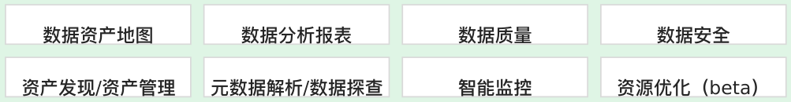

**数据综合治理**

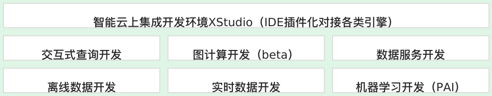

**DataWorks**

**智能数据开发**

**全域智**


**统一任务调度**

**能大**


**数**

**统一元数据中心**

**据**


**平**

**全域数据集成**

**台**

（beta）

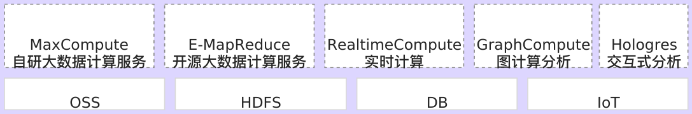

**计算存储引擎**

<a id="section-1-2"></a>

## 1.2. 产品优势

本文为您介绍DataWorks的产品优势。

- 超大规模计算处理能力

  DataWorks与底层计算平台集成，能够轻松处理海量数据：

  - 万亿级数据JOIN，百万级并发Job，作业I/O可达PB级/天。

  - 离线调度支持百万级任务量，实时监控告警。

  - 提供功能强大易用的SQL、MR引擎，兼容大部分标准SQL语法。

  - 采用三重备份、读写请求鉴权、应用沙箱、系统沙箱等多层次数据存储和访问安全机制保护您的数据，确保不丢失、不泄露、不被窃取。

- 一站式的数据工厂DataWorks为您提供可视化的操作界面，并支持多人协同作业：

  - 提供数据从集成、加工、管理、监控、输出服务的全流程所有功能。

  - 提供可视化工作流程设计器功能。

  - 多人协同作业机制，分角色进行任务开发、线上调度、运维、数据权限管理等功能，数据及任务无需落地即可完成复杂的操作流程。

- 海量异构数据源快速集成能力

  DataWorks支持400对异构数据源的离线同步，支持分钟、小时、天、周和月多种调度周期配置。

- Web化的软件服务

  DataWorks可在互联网/内部网络环境下直接使用，无需安装部署，拎包入驻，开箱即用。

- 多租户权限模型

  多租户模型确保您的数据被安全隔离，以租户为单位进行统一的权限管控、数据管理、调度资源管理和成员管理工作。

- 智能的监控报警

  通过设置监控基线，您不仅可以从宏观把控整体任务链路的完成时间，也可以从微观对每一个节点任务状态进行全方位监控。

- 易用的智能SQL编辑器

  通过智能代码提示功能、表Meta信息提示功能、代码格式化和折叠功能、预编译功能、炫酷皮肤切换功能来获得全新的SQL代码编辑体验。

- 完备的数据质量监控体系

  支持多种异构数据源、离线数据、实时数据的质量校验、通知、管理。

- 便捷的数据服务开发接口

  API网关服务、交互式数据服务引擎让您只需两步操作，即可将已有API和数据以服务的形式发布到数据共享与开放平台。

- 安全的数据共享机制

  数据共享服务提供受保护空间，让详细数据以不可见、不落地的形式共享给其他租户，让数据真正安全地发挥大数据共享价值。

<a id="section-1-3"></a>

## 1.3. 数据开发介绍

本文以两个常见的应用场景为例，为您介绍数据开发。

**应用场景1-数据同步和数据分析**

如下是一个典型的数据开发业务场景：

1. 通过DataWorks将各种数据库的数据采集至MaxCompute平台。

2. 进入DataWorks发送SQL、MR或SHELL语句至MaxCompute平台来执行数据分析工作。

3. 通过DataWorks把MaxCompute上分析的结果同步至原来的数据库。

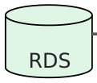

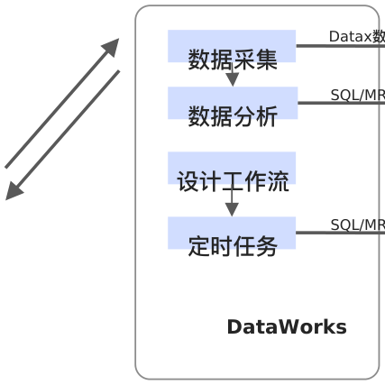

Datax数据同步

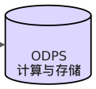

SQL/MR/Shell

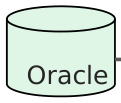

SQL/MR/Shell


...

> **说明**
>
> Base即DataWorks，是DataWorks在技术场合的命名之一。

**应用场景2-数据同步**

DataWorks可以满足多种类型的数据库之间互相同步数据。有时候业务场景只需要单纯的数据同步，使用DataWorks可以轻松完成。

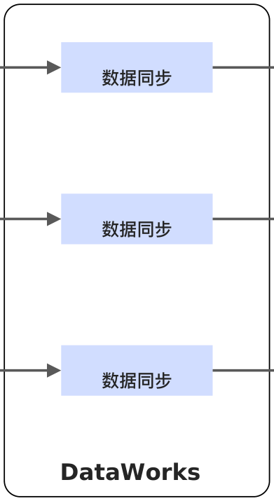

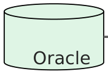


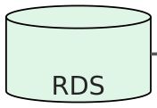

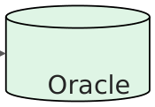

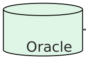

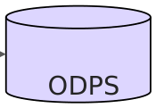

<a id="section-1-4"></a>

## 1.4. DataWorks架构组成

本文为您介绍DataWorks的核心框架和架构组件。


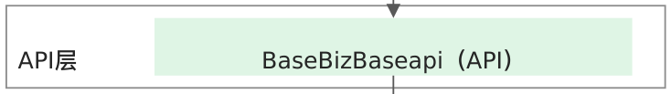


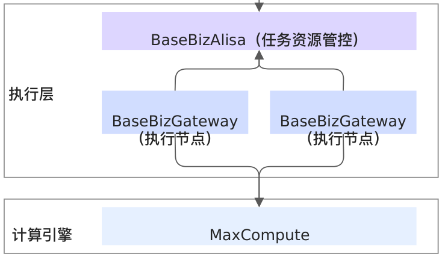

DataWorks中的组件具有非常重要的作用，完成了您的任务下发和执行的工作。V3环境的运维全部在**飞天基础运维平台**进行操作，DataWorks组成模块列表如下所示。

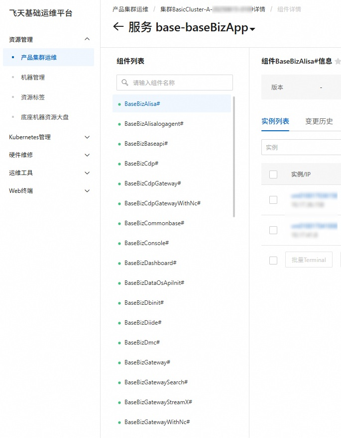

DataWorks的服务均以容器形式部署，下图是登录到宿主机后，执行docker ps查看各个服务所在的容器。

除gateway服务外，单个应用的内部结构如下图所示。

域名

SLB

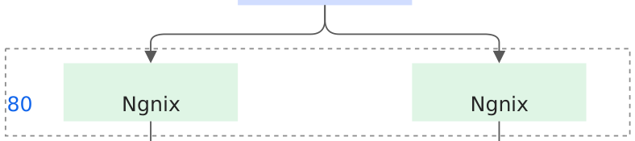

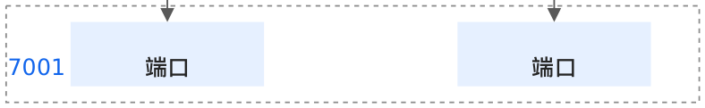

<a id="section-1-5"></a>

## 1.5. 服务的目录

本文为您介绍各服务的目录。

**base-biz-gateway服务**

该服务的功能是用于接收IDE和调度系统发送过来的任务，并执行任务。

图 1. base-biz-gateway服务目录结构

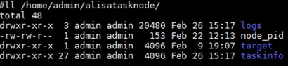

- Logs目录：保存gateway服务的运行日志。

- taskinfo目录：保存用户任务执行的代码和任务执行的日志。

- target目录：gateway服务的主目录，包含服务代码，启停脚本，配置文件等。

**cdp服务目录**

该服务是数据同步服务。

图 2. cdp服务目录结构

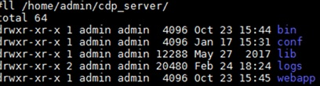

- Logs目录：保存cdp服务的运行日志。

- Conf目录：保存cdp的配置文件。

- Bin目录：保存启动脚本。

**其他服务目录结构**

以alisa服务的目录为例。

图 3. alisa服务目录结构

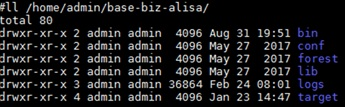

- Logs目录：保存服务的运行日志。

- Conf目录：保存的配置文件。

- Bin目录：保存启动脚本。

<a id="section-2"></a>

# 2.基于大数据管家的运维

<a id="section-2-1"></a>

## 2.1. 登录大数据管家

本节介绍如何登录到大数据管家。

**前提条件**

- 已从部署人员或管理员处获取Apsara Uni-manager运维控制台的访问地址、用户名和密码。

  Apsara Uni-manager运维控制台访问地址格式为*region-id*.ops.console.*intranet-domain-id*。

- 推荐使用Chrome浏览器。

**操作步骤**

1. 打开浏览器。

2. 在地址栏中，输入Apsara Uni-manager运维控制台的访问地址，按回车键。

   

   > **说明**
   >
   > 您可以单击右上角的当前语言切换其它语言。当前支持简体中文、English语言切换。

3. 输入正确的用户名及密码。

   > 登录Apsara Uni-manager运维控制台的用户名和密码请从部署人员或管理员处获取。
   >
   > **说明**

   首次登录Apsara Uni-manager运维控制台时，需要修改登录用户名的密码，请按照提示完成密码修改。

   为提高安全性，密码必须满足以下要求：

   - 英文大小写字母

   - 阿拉伯数字（0~9）

   - 特殊符号，包括感叹号（！）、at（@）、井号（#）、美元符号（$）、百分号（%）等

   - 密码长度10~20个字符

4. 单击**账号登录**。

5. 进入Apsara Uni-manager运维控制台后，在顶部菜单栏单击**产品运维**。

6. 选择**大数据运维 > 大数据通用运维·大数据管家**，进入大数据管家首页。

<a id="section-2-2"></a>

## 2.2. 监控

<a id="section-2-2-1"></a>

### 2.2.1. 健康度

健康度支持查看各个大数据产品的监控项以及不同紧急程度的报警，并提供详情查看和修复后的再次检查。

**操作步骤**

1. 登录大数据管家。

   默认进入**ABM**的**仪表盘**页面，您可以单击左上角的  图标，选择其他目标产品进入。

2. 进入目标产品后，单击顶部菜单栏的**监控**。

3. 单击**健康度**页签，查看健康度检查信息。

   健康度检查页面向您展示了监控项、监控来源、严重等级和监控详情等，您可以按需进行过滤。

<a id="section-2-2-2"></a>

### 2.2.2. 报表

您可以通过报表查看大数据产品的巡检结果。

**操作步骤**

1. 登录大数据管家。

   默认进入**ABM**的**仪表盘**页面，您可以单击左上角的  图标，选择其他目标产品进入。

2. 进入目标产品后，单击顶部菜单栏的**监控**。

3. 单击**报表**页签，查看报表相关信息。

   报表页面向您展示了报表ID、报表名称、产品名称、模板名称、实例类型、创建信息等，支持查看详情。

<a id="section-2-3"></a>

## 2.3. 运维

<a id="section-2-3-1"></a>

### 2.3.1. DataWorks运维功能和入口

本文为您介绍大数据管家上支持的DataWorks运维功能和入口。

**DataWorks运维功能**

大数据管家支持从服务、集群和主机三个维度对DataWorks进行运维管理，详细说明如下。

**运维功能**

**子功能**

**说明**

展示DataWorks的概要信息，包括服务汇总、服务状态、实例调

概览

度、饱和度-槽位资源，以及今日任务完成累计趋势图。

角色

展示DataWorks的服务角色。

展示DataWorks的槽位使用情况，同时还支持配置资源组槽位和主

槽位

机槽位。

实例

统计DataWorks的实例运行情况。

服务运维>数据工场

项目

展示租户项目列表，支持更新项目、节点的默认资源组。

业务洞察

展示昨日新增/修改周期调度任务类型数量概览和趋势图。

支持修改DataWorks中各服务角色的配置项，以便您根据实际需要

配置

调整相关的参数配置。

alisa服务重启

支持重启alisa服务。

普通主机扩容和缩

支持对DataWorks中的普通物理主机节点进行扩容和缩容。

容

展示当日调度概览信息和当日运行状态、三方依赖-调用总次数、三方

概览

依赖-调用响应时间Max、三方依赖-调用失败率、三方依赖-调用失败QPS数量趋势图。

服务运维>数据集成

展示当日实例不同状态下的任务数汇总情况，支持查看当日多维分析

实例

趋势图。

历史分析

支持查看多维分析和耗时分析趋势图，支持查看top任务信息。

展示集群的主要运行指标以及健康检查结果，包括运行健康、CPU、

概览

DISK、MEMORY、LOAD、PACKAGE。

支持查看集群的所有监控项、监控项的详情（提供监控项报警的解决

健康

方案）、各监控项在宿主上的检查状态，同时还支持直接登录宿主以

集群运维

及手动对宿主执行监控项检查。

展示主机的机器信息、机器服务角色状态，以及关键运行指标的趋势

概览

图，包括CPU、DISK、LOAD、MEMORY、PACKAGE。

主机运维

服务角色

展示集群、服务实例和角色信息。

**DataWorks运维入口**

1. 登录大数据管家。

2. 在左上方单击  图标，然后选择**DataWorks**产品。

3. 在DataWorks页面中，单击上方的**运维**，默认进入**服务运维 > 数据工场**的**概览**页面。

<a id="section-2-3-2"></a>

### 2.3.2. DataWorks服务运维

<a id="section-2-3-2-1"></a>

#### 2.3.2.1. 数据工场

<a id="section-2-3-2-1-1"></a>

##### 2.3.2.1.1. DataWorks服务概览

服务概览页面汇总了DataWorks的关键运行指标，包括服务汇总、服务状态、实例调度、饱和度-槽位资源以及今日任务完成累计。

**DataWorks服务概览入口**

1. 登录大数据管家。

2. 在左上方单击  图标，然后选择**DataWorks**产品。

3. 在DataWorks页面中，单击上方的**运维**，默认进入**服务运维 > 数据工场**的**概览**页面。

**服务汇总**

汇总可用状态、不可用状态和升级状态的角色数量。


**服务状态**

展示DataWorks所有的服务角色及状态，并统计每个服务角色的最终数和终态数。

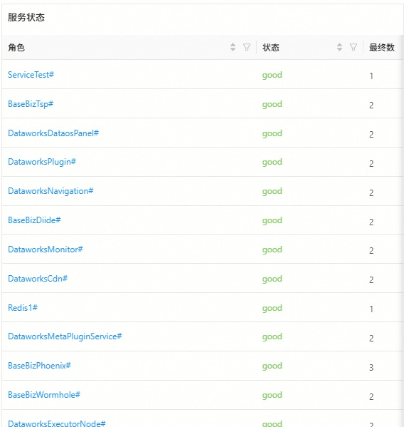

**实例调度**

展示成功的实例数量、未运行的实例数量、等待时间、运行中的实例数量、失败的实例数量、等待资源的实例数量。


**饱和度-槽位资源**

展示DataWorks的总槽位数量、已使用数量、不可用数量和空闲数量。

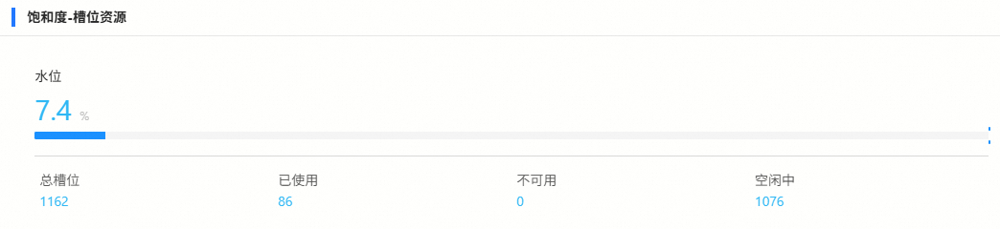

> 槽位是DataWorks实例调度可使用的资源。
>
> **说明**

**今日任务完成累计**

以不同颜色的曲线展示今日、昨日和平均每天完成的任务数量的趋势。

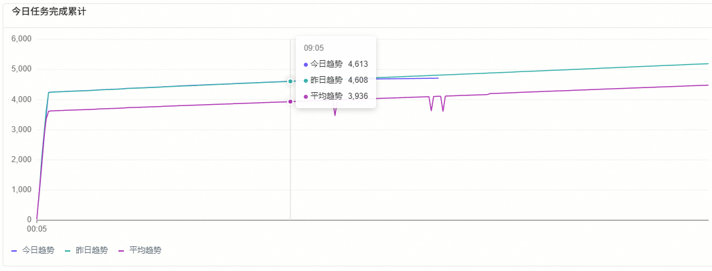

<a id="section-2-3-2-1-2"></a>

##### 2.3.2.1.2. DataWorks服务角色

DataWorks服务角色用于展示DataWorks服务角色的相关信息，包括角色的名称、状态、最终数和终态数。

**DataWorks服务角色入口**

1. 登录大数据管家。

2. 在左上方单击  图标，然后选择**DataWorks**产品。

3. 在DataWorks页面中，单击上方的**运维**，默认进入**服务运维 > 数据工场**的**概览**页面。

4. 在右侧选择集群，单击**服务角色**页签。

   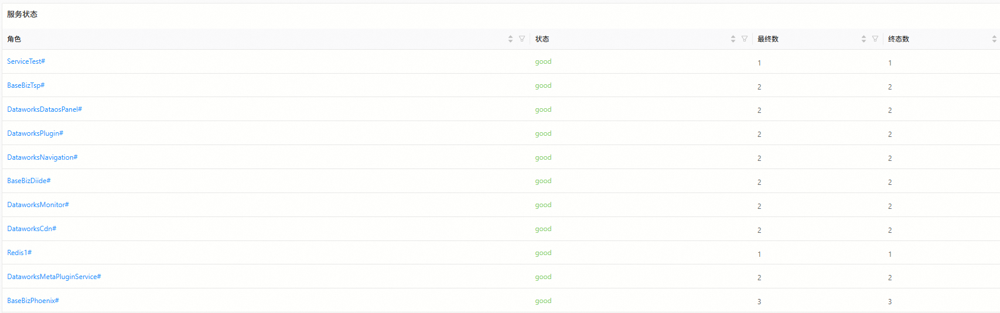

   **服务角色**页面汇总了所有服务角色的相关信息，包括服务角色的状态、最终数和终态数，其中状态分为**good**、**bad**和**upgrading**。

**DataWorks服务角色页面支持的操作**

**服务角色**页面支持按列过滤和按列排序便捷操作。

<a id="section-2-3-2-1-3"></a>

##### 2.3.2.1.3. DataWorks服务槽位

槽位是用于处理任务的资源，大数据管家支持分别查看DataWorks集群、资源组和主机的槽位信息，包括最大槽位、已用槽位、槽位使用率等。同时还支持修改分组和主机的槽位数、迁移资源集群以及修改主机状态等。

**DMU和槽位的概念**

数据移动单位（DMU） 是数据集成消耗资源（包含CPU、内存、网络等资源分配）的度量单位。一个DMU描述了一个数据集成作业的最小运行能力，即在限定的CPU、内存、网络等资源下对于数据同步的处理能力。

DMU的资源是按槽位分配的，每个DMU占用两个槽位。

**DataWorks服务槽位入口**

1. 登录大数据管家。

2. 在左上方单击  图标，然后选择**DataWorks**产品。

3. 在DataWorks页面中，单击上方的**运维**，默认进入**服务运维 > 数据工场**的**概览**页面。

4. 在左侧下拉框中选择集群，单击**槽位**页签，进入**槽位**页面。

   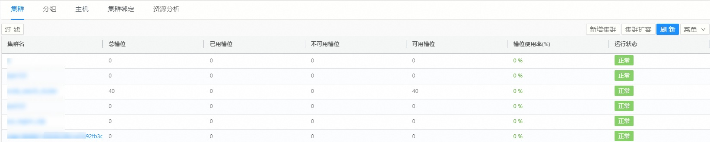

**集群槽位**

在**槽位**页面中，单击**集群**页签，进入**集群**页面。

**集群**页面中列出了所有DataWorks集群的槽位的概要信息，包括总槽位、已用槽位、可用槽位以及槽位使用率，同时还列出了集群的运行状态。

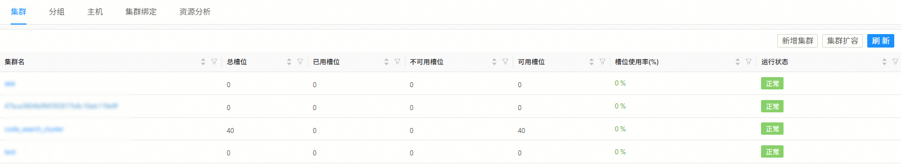

如果需要查看某个集群槽位更详细的信息，单击该集群的**集群名**，即可进入集群详情页面。

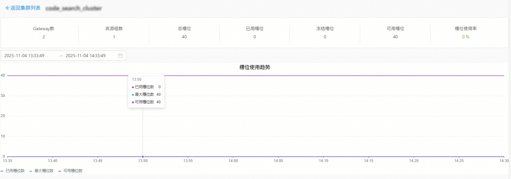

进入集群后，在上方可查看该集群的Gateway数、资源组数、总槽位、已用槽位、冻结槽位、可用槽位以及槽位使用率，在下方可按时间查看集群槽位的使用趋势图。槽位使用趋势图中以不同颜色的曲线展示已用槽位数、最大槽位数和可用槽位数，并且支持自由定义显示哪些曲线。

单击使用趋势图下方的曲线名称可切换为显示或隐藏，曲线名高亮表示显示，灰色表示隐藏。

**新增集群**

1. 在**集群**页签下，单击右上角的**新增集群**。

2. 在**新增集群**对话框中，完成参数配置。

   | 参数 | 说明 |
   | --- | --- |
   | 集群名称 | 新建集群的名称。 |
   | 天基Region | 单击下拉列表，可选择目标地域。 |
   | 租户名称 | 单击下拉列表，选择新建集群所属的租户名称。 |
   | 是否有效 | 支持<strong>有效</strong>和<strong>无效</strong>，按需选择。 |

3. 完成上述参数配置后，单击**执行**，系统提示操作已提交。

**集群扩容**

1. 在**集群**页签下，单击右上角的**集群扩容**。

2. 在**迁移节点集群**对话框中，完成参数配置。

   | 参数 | 说明 |
   | --- | --- |
   | alisa集群名称 | 目标集群名称。 |
   | 天基Region名 | 单击下拉列表，可选择目标地域。 |
   | 天基base集群名 | 单击下拉列表，可选择目标天基base集群。 |
   | 机器列表 | 单击下拉列表，可选择目标机器。 |
   | 集群类型 | 单击下拉列表，可选择集群类型。 |
   | 原alisa集群名称 | 待迁移节点的源集群名称。 |

3. 完成上述参数配置后，单击**执行**，系统提示操作已提交。

**资源组槽位**

在**槽位**页面中，单击**分组**页签，进入**分组**页面。

**分组**页面列出了所有资源组的槽位的概要信息，包括最大槽位、已用槽位、可用槽位和槽位使用率，同时还列出了资源组的展示名、所属集群、所属项目以及运行状态。

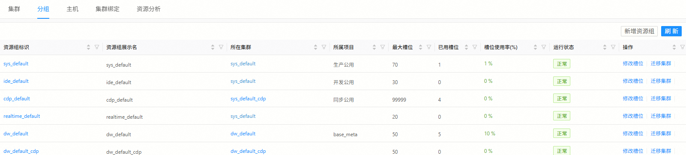

如果需要查看某个资源组槽位更详细的信息，单击该资源组的**资源组标识**，即可进入资源组。

进入资源组后，在上方可查看该资源组当前的槽位信息（已用槽位/最大槽位）、当前资源组下项目空间任务数量占比、节点类型数量占比等，在下方可按时间查看该资源组槽位的使用趋势图、当前占用槽位的节点及责任人。槽位使用趋势图中以不同颜色的曲线展示已用槽位数、最大槽位数和可用槽位数，并且支持自由定义显示哪些曲线。

单击使用趋势图下方的曲线名称可切换为显示或隐藏，曲线名高亮表示显示，灰色表示隐藏。

**新增资源组**

1. 在**分组**页面中，单击右上角的**新增资源组**。

2. 在**新增资源组**对话框中，完成参数配置。

   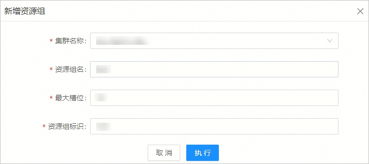

   | 参数 | 说明 |
   | --- | --- |
   | 集群名称 | 新增资源组所在集群。 |
   | 资源组名 | 新增资源组的名称。 |
   | 最大槽位数 | 按需设置即可。 |
   | 资源组标志 | 用于标识资源组，便于识别。 |

3. 完成上述参数配置后，单击**执行**，系统提示操作已提交。

**修改资源组槽位**

当资源组槽位不足或一直过剩时，您可修改资源组槽位的数量，以便增加或释放资源组的资源。

1. 在**分组**页面中，单击某个资源组后面的**修改槽位**。

2. 在弹出的对话框中调整**最大槽位数**。

3. 完成上述参数配置后，单击**执行**，系统提示操作已提交。

**迁移资源组集群**

当资源组绑定的集群的槽位不足而又无法增加槽位上限时，您可将该资源组绑定到其他集群。

1. 在**分组**页面中，单击某个资源组后面的**迁移集群**。

2. 在弹出的对话框中设置**目标集群**。

3. 完成上述参数配置后，单击**执行**，系统提示操作已提交。

**主机槽位**

在**槽位**页面中，单击**主机**页签，进入**主机**页面。

**主机**页面列出了所有主机的槽位信息，包括最大槽位、已用槽位以及槽位使用率，同时还列出了主机的IP地址、所在集群、运行状态、是否存活和是否监控等信息。

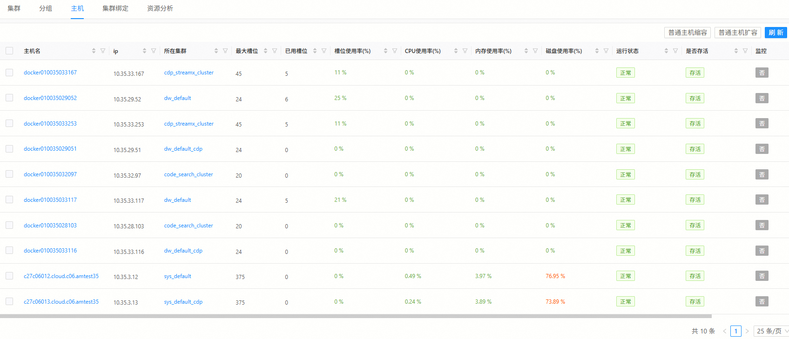

如果需要查看某个主机槽位的更详细信息，单击该主机的**主机名**，即可进入主机。

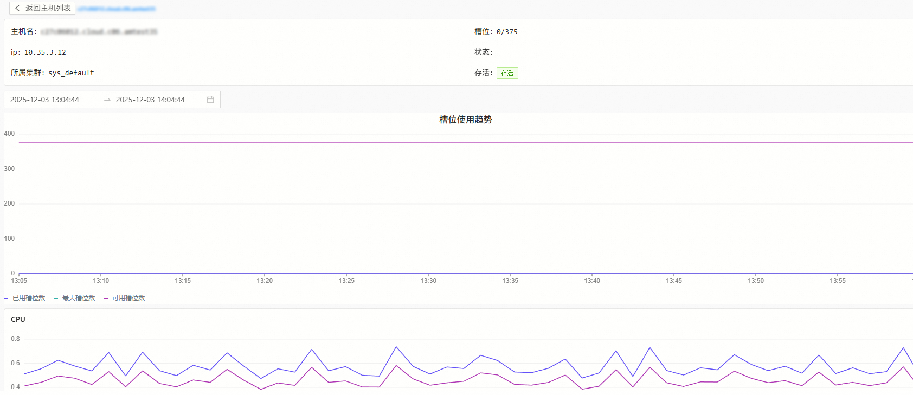

进入主机后，在上方可查看该主机当前的槽位信息（已用槽位/最大槽位）等，在下方可按时间查看该主机槽位的使用趋势图。槽位使用趋势图中以不同颜色的曲线展示已用槽位数、最大槽位数和可用槽位数，并且支持自由定义显示哪些曲线。

单击使用趋势图下方的曲线名称可切换为显示或隐藏，曲线名高亮表示显示，灰色表示隐藏。

**修改主机状态**

主机状态分为正常、不可用和挂起三种，您可根据实际需要修改主机的状态。

1. 在**主机**页面中，单击某个主机后面的**修改状态**。

2. 在弹出的对话框中设置**状态**。

3. 完成上述参数配置后，单击**执行**，系统提示操作已提交。

**修改主机槽位**

当主机槽位不足或一直过剩时，您可修改主机槽位的数量，以便增加或释放主机的资源。

1. 在**主机**页面中，单击某个主机后面的**修改槽位**。

2. 在弹出的对话框中设置**最大槽位数**。

3. 完成上述参数配置后，单击**执行**，系统提示操作已提交。

**普通主机扩容和缩容**

详情请参见DataWorks普通主机扩容和缩容。

**集群绑定**

在**槽位**页面中，单击**集群绑定**页签，进入**集群绑定**页面。

**集群绑定**页面列出了租户ID、租户名称、天基Region、Alisa集群名、Alisa集群类型、运行状态和相关操作。

**ABM Alisa关系绑定**

1. 在**集群绑定**页签下，找到目标集群，单击**操作**列下的**关系绑定**。

2. 在**ABM Alisa关系绑定**对话框中，分别选择**租户名称**和**天基Region**。

3. 完成上述参数配置后，单击**执行**，系统提示操作已提交。

**修改abm alisa状态**

1. 在**集群绑定**页签下，找到目标集群，单击**操作**列下的**修改状态**。

2. 在**修改abm alisa状态**对话框中，选择**集群状态**。

   集群状态分为**有效**和**无效**。

3. 完成上述参数配置后，单击**执行**，系统提示操作已提交。

**修改调度集群类型**

1. 在**集群绑定**页签下，找到目标集群，单击**操作**列下的**高危操作**。

2. 在<strong>【故障修复操作】-【高危操作】修改调度集群类型</strong>对话框中，选择**集群类型**。

   集群类型分为**调度集群**和**同步集群**。

3. 完成上述参数配置后，单击**执行**，系统提示操作已提交。

**资源分析**

在**槽位**页面中，单击**资源分析**页签，进入**资源分析**页面。

**资源分析**页面列出了当前Alisa库脏数据条数、Alisa当前任务状态、Alisa当前任务类型、Alisa当前占用资源组和当前Alisa库正在运行的任务实例。

**查看运行日志**

1. 在**资源分析**页签下，选择目标任务，单击**操作**列下的**运行日志**。

2. 在右侧**运行日志**弹框中，查看运行日志信息。

3. 单击**新旧版本对比**，可对比出差异点。

**终止任务**

1. 在**资源分析**页签下，选择目标任务，单击**终止任务**。

2. 在右侧弹出的**杀alisa任务**对话框中，单击**执行**，系统提示操作已提交。

<a id="section-2-3-2-1-4"></a>

##### 2.3.2.1.4. DataWorks服务实例

DataWorks实例展示了DataWorks侧用户创建的实例。实例列表支持过滤和排序等便捷查看操作。

**DataWorks服务实例入口**

1. 登录大数据管家。

2. 在左上方单击  图标，然后选择**DataWorks**产品。

3. 在DataWorks页面中，单击上方的**运维**，默认进入**服务运维 > 数据工场**的**概览**页面。

4. 在右侧选择集群，单击**实例**页签，进入**实例**页面。

   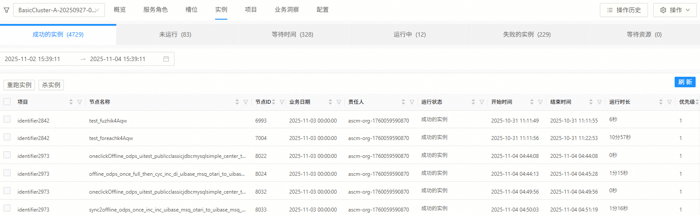

   **实例**页面展示当前集群的实例信息，包括项目、节点名称、节点ID、业务日期、责任人、运行状态、开始时间、结束时间、运行时长、优先级、类型和实例ID。

**按状态过滤实例**

**实例**页面上方统计出了所有状态的实例的数量，单击某种状态，可快速在实例列表中筛选出相应状态的实例，默认显示的是**运行中**的实例。

**按时间筛选实例**

在实例列表左上方选择时间段（可分别设置日期和时间），查看相应时间段内的实例。

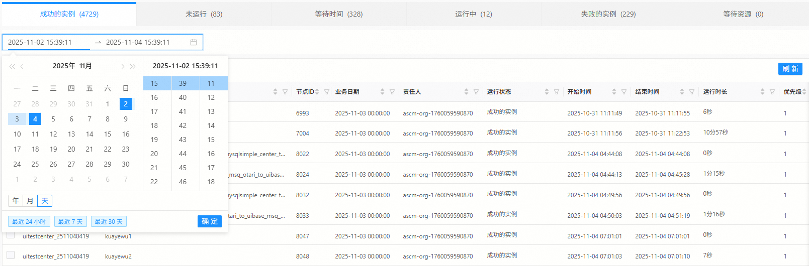

**DataWorks实例页面支持的操作**

支持过滤、按列排序和自定义列等操作。

<a id="section-2-3-2-1-5"></a>

##### 2.3.2.1.5. DataWorks服务项目

DataWorks项目展示了DataWorks侧租户项目列表信息，支持过滤和排序等便捷查看操作。

**DataWorks项目入口**

1. 登录大数据管家。

2. 在左上方单击  图标，然后选择**DataWorks**产品。

3. 在DataWorks页面中，单击上方的**运维**，默认进入**服务运维 > 数据工场**的**概览**页面。

4. 选择目标集群后，单击**项目**页签，进入**项目**页面。

   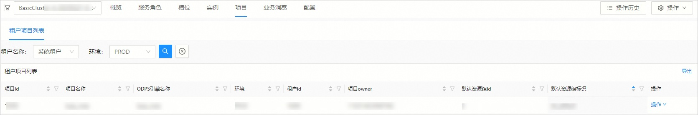

   **项目**页面展示了租户的项目ID、项目名称、ODPS引擎名称、环境、租户ID、项目Owner、默认资源组ID和默认资源组标识等。

**更新项目/节点默认资源组**

更新项目默认资源组和更新节点默认资源组操作相似，此处以更新项目默认资源组为例。

1. 在**项目**页签，找到目标项目，单击**操作**列下的**更新项目默认资源组**。

2. 在**更新项目默认资源组**对话框中，选择**目标资源组标识**。

   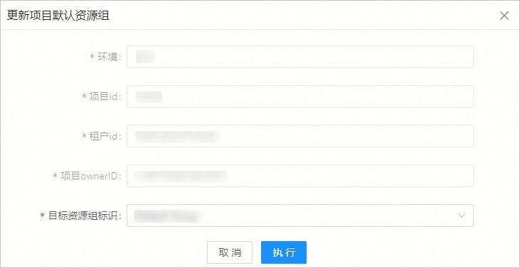

3. 单击**执行**，系统提示操作已提交。

**DataWorks项目页面支持的其他操作**

- 过滤项目

  支持通过**租户名称**和**环境**两个维度进行筛选，选择某个租户名称或者环境后，单击  图标，可快速筛选出

  目标项目。

- 排序项目

  支持对任意列进行升序或者降序排列，单击具体列右侧的  图标，可按需对已有项目进行排序。

  当显示为  时，则表示当前为升序排序；当显示为  时，则表示当前为降序排序；当显示为  时，则表

  示当前为取消排序。

- 导出项目列表信息

  单击**租户项目列表**右上角的**导出**，在**新建下载**对话框中，按需选择下载路径和修改文件名，单击**下载**，即可导出项目列表信息。

  如果勾选了**下载后打开**，则当下载完成时，会默认打开导出的项目列表。

<a id="section-2-3-2-1-6"></a>

##### 2.3.2.1.6. DataWorks服务配置

DataWorks配置支持修改DataWorks中各服务角色的配置项，以便您根据实际需要调整相关的参数配置。

**DataWorks服务配置入口**

1. 登录大数据管家。

2. 在左上方单击  图标，然后选择**DataWorks**产品。

3. 在DataWorks页面中，单击上方的**运维**，默认进入**服务运维 > 数据工场**的**概览**页面。

4. 选择目标集群后，再单击**配置**页签，进入**配置**页面。

**修改配置项值**

1. 在**配置**页签，找到目标配置项，单击**操作**列下的**修改**。

2. 在**修改配置项值**对话框中，对**configValue**值按需修改。

3. 完成配置后，单击**执行**，系统提示操作已提交。

<a id="section-2-3-2-1-7"></a>

##### 2.3.2.1.7. DataWorks普通主机扩容和缩容

大数据管家支持对DataWorks集群进行物理主机扩容和缩容，缩容是指把物理主机从DataWorks集群缩容到飞天基础运维平台Default集群，扩容是指把物理主机从飞天基础运维平台Default集群扩容到DataWorks集群。

**DataWorks集群扩容和缩容说明**

在专有云环境中，集群扩容是一个复杂的事情，首先新增物理主机需要通过朱雀规划系统和飞天基础运维平台进行相关配置，以加入飞天基础运维平台的Default集群。飞天基础运维平台Default集群相当于一个空闲的资源池，可直接为各业务集群提供扩容资源。业务集群扩容一般是指把物理主机从飞天基础运维平台Default集群扩容到业务集群，缩容一般是把物理主机从业务集群把缩容到飞天基础运维平台Default集群。

DataWorks普通主机扩容是指把物理主机从Default集群扩容到DataWorks集群，缩容是指把DataWorks集群中的物理主机缩容到Default集群。DataWorks中物理主机的服务角色有<strong>BaseBizCdpGatewayWithNc#</strong>和<strong>BaseBizGatewayWithNc#</strong>两种，普通主机扩容和缩容也只支持这两种服务角色。

**前提条件**

- 扩容需要满足以下条件：

  - 待扩容物理主机已加入到飞天基础运维平台Default集群。

  - 模板主机的服务角色必须是<strong>BaseBizCdpGatewayWithNc#</strong>或**BaseBizGatewayWithNc#**。

- 缩容需要满足以下条件：

  待缩容物理主机的服务角色必须是<strong>BaseBizCdpGatewayWithNc#</strong>或**BaseBizGatewayWithNc#**。

> 获取<strong>BaseBizCdpGatewayWithNc#</strong>和<strong>BaseBizCdpGatewayWithNc#</strong>主机的方
>
> **说明**
>
> 法：在**DataWorks > 运维 > 服务运维 > 数据工场 > 实例**列表中，单击<strong>BaseBizCdpGatewayWithNc#</strong>或<strong>BaseBizGatewayWithNc#</strong>跳转到飞天基础运维平台查看该服务角色的主机。

**DataWorks普通主机扩容**

DataWorks普通主机扩容支持同时扩容多个主机。扩容时，您需要指定一个已有主机为模板主机，新扩容主机会从模板主机上克隆所有的服务，从而达到DataWorks集群扩容的目的。

1. 登录大数据管家。

2. 在左上方单击  图标，然后选择**DataWorks**产品。

3. 在DataWorks页面中，单击上方的**运维**，默认进入**服务运维 > 数据工场**的**概览**页面。

4. 在右侧选择集群，然后再单击**槽位**页签，进入**槽位**页面。

5. 在**槽位**页面单击**主机**页签，然后在主机列表中勾选一个物理主机（服务角色必须是<strong>BaseBizCdpGatewayWithNc#</strong>或**BaseBizGatewayWithNc#**）作为模板主机。

   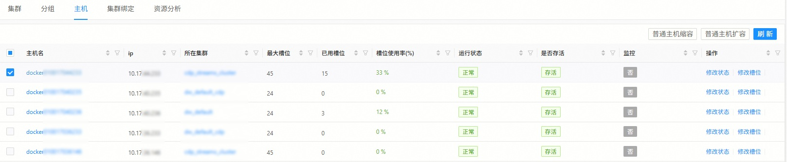

6. 在右边上方单击**操作 > 普通主机扩容**，然后在弹出的**普通主机扩容**对话框中设置各参数。

   参数说明如下：

   - **Refer_hostname**：模板主机的**Hostname**，自动填充为已勾选的主机。

   - **Hostname**：新扩容主机的**Hostname**，填写飞天基础运维平台Default集群中可供DataWorks扩容的主机的**Hostname**，如果有多个，以英文逗号（,）分开。

7. 完成上述参数配置后，单击**执行**，系统提示操作已提交。

8. 查看DataWorks普通主机扩容的执行状态。单击**操作 > 普通主机扩容**后面的**历史**，查看历史操作记录。

   DataWorks普通主机扩容需要比较长的时间，请您耐心等待。状态为**RUNNING**表示执行中，状态为**FAILED**表示执行失败，状态为**SUCCESS**表示执行成功。

   对于**RUNNING**状态的操作记录，您可单击其后面的**详情**，查看该操作的执行步骤和进度。

   对于**FAILED**状态的操作记录，您可单击其后的**详情**来定位失败原因，详情请参见DataWorks普通主机扩容和缩容失败原因定位。

**DataWorks普通主机缩容**

DataWorks普通主机缩容是指把DataWorks集群中的物理主机缩容到飞天基础运维平台Default集群。

1. 登录大数据管家。

2. 在左上方单击  图标，然后选择**DataWorks**产品。

3. 在DataWorks页面中，单击上方的**运维**，默认进入**服务运维 > 数据工场**的**概览**页面。

4. 在右侧选择集群，然后再单击**槽位**页签，进入**槽位**页面。

5. 在**槽位**页面单击**主机**页签，然后在主机列表中勾选一个物理主机（服务角色必须是<strong>BaseBizCdpGatewayWithNc#</strong>或**BaseBizGatewayWithNc#**）作为模板主机。

   

6. 在右上方单击**操作 > 普通主机缩容**，然后在弹出的**普通主机缩容**对话框中设置各参数。

   参数说明如下：

   - **Hostname**：待缩容物理主机的**Hostname**，自动填充为已勾选的主机。

   - **Biz_Name**：待缩容物理主机的服务角色，从下拉列表中选择，包括<strong>base-biz-cdpgatewaywithnc#</strong>或**base-biz-gatewaywithnc#**，您需要根据待缩容物理主机实际的服务角色来选择。

7. 完成上述参数配置后，单击**执行**，系统提示操作已提交。

8. 查看DataWorks普通主机缩容的执行状态。单击**操作 > 普通主机缩容**后面的**历史**，查看历史操作记录。

   DataWorks普通主机缩容需要比较长的时间，请您耐心等待。状态为**RUNNING**表示执行中，状态为**FAILED**表示执行失败，状态为**SUCCESS**表示执行成功。

   对于**RUNNING**状态的操作记录，您可单击其后面的**详情**，查看该操作的执行步骤和进度。

   对于**FAILED**状态的操作记录，您可单击其后的**详情**来定位失败原因，详情请参见DataWorks普通主机扩容和缩容失败原因定位。

**DataWorks普通主机扩容和缩容失败原因定位**

本节以查看DataWorks普通主机扩容失败原因为例进行介绍，普通主机缩容与此相似。

1. 登录大数据管家。

2. 在左上方单击  图标，然后选择**DataWorks**产品。

3. 在DataWorks页面中，单击上方的**运维**，默认进入**服务运维 > 数据工场**的**概览**页面。

4. 在右上方单击**操作 > 普通主机扩容**后面的**历史**，查看历史操作记录。

5. 在历史操作记录列表中，单击某个失败的操作记录后面的**详情**，定位操作执行失败的原因。

   结合**参数配置**、**机器详情**、**脚本内容**和**执行参数**来定位操作步骤的失败原因。

<a id="section-2-3-2-2"></a>

#### 2.3.2.2. 数据集成

<a id="section-2-3-2-2-1"></a>

##### 2.3.2.2.1. 查看数据集成概览

数据集成概览页面为您展示当日调度概览、当日运行状态趋势、三方依赖-调用总次数、三方依赖-调用响应时间Max和三方依赖-调用失败率等信息。

**操作步骤**

1. 登录大数据管家。

2. 单击左上角的  图标，选择**DataWorks**。

3. 在DataWorks页面中，单击右上角的**运维**，默认进入**服务运维 > 数据工场**的**概览**页面。

4. 在左侧导航栏，单击**数据集成**，默认进入**概览**页面。

   您可以选择**聚合周期**和需要查询的时间，在该页面查看以下信息：

   - **当日调度概览**

     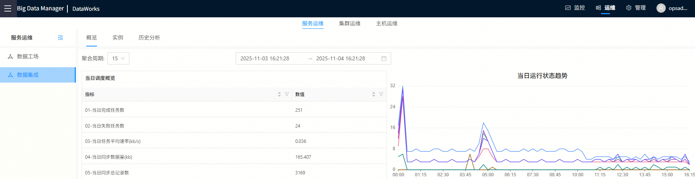

   - **当日运行状态趋势**

     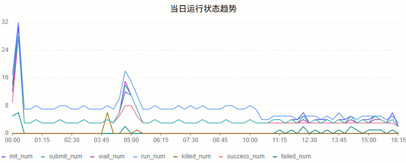

   - **三方依赖-调用响应时间Max**

     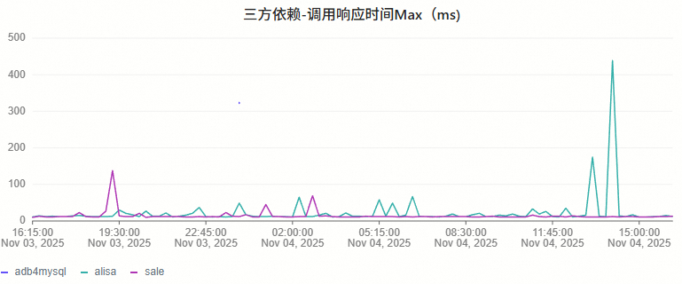

   - **三方依赖-调用总次数**

     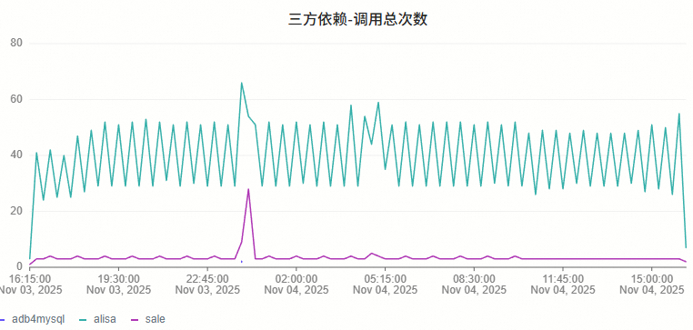

   - **三方依赖-调用失败率**

     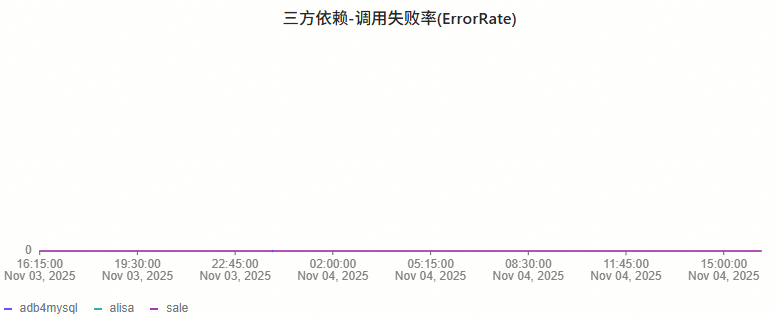

   - **三方依赖-调用失败QPS数量**

     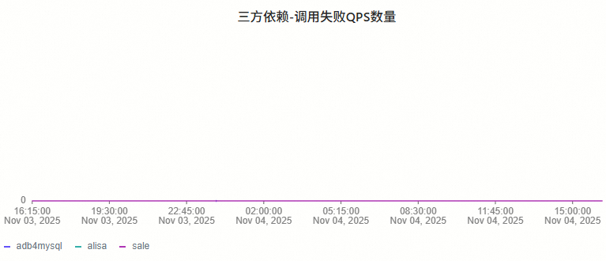

<a id="section-2-3-2-2-2"></a>

##### 2.3.2.2.2. 查看数据集成实例

本文为您介绍如何在数据集成的实例页面，查看相应实例的信息，并从同步数据量、同步速度和任务数据量等多个维度分析您需要的数据。

**进入任务页面**

1. 登录大数据管家。

2. 单击左上角的  图标，选择**DataWorks**。

3. 在DataWorks页面中，单击右上角的**运维**，默认进入**服务运维 > 数据工场**的**概览**页面。

4. 在左侧导航栏，单击**数据集成**，默认进入**概览**页面。

5. 单击**实例**页签，默认进入**当日实例**页面。

**查看当日实例**

您可以在**当日实例**页面，通过筛选**项目名称**、**资源组**、**主机**、**状态**、**读插件类型**、**写插件类型**和**数据源**等条件，查询需要的实例信息。

您可以单击需要查看的实例的**请求ID**、**同步脚本编号**和**资源组名称**，查看相应的详情：

- 单击**请求ID**，为您展示该实例的**事件类型**、**提交ip**和**开始时间**。

  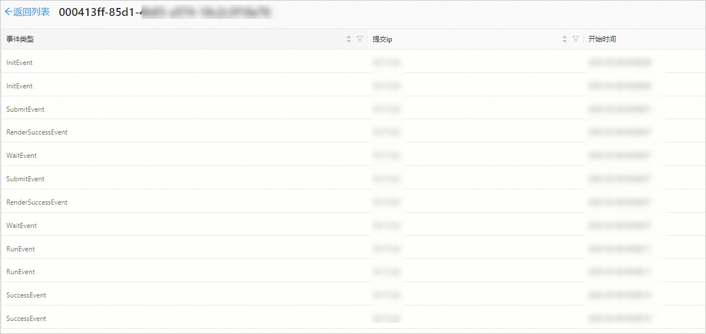

- 单击**同步脚本编号**，为您展示以下内容：

  - **作业按天汇总**的**同步数据量**、**同步速度**和**消耗时间**趋势图。

  - **作业按次打点**的**同步数据量**、**同步速度**和**消耗时间**趋势图。

  - **任务终态历史趋势**，任务的状态包括**成功状态**、**失败状态**和**kill状态**。

- 单击**资源组名称**，为您展示该资源组的**槽位使用趋势**。

  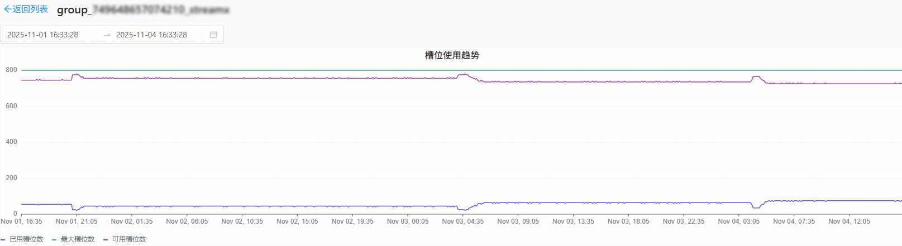

查看相应详情后，单击**返回列表**，即可返回**当日实例**页签。

您还可以在该页签下，查看当日实例的**init任务数**、**submit任务数**、**wait任务数**、**run任务数**、**fail任务数**和**success任务数**。


**查看当日多维分析**

单击**实例**页面下的当日多维分析，您可以在**当日多维分析**页签下，通过筛选**项目名称**、**资源组**、**主机**、**状态**、**读插件类型**、**写插件类型**和**数据源**等条件，从**同步数据量**、**同步速度**和**任务数据量**等维度分析您需要的数据。

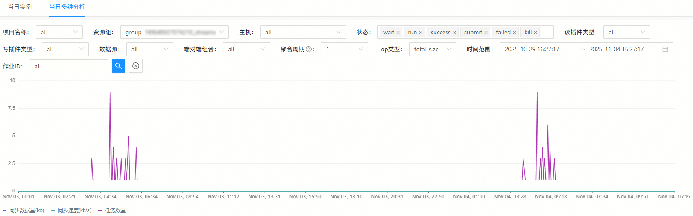

<a id="section-2-3-2-2-3"></a>

##### 2.3.2.2.3. 查看历史分析

历史分析页面包括多维分析、耗时分析和top任务。

**进入历史分析页面**

1. 登录大数据管家。

2. 单击左上角的  图标，选择**数据开发 > DataWorks**。

3. 在DataWorks页面中，单击右上角的**运维**，默认进入**服务运维 > 数据工场**的**概览**页面。

4. 在左侧导航栏，单击**数据集成**，默认进入**概览**页面。

5. 单击**历史分析**，默认进入**多维分析**页签。

**查看多维分析**

您可以在**多维分析**页签下，通过筛选**项目名称**、**资源组**、**主机**、**状态**、**读插件类型**、**写插件类型**和**数据源**等条件，从**同步数据量**、**同步速度**、**消耗时间**和**任务数量**等维度分析您需要的数据。

**查看耗时分析**

单击**历史分析**页面下的**耗时分析**，您可以在**耗时分析**页签下，通过筛选**项目名称**、**资源组**、**主机**、**状态**、**读插件类型**、**写插件类型**和**数据源**等条件，查看实例的耗时趋势。

**查看top任务**

单击**历史分析**页面下的**top任务**，您可以在**top任务**页签下，通过筛选**项目名称**、**资源组**、**主机**、**状态**、**读插件类型**、**写插件类型**和**数据源**等条件，查看每日排名前10的实例详情。

<a id="section-2-3-3"></a>

### 2.3.3. DataWorks集群运维

<a id="section-2-3-3-1"></a>

#### 2.3.3.1. DataWorks集群概览

集群概览汇总了集群的主要运行指标以及健康检查结果，包括运行健康、CPU、DISK、LOAD、MEMORY、PACKAGE。

**集群概览入口**

1. 登录大数据管家。

2. 在左上方单击  图标，然后选择 **DataWorks** 产品。

3. 在 DataWorks 页面中，单击上方的**运维**。

4. 在**运维**页面中，单击上方的**集群运维**。

5. 在**集群运维**页面左侧选择集群，然后在右侧单击**概览**页签，进入**概览**页面。

**运行健康**

统计集群当前的巡检项总数量，以及集群中的 CRITICAL、WARNING 和 EXCEPTION 的报警数量。

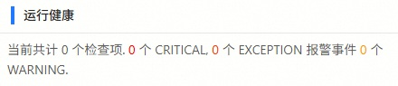

单击**查看详情**，跳转至DataWorks集群健康页面，查看健康检查的详细信息。

**CPU**

按时间以不同颜色的曲线展示集群的CPU使用率（支持指定时间段），包括CPU的总使用率（cpu）、系统对CPU的使用率（sys）和用户对CPU的使用率（user）。

单击图右上角的  图标，放大CPU使用趋势图。

在放大图中，您可在左上方指定时间段来查看集群的 CPU 使用率。

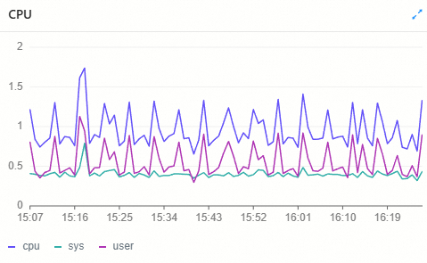

**DISK**

按时间展示集群的存储空间使用率。

单击图右上角的  图标，放大DISK使用趋势图。

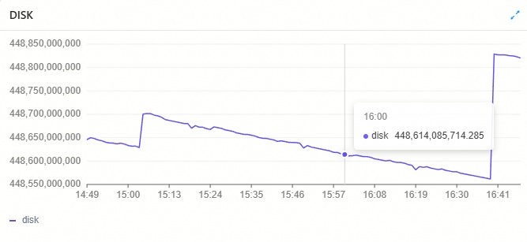

在放大图中，您可在左上方指定时间段来查看集群的存储空间使用率。

**LOAD**

按时间以不同颜色的曲线展示集群的一分钟 、五分钟和十五分钟系统平均负载。

单击图右上角的  图标，放大LOAD使用趋势图。

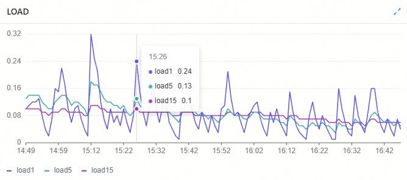

在放大图中，您可在左上方指定时间段来查看集群的一分钟 、五分钟和十五分钟系统平均负载。

**MEMORY**

按时间以不同颜色的曲线展示集群的内存使用量，包括内存使用率 （mem）、总内存大小（total）、已使用的内存大小（used）、buff使用的内存使用量（buff）、Cache使用的内存大小（cach）和空闲内存大小（free）。

单击图右上角的  图标，放大MEMORY使用趋势图。


在放大图中，您可在左上方指定时间段来查看集群的内存使用量。

**PACKAGE**

按时间以不同颜色的曲线展示集群的数据传输情况，包括丢包数量（drop）、错误包数量（error）、接收包数量（in）和发送包数量（out）。

单击图右上角的  图标，放大PACKAGE趋势图。


在放大图中，您可在左上方指定时间段来查看集群的数据传输情况。

<a id="section-2-3-3-2"></a>

#### 2.3.3.2. DataWorks集群健康

集群健康展示集群的所有检查项、检查项的详情（提供检查项报警的解决方案）、各检查项在宿主上的检查状态，同时还支持直接登录宿主以及手动对宿主执行检查项检查。

**集群健康入口**

1. 登录大数据管家。

2. 在左上方单击  图标，然后选择 **DataWorks** 产品。

3. 在 DataWorks 页面中，单击上方的**运维**。

4. 在**运维**页面中，单击上方的**集群运维**。

5. 在**集群运维**页面左侧选择集群，然后在右侧单击**健康**页签，进入**健康**页面。

   

**查看监控项详情**

1. 在集群**健康**页签，单击目标监控项**操作**栏中的**详情**，在弹出的对话框中查看监控项详情。

   监控项详情包括**名称**、**来源**、**别名**、**所属应用**、**类型**、**调度是否开启**、**系统默认参数列表**、**用户自定义参数列表**和**描述**，其中描述中附有检查项报警的解决方案。

2. 单击下方的**显示更多**，查看监控项的更多信息。

   

   监控项更多信息包括**执行脚本**、**执行目标**、**系统默认阈值判定**和**用户自定义阈值判定**。

**查看报警的宿主以及报警原因**

通过监控项的宿主，您可查看该监控项是对宿主的历史检查记录以及检查结果。

1. 在集群**健康**页签，单击存在报警的监控项前面的  图标，查看该监控项所有的**宿主**信息。

2. 单击**宿主**名，然后在弹出的对话框中单击某个报警后面的**详情**，可在右侧查看报警原因。

   

**处理监控项报警**

在集群**健康**页签，单击存在报警的监控项后面的**详情**，在**详情**弹窗中查看监控项报警的处理方法。

**再次检查**

处理完某个报警后，您可在集群**健康**页签，单击目标宿主后面的**操作 > 再次检查**，对该宿主进行一次该检查项的实时检查，以确定该宿主的报警是否恢复。

<a id="section-2-3-4"></a>

### 2.3.4. DataWorks主机运维

<a id="section-2-3-4-1"></a>

#### 2.3.4.1. DataWorks主机概览

主机概览汇总了DataWorks集群中每个主机的总体运行信息，包括每个主机的机器信息、机器服务角色状态，以及CPU、DISK、LOAD、MEMORY、PACKAGE的使用趋势图。

**主机概览入口**

1. 登录大数据管家。

2. 在左上方单击  图标，然后选择 **DataWorks** 产品。

3. 在 DataWorks 页面中，单击上方的**运维**。

4. 在**运维**页面中，单击上方的**主机运维**。

5. 在**主机运维**页面左侧选择主机，然后在右侧单击**概览**页签，进入**概览**页面。

   该页面展示了详细的机器信息、机器服务角色状态和关键指标的使用趋势图。

**CPU**

按时间以不同颜色的曲线展示该主机的CPU使用率（支持指定时间段），包括CPU的总使用率（cpu）、系统对CPU的使用率（sys）和用户对CPU的使用率（user）。

单击图右上角的  图标，放大CPU使用趋势图。


在放大图中，您可在左上方指定时间段来查看该主机的CPU使用率。

**DISK**

按时间展示该主机的存储空间使用率，包括/目录下存储空间使用率。

单击图右上角的  图标，放大DISK使用趋势图。


在放大图中，您可在左上方指定时间段来查看该主机的存储空间使用率。

**LOAD**

按时间以不同颜色的曲线展示该主机的一分钟 、五分钟和十五分钟系统平均负载。

单击图右上角的  图标，放大LOAD使用趋势图。


在放大图中，您可在左上方指定时间段来查看该主机的一分钟 、五分钟和十五分钟系统平均负载。

**MEMORY**

按时间以不同颜色的曲线展示该主机的内存使用量，包括内存使用率（mem）、总内存大小（total）、已使用的内存大小（used）、buff使用的内存大小（buff）、Cache使用的内存大小（cach）和空闲内存大小（free）。

单击图右上角的  图标，放大MEMORY使用趋势图。


在放大图中，您可在左上方指定时间段来查看该主机的内存使用量。

**PACKAGE**

按时间以不同颜色的曲线展示该主机的数据传输情况，包括丢包数量（drop）、错误包数量（error）、接收包数量（in）和发送包数量（out）。

单击图右上角的  图标，放大PACKAGE趋势图。


在放大图中，您可在左上方指定时间段来查看该主机的数据传输情况。

<a id="section-2-3-4-2"></a>

#### 2.3.4.2. DataWorks主机服务角色

主机运维支持查看服务角色，包括集群、服务实例和角色信息。

**主机服务角色入口**

1. 登录大数据管家。

2. 在左上方单击  图标，然后选择**DataWorks**产品。

3. 在DataWorks页面中，单击上方的**运维**。

4. 在**运维**页面中，单击上方的**主机运维**。

5. 在**主机运维**页面左侧选择主机，然后在右侧单击**服务角色**页签，进入**服务角色**页面。

<a id="section-2-4"></a>

## 2.4. 管理

<a id="section-2-4-1"></a>

### 2.4.1. 管理概述

管理模块是大数据管家的配置和软件的管理中心，是支撑和个性化产品运维的重要功能模块。

管理模块支持的功能如下：

- 作业服务：支持通过执行作业来对大数据各产品进行运维操作。

- 健康管理：支持创建健康检查项，同时还支持健康检查项应用到产品的主机上。

- 流程服务：支持查看待处理和已完成的人工任务；支持查看流程信息（包括流程图和XML定义）；支持查看不同状态（包括运行中、已完成、异常和已终止）的流程实例信息。

- 操作审计：支持查看大数据管家中作业执行和其他产品运维操作的记录。

<a id="section-2-4-2"></a>

### 2.4.2. 作业服务

<a id="section-2-4-2-1"></a>

#### 2.4.2.1. 概述

本文简要介绍大数据管家中作业相关的概念，以及作业界面。

大数据管家通过执行作业来对大数据产品进行产品运维。作业即产品运维任务，是对集群中的物理设备进行的运维操作。作业服务界面主要包括**执行**页面。

**相关概念**

作业相关的概念如下：

- 普通作业：需要用户手动执行的作业，未设置定时器。

- 定时作业：设置了定时器，按设定时间自动执行的作业。

**执行页面**


**执行**页面主要包括以下功能模块：

<table>
  <tr>
    <th width="90">功能</th>
    <th>说明</th>
  </tr>
  <tr>
    <td>普通作业</td>
    <td>• 支持查看、执行普通作业，同时还支持查看执行历史。<br>• 支持搜索、复制、导出和删除作业。</td>
  </tr>
  <tr>
    <td>定时作业</td>
    <td>• 支持开启或关闭、查看、执行定时作业，同时还支持查看定时作业的执行历史。<br>• 支持搜索、复制、导出和删除作业。</td>
  </tr>
  <tr>
    <td>执行历史</td>
    <td>• 支持查看普通作业、定时作业等的历史执行记录。<br>• 支持搜索、查看详情和预览。</td>
  </tr>
</table>

<a id="section-2-4-2-2"></a>

#### 2.4.2.2. 作业

<a id="section-2-4-2-2-1"></a>

##### 2.4.2.2.1. 手动执行作业

创建普通作业后，您必须手动去执行作业来完成对产品的运维操作。当然，您也可以手动执行定时作业。

**前提条件**

已获取大数据管家管理员账号。

**操作步骤**

1. 登录大数据管家。

2. 在顶部菜单栏，单击**管理**。

3. 在左侧导航栏，单击**作业服务**。

4. 在**执行**页面，单击**作业列表**页签。

   如果需要手动执行定时作业，请单击**定时作业**页签。手动执行定时作业的流程与普通作业完全相同，本节以普通作业为例进行介绍。

5. 在**作业列表**页面，单击某个作业后面的**执行**。

   

6. 在弹出的对话框中，完成**配置目标组与参数**操作，单击**下一步**。

   

7. 完成**确认作业风险**后，单击**确认执行**。

   

   确认执行后，在**执行历史**页面中自动生成一条执行记录，详情请参见查看执行历史。

8. 在作业执行界面，单击上方的**开始**，开始执行作业。

   如果您未进行任何操作而退出了作业执行界面，则后续可在**执行历史**页面中查找到该执行记录，然后单击**查看**即可再次进入该作业执行界面。

<a id="section-2-4-2-2-2"></a>

##### 2.4.2.2.2. 开启和关闭定时作业

定时作业默认是关闭不生效的，您需要手动去开启定时作业。如果定时作业在某个时间段内不需要再执行，您可手动去关闭。

**前提条件**

已获取大数据管家管理员账号。

**操作步骤**

1. 登录大数据管家。

2. 在顶部菜单栏，单击**管理**。

3. 在左侧导航栏，单击**作业服务**。

4. 在**执行**页面，单击**定时作业**页签。

5. 在**定时作业**页面，关闭或开启定时作业：

   - 作业处于关闭状态时，开启定时作业：单击定时作业后面的**开启**。

     开启某个定时作业后，**状态**变更为**已生效**，**开启**按钮变更为**关闭**。

   - 作业处于开启状态时，关闭定时作业：单击定时作业后面的**关闭**。

     关闭某个定时作业后，**状态**变更为**未生效**，**关闭**按钮变更为**开启**。

<a id="section-2-4-2-2-3"></a>

##### 2.4.2.2.3. 查看某个作业的执行历史

大数据管家支持查看指定作业的执行历史，以便您了解该作业的历史执行情况。

**前提条件**

已获取大数据管家管理员账号。

**背景信息**

确认执行作业后，大数据管家会对每个作业的执行情况进行记录，以便用户后续了解作业的执行情况。

**执行历史**页面支持的功能如下：

- 支持查看作业历史执行的触发方式、当前状态、开始时间、结束时间等信息。

- 支持查看作业执行过程、参数配置，同时还支持下载作业执行的详细信息。

- 支持对不同状态的历史执行记录进行不同的操作，例如：支持对**未开始**状态的记录执行**开始**操作，支持对**异常**状态的记录执行**重试**操作等。

普通作业与定时作业的执行历史信息完全相同，本节以普通作业为例进行介绍。

**操作步骤**

1. 登录大数据管家。

2. 单击上方的**管理**页签，然后在左侧导航栏中选择**作业服务**。

3. 在**执行**页面，单击**作业列表**页签。

4. 在**作业列表**页面，单击待查看的普通作业后面的**历史**，进入**执行历史**页面。

   在**执行历史**页面可查看该作业的执行历史，详情请参见查看执行历史。

<a id="section-2-4-2-2-4"></a>

##### 2.4.2.2.4. 查看执行历史

大数据管家支持查看作业和方案的执行历史，以便您了解作业和方案的执行情况。

**前提条件**

已获取大数据管家管理员账号。

**背景信息**

在确认执行作业或方案后，大数据管家会生成一条历史记录，以便用户后续了解该任务的执行情况。

**执行历史**页面支持的功能如下：

- 支持查看任务的触发方式、当前状态、开始时间、结束时间等信息。

- 支持查看任务的执行过程、参数配置，同时还支持下载任务执行的详细信息。

- 支持对不同状态的任务进行不同的操作，例如：支持对**未开始**状态的任务执行**开始**操作，支持对**异常**状态的任务执行**重试**操作等。

**操作步骤**

1. 登录大数据管家。

2. 单击上方的**管理**页签，然后在左侧导航栏中选择**作业服务**。

3. 在**执行**页面，单击**执行历史**页签。

   

4. 如果历史记录条数多，可以对实例名称、时间范围和执行状态进行过滤，然后单击**搜索**，查询符合条件的历史记录。

5. 单击某个历史记录后面的**详情**，查看该历史记录的详细信息。

   对于不同状态的历史记录，您可进行的操作如下：

   **任务执行记录状态**

   **支持功能**

   **操作步骤**

   单击上方的**参数配置**，选择**上下文参数**或**全局参数**，查看该任务的

   查看参数配置

   上下文参数或全局参数。

   单击上方的**下载执行详情**，下载作业执行详情到本地，保存格式为txt。

   下载执行详情

   执行详情中记录了作业执行的**JSON**和**原始数据**等信息。

   - 在某个步骤中的**机器详情**页面，单击某个机器后面的**查看详情**，在右侧查看该步骤在该机器上的执行详情，包括执行输出。

   所有状态

   - 如果是脚本步骤，则显示**脚本内容**和**执行参数**页面，可查看脚本

   查看步骤执行详情

   内容和脚本执行参数。

   - 如果是命令步骤，则显示**命令内容**和**执行参数**页面，可查看命令内容和命令执行参数。

   如果任务正在执行中，您可单击上方的**刷新**，查看最新的执行状

   刷新界面

   态。

   开始执行

   单击上方的**开始**，开始此次执行。

   未开始

   取消执行

   单击上方的**取消**，取消此次执行。

   完成人工操作并确

   在待操作的人工步骤上，根据提示进行相关操作，然后单击**确认**，

   认

   进入下一个步骤。

   待人工确认

   回滚到上一步骤执

   在待操作的人工步骤上，单击**回滚**，回滚到上一步骤执行完的状

   行完的状态

   态。

   取消执行

   单击**取消**，取消此次执行。

   重试异常步骤

   在异常步骤上，单击**重试**，重新执行该步骤。

   在异常步骤上，单击**跳过**，跳过此步骤继续执行后续步骤。

   跳过异常步骤

   回滚到上一步骤执

   在异常步骤上，单击**回滚**，回滚到上一步骤执行完的状态。

   行完的状态

   在异常步骤上，单击**重置**，重置该步骤为**未开始**状态。

   重置异常步骤为未

   异常步骤重置为未开始状态时，该次执行状态变为**暂停**。此时您可

   开始状态

   异常

   单击上方的**继续**，重新执行当前步骤。

   - 在某个步骤中的**机器详情**页面，单击某个机器后面的**查看详情**，在右侧查看该步骤在该机器上的执行详情，包括执行输出和错误信息。

     对于执行异常的机器，查看详情后，您可单击**跳过**来跳过此机器，也可单击**重试**再在该机器上重新执行一次。

   查看异常步骤执行详情

   - 如果是脚本步骤，则显示**脚本内容**和**执行参数**页面，可查看脚本内容和脚本执行参数。

   - 如果是命令步骤，则显示**命令内容**和**执行参数**页面，可查看命令内容和命令执行参数。

   重试失败步骤

   在失败步骤上，单击**重试**，重新执行该步骤。

   跳过失败步骤

   在失败步骤上，单击**跳过**，跳过此步骤继续执行后续步骤。

   回滚到上一步骤执

   在失败步骤上，单击**回滚**，回滚到上一步骤执行完的状态。

   行完的状态

   在失败步骤上，单击**重置**，重置该步骤为**未开始**状态。

   重置失败步骤为未

   失败步骤重置为未开始状态时，该次执行状态变为**暂停**。此时您可

   开始状态

   单击上方的**继续**，重新开始执行当前步骤。

   失败

   - 在某个步骤中的**机器详情**页面，单击某个机器后面的**查看详情**，在右侧查看该步骤在该机器上的执行详情，包括执行输出和错误信息。

     对于执行异常的机器，查看详情后，您可单击**跳过**来跳过此机

   查看失败步骤执行

   器，也可单击**重试**再在该机器上重新执行一次。

   详情

   - 如果是脚本步骤，则显示**脚本内容**和**执行参数**页面，可查看脚本内容和脚本执行参数。

   - 如果是命令步骤，则显示**命令内容**和**执行参数**页面，可查看命令内容和命令执行参数。

   取消执行

   单击上方的**取消**，取消此次执行。

<a id="section-2-4-3"></a>

### 2.4.3. 健康管理

<a id="section-2-4-3-1"></a>

#### 2.4.3.1. 监控配置

大数据管家为每个产品均内置了丰富的调度项和监控项，用于检查产品的故障并产生报警，以便您及时发现产品故障并修复。

**前提条件**

- 已获取具有相应产品运维权限的大数据管家账号。

- 已获取监控项的报警源和检查项。

**背景信息**

> **说明**
>
> 产品不同，其调度项和监控项也不同，但其配置和操作方法完全相同。

调度项：调度项在指定 tianji 角色对应的全量机器列表中运行调度脚本，以产生报警的原始数据（什么调度项在什么机器上产生了什么级别的报警，报警结果数据是什么），原始数据会上报到 ABM 的数据库中进行存储。

监控项：监控项会将调度项产生的报警原始数据挂载到 ABM 中相应产品的页面中。挂载到产品页面时，支持设置不同的过滤策略，以在指定页面上过滤出自己所关注的监控项的报警结果。

调度项和监控项均是内置，不可增加，但您可修改调度项和监控项的部分参数，例如：是否启用、运行参数、描述等。除此以外，监控项还支持配置挂载点，也支持删除操作。

**进入管理页面**

1. 登录大数据管家。

2. 在左上方单击  图标，选择目标产品进入。

3. 在顶部菜单栏，单击**管理**，进入管理页面。

**查看调度项详情和调度项挂载点**

调度项挂载点是内置的，不可添加、修改和删除。调度项的挂载点对应运行调度脚本的tianji角色对应的全量机器列表。

1. 在左侧导航栏单击**健康管理**，默认进入**监控配置 > 调度**页面。

   

   **调度**页面展示了当前产品的所有调度项。

2. 在**调度**页面，单击某个调度项后面的**查看**，查看该调度项的详情。

   

   调度项详情包括检查项名称、检查项别名、描述和处理步骤等。

3. 单击某个调度项前面的  图标，查看调度项的挂载点。

   

**修改调度项**

支持设置调度项的调度间隔、运行参数等，同时还支持设置是否启用调度项。

1. 在左侧导航栏单击**健康管理**，默认进入**监控配置 > 调度**页面。

2. 在**调度**界面，单击某个调度项后面的**编辑**，在弹出的对话框中设置各参数。

   

   **类型**：**系统默认**表示**调度间隔**、**参数列表**等参数均使用系统默认配置；**自定义**表示可自定义这些参数。

   > **说明**
   >
   > **调度间隔**是基于**crontab**命令配置的。

3. 完成上述参数配置后，单击**确定**，界面提示修改成功。

**查看故障机列表**

支持查看当前集群中所有的故障机器。

1. 在左侧导航栏单击**健康管理**，默认进入**监控配置 > 调度**页面。

2. 单击右上方的**故障机器列表**，查看集群中的故障机器。

   

   故障机器列表中列出了当前集群中所有的故障机器，以及每台机器在飞天基础运维平台中的所属角色。

**修改监控项**

支持修改监控项的名称、描述，以及设置是否启用监控项。监控项的报警源和检查项是内置的，请勿修改。

1. 在左侧导航栏单击**健康管理**，默认进入**监控配置 > 调度**页面。

2. 单击**监控**页签，进入监控界面。

   

   **监控**界面展示当前产品的所有的监控项。

3. 单击某个监控项后面的**编辑**，修改监控项的配置。

   

4. 完成上述参数配置后，单击**确定**，界面提示修改成功。

**给监控项添加挂载点**

监控项通过添加挂载点将报警原始数据挂载到ABM中各产品的运维界面中。

1. 在左侧导航栏单击**健康管理**，默认进入**监控配置 > 调度**页面。

2. 单击**监控**页签，进入监控界面。

3. 单击某个监控项前面的  图标，查看监控项的挂载点。

   

4. 单击挂载点列表下方的**添加挂载点**，在弹出的对话框中设置各参数。

   

   关键参数说明如下：

   <table>
     <tr>
       <th width="89">配置项</th>
       <th>说明</th>
     </tr>
     <tr>
       <td>挂载点</td>
       <td>从下拉列表中选择该监控项要的检查结果要挂载在哪个产品的哪个运维界面，例如：<strong>odps/host</strong>表示挂载到 MaxCompute 的主机运维界面。</td>
     </tr>
     <tr>
       <td>过滤策略</td>
       <td>可选值如下：<br>• <strong>全量</strong>：该监控项产生的报警记录全部显示。<br>• <strong>产品树自定义过滤器</strong>：根据产品树节点中配置的过滤器对该监控项产生的报警进行过滤。<br>• <strong>产品树节点名称匹配</strong>：从报警记录中匹配出和当前节点名称相同的记录。</td>
     </tr>
     <tr>
       <td>是否生效</td>
       <td>设置该挂载点是否生效。</td>
     </tr>
   </table>

5. 完成上述参数配置后，单击**确定**，界面提示修改成功。

**删除监控项的挂载点**

1. 进入管理页面，在左侧导航栏单击**健康管理**，默认进入**监控配置 > 调度**页面。

2. 单击**监控**页签，进入监控界面。

3. 单击某个监控项前面的  图标，查看监控项的挂载点。

4. 单击目标挂载点后面的**删除**，在弹出的对话框中单击**确定**，界面提示删除成功。

**删除监控项**

1. 进入管理页面，在左侧导航栏单击**健康管理**，默认进入**监控配置 > 调度**页面。

2. 单击**监控**页签，进入监控界面。

3. 单击目标监控项后面的**删除**，然后在弹出的对话框中单击**确定**，界面提示删除成功。

<a id="section-2-4-3-2"></a>

#### 2.4.3.2. 巡检管理

大数据管家的巡检管理功能支持按需配置巡检场景、巡检项和场景组合。

**前提条件**

已获取具有相应产品运维权限的大数据管家账号。

**进入管理页面**

1. 登录大数据管家。

2. 在左上方单击  图标，选择目标产品。

3. 在顶部菜单栏，单击**管理**，进入管理页面。

**新建场景**

1. 在左侧导航栏单击**健康管理**，选择**巡检管理 > 场景**。

   

2. 单击右上角的**新建场景**，在对话框中按需配置各参数。

   

3. 单击**提交**。

   场景创建成功后，您还可以对该场景进行**编辑**、**立即巡检**、**场景管理**和查看**运行历史**等相关操作。

   

**新建巡检项**

1. 在左侧导航栏单击**健康管理**，选择**巡检管理 > 巡检项**。

2. 单击右上角的**新增巡检项**。

   

3. 在**新建巡检项**对话框中，按需配置各参数。

   

4. 单击**提交**。

   巡检项创建成功后，您还可以对该场景进行**编辑**和**删除**操作。

   

**新建场景组合**

1. 在左侧导航栏单击**健康管理**，选择**巡检管理 > 场景组合**。

2. 单击右上角的**新建场景**。

   

3. 在**新建场景**对话框中，按需配置各参数。

   

4. 单击**提交**。

   场景组合创建成功后，您还可以对该场景进行**编辑**、**场景管理**和查看**运行历史**等操作。

   

<a id="section-2-4-4"></a>

### 2.4.4. 操作审计

操作审计列出了大数据管家中当前产品的**运维**界面的运维操作历史记录，支持查看每个操作的详细信息，方便您后续查看和故障定位。

**前提条件**

已获取具有相应产品运维权限的大数据管家账号。

**背景信息**

操作审计是按产品查看的，例如：如果需要查看某个产品的操作审计，您首先需要进入某个产品界面。

> **说明**
>
> 操作审计列出的是产品**运维**界面中的运维操作历史记录，不包含作业服务的运维操作。

**操作步骤**

1. 登录大数据管家。

2. 在左上方单击  图标，选择目标产品进入。

3. 单击顶部菜单栏的**管理**，在左侧再单击**操作审计**。

   **操作审计**界面显示当前产品的**运维**界面中的运维操作历史记录，包括操作名称、操作标识、风险等级、当前状态、提交时间、执行时间、结束时间、执行人、实现方式、执行参数和详情等信息。

4. 单击某个操作后面的**详情**，查看该运维操作的详情。

   对于失败的步骤，还支持查看具体失败原因。

5. 如果运维操作运行失败，则您可查看失败原因。

6. 当运维任务处于未开始、等待、异常、失败等状态时，您可根据实际情况进行以下操作。

   | 状态 | 可执行操作 |
   | --- | --- |
   | 未开始 | • 单击<strong>开始</strong>，开始执行该任务。<br>• 单击<strong>参数配置</strong>，查看该任务的参数配置。<br>• 单击<strong>取消</strong>，取消该任务。 |
   | 等待 | • 根据提示进行相关操作，然后单击<strong>确认</strong>，继续执行后续步骤。<br>• 单击<strong>回滚</strong>，回滚到上一步骤执行完的状态。<br>• 单击<strong>参数配置</strong>，查看该任务的参数配置。<br>• 单击<strong>取消</strong>，取消该任务。 |
   | 异常 | • 单击<strong>重试</strong>，重新执行该步骤。<br>• 单击<strong>跳过</strong>，跳过此步骤继续执行后续步骤。<br>• 单击<strong>回滚</strong>，回滚到上一步骤执行完的状态。<br>• 单击<strong>参数配置</strong>，查看该任务的参数配置。<br>• 单击<strong>取消</strong>，取消该任务。 |
   | 失败 | • 单击<strong>重试</strong>，重新执行该步骤。<br>• 单击<strong>跳过</strong>，跳过此步骤继续执行后续步骤。<br>• 单击<strong>回滚</strong>，回滚到上一步骤执行完的状态。<br>• 单击<strong>参数配置</strong>，查看该任务的参数配置。<br>• 单击<strong>取消</strong>，取消该任务。 |

7. 如果需要下载运维操作的执行日志，单击上方的**下载执行详情**，保存日志到本地。

<a id="section-3"></a>

# 3.DataWorks深度巡检

<a id="section-3-1"></a>

## 3.1. 概述

深度巡检覆盖并汇聚了DataWorks的监控告警、资源水位及关键指标，并使用可视化方式掌握平台运行的健康状况，助力您在发生重大问题甚至故障前规避非预期的风险问题，保障稳定性。

> 大数据管家不会进行巡检报告的回收，但是会收集所有的巡检报告中产生的风险和相应阈
>
> **说明**
>
> 值。

深度巡检包含如下巡检内容：

- 集群巡检

- base_meat项目巡检

- BaseBizAlisa服务巡检

- BaseBizPhoenix服务巡检

- BaseBizCdp服务巡检

<a id="section-3-2"></a>

## 3.2. DataWorks服务角色介绍

本文主要介绍如何查看服务角色以及常用服务角色的详细介绍。

**背景信息**

DataWorks控制服务共包含如下43个服务角色。

| 服务角色 | 概述 | 数量范围 | 形态 | 端口 | 是否高可靠 |
| --- | --- | --- | --- | --- | --- |
| BaseBizSso | SSO统一登录 | 2 | 容器 | 7001 | 是 |
| BaseBizWkbench | 运维中心 | 2 | 容器 | 7001 | 是 |
| Redis1 | redis服务 | 1 | 容器 | 6379/26379 | 是 |
| Redis2 | redis服务 | 2 | 容器 | 6379/26389 | 是 |
| BaseBizDmc | 数据地图 | 2 | 容器 | 7001 | 是 |
| BaseBizBaseapi | 调度API | 2 | 容器 | 7001 | 是 |
| BaseBizDbinit | 数据库初始化 | 1 | 容器 | 不涉及 | 不涉及 |
| BaseBizPhoenix | 调度引擎 | 3 | 容器 | 7001 | 是 |
| BaseBizAlisa | 执行引擎 | 2 | 容器 | 7001 | 是 |
| BaseBizConsole | 专有云控制台 | 2 | 容器 | 7001 | 是 |
| BaseBizTenant | 租户 | 2 | 容器 | 7001 | 是 |
| BaseBizMetaserv ice | 元数据 | 2 | 容器 | 7001 | 是 |
| BaseBizMario | 实时同步服务 | 2 | 容器 | 7001 | 是 |
| BaseBizDashboar d | 数据集成dashboard | 2 | 容器 | 7001 | 是 |
| BaseBizCdp | 离线同步调度服务 | 2 | 容器 | 7001 | 是 |
| BaseBizGateway | 调度gateway（docker） | 2 | 容器 | 7001 | 是 |
| BaseBizCdpGate way | 离线同步gateway（docker） | 2 | 容器 | 8000 | 是 |
| BaseBizGateway Search | 代码搜索/备份恢复gateway | 2 | 容器 | 8000 | 是 |
| BaseBizGateway WithNc | 调度gateway（物理机） | 不少于1个 | 物理机 | 8000 | 不涉及 |
| BaseBizCdpGate wayWithNc | 离线同步gateway（物理机） | 不少于1个 | 物理机 | 8000 | 不涉及 |
| BaseBizCommon base | 数据开发 | 4 | 容器 | 7001 | 是 |
| ServiceTest | 冒烟测试用例 | 1 | 容器 | 不涉及 | 不涉及 |
| DataworksDatao sPanel | 小扳手、组织管理 | 2 | 容器 | 7001 | 是 |
| DataworksMessa geCenter | 消息中心 | 2 | 容器 | 7001 | 是 |
| BaseBizTsp | 代码库服务 | 2 | 容器 | 7001 | 是 |
| DataworksMosad | 智能监控 | 2 | 容器 | 7001 | 是 |
| BaseBizDiide | 数据集成 | 2 | 容器 | 7001 | 是 |
| DataworksNavig ation | 公共头 | 2 | 容器 | 7001 | 是 |
| BaseBizWormhol e | 虫洞服务 | 2 | 容器 | 7001 | 是 |
| BaseBizDataOsA piInit | popapi注册 | 1 | 容器 | 不涉及 | 不涉及 |
| DataworksDsmG uard | 安全中心 | 2 | 容器 | 7001 | 是 |
| BaseBizGateway StreamX | 实时同步gateway | 2 | 容器 | 8000 | 是 |
| BaseBizAlisaloga gent | Alisa日志代理 | 2 | 容器 | 7001 | 是 |
| DataworksExecut orNode | 实时执行引擎node | 2 | 容器 | 7001 | 是 |
| DataworksExecut orManager | 实时执行引擎manage | 2 | 容器 | 7001 | 是 |
| DataworksNode market | 自定义节点 | 2 | 容器 | 7001 | 是 |
| DataworksMeasu re | 计量 | 2 | 容器 | 7001 | 是 |
| DataworksLsp | LSP（智能编辑器） | 2 | 容器 | 7001 | 是 |
| DataworksPlugin | 微服框架 | 2 | 容器 | 7001 | 是 |
| DataworksCdn | 前端服务 | 2 | 容器 | 7001 | 是 |
| DataworksMetaPl uginService | 元数据插件服务 | 2 | 容器 | 7001 | 是 |
| BaseBizOps | 运维助手 | 2 | 容器 | 7001 | 是 |
| DataworksElastic search | ES服务 | 3 | 容器 | 9200/9300/9114 | 是 |

**查看服务角色**

1. 登录统一运管平台ASO，在顶部菜单栏选择**平台运维 > 飞天基础运维平台 > 资源管理**，在左侧导航栏单击**资源管理 > 产品集群运维**，**产品 | 集群**搜索框搜索 `base` ，在集群列表中找到所需的DataWorks集群。

2. 单击DataWorks**操作**列的**集群详情**，进入基本信息页。

3. 在**服务列表**页签，找到需要查询服务角色的服务，单击**操作**列的**详情**。

4. 在左侧查看**组件列表**，组件列表中即为服务角色。

**BaseBizSso#**

- 服务角色说明

  该服务主要负责SSO统一登录，需要依赖BaseBizDbinit#和Redis1#服务。

- RMA/重启说明

  所在物理机可以RMA/重启，需要分批操作。

- Reclone说明

  所在物理机可以进行reclone，需要分批操作。

- 日志说明

  日志路径为： `/home/admin/base-biz-sso/logs` 。

- 监控说明

  查看飞天基础平台是否到达终态状态。详情请参见查看服务角色。

**BaseBizWkbench#**

- 服务角色说明

  该服务主要负责运维中心模块功能，需要依赖BaseBizDbinit#、BaseBizTenant#、Redis1#服务。

- RMA/重启说明

  所在物理机可以RMA/重启，需要分批操作。

- Reclone说明

  所在物理机可以进行reclone，需要分批操作。

- 日志说明

  日志路径为： `/home/admin/base-biz-wkbench/logs` 。

- 监控说明

  查看飞天基础平台是否到达终态状态。详情请参见查看服务角色。

**Redis1#**

- 服务角色说明

  该服务主要负责redis服务，不依赖其他服务角色。

- RMA/重启说明

  无。

- Reclone说明

  所在物理机可以进行reclone。

- 日志说明

  日志路径为： `/var/log/redis/redis.log`和`/var/log/redis/sentinel.log` 。

- 监控说明

  查看飞天基础平台是否到达终态状态。详情请参见查看服务角色。

**Redis2#**

- 服务角色说明

  该服务主要负责redis服务，需要依赖Redis1#服务。

- RMA/重启说明

  无。

- Reclone说明

  所在物理机可以进行reclone。

- 日志说明

  日志路径为： `/var/log/redis/redis.log`和`/var/log/redis/sentinel.log` 。

- 监控说明

  查看飞天基础平台是否到达终态状态。详情请参见查看服务角色。

**BaseBizDmc#**

- 服务角色说明

  该服务主要负责数据地图的功能，需要依赖BaseBizDbinit#服务。

- RMA/重启说明

  所在物理机可以RMA/重启，需要分批操作。

- Reclone说明

  所在物理机可以进行reclone，需要分批操作。

- 日志说明

  日志路径为： `/home/admin/base-biz-dmc/logs` 。

- 监控说明

  查看飞天基础平台是否到达终态状态。详情请参见查看服务角色。

**BaseBizBaseapi#**

- 服务角色说明

  该服务主要负责调度API服务，需要依赖BaseBizDbinit#、BaseBizTenant#服务。

- RMA/重启说明

  无。

- Reclone说明所在物理机可以进行reclone。

- 日志说明

  日志路径为：

  ```bash
  --查看所有docker容器的状况, 获取BaseBizBaseapi容器的docker_id
  docker ps -a;
  --将该容器输出的⽇志进⾏重定向(因为⽇志量很⼤)  
  docker logs $docker_id; 
  ```

- 监控说明

  查看飞天基础平台是否到达终态状态。详情请参见查看服务角色。

**BaseBizDbinit#**

- 服务角色说明

  该服务主要负责数据库初始化操作，不依赖其他SR服务。

- RMA/重启说明

  无。

- Reclone说明

  所在物理机可以进行reclone。

- 日志说明

  日志路径为：

  ```bash
  --查看所有docker容器的状况, 获取BaseBizDbinit容器的docker_id
  docker ps -a;
  --将该容器输出的⽇志进⾏重定向(因为⽇志量很⼤)  
  docker logs $docker_id ; 
  ```

- 监控说明

  查看飞天基础平台是否到达终态状态。详情请参见查看服务角色。

**BaseBizPhoenix#**

- 服务角色说明

  该服务主要负责调度引擎、周期实例产生相关功能，需要依赖BaseBizDbinit#服务。

- RMA/重启说明

  所在物理机可以RMA/重启，需要分批操作。

- Reclone说明

  所在物理机可以进行reclone，需要分批操作。

- 日志说明

  日志路径为： `/home/admin/base-biz-phoenix/logs`

- 监控说明

  查看飞天基础平台是否到达终态状态。详情请参见查看服务角色。

**BaseBizAlisa#**

- 服务角色说明

  该服务主要负责执行引擎，需要依赖BaseBizDbinit#服务。

- RMA/重启说明

  所在物理机可以RMA/重启，需要分批操作。

- Reclone说明

  所在物理机可以进行reclone，需要分批操作。

- 日志说明

  日志路径为： `/home/admin/base-biz-alisa/logs`

- 监控说明

  查看飞天基础平台是否到达终态状态。详情请参见查看服务角色。

**BaseBizConsole#**

- 服务角色说明

  该服务主要负责专有云控制台，需要依赖BaseBizDbinit#服务。

- RMA/重启说明

  所在物理机可以RMA/重启，需要分批操作。

- Reclone说明

  所在物理机可以进行reclone，需要分批操作。

- 日志说明

  日志路径为： `/home/admin/base-biz-console/logs`

- 监控说明

  查看飞天基础平台是否到达终态状态。详情请参见查看服务角色。

**BaseBizTenant#**

- 服务角色说明

  该服务主要负责租户服务，需要依赖BaseBizDbinit#、DataworksMessageCenter#、Redis1#服务。

- RMA/重启说明

  所在物理机可以RMA/重启，需要分批操作。

- Reclone说明

  所在物理机可以进行reclone，需要分批操作。

- 日志说明

  日志路径为： `/home/admin/base-biz-tenant/logs`

- 监控说明

  查看飞天基础平台是否到达终态状态。详情请参见查看服务角色。

**BaseBizMetaservice#**

- 服务角色说明

  该服务主要负责元数据服务，需要依赖BaseBizAlisa#、BaseBizBaseapi#、BaseBizDbinit#、BaseBizPhoenix#、BaseBizTenant#服务。

- RMA/重启说明

  所在物理机可以RMA/重启，需要分批操作。

- Reclone说明所在物理机可以进行reclone，需要分批操作。

- 日志说明

  日志路径为： `/home/admin/base-biz-metaservice/logs`

- 监控说明

  查看飞天基础平台是否到达终态状态。详情请参见查看服务角色。

**BaseBizMario#**

- 服务角色说明

  该服务主要负责实时同步服务，需要依赖BaseBizAlisa#、BaseBizDbinit#、BaseBizTenant#服务。

- RMA/重启说明

  所在物理机可以RMA/重启，需要分批操作。

- Reclone说明

  所在物理机可以进行reclone，需要分批操作。

- 日志说明

  日志路径为： `/home/admin/base-biz-mario/logs`

- 监控说明

  查看飞天基础平台是否到达终态状态。详情请参见查看服务角色。

**BaseBizDashboard#**

- 服务角色说明

  该服务主要负责数据集成（dashboard），需要依赖BaseBizAlisa#、BaseBizDbinit#、BaseBizTenant#服务。

- RMA/重启说明

  所在物理机可以RMA/重启，需要分批操作。

- Reclone说明

  所在物理机可以进行reclone，需要分批操作。

- 日志说明

  日志路径为： `/home/admin/base-biz-dashboard/logs`

- 监控说明

  查看飞天基础平台是否到达终态状态。详情请参见查看服务角色。

**BaseBizCdp#**

- 服务角色说明

  该服务主要负责离线同步调度服务，需要依赖BaseBizDbinit#服务。

- RMA/重启说明

  所在物理机可以RMA/重启，需要分批操作。

- Reclone说明

  所在物理机可以进行reclone，需要分批操作。

- 日志说明

  日志路径为： `/home/admin/base-biz-cdp/logs`

- 监控说明查看飞天基础平台是否到达终态状态。详情请参见查看服务角色。

**BaseBizGateway#**

- 服务角色说明

  该服务主要负责调度gateway（docker），需要依赖BaseBizDbinit#服务。

- RMA/重启说明

  所在物理机可以RMA/重启，需要分批操作。

- Reclone说明

  所在物理机可以进行reclone，需要分批操作。

- 日志说明

  日志路径为： `/home/admin/alisatasknode/logs`

- 监控说明

  查看飞天基础平台是否到达终态状态。详情请参见查看服务角色。

**BaseBizCdpGateway#**

- 服务角色说明

  该服务主要负责离线同步gateway（docker），需要依赖BaseBizAlisa#服务。

- RMA/重启说明

  所在物理机可以RMA/重启，需要分批操作。

- Reclone说明

  所在物理机可以进行reclone，需要分批操作。

- 日志说明

  日志路径为： `/home/admin/alisatasknode/logs`

- 监控说明

  查看飞天基础平台是否到达终态状态。详情请参见查看服务角色。

**BaseBizGatewaySearch#**

- 服务角色说明

  该服务主要负责代码搜索或备份恢复gateway，需要依赖BaseBizAlisa#服务。

- RMA/重启说明

  所在物理机可以RMA/重启，需要分批操作。

- Reclone说明

  所在物理机可以进行reclone，需要分批操作。

- 日志说明

  日志路径为： `/home/admin/alisatasknode/logs`

- 监控说明

  查看飞天基础平台是否到达终态状态。详情请参见查看服务角色。

**BaseBizGatewayWithNc#**

- 服务角色说明

  该服务主要负责调度gateway（物理机），需要依赖BaseBizAlisa#服务。

- RMA/重启说明

  所在物理机可以RMA/重启，需要分批操作。

- Reclone说明

  所在物理机可以进行reclone，需要分批操作。

- 日志说明

  日志路径为： `/home/admin/alisatasknode/logs`

- 监控说明

  查看飞天基础平台是否到达终态状态。详情请参见查看服务角色。

**BaseBizCdpGatewayWithNc#**

- 服务角色说明

  该服务主要负责离线同步gateway（物理机），需要依赖BaseBizAlisa#服务。

- RMA/重启说明

  所在物理机可以RMA/重启，需要分批操作。

- Reclone说明

  所在物理机可以进行reclone，需要分批操作。

- 日志说明

  日志路径为： `/home/admin/alisatasknode/logs`

- 监控说明

  查看飞天基础平台是否到达终态状态。详情请参见查看服务角色。

**BaseBizCommonbase#**

- 服务角色说明

  该服务主要负责数据开发，需要依赖BaseBizDbinit#、BaseBizTenant#、Redis1#服务。

- RMA/重启说明

  所在物理机可以RMA/重启，需要分批操作。

- Reclone说明

  所在物理机可以进行reclone，需要分批操作。

- 日志说明

  日志路径为： `/home/admin/base-biz-commonbase/logs`

- 监控说明

  查看飞天基础平台是否到达终态状态。详情请参见查看服务角色。

**ServiceTest#**

- 服务角色说明

  Smoke Test逻辑，创建smoke-test实例，并进行功能简单验证等操作，以Docker形式存在于该机器上。需要依赖BaseBizCommonbase#、BaseBizMetaservice#服务。

- RMA/重启说明

  无。

- Reclone说明

  所在物理机可以进行reclone。

- 日志说明

  日志路径为：

  ```bash
  --查看所有docker容器的状况, 获取ServiceTest容器的docker_id
  docker ps -a;
  --将该容器输出的⽇志进⾏重定向(因为⽇志量很⼤)  
  docker logs $docker_id; 
  ```

- 监控说明

  查看飞天基础平台是否到达终态状态。详情请参见查看服务角色。

**DataworksDataosPanel#**

- 服务角色说明

  该服务主要负责小扳手、组织管理，需要依赖BaseBizDbinit#、BaseBizTenant#服务。

- RMA/重启说明

  所在物理机可以RMA/重启，需要分批操作。

- Reclone说明

  所在物理机可以进行reclone，需要分批操作。

- 日志说明

  日志路径为： `/home/admin/dataworks-dataos-panel/logs`

- 监控说明

  查看飞天基础平台是否到达终态状态。详情请参见查看服务角色。

**DataworksMessageCenter#**

- 服务角色说明

  该服务主要负责消息中心，需要依赖BaseBizDbinit#服务。

- RMA/重启说明

  所在物理机可以RMA/重启，需要分批操作。

- Reclone说明

  所在物理机可以进行reclone，需要分批操作。

- 日志说明

  日志路径为： `/home/admin/dataworks-message-center/logs`

- 监控说明

  查看飞天基础平台是否到达终态状态。详情请参见查看服务角色。

**BaseBizTsp#**

- 服务角色说明

  该服务主要负责代码库服务，需要依赖BaseBizDbinit#服务。

- RMA/重启说明

  所在物理机可以RMA/重启，需要分批操作。

- Reclone说明

  所在物理机可以进行reclone，需要分批操作。

- 日志说明日志路径为： `/home/admin/base-biz-tsp/logs`

- 监控说明

  查看飞天基础平台是否到达终态状态。详情请参见查看服务角色。

**DataworksMosad#**

- 服务角色说明

  该服务主要负责智能监控，需要依赖BaseBizDbinit#服务。

- RMA/重启说明

  所在物理机可以RMA/重启，需要分批操作。

- Reclone说明

  所在物理机可以进行reclone，需要分批操作。

- 日志说明

  日志路径为： `/home/admin/dataworks-mosad/logs`

- 监控说明

  查看飞天基础平台是否到达终态状态。详情请参见查看服务角色。

**BaseBizDiide#**

- 服务角色说明

  该服务主要负责数据集成服务，需要依赖BaseBizDbinit#服务。

- RMA/重启说明

  所在物理机可以RMA/重启，需要分批操作。

- Reclone说明

  所在物理机可以进行reclone，需要分批操作。

- 日志说明

  日志路径为： `/home/admin/base-biz-diide/logs`

- 监控说明

  查看飞天基础平台是否到达终态状态。详情请参见查看服务角色。

**DataworksNavigation#**

- 服务角色说明

  该服务主要负责公共头，需要依赖BaseBizDbinit#、BaseBizTenant#服务。

- RMA/重启说明

  所在物理机可以RMA/重启，需要分批操作。

- Reclone说明

  所在物理机可以进行reclone，需要分批操作。

- 日志说明

  日志路径为： `/home/admin/dataworks-navigation/logs`

- 监控说明

  查看飞天基础平台是否到达终态状态。详情请参见查看服务角色。

**BaseBizWormhole#**

- 服务角色说明

  该服务主要负责虫洞服务，需要依赖BaseBizDbinit#、Redis1#服务。

- RMA/重启说明

  所在物理机可以RMA/重启，需要分批操作。

- Reclone说明

  所在物理机可以进行reclone，需要分批操作。

- 日志说明

  日志路径为： `/home/admin/base-biz-wormhole/logs`

- 监控说明

  查看飞天基础平台是否到达终态状态。详情请参见查看服务角色。

**BaseBizDataOsApiInit#**

- 服务角色说明

  该服务主要负责popapi注册，需要依赖BaseBizTenant#服务。

- RMA/重启说明

  无。

- Reclone说明

  所在物理机可以进行reclone。

- 日志说明

  日志路径为：

  ```bash
  --查看所有docker容器的状况, 获取BaseBizDataOsApiInit容器的docker_id
  docker ps -a;
  --将该容器输出的⽇志进⾏重定向(因为⽇志量很⼤)  
  docker logs $docker_id; 
  ```

- 监控说明

  查看飞天基础平台是否到达终态状态。详情请参见查看服务角色。

**DataworksDsmGuard#**

- 服务角色说明

  该服务主要负责安全中心，需要依赖BaseBizTenant#、DataworksNavigation#服务。

- RMA/重启说明

  所在物理机可以RMA/重启，需要分批操作。

- Reclone说明

  所在物理机可以进行reclone，需要分批操作。

- 日志说明

  日志路径为： `/home/admin/dsm-guard/logs/loginlogs`

- 监控说明

  查看飞天基础平台是否到达终态状态。详情请参见查看服务角色。

**BaseBizGatewayStreamX#**

- 服务角色说明该服务主要负责实时同步gateway，需要依赖BaseBizAlisa#服务。

- RMA/重启说明

  所在物理机可以RMA/重启，需要分批操作。

- Reclone说明

  所在物理机可以进行reclone，需要分批操作。

- 日志说明

  日志路径为： `/home/admin/alisatasknode/logs`

- 监控说明

  查看飞天基础平台是否到达终态状态。详情请参见查看服务角色。

**BaseBizAlisalogagent#**

- 服务角色说明

  该服务主要负责alisa日志代理，需要依赖BaseBizAlisa#服务。

- RMA/重启说明

  所在物理机可以RMA/重启，需要分批操作。

- Reclone说明

  所在物理机可以进行reclone，需要分批操作。

- 日志说明

  日志路径为： `/home/admin/base-biz-alisalogagent/logs`

- 监控说明

  查看飞天基础平台是否到达终态状态。详情请参见查看服务角色。

**DataworksExecutorNode#**

- 服务角色说明

  该服务主要负责实时执行引擎node，需要依赖BaseBizAlisa#服务。

- RMA/重启说明

  所在物理机可以RMA/重启，需要分批操作。

- Reclone说明

  所在物理机可以进行reclone，需要分批操作。

- 日志说明

  日志路径为： `/home/admin/dataworks-executor-node/logs`

- 监控说明

  查看飞天基础平台是否到达终态状态。详情请参见查看服务角色。

**DataworksExecutorManager#**

- 服务角色说明

  该服务主要负责实时执行引擎manager，需要依赖BaseBizAlisa#服务。

- RMA/重启说明

  所在物理机可以RMA/重启，需要分批操作。

- Reclone说明

  所在物理机可以进行reclone，需要分批操作。

- 日志说明

  日志路径为： `/home/admin/dataworks-executor-manager/logs`

- 监控说明

  查看飞天基础平台是否到达终态状态。详情请参见查看服务角色。

**DataworksNodemarket#**

- 服务角色说明

  该服务主要负责自定义节点，需要依赖BaseBizAlisa#服务。

- RMA/重启说明

  所在物理机可以RMA/重启，需要分批操作。

- Reclone说明

  所在物理机可以进行reclone，需要分批操作。

- 日志说明

  日志路径为： `/home/admin/dataworks-nodemarket/logs`

- 监控说明

  查看飞天基础平台是否到达终态状态。详情请参见查看服务角色。

**DataworksMeasure#**

- 服务角色说明

  该服务主要负责计量，需要依赖BaseBizTenant#服务。

- RMA/重启说明

  所在物理机可以RMA/重启，需要分批操作。

- Reclone说明

  所在物理机可以进行reclone，需要分批操作。

- 日志说明

  日志路径为： `/home/admin/dataworks-measure/logs`

- 监控说明

  查看飞天基础平台是否到达终态状态。详情请参见查看服务角色。

**DataworksLsp#**

- 服务角色说明

  该服务主要负责LSP（智能编辑器），不依赖其他SR服务。

- RMA/重启说明

  所在物理机可以RMA/重启，需要分批操作。

- Reclone说明

  所在物理机可以进行reclone，需要分批操作。

- 日志说明

  日志路径为： `/home/admin/dataworks-lsp/logs`

- 监控说明

  查看飞天基础平台是否到达终态状态。详情请参见查看服务角色。

**DataworksPlugin#**

- 服务角色说明

  该服务主要负责微服务框架，需要依赖BaseBizDbinit#服务。

- RMA/重启说明

  所在物理机可以RMA/重启，需要分批操作。

- Reclone说明

  所在物理机可以进行reclone，需要分批操作。

- 日志说明

  日志路径为： `/home/admin/dataworks-plugin/logs`

- 监控说明

  查看飞天基础平台是否到达终态状态。详情请参见查看服务角色。

**DataworksCdn#**

- 服务角色说明

  该服务主要负责前端资源，不依赖其他SR服务。

- RMA/重启说明

  所在物理机可以RMA/重启，需要分批操作。

- Reclone说明

  所在物理机可以进行reclone，需要分批操作。

- 日志说明

  日志路径为： `/home/admin/dataworks-cdn/logs`

- 监控说明

  查看飞天基础平台是否到达终态状态。详情请参见查看服务角色。

**DataworksMetaPluginService#**

- 服务角色说明

  该服务主要负责元数据插件服务，需要依赖BaseBizDbinit#服务。

- RMA/重启说明

  所在物理机可以RMA/重启，需要分批操作。

- Reclone说明

  所在物理机可以进行reclone，需要分批操作。

- 日志说明

  日志路径为： `/home/admin/dataworks-mps/logs`

- 监控说明

  查看飞天基础平台是否到达终态状态。详情请参见查看服务角色。

**BaseBizOps#**

- 服务角色说明

  该服务主要负责运维助手，需要依赖BaseBizDbinit#、Redis1#服务。

- RMA/重启说明所在物理机可以RMA/重启，需要分批操作。

- Reclone说明

  所在物理机可以进行reclone，需要分批操作。

- 日志说明

  日志路径为： `/home/admin/base-tenant-ops/logs`

- 监控说明

  查看飞天基础平台是否到达终态状态。详情请参见查看服务角色。

**DataworksElasticsearch#**

- 服务角色说明

  该服务主要负责ES服务，需要依赖redis服务。

- RMA/重启说明

  所在物理机可以RMA/重启，需要分批操作。

- Reclone说明

  所在物理机可以进行reclone，需要分批操作。

- 日志说明

  日志路径为： `/home/admin/elasticsearch-6.8.23/logs`

- 监控说明

  查看飞天基础平台是否到达终态状态。详情请参见查看服务角色。

<a id="section-3-3"></a>

## 3.3. 集群巡检

集群巡检用于组件及服务级的状态监控。本文为您介绍如何进行集群巡检。

**巡检操作**

1. 检查DataWorks依赖的集群的终态。

   用于确认DataWorks依赖的产品集群是否为终态，如果集群或服务角色未达终态，请联系技术支持人员解决。

   <ol type="i">

   <li>

   巡检odps集群。

   </li>

   <li>

   巡检元数据库集群。

   </li>

   </ol>

2. 检查DataWorks集群终态。

   用于确认DataWorks产品集群是否为终态，如果集群或服务角色未达终态，请联系技术支持人员解决。

   - 登录统一运管平台ASO，在顶部菜单栏选择**平台运维 > 飞天基础运维平台 > 资源管理**，进入飞天基础运维平台，确认base集群是否为终态。

     

   - 确认其他功能集群是否终态。

     如果未购买其他功能集群，没有部署相应功能，则可以忽略检查。其他功能集群，详情请参见其他功能集群列表。

3. 巡检磁盘水位。

   用于检测DataWorks所有相关机器的磁盘使用情况，当磁盘超过水位请立即处理。如果无法完成清理，请联系技术支持人员解决。

   <ol type="i">

   <li>

   在飞天基础运维平台左侧导航栏单击**资源管理 > 底座机器资源大盘**。

   </li>

   <li>

   找到需要查看的DataWorks相关机器，查看**本地独占盘**、**本地共享盘**的磁盘水位。

   </li>

   </ol>

4. 巡检元数据库。

   用于检测DataWorks涉及到的所有数据库是否正常，如果数据库资源不足，请联系技术支持人员解决。

   <ol type="i">

   <li>

   在飞天基础运维平台页面顶部，单击**产品运维 > 云数据库统一运维平台·杜康**，登录杜康运维平台。

   </li>

   <li>

   在左侧导航栏单击**实例管理 > 实例列表**，找到DataWorks涉及到的数据库实例，单击实例名称，进入实例详情页。

   </li>

   <li>

   在**性能信息**区域查看磁盘使用率等指标是否正常。

   </li>

   </ol>

**其他功能集群列表**

其他功能集群列表如下。

| 产品组件 | feature | 集群（飞天基础运维平台） |
| --- | --- | --- |
| 数据地图 | DataWorksMetaFeature | BaseMapCluster- |
| 数据资产 | DataWorksCapitalFeature | BaseAssetCluster- |
| 数据地图敏捷版 | DataWorksMetaAgilityFeature | BaseMapCluster- |
| 数据资产敏捷版 | DataWorksCapitalAgilityFeature | BaseAssetCluster- |
| 数据质量 | DataWorksDqcFeature | DataWorksDqcCluster- |
| 数据服务 | DataworkChangeFeature | BaseExchangeCluster- |
| 数据分析 | DataWorksRealtimeFeature | BaseRealtimeCluster- |
| 标准版技术组件 | DataWorksStandardFeature | BaseStandardCluster- |
| 高级版技术组件 | DataWorksAdvancedFeature | BaseAdvancedCluster- |
| AppStudio | DataWorksAppStudio | DataWorksAppStudioCluster- |
| StreamStudio | DataWorksStreamStudio | DataWorksStreamStudioCluster - |
| GraphStudio | DataWorksGraphstudio | DataWorksGraphstudioCluster- |
| HoloStudio | DataWorksHoloStudio | DataWorksHoloStudioCluster- |
| 引擎运维标准版 | EngineOpsStandard | DataWorksEngineManageStand ardCluster- |
| 引擎运维高级版 | EngineOpsAdvanced | DataWorksEngineManageAdvan cedCluster- |
| 迁移助手标准版 | MigAssistStandard | MigAssistStandardCluster- |
| 迁移助手高级版 | MigAssistAdvanced | MigAssistAdvancedCluster- |
| 实时同步 | DataSyncRTStandardFeature | DataSyncRTStandardCluster- |
| 数据建模 | DatamodDmpFeature | DatamodDmpCluster- |
| 数据调度、数据集成资源组 | DataWorksGateway | GatewayExtCluster- |
| 数据服务资源组 | DataworkChangeExtFeature | BaseExchangeCluster- |
| 数据保护伞（OEM） | DataworkdsDSFeature | BaseSecurityCluster- |
| 数据保护伞增强包（OEM） | DsgAdvanced | DsgAdvancedCluster- |
| 数安链（OEM） | DataworkDschainFeature | BaseSecurityChainCluster- |
| DataBlau（OEM） | BaseDatablauFeature | BaseDatablauCluster- |
| 多方安全计算（OEM） | BaseMorseFeature | BaseMorseCluster- |

<a id="section-3-4"></a>

## 3.4. base_meat项目巡检

base_meta项目为DataWorks产品的元信息项目，主要负责离线处理DataWorks产品的数据。本文为您介绍如何进行base_meat项目巡检，检查base_meta项目任务的运行状态。

**操作步骤**

您需要登录base_meta项目，才能执行对该项目的巡检操作。请参考以下步骤登录base_meta项目执行巡检操作。

1. 进入**飞天基础运维平台**。

   登录统一运管平台ASO，在顶部菜单栏选择**平台运维 > 飞天基础运维平台 > 资源管理**，进入飞天基础运维平台。

2. 获取base_meta的登录地址。

   <ol type="i">

   <li>

   进入BasicCluster集群。

   

   </li>

   <li>

   在**集群详情页签**，**资源**列筛选为**dns**类型，在**资源名称**搜索框中搜索**base-biz-commonbase**。

   </li>

   <li>

   在筛选结果行中的**资源申请参数**列获取base_meta的登录地址。

   

   </li>

   </ol>

3. 获取base_meta的账号及密码。

   <ol type="i">

   <li>

   进入odps集群。

   

   </li>

   <li>

   在**集群资源**区域，**Name**列筛选为**base_admin**。

   </li>

   <li>

   在筛选结果行中**资源申请参数**列单击  获取base_meta的登录账号及密码。

   

   </li>

   </ol>

4. 在DataWorks控制台，登录base_meta项目。

5. 进入运维中心页面，查看MaxCompute项目的运行状态。

   如果出现MaxCompute项目非运行成功状态，请联系技术支持人员解决。

<a id="section-3-5"></a>

## 3.5. BaseBizAlisa服务巡检

BaseBizAlisa服务巡检用于检查BaseBizAlisa服务的运行状态。BaseBizAlisa服务负责远程任务的运行以及各类型任务服务器（gateway）的管理。本文为您介绍如何进行BaseBizAlisa服务巡检。

**操作步骤**

1. 检查gateway工作状态。gateway是DataWorks运行任务的基本硬件单元，包含以下角色：

   - base-baseBizApp.BaseBizGateway#

   - base-baseBizApp.BaseBizCdpGateway#

   - base-baseBizApp.BaseBizGateway#

   - base-baseBizApp.BaseBizCdpGateway#

   - base-baseBizApp.BaseBizGatewaySearch#

   - base-baseBizApp.BaseBizGatewayStreamX#

   当前可以在alisa服务的元数库中检查其业务服务状态。

   <ol type="i">

   <li>

   登录dpbizalisa数据库，请参考附录：登录数据库。

   </li>

   <li>

   核对gateway数量。执行下述相应语句，核对不同场景gateway数量：

   - 标准gateway机器总数： `select`

   </li>

   </ol>

```text
node_name,node_address,cluster_name,max_slot,live,active_type from 
```

```text
dpbizalisa.alisa_node; 
```

- 一级调度机器数： `select`

```text
node_name,node_address,cluster_name,max_slot,live,active_type from 
```

```text
dpbizalisa.alisa_node where cluster_name='sys_default'; 
```

- 二级调度机器数： `select`

```text
node_name,node_address,cluster_name,max_slot,live,active_type from 
```

```text
dpbizalisa.alisa_node where cluster_name='sys_default_cdp'; 
```

- ECS非标准gateway机器数： `select`

```text
node_name,node_address,cluster_name,max_slot,active_type,live from alisa_node where 
```

```text
node_name not regexp 'cloud|docker'; 
```

- 各集群的总槽位数： `select cluster_name,sum(max_slot) from dpbizalisa.alisa_node`

  ```text
  group by cluster_name; 
  ```

<ol type="i" start="3">

<li>

使用语句 `select * from alisa_node;` 查询alisa_node表。示例如下。


</li>

</ol>

当 `active_type` 和 `live` 字段不等于1时，如果确认对应机器未弃用或在维修中，请联系技术支持人员解决。

2. 检查积压任务。用于检查系统是否处于积压状态，如果存在大量 `status=2` 的记录，且没有下降的趋势，请联系技术支持人员解决。

   <ol type="i">

   <li>

   登录dpbizalisa数据库，请参考附录：登录数据库。

   </li>

   <li>

   执行 `select count(1),status from dpbizalisa.alisa_task group by status;` 命令检查积压任务。

   </li>

   </ol>

3. 服务脏数据检查。用于检查服务运转是否正常，如果存在巡检步骤描述的脏数据，且脏数据不能自动清除，请联系技术支持人员解决。

   <ol type="i">

   <li>

   登录dpbizalisa数据库，请参考附录：登录数据库。

   </li>

   <li>

   检查服务脏数据。执行如下语句：

   ```sql
     select count(*) alisa_task_callback from dpbizalisa.alisa_task_callback where 
   task_id not in (select task_id from alisa_task); 
     select count(*) alisa_task_release from dpbizalisa.alisa_task_release where 
   task_id not in (select task_id from alisa_task); 
     select count(*) alisa_task_on_node from dpbizalisa.alisa_task_on_node where 
   task_id not in (select task_id from alisa_task); 
   ```

   </li>

   </ol>

<a id="section-3-6"></a>

## 3.6. BaseBizPhoenix服务巡检

BaseBizPhoenix服务用于用户的任务调度管理，此巡检仅需确认元数据库是否需要清理。本文为您介绍如何进行BaseBizPhoenix服务巡检。

**操作步骤**

执行如下步骤，检查系统保存历史数据量是否过大。

1. 登录dpbizphoenix数据库，请参考附录：登录数据库。

2. 检查数据量大小。执行下述相应语句，查看不同场景数据量：

   - 每日调度实例数（数据库dpbizphoenix）： `select bizdate,count(*) from phoenix_task_inst`

     ```text
     where dag_type = 0 group by bizdate desc limit 10; 
     ```

   - 总实例数量： `select count(*) from dpbizphoenix.phoenix_task_inst;`

   - phoenix_task_relation数据量： `select count(*) from phoenix_task_relation;`

   - phoenix_dag_inst数据量： `select count(*) from phoenix_dag_inst;`

   - phoenix_schedule_event数据量： `select count(*) from phoenix_schedule_event;`

   如果检测出数据量过大（如，phoenix_task_inst超过百万级别），可能会影响系统运行，需要手工清理。

<a id="section-3-7"></a>

## 3.7. BaseBizCdp服务巡检

BaseBizCdp服务负责管理数据源，解析、启动数据集成任务等功能。本文为您介绍如何进行BaseBizCdp服务巡检。

**操作步骤**

执行如下步骤，检查 `t_instance` 表是否过大（超过10万条数据）。

1. 登录dwcdp数据库，请参考附录：登录数据库。

2. 执行 `select count(*) from t_instance;` 语句，检查表数据大小。

**执行结果**

如果检测出数据量过大，可能影响系统运行，需要手工清理。

<a id="section-3-8"></a>

## 3.8. 附录：登录数据库

本文为您介绍如何登录数据库。

**操作步骤**

您可以参考以下步骤登录数据库。

1. 进入**飞天基础运维平台**。

   登录统一运管平台ASO，在顶部菜单栏选择**平台运维 > 飞天基础运维平台 > 资源管理**，进入飞天基础运维平台。

2. 进入BasicCluster集群。

   > **说明**
   >
   > 您需要先进入对应的服务，才能登录数据库。下图以进入base服务示例，实际使用时您需要根据业务场景进入目标服务。

   

3. 在**集群详情**页签，**资源**列筛选为**db**类型，查看目标数据库**name**及其他对应的连接信息。

   

<a id="section-4"></a>

# 4.常用运维工具与命令

<a id="section-4-1"></a>

## 4.1. 查看服务所在的机器

本文为您介绍如何查找服务所在的机器。

**操作步骤**

1. 进入**飞天基础运维平台**。

   登录统一运管平台ASO，在顶部菜单栏选择**平台运维 > 飞天基础运维平台 > 资源管理**，进入飞天基础运维平台。

2. 进入目标集群，以BasicCluster集群为例。

   

3. 单击服务**base-baseBizApp**，进入**服务详情**页面，查看各服务所在的机器。

   

<a id="section-4-2"></a>

## 4.2. 查看集群资源

本文为您介绍如何查看集群的APP、资源、状态和版本等信息。

**操作步骤**

1. 进入**飞天基础运维平台**。

   登录统一运管平台ASO，在顶部菜单栏选择**平台运维 > 飞天基础运维平台 > 资源管理**，进入飞天基础运维平台。

2. 进入目标集群，以BasicCluster集群为例。

   

3. 单击**资源详情**页签，您可以筛选集群的**资源名称**、**相关版本**、**资源**类型、**资源状态**等条件，查看集群的信息。

   单击**资源申请结果**后的  ，您可以查看当前应用的详细信息。例如，您需要登录某个应用的数据库，可以

   在**资源申请结果**对话框中，查看登录该数据库的详细信息。

<a id="section-4-3"></a>

## 4.3. 查看服务注册变量

本文为您介绍如何查看服务注册变量信息。

**操作步骤**

1. 进入飞天基础运维平台。

   登录统一运管平台ASO，在顶部菜单栏选择**平台运维 > 飞天基础运维平台 > 资源管理**，进入飞天基础运维平台。

2. 在飞天基础运维平台左侧导航栏单击**运维工具 > 服务注册变量大盘**。

3. 切换搜索类型，搜索需要查看的服务。

4. 单击**Service Registration**列展示内容后的  ，查看服务注册变量的详细信息。

   > **说明**
   >
   > 如果内容较多，您可以单击**Service Registration**列展示的内容，在独立窗口中查看。

**服务域名变更说明**

如果您的专有云版本大于等于3.18.2，部分服务注册信息中的域名进行了调整，具体变更如下：

| 基线 | 服务名 | 变更前 | 变更后 |
| --- | --- | --- | --- |

ide.${global:console-

base-biz-

ide.${global:internet-

private-domain}

commonbase

domain}

base-biz-

dashboard.${global:interne

dashboard.${global:consol

dashboard

t-domain}

e-private-domain}

di.${global:internet-

di.${global:console-

base-biz-diide

domain}

private-domain}

dmc.${global:internet-

dmc.${global:console-

base-biz-dmc

domain}

private-domain}

cloudsso.${global:internet-

cloudsso.${global:console-

base-biz-sso

domain}

private-domain}

base-biz-

wkbench.${global:internet-

wkbench.${global:console

wkbench

domain}

-private-domain}

bff.${global:internet-

bff.${global:console-

dataworks-bff

domain}

private-domain}

dataworks-

ms.cdn.${global:internet-

dataworks-cdn

cdn.${global:console-

domain}

private-domain}

setting.${global:internet-

dataworks-

setting.${global:console-

domain}

dataos-panel

private-domain}

approval.${global:internet-

approval.${global:console-

domain}

private-domain}

dataworks-dsm-guard

guard.${global:internet-

guard.${global:console-

domain}

private-domain}

lsp.${global:internet-

lsp.${global:console-

dataworks-lsp

domain}

private-domain}

dataworks-

message.${global:internet-

message.${global:console

message-center

domain}

-private-domain}

dataworks-

nav.${global:internet-

nav.${global:console-

navigation

domain}

private-domain}

service-base-

dataworks-

nodemarket.${global:intern

nodemarket.${global:cons

baseBizApp

nodemarket

et-domain}

ole-private-domain}

ms.${global:internet-

ms.${global:console-

domain}

private-domain}

dwexcel-pivot-

dwexcel-pivot-server-

server.ms.${global:internet

ms.${global:console-

-domain}

private-domain}

pg-

pg-service-

service.ms.${global:interne

ms.${global:console-

t-domain}

private-domain}

morse-

morse-engine-

engine.ms.${global:interne

ms.${global:console-

t-domain}

private-domain}

dw-emr-meta-

dw-emr-meta-manager-

manager.ms.${global:inter

ms.${global:console-

net-domain}

private-domain}

mysql-

mysql-service-

service.ms.${global:interne

ms.${global:console-

t-domain}

private-domain}

dataworks-

model.${global:internet-

plugin

domain}

model.${global:intranet-domain}

indicator.${global:internet-domain}

indicator.${global:intranet-domain}

删除

dsd.${global:internet-domain}

dsd.${global:intranet-domain}

layer.${global:internet-domain}

<table>
  <tr>
    <td rowspan="2"></td>
    <td rowspan="2"></td>
    <td></td>
    <td rowspan="2"></td>
  </tr>
  <tr>
    <td>layer.${global:intranet-domain}</td>
  </tr>
  <tr>
    <td rowspan="2">service-base-dschain</td>
    <td rowspan="2">dschain</td>
    <td>dschain.dw.${global:region}.${global:internet-domain}</td>
    <td>dschain-dw.${global:console-private-domain}</td>
  </tr>
  <tr>
    <td>dschain-intra.dw.${global:region}.$ {global:intranet-domain}</td>
    <td>dschain-intra-dw.${global:intranet-domain}</td>
  </tr>
  <tr>
    <td rowspan="5">service-base-datablau</td>
    <td rowspan="5">datablau-plugin</td>
    <td>datastudio-er-model-web.ms.${global:internet-domain}</td>
    <td>datastudio-er-model-web-ms.${global:console-private-domain}</td>
  </tr>
  <tr>
    <td>datastudio-er-model-api.ms.${global:internet-domain}</td>
    <td>datastudio-er-model-api-ms.${global:console-private-domain}</td>
  </tr>
  <tr>
    <td>datablau-modelstore.ms.${global:int ernet-domain}</td>
    <td>datablau-modelstore-ms.${global:console-private-domain}</td>
  </tr>
  <tr>
    <td>datablau-store.ms.${global:internet-domain}</td>
    <td>datablau-store-ms.${global:console-private-domain}</td>
  </tr>
  <tr>
    <td>datablau-central.ms.${global:interne t-domain}</td>
    <td>datablau-central-ms.${global:console-private-domain}</td>
  </tr>
  <tr>
    <td>service-base-modelengine</td>
    <td>dataworks-modelengine</td>
    <td>model-engine.ms.${global:interne t-domain}</td>
    <td>model.${global:console-private-domain}</td>
  </tr>
  <tr>
    <td>service-base-dsgadvanced</td>
    <td>dsg</td>
    <td>dsgadvanced.${global:inter net-domain}</td>
    <td>dsgadvanced.${global:con sole-private-domain}</td>
  </tr>
  <tr>
    <td>service-base-migassist</td>
    <td>dataworks-migration</td>
    <td>migration.${global:internet -domain}</td>
    <td>migration.${global:consol e-private-domain}</td>
  </tr>
  <tr>
    <td>service-dataworks-holostudio</td>
    <td>dataworks-holostudio</td>
    <td>holostudio.${global:interne t-domain}</td>
    <td>holostudio.${global:consol e-private-domain}</td>
  </tr>
  <tr>
    <td>service-dataworks-graphstudio</td>
    <td>dataworks-graphstudio</td>
    <td>gs.${global:internet-domain}</td>
    <td>gs.${global:console-private-domain}</td>
  </tr>
  <tr>
    <td>service-dataworks-streamstudio</td>
    <td>ssweb</td>
    <td>ss.${global:internet-domain}</td>
    <td>ss.${global:console-private-domain}</td>
  </tr>
  <tr>
    <td>service-dataworks-dqc</td>
    <td>base-biz-dqcsupervisor</td>
    <td>dqc.${global:internet-domain}</td>
    <td>dqc.${global:console-private-domain}</td>
  </tr>
  <tr>
    <td>service-dataworks-dataassets</td>
    <td>dataworks-dataassets</td>
    <td>dataassets.${global:interne t-domain}</td>
    <td>dataassets.${global:consol e-private-domain}</td>
  </tr>
  <tr>
    <td>service-dataworks-asset</td>
    <td>dataworks-asset</td>
    <td>assetv2.${global:internet-domain}</td>
    <td>assetv2.${global:console-private-domain}</td>
  </tr>
  <tr>
    <td>service-dataworks-dataservice</td>
    <td>dataservice_web</td>
    <td>ds.${global:internet-domain}</td>
    <td>ds.${global:console-private-domain}</td>
  </tr>
  <tr>
    <td>service-dataworks-realtime</td>
    <td>dwexcel</td>
    <td>da.${global:internet-domain}</td>
    <td>da.${global:console-private-domain}</td>
  </tr>
  <tr>
    <td>service-dataworks-dsgapp</td>
    <td>dsg</td>
    <td>dsg.${global:internet-domain}</td>
    <td>dsg.${global:console-private-domain}</td>
  </tr>
  <tr>
    <td>service-dataworks-openplatform</td>
    <td>dataworks-openplatform</td>
    <td>openplatform.${global:inter net-domain}</td>
    <td>openplatform.${global:con sole-private-domain}</td>
  </tr>
  <tr>
    <td>service-dataworks-governance</td>
    <td>dataworks-datagovernance</td>
    <td>dgc.${global:internet-domain}</td>
    <td>dgc.${global:console-private-domain}</td>
  </tr>
</table>

<a id="section-4-4"></a>

## 4.4. 服务重启的命令

首先进入到对应的服务的容器。

> 服务重启的命令需要在admin用户下执行。
>
> **说明**

- base-biz-cdp服务的重启方法：在admin用户下执行 `/home/admin/cdp_server/bin/appctl.sh     restart` 。

- base-biz-gateway的重启方法：在admin用户下执行 `/home/admin/alisatasknode/target/alisatasknode/bin/serverctl      restart` 。

- 其他服务的重启方法：在admin用户下执行 `/home/admin/base-biz-[appname]/bin/jbossctl       restart` 。

  例如重启base-biz-alisa服务，在admin用户下执行 `/home/admin/base-biz-alisa/bin/jbossctl       restart` 。

<a id="section-4-5"></a>

## 4.5. 查看失败实例的日志

本文为您介绍如何在运维中心查看失败实例的日志。

**操作步骤**

1. 登录DataWorks控制台。

2. 单击左上角的  图标，选择**全部产品 > 运维中心**。

3. 在**运维大屏**的**实例执行概览**区域，单击**运行失败**，进入**周期实例**页面。您可以在该页面查看当前工作空间下，运行失败的所有实例。

4. 单击您需要查看的实例，在右侧的DAG图中，右键单击失败的节点。

5. 单击**查看运行日志**。

<a id="section-4-6"></a>

## 4.6. 批量重跑实例

如果需要重跑失败的实例，您可以使用批量重跑功能。

**操作步骤**

1. 登录DataWorks控制台。

2. 单击左上角的  图标，选择**全部产品 > 运维中心**。

3. 在**运维大屏**的**实例执行概览**区域，单击**运行失败**，进入**周期实例**页面。您可以在该页面查看当前工作空间下，运行失败的所有实例。

4. 选中需要重跑的实例。

5. 单击左下角的**更多 > 重跑**。

6. 在提示对话框中，单击**重跑**。

<a id="section-4-7"></a>

## 4.7. 批量终止运行实例

如果需要终止运行中实例的运行，您可以使用批量终止功能。

**操作步骤**

1. 登录DataWorks控制台。

2. 单击左上角的  图标，选择**全部产品 > 运维中心**。

3. 在**运维大屏**的**实例执行概览**区域，单击**运行中**，进入**周期实例**页面。您可以在该页面查看当前工作空间下，所有运行中的实例。

   > 仅状态为运行中的实例，才能执行终止运行操作。
   >
   > **说明**

4. 选中需要终止运行的实例。

5. 单击左下角的**更多 > 终止运行**。

6. 在提示对话框中，单击**停止**。

<a id="section-4-8"></a>

## 4.8. 常用的Linux命令

本文为您介绍常用的Linux命令。

**查看系统负载命令：top**

主要查看load average后面的三个数，分别代表5分钟、10分钟、15分钟的负载情况。如果这个数除以逻辑CPU的数量，结果高于5的时候就表明系统在超负荷运转。

**查看文件占用大小命令：du**

执行 `du -sh` 后面加上文件名可以查出这个文件的大小。如果执行 `du -sh *`  可以列出当前目录下所有文件的大小。

**查看系统进程命令：ps**

执行 `ps -ef` 可以列出系统当前运行的进程。

**字符串过滤命令：grep**

如果要过滤某个日志文件里面的某个字符串，可以按照以下命令格式查找。

```text
grep ["字符串"] [file_name]
```

如果要显示过滤的字符串前面几行，可以执行下述命令。

```text
grep -C ⾏数 ["字符串"] [file_name] 
```

> 参数C是大写，行数是具体的数字。
>
> **说明**

如果要显示过滤的字符串后面几行，可以执行下述命令。

```text
grep -A ⾏数 ["字符串"] [file_name]
```

**杀死进程命令：kill**

通常使用 `kill -9` 命令，后面跟上进程的pid号来强制杀掉该进程。

**docker命令**

列出所有容器： `docker ps -a` 。

查看容器日志： `docker logs [`容器`id]` 。

进入容器： `docker exec -it [`容器`id] bash` 。

<a id="section-4-9"></a>

## 4.9. 查看资源组slot占用情况

本文为您介绍如何查看资源组slot占用情况。

适用场景：当运维中心有大量任务处于等待资源状态，需要使用一系列的命令来检查各个资源组slot占用情况。

首先需要登录到alisa的数据库。V3环境在飞天基础运维平台找到base的集群资源列表，在集群资源列表找到类型为db的base-biz-alisa服务，在右边查看更多信息可以获得数据库连接方式，使用mysql命令即可连接到数据库。

查看当前运行时间最长的top10任务。

```sql
select task_id,gateway,slot,create_time from alisa_task where status=2 order by create_time limit 10;
```

查看占用槽位较大的top10任务。

```sql
select task_id,gateway,slot,create_time from alisa_task where status=2 order by slot desc limit 10;
```

统计各槽位对应的任务总数：可以分析哪些任务占用了大量槽位。

```sql
select slot,count(*) from alisa_task where status=2 group by slot;
```

查看各个资源组槽位使用情况。

```sql
select exec_target,sum(slot) from alisa_task where status=2 group by exec_target;
```

查看各个gateway节点的状态。如果有节点的live和active_type值为1则该机器将无法工作。

```sql
select * from alisa_node;
```

<a id="section-5"></a>

# 5.日常运维

<a id="section-5-1"></a>

## 5.1. 巡检

<a id="section-5-1-1"></a>

### 5.1.1. 服务状态和机器基础巡检

本文为您介绍如何查看集群的基本信息、机器状态和服务机器的终态数目。

**操作步骤**

1. 进入**飞天基础运维平台**。

   登录统一运管平台ASO，在顶部菜单栏选择**平台运维 > 飞天基础运维平台 > 资源管理**，进入飞天基础运维平台。

2. 在左侧导航栏，单击**资源管理 > 机器管理**。

3. 在机器列表中找到待查看的机器，单击**操作**列的**机器状态面板**，查看机器基本信息、服务进程状态等。

   

<a id="section-5-1-2"></a>

### 5.1.2. 查看Gateway节点的状态

本文为您介绍如何查看Gateway节点的状态。

**操作步骤**

1. 进入**飞天基础运维平台**。

   登录统一运管平台ASO，在顶部菜单栏选择**平台运维 > 飞天基础运维平台 > 资源管理**，进入飞天基础运维平台。

2. 进入BasicCluster集群。

   

3. 在**资源详情**页签的**资源名称**搜索框中搜索**dpbizalisa**，然后筛选**资源**类型为**db**。

4. 单击资源申请结果列的  ，查看数据库的登录地址、用户名和密码。

   

5. 执行下述MySQL命令连接至数据库执行语句。

   ```sql
   Select * from alisa_node;
   ```

   返回的结果中，如果**active_type**字段或者**live**字段的值包含-1或0，说明服务不正常，请向阿里云技术支持寻求帮助。

<a id="section-5-1-3"></a>

### 5.1.3. 监控服务角色和机器

本文为您介绍如何查看服务角色和机器的监控详情。

**操作步骤**

1. 进入**飞天基础运维平台**。

   登录统一运管平台ASO，在顶部菜单栏选择**平台运维 > 飞天基础运维平台 > 资源管理**，进入飞天基础运维平台。

2. 进入目标集群，以BasicCluster集群为例。

   

3. 在**服务列表**页签下，单击**base-baseBizApp**。

4. 在**组件列表**下，单击相应的组件（服务角色），查看组件所在的机器。

5. 单击相应机器**操作**列下的**组件信息 > 监控**。

6. 在**组件监控**对话框中，查看**组件监控**和**机器监控**。

<a id="section-5-2"></a>

## 5.2. 查看后台日志

gateway服务的日志保存在 `/home/admin/alisatasknode/logs/alisatasknode.log` 。

cdp服务的日志保存在 `/home/admin/cdp_server/logs/cdp_server.log` 。

其他服务的日志保存在 `/home/admin/base-biz-[`服务名称`]/base-biz-[`服务名称`].log` 。

比如base-biz-phoenix服务的日志就是 `/home/admin/base-biz-phoenix/base-biz-phoenix.log` 。

<a id="section-5-3"></a>

## 5.3. 扩容base-biz-gateway机器

本文为您介绍如何扩容base-biz-gateway机器。

**前提条件**

确认当前操作环境符合变更方案的需求，例如磁盘空间充足、文件属主和执行权限正确、文件执行所在路径、需要依赖的软件版本和方案执行需要的必要条件等：

- 实施扩容操作前，确认base集群已到终态且功能正常。

- 关键配置信息初始状态截图保存。

- IP地址冲突检查。新增buffer集群时，对于朱雀分配给新扩机器使用的IP地址，需进行冲突检查，确保当前环境中这些新分配的IP地址未被使用，避免扩容后因IP地址冲突导致事故。

**操作步骤**

1. 新建buffer集群。

   如果buffer集群已有空余的机器，并且机器与现有的basebizgateway物理机、内存、CPU和磁盘大小一致。您可以直接使用buffer集群的机器来进行扩容，无需新增buffer集群，直接跳过该步，直接从缩容到default集群开始操作。

   \*必填项：方案的具体操作步骤，需要注意方案的通用性,具体的参数值和IP地址等个性化的东西尽量避免出现在命令中。

   > **说明**
   >
   > 朱雀规划时，请确认新增buffer集群的名字跟现有buffer集群不同。

   <ol type="i">

   <li>

   赋值_tianji_imports至OPS1机器/apsarapangu/disk3/u_disk/目录，进入tianji_zhuque_sdk目录，执行以下命令。

   ```text
   ./tianji_zhuque_exchanger.py import --skip_packages -o ${⻜天基础运维平台终态} -c 
   tianji_dest.conf
   ```

   </li>

   <li>

   登录**飞天基础运维平台**，在**资源管理 > 产品集群运维**的**产品列表**中找到**buffer**。

   </li>

   <li>

   单击相应的集群，查看机器的上线状态。

   </li>

   <li>

   通过API检查扩容信息。

   ```bash
   cd /cloud/app/tianji-tools/PrivateCloudTool#/tianji_ops_tool/current
   ln -s 
   /cloud/data/bootstrap_controller/BootstrapController#/bootstrap_controller/tianji_des
   conf clt2.conf
   ./tianji_clt machinestatus -c buffer --config clt2.conf
   ```

   </li>

   </ol>

2. 缩容至default集群。

   > **说明**
   >
   > 该default集群用于base cdp、base gateway扩容使用。

   <ol type="i">

   <li>

   在buffer集群的**集群详情**页面，切换到**终态配置页签**。

   </li>

   <li>

   在文件列表中，单击集群文件**machine_group.conf** 。

   确认新增buffer集群的**scalable tag**取值为**true**。

   

   </li>

   <li>

   在ops1机器上，执行下述命令进行缩容。

   ```bash
   cd /cloud/app/tianji-tools/PrivateCloudTool#/tianji_ops_tool/current
   ln -s 
   /cloud/data/bootstrap_controller/BootstrapController#/bootstrap_controller/tianji_des
   conf clt2.conf（这⼀步执⾏如果提示软连接已经存在，可以忽略，直接进⾏下⾯操作）
   ./tianji_ops_tool.py contract_nc -c [buffer集群] -l [缩容的主机名], [缩容的主机名],.... 
   --config clt2.conf -s [SRG名称]
   ```

   <table>
     <tr>
       <th width="89">参数</th>
       <th>描述</th>
     </tr>
     <tr>
       <td>-c</td>
       <td>需要缩容的buffer集群名字，名称通常以buffer-cluster开头。</td>
     </tr>
     <tr>
       <td>-l</td>
       <td>需要缩容的machine hostname列表，多个机器之间使用逗号（,）分隔。</td>
     </tr>
     <tr>
       <td>-s</td>
       <td>需要缩容的SRG名称。在buffer集群配置文件找到machine_group.conf，根据集群配置的方法查找SRG。</td>
     </tr>
     <tr>
       <td>-config</td>
       <td>tianji_clt配置文件。<br>说明命令行中不能出现中文字符。</td>
     </tr>
   </table>

   </li>

   <li>

   在**产品集群运维**页面，确认机器已下线。

   </li>

   <li>

   通过API检查缩容信息。

   ```bash
   cd /cloud/app/tianji-tools/PrivateCloudTool#/tianji_ops_tool/current
   ln -s 
   /cloud/data/bootstrap_controller/BootstrapController#/bootstrap_controller/tianji_des
   conf clt2.conf（这⼀步执⾏如果提示软连接已经存在，可以忽略，直接进⾏下⾯操作）
   ./tianji_clt machinestatus -c default --config clt2.conf
   ```

   </li>

   <li>

   进入新增的buffer集群，确认机器是否从配置中删除。如果未删除，请手动删除machingroup的机器，并提交。

   </li>

   </ol>

3. 扩容机器至base集群SRGname。

   <ol type="i">

   <li>

   在**飞天基础运维平台**的左侧导航栏，单击**报表**。

   </li>

   <li>

   单击左侧菜单栏中的**运维 > 集群运维**。

   </li>

   <li>

   单击base集群后的**集群配置**，确认base集群的**克隆开关**为**真克隆**。

   

   </li>

   <li>

   执行下述命令执行扩容，命令执行结束后会触发提交。

   ```bash
   cd /cloud/app/tianji-tools/PrivateCloudTool#/tianji_ops_tool/current
   ln -s 
   /cloud/data/bootstrap_controller/BootstrapController#/bootstrap_controller/tianji_des
   conf clt2.conf（这⼀步执⾏如果提示软连接已经存在，可以忽略，直接进⾏下⾯操作）
   ```

   如果您需要扩容机器至BaseBizGateway，请执行下述命令。

   ```text
   ./tianji_ops_tool.py expand_nc -c [base集群名] -s BaseGwGroup -l [machine1,machine2] 
   --config clt2.conf
   ```

   如果您需要扩容机器至BaseBizCdpGateway，请执行下述命令。

   ```text
   ./tianji_ops_tool.py expand_nc -c [base集群名] -s BaseCdpGwGroup -l 
   [machine1,machine2] --config clt2.conf
   ```

   </li>

   <li>

   执行下述语句，通过API进行检查。

   ```bash
   curl http://127.0.0.1:7070/api/v3/column/m.*?m.id=[machine hostname]
   ```

   </li>

   <li>

   登录OpsClone容器，执行下面命令检查clone装机状态。

   ```text
   /home/tops/bin/python /root/opsbuild/bin/opsbuild.py acli list --status=ALL -n 10000 | vim -
   ```

   </li>

   </ol>

4. 回传终态。

   扩容完成后，导出最新的现场终态并导入朱雀，确保后续缩扩容操作成功。

5. 验证功能。

   <ol type="i">

   <li>

   查询心跳。

   在新扩容的机器上，登录至gateway的容器中，执行 `tail -f /home/admin/alisatasknode/logs/heartbeat.log` 。

   如果是每5秒刷新一次日志，则表示心跳服务正常。

   </li>

   <li>

   查询数据库。

   在**飞天基础运维平台**中进入base集群的**集群详情 > 资源详情**页面，查找类型为**db**的**base-biz-**

   **alisa**服务。单击该APP**资源申请结果**下的  ，查看数据库连接方式。

   

   使用MySQL命令连接至数据库，执行 `select * from alisa_node;`  ，查看所有的gateway机器节点。

   如果新扩容的机器live字段和active_type字段均是1，则机器上线成功。

   </li>

   </ol>

<a id="section-5-4"></a>

## 5.4. base-biz-gateway机器缩容

**前提条件**

如果gateway机器已经坏掉，可以直接去维修，维修后再上线机器。

如果gateway机器是正常状态，需要下线缩容，请根据本文档进行操作。

> **说明**
>
> 风险说明：
>
> - 需现场确认好下线机器是否有业务应用。
>
> - 现场核对好下线机hostname，避免误操作。

**操作步骤**

缩容前检查

1. 现场确认

   需要现场确认好下线机器的集群和机器详细信息。

2. 确认要缩容的机器，所在的SRG的scalable tag取值为true。如果取值为false，需要手动修改为true，并提交rolling。

   导航至**集群详情 > 终态配置 > machine_group.conf** ，假设要下线图中的这台机器，即可根据此方法来确认scalable tag取值为true。

   

停止gateway服务

1. 登录到要缩容的gateway机器上，执行 `ps -ef|grep gateway` 找到容器的ID。

2. 执行 `docker exec -it [`容器`id] bash` 进入容器。

3. 切到admin账户执行 `/home/admin/alisatasknode/target/alisatasknode/bin/servervtl stop` 。

4. 执行 `ps -ef|grep java` 查看有无进程。若有进程，使用 `kill -9 [pid`号`]`  命令杀掉进程。

5. 删除下线的机器上的程序目录。

   清理磁盘（选做：如果这个机器要重新克隆的话就不用清理磁盘）。

   ```text
   #rm -rf /home/admin/*
   ```

   ```text
   #rm -rf /opt/taobao/tbdpapp/
   ```

缩容NC到飞天基础运维平台default

1. 在ops1机器中执行以下命令进行缩容机器。

   ```bash
   cd /cloud/app/tianji-tools/PrivateCloudTool#/tianji_ops_tool/current
   ln -s 
   /cloud/data/bootstrap_controller/BootstrapController#/bootstrap_controller/tianji_dest.
   nf clt2.conf（这⼀步执⾏如果提示软连接已经存在，可以忽略，直接进⾏下⾯操作）
   ./tianji_ops_tool.py contract_nc -c [clusterName] -l [machineList] --config 
   tianji_clt.conf -s [SRGname]
   ```

   命令参数说明：

   - -c：必选，后面跟上要缩容的base集群名字，在集群运维-project列表搜索base可以显示出集群名称。

   - -l：必选，后面跟上要缩容的machine hostname名称，多个机器使用（,）分隔。

   - -s：必选，后面跟上要缩容的机器所在的SRG名字。在base的集群配置文件找到machine_group.conf，在右边配置文件中找到机器所在的SRG。

     

   - -config：必选，tianji_clt配置文件。

     

2. 下线命令执行完后，在portal确认操作是否生效。

   以上操作是将机器从业务集群缩容到飞天基础运维平台default集群。如果您需将机器从飞天基础运维平台中删除，请执行下述操作。

彻底下线机器

1. 选择**资源管理 > 机器管理**。

2. 在机器管理页面单击**上线/下线**，切换至**机器下线**页签。

3. 选择需要下线的机器。

   <ol type="i">

   <li>

   在左边栏里输入要下线的机器的hostname，只有已经在default集群中的机器可以下线。

   </li>

   <li>

   输入后，如果机器可以下线，在右边栏会有提示**可以下线**，单击**确认下线**即可。

   </li>

   </ol>

结果验证

1. 踢出业务集群到飞天基础运维平台default集群。

   导航至**资源管理 > 机器管理**页面。搜索下线机器的hostname，验证是否属于default集群。

2. 彻底移出云平台。

   导航至**资源管理 > 机器管理**页面，输入机器hostname，再次确认机器是否在，如果查询不到，说明成功移出。

3. 在ops1机器上通过api命令查询下机器是否真的移除。

   ```bash
   curl http://127.0.0.1:7070/api/v5/GetMachineInfo?hostname=$hostname
   ```

   

<a id="section-5-5"></a>

## 5.5. 重启base-biz-tenant服务

本文为您介绍如何进入服务详情页面，并重启base-biz-tenant服务。

**进入服务详情页面**

1. 进入**飞天基础运维平台**。

   登录统一运管平台ASO，在顶部菜单栏选择**平台运维 > 飞天基础运维平台 > 资源管理**，进入飞天基础运维平台。

2. 进入目标集群，以BasicCluster集群为例。

   

3. 在**服务列表**页签，单击服务**base-baseBizApp**，进入**服务详情**页面。

**重启base-biz-tenant服务**

1. 在服务详情页面，单击**base-baseBizApp.BaseBizTenant**服务。

2. 单击相应的机器名称，进入机器详情页面。

3. 单击右上角的**Terminal**。

4. 在**TerminalService**页面的左侧导航栏，单击机器名称，打开右侧的编辑页面。

5. 输入 `docker ps|grep tenant` ，并按Enter键执行，查看机器的ID。

   

6. 输入 `docker exec -it yourID bash` ，并按Enter键执行，进入相应的容器。

   > **说明**
   >
   > *yourID*为容器ID，请根据实际的ID填写。

7. 输入 `su - admin` ，并按Enter键执行，切换至admin用户。

8. 输入 `/home/admin/base-biz-tenant/bin/jbossctl restart` ，并按Enter键执行，重启服务。

   

   待页面显示**确定**和**NGINX start Done**，则成功重启服务。

<a id="section-5-6"></a>

## 5.6. 重启DataWorks的Redis服务

本文为您介绍如何进入服务详情页面，并重启DataWorks的Redis服务。

**进入服务详情页面**

1. 进入**飞天基础运维平台**。

   登录统一运管平台ASO，在顶部菜单栏选择**平台运维 > 飞天基础运维平台 > 资源管理**，进入飞天基础运维平台。

2. 进入目标集群，以BasicCluster集群为例。

   

3. 在**服务列表**页签，单击服务**base-baseBizApp**，进入**服务详情**页面。

**重启Redis服务**

1. 在服务详情页面，单击<strong>base-baseBizApp.Redis1#</strong>服务。

2. 单击相应的机器名称，进入机器详情页面。

3. 单击右上角的**Terminal**。

4. 在**TerminalService**页面的左侧导航栏，单击机器名称，打开右侧的编辑页面。

5. 输入 `docker ps|grep redis` ，并按Enter键执行，查看机器的ID。

   

6. 输入 `docker exec -it yourID bash` ，并按Enter键执行，进入相应的容器。

   > **说明**
   >
   > *yourID*为容器ID，请根据实际的ID填写。

7. 分别输入下述语句，并按Enter键执行，重启Redis服务。

   ```text
   /etc/init.d/redis restart
   ```

   ```text
   /etc/init.d/redis-sentinel restart
   ```

   

<a id="section-5-7"></a>

## 5.7. 重启DataWorks数据资产管理

本文为您介绍如何进入服务详情页面，并重启DataWorks的数据资产管理服务。

**进入服务详情页面**

1. 进入**飞天基础运维平台**。

   登录统一运管平台ASO，在顶部菜单栏选择**平台运维 > 飞天基础运维平台 > 资源管理**，进入飞天基础运维平台。

2. 进入目标集群，以BasicCluster集群为例。

   

3. 在**服务列表**页签，单击服务**base-baseBizApp**，进入**服务详情**页面。

**重启DataWorks的数据资产管理服务**

1. 在服务详情页面，单击**base-baseBizApp.BaseBizDmc**服务。

2. 单击相应的机器名称，进入机器详情页面。

3. 在**TerminalService**页面的左侧导航栏，单击机器名称，打开右侧的编辑页面。

4. 输入 `docker ps|grep dmc` ，并按Enter键执行，查看机器的ID。

   

5. 输入 `docker exec -it yourID bash` ，并按Enter键执行，进入相应的容器。

   > **说明**
   >
   > *yourID*为容器ID，请根据实际的ID填写。

   

6. 输入 `su - admin` ，并按Enter键执行，切换至admin用户。

   

7. 输入 `/home/admin/base-biz-dmc/bin/jbossctl restart` ，并按Enter键执行，重启服务。

   

   待页面显示**确定**和**NGINX start Done**，则成功重启DataWorks数据资产管理服务。

<a id="section-5-8"></a>

## 5.8. 重启base-biz-alisa服务

本文为您介绍如何进入服务详情页面，并重启base-biz-alisa服务。

**进入服务详情页面**

1. 进入**飞天基础运维平台**。

   登录统一运管平台ASO，在顶部菜单栏选择**平台运维 > 飞天基础运维平台 > 资源管理**，进入飞天基础运维平台。

2. 进入目标集群，以BasicCluster集群为例。

   

3. 在**服务列表**页签，单击服务**base-baseBizApp**，进入**服务详情**页面。

**重启base-biz-alisa服务**

1. 在服务详情页面，单击**base-baseBizApp.BaseBizAlisa**服务。

2. 单击相应的机器名称，进入机器详情页面。

3. 单击右上角的**Terminal**。

4. 在**TerminalService**页面的左侧导航栏，单击机器名称，打开右侧的编辑页面。

5. 输入 `docker ps|grep alisa` ，并按Enter键执行，查看机器的ID。

   

6. 输入 `docker exec -it yourID bash` ，并按Enter键执行，进入相应的容器。

   > **说明**
   >
   > *yourID*为容器ID，请根据实际的ID填写。

7. 输入 `su - admin` ，并按Enter键执行，切换至admin用户。

8. 输入 `/home/admin/base-biz-alisa/bin/jbossctl restart` ，并按Enter键执行，重启服务。

   待页面显示**确定**和**NGINX start Done**，则成功重启服务。

   

<a id="section-5-9"></a>

## 5.9. 重启base-biz-phoenix服务

本文为您介绍如何进入服务详情页面，并重启base-biz-phoenix服务。

**进入服务详情页面**

1. 进入**飞天基础运维平台**。

   登录统一运管平台ASO，在顶部菜单栏选择**平台运维 > 飞天基础运维平台 > 资源管理**，进入飞天基础运维平台。

2. 进入目标集群，以BasicCluster集群为例。

   

3. 在**服务列表**页签，单击服务**base-baseBizApp**，进入**服务详情**页面。

**重启base-biz-phoenix服务**

1. 在服务详情页面，单击**base-baseBizApp.BaseBizPhoenix**服务。

2. 单击相应的机器名称，进入机器详情页面。

3. 单击右上角的**Terminal**。

4. 在**TerminalService**页面的左侧导航栏，单击机器名称，打开右侧的编辑页面。

5. 输入 `docker ps|grep phoenix` ，并按Enter键执行，查看机器的ID。

   

6. 输入 `docker exec -it yourID bash` ，并按Enter键执行，进入相应的容器。

   > **说明**
   >
   > *yourID*为容器ID，请根据实际的ID填写。

7. 输入 `su - admin` ，并按Enter键执行，切换至admin用户。

8. 输入 `/home/admin/base-biz-phoenix/bin/jbossctl restart` ，并按Enter键执行，重启服务。

   

   待页面显示**确定**和**NGINX start Done**，则成功重启服务。

<a id="section-5-10"></a>

## 5.10. 重启base-biz-gateway服务

本文为您介绍如何进入服务详情页面，并重启base-biz-gateway服务。

**进入服务详情页面**

1. 进入**飞天基础运维平台**。

   登录统一运管平台ASO，在顶部菜单栏选择**平台运维 > 飞天基础运维平台 > 资源管理**，进入飞天基础运维平台。

2. 进入目标集群，以BasicCluster集群为例。

   

3. 在**服务列表**页签，单击服务**base-baseBizApp**，进入**服务详情**页面。

**重启base-biz-gateway服务**

1. 在服务详情页面，单击**base-baseBizApp.BaseBizCdpGateway**服务。

2. 单击相应的机器名称，进入机器详情页面。

3. 单击右上角的**Terminal**。

4. 在**TerminalService**页面的左侧导航栏，单击机器名称，打开右侧的编辑页面。

5. 输入 `docker ps|grep gateway` ，并按Enter键执行，查看机器的ID。

   

6. 输入 `docker exec -it yourID bash` ，并按Enter键执行，进入相应的容器。

   > **说明**
   >
   > *yourID*为容器ID，请根据实际的ID填写。

   

7. 输入 `su - admin` ，并按Enter键执行，切换至admin用户。

8. 输入 `/home/admin/alisatasknode/target/alisatasknode/bin/serverctl restart` ，并按Enter键执行，重启服务。

<a id="section-5-11"></a>

## 5.11. DataWorks数据服务重启

**操作步骤**

1. 进入**飞天基础运维平台**。

   登录统一运管平台ASO，在顶部菜单栏选择**平台运维 > 飞天基础运维平台 > 资源管理**，进入飞天基础运维平台。

2. 进入目标集群，以BaseExchangeCluster集群为例。

   

3. 在**服务列表**页签，单击**dataworks-dataservice**，进入服务实例详情页面。

4. 在组件列表中单击目标组件，即可看到具体的机器信息。

   

5. 使用terminal连接到VM宿主机，在宿主机上执行 `docker ps|grep dataservice` 找到容器的ID。

   

6. 执行命令 `docker exec -it [`容器`id] bash` 进入容器。

7. 切换到admin账户，执行 `/home/admin/data-service-web/bin/jbossctl restart` 重启服务。

   如果是server则执行 `/home/admin/data-service-server/bin/jbossctl restart`

8. 重启服务时状态显示**确定**，并且最后结尾处有[ OK] -- SUCCESS字样 ，则表示dataservice服务重启成功。

   

   

<a id="section-5-12"></a>

## 5.12. base-biz-gateway服务重启

**操作步骤**

1. 进入**飞天基础运维平台**。

   登录统一运管平台ASO，在顶部菜单栏选择**平台运维 > 飞天基础运维平台 > 资源管理**，进入飞天基础运维平台。

2. 进入目标集群，以BasicCluster集群为例。

   

3. 在服务列表页签，单击**base-baseBizApp**服务，进入服务详情页。

   

4. 在组件列表中单击BaseBizCdpGateway，即可看到服务所在的宿主机。

   

5. 使用terminal连接到宿主机，在宿主机上执行 `docker ps|grep gateway` 找到容器的ID。

6. 执行命令 `docker exec -it [`容器`id] bash` 进入容器。

7. 切换到admin账户，执行 `/home/admin/alisatasknode/target/alisatasknode/bin/serverctl restart` 重启服务。

   

8. 重启完执行 `ps -ef|grep java` 检查进程是否启动。

   > **说明**
   >
   > 以上重启方式只针对gateway部署在docker中。

**部署在物理机**

部署在物理机上的方法如下。

1. 在飞天基础运维平台找到base的集群资源列表，在集群资源列表找到类型为db的base-biz-alisa服务，在右边查看更多信息可以获得数据库连接方式。

2. 在数据库执行 `select * from alisa_node;`  能够看到全部的gateway节点信息，然后就可以根据ip地址去登录相应的gateway维护。

   

3. 登录机器切到admin账户执行 `/home/admin/alisatasknode/target/alisatasknode/bin/serverctl restart` 。

<a id="section-5-13"></a>

## 5.13. 使用多Region下的Gateway下沉

多Region环境下，所有Region的任务都运行在中心Region的sys_default资源组下，会造成资源抢占、任务积压等问题。现在需要进行资源隔离，使自己Region的任务（一级调度任务）运行至自己的资源组中。

**前提条件**

- 在分Region飞天基础运维平台中查看需要有闲置的机器资源。

- 在DataWorks中创建资源组，并进行资源隔离。

- 设置自定义资源组为project的默认资源组。

- 迁移运行在默认资源组中的历史任务至新的资源组中（高危操作）。

**创建资源组**

1. 进入DataWorks调度资源页面。

   <ol type="i">

   <li>

   登录DataWorks控制台。

   </li>

   <li>

   单击左上方的  图标，选择**全部产品 > 组织管理**。

   </li>

   <li>

   在左侧导航栏，单击**调度资源**。

   </li>

   </ol>

2. 在**调度资源**页面，单击右上方的**新增调度资源**。

3. 在**新增调度资源**对话框中，输入**资源名称**并选择**归属工作空间**。示例的资源名称为**region_test**。该资源组为租户（一级部门）级别，该租户下的所有project可用，其它租户则需要重新创建。

   创建资源组后，也创建了一个对应的cluster，可以分别在后台的**alisa_group**和**alisa_cluster**表中查看。

4. 单击**确定**。创建资源组后，您可以登录至后台数据库dpbizalisa中，查看资源组和cluster的数据。

   ```sql
   select group_name,group_display_name,cluster_name,max_slot where 
   group_display_name='xxxx';
   select cluster_name,username,password from alisa_cluster where cluster_name ='xxxx';
   //max_slot  当前资源组要分配多少个槽位，按照现场的资源和需求来分，请勿随意设置。
   //group_display_name  ⾃定义资源组的名称。
   //cluster_name  资源组对应的cluster。
   ```

**迁移机器至新的cluster中**

1. 执行下述命令 ，迁移机器。

   ```sql
   update alisa_node set cluster_name='xxxxxx' where node_name='${hostname}';
   ```

2. 执行下述命令，合理设置资源组的槽位。

   ```sql
   update alisa_group set max_slot = xxxx where group_display_name='region_test';
   ```

3. 重启base-biz-alisa的服务，详情请参见重启base-biz-alisa服务。

   > 两台base-biz-alisa都需要重启。重启一台成功后，再重启另一台。
   >
   > **说明**

**设置工作空间默认资源组为自定义资源组**

1. 登录后台数据库dwphoenix中查看数据。

   ```sql
   select resource_group_id,name,identifier,is_default,project_env from phoenix_resgroup 
   where name = 'region_test';
   //resource_group_id phoenix中的资源组ID。
   //name 资源组的名称。
   //identifier  alisa中资源组的名称。
   //project_env  表示⽣产环境或开发环境。
   select * from phoenix_app_resgroup where app_id=xxxx;
   //app_id  项⽬ID，同上⾯⽂档中的project_id。
   ```

2. 设置新资源组为工作空间的默认资源组。

   ```sql
   create table phoenix_app_resgroup_20200108_bak as select * from phoenix_app_resgroup;  
   备份表。
   update phoenix_app_resgroup set is_default=1 where is_default=0 and app_id=xxxx;
   update phoenix_app_resgroup set is_default=0 where app_id=xxxx and 
   resource_group_id=1;
   select * from phoenix_app_resgroup where app_id=xxxx;  修改后再次查看。
   ```

   > 修改后一个project只有两条is_default为1的数据。如果不是该结果，说明修改有误，
   >
   > **说明**
   >
   > 请仔细核对。
   >
   > 该资源组为租户级别，所以该租户下的project都需要修改。

**批量修改任务的资源组**

您可以在运维中心页面批量修改任务的资源组。但如果任务量特别大，您需要在页面操作多次才能修改。如果不这样操作，就需要在调度PG库批量修改，风险系数很高。如果操作数据库，需要根据业务的需求进行操作（模板如下，具体实施需要按照当前环境的数据编写）。以使用region_test资源组被项目datam4使用为例，说明如下：

1. 登录base-biz-phoenix对应的数据库dwphoenix。

2. 查找资源组sys_default的标识ID（默认ID）。

   ```sql
   select resource_group_id from phoenix_resgroup where name='Default Group';
   ```

   

3. 查找资源组region_test对应的标识ID（region_test_id）。

   ```sql
   select resource_group_id from phoenix_resgroup where name='region_test';
   ```

   

4. 查找需要修改的工作空间ID（app_id）。

   ```sql
   select app_id from phoenix_app_config where name="datam4";
   ```

   

5. 修改project下历史任务的资源组为新资源组region_test。

   ```sql
   create table phoenix_node_def_20200108_bak as select * from phoenix_node_def;  //备份
   表。
   update phoenix_node_def set resgroup_id={region_test_id} where resource_group_id={默认id} and app_id={app_id};
   ```

   截止当前结束，成功修改工作空间datam4中的历史任务的资源组为region_test。后续需要分别测试历史任务修改资源组后，能否正常运行。

<a id="section-5-14"></a>

## 5.14. 使用多Region下的CDP Gateway下沉

本文为您介绍如何使用多Region下的CDP Gateway下沉。

**操作步骤**

1. 在DataWorks数据集成页面，新建一个自定义资源组。

   该自定义资源组必须是真实可用的。本文以资源组**region_group**为例，您可以将自定义资源组的机器绑定为默认的机器去运行。

   <ol type="i">

   <li>

   登录DataWorks控制台。

   </li>

   <li>

   单击页面左上方的  图标，选择**全部产品 > 数据汇聚 > 数据集成**。

   </li>

   <li>

   在左侧导航栏，单击**自定义资源组**。

   </li>

   <li>

   单击右上方的**新增自定义资源组**。

   </li>

   </ol>

2. 在**新增自定义资源组**配置向导页面，完成以下操作：

   <ol type="i">

   <li>

   在**创建资源组**对话框中，输入**资源组名称**。

   > **说明**
   >
   > 数据源名称必须以字母、数字、下划线（_）组合，且不能以数字和下划线（_）开头。

   </li>

   <li>

   单击**下一步**。

   </li>

   <li>

   在**添加服务器**对话框中，配置各项参数。

   </li>

   <li>

   单击**下一步**。

   </li>

   <li>

   根据**安装Agent**对话框中的提示，依次操作。

   > **说明**
   >
   > 如果执行 `install.sh` 过程中出错或需要重新执行，请在 `install.sh` 的同一个目录下执行 `rm -rf install.sh` 。删除已经生成的文件后，再执行 `install.sh` 。
   >
   > 初始化界面对于每个用户的命令都不一样，请根据自己的初始化界面执行相关命令。

   </li>

   <li>

   单击**下一步**。

   </li>

   <li>

   在**检查连通**对话框中，单击**刷新**，确认服务器的**当前状态**。

   </li>

   <li>

   单击**完成**。

   </li>

   </ol>

   在数据集成页面创建的是工作空间级别的资源组。如果您在工作空间A创建了资源组，则该资源组无法在工作空间B使用。如果需要在工作空间B使用，请进行相同的操作。

3. 在alisa的库上查看新建的资源组。

   ```sql
   select * from alisa_group where group_display_name='region_group'\G;
   ```

   

4. 创建alisa集群。

   如果新部署一个Region，需要首先创建一个alisa集群。您可以找到dpbizalisa库，执行以下SQL。

   ```text
   insert ignore into alisa_cluster(
    cluster_name,
    cluster_display_name,
    username,
    password,
    create_time,
    last_modify_time
    )
    values(
    'sys_region_cdp_${regionId}',
    'sys_region_cdp_${regionId}',
    'private_cluster',
    'tyn3n71c2oyhah447m6fnfuq',
    now(),
    now()
    );
   ```

   替换代码中的<strong>${regionId}</strong>为实际的值，您可以进入飞天基础运维平台的**集群配置**页面查看。

5. 移动相应的机器至该集群下。

   ```sql
   update alisa_node set cluster_name='sys_region_cdp_${regionId}' where node_name='机器
   名称';
   ```

   > **说明**
   >
   > 您需要查看当前Region对应的机器名称。

6. 挂载资源组的集群至从Region部署的集群。

   ```sql
   update alisa_group set cluster_name='sys_region_cdp_${regionId}' where 
   group_name='4be29b9408f24bd4be1566131f97afb4';
   ```

   其中**group_name**为步骤2中查询的group_name。

7. 进入飞天基础运维平台，重启BaseBizAlisa服务。

   

8. 在数据同步任务的编辑页面，选中自定义资源组名称，保存并提交任务。

   上述操作微第一次创建单元Region内的资源组的完整步骤。如果多个项目都需要使用，请重复操作第1、2、3、6和7步。

   如果您需要进行回滚操作，请执行下述命令。

   ```sql
   update alisa_group set cluster_name='4be2***' where group_name='4be2***';
   ```

   > **说明**
   >
   > **group_name**和**cluster_name**是自定义资源组创建的。

<a id="section-6"></a>

# 6.常见问题与解决方案

<a id="section-6-1"></a>

## 6.1. 任务长时间处于等待资源状态

**问题描述**

登录DataWorks控制台，进入**运维中心 > 运维大屏**页面，查看到大量周期任务长时间处于等待资源的状态。


图 1. 等待资源


**问题原因**

出现此问题通常有以下4种原因：

- gateway节点负载过高机器在数据库的状态-1，或者机器离线。

- 槽位（并发）满了。

- gateway节点磁盘满了。

- base集群ntp时间不一致。

**解决方案**

针对上述可能导致此问题的原因，您可以参见下述解决方案：

- 检查gateway节点在数据库的状态。

  <ol type="i">

  <li>

  登录base-biz-alisa所在的数据库（V3版本可在飞天基础运维平台的base资源列表可以找到）。

  </li>

  <li>

  在数据库执行 `select * from alisa_node;` ，查看active_type和live字段。如果节点的这2个字段其中有一个的状态是-1，说明机器离线或者负载高（live为-1表示离线，active_type为-1表示节点负载高）。

  > 如果出现以上情况需要ssh连到具体的gateway节点检查负载和心跳情况。
  >
  > **说明**
  >
  > - 执行 `tail -f/home/admin/alisatasknode/logs/heartbeat.log` 查看心跳情况。
  >
  >   如果打印的心跳日志是按5秒刷新一次的info信息，说明心跳正常。否则是有问题的，需要进一步排查，是不是配置文件有问题。
  >
  > - 查看负载：top。
  >
  >   如果load的负载很高，说明是负载原因导致机器在数据库的状态为-1，需要查看当前机器执行任务是不是占用了大量的内存和cpu根据top里面负载较高的进程。
  >
  >   执行 `ps -ef|greppid` 查看具体的任务，分析什么原因导致的负载过高。如果杀任务可以执行 `kill -9 pid` 。负载降下来后，观察数据库里机器的状态有没有变成1。

  </li>

  </ol>

- 检查槽位（并发）在alisa数据库执行以下语句。

  ```text
  select group_name,max_slot fromalisa_group where group_name like '%default%';
  select exec_target,sum(slot) fromalisa_task where status=2 group by exec_target;
  ```

  将上述两条语句的结果进行对比。

  - 第一条语句的结果是指各个资源组分配的最大槽位是多少。

  - 第二条语句是指当前各个资源组占用的槽位分别是多少。

  如果两条语句执行的结果能够符合或者接近一致，说明槽位满了。有大量任务在运行中，需要等待任务执行完，后面任务才能跟上。

  如果您想查看哪些任务运行时间较长，可以执行以下命令得到前10名耗时较长任务。

  ```sql
  select task_id,gateway,slot,create_time from alisa_task where status=2 
  andcreate_time>current_time order by create_time desc limit 10;
  ```

  根据获得的task_id和gateway信息，登录到gateway机器上执行 `ps -ef|grep task_id` 。

  > task_id使用真实的id，此命令获取到任务的进程，根据返回的信息可到具体的任务名
  >
  > **说明**
  >
  > 称。

  然后对执行时间长的具体任务和原因进行分析。如果有必要，可执行 `kill -9`  杀掉这些任务，立即释放槽位，否则需要等待任务执行完。

- 检查gateway机器的磁盘空间是否已满。

  登录gateway节点执行 `df -h` 查看/home/admin挂载的目录是否已满。如果已满，需要执行 `du-sh` 命令到/home/admin目录下查看具体是什么文件占用了大量空间。如果是/home/admin/alisatasknode/taskinfo/下面的日志文件，可以手动删除部分占用较大日志文件。

- 检查base集群ntp的时间。

  <ol type="i">

  <li>

  在alisa数据库执行 `select now();` 检查alisa数据库的当前时间。

  </li>

  <li>

  检查base集群的宿主机系统时间，与alisa数据库的时间进行对比。

  </li>

  <li>

  在宿主机执行date查看与alisa数据库的时间是否一致。如果差距大于30秒，服务将可能无法使用，您需要修复ntp时间。

  > V3环境的处理方法和上面的一样，您需在飞天基础运维平台的服务列表中查找具体机
  >
  > **说明**
  >
  > 器。

  </li>

  </ol>

- 重命名目录并重启服务。如果以上4步排查完，都没有问题，任务依然积压状态，此时可以到gateway机器上执行下述命令。

  ```bash
  cd /home/admin/alisatasknode/taskinfo/前⼀天/phoenix/
  ```

  > 前一天是指当天的日期的前一天，格式例如20180306。
  >
  > **说明**

  在这个目录下执行 `mkdir test` ，如果报错显示Cannontcreate directory too many links，说明目录下的子目录数已满，无法创建更多的任务目录，从而造成任务积压。您需进行以下操作。

  <ol type="i">

  <li>

  把目录/home/admin/alisatasknode/taskinfo/20180306/phoenix重命名为/home/admin/alisatasknode/taskinfo/20180306/phoenix.bak。

  </li>

  <li>

  执行下述命令重启服务。

  ```text
  sudosuadmin -c 
  "/home/admin/alisatasknode/target/alisatasknode/bin/serverctlrestart"
  ```

  </li>

  </ol>

  > 这种情况发生较少，一般很少会遇到，gateway机器的磁盘系统是ext3易导致此问题。
  >
  > **说明**

<a id="section-6-2"></a>

## 6.2. oracle数据同步任务oom

**问题描述**

经常会有一些oracle同步任务到MaxCompute或其他平台，任务日志出现 `java.lang.OutOfMemoryError: Java heap space` 的情况。


**问题原因**

出现上述问题，一般是因为datax从oracle数据源一次获取的数据量大，单个任务的jvm内存不足。

**解决方案**

您可以通过减少fetchsize来解决上述问题。

在cmdb找到cdp的数据库，使用mysql连接到数据库修改oracle的reader插件模版配置，将默认的fetchsize大小1024改为128。执行语句如下所示：

```sql
update t_plugin_template set template=replace(template,'1024','128') where 
name='oracle' and type='reader';
```

修改完后尝试重新执行一下任务。回滚方式如下：

```sql
update t_plugin_template set template=replace(template,'128','1024') where 
name='oracle' and type='reader';
```

<a id="section-6-3"></a>

## 6.3. 定时任务没有成功调度

**问题描述**

任务设置了周期调度，但是全部没有执行，概览图中没有显示数据。


**解决方案**

1. 确认是否启用项目的周期调度。

   

   在项目管理的流程控制里面检查是否启用周期调度功能，没有打勾则表示没有启用，这种情况属于误报。

2. 如果已经启用调度，则需要检查phoenix服务是否正常。登录到phoenix数据库，执行下述语句。

   ```sql
   select to_char(to_timestamp(next_fire_time/1000),'YYYY-MM-DDHH24:MI:SS')from qrtz_triggers;
   ```

   执行下述语句查看结果。

   

   如果返回的结果其中包含明天的00:00:00说明服务正常（例如今天是1-26号，那么这里查出来的应该是2018-01-2700:00:00），如果显示的不是明天的零点时间，则需要检查2个base-biz-phoenix容器服务是否时间存在差异。

   如果两个Phoenix容器时间也没有差异，通常情况下需切换到admin账户执行 `/home/admin/base-biz-phoenix/bin/jbossctl restart` 重启phoenix服务，然后再到phoenix数据库执行上述SQL语句，确认时间是否正常。

3. 时间正常后，可手动恢复昨天未运行的任务。在其中任意一台phoenix容器执行以下命令，注意只能执行一次。

   ```bash
   curl -v -H "Accept:application/json"-H "Content-type: application/json"-X POST -d'{"opCode":11,"opSEQ":12345,"opUser":"067605","name":"SYSTEM","bizdate":"2017-04-2300:00:00","gmtdate":"2017-04-2400:00:00"}' 
   http://localhost:7001/engine/2.0/flow/create_unified_daily
   ```

   > bizdate指的是昨天，gmtdate指的是今天，执行前需根据实际情况进行修改再执行。
   >
   > **说明**

<a id="section-6-4"></a>

## 6.4. 数据管理页面不显示表的数量及用量

**问题描述**

数据管理页面正常情况会显示数据，但有时候用户反馈此页面空白，没有数据显示。

**解决方案**

1. 登录飞天基础运维平台找到odps集群的dashboard页面。

   

2. 在集群资源找到base_admin类型为accesskey。

   

3. 单击result查看详情，得到用户名和密码，用户名、密码请根据实际环境获取。

4. 得到用户名和密码后登录base。

   > **说明**
   >
   > 登录base不是通过dtcenter来跳转，是直接在浏览器输入base的域名（base域名默认是ide开头的，例如ide.xxx.xxx，后面部分一般就是这个专有云的二级域名）。

5. 进入base_meta项目的运维中心。

   如果有失败的任务，点击进去，重跑一下失败的任务。重跑成功后，观察数据管理页面是否显示正常。如果重跑任务失败，请联系阿里云技术人员帮忙分析失败的具体原因。

<a id="section-6-5"></a>

## 6.5. 清理日志

**问题描述**

异常情况导致自动清理日志未运行。

**解决方案**

您需参考下述命令手动清理日志。

1. 登录到VM中。

2. 实时分析日志。

   ```text
   find /home/admin/cai/logs/cronolog/ -mtime +7 -type f -exec rm –rf  {} \;
   find /home/admin/dw-realtime-analysis/logs/ -mtime +7 -type f -exec rm -rf {} \;
   ```

3. 应用base-biz-diide。

   ```text
   find /home/admin/cai/logs/cronolog/ -mtime +7 -type f -exec rm –rf  {} \;
   find /home/admin/base-biz-diide/logs/ -mtime +7 -type f -exec rm -rf {} \;
   ```

4. 应用base-biz-cdp。

   ```text
   find /home/admin/cai/logs/cronolog/ -mtime +7 -type f -exec rm –rf  {} \;
   find /home/admin/base-biz-cdp/logs/ -mtime +7 -type f -exec rm -rf {} \;
   ```
