阿里云  
专有云  
大数据管家  
用户指南  
产品版本：V3.18.6  
文档版本：20251027

**目录**

- [1.大数据管家](#section-1)
- [2.通用操作](#section-2)
- [3.快速入门](#section-3)
    - [3.1. 登录大数据管家](#section-3-1)
    - [3.2. 设置主题](#section-3-2)
    - [3.3. 查看仪表盘](#section-3-3)
    - [3.4. 查看集群运行状况](#section-3-4)
    - [3.5. 查看集群报警并处理](#section-3-5)
- [4.监控](#section-4)
    - [4.1. 仪表盘](#section-4-1)
    - [4.2. 资源库](#section-4-2)
    - [4.3. 健康度](#section-4-3)
    - [4.4. 报表](#section-4-4)
- [5.运维](#section-5)
    - [5.1. ABM运维功能和入口](#section-5-1)
    - [5.2. 业务运维](#section-5-2)
        - [5.2.1. 查看定时作业统计](#section-5-2-1)
        - [5.2.2. 创建及配置MaxCompute同城容灾项目](#section-5-2-2)
- [6.管理](#section-6)
    - [6.1. 管理概述](#section-6-1)
    - [6.2. 作业服务](#section-6-2)
        - [6.2.1. 概述](#section-6-2-1)
        - [6.2.2. 作业](#section-6-2-2)
            - [6.2.2.1. 手动执行作业](#section-6-2-2-1)
            - [6.2.2.2. 开启和关闭定时作业](#section-6-2-2-2)
            - [6.2.2.3. 查看某个作业的执行历史](#section-6-2-2-3)
            - [6.2.2.4. 查看执行历史](#section-6-2-2-4)
    - [6.3. 健康管理](#section-6-3)
        - [6.3.1. 监控配置](#section-6-3-1)
        - [6.3.2. 巡检管理](#section-6-3-2)
    - [6.4. 操作审计](#section-6-4)
- [7.跳转至其他平台](#section-7)

<a id="section-1"></a>

# 1.大数据管家

大数据管家ABM（Apsara Big Data Manager，原名BCC）是为大数据产品量身定制的运维管理平台，支持业务、服务、集群和主机等多个维度的监控、管理和运维。客户运维团队或驻场人员通过大数据管家的产品能力，可以轻松完成对大数据产品的统一运维管理。

当前ABM支持运维的产品包括：

- MaxCompute

- DataWorks

- DataHub

- Flink

- RealtimeCompute

- Hologres

- Dataphin

- Quick BI

<a id="section-2"></a>

# 2.通用操作

大数据管家中的数据列表和图例提供了便捷查看的相关操作，本节以MaxCompute和DataHub相关的操作为例进行介绍，其他产品类似，后续不再一一赘述。

**搜索**

支持依次按列来搜索列表中的信息条目，与过滤功能相似，操作示例如下：

1. 进入**MaxCompute > 运维 > 集群运维 > 健康**页面。

2. 在**监控项**列表中，单击某列的筛选图标，然后在搜索框中输入该列包含的关键字。

   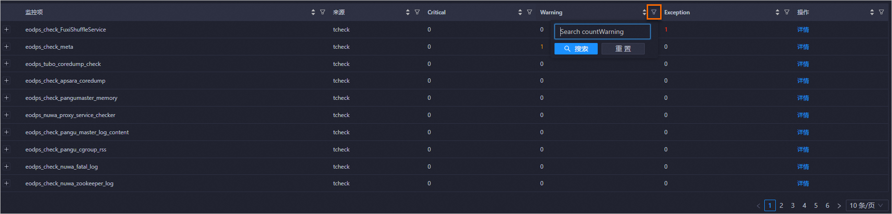

3. 单击**搜索**，即可在列表中查询出符合条件的条目。

4. 如果搜索结果中的条目依然不完全符合要求，您可在此基础上继续按其他列进行搜索。

**按列排序**

支持按列进行升序或降序排序。

1. 进入**MaxCompute > 运维 > 集群运维 > 健康**页面。

2. 在**监控项**列表中，单击某列的表头或排序箭头，即可按该列对列表信息进行升序或降序排序。

   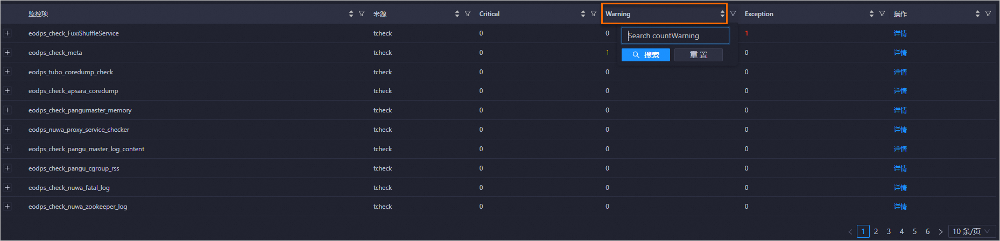

   排序的上箭头高亮表示按升序排序，下箭头高亮表示按降序排序。

**指标趋势图1**

进入**MaxCompute > 运维 > 集群运维 > 概览**页面，查看集群的 CPU、内存等相关指标。

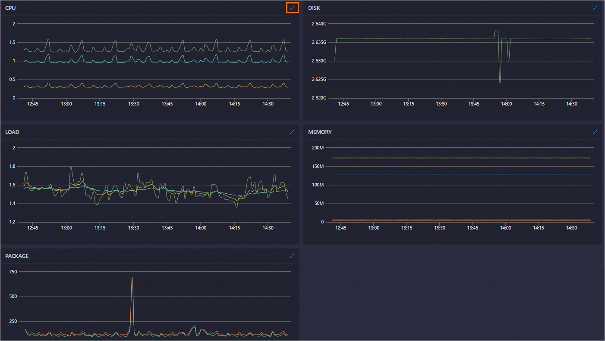

以 CPU 为例，指标图按时间以不同颜色的曲线展示集群的 CPU 使用率（支持指定时间段），包括 CPU 的总使用率（cpu）、系统对 CPU 的使用率（sys）和用户对 CPU 的使用率（user）。

单击图右上角的  图标，放大 CPU 使用趋势图。

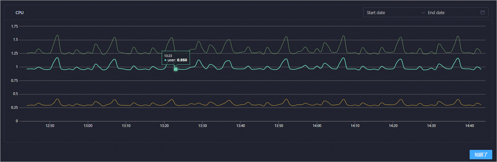

在放大图中，您可以在右上方指定时间段来查看集群的 CPU 使用率。

**指标趋势图2**

1. 进入**DataHub > 运维 > 服务运维 > 控制服务**页面。

2. 在**控制服务**页面查看DataHub集群的资源使用趋势图。

   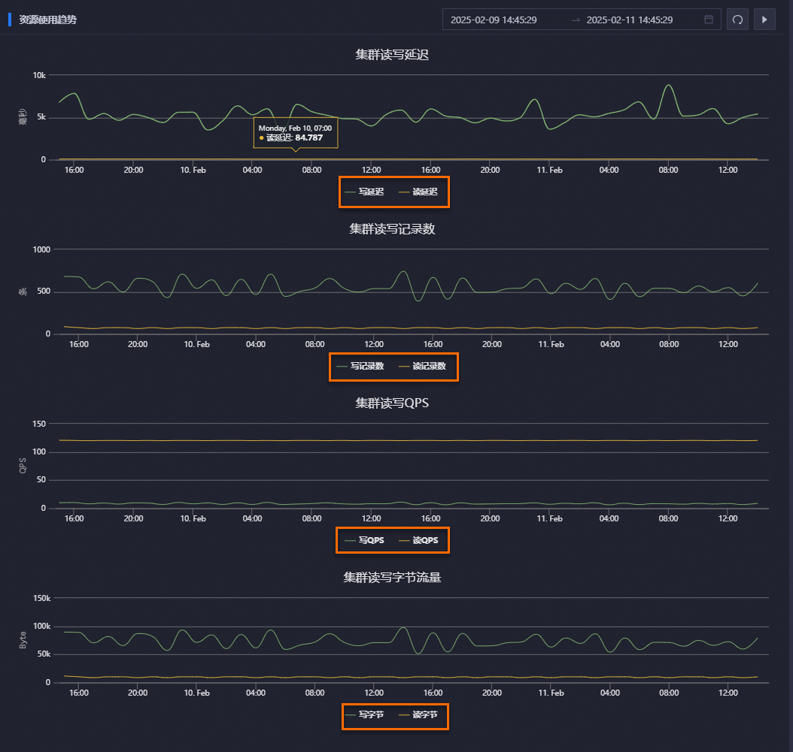

   资源使用趋势图包括集群读写延迟、集群读写记录数等，每个趋势图按时间以不同颜色的曲线展示相关的指标。单击曲线图下方的曲线名称可显示或隐藏曲线，曲线名高亮表示显示，灰色表示隐藏。

<a id="section-3"></a>

# 3.快速入门

<a id="section-3-1"></a>

## 3.1. 登录大数据管家

本节介绍如何登录到大数据管家。

**前提条件**

- 已从部署人员或管理员处获取Apsara Uni-manager运维控制台的访问地址、用户名和密码。

  Apsara Uni-manager运维控制台访问地址格式为*region-id*.ops.console.*intranet-domain-id*。

- 推荐使用Chrome浏览器。

**操作步骤**

1. 打开浏览器。

2. 在地址栏中，输入Apsara Uni-manager运维控制台的访问地址，按回车键。

   

   > **说明**
   >
   > 您可以单击右上角的当前语言切换其它语言。当前支持简体中文、英文、繁体中文三种语言切换。

3. 输入正确的用户名及密码。

   > **说明**
   >
   > - 登录Apsara Uni-manager运维控制台的用户名和密码请从部署人员或管理员处获取。
   >
   > - 若连续输入密码错误三次，系统将启动图片验证码登录功能；若连续输入错误五次，账户将被锁定，请联系管理员进行激活。

   首次登录Apsara Uni-manager运维控制台时，需要修改登录用户名的密码，请按照提示完成密码修改。

   为提高安全性，密码必须满足以下要求：

   - 必须包含英文大小写字母。

   - 必须包含阿拉伯数字（0~9）。

   - 必须包含特殊符号，包括感叹号（!）、at（@）、井号（#）、美元符号（$）、百分号（%）等。

   - 密码长度为10~20个字符。

4. 单击**账号登录**。

5. 进入Apsara Uni-manager运维控制台后，在顶部菜单栏单击**产品运维**。

6. 选择**大数据运维 > 大数据通用运维·大数据管家**，系统默认进入大数据管家的**仪表盘**页面。

<a id="section-3-2"></a>

## 3.2. 设置主题

大数据管家支持白色和暗色两种主题，默认为暗色主题，您可根据自己的喜好来设置。

**前提条件**

已获取大数据管家账号和密码。

**操作步骤**

1. 登录大数据管家。

2. 根据您的喜好设置大数据管家的主题模式。

   <table>
     <tr>
       <th width="138">选项</th>
       <th>操作</th>
     </tr>
     <tr>
       <td>设置为白色主题</td>
       <td>如果当前为暗色主题，则您可将鼠标指向右上角的用户，然后单击<strong>暗</strong>开关即可设置为白色主题。</td>
     </tr>
     <tr>
       <td>设置为暗色主题</td>
       <td>如果当前为白色主题，则您可将鼠标指向右上角的用户，然后单击<strong>亮</strong>开关即可设置为暗色主题。</td>
     </tr>
   </table>

<a id="section-3-3"></a>

## 3.3. 查看仪表盘

仪表盘用于展示DataWorks、MaxCompute、StreamCompute和DataHub产品的关键运行指标，以及全部大数据产品的报警，方便您从整体上了解大数据产品的运行情况。

**前提条件**

已获取具有相应产品运维权限的大数据管家账号。

**背景信息**

仪表盘是ABM产品的功能，是大数据管家的首页，可直观了解所有大数据产品的运行概况。

**操作步骤**

1. 登录大数据管家。

   登录大数据管家后，默认显示**仪表盘**页面。如果当前在其他页面，您可单击左上方的  图标，然后选

   择**ABM**产品来进入**仪表盘**页面。

2. 在**仪表盘**页面中，单击**DataWorks**区域，查看**DataWorks**的相关运行指标。

   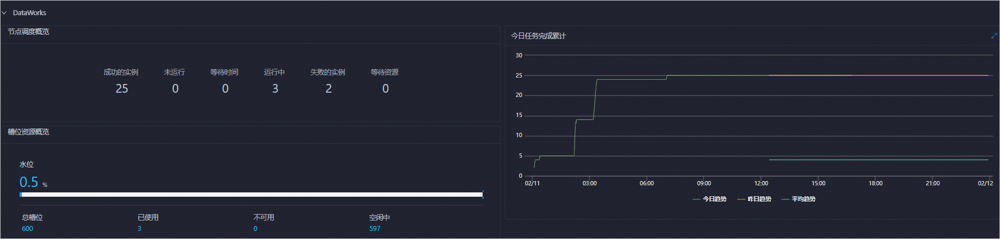

   **DataWorks**区域展示了DataWorks集群的节点调度概览、槽位资源概览，以及今日任务完成累计趋势图。

3. 在**仪表盘**页面中，单击**MaxCompute**区域，查看**MaxCompute**的相关运行指标。

   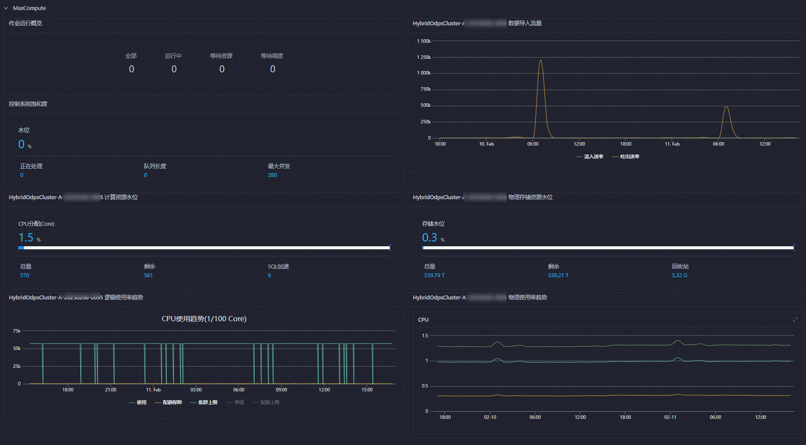

   **MaxCompute**区域展示了MaxCompute集群的作业运行概览、控制系统饱和度、数据导入流量、计算资源水位、物理存储资源水位，以及CPU的逻辑使用率趋势和物理使用率趋势图。

4. 在**仪表盘**页面中，单击**StreamCompute**区域，查看StreamCompute的相关运行指标。

   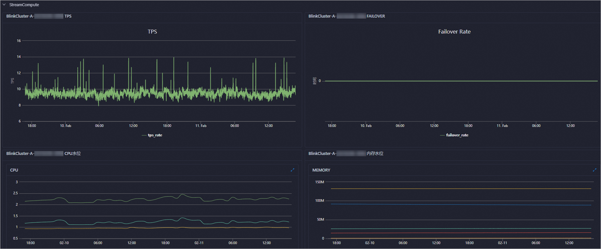

   **StreamCompute**区域展示了集群作业的TPS和FAILOVER的趋势图，以及CPU和内存的使用趋势图。

5. 在**仪表盘**页面中，单击**DataHub**区域，查看**DataHub**的相关运行指标。

   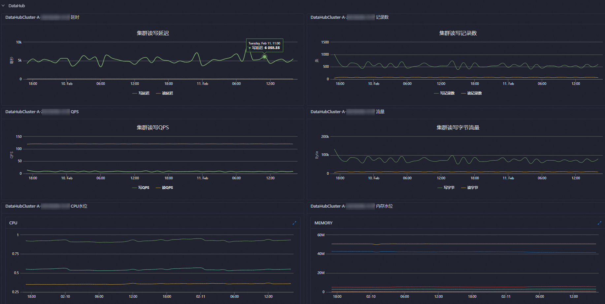

   **DataHub**区域展示了DataHub集群的读写延迟、读写记录数、读写QPS、读写字节流量、CPU水位和内存水位趋势图。

<a id="section-3-4"></a>

## 3.4. 查看集群运行状况

大数据管家支持查看集群的运行指标，包括 CPU、内存、负载、存储空间和运行健康等，以便您随时了解集群的运行情况。根据相关指标，您可评估集群是否存在运行风险。

**前提条件**

大数据管家账号具有相应产品的运维权限。

**背景信息**

在大数据管家中，查看不同产品集群运行状况的操作方法是相同的，本节以查看MaxCompute产品为例进行介绍。

**操作步骤**

1. 登录大数据管家。

2. 在左上方单击

   图标，然后选择目标产品进入。

   

3. 在产品页面中，单击顶部菜单栏的**运维**，然后选择**集群运维**。

4. 在**集群运维**页面的左上角选择目标集群，右侧默认显示集群运维的**概览**页面。

   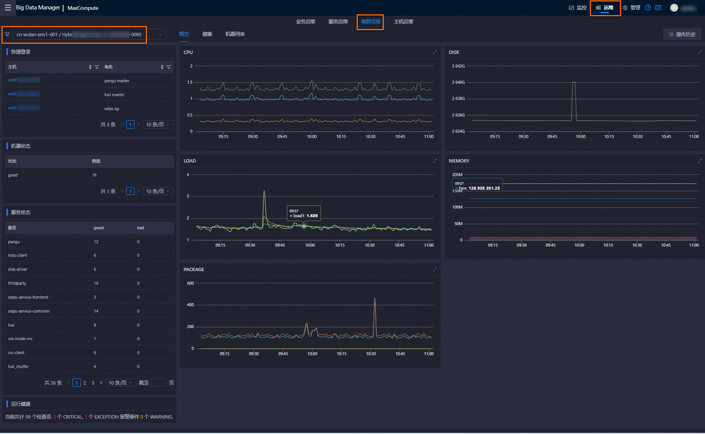

   **概览**页面汇总了集群的总体运行信息，包括机器状态、服务状态、CPU、DISK、MEMORY、LOAD、PACKAGE、运行健康和运行健康历史记录。

**后续步骤**

根据集群的服务状态、CPU、内存、存储空间、负载等指标，评估集群是否存在运行风险。

如果集群存在 CRITICAL、WARNING 或 EXCEPTION 报警，则您需要立即进行查看和修复（特别是CRITICAL 和 WARNING 类型的报警），详情请参见查看集群报警并处理。

<a id="section-3-5"></a>

## 3.5. 查看集群报警并处理

如果在集群概览界面发现集群存在报警，则您需要进入集群健康界面查看报警详情并进行处理。本节以某个产品为例进行介绍，其他产品与此相似。

**前提条件**

大数据管家账号具有相应产品的运维权限。

**背景信息**

在大数据管家中，对于不同产品，查看和处理集群报警的操作方法是一样的，本节以某个产品为例进行介绍。如果某个产品存在报警，特别是 CRITICAL 和 WARNING 报警，您需要重点关注并及时处理，以保障集群正常运行。

**操作步骤**

1. 登录大数据管家。

2. 单击左上角的

   ，选择某个产品。

   

3. 在产品页面中，单击上方的**运维**，然后选择**集群运维**。

4. 在**集群运维**界面，选择**健康**页签，进入集群健康界面。

   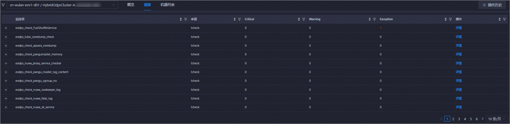

5. 在集群**健康**界面，单击存在报警的检查项前面的

   图标，查看该检查项所有的宿主。

   

   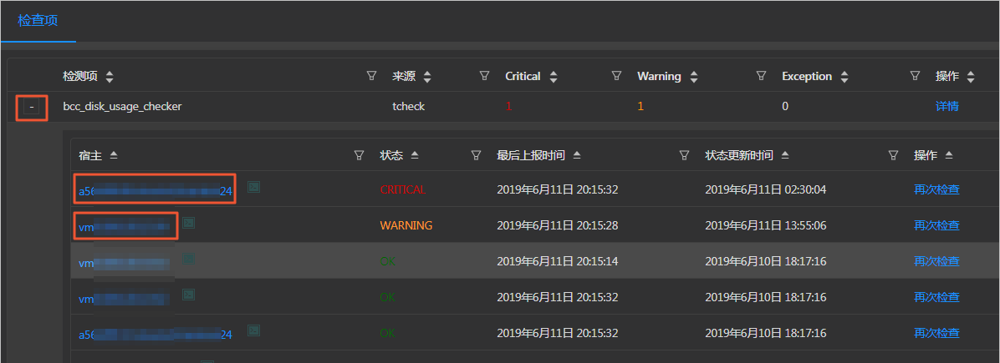

6. 单击目标宿主名称，然后在弹出的对话框中单击某个报警后面的**详情**，在右侧查看报警原因。

   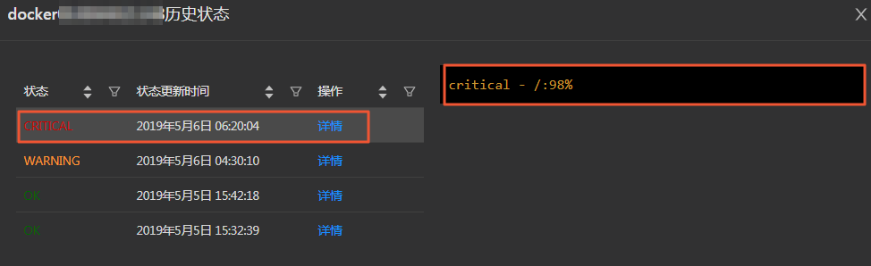

7. 在集群**健康**界面，单击检查项后面的**详情**，在弹出的对话框中查看检查项报警的解决方案。

   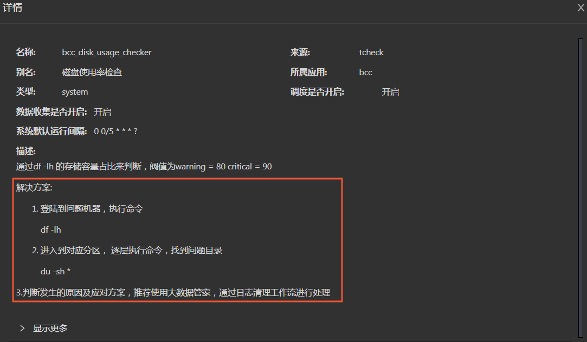

8. 按检查项报警的解决方案处理报警。

   在处理报警过程中，您可能需要登录宿主，单击宿主后面的**登录**图标，然后在**TerminalService**界面左侧选择宿主，即可直接登录。

   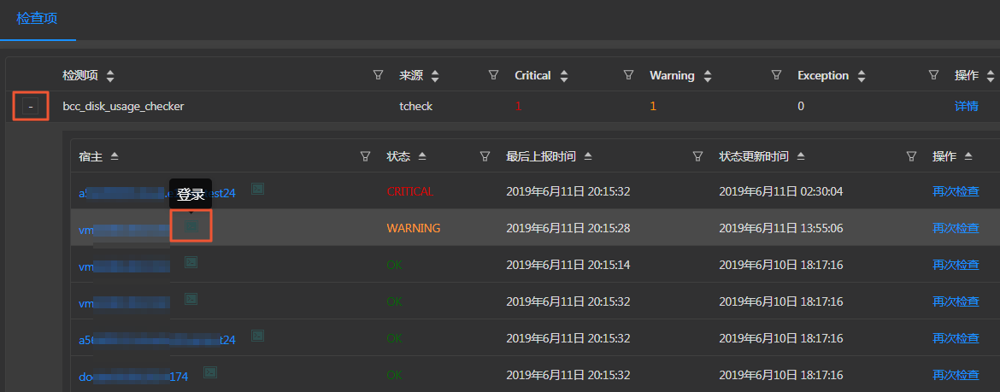

   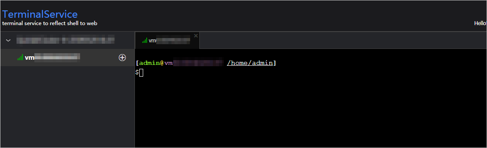

9. 处理完某个报警后，您可单击宿主后面的**再次检查**，对该宿主进行一次该检查项的实时检查，以确定该宿主的报警是否恢复。

   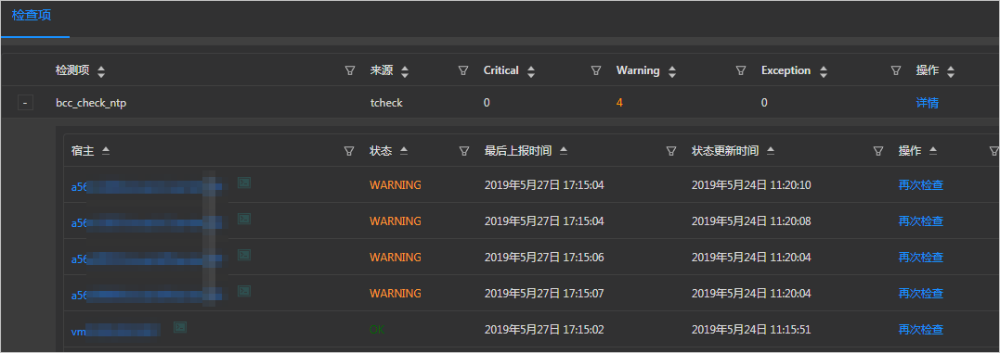

<a id="section-4"></a>

# 4.监控

<a id="section-4-1"></a>

## 4.1. 仪表盘

仪表盘用于展示DataWorks、MaxCompute、StreamCompute和DataHub产品的关键运行指标，以及全部大数据产品的报警，方便您从整体上了解大数据产品的运行情况。除此以外，仪表盘还支持自动刷新数据和全屏显示功能。

**仪表盘入口**

登录大数据管家后，默认显示**仪表盘**页面。如果当前在其他页面，您可单击左上方的  图标，然后选

择**ABM**产品，进入**仪表盘**页面。

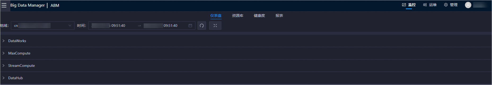

进入**仪表盘**后，您可在左上方**仪表盘**下拉列表中选择**地域**，以查看指定地域内大数据产品的集群运行概况。

**查看DataWorks的关键运行指标**

仪表盘中预置了DataWorks关键运行指标，在**仪表盘**页面中，单击**DataWorks**区域，查看**DataWorks**的相关运行指标。


**DataWorks**区域展示了DataWorks集群的节点调度概览、槽位资源概览，以及今日任务完成累计趋势图。

**查看MaxCompute的关键运行指标**

仪表盘中预置了MaxCompute关键运行指标，在**仪表盘**页面中，单击**MaxCompute**区域，查看**MaxCompute**的相关运行指标。


**MaxCompute**区域展示了MaxCompute集群的作业运行概览、控制系统饱和度、数据导入流量、计算资源水位、物理存储资源水位，以及CPU的逻辑使用率趋势和物理使用率趋势图。

**查看StreamCompute的关键运行指标**

仪表盘中预置了StreamCompute关键运行指标，在**仪表盘**页面中，单击**StreamCompute**区域，查看StreamCompute的相关运行指标。


**StreamCompute**区域展示了集群作业的TPS和FAILOVER的趋势图，以及CPU和内存的使用趋势图。

**查看DataHub的关键运行指标**

仪表盘中预置了DataHub关键运行指标，在**仪表盘**页面中，单击**DataHub**区域，查看**DataHub**的相关运行指标。


**DataHub**区域展示了DataHub集群的读写延迟、读写记录数、读写QPS、读写字节流量、CPU水位和内存水位趋势图。

**指定时间段来查看指标数据**

仪表盘默认显示最近两天的集群指标数据，您也可以自己指定时间段来查看指标数据。

在**仪表盘**页面中的**时间**区域，可以按照年、月和天，选择开始和截止时间，单击**确定**，即可刷新出对应时间段的指标数据。

**全屏显示**

为方便您更清晰直观地查看大数据产品的运行概况，仪表盘还提供了全屏显示功能。

在**仪表盘**页面中，单击上方的  图标，则全屏显示**仪表盘**页面。

<a id="section-4-2"></a>

## 4.2. 资源库

资源库用于展示MaxCompute、DataWorks和DataHub的资源使用情况。本节介绍资源库的入口，以及支持查看的各产品的资源信息。

**资源库入口**

1. 登录大数据管家。

   > **说明**
   >
   > 登录后默认进入**仪表盘**页面。如果当前在其他页面，您可单击左上方的
   >
   > 图标，然后选择**ABM**产
   >
   > 
   >
   > 品，进入**仪表盘**页面。

2. 在**仪表盘**页面，单击**资源库**页签，进入资源库页面。

   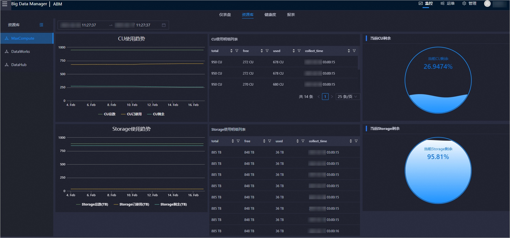

**查看MaxCompute资源库**

在**资源库**页面左侧，单击**MaxCompute**，即可在右侧查看MaxCompute的资源使用情况。

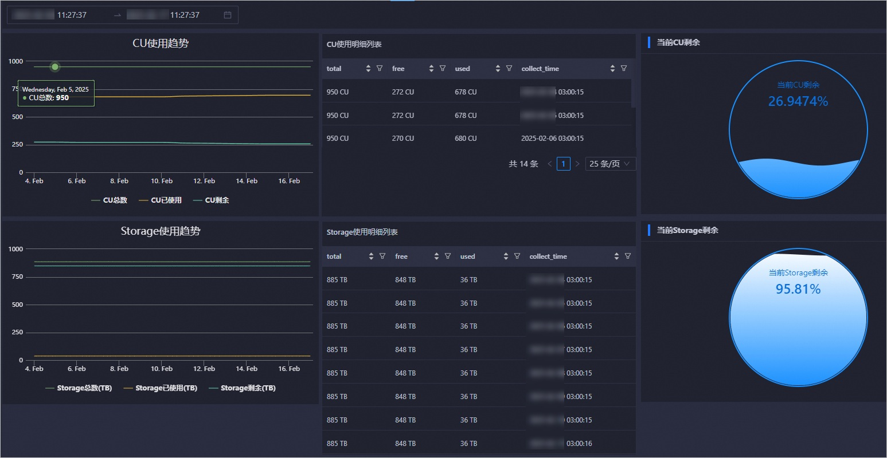

MaxCompute资源库展示了MaxCompute的CU使用趋势图、CU使用明细列表、当前CU剩余百分比、Storage使用趋势图、Storage使用明细列表和当前Storage剩余百分比。

**查看DataWorks资源库**

在**资源库**页面左侧，单击**DataWorks**，即可在右侧查看DataWorks的资源使用情况。

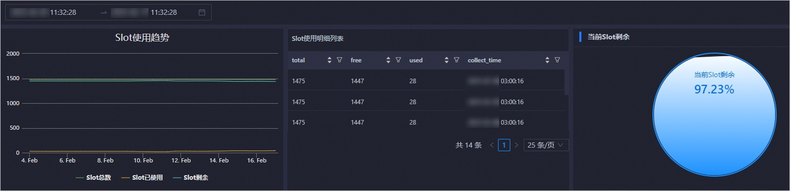

DataWorks资源库展示了DataWorks的Slot使用趋势图、Slot使用明细列表和当前Slot剩余百分比。

**查看DataHub资源库**

在**资源库**页面左侧，单击**DataHub**，即可在右侧查看DataHub的资源使用情况。

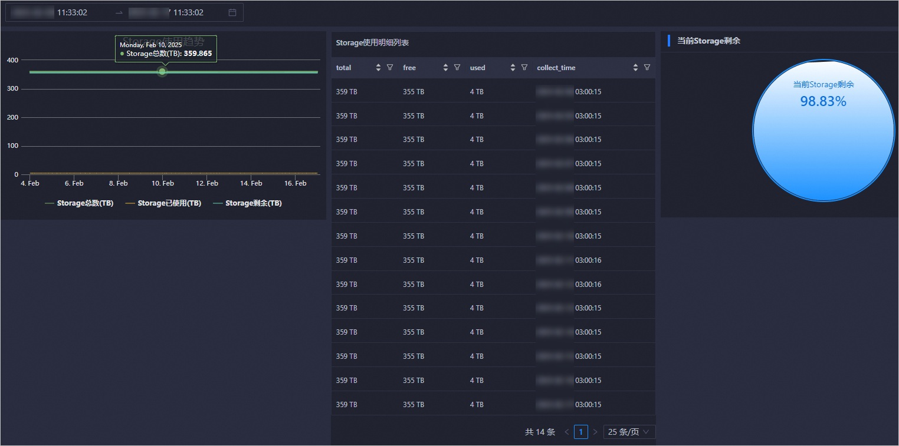

DataHub资源库展示了DataHub的Storage使用趋势图、Storage使用明细列表和当前Storage剩余百分比。

**图和表支持的操作**

支持按列排序、过滤等便捷查看操作，详情请参见通用操作。

<a id="section-4-3"></a>

## 4.3. 健康度

健康度支持查看各个大数据产品的监控项以及不同紧急程度的报警，并提供详情查看和修复后的再次检查。

**操作步骤**

1. 登录大数据管家。

   默认进入**ABM**的**仪表盘**页面，您可以单击左上角的  图标，选择其他目标产品进入。

2. 进入目标产品后，单击顶部菜单栏的**监控**。

3. 单击**健康度**页签，查看健康度检查信息。

   健康度检查页面向您展示了监控项、监控来源、严重等级和监控详情等，您可以按需进行过滤。

<a id="section-4-4"></a>

## 4.4. 报表

您可以通过报表查看大数据产品的巡检结果。

**操作步骤**

1. 登录大数据管家。

   默认进入**ABM**的**仪表盘**页面，您可以单击左上角的  图标，选择其他目标产品进入。

2. 进入目标产品后，单击顶部菜单栏的**监控**。

3. 单击**报表**页签，查看报表相关信息。

   报表页面向您展示了报表ID、报表名称、产品名称、模板名称、实例类型、创建信息等，支持查看详情。

<a id="section-5"></a>

# 5.运维

<a id="section-5-1"></a>

## 5.1. ABM运维功能和入口

本节介绍ABM运维的功能及页面入口。

**ABM运维功能介绍**

ABM运维包括业务运维，详细说明如下：

| 运维功能 | 子功能 | 说明 |
| --- | --- | --- |
| 业务运维 | 定时作业统计 | • 支持查看产品级别的定时作业统计。<br>• 支持查看通道引擎调度的趋势图。<br>• 支持查看执行错误的实例数趋势图。 |

**进入ABM运维页面**

1. 登录大数据管家。

2. 在左上方单击  图标，选择**ABM**产品。

3. 在**ABM**站点中，单击顶部菜单栏中的**运维**。**运维**页面包括**业务运维**。

   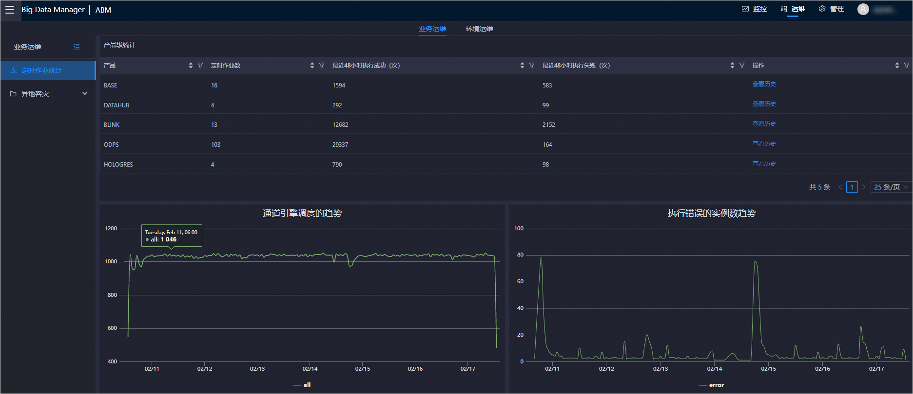

<a id="section-5-2"></a>

## 5.2. 业务运维

<a id="section-5-2-1"></a>

### 5.2.1. 查看定时作业统计

大数据管家支持查看各产品执行的定时作业、通道引擎调度的趋势图和执行错误的实例数趋势图。

**操作步骤**

1. 在左上方单击  图标，然后选择**ABM**产品。

2. 在**ABM**站点中，单击上方的**运维**，默认进入**业务运维**页面。

3. 在左侧导航栏，单击**定时作业统计**，查看定时作业统计等信息。

   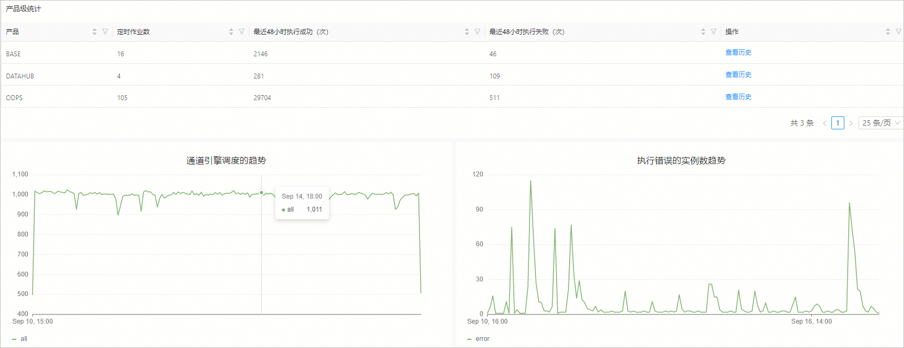

4. （可选）单击目标产品对应的**操作**列下的**查看历史**，会跳转至对应产品的**管理**页面，便于您查看详细的执行历史信息。

<a id="section-5-2-2"></a>

### 5.2.2. 创建及配置MaxCompute同城容灾项目

本文介绍如何创建MaxCompute同城容灾项目及相关配置说明。

**背景信息**

为了避免集群间带宽、存储等资源的竞争问题，用户可以按需选择创建容灾Project。

**注意事项**

在配置容灾Project时，需要注意以下几点：

- 如果**EnableEvent**设置为 `true` ，那么Project中的数据会在被更改后立刻触发同步，并且每次同步的数据量为该表或该分区的全部数据量。

  例如：某非分区表中有1 TB的数据，如果对该表插入1条数据，就需要将这1 TB的数据都复制到备机房。如果1分钟内写了10次数据，那一分钟就会复制10次1 TB的数据到备机房，从而产生9 TB的待回收数据。

  因此，强烈建议关闭实时复制开关，以减少机房间的带宽和存储压力。建议使用定时复制的策略，例如设置**ScanMetaInterval**参数每6小时扫描复制一次。即：**EnableEvent** =  `false` ，**ScanMetaInterval**= `21600` （6小时=21600秒）。

- 为防止高峰期ODPS占满集群带宽，建议通过设置**InstanceCount**参数来限制同步带宽（一个InstanceCount大概占用10~50 MB带宽）。

- 当RPO总是大于同步间隔时，说明需要同步的数据量很大，单次无法完成所有数据的同步。建议做法如下：

  <ol type="i">

  <li>

  查看备集群磁盘空间使用情况，确认是否是备集群磁盘空间不足导致的。可以使用以下两种方式：

  - 登录Apsara Uni-manager运营控制台（ASCM），查看备集群磁盘空间使用情况。

  - 登录备机房ODPS AG，执行以下命令，查看备集群磁盘空间使用情况 (磁盘空间的单位是B，换算成GB需要/1024/1024/1024)。其中， `${projectName}` 需要根据现场实际情况进行替换。

    ```text
    pu quota /product/aliyun/odps/${projectName}
    ```

  </li>

  <li>

  据现场实际同步的数据量、带宽和RPO的要求对以下两个参数进行调整：

  - 加大同步间隔ScanMetaInterval（这会导致RPO也变大，但能尽可能保证数据一致）。

  - 调大instancecount（这会导致同步占用带宽加大，需要关注主、备机房的带宽，避免对其他产品的数据同步造成影响）。

    instancecount建议设置值：根据现场主备机房间的带宽，建议可以是 空闲带宽 `* 0.5 /` 需要同步的`project`项目 `/ 50M` 。 例如：可以接受的RPO是1天，需要同步的数据量是1T带宽，那么就是： `1T/`（`24*60*60`）  ，谨慎起见可以使用该结果乘以2。

  </li>

  </ol>

**创建容灾Project**

使用管理员身份登录Apsara Uni-manager运营控制台，选择创建多集群Project。

详细操作，请参见阿里云专有云帮助中心的**大数据服务 > 大数据计算服务 > 用户指南 > 准备工作 > 创建项目**章节。

> **说明**
>
> 单集群Project不支持容灾功能。

**配置容灾Project**

1. 登录大数据管家。

2. 单击左上角的  图标，选择**大数据计算 > MaxCompute**。

3. 在**业务运维**页签下，选择**项目管理 > 项目列表**。

4. 找到目标项目，单击右侧**操作**列下的**资源复制**。

   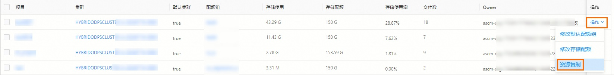

5. 在**多集群复制配置查看**面板，将**是否开启**设置为**true**，并在**配置**区域设置预期信息。

   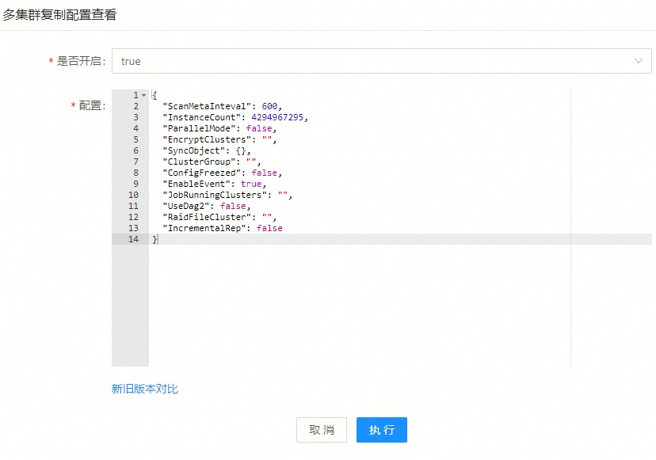

   关键配置项说明如下：

   **配置项**

   **关键参数**

   **说明**

   取值说明：

   - **true**：表示开启。

   **是否开启**

   /

   - **false**：表示关闭。

   默认值为**false**。

   **ScanMetaInteva**

   数据同步间隔，单位为秒。

   **l**

   该配置可以用于限制同步带宽。

   **InstanceCount**

   配置同步的集群以及同步数据类型，参考上图将ODPS集群名修改为现场主、备集群名称，即可开启ODPS数据完全复制。

   **SyncObject**

   > **重要**
   >
   > 注意ODPS的集群名称必须大写。

   **配置**

   数据是否实时同步。当配置为 `true` 时，如果主集群数据发生变化，会立刻同步到备集群，同时ScanMetaInteval配置将失效。

   **EnableEvent**

   > **重要**
   >
   > 配置数据同步为实时同步或者数据同步间隔配置时间较短都会较大程度占用网络带宽，建议当需要同步的数据量较大时，关闭实时同步并调大同步间隔。

6. （可选）如果修改了**配置**中的参数值，单击**新旧版本对比**，界面会以高亮对比的形式显示新老版本。

7. 确认以上参数配置无误后，单击**执行**，完成操作。

   > **说明**
   >
   > 如果修改配置之后，重新查看发现修改的配置没有生效，可能是因为现场没有开启ABM的同城容灾的feature，请联系阿里云技术支持确认处理。

<a id="section-6"></a>

# 6.管理

<a id="section-6-1"></a>

## 6.1. 管理概述

管理模块是大数据管家的配置和软件的管理中心，是支撑和个性化产品运维的重要功能模块。

管理模块支持的功能如下：

- 作业服务：支持通过执行作业来对大数据各产品进行运维操作。

- 健康管理：支持创建健康检查项，同时还支持健康检查项应用到产品的主机上。

- 流程服务：支持查看待处理和已完成的人工任务；支持查看流程信息（包括流程图和XML定义）；支持查看不同状态（包括运行中、已完成、异常和已终止）的流程实例信息。

- 操作审计：支持查看大数据管家中作业执行和其他产品运维操作的记录。

<a id="section-6-2"></a>

## 6.2. 作业服务

<a id="section-6-2-1"></a>

### 6.2.1. 概述

本文简要介绍大数据管家中作业相关的概念，以及作业界面。

大数据管家通过执行作业来对大数据产品进行产品运维。作业即产品运维任务，是对集群中的物理设备进行的运维操作。作业服务界面主要包括**执行**页面。

**相关概念**

作业相关的概念如下：

- 普通作业：需要用户手动执行的作业，未设置定时器。

- 定时作业：设置了定时器，按设定时间自动执行的作业。

**执行页面**

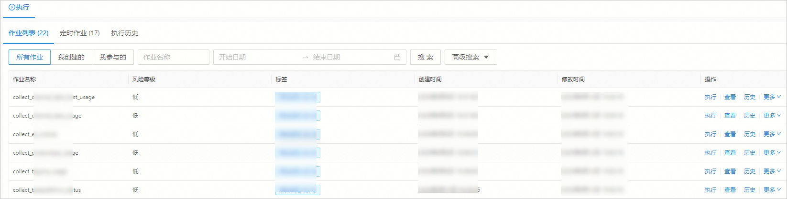

**执行**页面主要包括以下功能模块：

<table>
  <tr>
    <th width="90">功能</th>
    <th>说明</th>
  </tr>
  <tr>
    <td>普通作业</td>
    <td>• 支持查看、执行普通作业，同时还支持查看执行历史。<br>• 支持搜索、复制、导出和删除作业。</td>
  </tr>
  <tr>
    <td>定时作业</td>
    <td>• 支持开启或关闭、查看、执行定时作业，同时还支持查看定时作业的执行历史。<br>• 支持搜索、复制、导出和删除作业。</td>
  </tr>
  <tr>
    <td>执行历史</td>
    <td>• 支持查看普通作业、定时作业等的历史执行记录。<br>• 支持搜索、查看详情和预览。</td>
  </tr>
</table>

<a id="section-6-2-2"></a>

### 6.2.2. 作业

<a id="section-6-2-2-1"></a>

#### 6.2.2.1. 手动执行作业

创建普通作业后，您必须手动去执行作业来完成对产品的运维操作。当然，您也可以手动执行定时作业。

**前提条件**

已获取大数据管家管理员账号。

**操作步骤**

1. 登录大数据管家。

2. 在顶部菜单栏，单击**管理**。

3. 在左侧导航栏，单击**作业服务**。

4. 在**执行**页面，单击**作业列表**页签。

   如果需要手动执行定时作业，请单击**定时作业**页签。手动执行定时作业的流程与普通作业完全相同，本节以普通作业为例进行介绍。

5. 在**作业列表**页面，单击某个作业后面的**执行**。

   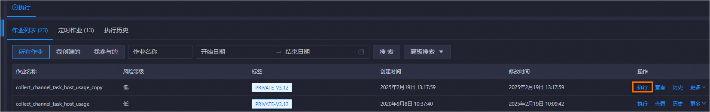

6. 在弹出的对话框中，完成**配置目标组与参数**操作，单击**下一步**。

   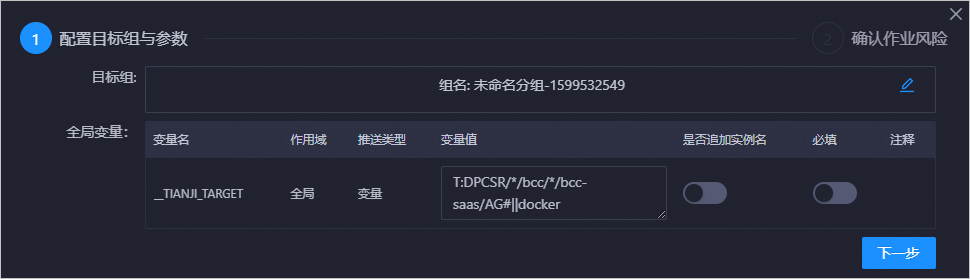

7. 完成**确认作业风险**后，单击**确认执行**。

   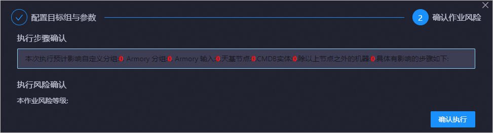

   确认执行后，在**执行历史**页面中自动生成一条执行记录，详情请参见查看执行历史。

8. 在作业执行界面，单击上方的**开始**，开始执行作业。

   如果您未进行任何操作而退出了作业执行界面，则后续可在**执行历史**页面中查找到该执行记录，然后单击**查看**即可再次进入该作业执行界面。

<a id="section-6-2-2-2"></a>

#### 6.2.2.2. 开启和关闭定时作业

定时作业默认是关闭不生效的，您需要手动去开启定时作业。如果定时作业在某个时间段内不需要再执行，您可手动去关闭。

**前提条件**

已获取大数据管家管理员账号。

**操作步骤**

1. 登录大数据管家。

2. 在顶部菜单栏，单击**管理**。

3. 在左侧导航栏，单击**作业服务**。

4. 在**执行**页面，单击**定时作业**页签。

5. 在**定时作业**页面，关闭或开启定时作业：

   - 作业处于关闭状态时，开启定时作业：单击定时作业后面的**开启**。

     开启某个定时作业后，**状态**变更为**已生效**，**开启**按钮变更为**关闭**。

   - 作业处于开启状态时，关闭定时作业：单击定时作业后面的**关闭**。

     关闭某个定时作业后，**状态**变更为**未生效**，**关闭**按钮变更为**开启**。

<a id="section-6-2-2-3"></a>

#### 6.2.2.3. 查看某个作业的执行历史

大数据管家支持查看指定作业的执行历史，以便您了解该作业的历史执行情况。

**前提条件**

已获取大数据管家管理员账号。

**背景信息**

确认执行作业后，大数据管家会对每个作业的执行情况进行记录，以便用户后续了解作业的执行情况。

**执行历史**页面支持的功能如下：

- 支持查看作业历史执行的触发方式、当前状态、开始时间、结束时间等信息。

- 支持查看作业执行过程、参数配置，同时还支持下载作业执行的详细信息。

- 支持对不同状态的历史执行记录进行不同的操作，例如：支持对**未开始**状态的记录执行**开始**操作，支持对**异常**状态的记录执行**重试**操作等。

普通作业与定时作业的执行历史信息完全相同，本节以普通作业为例进行介绍。

**操作步骤**

1. 登录大数据管家。

2. 单击上方的**管理**页签，然后在左侧导航栏中选择**作业服务**。

3. 在**执行**页面，单击**作业列表**页签。

4. 在**作业列表**页面，单击待查看的普通作业后面的**历史**，进入**执行历史**页面。

   在**执行历史**页面可查看该作业的执行历史，详情请参见查看执行历史。

<a id="section-6-2-2-4"></a>

#### 6.2.2.4. 查看执行历史

大数据管家支持查看作业和方案的执行历史，以便您了解作业和方案的执行情况。

**前提条件**

已获取大数据管家管理员账号。

**背景信息**

在确认执行作业或方案后，大数据管家会生成一条历史记录，以便用户后续了解该任务的执行情况。

**执行历史**页面支持的功能如下：

- 支持查看任务的触发方式、当前状态、开始时间、结束时间等信息。

- 支持查看任务的执行过程、参数配置，同时还支持下载任务执行的详细信息。

- 支持对不同状态的任务进行不同的操作，例如：支持对**未开始**状态的任务执行**开始**操作，支持对**异常**状态的任务执行**重试**操作等。

**操作步骤**

1. 登录大数据管家。

2. 单击上方的**管理**页签，然后在左侧导航栏中选择**作业服务**。

3. 在**执行**页面，单击**执行历史**页签。

   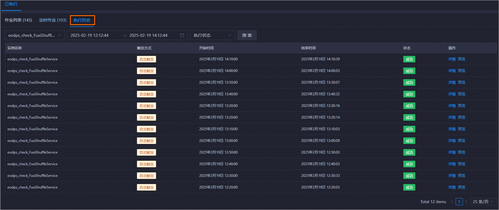

4. 如果历史记录条数多，可以对实例名称、时间范围和执行状态进行过滤，然后单击**搜索**，查询符合条件的历史记录。

5. 单击某个历史记录后面的**详情**，查看该历史记录的详细信息。

   对于不同状态的历史记录，您可进行的操作如下：

   **任务执行记录状态**

   **支持功能**

   **操作步骤**

   单击上方的**参数配置**，选择**上下文参数**或**全局参数**，查看该任务的

   查看参数配置

   上下文参数或全局参数。

   单击上方的**下载执行详情**，下载作业执行详情到本地，保存格式为txt。

   下载执行详情

   执行详情中记录了作业执行的**JSON**和**原始数据**等信息。

   - 在某个步骤中的**机器详情**页面，单击某个机器后面的**查看详情**，

   所有状态

   在右侧查看该步骤在该机器上的执行详情，包括执行输出。

   - 如果是脚本步骤，则显示**脚本内容**和**执行参数**页面，可查看脚本

   查看步骤执行详情

   内容和脚本执行参数。

   - 如果是命令步骤，则显示**命令内容**和**执行参数**页面，可查看命令内容和命令执行参数。

   如果任务正在执行中，您可单击上方的**刷新**，查看最新的执行状

   刷新界面

   态。

   开始执行

   单击上方的**开始**，开始此次执行。

   未开始

   取消执行

   单击上方的**取消**，取消此次执行。

   完成人工操作并确

   在待操作的人工步骤上，根据提示进行相关操作，然后单击**确认**，

   认

   进入下一个步骤。

   待人工确认

   回滚到上一步骤执

   在待操作的人工步骤上，单击**回滚**，回滚到上一步骤执行完的状

   行完的状态

   态。

   取消执行

   单击**取消**，取消此次执行。

   重试异常步骤

   在异常步骤上，单击**重试**，重新执行该步骤。

   跳过异常步骤

   在异常步骤上，单击**跳过**，跳过此步骤继续执行后续步骤。

   回滚到上一步骤执

   在异常步骤上，单击**回滚**，回滚到上一步骤执行完的状态。

   行完的状态

   异常

   在异常步骤上，单击**重置**，重置该步骤为**未开始**状态。

   重置异常步骤为未

   异常步骤重置为未开始状态时，该次执行状态变为**暂停**。此时您可

   开始状态

   单击上方的**继续**，重新执行当前步骤。

   - 在某个步骤中的**机器详情**页面，单击某个机器后面的**查看详情**，在右侧查看该步骤在该机器上的执行详情，包括执行输出和错误信息。

     对于执行异常的机器，查看详情后，您可单击**跳过**来跳过此机

   查看异常步骤执行

   器，也可单击**重试**再在该机器上重新执行一次。

   详情

   - 如果是脚本步骤，则显示**脚本内容**和**执行参数**页面，可查看脚本内容和脚本执行参数。

   - 如果是命令步骤，则显示**命令内容**和**执行参数**页面，可查看命令内容和命令执行参数。

   重试失败步骤

   在失败步骤上，单击**重试**，重新执行该步骤。

   跳过失败步骤

   在失败步骤上，单击**跳过**，跳过此步骤继续执行后续步骤。

   回滚到上一步骤执

   在失败步骤上，单击**回滚**，回滚到上一步骤执行完的状态。

   行完的状态

   在失败步骤上，单击**重置**，重置该步骤为**未开始**状态。

   重置失败步骤为未

   失败步骤重置为未开始状态时，该次执行状态变为**暂停**。此时您可

   开始状态

   单击上方的**继续**，重新开始执行当前步骤。

   失败

   - 在某个步骤中的**机器详情**页面，单击某个机器后面的**查看详情**，在右侧查看该步骤在该机器上的执行详情，包括执行输出和错误信息。

     对于执行异常的机器，查看详情后，您可单击**跳过**来跳过此机

   查看失败步骤执行

   器，也可单击**重试**再在该机器上重新执行一次。

   详情

   - 如果是脚本步骤，则显示**脚本内容**和**执行参数**页面，可查看脚本内容和脚本执行参数。

   - 如果是命令步骤，则显示**命令内容**和**执行参数**页面，可查看命令内容和命令执行参数。

   取消执行

   单击上方的**取消**，取消此次执行。

<a id="section-6-3"></a>

## 6.3. 健康管理

<a id="section-6-3-1"></a>

### 6.3.1. 监控配置

大数据管家为每个产品均内置了丰富的调度项和监控项，用于检查产品的故障并产生报警，以便您及时发现产品故障并修复。

**前提条件**

- 已获取具有相应产品运维权限的大数据管家账号。

- 已获取监控项的报警源和检查项。

**背景信息**

> **说明**
>
> 产品不同，其调度项和监控项也不同，但其配置和操作方法完全相同。

调度项：调度项在指定 tianji 角色对应的全量机器列表中运行调度脚本，以产生报警的原始数据（什么调度项在什么机器上产生了什么级别的报警，报警结果数据是什么），原始数据会上报到 ABM 的数据库中进行存储。

监控项：监控项会将调度项产生的报警原始数据挂载到 ABM 中相应产品的页面中。挂载到产品页面时，支持设置不同的过滤策略，以在指定页面上过滤出自己所关注的监控项的报警结果。

调度项和监控项均是内置，不可增加，但您可修改调度项和监控项的部分参数，例如：是否启用、运行参数、描述等。除此以外，监控项还支持配置挂载点，也支持删除操作。

**进入管理页面**

1. 登录大数据管家。

2. 在左上方单击  图标，选择目标产品进入。

3. 在顶部菜单栏，单击**管理**，进入管理页面。

**查看调度项详情和调度项挂载点**

调度项挂载点是内置的，不可添加、修改和删除。调度项的挂载点对应运行调度脚本的tianji角色对应的全量机器列表。

1. 在左侧导航栏单击**健康管理**，默认进入**监控配置 > 调度**页面。

   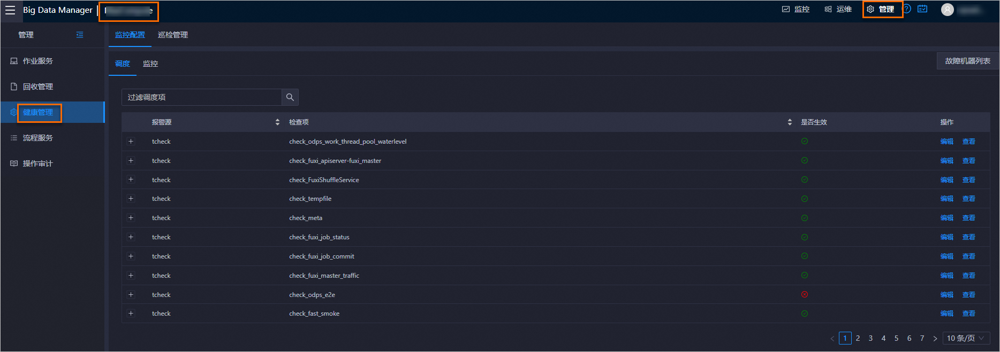

   **调度**页面展示了当前产品的所有调度项。

2. 在**调度**页面，单击某个调度项后面的**查看**，查看该调度项的详情。

   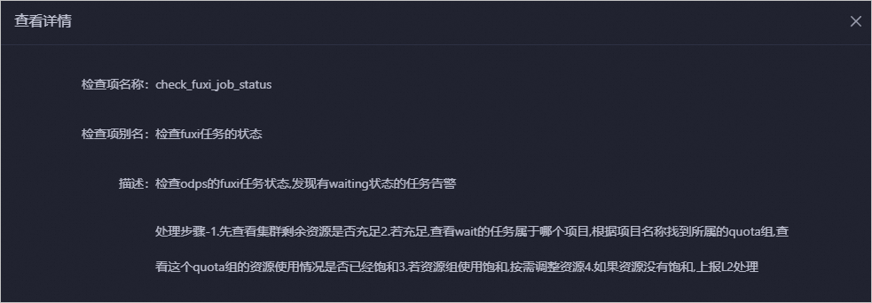

   调度项详情包括检查项名称、检查项别名、描述和处理步骤等。

3. 单击某个调度项前面的  图标，查看调度项的挂载点。

   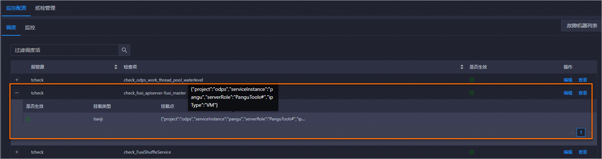

**修改调度项**

支持设置调度项的调度间隔、运行参数等，同时还支持设置是否启用调度项。

1. 在左侧导航栏单击**健康管理**，默认进入**监控配置 > 调度**页面。

2. 在**调度**界面，单击某个调度项后面的**编辑**，在弹出的对话框中设置各参数。

   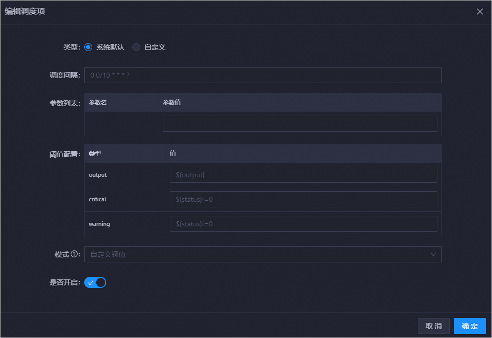

   **类型**：**系统默认**表示**调度间隔**、**参数列表**等参数均使用系统默认配置；**自定义**表示可自定义这些参数。

   > **说明**
   >
   > **调度间隔**是基于**crontab**命令配置的。

3. 完成上述参数配置后，单击**确定**，界面提示修改成功。

**查看故障机列表**

支持查看当前集群中所有的故障机器。

1. 在左侧导航栏单击**健康管理**，默认进入**监控配置 > 调度**页面。

2. 单击右上方的**故障机器列表**，查看集群中的故障机器。

   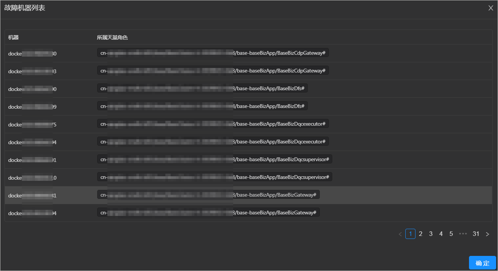

   故障机器列表中列出了当前集群中所有的故障机器，以及每台机器在飞天基础运维平台中的所属角色。

**修改监控项**

支持修改监控项的名称、描述，以及设置是否启用监控项。监控项的报警源和检查项是内置的，请勿修改。

1. 在左侧导航栏单击**健康管理**，默认进入**监控配置 > 调度**页面。

2. 单击**监控**页签，进入监控界面。

   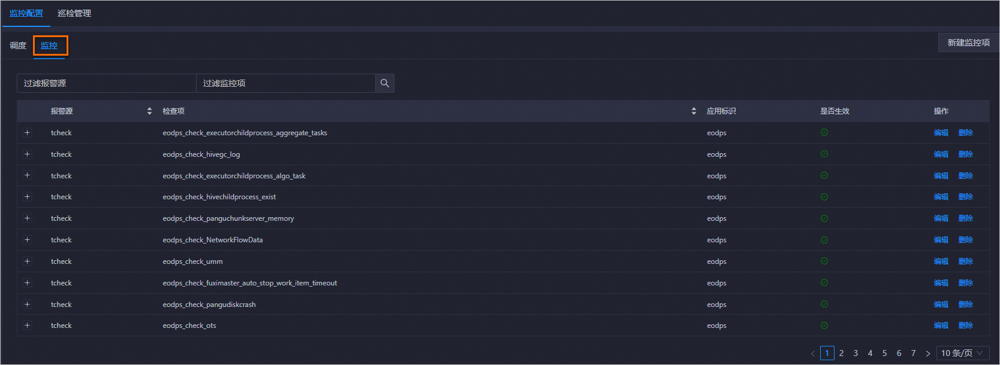

   **监控**界面展示当前产品的所有的监控项。

3. 单击某个监控项后面的**编辑**，修改监控项的配置。

   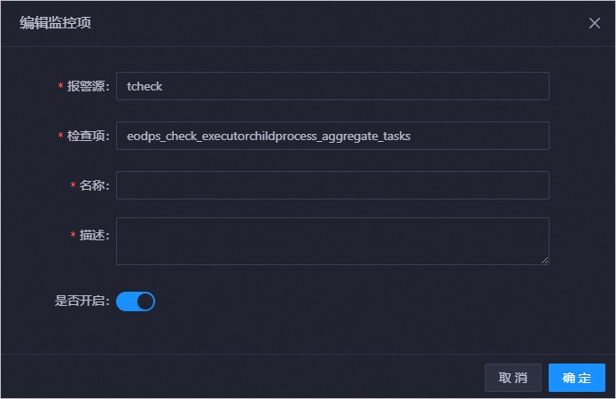

4. 完成上述参数配置后，单击**确定**，界面提示修改成功。

**给监控项添加挂载点**

监控项通过添加挂载点将报警原始数据挂载到ABM中各产品的运维界面中。

1. 在左侧导航栏单击**健康管理**，默认进入**监控配置 > 调度**页面。

2. 单击**监控**页签，进入监控界面。

3. 单击某个监控项前面的  图标，查看监控项的挂载点。

   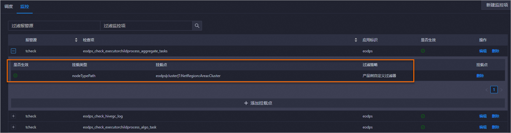

4. 单击挂载点列表下方的**添加挂载点**，在弹出的对话框中设置各参数。

   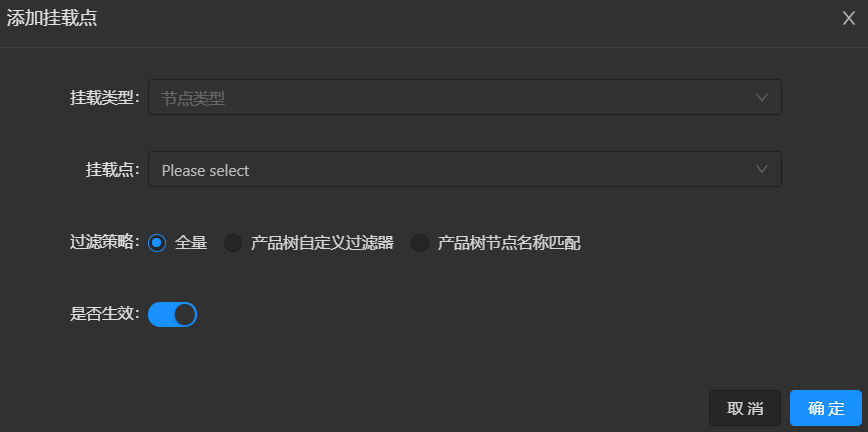

   关键参数说明如下：

   <table>
     <tr>
       <th width="89">配置项</th>
       <th>说明</th>
     </tr>
     <tr>
       <td>挂载点</td>
       <td>从下拉列表中选择该监控项要的检查结果要挂载在哪个产品的哪个运维界面，例如：<strong>odps/host</strong>表示挂载到 MaxCompute 的主机运维界面。</td>
     </tr>
     <tr>
       <td>过滤策略</td>
       <td>可选值如下：<br>• <strong>全量</strong>：该监控项产生的报警记录全部显示。<br>• <strong>产品树自定义过滤器</strong>：根据产品树节点中配置的过滤器对该监控项产生的报警进行过滤。<br>• <strong>产品树节点名称匹配</strong>：从报警记录中匹配出和当前节点名称相同的记录。</td>
     </tr>
     <tr>
       <td>是否生效</td>
       <td>设置该挂载点是否生效。</td>
     </tr>
   </table>

5. 完成上述参数配置后，单击**确定**，界面提示修改成功。

**删除监控项的挂载点**

1. 进入管理页面，在左侧导航栏单击**健康管理**，默认进入**监控配置 > 调度**页面。

2. 单击**监控**页签，进入监控界面。

3. 单击某个监控项前面的  图标，查看监控项的挂载点。

4. 单击目标挂载点后面的**删除**，在弹出的对话框中单击**确定**，界面提示删除成功。

**删除监控项**

1. 进入管理页面，在左侧导航栏单击**健康管理**，默认进入**监控配置 > 调度**页面。

2. 单击**监控**页签，进入监控界面。

3. 单击目标监控项后面的**删除**，然后在弹出的对话框中单击**确定**，界面提示删除成功。

<a id="section-6-3-2"></a>

### 6.3.2. 巡检管理

大数据管家的巡检管理功能支持按需配置巡检场景、巡检项和场景组合。

**前提条件**

已获取具有相应产品运维权限的大数据管家账号。

**进入管理页面**

1. 登录大数据管家。

2. 在左上方单击  图标，选择目标产品。

3. 在顶部菜单栏，单击**管理**，进入管理页面。

**新建场景**

1. 在左侧导航栏单击**健康管理**，选择**巡检管理 > 场景**。

   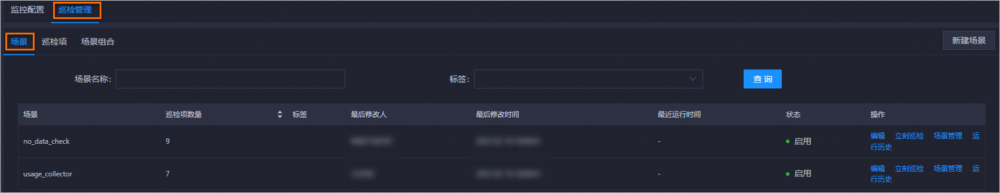

2. 单击右上角的**新建场景**，在对话框中按需配置各参数。

   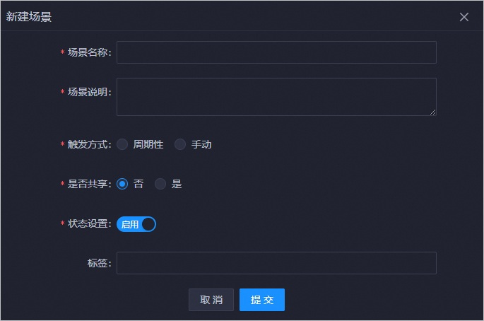

3. 单击**提交**。

   场景创建成功后，您还可以对该场景进行**编辑**、**立即巡检**、**场景管理**和查看**运行历史**等相关操作。

   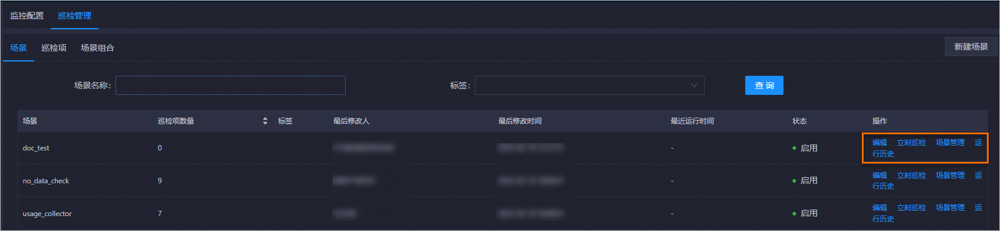

**新建巡检项**

1. 在左侧导航栏单击**健康管理**，选择**巡检管理 > 巡检项**。

2. 单击右上角的**新增巡检项**。

   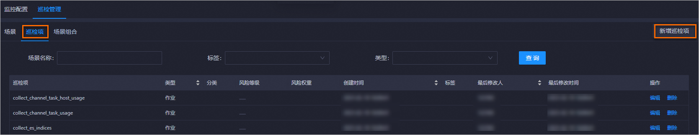

3. 在**新建巡检项**对话框中，按需配置各参数。

   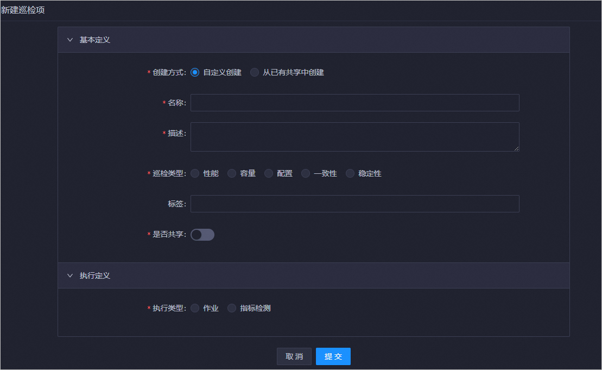

4. 单击**提交**。

   巡检项创建成功后，您还可以对该场景进行**编辑**和**删除**操作。

   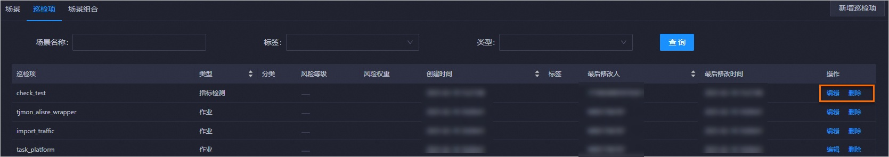

**新建场景组合**

1. 在左侧导航栏单击**健康管理**，选择**巡检管理 > 场景组合**。

2. 单击右上角的**新建场景**。

   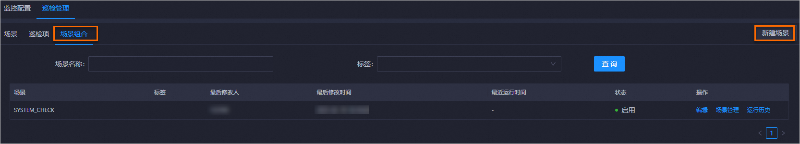

3. 在**新建场景**对话框中，按需配置各参数。

   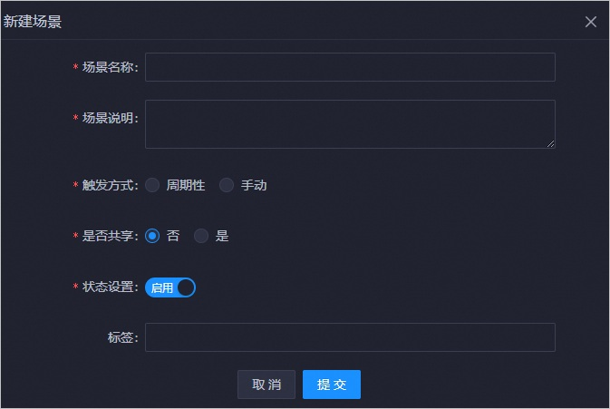

4. 单击**提交**。

   场景组合创建成功后，您还可以对该场景进行**编辑**、**场景管理**和查看**运行历史**等操作。

   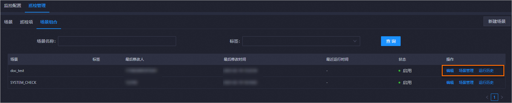

<a id="section-6-4"></a>

## 6.4. 操作审计

操作审计列出了大数据管家中当前产品的**运维**界面的运维操作历史记录，支持查看每个操作的详细信息，方便您后续查看和故障定位。

**前提条件**

已获取具有相应产品运维权限的大数据管家账号。

**背景信息**

操作审计是按产品查看的，例如：如果需要查看某个产品的操作审计，您首先需要进入某个产品界面。

> **说明**
>
> 操作审计列出的是产品**运维**界面中的运维操作历史记录，不包含作业服务的运维操作。

**操作步骤**

1. 登录大数据管家。

2. 在左上方单击  图标，选择目标产品进入。

3. 单击顶部菜单栏的**管理**，在左侧再单击**操作审计**。

   **操作审计**界面显示当前产品的**运维**界面中的运维操作历史记录，包括操作名称、操作标识、风险等级、当前状态、提交时间、执行时间、结束时间、执行人、实现方式、执行参数和详情等信息。

4. 单击某个操作后面的**详情**，查看该运维操作的详情。

   对于失败的步骤，还支持查看具体失败原因。

5. 如果运维操作运行失败，则您可查看失败原因。

6. 当运维任务处于未开始、等待、异常、失败等状态时，您可根据实际情况进行以下操作。

   | 状态 | 可执行操作 |
   | --- | --- |
   | 未开始 | • 单击<strong>开始</strong>，开始执行该任务。<br>• 单击<strong>参数配置</strong>，查看该任务的参数配置。<br>• 单击<strong>取消</strong>，取消该任务。 |
   | 等待 | • 根据提示进行相关操作，然后单击<strong>确认</strong>，继续执行后续步骤。<br>• 单击<strong>回滚</strong>，回滚到上一步骤执行完的状态。<br>• 单击<strong>参数配置</strong>，查看该任务的参数配置。<br>• 单击<strong>取消</strong>，取消该任务。 |
   | 异常 | • 单击<strong>重试</strong>，重新执行该步骤。<br>• 单击<strong>跳过</strong>，跳过此步骤继续执行后续步骤。<br>• 单击<strong>回滚</strong>，回滚到上一步骤执行完的状态。<br>• 单击<strong>参数配置</strong>，查看该任务的参数配置。<br>• 单击<strong>取消</strong>，取消该任务。 |
   | 失败 | • 单击<strong>重试</strong>，重新执行该步骤。<br>• 单击<strong>跳过</strong>，跳过此步骤继续执行后续步骤。<br>• 单击<strong>回滚</strong>，回滚到上一步骤执行完的状态。<br>• 单击<strong>参数配置</strong>，查看该任务的参数配置。<br>• 单击<strong>取消</strong>，取消该任务。 |

7. 如果需要下载运维操作的执行日志，单击上方的**下载执行详情**，保存日志到本地。

<a id="section-7"></a>

# 7.跳转至其他平台

大数据管家提供Apsara Uni-manager运维控制台（ASO）和飞天基础运维平台的登录链接，方便您配合这些平台对大数据产品进行运维。

**前提条件**

已获取任一状态正常的大数据管家账号和密码。

**操作步骤**

1. 登录大数据管家。

2. 在大数据管家首页，单击左上角的  图标，选择**站点导航**中的**ASO**和**TIANJI**，进入相应平台。

   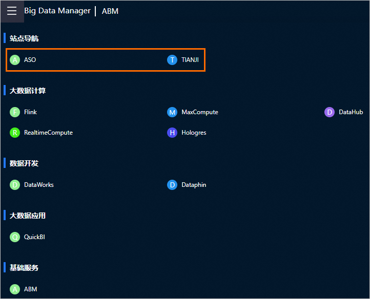

**执行结果**

选择**ASO**或**TIANJI**时，直接登录到Apsara Uni-manager运维控制台或飞天基础运维平台，不需要输入用户名和密码。
