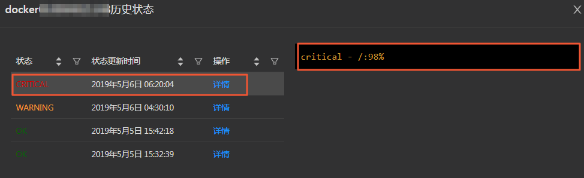
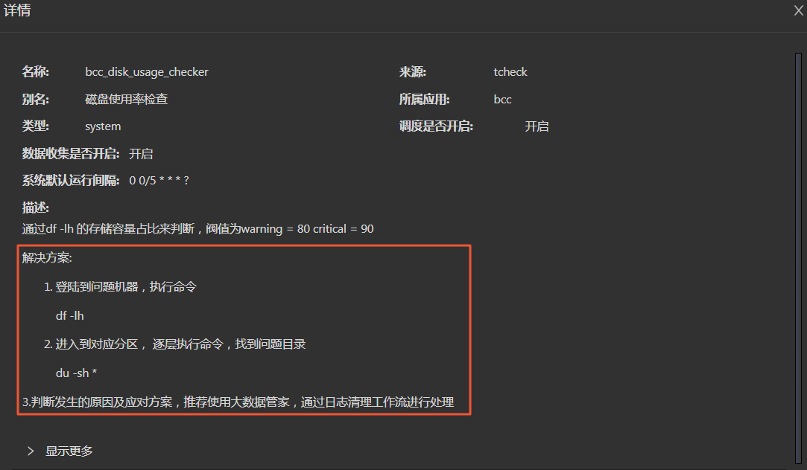
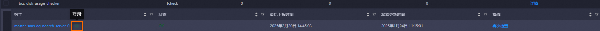
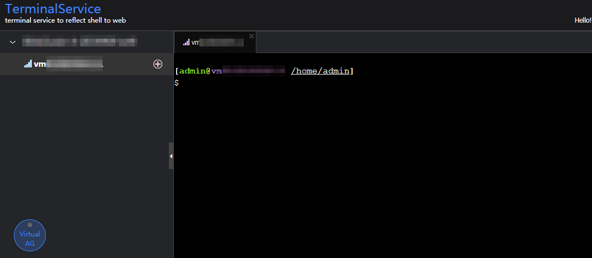

阿里云  
专有云  
大数据管家  
运维指南  
产品版本：V3.18.6  
文档版本：20251027

**目录**

- [1.例行维护](#section-1)
    - [1.1. 日常例行维护](#section-1-1)
    - [1.2. 查看ABM健康度](#section-1-2)
    - [1.3. 故障处理](#section-1-3)
- [2.备份与恢复](#section-2)

# 1.例行维护

## 1.1. 日常例行维护

大数据管家ABM（Apsara Big Data Manager）日常的例行维护主要通过飞天基础运维平台完成。

**飞天基础运维平台巡检**

1. 登录大数据管家。

2. 在左上方单击  图标，然后选择**TIANJI**，即可直接登录飞天基础运维平台的首页。

3. 在左侧导航栏，选择**资源管理 > 产品集群运维。**

4. 在**产品列表**中，搜索目标产品或者集群，确保所有容器已达终态。

**监控项以及告警处理**

- 硬件监控

  磁盘报警：正常情况下，系统会自动回收log（保留最近30天）。异常情况下，如果日志暴增导致系统磁盘告急，请联系技术支持。

- 系统异常

  根据巡检提示信息，在ABM运维平台处理异常。如果提示不明确，请联系技术支持。

## 1.2. 查看ABM健康度

大数据管家ABM的健康度功能支持查看自身的监控项以及不同紧急程度的报警，并提供详情查看和修复后的再次检查。

**查看并处理ABM报警**

集群报警分为Critical、Warning和Exception三种，运维人员应当及时处理集群的报警，特别是Critical和Warning报警。

1. 登录大数据管家，默认显示**仪表盘**页面。

   如果当前在其他页面，您可以单击左上方的  图标，然后选择**ABM**产品，进入**仪表盘**页面。

2. 在**仪表盘**页面，单击**健康度**页签，进入健康度检查页面。

   该页面显示集群的所有监控项和检查结果。

3. 在**健康度**页面，单击存在报警的监控项前面的  图标，查看该检查项所有的宿主。

4. 单击宿主，然后在弹出的对话框中单击某个报警后面的**详情**，在右侧查看报警原因。

   

5. 单击存在报警的监控项后面的**详情**，在弹出的对话框中查看检查项报警的解决方案。

   

6. 按报警的解决方案来处理该报警。

   处理报警的过程中，您可能需要登录到报警的宿主，请参见登录宿主。

7. 处理完某个报警后，您可单击宿主后面的**再次检查**，对该宿主进行一次该监控项的实时检查，以确定该宿主的报警是否恢复。

**登录宿主**

如果某个宿主有报警事件或其他情况，您可能需要登录到宿主进行相关操作。

1. 在**健康度**页面，单击监控项前面的  图标。

2. 单击宿主后面的  图标，打开**TerminalService**界面。

   

3. 在**TerminalService**左侧选择宿主，即可直接登录。

   

## 1.3. 故障处理

**常见故障处理**

- **登录故障**

  如出现无法登录的情况，请先清理浏览器的缓存、cookie，重新尝试登录。

  如果登录框提示登录异常，请根据提示异常检查以下内容。

  - 是否密码错误。

  - 是否账号锁定。

  - 是否账号被关停。

- **其他异常**

  请寻找技术支持。

# 2.备份与恢复

**备份数据**

大数据管家使用的数据库自带高可用，无需备份数据。如需要完整的备份数据，请联系技术支持。

**恢复数据**

无。
