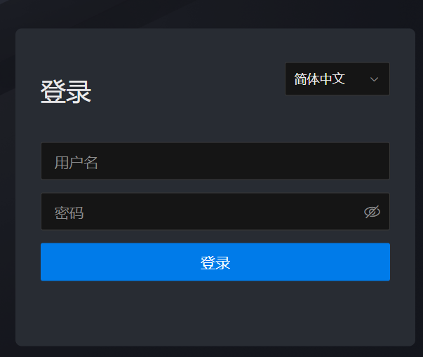
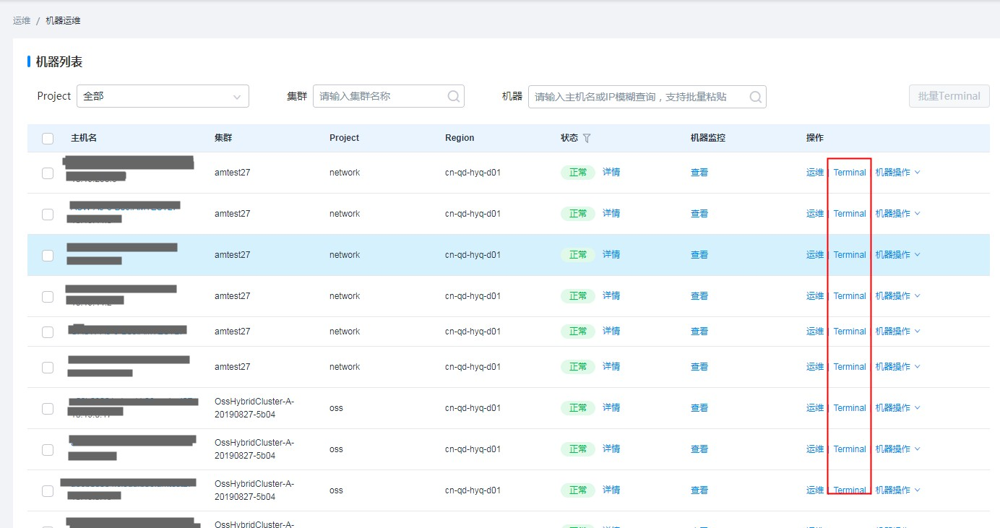
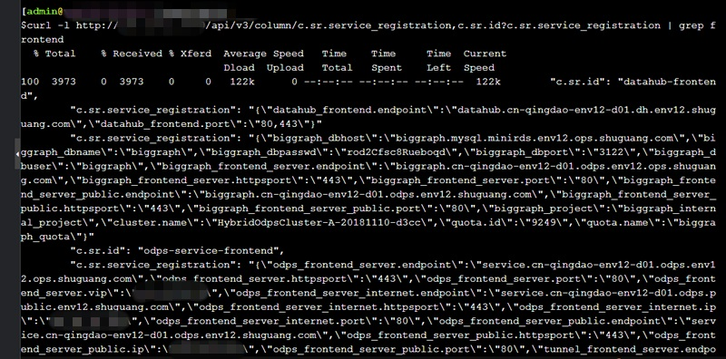
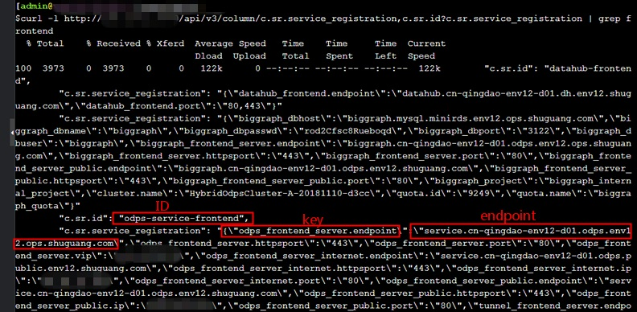

阿里云  
专有云  
大数据计算服务  
开发指南  
产品版本：V3.18.6  
文档版本：20250529

**目录**

- [1.Java SDK](#section-1)
    - [1.1. Java SDK介绍](#section-1-1)
    - [1.2. 环境准备](#section-1-2)
        - [1.2.1. 概述](#section-1-2-1)
        - [1.2.2. 获取Accesskey](#section-1-2-2)
            - [1.2.2.1. 登录Apsara Uni-manager运营控制台](#section-1-2-2-1)
            - [1.2.2.2. 获取组织Accesskey](#section-1-2-2-2)
            - [1.2.2.3. 获取阿里云AccessKey](#section-1-2-2-3)
        - [1.2.3. 获取Endpoint](#section-1-2-3)
    - [1.3. 核心接口](#section-1-3)
        - [1.3.1. AliyunAccount](#section-1-3-1)
        - [1.3.2. Odps](#section-1-3-2)
        - [1.3.3. Projects](#section-1-3-3)
        - [1.3.4. Project](#section-1-3-4)
        - [1.3.5. SQLTask](#section-1-3-5)
        - [1.3.6. Instances](#section-1-3-6)
        - [1.3.7. Instance](#section-1-3-7)
        - [1.3.8. Tables](#section-1-3-8)
        - [1.3.9. Table](#section-1-3-9)
        - [1.3.10. Resources](#section-1-3-10)
        - [1.3.11. Resource](#section-1-3-11)
        - [1.3.12. Functions](#section-1-3-12)
        - [1.3.13. Function](#section-1-3-13)
        - [1.3.14. Spark Shell](#section-1-3-14)
        - [1.3.15. Spark R](#section-1-3-15)
        - [1.3.16. Spark SQL](#section-1-3-16)
        - [1.3.17. Spark JDBC](#section-1-3-17)
        - [1.3.18. Document APIs](#section-1-3-18)
        - [1.3.19. Search APIs](#section-1-3-19)
        - [1.3.20. CheckPermissionTest](#section-1-3-20)
        - [1.3.21. Volume2](#section-1-3-21)
- [2.Python SDK](#section-2)

<a id="section-1"></a>

# 1.Java SDK

<a id="section-1-1"></a>

## 1.1. Java SDK介绍

本章节为您介绍MaxCompute提供的SDK包整体信息，并提供完整接口信息的链接。

MaxCompute完整接口信息。

您可以通过Maven管理配置新SDK的版本，Maven的配置示例如下。

```xml
<dependency>
  <groupId>com.aliyun.odps</groupId>
  <artifactId>odps-sdk-core</artifactId>
  <version>0.36.2</version>
</dependency>
```

MaxCompute提供的SDK包整体信息，如下表所示。

<table>
  <tr>
    <th width="206">包名</th>
    <th>描述</th>
  </tr>
  <tr>
    <td>odps-sdk-core</td>
    <td>MaxCompute基础功能。封装了基础的MaxCompute概念及其编程接口，包括Odps、Project和Table等，Tunnel相关的功能也在此包。</td>
  </tr>
  <tr>
    <td>odps-sdk-core-internal</td>
    <td>MaxCompute扩展功能。封装了一些不常用的MaxCompute概念和操作，例如Event和XFlow等。</td>
  </tr>
  <tr>
    <td>odps-sdk-commons</td>
    <td>MaxCompute基础设施。包含TableSchema、Column、Record和OdpsType等基础设施以及一些Util的封装。</td>
  </tr>
  <tr>
    <td>odps-sdk-udf</td>
    <td>MaxCompute UDF编程接口。</td>
  </tr>
  <tr>
    <td>odps-sdk-mapred</td>
    <td>MaxCompute MapReduce作业编程接口。</td>
  </tr>
  <tr>
    <td>odps-sdk-graph</td>
    <td>MaxCompute Graph编程接口。</td>
  </tr>
</table>

SDK包下载地址为SDK包下载。

> 对于MaxCompute提供的SDK包，如果您使用的MaxCompute版本在V3.8.0以下，请下
>
> **说明**
>
> 载**0.27.2**版本的SDK包使用；如果您使用的MaxCompute版本是V3.8.0到V3.11.0，请下载**0.30.8**或**0.30.9**版本的SDK包使用；如果您使用的MaxCompute版本是V3.12.0及以上，请下载**0.36.2**版本的SDK包使用。

<a id="section-1-2"></a>

## 1.2. 环境准备

<a id="section-1-2-1"></a>

### 1.2.1. 概述

本章节为您介绍使用SDK前需要进行的环境准备。

- 需要一个授权账号以及一对AccessKey ID和AccessKey Secret。

- 需要获取产品的Endpoint。

<a id="section-1-2-2"></a>

### 1.2.2. 获取Accesskey

<a id="section-1-2-2-1"></a>

#### 1.2.2.1. 登录Apsara Uni-manager运营控制台

本文主要向您介绍如何登录Apsara Uni-manager运营控制台。

**前提条件**

- 登录Apsara Uni-manager运营控制台前，确认您已从部署人员处获取Apsara Uni-manager运营控制台的服务域名地址。

- 推荐使用Chrome浏览器。

**操作步骤**

1. 在浏览器地址栏中，输入Apsara Uni-manager运营控制台的服务域名地址，按回车键。

2. 输入正确的用户名及密码。

   请向运营管理员获取登录控制台的用户名和密码。

   > **说明**
   >
   > 首次登录Apsara Uni-manager运营控制台时，需要修改登录用户名的密码，请按照提示完成密码修改。为提高安全性，密码长度必须为8~20位，且至少包含以下两种类型：
   >
   > - 英文大写或小写字母（A~Z、a~z）
   >
   > - 阿拉伯数字（0~9）
   >
   > - 特殊符号（感叹号（！）、at（@）、井号（#）、美元符号（$）、百分号（%）等）

3. 单击**登录**。

4. 如果账号已激活MFA多因素认证，请根据以下两种情况进行操作：

   - 管理员强制开启MFA后的首次登录：

     <ol type="a">

     <li>

     在绑定虚拟MFA设备页面中，按页面提示步骤绑定MFA设备。

     </li>

     <li>

     按照步骤2重新输入账号和密码，单击**登录**。

     </li>

     </ol>

     <ol type="i" start="100">

     <li>

     输入6位MFA码后单击**认证**。

     </li>

     </ol>

   - 您已开启并绑定MFA：

     输入6位MFA码后单击**认证**。

     > **说明**
     >
     > 绑定并开启MFA的操作请参见<strong>《Apsara Uni-manager运营控制台用户指南》</strong>中的章节<strong>《管理多因素认证》</strong>。

<a id="section-1-2-2-2"></a>

#### 1.2.2.2. 获取组织Accesskey

本章节为您介绍如何获取组织AccessKey。

**前提条件**

只有运营管理员和一级组织管理员可以获取组织AccessKey。

**操作步骤**

1. 管理员登录Apsara Uni-manager运营控制台。

2. 在页面顶部菜单栏上，单击**企业**。

3. 在**企业**页面的左侧导航栏中，单击**组织管理**。

4. 在组织结构中，选择目标组织。

5. 在对应组织页面，单击**管理Accesskey**。

6. 在弹出的对话框中，查看组织Accesskey信息。

   > **说明**
   >
   > 一级组织的AccessKey为系统自动分配，下级组织使用一级组织的AccessKey。

<a id="section-1-2-2-3"></a>

#### 1.2.2.3. 获取阿里云AccessKey

为了保障云资源的安全性，系统需要验证访问者的身份，以确保访问者具有相关权限。如果您需要访问云资源，您需要获取个人账号的AccessKey ID和AccessKey Secret，用于登录授权。本章节为您介绍如何获取阿里云AccessKey。

**操作步骤**

1. 管理员登录Apsara Uni-manager运营控制台。

2. 在系统界面右上角，单击当前登录用户的头像，选择**个人信息**。

3. 在**AccessKey**模块，您可以查看个人账户的AccessKey信息。

   > Accesskey ID和AccessKey Secret是您访问云资源时的密钥，具有该账号完整的权
   >
   > **说明**
   >
   > 限，请您妥善保管。

<a id="section-1-2-3"></a>

### 1.2.3. 获取Endpoint

本章节为您介绍如何通过Apsara Uni-manager运维控制台获取产品的Endpoint。

**背景信息**

- 已从部署人员或管理员处获取Apsara Uni-manager运维控制台的访问地址、用户名和密码。

  Apsara Uni-manager运维控制台访问地址格式为*ops*.asconsole.*intranet-domain-id*.com。

- 推荐使用Chrome浏览器。

**操作步骤**

1. 打开浏览器，地址栏中输入Apsara Uni-manager运维控制台的访问地址*ops*.asconsole.*intranet-dom ain-id*.com，按回车键。

   

   > 您可以单击页面右上角的下拉按钮来进行语言切换。
   >
   > **说明**

2. 输入正确的用户名及密码。

   > 登录Apsara Uni-manager运维控制台的用户名和密码请从部署人员或管理员处获取。
   >
   > **说明**

   首次登录Apsara Uni-manager运维控制台时，需要修改登录用户名的密码，请按照提示完成密码修改。

   为提高安全性，密码必须满足以下要求：

   - 英文大小写字母

   - 阿拉伯数字（0~9）

   - 特殊符号，包括感叹号（！）、at（@）、井号（#）、美元符号（$）、百分号（%）等

   - 密码长度10~20个字符

3. 单击**登录**，进入Apsara Uni-manager运维控制台。

4. 在Apsara Uni-manager运维控制台的顶部菜单栏单击**运维**。在左侧导航栏单击**产品运维管理 > 产品列表**，在**云平台运维**区域单击**飞天基础运维平台**，直接打开并进入飞天基础运维平台首页。

5. 在飞天基础运维平台页面左侧导航栏中，单击**运维 > 机器运维**，进入**机器运维**页面。

6. 在机器列表中，通过筛选，选择任意一台机器，单击**Terminal**，登录到机器。

   

7. 在机器中执行如下命令，获取JSON数据。

   ```bash
   curl -l "http://127.0.0.1:7070/api/v3/column/c.sr.service_registration,c.sr.id?c.sr.service_registration"
   ```

   

8. 根据*MaxCompute*产品的ID（*odps-service-frontend*）和Key值（*odps_frontend_server.endpoint*），找到*MaxCompute*的Endpoint。

   

<a id="section-1-3"></a>

## 1.3. 核心接口

<a id="section-1-3-1"></a>

### 1.3.1. AliyunAccount

本章节为您介绍Java SDK核心接口中的AliyunAccount接口。

阿里云认证账号。输入参数为**accessId**及**accessKey**，是阿里云用户的身份标识和认证密钥。您可以通过传入AliyunAccount实例来构造MaxCompute对象，代码示例详情，请参见Odps。

> **说明**
>
> **accessId**对应AccessKey ID，**accessKey**对应AccessKey Secret。

<a id="section-1-3-2"></a>

### 1.3.2. Odps

本章节为您介绍Java SDK核心接口中的Odps接口。

MaxCompute SDK的入口，您可以通过此类来获取项目空间下的所有对象集合，包括Projects、Tables、Resources、Functions和Instances。

您可以通过传入AliyunAccount实例来构造MaxCompute对象，程序示例如下。

```text
Account account = new AliyunAccount("my_access_id", "my_access_key");
Odps odps = new Odps(account);
String odpsUrl = "<your odps endpoint>"; 
odps.setEndpoint(odpsUrl); 
odps.setDefaultProject("my_project");
for (Table t : odps.tables()) {
....
}
```

<a id="section-1-3-3"></a>

### 1.3.3. Projects

本章节为您介绍Java SDK核心接口中的Projects接口。

MaxCompute中所有项目空间的集合，集合中的元素为Project。

程序示例如下。

```text
Account account = new AliyunAccount("my_access_id", "my_access_key");
Odps  odps = new Odps(account);
String odpsUrl = "<your odps endpoint>"; 
odps.setEndpoint(odpsUrl);
Project p = odps.projects().get("my_exists"); 
p.reload();
Map<String, String> properties = prj.getProperties();
...
```

<a id="section-1-3-4"></a>

### 1.3.4. Project

本章节为您介绍Java SDK核心接口中的Project接口。

对项目空间信息的描述，可以通过Projects获取相应的项目空间。

<a id="section-1-3-5"></a>

### 1.3.5. SQLTask

本章节为您介绍Java SDK核心接口中的SQLTask接口。

用于运行和处理SQL任务的接口。可以通过Run接口直接运行SQL。Run接口返回Instance实例，通过Instance获取SQL的运行状态及运行结果。

程序示例如下。

```text
Account account = new AliyunAccount("my_access_id", "my_access_key"); Odps odps = new Odps(account);
String  odpsUrl = "<your odps endpoint>"; 
odps.setEndpoint(odpsUrl);
Instance instance = SQLTask.run(odps, "my_project", "select ..."); 
String id = instance.getId();
instance.waitforsuccess();
Set<String> taskNames = instance.getTaskNames(); 
for (String name
taskNames) {
TaskSummary summary = instance.getTaskSummary(name); 
String s = summary.getSummaryText();
}
Map<String, String> results = instance.getTaskResults(); 
Map<String, TaskStatus> taskStatus = instance.getTaskStatus();
for (Entry<String, TaskStatus> status : taskStatus.entrySet()) { 
String result = results.get(status.getKey());
}
```

> 如果您想创建表，需要通过SQLTask接口，而不是Table接口。您需要将创建表
>
> **说明**
>
> （CREATE TABLE）的语句传入SQLTask。

<a id="section-1-3-6"></a>

### 1.3.6. Instances

本章节为您介绍Java SDK核心接口中的Instances接口。

MaxCompute中所有实例（Instance）的集合，集合中的元素为Instance。

程序示例如下。

```text
Account account = new AliyunAccount("my_access_id", "my_access_key");
Odps odps = new Odps(account);
String odpsUrl = "<your odps endpoint>"; 
odps.setEndpoint(odpsUrl); 
odps.setDefaultProject("my_project");
for (Instance i : odps.instances ()) {
....
}
```

<a id="section-1-3-7"></a>

### 1.3.7. Instance

本章节为您介绍Java SDK核心接口中的Instance接口。

对实例信息的描述，可以通过Instances获取相应的实例。

程序示例如下。

```text
Account account = new AliyunAccount("my_access_id", "my_access_key");
Odps odps = new Odps (account);
String odpsUrl = "<your odps endpoint>"; 
odps.setEndpoint(odpsUrl);
Instance ins = odps.instances().get("instance id"); 
Date startTime = instance.getStartTime();
Date endTime = instance.getEndTime();
...
Status instanceStatus = instance.getStatus(); 
String instanceStatusStr = null;
if (instanceStatus == Status.TERMINATED) { 
instanceStatusStr = TaskStatus.Status.SUCCESS.toString();
Map<String, TaskStatus> taskStatus = instance.getTaskStatus(); 
for (Entry<String, TaskStatus> status : taskStatus.entrySet()) {
if (status.getValue().getStatus() != TaskStatus.Status.SUCCESS) { 
instanceStatusStr = status.getValue().getStatus().toString(); 
break;
}
}
} else {
instanceStatusStr = instanceStatus.toString();
}
...
TaskSummary summary = instance.getTaskSummary("instance name"); 
String s = summary.getSummaryText();
```

<a id="section-1-3-8"></a>

### 1.3.8. Tables

本章节为您介绍Java SDK核心接口中的Tables接口。

MaxCompute中所有表的集合，集合中的元素为Table。

程序示例如下。

```text
Account account = new AliyunAccount("my_access_id", "my_access_key");
Odps odps = new Odps(account); 
String odpsUrl = "<your odps endpoint>"; 
odps.setEndpoint(odpsUrl); 
odps.setDefaultProject("my_project");
for (Table t : odps.tables()) {
....
}
```

<a id="section-1-3-9"></a>

### 1.3.9. Table

本章节为您介绍Java SDK核心接口中的Table接口。

对表信息的描述，可以通过Tables获取相应的表。

程序示例如下。

```text
Account account = new AliyunAccount("my_access_id", "my_access_key");
Odps odps = new Odps(account); 
String odpsUrl = "<your odps endpoint>"; 
odps.setEndpoint(odpsUrl);
Table t = odps.tables().get("table name"); 
t.reload();
Partition part = t.getPartition(new PartitionSpec(tableSpec[1])); 
part.reload();
...
```

<a id="section-1-3-10"></a>

### 1.3.10. Resources

本章节为您介绍Java SDK核心接口中的Resources接口。

MaxCompute中所有资源的集合，集合中的元素为Resource。

程序示例如下。

```text
Account account = new AliyunAccount("my_access_id", "my_access_key");
Odps odps = new Odps(account); 
String odpsUrl = "<your odps endpoint>"; 
odps.setEndpoint(odpsUrl); 
odps.setDefaultProject("my_project");
for (Resource r : odps.resources()) {
....
}
```

<a id="section-1-3-11"></a>

### 1.3.11. Resource

本章节为您介绍Java SDK核心接口中的Resource接口。

对资源信息的描述，可以通过Resources获取相应的资源。

程序示例如下。

```text
Account account = new AliyunAccount("my_access_id", "my_access_key");
Odps odps = new Odps(account); 
String odpsUrl = "<your odps endpoint>"; 
odps.setEndpoint(odpsUrl);
Resource r = odps.resources().get("resource name"); 
r.reload();
if (r.getType() == Resource.Type.TABLE) { TableResource tr = new TableResource(r);
String tableSource = tr.getSourceTable().getProject() + "." + 
tr.getSourceTable().getName();
if (tr.getSourceTablePartition() != null) {
tableSource += " partition(" + tr.getSourceTablePartition().toString() + ")";
}
....
}
```

创建文件资源的示例。

```text
String projectName = "my_porject";
String source = "my_local_file.txt";  
File file = new File(source);
InputStream is = new FileInputStream(file);
FileResource resource = new FileResource(); 
String name = file.getName(); 
resource.setName(name);
odps.resources().create(projectName, resource, is);
```

创建表资源的示例。

```text
TableResource resource = new TableResource(tableName, tablePrj, partitionSpec);
//resource.setName(INVALID_USER_TABLE); 
resource.setName("table_resource_name"); 
odps.resources().update(projectName, resource);
```

<a id="section-1-3-12"></a>

### 1.3.12. Functions

本章节为您介绍Java SDK核心接口中的Functions接口。

MaxCompute中所有函数的集合，集合中的元素为Function。

程序示例如下。

```text
Account account = new AliyunAccount("my_access_id", "my_access_key");
Odps odps = new Odps(account);
String odpsUrl = "<your odps endpoint>"; 
odps.setEndpoint(odpsUrl); 
odps.setDefaultProject("my_project");
for (Function f : odps.functions()) {
....
}
```

<a id="section-1-3-13"></a>

### 1.3.13. Function

本章节为您介绍Java SDK核心接口中的Function接口。

对函数信息的描述，可以通过Functions获取相应的函数。

程序示例如下。

```text
Account account = new AliyunAccount("my_access_id", "my_access_key");
Odps odps = new Odps(account);
String odpsUrl = "<your odps endpoint>"; 
odps.setEndpoint(odpsUrl);
Function f = odps.functions().get("function name"); 
List<Resource> resources = f.getResources();
```

创建函数的示例。

```text
String resources = "xxx:xxx";
String classType = "com.aliyun.odps.mapred.open.example.WordCount";
ArrayList<String> resourceList = new ArrayList<String>(); 
for (String r : resources.split(":")) {
resourceList.add(r);
}
Function func = new Function(); 
func.setName(name); 
func.setClassType(classType); 
func.setResources(resourceList);
odps.functions().create(projectName, func);
```

<a id="section-1-3-14"></a>

### 1.3.14. Spark Shell

本章节为您介绍Java SDK核心接口中的Spark Shell接口。

Spark向集群提交任务时的常用接口之一。

执行如下命令，启动接口应用。

```text
$cd $SPARK_HOME
-- 进入Spark⽬录。
$bin/spark-shell --master yarn
-- 选择运⾏模式并启动应⽤。
```

示例如下。

```text
sc.parallelize(0 to 100, 2).collect
sql("show tables").show
sql("select * from spark_user_data").show(200,100)
```

<a id="section-1-3-15"></a>

### 1.3.15. Spark R

本章节为您介绍Java SDK核心接口中的Spark R接口。

Spark向集群提交任务时的常用接口之一。

执行如下命令，启动接口应用。

```text
$mkdir -p /home/admin/R && unzip ./R/R.zip -d /home/admin/R/
-- 创建⼀个⽬录R并解压该⽬录下的R.zip。
$export PATH=/home/admin/R/bin/:$PATH
-- 设置环境变量。
$bin/sparkR --master yarn --archives ./R/R.zip
-- 选择运⾏模式并启动应⽤。
```

示例如下。

```text
df <- as.DataFrame(faithful)
df
head(select(df, df$eruptions))
head(select(df, "eruptions"))
head(filter(df, df$waiting < 50))
results <- sql("FROM spark_user_data SELECT *")
head(results)
```

<a id="section-1-3-16"></a>

### 1.3.16. Spark SQL

本章节为您介绍Java SDK核心接口中的Spark SQL接口。

Spark向集群提交任务时的常用接口之一。

执行如下命令，启动接口应用。

```text
$cd $SPARK_HOME
-- 进入Spark⽬录。
$bin/spark-sql --master yarn
-- 选择运⾏模式并启动应⽤。
```

示例如下。

```sql
show tables;
select * from spark_user_data limit 3;
quit;
```

<a id="section-1-3-17"></a>

### 1.3.17. Spark JDBC

本章节为您介绍Java SDK核心接口中的Spark JDBC接口。

Spark向集群提交任务时的常用接口之一。

执行如下命令，启动接口应用。

```text
$sbin/stop-thriftserver.sh
-- 停⽌线程。
$sbin/start-thriftserver.sh
-- 重启线程。
$bin/beeline
-- 启动应⽤。
```

示例如下。

```sql
!connect jdbc:hive2://localhost:10000/odps_smoke_test
show tables;
select * from mr_input limit 3;
!quit
```

<a id="section-1-3-18"></a>

### 1.3.18. Document APIs

本章节为您介绍Java SDK核心接口中的Document APIs接口。

ElasticSearch on MaxCompute兼容的开源API接口集合之一，具体接口信息请参见Document APIs。

<a id="section-1-3-19"></a>

### 1.3.19. Search APIs

本章节为您介绍Java SDK核心接口中的Search APIs接口。

ElasticSearch on MaxCompute兼容的开源API接口集合之一，具体接口信息请参见Search APIs。

<a id="section-1-3-20"></a>

### 1.3.20. CheckPermissionTest

本章节为您介绍Java SDK核心接口中的CheckPermissionTest接口。

通过CheckPermissionTest接口，提供上层应用指定用户是否拥有某资源指定权限的查询接口。

程序示例如下。

```java
Account account = new AliyunAccount("accessId", "accessKey");
Odps odps = new Odps(account);
SecurityManager sm = odps.projects().get().getSecurityManager();

SecurityManager.PermissionDesc desc = new SecurityManager.PermissionDesc(
    odps.getDefaultProject(),
    CheckPermissionConstants.ObjectType.Table,
    "table_name",
    CheckPermissionConstants.ActionType.Describe);
desc.setColumns(Arrays.asList("col1", "col2"));
desc.setPrincipal("ALIYUN$test@aliyun.com");

SecurityManager.CheckPermissionResultInfo res = sm.checkPermission(desc);
System.out.println("Result: " + res.getResult());
System.out.println("Message: " + res.getMessage());
```

<a id="section-1-3-21"></a>

### 1.3.21. Volume2

本章节为您介绍Java SDK核心接口中的Volume2接口。专有云使用的Volume2，type使用 `new` ，无需指定 `extLocationt` 等公共云External Volume等信息。

**项目依赖**

使用SDK操作External Volume前需要添加如下依赖。

```xml
<dependency>
  <groupId>com.aliyun.odps</groupId>
  <artifactId>odps-sdk-core</artifactId>
  <version>0.44.0-SNAPSHOT</version>
</dependency>
```

**创建 Volume**

- Create

  ```text
  /**
  * 创建 volume
  * @param builder volume 的参数配置
  * @throws OdpsException
  */
  public void create(VolumeBuilder builder) throws OdpsException

      /**
  * 创建Volume
  *
  * @param volumeName volume名
  * @param comment
  * @param type 创建原有Volume传入 {@link Volume}.Type.Old,创建新VolumeFS功能的volume传入{@link Volume}
  *        .Type.New。VolumeFS特性需要Project开启该功能才可使⽤
  * @throws OdpsException
  */
  public void create(String volumeName, String comment, Volume.Type type)


      /**
  * 创建Volume
  *
  * @param projectName ⽬标表所在Project名称
  * @param volumeName 所要创建的volume名
  * @param comment
  * @param type 创建原有Volume传入 {@link Volume}.Type.Old,创建新VolumeFS功能的volume传入{@link Volume}
  *        .Type.New。VolumeFS特性需要Project开启该功能才可使⽤
  * @throws OdpsException
  */
  public void create(String projectName, String volumeName, String comment, Volume.Typetype)

      /**
  * 创建Volume
  *
  * @param projectName ⽬标表所在Project名称
  * @param volumeName 所要创建的volume名
  * @param comment
  * @param type 创建原有Volume传入 {@link Volume}.Type.Old,创建新VolumeFS功能的volume传入{@link Volume}
  *        .Type.New。VolumeFS特性需要Project开启该功能才可使⽤
  * @param lifecycle ⽣命周期
  * @throws OdpsException
  */
  public void create(String projectName, String volumeName, String comment, Volume.Typetype, Long lifecycle) throws OdpsException
  ```

- Create示例

  ```text
  /*
   创建volume
  */

  public void createExternalVolume() throws Exception {
      String projectName = "test_project";
      String extVolumeName = "test_ext_1";
      String externalLocation = "oss://...";
      
      Long lifecycle;
      String comment;
      String roleArn;
      
      Volumes.VolumeBuilder builder = new Volumes.VolumeBuilder();
          
      
  builder.project(projectName).volumeName(extVolumeName).type(Volume.Type.EXTERNAL).extLo
  tion(externalLocation);
          
      if (lifecycle != null) {
          builder.lifecycle(lifecycle);
      }
          
      if (comment != null) {
          builder.comment(comment);
      }
          
      if (roleArn != null) {
          builder.addProperty(Volumes.EXTERNAL_VOLUME_ROLEARN_KEY, roleArn);
      }
          
      getCurrentOdps().volumes().create(builder);  
  }
  ```

**获取指定Volume信息**

- Get

  ```text
  /**
  * 获得指定Volume信息
  *
  * @param volumeName Volume名
  * @return
  */
  public Volume get(String volumeName)

  /**
  * 获得指定Volume信息
  *
  * @param projectName 所在Project名称
  * @param volumeName  Volume名
  * @return
  */
  public Volume get(String projectName, String volumeName)
  ```

- Get示例

  ```text
  /*
  获取 volume
  */
  public Volume getVolume() {
      String projectName = "test_project";
      String extVolumeName = "test_ext_1";

      Volume volume = odps.volumes().get(projectName, extVolumeName);
      return volume;
  }
  ```

**获取Volume信息迭代器**

- Iterator

  ```text
  /**
  * 获取默认Project的所有Volume信息迭代器
  *
  * @return Volume迭代器
  */
  public Iterator<Volume> iterator() 

      /**
  * 获取Volume信息迭代器
  *
  * @param projectName 指定Project名称
  * @return Volume迭代器
  */
  public Iterator<Volume> iterator(final String projectName)


      /**
  * 获取Volume信息迭代器
  *
  * @param filter 过滤条件
  * @return Volume迭代器
  */
  public Iterator<Volume> iterator(final VolumeFilter filter)

      /**
  * 获取Volume信息迭代器
  *
  * @param projectName 所在Project名称
  * @param filter 过滤条件
  * @return Volume迭代器
  */
  public Iterator<Volume> iterator(final String projectName, final VolumeFilter filter)
  ```

- Iterator示例

  ```text
  /*
  获取volume迭代器
  */
  public Iterator<Volume> getVolumeIterator() {
      String projectName = "test_project";
      String extVolumeName = "test_ext_1";

      VolumeFilter volumeFilter = new VolumeFilter();
      volumeFilter.setName(extVolumeName);

      Iterator<Volume> iterator = odps.volumes().iterator(projectName, volumeFilter);
      return iterator;
  }
  ```

**删除Volume**

- Delete

  ```text
  /**
  * 删除Volume
  *
  * @param volumeName 表名
  * @throws OdpsException
  */
  public void delete(String volumeName)

  /**
  * 删除Volume
  *
  * @param projectName 表所在Project
  * @param volumeName 表名
  * @throws OdpsException
  */
  public void delete(String projectName, String volumeName)
  ```

- Delete示例

  ```text
  /*
  删除Volume
  */
  public void deleteVolume() {
      String projectName = "test_project";
      String extVolumeName = "test_ext_1";

      try {
          odps.volumes().delete(projectName, extVolumeName);
      } catch (OdpsException e) {
          throw new RuntimeException(e);
      }
  }
  ```

**获取VolumeFsFile**

- getVolumeFSFile

  ```text
  /**
  * 获取 volume path 下的 Fs File
  *
  * @param path 路径
  *
  */
  public VolumeFSFile getVolumeFSFile(String path) throws VolumeException;
  ```

- 使用VolumeFsFile示例

  ```text
  /*
  获取 volume file 的详细信息
  */
  public void getVolumeIterator() {
      String projectName = "test_project";
      String volumeName = "test_volume";
      String testFilePath = "/" + volumeName + "/file";;
      


      VolumeFSFile volumeFSFile = odps.volumes().get(projectName, 
  volumeName).getVolumeFSFile(testFilePath);
      
      bool isDir = volumeFSFile.getIsdir());
      long length = volumeFSFile.getLength();
  }
  ```

<a id="section-2"></a>

# 2.Python SDK

本章节为您介绍如何通过Python SDK实现创建、查看及删除表等操作。

PyODPS是MaxCompute的Python版本的SDK，提供简单方便的Python编程接口。PyODPS支持类似Pandas的快速、灵活和富有表现力的数据结构。您可以通过PyODPS提供的DataFrame API使用Pandas的数据结果处理功能。更多详细信息请参见Github项目和PyODPS文档。

如果您需要了解更多关于PyODPS的内容，请参见<em>《大数据计算服务(MaxCompute)用户指南》</em>中的**PyODPS**章节。

下面将简单的介绍如何通过Python SDK实现创建、查看及删除表等操作。

**安装PyODPS**

PyODPS支持Python2.6以上（包括Python3），系统安装pip后，只需运行 `pip install pyodps` ，PyODPS的相关依赖便会自动安装。具体操作请参见<em>《大数据计算服务(MaxCompute)用户指南》</em>中的**安装指南**章节。

**初始化**

您需要用阿里云账号初始化一个MaxCompute的入口，示例如下。

```python
from odps import ODPS
odps = ODPS('**your-access-id**', '**your-secret-access-key**', '**your-default-project
**',
            endpoint='**your-end-point**')
```

根据上述操作初始化后，便可以对表、资源及函数等进行操作。

> 后文中的**o**对象如无特殊说明，均指的是MaxCompute入口对象。
>
> **说明**

**获取PyODPS项目空间**

项目空间是MaxCompute的基本组织单元，类似于Database的概念。

您可通过 `get_project` 命令获取到某个项目空间，示例如下。

```text
project = odps.get_project('my_project')  # 取到某个项⽬。
project = odps.get_project()              # 取到默认项⽬。
```

> **说明**
>
> - 如果不提供参数，则获取到默认项目空间。
>
> - 通过 `exist_project` ，可以查看某个项目空间是否存在。
>
> - 表是MaxCompute的数据存储单元。

**PyODPS表操作**

通过调用 `list_tables` 可以列出项目空间下的所有表，示例如下。

```text
for table in odps.list_tables():  # 处理每张表。
```

通过调用 `exist_table` 可以判断表是否存在，通过调用 `get_table` 可以获取表。

```text
 t = odps.get_table('dual')
 t.schema
odps.Schema {
  c_int_a                 bigint
  c_int_b                 bigint
  c_double_a              double
  c_double_b              double
  c_string_a              string
  c_string_b              string
  c_bool_a                boolean
  c_bool_b                boolean
  c_datetime_a            datetime
  c_datetime_b            datetime
}
 t.lifecycle
-1
 print(t.creation_time)
2014-05-15 14:58:43
 t.is_virtual_view
False
 t.size
1408
 t.schema.columns
[<column c_int_a, type bigint>,
 <column c_int_b, type bigint>,
 <column c_double_a, type double>,
 <column c_double_b, type double>,
 <column c_string_a, type string>,
 <column c_string_b, type string>,
 <column c_bool_a, type boolean>,
 <column c_bool_b, type boolean>,
 <column c_datetime_a, type datetime>,
 <column c_datetime_b, type datetime>]
```

**创建PyODPS表的Schema**

初始化的方法有两种，如下所示：

- 通过表的列和可选的分区来初始化。

  ```python
   from odps.models import Schema, Column, Partition
   columns = [Column(name='num', type='bigint', comment='the column')]
   partitions = [Partition(name='pt', type='string', comment='the partition')]
   schema = Schema(columns=columns, partitions=partitions)
   schema.columns
  [<column num, type bigint>, <partition pt, type string>]
  ```

- 通过调用 `Schema.from_lists` 。此方法虽然调用更加方便，但是无法直接设置列和分区的注释。

  ```text
   schema = Schema.from_lists(['num'], ['bigint'], ['pt'], ['string'])
   schema.columns
  [<column num, type bigint>, <partition pt, type string>]
  ```

**创建PyODPS表**

您可以使用表的Schema来创建表，示例如下。

```text
table = odps.create_table('my_new_table', schema)
table = odps.create_table('my_new_table', schema, if_not_exists=True)  # 只有不存在表时才
创建。
table = o.create_table('my_new_table', schema, lifecycle=7)  # 设置⽣命周期。
```

也可以使用英文逗号（,）连接的字段名+字段类型的字符串组合来创建表，示例如下。

```text
 # 创建非分区表。
 table = o.create_table('my_new_table', 'num bigint, num2 double', if_not_exists=True)
 # 创建分区表可传入 (表字段列表, 分区字段列表)。
 table = o.create_table('my_new_table', ('num bigint, num2 double', 'pt string'), if_not_exists=True)
```

在未经设置的情况下，创建表时，只允许使用BIGINT、DOUBLE、DECIMAL、STRING、DATETIME、BOOLEAN、MAP和ARRAY类型。

如果需要支持TINYINT、STRUCT等新类型，可以设置 `options.sql.use_odps2_extension = True`； ，以打开这些类型的支持，示例如下。

```python
 from odps import options
 options.sql.use_odps2_extension = True
 table = o.create_table('my_new_table', 'cat smallint, content 
struct<title:varchar(100), body string>')
```

**获取PyODPS表数据**

您可通过以下三种方法获取表数据：

- 通过调用 `head` 获取表数据，但仅限于查看每张表开始的小于1万条的数据，示例如下。

  ```text
   t = odps.get_table('dual')
   for record in t.head(3):
       print(record[0])  # 取第0个位置的值。
       print(record['c_double_a'])  # 通过字段取值。
       print(record[0: 3])  # 切⽚操作。
       print(record[0, 2, 3])  # 取多个位置的值。
       print(record['c_int_a', 'c_double_a'])  # 通过多个字段取值。
  ```

- 通过在Table上执行 `open_reader` 操作，打开一个Reader来读取数据。您可以使用With表达式，也可以不使用。

  ```text
  # 使⽤With表达式。
   with t.open_reader(partition='pt=test') as reader:
       count = reader.count
       for record in reader[5:10]  # 可以执⾏多次，直到将Count数量的Record读完，这⾥可以改造成
  并⾏操作。
           # 处理⼀条记录。

  # 不使⽤With表达式。
   reader = t.open_reader(partition='pt=test')
   count = reader.count
   for record in reader[5:10]
       # 处理⼀条记录。
  ```

- 通过使用Tunnel API读取表数据， `open_reader` 操作其实也是对Tunnel API的封装。

**PyODPS写入数据**

类似于 `open_reader` ，Table对象同样可以执行 `open_writer` 来打开Writer，并写数据。示例如下。

```text
 # 使⽤With表达式。
 with t.open_writer(partition='pt=test') as writer:
     writer.write(records)  # 这⾥records可以是任意可迭代的records，默认写到block 0。

 with t.open_writer(partition='pt=test', blocks=[0, 1]) as writer:  # 这⾥同是打开两个block。
     writer.write(0, gen_records(block=0))
     writer.write(1, gen_records(block=1))  # 这⾥两个写操作可以多线程并⾏，各个block间是独立
的。

 # 不使⽤With表达式。
 writer = t.open_writer(partition='pt=test', blocks=[0, 1])
 writer.write(0, gen_records(block=0))
 writer.write(1, gen_records(block=1))
 writer.close()  # 不要忘记关闭 writer，否则数据可能写入不完全。
```

同样，向表中写入数据也是对Tunnel API的封装。

**删除PyODPS表**

删除表的操作，示例如下。

```text
 odps.delete_table('my_table_name', if_exists=True)  #  只有表存在时删除。
 t.drop()  # Table对象存在的时候可以直接执⾏drop函数。
```

**PyODPS表分区**

- 基本操作。遍历表的全部分区，示例如下。

  ```text
   for partition in table.partitions:
       print(partition.name)
   for partition in table.iterate_partitions(spec='pt=test'):
       # 遍历⼆级分区。
  ```

  判断分区是否存在，示例如下。

  ```text
  table.exist_partition('pt=test,sub=2019')
  ```

  获取分区，示例如下。

  ```text
   partition = table.get_partition('pt=test')
   print(partition.creation_time)
  2019-09-18 22:22:27
   partition.size
  0
  ```

- 创建分区。

  ```text
  t.create_partition('pt=test', if_not_exists=True) # 不存在的时候才创建。
  ```

- 删除分区。

  ```text
  t.delete_partition('pt=test', if_exists=True)  # 存在的时候才删除。
   partition.drop()  # Partition对象存在的时候直接drop。
  ```

**PyODPS SQL**

PyODPS支持MaxCompute SQL的查询，并可以读取执行的结果。

- 执行SQL。

  ```text
  odps.execute_sql('select * from dual')  #  同步的⽅式执⾏，会阻塞直到SQL执⾏完成。
  instance = odps.run_sql('select * from dual')  # 异步的⽅式执⾏。
  instance.wait_for_success()  # 阻塞直到完成。
  ```

- 读取SQL执行结果。运行SQL的instance能够直接执行 `open_reader` 的操作，一种情况是SQL返回了结构化的数据。

  ```text
   with odps.execute_sql('select * from dual').open_reader() as reader:
       for record in reader:
           # 处理每⼀个record。
  ```

  另一种情况是SQL可能执行的是例如 `desc` 操作，这时通过 `reader.raw` 属性取到原始的SQL执行结果。

  ```text
   with odps.execute_sql('desc dual').open_reader() as reader:
       print(reader.raw)
  ```

**PyODPS Resource**

资源在MaxCompute上常用在UDF和MapReduce中。

列出所有资源可以使用 `list_resources` ，判断资源是否存在可以使用 `exist_resource` ，删除资源时，可以调用 `delete_resource` ，或直接对于Resource对象调用 `drop` 方法。

在PyODPS中，主要支持两种资源类型，一种是文件，另一种是表。

- 文件资源。

  文件资源包括基础的FILE类型、以及PY、JAR和ARCHIVE类型。

  - 创建文件资源。创建文件资源可以通过给定资源名、文件类型、以及一个**file-like**的对象（或者是字符串对象）来创建，示例如下。

    ```text
    resource = odps.create_resource('test_file_resource', 'file', 
    file_obj=open('/to/path/file'))  # 使⽤file-like的对象。
    resource = odps.create_resource('test_py_resource', 'py', file_obj='import this')  
    # 使⽤字符串。
    ```

  - 读取和修改文件资源。对文件资源调用 `open` 方法，或在MaxCompute入口调用 `open_resource` 都能打开一个资源， 打开后的对象会是**file-like**的对象。类似于Python内置的 `open` 方法，文件资源也支持打开的模式。示例如下。

    ```text
     with resource.open('r') as fp:  # 以读模式打开。
        content = fp.read()  # 读取全部的内容。
         fp.seek(0)  # 回到资源开头。
         lines = fp.readlines()  # 读成多⾏。
         fp.write('Hello World')  # 报错，读模式下无法写资源。

     with odps.open_resource('test_file_resource', mode='r+') as fp:  # 读写模式打开。
         fp.read()
         fp.tell()  # 当前位置。
         fp.seek(10)
         fp.truncate()  # 截断后⾯的内容。
         fp.writelines(['Hello\n', 'World\n'])  # 写入多⾏。
         fp.write('Hello World')
         fp.flush()  # ⼿动调⽤会将更新提交到MaxCompute。
    ```

  所有支持的打开类型包括：

  - r：读模式，只能打开不能写。

  - w：写模式，只能写入而不能读文件，注意用写模式打开，文件内容会被先清空。

  - a：追加模式，只能写入内容到文件末尾。

  - r+：读写模式，能任意读写内容。

  - w+：类似于r+，但会先清空文件内容。

  - a+：类似于r+，但写入时只能写入文件末尾。

  同时，PyODPS中，文件资源支持以二进制模式打开，例如一些压缩文件等就需要以这种模式打开， 因此**rb**就是指以二进制读模式打开文件，**r+b**是指以二进制读写模式打开。

- 表资源。创建表资源。

  ```text
   odps.create_resource('test_table_resource', 'table', table_name='my_table', partition='pt=test')
  ```

  更新表资源。

  ```text
   table_resource = odps.get_resource('test_table_resource')
   table_resource.update(partition='pt=test2', project_name='my_project2')
  ```

**DataFrame**

PyODPS提供了DataFrame API，它提供了类似pandas的接口，但是能充分利用MaxCompute的计算能力。完整的DataFrame文档请参见DataFrame。

DataFrame的相关示例如下。

> 在所有步骤开始前，需要创建MaxCompute对象。
>
> **说明**
>
> ```text
>  odps = ODPS('**your-access-id**', '**your-secret-access-key**',
>              project='**your-project**', endpoint='**your-end-point**'))
> ```

假设已经有三张表，分别是**pyodps_ml_100k_movies**（电影相关的数据）、**pyodps_ml_100k_users**（用户相关的数据）以及**pyodps_ml_100k_ratings**（评分有关的数据）。

只需传入Table对象，便可创建一个DataFrame对象。示例如下。

```python
 from odps.df import DataFrame
```

```text
 users = DataFrame(o.get_table('pyodps_ml_100k_users'))
```

通过**dtypes**属性来查看这个DataFrame有哪些字段，分别是什么类型，示例如下。

```text
users.dtypes
```

通过 `head` 方法，可以获取前N条数据，方便快速预览数据。示例如下。

```text
 users.head(10)
```

| number | user_id | age | sex | occupation | zip_code |
| --- | --- | --- | --- | --- | --- |
| 0 | 1 | 24 | M | technician | 85711 |
| 1 | 2 | 53 | F | other | 94043 |
| 2 | 3 | 23 | M | writer | 32067 |
| 3 | 4 | 24 | M | technician | 43537 |
| 4 | 5 | 33 | F | other | 15213 |
| 5 | 6 | 42 | M | executive | 98101 |
| 6 | 7 | 57 | M | administrator | 91344 |
| 7 | 8 | 36 | M | administrator | 05201 |
| 8 | 9 | 29 | M | student | 01002 |
| 9 | 10 | 53 | M | lawyer | 90703 |

有时候，并不需要都看到所有字段，便可以从中筛选出一部分。示例如下。

```text
 users[['user_id', 'age']].head(5)
```

| number | user_id | age |
| --- | --- | --- |
| 0 | 1 | 24 |
| 1 | 2 | 53 |
| 2 | 3 | 23 |
| 3 | 4 | 24 |
| 4 | 5 | 33 |

有时候只是排除个别字段。示例如下。

```text
users.exclude('zip_code', 'age').head(5)
```

| number | user_id | sex | occupation |
| --- | --- | --- | --- |
| 0 | 1 | M | technician |
| 1 | 2 | F | other |
| 2 | 3 | M | writer |
| 3 | 4 | M | technician |
| 4 | 5 | F | other |

排除掉一些字段的同时，想要通过计算得到一些新的列，例如将sex为M的置为True，否则为False，并取名叫sex_bool。示例如下。

```text
users.select(users.exclude('zip_code', 'sex'), sex_bool=users.sex == 'M').head(5)
```

| number | user_id | age | occupation | sex_bool |
| --- | --- | --- | --- | --- |
| 0 | 1 | 24 | technician | True |
| 1 | 2 | 53 | other | False |
| 2 | 3 | 23 | writer | True |
| 3 | 4 | 24 | technician | True |
| 4 | 5 | 33 | other | False |

如果想知道年龄在20到25岁之间的人有多少个，示例如下。

```text
users.age.between(20, 25).count().rename('count')
943
```

如果想知道男女用户分别有多少，示例如下。

```text
users.groupby(users.sex).count()
```

| number | sex | count |
| --- | --- | --- |
| 0 | F | 273 |
| 1 | M | 670 |

如果想将用户按职业划分，从高到底，获取人数最多的前10个职业，示例如下。

```text
df = users.groupby('occupation').agg(count=users['occupation'].count())
df.sort(df['count'], ascending=False)[:10]
```

| number | occupation | count |
| --- | --- | --- |
| 0 | student | 196 |
| 1 | other | 105 |
| 2 | educator | 95 |
| 3 | administrator | 79 |
| 4 | engineer | 67 |
| 5 | programmer | 66 |
| 6 | librarian | 51 |
| 7 | writer | 45 |
| 8 | executive | 32 |
| 9 | scientist | 31 |

DataFrame API提供了value_counts方法来快速达到同样的目的。示例如下。

```text
users.occupation.value_counts()[:10]
```

| number | occupation | count |
| --- | --- | --- |
| 0 | student | 196 |
| 1 | other | 105 |
| 2 | educator | 95 |
| 3 | administrator | 79 |
| 4 | engineer | 67 |
| 5 | programmer | 66 |
| 6 | librarian | 51 |
| 7 | writer | 45 |
| 8 | executive | 32 |
| 9 | scientist | 31 |

使用更直观的图来查看这份数据，示例如下。

```text
 %matplotlib inline
```

使用横向的柱状图来可视化，示例如下。

```text
 users['occupation'].value_counts().plot(kind='barh', x='occupation', 
ylabel='prefession')
```

将年龄分成30组，查看各年龄分布的直方图，示例如下。

```text
users.age.hist(bins=30, title="Distribution of users' ages", xlabel='age', 
ylabel='count of users')
```

使用Join把这三张表进行联合后，把它保存成一张新的表。示例如下。

```text
movies = DataFrame(o.get_table('pyodps_ml_100k_movies'))
ratings = DataFrame(o.get_table('pyodps_ml_100k_ratings'))
o.delete_table('pyodps_ml_100k_lens', if_exists=True)
lens = movies.join(ratings).join(users).persist('pyodps_ml_100k_lens')
lens.dtypes
```

```text
odps.Schema {
  movie_id                            int64
  title                               string
  release_date                        string
  video_release_date                  string
  imdb_url                            string
  user_id                             int64
  rating                              int64
  unix_timestamp                      int64
  age                                 int64
  sex                                 string
  occupation                          string
  zip_code                            string
}
```

把0到80岁的年龄，分成8个年龄段，示例如下。

```text
 labels = ['0-9', '10-19', '20-29', '30-39', '40-49', '50-59', '60-69', '70-79']
 cut_lens = lens[lens, lens.age.cut(range(0, 81, 10), right=False, 
labels=labels).rename('年龄分组')]
```

取分组和年龄唯一的前10条数据来进行查看，示例如下。

```text
cut_lens['年龄分组', 'age'].distinct()[:10]
```

| number | 年龄分组 | age |
| --- | --- | --- |
| 0 | 0-9 | 7 |
| 1 | 10-19 | 10 |
| 2 | 10-19 | 11 |
| 3 | 10-19 | 13 |
| 4 | 10-19 | 14 |
| 5 | 10-19 | 15 |
| 6 | 10-19 | 16 |
| 7 | 10-19 | 17 |
| 8 | 10-19 | 18 |
| 9 | 10-19 | 19 |

对各个年龄分组下，用户的评分总数和评分均值进行查看，示例如下。

```text
 cut_lens.groupby('年龄分组').agg(cut_lens.rating.count().rename('评分总数'), cut_lens.rating.mean().rename('评分均值'))
```

| number | 年龄分组 | 评分均值 | 评分总数 |
| --- | --- | --- | --- |
| 0 | 0-9 | 3.767442 | 43 |
| 1 | 10-19 | 3.486126 | 8181 |
| 2 | 20-29 | 3.467333 | 39535 |
| 3 | 30-39 | 3.554444 | 25696 |
| 4 | 40-49 | 3.591772 | 15021 |
| 5 | 50-59 | 3.635800 | 8704 |
| 6 | 60-69 | 3.648875 | 2623 |
| 7 | 70-79 | 3.649746 | 197 |

**Configuration**

PyODPS提供了一系列的配置选项，可通过 `odps.options` 获得。可配置的MaxCompute选项，如下所示：

- 通用配置。

  | 选项 | 说明 | 默认值 |
  | --- | --- | --- |
  | end_point | MaxCompute Endpoint | None |
  | default_project | 默认Project | None |
  | log_view_host | LogView主机名 | None |
  | log_view_hours | LogView保持时间（小时） | 24 |
  | local_timezone | 使用的时区，True表示本地时间，False表示UTC，也可用pytz的时区 | 1 |
  | lifecycle | 所有表生命周期 | None |
  | temp_lifecycle | 临时表生命周期 | 1 |
  | biz_id | 用户ID | None |
  | verbose | 是否打印日志 | False |
  | verbose_log | 日志接收器 | None |
  | chunk_size | 写入缓冲区大小 | 1496 |
  | retry_times | 请求重试次数 | 4 |
  | pool_connections | 缓存在连接池的连接数 | 10 |
  | pool_maxsize | 连接池最大容量 | 10 |
  | connect_timeout | 连接超时 | 5 |
  | read_timeout | 读取超时 | 120 |
  | completion_size | 对象补全列举条数限制 | 10 |
  | notebook_repr_widget | 使用交互式图表 | True |
  | sql.settings | MaxCompute SQL运行全局hints | None |
  | sql.use_odps2_extension | 启用MaxCompute2.0语言扩展 | False |

- 数据上传和下载配置。

  | 选项 | 说明 | 默认值 |
  | --- | --- | --- |
  | tunnel.endpoint | Tunnel Endpoint | None |
  | tunnel.use_instance_tunnel | 使用Instance Tunnel获取执行结果 | True |
  | tunnel.limited_instance_tunnel | 限制Instance Tunnel获取结果的条数 | True |
  | tunnel.string_as_binary | 在string类型中使用bytes而非unicode | False |

- DataFrame配置。

  | 选项 | 说明 | 默认值 |
  | --- | --- | --- |
  | interactive | 是否在交互式环境 | 根据检测值 |
  | df.analyze | 是否启用非MaxCompute内置函数 | True |
  | df.optimize | 是否开启DataFrame全部优化 | True |
  | df.optimizes.pp | 是否开启DataFrame谓词下推优化 | True |
  | df.optimizes.cp | 是否开启DataFrame列剪裁优化 | True |
  | df.optimizes.tunnel | 是否开启DataFrame使用tunnel优化执行 | True |
  | df.quote | MaxCompute SQL后端是否用\`\`来标记字段和表名 | True |
  | df.libraries | DataFrame运行使用的第三方库（资源名） | None |

- PyODPS ML配置。

  | 选项 | 说明 | 默认值 |
  | --- | --- | --- |
  | ml.xflow_project | 默认Xflow工程名 | algo_public |
  | ml.use_model_transfer | 是否使用ModelTransfer获取模型PMML | True |
  | ml.model_volume | 在使用ModelTransfer时使用的Volume名称 | pyodps_volume |
