阿里云  
专有云  
大数据计算服务  
运维指南  
产品版本：V3.18.6  
文档版本：20251027

**目录**

- [1.产品基本概念与架构介绍](#section-1)
- [2.运维命令与工具](#section-2)
    - [2.1. 使用前须知](#section-2-1)
    - [2.2. odpscmd命令](#section-2-2)
    - [2.3. Tunnel命令](#section-2-3)
    - [2.4. LogView工具](#section-2-4)
        - [2.4.1. 使用前须知](#section-2-4-1)
        - [2.4.2. LogView介绍](#section-2-4-2)
        - [2.4.3. 看懂LogView](#section-2-4-3)
        - [2.4.4. LogView使用示例](#section-2-4-4)
    - [2.5. 大数据管家](#section-2-5)
- [3.日常运维](#section-3)
    - [3.1. 产品配置](#section-3-1)
    - [3.2. 日常巡检](#section-3-2)
    - [3.3. Chunkserver关机维修克隆系统](#section-3-3)
    - [3.4. Chunkserver关机维修不破坏系统](#section-3-4)
    - [3.5. MaxCompute飞天操作系统虚拟资源调整](#section-3-5)
    - [3.6. MaxCompute服务重启](#section-3-6)
- [4.基于大数据管家的运维](#section-4)
    - [4.1. 登录大数据管家](#section-4-1)
    - [4.2. 监控](#section-4-2)
        - [4.2.1. 健康度](#section-4-2-1)
        - [4.2.2. 报表](#section-4-2-2)
    - [4.3. 运维](#section-4-3)
        - [4.3.1. MaxCompute 业务运维](#section-4-3-1)
            - [4.3.1.1. MaxCompute业务运维功能和入口](#section-4-3-1-1)
            - [4.3.1.2. MaxCompute项目管理](#section-4-3-1-2)
                - [4.3.1.2.1. MaxCompute项目列表](#section-4-3-1-2-1)
                - [4.3.1.2.2. MaxCompute项目详情](#section-4-3-1-2-2)
                - [4.3.1.2.3. MaxCompute存储加密](#section-4-3-1-2-3)
                - [4.3.1.2.4. MaxCompute元仓Package授权](#section-4-3-1-2-4)
                - [4.3.1.2.5. MaxCompute 项目迁移](#section-4-3-1-2-5)
            - [4.3.1.3. 配额组管理](#section-4-3-1-3)
            - [4.3.1.4. MaxCompute作业管理](#section-4-3-1-4)
                - [4.3.1.4.1. MaxCompute作业快照](#section-4-3-1-4-1)
            - [4.3.1.5. MaxCompute业务治理](#section-4-3-1-5)
                - [4.3.1.5.1. MaxCompute小文件合并](#section-4-3-1-5-1)
                - [4.3.1.5.2. MaxCompute冷文件压缩](#section-4-3-1-5-2)
                - [4.3.1.5.3. MaxCompute资源分析](#section-4-3-1-5-3)
            - [4.3.1.6. MaxCompute 同城容灾](#section-4-3-1-6)
        - [4.3.2. MaxCompute 服务运维](#section-4-3-2)
            - [4.3.2.1. MaxCompute 控制服务运维](#section-4-3-2-1)
                - [4.3.2.1.1. MaxCompute 控制服务运维功能和入口](#section-4-3-2-1-1)
                - [4.3.2.1.2. MaxCompute 控制服务概览](#section-4-3-2-1-2)
                - [4.3.2.1.3. MaxCompute 控制服务角色](#section-4-3-2-1-3)
                - [4.3.2.1.4. MaxCompute 控制服务配置](#section-4-3-2-1-4)
                - [4.3.2.1.5. MaxCompute 控制服务元仓](#section-4-3-2-1-5)
                - [4.3.2.1.6. 停止和启动服务角色](#section-4-3-2-1-6)
                - [4.3.2.1.7. 启动AdminConsole](#section-4-3-2-1-7)
                - [4.3.2.1.8. 采集服务日志](#section-4-3-2-1-8)
                - [4.3.2.1.9. 修改管控数量](#section-4-3-2-1-9)
            - [4.3.2.2. MaxCompute 伏羲服务运维](#section-4-3-2-2)
                - [4.3.2.2.1. MaxCompute 伏羲服务运维功能和入口](#section-4-3-2-2-1)
                - [4.3.2.2.2. MaxCompute 伏羲服务概览](#section-4-3-2-2-2)
                - [4.3.2.2.3. MaxCompute 伏羲服务角色](#section-4-3-2-2-3)
                - [4.3.2.2.4. MaxCompute 伏羲服务计算节点](#section-4-3-2-2-4)
                - [4.3.2.2.5. 开启和关闭SQL加速](#section-4-3-2-2-5)
                - [4.3.2.2.6. 重启伏羲Master](#section-4-3-2-2-6)
            - [4.3.2.3. MaxCompute 盘古服务运维](#section-4-3-2-3)
                - [4.3.2.3.1. MaxCompute 盘古服务运维功能和入口](#section-4-3-2-3-1)
                - [4.3.2.3.2. MaxCompute 盘古服务概览](#section-4-3-2-3-2)
                - [4.3.2.3.3. MaxCompute 盘古服务角色](#section-4-3-2-3-3)
                - [4.3.2.3.4. MaxCompute 盘古服务存储](#section-4-3-2-3-4)
                - [4.3.2.3.5. 切换盘古的 Master](#section-4-3-2-3-5)
                - [4.3.2.3.6. 在盘古Master上执行Checkpoint](#section-4-3-2-3-6)
                - [4.3.2.3.7. 清理盘古的回收站](#section-4-3-2-3-7)
                - [4.3.2.3.8. 开启和关闭盘古的数据自动均衡](#section-4-3-2-3-8)
            - [4.3.2.4. MaxCompute通道服务](#section-4-3-2-4)
                - [4.3.2.4.1. MaxCompute通道服务运维功能和入口](#section-4-3-2-4-1)
                - [4.3.2.4.2. MaxCompute通道服务概览](#section-4-3-2-4-2)
                - [4.3.2.4.3. MaxCompute通道服务角色](#section-4-3-2-4-3)
                - [4.3.2.4.4. MaxCompute通道服务流量分析](#section-4-3-2-4-4)
                - [4.3.2.4.5. MaxCompute通道服务配置管理](#section-4-3-2-4-5)
            - [4.3.2.5. MaxCompute 复制服务](#section-4-3-2-5)
        - [4.3.3. MaxCompute 集群运维](#section-4-3-3)
            - [4.3.3.1. MaxCompute集群运维功能和入口](#section-4-3-3-1)
            - [4.3.3.2. MaxCompute 集群概览](#section-4-3-3-2)
            - [4.3.3.3. MaxCompute 集群健康](#section-4-3-3-3)
            - [4.3.3.4. MaxCompute集群机器列表](#section-4-3-3-4)
            - [4.3.3.5. MaxCompute节点扩容和缩容](#section-4-3-3-5)
        - [4.3.4. MaxCompute 主机运维](#section-4-3-4)
            - [4.3.4.1. MaxCompute 主机运维功能和入口](#section-4-3-4-1)
            - [4.3.4.2. MaxCompute主机概览](#section-4-3-4-2)
            - [4.3.4.3. MaxCompute 主机服务角色](#section-4-3-4-3)
    - [4.4. 管理](#section-4-4)
        - [4.4.1. 管理概述](#section-4-4-1)
        - [4.4.2. 作业服务](#section-4-4-2)
            - [4.4.2.1. 概述](#section-4-4-2-1)
            - [4.4.2.2. 开启和关闭定时作业](#section-4-4-2-2)
            - [4.4.2.3. 手动执行作业](#section-4-4-2-3)
            - [4.4.2.4. 查看作业执行历史](#section-4-4-2-4)
        - [4.4.3. 健康管理](#section-4-4-3)
            - [4.4.3.1. 监控配置](#section-4-4-3-1)
            - [4.4.3.2. 巡检管理](#section-4-4-3-2)
        - [4.4.4. 操作审计](#section-4-4-4)
- [5.MaxCompute深度巡检](#section-5)
    - [5.1. MaxCompute深度巡检概述](#section-5-1)
    - [5.2. MaxCompute集群巡检](#section-5-2)
    - [5.3. MaxCompute风险点巡检](#section-5-3)
    - [5.4. ODPS AG登录方式](#section-5-4)
- [6.常见问题与解决方案](#section-6)
    - [6.1. MaxCompute集群资源查看和分配](#section-6-1)
    - [6.2. 常见问题与数据倾斜处理](#section-6-2)

<a id="section-1"></a>

# 1.产品基本概念与架构介绍

大数据计算服务MaxCompute的产品架构图如下所示。架构图及描述仅供参考，请您以产品发布形态和后续增补功能的实际形态为准。

图 1. MaxCompute产品架构图

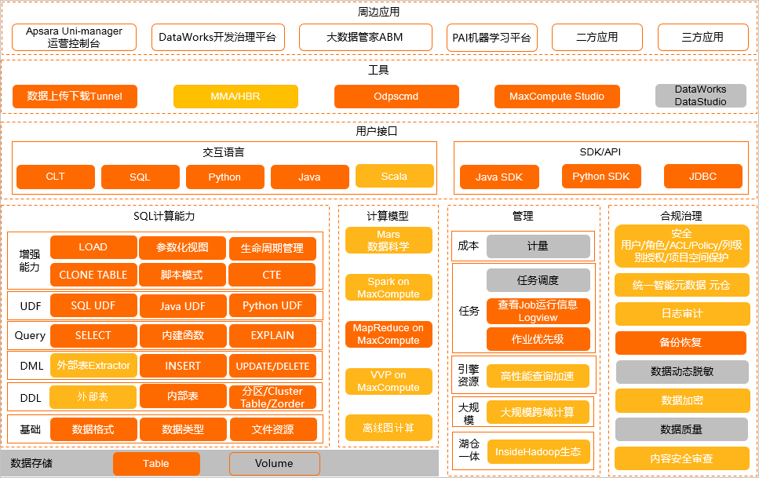

 表示MaxCompute的基本功能，  表示MaxCompute的增强功能，  表示外部系统提供的功能。

<table>
  <tr>
    <th width="122">模块名称</th>
    <th>说明</th>
  </tr>
  <tr>
    <td>周边应用</td>
    <td>MaxCompute支持如下周边应用：<br>• Apsara Uni-manager运营控制台：阿里云专有云统一的智能化运维平台。更多信息，请参见<strong>《Apsara Uni-manager运维控制台用户指</strong><strong>南》</strong>。<br>• DataWorks开发治理平台：可视化工具，您可以基于DataWorks完成数据同步、任务调度、报表生成等常见操作。更多信息，请参见<strong>《DataWorks技术白皮书》</strong>。<br>• 大数据管家ABM（Apsara Big Data Manager）：通过大数据管家的赋能，专有云驻场人员可以轻松地管理MaxCompute。更多信息，请参见<strong>《大数据管家技术白皮书》</strong>。<br>• PAI机器学习平台：基于MaxCompute的一款机器学习算法平台。更多信息，请参见<strong>《机器学习技术白皮书》</strong>。<br>• 二方应用：MaxCompute支持的阿里云其他应用，例如DataV。<br>• 三方应用：MaxCompute兼容的市场上的其他应用。</td>
  </tr>
  <tr>
    <td>工具</td>
    <td>MaxCompute支持如下工具：<br>• 数据上传下载Tunnel：数据通道服务，各种异构数据源都可以通过Tunnel服务导入MaxCompute或从MaxCompute导出。更多信息，请参见<strong>《技</strong><strong>术白皮书》</strong>中的<strong>《Tunnel》</strong>章节。<br>• MMA：MaxCompute数据迁移工具。利用Meta Carrier连接Hive Metastore服务，抓取Hive Metadata，并利用这些数据生成用于创建MaxCompute表和分区的DDL语句以及用于迁移数据的Hive UDTF SQL。<br>• HBR（Hybrid Backup Recovery）：集成专有云备份迁移能力。<br>• Odpscmd：MaxCompute客户端。更多信息，请参见<strong>《用户指南》</strong>中的<strong>《配置客户端（Console）》</strong>章节。<br>• MaxCompute Studio：MaxCompute平台提供的安装在开发者客户端的大数据集成开发环境工具，是一套基于流行的集成开发平台IntelliJ IDEA的开发插件。<br>• DataWorks DataStudio：DataWorks提供的可视化开发平台。更多信息，请参见<strong>《DataWorks用户指南》</strong>。</td>
  </tr>
  <tr>
    <td>用户接口</td>
    <td>MaxCompute支持如下接口：<br>• 交互语言：支持命令行、SQL、Python、Java、Scala等。<br>• SDK/API：支持Java SDK、Python SDK、JDBC等。更多信息，请参见<strong>《开发指南》</strong>。</td>
  </tr>
  <tr>
    <td>SQL计算能力</td>
    <td>MaxCompute支持如下SQL计算能力：<br>• 增强能力：支持LOAD、参数化视图、生命周期管理、CLONE TABLE等。<br>• UDF：用户自定义函数，例如SQL UDF、Java UDF、Python UDF。<br>• Query：查询操作。例如SELECT、内建函数、EXPLAIN。<br>• DML：数据操纵语言。例如INSERT、UPDATE、DELETE。<br>• DDL：数据定义语言。例如创建内部表、外部表、聚簇表（Cluster Table）、分区表。<br>• 基础能力：支持多种数据类型、数据格式，支持上传资源文件。更多信息，请参见<strong>《用户指南》</strong>中的<strong>《MaxCompute SQL》</strong>章节。</td>
  </tr>
</table>

<table>
  <tr>
    <td>计算模型</td>
    <td>MaxCompute支持如下计算模型：<br>• Mars数据科学：Mars是一个基于张量的统一分布式计算框架。Mars能利用并行和分布式技术，为Python数据科学栈加速。更多信息，请参见<strong>《用</strong><strong>户指南》</strong>中的<strong>《Mars数据科学增强包》</strong>章节。<br>• Spark on MaxCompute：基于MaxCompute平台无缝运行使用Spark的方案，其很大程度上丰富了MaxCompute产品的功能体系。更多信息，请参见<strong>《用户指南》</strong>中的<strong>《Spark on MaxCompute》</strong>章节。<br>• MapReduce on MaxCompute：支持在MaxCompute上运行MapReduce作业。更多信息，请参见<strong>《用户指南》</strong>中的<strong>《MaxCompute MapReduce》</strong>章节。<br>• VVP on MaxCompute：将实时计算VVP版的功能基于MaxCompute的资源进行封装，您可以通过Cupid联合计算平台，在VVP UI界面中，使用MaxCompute底层的存储和计算资源，完成实时计算的相关操作。更多信息，请参见<strong>《用户指南》</strong>中的<strong>《VVP On MaxCompute增强包》</strong>章节。<br>• 离线图计算：面向迭代的图计算处理框架。更多信息，请参见<strong>《用户指</strong><strong>南》</strong>中的<strong>《MaxCompute Graph》</strong>章节。</td>
  </tr>
  <tr>
    <td>管理</td>
    <td>MaxCompute支持如下管理方式：<br>• 成本：对资源使用量进行计量。<br>• 任务：提供任务管理机制，例如调度任务、通过Logview查看Job运行信息、设置作业优先级。<br>• 引擎资源：支持高性能的查询加速功能。<br>• 大规模：支持MaxCompute多地域部署。<br>• 湖仓一体：打破数据湖与数据仓库割裂的体系，并将数据湖的灵活性、生态丰富能力与数据仓库的企业级部署能力进行融合，助力构建数据湖和数据仓库相融合的数据管理平台。更多管理信息，请参见<strong>《运维指南》</strong>。</td>
  </tr>
  <tr>
    <td>合规治理</td>
    <td>MaxCompute提供如下合规治理方式：<br>• 安全：可以对用户、角色进行权限控制，支持多种授权方式，例如ACL、Policy、列级别授权。<br>• 统一智能元数据：统一存放元数据。<br>• 日志审计：针对不同用户不同日志数据进行日志审计。<br>• 备份恢复：支持对数据进行备份，并支持从存储中恢复数据。<br>• 数据动态脱敏：支持在DataWorks中进行脱敏查询。<br>• 数据质量：DataWorks提供的支持多种异构数据源的质量校验、通知及管理服务的一站式平台。<br>• 内容安全审查：基于内容安全引擎对内容进行安全识别和审查。更多安全相关信息，请参见<strong>《安全白皮书》</strong>。</td>
  </tr>
  <tr>
    <td>数据存储</td>
    <td>MaxCompute支持的数据存储形式为表或Volume。</td>
  </tr>
</table>

MaxCompute作业流程如下图所示。

图 2. MaxCompute作业流程

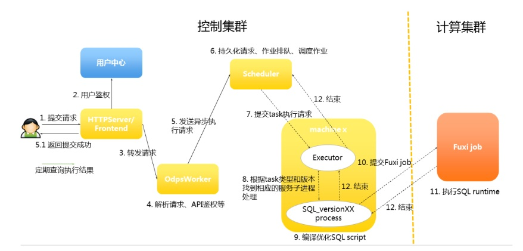

MaxCompute作业中涉及到的相关概念如下所示。

1. MaxCompute instance：代表一个MaxCompute job（没有定义job就是匿名job）的实例。一个MaxCompute job可以包含多个MaxCompute task，所以一个MaxCompute instance可以提交多个sql或者mr，并指定是并行执行还是串行执行。由于job不常用，因此这种用法也比较少，绝大多数情况下是一个instance包含一个task。

2. MaxCompute task：代表一个具体的任务，目前有sql/mr/admin/lot/xlib等近20种类型，每个类型任务执行的逻辑差别很大。同一个instance下不同的task根据task_name进行区分。MaxCompute task是在控制集群上运行的，对于较为简单的修改meta的操作，在控制集群上可以完成整个的生命周期；对于计算任务，则需要向计算集群提交fuxi job。

3. Fuxi job：是任务调度系统模块提供的一种计算模型（与之对应的是fuxi service），表示能执行完成的任务（service表示常驻进程）。

   - Fuxi job支持DAG调度，每一个job都会有一个对应的job master，用于进行这个job下资源的调度。

   - 对于sql来说，fuxi job又分为offline job和online job（由service mode演变而来）。其中，online job也被称为准实时任务，进程是常驻系统的，有任务时就执行，可以减少启停时间，提高处理速度。

   - MaxCompute的task可以向多个计算集群提交任务，fuxi job的主键是cluster name + job name。

   - 任务调度系统提交job的json plan以及任务结束后的jobstatus会被保存在飞天分布式文件系统上。

4. Fuxi task：是fuxi job下的一个概念，与MaxCompute task类似，不同的task代表不同的执行逻辑。fuxi的task之间可以链接成pipes，共同完成一段复杂的逻辑。

5. Fuxi instance：指的是fuxi task的instance，是任务调度系统调度的最小单位。一个task在实际执行过程中，会被切分为许多逻辑单元并行处理，提高处理速度。不同的instance的执行逻辑是相同的，但输入输出数据不同。

6. Fuxi worker：是任务调度系统底层的一个概念，一个worker代表一个操作系统的进程，多个fuxi instance可以复用一个worker，一个worker同时只能处理一个instance。

> **说明**
>
> - InstanceID：MaxCompute作业的唯一标识，在调查问题时非常常用，根据Project name和InstanceID可以构造当前instance的logview。
>
> - Service master/Job master：Tpye类型分别为service和job的master节点，负责进行资源申请和调度，为worker创建工作计划并监控worker的生命周期。

MaxCompute存储与计算层为阿里云自主知识产权的云计算平台的核心构件，是飞天操作系统内核，运行在计算集群上且与控制集群独立。上面的MaxCompute架构图中仅列出了若干飞天内核主要模块。

<a id="section-2"></a>

# 2.运维命令与工具

<a id="section-2-1"></a>

## 2.1. 使用前须知

使用运维命令及工具进行MaxCompute运维前，必须要了解以下信息。

在MaxCompute运维中，默认账号是为admin，所有命令也必须以admin账号执行，如果遇到需要超级权限的，则必须以admin账号+sudo的形式执行。

<a id="section-2-2"></a>

## 2.2. odpscmd命令

**进入执行命令窗口**

运维工程师可以通过命令行进行运维操作，在执行具体的命令行之前，需要先登录命令行操作界面，具体操作如下。

1. 进入飞天基础运维平台，选择**资源管理 > 产品集群运维**后，在**产品 | 集群**搜索框中输入odps，搜索出相关集群。

2. 单击目标集群**操作**列的**集群详情**，在**服务列表**页签中通过**服务**搜索框查找 `odps-service-computer` 服务。

3. 单击该**服务**名称，进入**服务 odps-service-computer**页面。

4. 选择**ComputerInit#**。

5. 单击**实例列表**页签下对应机器的**操作**栏中的**Terminal**，开启TerminalService窗口，后续的命令行操作均在此窗口进行。

**Console命令目录及配置**

MaxCompute客户端放在odpsag的/apsara/odps_tools目录下面的clt文件夹。客户端的配置文件放在clt文件夹中的conf目录中 ，默认会配置好id、key、end_point、log_view和tunnel_point。使用 `cd /apsara/odps_tools/` 命令切换目录后，用户直接使用命令 `./clt/bin/odpscmd` 即可进入交互模式，可以看到版本号等信息。例如：执行 `HTTP GET /projects/admin_task_project/system;` 命令，即可查看MaxCompute的版本信息。

**客户端命令参数详解**

客户端的命令参数如下图所示。

图 4. 客户端命令参数

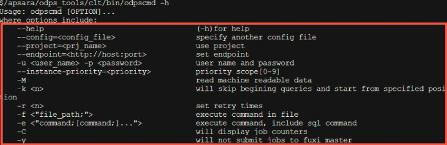

- 命令参数<strong>-e</strong>：MaxCompute客户端不使用交互模式执行sql语句。

- 命令参数<strong>--project、-u、-p</strong>：直接使用指定user+pass+project，当被指定user、pass等参数后，将优先使用参数中的值，而不是conf中配置的值，其他未指定的参数将仍然使用conf中配置的值。

- 命令参数<strong>-k、-f</strong>：直接执行本地sql文件。

- 命令参数<strong>--instance-priority</strong>：为当前任务指定优先级，9为最小值并且为默认值，0为最大值。

- 命令参数<strong>-r</strong>：是重试的次数，脚本作业时会比较常用。

**SQL中运维时较常用的命令**

常用命令如下所示。

表 1. 常用命令

| 命令 | 作用 |
| --- | --- |
| whoami | 查看使用者的云账号和endpoint信息。 |
| show p | 查看历史执行过的instance。 |
| wait &lt;instanceid&gt; | 可以重新打印任务的logview和fuxijob信息，仅限owner权限并且在同一个project中才能打印。 |
| kill &lt;instanceid&gt; | 停止指定instance。 |
| tunnel upload/download | 常用来测试tunnel是否可用，用来排障。 |
| desc project &lt;projectname&gt; -extended | 查看project空间的使用情况。<br>• <strong>desc extended table</strong>：查看表信息。<br>• <strong>desc table_name partition(pt_spec)</strong>：查看分区信息。<br>• <strong>desc resource $resource_name</strong>：查看当前project资源信息。<br>• <strong>desc project $project_name -extended</strong>：查看集群信息。 |
| export &lt;project name&gt; &lt; local_file_path&gt; | 导出项目内所有表的DDL语句。 |
| create table &lt;tablename&gt; (…) | 新建一张表。 |
| select count(\*) from &lt;tablename&gt; | 查询表。 |
| Explain | 可以只生成plan，而不提交fuxijob，来查看任务需要的资源信息。 |
| list | 可以列出各种table、resrouce、role等信息。 |
| show | 可以查看table、partition等信息。 |
| purge | 清空MaxCompute回收站中的数据直接到飞天分布式文件系统回收站中。<br>• <strong>purge table &lt;tablename&gt;</strong>：清理单表。<br>• <strong>purge all</strong>：清理当前project所有表。 |

<a id="section-2-3"></a>

## 2.3. Tunnel命令

可以通过客户端提供的Tunnel命令实现原有Dship工具的功能，进行数据的上传和下载等操作。表 1. Tunnel命令

<table>
  <tr>
    <th width="160">命令</th>
    <th>作用</th>
  </tr>
  <tr>
    <td>tunnel upload</td>
    <td>上传数据到MaxCompute的表中。目前支持文件或目录（指一级目录）的上传，每一次上传只支持数据上传到一张表或表的一个分区，有分区的表一定要指定上传的分区，多级分区一定要指定到末级分区。</td>
  </tr>
  <tr>
    <td>tunnel download</td>
    <td>从MaxCompute的表中下载数据。目前只支持下载到单个文件，每一次下载只支持下载一张表或一个分区到一个文件，有分区的表一定要指定下载的分区，多级分区一定要指定到末级分区。</td>
  </tr>
  <tr>
    <td>tunnel resume</td>
    <td>如果出现因为网络或tunnel服务的原因造成的上传数据失败，可以通过resume命令进行断点续传，目前仅支持上传数据的续传。每次上传、下载数据被称为一个session。在resume命令后指定session id完成续传。</td>
  </tr>
  <tr>
    <td>tunnel show</td>
    <td>查看历史运行信息。</td>
  </tr>
  <tr>
    <td>tunnel purge</td>
    <td>清理session目录，默认清理3天内的。</td>
  </tr>
</table>

Tunnel命令支持在客户端通过help子命令获取帮助信息，每个命令的子命令使用提示如下。

**Upload**

将本地文件的数据导入MaxCompute的表中，子命令使用提示如下：

```text
odps@ project_name>tunnel help upload;
usage: tunnel upload [options] <path> <[project.]table[/partition]>
              upload data from local file
 -acp,-auto-create-partition <ARG>   auto create target partition if not
                                     exists, default false
 -bs,-block-size <ARG>               block size in MiB, default 100
 -c,-charset <ARG>                   specify file charset, default ignore.
                                     set ignore to download raw data
 -cp,-compress <ARG>                 compress, default true
 -dbr,-discard-bad-records <ARG>     specify discard bad records
                                     action(true|false), default false
 -dfp,-date-format-pattern <ARG>     specify date format pattern, default
                                     yyyy-MM-dd HH:mm:ss
 -fd,-field-delimiter <ARG>          specify field delimiter, support
                                     unicode, eg \u0001. default ","
 -h,-header <ARG>                    if local file should have table
                                     header, default false
 -mbr,-max-bad-records <ARG>         max bad records, default 1000
 -ni,-null-indicator <ARG>           specify null indicator string,
                                     default ""(empty string)
 -rd,-record-delimiter <ARG>         specify record delimiter, support
                                     unicode, eg \u0001. default "\r\n"
 -s,-scan <ARG>                      specify scan file
                                     action(true|false|only), default true
 -sd,-session-dir <ARG>              set session dir, default
                                     D:\software\odpscmd_public\plugins\ds
                                     hip
 -ss,-strict-schema <ARG>            specify strict schema mode. If false,
                                     extra data will be abandoned and
                                     insufficient field will be filled
                                     with null. Default true
 -te,-tunnel_endpoint <ARG>          tunnel endpoint
    -threads <ARG>                   number of threads, default 1
 -tz,-time-zone <ARG>                time zone, default local timezone:
                                     Asia/Shanghai
Example:
    tunnel upload log.txt test_project.test_table/p1="b1",p2="b2"
```

**参数说明**：

- -acp：如果不存在，自动创建目标分区，默认关闭。

- -bs：每次上传至Tunnel的数据块大小，默认100MiB（MiB＝1024\*1024B ）。

- -c：指定本地数据文件编码，默认为UTF-8。不设定，默认下载源数据。

- -cp：指定是否在本地压缩后再上传，减少网络流量，默认开启。

- -dbr：是否忽略脏数据（多列、少列、列数据类型不匹配等情况）。

  - 值为true时，将全部不符合表定义的数据忽略。

  - 值为false时，若遇到脏数据，则给出错误提示信息，目标表内的原始数据不会被污染。

- -dfp：DateTime类型数据格式，默认为yyyy-MM-dd HH:mm:ss。

- -fd：本地数据文件的列分割符，默认为半角逗号（,）。

- -h：数据文件是否包括表头，如果为true，则dship会跳过表头从第二行开始上传数据。

- -mbr：默认情况下，当上传的脏数据超过1000条时，上传动作终止。通过此参数，可以调整可容忍的脏数据量。

- -ni：NULL数据标志符，默认为“ ”（空字符串）。

- -rd：本地数据文件的行分割符，默认为\\r\\n。

- -s：是否扫描本地数据文件，默认值为false。

  - 值为true时，先扫描数据，若数据格式正确，再导入数据。

  - 值为false时，不扫描数据，直接进行数据导入。

  - 值为only时，仅进行扫描本地数据，扫描结束后不继续导入数据。

- -sd：设置session目录。

- -te：指定tunnel的Endpoint。

- -threads：指定threads的数量，默认为1。

- -tz：指定时区。默认为本地时区：Asia/Shanghai。

**Show**

显示历史记录。子命令使用提示如下：

```text
odps@ project_name>tunnel help show;
usage: tunnel show history [options]
              show session information
 -n,-number <ARG>   lines
Example:
    tunnel show history -n 5
    tunnel show log
```

**参数说明**：

-n：指定显示行数。

**Resume**

修复执行历史记录，仅对上传数据有效。子命令使用提示如下：

```text
odps@  project_name>tunnel help resume;
usage: tunnel resume [session_id] [-force]
              resume an upload session
 -f,-force   force resume
Example:
    tunnel resume
```

**Download**

子命令使用提示如下：

```text
odps@ project_name>tunnel help download;
usage: tunnel download [options] <[project.]table[/partition]> <path>
              download data to local file
 -c,-charset <ARG>                 specify file charset, default ignore.
                                   set ignore to download raw data
 -ci,-columns-index <ARG>          specify the columns index(starts from
                                   0) to download, use comma to split each
                                   index
 -cn,-columns-name <ARG>           specify the columns name to download,
                                   use comma to split each name
 -cp,-compress <ARG>               compress, default true
 -dfp,-date-format-pattern <ARG>   specify date format pattern, default
                                   yyyy-MM-dd HH:mm:ss
 -e,-exponential <ARG>             When download double values, use
                                   exponential express if necessary.
                                   Otherwise at most 20 digits will be
                                   reserved. Default false
 -fd,-field-delimiter <ARG>        specify field delimiter, support
                                   unicode, eg \u0001. default ","
 -h,-header <ARG>                  if local file should have table header,
                                   default false
    -limit <ARG>                   specify the number of records to
                                   download
 -ni,-null-indicator <ARG>         specify null indicator string, default
                                   ""(empty string)
 -rd,-record-delimiter <ARG>       specify record delimiter, support
                                   unicode, eg \u0001. default "\r\n"
 -sd,-session-dir <ARG>            set session dir, default
                                   D:\software\odpscmd_public\plugins\dshi
                                   p
 -te,-tunnel_endpoint <ARG>        tunnel endpoint
    -threads <ARG>                 number of threads, default 1
 -tz,-time-zone <ARG>              time zone, default local timezone:
                                   Asia/Shanghai
usage: tunnel download [options] instance://<[project/]instance_id> <path>
              download instance result to local file
 -c,-charset <ARG>                 specify file charset, default ignore.
                                   set ignore to download raw data
 -ci,-columns-index <ARG>          specify the columns index(starts from
                                   0) to download, use comma to split each
                                   index
 -cn,-columns-name <ARG>           specify the columns name to download,
                                   use comma to split each name
 -cp,-compress <ARG>               compress, default true
 -dfp,-date-format-pattern <ARG>   specify date format pattern, default
                                   yyyy-MM-dd HH:mm:ss
 -e,-exponential <ARG>             When download double values, use
                                   exponential express if necessary.
                                   Otherwise at most 20 digits will be
                                   reserved. Default false
 -fd,-field-delimiter <ARG>        specify field delimiter, support
                                   unicode, eg \u0001. default ","
 -h,-header <ARG>                  if local file should have table header,
                                   default false
    -limit <ARG>                   specify the number of records to
                                   download
 -ni,-null-indicator <ARG>         specify null indicator string, default
                                   ""(empty string)
 -rd,-record-delimiter <ARG>       specify record delimiter, support
                                   unicode, eg \u0001. default "\r\n"
 -sd,-session-dir <ARG>            set session dir, default
                                   D:\software\odpscmd_public\plugins\dshi
                                   p
 -te,-tunnel_endpoint <ARG>        tunnel endpoint
    -threads <ARG>                 number of threads, default 1
 -tz,-time-zone <ARG>              time zone, default local timezone:
                                   Asia/Shanghai
Example:
    tunnel download test_project.test_table/p1="b1",p2="b2" log.txt
    tunnel download instance://test_project/test_instance log.txt
```

**参数说明**：

- -c：本地数据文件编码，默认为UTF-8。

- -ci：指定列索引（从0开始）下载，使用半角逗号（,）分隔。

- -cn：指定要下载的列名称，使用半角逗号（,）分隔每个名称。

- -cp，-compress：指定是否压缩后再下载，减少网络流量，默认开启。

- -dfp：DateTime类型数据格式，默认为yyyy-MM-dd HH:mm:ss。

- -e：当下载double值时，如果需要，使用指数函数表示，否则最多保留20位。

- -fd：本地数据文件的列分割符，默认为半角逗号（,）。

- -h：数据文件是否包括表头，如果为true，则dship会跳过表头从第二行开始下载数据。

  > `-h=true` 和 `threads>1` 即多线程不能一起使用。
  >
  > **说明**

- -limit：指定要下载的文件数量。

- -ni：NULL数据标志符，默认为“ ”（空字符串）。

- -rd：本地数据文件的行分割符，默认为\\r\\n。

- -sd：设置session目录。

- -te：指定tunnel endpoint。

- -threads：指定threads的数量，默认为1。

- -tz：指定时区。默认为本地时区：Asia/Shanghai。

**Purge**

清除session目录，默认清除距离当前日期3天内的。子命令使用提示如下：

```text
odps@ project_name>tunnel help purge;
usage: tunnel purge [n]
              force session history to be purged.([n] days before, default
              3 days)
Example:
    tunnel purge 5
```

<a id="section-2-4"></a>

## 2.4. LogView工具

<a id="section-2-4-1"></a>

### 2.4.1. 使用前须知

使用LogView工具前，需要先确认logview进程的状态，如果进程状态为关闭，需要启动logview进程。

**进入执行命令窗口**

1. 进入飞天基础运维平台，选择**资源管理 > 产品集群运维**后，在**产品 | 集群**搜索框中输入odps，搜索出相关集群。

2. 单击目标集群**操作**列的**集群详情**，在**服务列表**页签中通过**服务**搜索框查找 `odps-service-console` 服务。

3. 单击该**服务**名称，进入**服务 odps-service-console**页面。

4. 选择**LogView#**。

5. 单击**实例列表**页签下对应机器的**操作**栏中的**Terminal**，开启TerminalService窗口，后续的命令行操作均在此窗口进行。

**进程管理命令示例**

查询进程状态及启动进程的具体操作如下。

1. 执行如下命令，找到LogView的docker机器。

   ```bash
   docker ps|grep logview;
   ```

2. 分别执行如下命令，查看logview进程状态。

   ```text
   ps -aux|grep logview;
   ```

   ```text
   netstat -ntulp|grep 9000;
   ```

3. 如果显示进程状态为关闭，执行如下命令，启动进程。

   ```text
   /opt/aliyun/app/logview/bin/control start;
   ```

<a id="section-2-4-2"></a>

### 2.4.2. LogView介绍

LogView是一个在MaxCompute Job提交后查看任务和Debug任务的工具，用户可以使用LogView查看作业运行的详细日志信息。

**LogView监控了什么**

LogView监控了作业运行的运行状态 、运行结果以及细节和进度。

**LogView的入口**

以客户端odpscmd为例，在客户端中提交SQL后，会返回一个以 `http://logview.odps.aliyun.com/logview` 开头的长字符串。

图 1. LogView开头的长字符串

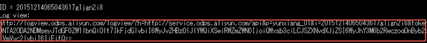

将该字符串去除回车及换行信息后，输入浏览器的地址栏即可。

<a id="section-2-4-3"></a>

### 2.4.3. 看懂LogView

对于复杂的sql，用户想看懂Logview，需要先清楚的了解MaxCompute Task和Fuxi Instance的关系。

简单的说，一个MaxCompute Task由一个或者多个Fuxi Job组成，每个Fuxi Job由一个或者多个Fuxi Task组成，每个Fuxi Task由一个或者多个Fuxi Instance组成。

图 1. MaxCompute Task和Fuxi Instance的关系

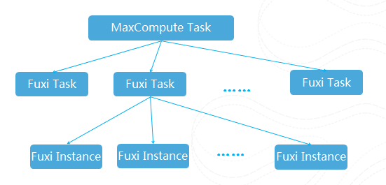

在LogView中，相关部分的显示信息如下所示。

**MaxCompute Instance**

图 2. MaxCompute Instance

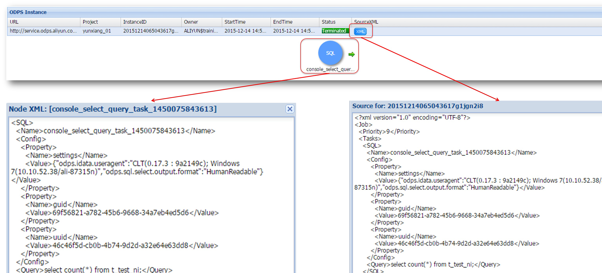

**MaxCompute Task**

图 3. MaxCompute Task

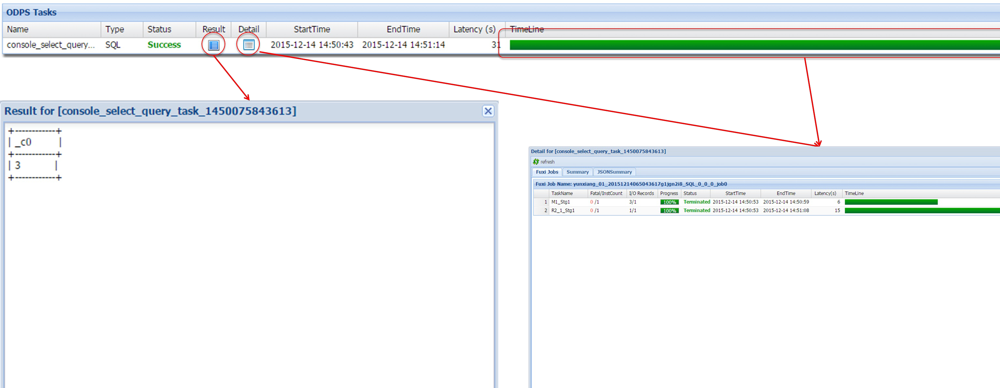

**Task Detail-Fuxi Job**

图 4. Task Detail-Fuxi Job(1)

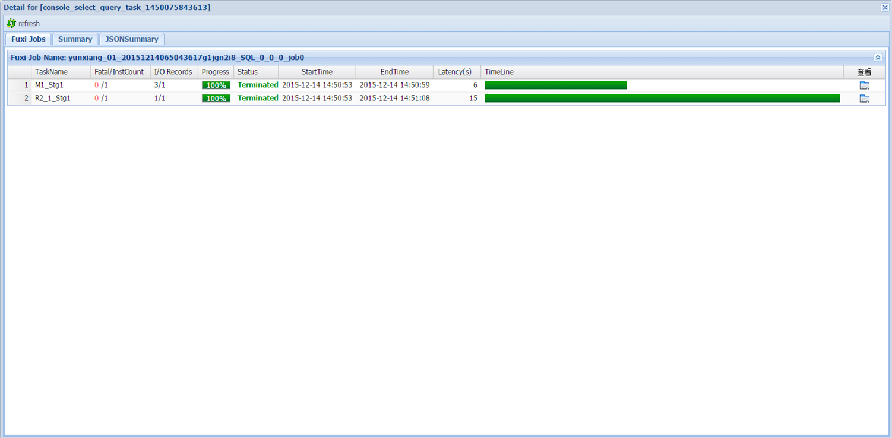

图 5. Task Detail-Fuxi Job(2)

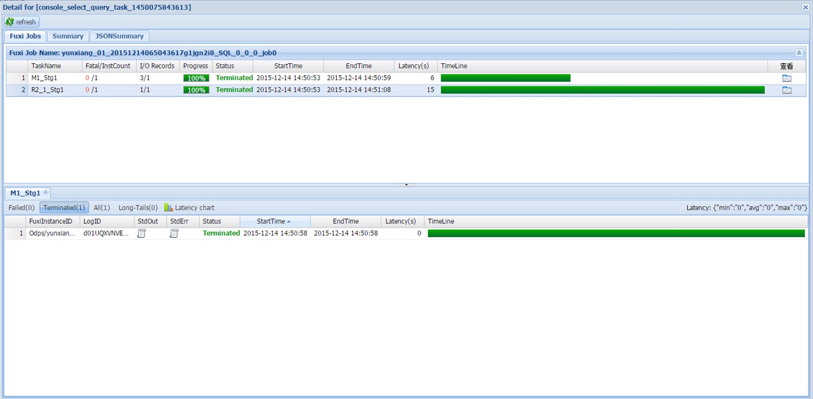

**Task Detail-Summary**

图 6. Task Detail-Summary

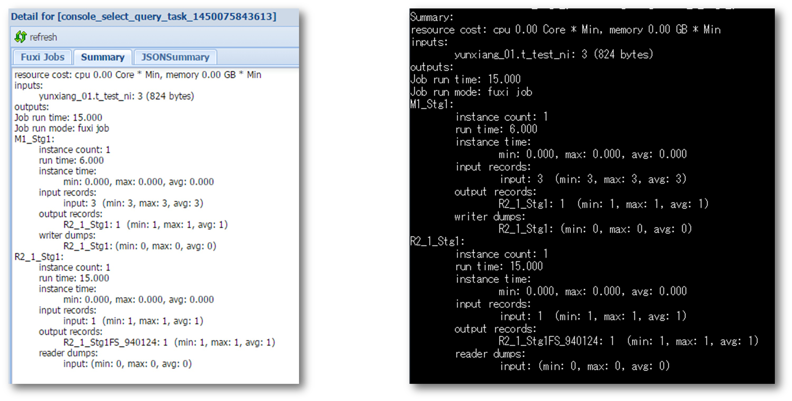

**Task Detail-JSONSummary**

图 7. Task Detail-JSONSummary

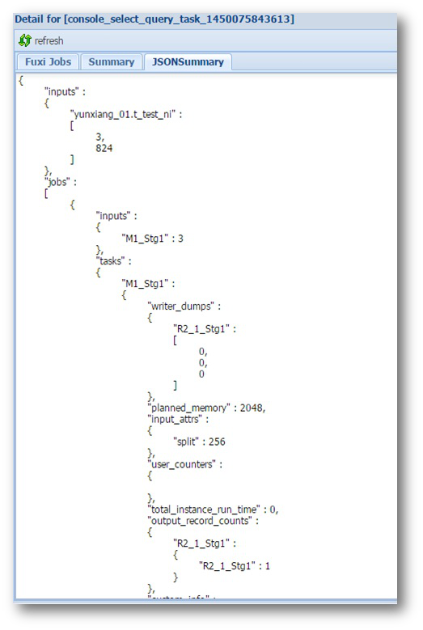

<a id="section-2-4-4"></a>

### 2.4.4. LogView使用示例

本文为您介绍LogView的使用示例。

**背景信息**

LogView可以查看作业生命周期的各个时间点、查看任务调度系统调度花费时间、查看轮询间隔、查看是否有数据倾斜、查看UDF/MR等的调试信息、查看任务状态-出错等。LogView操作入口，详情请参见使用前须知。

**查看作业生命周期的各个时间点**

图 1. 查看作业生命周期的各个时间点

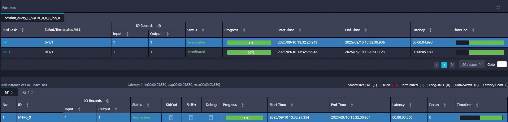

- Fuxi Jobs中，**Start Time**字段表示Fuxi Task起始时间。

- Fuxi Instance of Fuxi Task中，**Start Time**字段表示Fuxi Instance起始时间。

**查看任务调度系统调度花费时间**

图 2. 查看任务调度系统调度花费时间


任务调度系统的调度花费时间公式为：Fuxi Instance起始时间 - Fuxi Task起始时间 = Fuxi调度花费时间。

本例中M1 Task中的Fuxi Instance的调度时间约为2秒。

**查看轮询间隔**

命令示例如下：

```sql
select * from skew a join small b on a.key=b.key;
```

MaxCompute Instance提交后，odpscmd会轮询Job的执行状态，轮询的间隔约为5s。您可获取对应的Instance ID及LogView。

**查看是否有数据倾斜**

同一个Fuxi Task中，不同Instance的运行时间应该接近，您可点击Fuxi Instance中的StdOut查看已处理的数据量，若不同Instance间处理的数据量有巨大差别，即证明存在数据倾斜。

**查看UDF/MR等的调试信息**

您可点击Fuxi Instance中的StdOut和StdErr，以查看UDF/MR等具体的调试信息。

**查看任务状态-出错**

若任务执行出错，您可在LogView的**Result**页签查看错误信息，也可在Job Details页签查看具体是哪个部分出的问题。

**根据InstanceID找到LogView**

在Job提交后，输入Ctrl+C可以回到odpscmd进行其他操作， 这时可以通过 `wait` ; 命令来重新找到Logview和继续获取Job状态。

**找出运行的任务**

在退出控制窗口后，如果不清楚有哪些正在运行，或运行过的任务，可以通过 `show p;` 命令查找。

<a id="section-2-5"></a>

## 2.5. 大数据管家

大数据管家支持从业务、服务、集群和主机等多个角度对大数据产品进行运维。除此以外，大数据管家还支持对大数据产品进行补丁升级、自定义大数据产品的报警上报配置、查看大数据管家中的运维操作历史等。

大数据管家的登录方式及MaxCompute相关的运维操作，请参见MaxCompute运维。

<a id="section-3"></a>

# 3.日常运维

<a id="section-3-1"></a>

## 3.1. 产品配置

MaxCompute的配置路径为odpsag中的/apsara/odps_service/deploy/env.cfg，配置文件内容如下。

```text
odps_worker_num=3
executor_worker_num=3
hiveserver_worker_num=3
replication_server_num=3
messager_partition_num=3
```

用户根据实际需求，修改上面对应的值后参考本文档的MaxCompute服务重启章节，可以按照配置的值启动MaxCompute相应的服务。

如果在配置文件的最后加上一行参数 `xstream_max_worker_num=3` ，xstream会以这行参数配置的worker数启动。

<a id="section-3-2"></a>

## 3.2. 日常巡检

1. 在飞天基础运维平台的集群运维中查看所有机器是否已达终态。

   <ol type="i">

   <li>

   进入飞天基础运维平台，选择**资源管理 > 产品集群运维**后，在**产品 | 集群**搜索框中输入odps，搜索出相关集群。

   图 1. 搜索集群

   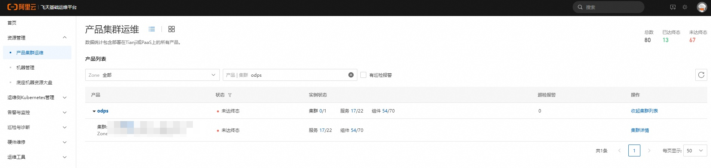

   </li>

   <li>

   通过查看**状态**、**实例状态**两列的信息，查看所有机器是否已到终态，如下图所示说明部分机器未到终态。

   图 2. 查看所有机器是否已到终态

   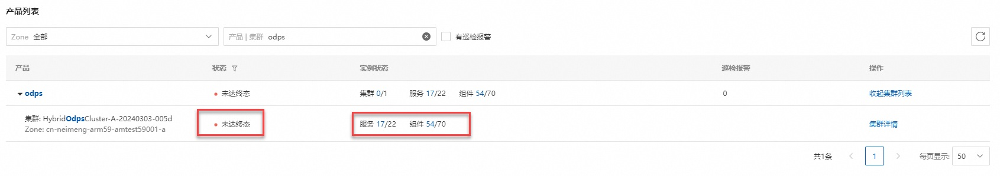

   </li>

   <li>

   单击**实例状态**列的**服务**和**组件**，可以查看异常的具体详情，您也可以单击目标集群**操作**列的**集群详情**查看集群详细信息。

   </li>

   </ol>

2. 进入/home/admin/odps/odps_tools/clt/bin/odpscmd -e，执行如下命令：

   ```sql
   select count(*) from datahub_smoke_test;
   ```

   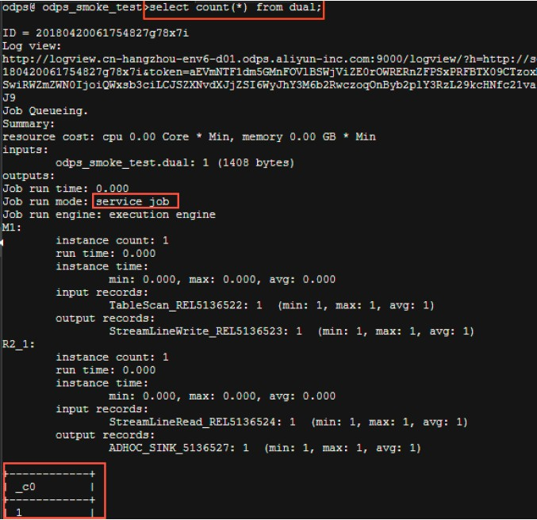

   如下图所示**fuxi job**是运行的，并显示结果，说明是正常的。

   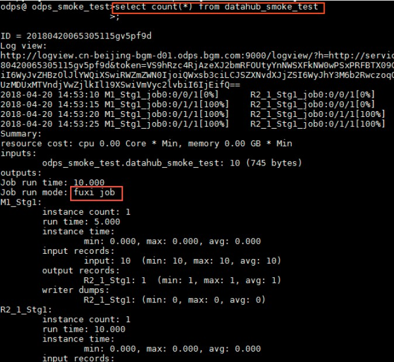

3. 执行如下命令，查看这些worker pid都在并且最近有没有重启过。

   <ol type="i">

   <li>

   `r swl Odps/MessagerServicex;`

   </li>

   </ol>

   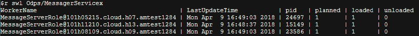

   <ol type="i" start="2">

   <li>

   `r swl Odps/OdpsServicex;`

   </li>

   </ol>

   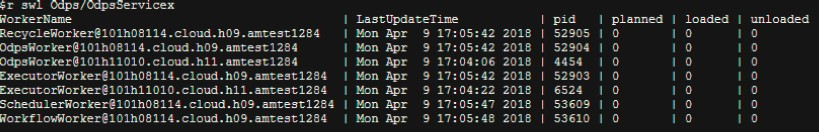

   <ol type="i" start="3">

   <li>

   `r swl Odps/HiveServerx;`

   </li>

   </ol>

   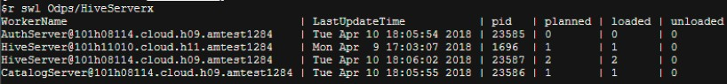

   <ol type="i" start="4">

   <li>

   `r swl Odps/QuotaServicex;`

   </li>

   </ol>

   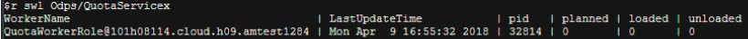

   <ol type="i" start="5">

   <li>

   `r swl Odps/ReplicationServicex;`

   </li>

   </ol>

   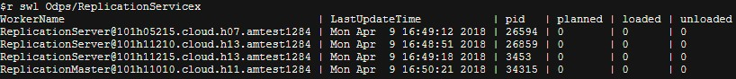

4. 执行如下命令查看是否有error。

   ```text
   puadmin lscs |grep -vi NORMAL|grep -vi DISK_OK;
   ```

   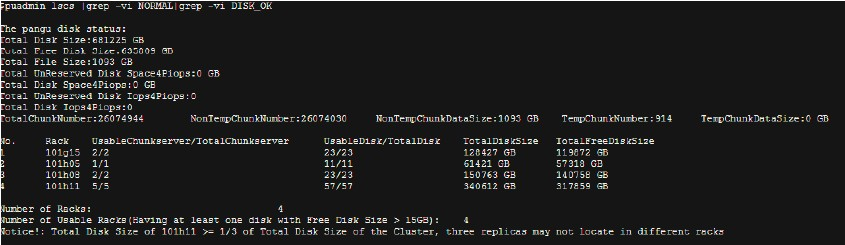

5. 执行如下命令查看数据是否完整。

   <ol type="i">

   <li>

   `puadmin fs -abnchunk -t none;`

   </li>

   </ol>

   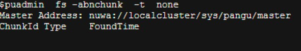

   <ol type="i" start="2">

   <li>

   `puadmin fs -abnchunk -t onecopy;`

   </li>

   </ol>

   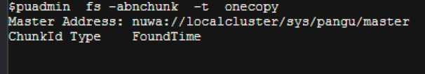

   <ol type="i" start="3">

   <li>

   `puadmin fs -abnchunk -t lessmin;`

   </li>

   </ol>

   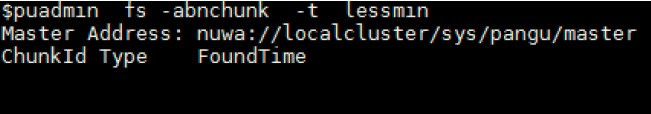

6. 登录飞天名称服务及分布式锁系统机器。

   ```bash
   echo srvr | nc localhost 10240 | grep Mode;
   ```

   示例如下：

   ```text
   tj_show -r nuwa.NuwaZK#>/tmp/nuwa;pssh -h /tmp/nuwa -i "echo srvr | nc localhost 10240 | grep Mode";
   ```

   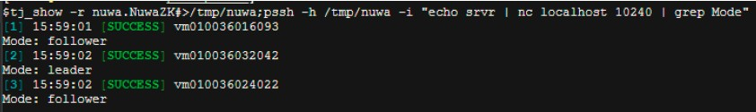

7. 执行如下命令查看飞天分布式文件系统的状态是OK的。

   ```text
   puadmin gems;
   ```

   ```text
   puadmin gss;
   ```

   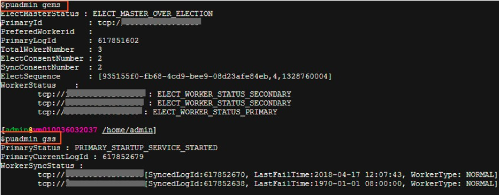

8. 在大数据管家中执行每日巡检，查看磁盘使用率。

<a id="section-3-3"></a>

## 3.3. Chunkserver关机维修克隆系统

odps chunkserver出现硬件故障时，您可以通过本文进行Chunkserver关机维修。

**背景信息**

在Chunkserver关机维修克隆系统时，操作会导致集群临时少一台cs的资源，但是不影响服务。

**前提条件**

- 检查MaxCompute服务正常，全部终态。

- OPS1机器服务正常，全部终态。

- 节点下线会触发数据迁移，需要确保磁盘空间满足。

- 检查是否有服务主节点在要下线机器上，需要主备切换。

**操作步骤**

1. 在飞天基础运维平台上面找到并打开odps集群中**odps-service-computer**服务里<strong>ComputerInit#</strong>对应的TerminalService窗口后，执行如下3个命令，检查飞天分布式文件系统数据完整性。

   ```text
   puadmin abnchunk fs -t none;
   -- 查看⽂件是否丢失，没有输出表示正常
   puadmin abnchunk fs -t onecopy;
   -- 查看⽂件是否只有⼀份，没有输出表示正常
   puadmin abnchunk fs -t lessmin;
   -- 查看⽂件是否⼩于最⼩备份数，没有输出表示正常
   ```

2. 将需要关机的机器拉入fuxi黑名单。

   <ol type="i">

   <li>

   执行如下命令，开启fuxi黑名单功能（已开启可忽略本步骤）。

   ```text
   /apsara/deploy/rpc_caller --Server=nuwa://localcluster/sys/fuxi/master/ForClient --
   Method=/fuxi/SetGlobalFlag --Parameter={\"fuxi_Enable_BadNodeManager\":false};
   ```

   </li>

   <li>

   执行如下命令，检查已有黑名单中的hostname。

   ```text
   /apsara/deploy/rpc_wrapper/rpc.sh blacklist cluster get;
   ```

   </li>

   <li>

   执行如下命令，添加需要关机的机器到黑名单中。

   ```text
   /apsara/deploy/rpc_wrapper/rpc.sh blacklist cluster add $hostname;
   ```

   </li>

   <li>

   执行如下命令，检查需要关机的机器是否已经在黑名单中。

   ```text
   /apsara/deploy/rpc_wrapper/rpc.sh blacklist cluster get;
   ```

   </li>

   </ol>

3. 关机维修，然后开机启动。

   > **说明**
   >
   > 维修过程中，不要破坏系统。

4. 执行如下命令，移除fuxi黑名单。

   ```text
   /apsara/deploy/rpc_wrapper/rpc.sh blacklist cluster remove $hostname;
   /apsara/deploy/rpc_wrapper/rpc.sh blacklist cluster get;
   ```

5. 设置故障机rma=pending。

   <ol type="i">

   <li>

   登录ops1机器，将要维修的故障机（m1，具体为故障机hostname）设置action为rma=pending。

   执行：

   **curl "http://127.0.0.1:7070/api/v5/SetMachineAction?hostname=m1" -d'{"action_name":"rma", "action_status":"pending"}';**

   返回：

   ```json
   {
       "err_code": 0,
       "err_msg": "",
       "data": [
           {
               "hostname": "m1"
           }
       ]
   }
   ```

   </li>

   <li>

   设置audit log。

   **curl "http://127.0.0.1:7070/api/v5/AddAuditLog?object=/m/m1&category=action" -d '{"category":"action", "from":"tianji.HealingService#", "object":"/m/m1", "content": "{\\n \\"action\\" : \\"/action/rma\\",\\n \\"description\\" : \\"/monitor/rma=error, mtime: 1513488046851649\\",\\n \\"status\\" : \\"pending\\"\\n}\\n" }';**

   其中mtime为故障机 "action_description@mtime": 1513488046851649，此处仅为示例，具体操作时请设置当前时间。通过下面命令获取到：

   执行：

   **curl "http://127.0.0.1:7070/api/v5/GetMachineInfo?hostname=m1&attr=action_name,action_status,action_description@mtime";**

   返回：

   ```json
   {
       "err_code": 0,
       "err_msg": "",
       "data": {
           "action_description": "",
           "action_description@mtime": 1516168642565661,
           "action_name": "rma",
           "action_name@mtime": 1516777552688111,
           "action_status": "pending",
           "action_status@mtime": 1516777552688111,
           "hostname": "m1",
           "hostname@mtime": 1516120875605211
       }
   }
   ```

   </li>

   </ol>

6. 等待审批。

   <ol type="i">

   <li>

   等机器上rma=approved/doing； 查看机器action状态：

   执行：

   **curl "http://127.0.0.1:7070/api/v5/GetMachineInfo?hostname=m1";**

   返回：

   返回比较多，可以找到关键字："action_status": "pending"

   </li>

   <li>

   查看机器上sr的审批状态：pending正在审批的sr，approved/doing/done表示已经审批完，没有action的表示还未审批。

   执行查询命令：

   **curl http://127.0.0.1:7070/api/v5/GetMachineInfoPackage?hostname=m1&attr=sr.id,sr.action_name,sr.action_status;**

   返回：返回比较多，也可以在web页面查看状态为doing的项。

   </li>

   </ol>

7. 等机器上的信息变为rma=approved/doing之后，维修人员关机维修。维修完成后，开机启动。

   > **说明**
   >
   > 维修完成后，如需要clone机器继续执行下一步骤，如不需要clone，则跳过下一步骤。

8. 重新装机（clone）。

   <ol type="i">

   <li>

   维修完成之后，在ops1上设置机器action（重新装机）。

   执行：

   **curl "http://127.0.0.1:7070/api/v5/SetMachineAction?hostname=m1&action_name=rma&action_status=doing" -d'{"action_name":"clone", "action_status":"approved", "action_description":"", "force":true}';**

   返回：

   ```json
   {
   "err_code": 0,
   "err_msg": "",
   "data": [
   {
   "hostname": "m1"
   }
   ]
   }
   ```

   </li>

   <li>

   进入Clone容器，通过下面命令检查clone装机状态，确认操作生效。

   <ol type="a">

   <li>

   查询clone容器。

   执行：

   **docker ps|grep clone;**

   返回：

   ```text
   18c1339340ab 
   reg.docker.god7.cn/tianji/ops_service:1f147fec4883e082646715cb79c3710f7b2ae9c6e6851
   9a9452b92b4b3366a ops.OpsClone__.clone.1514969139
   ```

   </li>

   <li>

   登录容器。

   执行：

   **docker ps|grep clone;**

   </li>

   </ol>

   <ol type="i" start="100">

   <li>

   查询clone任务。

   执行：

   **/home/tops/bin/python /root/opsbuild/bin/opsbuild.py acli list --status=ALL -n 10000 | vim –;**

   </li>

   </ol>

   </li>

   </ol>

9. 恢复机器状态。

   **curl "http://127.0.0.1:7070/api/v5/SetMachineAction?hostname=m1&action_name=rma" -d'{"action_name":"rma","action_status":"done", "force":true}';**

0. 查看机器状态（可通过命令，也可通过飞天基础运维平台），状态为GOOD，机器维修完成，恢复正常使用。

   执行：

   **curl "http://127.0.0.1:7070/api/v5/GetMachineInfo?hostname=m1&attr=state,hostname";**

   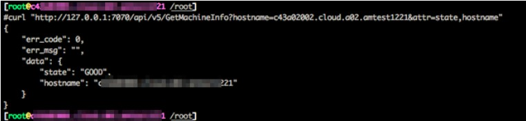

1. 检查集群终态，确认新上线的机器上所有服务达到终态。

<a id="section-3-4"></a>

## 3.4. Chunkserver关机维修不破坏系统

**前提条件**

检查MaxCompute服务正常，全部终态。

**操作步骤**

1. 在飞天基础运维平台上找到并打开odps集群中**odps-service-computer**服务里<strong>ComputerInit#</strong>对应的TerminalService窗口后，执行如下3个命令，检查飞天分布式文件系统数据完整性。

   ```text
   puadmin abnchunk fs -t none;
   -- 查看⽂件是否丢失，没有输出表示正常
   puadmin abnchunk fs -t onecopy;
   -- 查看⽂件是否只有⼀份，没有输出表示正常
   puadmin abnchunk fs -t lessmin;
   -- 查看⽂件是否⼩于最⼩备份数，没有输出表示正常
   ```

2. 将需要关机的机器拉入fuxi黑名单。

   <ol type="i">

   <li>

   执行如下命令，开启fuxi黑名单功能（已开启可忽略本步骤）。

   ```text
   /apsara/deploy/rpc_caller --Server=nuwa://localcluster/sys/fuxi/master/ForClient --
   Method=/fuxi/SetGlobalFlag --Parameter={\"fuxi_Enable_BadNodeManager\":false};
   ```

   </li>

   <li>

   执行如下命令，检查已有黑名单中的hostname。

   ```text
   /apsara/deploy/rpc_wrapper/rpc.sh blacklist cluster get;
   ```

   </li>

   <li>

   执行如下命令，添加需要关机的机器到黑名单中。

   ```text
   /apsara/deploy/rpc_wrapper/rpc.sh blacklist cluster add $hostname;
   ```

   </li>

   <li>

   执行如下命令，检查需要关机的机器是否已经在黑名单中。

   ```text
   /apsara/deploy/rpc_wrapper/rpc.sh blacklist cluster get;
   ```

   </li>

   </ol>

3. 关机维修，然后开机启动。

   > **说明**
   >
   > 维修过程中，不要破坏系统。

4. 执行如下命令，移除fuxi黑名单。

   ```text
   /apsara/deploy/rpc_wrapper/rpc.sh blacklist cluster remove $hostname;
   /apsara/deploy/rpc_wrapper/rpc.sh blacklist cluster get;
   ```

**预期结果**

pangu_chunkserver在关机期间，飞天分布式文件系统会不停地重试读取数据，sql任务会处于runing状态，需要等待7~8分钟或者机器恢复后任务才会完成。

<a id="section-3-5"></a>

## 3.5. MaxCompute飞天操作系统虚拟资源调整

**前提条件**

检查MaxCompute服务正常，全部终态。

**操作步骤**

1. 进入飞天基础运维平台，选择**资源管理 > 产品集群运维**后，在**产品 | 集群**搜索框中输入odps，搜索出相关集群。

2. 单击搜索出的集群，选择**操作**列的**集群详情**，在**终态配置**页签的文件列表中，找到fuxi目录下的role.conf文件。

3. 在文件右侧的编辑栏中，调整机器标签后，单击**预览并提交**。

   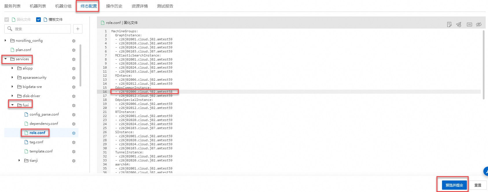

4. 在弹出的**确认提交**对话框，填写好更改描述后，单击**提交**。

5. 集群开始rolling，变更开始生效。

   > **说明**
   >
   > 在操作日志中，可以查看任务状态，状态变为rolling succeeded表示变更完成。

6. 变更完成后，在TerminalService中执行 `r ttrl;` 命令，确认变更。

<a id="section-3-6"></a>

## 3.6. MaxCompute服务重启

**操作步骤**

1. 进入飞天基础运维平台，选择**资源管理 > 产品集群运维**后，在**产品 | 集群**搜索框中输入odps，搜索出相关集群。

2. 单击搜索出的集群，单击目标集群**操作**列的**集群详情**，在**服务列表**页签的搜索框中搜索到**odps-service-computer**服务后，单击该服务。

3. 单击进入**odps-service-computer**服务后，选择**ComputerInit#**。单击对应机器**操作**列的**Terminal**，开启TerminalService窗口，后续的命令行操作均在此窗口进行。

   图 1. Terminal

   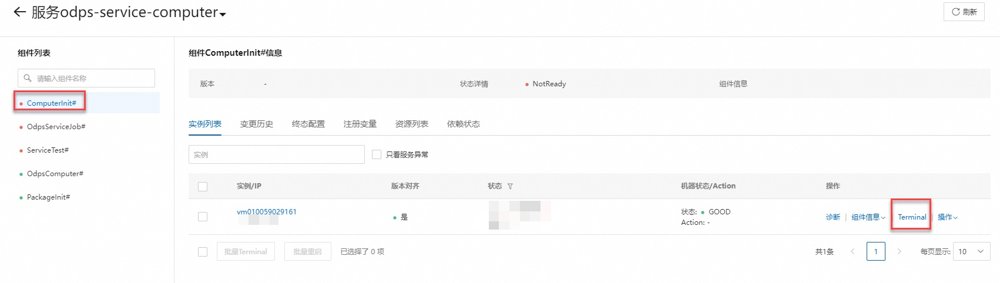

4. 执行如下命令，获取机器个数。

   ```text
   tj_show -r fuxi.Tubo#;
   ```

5. 用获取的机器个数除以3，得到workernum的值。

   > **说明**
   >
   > workernum最小为1，最大为3。

6. 修改vim /apsara/odps_service/deploy/env.cfg中的workernum。

   ```text
   odps_worker_num = 2
   executor_worker_num = 2
   hiveserver_worker_num = 2
   replication_server_num = 2
   messager_partition_num = 2
   -- 此处数值仅为示例
   ```

7. 重启MaxCompute和Hive。

   ```text
   /apsara/odps_service/deploy/install_odps.sh restart_hiveservice;
   -- 重启hive
   /apsara/odps_service/deploy/install_odps.sh restart_odpsservice;
   -- 重启MaxCompute
   ```

   ```text
   r swl Odps/OdpsServicex;
   r swl Odps/HiveServerx;
   -- 重启后检查服务和更新时间
   ```

8. 重启message service。

   ```bash
   cd /apsara/odps_service/deploy/; 
   sh install_odps.sh pedeploymessagerservice;
   -- 重启message service
   ```

   ```text
   r swl Odps/MessagerServicex;
   -- 重启后检查服务和更新时间
   ```

9. 重启quotaservice。

   ```bash
   cd /apsara/odps_service/deploy/; 
   sh install_odps.sh pedeployquotaservice;
   -- 重启quotaservice
   ```

   ```text
   r swl Odps/QuotaServicex;
   -- 重启后检查服务和更新时间
   ```

0. 重启replicationservice。

   ```bash
   cd /apsara/odps_service/deploy/; 
   sh install_odps.sh pedeployreplicationservice;
   -- 重启replicationservice
   ```

   ```text
   r swl Odps/ReplicationServicex;
   -- 重启后检查服务和更新时间
   ```

1. 重启servicemode。

   ```text
   r plan Odps/CGServiceControllerx >/home/admin/servicemode.json;
   r sstop Odps/CGServiceControllerx;
   r start /home/admin/servicemode.json;
   -- 重启servicemode
   ```

   ```text
   r swl Odps/CGServiceControllerx;
   -- 重启后检查CGServiceControllerx服务和更新时间
   ```

<a id="section-4"></a>

# 4.基于大数据管家的运维

<a id="section-4-1"></a>

## 4.1. 登录大数据管家

本节介绍如何登录到大数据管家。

**前提条件**

- 已从部署人员或管理员处获取Apsara Uni-manager运维控制台的访问地址、用户名和密码。

  Apsara Uni-manager运维控制台访问地址格式为*region-id*.ops.console.*intranet-domain-id*。

- 推荐使用Chrome浏览器。

**操作步骤**

1. 打开浏览器。

2. 在地址栏中，输入Apsara Uni-manager运维控制台的访问地址，按回车键。

   

   > **说明**
   >
   > 您可以单击右上角的当前语言切换其它语言。当前支持简体中文、英文、繁体中文三种语言切换。

3. 输入正确的用户名及密码。

   > **说明**
   >
   > - 登录Apsara Uni-manager运维控制台的用户名和密码请从部署人员或管理员处获取。
   >
   > - 若连续输入密码错误三次，系统将启动图片验证码登录功能；若连续输入错误五次，账户将被锁定，请联系管理员进行激活。

   首次登录Apsara Uni-manager运维控制台时，需要修改登录用户名的密码，请按照提示完成密码修改。

   为提高安全性，密码必须满足以下要求：

   - 必须包含英文大小写字母。

   - 必须包含阿拉伯数字（0~9）。

   - 必须包含特殊符号，包括感叹号（!）、at（@）、井号（#）、美元符号（$）、百分号（%）等。

   - 密码长度为10~20个字符。

4. 单击**账号登录**。

5. 进入Apsara Uni-manager运维控制台后，在顶部菜单栏单击**产品运维**。

6. 选择**大数据运维 > 大数据通用运维·大数据管家**，系统默认进入大数据管家的**仪表盘**页面。

<a id="section-4-2"></a>

## 4.2. 监控

<a id="section-4-2-1"></a>

### 4.2.1. 健康度

健康度支持查看各个大数据产品的监控项以及不同紧急程度的报警，并提供详情查看和修复后的再次检查。

**操作步骤**

1. 登录大数据管家。

   默认进入**ABM**的**仪表盘**页面，您可以单击左上角的  图标，选择其他目标产品进入。

2. 进入目标产品后，单击顶部菜单栏的**监控**。

3. 单击**健康度**页签，查看健康度检查信息。

   健康度检查页面向您展示了监控项、监控来源、严重等级和监控详情等，您可以按需进行过滤。

<a id="section-4-2-2"></a>

### 4.2.2. 报表

您可以通过报表查看大数据产品的巡检结果。

**操作步骤**

1. 登录大数据管家。

   默认进入**ABM**的**仪表盘**页面，您可以单击左上角的  图标，选择其他目标产品进入。

2. 进入目标产品后，单击顶部菜单栏的**监控**。

3. 单击**报表**页签，查看报表相关信息。

   报表页面向您展示了报表ID、报表名称、产品名称、模板名称、实例类型、创建信息等，支持查看详情。

<a id="section-4-3"></a>

## 4.3. 运维

<a id="section-4-3-1"></a>

### 4.3.1. MaxCompute 业务运维

<a id="section-4-3-1-1"></a>

#### 4.3.1.1. MaxCompute业务运维功能和入口

本节介绍MaxCompute业务运维的功能和页面入口。

**MaxCompute业务运维功能**

- 项目管理：

  - 项目列表：展示MaxCompute集群中的所有项目以及项目详情，并支持通过搜索框进行便捷查看操作，同时还支持修改项目的默认配额组和存储配额。在同城容灾场景中，还支持配置项目的资源复制相关参数，以及设置是否启用项目的资源复制功能。

  - 元仓Package授权：支持把MaxCompute中元仓资源的访问权限授权给项目，以使项目成员也可以访问元仓资源。

  - 存储加密：支持设置是否对MaxCompute中项目空间的数据进行加密处理。

  - 项目容灾：支持查看MaxCompute同城容灾的集群状态，支持进行同城容灾切换，支持开启和关闭资源同步定时任务。

- 配额组管理：展示MaxCompute集群中的所有项目的配额组，并支持新增、修改、查看详情及分时管理的操作。

- 作业管理：列出了MaxCompute集群的所有作业，支持多种便捷查看操作，例如：过滤、搜索等。同时还支持查看作业的运行日志、终止正在执行的作业，以及采集作业日志。

- 业务治理：

  - 小文件合并：支持从集群和项目两个维度来创建小文件合并任务，支持多种便捷查看操作，同时还支持查看任务的历史统计数据。

  - 冷文件压缩：支持从集群和项目两个维度来创建冷文件压缩任务，支持多种便捷查看操作，同时还支持查看任务的历史统计数据。

  - 资源分析：支持从多个维度对集群的资源进行分析。

**MaxCompute业务运维页面入口**

1. 登录大数据管家。

2. 在左上方单击  图标，然后选择**MaxCompute**产品。

3. 在MaxCompute页面中，单击上方的**运维**，然后选择**业务运维**，默认显示业务运维的**项目管理 > 项目列表**页面。

   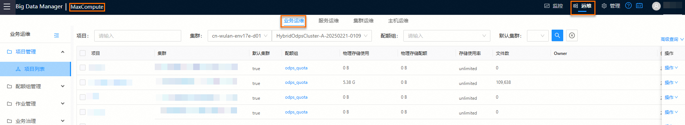

<a id="section-4-3-1-2"></a>

#### 4.3.1.2. MaxCompute项目管理

<a id="section-4-3-1-2-1"></a>

##### 4.3.1.2.1. MaxCompute项目列表

项目列表用于展示MaxCompute集群中的所有项目以及项目详情，并支持通过搜索框进行便捷查看操作，同时还支持修改项目的配额组。在同城容灾场景中，还支持配置项目的资源复制相关参数，以及设置是否启用项目的资源复制功能。

**项目列表入口**

在**业务运维**页面，选择左侧导航树中的**项目管理 > 项目列表**，在右侧查看集群中的所有项目。

**项目列表**页面列出了集群中所有项目的相关信息，包括名称、集群、存储相关（使用、配额、使用率）、文件数、Owner和创建时间等。

**查看项目详情**

在**项目列表**页面，单击某个项目的项目名称，即可查看项目的详细信息，包括概览、作业、存储、计算、配置、通道、资源分析、存储加密和集群复制（请参见MaxCompute项目详情）。

**修改配额组**

支持修改项目空间的默认配额组。

1. 在**项目列表**页面，单击列表中待修改项目空间后面的**操作**，选择**修改默认配额组**，在弹出的**修改项目默认配额组**面板中设置各参数。

   参数说明如下：

   - <strong>项目：</strong>待修改配额组的项目空间。

   - **地域**：项目空间所在的区域。

   - **集群**：项目空间的默认集群，如果项目空间属于多个集群，则可在下拉列表中选择其他集群作为默认集群。

   - **配额组**：项目空间所属的配额组，如果需要修改，在下拉列表中选择指定的配额组即可。

2. 完成上述参数配置后，单击**执行**，完成操作。

**修改存储配额**

支持修改项目空间的存储配额。

1. 在**项目列表**页面，单击列表中待修改项目空间后面的**操作**，选择**修改存储配额**，在弹出的**存储配额调整**对话框中设置各参数。

   

   参数说明如下：

   - **区域**：项目空间所在的区域。

   - **项目**：当前进行配额修改操作的项目。

   - **集群**：项目空间的默认集群。

   - **目标存储配额(TB)**：需要调整到的目标存储配额数。

   - **原因**：进行当前调整操作的原因。

2. 完成上述参数配置后，单击**执行**，完成操作。

**资源复制配置**

资源复制是同城容灾场景的功能配置项，只有在同城容灾场景中才可配置，非同城容灾场景中只可查看。在同城容灾场景中，Primary 集群中的项目空间可定时向 Standby 集群同步数据表等数据，资源复制用于配置指定项目空间的数据同步规则，以及是否启用该项目空间的资源复制功能。

1. 在**项目列表**页面，单击列表中某个项目空间后面的**操作**，选择**资源复制**，在弹出的**资源复制**对话框中设置各参数。

   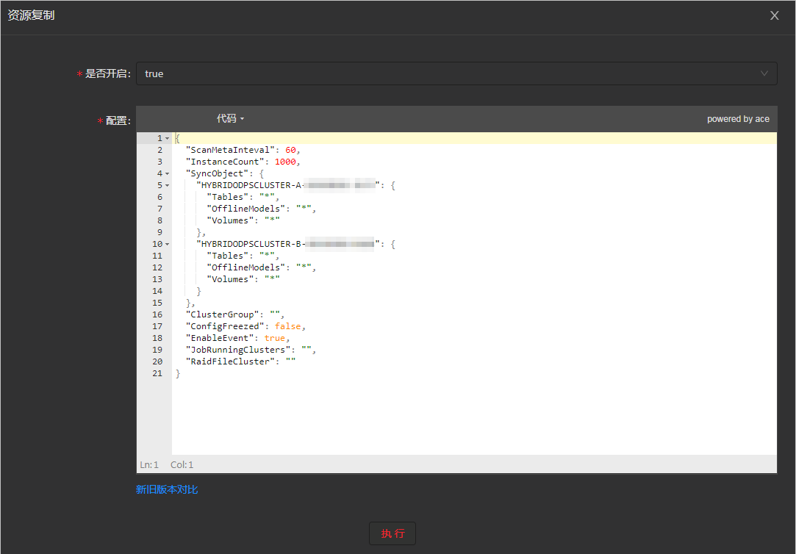

   关键参数说明：

   - **是否开启**：**true** 表示开启，**false** 表示关闭，默认为**false**。

   - **配置**：配置项目空间的数据同步规则，一般使用默认配置即可。如果需要修改，请咨询运维人员。

2. 如果修改了**配置**中的代码，单击**新旧版本对比**，以高亮对比的形式显示新老版本。

   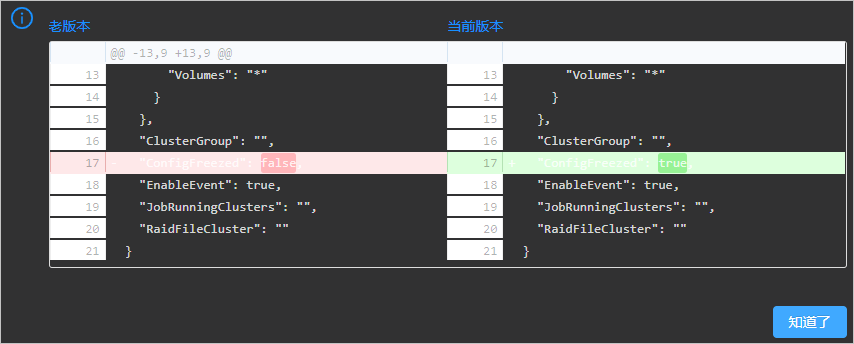

3. 完成并确认上述参数配置后，单击**执行**，完成操作 。

**切换通道配置**

1. 在**项目列表**页面，在**集群**后的下拉列表中选择集群所在地域和名称，过滤项目。

2. 选中需要切换通道配置的目标项目，单击**切换通道配置**。

   > **说明**
   >
   > 请至少选中一个项目。
   >
   > 如果您只需切换一个项目的通道配置，您也可以在**项目列表**页面，单击目标项目名称，选择**通道** >**切换通道配置**。在**切换项目通道集群**对话框中，选择**目标配置**。

3. 在**切换项目通道配置**对话框，在**目标配置**下拉列表中选择目标通道配置。

4. 单击**执行**，完成通道配置切换。

<a id="section-4-3-1-2-2"></a>

##### 4.3.1.2.2. MaxCompute项目详情

大数据管家支持查看当前用户的MaxCompute项目空间详情，包括项目的概览、作业、存储、计算、配置、通道、资源分析、存储加密和集群复制。

**项目详情页面入口**

1. 登录大数据管家。

2. 在左上方单击  图标，然后选择**MaxCompute**产品。

3. 在 MaxCompute 页面中，单击上方的**运维**，然后选择**业务运维**，默认显示**项目管理**页面的**项目列表**页签，单击目标项目名称后，即可查看该项目的各项详情信息。

**项目概览**

**概览**页签支持查看项目的概要信息，详细说明如下：

- 支持查看项目的基本信息，例如，默认计算集群配额组、创建人、创建时间、归属服务和所在地域等。

- 支持按时间（分钟级）以不同颜色的曲线展示CPU和内存的已使用资源、保障资源及上限值。

- 支持按时间（天级）以不同颜色的曲线展示项目对CPU和内存的消耗数。

**项目作业**

**作业**页签支持按天查看项目最近一周的作业历史快照信息，包括作业的instance、项目、Quota组、提交人、运行时长、CPU使用（保障/上限）、MEM使用（保障/上限）、datawork节点id、集群、运行状态、开始时间、优先级和类型等。同时还支持查看作业的运行日志，以便您定位作业运行故障。

作业列表的操作如下：

- 支持自定义列和按列排序等便捷查看操作。

- 支持查看指定时间内，作业快照的运行日志和终止作业。

**项目存储**

**存储**页签支持查看项目的存储空间水位、物理存储已使用、物理存储配额和物理存储剩余。同时还支持按时间（天级）以不同颜色的曲线展示存储变化的趋势，包括pangu文件数、存储大小、表数量、分区数量和冗余存储量。

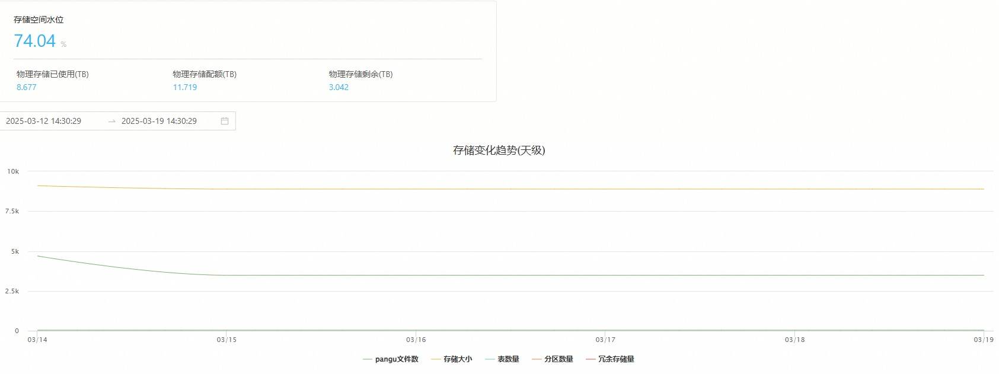

> **说明**
>
> 该页签显示的即为项目的相关存储资源信息，如果要查看项目的计算资源信息，需要在计算页签中进行查看。

**项目计算**

**计算**页签支持查看项目的配额组列表和配额组的详情信息。


如果需要查看配额组的详细信息，单击配额组的**配额名**即可。 关于配额组的相关操作，请参见配额组管理。

> **说明**
>
> 该页签显示的即为项目的相关计算资源信息，如果要查看项目的存储资源信息，需要在存储页签中进行查看。

**项目配置**

**配置**页签支持对项目的通用、沙箱、SQL、MR、访问限制和资源回收属性项，以及元仓package授权进行配置。

在**属性项**页签，如果需要修改某个配置项，找到该配置项并修改，然后单击**提交修改**即可。如果需要恢复所有配置项为默认值，单击**重置修改**即可。

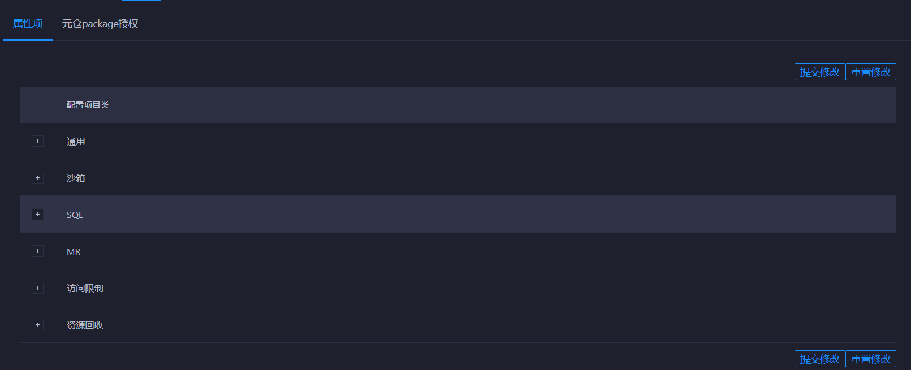

**元仓package授权**页签支持package安装和package授权操作。


**项目通道**

**通道**页签支持查看项目的通道配置和通道流量（即通道服务吞吐量）。通道服务吞吐量（B/min）是按时间以不同颜色的曲线来展示的，包括流入速率和吐出速率。

**资源分析**

**资源分析**页签支持以多个维度来分析项目的资源使用情况，包括表维度、任务维度、耗时维度、启动维度和引擎维度。

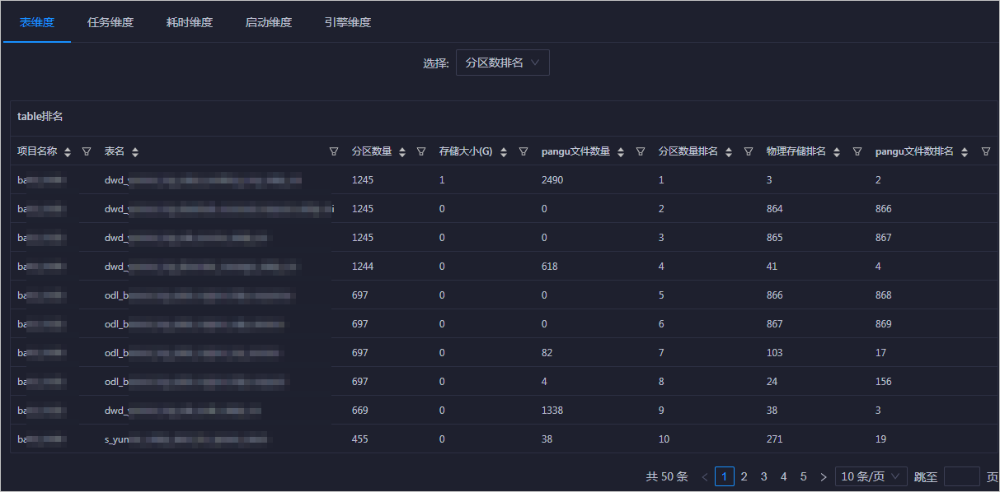

**存储加密**

**存储加密**页签支持对数据进行加密操作，目前支持AESCTR、AES256、RC4、SM4四种加密算法。

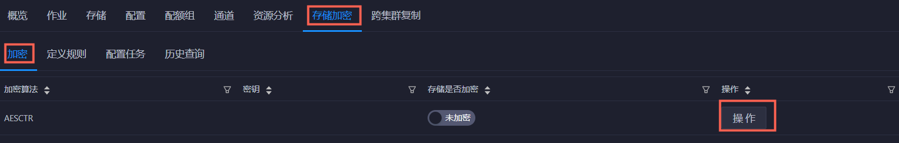

**集群复制**

大数据管家支持读取和解析MaxCompute的集群复制列表配置及复制状态，并在**集群复制**页面中为您展示。

在MaxCompute多集群场景中，项目之间可能存在相互依赖的情况，此时项目间会发生数据直读。MaxCompute会定期扫描存在直读情况的表和分区，如果直读持续时间满足设定条件，则MaxCompute会把该表或分区添加到集群复制列表中。

例如，如果A集群的Project1依赖B集群的Project2的Table1，则Project1会从Project2直读Table1。MaxCompute会定期对直读情况进行扫描，如果Table1的直读情况持续存在时间满足设定条件，则MaxCompute会把Table1添加到集群复制列表中。

在**集群复制**页面下包括**复制详情**和**复制配置**两个页面。

- 复制详情：展示MaxCompute中集群复制的表的项目名、集群名、表名、分区、存储大小、文件数和复制集群。

- 复制配置：展示MaxCompute中集群复制的表的表名、优先级、复制集群名和生命周期，同时还支持查看表的复制进度。

<a id="section-4-3-1-2-3"></a>

##### 4.3.1.2.3. MaxCompute存储加密

存储加密支持设置是否对MaxCompute中项目空间的数据进行加密处理。

**前提条件**

如果MaxCompute是全新部署的V3.8.0或更高版本，则默认支持存储加密功能。如果MaxCompute是从低版本升级到V3.8.0版本（或更高版本），则默认不支持，如果该场景下仍需要存储加密功能，您需要先在MaxCompute集群上手动进行相关的配置。详情请咨询运维管理人员。

**背景信息**

项目空间的存储加密打开后，不可关闭。存储加密开启时，新写入项目空间的数据会全部进行加密处理，但历史数据不会自动加密。如果需要对历史数据进行加密，您可以通过定义规则和配置任务来实现。

在对历史数据进行加密时，ABM上的配置涉及到定义规则和配置任务两个概念。规则用于选定项目空间中某个历史时间段内的数据，然后将选定数据作为任务中的加密对象。规则定义完成后，系统每天会在元仓数据产出后统计出相应时间段内的数据。规则每天只保留一条，同一天生成多条规则时，新规则会覆盖老规则，并且只有最新的规则生效。每个规则只生效一次。任务是指创建对选定的历史数据进行加密的key rotate任务。

**操作步骤**

1. 登录大数据管家。

2. 在左上方单击  图标，然后选择**MaxCompute**产品。

3. 在 MaxCompute 页面中，单击上方的**运维**，然后选择**业务运维**，默认显示业务运维的**项目管理 > 项目列表**页面。

4. 在**项目列表**页面，单击某个项目的项目名称，进入项目详情页面。

5. 在项目详情页面单击**存储加密**页签，默认进入**加密**页面。

6. 开启存储加密。

   开启存储加密后，新写入该项目空间的数据均会进行加密处理。

   <ol type="i">

   <li>

   在**加密**页面，单击**操作**，然后在弹出的**加密操作**对话框中设置**加密算法**、**region**和**project**配置项。

   > **说明**
   >
   > 目前支持的加密算法包括AESCTR、AES256、RC4、SM4四种算法。

   </li>

   <li>

   完成上述参数配置后，单击**执行**。

   存储加密开启后，**存储是否加密**的状态变为**加密**。

   </li>

   </ol>

7. 如果需要对历史数据进行加密，或对已加密的数据再次进行加密，请继续执行本步骤。

   <ol type="i">

   <li>

   定义规则。

   在**定义规则**页面，单击**定制规则**区域中时间段后面的**确定**，并在弹出的对话框中单击**执行**，则在下方的规则列表中生成一条规则。

   当前支持的时间段包括**最近三个月**、**最近六个月**、**三个月之前**、**六个月之前**和**所有**。

   </li>

   <li>

   配置任务。

   在**配置任务**页面，单击**新增key rotate任务**，在弹出的**编辑key rotate任务**对话框中填写各参数，然后单击**执行**。

   | 配置项 | 说明 |
   | --- | --- |
   | 区域 | 从列表中选择待加密项目所在的区域。 |
   | 项目名 | 从列表中选择待加密的项目。 |
   | 开始时间 | 任务运行开始的时间。 |
   | 结束时间 | 任务运行结束的时间。 |
   | 优先级 | 任务运行的优先级，值越小优先级越高。 |
   | 是否启动 | 任务是否开启。 |
   | 是否限流 | 是否支持项目merge任务并发：<br>• <strong>是</strong>表示限流，该项目merge任务不支持并发。<br>• <strong>否</strong>表示不限流，该项目merge任务支持并发。 |
   | 最大并发 | 项目所在集群最大可同时保持多少个running的merge任务。<strong>是否限流</strong>设置为<strong>否</strong>（不限流）时，该参数才会生效。 |
   | 最大running作业数 | 此参数是一个集群全局参数，用于控制项目所在集群最大可保持多少个running的作业。此处的作业是指项目所在集群的所有作业，不只包含merge任务。 |
   | merge参数 | <code>{</code><br><code>"odps.merge.cross.paths": "true",</code><br><code>"odps.idata.useragent": "odps encrypt key rotate via force</code><br><code>mergeTask",</code><br><code>"odps.merge.max.filenumber.per.job": "10000000",</code><br><code>"odps.merge.max.filenumber.per.instance": "10000",</code><br><code>"odps.merge.failure.handling": "any",</code><br><code>"odps.merge.maintain.order.flag": "true",</code><br><code>"odps.merge.smallfile.filesize.threshold": "4096",</code><br><code>"odps.merge.quickmerge.flag": "true",</code><br><code>"odps.merge.maxmerged.filesize.threshold": "4096",</code><br><code>"odps.merge.force.rewrite": "true",</code><br><code>"odps.merge.restructure.action": "hardlink"</code><br><code>}</code> |

   </li>

   </ol>

8. <strong>可选：</strong>查看项目加密的历史记录。

   在**历史查询**页面，从**日期**列表选择日期，则在下方可查看该项目在选定日期的存储加密信息。

<a id="section-4-3-1-2-4"></a>

##### 4.3.1.2.4. MaxCompute元仓Package授权

元仓Package授权是指把MaxCompute中元仓资源的访问权限授权给项目，以使项目成员也可以访问元仓资源。

**前提条件**

- 如果MaxCompute是全新部署的V3.8.1或更高版本，则默认安装了元仓Package，该场景下您可直接通过ABM进行授权。如果MaxCompute是从低版本升级到V3.8.1版本（或更高版本），则默认不安装元仓Package，该场景下您需要先在MaxCompute集群上手动安装元仓Package。

- 项目空间是在DataWorks中创建的，创建操作，请参见<strong>《DataWorks用户指南》</strong>的第2章节<strong>《创建工作空间》</strong>。

**背景信息**

在ABM上给项目进行元仓Package授权包括授权和安装两个步骤。安装Package时，ABM是从DataWorks获取项目的鉴权信息的（例如，AccessKey），如果项目是直接在MaxCompute上创建的，则安装报错。

**操作步骤**

1. 登录大数据管家。

2. 在左上方单击  图标，然后选择**MaxCompute**产品。

3. 在 MaxCompute 页面中，单击上方的**运维**，然后选择**业务运维**，默认显示业务运维的**项目管理 > 项目列表**页面。

4. 在**项目列表**页面，单击某个项目的项目名称，进入项目详情页面。

5. 在项目详情页面单击**配置**页签，然后再单击**元仓Package授权**页签。

   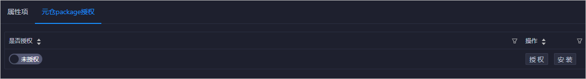

6. 单击**授权**，然后在弹出的**package授权**对话框中单击**执行**，系统提示授权成功。

7. 授权成功后，单击**安装**，然后在弹出的**package安装**对话框中单击**执行**，系统提示安装成功。

   安装Package成功后，授权状态变为**已授权**。

<a id="section-4-3-1-2-5"></a>

##### 4.3.1.2.5. MaxCompute 项目迁移

在多region环境中，大数据管家支持把 MaxCompute 中的项目从一个集群迁移到另一个集群，方便您平衡 MaxCompute 中各集群的计算资源和存储资源。

> **说明**
>
> 项目迁移功能仅在region环境中才会显示。

**创建项目迁移任务**

1. 在**业务运维**页面左侧的导航栏中，选择**项目管理 > 项目迁移**。

2. 在**项目迁移**页面的上方选择项目所在的区域。

   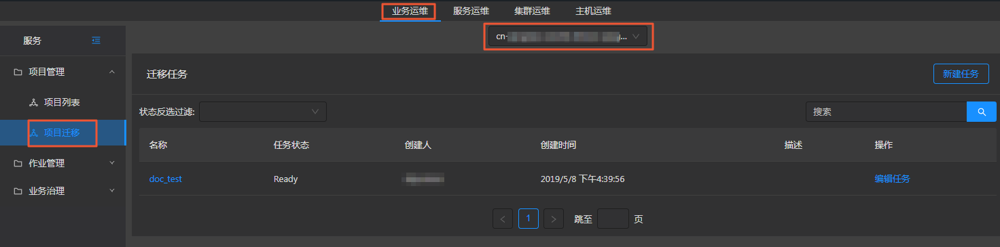

3. 单击右上方的**新建任务**，然后根据页面提示设置**基本信息**、**源选择**、**目标选择**和**复制任务运行集群**中的参数。

   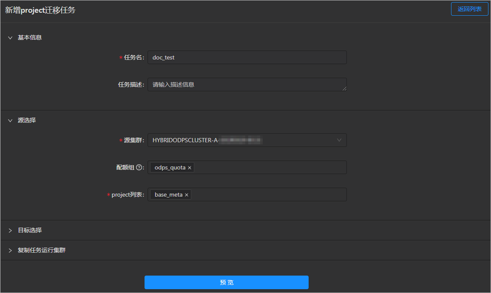

   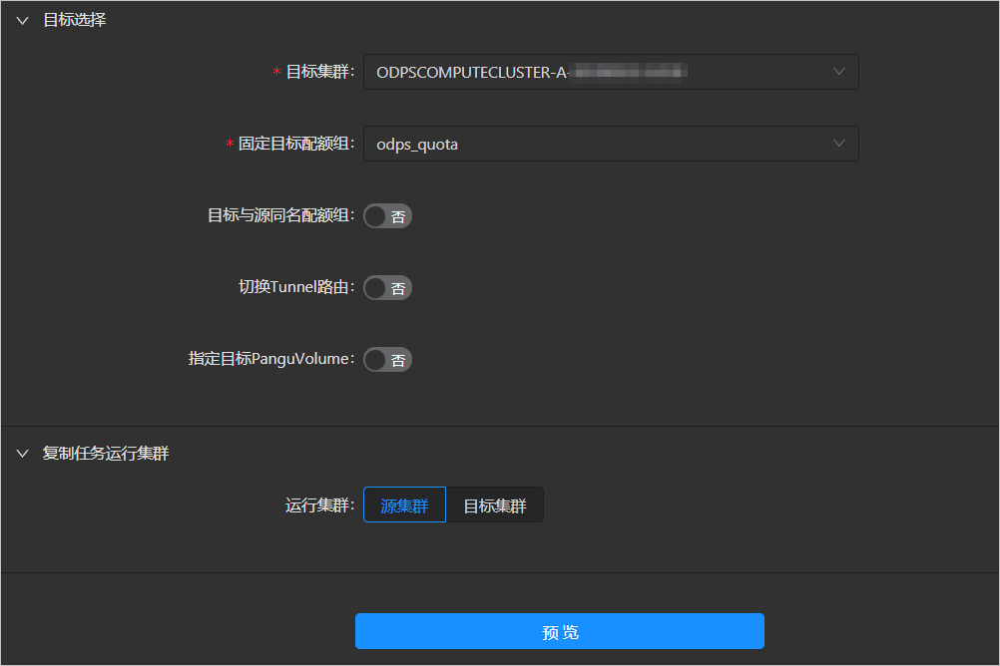

   关键参数说明如下：

   **区域**

   **配置项**

   **说明**

   源集群名称，在下拉列表中选择。

   **源集群**

   源集群下的配额组，在下拉列表中选择。

   **配额组**

   **源选择**

   选择待迁移的项目，**配额组**选定后，自动加载该配额组下的所有项目，方便您按**配额组**进行整体迁移。

   **project 列表**

   如果**配额组**下的某些项目不需要迁移，则您可根据实际需要进行剔除。

   目标集群使用与源集群同样的配额组。开启此选项时，**固定目标配**

   **目标与源同名配额**

   **额组**项不可配置。

   **组**

   Tunnel 可提供高并发的离线数据上传和下载服务。每个项目空间都有默认的 Tunnel 路由，如果想要在项目迁移到新集群后使用新的

   **目标选择**

   **切换 Tunnel 路由**

   Tunnel 路由，您可打开**切换 Tunnel 路由**来填写新的 Tunnel 路由。

   **指定目标**

   当前不支持跨 Volume 的项目迁移，保持为**否**即可。

   **PanguVolume**

   - **源集群**：表示由源集群发起迁移任务，将项目空间推到目标集群。

   **复制任务运行集群**

   **运行集群**

   - **目标集群**：表示由目标集群发起迁移任务，将项目空间拉到目标集群。

4. 完成上述参数配置后，单击**预览**，预览项目迁移详情。

   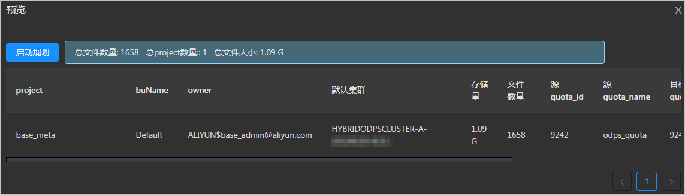

5. 确认配置无误后，单击左上角的**启动规划**，生成项目迁移任务并显示迁移详情。

   生成项目迁移任务需要一些时间，请耐心等待。

   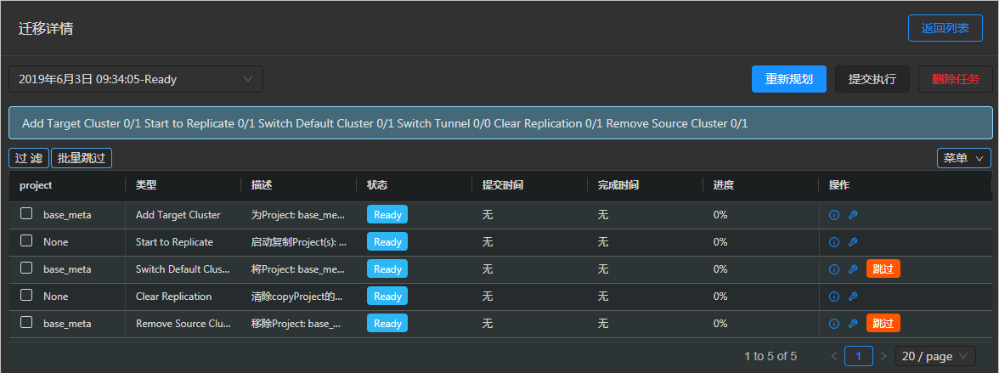

   普通的项目迁移一般分五个步骤：

   <ol type="i">

   <li>

   **Add Target Cluster**：在待迁移项目的集群列表中新增目标集群。

   </li>

   <li>

   **Start to Replicate**：开始从源集群复制项目到目标集群。

   </li>

   <li>

   **Switch Default Cluster**：切换项目的默认集群为目标集群。切换默认集群成功后，后续项目中的所有数据均默认写入目标集群。

   </li>

   <li>

   **Clear Replication**：清除数据复制清单。在项目迁移过程中，源集群中的该迁移项目和目标集群中对应的项目会一直根据复制清单相互同步数据，以保证两个项目的数据一致，直到清除数据复制清单为止。

   </li>

   <li>

   **Remove Source Cluster**：清除数据复制清单后，从源集群中删除项目。

   </li>

   </ol>

项目迁移任务生成后，如果仍需要对任务进行修改，请参见修改项目迁移任务。

**执行项目迁移任务**

项目迁移任务创建成功后，您可进入任务的**迁移详情**页面来执行任务。

1. 如果当前不在**迁移详情**页面，则可在任务列表中单击任务名称进入**迁移详情**页面。

2. 在**迁移详情**页面，单击**提交执行**，开始执行项目迁移任务。

   项目迁移执行后，**Add Target Cluster** 和 **Start to Replicate** 两步会依次自动运行。

   多个项目同时迁移时，迁移步骤较多，建议您按 **project** 进行排序，以便查看各项目的迁移步骤。当迁移步骤的**状态**显示为 **Success** 时，表示这个步骤执行成功，**Failed** 表示执行失败。

   在迁移过程中，部分步骤需要您的**确认**才可执行。 如果某些步骤不需要执行，您可**跳过**这些步骤。**确认**和**跳过**均支持批量操作，选中相应步骤，单击上方的**批量确认**或**批量跳过**即可。

   另外，对于某个项目来说，单击它的某个迁移步骤的**状态**，然后选择**是**，可跳过本项目的该迁移步骤后面的步骤。

3. 当 **Start to Replicate** 步骤的进度达到100%后，您需要确认源集群中的迁移项目和目标集群中对应项目的数据量大小差异。

   > **重要**
   >
   > 当源集群中的迁移项目和目标集群中的对应项目的数据量大小差异在5%以内时，才推荐您执行下一步操作。

   项目的数据量大小的查询方法：登录项目所在集群的 admingateway 机器，然后执行 **pu dirmeta /product/aliyun/odps/${project_name}/** 命令来查询项目的数据量大小。

4. 当源集群中的该迁移项目和目标集群中的对应项目的数据量大小差异在5%以内时，您可根据实际需要执行以下操作：

   - 切换默认集群：单击 **Switch Default Cluster** 步骤后面的**确认**，设置目标集群为迁移项目的默认集群。本节以切换默认集群为例进行介绍。

   - 不切换默认集群：单击 **Switch Default Cluster** 步骤后面的**跳过**，仍以源集群为项目的默认集群。

   切换默认集群成功后，后续项目中的所有数据均默认写入目标集群。

   > **警告**
   >
   > 在项目迁移过程中，源集群中的该迁移项目和目标集群中对应的项目会一直根据复制清单相互同步数据，以保证两个项目的数据一致，但两个项目的数据要达到完全一致需要一些时间，在切换默认集群后，建议您等待一周左右再执行下一步。

5. 等待约一周时间，检查源集群中的该迁移项目和目标集群中的对应项目的数据量大小是否一致。

   项目的数据量大小的查询方法：登录项目所在集群的 admingateway 机器，然后执行 **pu dirmeta /product/aliyun/odps/${project_name}/** 命令来查询项目的数据量大小。

   > **警告**
   >
   > 确保源集群中的迁移项目和目标集群中的对应项目的数据量大小一致后，再进行下一步操作，否则可能会丢失数据。

6. 如果仍想保留源集群中的该迁移项目，在执行 **Clear Replication** 步骤前，请单击 **Remove Source Cluster** 步骤后面的**跳过**，跳过此步骤。

7. 源集群中的该迁移项目和目标集群中的对应项目的数据量大小一致后，单击 **Clear Replication** 步骤后面的**确认**，清除源集群中的该迁移项目和目标集群中对应项目间的同步数据清单。

   同步数据清单清除后，源集群中的该迁移项目和目标集群中的对应项目将不再相互同步数据。

   清除同步数据清单成功后，系统会自动执行 **Remove Source Cluster** 步骤来删除源集群中所有的迁移项目，以释放存储资源和计算资源。

**查看迁移详情**

支持查看项目迁移任务的迁移详情，包括任务执行步骤、执行结果、任务详情、任务调试等。

1. 如果迁移任务很多，您可在**迁移任务**列表中进行搜索和筛选：

   - **状态反选过滤**：在下拉列表中选中某个任务状态，则迁移任务列表中自动过滤掉该状态的任务。

   - **搜索**：在右上方搜索框中输入迁移任务的名称，搜索任务。

   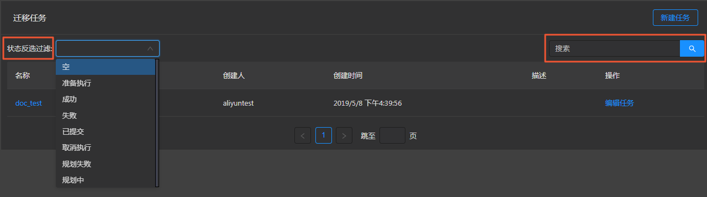

2. 单击某个任务的任务名称，进入**迁移详情**页面，查看迁移任务的详情。

   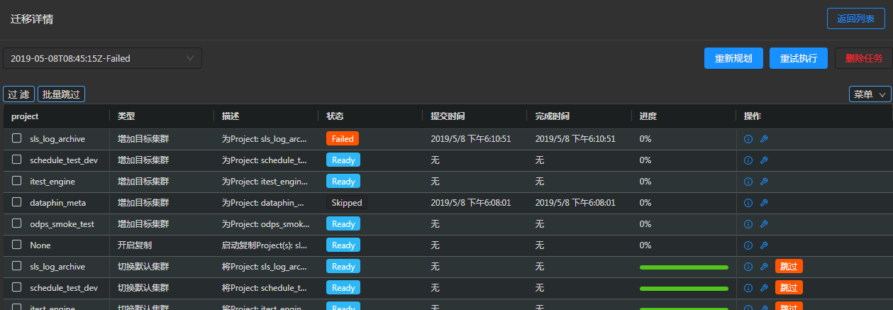

3. 如果任务执行失败，则您可单击任务失败步骤后面的**详情**和**调试**图标，查看步骤的详情和调试信息，以定位步骤失败原因。

4. 步骤列表的其他便捷操作：

   单击右上方的**菜单**，您还可导出步骤、自适应列宽、自定义列的显示和隐藏。

   右键单击步骤列表中的单元格，还支持复制单元格内容。

**查看步骤详情和调试信息**

如果某个任务步骤执行失败，您可查看步骤的执行详情以及调试信息，以定位步骤失败原因。操作步骤如下所示。

1. 单击任务失败步骤后面的**详情**，查看步骤的详情。

   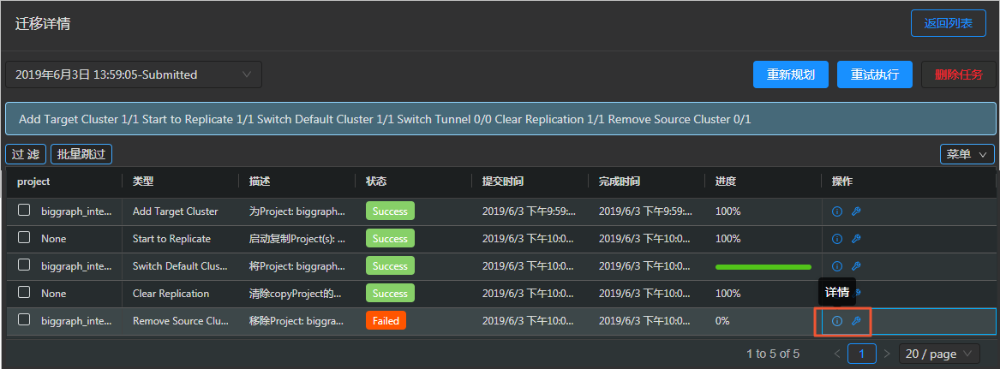

   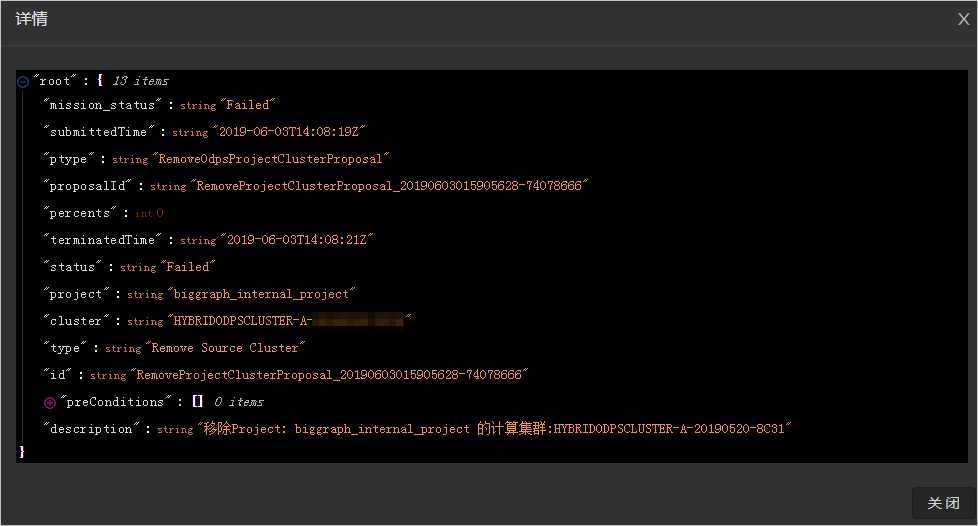

2. 单击任务失败步骤后面的**调试**图标，查看步骤的调试信息。

   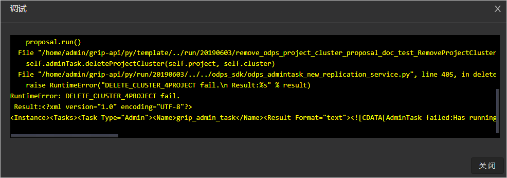

**修改项目迁移任务**

某个项目迁移任务创建成功后，如果任务不符合实际需求，您可重新规划该任务。

在任务列表中，单击任务后面的**修改**；或在**迁移详情**页面，单击**重新规划**，即可修改项目迁移任务。

<a id="section-4-3-1-3"></a>

#### 4.3.1.3. 配额组管理

展示MaxCompute集群中的所有项目的配额组，并支持新增、修改、查看详情及分时管理的操作。

**MaxCompute配额组管理页面入口**

1. 登录大数据管家。

2. 在左上方单击  图标，然后选择**MaxCompute**产品。

3. 在MaxCompute页面中，单击上方的**运维**，然后选择**业务运维**，在左侧导航栏中选择**配额组管理**，根据业务需要选择进入**配额组列表**或**配额组分时**页面。

   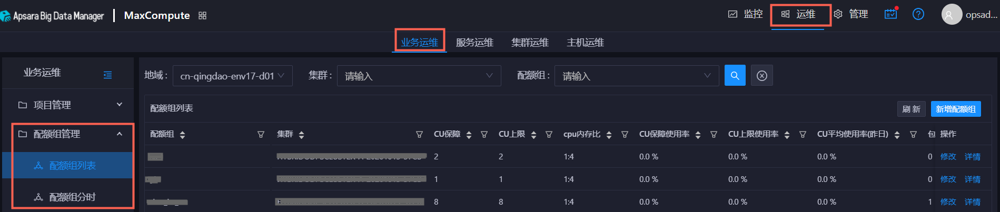

   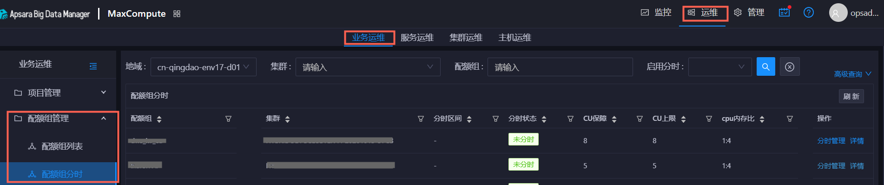

**新增配额组**

在**配额组列表**页面，单击右侧的**新增配额组**，在弹出的面板中配置相关信息后单击**执行**，即可完成配额组的新增操作。


| 参数 | 说明 |
| --- | --- |
| 集群 | 新增配额组所在的集群。 |
| 配额组 | 新增配额组的名称。 |
| 抢占策略 | 配额组策略，支持不抢占和抢占两种策略，默认为不抢占。 |
| 调度类型 | 资源调度类型，支持先进先出和均分两种调度类型，默认为先进先出。 |
| CU保障 | 该配额组使用时最低会提供的CU数。 |
| CU上限 | 该配额组使用时最高会提供的CU数。 |
| CPU内存比 | 使用该配额组的集群机器的CPU内存比。 |

**修改配额组**

在**配额组列表**页面，单击需要修改的配额组对应操作列的**修改**，在弹出的面板中修改配置信息后单击**执行**，即可完成配额组的修改操作。

> **说明**
>
> 如果要进行修改的配额组已经开通分时，修改配置组前请先调整分时配置。

**查看配额组详情**

在**配额组列表**页面，单击需要查看的配额组对应操作列的**详情**，即可查看当前配额组的资源消耗情况、资源分析信息及分时管理信息。


**配额组分时管理**

1. 在**配额组分时**页面，单击需要配置分时的配额组对应操作列的**分时管理**。

2. 在跳转到的**分时管理**页签，单击**设置分时**，在弹出的对话框中设置好分时时间段后，单击**开启分时**，完成配额组分时配置。

   

   > **说明**
   >
   > - 可以通过**增加**按钮设置多个时间段，也可以通过**删除**按钮删除已设置的时间段。
   >
   > - 对于已完成分时配置的配额组，单击操作列的**编辑**，可以打开**修改分时配置**对话框，修改分时时间段内的配额组参数。

3. 如果需要关闭对应配额组的分时设置，再次单击**设置分时**，在弹出的对话框中单击**关闭分时**，即可关闭配额组分时配置。

<a id="section-4-3-1-4"></a>

#### 4.3.1.4. MaxCompute作业管理

<a id="section-4-3-1-4-1"></a>

##### 4.3.1.4.1. MaxCompute作业快照

作业快照管理MaxCompute侧用户创建的任务以及大数据管家中创建的Merge任务，支持查看作业的Logview、终止作业和采集作业日志等操作。

**查看作业快照**

支持按天查看最近一周的作业的历史快照信息，包括作业的JobId、项目、配额组、提交人、运行时长、CPU使用（保障/上限）、MEM使用（保障/上限）、DataWorks节点、运行状态、开始时间、优先级和类型。同时还支持查看作业的运行日志，以便您定位作业运行故障。

1. 在**业务运维**页面左侧导航栏中，选择**作业管理 > 作业快照**，进入**作业快照**页面。

2. 在作业快照列表右上方，选择日期和时间，可按天查看对应时间的作业快照。

3. 单击上方的**全部**、**运行中**、**等资源**或**初始化中**，可分别查看指定日期相应状态的作业快照信息。

4. 单击某个作业快照操作列的**Logview**，在弹出的对话框中单击**执行**，即可查看该作业的Logview。

   

**终止作业**

1. 在**业务运维**页面左侧导航栏中，选择**作业管理 > 作业快照**，进入**作业快照**页面。

2. 在作业快照列表中，勾选需要终止的作业（可多选），然后单击上方的**终止作业**，在弹出的面板中查看待终止的作业。

   

3. 确认无误后，单击**执行**，页面提示终止作业执行结果。

   

**采集作业日志**

当作业运行出现异常时，您可通过采集的作业日志来定位和分析问题。

1. 在**业务运维**页面左侧导航栏中，选择**作业管理 > 作业快照**，进入**作业快照**页面。

2. 在**作业快照**页面右上方，选择**操作 > 作业日志采集**。

3. 在弹出的**作业日志采集**面板中设置各参数。

   关键参数配置说明如下。

   <table>
     <tr>
       <th width="113">配置项</th>
       <th>说明</th>
     </tr>
     <tr>
       <td>服务角色</td>
       <td>在列表中选择需要使用哪些角色采集集群中的作业日志。</td>
     </tr>
     <tr>
       <td>intanceid</td>
       <td>（可选）作业实例的ID。</td>
     </tr>
     <tr>
       <td>requestid</td>
       <td>（可选）作业执行失败时返回的<strong>requestid</strong>。如果输入的字段不是<strong>requestid</strong>，则会筛选出包含相应字段的作业日志。</td>
     </tr>
     <tr>
       <td>时间范围</td>
       <td>设置采集哪个时间段的作业日志。</td>
     </tr>
     <tr>
       <td>时间间隔</td>
       <td>（可选）设置作业日志采集的时间间隔，单位为小时。</td>
     </tr>
   </table>

4. 完成上述参数配置后，单击**执行**，开始采集作业日志。

5. 查看作业日志采集的执行状态和进度。

   在**作业快照**页面右上方，单击**操作**，然后再单击**作业日志采集**后面的**历史**，可以在弹出的**执行历史**面板中查看作业日志采集任务的执行状态，以及作业日志采集的执行历史。

   作业日志采集任务的状态为**RUNNING**表示执行中，状态为**FAILED**表示执行失败，状态为**SUCCESS**表示执行成功。如果任务状态为**RUNNING**，则您可单击任务后面的**详情**来查看任务执行进度。

6. 查看作业日志的保存路径。

   作业日志采集执行成功后，在**执行历史**面板中单击执行记录后面的**详情**，然后在作业日志采集步骤中查看相应模块的日志保存路径。

<a id="section-4-3-1-5"></a>

#### 4.3.1.5. MaxCompute业务治理

<a id="section-4-3-1-5-1"></a>

##### 4.3.1.5.1. MaxCompute小文件合并

MaxCompute集群中小文件过多会占用大量的内存资源，大数据管家支持从集群和项目空间级别对小文件进行合并，以释放因小文件过多而占用的内存资源。

**创建集群merge任务**

当MaxCompute集群中大部分项目空间中的小文件均过多时，您可创建集群merge任务统一对集群中的小文件进行合并。

1. 在**业务运维**页面左侧导航栏中，选择**业务治理 > 小文件合并**，默认进入**任务配置**页面。

   

2. 在**集群merge任务**区域，单击**新增merge任务**，然后在右侧面板填写各参数。

   关键参数说明如下：

   <table>
     <tr>
       <th width="89">配置项</th>
       <th>说明</th>
     </tr>
     <tr>
       <td>集群</td>
       <td>从列表中选择需要进行小文件合并的集群。</td>
     </tr>
     <tr>
       <td>开始时间</td>
       <td>任务运行开始的时间。</td>
     </tr>
     <tr>
       <td>结束时间</td>
       <td>任务运行结束的时间。</td>
     </tr>
     <tr>
       <td>是否限流</td>
       <td>是否支持集群merge任务并发：<br>• <strong>是</strong>表示限流，该集群merge任务不支持并发。<br>• <strong>否</strong>表示不限流，该集群merge任务支持并发。</td>
     </tr>
     <tr>
       <td>最大并发</td>
       <td>选中集群最大可同时保持多少个running的merge任务。<strong>是否限流</strong>设置为<strong>否</strong>（不限流）时，该参数才会生效。</td>
     </tr>
     <tr>
       <td>是否开启</td>
       <td>任务是否启用。</td>
     </tr>
   </table>

   <table>
     <tr>
       <td>merge参数</td>
       <td>默认参数配置如下：<br><code>{</code><br><code>"odps.idata.useragent": "SRE Merge",</code><br><code>"odps.merge.cpu.quota": "75",</code><br><code>"odps.merge.quickmerge.flag": "true",</code><br><code>"odps.merge.cross.paths": "true",</code><br><code>"odps.merge.smallfile.filesize.threshold": "4096",</code><br><code>"odps.merge.maxmerged.filesize.threshold": "4096",</code><br><code>"odps.merge.max.filenumber.per.instance": "10000",</code><br><code>"odps.merge.max.filenumber.per.job": "10000000",</code><br><code>"odps.merge.maintain.order.flag": "true",</code><br><code>"odps.merge.failure.handling": "any"</code><br><code>}</code></td>
     </tr>
     <tr>
       <td>最大running作业数</td>
       <td>此参数是一个集群全局参数，用于控制选中集群最大可保持多少个running的作业。此处的作业是指选中集群的所有作业，不只包含merge任务。</td>
     </tr>
   </table>

3. 完成上述参数配置后，单击**merge参数**下方的**新旧版本对比**，可查看当前修改与原参数值的差异。

   

4. 确认修改后，单击下方的**执行**，系统提示提交成功。

   创建成功后，新建的任务显示在集群merge任务列表中。

**创建project merge任务**

当MaxCompute集群只有个别项目空间中的小文件过多时，您可创建project merge任务对指定项目空间的小文件进行合并。

1. 在**业务运维**页面左侧导航栏中，选择**业务治理 > 小文件合并**，默认进入**任务配置**页面。

   

2. 在**project merge任务**区域，单击**新增merge任务**，然后在右侧面板填写各参数。

   关键参数说明如下：

   | 配置项 | 说明 |
   | --- | --- |
   | 地域 | 从列表中选择项目所在的区域。 |
   | 项目名 | 从列表中选择需要进行小文件合并的项目。 |
   | 开始时间 | 任务运行开始的时间。 |
   | 结束时间 | 任务运行结束的时间。 |
   | 优先级 | 任务运行的优先级，值越小优先级越高。 |
   | 是否启动 | 任务是否开启。 |
   | 是否限流 | 是否支持project merge任务并发：<br>• <strong>是</strong>表示限流，该项目merge任务不支持并发。<br>• <strong>否</strong>表示不限流，该项目merge任务支持并发。 |
   | 最大并发 | 项目最大可同时保持多少个running的merge任务。<strong>是否限流</strong>设置为<strong>否</strong>（不限流）时，该参数才会生效。 |
   | 最大running作业数 | 此参数是一个项目全局参数，用于控制选中项目最大可保持多少个running的作业。此处的作业是指项目中的所有作业，不只包含merge任务。 |

3. 完成配置后，单击下方的**执行**，系统提示提交成功。

   创建成功后，新建的任务显示在project merge任务列表中。

**Merge任务历史统计**

在**业务运维**页面左侧导航栏中，选择**业务治理 > 小文件合并**，然后在右侧选择**历史统计**，查看集群merge任务和project merge任务历史统计信息。

**merge统计曲线**

以曲线图的形式统计最近一个月的所有merge任务的执行情况，包括任务数（Running）、任务数（Finished）、任务数（Waiting）、任务数（Timeout）、任务数（Failed）、无效任务数、当日合并分区数、当日减少文件数和当日减少物理存储量（B）。


**集群统计和项目统计**

以列表的形式统计最近一个月中每日的集群merge任务和project merge任务的执行情况，包括任务数（Running）、任务数（Finished）、任务数（Waiting）、任务数（Timeout）、任务数（Failed）、无效任务数、当日合并分区数、当日减少文件数和当日减少物理存储量（B）。


**Merge type管理**

在**业务运维**页面左侧导航栏中，选择**业务治理 > 小文件合并**，然后在右侧选择**merge type管理**，可以查看当前已有的merge类型和对应的merge参数。

**新建merge类型**

1. 在**merge统计**区域，单击**新增merge类型**，然后在右侧面板填写各参数。

   

   关键参数说明如下：

   | 配置项 | 说明 |
   | --- | --- |
   | merge类型 | 新增merge类型的名称。 |
   | merge参数 | 新增merge类型对应的merge参数。 |

2. 完成上述参数配置后，单击**merge参数**下方的**新旧版本对比**，可查看当前修改与原参数值的差异。

   

3. 确认修改后，单击下方的**执行**，系统提示提交成功。

   创建成功后，新增的merge类型显示在merge统计列表中。

<a id="section-4-3-1-5-2"></a>

##### 4.3.1.5.2. MaxCompute冷文件压缩

大数据管家支持以任务的方式对MaxCompute中的冷文件进行压缩处理，以节省集群的存储空间。

**冷文件压缩定义**

按表或分区的创建日期计算，把整个集群中创建超过90天的表或分区按存储大小进行排序，然后取前10万个进行压缩。

**创建集群archive任务**

当MaxCompute集群中大部分项目空间中的冷文件均过多时，您可创建集群archive任务统一对集群中的冷文件进行压缩。

1. 在**业务运维**页面左侧导航栏中，选择**业务治理 > 冷文件压缩**，默认进入**任务配置**页面。

   

2. 在**集群archive任务**区域，单击**新增archive任务**，然后在右侧面板填写各参数。

   关键参数说明如下：

   | 配置项 | 说明 |
   | --- | --- |
   | 集群 | 从列表中选择需要进行冷文件压缩的集群。 |
   | 开始时间 | 任务运行开始的时间。 |
   | 结束时间 | 任务运行结束的时间。 |
   | 是否限流 | 是否支持集群archive任务并发：<br>• <strong>是</strong>表示限流，该集群archive任务不支持并发。<br>• <strong>否</strong>表示不限流，该集群archive任务支持并发。 |
   | 最大并发 | 选中集群最大可同时保持多少个RUNNING的Archive任务。<strong>是否限流</strong>设置为<strong>否</strong>（不限流）时，该参数才会生效。 |
   | 是否开启 | 任务是否启用。 |
   | 最大Running作业数 | 此参数是一个集群全局参数，用于控制选中集群最大可保持多少个RUNNING的作业。此处的作业是指选中集群的所有作业，不止包含Archive任务。 |
   | Archive参数 | 默认参数如下：<br><code>{</code><br><code>"odps.idata.useragent": "SRE Archive",</code><br><code>"odps.oversold.resources.ratio": "100",</code><br><code>"odps.merge.quickmerge.flag": "true",</code><br><code>"odps.merge.cross.paths": "true",</code><br><code>"odps.merge.smallfile.filesize.threshold": "4096",</code><br><code>"odps.merge.maxmerged.filesize.threshold": "4096",</code><br><code>"odps.merge.max.filenumber.per.instance": "10000",</code><br><code>"odps.merge.max.filenumber.per.job": "10000000",</code><br><code>"odps.merge.maintain.order.flag": "true",</code><br><code>"odps.sql.hive.compatible": "true",</code><br><code>"odps.merge.compression.strategy": "normal",</code><br><code>"odps.compression.strategy.normal.compressor": "zstd",</code><br><code>"odps.merge.failure.handling": "any",</code><br><code>"odps.merge.archive.flag": "true"</code><br><code>}</code> |

3. 完成上述参数配置后，单击下方的**新旧版本对比**，可查看当前修改与原参数值的差异。

4. 确认修改后，单击下方的**执行**，页面提示提交成功。

   创建成功后，新建的任务显示在集群archive任务列表中。

**创建project archive任务**

当MaxCompute集群只有个别项目空间中的冷文件过多时，您可创建project archive任务对指定项目空间的冷文件进行压缩。

> **说明**
>
> 对于project archive任务，如果项目中的表或分区的排序在10万以后，则无法对项目中的冷文件进行压缩处理。

1. 在**业务运维**页面左侧导航树中，选择**业务治理 > 冷文件压缩**，默认进入**任务配置**页面。

   

2. 在**project archive任务**区域，单击**新增archive任务**，然后在右侧面板填写各参数。

   关键参数说明如下：

   | 配置项 | 说明 |
   | --- | --- |
   | 地域 | 从列表中选择集群所在的区域。 |
   | 项目名 | 从列表中选择需要进行冷文件压缩的项目。 |
   | 开始时间 | 任务运行开始的时间。 |
   | 结束时间 | 任务运行结束的时间。 |
   | 优先级 | 任务运行的优先级，值越小优先级越高。 |
   | 是否启动 | 任务是否启用。 |
   | 是否限流 | 是否支持project archive任务并发：<br>• <strong>是</strong>表示限流，该项目archive任务不支持并发。<br>• <strong>否</strong>表示不限流，该项目archive任务支持并发。 |
   | 最大并发 | 该项目最大可同时保持多少个RUNNING的Archive任务。<strong>是否限流</strong>设置为<strong>否</strong>（不限流）时，该参数才会生效。 |
   | 最大Running作业数 | 此参数是一个项目全局参数，用于控制选中项目最大可保持多少个RUNNING的作业。此处的作业是指项目中的所有作业，不只包含Archive任务。 |

3. 完成配置后，单击下方的**执行**，页面提示提交成功。

   创建成功后，新建的任务显示在project archive任务列表中。

**Archive任务历史统计**

在**业务运维**页面左侧导航树中，选择**业务治理 > 冷文件压缩**，然后在右侧选择**历史统计**，可以查看archive任务的统计曲线，以及集群archive任务和项目archive任务的统计列表。

**archive统计曲线**

以曲线图的形式统计最近一个月的所有archive任务的执行情况，包括任务数（Running）、任务数（Finished）、任务数（Waiting）、任务数（Timeout）、任务数（Failed）、无效任务数、当日合并分区数、当日减少文件数和当日减少物理存储量（B）。

**集群统计和项目统计**

以列表的形式统计最近一个月中每日的集群archive任务和project archive任务的执行情况，包括任务数（Running）、任务数（Finished）、任务数（Waiting）、任务数（Timeout）、任务数（Failed）、无效任务数、当日合并分区数、当日减少文件数和当日减少物理存储量（B）。

**Archive type管理**

在**业务运维**页面左侧导航栏中，选择**业务治理 > 冷文件压缩**，然后在右侧选择**Archive type管理**，可以查看当前已有的Archive类型和对应的Archive参数。

**新建Archive类型**

1. 在**archive统计**区域，单击**新增archive类型**，然后在右侧面板填写各参数。

   

   关键参数说明如下：

   | 配置项 | 说明 |
   | --- | --- |
   | archive类型 | 新增archive类型的名称。 |
   | archive参数 | 新增archive类型对应的archive参数。 |

2. 完成上述参数配置后，单击**archive参数**下方的**新旧版本对比**，可查看当前修改与原参数值的差异。

3. 确认修改后，单击下方的**执行**，系统提示提交成功。

   创建成功后，新增的archive类型显示在archive统计列表中。

<a id="section-4-3-1-5-3"></a>

##### 4.3.1.5.3. MaxCompute资源分析

大数据管家支持从多个维度对MaxCompute集群的资源进行分析，以便您更清晰的了解MaxCompute中数据存储的情况。当前支持从表维度、项目维度、任务维度、耗时维度、启动维度和引擎维度进行分析。

**表维度**

从表维度来展示每个项目中所有的数据表信息，包括分区数量、存储大小、pangu文件数量、分区数量排名、物理存储排名和pangu文件数量排名。同时还支持按分区数、物理存储和pangu文件数进行排名。

在**业务运维**页面的左侧导航栏中，选择**业务治理 > 资源分析**，默认进入**表维度**页面。


**项目维度**

从项目维度来展示每个项目中存储的数据信息，包括pangu文件数、物理存储大小、总消耗cu量、总消耗内存量、任务数量、表数量和冗余存储，以及这些指标在昨天和最近一周在每个项目中分别增长的百分比。

在**业务运维**页面的左侧导航栏中，选择**业务治理 > 资源分析**，单击**项目维度**页签，进入**项目维度**页面。


**任务维度**


任务维度包括以下功能：

- 任务分析

  从任务维度展示每个项目中所有的任务信息，包括instanceid、运行状态、总消耗cu、开始时间、结束时间、总耗时、资源消耗cu排名和SQL字符串。

  在**业务运维**页面的左侧导航栏中，选择**业务治理 > 资源分析**，单击**任务维度**页签，进入**任务分析**页面。

  

- 加速模式分析

  用于分析集群SQL加速模式的运行情况，帮助用户进行任务调优。指标包含任务总数、加速任务运行情况、小任务运行情况、SQL任务的运行情况等。

  在**业务运维**页面的左侧导航栏中，选择**业务治理** > **资源分析**，单击**任务维度**页签，再选择**加速模式分析**。

  

- 异常读写分析

  该功能会扫描出集群异常读写的任务并展示。用户可以根据任务信息找到该任务，并对该任务进行分析调优。

  在**业务运维**页面的左侧导航栏中，选择**业务治理** > **资源分析**，单击**任务维度**页签，再选择**异常读写分析**。

  

**耗时维度**

从任务耗时维度展示每个项目中耗时在5分钟内、15分钟内、30分钟内、60分钟内和60分钟以上的任务数量。同时还支持按天以不同颜色的曲线来展示不同耗时的任务数量。

在**业务运维**页面的左侧导航栏中，选择**业务治理 > 资源分析**，单击**耗时维度**页签，进入**耗时维度**页面。


**启动维度**

从任务启动时段维度展示每个项目中不同时段启动的任务数量，时间间隔为30分钟。同时还支持按天以曲线图来展示指定时间内每天某个时段启动的任务数量。

在**业务运维**页面的左侧导航栏中，选择**业务治理 > 资源分析**，单击**启动维度**页签，进入**启动维度**页面。


**引擎维度**

从任务引擎维度展示每个项目中任务的性能数据，包括cost_cpu、cost_mem、cost_time、input_bytes、input_bytes_per_cu、input_records、input_records_per_cu、odps_job_num、output_bytes、output_bytes_per_cu、output_records和output_records_per_cu。

在**业务运维**页面的左侧导航栏中，选择**业务治理 > 资源分析**，单击**引擎维度**页签，进入**引擎维度**页面。


**计量维度**

从项目存储配额维度展示每个项目的存储数据，包括逻辑存储上限、逻辑文件数上限、配额组id、配额组名、配额组上限CU、配额组保障CU、昨日cpu消耗、昨日内存消耗、昨日任务量、昨日逻辑存储量、规格配置、地域、集群、采集日期。

在**业务运维**页面的左侧导航栏中，选择**业务治理 > 资源分析**，单击**计量维度**页签，进入**计量维度**页面。


<a id="section-4-3-1-6"></a>

#### 4.3.1.6. MaxCompute 同城容灾

当MaxCompute的主集群故障时，您可通过ABM快速对MaxCompute集群进行主备切换，恢复业务。本节向您介绍同城容灾功能。

**进入同城容灾页面**

1. 登录大数据管家。

2. 在左上方单击  图标，然后选择**MaxCompute**产品。

3. 在**业务运维**页面，选择左侧导航树中的**同城容灾 > 概览**，进入同城容灾的**概览**页面。

**查看同步速率**

在**概览**页的**主中心灾备机房同步带宽**区域，可查看指定时间段的同步速率图（单位：MB/秒）。

- in-avg：网络输入流量平均值。

- out-avg：网络输出流量平均值。

您可在指定时间段后，单击  手动刷新当前页面信息，或单击  并设置**刷新间隔**和**时间范围**，以自动刷新

当前页面信息。

**查看操作历史**

您可单击**概览**页面右上角的**操作历史**，查看此页面中功能类操作的历史记录。例如**开始同步**、**触发未同步资源查询**、**触发未同步数据查询**、**切换默认计算集群**。

**下载最新未同步数据/资源列表**

在**当前PRO**区域查看同步过程中，用户可接受数据丢失的最大时间范围。

- PRO 1小时：指最多可接受丢失1小时的数据。

- PRO 0：指实时同步，无数据丢失。

您可单击**下载最新未同步数据列表**或**下载最新未同步资源列表**，将未同步的数据或资源信息下载至本地。下载最新未同步数据列表或资源列表前，先观察获取时间是否与当前时间接近，若时间差距较长，可单击**重新触发获取**以获取最新未同步数据列表或资源信息。

**项目概览**

**项目概览**区域展示每个项目容灾的具体信息，您可查看当前项目是否有容灾功能。

**容灾配置**

若**容灾集群**列有值（不为空），则表示该项目支持容灾功能，您可进行相关容灾操作。否则表示该项目不支持容灾功能。

支持容灾功能的项目在同步之前需要先进行容灾功能配置：

1. 单击目标项目**操作**列的**配置**，在容灾功能配置面板中配置如下参数：

   <table>
     <tr>
       <th width="105">参数名</th>
       <th>说明</th>
     </tr>
     <tr>
       <td>项目名称</td>
       <td>目标项目名称，不支持修改。</td>
     </tr>
     <tr>
       <td>并发进程数</td>
       <td>根据当前网络带宽进行配置。<br>说明单个instance大概占用10MB的带宽。</td>
     </tr>
     <tr>
       <td>同步间隔</td>
       <td>距离上一次同步开始的时间间隔，单位为秒。<br>说明建议大于4小时（14400），过小的同步间隔会导致网络拥塞和队列打满。</td>
     </tr>
   </table>

2. 单击**执行**，完成容灾配置。

**开始同步**

在**项目概览**区域，单击目标项目**操作**列的**开始同步**，然后在**开始同步**对话框中单击**执行**。目标项目的**同步开启**列将由**未开启**变为**开启**状态。

**切换默认计算集群**

在**项目概览**区域，单击目标项目**操作**列的**切换默认计算集群**，在弹框中单击**执行**。

> **说明**
>
> 直接切换默认计算集群可能导致数据丢失，需确保切换之前数据同步完成，并且停止数据写入。

**查看切换历史**

在**项目概览**区域单击目标项目**操作**列的**查看切换历史**，即可查看该项目从源集群切换到目标集群的历史记录。

<a id="section-4-3-2"></a>

### 4.3.2. MaxCompute 服务运维

<a id="section-4-3-2-1"></a>

#### 4.3.2.1. MaxCompute 控制服务运维

<a id="section-4-3-2-1-1"></a>

##### 4.3.2.1.1. MaxCompute 控制服务运维功能和入口

本节介绍 MaxCompute 控制服务运维的功能和页面入口。

**控制服务运维功能**

- 控制服务概览：汇总了控制服务的总体运行情况，包括服务汇总、服务状态、流量-作业运行、饱和度-Executors线程池和延时-等待作业趋势。

- 控制服务角色：展示服务角色的相关信息，包括主机、服务状态、CPU 申请、内存申请。

- 控制服务配置：集群的全局计算、集群级计算、计算调度和集群接入地址的配置入口。

- 控制服务元仓：支持查看MaxCompute的元仓产出时间、状态，以及指定时间段内元仓产出时间的曲线图。

- 停止和启动服务角色：支持停止和启动 MaxCompute 的控制服务角色，并且支持查看历史执行记录。当停止或启动失败时，还支持快速定位问题。

- 启动AdminConsole：支持启动AdminConsole管理平台。

- 采集服务日志：采集MaxCompute的服务运行日志，以便您定位服务运行故障。

- 修改管控数量：支持修改各服务的管控数量，如HiveServer、ExecutorWorker等。

**控制服务运维入口**

1. 登录大数据管家。

2. 在左上方单击  图标，然后选择**MaxCompute**产品。

3. 在 MaxCompute 页面中，单击上方的**运维**，然后选择**服务运维**。

4. 在**服务运维**页面左侧的导航栏中选择**控制服务**，右侧默认显示控制服务的**概览**页面。

   

<a id="section-4-3-2-1-2"></a>

##### 4.3.2.1.2. MaxCompute 控制服务概览

控制服务概览页面简要展示控制服务的总体运行情况，包括服务汇总、服务状态、流量-作业运行、饱和度-Executors线程池和延时-等待作业趋势。

**控制服务概览页面入口**

在**服务运维**页面左侧的导航栏中选择**控制服务**，进入控制服务**概览**页面。

**服务汇总**

汇总可用状态和不可用状态的服务数量。

**服务状态**

展示所有的控制服务，并且统计每个服务的可用状态数量、不可用状态数量。

**流量-作业运行**

汇总当前集群中的作业数量，并分别汇总了运行中、等待资源和等待调度状态的作业数量。同时还按时间以不同颜色的曲线展示了这三种状态的作业在过去一小时内的数量变化。

**饱和度-Executors线程池**

汇总线程池的相关信息，包括水位、正在处理数量、队列长度和最大并发数。

**延时-等待作业趋势**

以不同颜色的曲线展示运行中、等待资源和等待调度的作业的数量的趋势。单击图右上角的  图标，放大等

待作业趋势图，在放大图中，您可在左上方指定时间段进行查看。

<a id="section-4-3-2-1-3"></a>

##### 4.3.2.1.3. MaxCompute 控制服务角色

控制服务服务角色展示服务角色的相关信息，包括主机、服务状态、CPU 申请、内存申请。

**控制服务角色界面入口**

在**服务运维**界面左侧的导航栏中选择**控制服务**，然后在右侧选择**服务角色**页签。

<a id="section-4-3-2-1-4"></a>

##### 4.3.2.1.4. MaxCompute 控制服务配置

控制服务配置是集群的全局计算、集群级计算、计算调度和集群接入地址的配置入口。如果您需要修改控制服务的配置项，请先提交工单来申请技术支持人员的帮助，然后在技术支持人员的指导下谨慎修改。

在**服务运维**界面左侧的导航栏中选择**控制服务**，然后在右侧选择**配置管理**页签。


**配置管理**页面支持的配置项如下：

- 计算调度：包括全局计算配置、集群级计算配置和计算调度配置。

- 数据通道路由：包括集群接入地址配置。

<a id="section-4-3-2-1-5"></a>

##### 4.3.2.1.5. MaxCompute 控制服务元仓

本节介绍如何查看MaxCompute的元仓产出时间、状态，以及指定时间段内元仓产出时间的曲线图。

MaxCompute元仓每天定时执行数据产出任务，ABM每隔半小时会获取一次元仓产出任务的状态。如果元仓产出任务24小时仍未完成，则认定元仓产出任务失败。

在**服务运维**页面左侧的导航栏中，单击**控制服务**，然后在右侧单击**元仓监控**页签。


**元仓监控**页面展示MaxCompute元仓每天的产出时间，以及指定时间段的运行耗时曲线图。其中**完成时间**是指元仓产出任务的完成时间，**采集时间**是ABM最后一次获取元仓产出任务状态的时间。

<a id="section-4-3-2-1-6"></a>

##### 4.3.2.1.6. 停止和启动服务角色

大数据管家支持停止和启动 MaxCompute 的控制服务角色，并且支持查看历史执行记录。当停止或启动失败时，还支持快速定位问题。

**停止服务角色**

1. 登录大数据管家。

2. 在左上方单击  图标，然后选择**MaxCompute**产品。

3. 在 MaxCompute 页面中，单击上方的**运维**，然后选择**服务运维**。

4. 在**服务运维**页面左侧的导航栏中选择**控制服务**，然后单击右方的**操作**并选择**服务角色停止**。

5. 在弹出的面板中选择一个待停止的服务角色，然后单击**执行**，系统提示操作已提交。

6. 单击右上方的**操作**，然后再单击**服务角色停止**后面的**历史**，在执行历史中查看操作是否执行成功。

   执行历史页面显示作业执行的当前状态、提交时间、执行时间、结束时间、执行人、实现方式和执行参数。

7. 如果需要查看作业执行的更详细信息，单击执行记录后面的**详情**，查看该作业执行的更详细信息。

   在作业的执行详情页面，可查看作业的名称、执行状态、执行步骤、脚本、参数配置等，您也可下载执行详情到本地。

**启动服务角色**

1. 登录大数据管家。

2. 在左上方单击  图标，然后选择**MaxCompute**产品。

3. 在 MaxCompute 页面中，单击上方的**运维**，然后选择**服务运维**。

4. 在**服务运维**页面左侧的导航栏中选择**控制服务**，然后单击右上方的**操作**并选择**服务角色启动**。

5. 在弹出的面板中选择一个待启动的服务角色，然后单击**执行**，系统提示操作已提交。

6. 稍后再次单击右上方的**操作**，然后选择**服务角色启动**后面的**历史**，在执行历史中查看操作是否执行成功。

   执行历史页面显示作业执行的当前状态、提交时间、执行时间、结束时间、执行人、实现方式和执行参数。

7. 如果需要查看某作业的更详情的信息，单击执行记录后面的**详情**，查看该作业执行的更详细信息。

   在作业的执行详情页面，可查看作业的名称、执行状态、执行步骤、脚本、参数配置等，您也可下载执行详情到本地。

**定位停止和启动服务角色失败的原因**

以定位启动服务角色的失败原因为例进行介绍。

1. 在执行历史页面，单击执行失败的操作后面的**详情**，查看作业执行的详细信息。

2. 在作业执行详情页面，单击失败步骤中的**查看详情**，定位操作步骤的失败原因。

   结合**参数配置**、**执行输出**、**错误信息**、**脚本内容**和**执行参数**来定位操作步骤的失败原因。

<a id="section-4-3-2-1-7"></a>

##### 4.3.2.1.7. 启动AdminConsole

AdminConsole是MaxCompute的一个管理平台，默认是关闭的。大数据管家可方便快捷的启动AdminConsole，以便您更好的管理MaxCompute集群。

**前提条件**

已获取具有MaxCompute管理权限的大数据管家账号。

**步骤一 启动AdminConsole**

1. 登录大数据管家。

2. 在左上方单击  图标，然后选择**MaxCompute**产品。

3. 在MaxCompute界面中，单击上方的**运维**，然后选择**服务运维**。

4. 在**服务运维**页面左侧的导航栏中选择**控制服务**。

5. 在右上方选择**操作 > 启动AdminConsole**。

6. 在弹出的**启动AdminConsole**面板中，单击**执行**，系统提示操作已提交。

**步骤二 查看任务状态或进度**

1. 在**控制服务**的任一页面，单击右上方的**操作**，然后再单击**启动AdminConsole**后面的**历史**，查看启动AdminConsole的历史操作记录。

   启动AdminConsole任务的状态中，状态为**RUNNING**表示执行中，状态为**FAILED**表示执行失败，状态为**SUCCESS**表示执行成功。

2. 如果启动AdminConsole任务为**RUNNING**状态，则单击任务后面的**详情**，可查看任务的执行进度。

**步骤三 定位任务异常原因（可选）**

当启动AdminConsole任务失败（**FAILED**状态）时，则您可查看任务的执行日志，以定位任务的失败原因。

1. 在**控制服务**的任一页面，单击右上方的**操作**，然后再单击**启动AdminConsole**后面的**历史**，查看启动AdminConsole的历史操作记录。

2. 单击执行失败的任务后的**详情**，查看启动AdminConsole任务的执行详情。

3. 在失败步骤的**机器详情**中，单击失败机器后面的**查看详情**，查看启动AdminConsole任务的**执行输出**，以定位任务执行的失败原因。

<a id="section-4-3-2-1-8"></a>

##### 4.3.2.1.8. 采集服务日志

大数据管家支持采集MaxCompute的服务运行日志，以便您定位服务运行故障。

**前提条件**

已获取具有MaxCompute管理权限的大数据管家账号。

**步骤一 采集服务日志**

1. 登录大数据管家。

2. 在左上方单击  图标，然后选择**MaxCompute**产品。

3. 在MaxCompute界面中，单击上方的**运维**，然后选择**服务运维**。

4. 在**服务运维**页面左侧的导航栏中选择**控制服务**。

5. 在右上方选择**操作 > 服务日志采集**。

6. 在弹出的**服务日志采集**面板中设置各参数。

   各参数配置项说明如下：

   | 配置项 | 说明 |
   | --- | --- |
   | 模块名称 | 从列表中选择需要采集服务日志的模块，可多选。 |
   | 时间范围 | 设置采集什么时间段的服务日志。 |
   | 主机名称 | 主机的Hostname，多个主机需用英文逗号（,）隔开。 |

7. 完成上述参数配置后，单击**执行**，系统提示操作已提交。

**步骤二 查看任务状态或进度**

1. 在**控制服务**的任一页面，单击右上方的**操作**，然后再单击**服务日志采集**后面的**历史**，查看采集服务日志的历史操作记录。

   服务日志采集任务的状态中，状态为**RUNNING**表示执行中，状态为**FAILED**表示执行失败，状态为**SUCCESS**表示执行成功。

2. 如果服务日志采集任务为**RUNNING**状态，则单击任务后面的**详情**，可查看任务的执行进度。

**步骤三 定位任务异常原因（可选）**

当服务日志采集任务失败（**FAILED**状态）时，则您可查看任务的执行日志，以定位任务的失败原因。

1. 在**控制服务**的任一页面，单击右上方的**操作**，然后再单击**服务日志采集**后面的**历史**，查看服务日志采集任务的历史操作记录。

2. 单击执行失败的任务后的**详情**，查看服务日志采集任务的执行详情。

3. 在失败步骤的**机器详情**中，单击失败机器后面的**查看详情**，查看服务日志采集任务的**执行输出**，以定位任务执行的失败原因。

<a id="section-4-3-2-1-9"></a>

##### 4.3.2.1.9. 修改管控数量

MaxCompute支持修改各服务的管控数量，包括HiveServer、ExecutorWorker等。

**管控数量修改界面入口**

在**服务运维**界面左侧的导航栏中选择**控制服务**，然后在页面右上角选择**操作** > **管控数量修改**。


<a id="section-4-3-2-2"></a>

#### 4.3.2.2. MaxCompute 伏羲服务运维

<a id="section-4-3-2-2-1"></a>

##### 4.3.2.2.1. MaxCompute 伏羲服务运维功能和入口

本节简要介绍伏羲服务运维的功能和页面入口。

**伏羲服务运维功能**

- 伏羲服务概览：汇总了伏羲服务的关键运行指标，包括服务汇总、服务状态、饱和度-资源配置、CPU 使用趋势图、内存使用趋势图以及计算节点概览。

- 伏羲服务实例：展示伏羲服务的Master主机和服务角色信息，同时还支持重启伏羲Master。

- 伏羲服务计算节点：展示伏羲服务的计算节点，并支持对计算节点进行加黑名单、去黑名单、加只读和去只读操作。

- 开启和关闭 SQL 加速：支持开启和关闭伏羲服务的 SQL 加速模式。

- 重启伏羲Master：支持重启伏羲Master主机，包括Primary和Secondary角色。

**伏羲服务运维入口**

1. 登录大数据管家。

2. 在左上方单击  图标，然后选择**MaxCompute**产品。

3. 在 MaxCompute 页面中，单击上方的**运维**，然后选择**服务运维**。

4. 在**服务运维**页面左侧的导航栏中选择**伏羲服务**，进入默认集群的伏羲服务**概览**页面。

<a id="section-4-3-2-2-2"></a>

##### 4.3.2.2.2. MaxCompute 伏羲服务概览

概览页面汇总了伏羲服务的关键运行指标，包括服务汇总、服务状态、饱和度-资源分配、CPU 使用趋势图、内存使用趋势图以及计算节点概览。

**伏羲服务概览页面入口**

1. 在**服务运维**页面左侧的导航栏中选择**伏羲服务**。

2. 在右侧选择集群，然后再单击**概览**，进入伏羲服务的**概览**页面。

**服务汇总**

服务汇总包含可用状态、不可用状态和升级状态的角色数量。


**服务状态**

展示所有的伏羲服务的服务角色及其状态，并且统计每个服务角色的最终数和终态数。


单击角色名称，可跳转至飞天基础运维平台查看更详细的信息。

**CPU和内存使用趋势**

按时间以不同颜色的曲线展示伏羲服务的 CPU 和内存使用趋势，包括使用、配额保障、集群上限、申请和配额上限，支持手动刷新和自动刷新。同时还支持查看指定时间段的 CPU 和内存使用趋势图。


**饱和度-资源分配**

展示 CPU 和内存资源的分配情况：

- CPU 分配：展示 CPU 的使用率，以及 CPU 的总 Core 数、剩余数和 SQL 加速使用数。

- 内存分配：展示内存使用率，以及内存的总量、剩余量和 SQL 加速使用量。


**计算节点概览**

汇总了伏羲服务的计算节点资源信息，包括节点在线率、计算节点总数、在线节点数量和黑名单数量。


<a id="section-4-3-2-2-3"></a>

##### 4.3.2.2.3. MaxCompute 伏羲服务角色

本节介绍如何查看伏羲服务的Master主机并进行服务角色运维，以及如何重启Master主机。

**伏羲服务角色入口**

1. 在**服务运维**页面左侧的导航栏中选择**伏羲服务**。

2. 在右侧选择集群，然后再单击**服务角色**，进入伏羲服务的**服务角色**页面。

   **服务角色**页面展示伏羲服务的服务角色信息，包括服务角色名称、服务角色的主机、服务角色的IP、服务角色状态和主机状态。

**服务角色说明**

| 服务角色 | 概述 | 数量范围 | 形态 | 是否高可用 |
| --- | --- | --- | --- | --- |
| FuxiMaster# | 伏羲服务的Master | 不少于2个 | 进程 | 是 |
| FuxiApiServer# | 伏羲服务的API服务 | 不少于2个（和Master混合部署） | 进程 | 是 |
| PackageManager# | 伏羲服务的包管理服务 | 不少于2个（和Master混合部署） | 进程 | 是 |
| Tubo# | 伏羲服务的计算节点 | 不少于3个 | 进程 | 是 |
| DeployAgent# | 伏羲服务包下发Agent | 不少于3个 | 进程 | 是 |
| FuxiDecider# | 伏羲服务的审批服务 | 不少于2个（和Master混合部署） | 进程 | 是 |
| FuxiMonitor# | 伏羲服务的监控 | 每个节点部署一个 | 进程 | 不涉及 |

**FuxiMaster#**

- 服务角色说明

  此服务角色的正常工作，不依赖其它服务角色。

  - 伏羲服务的Master角色，通常部署3台，最少部署2台。

  - 至少需要有一台是正常工作的。

- RMA/重启说明

  所在物理机可以RMA/重启，需要分批操作。

- Reclone说明

  所在物理机可以进行Reclone，需要分批操作。

- 日志说明

  日志路径为 `/cloud/app/fuxi/FuxiMaster#/fuxi_master` 。

- 监控说明查看是否到达终态状况，详情请参见伏羲服务角色入口。

**FuxiApiServer#**

- 服务角色说明

  此服务角色的正常工作，依赖FuxiMaster#。

  - 伏羲服务的API角色，通常部署3台，最少部署2台，可以与Master混合部署。

  - 至少需要有一台是正常工作的。

- RMA/重启说明

  所在物理机可以RMA/重启，需要分批操作。

- Reclone说明

  所在物理机可以进行Reclone，需要分批操作。

- 日志说明

  日志路径为 `/cloud/app/fuxi/FuxiApiServer#/fuxi_apiserver` 。

- 监控说明

  查看是否到达终态状况，详情请参见伏羲服务角色入口。

**PackageManager#**

- 服务角色说明

  此服务角色的正常工作，不依赖其它服务角色。

  - 伏羲服务的计算软件包管理服务，通常部署3台，最少部署2台，可以与Master混合部署。

  - 至少需要有一台是正常工作的。

- RMA/重启说明

  所在物理机可以RMA/重启，需要分批操作。

- Reclone说明

  所在物理机可以进行Reclone，需要分批操作。

- 日志说明

  日志路径为 `/cloud/app/fuxi/Packagemanager#/packagemanager` 。

- 监控说明

  查看是否到达终态状况，详情请参见伏羲服务角色入口。

**Tubo#**

- 服务角色说明

  此服务角色的正常工作，依赖FuxiMaster#。

  - 伏羲服务的计算节点，最少部署3台。

  - 计算任务调度到这些节点上运行。

- RMA/重启说明

  所在物理机可以RMA/重启，需要分批操作。

- Reclone说明

  所在物理机可以进行Reclone，需要分批操作。

- 日志说明

  日志路径为 `/cloud/app/fuxi/Tubo#/tubo` 。

- 监控说明

  查看是否到达终态状况，详情请参见伏羲服务角色入口。

**DeployAgent#**

- 服务角色说明

  此服务角色的正常工作，依赖PackageManager#。伏羲服务的计算节点软件包部署Agent，最少需要部署3台。

- RMA/重启说明

  所在物理机可以RMA/重启，需要分批操作。

- Reclone说明

  所在物理机可以进行Reclone，需要分批操作。

- 日志说明

  日志路径为 `/cloud/app/fuxi/DeployAgent#/deploy_agent` 。

- 监控说明

  查看是否到达终态状况，详情请参见伏羲服务角色入口。

**FuxiDecider#**

- 服务角色说明

  此服务角色的正常工作，不依赖其它服务角色。

  - 伏羲服务的计算节点上下线审批服务，计算节点下线需要该角色审批。

  - 通常部署3台，最少部署2台，可以与Master混合部署。

- RMA/重启说明

  所在物理机可以RMA/重启，需要分批操作。

- Reclone说明

  所在物理机可以进行Reclone，需要分批操作。

- 日志说明

  日志路径为 `/cloud/app/fuxi/FuxiDecider#/fuxi_decider` 。

- 监控说明

  查看是否到达终态状况，详情请参见伏羲服务角色入口。

**FuxiMonitor#**

- 服务角色说明

  此服务角色的正常工作，不依赖其它服务角色。通常集群内每台机器上部署一个，负责监控机器上所有伏羲服务角色。

- RMA/重启说明

  所在物理机可以RMA/重启。

- Reclone说明

  所在物理机可以进行Reclone。

- 日志说明

  日志路径为 `/cloud/app/fuxi/FuxiMonitor#/fuxi_monitor` 。

- 监控说明查看是否到达终态状况，详情请参见伏羲服务角色入口。

**伏羲服务的服务角色支持的操作**

重启伏羲Master主机的操作请参见重启伏羲Master。

<a id="section-4-3-2-2-4"></a>

##### 4.3.2.2.4. MaxCompute 伏羲服务计算节点

计算节点页面列出了伏羲服务下的计算节点，包括计算节点的加黑状态、活跃状态、总 CPU、空闲 CPU、总内存、空闲内存。同时计算节点页面还支持对计算节点进行加黑名单、去黑名单、加只读和去只读操作。

**伏羲服务计算节点页面入口**

1. 在**服务运维**页面左侧的导航栏中选择**伏羲服务**。

2. 在右侧选择集群，然后再单击**计算节点**，进入伏羲服务的**计算节点**页面。

   计算节点用于查看伏羲服务下的计算节点信息，包括计算节点的加黑状态、活跃状态、总CPU、空闲CPU、总内存、空闲内存。

**黑名单和只读操作**

支持对计算节点进行加黑名单、去黑名单、加只读和去只读操作，下面以加黑名单为例进行介绍，其他操作与此相同。

1. 在**计算节点**页面，单击待操作计算节点后面的**操作**，然后选择**加黑名单**。

2. 在弹出的对话框中单击**执行**，系统提示操作已提交。

   

   **Hostname**参数会自动填充为待操作的计算节点，无需手动填写。

   操作完成后，可在计算节点列表中查看已操作的计算节点的**加黑状态**。

   

<a id="section-4-3-2-2-5"></a>

##### 4.3.2.2.5. 开启和关闭SQL加速

大数据管家支持开启和关闭伏羲服务的SQL加速模式。开启SQL加速可在很大程度上提升伏羲服务运行SQL语句的速度，但会消耗更多的计算资源。

**开启SQL加速**

1. 在**服务运维**页面左侧的导航栏中选择**伏羲服务**，然后在右侧选择集群。

2. 单击右上方的**操作**，然后选择**开启SQL加速**。

3. 在弹出的面板中设置**WorkerSpans**。

   

   **WorkerSpans**：设置集群默认的资源配额以及指定时间段内的资源配额，默认值为**default:2,12-23:2**。

   > **说明**
   >
   > **default:2,12-23:2**含义：是指默认资源配额为2，12:00~23:00时间段也是2。 如果您的集群在某一时间段内业务繁忙，则您可增加该时间段内的资源配额，例如：default:2,12-23:4。

4. 完成上述参数配置后，单击**执行**，系统提示操作提交成功。

**关闭 SQL 加速**

1. 在**服务运维**页面左侧的导航栏中选择**伏羲服务**，然后在右侧选择集群。

2. 单击右上方的**操作**，然后选择**关闭SQL加速**。

3. 在弹出的面板中单击**执行**，系统提示操作提交成功。

**查看开启和关闭SQL加速的历史记录**

执行开启或关闭SQL加速后，您也可通过执行历史记录来查看当前操作是否执行成功。开启和关闭SQL加速操作执行后，系统会以作业的形式进行执行，并且提供历史执行记录和每次执行的日志，以便您定位作业执行过程中遇到的故障。下面以查看开启SQL加速的执行历史为例进行介绍。

1. 在**服务运维**页面左侧的导航栏中选择**伏羲服务**，然后在右侧选择集群。

2. 单击右上方的**操作**，然后再单击**开启SQL加速**后面的**历史**。

3. 在弹出的面板中查看开启SQL加速的执行历史。

   执行历史中记录了每一次操作当前状态、提交时间、执行时间、结束时间、执行人等。

4. 如果执行失败，您可单击**详情**，跳转到作业页面来定位失败原因。

   

<a id="section-4-3-2-2-6"></a>

##### 4.3.2.2.6. 重启伏羲Master

伏羲是飞天操作系统的资源管理与任务调度系统，大数据管家支持快速重启伏羲Master的Primary和Secondary节点，重启过程中集群业务不感知。

**前提条件**

已获取具有MaxCompute管理权限的大数据管家账号。

**步骤一：重启伏羲Master**

1. 登录大数据管家。

2. 在左上方单击  图标，然后选择**MaxCompute**产品。

3. 在MaxCompute页面中，单击上方的**运维**，然后选择**服务运维**。

4. 在**服务运维**页面左侧的导航栏中单击**伏羲服务**，然后在右侧单击**服务角色**页签。

5. 在**服务角色**页面，单击某个Master主机（Primary或Secondary角色）后面的**操作**下拉列表，选择**伏羲master重启**。

6. 在弹出的**伏羲master重启**面板中单击**执行**，页面提示提交成功并弹出**伏羲master重启**面板。

**步骤二：查看任务状态或进度**

1. 在弹出**伏羲master重启**面板中，可以查看伏羲Master重启任务的历史操作记录。

   **伏羲master重启**面板中显示伏羲master重启的历史记录，状态为**RUNNING**表示执行中，状态为**SUCCESS**表示执行成功，状态为**FAILED**表示执行失败。

2. 如果伏羲Master重启任务为**RUNNING**状态，则单击任务后面的**详情**，可查看任务的执行进度。

**步骤三：定位任务异常原因（可选）**

当伏羲Master重启任务失败（**FAILED**状态）时，则您可查看任务的执行日志，以定位任务的失败原因。

1. 在弹出**伏羲master重启**面板中，可以查看伏羲Master重启任务的历史操作记录。

2. 单击执行失败的任务后的**详情**，查看伏羲Master重启任务的执行详情。

3. 在失败步骤的**机器详情**中，单击失败机器后面的**查看详情**，查看伏羲Master重启任务的**执行输出**，以定位任务执行的失败原因。

<a id="section-4-3-2-3"></a>

#### 4.3.2.3. MaxCompute 盘古服务运维

<a id="section-4-3-2-3-1"></a>

##### 4.3.2.3.1. MaxCompute 盘古服务运维功能和入口

本节简要介绍盘古服务运维的功能和页面入口。

**盘古服务运维功能**

- 盘古服务概览：汇总了盘古服务的关键运行指标，包括服务汇总、服务状态、饱和度-存储水位、存储变化趋势图、文件变化趋势图以及存储节点概览。

- 盘古服务角色：展示盘古服务的Master主机和服务角色信息，同时还支持切换盘古Master主机以及对Master主机执行Checkpoint。

- 盘古服务存储：展示盘古服务的存储节点，并支持设置存储节点的状态（关闭和正常），支持设置存储节点中的磁盘的状态（正常或错误）。

- Master 执行切换：支持切换集群中盘古服务的 Master。

- Master 执行 Checkpoint：支持对飞天分布式文件系统的 Master 执行 Checkpoint 操作，以将内存中的数据写入到磁盘。

- 清理系统回收站：支持清理飞天分布式文件系统的回收站。

- 开启和关闭数据自动均衡：支持开启和关闭飞天分布式文件系统的数据自动平衡功能。

**盘古服务运维入口**

1. 登录大数据管家。

2. 在左上方单击  图标，然后选择**MaxCompute**产品。

3. 在 MaxCompute 页面中，单击上方的**运维**，然后选择**服务运维**。

4. 在**服务运维**页面左侧的导航栏中选择**盘古服务**，然后在右侧选择集群，进入该集群盘古服务的**概览**页面。

<a id="section-4-3-2-3-2"></a>

##### 4.3.2.3.2. MaxCompute 盘古服务概览

概览汇总了盘古服务的关键运行指标，包括服务汇总、服务状态、饱和度-存储水位、存储变化趋势图、文件变化趋势图以及存储节点概览。

**盘古服务概览页面入口**

1. 在**服务运维**页面左侧的导航栏中选择**盘古服务**。

2. 在右侧选择集群，然后再单击**概览**，进入盘古服务的**概览**页面。

**服务汇总**

支持查看盘古服务的状态以及角色数量。


**服务状态**

展示所有的盘古服务的服务角色及其状态，并且统计每个服务角色的最终数和终态数。


**饱和度-存储水位**

支持查看盘古的存储水位和文件数水位：

- 存储水位：展示存储空间的使用率，以及存储空间的总大小、剩余大小和回收站大小。

- 文件数水位：展示文件数的使用率，以及文件数的上限、已用数和回收站的文件数。


**存储和文件变化趋势**

按时间以不同颜色的曲线展示盘古的物理存储容量和文件的变化趋势，物理存储容量变化趋势指标包括总存储、已用存储和存储使用率，文件变化趋势指标包括文件数。


单击图右上角的  图标，放大使用趋势图，以存储变化趋势为例。


在放大图中，您可在左上方指定时间段来查看集群的存储使用趋势图。

**存储节点概览**

汇总了盘古服务的存储节点资源信息，包括数据节点总数、正常节点数量、数据盘总数、正常盘数量、坏节点比例、坏盘比例。


<a id="section-4-3-2-3-3"></a>

##### 4.3.2.3.3. MaxCompute 盘古服务角色

本节介绍如何查看盘古服务的Master主机并进行服务角色运维，以及如何切换盘古Master和对盘古Master执行Checkpoint。

**盘古服务角色入口**

1. 在**服务运维**页面左侧的导航栏中选择**盘古服务**。

2. 在右侧选择集群，然后再单击**服务角色**，进入盘古服务的**服务角色**页面。

   

   **服务角色**页面展示盘古服务的Master主机和服务角色信息，Master主机包括IP、主机、服务角色和log_id，服务角色信息包括服务角色名称、服务角色的主机、服务角色状态和主机状态。

**服务角色说明**

| 服务角色 | 概述 | 数量范围 | 形态 | 是否高可靠 |
| --- | --- | --- | --- | --- |
| PanguMaster# | 盘古服务的Master | 不少于三个 | 进程 | 是 |
| PanguChunkserver# | 盘古服务的数据节点 | 不少于三个 | 进程 | 是 |
| PanguSupervisor# | 盘古服务的角色管控 | 不少于三个（和Master混合部署） | 进程 | 是 |
| PanguMonitor# | 盘古服务的监控 | 每个节点部署一个 | 进程 | 不涉及 |
| PanguTools# | 盘古服务的工具包 | 不少于一个 | 不涉及 | 不涉及 |

**PanguMaster#**

- 服务角色说明

  此服务角色的正常工作，不依赖其它服务角色。

  - 一个集群最少1组Master，即1个Volume。

  - 单个Volume只有1个Primary，其他为Secondary。

  - 3台模板的集群，最多容忍故障1台；5台模板的集群，最多容忍故障2台。

- RMA/重启说明

  所在物理机可以RMA/重启。

- Reclone说明

  所在物理机可以进行Reclone。

- 日志说明

  日志路径为 `/cloud/app/pangu/PanguMaster#/pangu_master` 。

- 监控说明查看是否到达终态状况，详情请参见盘古服务角色入口。

**PanguChunkserver#**

- 服务角色说明

  此服务角色的正常工作，依赖PanguMaster#。一个集群最少要求3台，且需要多机架部署，因为数据通常是3副本写入。

- RMA/重启说明

  所在物理机可以RMA/重启。

- Reclone说明

  所在物理机可以进行Reclone。

  > **说明**
  >
  > 要执行完下线审批即数据迁移复制完成。

- 日志说明

  日志路径为 `/cloud/app/pangu/PanguChunkserver#/pangu_chunkserver` 。

- 监控说明

  查看是否到达终态状况，详情请参见盘古服务角色入口。

**PanguSupervisor#**

- 服务角色说明

  此服务角色的正常工作，不依赖其它服务角色。

  - 一个集群最少要求3台，服务需要选举Primary，提供服务的只有Primary实例。

  - 该服务负责集群Master、Chunkserver实例的上下线审批。

- RMA/重启说明

  所在物理机可以RMA/重启。

- Reclone说明

  所在物理机可以进行Reclone。

- 日志说明

  日志路径为 `/cloud/app/pangu/PanguSupervisor#/pangu_supervisor` 。

- 监控说明

  查看是否到达终态状况，详情请参见盘古服务角色入口。

**PanguMonitor#**

- 服务角色说明

  此服务角色的正常工作，不依赖其它服务角色。通常集群内每台机器上部署一个，负责监控机器上所有盘古服务角色。

- RMA/重启说明

  所在物理机可以RMA/重启。

- Reclone说明

  所在物理机可以进行Reclone。

- 日志说明日志路径为 `/cloud/app/pangu/PanguMonitor#/pangu_monitor` 。

- 监控说明

  查看是否到达终态状况，详情请参见盘古服务角色入口。

**PanguTools#**

- 服务角色说明

  此服务角色的正常工作，不依赖其它服务角色。提供盘古服务命令行工具包环境，可以部署多台。

- RMA/重启说明

  所在物理机可以RMA/重启。

- Reclone说明

  所在物理机可以进行Reclone。

- 日志说明

  不涉及。

- 监控说明

  查看是否到达终态状况，详情请参见盘古服务角色入口。

**盘古服务实例支持的操作**

切换盘古Master和对盘古Master执行Checkpoint的操作请分别参见切换盘古的 Master和在盘古Master上执行Checkpoint。

<a id="section-4-3-2-3-4"></a>

##### 4.3.2.3.4. MaxCompute 盘古服务存储

本节介绍如何查看盘古服务的存储概览和存储节点信息，以及如何设置存储节点和数据盘的状态。

**存储概览入口**

1. 在**服务运维**页面左侧的导航栏中，单击选择**盘古服务**。

2. 在右侧选择集群，然后单击**存储管理**页签，默认进入**存储概览**页面。

   **存储概览**页面用于展示盘古的数据自动平衡开关状态、关键指标项值及异常修改建议，以及从其他维度展示盘古的存储信息。

**存储节点入口**

1. 在**服务运维**页面左侧的导航栏中，单击选择**盘古服务**。

2. 在右侧选择集群，然后单击**存储概览**页签，默认进入**存储概览**页面。

3. 单击**存储节点**页签，进入**存储节点**页面。

   **存储节点**页面列出了盘古服务下的所有存储节点信息，包括存储节点的chunk数量、总空间、剩余空间、状态、TTL和sendBuffer。

**设置存储节点状态**

支持设置存储节点的状态为关闭和正常，下面以设置存储节点为关闭状态为例进行介绍，设置为正常状态的操作与此相似。

1. 在**存储节点**页面，单击待操作存储节点后面的**操作**，然后选择**设置存储节点为关闭状态**。

2. 在**设置存储节点为关闭状态**面板中，单击**执行**，系统提示操作已提交。

   

   **Volume**和**Hostname**会根据您选择的待操作存储节点自动加载，无需手动填写。

   操作完成后，可在存储节点列表中查看已操作的存储节点的状态。

**设置数据盘状态**

支持设置数据盘的状态为错误和正常，下面以设置数据盘为错误状态为例进行介绍，设置为正常状态的操作与此相似。

1. 在**存储节点**页面，单击待操作存储节点后面的**操作**，然后选择**设置数据盘为错误状态**。

2. 在**设置数据盘为错误状态**面板中填写**Diskid**。

   

   **Volume**和**Hostname**会根据您选择的待操作存储节点自动加载，无需手动填写。

3. 完成上述参数配置后，单击**执行**，系统提示操作已提交。

<a id="section-4-3-2-3-5"></a>

##### 4.3.2.3.5. 切换盘古的 Master

大数据管家支持对飞天分布式文件系统的 Master 组中的机器执行主备切换（Primary 和 Secondary）。主备切换后，原 Primary 机器变为 Secondary，目标 Secondary 机器变为 Primary。

**前提条件**

已获取具有 MaxCompute 管理权限的大数据管家账号。

**背景信息**

在飞天分布式文件系统中，Volume 相当于 NameSpace 概念，默认的 Volume 为PanguDefaultVolume，如果集群中机器数量巨大，则可能会有多个 Volume。每个 Volume 中均有一组Master 机器，其中一个为 Primary，两个为 Secondary。

**操作步骤**

1. 登录大数据管家。

2. 在左上方单击  图标，然后选择**MaxCompute**产品。

3. 在MaxCompute页面中，单击上方的**运维**，然后选择**服务运维**。

4. 在**服务运维**页面左侧的导航栏中选择**盘古服务**，在右侧选择集群，然后单击**服务角色**页签。

5. 在**服务角色**页面的**Master状态**区域，单击某个Master主机后面的**操作**下拉列表，选择**Master 执行切换**，然后在弹出的面板中设置各参数。

   

   关键参数说明如下：

   - **Volume**：默认为**PanguDefaultVolume**。在有多个 Volume 的集群中，如果需要对其他Volume 进行主备切换，请根据实际需要填写。

   - **Hostname**：目标机器的 Hostname，目标机器是一个待切换为 Primary 的 Secondary 机器。

   - **Log_gap**：切换时，系统会检查 Primary 和 Secondary 之间的日志交易数量差，如果差值小于设定值（默认为**100000**），则允许执行该切换操作，否则不允许执行。

6. 完成上述参数配置后，单击**执行**，页面提示提交成功并弹出**Master执行切换**面板。

   

   **Master执行切换**面板中显示Master切换的历史记录，状态为**RUNNING**表示执行中，状态为**SUCCESS**表示执行成功，状态为**FAILED**表示执行失败。

7. 如果任务执行失败，您可单击执行记录后面的**详情**，定位操作步骤的失败原因。

   

   结合**参数配置**、**机器详情**、**脚本内容**、**执行参数**来定位操作步骤的失败原因。

<a id="section-4-3-2-3-6"></a>

##### 4.3.2.3.6. 在盘古Master上执行Checkpoint

大数据管家支持对飞天分布式文件系统执行Checkpoint（检查点）操作，该操作可将当前内存中的数据写入到磁盘中。当飞天分布式文件系统出现故障时，可通过检查点将数据快速恢复到故障前的状态，保证数据的一致性。

**前提条件**

已获取具有MaxCompute运维权限的大数据管家账号。

**操作步骤**

1. 登录大数据管家。

2. 在左上方单击  图标，然后选择**MaxCompute**产品。

3. 在MaxCompute页面中，单击上方的**运维**，然后选择**服务运维**。

4. 在**服务运维**页面左侧的导航栏中选择**盘古服务**，在右侧选择集群，然后单击**服务角色**页签。

5. 在**服务角色**页面的**Master状态**区域，单击某个Master主机后的**操作**，选择**Master执行Checkpoint**，然后在弹出的面板中设置**Volume**参数。

   > **说明**
   >
   > **volume**默认为<strong>${volume.volume}</strong>。

6. 完成上述参数配置后，单击**执行**，页面提示提交成功并弹出**Master执行Checkpoint**面板。

   

   **Master执行Checkpoint**显示Master执行Checkpoint的历史记录，状态为**RUNNING**表示执行中，状态为**SUCCESS**表示执行成功，状态为**FAILED**表示执行失败。

7. 如果任务执行失败，您可单击执行记录后面的**详情**，定位操作步骤的失败原因。

   结合**参数配置**、**机器详情**、**脚本内容**、**执行参数**来定位操作步骤的失败原因。

<a id="section-4-3-2-3-7"></a>

##### 4.3.2.3.7. 清理盘古的回收站

大数据管家支持清理飞天分布式文件系统的回收站，以释放存储空间。

**前提条件**

已获取具有 MaxCompute 管理权限的大数据管家账号。

**操作步骤**

1. 在**服务运维**页面左侧的导航栏中选择**盘古服务**，然后在右侧选择集群。

2. 在**概览**页面，单击右上角的**操作**并选择**清理系统回收站**。

3. 在弹出的面板中设置**Volume**（默认为<strong>${volume.volume}</strong>）。

4. 完成上述参数配置后，单击**执行**，系统提示提交成功。

5. 查看清理系统回收站任务的执行状态。

   在**概览**页面，单击右上角的**操作**，然后再单击**清理系统回收站**后面的**历史**，查看清理系统回收站的执行历史。

   

   状态为**RUNNING**表示执行中，状态为**SUCCESS**表示执行成功，状态为**FAILED**表示执行失败。

6. 如果任务执行失败，您可单击执行记录后面的**详情**，定位操作步骤的失败原因。

   

   结合**参数配置**、**机器详情**、**脚本内容**、**执行参数**来定位操作步骤的失败原因。

<a id="section-4-3-2-3-8"></a>

##### 4.3.2.3.8. 开启和关闭盘古的数据自动均衡

大数据管家支持开启和关闭飞天分布式文件系统的数据自动平衡功能。

**前提条件**

已获取具有 MaxCompute 运维权限的大数据管家账号。

**关闭数据自动均衡**

1. 在**服务运维**界面左侧的导航栏，选择**盘古服务**。

2. 在**盘古服务**页面，选择相应的集群。

3. 单击右上角的**操作**并选择**关闭数据自动均衡**。

4. 在弹出的面板中设置**volume**（默认为<strong>${volume.volume}</strong>）。

5. 完成上述参数配置后，单击**执行**，界面提示提交成功。

6. 查看关闭数据自动平衡任务的执行状态。

   单击右上角的**操作**，然后再单击**关闭数据自动均衡**后面的**历史**，查看关闭数据自动平衡的执行历史。

   

   状态为**RUNNING**表示执行中，状态为**SUCCESS**表示执行成功，状态为**FAILED**表示执行失败。

7. 如果任务执行失败，您可单击执行记录后面的**详情**，定位任务失败的原因，详见定位开启和关闭数据自动均衡失败的原因。

**开启数据自动均衡**

1. 在**服务运维**界面左侧的导航栏中选择**盘古服务**。

2. 在**盘古服务**页面，选择相应的集群。

3. 单击右上角的**操作**并选择**开启数据自动均衡**。

4. 在弹出的面板中设置**volume**（默认为<strong>${volume.volume}</strong>）。

5. 完成上述参数配置后，单击**执行**，界面提示提交成功。

6. 查看开启数据自动平衡任务的执行状态。

   单击**操作**，然后再单击**开启数据自动均衡**后面的**历史**，查看开启数据自动平衡的执行历史。

   

   状态为**RUNNING**表示执行中，状态为**SUCCESS**表示执行成功，状态为**FAILED**表示执行失败。

7. 如果任务执行失败，您可单击执行记录后面的**详情**，定位任务失败的原因，详见定位开启和关闭数据自动均衡失败的原因。

**定位开启和关闭数据自动均衡失败的原因**

以定位开启数据自动平衡的失败原因为例进行介绍。

1. 在执行历史面板中，单击执行失败的操作后面的**详情**，查看作业执行的详细信息。

2. 在作业执行详情界面，单击失败步骤中的**查看详情**，定位操作步骤的失败原因。

   结合**参数配置**、**机器详情**、**脚本内容**、**执行参数**来定位操作步骤的失败原因。

<a id="section-4-3-2-4"></a>

#### 4.3.2.4. MaxCompute通道服务

<a id="section-4-3-2-4-1"></a>

##### 4.3.2.4.1. MaxCompute通道服务运维功能和入口

本节介绍通道服务Tunnel的概念，以及通道服务运维的功能和页面入口。

**通道服务概念**

通道服务Tunnel是MaxCompute的数据通道，您可通过Tunnel向MaxCompute中上传数据或者从MaxCompute下载数据。

**通道服务运维功能**

- 通道服务概览：展示通道服务的总体信息，包括服务汇总、服务状态以及通道服务吞吐量曲线图。

- 通道服务角色：展示通道服务的服务角色。

- 通道服务流量分析：根据筛选的时间段和项目展示对应的流量曲线，通过分析流量曲线，判断时间段内流量的成分及最大流量，然后采取相关措施。

- 通道服务配置管理：支持管理Endpoint配置，同时支持查看当前通道集群下配置的所有项目和为项目切换通道配置。

- 重启TunnelServer：支持重启通道服务。

**通道服务运维入口**

1. 登录大数据管家。

2. 在左上方单击  图标，然后选择**MaxCompute**产品。

3. 在MaxCompute页面中，单击上方的**运维**，然后选择**服务运维**。

4. 在**服务运维**页面左侧的导航栏中选择**通道服务**，右侧显示通道服务的**概览**页面。

<a id="section-4-3-2-4-2"></a>

##### 4.3.2.4.2. MaxCompute通道服务概览

通道服务概览页面汇总了通道服务的关键运行指标，包括服务汇总、服务状态和通道服务吞吐量。

**通道服务概览页面入口**

在**服务运维**页面左侧的导航栏中选择**通道服务**，进入通道服务的**概览**页面。

**概览**页面汇总了通道服务的关键运行指标，包括服务汇总、服务状态、以及通道服务吞吐量的历史曲线图。

**服务汇总**

统计可用状态、不可用状态和升级状态的服务角色数量。

**服务状态**

展示所有的通道服务的服务角色及其状态，并且统计每个服务角色的最终数和终态数。

**通道服务吞吐量**

按时间（分钟级）以不同颜色的曲线展示通道服务的流入速率和流出速率的吞吐量趋势，支持手动刷新和自动刷新。同时还支持查看指定时间段的通道服务吞吐量。

<a id="section-4-3-2-4-3"></a>

##### 4.3.2.4.3. MaxCompute通道服务角色

通道服务角色展示通道服务的服务角色信息，包括服务角色的名称、主机、IP、服务角色状态和主机状态。您也可在需要时重启通道服务的服务角色。

**通道服务角色页面入口**

在**服务运维**页面左侧的导航栏中选择**通道服务**，然后在右侧选择**服务角色**，进入通道服务的**服务角色**页面。


**服务角色**页面汇总了所有服务角色的相关信息，包括服务角色的名称、主机、IP、服务角色状态和主机状态，其中状态分为**good**、**error**及**upgrading**。

**Tunnel服务重启**

您可同时重启多个服务角色。

**前提条件**

已获取具有MaxCompute管理权限的大数据管家账号。

**操作步骤**

1. 在**服务运维**页面左侧的导航栏中选择**通道服务**，然后在右侧选择**服务角色**，进入通道服务的**服务角色**页面。

2. 在服务角色列表中选中待重启的服务角色，并单击右侧的**tunnel服务重启**。

3. 在重启TunnelServer面板中设置如下参数。

   <table>
     <tr>
       <th width="121">配置项</th>
       <th>说明</th>
     </tr>
     <tr>
       <td>是否强制重启</td>
       <td>设置是否强制重启Tunnel服务角色，可取值如下：<br>• <strong>no_force</strong>：不强制重启。当服务角色处于运行状态时，则不做任何操作。<br>• <strong>force</strong>：强制重启。无论当前服务角色处于何种运行状态都进行重启操作。</td>
     </tr>
     <tr>
       <td>Hostname</td>
       <td>自动读取选中的服务角色所在的主机，不可手动输入。</td>
     </tr>
   </table>

4. 完成上述参数配置后，单击**执行**，系统提示操作已提交。

**查看任务状态或进度**

在**通道服务**页面，单击右上方的**操作历史**，即可查看重启服务角色的历史操作记录。

- 重启任务的状态为**RUNNING**表示执行中，状态为**FAILED**表示执行失败，状态为**SUCCESS**表示执行成功。

- 如果重启任务为**RUNNING**状态，则单击任务后面的**详情**，可查看任务的执行进度。

**定位任务异常原因（可选）**

当重启任务失败（**FAILED**状态）时，则您可查看任务的执行日志，以定位任务的失败原因。

1. 在**通道服务**页面，单击右上方的**操作历史**，查看重启服务角色的历史操作记录。

2. 单击执行失败的任务后面的**详情**，查看重启任务的执行详情。

3. 在失败步骤的**机器详情**中，单击失败机器后面的**查看详情**，查看重启任务的**执行输出**，以定位任务执行的失败原因。

**服务角色说明**

| 服务角色 | 概述 | 数量范围 | 形态 | 是否高可用 |
| --- | --- | --- | --- | --- |
| FrontendServer# | 前端服务 | 不少于2个 | 进程 | 是 |
| TunnelFrontendServer# | 通道服务 | 不少于2个 | 进程 | 是 |
| ServiceTest# | 探测服务 | 不少于1个 | 进程 | 不涉及 |

**FrontendServer#**

- 服务角色说明

  此服务角色的正常工作，不依赖其它服务角色。一个集群最少两个实例，会挂载到一个VIP（Virtual IP address）上负载均衡。

- RMA/重启说明所在物理机可以RMA/重启，需要分批操作。

- Reclone说明

  所在物理机可以进行Reclone，需要分批操作。

- 日志说明

  日志路径为 `/cloud/app/odps-service-frontend/FrontendServer#/frontend_server/current/log` 。

- 监控说明

  查看是否到达终态状况，详情请参见通道服务角色页面入口。

**TunnelFrontendServer#**

- 服务角色说明

  此服务角色的正常工作，不依赖其它服务角色。一个集群最少两个实例，会挂载到一个VIP（Virtual IP address） 上负载均衡。

- RMA/重启说明

  所在物理机可以RMA/重启，需要分批操作。

- Reclone说明

  所在物理机可以进行Reclone，需要分批操作。

- 日志说明

  日志路径为 `/cloud/app/odps-service-frontend/TunnelFrontendServer#/tunnel_frontend_server/current/log` 。

- 监控说明

  查看是否到达终态状况，详情请参见通道服务角色页面入口。

**ServiceTest#**

- 服务角色说明

  此服务角色的正常工作，不依赖其它服务角色。提供前端服务探测能力，可以部署多台。

- RMA/重启说明

  所在物理机可以RMA/重启。

- Reclone说明

  所在物理机可以进行Reclone。

- 日志说明

  不涉及。

- 监控说明

  查看是否到达终态状况，详情请参见通道服务角色页面入口。

<a id="section-4-3-2-4-4"></a>

##### 4.3.2.4.4. MaxCompute通道服务流量分析

通道服务流量分析根据筛选的时间段和项目展示对应的流量曲线，通过分析流量曲线，判断时间段内流量的成分及最大流量，然后采取相关措施。

**通道服务流量分析入口**

在**服务运维**页面左侧的导航栏中选择**通道服务**，然后在右侧选择**流量分析**，进入通道服务的**流量分析**页面。

设置好相应的时间段和要进行流量分析的项目后，单击  图标，即可在下方展现Tunnel流量上行吞吐量和下

行吞吐量的流量曲线，供您进行流量分析。

> **说明**
>
> - Tunnel流量数据来自**tianjimon**， 需要保证该服务正常。
>
> - 项目名称框中默认预设流量top5的项目，您也可以根据实际需求自定义筛选项目。
>
> - 时间选择框中默认预设时间段为前两天的当前时间到前一天的当前时间，您也可以根据实际需求自定义设置时间段。

<a id="section-4-3-2-4-5"></a>

##### 4.3.2.4.5. MaxCompute通道服务配置管理

通道服务配置管理功能支持管理Endpoint配置，同时支持查看当前通道集群下配置的所有项目，并为项目切换通道配置。

**通道服务配置管理入口**

在**服务运维**页面左侧的导航栏中选择**通道服务**，然后在右侧选择**配置管理**，进入通道服务的**配置管理**页面。


**配置管理**页面支持新增、修改、删除Endpoint，同时支持查看当前通道集群下配置的所有项目，并为项目切换通道配置。

**新增Endpoint**

1. 在**配置管理**页面，**地域集群**后的下拉列表中选择地域和集群名称，单击  按钮。

2. 单击**Endpoint配置**，进入**Endpoint配置**页签。

3. 单击**新增**，在**新增endpoint**对话框，填入**新集群**和**新host**。

4. 单击**执行**，完成新增Endpoint。

> **说明**
>
> - 您可以在**Endpoint配置**页签选中已经新增的Endpoint，单击**删除**，完成批量删除Endpoint。
>
> - 您可以在**Endpoint配置**页签，单击目标Endpoint**操作**列的**修改**，修改已添加的Endpoint。

**切换通道配置**

1. 在**配置管理**页面，**地域集群**后的下拉列表中选择地域和集群名称，单击  按钮。

2. 单击**通道集群项目列表**，进入**通道集群项目列表**页签。

3. 选中需要切换通道配置的目标项目，单击**切换通道配置**。

4. 在**切换项目tunnel**对话框，选择**目标集群**后，单击**执行**。

<a id="section-4-3-2-5"></a>

#### 4.3.2.5. MaxCompute 复制服务

复制服务功能支持对目标地域下的base_config、infoBetweenClusters、taskParams、virtualResource和bandwidthTopology信息进行配置管理。

**操作步骤**

1. 登录大数据管家。

2. 在左上方单击  图标，选择**MaxCompute**产品。

3. 在顶部菜单栏，单击**运维**，然后选择**服务运维**。

4. 在左侧导航栏，单击**复制服务**。

5. 在**配置管理**页面，选择目标**地域**后，您可以对以下信息进行配置管理：

   - **base_config**

     在**base_config**区域，单击**修改基础配置**，按需修改**配置内容**后，单击**新旧版本对比**，确认修改内容无误后，单击**执行**。

   - **infoBetweenClusters**

     在**infoBetweenClusters**区域，单击**修改infoBetweenClusters**，按需修改**配置内容**后，单击**新旧版本对比**，确认修改内容无误后，单击**执行**。

   - **taskParams**

     在**taskParams**区域，单击**修改taskParams**，按需修改**配置内容**后，单击**新旧版本对比**，确认修改内容无误后，单击**执行**。

   - **virtualResource**

     在**virtualResource**区域，单击**修改virtualResource**，按需修改**配置内容**后，单击**新旧版本对比**，确认修改内容无误后，单击**执行**。

   - **bandwidthTopology**

     在**bandwidthTopology**区域，单击**修改bandwidthTopology**，按需修改**配置内容**后，单击**新旧版本对比**，确认修改内容无误后，单击**执行**。

   > **说明**
   >
   > - 在**base_config**、**infoBetweenClusters**和**taskParams**区域，您可以按照现有的列信息进行升序、降序排列，还可以通过关键字进行搜索。
   >
   > - 在**virtualResource**和**bandwidthTopology**区域，您可以按照现有的列信息进行过滤，您还可以通过下拉**菜单**进行**导出CSV**、**导出XLS**、调整**列宽自适应**和设置列信息是否显示**配置内容**等操作。

<a id="section-4-3-3"></a>

### 4.3.3. MaxCompute 集群运维

<a id="section-4-3-3-1"></a>

#### 4.3.3.1. MaxCompute集群运维功能和入口

本章节介绍ABM支持的MaxCompute集群运维功能和运维入口。

**MaxCompute集群运维功能**

ABM支持的MaxCompute集群运维功能包括：

- 集群概览：汇总了集群的总体运行信息，包括机器状态、服务状态、CPU、DISK、MEMORY、LOAD、PACKAGE、运行健康和运行健康历史记录。同时还支持快捷登录集群的Pangu Master、Fuxi Master和Odps ag主机。

- 集群健康：支持查看集群的所有检查项、检查项的详情（提供检查项报警的解决方案）、各检查项在宿主上的检查状态，同时还支持直接登录宿主以及手动对宿主执行检查项检查。

- 机器列表：展示集群中所有主机的相关信息，包括Hostname、IP、角色、类型、CPU使用率、内存使用率、根盘的使用率、丢包率和错包率。

- 节点扩容和缩容：支持对MaxCompute集群中的物理主机进行扩容和缩容。

- 自动维修开关：支持对MaxCompute集群开启自动维修开关。

- 修复单机基础环境：支持同时对MaxCompute集群中的多个主机执行修复单机基础环境的操作。

**MaxCompute集群运维入口**

1. 登录大数据管家。

2. 在左上方单击  图标，然后选择**MaxCompute**产品。

3. 在MaxCompute页面中，单击上方的**运维**，然后单击**集群运维**页签。

4. 在**集群运维**页面左侧选择集群，右侧默认显示集群运维的**概览**页面。

   

<a id="section-4-3-3-2"></a>

#### 4.3.3.2. MaxCompute 集群概览

本节介绍MaxCompute集群概览页面的入口和概览信息，以及支持的操作。

**概览入口**

1. 登录大数据管家。

2. 在左上方单击  图标，然后选择**MaxCompute**产品。

3. 在MaxCompute页面中，单击上方的**运维**，然后选择**集群运维**。

4. 在**集群运维**页面左侧选择集群，右侧默认显示集群运维的**概览**页面。

   **概览**页面汇总了当前选中集群常用运维功能模块，包括快捷登录、机器状态、服务状态、运行健康和运行健康历史记录，以及CPU、DISK、MEMORY、LOAD和PACKAGE的使用趋势图。

**快捷登录**

支持快速登录到MaxCompute集群运维常用的pangu master、fuxi master和odps ag主机。

1. 在**概览**页签的**快捷登录**列表中，单击相应主机的**主机**，则进入该主机的**主机运维**页面。

2. 在左上方单击主机名称后面的**登录**图标，打开**TerminalService**页面。

   

3. 在左侧导航栏单击主机即可登录。

   

**机器信息**

统计出了集群中各种运行状态的机器数量，运行状态包括**good**和**error**。

**机器服务角色状态**

汇总了集群中所有服务，并统计出了每个服务的正常运行（**good**）数量和异常运行（**bad**）数量。

**CPU**

按时间以不同颜色的曲线展示集群的CPU使用率（支持指定时间段），包括CPU的总使用率（cpu）、系统对CPU的使用率（sys）和用户对CPU的使用率（user）。

单击图右上角的  图标，放大CPU使用趋势图。

在放大图中，您可在左上方指定时间段来查看集群的 CPU 使用率。


**DISK**

按时间展示集群的存储空间使用率。

单击图右上角的  图标，放大DISK使用趋势图。


在放大图中，您可在左上方指定时间段来查看集群的存储空间使用率。

**LOAD**

按时间以不同颜色的曲线展示集群的一分钟 、五分钟和十五分钟系统平均负载。

单击图右上角的  图标，放大LOAD使用趋势图。


在放大图中，您可在左上方指定时间段来查看集群的一分钟 、五分钟和十五分钟系统平均负载。

**MEMORY**

按时间以不同颜色的曲线展示集群的内存使用量，包括内存使用率 （mem）、总内存大小（total）、已使用的内存大小（used）、buff使用的内存使用量（buff）和空闲内存大小（free）。

单击图右上角的  图标，放大MEMORY使用趋势图。


在放大图中，您可在左上方指定时间段来查看集群的内存使用量。

**PACKAGE**

按时间以不同颜色的曲线展示集群的数据传输情况，包括丢包数量（drop）、错误包数量（error）、接收包数量（in）和发送包数量（out）。

单击图右上角的  图标，放大PACKAGE趋势图。


在放大图中，您可在左上方指定时间段来查看集群的数据传输情况。

**运行健康**

统计集群当前的巡检项总数量，包括巡检项数量，以及具有CRITICAL、WARNING和EXCEPTION报警的机器数量。


单击**查看详情**，跳转至MaxCompute 集群健康页面，查看健康检查的详细信息。

**运行健康历史记录**

展示集群健康检查的历史记录，并统计出具有CRITICAL、WARNING和EXCEPTION报警的机器总数量。


单击**查看详情**，跳转至MaxCompute 集群健康页面，查看健康检查的详细信息。

单击每次检查的**事件内容**，查看此次检查的异常项。


<a id="section-4-3-3-3"></a>

#### 4.3.3.3. MaxCompute 集群健康

集群健康界面展示集群的所有检查项、检查项的详情（提供检查项报警的解决方案）、各检查项在宿主上的检查状态，同时还支持直接登录宿主以及手动对宿主执行检查项检查。

**集群健康入口**

1. 登录大数据管家。

2. 在左上方单击  图标，然后选择**MaxCompute**产品。

3. 在MaxCompute页面中，单击上方的**运维**，然后选择**集群运维**。

4. 在**集群运维**页面左侧选择集群，然后在右侧单击**健康**页签，进入**健康**页面。

   

   **健康**页面显示当前集群的所有监控项，以及监控项在各宿主上的检查状态。检查状态分为**Critical**、**Warning**和**Exception**，并分别以不同颜色显示。您需要重点关注并及时处理这些报警，特别是**Critical**和**Warning**报警事件。检查状态说明如下：

   | 检查状态 | 说明 |
   | --- | --- |
   | Critical | 严重警告。 |
   | Warning | 阈值警告。 |
   | Exception | 脚本调用异常。 |

**查看监控项详情**

1. 在集群**健康**页面，单击目标监控项**操作**列的**详情**，在弹出的对话框中查看监控项详情。

   监控项详情包括**名称**、**来源**、**别名**、**所属应用**、**类型**、**系统默认参数列表**、**用户自定义参数列表**和**描述**，其中描述中附有检查项报警的解决方案。

2. 单击下方的**显示更多**，查看监控项的更多信息。

   

   监控项更多信息包括**执行脚本**、**执行目标**、**系统默认阈值判定**和**用户自定义阈值判定**。

**查看报警的宿主以及报警原因**

通过监控项的宿主，您可查看该监控项是对宿主的历史检查记录以及检查结果。

1. 在集群**健康**页面，单击存在报警的监控项前面的  图标，查看该监控项所有的宿主。

   

2. 单击宿主，然后在弹出的对话框中单击某个报警后面的**详情**，在右侧查看报警原因。

   

**处理监控项报警**

在集群**健康**页面，单击存在报警的监控项后面的**详情**，在弹出的对话框中查看监控项报警的处理方法。


**再次检查**

处理完某个报警后，您可单击宿主后面的**再次检查**，对该宿主进行一次该检查项的实时检查，以确定该宿主的报警是否恢复。

<a id="section-4-3-3-4"></a>

#### 4.3.3.4. MaxCompute集群机器列表

机器列表界面展示当前集群中所有机器的相关信息，包括主机名、IP地址、角色、类型、CPU使用率、内存总量、内存空闲、主机负载、根盘、丢包率和错包率。

在**集群运维**界面，单击**机器列表**页签，进入**机器列表**界面。


如果需要查看更详细的机器信息，单击机器的**Hostname**，即可跳转到机器的主机运维界面。

<a id="section-4-3-3-5"></a>

#### 4.3.3.5. MaxCompute节点扩容和缩容

大数据管家支持对MaxCompute集群物理主机进行扩容和缩容，缩容是指把物理主机从MaxCompute集群缩容到飞天基础运维平台Default集群，扩容是指把物理主机从飞天基础运维平台Default集群扩容到MaxCompute集群。

**MaxCompute集群扩容和缩容说明**

在专有云环境中，集群扩容是一个复杂的事情，首先新增物理主机需要通过Apsara Stack规划系统和飞天基础运维平台进行相关配置，以加入飞天基础运维平台的Default集群，飞天基础运维平台Default集群相当于一个空闲的资源池，可直接为各业务集群提供扩容资源。业务集群扩容一般是指把物理主机从飞天基础运维平台Default集群扩容到业务集群，缩容一般是把物理主机从业务集群缩容到飞天基础运维平台Default集群。

当前大数据管家中MaxCompute的节点扩容是指把物理主机从Default集群扩容到MaxCompute集群，缩容是指把MaxCompute集群中的物理主机缩容到Default集群。

**前提条件**

- 扩容：待扩容的物理主机必须是**SInstance**类型，并且已加入到飞天基础运维平台Default集群。

- 扩容：扩容的模板主机必须是**SInstance**类型。您可登录MaxCompute集群的admingateway主机来查询。

- 缩容：待缩容的物理主机必须是**SInstance**类型。您可登录MaxCompute集群的admingateway主机来查询。

**MaxCompute节点扩容**

MaxCompute节点扩容支持同时扩容多个主机。扩容时，您需要指定一个已有主机为模板主机，新扩容主机会从模板主机上克隆所有服务，从而达到节点扩容的目的。

1. 登录MaxCompute集群中的admingateway主机，执行 `r ttrl` 命令查看并记录**SInstance**类型的主机。

   

2. 在**集群运维**页面左侧选择集群，然后在**机器列表**页面中勾选一个**SInstance**类型的主机作为模板主机。

3. 选择**操作 > 节点扩容**，然后在弹出的**节点扩容**对话框中设置各参数。

   

   参数说明如下：

   - **Region**：执行扩容操作的主机所在的区域。

   - **Refer_hostname**：模板主机的Hostname，自动填充为已勾选的主机。

   - **hostname**：新扩容主机的Hostname，从下拉列表框中选择（可多选），下拉列表中列出了Default集群中所有可供MaxCompute扩容的主机。

4. 完成上述参数配置后，单击**执行**，页面提示提交成功。

5. 查看节点扩容的执行状态。

   单击**操作**，然后再单击**节点扩容**后面的**历史**，查看节点扩容的历史操作记录。

   节点扩容需要比较长的时间，请您耐心等待。状态为**RUNNING**表示执行中，状态为**FAILED**表示执行失败，状态为**SUCCESS**表示执行成功。

6. 执行过程中，您可单击操作记录后面的**详情**，查看该操作的执行步骤和进度。

   

7. 如果节点扩容失败（**FAILED**），您可单击**详情**，定位失败原因。

**MaxCompute节点缩容**

MaxCompute节点缩容支持同时对多个主机执行缩容操作。

1. 登录 MaxCompute集群中的admingateway 主机（详情请参见登录宿主），执行 `r ttrl` 命令查看并记录**SInstance**类型的主机。

   

2. 在**集群运维**页面左侧选择集群，然后在**机器列表**页面中勾选一个或多个待缩容的**SInstance**类型的主机。

3. 选择**操作 > 节点缩容**，然后在弹出的**节点缩容**对话框中设置各参数。

   

   参数说明如下：

   - **Region**：执行缩容操作的主机所在的区域。

   - **Hostname**：待缩容主机的Hostname，自动填充为已勾选的主机。

4. 完成上述参数配置后，单击**执行**，页面提示操作已提交。

5. 查看节点缩容的执行状态。

   单击**操作**，然后再单击**节点缩容**后面的**历史**，查看节点缩容的历史操作记录。

   节点缩容需要比较长的时间，请您耐心等待。状态为**RUNNING**表示执行中，状态为**FAILED**表示执行失败，状态为**SUCCESS**表示执行成功。

6. 执行过程中，您可单击操作记录后面的**详情**，查看该操作的执行步骤和进度。

   

7. 如果节点缩容失败（**FAILED**），您可单击**详情**，定位失败原因。

**MaxCompute节点扩容和缩容失败原因定位**

此处以查看节点缩容失败原因为例进行介绍，节点扩容与此相似。

1. 在**集群运维**页面，单击**操作**，然后再单击**节点缩容**后面的**历史**，查看节点缩容的历史操作记录。

2. 单击某个失败的操作记录后面的**详情**，定位操作执行失败的原因。

   

   结合**参数配置**、**机器详情**、**脚本内容**和**执行参数**来定位操作步骤的失败原因。

<a id="section-4-3-4"></a>

### 4.3.4. MaxCompute 主机运维

<a id="section-4-3-4-1"></a>

#### 4.3.4.1. MaxCompute 主机运维功能和入口

本节介绍 MaxCompute 主机运维的功能和页面入口。

**主机运维功能**

- 主机概览：展示了 MaxCompute 集群中主机的简要信息，包括机器信息、机器服务角色状态、机器的CPU、内存、存储、负载和丢包率的曲线图。

- 主机图表：展示主机 CPU、MEMORY、DISK、LOAD 和 PACKAGE 指标的放大曲线图，与主机概览中的一样。

- 主机服务：展示主机所属集群、主机上运行的服务实例以及服务实例的角色。

**主机运维入口**

1. 登录大数据管家。

2. 在左上方单击  图标，然后选择**大数据计算** > **MaxCompute**。

3. 在MaxCompute页面中，单击上方的**主机运维**。

4. 在**主机运维**页面左侧主机列表中选择主机，右侧默认显示主机运维的**概览**页面。

   

<a id="section-4-3-4-2"></a>

#### 4.3.4.2. MaxCompute主机概览

主机概览展示了MaxCompute集群中主机的简要信息，包括机器信息、机器服务角色状态、机器的CPU、内存、存储、负载和丢包率的曲线图。

**主机概览入口**

在**主机运维**界面左侧主机列表中选择主机，在右侧单击**概览**页签，进入主机**概览**界面。


**概览**界面展汇总了当前选中主机的关键运行指标，包括机器信息、机器服务角色状态、CPU、DISK、MEMORY、LOAD和PACKAGE的使用趋势图。

**机器信息**

展示物理机器的相关信息，包括所在区域、所在集群、主机名、主机 IP 地址、主机状态、所在IDC和所在机房。

**机器服务角色状态**

展示机器上服务的相关信息，包括服务的角色、状态和数量。

**CPU**

按时间以不同颜色的曲线展示该主机的CPU使用率（支持指定时间段），包括CPU的总使用率（cpu）、系统对CPU的使用率（sys）和用户对CPU的使用率（user）。

单击图右上角的  图标，放大CPU使用趋势图。


在放大图中，您可在左上方指定时间段来查看该主机的CPU使用率。

**DISK**

按时间以不同颜色的曲线展示该主机的存储空间使用率，包括/、/boot、/home/admin和/home目录的存储空间使用率。

单击图右上角的  图标，放大DISK使用趋势图。


在放大图中，您可在左上方指定时间段来查看该主机的存储空间使用率。

**LOAD**

按时间以不同颜色的曲线展示该主机的一分钟 、五分钟和十五分钟系统平均负载。

单击图右上角的  图标，放大LOAD使用趋势图。


在放大图中，您可在左上方指定时间段来查看该主机的一分钟 、五分钟和十五分钟系统平均负载。

**MEMORY**

按时间以不同颜色的曲线展示该主机的内存使用量，包括内存使用率（mem）、总内存大小（total）、已使用的内存大小（used）、buff使用的内存使用量（buff）、Cache使用的内存大小（cach）和空闲内存大小（free）。

单击图右上角的  图标，放大MEMORY使用趋势图。


在放大图中，您可在左上方指定时间段来查看该主机的内存使用量。

**PACKAGE**

按时间以不同颜色的曲线展示该主机的数据传输情况，包括丢包数量（drop）、错误包数量（error）、接收包数量（in）和发送包数量（out）。

单击图右上角的  图标，放大PACKAGE趋势图。


在放大图中，您可在左上方指定时间段来查看该主机的数据传输情况。

<a id="section-4-3-4-3"></a>

#### 4.3.4.3. MaxCompute 主机服务角色

主机服务角色界面展示主机上的服务实例及服务实例的角色。

在**主机运维**界面左侧主机列表中选择主机，在右侧选择**服务角色**，进入主机**服务角色**界面。


**服务角色**界面支持查看主机所在集群、主机上运行的服务实例以及服务实例的角色。

<a id="section-4-4"></a>

## 4.4. 管理

<a id="section-4-4-1"></a>

### 4.4.1. 管理概述

MaxCompute管理模块支持作业服务、回收管理、健康管理及操作审计等功能。

- 作业服务：支持通过执行作业来对MaxCompute进行运维操作。

- 回收管理：支持对MaxCompute的图表数据进行回收设置。

- 健康管理：支持创建健康检查项，同时还支持健康检查项应用到产品的主机上。

- 操作审计：支持查看MaxCompute中作业执行和运维操作的记录。

<a id="section-4-4-2"></a>

### 4.4.2. 作业服务

<a id="section-4-4-2-1"></a>

#### 4.4.2.1. 概述

本文主要介绍MaxCompute中作业相关的概念，以及作业界面。

MaxCompute通过执行作业来进行产品运维。作业即产品运维任务，是对集群中的物理设备进行的运维操作。作业服务界面主要指**执行**页面。

**相关概念**

- 普通作业：需要用户手动执行的作业，未设置定时器。

- 定时作业：设置了定时器，按设定时间自动执行的作业。

**执行页面**


**执行**页面主要包括以下功能模块：

- 普通作业：

  支持查看、执行、复制、导出及删除普通作业，同时还支持查看普通作业的执行历史。

  支持搜索。

- 定时作业：

  支持开启或关闭、查看、执行、复制、导出及删除定时作业，同时还支持查看定时作业的执行历史。

  支持搜索。

- 执行历史：

  支持查看普通作业、定时作业等历史执行记录。

  支持多条件搜索。

<a id="section-4-4-2-2"></a>

#### 4.4.2.2. 开启和关闭定时作业

生成定时作业后，定时作业默认为关闭（不生效）状态，您需要手动开启定时作业。如果定时作业在某个时间段内不需要再执行，您可手动进行关闭。

**前提条件**

已获取大数据管家管理员账号。

**操作步骤**

1. 登录大数据管家。

2. 在左上方单击  图标，然后选择**MaxCompute**产品。

3. 在MaxCompute页面中，单击上方的**管理**，在左侧导航栏选择**作业服务**，进入**执行**页面。

4. 在**执行**页面，单击**定时作业**页签。

   

5. 在**定时作业**页面，关闭或开启定时作业：

   - 作业处于关闭状态时，开启定时作业：单击定时作业后面的**开启**。

     开启某个定时作业后，**状态**变更为**已生效**，**开启**按钮变更为**关闭**。

   - 作业处于开启状态时，关闭定时作业：单击定时作业后面的**关闭**。

     关闭某个定时作业后，**状态**变更为**未生效**，**关闭**按钮变更为**开启**。

<a id="section-4-4-2-3"></a>

#### 4.4.2.3. 手动执行作业

创建普通作业后，您必须手动执行作业来完成对产品的运维操作。当然，您也可以手动执行定时作业。

**前提条件**

已获取大数据管家管理员账号。

**操作步骤**

1. 登录大数据管家。

2. 在左上方单击  图标，然后选择**MaxCompute**产品。

3. 在MaxCompute页面中，单击上方的**管理**，在左侧导航栏选择**作业服务**，进入**执行**页面。

4. 在**执行**页面，单击**作业列表**页签。

   如果需要手动执行定时作业，请单击**定时作业**页签。手动执行定时作业的流程与普通作业完全相同，本节以普通作业为例进行介绍。

5. 在**作业列表**页面，单击某个作业后面的**执行**。

   

6. 在弹出的对话框中，完成**配置目标组与参数**操作，单击**下一步**。

   

7. 完成**确认作业风险**后，单击**确认执行**。

   

   确认执行后，在**执行历史**页面中自动生成一条执行记录，详情请参见查看执行历史。

8. 在作业执行界面，单击上方的**开始**，开始执行作业。

   如果您未进行任何操作而退出了作业执行界面，则后续可在**执行历史**页面中查找到该执行记录，然后单击**查看**即可再次进入该作业执行界面。

<a id="section-4-4-2-4"></a>

#### 4.4.2.4. 查看作业执行历史

MaxCompute支持查看指定作业或所有作业的执行历史，以便您了解作业的历史执行情况。

**前提条件**

已获取大数据管家管理员账号。

**背景信息**

确认执行作业后，MaxCompute会对每个作业的执行情况进行记录，以便用户后续了解作业的执行情况。

**执行历史**页面支持的功能如下：

- 支持查看作业历史执行的触发方式、状态、开始时间、结束时间等信息。

- 支持查看作业执行过程、参数配置，同时还支持下载作业执行的详细信息。

- 支持对不同状态的历史执行记录进行不同的操作，例如：支持对**未开始**状态的记录执行**开始**操作，支持对**异常**状态的记录执行**重试**操作等。

普通作业与定时作业的执行历史信息完全相同，本节以普通作业为例进行介绍。

**查看某个作业的执行历史**

1. 登录大数据管家。

2. 在左上方单击  图标，然后选择**MaxCompute**产品。

3. 在MaxCompute页面中，单击上方的**管理**，在左侧导航栏选择**作业服务**，进入**执行**页面。

4. 在**执行**页面，单击**作业列表**页签。

5. 在**作业列表**页面，单击待查看的普通作业后面的**历史**，进入**执行历史**页面。

   在**执行历史**页面可查看该作业的执行历史，详情请参见查看执行历史。

**查看执行历史**

1. 进入MaxCompute的管理模块。

2. 在左侧导航栏选择**作业服务**，并单击**作业服务**页面的**执行历史**页签。

   

3. 如果历史记录数量多，可以对实例名称、时间范围和执行状态进行过滤，然后单击**搜索**，查询符合条件的历史记录。

4. 单击某个历史记录后面的**详情**，查看该历史记录的详细信息。

   对于不同状态的历史记录，您可进行的操作如下：

   **任务执行记录状态**

   **支持功能**

   **操作步骤**

   单击上方的**参数配置**，选择**上下文参数**或**全局参数**，查看该任务的

   查看参数配置

   上下文参数或全局参数。

   单击上方的**下载执行详情**，下载作业执行详情到本地，保存格式为txt。

   下载执行详情

   执行详情中记录了作业执行的**JSON**和**原始数据**等信息。

   所有状态

   - 在某个步骤中的**机器详情**页面，单击某个机器后面的**查看详情**，在右侧查看该步骤在该机器上的执行详情，包括执行输出。

   - 如果是脚本步骤，则显示**脚本内容**和**执行参数**页面，可查看脚本

   查看步骤执行详情

   内容和脚本执行参数。

   - 如果是命令步骤，则显示**命令内容**和**执行参数**页面，可查看命令内容和命令执行参数。

   如果任务正在执行中，您可单击上方的**刷新**，查看最新的执行状

   刷新界面

   态。

   开始执行

   单击上方的**开始**，开始此次执行。

   未开始

   取消执行

   单击上方的**取消**，取消此次执行。

   完成人工操作并确

   在待操作的人工步骤上，根据提示进行相关操作，然后单击**确认**，

   认

   进入下一个步骤。

   待人工确认

   回滚到上一步骤执

   在待操作的人工步骤上，单击**回滚**，回滚到上一步骤执行完的状

   行完的状态

   态。

   取消执行

   单击**取消**，取消此次执行。

   重试异常步骤

   在异常步骤上，单击**重试**，重新执行该步骤。

   跳过异常步骤

   在异常步骤上，单击**跳过**，跳过此步骤继续执行后续步骤。

   回滚到上一步骤执

   在异常步骤上，单击**回滚**，回滚到上一步骤执行完的状态。

   行完的状态

   在异常步骤上，单击**重置**，重置该步骤为**未开始**状态。

   重置异常步骤为未

   异常

   异常步骤重置为未开始状态时，该次执行状态变为**暂停**。此时您可

   开始状态

   单击上方的**继续**，重新执行当前步骤。

   - 在某个步骤中的**机器详情**页面，单击某个机器后面的**查看详情**，在右侧查看该步骤在该机器上的执行详情，包括执行输出和错误信息。

     对于执行异常的机器，查看详情后，您可单击**跳过**来跳过此机

   查看异常步骤执行

   器，也可单击**重试**再在该机器上重新执行一次。

   详情

   - 如果是脚本步骤，则显示**脚本内容**和**执行参数**页面，可查看脚本内容和脚本执行参数。

   - 如果是命令步骤，则显示**命令内容**和**执行参数**页面，可查看命令内容和命令执行参数。

   重试失败步骤

   在失败步骤上，单击**重试**，重新执行该步骤。

   跳过失败步骤

   在失败步骤上，单击**跳过**，跳过此步骤继续执行后续步骤。

   回滚到上一步骤执

   在失败步骤上，单击**回滚**，回滚到上一步骤执行完的状态。

   行完的状态

   在失败步骤上，单击**重置**，重置该步骤为**未开始**状态。

   重置失败步骤为未

   失败步骤重置为未开始状态时，该次执行状态变为**暂停**。此时您可

   开始状态

   单击上方的**继续**，重新开始执行当前步骤。

   失败

   - 在某个步骤中的**机器详情**页面，单击某个机器后面的**查看详情**，在右侧查看该步骤在该机器上的执行详情，包括执行输出和错误信息。

     对于执行异常的机器，查看详情后，您可单击**跳过**来跳过此机

   查看失败步骤执行

   器，也可单击**重试**再在该机器上重新执行一次。

   详情

   - 如果是脚本步骤，则显示**脚本内容**和**执行参数**页面，可查看脚本内容和脚本执行参数。

   - 如果是命令步骤，则显示**命令内容**和**执行参数**页面，可查看命令内容和命令执行参数。

   取消执行

   单击上方的**取消**，取消此次执行。

<a id="section-4-4-3"></a>

### 4.4.3. 健康管理

<a id="section-4-4-3-1"></a>

#### 4.4.3.1. 监控配置

大数据管家为每个产品均内置了丰富的调度项和监控项，用于检查产品的故障并产生报警，以便您及时发现产品故障并修复。

**前提条件**

- 已获取具有相应产品运维权限的大数据管家账号。

- 已获取监控项的报警源和检查项。

**背景信息**

> **说明**
>
> 产品不同，其调度项和监控项也不同，但其配置和操作方法完全相同。

调度项：调度项在指定 tianji 角色对应的全量机器列表中运行调度脚本，以产生报警的原始数据（什么调度项在什么机器上产生了什么级别的报警，报警结果数据是什么），原始数据会上报到 ABM 的数据库中进行存储。

监控项：监控项会将调度项产生的报警原始数据挂载到 ABM 中相应产品的页面中。挂载到产品页面时，支持设置不同的过滤策略，以在指定页面上过滤出自己所关注的监控项的报警结果。

调度项和监控项均是内置，不可增加，但您可修改调度项和监控项的部分参数，例如：是否启用、运行参数、描述等。除此以外，监控项还支持配置挂载点，也支持删除操作。

**进入管理页面**

1. 登录大数据管家。

2. 在左上方单击  图标，选择目标产品进入。

3. 在顶部菜单栏，单击**管理**，进入管理页面。

**查看调度项详情和调度项挂载点**

调度项挂载点是内置的，不可添加、修改和删除。调度项的挂载点对应运行调度脚本的tianji角色对应的全量机器列表。

1. 在左侧导航栏单击**健康管理**，默认进入**监控配置 > 调度**页面。

   

   **调度**页面展示了当前产品的所有调度项。

2. 在**调度**页面，单击某个调度项后面的**查看**，查看该调度项的详情。

   

   调度项详情包括检查项名称、检查项别名、描述和处理步骤等。

3. 单击某个调度项前面的  图标，查看调度项的挂载点。

   

**修改调度项**

支持设置调度项的调度间隔、运行参数等，同时还支持设置是否启用调度项。

1. 在左侧导航栏单击**健康管理**，默认进入**监控配置 > 调度**页面。

2. 在**调度**界面，单击某个调度项后面的**编辑**，在弹出的对话框中设置各参数。

   

   **类型**：**系统默认**表示**调度间隔**、**参数列表**等参数均使用系统默认配置；**自定义**表示可自定义这些参数。

   > **说明**
   >
   > **调度间隔**是基于**crontab**命令配置的。

3. 完成上述参数配置后，单击**确定**，界面提示修改成功。

**查看故障机列表**

支持查看当前集群中所有的故障机器。

1. 在左侧导航栏单击**健康管理**，默认进入**监控配置 > 调度**页面。

2. 单击右上方的**故障机器列表**，查看集群中的故障机器。

   

   故障机器列表中列出了当前集群中所有的故障机器，以及每台机器在飞天基础运维平台中的所属角色。

**修改监控项**

支持修改监控项的名称、描述，以及设置是否启用监控项。监控项的报警源和检查项是内置的，请勿修改。

1. 在左侧导航栏单击**健康管理**，默认进入**监控配置 > 调度**页面。

2. 单击**监控**页签，进入监控界面。

   

   **监控**界面展示当前产品的所有的监控项。

3. 单击某个监控项后面的**编辑**，修改监控项的配置。

   

4. 完成上述参数配置后，单击**确定**，界面提示修改成功。

**给监控项添加挂载点**

监控项通过添加挂载点将报警原始数据挂载到ABM中各产品的运维界面中。

1. 在左侧导航栏单击**健康管理**，默认进入**监控配置 > 调度**页面。

2. 单击**监控**页签，进入监控界面。

3. 单击某个监控项前面的  图标，查看监控项的挂载点。

   

4. 单击挂载点列表下方的**添加挂载点**，在弹出的对话框中设置各参数。

   

   关键参数说明如下：

   <table>
     <tr>
       <th width="89">配置项</th>
       <th>说明</th>
     </tr>
     <tr>
       <td>挂载点</td>
       <td>从下拉列表中选择该监控项要的检查结果要挂载在哪个产品的哪个运维界面，例如：<strong>odps/host</strong>表示挂载到 MaxCompute 的主机运维界面。</td>
     </tr>
     <tr>
       <td>过滤策略</td>
       <td>可选值如下：<br>• <strong>全量</strong>：该监控项产生的报警记录全部显示。<br>• <strong>产品树自定义过滤器</strong>：根据产品树节点中配置的过滤器对该监控项产生的报警进行过滤。<br>• <strong>产品树节点名称匹配</strong>：从报警记录中匹配出和当前节点名称相同的记录。</td>
     </tr>
     <tr>
       <td>是否生效</td>
       <td>设置该挂载点是否生效。</td>
     </tr>
   </table>

5. 完成上述参数配置后，单击**确定**，界面提示修改成功。

**删除监控项的挂载点**

1. 进入管理页面，在左侧导航栏单击**健康管理**，默认进入**监控配置 > 调度**页面。

2. 单击**监控**页签，进入监控界面。

3. 单击某个监控项前面的  图标，查看监控项的挂载点。

4. 单击目标挂载点后面的**删除**，在弹出的对话框中单击**确定**，界面提示删除成功。

**删除监控项**

1. 进入管理页面，在左侧导航栏单击**健康管理**，默认进入**监控配置 > 调度**页面。

2. 单击**监控**页签，进入监控界面。

3. 单击目标监控项后面的**删除**，然后在弹出的对话框中单击**确定**，界面提示删除成功。

<a id="section-4-4-3-2"></a>

#### 4.4.3.2. 巡检管理

大数据管家的巡检管理功能支持按需配置巡检场景、巡检项和场景组合。

**前提条件**

已获取具有相应产品运维权限的大数据管家账号。

**新建场景**

1. 登录大数据管家。

2. 在左上方单击  图标，然后选择**MaxCompute**产品。

3. 在**MaxCompute**界面中，单击上方的**管理**，然后在**管理**界面左侧选择**健康管理**，默认进入**调度**界面。

4. 单击**巡检管理**页签，默认进入**场景**界面。

   

5. 单击右上角的**新建场景**，在对话框中按需配置各参数。

   

6. 单击**提交**。

   场景创建成功后，您还可以对该场景进行**编辑**、**立即巡检**、**场景管理**和查看**运行历史**等相关操作。

**新建巡检项**

1. 登录大数据管家。

2. 在左上方单击  图标，然后选择**MaxCompute**产品。

3. 在**MaxCompute**界面中，单击上方的**管理**，然后在**管理**界面左侧选择**健康管理**，默认进入**调度**界面。

4. 单击**巡检管理**页签，默认进入**场景**界面。

5. 选择**巡检项**页签，单击右上角的**新增巡检项**。

6. 在**新建巡检项**对话框中，按需配置各参数。

   

7. 单击**提交**。

   巡检项创建成功后，您还可以对该场景进行**编辑**和**删除**操作。

**新建场景组合**

1. 登录大数据管家。

2. 在左上方单击  图标，然后选择**MaxCompute**产品。

3. 在**MaxCompute**界面中，单击上方的**管理**，然后在**管理**界面左侧选择**健康管理**，默认进入**调度**界面。

4. 单击**巡检管理**页签，默认进入**场景**界面。

5. 选择**场景组合**页签，单击右上角的**新建场景**。

6. 在**新建场景**对话框中，按需配置各参数。

   

7. 单击**提交**。

   场景组合创建成功后，您还可以对该场景进行**编辑**、**场景管理**和查看**运行历史**等操作。

   

<a id="section-4-4-4"></a>

### 4.4.4. 操作审计

操作审计列出了MaxCompute**运维**界面的运维操作历史记录，支持查看每个操作的详细信息，方便您后续查看和故障定位。

**前提条件**

已获取具有相应产品运维权限的大数据管家账号。

**操作步骤**

1. 登录大数据管家。

2. 在左上方单击  图标，然后选择**MaxCompute**产品。

3. 在MaxCompute界面中，单击上方的**管理**，然后在**管理**界面左侧选择**操作审计**。

   **操作审计**界面显示MaxCompute产品的**运维**界面中的运维操作历史记录，包括操作名称、操作标识、风险等级、当前状态、提交时间、执行时间、结束时间、执行人、实现方式、执行参数及详情。

   > **说明**
   >
   > 操作审计列出的是产品**运维**界面中的运维操作历史记录，不包含作业服务的运维操作。

4. 单击某个操作后面的**详情**，查看该运维操作的详情。

   如果运维操作运行失败，您也可查看失败原因。

5. 当运维任务处于未开始、等待、异常、失败等状态时，您可根据实际情况进行以下操作。

   | 状态 | 可执行操作 |
   | --- | --- |
   | 未开始 | • 单击<strong>开始</strong>，开始执行该任务。<br>• 单击<strong>参数配置</strong>，查看该任务的参数配置。<br>• 单击<strong>取消</strong>，取消该任务。 |
   | 等待 | • 根据提示进行相关操作，然后单击<strong>确认</strong>，继续执行后续步骤。<br>• 单击<strong>回滚</strong>，回滚到上一步骤执行完的状态。<br>• 单击<strong>参数配置</strong>，查看该任务的参数配置。<br>• 单击<strong>取消</strong>，取消该任务。 |
   | 异常 | • 单击<strong>重试</strong>，重新执行该步骤。<br>• 单击<strong>跳过</strong>，跳过此步骤继续执行后续步骤。<br>• 单击<strong>回滚</strong>，回滚到上一步骤执行完的状态。<br>• 单击<strong>参数配置</strong>，查看该任务的参数配置。<br>• 单击<strong>取消</strong>，取消该任务。 |
   | 失败 | • 单击<strong>重试</strong>，重新执行该步骤。<br>• 单击<strong>跳过</strong>，跳过此步骤继续执行后续步骤。<br>• 单击<strong>回滚</strong>，回滚到上一步骤执行完的状态。<br>• 单击<strong>参数配置</strong>，查看该任务的参数配置。<br>• 单击<strong>取消</strong>，取消该任务。 |

6. 如果需要下载运维操作的执行日志，单击上方的**下载执行详情**，保存日志到本地。

<a id="section-5"></a>

# 5.MaxCompute深度巡检

<a id="section-5-1"></a>

## 5.1. MaxCompute深度巡检概述

MaxCompute深度巡检覆盖并汇聚MaxCompute的监控告警、资源水位以及关键指标，您可以通过MaxCompute深度巡检了解平台运行的健康状况，提前规避非预期的风险问题，保障集群的稳定性。

MaxCompute深度巡检包含以下两部分。

- 检查MaxCompute集群的健康状态，详情请参见MaxCompute集群巡检。

- 检查影响MaxCompute集群健康的风险点，详情请参见MaxCompute风险点巡检。

> 大数据管家不会进行巡检报告的回收，但是会收集所有巡检报告中产生的风险和相应阈
>
> **说明**
>
> 值。

<a id="section-5-2"></a>

## 5.2. MaxCompute集群巡检

本文为您介绍如何检查MaxCompute集群的健康状况，帮助您快速识别存在故障的集群。

**背景信息**

您可以通过以下几个方面检查MaxCompute集群的健康状况：

- 集群终态巡检

- 集群监控巡检

- 控制服务巡检

- 伏羲服务巡检

- 盘古服务巡检

- 通道服务巡检

- 女娲服务巡检

- 元数据仓库巡检

**集群终态巡检**

1. 登录大数据管家。

   具体操作，请参见登录大数据管家。

2. 在页面左上方，单击  图标。

3. 在**站点导航**下，单击**TIANJI**。

4. 在**飞天基础运维平台**页面的左侧导航栏，单击**产品集群运维**。

5. 在**产品集群运维**页面的**产品 | 集群**搜索框中，输入odps。

6. 在**产品列表**单击目标集群**操作**列的**集群详情**。

   通过查看**状态**、**机器状态**等信息，查看目标集群中服务的终态。如果集群中服务状态显示**未达终态**，请您提交工单，联系阿里云工程师处理。

**集群监控巡检**

1. 登录大数据管家。

   具体操作，请参见登录大数据管家。

2. 在页面左上方，单击  图标。

3. 在**大数据计算**导航下，单击**MaxCompute**。

4. 在**MaxCompute**页面，选择**集群运维 > 健康**。

   - **Critical**：严重警告。

   - **Warning**：阈值警告。

   - **Exception**：脚本调用异常。

   正常情况下**Critical**、**Warning**、**Exception**下均无告警，或者该页面无展示的结果；若有告警或者异常，您可以单击**详情**，查看具体的解决方案。如若有其他问题，请您提交工单，联系阿里云工程师处理。

**控制服务巡检**

1. 登录大数据管家。

   具体操作，请参见登录大数据管家。

2. 在页面左上方，单击  图标。

3. 在**大数据计算**导航下，单击**MaxCompute**。

4. 在**MaxCompute**页面，选择**服务运维 > 控制服务**。

5. 在**控制服务**页面的**概览**页签，查看集群中角色的**服务状态**。

   如果集群中相关角色的**服务状态**不可用，请您提交工单，联系阿里云工程师处理。

**伏羲服务巡检**

1. 登录大数据管家。

   具体操作，请参见登录大数据管家。

2. 在页面左上方，单击  图标。

3. 在**大数据计算**导航下，单击**MaxCompute**。

4. 在**MaxCompute**页面，选择**服务运维 > 伏羲服务**。

5. 在**伏羲服务**页面的**概览**页签，查看集群中角色的**服务状态**和集群的**资源使用趋势**。

   - 巡检结果一：若服务状态为**good**，且**最终数**等于**终态数**，则表示服务正常，否则请您提交工单，联系阿里云工程师处理。

   - 巡检结果二：若发现有较长时间CPU或内存使用趋势等于配额上限，建议您错开任务高峰期提交任务；如若任务错开提交后依然未解决，请您提交工单，联系阿里云工程师处理。

**盘古服务巡检**

**查看集群单节点的状态、文件数水位以及空间水位**

1. 登录大数据管家。

   具体操作，请参见登录大数据管家。

2. 在页面左上方，单击  图标。

3. 在**大数据计算**导航下，单击**MaxCompute**。

4. 在**MaxCompute**页面，选择**服务运维 > 盘古服务**。

5. 在**盘古服务**页面的**概览**页签，查看集群中角色的**服务状态**和集群的**饱和度-存储水位**。

   - 巡检结果一：若服务状态为**good**，且**最终数**等于**终态数**，则表示服务正常，否则请您提交工单，联系阿里云工程师处理。

   - 巡检结果二：若空间水位或文件数水位超过80%，请您提交工单，联系阿里云工程师处理。

**检查盘古磁盘状态**

1. 登录ODPS AG。

   具体操作，请参见ODPS AG登录方式。

2. 执行以下命令，检查盘古磁盘状态。

   ```text
   puadmin lscs|grep -vi NORMAL|grep -vi DISK_OK
   ```

   如若显示报错，请您提交工单，联系阿里云工程师处理。

**检查盘古数据完整性**

1. 登录ODPS AG。

   具体操作，请参见ODPS AG登录方式。

2. 执行以下命令，检查盘古数据完整性。

   - 查询是否存在丢失文件的数据。

     ```text
     puadmin fs -abnchunk -t none
     ```

   - 查询是否存在正在备份的数据。

     ```text
     puadmin fs -abnchunk -t onecopy
     ```

   - 查询是否有少于正常的副本数量。

     ```text
     puadmin fs -abnchunk -t lessmin 
     ```

   正常输出结果如下所示。如若有数据输出，则表示有数据丢失，请您提交工单，联系阿里云工程师处理。

   ```text
   Master Address: nuwa://localcluster/sys/pangu/master
   ChunkId Type  FoundTime
   ```

**通道服务巡检**

1. 登录大数据管家。

   具体操作，请参见登录大数据管家。

2. 在页面左上方，单击  图标。

3. 在**大数据计算**导航下，单击**MaxCompute**。

4. 在**MaxCompute**页面，选择**服务运维 > 通道服务**。

5. 在**通道服务**页面的**概览**页签，查看集群中角色的**服务状态**和集群的**通道服务吞吐量(B/min)**。

   - 巡检结果一：若服务状态为**good**，且**最终数**等于**终态数**，则表示服务正常，否则请您提交工单，联系阿里云工程师处理。

   - 巡检结果二：查看<strong>通道服务吞吐量(B/min)</strong>峰值点，了解集群的使用情况。

**女娲服务巡检**

1. 登录ODPS AG。

   具体操作，请参见ODPS AG登录方式。

2. 执行如下命令，检查女娲服务的健康情况。

   ```text
   tj_show -r nuwa.NuwaZK#>/tmp/nuwa;pssh -h /tmp/nuwa -i "echo srvr| nc localhost 10240
   | grep Mode"
   ```

   正常输出结果如下所示，包含一个leader和两个follower。如若没有**leader**和**follower**输出或出现报错，请您提交工单，联系阿里云工程师处理。

   ```text
   [1] 11:21:43 [SUCCESS] vm010230012204
   Mode: leader
   [2] 11:21:43 [SUCCESS] vm010230009054
   Mode: follower
   [3] 11:21:43 [SUCCESS] vm010230017122
   Mode: follower
   ```

**元数据仓库巡检**

1. 登录ODPS AG。

   具体操作，请参见ODPS AG登录方式。

2. 执行如下命令，切换至admin用户。

   ```text
   su admin
   ```

3. 检查元数据仓库日志。

   - 命令格式

     ```bash
     cat /apsara/meta/logs/<datetime>/meta.log
     ```

     **datetime**：对应日期的日志目录。

   - 命令示例

     查询20220424元数据仓库的日志。

     ```bash
     cat /apsara/meta/logs/20220424/meta.log
     ```

   查看显示结果是否与下图（图示①，图示②）一致。如若不一致，请您使用admin用户执行 `sh /apsara/meta/daliyrun.sh` 重启ODPS AG后再进行查看。如若还是不一致，请您提交工单，联系阿里云工程师处理。

   

<a id="section-5-3"></a>

## 5.3. MaxCompute风险点巡检

chunk数量超限或volumes目录下的文件数超限，会导致集群不稳定，甚至出现故障。本文为您介绍检查风险点的具体步骤以及处理措施。

**背景信息**

本文将从以下两个方面对风险点进行巡检：

- chunk巡检

- volumes巡检

**chunk巡检**

chunk数量超限会导致chunkserver服务不稳定，数据查询慢等，您可以通过以下步骤查看chunk数量。

1. 登录ODPS AG。

   具体操作，请参见ODPS AG登录方式。

2. 执行如下命令，检查chunk数量。

   ```text
   puadmin lscs|grep tcp
   ```

   如若单个chunk数量超过200万，则需要进行小文件合并。

**volumes巡检**

volumes目录下文件数超限可能会导致该目录下文件损坏，您可以通过以下步骤查看volumes目录下的文件数。

1. 登录ODPS AG。

   具体操作，请参见ODPS AG登录方式。

2. 执行如下命令，查看volumes目录下的文件数。

   ```text
   pu ls -l  /product/aliyun/odps/adsmr|grep -A4 volume
   ```

   如若文件数超过500万，则存在风险；如若超过800万，则属于高风险，您需要提交工单，联系阿里云工程师处理。

<a id="section-5-4"></a>

## 5.4. ODPS AG登录方式

本文为您介绍ODPS AG的登录方式。

**操作步骤**

1. 登录大数据管家。

   具体操作，请参见登录大数据管家。

2. 在**站点导航**下，单击**TIANJI**。

3. 在**飞天基础运维平台**页面左侧导航栏，选择**机器管理**，并按下图指引进行操作。

   

<a id="section-6"></a>

# 6.常见问题与解决方案

<a id="section-6-1"></a>

## 6.1. MaxCompute集群资源查看和分配

本文档用于说明MaxCompute集群中的存储和计算资源查看，以及资源组quota group相关概念、quota group和MaxCompute项目空间的关系、quota group划分策略等。

**MaxCompute集群中能够分配给项目空间的资源**

- 存储资源：MaxCompute集群中存储资源是有限的，依据整个集群计算节点数据计算得出。MaxComputeS集群中存储的容量都是通过飞天分布式文件系统进行管理的，总的存储容量可以通过飞天分布式文件系统命令查看，包括目前存储的水位线情况。存储资源包含两个指标：

  - 存储容量指标：指集群中能够存储的总的文件大小数。一个集群中总存的文件大小数依据以下公式进行计算：业务存储量 = 机器数\*（单块盘的大小\*（单台机器磁盘数-1））\*系统安全水位数 \* 系统压缩比/ 分布式存储副本数。

    > **说明**
    >
    > - 依据标准tpch测试集数据，原始数据和存储后压缩比为3：1，该数据依据业务数据特点而变化。
    >
    > - 分布式存储副本数一般为3。
    >
    > - 安全水位线：**MaxCompute系统默认为0.85**，业务方可自行设定安全水位线。例如业务方数据增长较快，存储量达到85%时， 可认为这是比较危险的水位，需要进行必要的扩容或删除无用数据。

    如何查看MaxCompute集群存储容量。

    - 在集群ag执行 `puadmin lscs` 命令，最后一屏可以看到全部容量、剩余容量和已使用流量。

      图 1. 容量信息

      

      > **说明**
      >
      > 参数说明：
      >
      > - Total Disk Size：物理空间大小（每个文件存3份，逻辑存储为物理空间的1/3）。
      >
      > - Total Free Disk Size：当前剩余空间大小（不包含chunkserver上的回收站）。
      >
      > - Total File Size：真实飞天分布式文件系统数据物理空间大小（包含/deleted/）。

    - 在集群ag上执行如下命令，查看所有的project使用的容量。

      ```text
      pu ls -l pangu://localcluster/product/aliyun/odps/
      ```

      示例如下，仅供参考。

      ```text
      pu ls -l pangu://localcluster/product/aliyun/odps/|grep adsmr -A 4
      -- 查看单个project使⽤的容量，已adsmr为例
      ```

      图 2. project容量信息

      

      > **说明**
      >
      > 参数说明：
      >
      > - Length：project已使用的长度（逻辑使用量，物理需要\*3）。
      >
      > - FileNumber：已使用的文件数量。
      >
      > - DirNumber：已使用的文件夹数量。

  - 存储文件数指标：受pangumaster内存限制，一个集群中存储的文件大小数也是有限制的。大量小文件存储在集群中或者不合理的文件数存储也会影响集群和服务的稳定性。

    飞天分布式文件系统的索引文件存储在pangumaster内存中，索引文件包含飞天分布式文件系统目录的信息以及每个飞天分布式文件系统文件的信息，pangumaster的每一个文件对应一个FileNode，每一个FileNode占用内存XXX字节，每一级目录占用内存XXX字节，还有一些占用内存的信息是飞天分布式文件系统中一个大文件会切分成多个chunk，每个chunk占用pangumaster内存XXX个字节。 由此可以看出影响pangumaster内存占用的因素有：文件个数/目录层级/文件切分后的chunk数。

    总体来说，在同样的存储容量情况下，原始文件为大文件的情况，及飞天分布式文件系统文件平均较大size的时候，pangumaster内存占用较少。 小文件较多的使用，pangumaster内存占用较多。

    一些有关pangumaster内存影响因素的使用建议如下：

    - 空目录也是占用内存的，减少甚至避免空目录，减少目录深度。

    - 无需专门创建目录，创建文件时会把目录创建出来。

    - 一个目录下存储多个文件，但是不要超过10w。

    - 减小文件名和目录名长度，节省内存，节省pangu master网络流量

    - 减少小表，减少小文件，MaxCompute数据表使用tunnel写入的时候一般合并到64M再commit写入。

    一般不同pangumaster内存下，所能够支持的飞天分布式文件系统存储的文件个数如下所示。

    图 3. 不同内存下存储的文件个数

    

    如何查看MaxCompute集群存储的文件数。

    - 在集群ag执行 `pu quota` 命令，查看MaxCompute集群存储的全部文件数。

      图 4. 全部文件数

      

    - 在集群ag上执行如下命令，查看MaxCompute集群单个project的文件数，以adsmr为例。

      ```text
      pu ls -l pangu://localcluster/product/aliyun/odps/|grep adsmr -A 4
      ```

      图 5. 单个project的文件数

      

      > **说明**
      >
      > 参数说明：
      >
      > - FileNumber：已使用的文件数量。
      >
      > - DirNumber：已使用的文件夹数量。
      >
      > - FileNumber + DirNumber = 当前project占用的文件数。

- 计算资源：MaxCompute集群中的计算资源一般是指CPU及Memory， 总的计算资源是单台计算节点机器的CPU核数及内存大小乘以机器台数得来的。例如每台机器物理机逻辑为56core，除去系统所使用的1core，剩余55core供分布式调度系统管理并由MaxCompute服务统一调度使用。内存也会除去系统开销后由任务调度系统调度分配，MaxCompute任务在分配CPU及Memory时一般情况下资源配比为1Core:4G，随MaxCompute任务不同，比率也有所不同。

  如何查看计算资源。

  - 在集群ag执行 `r ttrl` 命令，查看整体全部计算资源。

    图 6. 整体全部计算资源

    

    > **说明**
    >
    > 执行结果中第一列为tubo机器的域名，第二列分别为机器的全部cpu（单位为u，100u=1个核），第三列分别为机器的全部memory （单位为M），第四列为tubo机器在任务调度系统中的标签（role）。

  - 在集群ag执行 `r tfrl` 命令，查看剩余计算资源。

    图 7. 剩余计算资源

    

    > **说明**
    >
    > 执行结果中第一列为tubo机器的域名，第二列分别为机器的全部cpu（单位为u，100u=1个核），第三列分别为机器的全部memory （单位为M），第四列为tubo机器在任务调度系统中的标签（role）。

  - 在集群ag执行 `r cru` 命令，查看MaxCompute中所有运行中的任务占用的资源。

    图 8. 所有运行中的任务占用的资源

    

    > **说明**
    >
    > 第一列为job name，第二、三列是该job占用总的CPU和Memory资源，第四列为当前job在任务调度系统对应的role中启动的fuxi instance实例个数。

**MaxCompute集群中如何分配项目空间资源**

- 存储资源分配：依据项目特点在创建project的时候配置空间大小及文件数大小限制，该限制可以在Adminconsole中修改。

  图 9. 空间大小及文件数大小配置

  

  实际项目中，当遇到如下错误信息时，说明已经超过了该项目空间的文件大小或者文件数限制。此时需要整理该project中的数据，删除不必要的表数据，或者增大修改存储资源限制。

  图 10. 错误信息

  

  > **重要**
  >
  > 所有project的存储空间大小加和不能超过总的可存储空间大小，文件数限制也是如此。因此需要依据业务情况，合理分配不同project的存储空间及文件数限制，并依据情况做及时调整。

- 计算资源分配：即划分quota group。

  - 什么是quota group。

    MaxCompute集群可以支持对计算资源划分成不同的资源组（quota group）进行切分，quota group代表分配的一定数量的CPU及memory资源，以及该quota group的调度策略。 其中CPU及Memory的配置又分为MinQuota及MaxQuota。 MinQuota为该quota group分配到的最小的资源量，MaxQuota为该quota group分配到的最大的资源量。例如：MinCPU=500指该quota group至少分配500/100=5core计算资源，MaxCPU=2000指该quota group最多可分配2000/100=20core计算资源。

    MaxCompute专有云中调度策略默认使用FAIR的调度策略和非强制抢占策略。FIFO\\FAIR调度策略的区别体现在WaitingQueue的排序的Key： 如果ScheduleUnit的优先级不同，那么两者都会优先对高优先级的ScheduleUnit进行分配；当优先级相同时，FIFO是根据ScheduleUnit的提交时间进行排序的，提交时间越早，优先级越高；而FAIR是根据已经分配到的SlotNum进行排序的，已经分配的slotNum越小，优先级越高。这样对FAIR组而言，基本保证了同优先级ScheduleUnits拿到的资源份数基本是相同的。

    用户可以通过在集群ag上使用 `r quota` 命令，查看quota group设置。

    图 11. 查看quota group设置

    

    实际项目中，用户可以根据实际情况，在集群ag上执行如下命令，创建和修改quota。

    ```text
    sh /apsara/deploy/rpc_wrapper/rpc.sh setquota -i $QUOTAID -a $QUOTANAME -t fair -s 
    $max_cpu_quota $max_mem_quota -m $min_cpu_quota $min_mem_quota
    ```

    > **说明**
    >
    > 当命令中的<strong>$QUOTAID</strong>存在时则为修改quota，不存在时则为创建quota。

    图 12. 创建quota

    

    图 13. 修改quota

    

  - 如何划分quota group。

    想要正确划分quota group，先要了解MaxCompute project与quota group的关系。

    Project在创建时需要选定属于哪一个quota group，也可以在创建后修改quota group。

    图 14. quota选择

    

    因为一个quota group中的资源对于选中该资源组的所有project运行的所有任务都是可以使用的，因此同一个quota group中的project任务有可能在高峰期有影响，即某一个或者某几个大的任务占用了该quota group的所有资源而其他计算任务只能等待。

    例如下面两张图中，第一张图有非常多的作业在等待资源（红框部分），而实际集群资源又剩余很多。这时候可以查看下quota的使用量，而在第二张图中，9243这个quota本身只有5000U的配额，可以在used中看到已经使用了5000U，CPU配额已经用满，而这些等待资源的任务又属于9243这个quota中。这种情况下就算集群资源有剩余，这个quota下面的任务仍然是无法分配到资源的。

    图 15. 作业在等待资源

    

    图 16. 配额已满

    

    因此，划分quota group是需要遵循如下的一些一般性原则。

    - 依据业务情况合理规划quota group，避免在一个大资源池中互相影响，也避免资源组划分过细，出现有些大任务受制于quota group限制不能调度起来，或者长期占满某一个quotagroup而影响该group的其他任务。

    - quota group进行划分时应该有效考虑所配置的MinQuota和MaxQuota。

    - 所有quota group的maxquota累加和可以大于集群资源（即集群资源超卖），超卖比例不能过高，如果过高，就会出现某一个quota group的project在实际执行时总是超量占用资源比例。

    - 划分quota group时应该考虑任务的优先级、任务执行时长长短、任务数据量大小及计算类型特点等因素。

    - 高峰期的quota group应该合理配置，如重要任务，且为占时较长任务，建议设置单独quota group。

    - Quota group的划分及project的选择配置是一种预先资源分配，是一种预先切分的策略，需要依据情况及时进行调整。

<a id="section-6-2"></a>

## 6.2. 常见问题与数据倾斜处理

**案例一：如何判断资源不足导致的作业停止**

现象：作业出现进度停滞，迟迟没有新的进度进展。

图 1. 现象


原因分析：一般判断为资源不足。此时，可以通过Logview判断作业资源情况 ，即Task的Instance状态 。

- Ready：表示等待任务调度系统资源分配，一旦得到资源就能启动起来。

- Wait： 表示等待依赖的Task完成 。

例如，在下图中的状态表明，目前没有资源来运行这些随时待命的task实例。一旦实例获得资源，就会转变为**Running**状态开始运行。


解决方案：

- 如果是作业的运行高峰导致的资源不足，可以让任务错峰运行，避免高峰 。

- 如果是计算配额不足，确认该Project所用的Quota组，资源是否足够。

- 如果是整个集群的计算资源长时间饱和，需要制定计算配额的分配策略，进行扩容。

- 避免长时间占用资源不释放，导致作业堆积的异常的/不合理的大作业。

- 启动SQL加速，对小作业运行有很大帮助，可避免走任务调度系统资源申请过程。

- 抢占方式 or 先进先出。

**案例二：作业处理时间超长**

现象：MaxCompute作业进度长时间处于99%，运行了很久才完成。

原因分析：MaxCompute作业中有几个fuxi Instance运行时间比其他fuxi Instance明显长 。

图 2. 原因分析


进一步分析：通过logview分析作业job summary，查看慢的task的input records、output records的max和avg差值，如果max和avg相差几个数量级，可初步判断为作业数据倾斜。

图 3. 进一步分析


解决方案：如果发现运行的慢的fuxi Instance集中在特定机器上，可以分析机器是否有硬件异常。

**案例三：MaxCompute并发度不够**

问题定位：对于Map task来说，并发度取决于以下两个规则：

- split size和merge limit。

  Map的输入是一系列存储了数据的文件，对于较大的文件来说，我们会根据odps.sql.mapper.split.size的配置量来对大文件进行分片，默认该值是256M，有多少个分片就会起多少个instance。但是启动一个instance是需要耗费资源和时间的，所以为了提升单个instance的利用率，我们在处理较小的文件时，会根据odps.sql.mapper.merge.limit.size的配置量来合并小文件，默认该值是64M，即我们会合并大量小文件来由一个instance处理，但是合并总量的上限不会超过该值。

- instance处理的数据不能跨分区。

  一个分区对应了底层盘古的一个文件夹，而目前对于一个分区的数据，我们至少需要一个instance来运行，即Instance处理的数据不能跨越分区。而在一个分区内，又必须遵照上一个规则来执行。

对于Reduce来说，通常会根据上级Map任务的instance数1/4来启动instance，Join任务的instance数则与上级Map任务相同但不会超过1111。

可以通过以下两种方法，配置加大reduce和join的并发instance数。

```text
 set odps.sql.reducer.instances = xxx 
 set odps.sql.joiner.instances = xxx 
```

需要提升并发度的场景：

- 单条记录数据量较小的情况。

  由于单条记录数的数据量很小，导致同样大小的文件包含的记录数就会较多，如果还是按照256M的split size分片的话，那么单个Map instance需要处理的记录数就会较大，导致各条记录间的处理并发度降低。

- Map/Reduce/Join阶段出现dump。

  通过前面对job summary的分析讲解，我们知道如果出现了dump信息，说明单个instance的内存已经无法一次性处理shuffle期间的排序。如果能提升并发度，就可以降低单个instance的数据处理量到内存可承受的范围内，从而省去磁盘的IO耗时提升处理速度。

- 使用了处理耗时的UDF。

  由于UDF的处理非常耗时，如果能提升并发度，就可以并发地执行UDF，从而减少单个instance的UDF的处理时间。

解决方案：

- 提升map的并发度，可以通过降低以下两个参数的取值达到。

  ```text
  odps.sql.mapper.split.size = xxx
  odps.sql.mapper.merge.limit.size = xxx
  ```

- 提升reduce和join的并发度，可以通过加大以下两个参数的值达到。

  ```text
  odps.sql.reducer.instances = xxx
  odps.sql.joiner.instances = xxx
  ```

需要注意，并发度的提升是把双刃剑，它是需要消耗更多资源的，所以请做好资源成本控制与并发度的平衡，通常优化到instance平均时间为10分钟，这样整体资源利用率会较优，当然关键路径上的job可以优化到更短的时间。

**案例四：具体倾斜优化**

SQL中不同类型的数据倾斜可以采用不同的方式来处理。

- group by倾斜由于group by的key分布不均匀，从而导致reduce端的数据倾斜。可以在SQL执行前设置防group倾斜的参数。

  ```text
  set odps.sql.groupby.skewindata=true
  ```

  一旦该参数设置为true，系统会在进行Shuffle hash算法时自动加入随机因素，并通过引入一个新增task来防止数据倾斜问题。

- distribute by倾斜

  例如想对全表做全排序，而采用常量来进行distribute by，从而导致reduce端的数据倾斜。通常需要避免此类做法。

- join倾斜造成join倾斜的主要原因是join on所在的key分布不均匀，例如有个别key在join的个多表中有大量重复，从而导致个别join instance中的数据量以接近笛卡尔积式的数据量暴增。视场景有三种方案来解决join倾斜：

  - 如果join的两边有一个是小表，可以把join改成map join来处理。

  - 倾斜的key用单独的逻辑来处理，例如经常出现的一种情况是两边表on的key里有大量null数据导致了倾斜。则需要在join前先过滤掉null的数据或者通过case when将null值替换为某种随机值，然后再进行join。

  - 如果不想更改SQL，可以通过设置如下参数来让MaxCompute自动做优化。

    ```text
    set odps.sql.skewinfo=tab1:(col1,col2)[(v1,v2),(v3,v4),...]
    set odps.sql.skewjoin=true;
    ```

- muti-distinct倾斜

  多个distinct会放大group by数据倾斜问题，通常避免使用muti-distinct，可以采用两层group by来平缓数据倾斜问题。

- UDF OOM一些job在运行时会报OOM的问题，报错信息如： `FAILED: ODPS-0123144: Fuxi job failed - WorkerRestart errCode:9,errMsg:SigKill(OOM), usually caused by OOM(out of memory)` 。此时可以尝试通过设置UDF运行时参数解决，示例如下，仅供参考。

  ```text
  odps.sql.mapper.memory=3072;
  set odps.sql.udf.jvm.memory=2048;
  set odps.sql.udf.python.memory=1536;
  ```

相关的数据倾斜设置如下所示。

```text
set odps.sql.groupby.skewindata=true/false
```

作用：开启group by优化。

```text
set odps.sql.skewjoin=true/false
```

作用：开启join优化，必须设置odps.sql.skewinfo才有效。

```text
set odps.sql.skewinfo
```

作用：设置join优化具体信息，格式如下。

```text
set odps.sql.skewinfo=skewed_src:(skewed_key)[("skewed_value")]
src a join src_skewjoin1 b on a.key = b.key;
```

相关示例如下，仅供参考。

```text
set odps.sql.skewinfo=src_skewjoin1:(key)[("0")]
-- 针对单个字段单个倾斜数值，输出结果为explain select a.key c1, a.value c2, b.key c3, b.valuec4 from src a join src_skewjoin1 b on a.key = b.key;
```

```text
set odps.sql.skewinfo=src_skewjoin1:(key)[("0")("1")]
-- 针对单个字段多个倾斜数值，输出结果为explain select a.key c1, a.value c2, b.key c3, b.valuec4 from src a join src_skewjoin1 b on a.key = b.key;
```

**案例五：常用SQL参数设置**

**Map设置**

```text
set odps.sql.mapper.cpu=100
```

作用：设定处理map task每个instance的cpu数目，默认为100。[50，800]之间调整。

```text
set odps.sql.mapper.memory=1024
```

作用：设定map task每个instance的memory大小，单位M，默认1024M。[256，12288]之间调整。

```text
set odps.sql.mapper.merge.limit.size=64
```

作用：设定控制文件被合并的最大阈值，单位M，默认64M。用户可以通过控制这个变量，从而达到对map端输入的控制。[0，Integer.MAX_VALUE]之间调整。

```text
set odps.sql.mapper.split.size=256
```

作用：设定一个map的最大数据输入量，单位M，默认256M。用户可以通过控制这个变量，从而达到对map端输入的控制。[1，Integer.MAX_VALUE]之间调整。

**Join设置**

```text
set odps.sql.joiner.instances=-1
```

作用：设定Join task的instance数量，默认为-1。[0，2000]之间调整。

```text
set odps.sql.joiner.cpu=100
```

作用：设定Join task每个instance的cpu数目，默认为100。[50，800]之间调整。

```text
set odps.sql.joiner.memory=1024
```

作用：设定Join task每个instance的memory大小，单位为M，默认为1024M。[256 ，12288]之间调整。

**Reduce设置**

```text
set odps.sql.reducer.instances=-1
```

作用：设定reduce task的instance数量，默认为-1。[0，2000]之间调整。

```text
set odps.sql.reducer.cpu=100
```

作用：设定处理reduce task每个instance的cpu数目，默认为100。[50，800]之间调整。

```text
set odps.sql.reducer.memory=1024
```

作用：设定reduce task每个instance的memory大小，单位M， 默认1024M。[256 ，12288]之间调整。

**UDF设置**

```text
set odps.sql.udf.jvm.memory=1024
```

作用：设定UDF jvm heap使用的最大内存，单位M，默认1024M。[256，12288]之间调整。

```text
set odps.sql.udf.timeout=600
```

作用：设置UDF超时时间，默认为600 秒，单位秒。[0，3600]之间调整。

```text
set odps.sql.udf.python.memory=256
```

作用：设定UDF python使用的最大内存，单位M，默认256M。[64，3072]之间调整。

```text
set odps.sql.udf.optimize.reuse=true/false
```

作用：开启后，相同的UDF函数表达式，只计算一次，可以提高性能，默认为true。

```text
set odps.sql.udf.strict.mode=false/true
```

作用：控制有些函数在遇到脏数据时是返回NULL还是报错，true是报错，flase是返回null。

**MapJoin设置**

```text
set odps.sql.mapjoin.memory.max=512
```

作用：设置mapjoin时小表的最大内存，默认512，单位M，[128，2048]之间调整动态分区设置。

```text
set odps.sql.reshuffle.dynamicpt=true/false
```

作用：

- 动态分区某些场景很慢，关闭可以加快SQL速度。

- 如果动态分区值很少，关闭后可以避免出现数据倾斜。

**案例六：如何查看单个project的存储使用情况**

以project owner的身份打开MaxComputeConsole，运行 `desc project <project_name>-extended;` ，可以看到如下信息。

图 4. 存储信息


从上图中可以看到该project中与容量相关的存储信息，其中相关指标的物理值与逻辑值之间的关系为：某指标物理值 = 某指标逻辑值 \* 副本数。
