阿里云  
专有云  
检索分析服务Elasticsearch版  
用户指南  
产品版本：V3.18.6  
文档版本：20260429

**目录**

- [1.什么是阿里云Elasticsearch？](#section-1)
- [2.内核版本发布记录](#section-2)
- [3.基本概念](#section-3)
- [4.使用限制和配置建议](#section-4)
- [5.准备工作](#section-5)
    - [5.1. 登录阿里云检索分析服务控制台](#section-5-1)
    - [5.2. 进入概览页](#section-5-2)
    - [5.3. 创建集群](#section-5-3)
    - [5.4. 访问集群](#section-5-4)
    - [5.5. 查看集群信息](#section-5-5)
- [6.快速入门](#section-6)
    - [6.1. 创建索引](#section-6-1)
    - [6.2. 文档操作](#section-6-2)
        - [6.2.1. 创建文档](#section-6-2-1)
        - [6.2.2. 更新文档](#section-6-2-2)
        - [6.2.3. 检索文档](#section-6-2-3)
        - [6.2.4. 搜索文档](#section-6-2-4)
        - [6.2.5. 复杂搜索](#section-6-2-5)
        - [6.2.6. 统计分析](#section-6-2-6)
        - [6.2.7. 删除文档](#section-6-2-7)
        - [6.2.8. 删除索引](#section-6-2-8)
- [7.集群管理](#section-7)
    - [7.1. 自定义实例列表项](#section-7-1)
    - [7.2. 导出实例列表信息](#section-7-2)
    - [7.3. 刷新实例](#section-7-3)
    - [7.4. 查看实例相关信息](#section-7-4)
    - [7.5. 查看任务列表](#section-7-5)
    - [7.6. 修改实例名称](#section-7-6)
    - [7.7. 登录Kibana控制台](#section-7-7)
    - [7.8. 修改Kibana配置](#section-7-8)
    - [7.9. 登录Dashboards控制台](#section-7-9)
    - [7.10. 修改Dashboards配置](#section-7-10)
    - [7.11. 重启实例或节点](#section-7-11)
    - [7.12. 集群扩缩容](#section-7-12)
    - [7.13. 查看节点日志](#section-7-13)
    - [7.14. 配置与管理](#section-7-14)
        - [7.14.1. 集群配置](#section-7-14-1)
        - [7.14.2. 插件配置](#section-7-14-2)
            - [7.14.2.1. 支持的插件列表](#section-7-14-2-1)
                - [7.14.2.1.1. Elasticsearch插件](#section-7-14-2-1-1)
                - [7.14.2.1.2. Kibana插件](#section-7-14-2-1-2)
                - [7.14.2.1.3. Opensearch插件](#section-7-14-2-1-3)
                - [7.14.2.1.4. Dashboard插件](#section-7-14-2-1-4)
            - [7.14.2.2. 安装或卸载插件](#section-7-14-2-2)
        - [7.14.3. 安全配置](#section-7-14-3)
        - [7.14.4. 数据备份](#section-7-14-4)
            - [7.14.4.1. 手动备份与恢复](#section-7-14-4-1)
            - [7.14.4.2. 自动备份数据](#section-7-14-4-2)
    - [7.15. 释放实例](#section-7-15)
- [8.插件使用](#section-8)
    - [8.1. Elasticsearch插件使用](#section-8-1)
        - [8.1.1. 使用a-pack-xdcr插件实现跨集群索引复制](#section-8-1-1)
        - [8.1.2. 使用xdcr插件实现跨集群索引数据同步](#section-8-1-2)
        - [8.1.3. 使用opendistro_sql插件实现SQL语句查询集群数据](#section-8-1-3)
        - [8.1.4. 使用alerting插件实现集群告警](#section-8-1-4)
        - [8.1.5. 使用向量检索插件（aliyun-knn）](#section-8-1-5)
        - [8.1.6. 使用ism插件实现索引生命周期管理](#section-8-1-6)
        - [8.1.7. 使用opendistro_security插件实现权限管控](#section-8-1-7)
        - [8.1.8. 使用aliyun-codec插件压缩索引文件](#section-8-1-8)
        - [8.1.9. 使用faster-bulk插件实现批量聚合](#section-8-1-9)
        - [8.1.10. 使用aliyun-qos插件实现集群限流](#section-8-1-10)
    - [8.2. Opensearch插件使用](#section-8-2)
        - [8.2.1. 使用opensearch-knn插件实现向量检索](#section-8-2-1)
        - [8.2.2. 使用opensearch-cross-cluster-replication插件实现跨集群索引复制](#section-8-2-2)
    - [8.3. Kibana插件使用](#section-8-3)
        - [8.3.1. 使用angular-elastic-builder插件构建查询条件](#section-8-3-1)
        - [8.3.2. 使用alerting插件实现集群告警](#section-8-3-2)
- [9.Elasticsearch MCP Server](#section-9)

<a id="section-1"></a>

# 1.什么是阿里云Elasticsearch？

Elasticsearch是一个基于Lucene的实时分布式的搜索与分析引擎，是遵从Apache开源条款的一款开源产品，是当前主流的企业级搜索引擎。它提供了一个分布式服务，可以使用户快速地、近乎于实时地存储、查询和分析超大数据集，通常被用来作为构建复杂查询特性和满足庞大需求应用的基础引擎或技术。

Elasticsearch集群通常是由多个节点组成的分布式集群，所有节点共同存储数据，并提供集群内所有节点的联合索引和搜索能力。因此，在Elasticsearch集群中，系统会根据设定，将数据量较大的索引切分成若干个“分片”，再分配到各个节点上，以提高水平扩展能力。除此之外，Elasticsearch集群还支持对分片进行备份，以副本分片的形式，存在不同的节点中，以提升集群的高可用性能，并且能够在检索场景下分担集群压力，提升集群的并发性能。

阿里云检索分析服务Elasticsearch版提供100%兼容开源Elasticsearch的服务，支持多个版本开源ES内核且针对性优化内核性能；提供多项自研技术包括且不限于：中文分词、 向量检索、查询QoS、跨集群复制、数据压缩、聚合写入等插件与特性；同时支持同城容灾高可用，支持快照备份与恢复，支持企业级安全认证，支持可视化创建集群及插件管理，支持多租户与弹性伸缩等企业级能力。

除Elasticsearch外，阿里云也全面支持OpenSearch。当前默认提供的OpenSearch版本为3.1.0。

OpenSearch继承自Elasticsearch 7.10并持续演进，旨在提供开放、可扩展且无厂商锁定的搜索与分析平台。阿里云OpenSearch服务完全兼容OpenSearch开源生态，支持其核心功能（如Dashboards、SQL查询、PPL、索引状态管理、异步搜索等），并在此基础上集成阿里云的安全体系、监控告警、自动备份与弹性扩缩容能力。用户可根据业务需求灵活选择部署Elasticsearch或OpenSearch引擎，享受统一的云原生管理体验与企业级SLA保障。

<a id="section-2"></a>

# 2.内核版本发布记录

本文介绍阿里云专有云Elasticsearch（简称ES）产品的内核版本发布情况。

| 内核版本 | 产品信息 | 专有云大版本 | 内核能力概述 | 专有云发布日期 | 社区发布日期 | 社区文档链接 |
| --- | --- | --- | --- | --- | --- | --- |
| v3.1.0 | OpenSearch | v3.18.6 | OpenSearch v3.1.0版本引入了多项关键能力，主要包括以下：<br>• 支持向量搜索的性能优化与HNSW算法改进。<br>• 增强OpenSearch Dashboards的可视化功能。<br>• 新增对多数据源关联分析的支持。<br>• 提升安全性，增加基于角色的访问控制（RBAC）精细化管理能力。<br>• 改进监控和告警功能，支持更灵活的自定义指标触发条件。<br>• 增强插件生态系统兼容性，确保第三方插件在新版本中的稳定性与可扩展性。<br>• 该版本还提升了集群稳定性与恢复速度，优化了大规模索引场景下的写入吞吐量。 | 2025-12-30 | 2025-06-24 | https://g ithub.co m/opens earch-project/opensea rch-build/blo b/main/r elease-notes/op ensearc h-release-notes-3.1.0.m d |

> **重要**
>
> - OpenSearch内核功能需要额外购买，才能使用。
>
> - OpenSearch Dashboards与OpenSearch默认采用相同版本。

<a id="section-3"></a>

# 3.基本概念

本文介绍阿里云Elasticsearch服务使用过程中遇到的常用名词的基本概念和简要描述。

**集群（cluster）**

一个Elasticsearch集群（又称实例）由一个或多个Elasticsearch节点组成，所有节点共同存储数据。每个集群都应有一个唯一的集群名（ClusterName），同一环境内如果存在同名集群，可能会出现不可知异常。

**节点（node）**

一个节点是集群中的一个服务器，用来存储数据并参与集群的索引和搜索。一个集群可以拥有多个节点，每个节点可以扮演不同的角色：

- 数据节点：存储索引数据的节点，主要对文档进行增删改查、聚合等操作。

- 专有主节点：对集群进行操作，例如创建或删除索引，跟踪哪些节点是集群的一部分，并决定哪些分片分配给相关的节点。稳定的主节点对集群的健康非常重要，如果没有专有主节点，则所有数据节点均可以充当主节点。但当业务负载过高导致数据节点负载高时，会导致主节点不稳定。

- 协调节点：作为流量入口，负责将请求转发到对应数据节点，通过独立协调节点，可以降低数据节点负载，提升处理性能和服务稳定性。

为了预防单台机器上有多个数据节点或专有主节点导致的风险，阿里云Elasticsearch设置了集群反亲和性来避免同一个机器上分配相同角色的节点。其中专有主节点强反亲和，数据节点弱反亲和。当机器不够时，如果有多个数据节点分配在同一台机器上，会导致集群状态变为黄色，索引无法分配。同时，当出现单机多数据节点的情况时，也有相关配置禁止主副分片调度在一台机器上，以此来避免数据丢失。

**索引（index）**

一个索引是一个拥有一些相似特征的文档的集合，相当于关系型数据库中的一个数据库。例如，您可以拥有一个客户数据的索引，一个商品目录的索引，以及一个订单数据的索引。一个索引通常使用一个名称（所有字母必须小写）来标识，当针对这个索引的文档执行索引、搜索、更新和删除操作的时候，这个名称被用来指向索引。

**类型（type）**

一个类型通常是一个索引的一个逻辑分类或分区，允许在一个索引下存储不同类型的文档，相当于关系型数据库中的一张表。例如用户类型、博客类型等。

> 6.x以后的Elasticsearch版本已经不支持在一个索引下创建多个类型，后续版本中将不再
>
> **说明**
>
> 提及类型概念。

Elasticsearch 5.x允许在一个索引下存储不同类型的文档，Elasticsearch 6.x在一个索引下只允许一个类型，Elasticsearch 7.x索引类型命名只允许_doc。

**文档（document）**

一个文档是可以被索引的基本信息单元，相当于关系型数据库中的一行数据。例如，您可以为一个客户创建一个文档，或者为一个商品创建一个文档。文档可以用JSON格式来表示。在一个索引中，您可以存储任意多的文档，且文档必须被索引。

**字段（Field）**

组成文档的最小单位，相当于关系型数据库中的一列数据。

**映射（Mapping）**

用来定义一个文档以及其所包含的字段如何被存储和索引，相当于关系型数据库中的Schema。例如在mapping中定义字段的名称和类型，以及所使用的分词器。

Elasticsearch与关系型数据库的映射关系如下表所示：

| Elasticsearch | 关系型数据库 |
| --- | --- |
| 索引（index） | 数据库（Database） |
| 文档类型（type） | 表（Table） |
| 文档（document） | 一行数据（Row） |
| 字段（field） | 一列数据（Column） |
| 映射（mapping） | 数据库的组织和结构（Schema） |

**分片（Shards）**

Shards代表索引分片，Elasticsearch可以把一个完整的索引分成多个分片，这样的好处是可以把一个大的索引拆分成多个，分布到不同的节点上，构成分布式搜索。分片的数量只能在索引创建前指定，并且索引创建后不能更改。

**副本（replicas）**

索引的备份，Elasticsearch可以设置多个副本。写操作时会先在主分片上完成，然后分发到副本分片上。因为索引的主分片和副本分片都可以对外提供查询服务，所以副本能够提升系统的高可用性和搜索时的并发性能。但如果副本太多，也会增加写操作时数据同步的负担。

Elasticsearch 7.0以下版本默认为一个索引创建5个主分片，并分别为每个主分片创建1个副本分片，7.0及以上版本默认为一个索引创建1个主分片和1个副本分片。两者区别如下：

| 分片类型 | 支持处理的请求 | 数量是否可修改 | 其他说明 |
| --- | --- | --- | --- |
| 主分片 | 支持处理查询和索引请求。 | 在创建索引时设定，设定后不可更改。 | 索引内任意一个文档都存储在一个主分片中，所以主分片的数量决定着索引能够保存的最大数据量。<br>重要主分片不是越多越好，因为主分片越多，Elasticsearch性能开销也会越大。 |
| 副本分片 | 支持处理查询请求，不支持处理索引请求。 | 可在任何时候添加或删除副本分片。 | 副本分片对搜索性能非常重要，主要体现在以下两个方面：<br>• 提高系统的容错性能，当某个节点某个分片损坏或丢失时可以从副本中恢复。<br>• 提高Elasticsearch的查询效率，Elasticsearch会自动对搜索请求进行负载均衡。 |

<a id="section-4"></a>

# 4.使用限制和配置建议

本文介绍使用Elasticsearch服务时的一些使用建议及相关限制。本文没有提及的内容，建议遵循开源Elasticsearch最佳实践相关文档。

**集群版本与规格建议**

- 为了保证Elasticsearch集群的稳定性，建议使用7.10.0版本，不建议使用其他版本。

- 对于在生产环境中使用的集群，建议设置独立主节点和协调节点。集群节点个数上限为单节点CPU核数的5倍，数据节点建议最少配置3个，规格至少为8核32 GiB。同一类型的节点必须为同一规格，不同类型的节点间的规格不建议存在较大差距。由于用户侧控制台中的版本和规格选择更贴近最佳实践，非特殊需求情况下，建议优先在用户侧控制台创建集群，不建议在运维侧控制台创建。

- 在集群创建时，每个数据节点将对应底层物理资源中的一块盘，且暂不支持在集群使用过程中灵活变更磁盘容量。为了提高资源使用率，建议在创建集群时结合物理机资源合理设置磁盘类型和容量。除日志场景外均建议采用SSD类型的磁盘存储数据（磁盘类型推荐仅供参考，实际可使用资源以部署的资源为准）。

- 数据节点使用yoda存储风险较高，强烈不推荐使用，主节点可以使用yoda存储优化磁盘利用率。使用yoda存储时，磁盘大小建议不要超过100 GiB。

- 为了提高集群的安全性，在创建集群时建议不要选择any tunnel类型的网络。

**集群存储容量建议**

影响集群磁盘空间大小的因素包括：

- 副本数量：从安全生产角度，需至少设置1个副本。

- 索引开销：通常比源数据大10%（ `_all` 参数等未计算）。

- 操作系统预留空间：默认操作系统会保留5%的文件系统供您处理关键流程、系统恢复、磁盘碎片等。

- Elasticsearch内部开销：段合并、日志等内部操作，预留20%。

- 安全阈值：通常至少预留15%的安全阈值。

结合以上因素，通常情况下，集群存储所需空间可按照源数据的3.4倍预估。详细计算过程如下：

存入集群的数据总大小 = 源数据 \* （1 + 副本数量） \* （1 + 索引开销）/ （1 - 安全阈值）\* 压缩比 /（1 - 操作系统预留空间）/ （1 - Elasticsearch内部开销）

= 源数据 \*（1 + 副本数量）\* 1.7

= 源数据 \* 3.4

> **说明**
>
> - 对于<strong>_all</strong>参数，如果不需要在业务上使用，通常建议您禁止或者有选择性地添加。
>
> - 如果您需要开启<strong>_all</strong>参数的索引，磁盘容量的开销也会随之增大。根据测试结果和使用经验，建议在上述评估的基础上，增加空间至原来的1.5倍，即：磁盘总大小 = 源数据 \*（1 + 副本数）\* 1.7 \*（1 + 0.5）= 源数据 \* 5.1。

Elasticsearch单节点规格在一定程度上限制了集群的能力，为保证集群性能，根据测试结果和运维经验总结出以下场景使用时单节点最大承载数据量建议：

- 通用检索场景下，单节点数据量不建议超过内存的30倍。

- 高性能检索场景下，单节点数据量不建议超过内存的10倍。

- 日志检索场景下，单节点数据量不建议超过内存的50倍。

- 极限场景下（性能相对较差），单节点数据量不能超过内存的600倍，例如16 GiB内存节点最多加载9600 GiB的数据。

  > **重要**
  >
  > 使用5.x和6.x版本集群存储身份证号、银行卡号等以字符串类型存储长数字的情况下，极限数据量不能超过内存的25倍，例如16 GiB内存最多加载400 GiB数据。

本文以下表的集群规格为例，按照以上计算方式，得到的单节点磁盘的最大容量如下表所示：

| 规格 | 最大节点数 | 单节点磁盘最大容量（通用） | 单节点磁盘最大容量（高性能） | 单节点磁盘最大容量（日志） |
| --- | --- | --- | --- | --- |
| 8核32 GiB | 50 | 960 GiB | 320 GiB | 1.5 TB |
| 16核64 GiB | 50 | 1.9 TB | 640 GiB | 3 TB |

**集群shard设置建议**

Shard大小和数量是影响集群稳定性和性能的重要因素之一。合理的shard规划能够防止因业务不明确，导致分片庞大消耗Elasticsearch本身性能的问题。以下建议供参考，具体请结合实际业务进行调整。

> **说明**
>
> Elasticsearch 7.0以下版本的索引默认包含5个主shard，1个副shard；Elasticsearch 7.0及以上版本的索引默认包含1个主shard，1个副shard。

- 对于生产使用集群，所有索引都需要至少设置1个副本，不能是0副本。

- 建议在分配shard前，对Elasticsearch进行数据测试。当数据量很大时，要减少写入量的大小，降低Elasticsearch压力，建议选择多主1副本；当数据量较小，且写入量也较小时，建议使用单主多副本或者单主1副本。

- 建议单shard大小不要超过30 GiB，但也不能过小，建议至少几GiB。对于日志分析场景或者超大索引，建议单shard大小不要超过100 GiB。

- shard的个数（包括副本）要尽可能匹配节点数，等于数据节点数，或者是数据节点数的整数倍。

- 建议单节点上同一索引的shard个数（包括副本）不要超过5个。

- 单节点shard数建议不要超过1000个。一般情况下，建议按照每GiB存储设置10个shard上限为计算公式，例如8核32 GiB节点最多shard数为320个。

**资源限制**

- 节点数量限制：3～50

  > **说明**
  >
  > 节点数量较多时，会导致调度及稳定性风险增高，建议创建多个业务集群或升配节点规格。

- 磁盘大小限制：单节点不超过20 TB

- 规格限制：

  - 8核32 GiB

  - 16核64 GiB（推荐规格）

  - 32核128 GiB

**功能限制**

- 跨集群数据同步能力（同城容灾底层能力）在Elasticsearch 6.8及之后版本支持。使用跨集群数据同步时，必须保证主备集群规格一致，且数据写入速度不得高于3000 doc/s\*shard。如果需要在容灾场景中使用跨集群数据同步功能，需要先结合业务场景及产品容灾使用限制充分评估风险和可行性。

- X86架构下，Elaticsearch版本支持选择5.x、6.x和7.x；ARM架构下，仅支持6.x和7.x的版本，暂不支持5.x版本。ARM架构暂不支持使用向量检索插件和达摩院NLP分词插件。

- 不支持Transport Client，请使用Rest Client通过客户端连接集群。

- 基于集群的稳定性考虑，请尽可能避免单doc过大（超过10 MB）或一次性返回过多的数据（超过10 MB）。

**可用性说明**

阿里云Elasticearch采用分布式架构，同时会尽可能保证集群的可用性。但在某些情况下，高可用架构依旧无法保证集群的可用性，需要业务侧和平台运维侧做好对应预案以保证业务稳定运行。包括但不限于：

- 集群持续高水位（CPU >= 50%、Memory >= 75%、磁盘 >= 75%）运行，或在非健康状况下仍进行频繁数据读写与变更操作。

- 集群使用不合理。例如节点小于三个、单可用区内存在单点角色、索引未配置副本、自定义插件异常、持续存在大量慢查询、慢写入、频繁触发索引merge等。

- 存在无法自动识别的单机故障。例如节点假死、网络丢包、磁盘IO异常等（目前仅能识别节点离线）。

- 存在多台硬件设备故障。例如多台物理机同时宕机、网络设备故障等。

在实际使用中，为了提高Elasticsearch集群的可用性，建议：

- 合理配置集群的规格和节点数量，以确保在正常业务中，集群处于安全水位下。

- 合理配置索引，包括分片数、副本数、索引配置等，以充分发挥Elasticsearch的性能和可靠性。

- 定期检查集群的状态和健康度，及时排查故障并采取必要的措施。

- 定期备份集群数据，并演练恢复流程，避免数据丢失和系统故障等情况。

- 合理配置监控和告警系统，及时发现和响应异常情况。

- 双可用区容灾场景下，建议关闭自动创建索引和动态字段识别。

建议您及时关注集群状态，遵循以上建议和Elasticsearch官方文档建议，以确保Elasticsearch集群的高可用性。同时建议及时关注Elasticsearch官方文档和社区，获取最新的技术支持和最佳实践。

**单机多角色说明**

由于阿里云Elasticsearch所依托的PaaS底座目前仅有物理机能力，因此为了提高资源利用率，满足客户测试诉求，在集群中并未对数据节点的反亲和性进行强限制，即一台机器上可能存在多个数据节点。建议：

- 为了避免单机多数据节点时，同一分片的所有主副本调度在同一台机器上，造成单机故障时数据丢失，我们会默认在此场景下将集群置黄，以提示潜在风险。如果初始创建集群为黄，请检查是否为单机多数据节点场景。如果为此场景，在生产环境中建议先删除此集群，联系运维人员扩容后再重建。如果坚持使用单机多数据节点集群，可联系运维人员将集群手工置绿再使用。

- 当存在单机多角色时，集群实际处理能力会下降，因此仅建议测试验证，不建议生产环境使用。

- 在创建实例时选择完全打散数据节点，完全打散数据节点可以规避一台物理机中存在多个ES数据节点的情况，提高可用性。但当物理机数量小于数据节点个数时，将无法完成创建，请结合业务场景和平台规划选择。

**数据可靠性说明**

阿里云Elasticsearch依托于PaaS存储能力，并通过Elasticsearch自身的主副本复制机制保证数据的可靠性。但在某些场景下，数据可靠性可能仍无法保证，需要业务侧和运维侧做好对应预案，及时备份数据，并关注备份数据的正确性和可靠性。包括但不限于：

- 存储服务故障。例如存在多块硬盘同时损坏、外部存储服务数据丢失等。

- 业务使用不合理。例如索引无副本、索引开启异步写入、自定义插件导致数据丢失、单机多数据节点情况下无attr限制等。

- 集群非健康状态下出现单机异常。

**安全性说明**

阿里云Elasticsearch作为一个分布式的企业级搜索引擎，具备一定的安全性措施，但是仍然需要您在使用过程中采取必要的安全措施以确保数据的安全性。包括但不限于：

- 不推荐使用any tunnel网络。

- 非必要不开启Kibana节点。

- 限制Elasticsearch集群的访问权限，不使用elastic超级用户，为不同的应用程序设置不同的API账号并严格管理对应账号的权限，妥善保管其密码。

- 不上传和安装任何不确定风险的自定义插件。

- 定期更新Elasticsearch内核版本，以获取最新的安全补丁。

**性能稳定性说明**

Elasticsearch的性能稳定性影响因素很多，一方面取决于物理资源情况，另一方面也取决于业务实际数据情况及使用用法。例如数据量、QPS、查询方法、查询内容等都会直接影响集群性能。为了提高集群的性能稳定性，建议：

- 确保集群容量：基于自身业务场景，做好容量预估和充分压测, 保证集群处于安全水位中。

- 优化索引结构：Elasticsearch索引结构的设计对性能稳定性有很大影响。为了优化索引结构，需要合理地选择字段类型、映射方式、分词器等设置，避免冗余字段、不必要的映射和错误的分词器选择等问题。

- 优化查询方法：查询语句的复杂度和使用方式也会影响集群的稳定性，需要根据业务需求不断进行优化。

- 管理数据量：Elasticsearch集群中的数据量是影响性能稳定性的重要因素。当数据量过大时，可能会影响查询和写入速度，同时也会增加集群的维护难度。因此，需要合理地管理数据量，包括对数据的分片和副本进行合理的配置，以及及时清理不需要的数据等。

- 定期维护：定期维护是确保Elasticsearch集群性能稳定性的重要措施。维护工作包括清理无用索引和快照、优化索引结构、合理地重启节点等操作。

性能稳定性影响因素很多，需要在使用中时刻关注集群状态及水位情况，及时扩容，谨慎变更。同时至少需要具备限流、熔断和降级预案，以应对集群不稳定的情况。

<a id="section-5"></a>

# 5.准备工作

<a id="section-5-1"></a>

## 5.1. 登录阿里云检索分析服务控制台

本文档介绍如何登录阿里云检索分析服务控制台。

**前提条件**

- 登录Apsara Uni-manager运营控制台前，确认您已从部署人员处获取Apsara Uni-manager运营控制台的服务域名地址。

- 推荐使用Chrome浏览器。

**操作步骤**

1. 在浏览器地址栏中，输入Apsara Uni-manager运营控制台的服务域名地址，按回车键。

   

   > **说明**
   >
   > - 单击页面右上角的当前语言可以切换其他语言。
   >
   > - 授权登录是第三方认证中配置了全局IdP设置才会显示，且“授权登录”名称用户可按需自定义。
   >
   > - 由于浏览器证书过期或环境开启HTTPS认证等原因，出现多次单击继续访问或无Apsara Uni-manager运营控制台地址入口等现象，此时需要安装证书才能正常访问。单击页面右上角的**浏览器证书安装**，可打开浏览器证书安装指南。

2. 输入正确的用户名及密码。

   请向运营管理员获取登录控制台的用户名和密码。

   > **说明**
   >
   > - **首次登录**
   >
   >   首次Apsara Uni-manager运营控制台时，需要修改登录用户名的密码，请按照提示完成密码修改。为提高安全性，密码长度必须为10~32位，且包含英文字母大小写、阿拉伯数字和特殊符号（感叹号（!）、at（@）、井号（#）、美元符号（$）、百分号（%）等）。
   >
   > - **忘记密码**
   >
   >   用户忘记登录密码时，单击忘记密码，输入账户名（当前账号的用户名）、邮箱（当前用户创建时所录入的邮箱）和验证码后，重置密码的链接将发至邮箱，进入链接后用户可输入新密码。

3. 单击**账号登录**。

4. 如果账号已激活MFA多因素认证，请根据以下两种情况进行操作：

   - 管理员强制开启MFA后的首次登录：

     <ol type="a">

     <li>

     在绑定虚拟MFA设备页面中，按页面提示步骤绑定MFA设备。

     </li>

     <li>

     按照步骤2重新输入账号和密码，单击**账号登录**。

     </li>

     </ol>

     <ol type="i" start="100">

     <li>

     输入6位MFA码后单击**认证**。

     </li>

     </ol>

   - 您已开启并绑定MFA：

     输入6位MFA码后单击**认证**。

     > **说明**
     >
     > 绑定并开启MFA的操作请参见***Apsara Uni-manager运营控制台用户指南***手册***安全中心***目录下***多因素认证***中的***管理多因素认证***。

5. 在顶部菜单栏，选择**产品 > 大数据计算 > 阿里云检索分析服务**，进入阿里云Elasticsearch控制台。

**界面相关图标说明**

- 顶部菜单栏右上角的图标说明

   ：表示飞天助理，单击可展开**飞天助理**对话框。更多说明请参见Elasticsearch MCP Server。

   ：表示支持切换到英文或者繁體中文。

   /  ：表示可以将背景样式切换到浅色模式或暗色模式。

   ：表示消息通知。单击**查看更多**，将跳转至**消息中心**，查看全部消息。

- 右下角悬浮菜单图标说明

   ：表示飞天助理，单击可展开**飞天助理**对话框。

   ：表示定价，单击进入定价页面，支持价格计算器、选配清单和服务定价能力。

   ：表示配置报价器，配置报价器上的数字代表当前已加入的服务数量。配置报价器的显示将根据用

  户当前的权限情况来进行判断。

<a id="section-5-2"></a>

## 5.2. 进入概览页

本文介绍控制台概览页展示的详细信息。

**概览页介绍**

登录阿里云检索分析服务控制台，系统默认进入**概览**页。概览页展示的信息说明如下。

<table>
  <tr>
    <th width="148">区域</th>
    <th>说明</th>
  </tr>
  <tr>
    <td>实例总览</td>
    <td>在<strong>实例总览</strong>区域可查看本组织下已创建的<strong>实例个数（总数）</strong>和<strong>实例个数（正</strong><strong>常）</strong>。<br>• 单击<strong>实例个数（总数）</strong>，可前往<strong>实例列表</strong>页面查看实例的详细信息，并创建实例。详情请参见创建集群。<br>• 单击<strong>实例个数（正常）</strong>，可前往<strong>实例列表</strong>页面查看目前状态正常的实例的详细信息。</td>
  </tr>
  <tr>
    <td>配额统计</td>
    <td>在<strong>配额统计</strong>区域可查看资源使用率（%）以及资源分配情况，资源分配情况主要从CPU、内存和磁盘三个维度进行了展示，包括：当前配额、已分配和已使用的情况。<br>单击图标，可以跳转至<strong>配额管理</strong>界面。</td>
  </tr>
  <tr>
    <td>配额排名TOP10</td>
    <td>在<strong>配额排名TOP10</strong>区域可查看资源使用率和资源使用趋势。<br>• 单击<strong>按CPU使用率</strong>、<strong>按内存使用率</strong>或者<strong>按磁盘使用率</strong>，可筛选出本组织及下级组织中，资源使用率最高的前10个配额。<br>• 可查看近7天、近15天或者近30天内的资源使用趋势图，了解资源的使用变化趋势。</td>
  </tr>
  <tr>
    <td>监控排序</td>
    <td>在<strong>监控排序</strong>区域可从多个监控维度（例如：活跃的分片、查询速率等，具体以界面展示为准）查看资源排序情况。支持通过降序/升序、最大值/平均值/监控值、10/20/30进行筛选。</td>
  </tr>
  <tr>
    <td>告警统计</td>
    <td>在<strong>告警统计</strong>区域，可查看告警总数，以及P1紧急、P2警告和P3提示级别的告警汇总情况。</td>
  </tr>
  <tr>
    <td>告警趋势</td>
    <td>在<strong>告警趋势</strong>区域，可查看近7天、近15天或者近30天内的告警趋势图。</td>
  </tr>
</table>

<a id="section-5-3"></a>

## 5.3. 创建集群

本文介绍如何创建集群。

**创建elasticsearch类型的实例**

1. 登录阿里云检索分析服务控制台。

2. 进入创建Elasticsearch页面。

   您可以通过以下两种方式进入创建Elasticsearch页面：

   - 在**概览**页的**实例总览**区域，单击<strong>实例个数（总数）</strong>进入**实例列表**页面，再单击**创建**。

   - 在左侧导航栏，单击**实例列表**，再单击**创建**。

3. 在**创建实例**页面，选择集群的基本信息、数据节点信息、Kibana节点信息、专有主节点信息、协调节点信息、网络信息和登录信息。

   **类别**

   **参数**

   **说明**

   集群所属组织。

   **组织**

   集群所属资源集。

   **资源集**

   集群所属地域。

   **地域**

   支持**opensearch**和**elasticsearch**两种类型，此处选

   **实例类型**

   择**elasticsearch**。

   - 单可用区：需选择主可用区。

   - 双可用区：需选择主可用区和备可用区。

     > **说明**

   **可用区类型**

   > 双可用区容灾场景下，建议关闭自动创建索引和动态字段识别。具体操作，请参见配置YML文件。

   - 多可用区：需选择主可用区、备可用区和第三可用区。

   集群所属可用区。

   **可用区**

   集群创建需要对应架构的物理机。

   **芯片架构**

   **基本信息**

   支持5.x、6.x和7.x等多个版本，具体以控制台上为准。

   **内核版本**

   实例的名称。长度为0~30个字符，以大小写字母、数字或中文开头，可包含下划线（_）或连字符（-）。如果不填，将由系统自动生成，创建

   **实例名称**

   后可修改。

   支持以下三种场景：

   - **高性能搜索**

   - **通用搜索**

   - **日志检索分析**

   **应用场景**

   > **说明**
   >
   > **高性能搜索**场景和**通用搜索**场景下，请务必选择SSD存储；**日志检索分析**场景下，通常选择HDD存储，性能要求较高时可选择SSD。

   是否启用数据节点，默认启用，不可更改。

   **数据节点**

   支持8核32 GiB、16核64 GiB、32核128 GiB等规格，具体以控制台为准。

   > **说明**
   >
   > - 每个数据节点自动分配一块本地盘，节点存储容量极限为单盘容量，节点创建后暂不支持共享和扩容。
   >
   > - 您可以单击**AI规格推荐**，打开飞天助理，结合您的业务需求，为您推荐规格。开启飞天助理请参见**统一云管平台 >**

   **数据节点规格**

   > **飞天助理 用户指南**文档。

   数据节点的磁盘类型，支持**SSD本地盘**和**HDD本地盘**，具体以控制台为准。

   > **重要**

   **数据节点存储类型**

   > - 请谨慎选择**数据节点存储类型**，创建后不支持变更。
   >
   > - **高性能搜索**场景和**通用搜索**场景下，请务必选择SSD存储；**日志检索分析**场景下，通常选择HDD存储，性能要求较高时可选择SSD。

   集群中单个数据节点的存储空间。系统会根据您指定的存储类型和空间大小为每个数据节点分配一块满足要求的本地盘，创建后的实际规格与

   **数据单节点存储空**

   单盘大小相关，暂不支持共享和扩容。该参数的取值范围为500

   **间(GiB)**

   GiB~20480 GiB。

   **数据节点信息**

   集群中需要的数据节点数量。数据节点数量分为三种情况：

   - 单可用区集群，未开启专有主节点时：默认值为3，可以选择5。

     > **说明**
     >
     > 不支持选择其他规格，原因是无专有主节点时数据节点过多会导致集群不稳定。

   **数据节点数量**

   - 单可用区集群，开启专有主节点时：默认值为3，数据节点数量取值范围为2～50。

   - 两个可用区集群和多可用区集群：默认值为6，数据节点数量取值范围为4～50，输入值需为2的倍数。

   - 不启用专有主节点时，页面不显示该参数，默认完全打散数据节点。

   - 启用专有主节点时，页面显示该参数，请结合业务场景和平台规划进行选择。可选值包括：

     - **不需要**：一台物理机中可以存在多个ES数据节点。

     - **需要**：完全打散可规避一台物理机中存在多个ES数据节点的情况，

   **是否需要完全打散**

   提高实例可用性。

   > **说明**
   >
   > 完全打散数据节点时，如果物理机数量小于数据节点个数，则无法成功创建实例。

   是否启用Kibana节点，默认不启用，可手动开启。开启后，可选择

   **Kibana节点**

   Kibana节点规格。

   支持1C 2GiB和2C 4GiB两种规格，具体以控制台为准。

   **Kibana节点规格**

   设置kibana初始化时所用密码，仅kibana内部使用。

   **Kibana节点信**

   - 同时包含大写字母、小写字母、数字和特殊字符中的三种。特殊字符

   **息**

   为：!@#$%^&\*()_+-=。

   - 长度为12~32位。

   **kibanaserver密码**

   > **说明**
   >
   > 使用Kibana前，需要先在实例详情页面的安全设置中配置Kibana白名单。

   是否启用专有主节点，默认启用，启用后集群创建后无法关闭。单可用

   **专有主节点**

   区集群创建时可手动关闭。

   支持4核16 GiB、8核32 GiB、16核32 GiB、16核64 GiB等规格，具

   **专有主节点规格**

   体以控制台为准。

   专有主节点的磁盘类型。支持以下三种类型，具体以控制台为准。

   - **LVM**：默选推荐，共享yoda-LVM存储。

   **专有主节点存储类**

   - **HDD本地盘**：不推荐，仅当yoda-LVM存储容量不足时选用，以免浪

   **专有主节点信息**

   **型**

   费。

   - **SSD本地盘**：不推荐，仅当yoda-LVM存储容量不足时选用,以免浪费。

   **专有主节点存储空间**

   集群中单个专有主节点的存储空间，默认为100 GiB，不可更改。

   集群中需要有多少个专有主节点。专有主节点数量分为两种情况：

   - 单可用区集群：默认值为3，不可更改。

   **专有主节点数量**

   - 两个可用区集群和多可用区集群：默认值为5，可以选择3。

   是否开启协调节点，默认未开启，可手动开启。开启后，可选择协调节

   **协调节点**

   点规格和数量。

   支持4核16 GiB、8核32 GiB、16核32 GiB、16核64 GiB等规格，具

   **协调节点信息**

   **协调节点规格**

   体以控制台为准。

   集群中需要有多少个协调节点。默认为2个，可修改，取值范围为

   **协调节点数量**

   2~25。

   支持<strong>专有网络(single tunnel)</strong>和**专有网络(any tunnel)**。

   **网络类型**

   专有网络ID。

   **VPC**

   交换机ID。

   **VSwitch**

   默认为elastic，不可更改。用来访问Elasticsearch和登录Kibana。

   **登录名**

   elastic用户的密码。

   - 同时包含大写字母、小写字母、数字和特殊字符中的三种。特殊字符包括：!@#$%^&\*()_+-=。

   **登录密码**

   - 长度为12~32位。

   **网络信息**

   默认为monitoring_collector，不可更改。管控服务所用账号，部分管控功能依赖此账号。

   **登录名**

   > **说明**
   >
   > 使用管控功能前，请先在实例详情页面的安全设置中配置白名单。

   管控服务用户的密码。

   - 同时包含大写字母、小写字母、数字和特殊字符中的三种。特殊字符

   **登录密码**

   包括：!@#$%^&\*()_+-=。

   - 长度为12~32位。

4. 单击**提交**。

5. 在创建成功页面，单击**确定**。

   实例创建后，需要一段时间才能生效。当集群**状态**为**正常**时，则说明创建成功。

   > **说明**
   >
   > - 在使用实例前需要先设置白名单，否则可能会遇到监控数据无法正常采集，Kibana无法登录等问题。具体操作，请参见安全设置。
   >
   > - 如果需要在**Elasticsearch实例**列表中显示实例**密级**信息，则需要开启密级访问开关。详细操作，请参见**Apsara Uni-manager运营控制台 用户指南 > 安全策略 > 密级访问**。

**创建opensearch类型的实例**

1. 登录阿里云检索分析服务控制台。

2. 进入创建Elasticsearch页面。

   您可以通过以下两种方式进入创建Elasticsearch页面：

   - 在**概览**页的**实例总览**区域，单击<strong>实例个数（总数）</strong>进入**实例列表**页面，再单击**创建**。

   - 在左侧导航栏，单击**实例列表**，再单击**创建**。

3. 在**创建实例**页面，选择集群的基本信息、数据节点信息、Dashboard节点信息、专有主节点信息、协调节点信息、网络信息和登录信息。

   **类别**

   **参数**

   **说明**

   集群所属组织。

   **组织**

   集群所属资源集。

   **资源集**

   集群所属地域。

   **地域**

   支持**opensearch**和**elasticsearch**两种类型，此处选

   **实例类型**

   择**opensearch**。

   仅支持单可用区部署。

   **可用区类型**

   集群所属可用区。

   **可用区**

   **基本信息**

   集群创建需要对应架构的物理机。

   **芯片架构**

   支持3.1.0版本，具体以控制台上为准。

   **内核版本**

   实例的名称。长度为0~30个字符，以大小写字母、数字或中文开头，可包含下划线（_）或连字符（-）。如果不填，将由系统自动生成，创建

   **实例名称**

   后可修改。

   支持以下三种场景：

   - **高性能搜索**

   - **通用搜索**

   - **日志检索分析**

   **应用场景**

   > **说明**
   >
   > **高性能搜索**场景和**通用搜索**场景下，请务必选择SSD存储；**日志检索分析**场景下，通常选择HDD存储，性能要求较高时可选择SSD。

   是否启用数据节点，默认启用，不可更改。

   **数据节点**

   支持8核32 GiB、16核64 GiB、32核128 GiB等规格，具体以控制台为准。

   > **说明**
   >
   > - 每个数据节点自动分配一块本地盘，节点存储容量极限为

   **数据节点规格**

   > 单盘容量，节点创建后暂不支持共享和扩容。
   >
   > - 您可以单击**AI规格推荐**，打开飞天助理，结合您的业务需求，为您推荐规格。开启飞天助理请参见**统一云管平台 >飞天助理 用户指南**文档。

   数据节点的磁盘类型，支持**SSD本地盘**和**HDD本地盘**，具体以控制台为准。

   > **重要**

   **数据节点存储类型**

   > - 请谨慎选择**数据节点存储类型**，创建后不支持变更。
   >
   > - **高性能搜索**场景和**通用搜索**场景下，请务必选择SSD存储；**日志检索分析**场景下，通常选择HDD存储，性能要求较高时可选择SSD。

   **数据节点信息**

   集群中单个数据节点的存储空间。系统会根据您指定的存储类型和空间大小为每个数据节点分配一块满足要求的本地盘，创建后的实际规格与

   **数据单节点存储空**

   单盘大小相关，暂不支持共享和扩容。该参数的取值范围为500

   **间(GiB)**

   GiB~20480 GiB。

   集群中需要的数据节点数量。数据节点数量分为两种情况：

   - 单可用区集群，未开启专有主节点时：默认值为3，可以选择5。

     > **说明**

   **数据节点数量**

   > 不支持选择其他规格，原因是无专有主节点时数据节点过多会导致集群不稳定。

   - 单可用区集群，开启专有主节点时：默认值为3，数据节点数量取值范围为2~50。

   - 不启用专有主节点时，页面不显示该参数，默认完全打散数据节点。

   - 启用专有主节点时，页面显示该参数，请结合业务场景和平台规划进行选择。可选值包括：

     - **不需要**：一台物理机中可以存在多个ES数据节点。

     - **需要**：完全打散可规避一台物理机中存在多个ES数据节点的情况，

   **是否需要完全打散**

   提高实例可用性。

   > **说明**
   >
   > 完全打散数据节点时，如果物理机数量小于数据节点个数，则无法成功创建实例。

   是否启用Dashboard节点，默认不启用，可手动开启。开启后，可选择

   **Dashboard节点**

   Dashboard节点规格。

   **Dashboard节点**

   支持1C 2GiB和2C 4GiB两种规格，具体以控制台为准。

   **规格**

   **Dashboard节点信息**

   设置Dashboard初始化时所用密码，仅Dashboard内部使用。

   - 同时包含大写字母、小写字母、数字和特殊字符中的三种。特殊字符

   **图形化组件密码**

   为：!@#$%^&\*()_+-=。

   - 长度为12~32位。

   是否启用专有主节点，默认启用，启用后集群创建后无法关闭。单可用

   **专有主节点**

   区集群创建时可手动关闭。

   支持4核16 GiB、8核32 GiB、16核32 GiB、16核64 GiB等规格，具

   **专有主节点规格**

   体以控制台为准。

   专有主节点的磁盘类型。支持以下三种类型，具体以控制台为准。

   - **LVM**：默选推荐，共享yoda-LVM存储。

   **专有主节点信息**

   **专有主节点存储类**

   - **HDD本地盘**：不推荐，仅当yoda-LVM存储容量不足时选用，以免浪

   **型**

   费。

   - **SSD本地盘**：不推荐，仅当yoda-LVM存储容量不足时选用,以免浪费。

   **专有主节点存储空**

   集群中单个专有主节点的存储空间，默认为100 GiB，不可更改。

   **间**

   集群中需要有多少个专有主节点。专有主节点数量分为两种情况：

   **专有主节点数量**

   - 单可用区集群：默认值为3，不可更改。

   - 两个可用区集群和多可用区集群：默认值为5，可以选择3。

   是否开启协调节点，默认未开启，可手动开启。开启后，可选择协调节

   **协调节点**

   点规格和数量。

   支持4核16 GiB、8核32 GiB、16核32 GiB、16核64 GiB等规格，具

   **协调节点信息**

   **协调节点规格**

   体以控制台为准。

   集群中需要有多少个协调节点。默认为2个，可修改，取值范围为

   **协调节点数量**

   2~25。

   支持<strong>专有网络(single tunnel)</strong>和**专有网络(any tunnel)**。

   **网络类型**

   专有网络ID。

   **VPC**

   交换机ID。

   **VSwitch**

   默认为admin，不可更改。用来访问Opensearch和登录Dashboard。

   **登录名**

   elastic用户的密码。

   - 同时包含大写字母、小写字母、数字和特殊字符中的三种。特殊字符

   **登录密码**

   包括：!@#$%^&\*()_+-=。

   - 长度为12~32位。

   **网络信息**

   默认为monitoring_collector，不可更改。管控服务所用账号，部分管

   **登录名**

   控功能依赖此账号。

   管控服务用户的密码。

   - 同时包含大写字母、小写字母、数字和特殊字符中的三种。特殊字符

   **登录密码**

   包括：!@#$%^&\*()_+-=。

   - 长度为12~32位。

4. 单击**提交**。

5. 在创建成功页面，单击**确定**。

   实例创建后，需要一段时间才能生效。当集群**状态**为**正常**时，则说明创建成功。

   > **说明**
   >
   > - 如果需要在**Elasticsearch实例**列表中显示实例**密级**信息，则需要开启密级访问开关。详细操作，请参见**Apsara Uni-manager运营控制台 用户指南 > 安全策略 > 密级访问**。

<a id="section-5-4"></a>

## 5.4. 访问集群

本文介绍如何通过ECS或者Kibana/Dashboard控制台访问Elasticsearch集群。

**前提条件**

- 已创建Elasticsearch集群，并添加白名单。 详情请参见创建集群、安全设置。

- 创建ECS实例：

  - 对于single tunnel网络类型的实例，需要ECS实例与Elasticsearch实例在同一VPC下，才能访问Elasticsearch实例。

  - 对于any tunnel网络类型的实例，可以通过任意ECS实例访问Elasticsearch实例。

**通过ECS访问集群**

1. 在本地通过ssh登录ECS，并在机器中安装curl。

   > **说明**
   >
   > 其他登录ECS实例的方式，请参见云服务器ECS《用户指南》下的**快速入门 > 连接实例 > 连接实例概述**。

2. 使用curl命令和Elasticsearch私网地址访问集群。

   ```bash
   curl http://<HOST>:<PORT> -u elastic:<password>
   ```

   - **&lt;HOST>**：为Elasticsearch集群的私网地址，可在集群的基本信息页面获取。

     > **说明**
     >
     > 登录阿里云检索分析服务控制台，在左侧导航栏单击**Elasticsearch实例**，再单击对应实例ID，在**基本信息**页面获取。

   - **&lt;PORT>**：为Elasticsearch集群的访问端口号，可在集群的基本信息页面获取，一般为9200。

   - **&lt;password>**：为Elasticsearch集群的elastic账号的密码。

**通过Kibana/Dashboard控制台访问集群**

> **说明**
>
> elasticsearch类型的实例通过Kibana控制台进行访问；opensearch类型的实例通过Dashboard控制台进行访问。操作方法类似，本文以Kibana控制台为例。

1. 登录阿里云检索分析服务控制台，在左侧导航栏，单击**实例列表**。

2. 在**实例列表**中，单击目标实例ID。

3. 在**基本信息**页面的**Kibana信息**区域，单击对应控制台的地址访问链接。

4. 输入用户名和密码，单击**Log In**。

   > **重要**
   >
   > elasticsearch类型的实例默认用户名为elastic，opensearch类型的实例默认用户名为admin，密码均为您创建集群时设置的密码。

5. 单击左上角的

   图标，选择**Management > Dev Tools**，在**Console**中执行 `GET /` 命令访问集

   

   群。

   > **说明**
   >
   > 本文操作以Elasticsearch 6.8.2版本为例，其他版本操作可能略有不同，请以实际界面为准。

   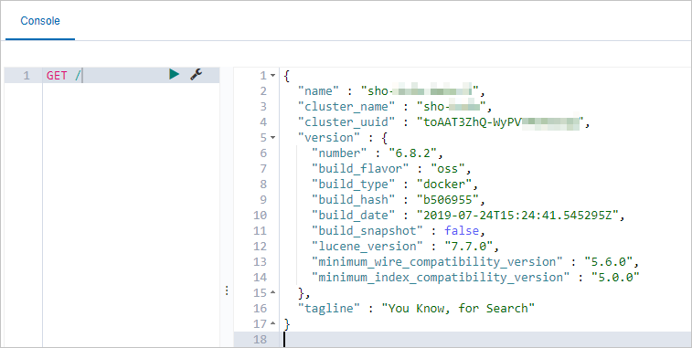

<a id="section-5-5"></a>

## 5.5. 查看集群信息

本文介绍通过Kibana控制台指导用户查看Elasticsearch集群信息，帮助识别和处理潜在风险。

**操作步骤**

> **说明**
>
> elasticsearch类型的实例通过Kibana控制台进行访问；opensearch类型的实例通过Dashboard控制台进行访问。操作方法类似，本文以Kibana控制台为例。

1. 登录Kibana控制台。

2. 执行以下命令查看集群基本信息。

   - 查看集群版本

     ```text
     GET /
     ```

   - 查看集群健康状况

     ```text
     GET /_cat/health?v
     ```

     Elasticsearch通过集群健康度表示数据完整性， 集群健康度分为green、yellow、red三种颜色，其代表含义如下：

     <table>
       <tr>
         <th width="105">集群健康度</th>
         <th>含义</th>
       </tr>
       <tr>
         <td>green</td>
         <td>集群处于正常状态，所有shard都正常分配。</td>
       </tr>
       <tr>
         <td>yellow</td>
         <td>集群可用，但是有索引副本未分配。</td>
       </tr>
       <tr>
         <td>red</td>
         <td>有主分片无法分配，存在red索引，该索引无法正常写入，集群无法正常提供服务。</td>
       </tr>
     </table>

     当集群处于yellow或者red状态时，为异常状态，表示集群有未被分配的副本或主分片。建议查找分片未被分配的原因，及时处理潜在风险。

   - 查看集群节点信息

     ```text
     GET /_cat/nodes?v
     ```

   - 查看JVM内存

     ```text
     GET /_nodes/stats/jvm?pretty
     ```

   - 查看磁盘

     ```text
     GET /_cat/allocation?v
     ```

   - 查看索引

     ```text
     GET /_cat/indices?v
     ```

<a id="section-6"></a>

# 6.快速入门

<a id="section-6-1"></a>

## 6.1. 创建索引

在使用Elasticsearch服务进行文档操作前，需要先创建索引。本文档为您介绍创建索引的方法。

**操作步骤**

> **说明**
>
> elasticsearch类型的实例通过Kibana控制台进行访问；opensearch类型的实例通过Dashboard控制台进行访问。操作方法类似，本文以Kibana控制台为例。

1. 登录Kibana控制台。

2. 执行以下命令创建索引。

   ```text
   PUT my_index
   {
     "settings": {
       "index": {
         "number_of_shards": "5",
         "number_of_replicas": "1"
       }
     },
     "mappings": {
       "properties": {
         "post_date": {
           "type": "date"
         },
         "tags": {
           "type": "keyword"
         },
         "title": {
           "type": "text",
           "analyzer": "cjk"
         }
       }
     }
   }
   ```

   > **重要**
   >
   > - 以上示例代码仅适用于Elasticsearch 7.0.0及之后版本，您也可以根据自身需求进行配置，详情请参见Doc index。
   >
   > - Elasticsearch 7.0.0及之后版本已移除Mapping中的type类型定义，之前版本会继续支持，详情请参见Removal of types。

   以上示例创建了一个名为 `my_index` 的索引，索引的类型为 `_doc` 。设置了分片数为5，副本数为1，并使用了 `cjk` 分词器。

   创建成功后，返回如下结果。

   ```json
   {
     "acknowledged" : true,
     "shards_acknowledged" : true,
     "index" : "my_index"
   }
   ```

<a id="section-6-2"></a>

## 6.2. 文档操作

<a id="section-6-2-1"></a>

### 6.2.1. 创建文档

本文档为您介绍使用Elasticsearch服务创建文档的方法。

**操作步骤**

1. 登录Kibana控制台。

2. 执行以下命令，使用PUT方式创建文档。

   ```text
   PUT /<index_name>/<type>/<ID>
   {
     "<field_name>": "<value>"
   }
   ```

   | 参数 | 说明 |
   | --- | --- |
   | &lt;index_name&gt; | 索引名称。 |
   | &lt;type&gt; | 索引类型。Elasticsearch 7.0.0以下版本可自定义，7.0及以上版本必须为<strong>_doc</strong>。 |
   | &lt;ID&gt; | 文档的标识ID。 |
   | &lt;field_name&gt; | 字段名。 |
   | &lt;value&gt; | 字段值。 |

   示例如下：

   - 创建ID为1的文档

     ```text
     PUT /my_index/_doc/1
     {
       "title": "One", 
       "tags": ["ruby"],
       "post_date":"2009-11-15T13:00:00"
     }
     ```

     创建成功后，返回如下结果。

     ```json
     {
       "_index" : "my_index",
       "_type" : "_doc",
       "_id" : "1",
       "_version" : 1,
       "result" : "created",
       "_shards" : {
         "total" : 2,
         "successful" : 2,
         "failed" : 0
       },
       "_seq_no" : 0,
       "_primary_term" : 1
     }
     ```

   - 创建ID为2的文档

     ```text
     PUT /my_index/_doc/2
     {
       "title": "Two", 
       "tags": ["ruby"],
       "post_date":"2009-11-15T14:00:00"
     }
     ```

     创建成功后，返回如下结果。

     ```json
     {
       "_index" : "my_index",
       "_type" : "_doc",
       "_id" : "2",
       "_version" : 1,
       "result" : "created",
       "_shards" : {
         "total" : 2,
         "successful" : 2,
         "failed" : 0
       },
       "_seq_no" : 1,
       "_primary_term" : 1
     }
     ```

     更多详情请参见Docs Index。

<a id="section-6-2-2"></a>

### 6.2.2. 更新文档

本文档为您介绍使用Elasticsearch服务更新文档的方法。

**操作步骤**

1. 登录Kibana控制台。

2. 执行以下命令，使用PUT或POST方式更新Elasticsearch中已经存在的文档。

   - 更新整个文档

     ```text
     PUT /<index_name>/<type>/<ID>
     {
       "<field_name>": "<value>"
     }
     ```

   - 更新部分文档

     ```text
     POST /<index_name>/<type>/_update/<ID>
     {  
       "script" : {
             "source": "ctx._source.<field_name> = '<value>'"
        }
     }
     ```

   | 参数 | 说明 |
   | --- | --- |
   | &lt;index_name&gt; | 索引名称。 |
   | &lt;type&gt; | 索引类型。Elasticsearch 7.0.0以下版本可自定义，7.0及以上版本必须为<strong>_doc</strong>。 |
   | &lt;ID&gt; | 文档的标识ID。 |
   | &lt;field_name&gt; | 字段名。 |
   | &lt;value&gt; | 字段值。 |

   示例如下：

   - 更新整个文档

     ```text
     PUT /my_index/_doc/1
     {
       "title": "One World One Dream", 
       "tags": ["ruby"],
       "post_date":"2009-11-15T13:00:00"
     }
     ```

     更新成功后，返回结果如下。

     ```json
     {
       "_index" : "my_index",
       "_type" : "_doc",
       "_id" : "1",
       "_version" : 2,
       "result" : "updated",
       "_shards" : {
         "total" : 2,
         "successful" : 2,
         "failed" : 0
       },
       "_seq_no" : 1,
       "_primary_term" : 1
     }
     ```

   - 更新部分文档

     ```text
     POST /my_index/_update/1
     {
         "script" : {
             "source": "ctx._source.title='One World'"
         }
     }
     ```

     更新成功后，返回结果如下。

     ```json
     {
       "_index" : "my_index",
       "_type" : "_doc",
       "_id" : "1",
       "_version" : 5,
       "result" : "updated",
       "_shards" : {
         "total" : 2,
         "successful" : 2,
         "failed" : 0
       },
       "_seq_no" : 4,
       "_primary_term" : 1
     }
     ```

   同样您也可以使用批量API进行更新，详情请参见Docs Update。

<a id="section-6-2-3"></a>

### 6.2.3. 检索文档

本文档为您介绍使用Elasticsearch服务检索文档的方法。

**操作步骤**

1. 登录Kibana控制台。

2. 执行以下命令，使用GET方式对文档进行检索查询。

   ```text
   GET /<index_name>/<type>/<ID>
   ```

   | 参数 | 说明 |
   | --- | --- |
   | &lt;index_name&gt; | 索引名称。 |
   | &lt;type&gt; | 索引类型。Elasticsearch 7.0.0以下版本可自定义，7.0及以上版本必须为<strong>_doc</strong>。 |
   | &lt;ID&gt; | 文档的标识ID。 |

   示例如下。

   ```text
   GET /my_index/_doc/1
   ```

   检索成功后，返回如下结果。

   ```json
   {
     "_index" : "my_index",
     "_type" : "_doc",
     "_id" : "1",
     "_version" : 5,
     "_seq_no" : 4,
     "_primary_term" : 1,
     "found" : true,
     "_source" : {
       "title" : "One World",
       "tags" : [
         "ruby",
         "blue"
       ],
       "post_date" : "2009-11-15T13:00:00"
     }
   }
   ```

   更多详情请参见Docs GET。

<a id="section-6-2-4"></a>

### 6.2.4. 搜索文档

本文档为您介绍使用Elasticsearch服务搜索文档的方法。

**操作步骤**

1. 登录Kibana控制台。

2. 执行以下命令，通过GET方式对文档进行搜索，通过URI参数来指定搜索对象。

   ```text
   GET /_search
   GET /<index_name>/_search
   ```

   **&lt;index_name>**：索引名称。

   例如搜索title字段包含T的所有文档，命令如下。

   ```text
   GET /my_index/_search?q=title:T*
   ```

   检索成功后，返回结果如下。

   ```json
   {
     "took" : 689,
     "timed_out" : false,
     "_shards" : {
       "total" : 5,
       "successful" : 5,
       "skipped" : 0,
       "failed" : 0
     },
     "hits" : {
       "total" : {
         "value" : 1,
         "relation" : "eq"
       },
       "max_score" : 1.0,
       "hits" : [
         {
           "_index" : "my_index",
           "_type" : "_doc",
           "_id" : "2",
           "_score" : 1.0,
           "_source" : {
             "title" : "Two",
             "tags" : [
               "ruby"
             ],
             "post_date" : "2009-11-15T14:00:00"
           }
         }
       ]
     }
   }
   ```

   更多详情请参见Docs GET。

<a id="section-6-2-5"></a>

### 6.2.5. 复杂搜索

本文档为您介绍使用Elasticsearch服务进行复杂搜索的方法。

**操作步骤**

1. 登录Kibana控制台。

2. 执行以下命令，使用GET方式对文档进行复杂搜索。

   ```text
   GET /<index_name>/_search
   {
       "query" : {
           ""
       }
   }
   ```

   | 参数 | 说明 |
   | --- | --- |
   | &lt;index_name&gt; | 索引名称。 |
   | query | 查询体。 |

   示例如下。

   - 按时间范围查询

     ```text
     GET /my_index/_search
     {
         "query" : {
             "range" : {
                 "post_date" : { "from" : "2009-11-15T13:00:00", "to" : "2009-11-
     15T14:00:00" }
             }
         }
     }
     ```

     搜索成功后，返回如下结果。

     ```json
     {
       "took" : 1,
       "timed_out" : false,
       "_shards" : {
         "total" : 5,
         "successful" : 5,
         "skipped" : 0,
         "failed" : 0
       },
       "hits" : {
         "total" : {
           "value" : 2,
           "relation" : "eq"
         },
         "max_score" : 1.0,
         "hits" : [
           {
             "_index" : "my_index",
             "_type" : "_doc",
             "_id" : "2",
             "_score" : 1.0,
             "_source" : {
               "title" : "Two",
               "tags" : [
                 "ruby"
               ],
               "post_date" : "2009-11-15T14:00:00"
             }
           },
           {
             "_index" : "my_index",
             "_type" : "_doc",
             "_id" : "1",
             "_score" : 1.0,
             "_source" : {
               "title" : "One World",
               "tags" : [
                 "ruby"
               ],
               "post_date" : "2009-11-15T13:00:00"
             }
           }
         ]
       }
     }
     ```

   - 按关键词查询

     ```text
     GET /my_index/_search
     {
         "query" : {
         "simple_query_string" : {
             "query": "One +(python | ruby) -Two",
             "fields": ["title^5", "tags"],
             "default_operator": "or"
         }
       }
     }
     ```

     搜索成功后，返回如下结果。

     ```json
     {
       "took" : 1,
       "timed_out" : false,
       "_shards" : {
         "total" : 5,
         "successful" : 5,
         "skipped" : 0,
         "failed" : 0
       },
       "hits" : {
         "total" : {
           "value" : 1,
           "relation" : "eq"
         },
         "max_score" : 2.2378674,
         "hits" : [
           {
             "_index" : "my_index",
             "_type" : "_doc",
             "_id" : "1",
             "_score" : 2.2378674,
             "_source" : {
               "title" : "One World",
               "tags" : [
                 "ruby"
               ],
               "post_date" : "2009-11-15T13:00:00"
             }
           }
         ]
       }
     }
     ```

     更多详情请参见Docs GET。

<a id="section-6-2-6"></a>

### 6.2.6. 统计分析

本文档为您介绍使用Elasticsearch服务对文档数据进行统计分析的方法。

**操作步骤**

1. 登录Kibana控制台。

2. 执行以下命令，使用POST方式对文档数据进行统计分析。

   ```text
   POST /<index_name>/_search
   {
     "size": 0,
     "aggs": {
       "group_by_tags": {
         "terms": {
           "field": "tags"
         }
       }
     }
   }
   ```

   **&lt;index_name>**：索引名称。

   示例如下。

   ```text
   POST /my_index/_search
   {
     "size": 0,
     "aggs": {
       "group_by_tags": {
         "terms": {
           "field": "tags"
         }
       }
     }
   }
   ```

   运行成功后，结果如下。

   ```json
   {
     "took" : 1,
     "timed_out" : false,
     "_shards" : {
       "total" : 5,
       "successful" : 5,
       "skipped" : 0,
       "failed" : 0
     },
     "hits" : {
       "total" : {
         "value" : 2,
         "relation" : "eq"
       },
       "max_score" : null,
       "hits" : [ ]
     },
     "aggregations" : {
       "group_by_tags" : {
         "doc_count_error_upper_bound" : 0,
         "sum_other_doc_count" : 0,
         "buckets" : [
           {
             "key" : "ruby",
             "doc_count" : 2
           }
         ]
       }
     }
   }
   ```

<a id="section-6-2-7"></a>

### 6.2.7. 删除文档

本文档为您介绍使用Elasticsearch服务删除文档的方法。

**操作步骤**

1. 登录Kibana控制台。

2. 执行以下命令，通过DELETE方式删除文档。

   ```text
   DELETE /<index_name>/<type>/<ID>
   ```

   | 参数 | 说明 |
   | --- | --- |
   | &lt;index_name&gt; | 索引名称。 |
   | &lt;type&gt; | 索引类型。Elasticsearch 7.0.0以下版本可自定义，7.0及以上版本必须为<strong>_doc</strong>。 |
   | &lt;ID&gt; | 文档的标识ID。 |

   示例如下。

   ```text
   DELETE /my_index/_doc/2
   ```

   删除成功后，返回如下结果。

   ```json
   {
     "_index" : "my_index",
     "_type" : "_doc",
     "_id" : "2",
     "_version" : 2,
     "result" : "deleted",
     "_shards" : {
       "total" : 2,
       "successful" : 2,
       "failed" : 0
     },
     "_seq_no" : 4,
     "_primary_term" : 1
   }
   ```

   更多详情请参见Docs Delete。

<a id="section-6-2-8"></a>

### 6.2.8. 删除索引

本文为您介绍使用Elasticsearch的Delete API删除索引的方法。

**操作步骤**

1. 登录Kibana控制台。

2. 执行以下命令，通过DELETE方式删除索引。

   ```text
   DELETE /<index_name>
   ```

   **&lt;index_name>**：索引名称。

   示例如下。

   ```text
   DELETE /my_index
   ```

   删除成功后，返回如下结果。

   ```json
   {
     "acknowledged" : true
   }
   ```

   更多详情请参见Docs Delete。

<a id="section-7"></a>

# 7.集群管理

<a id="section-7-1"></a>

## 7.1. 自定义实例列表项

通过自定义实例的列表项，您可以设置实例列表显示的信息，方便查看实例信息。本文介绍具体的实现方法。

**操作步骤**

1. 登录阿里云检索分析服务控制台，在左侧导航栏，单击**实例列表**。

2. 在页面右上角，单击

   图标。

   

3. 在**自定义列表项**弹框中，选择需要查看的列表项，系统会按照您设置的列表项，在实例列表中展示对应的信息。

   

<a id="section-7-2"></a>

## 7.2. 导出实例列表信息

您可通过实例列表导出功能，自定义导出阿里云Elasticsearch的资源列表信息。本文介绍具体的操作方法。

**操作步骤**

1. 登录阿里云检索分析服务控制台，在左侧导航栏，单击**实例列表**。

2. 在页面右上角，单击

   图标。

   

3. 在**导出**对话框中，选择导出范围并勾选需要导出的数据列。

   

   - **导出范围**：默认导出全部资源项，也可按需导出选中数据。

   - **需要导出的数据列**：选择需要导出的配置项。

4. 单击**确定**。

<a id="section-7-3"></a>

## 7.3. 刷新实例

当阿里云Elasticsearch控制台中实例的信息没有及时更新时，例如刚创建完成的实例状态显示失败，可以通过刷新功能，手动刷新页面中的状态信息。本文介绍具体的操作方法。

**操作步骤**

1. 登录阿里云检索分析服务控制台，在左侧导航栏，单击**实例列表**。

2. 通过以下两种方式刷新实例。

   - 在**Elasticsearch实例**页面，单击  图标。

   - 单击目标实例ID，在**基本信息**页面右上角，单击**刷新**。

<a id="section-7-4"></a>

## 7.4. 查看实例相关信息

您可以在实例的基本信息页面，查看实例的ID、状态、访问地址和端口等基本信息，以及Kibana/Dashboard信息和节点可视化信息。本文介绍如何查看集群的相关信息。

**查看elasticsearch类型实例的相关信息**

1. 登录阿里云检索分析服务控制台，在左侧导航栏，单击**实例列表**。

2. 在**实例列表**中，单击目标实例ID。

3. 在**基本信息**页面，查看集群的基本信息、Kibana信息以及节点可视化信息。

   **类别**

   **参数**

   **说明**

   实例的ID，实例的唯一标识。

   **实例ID**

   实例的名称。支持在创建实例时自定义实例名称，也支

   **名称**

   持按照名称搜索实例。

   elasticsearch。

   **实例类型**

   实例的状态。支持正常（绿色）、生效中（黄色）和失

   **状态**

   效（红色）等状态。

   实例创建的时间。

   **创建时间**

   实例对应的物理机架构。

   **芯片架构**

   **基本信息**

   支持5.x、6.x和7.x等多个版本，具体以控制台上为

   **版本**

   准。

   实例所在的地域。

   **地域**

   支持<strong>专有网络(single tunnel)</strong>和**专有网络(any**

   **网络类型**

   <strong>tunnel)</strong>类型。

   支持在专有网络下，通过指定私网地址访问实例服务。

   **私网地址**

   **elasticsearch域名实**

   集群的实际IP地址。

   **际ip地址**

   Kibana的实际IP地址。

   **kibana域名实际ip地址**

   单击Kibana控制台地址链接，即可进入Kibana控制台，详细信息请参见登录Kibana控制台。

   **Kibana信息**

   **Kibana控制台地址**

   - 单击  图标，进入节点可视化模式，可查看集群和

     各节点的状态。将鼠标移至节点图标上，可查看节点名称、节点状态、CPU规格、内存大小、存储空间等

   无

   **节点可视化**

   信息。您还可以进行**重启**或者**查看节点日志**操作。

   - 单击  图标，进入配置列表模式，可查看集群的配

     置信息，例如数据节点规格、数据节点数量等。

**查看opensearch类型实例的相关信息**

1. 登录阿里云检索分析服务控制台，在左侧导航栏，单击**实例列表**。

2. 在**实例列表**中，单击目标实例ID。

3. 在**基本信息**页面，查看集群的基本信息、Dashboard信息以及节点可视化信息。

   <table>
     <tr>
       <th>类别</th>
       <th>参数</th>
       <th>说明</th>
     </tr>
     <tr>
       <td rowspan="12">基本信息</td>
       <td>实例ID</td>
       <td>实例的ID，实例的唯一标识。</td>
     </tr>
     <tr>
       <td>名称</td>
       <td>实例的名称。支持在创建实例时自定义实例名称，也支持按照名称搜索实例。</td>
     </tr>
     <tr>
       <td>实例类型</td>
       <td>opensearch。</td>
     </tr>
     <tr>
       <td>状态</td>
       <td>实例的状态。支持正常（绿色）、生效中（黄色）和失效（红色）等状态。</td>
     </tr>
     <tr>
       <td>创建时间</td>
       <td>实例创建的时间。</td>
     </tr>
     <tr>
       <td>芯片架构</td>
       <td>实例对应的物理机架构。</td>
     </tr>
     <tr>
       <td>版本</td>
       <td>支持3.1.0版本，具体以控制台上显示的为准。</td>
     </tr>
     <tr>
       <td>地域</td>
       <td>实例所在的地域。</td>
     </tr>
     <tr>
       <td>网络类型</td>
       <td>支持<strong>专有网络(single tunnel)</strong>和<strong>专有网络(any</strong> <strong>tunnel)</strong>类型。</td>
     </tr>
     <tr>
       <td>私网地址</td>
       <td>支持在专有网络下，通过指定私网地址访问实例服务。</td>
     </tr>
     <tr>
       <td>Opensearch域名实际ip地址</td>
       <td>集群的实际IP地址。</td>
     </tr>
     <tr>
       <td>Dashboard域名实际ip地址</td>
       <td>Dashboard的实际IP地址。</td>
     </tr>
     <tr>
       <td>Dashboard信息</td>
       <td>Dashboard控制台地址</td>
       <td>单击Kibana控制台地址链接，即可进入Kibana控制台，详细信息请参见登录Dashboards控制台。</td>
     </tr>
     <tr>
       <td>节点可视化</td>
       <td>无</td>
       <td>• 单击图标，进入节点可视化模式，可查看集群和<br>各节点的状态。将鼠标移至节点图标上，可查看节点名称、节点状态、CPU规格、内存大小、存储空间等信息。您还可以进行<strong>重启</strong>或者<strong>查看节点日志</strong>操作。<br>• 单击图标，进入配置列表模式，可查看集群的配<br>置信息，例如数据节点规格、数据节点数量等。</td>
     </tr>
   </table>

<a id="section-7-5"></a>

## 7.5. 查看任务列表

通过实例任务列表您可以查看实例的变更任务进度，包括集群规格变配进度、集群配置文件变更进度、集群创建进度、插件安装进度、集群重启进度等。本文为您介绍如何查看实例的任务。

**前提条件**

- 实例状态正常。

- 实例中存在变更中的任务。

**操作步骤**

1. 登录阿里云检索分析服务控制台，在左侧导航栏，单击**实例列表**。

2. 在**实例列表**中，单击目标实例ID。

3. 在基本信息页面，单击右上角的  图标。

4. 在任务列表查看任务的**变更开始时间**、**变更类型**和**变更状态**。

5. 单击任务左侧的  图标，展开下拉框，查看实例中各节点的变更状态和运行时间，单击**节点信息**或**节点日**

   **志**查看对应节点的信息或日志。

   > **说明**
   >
   > 当任务完成后，基本信息页面的右上角图标变为  ，任务列表中的  图标消失。

<a id="section-7-6"></a>

## 7.6. 修改实例名称

阿里云Elasticsearch提供修改实例名称的功能，您可以根据需求修改实例名称。

**操作步骤**

1. 登录阿里云检索分析服务控制台，在左侧导航栏，单击**实例列表**。

2. 在**实例列表**中，单击目标实例ID。

3. 在**基本信息**页面的**基本信息**区域，查看当前实例的名称。

4. 单击实例名称右侧的**编辑**，按照界面提示要求输入实例名称，单击**确定**。

<a id="section-7-7"></a>

## 7.7. 登录Kibana控制台

阿里云Elasticsearch提供了Kibana控制台，为您的业务提供扩展的可能性。Kibana控制台作为Elastic生态系统的组成部分，可以无缝衔接Elasticsearch服务，让您实时了解实例的运行状态，并对实例进行管理。本文介绍登录Kibana控制台的方法。

**前提条件**

- 实例状态正常，且已开启Kibana节点。

- 有允许登录Kibana的账号，并且设置了白名单。具体操作，请参见安全设置。

**操作步骤**

1. 登录阿里云检索分析服务控制台，在左侧导航栏，单击**实例列表**。

2. 在**实例列表**中，单击目标实例ID。

3. 在**基本信息**页面的**Kibana信息**区域，单击**Kibana控制台地址**右侧的链接。

4. 输入用户名和密码，单击登录。

   > **说明**
   >
   > 默认用户名为elastic，密码为创建集群时设置的密码。

5. 单击左上角的

   图标，选择**Management > Dev Tools**，进入**Console**界面。

   

<a id="section-7-8"></a>

## 7.8. 修改Kibana配置

通过修改Kibana配置，您可以查看、安装或卸载已在运维平台上传的Kibana插件。本文介绍具体的操作方法。

**前提条件**

实例状态正常，且运维工程师已在运维平台上传对应版本的Kibana插件。

**操作步骤**

1. 登录阿里云检索分析服务控制台，在左侧导航栏，单击**实例列表**。

2. 在**实例列表**中，单击目标实例ID。

3. 在**基本信息**页面的**Kibana信息**区域右侧，单击**修改配置**。

4. 在**插件配置**页面，查看Kibana插件列表。

5. 单击目标插件右侧的**安装**或**卸载**。

   > **警告**
   >
   > 安装或卸载插件会触发集群重启，请确认后操作。

6. 在弹出的对话框中，阅读风险提示，单击**确认**。

   等待集群重启成功后，安装的插件状态变为已安装，卸载的插件状态变为未安装，表示插件安装或卸载成功。

<a id="section-7-9"></a>

## 7.9. 登录Dashboards控制台

本文介绍如何登录OpenSearch Dashboards控制台。

**前提条件**

实例状态正常，且已开启Dashboards节点。

**操作步骤**

1. 登录阿里云检索分析服务控制台，在左侧导航栏，单击**实例列表**。

2. 在**实例列表**中，单击目标实例ID。

3. 在**基本信息**页面的**Dashboard信息**区域，单击**Dashboard控制台地址**右侧的链接。

4. 输入用户名和密码，单击**Log In**。

   > **说明**
   >
   > 默认用户名为admin，密码为您创建实例时设置的密码。

5. 单击左上角的

   图标，选择**Management > Dev Tools**，进入**Console**界面。

   

<a id="section-7-10"></a>

## 7.10. 修改Dashboards配置

通过修改Dashboards配置，您可以查看、安装或卸载已在运维平台上传的Dashboards插件。本文介绍具体的操作方法。

**操作步骤**

1. 登录阿里云检索分析服务控制台，在左侧导航栏，单击**实例列表**。

2. 在**实例列表**中，单击目标实例ID。

3. 在**基本信息**页面的**Dashboard信息**区域右侧，单击**修改配置**。

4. 在**插件配置**页面，查看Dashboard插件列表。

5. 单击目标插件右侧的**安装**或**卸载**。

   > **警告**
   >
   > 安装或卸载插件会触发集群重启，请确认后操作。

6. 在弹出的对话框中，阅读风险提示，单击**确认**。

   等待集群重启成功后，安装的插件状态变为已安装，卸载的插件状态变为未安装，表示插件安装或卸载成功。

<a id="section-7-11"></a>

## 7.11. 重启实例或节点

当您需要修改实例或节点的配置，或者遇到集群或节点出现异常等情况时，可能需要重启Elasticsearch实例或节点。本文介绍如何通过控制台重启Elasticsearch实例或节点。

**前提条件**

确保实例状态正常。

**注意事项**

如果集群整体负载不高且索引存在副本分片，一般情况下重启过程中可对外持续提供服务。但在某些场景下，重启过程中可能会出现访问超时，例如强制重启并发度高、集群负载很高并且已经存在集群访问不可用的情况、没有副本分片、在重启或强制重启过程中存在大量的写入和查询等场景，建议重启前先在客户端设计好重试机制并且在业务低峰期进行操作。

**操作步骤**

1. 登录阿里云检索分析服务控制台。

2. 在左侧导航栏，单击**实例列表**。

3. 在**实例列表**中，单击目标实例ID。

4. 在**基本信息**页面，单击右上角的**重启**。

5. 在**重启**对话框中，配置重启参数。

   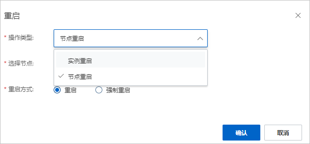

   <table>
     <tr>
       <th width="89">参数</th>
       <th>说明</th>
     </tr>
     <tr>
       <td>操作类型</td>
       <td>支持<strong>实例重启</strong>和<strong>节点重启</strong>：<br>• <strong>实例重启</strong>：重启实例中所包含的所有节点。<br>• <strong>节点重启</strong>：重启所选节点。</td>
     </tr>
     <tr>
       <td>选择节点</td>
       <td>选择待重启的节点，支持选择多个节点，实现批量重启。仅当<strong>操作类型</strong>为<strong>节</strong><strong>点重启</strong>时显示。</td>
     </tr>
     <tr>
       <td>重启方式</td>
       <td>支持<strong>重启</strong>和<strong>强制重启</strong>：<br>• <strong>重启</strong>：当实例的状态为正常时，才可进行重启，否则需要进行强制重启。<br>说明节点在重启期间，对应的CPU和内存使用率会存在临时突增的情况，可能会造成服务抖动，正常情况下过一段时间后会恢复正常。<br>• <strong>强制重启</strong>：当实例为非正常状态（黄色或红色）时，不支持常规重启操作，需要进行强制重启。<br>重要当实例处于非正常状态时，不建议对实例进行扩容、重启、修改密码或其他变更配置类的操作，请务必保证实例的状态变为正常（绿色）后再进行这些操作。</td>
     </tr>
   </table>

6. 单击**确认**，开始重启操作。

   > **说明**
   >
   > 如果是强制重启，需要先选中**确认要强制重启**，进行重启确认。

   重启过程中，实例状态显示为生效中（黄色）。重启成功后，实例状态显示为正常（绿色）。

<a id="section-7-12"></a>

## 7.12. 集群扩缩容

当您Elasticsearch集群的配置与业务需求不匹配时，可通过集群扩缩容功能，灵活变更集群配置，节约资源并应对突发状况。本文介绍如何对集群进行扩缩容。

**前提条件**

确保集群状态正常。

**注意事项**

缩容操作风险较高，一般不建议进行缩容。如果必须进行缩容操作，那么在执行缩容操作前，请务必评估并防范潜在的数据安全与服务可用性风险。为确保操作平稳可控，请遵循以下建议：

- 数据备份：缩容前必须对集群中的关键索引数据进行完整备份，防止因节点下线导致数据丢失。

- 副本保障：待缩容节点上的所有索引应至少配置1个副本，确保主分片可在其他节点上正常恢复，避免数据不可用。

- 专业实施：建议由具备Elasticsearch或OpenSearch运维经验的技术人员操作，遵循标准变更流程，必要时提前提交L2支持工单获取技术支撑。

- 监控观察：缩容过程中及完成后，应持续观察集群健康状态、分片重平衡情况及性能指标，及时响应异常。

未经充分评估的缩容操作可能导致数据丢失或服务中断，请谨慎执行。

**操作步骤**

> **说明**
>
> opensearch类型实例的扩缩容操作与elasticsearch类型实例的扩缩容操作类似，本文以elasticsearch类型的实例为例。

1. 登录阿里云检索分析服务控制台，在左侧导航栏，单击**实例列表**。

2. 在**实例列表**中，单击目标实例ID。

3. 在**基本信息**页面的**节点可视化**区域右侧，根据需求选择**配置变更 > 集群升配**或**配置变更 > 集群降配**。

4. 在**实例升配**或**实例降配**页面，根据需求修改集群配置。相关参数说明，请参见创建集群。

5. 单击**提交**。

6. 在**操作成功**对话框中，单击**确定**。

   在**实例列表**页面，查看实例变更状态，等待实例状态变为**正常**，则实例变配成功。

<a id="section-7-13"></a>

## 7.13. 查看节点日志

本文介绍如何查看单节点的节点日志。

**操作步骤**

1. 登录阿里云检索分析服务控制台，在左侧导航栏，单击**实例列表**。

2. 在**实例列表**中，单击目标实例ID。

3. 在**基本信息**页面的**节点可视化**区域，将鼠标移至对应的节点图标上，然后在弹出的提示框中单击**查看节点日志**。

   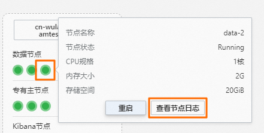

4. 在节点日志页面，查看对应节点的日志。

   > **说明**
   >
   > 系统默认此处仅展示该节点最新的100条日志。开启自动刷新后，日志每30秒刷新一次，非实时刷新。更多关于日志详细信息的查询，请参考《运维指南》的查看日志页面。

<a id="section-7-14"></a>

## 7.14. 配置与管理

<a id="section-7-14-1"></a>

### 7.14.1. 集群配置

通过集群配置功能您可以进行同义词配置、安全设置、配置修改、YML文件配置等操作。本文介绍如何进行集群配置。

**进入集群配置页面**

1. 登录阿里云检索分析服务控制台。

2. 在左侧导航栏，单击**实例列表**。

3. 在**实例列表**中，单击目标实例ID。

4. 在左侧导航栏，选择**配置与管理 > ES集群配置**。

**配置同义词**

1. 进入集群配置页面。

2. 在**基础配置**区域，单击**同义词配置**右侧的**上传**。

3. 在**同义词配置**面板，单击下方的**配置**。

4. 在**同义词配置**输入框下方，填写同义词所在Bucket名称和文件名称。

   同义词文件作用于Elasticsearch的同义词库，新的索引将会采用更新后的词库。要求每行只有一个同义词表达式（表达式支持Solr规则和WordNet规则），保存为UTF-8编码的TXT文件，文件大小不能超过1 MB，配置示例如下。

   ```text
   ⻄红柿,番茄
   冲电 => 充电
   ```

   > **重要**
   >
   > - 目前Elasticsearch仅支持通过添加OSS文件的方式上传同义词，请确保Bucket与当前Elasticsearch实例在同一地域下，且文件为TXT格式。
   >
   > - 上传同义词前需确保集群处于正常状态。
   >
   > - 仅elasticsearch类型的实例具备自定义词典冷、热更新能力。其中热更新后，无需重启实例。

   <table>
     <tr>
       <th width="151">参数</th>
       <th>说明</th>
     </tr>
     <tr>
       <td>添加OSS文件</td>
       <td>将文件上传到OSS中，默认是<strong>添加OSS文件</strong>，不可修改。</td>
     </tr>
     <tr>
       <td>添加Bucket名称</td>
       <td>OSS中Bucket的名称。<br>重要指定的Bucket必须是真实的，且Bucket与当前Elasticsearch实例在同一地域内。</td>
     </tr>
     <tr>
       <td>添加文件名称</td>
       <td>需要上传的文件名称。<br>重要指定的文件必须是UTF-8编码的TXT文件，且文件在指定的Bucket中是存在的，同时文件的读写权限需要为公共读。</td>
     </tr>
   </table>

5. 单击**添加**。

   当文件出现在**同义词配置**输入框中，且文件名右侧显示**success**，表示添加成功。

6. 单击**保存**。

7. 等待实例状态变为正常，登录Kibana控制台创建索引校验同义词，并上传测试数据进行搜索测试。

   > **重要**
   >
   > 创建索引时需要配置 `settings` ，并且需要在 `settings` 中配置 `"synonyms_path":"synonym"` 。详细信息，请参见Using Synonyms。

**安全设置**

通过设置指定用户能否登录Kibana和设置合适的白名单，来提高集群和系统的安全性。在新建集群后也需要首先设置白名单，否则可能会遇到监控数据无法正常采集，Kibana无法登录等问题。

**操作步骤**

1. 进入集群配置页面。

2. 在**安全设置**区域，单击**修改设置**。

3. 在右侧弹出的**安全设置**面板中，管理账号信息和查看证书信息。

   - **管理账号信息**

     - 查看登录名

       - elastic（或者admin）：elasticsearch类型的实例登录名为elastic，opensearch类型的实例登录名为admin。elastic/admin相当于管理员账号，拥有全部权限superuser。

         > **重要**
         >
         > 重置密码会影响您使用elastic/admin账号访问实例，但不影响其他非elastic/admin账号访问该实例。因此建议不要在程序中通过elastic/admin账号访问实例，而是通过自定义用户来访问（需要给用户赋予相应的权限）。

       - kibanaserver：Kibana服务所用账号，权限为kibana_system，仅包含Kibana初始化所需的最小权限，无法读取用户数据。

         此账号白名单需要包含Kibana服务所在IP地址，如果未正确配置，Kibana将无法访问。

       - monitoring_collector：管控服务所用账号，权限为aliyun-ops，部分管控功能依赖此账号，例如采集监控数据、运行自动备份等，仅包含管控所需最小权限，无法读取用户数据。

         此账号白名单需包含所有管控组件可能的IP地址，如果未正确配置，部分管控功能将降级不可用。例如无法查看监控数据，无法开启自动备份，无法通过asr进行容灾切换等。

     - 修改密码

       单击**修改密码**，可修改对应账号密码，无需重启集群。

     - 修改白名单

       > **重要**
       >
       > 目前仅elasticsearch类型的实例支持修改白名单；opensearch类型的实例不支持。

       单击**修改白名单**，可修改白名单配置。

       - 配置多个IP地址使用半角逗号（,）分隔。例如， `127.0.0.1,127.0.0.2` 。

       - 地址范围通过CIDR表示法表示。例如， `1.2.3.4/24` 表示支持1.2.3.X网段的IP地址访问ES。

       - `127.0.0.1` 为默认的空白白名单，配置此白名单的账号无法远程访问ES。

   - **查看证书信息**

     该证书为ES节点间相互通信所用证书，如果该签发证书的指纹相同则证书节点可相互访问。

     > **重要**
     >
     > - 当前证书为系统生成的随机证书，如需使用ES中XDCR功能、CCS功能或跨集群reindex，需保证主从集群证书完全一致方可连通。
     >
     > - 支持用户自定义证书，如需修改证书请联系现场运维人员。

**报错及异常现象处理**

> **说明**
>
> IP地址获取方式请咨询现场运维人员，或查看运维指南中实例管理相关操作。

- kibana界面无法登录

  - 报错信息：

    - 6.x/7.x版本：Kibana server is not ready yet

    - 5.x版本：Authorization Exception

  - 原因分析：kibanaserver账号的白名单配置有误。

  - 解决方案：修改kibanaserver账号白名单，kibanaserver账号增加kibana服务所在IP地址。

- Kibana白名单关闭后仍可登录

  - 异常现象：Kibana白名单关闭后仍可登录。

  - 原因分析：Kibana界面未重新初始化。

  - 解决方案：联系现场运维同学重启该Kibana所在的Pod。

- 监控数据无数据

  - 异常现象：grafana监控页面的数据显示no data。

  - 原因分析：monitoring_collector账号的白名单配置有误。

  - 解决方案：修改monitoring_collector账号白名单，monitoring_collector账号增加exporter服务所在IP地址。

- 访问Elasticsearch插件页面报错

  - 报错信息：403 Forbidden:[Ip 23.5.\*\*.\*\* is not allow in ip white/black list]

  - 原因分析：monitoring_collector账号的白名单配置有误。

  - 解决方案：monitoring_collector账号白名单，monitoring_collector账号增加essen服务所在IP地址。

- 访问自动备份页面报错

  - 报错信息：proxy request fail

  - 原因分析：monitoring_collector账号的白名单配置有误。

  - 解决方案：修改monitoring_collector账号白名单，monitoring_collector账号增加essen服务所在IP地址。

- 自动备份不生效

  - 异常现象：到规定时间点后未正常快照。

  - 原因分析：monitoring_collector账号的白名单配置有误。

  - 解决方案：修改monitoring_collector账号白名单，monitoring_collector账号增加snapshot服务所在IP地址。

- 跨集群访问报错

  - 报错信息：[][22.0.x.x:9300] general node connection failure

  - 原因分析：交互的集群证书不同。

  - 解决方案：咨询现场运维人员，或查看运维指南中实例管理相关操作。

**修改配置信息**

1. 进入集群配置页面。

2. 在**修改配置**区域，单击**编辑**，按需配置相关字段。

   配置字段说明如下，具体以界面显示为准。

   **7.10.0版本**

   | 字段名称 | 取值说明 | 字段描述 |
   | --- | --- | --- |
   | apack.accesslog.enabled | 布尔值，取值范围：<br>• true<br>• false<br>默认值：true。 | 访问日志审计功能。 |
   | apack.accesslog.search.enable d | 布尔值，取值范围：<br>• true<br>• false<br>默认值：true。 | 搜索请求字段打印功能。 |
   | thread_pool.write.queue_size | 正整数，取值范围：根据集群的大小和写操作的需求来调整，该值无固定最大/最小值。默认值：10000。 | 文档写入队列大小。 |
   | thread_pool.search.queue_size | 正整数，取值范围：根据集群的大小和负载来调整。默认值：1000。 | 文档搜索队列大小。 |
   | cluster.routing.allocation.disk.watermark.low | 字符串，默认值：85%，也可设置为固定值（可用磁盘空间），例如：500 MB、100 GB。 | 当磁盘使用率达到此阈值时，集群会尝试不再向这个节点分配新的分片。 |
   | cluster.routing.allocation.disk.watermark.high | 字符串，默认值：90%，也可设置为固定值（可用磁盘空间），例如：500 MB、100 GB。 | 当磁盘使用率达到此阈值时，集群会尝试将分片重新分配到其他使用率较低的节点。 |
   | cluster.routing.allocation.disk.watermark.flood_stage | 字符串，默认值：95%，也可设置为固定值（可用磁盘空间），例如：500 MB、100 GB。 | 当磁盘使用率达到此阈值时，集群会将节点标记为不可分配，并尝试将所有分片从该节点移动到其他节点，同时将节点上的分片设置为只读索引。 |
   | action.auto_create_index | 布尔值，取值范围：<br>• true<br>• false<br>默认值：true。 | 接收到新文档后，如果没有对应索引，是否允许系统自动创建索引。 |
   | action.destructive_requires_na me | 布尔值，取值范围：<br>• true<br>• false<br>默认值：false。 | 在删除索引时，是否需要明确指定索引名称。 |

   **6.8.13版本**

   | 字段名称 | 取值说明 | 字段描述 |
   | --- | --- | --- |
   | action.auto_create_index | 布尔值，取值范围：<br>• true<br>• false<br>默认值：true。 | 接收到新文档后，如果没有对应索引，是否允许系统自动创建索引。 |
   | action.destructive_requires_n ame | 布尔值，取值范围：<br>• true<br>• false<br>默认值：false。 | 在删除索引时，是否需要明确指定索引名称。 |
   | thread_pool.write.queue_size | 正整数，取值范围：根据集群的大小和写操作的需求来调整，该值无固定最大/最小值。默认值：200。 | 文档写入队列大小。 |
   | thread_pool.search.queue_siz e | 正整数，取值范围：根据集群的大小和负载来调整。默认值：1000。 | 文档搜索队列大小。 |
   | cluster.routing.allocation.disk.watermark.low | 字符串，默认值：85%，也可设置为固定值（可用磁盘空间），例如：500 MB、100 GB。 | 当磁盘使用率达到此阈值时，集群会尝试不再向这个节点分配新的分片。 |
   | cluster.routing.allocation.disk.watermark.high | 字符串，默认值：90%，也可设置为固定值（可用磁盘空间），例如：500 MB、100 GB。 | 当磁盘使用率达到此阈值时，集群会尝试将分片重新分配到其他使用率较低的节点。 |
   | cluster.routing.allocation.disk.watermark.flood_stage | 字符串，默认值：95%，也可设置为固定值（可用磁盘空间），例如：500 MB、100 GB。 | 当磁盘使用率达到此阈值时，集群会将节点标记为不可分配，并尝试将所有分片从该节点移动到其他节点，同时将节点上的分片设置为只读索引。 |

   **5.5.3版本**

   | 字段名称 | 取值说明 | 字段描述 |
   | --- | --- | --- |
   | thread_pool.bulk.queue_size | 正整数，取值范围：根据集群的大小和写操作的需求来调整，该值无固定最大/最小值。默认值：200。 | 文档批量写入队列大小。 |
   | thread_pool.search.queue_size | 正整数，取值范围：根据集群的大小和负载来调整。默认值：1000。 | 文档搜索队列大小。 |
   | cluster.routing.allocation.disk.watermark.low | 字符串，默认值：85%，也可设置为固定值（可用磁盘空间），例如：500 MB、100 GB。 | 当磁盘使用率达到此阈值时，集群会尝试不再向这个节点分配新的分片。 |
   | cluster.routing.allocation.disk.watermark.high | 字符串，默认值：90%，也可设置为固定值（可用磁盘空间），例如：500 MB、100 GB。 | 当磁盘使用率达到此阈值时，集群会尝试将分片重新分配到其他使用率较低的节点。 |
   | action.auto_create_index | 布尔值，取值范围：<br>• true<br>• false<br>默认值：true。 | 接收到新文档后，如果没有对应索引，是否允许系统自动创建索引。 |
   | action.destructive_requires_na me | 布尔值，取值范围：<br>• true<br>• false<br>默认值：false。 | 在删除索引时，是否需要明确指定索引名称。 |

3. 确认修改信息无误后，单击**提交**。

   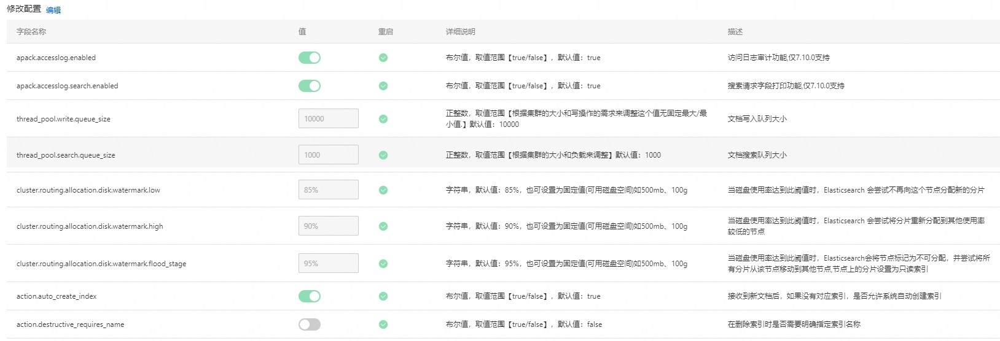

**配置YML文件**

1. 进入集群配置页面。

2. 在**YML文件配置**区域，单击右侧的**修改配置**。

3. 在右侧弹出的**YML文件配置**面板中，按照以下说明进行配置。

   > **警告**
   >
   > 错误的YML文件配置可能会导致集群不可用或数据丢失，请勿随意变更，尤其是请勿修改预设配置。

   <table>
     <tr>
       <th width="177">参数</th>
       <th>说明</th>
     </tr>
     <tr>
       <td>自动创建索引</td>
       <td>当Elasticsearch实例接收到新文档后，如果没有对应索引，是否允许系统自动创建索引。选择<strong>自定义</strong>，表示自动创建部分索引，需要通过正则表达式匹配待自动创建的索引名称。例如设置为<code> +.*,-* </code>，表示仅允许自动创建以<code> . </code>开头的系统索引。<br>对应的YML文件的配置项为<strong>action.auto_create_index</strong>，默认为<strong>true</strong>。<br>重要自动创建的索引可能不符合您的预期，建议您评估后再开启。</td>
     </tr>
     <tr>
       <td>删除索引指定名称</td>
       <td>在删除索引时是否需要明确指定索引名称。如果选择<strong>删除或关闭时索引名称</strong><strong>支持通配符</strong>，则可以使用通配符进行批量删除索引。索引删除后不可恢复，请谨慎使用此配置。对应的YML文件的配置项为<strong>action.destructive_requires_name</strong>，默认为<strong>false</strong>。</td>
     </tr>
     <tr>
       <td>其他Configure配置</td>
       <td>输入自定义的Configure配置。<br>警告错误的YML文件配置可能会导致集群不可用或数据丢失，建议非专业运维人员不要自定义Configure配置。</td>
     </tr>
   </table>

4. 选中**该操作会重启实例，请确认后操作**，单击**确定**。

   确定后，Elasticsearch实例会重启。重启成功后，即可完成YML文件的配置。

<a id="section-7-14-2"></a>

### 7.14.2. 插件配置

<a id="section-7-14-2-1"></a>

#### 7.14.2.1. 支持的插件列表

<a id="section-7-14-2-1-1"></a>

##### 7.14.2.1.1. Elasticsearch插件

本文汇总了Elasticsearch支持的插件及其对应版本。

**7.10.0版本**

| 插件名称 | 是否内置 | 插件版本 | 插件说明 |
| --- | --- | --- | --- |
| a-pack-core | 内置 | 7.10.0 | A-Pack核心插件，提供阿里云Elasticsearch的基础功能支持与集成能力。 |
| aliyun-codec | 非内置 | 7.10.0 | 阿里云编解码器插件，优化索引存储与查询性能，支持自定义数据编码策略。 |
| aliyun-knn | 内置 | 7.10.0 | 阿里云KNN插件，支持近似最近邻（k-NN）向量搜索，适用于AI/ML场景的相似性检索。 |
| aliyun-optimization | 内置 | 7.10.0 | 阿里云性能优化插件，通过存储与查询优化策略提升Elasticsearch集群效率。 |
| aliyun-qos | 非内置 | 7.10.0 | 阿里云QoS插件，管理资源分配与请求优先级，保障关键任务性能。 |
| analysis-aliws | 非内置 | 7.10.0 | 阿里云分析（AliWS）插件，提供定制化文本处理功能（如行业专用分词）。 |
| analysis-icu | 内置 | 7.10.0 | ICU分析插件，集成Lucene的ICU模块，支持多语言文本处理（如日韩语、阿拉伯语）。 |
| analysis-ik | 内置 | 7.10.0 | IK中文分析插件，提供高效的中文分词能力，适用于电商、新闻等场景。 |
| analysis-kuromoji | 内置 | 7.10.0 | 日语（Kuromoji）分析插件，支持日语文本的分词与语法解析。 |
| analysis-phonetic | 内置 | 7.10.0 | 发音分析插件，通过语音特征过滤器实现基于发音的模糊匹配（如姓名检索）。 |
| analysis-pinyin | 内置 | 7.10.0 | 拼音分析插件，将汉字转换为拼音进行分词，支持中文拼音搜索功能。 |
| analysis-smartcn | 内置 | 7.10.0 | 智能中文分析插件，集成Lucene的Smart Chinese模块，提供基础中文分词能力。 |
| analysis-stempel | 内置 | 7.10.0 | 波兰语（Stempel）分析插件，支持波兰语文本的分词与形态还原。 |
| analysis-ukrainian | 内置 | 7.10.0 | 乌克兰语分析插件，支持乌克兰语文本的分词与语法处理。 |
| elasticsearch-repository-oss | 内置 | 7.10.0 | OSS仓库插件，支持将Elasticsearch快照存储至阿里云对象存储（OSS），实现长期备份与恢复。 |
| faster-bulk | 非内置 | 7.10.0 | 批量操作优化插件，提升数据写入性能，降低批量索引操作的延迟。 |
| hybrid-cloud | 内置 | 7.10.0 | 混合云插件，支持阿里云Elasticsearch与本地数据中心的混合部署及跨环境数据同步。 |
| ingest-attachment | 内置 | 7.10.0 | 内容提取处理器插件，通过Apache Tika解析PDF/Office等附件内容并提取文本。 |
| mapper-murmur3 | 内置 | 7.10.0 | Murmur3哈希映射插件，支持在索引时计算字段值的哈希并存储至索引中，用于去重或加速检索。 |
| mapper-size | 内置 | 7.10.0 | 文档大小映射插件，支持在索引时记录文档的未压缩原始大小，用于监控存储开销。 |
| opendistro-index-management | 非内置 | 7.10.0 | Open Distro索引状态管理插件，自动化索引生命周期（如滚动、保留策略、热/温/冷状态迁移）。 |
| opendistro-job-scheduler | 非内置 | 7.10.0 | Open Distro任务调度插件，提供分布式周期性任务调度服务（如监控、维护任务）。 |
| opendistro_secu rity | 内置 | 7.10.0 | Open Distro安全插件，提供访问控制、身份验证及加密功能，保障Elasticsearch集群安全性。 |
| repository-hdfs | 内置 | 7.10.0 | HDFS仓库插件，支持将快照存储至Hadoop分布式文件系统（HDFS），适用于大数据生态集成。 |
| repository-s3 | 内置 | 7.10.0 | S3仓库插件，支持将快照存储至AWS S3对象存储服务，适用于跨云备份场景。 |
| sql | 内置 | 7.10.0 | SQL查询插件，支持通过SQL语法查询Elasticsearch数据，降低用户学习成本。 |
| xdcr | 非内置 | 7.10.0 | 跨数据中心复制插件，实现多地域数据同步与高可用性，支持灾难恢复及数据本地化。 |

**6.8.13版本**

| 插件名称 | 是否内置 | 插件版本 | 插件说明 |
| --- | --- | --- | --- |
| a-pack-repository-oss | 内置 | 6.8.13 | A-Pack OSS仓库插件，支持将Elasticsearch快照存储至阿里云对象存储（OSS），实现长期备份与恢复。 |
| a-pack-xdcr | 内置 | 6.8.13 | A-Pack跨数据中心复制插件，实现多地域数据同步与高可用性，支持灾难恢复及数据本地化。 |
| aliyun-knn | 内置 | 6.8.13 | 阿里云KNN插件，支持近似最近邻（k-NN）向量搜索，适用于AI/ML场景的相似性检索。 |
| analysis-aliws | 内置 | 6.8.13 | 阿里云分析（AliWS）插件，提供定制化文本处理功能（如行业专用分词）。 |
| analysis-icu | 内置 | 6.8.13 | ICU分析插件，集成Lucene的ICU模块，支持多语言文本处理（如日韩语、阿拉伯语）。 |
| analysis-ik | 内置 | 6.8.13 | IK中文分析插件，提供高效的中文分词能力，适用于电商、新闻等场景。 |
| analysis-kuromoji | 内置 | 6.8.13 | 日语（Kuromoji）分析插件，支持日语文本的分词与语法解析。 |
| analysis-phonetic | 内置 | 6.8.13 | 发音分析插件，通过语音特征过滤器实现基于发音的模糊匹配（如姓名检索）。 |
| analysis-pinyin | 内置 | 6.8.13 | 拼音分析插件，将汉字转换为拼音进行分词，支持中文拼音搜索功能。 |
| analysis-smartcn | 内置 | 6.8.13 | 智能中文分析插件，集成Lucene的Smart Chinese模块，提供基础中文分词能力。 |
| analysis-stempel | 内置 | 6.8.13 | 波兰语（Stempel）分析插件，支持波兰语文本的分词与形态还原。 |
| analysis-ukrainian | 内置 | 6.8.13 | 乌克兰语分析插件，支持乌克兰语文本的分词与语法处理。 |
| ingest-attachment | 内置 | 6.8.13 | 内容提取处理器插件，通过Apache Tika解析PDF/Office等附件内容并提取文本。 |
| mapper-murmur3 | 内置 | 6.8.13 | Murmur3哈希映射插件，支持在索引时计算字段值的哈希并存储至索引中，用于去重或加速检索。 |
| mapper-size | 内置 | 6.8.13 | 文档大小映射插件，支持在索引时记录文档的未压缩原始大小，用于监控存储开销。 |
| opendistro-job-scheduler | 内置 | 6.8.13 | Open Distro任务调度插件，提供分布式周期性任务调度服务（如监控、维护任务）。 |
| opendistro_alerti ng | 非内置 | 6.8.13 | Open Distro告警插件，支持基于搜索结果的实时告警触发与通知（如邮件、Slack）。 |
| opendistro_index _management | 内置 | 6.8.13 | Open Distro索引状态管理插件，自动化索引生命周期（如滚动、保留策略、热/温/冷状态迁移）。 |
| opendistro_secur ity | 内置 | 6.8.13 | Open Distro安全插件，提供访问控制、身份验证及加密功能，保障Elasticsearch集群安全性。 |
| opendistro_sql | 非内置 | 6.8.13 | Open Distro SQL插件，支持通过SQL语法查询Elasticsearch数据，降低用户学习成本。 |
| repository-hdfs | 内置 | 6.8.13 | HDFS仓库插件，支持将快照存储至Hadoop分布式文件系统（HDFS），适用于大数据生态集成。 |
| repository-s3 | 内置 | 6.8.13 | S3仓库插件，支持将快照存储至AWS S3对象存储服务，适用于跨云备份场景。 |
| sqlplugin | 内置 | 6.8.13 | SQL查询插件，支持通过SQL语法查询Elasticsearch数据，提供非Open Distro的SQL接口支持。 |

**5.5.3版本**

| 插件名称 | 是否内置 | 插件版本 | 插件说明 |
| --- | --- | --- | --- |
| analysis-icu | 内置 | 5.5.3 | ICU分析插件，集成Lucene的ICU模块，支持Unicode和多语言文本处理（如日韩语、阿拉伯语等）。 |
| analysis-ik | 内置 | 5.5.3 | IK中文分析插件，基于IK Analyzer实现高效的中文分词与搜索优化。 |
| analysis-kuromoji | 内置 | 5.5.3 | 日语（Kuromoji）分析插件，集成Lucene的Kuromoji模块，支持日语文本分析。 |
| analysis-phonetic | 内置 | 5.5.3 | 发音分析插件，通过语音特征过滤器实现基于发音的模糊匹配（如姓名检索）。 |
| analysis-pinyin | 内置 | 5.5.3 | 拼音分析插件，将汉字转换为拼音进行分词，支持中文拼音搜索功能。 |
| analysis-smartcn | 内置 | 5.5.3 | 智能中文分析插件，集成Lucene的Smart Chinese模块，提供基础中文分词能力。 |
| analysis-stempel | 内置 | 5.5.3 | 波兰语（Stempel）分析插件，集成Lucene的Stempel模块，支持波兰语文本处理。 |
| analysis-ukrainian | 内置 | 5.5.3 | 乌克兰语分析插件，集成Lucene的UkrainianMorfologikAnalyzer，支持乌克兰语文本分析。 |
| elasticsearch-repository-oss | 内置 | 5.5.3 | 阿里云OSS快照仓库插件，支持将Elasticsearch快照存储至阿里云对象存储（OSS）。 |
| gab-paas-plugin | 非内置 | 5.5.3 | GAB PaaS插件，提供与阿里云PaaS平台集成的功能支持（具体功能需结合业务场景）。 |
| ingest-attachment | 内置 | 5.5.3 | 内容提取处理器插件，通过Apache Tika解析PDF/Office等附件内容并提取文本。 |
| ingest-geoip | 内置 | 5.5.3 | 地理IP分析处理器插件，基于Maxmind数据库通过IP地址查询地理位置数据。 |
| ingest-user-agent | 内置 | 5.5.3 | 用户代理信息提取处理器插件，从用户代理字符串中提取设备/浏览器等信息。 |
| mapper-attachments | 内置 | 5.5.3 | 附件映射插件，支持将富文本（如PDF、Office）内容作为字段存储并进行全文检索。 |
| mapper-murmur3 | 内置 | 5.5.3 | Murmur3哈希映射插件，支持在索引时计算字段值的哈希并存储至索引中。 |
| mapper-size | 内置 | 5.5.3 | 文档大小映射插件，支持在索引时记录文档的未压缩原始大小。 |
| pangu | 内置 | 5.5.3 | 盘古仓库插件，支持将快照存储至阿里云盘古分布式存储系统（Pangu）。 |
| repository-hdfs | 内置 | 5.5.3 | HDFS仓库插件，支持将快照存储至Hadoop分布式文件系统（HDFS）。 |
| repository-s3 | 内置 | 5.5.3 | S3仓库插件，支持将快照存储至AWS S3对象存储服务。 |
| search-guard-5 | 内置 | 5.5.3 | Search Guard 5安全插件，提供Elasticsearch 5的访问控制、认证与授权功能。 |
| sql | 内置 | 5.5.3 | SQL查询插件，支持通过SQL语法查询Elasticsearch数据。 |

<a id="section-7-14-2-1-2"></a>

##### 7.14.2.1.2. Kibana插件

本文汇总了Kibana支持的插件及其对应版本。

**7.10.0版本**

| 插件名称 | 是否内置 | 插件版本 | 插件说明 |
| --- | --- | --- | --- |
| opendistro-alerting | 非内置 | 7.10.0 | Open Distro Kibana告警插件，支持在Kibana中创建、管理和触发基于Elasticsearch数据的告警规则。 |

**6.8.13版本**

| 插件名称 | 是否内置 | 插件版本 | 插件说明 |
| --- | --- | --- | --- |
| bsearch_querybuild er | 非内置 | 6.8.13 | BSearch 查询构建器插件，提供可视化工具用于构建和调试BSearch查询语句。 |
| kibana-prometheus-exporter | 非内置 | 6.8.13 | Kibana Prometheus指标导出插件，支持将Kibana监控数据（如性能指标）导出至Prometheus监控系统。 |
| opendistro-alerting | 非内置 | 6.8.13 | Open Distro Kibana告警插件，支持在Kibana中创建、管理和触发基于Elasticsearch数据的告警规则。 |

**5.5.3版本**

| 插件名称 | 是否内置 | 插件版本 | 插件说明 |
| --- | --- | --- | --- |
| searchguard | 内置 | 5.5.3 | Search Guard Kibana插件，为Kibana集成Elasticsearch的安全功能（如访问控制、身份验证），实现统一权限管理。 |

<a id="section-7-14-2-1-3"></a>

##### 7.14.2.1.3. Opensearch插件

本文汇总了Opensearch支持的插件及其对应版本。

**3.1.0版本**

| 插件名称 | 是否内置 | 插件版本 | 插件说明 |
| --- | --- | --- | --- |
| analysis-ik | 内置 | 3.1.0 | OpenSearch的IK分析器。 |
| opensearch-repository-oss-plugin | 内置 | 3.1.0 | 启用与阿里云OSS集成作为快照存储库，用于备份和恢复操作。 |
| prometheus-exporter | 内置 | 3.1.0 | 以Prometheus格式暴露OpenSearch指标，支持通过Prometheus和Grafana进行监控和告警。 |
| opensearch-alerting | 内置 | 3.1.0 | 提供基于搜索结果的实时告警功能，允许用户定义触发器和操作。 |
| opensearch-asynchronous-search | 内置 | 3.1.0 | 通过异步执行查询并在稍后获取结果，支持长运行搜索。 |
| opensearch-cross-cluster-replication | 内置 | 3.1.0 | 启用跨集群复制以实现高可用性、灾难恢复和数据本地化。 |
| opensearch-custom-codecs | 内置 | 3.1.0 | 添加自定义索引编解码器支持，优化特定用例的存储和性能。 |
| opensearch-flow-framework | 内置 | 3.1.0 | 提供构建和管理引导式工作流及多步骤流程的框架。 |
| opensearch-geospatial | 内置 | 3.1.0 | 扩展OpenSearch的地理空间搜索和分析能力，包括GeoJSON和形状查询。 |
| opensearch-index-management | 内置 | 3.1.0 | 自动化索引生命周期管理，包括滚动、保留策略和状态转换（热/温/冷）。 |
| opensearch-job-scheduler | 内置 | 3.1.0 | 提供分布式任务调度服务，用于监控和维护等周期性任务。 |
| opensearch-knn | 内置 | 3.1.0 | 支持k-近邻（k-NN）向量搜索，用于相似性搜索和AI/ML应用。 |
| opensearch-ltr | 内置 | 3.1.0 | 支持基于机器学习模型的排序学习（LTR），提升搜索相关性。 |
| opensearch-notifications | 内置 | 3.1.0 | 集中通知服务，通过邮件、Slack、Chime等渠道发送告警。 |
| opensearch-notifications-core | 内置 | 3.1.0 | 通知系统核心模块，提供API和消息传递基础设施。 |
| opensearch-observability | 内置 | 3.1.0 | 日志、指标、追踪和用户体验的统一可观测性解决方案。 |
| opensearch-reports-scheduler | 内置 | 3.1.0 | 从仪表板和可视化图表中安排生成报告并定期分发。 |
| opensearch-security | 内置 | 3.1.0 | 提供认证、授权、加密和审计日志的综合安全插件。 |
| opensearch-sql | 内置 | 3.1.0 | 提供SQL接口，使用熟悉SQL语法查询OpenSearch索引。 |
| opensearch-system-templates | 内置 | 3.1.0 | 管理由系统生成的索引模板，用于OpenSearch内部功能和插件。 |
| query-insights | 内置 | 3.1.0 | 分析搜索查询性能、延迟和资源使用，优化相关性和效率。 |

<a id="section-7-14-2-1-4"></a>

##### 7.14.2.1.4. Dashboard插件

本文汇总了Dashboard支持的插件及其对应版本。

**3.1.0版本**

| 插件名称 | 是否内置 | 插件版本 | 插件说明 |
| --- | --- | --- | --- |
| indexManagement Dashboards | 内置 | 3.1.0 | 索引管理仪表盘插件，提供索引生命周期的监控与操作界面（如滚动、删除、状态迁移）。 |

<a id="section-7-14-2-2"></a>

#### 7.14.2.2. 安装或卸载插件

通过插件配置功能，您可以手动安装或卸载已在运维平台上传的插件。本文介绍具体的操作方法。

**前提条件**

实例状态正常，且运维工程师已在运维平台上传对应版本的插件。

**操作步骤**

1. 登录阿里云检索分析服务控制台，在左侧导航栏，单击**实例列表**。

2. 在**实例列表**中，单击目标实例ID。

3. 在左侧导航栏，选择**配置与管理 > 插件配置**。

4. 在**插件配置**页面，您可以进行以下操作：

   - 单击**默认插件列表**页签，可以查看当前系统默认的已安装的插件，具体以界面显示为准。

   - 单击**自定义插件列表**页签，可以对目标插件进行**安装**或**卸载**操作。在弹出的对话框中，阅读风险提示，单击**确认**。

     > **警告**
     >
     > 安装或卸载插件会触发集群重启，请确认后操作。

     等待集群重启成功后，安装的插件状态变为已安装，卸载的插件状态变为未安装，表示插件安装或卸载成功。

<a id="section-7-14-3"></a>

### 7.14.3. 安全配置

为提高数据安全性，您可以开启HTTPS协议功能并配置VPC私网访问白名单。

**进入安全配置页面**

1. 登录阿里云检索分析服务控制台。

2. 在左侧导航栏，单击**实例列表**。

3. 在**实例列表**中，单击目标实例ID。

4. 在左侧导航栏，选择**配置与管理 > 安全配置**，系统默认进入**集群网络设置**页面。

**配置VPC私网访问白名单**

通过私网访问实例时，需要先将待访问设备的IP地址加入实例的访问白名单中。如果遇到访问ES失败的问题，您也可以根据本操作检查是否已将正确的IP地址加入到了对应白名单中。

1. 进入安全配置页面。

2. 在**VPC私网访问白名单**的右侧，单击**新增IP白名单**。

3. 在**新增IP白名单分组**对话框中，配置**VPC**和**白名单内IP地址**。

4. 单击**确认**。

   配置完成后，如果您需要修改或者移除已新增的IP白名单，可单击**操作**列下的**修改**或者**删除**。

**使用HTTPS协议**

HTTPS（Hyper Text Transfer Protocol over Secure Socket Layer）是一种能够保障数据安全的HTTP通道，它是HTTP协议的安全版，通过在HTTP协议的基础上增加安全套接层SSL（Secure Sockets Layer）来保障数据传输的安全性。即HTTPS还是通过HTTP进行通信，只是传输的内容经过了SSL加密。为了保障您的数据安全，建议使用HTTPS协议。

> **重要**
>
> 目前elasticsearch类型的实例默认该功能关闭，建议手动开启；opensearch类型的实例默认已开启该功能，且不可关闭。

1. 进入安全配置页面。

2. 单击**使用HTTPS协议**右侧的开关，即可开启该功能。

<a id="section-7-14-4"></a>

### 7.14.4. 数据备份

<a id="section-7-14-4-1"></a>

#### 7.14.4.1. 手动备份与恢复

通过快照备份及恢复命令（snapshot API），您可以备份并恢复Elasticsearch集群中的数据。snapshot API会获取实例当前的状态和数据，然后保存到一个共享仓库里。

第一次进行快照时，系统会备份您所有的数据，后续所有的快照仅备份已存快照和新快照之间的增量数据。随着数据快照的不断进行，备份也在增量的添加和删除。这意味着后续备份会相当快速，因为它们只传输很小的数据量。关于Elasticsearch集群备份与恢复的详细信息，请参见Snapshot and restore API。

**注意事项**

- 本文代码中的<1>、<2>、<3>这三个标记用于标识位置，方便对指定位置代码描述。实际执行对应代码时，需去掉有包含这三个类型的标记。

- 本文中的代码均可以在Elasticsearch集群的Kibana控制台上执行，详情请参见登录Kibana控制台。

**创建仓库**

```text
PUT _snapshot/my_backup
{
   "type": "oss",
    "settings": {
        "endpoint": "http://oss-cn-hangzhou-internal.aliyuncs.com", <1>
        "access_key_id": "xxxx",
        "secret_access_key": "xxxxxx",
        "bucket": "xxxxxx", <2>
        "compress": true,
        "base_path": "snapshot/" <3>
    }
}
```

- <1>： `endpoint` 为OSS Bucket对应的访问地址。

- <2>：OSS Bucket的名称，需要一个已经存在的OSS Bucket。

- <3>：设置仓库的起始位置，默认为根目录。

**限制分块大小**

当您上传的数据非常大时，可以通过配置 `chunk_size` 参数限制快照过程中分块的大小，超过这个大小，数据将会被分块上传到OSS中。

```text
POST _snapshot/my_backup/ <1>
{
    "type": "oss",
    "settings": {
        "endpoint": "http://oss-cn-hangzhou-internal.aliyuncs.com",
        "access_key_id": "xxxx",
        "secret_access_key": "xxxxxx",
        "bucket": "xxxxxx",
        "chunk_size": "500mb",
        "base_path": "snapshot/" <2>
    }
}
```

- <1>：请求方式。

  > **重要**
  >
  > 更新仓库设置时，请使用POST而不是PUT方式，否则会更新已有仓库的其他设置。

- <2>：设置仓库的起始位置，默认为根目录。

**列出仓库信息**

```text
GET _snapshot
```

您也可以使用 `GET _snapshot/my_backup` 获取指定仓库的信息。

**快照命令**

最基础的快照命令如下。

```text
PUT _snapshot/my_backup/snapshot_1
```

以上命令会备份所有打开的索引到 `my_backup` 仓库下，并保存在名称为 `snapshot_1` 的快照中。这个命令会立刻返回，然后备份会在后台运行。

如果您希望在脚本中一直等待到完成，可通过添加 `wait_for_completion` 实现。

```text
PUT _snapshot/my_backup/snapshot_1?wait_for_completion=true
```

以上命令会阻塞调用直到备份完成。如果是大型快照，需要很长时间才能返回，具体时间与快照大小相关，可参见监控快照进度查看快照进度。

**快照指定索引**

系统默认会备份所有打开的索引。如果您在使用Kibana，并且考虑到磁盘空间大小因素，不需要把所有诊断相关的 `.kibana` 索引都备份起来，那么可以在进行集群备份时，指定需要快照的索引。

> **重要**
>
> 一个仓库可以包含多个快照，每个快照跟一系列索引相关（例如所有索引，一部分索引，或者单个索引）。当创建快照的时候，您可以指定感兴趣的索引，然后给快照取一个唯一的名字。

```text
PUT _snapshot/my_backup/snapshot_2
{
    "indices": "index_1,index_2"
}
```

以上命令只会备份名称为 `index1` 和 `index2` 的索引。

**列出快照信息**

有时您可能会忘记仓库里的快照细节，特别是快照按时间划分命名的时候（例如 `backup_2014_10_28` ）。

当您需要查看仓库中的某个快照时，可对仓库和快照名发起一个 `GET` 请求，获取单个快照信息。

```text
GET _snapshot/my_backup/snapshot_2
```

返回结果中包括了快照相关的各种信息，如下所示。

```json
{
"snapshots": [
   {
      "snapshot": "snapshot_2",
      "indices": [
         ".marvel_2014_28_10",
         "index1",
         "index2"
      ],
      "state": "SUCCESS",
      "start_time": "2014-09-02T13:01:43.115Z",
      "start_time_in_millis": 1409662903115,
      "end_time": "2014-09-02T13:01:43.439Z",
      "end_time_in_millis": 1409662903439,
      "duration_in_millis": 324,
      "failures": [],
      "shards": {
         "total": 10,
         "failed": 0,
         "successful": 10
      }
   }
]
}
```

您也可以使用 `_all` 替换掉具体的快照名称，获取一个仓库中所有快照的完整列表。

```text
GET _snapshot/my_backup/_all
```

**删除快照**

您可以对仓库和快照发起一个 `DELETE` 请求，删除所有不再使用的快照。

```text
DELETE _snapshot/my_backup/snapshot_2
```

> **重要**
>
> - 请使用delete API来删除快照，而不能使用其他机制（例如手动删除）。因为快照是增量的，很多快照可能依赖于之前的备份数据。delete API能够过滤出还在被其他快照使用的数据，只删除不再被使用的备份数据。
>
> - 如果您进行了一次人工文件删除，您将会面临备份严重损坏的风险，因为您删除的文件可能还在使用中。

**监控快照进度**

您可以使用 `wait_for_completion` 等待快照恢复完成。但对于中等规模的集群进行快照恢复需要较长的时间，此时可以通过以下两种方式获取详细的快照进度信息：

- 给快照ID发送一个 `GET` 请求。

  ```text
  GET _snapshot/my_backup/snapshot_3
  ```

  如果在执行这个命令时，快照还在进行中，那么可以看到快照的开始时间、运行了多久等信息。

  > **重要**
  >
  > 此API使用的是与快照机制相同的线程池，当您在对非常大的分片进行快照时，状态更新的间隔会很大，因为API在竞争相同的线程池资源。

- 使用_status API获取快照的状态信息。

  ```json
  {
  "snapshots": [
     {
        "snapshot": "snapshot_3",
        "repository": "my_backup",
        "state": "IN_PROGRESS", <1>
        "shards_stats": {
           "initializing": 0,
           "started": 1, <2>
           "finalizing": 0,
           "done": 4,
           "failed": 0,
           "total": 5
        },
        "stats": {
           "number_of_files": 5,
           "processed_files": 5,
           "total_size_in_bytes": 1792,
           "processed_size_in_bytes": 1792,
           "start_time_in_millis": 1409663054859,
           "time_in_millis": 64
        },
        "indices": {
           "index_3": {
              "shards_stats": {
                 "initializing": 0,
                 "started": 0,
                 "finalizing": 0,
                 "done": 5,
                 "failed": 0,
                 "total": 5
              },
              "stats": {
                 "number_of_files": 5,
                 "processed_files": 5,
                 "total_size_in_bytes": 1792,
                 "processed_size_in_bytes": 1792,
                 "start_time_in_millis": 1409663054859,
                 "time_in_millis": 64
              },
              "shards": {
                 "0": {
                    "stage": "DONE", <3>
                    "stats": {
                       "number_of_files": 1,
                       "processed_files": 1,
                       "total_size_in_bytes": 514,
                       "processed_size_in_bytes": 514,
                       "start_time_in_millis": 1409663054862,
                       "time_in_millis": 22
                    }
                 },
                 ...
  ```

  - <1>：快照的状态。一个正在运行的快照，会显示为 `IN_PROGRESS` 。

  - <2>：正在快照传输的分片数量。为1时，表示这个特定快照有一个分片还在传输（其他分片已完成）。

    `shards_stats` 响应不仅包括快照的总体状况，也包括下钻到每个索引和每个分片的统计值。此参数展示了快照进度的详细信息。

  - <3>：分片的快照可以在不同的完成状态。

    - `INITIALIZING` ：分片在检查集群状态，查看是否可以被快照。此过程一般是非常快的。

    - `STARTED` ：数据正在被传输到仓库。

    - `FINALIZING` ：数据传输完成，分片正在发送快照元数据。

    - `DONE` ：分片的快照完成。

    - `FAILED` ：快照过程中碰到了错误，这个分片、索引或快照不可能完成。可查看日志获取更多信息。

**取消快照**

如果您想取消一个快照，可以在任务进行中的时候，执行以下命令删除快照。该命令会中断快照进程并删除未完成的快照。

```text
DELETE _snapshot/my_backup/snapshot_3
```

**从快照恢复**

在需要恢复索引的目标Elasticsearch集群上，再次执行和之前相同的创建仓库命令。您可以根据实际情况，通过以下两种方式进行快照恢复：

- 如果已经备份过数据，可直接在需要恢复的快照ID后面加上 `_restore` 。

  ```text
  POST _snapshot/my_backup/snapshot_1/_restore
  ```

  系统默认会恢复这个快照里的所有索引。例如 `snapshot_1` 包括五个索引，那么这五个索引都会被恢复到集群中。您也可以指定需要恢复的索引，具体请参见上文的手动备份与恢复。

- 恢复指定的索引，并对恢复的索引进行重命名（如果您需要在不替换现有数据的前提下，恢复旧版本的数据来验证内容，或者进行其他处理，可以使用此方式进行快照恢复）。

  ```text
  POST /_snapshot/my_backup/snapshot_1/_restore
  {
   "indices": "index_1", <1>
   "rename_pattern": "index_(.+)", <2>
   "rename_replacement": "restored_index_$1" <3>
  }
  ```

  以上命令会恢复 `index_1` 到您集群里，并且重命名成了 `restored_index_1` 。

  - <1>：只恢复 `index_1` 索引，忽略快照中的其他索引。

  - <2>：查找正在恢复的索引，该索引名称需要与提供的模板匹配。

  - <3>：重命名查找到的索引。

- 使用 `wait_for_completion` ，查看恢复信息，直到恢复完成。

  ```text
  POST _snapshot/my_backup/snapshot_1/_restore?wait_for_completion=true
  ```

  和快照类似，_restore API会立刻返回，恢复进程会在后台进行。如果您更希望HTTP调用阻塞直到恢复完成，可以参考以上命令添加 `wait_for_completion` 。

**监控恢复操作**

> **说明**
>
> 从仓库恢复数据借鉴了Elasticsearch里已有的现行恢复机制。在内部实现上，从仓库恢复分片和从另一个节点恢复是等价的。

您可以通过recovery API来监控恢复的进度。

- 监控指定索引的恢复状态。

  ```text
  GET restored_index_3/_recovery
  ```

  recovery API是一个通用的API，可以用来展示集群中移动着的分片状态。

- 查看集群中的所有索引的恢复信息（可能包含跟您的恢复进程无关的其他分片的恢复信息）。

  ```text
  GET /_recovery/
  ```

  示例输出结果如下。

  ```json
  {
  "restored_index_3" : {
   "shards" : [ {
     "id" : 0,
     "type" : "snapshot", <1>
     "stage" : "index",
     "primary" : true,
     "start_time" : "2014-02-24T12:15:59.716",
     "stop_time" : 0,
     "total_time_in_millis" : 175576,
     "source" : { <2>
       "repository" : "my_backup",
       "snapshot" : "snapshot_3",
       "index" : "restored_index_3"
     },
     "target" : {
       "id" : "ryqJ5lO5S4-lSFbGntkEkg",
       "hostname" : "my.fqdn",
       "ip" : "10.0.**.**",
       "name" : "my_es_node"
     },
     "index" : {
       "files" : {
         "total" : 73,
         "reused" : 0,
         "recovered" : 69,
         "percent" : "94.5%" <3>
       },
       "bytes" : {
         "total" : 79063092,
         "reused" : 0,
         "recovered" : 68891939,
         "percent" : "87.1%"
       },
       "total_time_in_millis" : 0
     },
     "translog" : {
       "recovered" : 0,
       "total_time_in_millis" : 0
     },
     "start" : {
       "check_index_time" : 0,
       "total_time_in_millis" : 0
     }
   } ]
  }
  }
  ```

  - <1>： `type` 字段定义了您恢复的类型。 `snapshot` 表示这个分片是在从一个快照恢复的。

  - <2>： `source` 字段定义了作为恢复来源的特定快照和仓库。

  - <3>： `percent` 字段定义了恢复的状态。 `94.5%` 表示这个特定分片目前已经恢复了94.5%的文件。

  输出结果会展示所有正在恢复中的索引，并列出这些索引里的所有分片。同时每个分片中会显示启动和停止时间、持续时间、恢复百分比、传输字节数等统计值。

**取消恢复**

您可以通过删除正在恢复的索引，取消一个恢复操作（因为恢复进程其实就是分片恢复，发送一个DELETE API请求修改集群状态，就可以停止恢复进程）。

```text
DELETE /restored_index_3
```

如果 `restored_index_3` 正在恢复中，以上删除命令会停止恢复，同时删除所有已经恢复到集群中的数据，详情请参见Snapshot And Restore。

**备份快照迁移**

按照以下步骤将当前快照迁移到另外一个集群：

1. 将当前快照备份到OSS。

2. 在新集群上创建一个快照仓库（相同的OSS）。

3. 将新集群的快照仓库的 `base_path` 设置为第一步中快照备份的路径。

4. 在新集群中执行快照恢复命令。

   > **说明**
   >
   > 以上步骤为一个简单的备份快照迁移解决方案，详细步骤请参见OSS快照迁移Elasticsearch。

<a id="section-7-14-4-2"></a>

#### 7.14.4.2. 自动备份数据

通过快照备份功能，您可以设置自动备份周期和时间，也可以手动执行snapshot备份。本文介绍如何自动备份数据。

**前提条件**

运维工程师已在运维平台创建备份仓库。如何创建备份仓库，请参见《运维指南》中的**仓库管理 > 添加仓库**章节。

**操作步骤**

1. 登录阿里云检索分析服务控制台，在左侧导航栏，单击**实例列表**。

2. 在**实例列表**中，单击目标实例ID。

3. 在左侧导航栏，选择**配置与管理 > 数据备份**。

4. 在**数据备份**页面的**备份仓库**区域，单击**关联仓库名称**右侧的**更改关联仓库**，选择一个仓库并单击**确认**。

5. 在**数据备份**区域，打开**开启自动备份**开关。

6. 单击**自动备份开始时间**右侧的**设置**。

7. 在**自动备份周期设置**面板，选择**备份周期**。

   > **重要**
   >
   > 启动时间是当前地域的时间，请避免在数据自动备份时进行集群快照操作。

   

   | 备份周期 | 说明 |
   | --- | --- |
   | 每分钟 | 按分钟进行备份，可自定义每间隔几分钟进行一次自动备份。 |
   | 每小时 | 按小时进行备份，可自定义每间隔几小时进行一次自动备份。 |
   | 每天 | 按天进行备份，可自定义具体的备份时间。 |
   | 每周 | 按周进行备份，可自定义每间隔几周进行一次自动备份。 |
   | 每月 | 按月进行备份，可自定义每间隔几个月进行一次自动备份。 |
   | 自定义 | 自定义选择备份的周期和时间。 |

   > **重要**
   >
   > - 定时备份会占用一定的CPU和内存资源以及磁盘空间，会影响Elasticsearch集群的性能和资源占用。
   >
   > - 定时备份过程中会降低集群的查询和写入性能，因此需要合理设置备份的频率和时间段，不建议间隔时间过短。

8. 单击**确定**。

   确定后，系统会按照您设置的备份周期自动备份数据。您可以在**快照列表**中查看详细的备份信息。

   > **说明**
   >
   > 如果您想立刻备份数据，可在**快照列表**中单击**立即备份**。

   快照列表会自动清理自动备份记录，清理逻辑为定时每小时1次的自动清理，保留最新的10次记录。手动备份（即手动单击**立即备份**）的记录不会被自动清理。

<a id="section-7-15"></a>

## 7.15. 释放实例

如果您不再需要实例，可以将其释放。本文为您介绍如何释放实例。

**注意事项**

- 实例释放后数据无法恢复，建议您在释放之前先备份数据。具体操作，请参见手动备份与恢复和自动备份数据。

- 如果因为资源不足导致集群创建失败，也可以释放实例，取消创建任务。

**操作步骤**

1. 登录阿里云检索分析服务控制台，在左侧导航栏，单击**实例列表**。

2. 在**实例列表**页面，选择待释放实例右侧**操作**列下的**释放实例**。

3. 在**确认删除**对话框中确认后，单击**确定**。

   实例释放成功后，系统会提示**删除成功**，同时从实例列表中清除。

<a id="section-8"></a>

# 8.插件使用

<a id="section-8-1"></a>

## 8.1. Elasticsearch插件使用

<a id="section-8-1-1"></a>

### 8.1.1. 使用a-pack-xdcr插件实现跨集群索引复制

本文介绍使用Elasticsearch的a-pack-xdcr插件，通过跨集群索引同步，实现将一个集群数据复制到另一个集群中。目前该功能仅支持Elasticsearch 6.8版本。

**使用限制**

- 跨集群索引同步功能仅支持Elasticsearch 6.8版本。

- a-pack-xdcr插件属于系统内置插件，不支持卸载。

- 跨集群复制功能仅对新建索引生效。

- 待同步的索引需要设置 `"settings.index.soft_deletes.enabled":true` 。

**前提条件**

可联系运维人员获取源Elasticsearch集群的IP地址（即控制台上集群基本信息页面的**elasticsearch域名实际 ip 地址**）和访问端口号，也可以使用内部域名（即控制台上集群基本信息页面的**私网地址**）和访问端口号。

**操作步骤**

1. 进入目标Elasticsearch集群的Kibana控制台。

   登录控制台的具体步骤请参见登录Kibana控制台。

2. 在左侧导航栏，单击**Dev Tools**。

3. 在**Console**中执行以下命令，在目标集群上建立远程仓库（repository）连接到主集群。

   ```text
   PUT _cluster/settings
   {
     "persistent": {
       "cluster": {
         "remote": {
           "leader": {
             "seeds": [
               "<your cluster IP>:<your cluster port>"
             ]
           }
         }
       }
     }
   }
   ```

   > **说明**
   >
   > `<your cluster IP>` 需要替换为获取到的源集群的IP或内部域名； `<your cluster port>` 需要替换为获取到的源集群的访问端口号，一般为9300。

4. 执行以下命令开始复制索引。

   ```text
   PUT _xdcr/leader/<your_index>
   ```

   > **说明**
   >
   > `<your_index>` 需要替换为源Elasticsearch集群中需要复制的索引名称。

5. 执行以下命令，查看同步任务的状态。

   ```text
   GET _cat/xdcr?v
   ```

   执行成功后，返回结果示例如下。

   

   > **说明**
   >
   > index表示索引名；repository表示远程集群；shard表示索引分片；localSeqNo表示本地maxSeqNo；remoteSeqNo表示远程maxSeqNo。

6. 执行以下命令，查看复制成功的索引数据。

   ```text
   GET /<your_index>/_search
   ```

   > **说明**
   >
   > `<your_index>` 需要替换为复制成功的索引名称。

   您也可以执行以下命令，停止复制索引。

   ```text
   DELETE /_xdcr/leader/<your_index>
   ```

<a id="section-8-1-2"></a>

### 8.1.2. 使用xdcr插件实现跨集群索引数据同步

本文介绍如何使用Elasticsearch的xdcr插件，通过跨集群进行索引同步，实现将一个集群的数据同步到另一个集群中。

**使用限制**

- 本文适用于Elasticsearch 7.10.0版本。

- xdcr插件属于系统内置插件，不支持卸载。

**前提条件**

获取源Elasticsearch集群的IP地址。

可联系运维人员获取源Elasticsearch集群的IP地址和访问端口号，也可以使用内部域名和访问端口号。

**操作流程**

> **说明**
>
> 在进行以下操作时，命令中涉及的变量均需要根据现场实际情况进行替换。本文中涉及的数据仅供参考。

1. 登录Kibana开发控制台

2. 在备集群上创建仓库

3. 在备集群上开启集群同步功能

4. 不同使用场景下的集群同步数据验证

   - 新建索引数据同步验证

   - 指定索引的增量、全量同步验证

   - 集群整体同步时excludes参数的使用验证

**登录Kibana开发控制台**

1. 分别进入主、备Elasticsearch集群的Kibana控制台。详细登录操作，请参见登录Kibana控制台。

2. 单击左上角的  图标，在左侧导航栏，选择**Management > Dev Tools**，进入**Console**页面。

**在备集群上创建仓库**

1. 在备集群上，执行以下命令，用于建立远程仓库（以 `rep0801` 为例）连接到主集群。

   <ol type="i">

   <li>

   创建仓库。

   ```text
   PUT /_xdcr/repository/<新建仓库名>
   {
     "address": "<主集群的IP地址>",
     "port":<主集群的端⼝号>,
     "userName": "<主集群的集群登录名>",
     "password": "<主集群的集群登录密码>"
   }
   ```

   本文以创建一个名为 `rep0801` 的仓库为例：

   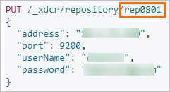

   </li>

   </ol>

2. 执行以下命令，确认仓库是否创建成功。

   ```text
   GET /_xdcr/repository/
   ```

   执行结果如下所示，则表示创建成功。

   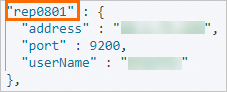

3. （可选）如果您需要删除某个已创建的仓库，执行以下命令，即可删除。

   ```text
   DELETE /_xdcr/repository/<仓库名>
   ```

**在备集群上开启集群同步功能**

1. 在备集群上，执行以下命令，开启集群同步功能。

   ```text
   POST /_xdcr/cluster_sync/<仓库名>
   ```

   或者

   ```text
   PUT /_xdcr/cluster_sync/<仓库名>
   ```

   执行结果如下所示，则表示功能开启成功：

   

2. 执行以下命令，确认集群索引同步功能开启成功。

   ```text
   GET /_xdcr/cluster_sync
   ```

   执行结果如下所示，则表示功能开启成功。

   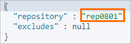

**不同使用场景下的集群同步数据验证**

**新建索引数据同步验证**

**在主集群上创建索引并插入数据**

1. 在主集群上，执行以下命令，创建索引。本文以创建一个名为 `kk-index02` 的索引为例（ `PUT /kk-index02` ）。

   ```text
   PUT /<索引名>
   ```

2. 在索引中插入数据，示例如下：

   ```text
   POST /kk-index02/_doc
   {
     "aaa":"主集群数据1",
     "bbb":"主集群数据12"
     
   }
   ```

3. 查看创建的索引及索引数据。

   ```text
   GET /_cat/indices
   ```

   ```text
   GET /<指定索引名>/_search
   ```

   执行结果如下所示，则表示创建的索引及索引数据正常。

   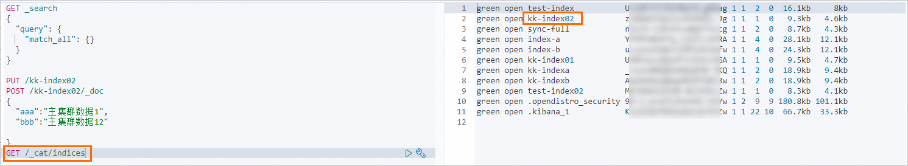

   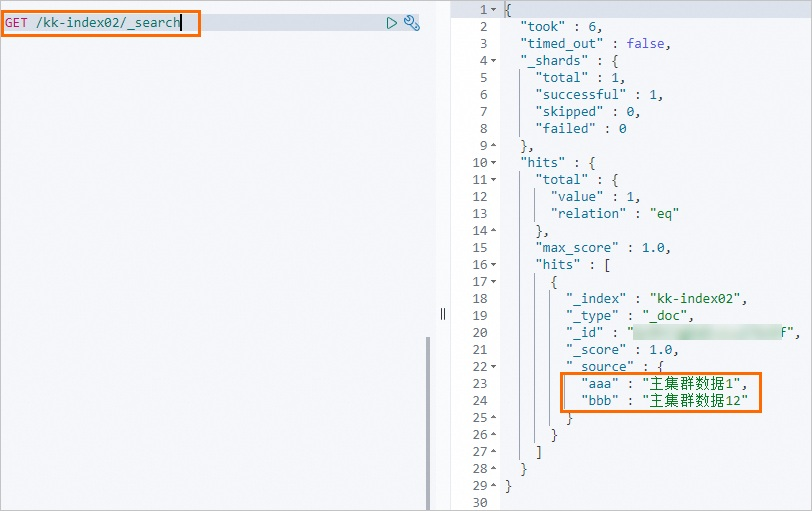

**在备集群上查看同步的索引及索引数据**

在备集群上，依次执行以下命令，查看同步的索引和索引数据。

```text
GET /_cat/indices
```

```text
GET /<索引名>/_search
```

执行结果如下所示，则表示数据同步成功。

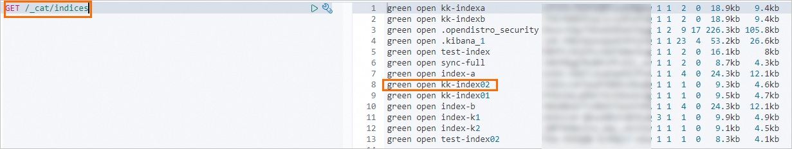


**（可选）关闭集群或者索引同步功能**

当您需要关闭集群或者索引的数据同步功能时，执行以下命令。

- 关闭集群的数据同步功能

  ```text
  DELETE /_xdcr/cluster_sync/<仓库名>
  ```

- 关闭指定索引的数据同步功能

  ```text
  DELETE /_xdcr/cluster_sync/<仓库名>/<索引名>
  ```

**指定索引的增量、全量同步验证**

**在主机群上创建2个索引，并各插入一条数据**

1. 在主集群上，依次创建2个索引（例如：创建名为kk-indexa001和kk-indexb002的索引），并分别插入索引数据。

   ```text
   # 主集群创建索引
   PUT /kk-indexa001
   # 索引插入数据
   POST /kk-indexa001/_doc
   {
     "aaa":"主集群索引a数据1",
     "bbb":"主集群索引a数据12"
   }
   ```

   ```text
   # 主集群创建索引
   PUT /kk-indexb002
   # 索引插入数据
   POST /kk-indexb002/_doc
   {
     "aaa":"主集群索引b数据1",
     "bbb":"主集群索引b数据2"
   }
   ```

2. 在主集群上，依次执行以下命令，分别查看索引和索引数据是否创建成功。

   ```text
   GET /_cat/indices?v
   ```

   ```text
   GET /<指定索引名>/_search
   ```

   执行结果如下所示，则说明创建成功。

   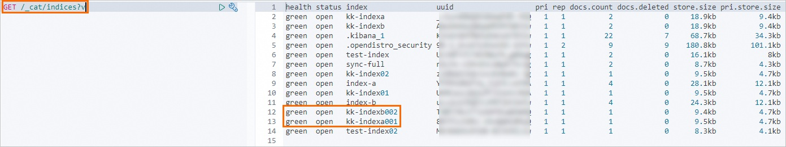

   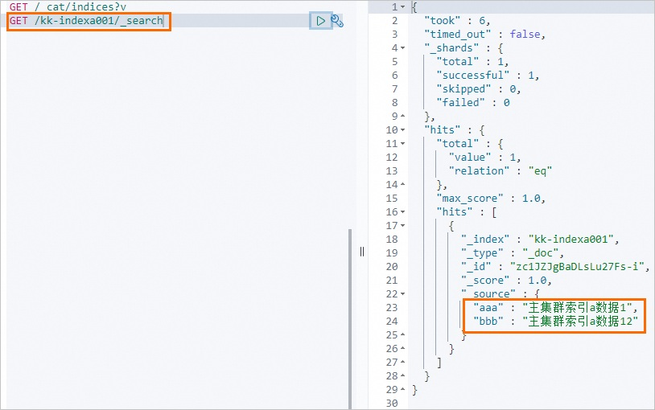

   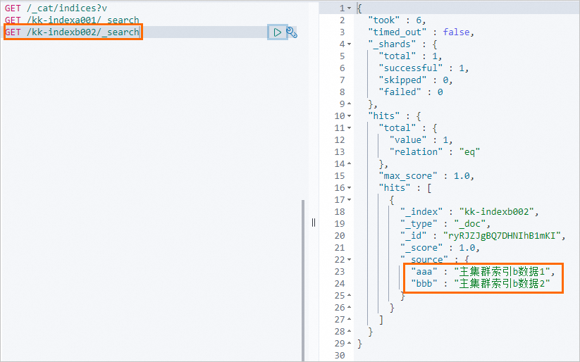

**在备集群上分别开启2个索引的增量、全量同步任务，并在确认同步过来的索引及数据状态**

1. 在备集群上，分别开启指定索引的同步功能。

   > **重要**
   >
   > 如果开启了集群的同步功能，在执行以下操作前，请先关闭掉。因为集群的同步功能如果开启的话，相当于是把所有索引的同步功能都开启了，执行以下操作时，会出现报错。

   - 开启指定索引A的增量同步任务

     ```text
     PUT /_xdcr/index_sync/<仓库名>/<指定索引名>
     ```

   - 开启指定索引B的全量同步任务

     ```text
     PUT /_xdcr/_recovery/<仓库名>/<指定索引名>
     ```

2. 在备集群上，执行以下命令，查看同步任务状态。

   ```text
   GET _cat/xdcr
   ```

   ```text
   GET /_xdcr/stats
   ```

   ```text
   GET /_cat/xdcr/concurrent_sync
   ```

**再次向主集群的2个索引中插入数据**

1. 在主机群上，执行以下命令，再次向创建名为kk-indexa001和kk-indexb002的索引中插入数据。

   ```text
   POST /kk-indexa001/_doc
   {
     "aaaz":"主集群索引a数据3",
     "bbbx":"主集群索引a数据4"
   }
   ```

   ```text
   POST /kk-indexb002/_doc
   {
     "aaaa":"主集群索引b数据3",
     "bbbx":"主集群索引b数据4"
   }
   ```

2. 在主机群上，执行以下命令，确认索引数据插入成功。

   ```text
   GET /_cat/indices?v
   ```

   ```text
   GET /<指定索引名>/_search
   ```

**在备集群上确认同步索引数据的情况**

在备集群上，执行以下命令，确认索引数据同步的详细情况。

```text
GET /_cat/indices?v
```

```text
GET /<索引名>/_search
```

最终执行结果如果是开启增量同步任务的索引中比开启全量同步任务的索引中多两条数量，则说明符合预期。

> **说明**
>
> 全量同步任务类似于一个一次性任务，执行完成后不会再进行后续同步；而增量同步任务类似于长期任务，只要主集群索引有变化，备集群就会同步数据。

**集群整体同步时excludes参数的使用验证**

1. 在主集群上，参考以下命令，分别创建3个索引（例如：index-a1、index-b1、index-c1），并查看索引情况。

   ```text
   PUT /index-a1
   POST /index-a1/_doc
   {
     "aaaz":"主集群索引a数据3",
     "bbbx":"主集群索引a数据4"
   }
   ```

   ```text
   GET /_cat/indices
   ```

2. 在备集群上，执行以下命令，开启除指定索引以外的索引同步任务。本文以开启除 `index-b1` 以外的索引同步任务为例。

   ```text
   PUT /_xdcr/cluster_sync/<仓库名>?excludes=<指定索引名>
   ```

   例如：

   ```text
   PUT /_xdcr/cluster_sync/rep0801?excludes=index-b1
   ```

3. 执行以下命令，查看集群同步情况。

   ```text
   GET /_xdcr/cluster_sync
   ```

4. 执行以下命令，查看同步任务状态（除 `index-b1` 以外的索引同步任务都开启了）。

   - 查看同步任务状态

     ```text
     GET _cat/xdcr
     ```

   - 查看同步任务状态，json格式返回

     ```text
     GET /_xdcr/stats
     ```

   - 查看正在进行的同步任务

     ```text
     GET /_cat/xdcr/concurrent_sync
     ```

<a id="section-8-1-3"></a>

### 8.1.3. 使用opendistro_sql插件实现SQL语句查询集群数据

本文介绍如何使用Elasticsearch的opendistro_sql插件，实现SQL语句查询Elasticsearch集群数据。

**前提条件**

已安装opendistro_sql插件，具体操作请参见安装或卸载插件。

**操作步骤**

1. 进入目标Elasticsearch集群的Kibana控制台。登录控制台的具体步骤请参见登录Kibana控制台。

   > 本文操作以Elasticsearch 6.8版本为例，其他版本操作可能略有不同，请以实际界面为
   >
   > **说明**
   >
   > 准。

2. 在左侧导航栏，单击**Dev Tools**。

3. 在**Console**中执行以下命令，使用SQL语句查询集群数据。Elasticsearch支持以下三种SQL查询语法。

   > 以下代码中的 `<your_index>` 需要替换为需要查询的索引名称。
   >
   > **说明**

   - GET请求SQL查询语法：

     ```text
     GET _opendistro/_sql?sql=select * from <your_index> limit 50
     ```

   - POST请求SQL查询语法：

     ```text
     POST _opendistro/_sql
     {
      "query": "SELECT * FROM <your_index> LIMIT 50"
     }
     ```

   - 指定SQL查询，返回CSV格式数据：

     ```text
     POST _opendistro/_sql?format=csv
     {
      "query": "SELECT * FROM <your_index> LIMIT 50"
     }
     ```

     > **说明**
     >
     > - 更多SQL语法请参见SQL。
     >
     > - 如果Java代码里面需要通过SQL进行查询，您还需要下载JDBC驱动，下载地址：https://github.com/opendistro-for-elasticsearch/sql-jdbc。

<a id="section-8-1-4"></a>

### 8.1.4. 使用alerting插件实现集群告警

本文介绍如何使用Elasticsearch的alerting插件，实现通过集群告警配置，自定义告警的阈值和条件，在满足条件时发送告警通知。

**前提条件**

已安装opendistro-alerting插件，具体操作请参见安装或卸载插件。

**背景信息**

关于alerting插件的具体使用方法，可参见官方API文档。

**使用限制**

仅Elasticsearch 6.8版本支持该功能。

**操作步骤**

1. 进入目标Elasticsearch集群的Kibana控制台。

   登录控制台的具体步骤请参见登录Kibana控制台。

2. 在左侧导航栏，单击**Alerting**，再单击**Monitors**页签。

3. 在**Monitors**页面，单击**Create Monitor**。

   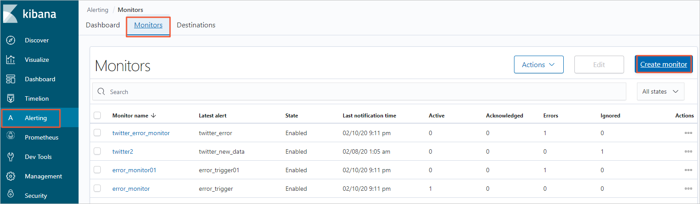

4. 在**Create Monitor**页面，输入Monitor配置。

   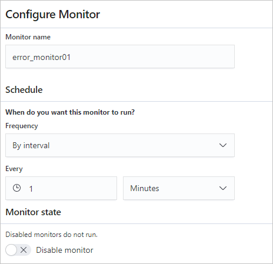

   以上实例设置Monitor名称为error_monitor01，每分钟运行一次。

5. 定义Monitor。

   Elasticsearch支持使用可视化图像和特定查询语句定义Monitor。

   - 可视化图像定义Monitor：需要选择**index**和**Time field**。

   - 特定查询条件定义Monitor（本文以此为例）：需要选择**index**并输入查询条件，完成后可单击**Run**，查看运行结果。

     查询条件示例如下，表示查询message中包含error关键字的数据。

     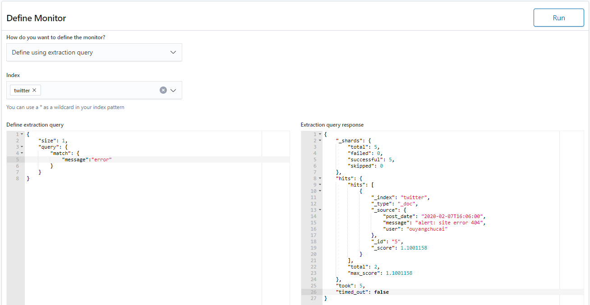

     ```json
     {
         "size": 1,
         "query": {
             "match": {
                 "message":"error"
             }
         }
     }
     ```

6. 单击**Create**，在**Create Trigger**页面定义并配置告警触发器。

   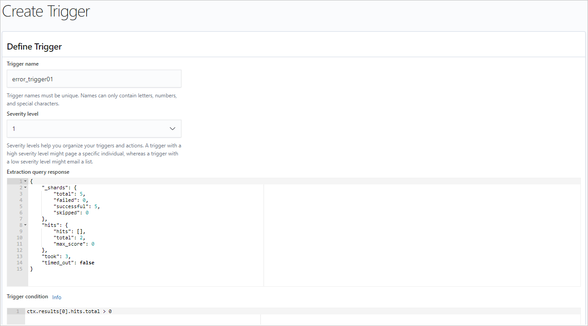

   | 参数 | 描述 |
   | --- | --- |
   | Trigger name | 触发器名称。 |
   | Severity level | 触发器的严重级别。 |
   | Extraction query response | 查询响应结果，是您告警定义中配置的查询请求的响应结果，不可修改。 |
   | Trigger condition | 告警触发的条件，可根据业务需求进行修改，例如<code> ctx.results[0].hits.total &gt; 0 </code>表示，当查询结果的数量大于0时，触发告警。 |

7. 配置告警通知。

   在**Configure Actions**中可配置告警通知，需要输入通知的名称、通知的目标地址以及通知的信息。

   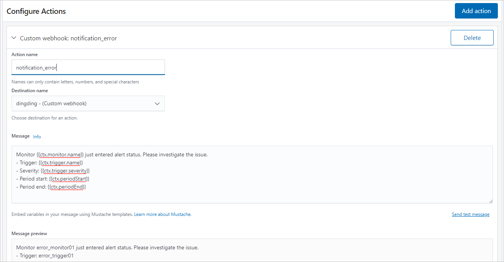

   | 参数 | 描述 |
   | --- | --- |
   | Action name | 通知的名称。 |
   | Destination name | 通知的目标地址，通常是一个URL地址。 |
   | Message | 通知的内容，可根据具体需求进行修改。 |
   | Message preview | 预览通知，不可修改。 |

8. 单击**Create**，完成创建。然后返回**Dashbord**页面，查看创建成功的告警。

   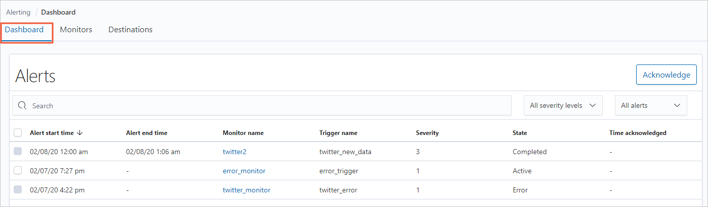

<a id="section-8-1-5"></a>

### 8.1.5. 使用向量检索插件（aliyun-knn）

向量检索插件是阿里云Elasticsearch团队自主开发的向量检索引擎插件，基于阿里巴巴达摩院Proxima向量检索库实现，能够帮助您快速实现图像搜索、视频指纹采样、人脸识别、语音识别和商品推荐等向量检索场景的需求。本文介绍如何使用向量检索插件。

**背景信息背景信息**

- 应用场景

  阿里云Elasticsearch向量检索引擎已成熟应用于拍立淘、阿里云图像搜索服务、趣头条视频指纹采样、猜您喜欢、搜索个性化、CrossMedia搜索等大规模生产应用场景。

- 原理

  阿里云Elasticsearch向量检索功能基于Elasticsearch插件扩展机制实现，能够完全兼容原生Elasticsearch版本，您无需额外的学习成本即可使用向量检索引擎。向量索引除了支持实时增量写入、近实时（Near Real Time，简称NRT）搜索查询，还具备了所有原生Elasticsearch的分布式能力，同时支持多副本、错误恢复等功能。

  > **说明**
  >
  > 阿里云Elasticsearch向量检索插件不支持通过OSS快照、DataWorks等方式进行数据迁移，建议使用Logstash方式。

- 算法说明

  在算法上，目前向量检索引擎已经支持了hnsw算法以及linear算法，适用于单机数据量小（全内存）的业务场景。两种算法性能对比如下。

  表 1. hnsw算法和linear算法性能对比

  表格中为阿里云Elasticsearch 6.8.13版本环境实测数据，测试环境配置如下：

  - 机器配置：数据节点16核64 GB\*2 + 100 GB SSD云盘。

  - 数据集：sift128维float向量。

  - 数据总量：2千万条。

  - 索引配置：全部采用默认参数。

  | 性能指标 | hnsw | linear |
  | --- | --- | --- |
  | top10召回率 | 98.6% | 100% |
  | top50召回率 | 97.9% | 100% |
  | top100召回率 | 97.4% | 100% |
  | 延迟（p99） | 0.093s | 0.934s |
  | 延迟（p90） | 0.018s | 0.305s |

  > **说明**
  >
  > 表中的p表示百分比，例如延迟（p99）表示99%的查询能在多少秒内返回。

**使用限制**

目前该功能仅支持阿里云Elasticsearch 6.8.13及以上版本（arm版本暂不支持）。

**前提条件**

- 创建的实例已安装向量检索插件（英文名称为aliyun-knn）。

  在安装向量检索插件前，需要确保Elasticsearch实例的数据节点规格为2核8 GiB及以上（2核8 GiB仅可用于功能测试，生产环境下数据节点需要为4核16 GiB及以上）。如果不满足，请先将数据节点规格升级至2核8 GiB及以上。

- 完成索引规划和集群规划。

**创建向量索引**

1. 登录对应阿里云Elasticsearch实例的Kibana控制台。

   具体操作，请参见登录Kibana控制台。

2. 在左侧导航栏，单击**Dev Tools**。

3. 在**Console**中执行如下命令，创建向量索引结构。

   ```text
   PUT test
   {
     "settings": {
       "index.codec": "proxima",
       "index.vector.algorithm": "hnsw"
     },
     "mappings": {
       "properties": {
         "feature": {
           "type": "proxima_vector",
           "dim": 2,
           "vector_type": "float",
           "distance_method": "SquaredEuclidean"
         }
       }
     }
   }
   ```

   **类型**

   **参数**

   **默认值**

   **含义**

   是否需要底层构建 `proxima`  knn索引，可选值如下：

   - proxima（推荐）：底层构建 `proxima`  knn索引，支持向量检索。

   **index.codec**

   proxima

   - null：创建索引的时候，底层不构建 `proxima` knn索引，只构建正排索引。 此时， `proxima_vector` 类型字段仅支持script检索，不支持hnsw或linear检索。

   指定向量检索算法，可选值如下：

   setting

   **index.vecto**

   - hnsw：hnsw算法。

   hnsw

   **r.algorithm**

   - linear：linear算法。

   指定knn索引构建是否使用离线优化模式，可选值如下：

   **index.vecto r.general.bu**

   - false: 不使用离线优化模式。

   false

   **ilder.offline _mode**

   - true: 使用离线优化模式，写入构建的segment碎片将会大幅度减少，提升整体写入吞吐能力。

   向量字段类型。例如：将 `feature` 字段指定为

   proxima_vect

   `proxima_vector` ，说明 `feature` 为向量字

   **type**

   or

   段。

   向量维度，必填，仅支持1~2048维。

   **dim**

   2

   向量数据类型，可选值如下：

   - float：浮点型。

   - short：短整型。

   - binary：二进制类型。

   除binary类型外，其他类型数组长度必须与**dim**保持一致，而binary类型的向量数据需要转换成无符号的32

   **vector_type**

   float

   mapping

   位十进制（uint32）数组表示，且**dim**必须为32的整数倍。

   例如：业务数据为64位二进制10001001001001011110000010011111010000 11010010011010011010000100，那么写入 `vector` 为 `[-1994006369, 1128900228]` 。

   距离度量函数，可选值如下：

   - SquaredEuclidean：欧氏距离（未开方）。

   SquaredEucli

   **distance_me**

   dean（未开

   - InnerProduct：内积距离。

   **thod**

   方）

   - Hamming：汉明距离（仅支持BINARY类型）。

   距离度量函数详细说明请参见距离度量函数。

   > **说明**
   >
   > knn向量检索还提供高级查询参数，可参考使用向量检索插件（aliyun-knn）。

4. 执行如下命令，添加文档。

   ```text
   POST test/_doc
   {
     "feature": [1.0, 2.0]
   }
   ```

**向量查询**

- 标准检索

  执行如下命令，对文档进行标准检索。

  ```text
  GET test/_search
  {
    "query": {
      "hnsw": {  
        "feature": {
          "vector": [1.5, 2.5], 
          "size": 10 
        }
      }
    }
  }
  ```

  常用参数说明：

  <table>
    <tr>
      <th width="84">参数</th>
      <th>说明</th>
    </tr>
    <tr>
      <td>hnsw</td>
      <td>向量查询算法，与创建索引时指定的<code> algorithm </code>一致。</td>
    </tr>
    <tr>
      <td>vector</td>
      <td>查询的向量数据，数组长度必须与创建索引时，<code> mapping </code>指定的<code> dim </code>保持一致。</td>
    </tr>
    <tr>
      <td>size</td>
      <td>指定召回的文档数。<br>说明向量检索中的<strong>size</strong>参数与Elasticsearch自带的<strong>size</strong>参数存在区别，前者控制向量检索插件knn召回的文档数，后者控制整个查询的召回文档数。使用时，系统会先通过向量检索中的<strong>size</strong>参数召回topN的文档，然后再由Elasticsearch自带的<strong>size</strong>参数召回整个查询的文档，最终返回结果。建议将向量检索中的<strong>size</strong>参数值和Elasticsearch自带的<strong>size</strong>参数值（默认值为10）保持一致。</td>
    </tr>
  </table>

  > **说明**
  >
  > knn向量检索还提供高级查询参数，可参考使用向量检索插件（aliyun-knn）。

- 索引预热（降低延迟）

  knn索引由于需要进行全内存检索，所以在索引冷加载时会出现查询延迟较高的情况。因此knn插件提供了索引预热功能，可以在knn索引提供检索服务之前，提前对knn索引进行预热，加载到本地内存，从而大大降低冷启动时的查询延迟。

  - 所有向量索引实现预热。

    ```text
    POST _vector/warmup
    ```

  - 特定向量索引实现预热能力。

    ```text
    POST _vector/{indexName}/warmup
    ```

  > **重要**
  >
  > 如果集群中向量索引比较多且数据量比较大，业务只需要对特定索引实现向量检索，建议只对特定向量使用预热能力，提升内存检索能力。

**向量打分**

向量检索拥有统一的打分公式，而打分机制主要依赖距离度量函数。不同的距离函数直接影响检索排序。

打分公式：

分数 = 1/(向量距离函数+1)

> **说明**
>
> - 向量打分机制默认使用未开方的欧式距离。
>
> - 在实际应用中，您可以通过查询分数反推向量间的距离，优化向量数据，提升打分。

**距离度量函数**

不同的距离度量函数对应不同的打分机制，下面是aliyun-knn插件支持的度量算法：

| 距离函数 | 定义 | 打分公式 | 应用场景 | 示例 |
| --- | --- | --- | --- | --- |
| SquaredEuclidea n欧氏距离（未开方） | 欧几里得度量（euclidean metric）也称欧氏距离，是一个通常采用的距离定义，指在m维空间中两个点之间的真实距离，或者向量的自然长度（即该点到原点的距离）。在二维和三维空间中的欧氏距离就是两点之间的实际距离。 | 以两个n维向量A = \[A1, A2,…, An\]和B= \[B1, B2,…, Bn\]为例：<br>• 未开方欧式距离= (A1-B1)² + (A2-B2)² + ...+ (An-Bn)²<br>• 分数= 1/(距离+1)<br>说明向量打分默认使用未开方的欧式距离计算。 | 欧氏距离能够体现个体数值特征的绝对差异，所以更多的用于需要从维度的数值大小中体现差异的分析，例如使用用户行为指标分析用户价值的相似度或差异。 | 例如：两个二维向量\[0,0\]和\[1,2\]，未开方欧式距离= (1-0)² + (2-0)² = 5。 |
| InnerProduct内积距离 | 内积又称点积，是指接受在实数R上的两个向量，并返回一个实数值标量的二元运算。 | 以两个n维向量A = \[A1, A2,…, An\]和B= \[B1, B2,…, Bn\]为例：<br>• 向量内积距离= A1B1+A2B2+...+AnBn<br>• 分数= 1/(距离+1)<br>其中，距离为内积距离。 | 内积距离同时考虑了两个向量的夹角及绝对长度。当向量归一化后，内积与余弦相似度计算公式等价。 | 例如两个二维向量\[1,1\]和\[1,5\]，向量内积距离=1+5=6。 |
| Hamming汉明距离（仅支持binary类型） | 在信息理论中，Hamming Distance表示两个等长字符串在对应位置上不同字符的数量，我们以d(x, y)表示字符串x和y之间的汉明距离。从另外一个方面看，汉明距离度量了通过替换字符的方式将字符串x变成y所需要的最小的替换次数。 | 以两个n位的二进制编码x和y为例：<br>• d(x,y)=∑x\[i\]⊕y\[i\]（i=0,1,..n-1；⊕表示异或）<br>• 分数=1/(距离+1) | 典型的用例包括数据通过计算机网络传输时的错误纠正或检测。它可以用来确定二进制字中不同字符的数目，作为估计误差的一种方法。 | 例如：1011101与1001001之间的汉明距离是2。<br>重要在aliyun-knn插件使用中，binary类型的向量数据需要转换成无符号的32位十进制（uint32）数组表示，且<code> dim </code>必须为32的整数倍。 |

> **说明**
>
> 索引 `mapping` 中通过**distance_method**参数指定不同的距离度量函数。

**熔断参数**

| 参数 | 描述 | 默认值 |
| --- | --- | --- |
| indices.breaker.vect or.native.indexing.li mit | 如果堆外内存使用超过该值，写入操作会被熔断；等待后台构建完成释放内存后，写入恢复正常。出现熔断错误表示当前系统内存消耗已经过高，建议业务上降低写入流量。 | 70% |
| indices.breaker.vect or.native.total.limit | 向量索引后台构建最多使用的堆外内存比例。如果实际使用的堆外内存超过了这个比例，可能会发生shard重启的情况。 | 80% |

> **重要**
>
> 向量熔断参数配置属于集群配置，可通过**GET _cluster/settings**命令查看，建议您不要调整熔断值。

**高阶参数**

表 2. 构建参数（hnsw）

| 参数 | 描述 | 默认值 |
| --- | --- | --- |
| index.vector.hnsw.b uilder.max_scan_nu m | 用于控制构图过程中的近邻考察范围，保证最坏情况的性能。 | 100000 |
| index.vector.hnsw.b uilder.neighbor_cnt | hnsw 0层图每个节点的邻居数。建议配置为100。该值越大，离线索引存储消耗越大，图构建质量越高。 | 100 |
| index.vector.hnsw.b uilder.upper_neighb or_cnt | hnsw上层图（除0层之外）中每个节点的邻居上限数。一般建议配置为<strong>neighbor_cnt</strong>的一半，最大不能超过255。 | 50 |
| index.vector.hnsw.b uilder.efconstructio n | 控制图构建过程中近邻扫描区域大小，该值越大，离线构图质量越好，索引构建越慢。建议初始值设置为400。 | 400 |
| index.vector.hnsw.b uilder.max_level | hnsw总层数，包含0层图和上层图。例如总共1000万文档，<strong>scaling_factor</strong>为30，那么层数可以以max level=30为底，取1000万的对数向上取整，计算得5。该值对效果影响不大，一般建议初始配置为6。 | 6 |
| index.vector.hnsw.b uilder.scaling_factor | 下层图是上层图数据的多少倍，呈指数关系。通常设置在10~100之间。<strong>scaling_factor</strong>越大，实际生成的图层数越低。建议初始配置为50。 | 50 |

> **说明**
>
> 以上参数需在索引**setting**中设置使用，并且仅支持在**hnsw**算法模型中使用。

表 3. 查询参数（hnsw）

| 参数 | 描述 | 默认值 |
| --- | --- | --- |
| ef | 用于控制在线检索时，考察的子图范围大小。该值越大，召回越高，性能越差。建议取值\[100,1000\]。 | 100 |

查询示例如下。

```text
GET test/_search
{
  "query": {
    "hnsw": {
      "feature": {
        "vector": [1.5, 2.5],
        "size": 10,
        "ef": 100       
      }
    }
  }
}
```

**常见问题**

- Q：如何评估查询的召回率？

  A：可以同时创建两个索引，一个为hnsw算法，一个为linear算法，其他配置相同。客户端向两个索引同时推送相同的向量数据，刷新后，用同样的查询向量对比linear索引和hnsw索引召回的文档ID，交集的文档ID个数/召回总数，即为待测向量的召回率。

  > **说明**
  >
  > 交集的文档ID个数是指两个索引召回的文档ID的交集。

- Q：集群写入期间报错 `circuitBreakingException` ，如何处理？

  A：这个错误表明此时系统的堆外内存使用率超过了**indices.breaker.vector.native.indexing.limit**指定的比例（默认为70%），触发了写入的熔断操作，一般等待后台的索引构建任务完成后会自动释放。建议客户端写入时添加错误重试机制。

- Q：为什么写入任务已经停止了，CPU依然在工作？

  A：向量索引的构建发生在refresh或flush期间，虽然写入流量已经停止，但后台的向量索引构建任务可能仍然在继续。等待最后一轮refresh结束后，计算资源就会被释放。

- Q：使用aliyun-knn插件进行向量检索，速度过慢或出现内存熔断，怎么办？

  A：aliyun-knn插件进行向量检索时，使用的是全内存型向量，非常消耗内存。当索引数据量较大时，由于需要将数据加载到内存，因此会出现速度慢或内存熔断的情况。建议索引数据量是机器内存的一半，在数据量无法变更的情况下，如果内存太小，建议您升配集群。

<a id="section-8-1-6"></a>

### 8.1.6. 使用ism插件实现索引生命周期管理

本文介绍如何使用Elasticsearch的ISM插件，实现索引级别的生命周期管理。目前仅Elasticsearch 6.8.13_ali1.3.0和7.10.0_ali1.6.0版本支持该功能。

**前提条件**

- 已手动安装opendistro-job-scheduler和opendistro-index-management插件，具体操作请参见安装或卸载插件。

- 使用Kibana前，需要先在实例详情页面的安全设置中配置Kibana白名单。

**使用限制**

集群版本需要为Elasticsearch 6.8.13_ali1.3.0或7.10.0_ali1.6.0版本。

**操作步骤**

1. 登录目标Elasticsearch实例的Kibana控制台，根据页面提示进入Kibana主页。

   登录Kibana控制台的具体操作，请参见登录Kibana控制台。

   > **说明**
   >
   > 本文以阿里云Elasticsearch 7.10版本为例，其他版本操作可能略有差别，请以实际界面为准。

2. 在左侧导航栏，单击

   图标，然后选择**Management > Dev tools**。

   

3. 在**Console**页签中，执行如下命令创建ISM策略。

   > **说明**
   >
   > 本文示例以7.10.0_ali1.6.0版本为例。

   ```text
   PUT _opendistro/_ism/policies/policy_1
   {
     "policy": {
       "description": "test",
       "default_state": "ingest",
       "states": [
         {
           "name": "ingest",
           "actions": [
             {
               "rollover": {
                 "min_doc_count": 5
               }
             }
           ],
           "transitions": [
             {
               "state_name": "search"
             }
           ]
         },
         {
           "name": "search",
           "actions": [],
           "transitions": [
             {
               "state_name": "delete",
               "conditions": {
                 "min_index_age": "5m"
               }
             }
           ]
         },
         {
           "name": "delete",
           "actions": [
             {
               "delete": {}
             }
           ],
           "transitions": []
         }
       ],
       "ism_template": {
         "index_patterns": [
           "test-*"
         ],
         "priority": 0
       }
     }
   }
   ```

   | 参数 | 说明 |
   | --- | --- |
   | default_state | 默认状态。 |
   | states | 状态列表。 |
   | actions | 执行的动作，更多Actions请参见官方Actions介绍。 |
   | transitions.conditions | 触发条件，达成条件后改变为下一个状态并且执行下一个Action。更多触发条件请参见官方conditions介绍。 |
   | ism_template | 匹配到规则的索引创建时会增加这个策略。 |

4. 查看已创建的策略。

   ```text
   GET _opendistro/_ism/policies/policy_1
   ```

   执行成功后，返回结果示例如下。

   ```json
   {
     "_id" : "policy_1",
     "_version" : 1,
     "_seq_no" : 0,
     "_primary_term" : 1,
     "policy" : {
       "policy_id" : "policy_1",
       "description" : "test",
       "last_updated_time" : 1676530893161,
       "schema_version" : 1,
       "error_notification" : null,
       "default_state" : "ingest",
       "states" : [
         {
           "name" : "ingest",
           "actions" : [
             {
               "rollover" : {
                 "min_doc_count" : 5
               }
             }
           ],
           "transitions" : [
             {
               "state_name" : "search"
             }
           ]
         },
         {
           "name" : "search",
           actions : [ ],
           "transitions" : [
             {
               "state_name" : "delete",
               "conditions" : {
                 "min_index_age" : "5m"
               }
             }
           ]
         },
         {
           "name" : "delete",
           "actions" : [
             {
               "delete" : { }
             }
           ],
           "transitions" : [ ]
         }
       ],
       "ism_template" : [
         {
           "index_patterns" : [
             "test-*"
           ],
           "priority" : 0,
           "last_updated_time" : 1676530893161
         }
       ]
     }
   }
   ```

5. 设置rollover_alias。

   ```text
   PUT _index_template/ism_rollover
   {
     "index_patterns": [
       "test-*"
     ],
     "template": {
       "settings": {
         "opendistro.index_state_management.rollover_alias": "test"
       }
     }
   }
   ```

   执行成功后，返回结果示例如下。

   ```json
   {
      "acknowledged" : true
   }
   ```

6. 设置索引和索引别名。

   ```text
   PUT test-000001
   {
     "aliases": {
       "test": {
         "is_write_index": true
       }
     }
   }
   ```

   执行成功后，返回结果示例如下。

   ```json
   {
      "acknowledged" : true,
      "shards_acknowledged" : true,
      "index" : "test-000001"
   }
   ```

7. 查看策略是否自动添加。

   ```text
   GET _opendistro/_ism/explain/test-000001
   ```

   执行成功后，返回结果示例如下。

   ```json
   {
     "test-000001" : {
       "index.opendistro.index_state_management.policy_id" : "policy_1",
       "index" : "test-000001",
       "index_uuid" : "CE4KQZASTmGKyPP5cM****",
       "policy_id" : "policy_1"
     }
   }
   ```

8. 验证结果。

   本文以通过写入5次数据，查看索引状态是否转换为例，验证策略是否生效。

   ```text
   POST log/_doc
   {
     "message": "dummy"
   }
   ```

   > **说明**
   >
   > - 将策略添加到索引后，ISM会创建一个默认情况下每5分钟运行一次的作业，用来执行策略操作、检查条件并将索引转换为不同状态。
   >
   > - 您也可以通过 `GET _opendistro/_ism/explain/test-000001` 命令查看当前ISM策略的状态。

<a id="section-8-1-7"></a>

### 8.1.7. 使用opendistro_security插件实现权限管控

本文介绍如何使用Elasticsearch的opendistro_security插件，通过Active Directory、LDAP等进行身份验证，实现对索引、文档和字段的基于角色的细粒度访问控制。目前仅Elasticsearch 6.8.13和7.10.0版本支持该功能。

**前提条件**

- 手动安装opendistro_security插件，具体操作请参见插件配置。

- 准备示例索引数据。

  创建索引并写入数据，本文档中创建的索引名为test_security1、test_security2。

  - 创建test_security1索引

    ```text
    PUT test_security1/_doc/_bulk?refresh
    {"index":{"_id":"1"}}
    {"city":"hz","name":"sss","readable_by":"read_test_security1"}
    {"index":{"_id":"2"}}
    {"city":"hz","name":"zzz","readable_by":"read_test_security1"}
    {"index":{"_id":"3"}}
    {"city":"jd","name":"aaa"}
    {"index":{"_id":"4"}}
    {"city":"jd","name":"ccc"}
    {"index":{"_id":"5"}}
    {"city":"wz","name":"bbb"}
    ```

  - 创建test_security2索引

    ```text
    PUT test_security2/_doc/_bulk?refresh
    {"index":{"_id":"1"}}
    {"city":"hz","name":"sss","readable_by":"read_test_security1"}
    {"index":{"_id":"2"}}
    {"city":"hz","name":"zzz","readable_by":"read_test_security1"}
    {"index":{"_id":"3"}}
    {"city":"jd","name":"aaa"}
    {"index":{"_id":"4"}}
    {"city":"jd","name":"ccc"}
    {"index":{"_id":"5"}}
    {"city":"wz","name":"bbb"}
    ```

**使用限制**

集群版本需要为Elasticsearch 6.8.13或7.10.0。

**基于角色的访问控制（RBAC）**

1. 登录目标Elasticsearch实例的Kibana控制台，根据页面提示进入Kibana主页。

   登录Kibana控制台的具体操作，请参见登录Kibana控制台。

   > **说明**
   >
   > 本文以阿里云Elasticsearch 7.10版本为例，其他版本操作可能略有差别，请以实际界面为准。

2. 创建用户。

   <ol type="i">

   <li>

   在左侧导航栏，单击

   图标，然后选择**Open Distro for Elasticsearch > Security**。

   

   </li>

   <li>

   在**Security**页面的左侧导航栏，单击**Internal users**。

   </li>

   <li>

   在**Internal users**页面，单击**Create internal user**。

   </li>

   <li>

   在**Create internal user**页面，填写用户信息。

   </li>

   <li>

   单击**Create**。

   </li>

   </ol>

   您也可以通过API创建用户，详细信息请参见Create user。示例如下：

   ```text
   PUT _opendistro/_security/api/internalusers/read_test_security1
   {
      "password":"yourPassword"
   }
   ```

3. 创建角色。

   <ol type="i">

   <li>

   在左侧导航栏，单击

   图标，然后选择**Open Distro for Elasticsearch > Security**。

   

   </li>

   <li>

   在**Security**页面的左侧导航栏，单击**Roles**。

   </li>

   <li>

   在**Roles**页面，单击**Create role**。

   </li>

   <li>

   在**Create Role**页面，填写用户角色信息。

   以配置没有集群相关权限，只有索引index_security1的只读权限为例，配置示例如下。

   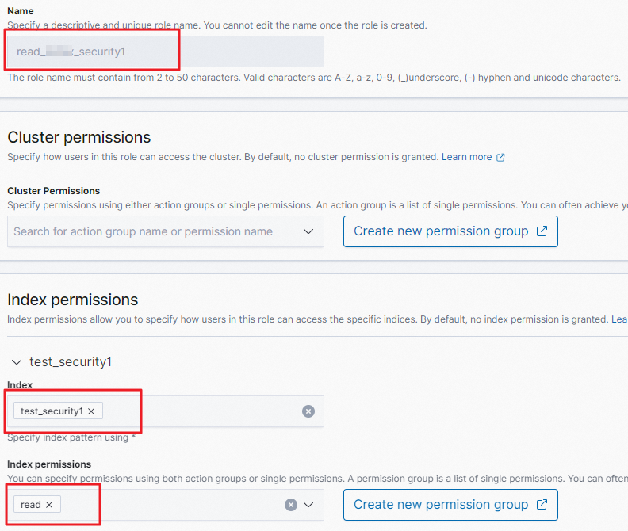

   </li>

   <li>

   单击**Create**。

   </li>

   </ol>

   您也可以通过API创建角色，详细信息请参见Create role。示例如下：

   ```text
   PUT _opendistro/_security/api/roles/read_test_security1
   {
     "index_permissions":[{
       "index_patterns":[
           "test_security1"
       ],
       "allowed_actions":[
           "read"
       ]
     }]
   }
   ```

4. 将角色关联到用户。

   <ol type="i">

   <li>

   角色创建完成后直接进入角色编辑页面，单击**Mapped users**页签。

   </li>

   <li>

   单击**Map users**。

   > **说明**
   >
   > 如果还没有用户，可单击**Create internal user**创建用户。

   </li>

   <li>

   在**Map user**页面，选择**Users**（要关联的用户）。

   </li>

   <li>

   单击**Map**。

   </li>

   </ol>

   您也可以通过API将角色关联到用户，详细信息请参见Create role mapping。示例如下：

   ```text
   PUT _opendistro/_security/api/rolesmapping/read_test_security1
   {
      "users":["read_test_security1"]
   }
   ```

5. 验证用户权限。

   使用已创建的用户名和密码登录Kibana控制台，执行以下命令进行验证：

   - 用户没有test_security1索引的写操作权限。例如，当您向test_security1索引中写入数据时，正常情况下会返回no permissions error。

     ```text
     PUT test_security1/_doc/3
     {
       "city":"jd",
       "name":"zz"
     }
     ```

     预期结果如下：

     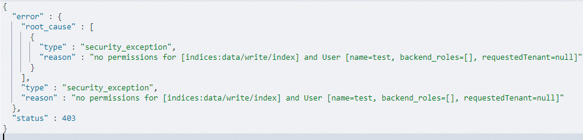

   - 用户没有test_security2索引的所有权限。例如，当您查询test_security2索引中的数据时，正常情况下会返回no permissions error。

     ```text
     GET test_security2/_search
     {
       "query":{
           "match_all":{}
       }
     }
     ```

     预期结果如下：

     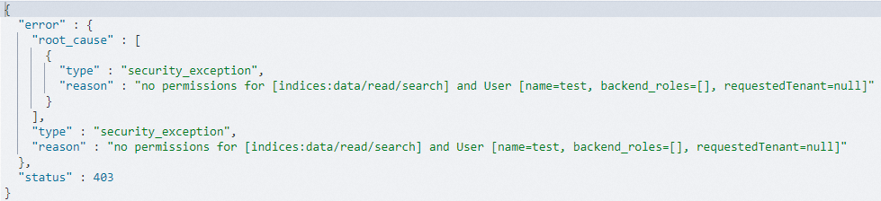

   - 用户具有test_security1索引的读权限，可查询到数据。例如，当您查询test_security1索引中的数据时，正常情况下会返回对应的数据。

     ```text
     GET test_security1/_search
     {
       "query":{
           "match_all":{}
       }
     }
     ```

     预期结果如下：

     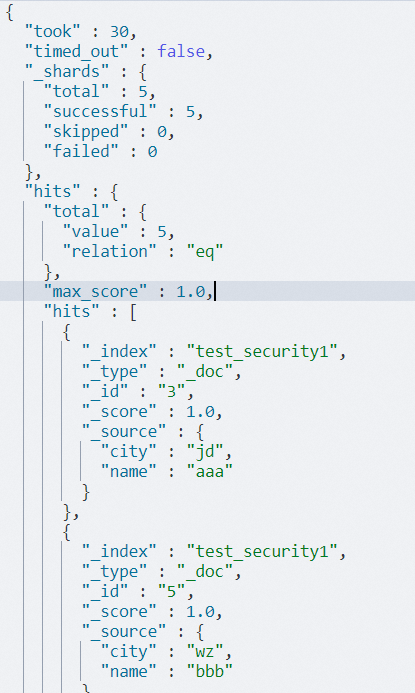

**基于属性的访问控制（ABAC）**

1. 登录目标Elasticsearch实例的Kibana控制台，根据页面提示进入Kibana主页。

   登录Kibana控制台的具体操作，请参见登录Kibana控制台。

   > **说明**
   >
   > 本文以阿里云Elasticsearch 7.10版本为例，其他版本操作可能略有差别，请以实际界面为准。

2. 创建用户，具体操作请参见创建用户。

   创建用户时，需要通过配置**Attributes**来添加用户属性。

   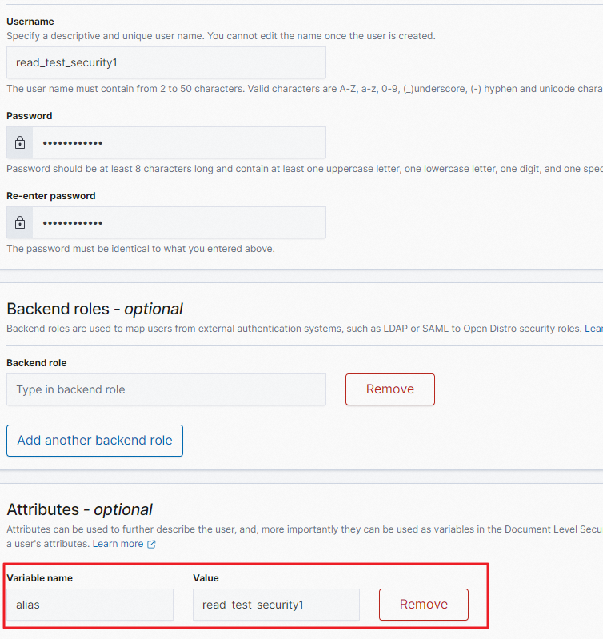

   您也可以通过API创建用户并配置**Attributes**，详细信息请参见Create user。示例如下：

   ```text
   PUT _opendistro/_security/api/internalusers/read_test_security1
   {
     "password":"yourPassword",
     "attributes":{
         "alias":"read_test_security1"
     }
   }
   ```

3. 创建角色，具体操作请参见创建角色。

   创建角色时，需要通过配置**Document level security**来控制可访问的用户属性。

   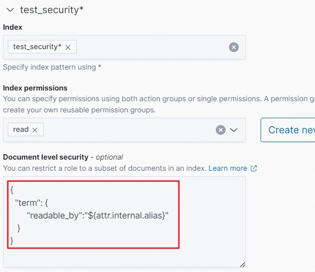

   配置示例如下：

   ```json
   {
     "term": {
          "readable_by":"${attr.internal.alias}"
      }
   }
   ```

   您也可以通过API创建角色并配置Document level security，详细信息请参见Document-level security。示例如下：

   ```text
   PUT _opendistro/_security/api/roles/read_test_security_doc
   {
     "index_permissions":[{
       "index_patterns":[
           "test_security*"
       ],
       "dls":"{\"bool\":{\"must\":{\"match\":{\"readable_by\":
       \"${attr.internal.alias}\"}}}}",
       "allowed_actions":[
           "read"
       ]
     }]
   }
   ```

4. 将角色关联到用户，具体操作请参见将角色关联到用户。

5. 验证用户权限。

   使用已创建的用户名和密码登录Kibana控制台，执行以下命令查看索引全部数据。

   ```text
   GET test_security1/_search
   {
     "query":{
         "match_all":{}
     }
   }
   ```

   预期返回结果如下（只有满足role中配置的属性才可以被查询到）：

   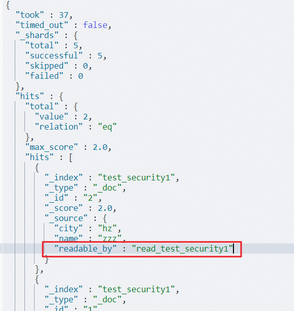

**文档级别的访问控制**

关于文档级别的访问控制详情，请参见Attribute-based security。

1. 登录目标Elasticsearch实例的Kibana控制台，根据页面提示进入Kibana主页。

   登录Kibana控制台的具体操作，请参见登录Kibana控制台。

   > **说明**
   >
   > 本文以阿里云Elasticsearch 7.10版本为例，其他版本操作可能略有差别，请以实际界面为准。

2. 创建用户，具体操作请参见创建用户。

3. 创建角色，具体操作请参见创建角色。

   创建角色时，需要通过配置**Document level security**来控制可访问的文档。

   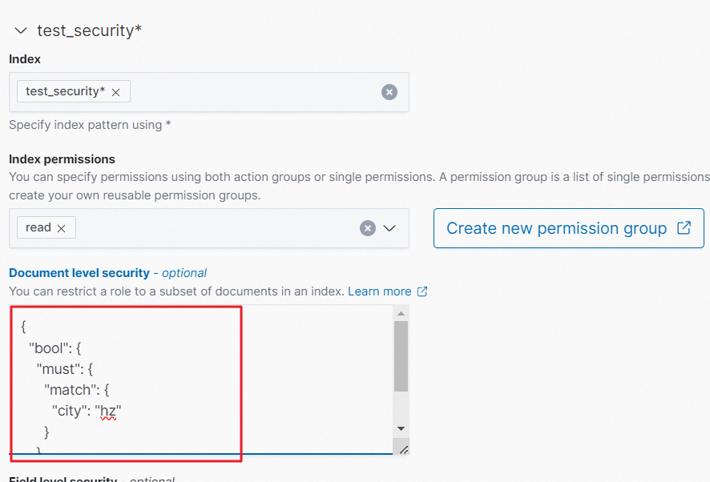

   配置示例如下。表示用户只可访问索引<strong>test_security\*</strong>中**city**为**hz**的文档数据。

   ```json
   {
     "bool": {
       "must": {
         "match": {
           "city": "hz"
         }
       }
     }
   }
   ```

   您也可以通过API创建角色并配置Document level security，详细信息请参见Document-level security。示例如下：

   ```text
   PUT _opendistro/_security/api/roles/read_test_security_doc
   {
     "index_permissions":[{
       "index_patterns":[
           "test_security*"
       ],
       "dls":"{\"bool\":{\"must\":{\"match\":{\"city\":\"hz\"}}}}",
       "allowed_actions":[
           "read"
       ]
     }]
   }
   ```

4. 将角色关联到用户，具体操作请参见将角色关联到用户。

5. 验证用户权限。

   使用已创建的用户名和密码登录Kibana控制台，执行以下命令查看索引全部数据。

   ```text
   GET test_security1/_search
   {
     "query":{
         "match_all":{}
     }
   }
   ```

   预期返回结果如下（只有满足role中配置的文档才可以被查询到）：

   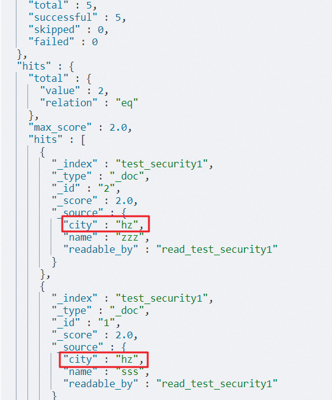

**字段级别的访问控制**

关于字段级别的访问控制详情，请参见Field-level security。

1. 登录目标Elasticsearch实例的Kibana控制台，根据页面提示进入Kibana主页。

   登录Kibana控制台的具体操作，请参见登录Kibana控制台。

   > **说明**
   >
   > 本文以阿里云Elasticsearch 7.10版本为例，其他版本操作可能略有差别，请以实际界面为准。

2. 登录目标Elasticsearch实例的Kibana控制台，根据页面提示进入Kibana主页。

   登录Kibana控制台的具体操作，请参见登录Kibana控制台。

   > **说明**
   >
   > 本文以阿里云Elasticsearch 7.10版本为例，其他版本操作可能略有差别，请以实际界面为准。

3. 创建用户，具体操作请参见创建用户。

4. 创建角色，具体操作请参见创建角色。

   创建角色时，需要通过配置**Field level security**来控制可访问的字段。配置示例如下，表示用户不可访问索引<strong>test_security\*</strong>中**city**字段。

   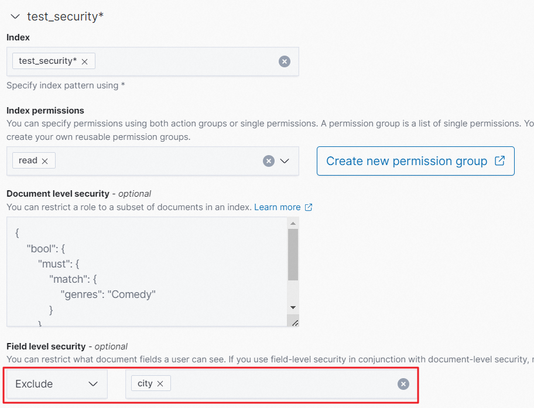

   > **说明**
   >
   > Exclude表示排除某些字段；Include表示包含某些字段。

   您也可以通过API创建角色并配置Field level security，详细信息请参见Field-level security。示例如下：

   ```text
   PUT _opendistro/_security/api/roles/read_test_security_field
   {
     "index_permissions":[{
       "index_patterns":[
         "test_security*"
       ],
       "fls":["~city"],
       "allowed_actions":[
         "read"
       ]
     }]
   }
   ```

   > **说明**
   >
   > **fls**参数取值中的 `~` 表示Excluse，不带 `~` 表示Include，示例配置表示排除**city**字段。

5. 将角色关联到用户，具体操作请参见将角色关联到用户。

6. 验证用户权限。

   使用已创建的用户名和密码登录Kibana控制台，执行以下命令查看索引全部数据。

   ```text
   GET test_security1/_search
   {
     "query":{
         "match_all":{}
     }
   }
   ```

   预期返回结果如下（没有city字段）：

   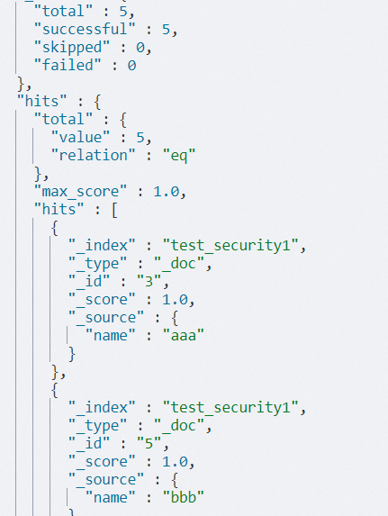

<a id="section-8-1-8"></a>

### 8.1.8. 使用aliyun-codec插件压缩索引文件

aliyun-codec插件是阿里云自主研发的索引压缩插件，可以对Elasticsearch（简称ES）底层多种索引文件进行压缩，同时支持source_reuse_doc_values特性。本文介绍如何使用aliyun-codec插件。

**前提条件**

- 已创建7.10.0版本的阿里云ES实例。

- 根据业务场景，升级实例的内核版本：

  - 如仅需对索引文件进行压缩，请将内核版本升级至 `1.5.0` 及以上版本。

  - 如需对索引文件进行压缩，并且还需使用 `source_reuse_doc_values` 特性，请将内核版本升级至 `1.6.0` 及以上。

- 已安装aliyun-codec插件。

**使用限制**

- 仅 `7.10.0` 版本实例，且内核版本为 `1.5.0` 及以上的阿里云ES，支持 `aliyun-codec` 插件的索引压缩功能。

- 仅 `7.10.0` 版本实例，且内核版本为 `1.6.0` 及以上的阿里云ES，支持 `source_reuse_doc_values` 特性。

**使用索引压缩功能**

1. 登录Kibana控制台。

2. 单击左上角的  图标，选择**Management > Dev tools**。

3. 在**Console**页签，创建索引并开启索引压缩。

   示例创建 `index1` 索引，并对行存（source）、列存（docvalue）和倒排（postings）三类文件使用 `zstd` 算法进行压缩。

   > **说明**
   >
   > 如需关闭某类文件的压缩，可将对应参数配置为 `""` 。例如， `"index.postings.compression":""` 表示对倒排（postings）文件不进行压缩。

   ```text
   PUT /index1
   {
     "settings": {
       "number_of_shards": 1,
       "number_of_replicas": 4,
       
       "index.codec" : "ali",
       "index.source.compression":"zstd",
       "index.doc_value.compression.default":"zstd",
       "index.postings.compression":"zstd"
     },
     "mappings": {
       "_source": {
         "enabled": true
       },  
       "properties": {
         "name": {
           "type": "keyword",
           "doc_values": true,
           "index": true
         },
         "age": {
           "type": "integer",
           "doc_values": true,
           "index": true
         },
         "address": {
           "type": "text",
           "doc_values": false,
           "index": true
         }
       }
     }
   }
   ```

   索引压缩相关的参数说明如下。

   | 参数 | 描述 |
   | --- | --- |
   | index.codec | 用于指定存储数据时使用的压缩编解码器，控制索引数据如何被编码和压缩存储。配置为<code> ali </code>，表示使用阿里云自定义的编解码器进行数据压缩和存储优化。 |
   | index.source.compr ession | 用于指定对行存（source）文件使用的压缩算法。取值如下：<br>• <strong>zstd</strong>：使用<code> zstd </code>压缩算法，压试块大小为<code> 128KB </code>。<br>• <strong>zstd_1024</strong>：使用<code> zstd </code>压缩算法，压试块大小为<code> 1024KB </code>。<br>• <strong>zstd_dict</strong>：使用<code> zstd </code>压缩算法，附带<code> dict </code>功能，相较<code> zstd </code>压缩率更高，但读写性能会差一些。<br>• <strong>best_compression</strong>：使用原生ES对应的<code> source </code>压缩算法。<br>• <strong>default</strong>：使用原生ES对应的<code> source </code>压缩算法。 |
   | index.doc_value.co mpression.default | 用于指定对列存（docvalue）文件使用的压缩算法。取值如下：<br>• <strong>zstd</strong>：使用<code> zstd </code>压缩算法，压缩率较高。<br>• <strong>lz4</strong>：使用<code> lz4 </code>压缩算法，压缩速度较快。<br>说明<br>该插件目前仅对索引中的<code> number </code>、<code> date </code>、<code> keyword </code>和<code> ip </code>类型字段的<code> docvalue </code>文件开启压缩。 |
   | index.postings.com pression | 用于指定对倒排（postings）文件使用的压缩算法。 |

**使用source_reuse_doc_values特性**

**开启source_reuse_doc_values特性**

示例创建 `index2` 索引并开启 `source_reuse_doc_values` 特性，代码如下。

> **重要**
>
> `source_reuse_doc_values` 特性仅支持在创建索引时开启，一旦开启便无法关闭。

```text
PUT index2
{
  "settings": {
    "index": {
      "ali_codec_service": {
        "source_reuse_doc_values": {
          "enabled": true
        }
      }
    }
  }
}
```

**调整source_reuse_doc_values特性配置**

> **说明**
>
> 
>
> 原生ES底层会存储多份数据，例如，数据会同时存储在 `_source` 、 倒排索


> 引 和 `doc_values` 中， `source_reuse_doc_values` 会将 `_source` 中存储的相同部分的JSON数据进行裁剪，来降低整体索引的大小。

开启 `source_reuse_doc_values` 特性后，您可根据业务需要，调整该特性的相关配置：

- 调整开启 `source_reuse_doc_values` 字段的最大个数。

  当开启 `source_reuse_doc_values` 特性的字段个数超过您设置的值，ES将抛出异常或自动关闭 `source_reuse_doc_values` 特性，最大字段个数默认为 `50` 。示例将最大个数设置为 `100` ，代码如下。

  ```text
  PUT _cluster/settings
  {
    "persistent": {
         "apack.ali_codec_service.source_reuse_doc_values.max_fields": 100
    }
  }
  ```

- 设置是否强制不能超过开启 `source_reuse_doc_values` 特性的最大字段个数。

  ```text
  PUT _cluster/settings
  {
    "persistent": {
         "apack.ali_codec_service.source_reuse_doc_values.strict_max_fields": true
    }
  }
  ```

  - `true` ：超过您设置的值，ES会抛出异常。

  - `false` ：超过您设置的值，ES会自动关闭source_reuse_doc_values特性。

- 调整查询时读取开启了 `source_reuse_doc_values` 字段值的并发度。

  在获取原文时， `source_reuse_doc_values` 特性会并发读取文档中开启了 `source_reuse_doc_values` 字段的值，并进行组装。为了降低耗时，您可调整系统获取各字段值的并发度，默认并发度为 `5` 。示例调整并发度为 `2` ，代码如下。

  ```text
  PUT test/_settings
  {
    "index": {
      "ali_codec_service": {
        "source_reuse_doc_values": {
          "fetch_slice": 2
        }
      }
    }
  }
  ```

- 调整读取开启了 `source_reuse_doc_values` 字段值的线程池和队列大小。

  线程池默认大小为节点的核数，队列默认大小为 `1000` ，该配置仅能通过修改YML文件进行调整。您可在YML文件中添加如下配置进行调整。

  ```text
  apack.doc_values_fetch:
      size: 8
      queue_size: 1000
  ```

<a id="section-8-1-9"></a>

### 8.1.9. 使用faster-bulk插件实现批量聚合

faster-bulk插件是阿里云Elasticsearch（简称ES）团队自研的插件，用于提高写入吞吐及降低写入拒绝。该插件能够实现将bulk写入请求按照指定bulk请求大小和时间间隔进行批量聚合，防止过小的bulk请求阻塞写入队列，有效提升写入吞吐。本文介绍faster-bulk插件的使用方法。

**前提条件**

- 已创建7.10.0版本的阿里云ES实例。

- 已安装faster-bulk插件。插件安装后，bulk聚合功能默认关闭，使用前需先开启该功能。

**开启bulk聚合功能**

1. 登录Kibana控制台。

2. 单击左上角的  图标，选择**Management > Dev tools**。

3. 在**Console**中，执行以下命令，开启bulk聚合功能。

   ```text
   PUT _cluster/settings
   {
      "transient" : {
         "apack.fasterbulk.combine.enabled":"true"
      }
   }
   ```

**设置bulk聚合大小和时间间隔**

执行以下命令，指定bulk请求的聚合大小和时间间隔。当单个数据节点上，bulk请求的累计大小或聚合时间间隔达到阈值，即会触发数据写入。

```text
PUT _cluster/settings
{
   "transient" : {
      "apack.fasterbulk.combine.flush_threshold_size":"1mb",
      "apack.fasterbulk.combine.interval":"50"
   }
}
```

- **apack.fasterbulk.combine.flush_threshold_size**：聚合的bulk请求的最大值，默认值为**1mb**。

- **apack.fasterbulk.combine.interval**：聚合的bulk请求的最大时间间隔，单位为 `ms` ，默认值为**50**。

> **说明**
>
> 对于海量数据高并发场景，在集群可承受的压力范围内，可适当将最大聚合大小或最大时间间隔调大，减少bulk请求阻塞写入队列。

**开启定向路由**

当批量写入文档未指定 `routing` 和主键（ `_id` ）时，您可以为集群或指定索引开启定向路由，提高写入速度。

> **说明**
>
> 如果集群或索引开启了定向路由，同时写入中也指定了 `routing` 和主键（ `_id` ），则定向路由不会生效，且不会影响正常的业务写入。

- 为集群开启定向路由。

  ```text
  PUT _cluster/settings
  {
    "persistent" : {
      "index.direct_routing.global.enable" : "true"
    }
  }
  ```

- 创建索引并开启定向路由。

  > **说明**
  >
  > 实际使用时，请将 `<index>` 替换为您要创建的索引名称。

  ```text
  PUT /<index>
  {
    "settings": {
    "index.direct_routing.enable" : "true"
    }
  }
  ```

**关闭bulk聚合功能**

执行以下命令，关闭bulk聚合功能。

```text
PUT _cluster/settings
{
   "transient" : {
      "apack.fasterbulk.combine.enabled":"false"
   }
}
```

<a id="section-8-1-10"></a>

### 8.1.10. 使用aliyun-qos插件实现集群限流

aliyun-qos是阿里云Elasticsearch（简称ES）的自研插件，可提高集群的稳定性。该插件能够实现集群级别的读写限流，在关键时刻对指定索引降级，将流量控制在合适范围内。例如，当上游业务无法进行流量控制时（尤其对于读请求业务），可根据aliyun-qos插件设置的规则，按照业务的优先级进行适当降级，来保护ES服务的稳定性。

**前提条件**

- 已创建7.10.0版本的阿里云ES实例。

- 已安装aliyun-qos插件，并且升级插件至最新版本。

  您可登录目标ES实例的Kibana控制台，通过 `GET /_cat/plugins?v` 命令查看插件版本。

  > **说明**
  >
  > `7.10.0` 版本ES实例的插件最新版本为**7.10.0_ali1.12.0.1.2**。

**注意事项**

- aliyun-qos插件的限流功能默认关闭，并且该插件是为了保护集群，提高稳定性，并不会精准计量读写流量。

- 将aliyun-qos插件升级至最新版本时，需注意：

  - 由于新旧版本实现机制不同，升级过程中可能出现短暂限流失效，待master节点上的限流插件升级完成后会自动恢复。

  - 在新旧数据转换过程中，可能存在部分限流器转换失败的情况。若转换失败，您需执行如下命令重新转换。如果执行命令后报错，可多次重试，直至 `hasError` 显示为 `false` 。

    ```text
    POST /_qos/limiter/ops/upgrade
    ```

    > **说明**
    >
    > 如果执行以上命令长时间不返回，则说明实例中没有旧版限流器，可忽略。

**评估阈值**

为了不影响读写请求的执行效率，aliyun-qos插件会在集群级别进行限流，但并不会对集群中所有节点的读写流量进行严格精准的计量，可能会导致实际的流量有所偏差。因此在使用aliyun-qos插件前，可先参考如下规则评估限流阈值：

- 查询请求

  

  > **说明**
  >
  > 端到端QPS仅指查询请求到达协调节点的每秒请求数。

- 写入请求

  写入请求的限流阈值的计算规则与查询请求类似，但还需根据副本数进行调整。

  例如，集群中有2个数据节点、1个索引，该索引有1个shard、1个副本，每次写入 `10MB` 大小的数据。因为存在副本，所以每个数据节点上都会被写入 `10MB` 大小的数据。另外，X-Pack自身的Monitor、Audit、Watcher等任务同样会占用写入流量，设置阈值时需预留出该部分的大小。

**开启限流功能**

aliyun-qos插件的限流功能默认关闭，使用时需先开启该功能。

> **说明**
>
> 本文中的命令均可在Kibana控制台上执行，详情请参见登录Kibana控制台。

```text
PUT _cluster/settings
{
  "persistent": {
    "apack.qos.limiter.enabled": true
  }
}
```

**配置限流器**

配置限流器的代码及相关参数说明如下。

> **说明**
>
> - 限流器主要由两部分组成， `limiters` 定义和 `tags` 定义。通过 `tags` 定义资源限制，通过 `limiters` 定义具体的限流类型和限流阈值。
>
> - 限流器分为普通限流器和默认限流器。将**tags**设置为<strong>\*\*</strong>表示使用默认限流器。例如，默认每个 `shard` 的流量，默认每个应用的QPS等。
>
> - 当请求超过限流值后，ES会拒绝之后发送的请求。
>
> - 限流器配置的具体示例，请参见配置限流器示例。

```text
PUT /_qos/limiter/<limiterName>
{
  "limiters": {
     ${action}.${limiter_type}:${threshold}
  },
  "tags": {
    ${tagName}:${tagValue}
  },
  "priority":0,               
  "params":{  
      "watchMode":true
  }
}
```

| 参数 | 说明 | 可选值 |
| --- | --- | --- |
| action | 限流的action，用于限制不同类型的请求。 | • write：doc写入请求，包含index和create。<br>• update：doc更新请求。<br>• delete：doc删除请求<br>• search：查询请求。<br>• search_shards：查询索引的shard总数请求。 |
| limiter_ty pe | 限流类型。支持三大类：<br>• 速率<br>• 并发度<br>• 单请求限制 | • rate：速率，只支持整数。<br>• qps：查询速率，只支持整数。<br>• tps：写入速率，只支持整数。<br>• throughput：吞吐量，只支持action为write、update和delete。支持的单位包含GB、MB、KB等，最大支持2 GB。<br>• thread_count：请求并发度，一个请求为一个并发。<br>• concurrent_count：请求并发度，按照请求中的具体操作计算并发数。例如设置<code> search_shards.concurrent_count:20 </code>，表示允许最大20个shard并发查询。<br>• max_per_request：单请求中包含的某类操作个数的上限。例如设置<code> update.max_per_request:10 </code>，表示一个写入请求最多有10个update。<br>• max_size_per_request：单请求个数上限。只支持action为write、update和delete。 |
| threshold | 限流阈值。 | int范围内的整数，&gt;=-1。<br>说明部分类型支持带单位的字符串，具体请参见limiter_type说明。 |
| tagName | tag名称。 | • node：当前节点名。<br>• is_master：当前节点是否为master，对应的tag值为true或false。<br>• index：索引名。如果有多个索引名，则为数组。如果传入的是别名，此处也是解析的实际索引名。仅IndicesRequest的子类请求才有此tag。<br>• shard：shard名，即index\[id\]，例如test\[0\]。仅ReplicationRequest的子类请求才有此tag。<br>• index_in_url：URL中的index字符串，如果传入的是别名，则此处就是别名。仅IndicesRequest的子类请求才有此tag。 |
| tagValue | tag的值。 | 字符串，可为数组。如果为数组，则对应tag匹配数组中任意一个value即可。支持精确匹配、模糊匹配和任意值，例如：<br>• 精确匹配："abc"<br>• 模糊匹配："ab\*"<br>• 任意值："\*\*"<br>说明如果为任意值，则为默认限流器。即对这个tag的任意值都会生成一个精确的限流器，例如设置为<code> index:"**",search.tps:1 </code>，表示默认情况下，限制每个索引的search速率为1，而不是总search速率为1。 |
| priority | 优先级。 | int整数，默认为0。<br>说明优先级越大，排序越靠前。当有多个默认限流器同时命中时，只有优先级最大的默认限流器会生效。 |
| params | 高级参数。 | <strong>watchMode</strong>：是否启用观察模式，支持true和false（默认）。如果为true，Elasticsearch只会在metric中记录拒绝数，但不会实际限流。您可以通过API查看指标监控信息，用于提前验证限流效果，避免由于配置错误造成错误的限流。API的详细信息，请参见常见问题。 |

**配置限流器示例**

> **说明**
>
> - 实际使用时，请将 `<limiterName>` 替换为您的限流器名称。
>
> - 您可定义多条不同的规则，只要请求命中任意一条规则，就会触发限流。

**设置查询QPS限流**

通过设置查询索引每秒请求次数，限制协调节点每秒接收的查询请求数。当每秒接收的查询请求数超过限流值之后，ES会拒绝接收请求。 `index` 和 `index_patterns` 的值支持完整索引名称和索引通配符。

| 操作 | 代码示例 |
| --- | --- |
| 设置单个索引的查询QPS限流。 | <code>PUT /_qos/limiter/&lt;limiterName&gt;</code><br><code>{</code><br><code>"limiters": {</code><br><code>"search.qps": "1000"</code><br><code>},</code><br><code>"tags": {</code><br><code>"index": "twitter"</code><br><code>}</code><br><code>}</code> |
| 设置指定名称前缀的索引的查询QPS限流。 | <code>PUT /_qos/limiter/&lt;limiterName&gt;</code><br><code>{</code><br><code>"limiters": {</code><br><code>"search.qps": "1000"</code><br><code>},</code><br><code>"tags": {</code><br><code>"index": "nginx-log-*"</code><br><code>}</code><br><code>}</code> |
| 设置任意索引的查询QPS限流。 | <code>PUT /_qos/limiter/&lt;limiterName&gt;</code><br><code>{</code><br><code>"limiters": {</code><br><code>"search.qps": "1000"</code><br><code>},</code><br><code>"tags": {</code><br><code>"index": "**"</code><br><code>}</code><br><code>}</code><br>说明<br><code> index:** </code>表示任意索引。例如，集群中有3个索引A、B、C，则这3个索引的限流值都为<code> 1000 </code>。 |

<table>
  <tr>
    <td>设置所有索引的查询总QPS限流。</td>
    <td><code>PUT /_qos/limiter/&lt;limiterName&gt;</code><br><code>{</code><br><code>"limiters": {</code><br><code>"search.qps": "1000"</code><br><code>},</code><br><code>"tags": {</code><br><code>"index": "*"</code><br><code>}</code><br><code>}</code><br>说明<br><code> index:* </code>表示任意索引。例如，集群中有3个索引A、B、C，则这3个索引的总限流值为<code> 1000 </code>。效果等同于不设置这个tags。</td>
  </tr>
</table>

当您在客户端或Kibana控制台上执行数据查询操作时，如果查询QPS超过您设置的限流值，系统会显示如下报错信息。请根据报错信息适当减少查询QPS限流。

```json
{
  "error": {
    "root_cause": [
      {
        "type": "status_exception",
        "reason": "search blocked, limited by [<limiterName>][search.qps](<limiterId>) threshold:[x]"
      }
    ],
    "type": "status_exception",
    "reason": "search blocked, limited by [<limiterName>][search.qps](<limiterId>) threshold:[x]"
  },
  "status": 429
}
```

**设置写入TPS限流**

通过设置写入索引每秒请求次数，限制协调节点每秒接收的写入请求数。当每秒接收的写入请求数超过限流值之后，ES会拒绝接收请求。 `index` 和 `index_patterns` 的值支持完整索引名称和索引通配符。

```text
PUT /_qos/limiter/<limiterName>
{
  "limiters": {
    "write.tps": "100000"
  },
  "tags": {
    "index": "nginx-log-*"
  }
}
```

**设置Bulk每秒写入大小限流**

通过设置Bulk每秒写入的总字节数，限制协调节点每秒接收的写入字节数。当每秒接收的写入字节数超过限流值之后，ES会拒绝接收请求。 `index` 和 `index_patterns` 的值支持完整索引名称和索引通配符。

```text
PUT /_qos/limiter/<limiterName>
{
  "limiters": {
    "write.throughput": "100MB"
  },
  "tags": {
    "index": "nginx-log-*"
  }
}
```

**设置Bulk单次请求大小限流**

通过设置Bulk单次请求的最大值，限制协调节点接收单次请求的写入字节数。当单次请求的写入字节数超过限流值之后，ES会拒绝接收请求。 `index` 和 `index_patterns` 的值支持完整索引名称和索引通配符。

```text
PUT /_qos/limiter/<limiterName>
{
  "limiters": {
    "write.max_size_per_request": "1000"
  },
  "tags": {
    "index": "nginx-log-*"
  }
}
```

当您在客户端或Kibana控制台上执行数据写入操作时，如果单次请求的写入字节数超过设置的限流值，系统会显示如下报错信息。请根据报错信息适当减少单次请求的写入字节数。

```json
{
  "error" : {
    "root_cause" : [
      {
        "type" : "status_exception",
        "reason" : "write_size blocked, limited by [<limiterName>]
[write.max_size_per_request](<limiterId>) threshold:[x] try acquire [x]"
      }
    ],
    "type" : "status_exception",
    "reason" : "write_size blocked, limited by [<limiterName>]
[write.max_size_per_request](<limiterId>) threshold:[x] try acquire [x]"
  },
  "status" : 400
}
```

**设置查询shard并发个数限流**

通过设置并发查询 `shard` 数，来降低集群压力。 `index` 和 `index_patterns` 的值支持完整索引名称和索引通配符。

```text
PUT /_qos/limiter/<limiterName>
{
  "limiters": {
    "search_shards.concurrent_count": "10"
  },
  "tags": {
    "index": "nginx-log-*"
  }
}
```

**设置多个限流器配置**

支持同时设置限流器的多个配置。 `index` 和 `index_patterns` 的值支持完整索引名称和索引通配符。

```text
PUT /_qos/limiter/<limiterName>
{
  "limiters": {
    "search.qps": "1000",
    "write.tps": "100000",
    "write.throughput": "1000000",
    "write.max_size_per_request": "1000",
    "search_shards.concurrent_count": "10"
  },
  "tags": {
    "index": "nginx-log-*"
  }
}
```

**获取限流配置**

获取限流配置的代码如下。

> **说明**
>
> 实际使用时，请将 `<limiterName>` 替换为您的限流器名称。

| 操作 | 代码示例 |
| --- | --- |
| 获取所有限流配置 | <code>GET _qos/limiter</code> |
| 获取单个指定的限流配置 | <code>GET _qos/limiter/&lt;limiterName&gt;</code> |
| 获取多个指定的限流配置<br>说明多个限流器之间用英文逗号（,）分隔，不支持通配符。 | <code>GET _qos/limiter/&lt;limiterName1,limiterName2&gt;</code> |

**删除限流配置**

删除限流配置的代码如下。

> **说明**
>
> 实际使用时，请将 `<limiterName>` 替换为您的限流器名称。

| 操作 | 代码示例 |
| --- | --- |
| 删除单个指定的限流配置 | <code>DELETE _qos/limiter/&lt;limiterName&gt;</code> |
| 删除多个指定的限流配置<br>说明多个限流器之间用英文逗号（,）分隔，不支持通配符。 | <code>DELETE _qos/limiter/&lt;limiterName1,limiterName2&gt;</code> |

**关闭限流功能**

您可通过将限流参数设置为 `false` 或 `null` ，关闭限流功能。

| 关闭限流方式 | 代码示例 |
| --- | --- |
| 将限流参数设置为<code> false </code> | <code>PUT _cluster/settings</code><br><code>{</code><br><code>"persistent": {</code><br><code>"apack.qos.limiter.enabled": false</code><br><code>}</code><br><code>}</code> |
| 将限流参数设置为<code> null </code> | <code>PUT _cluster/settings</code><br><code>{</code><br><code>"persistent": {</code><br><code>"apack.qos.limiter.enabled": null</code><br><code>}</code><br><code>}</code> |

**常见问题**

Q：如何获取限流相关的指标监控信息？

A：可以通过以下API获取：

- 获取当前指标数据

  - 获取当前所有指标数据

    ```text
    GET /_qos/limiter/nodes/stats
    ```

  - 获取当前指定{node}指标数据

    ```text
    GET /_qos/limiter/nodes/{nodeId}/stats
    ```

  - 获取当前指定{node}和{limiter}指标数据

    ```text
    GET /_qos/limiter/nodes/{nodeId}/stats/{limiterIds}
    ```

- 获取历史指标数据

  - 获取历史所有指标数据

    ```text
    GET /_qos/limiter/metric
    ```

  - 获取历史指定{limiter}指标数据

    ```text
    GET /_qos/limiter/metric/{limiterId}
    ```

<a id="section-8-2"></a>

## 8.2. Opensearch插件使用

<a id="section-8-2-1"></a>

### 8.2.1. 使用opensearch-knn插件实现向量检索

本文指导您如何使用opensearch-knn插件实现向量检索。

**背景信息**

OpenSearch支持向量检索能力，通过内置的  `knn_vector`  字段类型和高效的近似最近邻（Approximate Nearest Neighbor, ANN）算法（例如：HNSW），能够在大规模高维向量空间中快速查找语义最相近的文档。

借助OpenSearch的向量检索功能，业务系统可高效实现语义搜索、个性化推荐、以图搜图、异常检测等智能化场景，显著提升用户体验与系统智能化水平。因此，引入并深度应用OpenSearch的向量检索能力，是构建下一代智能搜索与推荐基础设施的重要技术基础。

本文以创建一个向量索引并添加位置数据来搜索距离目标点最近的酒店为例。

**前提条件**

已创建OpenSearch类型的实例，且状态显示正常。

**操作步骤**

1. **创建向量索引**

1. 登录Dashboards控制台。

2. 在左侧导航栏，单击**Dev Tools**。

3. 使用以下命令创建一个名为 `hotels-location` 的索引，用于存储酒店的样本数据。

   ```text
   PUT /hotels-location
   {
     "settings": {
       "index.knn": true
     },
     "mappings": {
       "properties": {
         "location": {
           "type": "knn_vector",
           "dimension": 2
         }
       }
     }
   }
   ```

   | 关键字段 | 说明 |
   | --- | --- |
   | <code>"index.knn": true</code> | 如果需要使用向量检索功能，必须将<code> index.knn </code>设置为<code> true </code>，否则无法使用 <code> knn_vector </code> 类型字段。 |
   | <code>"type":</code><br><code>"knn_vector"</code> | 声明这是一个向量字段，OpenSearch会为其构建ANN（近似最近邻）索引（默认HNSW）。 |
   | <code>"dimension": 2</code> | 向量维度为2，用于表示经、纬度坐标（如 <code> [</code>经度<code>, </code>纬度<code>] </code> 或 <code> [x, </code> <code>y] </code>）。 |

   向量查询的结果通常大于0，系统默认该查询会返回大量数据，且结果可能频繁变化，因此对此部分数据不作缓存。为了解决此问题，在OpenSearch 3.1.0版本中允许通过调大 `indices.requests.cache.maximum_cacheable_size` 参数的值（例如256），以便进行缓存。

   2. **向索引中添加数据**

向索引中添加3条示例数据。其中，每个文档代表一家酒店。每个文档中的 `location` 字段包含一个二维向量，用于指定酒店的位置。

```text
POST /hotels-location/_doc/1
{
  "name": "⼭⽔宾馆",
  "location": [
    116.4,
    39.9
  ]
}
POST /hotels-location/_doc/2
{
  "name": "星辰客栈",
  "location": [
    116.5,
    39.8
  ]
}
POST /hotels-location/_doc/3
{
  "name": "云端酒店",
  "location": [
    116.35,
    39.92
  ]
}
```

3. **搜索数据**

假设需要找出距离指定点[116.41, 39.89]最近的两家酒店，执行以下向量搜索命令。其中， `k` 表示返回最相似的前k个文档。

```text
 GET /hotels-location/_search
{
  "size": 2,
  "query": {
    "knn": {
      "location": {
        "vector": [
          116.41,
          39.89
        ],
        "k": 2
      }
    }
  }
}
```

搜索结果显示如下：

```json
{
  "took": 868,
  "timed_out": false,
  "_shards": {
    "total": 1,
    "successful": 1,
    "skipped": 0,
    "failed": 0
  },
  "hits": {
    "total": {
      "value": 3,
      "relation": "eq"
    },
    "max_score": 0.9998,
    "hits": [
      {
        "_index": "hotels-location",
        "_id": "1",
        "_score": 0.9998,
        "_source": {
          "name": "⼭⽔宾馆",
          "location": [
            116.4,
            39.9
          ]
        }
      },
      {
        "_index": "hotels-location",
        "_id": "3",
        "_score": 0.99551964,
        "_source": {
          "name": "云端酒店",
          "location": [
            116.35,
            39.92
          ]
        }
      }
    ]
  }
}
```

**更多信息**

在OpenSearch中，您可以导入自己的向量，也可以让OpenSearch从您的数据中自动生成向量。让OpenSearch自动生成向量嵌入可以减少数据导入和搜索时的数据预处理工作量。

关于OpenSearch的更多信息，请参考OpenSearch官网文档。

<a id="section-8-2-2"></a>

### 8.2.2. 使用opensearch-cross-cluster-replication插件实现跨集群索引复制

本文指导您如何使用opensearch-cross-cluster-replication插件实现跨集群索引复制。

**背景信息**

OpenSearch提供了原生的跨集群复制（Cross-Cluster Replication, CCR） 能力，允许将一个集群（称为Leader集群）中的可写索引，以异步、增量的方式自动复制到一个或多个远程集群（称为Follower集群），并在目标端生成只读副本。

通过启用CCR功能，系统可在保障主集群写入性能的同时，将查询负载分散至多个Follower集群，能够有效提升整体吞吐能力；同时，在发生区域性故障时，可快速切换至从集群，增强系统的容灾能力与业务连续性。因此，引入并应用OpenSearch的跨集群复制能力，是构建高可用、弹性可扩展搜索基础设施的关键技术路径。

**前提条件**

- 已创建OpenSearch类型的主、从集群。

- 用户需要保证主、从集群之间可以正常连接。如果有需要，请联系阿里云技术支持进行处理。

**操作步骤**

1. **登录OpenSearch Dashboards开发控制台**

分别进入主、从Elasticsearch集群的OpenSearch Dashboards控制台。

详细操作，请参见登录Dashboards控制台。

2. **在主集群上创建索引并插入数据**

1. 在主集群的OpenSearch Dashboards控制台上执行以下命令，创建一个名为 `hotels-index` 的示例索引。

   ```text
   PUT /hotels-index
   {
     "settings": {
       "index.knn": true
     },
     "mappings": {
       "properties": {
         "location": {
           "type": "knn_vector",
           "dimension": 2,
           "space_type": "l2"
         }
       }
     }
   }
   ```

2. 执行以下命令，插入样例数据。

   ```text
   POST /_bulk
   {"index":{"_index":"hotels-index","_id":"3"}}
   {"location":[5.2,4.4]}
   ```

   3. **在从集群上设置和主集群的连接，并开启快集群复制功能**

> **重要**
>
> - 在执行以下操作前，用户需要保证主、从集群可以正常连接。如果有需要，请联系阿里云技术支持进行处理。
>
> - 本文命令中涉及的变量均需要根据现场实际情况进行替换，涉及到的数据仅供参考。

1. 在从集群（必须为新建集群）的OpenSearch Dashboards控制台上，您可以使用以下两种方式，建立远程仓库连接主集群。

   本文以创建一个名为 `test01` 的远程仓库为例，其中 `lrr-test` 为本案例中的主集群名称。

   - 方式一

     ```text
     PUT _cluster/settings?pretty
     {
       "persistent": {
         "cluster": {
           "remote": {
             "test01": {
               "seeds": ["lrr-test-discovery.es-essen.svc.cluster.local:9300"]
             }
           }
         }
       }
     }
     ```

     其中， `seeds` 内容的拼写方式需要严格按照 `<clusterName-discovery>. <namespace>.svc.cluster.local:9300` 格式进行拼写。示例： `lrr-test-discovery.es-essen.svc.cluster.local:9300` 。

     - `<clusterName>` 、 `<namespace>` 可以直接从**ES 运维控制台**的实例管理界面获取。

     - 您也可以登录OPS1机器，直接执行 `kubectl get opensearch -A` 命令查询实例 `$<clusterName>` 和 `$<namespace>` 的对应关系。

       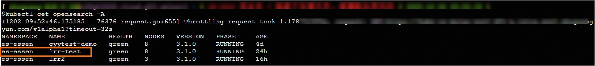

   - 方式二

     ```text
     PUT _cluster/settings
     {
       "persistent": {
         "cluster.remote.test01.seeds": ["10.XX.XX.83:9300"]
       }
     }
     ```

     其中， `seeds` 内容的拼写方式需要严格按照 `<`主集群的节点`IP:9300>` 格式进行拼写。 示例： `10.XX.XX.83:9300` 。

     您可以登录OPS1机器，执行以下命令，获取主集群的节点IP。

     ```bash
     kubectl  get pod -nes-essen -owide | grep $<主集群名称>
     ```

     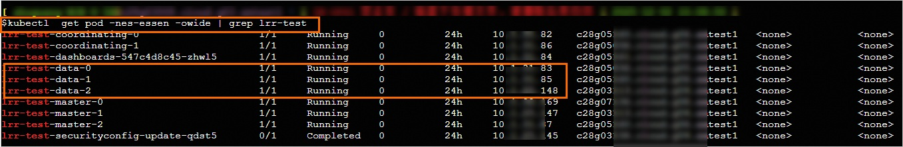

2. 执行以下命令，在从集群上开启指定索引（本文示例是 `hotels-index-bak` ）的复制任务。

   ```text
   PUT _plugins/_replication/hotels-index-bak/_start
   {
     "leader_alias": "test01",
      "leader_index": "hotels-index",
      "use_roles":{
         "leader_cluster_role": "all_access",
         "follower_cluster_role": "all_access"
      }
   }
   ```

   | 关键字段 | 说明 | 本文示例值 |
   | --- | --- | --- |
   | leader_alias | 远程仓库名。 | <code>test01</code> |
   | leader_index | 主集群上要被复制的索引。 | <code>hotels-index</code> |
   | use_roles | 跨集群复制功能的角色，与security插件有关。 | <code>all_access</code> |

   4. **查看从集群特定索引的复制状态**

在从集群的OpenSearch Dashboards控制台上，执行以下命令，查看指定索引（本文示例是 `hotels-index-bak` ）的复制状态。

```text
GET _plugins/_replication/hotels-index-bak/_status?pretty
```

输出结果如下所示，则表示复制状态正常。

```json
{
  "status": "SYNCING",
  "reason": "User initiated",
  "leader_alias": "test01",
  "leader_index": "hotels-index",
  "follower_index": "hotels-index-bak",
  "syncing_details": {
    "leader_checkpoint": 0,
    "follower_checkpoint": 0,
    "seq_no": 1
  }
}
```

**相关操作**

- 在从集群上暂停复制任务

  ```text
  POST /_plugins/_replication/$<follower-index>/_pause
  {}
  ```

- 在从集群上恢复复制任务

  ```text
  POST /_plugins/_replication/$<follower-index>/_resume
  {}
  ```

- 在从集群上终止（删除） 复制任务 （无法恢复）

  ```text
  POST /_plugins/_replication/$<follower-index>/_stop
  {}
  ```

- 查看集群中作为跨集群复制（CCR）源端的索引状态

  ```text
  GET /_plugins/_replication/leader_stats
  ```

- 查看集群中作为跨集群复制（CCR）目的端的索引状态

  ```text
  GET /_plugins/_replication/follower_stats
  ```

**常见问题**

正常情况下，创建集群后您的主、从集群的每个节点中会包含remote_cluster_client角色。

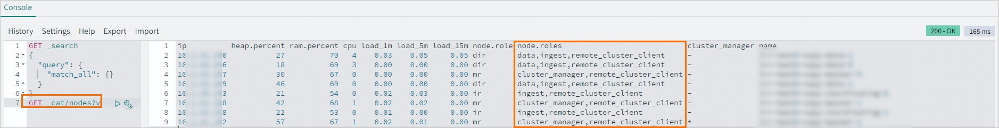

如果节点角色不包含remote_cluster_client角色，可通过**Elasticsearch运维控制台 > 集群运维 > 配置修改**，在**elasticsearch.yml**区域添加 `node.roles: '["data", "cluster_manager", "remote_cluster_client"]'` 。


<a id="section-8-3"></a>

## 8.3. Kibana插件使用

<a id="section-8-3-1"></a>

### 8.3.1. 使用angular-elastic-builder插件构建查询条件

本文介绍使用Elasticsearch的angular-elastic-builder插件，通过在Kibana中拼接查询条件，实现可视化数据查询的方法。目前仅Elasticsearch 6.7和6.8版本支持该功能。

**前提条件**

已安装angular-elastic-builder插件，具体操作请参见插件配置。

**操作步骤**

1. 进入目标Elasticsearch集群的Kibana控制台。

   登录控制台的具体步骤请参见登录Kibana控制台。

   > **说明**
   >
   > 本文操作以Elasticsearch 6.8版本为例，其他版本操作可能略有不同，请以实际界面为准。

2. 选择**Discover > Query**。

   > **重要**
   >
   > 在查询前，请确保您已经创建了一个索引模式。否则需要在Kibana控制台中，选择**Management**，再单击Kibana模块中的**Index Patterns > Create index pattern**，按照提示创建一个索引模式。

3. 在查询区域选择查询和过滤条件。

   单击查询区域的  添加一个查询条件；单击  为查询添加一个子过滤条件；单击  删除一个查询或过滤

   条件。

   查询示例如下图，该示例查询了user为kimchy，并且message中包含了tweet或者Elasticsearch关键词的数据。

   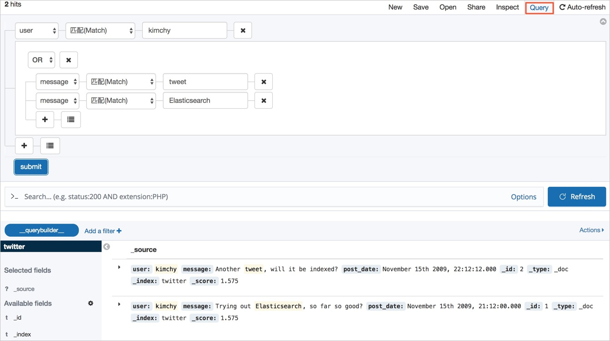

4. 单击**submit**。

<a id="section-8-3-2"></a>

### 8.3.2. 使用alerting插件实现集群告警

本文介绍如何通过Kibana的Alerting插件配置集群告警、自定义阈值与触发条件，并在条件满足时自动发送告警通知。目前仅Elasticsearch 6.8及以上版本支持该功能。

**前提条件**

已安装opendistro-alerting插件，具体操作请参见插件配置。

**操作步骤**

1. 进入目标Elasticsearch集群的Kibana控制台。

   登录控制台的具体步骤请参见登录Kibana控制台。

2. 在左侧导航栏，单击**Alerting**，再单击**Monitors**页签。

3. 在**Monitors**页面，单击**Create Monitor**。

   

4. 在**Create Monitor**页面，输入Monitor配置。

   

   以上实例设置Monitor名称为error_monitor01，每分钟运行一次。

5. 定义Monitor。

   Elasticsearch支持使用可视化图像和特定查询语句定义Monitor。

   - 可视化图像定义Monitor：需要选择**index**和**Time field**。

   - 特定查询条件定义Monitor（本文以此为例）：需要选择**index**并输入查询条件，完成后可单击**Run**，查看运行结果。

     查询条件示例如下，表示查询message中包含error关键字的数据。

     

     ```json
     {
         "size": 1,
         "query": {
             "match": {
                 "message":"error"
             }
         }
     }
     ```

6. 单击**Create**，在**Create Trigger**页面定义并配置告警触发器。

   

   | 参数 | 描述 |
   | --- | --- |
   | Trigger name | 触发器名称。 |
   | Severity level | 触发器的严重级别。 |
   | Extraction query response | 查询响应结果，是您告警定义中配置的查询请求的响应结果，不可修改。 |
   | Trigger condition | 告警触发的条件，可根据业务需求进行修改，例如<code> ctx.results[0].hits.total &gt; 0 </code>表示，当查询结果的数量大于0时，触发告警。 |

7. 配置告警通知。

   在**Configure Actions**中可配置告警通知，需要输入通知的名称、通知的目标地址以及通知的信息。

   

   | 参数 | 描述 |
   | --- | --- |
   | Action name | 通知的名称。 |
   | Destination name | 通知的目标地址，通常是一个URL地址。 |
   | Message | 通知的内容，可根据具体需求进行修改。 |
   | Message preview | 预览通知，不可修改。 |

8. 单击**Create**，完成创建。然后返回**Dashbord**页面，查看创建成功的告警。

   

<a id="section-9"></a>

# 9.Elasticsearch MCP Server

Elasticsearch基于MCP协议，支持通过飞天助理-托管模式调用API获取实例信息，也可通过自行部署MCP Server方式实现查询，助力用户打造自然语言驱动的数据查询Agent，实现从提问到可视化的智能数据处理全流程。

**支持MCP模式**

- 飞天助理-托管模式

  飞天助理托管模式开箱即用，无需用户配置，可以直接通过大模型访问。

- 自行部署MCP Server

  用户可以在应用、智能体或AI中自行部署。

**飞天助理-托管模式**

> **说明**
>
> 使用飞天助理-托管模式前，请先参考**统一云管平台 > 飞天助理 用户指南**文档开启飞天助手。

1. 登录阿里云检索分析服务控制台。

2. 查看系统预设的MCP列表。

   在左侧导航栏选择**AI专栏 > MCP**，查看系统预设的MCP列表。当前系统预设工具如下：

   | 工具名称 | 调用接口 | 说明 |
   | --- | --- | --- |
   | 全局特性查询 | ListGlobalFeature s | 列出Elasticsearch服务中的全局特性。用户可总览ES产品服务全局性功能特性，有助于在业务中更合理应用特性。 |
   | 网络列表查询 | ListNetworkTypes | 列出Elasticsearch服务支持的网络类型。有助于用户合理选择网络访问类型接入VPC，合理构建业务访问的网络架构。 |
   | 存储类列表查询 | ListStorageClass | 提供了查询存储类的功能，支持按需筛选并返回存储类的相关信息。有助于用户优化存储成本，选择性能与成本平衡的存储方案。 |
   | CPU品牌查询 | ListCpubrands | 获取当前Elasticsearch服务支持的CPU品牌及其相关信息。用户可查看集群支持的CPU类型，有助于选择合适的芯片类型针对性规划业务。 |
   | 部署架构查询 | ListDeploymentAr chs | 获取Elasticsearch服务的部署架构详情。可查看支持部署的可用区以及可用区内的各实例节点部署信息，为运维管理提供信息支持。 |
   | 版本列表查询 | ListEsVersions | 列出Elasticsearch支持的版本信息。总览支持的引擎版本，用户可选择适合业务的、喜好的引擎版本。 |
   | 可用区查询 | ListZones | 列出指定区域的可用区信息。用户可查看支持的可用区信息，有助于选择合适的可用区创建容灾或非容灾实例。 |
   | 实例快照仓库信息查询 | GetSnapshotRep oInfo | 获取Elasticsearch快照仓库的详细信息。用户可查看备份数据的快照仓库的路径、bucket、AK等详情。 |
   | 快照仓库列表查询 | ListSnapshotRep oInfos | 获取Elasticsearch快照仓库的详细信息列表。用户可查看快照仓库列表，有助于用户管理快照仓库与存储策略。 |
   | Pod信息查询 | GetElasticsearch PodInfo | 获取指定Elasticsearch实例下的Pod信息。用户可查看指定实例的K8s Pod 的状态信息，方便快速确定POD健康度。 |
   | Pod日志查询 | GetElasticsearch PodLogs | 获取指定Elasticsearch实例中Pod的日志记录。用户可查看指定实例的K8s Pod 的日志，有助于通过日志定位 Pod异常原因，快速修复问题。 |
   | Kibana插件查询 | ListKibanaPlugins | 列出指定Elasticsearch实例上的Kibana插件。用户可查看指定实例的 Kibana 插件特性，以满足用户多样化的数据可视化和分析需求。 |
   | 实例列表查询 | ListInstance | 检索分析服务 Elasticsearch版 - 列出Elasticsearch实例。方便用户查看和管理实例。 |
   | 节点列表查询 | ListAllNode | 获取指定Elasticsearch实例的节点及其运行状态。方便用户查看指定实例下节点（包含数据节点、专有主节点、协调节点、Kibana节点）以及健康状态，快速定位异常节点。 |
   | 可用规格查询 | ListAvailiableSpe cs | 查询Elasticsearch服务支持的节点规格信息。方便用户查看指定节点类型所支持的规格列表信息。 |
   | 字典信息查询 | ListDictInformatio n | 查询Elasticsearch实例中的字典信息。有助于用户查询指定实例下的词典信息。 |
   | 字典列表查询 | ListDicts | 检索并列出Elasticsearch实例中的字典资源。帮助用户快速查看指定实例已配置的字典列表，便于用户做词典管理。 |
   | 插件列表查询 | ListPlugins | 列出指定Elasticsearch实例中的插件列表。方便用户管理与总览指定实例中插件列表。 |
   | 快照列表查询 | ListSnapshots | 列出指定Elasticsearch实例的快照。用户可查看指定实例的快照列表与状态，有助于优化快照管理。 |
   | 安全配置详情列表查询 | ListUserSecurityI nfo | 获取指定Elasticsearch实例的安全配置详情。用户可查看指定实例下用户的安全配置信息。 |
   | 实例健康状态查询 | DescribeElasticse archHealth | 查询指定Elasticsearch实例的健康状态。用户可查看指定实例的集群健康状态，有助于用户及时发现实例异常问题。 |
   | 实例详细信息查询 | DescribeInstance | 查询Elasticsearch实例的详细信息。用户可查看指定实例的配置、实例状态、芯片类型、网络类型以及节点信息等，有助于用户对实例的监控运维管理。 |
   | 实例快照配置查询 | DescribeSnapsho tSetting | 查询Elasticsearch实例的快照配置详情。用户可查看指定实例的快照配置、备份策略等信息，有助于用户优化数据备份管理。 |
   | 实例插件配置文件查询 | GetConfigFiles | 获取指定Elasticsearch实例中插件的配置文件。用户可查看指定插件的配置信息，有助于用户使用与管理插件。 |
   | 实例配置详情查询 | GetElasticsearch Settings | 查询Elasticsearch实例的当前配置详情。用户可查看指定实例的配置参数设置值，以方便调整参数值，优化集群性能。 |

3. 使用飞天助理调用预设工具。

   <ol type="i">

   <li>

   在页面顶部单击工具栏中的  图标，进入**飞天助理**页。

   </li>

   <li>

   在对话框底部单击  图标，打开**MCP**开关，单击  图标进入**选择 MCP**页面。

   </li>

   <li>

   选择已有的Elasticsearch MCP（**检索分析服务 Elasticsearch版**）。

   </li>

   <li>

   单击**确定**，返回对话框，使用自然语言描述查询内容，例如“查询实例列表”。

   </li>

   <li>

   单击右侧的  图标发送并执行指令信息。

   </li>

   <li>

   等待任务执行结束，您可查看返回的结果信息。

   </li>

   </ol>

**自行部署MCP Server**

1. 下载MCP服务包。

2. 部署在ECS、容器或云外服务器。

3. 集成至应用或智能体：将MCP作为后端服务嵌入AI应用、智能体（Agent）或RPA流程中。

4. 通过RESTful API调用MCP功能。
