阿里云  
专有云  
检索分析服务Elasticsearch版  
运维指南  
产品版本：V3.18.6  
文档版本：20260429

**目录**

- [1.登录检索分析服务运维控制台](#section-1)
- [2.实例管理](#section-2)
    - [2.1. 实例列表](#section-2-1)
    - [2.2. 创建实例](#section-2-2)
    - [2.3. 查看实例基本信息](#section-2-3)
    - [2.4. 登录Kibana控制台](#section-2-4)
    - [2.5. 登录Dashboards控制台](#section-2-5)
    - [2.6. 备份与恢复](#section-2-6)
        - [2.6.1. 快照备份](#section-2-6-1)
        - [2.6.2. 快照恢复](#section-2-6-2)
    - [2.7. 插件管理](#section-2-7)
        - [2.7.1. 安装、更新及卸载插件](#section-2-7-1)
        - [2.7.2. 修改配置](#section-2-7-2)
    - [2.8. 集群运维](#section-2-8)
        - [2.8.1. 版本升级](#section-2-8-1)
        - [2.8.2. 安全设置](#section-2-8-2)
        - [2.8.3. 规格配置](#section-2-8-3)
        - [2.8.4. 配置修改](#section-2-8-4)
        - [2.8.5. 部署方式升级](#section-2-8-5)
- [3.平台管理](#section-3)
    - [3.1. 仓库管理](#section-3-1)
    - [3.2. 插件管理](#section-3-2)
        - [3.2.1. 支持的插件列表](#section-3-2-1)
            - [3.2.1.1. Elasticsearch插件](#section-3-2-1-1)
            - [3.2.1.2. Kibana插件](#section-3-2-1-2)
            - [3.2.1.3. Opensearch插件](#section-3-2-1-3)
            - [3.2.1.4. Dashboard插件](#section-3-2-1-4)
        - [3.2.2. 上传、更新及删除插件](#section-3-2-2)
    - [3.3. 资源管理](#section-3-3)
    - [3.4. 可用区配置](#section-3-4)
    - [3.5. 操作管控](#section-3-5)
    - [3.6. 基准测试](#section-3-6)
- [4.日志与监控](#section-4)
    - [4.1. 查看日志](#section-4-1)
    - [4.2. 查看ElasticSearch监控指标](#section-4-2)
    - [4.3. 查看Elasticsearch的Granfana监控大盘](#section-4-3)
    - [4.4. 实例监控告警](#section-4-4)
    - [4.5. 运维平台默认监控告警](#section-4-5)
- [5.常见问题处理](#section-5)
    - [5.1. 可用类问题](#section-5-1)
        - [5.1.1. 集群状态异常](#section-5-1-1)
        - [5.1.2. 业务请求异常](#section-5-1-2)
        - [5.1.3. 变更配置异常](#section-5-1-3)
        - [5.1.4. 反亲和性导致集群状态异常](#section-5-1-4)
        - [5.1.5. 白屏功能异常](#section-5-1-5)
    - [5.2. 性能类问题](#section-5-2)
        - [5.2.1. 查询慢](#section-5-2-1)
        - [5.2.2. 写入慢](#section-5-2-2)
        - [5.2.3. CPU使用率高](#section-5-2-3)
        - [5.2.4. heap使用率高](#section-5-2-4)
        - [5.2.5. load负载高](#section-5-2-5)
    - [5.3. 使用类问题](#section-5-3)
        - [5.3.1. 创建实例问题](#section-5-3-1)
        - [5.3.2. 查看实例的基本信息和监控信息](#section-5-3-2)
        - [5.3.3. 配置analysis-ik词典](#section-5-3-3)

<a id="section-1"></a>

# 1.登录检索分析服务运维控制台

本文介绍运维工程师等相关用户如何登录到检索分析服务运维系统。

**前提条件**

已从部署人员或管理员处获取Apsara Uni-manager运维控制台的访问地址、用户名和密码。

Apsara Uni-manager运维控制台访问地址格式为*region-id*.ops.console.*intranet-domain-id*。

**注意事项**

- 推荐使用Chrome浏览器。

- 不建议使用部署后自带的在elasticsearch命名空间的elasticsearch-cluster实例，该实例在产品升级过程中不能保证业务持续，如果已经在使用建议将数据迁移到别的实例。

**操作步骤**

1. 打开浏览器。

2. 在地址栏中，输入Apsara Uni-manager运维控制台的访问地址 `region-id.aso.intranet-domain-id.com` ，按回车键。

   

   > **说明**
   >
   > 您可以单击右上角的当前语言切换其它语言。当前支持简体中文、英文、繁体中文三种语言切换。

3. 输入正确的用户名及密码。

   > **说明**
   >
   > - 登录Apsara Uni-manager运维控制台的用户名和密码请从部署人员或管理员处获取。
   >
   > - 若连续输入密码错误三次，系统将启动图片验证码登录功能；若连续输入错误五次，账户将被锁定，请联系管理员进行激活。

   首次登录Apsara Uni-manager运维控制台时，需要修改登录用户名的密码，请按照提示完成密码修改。

   为提高安全性，密码必须满足以下要求：

   - 必须包含英文大小写字母。

   - 必须包含阿拉伯数字（0~9）。

   - 必须包含特殊符号，包括感叹号（!）、at（@）、井号（#）、美元符号（$）、百分号（%）等。

   - 密码长度为10~20个字符。

4. 单击**账号登录**。

5. 在顶部菜单栏，选择**产品运维 > 大数据运维 > 检索分析服务运维控制台**，进入**Elasticsearch运维控制台。**

<a id="section-2"></a>

# 2.实例管理

<a id="section-2-1"></a>

## 2.1. 实例列表

Elasticsearch实例创建完成后，您可以在实例列表中查看所有实例的基本信息。

登录检索分析服务运维控制台，系统直接进入**实例管理**页面。在**实例管理**页面的实例列表中，您可以查看所有实例，并完成以下操作：

- 查询或筛选实例：当您有大量实例时，可根据**实例ID**、**客户ID**、**实例类型**和**namespace**筛选实例。

- 管理namespace：单击**namespace**右侧的**管理**，可删除不必要的namespace。

- 查看实例的基本信息：包括实例ID、状态、集群健康度、版本、实例类型、数据节点数、客户ID、namespace等信息，具体以界面显示为准。

- 删除实例：在右侧**操作**列下，单击**删除**，确认后即可删除实例。

  > **警告**
  >
  > 实例删除后，相关数据会被清空，实例不可恢复，请谨慎操作。

<a id="section-2-2"></a>

## 2.2. 创建实例

建议优先选择用户侧控制台创建实例，当存在用户侧控制台不支持的创建场景时，例如测试集群使用的规格较小、或使用非推荐版本等，经运维评估风险可控后，则可以通过运维侧控制台进行创建。本文介绍通过运维侧控制台创建Elasticsearch实例的方法。

> **说明**
>
> 通过用户侧控制台创建实例的具体操作，请参见<strong>《Elasticsearch用户指南》</strong>中的<strong>《创建实例》</strong>章节。

**创建elasticsearch类型的实例**

1. 登录检索分析服务运维控制台。

2. 在实例管理页面，单击**创建实例**，在弹出的对话框中单击**确定**。

3. 选择实例类型为**elasticsearch**。

4. 在**基础配置**中，选择部署方式、可用区、芯片架构和版本，单击**下一步**。

   > **说明**
   >
   > 建议使用7.10.0和6.8.13版本。

5. 按照以下说明，选择或填入集群的配置信息，然后单击**下一步**。

   <table>
     <tr>
       <th width="166">参数</th>
       <th>描述</th>
     </tr>
     <tr>
       <td>客户ID</td>
       <td>用户所在组织的UID。 可通过以下步骤获取：<br>i. 登录Apsara Uni-manager控制台，单击<strong>企业</strong>。ii. 在<strong>组织管理</strong>页面，单击对应组织。iii. 在组织列表右侧，单击对应组织右侧的<strong>管理Accesskey</strong>。iv. 在<strong>管理AccessKey</strong>页面，获取组织的<strong>UID</strong>。</td>
     </tr>
     <tr>
       <td>namespace</td>
       <td>Elasticsearch集群的命名空间。由系统生成，不可更改。</td>
     </tr>
     <tr>
       <td>集群名称</td>
       <td>自定义输入。</td>
     </tr>
     <tr>
       <td>实例规格</td>
       <td>单击<strong>修改</strong>，可修改各类型节点的资源配置。<br>说明建议在生产集群设置独立的专有主节点和协调节点。<br>下面以数据节点为例，说明节点的参数配置：<br>• 资源限制：当前节点需要使用的资源量。<br>• 存储类型：节点所使用的磁盘类型，支持3种类型：fast-disks为HDD盘、fast-disks-ssd为SSD盘、yoda-lvm为共享盘。<br>• 主节点可使用yoda-lvm存储优化资源利用率。<br>• 除日志场景外，均建议采用SSD盘存储数据。<br>• 数据节点使用yoda-lvm存储存在较高风险，不建议使用，请谨慎选择。<br>• 节点数量：默认启用，不可更改。表示集群中需要有几个节点。 数据节点数量默认为3个，支持更改。<br>说明未开启专有主节点时，集群仅配置2个数据节点会有脑裂风险，可能引发服务不可用，暂不支持选择。<br>• 单节点存储空间：集群中每个节点的存储空间。设置后，系统会根据您指定的存储空间大小为每个数据节点分配一块满足要求的本地盘，创建后集群的规格与单盘大小相关，暂不支持共享和扩容。<br>• 是否需要完全打散：完全打散可以规避一台物理机中存在多个ES数据节点的情况，提高可用性。但当物理机数量小于数据节点个数时，将无法完成创建，请结合业务场景和平台规划选择。<br>• JVM配置：单击图标，按需补充该配置。示例：<code> -</code><br><code>XX:InitiatingHeapOccupancyPercent=45 </code>。</td>
     </tr>
     <tr>
       <td>插件配置</td>
       <td>选择在创建集群时，需要安装的Elasticsearch和Kibana插件。</td>
     </tr>
     <tr>
       <td>elasticsearch.yml</td>
       <td>自定义设置Elasticsearch集群的YML配置文件。该文件使用YAML标记语言，格式为<code> key: value </code>，冒号（<code> : </code>）后面要有一个空格。</td>
     </tr>
     <tr>
       <td>kibana.yml</td>
       <td>自定义设置Kibana集群的YML配置文件。<br>说明开启Kibana节点时，才会展示和配置Kibana集群的YML配置文件。</td>
     </tr>
   </table>

6. 单击**下一步**，进行网络及系统配置。

   <table>
     <tr>
       <th width="90">参数</th>
       <th>描述</th>
     </tr>
     <tr>
       <td>网络类型</td>
       <td>• 专有网络（single tunnel）：专有网络VPC和虚拟交换机VSwitch所属组织需要与客户ID对应。<br>• 专有网络（any tunnel）：非必要不使用anytunnel网络类型。<br>说明网络类型默认支持IPv4。如果需要使用产品的IPv4/IPv6双栈能力，请确保当前局点已经开启了IPv4/IPv6双栈能力的总开关，然后联系阿里云技术支持修改集群配置文件，将 <code> .spec.parameters </code> 中的 <code> vip_protocols </code> 和 <code> elasticsearch.vip_protocols </code> 的参数值修改为 <code> ipv4+ipv6 </code>，并触发集群Rolling以完成配置应用。</td>
     </tr>
     <tr>
       <td>账号</td>
       <td>• elastic：默认账号，不可更改，用来访问Elasticsearch和登录Kibana。<br>• monitoring_collector：管控服务所用账号，部分管控功能依赖此账号。<br>说明密码设置规则：<br>• 同时包含大写字母、小写字母、数字和特殊字符中的三种。支持的特殊字符包括：!@#$%^&amp;*()_+-=。<br>• 长度为12~32位。</td>
     </tr>
   </table>

7. 单击**开始创建**。

   创建成功后，系统直接返回**实例管理**页面。查看实例状态，等待状态变为正常。

   > **说明**
   >
   > 在使用实例前需要先设置白名单，否则可能会遇到监控数据无法正常采集，Kibana无法登录等问题。具体操作，请参见集群运维。

**创建opensearch类型的实例**

1. 登录检索分析服务运维控制台。

2. 在实例管理页面，单击**创建实例**，在弹出的对话框中单击**确定**。

3. 选择实例类型为**opensearch**。

4. 在**基础配置**中，选择部署方式、可用区、芯片架构和版本，单击**下一步**。

   > **说明**
   >
   > 目前opensearch类型的实例部署方式只支持单可用区。

5. 按照以下说明，选择或填入集群的配置信息，然后单击**下一步**。

   <table>
     <tr>
       <th width="119">参数</th>
       <th>描述</th>
     </tr>
     <tr>
       <td>客户ID</td>
       <td>用户所在组织的UID。 可通过以下步骤获取：<br>i. 登录Apsara Uni-manager控制台，单击<strong>企业</strong>。ii. 在<strong>组织管理</strong>页面，单击对应组织。iii. 在组织列表右侧，单击对应组织右侧的<strong>管理Accesskey</strong>。iv. 在<strong>管理AccessKey</strong>页面，获取组织的<strong>UID</strong>。</td>
     </tr>
     <tr>
       <td>namespace</td>
       <td>Elasticsearch集群的命名空间。由系统生成，不可更改。</td>
     </tr>
     <tr>
       <td>集群名称</td>
       <td>自定义输入。</td>
     </tr>
   </table>

   <table>
     <tr>
       <td>实例规格</td>
       <td>单击<strong>修改</strong>，可修改各类型节点的资源配置。<br>说明建议在生产集群设置独立的专有主节点和协调节点。<br>下面以数据节点为例，说明节点的参数配置：<br>• 资源限制：当前节点需要使用的资源量。<br>• 存储类型：节点所使用的磁盘类型，支持3种类型：fast-disks为HDD盘、fast-disks-ssd为SSD盘、yoda-lvm为共享盘。<br>• 主节点可使用yoda-lvm存储优化资源利用率。<br>• 除日志场景外，均建议采用SSD盘存储数据。<br>• 数据节点使用yoda-lvm存储存在较高风险，不建议使用，请谨慎选择。<br>• 节点数量：默认启用，不可更改。表示集群中需要有多少个节点。 数据节点数量默认为3个，支持更改。<br>说明未开启专有主节点时，集群仅配置2个数据节点会有脑裂风险，可能引发服务不可用，暂不支持选择。<br>• 单节点存储空间：集群中每个节点的存储空间。设置后，系统会根据您指定的存储空间大小为每个数据节点分配一块满足要求的本地盘，创建后集群的规格与单盘大小相关，暂不支持共享和扩容。<br>• 是否需要完全打散：完全打散可以规避一台物理机中存在多个ES数据节点的情况，提高可用性。但当物理机数量小于数据节点个数时，将无法完成创建，请结合业务场景和平台规划选择。<br>• JVM配置：单击图标，按需补充该配置。示例：<code> -</code><br><code>XX:InitiatingHeapOccupancyPercent=45 </code>。</td>
     </tr>
     <tr>
       <td>插件配置</td>
       <td>选择在创建集群时，需要安装的Opensearch和Dashboard插件。</td>
     </tr>
     <tr>
       <td>opensearch.yml</td>
       <td>自定义设置opensearch集群的YML配置文件。该文件使用YAML标记语言，格式为<code> key: value </code>，冒号（<code> : </code>）后面要有一个空格。</td>
     </tr>
     <tr>
       <td>dashboard.yml</td>
       <td>自定义设置dashboard集群的YML配置文件。<br>说明开启dashboard节点时，才会展示和配置dashboard集群的YML配置文件。</td>
     </tr>
   </table>

6. 单击**下一步**，进行网络及系统配置。

   <table>
     <tr>
       <th width="90">参数</th>
       <th>描述</th>
     </tr>
     <tr>
       <td>网络类型</td>
       <td>• 专有网络（single tunnel）：专有网络VPC和虚拟交换机VSwitch所属组织需要与客户ID对应。<br>• 专有网络（any tunnel）：非必要不使用anytunnel网络类型。<br>说明网络类型默认支持IPv4。如果需要使用产品的IPv4/IPv6双栈能力，请确保当前局点已经开启了IPv4/IPv6双栈能力的总开关，然后联系阿里云技术支持修改集群配置文件，将 <code> .spec.parameters </code> 中的 <code> vip_protocols </code> 和 <code> elasticsearch.vip_protocols </code> 的参数值修改为 <code> ipv4+ipv6 </code>，并触发集群Rolling以完成配置应用。</td>
     </tr>
     <tr>
       <td>账号</td>
       <td>• admin：默认账号，不可更改，用来访问Opensearch和登录Dashboard。<br>• monitoring_collector：管控服务所用账号，部分管控功能依赖此账号。<br>说明密码设置规则：<br>• 同时包含大写字母、小写字母、数字和特殊字符中的三种。支持的特殊字符包括：!@#$%^&amp;*()_+-=。<br>• 长度为12~32位。</td>
     </tr>
   </table>

7. 单击**开始创建**。

   创建成功后，系统直接返回**实例管理**页面。查看实例状态，等待状态变为正常。

<a id="section-2-3"></a>

## 2.3. 查看实例基本信息

通过查看实例的基本信息，您可以获取实例的状态和访问地址、Kibana（或者Dashboard）访问地址、实例配置等信息，本文介绍具体的操作方法。

**前提条件**

已创建实例，详情请参见创建实例。

**操作步骤**

1. 登录检索分析服务运维控制台。

2. 在左侧导航栏，单击**实例管理**。

3. 在**实例管理**页面，单击目标**实例ID**。

4. 在**基本信息**页面，查看实例的基本信息。

   **基本信息**页面展示了实例的类型、健康度、芯片架构、版本、部署方式、创建时间、网络信息、集群管理入口、访问地址、域名实际IP地址和端口号等信息，当您需要访问实例时，可使用这些信息。页面中还展示了实例中各类型节点的配置和集群可视化，方便您了解实例的配置情况，与具体的业务结合来判断是否需要升降配。

<a id="section-2-4"></a>

## 2.4. 登录Kibana控制台

阿里云Elasticsearch提供Kibana控制台为您的业务提供扩展的可能性。Kibana控制台作为Elastic生态系统的组成部分，提供无缝衔接Elasticsearch服务，让您实时了解您实例的运行状态，并对实例进行管理。本文介绍登录Kibana控制台的方法。

**前提条件**

- elasticsearch实例状态正常，且已开启Kibana节点。

- 有允许登录Kibana的账号，并且设置了白名单。具体操作，请参见安全设置。

**操作步骤**

1. 登录检索分析服务运维控制台。

2. 在左侧导航栏，单击**实例管理**。

3. 在**实例管理**页面，单击目标**实例ID**。

4. 在**基本信息**页面，单击**集群管理**右侧的**Kibana**。

5. 在Kibana控制台登录页面，输入用户名和密码，单击**Log In**。

   > **说明**
   >
   > 默认用户名为elastic，密码为您创建实例时设置的密码。

6. 单击左上角的

   图标，选择**Management > Dev Tools**，进入**Console**界面。

   

<a id="section-2-5"></a>

## 2.5. 登录Dashboards控制台

OpenSearch Dashboards控制台是OpenSearch生态系统中的核心可视化与交互工具，提供基于Web的用户界面，用于查询、分析、可视化和管理存储在 OpenSearch集群中的数据。通过丰富的图表、仪表盘、日志浏览及告警等功能，用户可高效地探索数据、监控系统状态并生成洞察。本文介绍如何登录OpenSearch Dashboards控制台。

**前提条件**

OpenSearch实例状态正常，且已开启Dashboard节点。

**操作步骤**

1. 登录检索分析服务运维控制台。

2. 在左侧导航栏，单击**实例管理**。

3. 在**实例管理**页面，单击目标**实例ID**。

4. 在**基本信息**页面的**集群管理**右侧，单击**Dashboard**。

5. 输入用户名和密码，单击**Log In**。

   > **说明**
   >
   > 默认用户名为admin，密码为您创建实例时设置的密码。

6. 单击左上角的

   图标，选择**Management > Dev Tools**，进入**Console**界面。

   

<a id="section-2-6"></a>

## 2.6. 备份与恢复

<a id="section-2-6-1"></a>

### 2.6.1. 快照备份

通过快照备份功能，您可以进行自动备份设置和手动执行快照备份。

**前提条件**

已创建实例，且实例状态为正常，详情请参见创建实例。

**注意事项**

定时备份会占用一定的CPU、内存资源以及磁盘空间，从而影响集群性能。

**操作步骤**

1. 登录检索分析服务运维控制台。

2. 在左侧导航栏，单击**实例管理**。

3. 在**实例管理**页面，单击目标**实例ID**。

4. 在左侧导航栏，选择**快照备份 > 自动备份**。

5. 在**自动备份**页面，选择一个仓库并单击**保存仓库配置**。

   如果当前没有可选择的仓库，需要先在平台管理中添加仓库，具体操作请参见添加仓库。

6. 单击**修改设置**，在对话框中选择自动备份的时间间隔、备份周期和时间，单击**确定**。

   > **重要**
   >
   > - 集群首次快照备份是集群数据的完整备份，执行时间视具体数据量而定，建议快照备份时间选择在业务低峰期。
   >
   > - 定时备份过程会降低集群的查询和写入性能，因此需要合理设置备份的频率和时间段，不建议间隔时间过短。

   确定后，系统会按照您设置的备份周期自动备份数据。如果您想立刻备份数据，可单击**马上备份**。

   自动备份完成后，您还可以通过单击**关闭自动备份**关闭该功能，再次开启时需要重新关联仓库，但是已产生的备份记录不会受到影响。此外，您还可以对备份的快照进行查询和刷新列表的操作。

   > **说明**
   >
   > 快照列表会自动清理自动备份记录，清理逻辑为定时每小时1次的自动清理，保留最新的10次记录。手动备份（即手动单击**马上备份**）的记录不会被自动清理。

<a id="section-2-6-2"></a>

### 2.6.2. 快照恢复

通过快照恢复功能，您可以一键实现Elasticsearch（简称ES）数据的快照备份恢复，适用于自动备份快照恢复和手动备份快照恢复。该功能支持恢复来自其他ES集群的快照数据。

**操作步骤**

1. 登录检索分析服务运维控制台。

2. 在左侧导航栏，单击**实例管理**。

3. 在**实例管理**页面，单击目标**实例ID**。

4. 在左侧导航栏，选择**快照备份 > 快照恢复**。

5. 在**快照恢复**页面，配置需要恢复的快照。

   <table>
     <tr>
       <th width="116">参数</th>
       <th>说明</th>
     </tr>
     <tr>
       <td>Bucket</td>
       <td>OSS中保存集群备份快照的Bucket。可以通过<code> GET _snapshot </code>查看。</td>
     </tr>
     <tr>
       <td>存储路径</td>
       <td>Bucket中存放集群备份快照的路径。例如，<code> snapshot/gyytest-</code><code>buxuyao.es-essen/ </code>。可以通过<code> GET _snapshot </code>查看。</td>
     </tr>
     <tr>
       <td>快照ID</td>
       <td>需要恢复的快照ID。执行快照后，会有快照ID。</td>
     </tr>
     <tr>
       <td>Access Key</td>
       <td>所在阿里云账号的AccessKey ID。</td>
     </tr>
     <tr>
       <td>Secret Key</td>
       <td>所在阿里云账号的AccessKey Secret。</td>
     </tr>
     <tr>
       <td>高级参数</td>
       <td>指定快照中需要恢复的索引，参考es _restore语法，默认为{}。例如，恢复快照中指定的index1和index2两个索引。<br><code>{"indices":"index1,index2"}</code></td>
     </tr>
   </table>

6. 单击**恢复**。

<a id="section-2-7"></a>

## 2.7. 插件管理

<a id="section-2-7-1"></a>

### 2.7.1. 安装、更新及卸载插件

在使用插件前，请先安装插件。内置插件默认已安装。本文以非内置插件为例进行介绍。

**背景信息**

不同类型的实例支持不同的插件。

<table>
  <tr>
    <th>实例类型</th>
    <th>支持情况</th>
  </tr>
  <tr>
    <td rowspan="2">Elasticsearch类型实例</td>
    <td>Elasticsearch插件</td>
  </tr>
  <tr>
    <td>Kibana插件</td>
  </tr>
  <tr>
    <td rowspan="2">Opensearch类型实例</td>
    <td>Opensearch 插件</td>
  </tr>
  <tr>
    <td>Dashboard 插件</td>
  </tr>
</table>

**前提条件**

- 已创建实例，且实例状态为正常，详情请参见创建实例。

- 如果您使用的是elasticsearch类型的实例，则需要针对monitoring_collector开启白名单，详情请参见集群运维。如果您使用的是opensearch类型的实例，则无需设置。

**操作步骤**

1. 登录检索分析服务运维控制台。

2. 在左侧导航栏，单击**实例管理**。

3. 在**实例管理**页面，单击目标**实例ID**。

4. 在左侧导航栏，选择**插件管理 > Elasticsearch插件**。

   > **说明**
   >
   > 本文以Elasticsearch插件为例，其他类型的插件与之类似。

5. 安装或者更新插件。

   - 安装插件

     如果当前页面中存在大量插件，您可以根据插件名称搜索插件，快速定位到目标插件。系统支持模糊匹配。

     - 安装一个插件：在目标插件右侧的**更新**栏下，单击**安装**。

     - 一次性安装多个插件：选择多个插件，单击**批量安装**。

     > **警告**
     >
     > 安装插件会触发集群重启，请确认后操作。

   - 更新插件

     如果当前插件存在新版本，则系统会自动在**可更新插件版本**列下展示出新版本号。当您需要将当前插件更新至新版本时，单击目标插件右侧的**更新**按钮。

6. 单击**确定。**

7. 按需选择集群重启方式，单击**确定**。

   - 安装插件确定后，集群会进行重启，重启成功后即可完成插件的安装。

   - 更新插件确定后，集群实际没有重启，还需要您手动单击右上角的**重启**按钮。待重启完成后，**插件版本**列的信息会展示为新版本号。

   您也可以使用同样的方式，在其他插件页面安装或者更新。插件安装或者更新成功后，如果不再需要，可单击**卸载**或**批量卸载**，卸载对应插件。

   > **说明**
   >
   > 如果遇到插件安装或者更新失败，可联系运维人员处理。

<a id="section-2-7-2"></a>

### 2.7.2. 修改配置

实例创建成功后，您可以修改内置插件的配置文件。本文介绍具体的操作方法。

**前提条件**

已创建实例，且实例状态为正常，详情请参见创建实例。

**操作步骤**

1. 登录检索分析服务运维控制台。

2. 在左侧导航栏，单击**实例管理**。

3. 在**实例管理**页面，单击目标**实例ID**。

4. 在左侧导航栏，单击**插件管理 > Elasticsearch插件**。

   > **说明**
   >
   > 本文以Elasticsearch插件为例，其他类型的插件与之类似。

5. 找到对应的内置插件，单击**修改配置**。

   > **警告**
   >
   > 修改插件的配置文件会触发集群重启，请确认后操作。

6. 单击**添加文件**。

7. 在**添加文件**对话框中，输入文件名，单击**确定**。

8. 单击已添加的文件，在右侧编辑框中，输入插件的配置信息。

   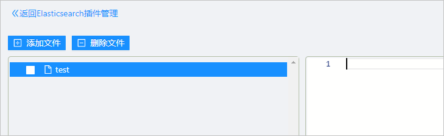

9. 单击**确定**，在对话框中再次单击**确定**。

0. 在**重启**对话框中，选择**重启方式**，单击**确定**。

   确定后，集群会进行重启，重启成功后，即可完成插件配置文件的修改。

<a id="section-2-8"></a>

## 2.8. 集群运维

<a id="section-2-8-1"></a>

### 2.8.1. 版本升级

本文介绍在集群运维时，如何对内核版本进行升级。

**前提条件**

已创建实例，且实例状态为正常，详情请参见创建实例。

**使用限制**

仅elasticsearch类型的实例支持该功能，opensearch类型的实例不支持。

**注意事项**

- 升级过程暂不支持回滚，建议升级前做好基础巡检和关键数据备份，不建议直接升级已安装并使用自定义插件的集群。

- 为减少升级对集群的影响，建议集群全部索引的副本数均大于1。

- 升级操作会触发集群镜像更新和重启，可能引起业务抖动，请在业务低峰期进行操作并及时关注集群监控。

**进入集群运维页面**

1. 登录检索分析服务运维控制台。

2. 在左侧导航栏，单击**实例管理**。

3. 在**实例管理**页面，单击目标**实例ID**。

4. 在左侧导航栏，单击**集群运维**。

**内核版本升级**

1. 集群运维。

2. 在左侧导航栏，单击**版本升级**。

3. 如果检测到当前实例有可升级的版本或内核镜像，单击**影响面分析**，查看具体需要升级的内容。

   如果检测到当前实例暂无可升级的版本或内核镜像，表示暂时没有可升级版本和内核镜像，您无需继续操作。

4. 单击**升级**。

5. 在弹出的对话框中，单击**确认**。

   升级完成后，集群状态显示正常，且实例版本和镜像版本都升级为最新版本。

<a id="section-2-8-2"></a>

### 2.8.2. 安全设置

安全设置支持一键开启HTTPS访问协议、修改ES端口号、管理VPC私网访问白名单、修改账号信息和查看证书信息。

**使用Https协议**

HTTPS（Hyper Text Transfer Protocol over Secure Socket Layer）是一种能够保障数据安全的HTTP通道，它是HTTP协议的安全版，通过在HTTP协议的基础上增加安全套接层SSL（Secure Sockets Layer）来保障数据传输的安全性。即HTTPS还是通过HTTP进行通信，只是传输的内容经过了SSL加密。为了保障您的数据安全，建议使用HTTPS协议。

> **重要**
>
> 目前elasticsearch类型的实例默认该功能关闭，建议手动开启；opensearch类型的实例默认已开启该功能，且不可关闭。

1. 进入集群运维页面。

2. 在左侧导航栏，单击**安全设置**。

3. 在**安全设置**页面，单击**Https协议**，按需打开该功能开关。

**修改ES端口号**

创建实例后，用户可以按需修改端口号。

1. 进入集群运维页面。

2. 在左侧导航栏，单击**安全设置**。

3. 在**安全设置**页面的**端口号**区域，输入期望的端口号，单击**修改**更新端口号。

   > **说明**
   >
   > 端口号默认显示为9200，修改成功后会有操作成功的提示信息并显示为预期的端口号。

**配置VPC私网访问白名单**

通过私网访问阿里云Elasticsearch（ES）实例时，需要先将待访问设备的IP地址加入实例的访问白名单中。如果遇到访问ES失败的问题，您也可以根据本操作检查是否已将正确的IP地址加入到了对应白名单中。

1. 进入集群运维页面。

2. 在左侧导航栏，单击**安全设置**。

3. 在**安全设置**页面，单击**VPC私网访问白名单**。

4. 单击**新增IP白名单**，在**IP白名单**对话框中，配置**VPC**和**白名单信息**。

5. 单击**确定**。

**账号安全设置**

通过设置指定用户能否登录Kibana或者Dashboard，并且可以通过设置合适的白名单，来提高集群和系统的安全性。在新建集群后也需要首先设置白名单，否则可能会遇到监控数据无法正常采集，Kibana无法登录等问题。

1. 进入集群运维页面。

2. 在左侧导航栏，单击**安全设置**。

3. 在**安全设置**页面，单击**账号信息**，查看并修改账号信息。

   - 查看登录名

     - elastic（或者admin）：elasticsearch类型的实例登录名为elastic，opensearch类型的实例登录名为admin。elastic/admin相当于管理员账号，拥有全部权限superuser。

       > **重要**
       >
       > 重置密码会影响您使用elastic/admin账号访问实例，不影响其他非elastic/admin账号访问该实例。因此建议不要在程序中通过elastic/admin账号访问实例，而是通过自定义用户来访问（需要给用户赋予相应的权限）。

     - kibanaserver：Kibana服务所用账号，权限为kibana_system，仅包含Kibana初始化所需的最小权限，无法读取用户数据。

       此账号白名单需要包含Kibana服务所在IP地址，如果未正确配置，Kibana将无法访问。

     - monitoring_collector：管控服务所用账号，权限为aliyun-ops，部分管控功能依赖此账号，例如采集监控数据、运行自动备份等，仅包含管控所需最小权限，无法读取用户数据。

       此账号白名单需包含所有管控组件可能的IP地址，如果未正确配置，部分管控功能将降级不可用。例如无法查看监控数据，无法开启自动备份，无法通过asr进行容灾切换等。

   - 修改密码

     单击**修改密码**，可修改对应账号密码，无需重启集群。

   - 修改白名单

     > **重要**
     >
     > 目前仅elasticsearch类型的实例支持修改白名单；opensearch类型的实例不支持。

     单击**修改白名单**，可修改白名单配置。

     - 配置多个IP地址使用半角逗号（,）分隔。例如， `127.0.0.1,127.0.0.2` 。

     - 地址范围通过CIDR表示法表示。例如， `1.2.3.4/24` 表示支持1.2.3.X网段的IP地址访问ES。

     - `127.0.0.1` 为默认的空白白名单，配置此白名单的账号无法远程访问ES。

**查看证书信息**

该证书为ES节点间相互通信所用证书，如果该签发证书的指纹相同，则节点可相互访问。

1. 进入集群运维页面。

2. 在左侧导航栏，单击**安全设置**。

3. 在**安全设置**页面，单击**证书信息**，查看证书信息。

> **重要**
>
> - 当前证书为系统生成的随机证书，如需使用ES中XDCR功能、CCS功能或跨集群reindex，需保证主从集群证书完全一致方可连通。
>
> - 支持用户自定义证书，如需修改证书请联系现场运维人员。

**相关参考信息**

**获取IP地址**

**方法一：kibana/essen/exporter的pod IP获取方式**

> **说明**
>
> ops机器上执行命令时需要去掉${ }, 保留里面的内容。

```text
 # 获取pod IP，kibana/exporter的namespace同集群⼀致，essen所在的namespace为essen
 kubectl get pod -n ${服务所在namespace} -owide
```

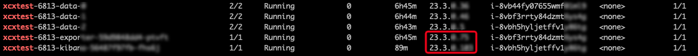

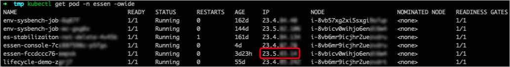

**方法二：kibana/essen/exporter/snapshot服务对应的IP网段获取方式**

> **重要**
>
> 获取IP网段的原因是方法一中的Pod IP会因为Pod重启而漂移，配置IP网段可以避免此问题。但务必配置最小粒度IP白名单，最小粒度有效网段请咨询交付或现场安全。

获取Elasticsearch对应服务可能在的IP网段，即获取当前环境所有的网段信息：

```bash
 kubectl get subnet
```

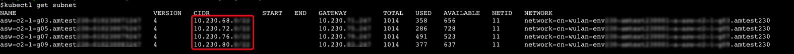

- 地址范围通过CIDR表示法表示。

- 混部Code所有网段均有可能分配。

- 独占Code下ES实例相关资源会部署在独占机器上，管控服务仍有可能落在所有网段下。

> **重要**
>
> 此方法仅供参考，具体请咨询交付或现场安全。

**报错及异常现象处理**

- Kibana界面无法登录

  - 报错信息：

    - 6.x/7.x版本：kibana server is not ready yet

    - 5.x版本：Authorization Exception

  - 原因分析：kibanaserver账号的白名单配置有误。

  - 解决方案：修改kibanaserver账号白名单，kibanaserver账号增加Kibana服务所在IP地址。

- Kibana白名单关闭后仍可登录

  - 异常现象：Kibana白名单关闭后仍可登录。

  - 原因分析：Kibana界面未重新初始化。

  - 解决方案：联系现场运维同学重启该Kibana所在的Pod。

- 监控数据无数据

  - 异常现象：grafana监控页面的数据显示no data。

  - 原因分析：monitoring_collector账号的白名单配置有误。

  - 解决方案：修改monitoring_collector账号白名单，monitoring_collector账号增加exporter服务所在IP地址。

- 访问Elasticsearch插件页面报错

  - 报错信息：403 Forbidden:[Ip 23.5.\*\*.\*\* is not allow in ip white/black list]

  - 原因分析：monitoring_collector账号的白名单配置有误。

  - 解决方案：monitoring_collector账号白名单，monitoring_collector账号增加essen服务所在IP地址。

- 访问自动备份页面报错

  - 报错信息：proxy request fail

  - 原因分析：monitoring_collector账号的白名单配置有误。

  - 解决方案：修改monitoring_collector账号白名单，monitoring_collector账号增加essen服务所在IP地址。

- 自动备份不生效

  - 异常现象：到规定时间点后未正常快照。

  - 原因分析：monitoring_collector账号的白名单配置有误。

  - 解决方案：修改monitoring_collector账号白名单，monitoring_collector账号增加snapshot服务所在IP地址。

- Kibana登录报错

  - 异常现象：账号密码无误，但登录报错（此处以monitoring_collector为例）。

  - 原因分析：对应账号的白名单配置有误或未开启**能否登录kibana**功能。

  - 解决方案：对应账号配置Kibana服务所在IP地址，并选中**能否登录kibana**。

- 跨集群访问报错

  - 报错信息：[][22.0.x.x:9300] general node connection failure

  - 原因分析：交互的集群证书不同。

  - 解决方案：咨询现场运维人员，或查看运维指南中的实例管理相关操作。

<a id="section-2-8-3"></a>

### 2.8.3. 规格配置

集群运维支持对已有实例进行规格配置修改，您可以按需修改对应节点的规格大小。

**注意事项**

修改节点配置会触发集群重启，请确认后再操作。

**操作步骤**

1. 进入集群运维页面。

2. 在左侧导航栏，单击**规格配置**。

3. 单击对应节点中的**修改**。

4. 输入节点配置。

   配置参数说明请参见创建实例。

5. 单击**保存**。

6. 在对话框中选择集群重启方式，单击**确定**。

<a id="section-2-8-4"></a>

### 2.8.4. 配置修改

通过阿里云Elasticsearch的集群配置功能，您可以按需设置集群的基础配置信息和高级配置信息。

**操作步骤**

1. 进入集群运维页面。

2. 在左侧导航栏，单击**配置修改**。

3. 修改配置信息。

   - 修改基础配置

     在**基础配置**区域，您可以查看**系统配置**信息，并且可以按需配置**elasticsearch.yml**的信息。

     配置字段说明如下，具体以界面显示为准。

     **7.10.0版本**

     | 字段名称 | 取值说明 | 字段描述 |
     | --- | --- | --- |
     | apack.accesslog.enabled | 布尔值，取值范围：<br>• true<br>• false<br>默认值：true。 | 访问日志审计功能。 |
     | apack.accesslog.search.enabl ed | 布尔值，取值范围：<br>• true<br>• false<br>默认值：true。 | 搜索请求字段打印功能。 |
     | thread_pool.write.queue_size | 正整数，取值范围：根据集群的大小和写操作的需求来调整，该值无固定最大/最小值。默认值：10000。 | 文档写入队列大小。 |
     | thread_pool.search.queue_siz e | 正整数，取值范围：根据集群的大小和负载来调整。默认值：1000。 | 文档搜索队列大小。 |
     | cluster.routing.allocation.disk.watermark.low | 字符串，默认值：85%，也可设置为固定值（可用磁盘空间），例如：500 MB、100 GB。 | 当磁盘使用率达到此阈值时，集群会尝试不再向这个节点分配新的分片。 |
     | cluster.routing.allocation.disk.watermark.high | 字符串，默认值：90%，也可设置为固定值（可用磁盘空间），例如：500 MB、100 GB。 | 当磁盘使用率达到此阈值时，集群会尝试将分片重新分配到其他使用率较低的节点。 |
     | cluster.routing.allocation.disk.watermark.flood_stage | 字符串，默认值：95%，也可设置为固定值（可用磁盘空间），例如：500 MB、100 GB。 | 当磁盘使用率达到此阈值时，集群会将节点标记为不可分配，并尝试将所有分片从该节点移动到其他节点，同时将节点上的分片设置为只读索引。 |
     | action.auto_create_index | 布尔值，取值范围：<br>• true<br>• false<br>默认值：true。 | 接收到新文档后，如果没有对应索引，是否允许系统自动创建索引。 |
     | action.destructive_requires_n ame | 布尔值，取值范围：<br>• true<br>• false<br>默认值：false。 | 在删除索引时，是否需要明确指定索引名称。 |

     **6.8.13版本**

     | 字段名称 | 取值说明 | 字段描述 |
     | --- | --- | --- |
     | action.auto_create_index | 布尔值，取值范围：<br>• true<br>• false<br>默认值：true。 | 接收到新文档后，如果没有对应索引，是否允许系统自动创建索引。 |
     | action.destructive_requires_name | 布尔值，取值范围：<br>• true<br>• false<br>默认值：false。 | 在删除索引时，是否需要明确指定索引名称。 |
     | thread_pool.write.queue_size | 正整数，取值范围：根据集群的大小和写操作的需求来调整，该值无固定最大/最小值。默认值：200。 | 文档写入队列大小。 |
     | thread_pool.search.queue_si ze | 正整数，取值范围：根据集群的大小和负载来调整。默认值：1000。 | 文档搜索队列大小。 |
     | cluster.routing.allocation.dis k.watermark.low | 字符串，默认值：85%，也可设置为固定值（可用磁盘空间），例如：500 MB、100 GB。 | 当磁盘使用率达到此阈值时，集群会尝试不再向这个节点分配新的分片。 |
     | cluster.routing.allocation.dis k.watermark.high | 字符串，默认值：90%，也可设置为固定值（可用磁盘空间），例如：500 MB、100 GB。 | 当磁盘使用率达到此阈值时，集群会尝试将分片重新分配到其他使用率较低的节点。 |
     | cluster.routing.allocation.dis k.watermark.flood_stage | 字符串，默认值：95%，也可设置为固定值（可用磁盘空间），例如：500 MB、100 GB。 | 当磁盘使用率达到此阈值时，集群会将节点标记为不可分配，并尝试将所有分片从该节点移动到其他节点，同时将节点上的分片设置为只读索引。 |

     **5.5.3版本**

     | 字段名称 | 取值说明 | 字段描述 |
     | --- | --- | --- |
     | thread_pool.bulk.queue_size | 正整数，取值范围：根据集群的大小和写操作的需求来调整，该值无固定最大/最小值。默认值：200。 | 文档批量写入队列大小。 |
     | thread_pool.search.queue_siz e | 正整数，取值范围：根据集群的大小和负载来调整。默认值：1000。 | 文档搜索队列大小。 |
     | cluster.routing.allocation.disk.watermark.low | 字符串，默认值：85%，也可设置为固定值（可用磁盘空间），例如：500 MB、100 GB。 | 当磁盘使用率达到此阈值时，集群会尝试不再向这个节点分配新的分片。 |
     | cluster.routing.allocation.disk.watermark.high | 字符串，默认值：90%，也可设置为固定值（可用磁盘空间），例如：500 MB、100 GB。 | 当磁盘使用率达到此阈值时，集群会尝试将分片重新分配到其他使用率较低的节点。 |
     | action.auto_create_index | 布尔值，取值范围：<br>• true<br>• false<br>默认值：true。 | 接收到新文档后，如果没有对应索引，是否允许系统自动创建索引。 |
     | action.destructive_requires_n ame | 布尔值，取值范围：<br>• true<br>• false<br>默认值：false。 | 在删除索引时，是否需要明确指定索引名称。 |

   - 修改高级配置

     在**配置修改**页面对应的URL地址后面添加 `?advanced` ，然后按回车键，才可以看到**高级配置**功能。当您打开**开启高级配置**开关后，即可在**app value**的右侧区域按需更新高级配置信息。

<a id="section-2-8-5"></a>

### 2.8.5. 部署方式升级

通过部署方式升级功能，您可以升级集群的部署方式，例如将集群的部署方式从单可用区升级为多可用区。

**使用限制**

仅elasticsearch类型的实例支持该功能，opensearch类型的实例不支持。

**部署方式升级**

> **重要**
>
> 部署方式升级仅适用于产品交付时已选择双可用区或多可用区的部署形态。

1. 进入集群运维页面。

2. 在左侧导航栏，单击**部署方式升级**。

3. 在**部署方式升级**页面，查看当前实例是否可升级部署方式。

   - 如果页面提示暂无可升级的部署方式，表示当前实例暂不支持升级。如果需要升级，可前往平台管理页面修改可用区配置，具体操作请参见可用区配置。

   - 如果页面展示当前实例的ID/名称、部署方式（升级前）、部署方式（升级后），表示当前实例支持升级，可通过以下升级步骤进行升级。

   > **说明**
   >
   > 部署方式只能升级到运维控制台中平台管理页面的可用区配置所选择的部署方式，且不支持降级。

4. 在**基础校验**中，根据页面提示查看实例是否满足升级条件。确认满足升级条件后，单击**下一步**。

5. 在**资源评估**中，根据页面提示进行资源评估。确认资源满足条件后，单击**下一步**。

6. 在**风险提示**中，根据页面提示进行风险确认。确认后，单击**开始**。

7. 在弹出的对话框中，单击**确定**。

   确定后，系统开始升级部署方式，同时集群会进行重启。当集群状态变为正常时，升级完成。

<a id="section-3"></a>

# 3.平台管理

<a id="section-3-1"></a>

## 3.1. 仓库管理

通过仓库管理功能，您可以管理Elasticsearch的snapshot仓库，Elasticsearch实例的自动备份功能依赖此仓库。本文介绍查询、添加、编辑、删除等仓库管理功能。

**进入仓库管理页面**

1. 登录检索分析服务运维控制台。

2. 在左侧导航栏，选择**平台管理 > 仓库管理**，进入仓库管理页面。

**添加仓库**

1. 进入仓库管理页面。

2. 在页面右上角，单击**添加**。

3. 在对话框中，输入仓库名称，并编辑仓库配置，单击**确定**。

   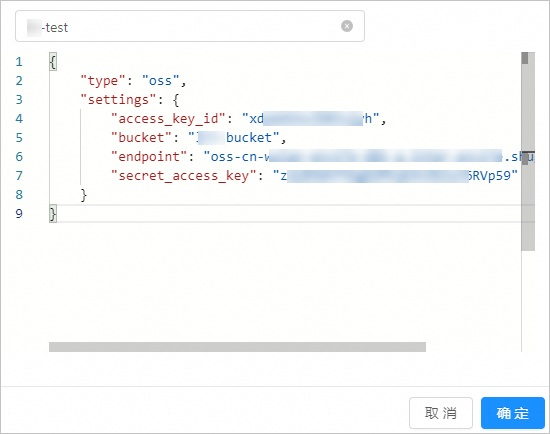

   <table>
     <tr>
       <th width="174">字段</th>
       <th>说明</th>
     </tr>
     <tr>
       <td>type</td>
       <td>默认oss。</td>
     </tr>
     <tr>
       <td>access_key_id</td>
       <td>在<strong>统一云管平台</strong>上，依次进入<strong>企业 &gt; 资源管理 &gt; 组织管理</strong>，在<strong>组织架构</strong>区域下选择目标组织，单击<strong>管理 Accesskey</strong>，即可获取<strong>AccessKey</strong> <strong>ID</strong>和<strong>AccessKey Secret</strong>。</td>
     </tr>
     <tr>
       <td>bucket</td>
       <td>在<strong>对象存储 OSS</strong>控制台上创建的Bucket的名称。</td>
     </tr>
     <tr>
       <td>endpoint</td>
       <td>在<strong>对象存储 OSS</strong>控制台上，单击已创建的Bucket的名称，在<strong>访问域名</strong>区域，获取Endpoint信息。格式为<code> oss-cn-wulan-env**e-d01-</code><code>a.inter.env**e.shuguang.com </code>。</td>
     </tr>
     <tr>
       <td>secret_access_key</td>
       <td>在<strong>统一云管平台</strong>上，依次进入<strong>企业 &gt; 资源管理 &gt; 组织管理</strong>，在<strong>组织架构</strong>区域下选择目标组织，单击<strong>管理 Accesskey</strong>，即可获取<strong>AccessKey</strong> <strong>ID</strong>和<strong>AccessKey Secret</strong>。</td>
     </tr>
   </table>

   添加成功后，可在仓库列表中查看对应的仓库。

   > **说明**
   >
   > 如果查看不到已添加的仓库，可在页面右上角，单击**刷新**，刷新仓库列表再次查看。

**查询仓库**

1. 进入仓库管理页面。

2. 在页面上方选择查询维度。

   系统支持按**仓库名称**和**仓库类型**查询。

   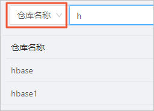

3. 输入查询内容。

   输入内容后，系统会自动进行查询，支持模糊匹配。

**编辑仓库**

1. 进入仓库管理页面。

2. 在仓库列表中，单击**操作**列下的**编辑**。

3. 在对话框中，修改仓库配置（仓库名称不可修改），单击**确定**。

   > **重要**
   >
   > 如果已经开启了自动备份，仓库编辑后，当前自动备份的配置不会发生改变。如果未开启自动备份，仓库编辑后（例如修改bucket名称）再开启自动备份，自动备份时会使用新的仓库配置（例如指向新的bucket），并且查看不到之前自动备份的数据。

**删除仓库**

1. 进入仓库管理页面。

2. 在仓库列表中，单击**操作**列下的**删除**。

   > **警告**
   >
   > 仓库删除后不可恢复，请谨慎操作。

3. 在对话框中，单击**确定**。

<a id="section-3-2"></a>

## 3.2. 插件管理

<a id="section-3-2-1"></a>

### 3.2.1. 支持的插件列表

<a id="section-3-2-1-1"></a>

#### 3.2.1.1. Elasticsearch插件

本文汇总了Elasticsearch支持的插件及其对应版本。

**7.10.0版本**

| 插件名称 | 是否内置 | 插件版本 | 插件说明 |
| --- | --- | --- | --- |
| a-pack-core | 内置 | 7.10.0 | A-Pack核心插件，提供阿里云Elasticsearch的基础功能支持与集成能力。 |
| aliyun-codec | 非内置 | 7.10.0 | 阿里云编解码器插件，优化索引存储与查询性能，支持自定义数据编码策略。 |
| aliyun-knn | 内置 | 7.10.0 | 阿里云KNN插件，支持近似最近邻（k-NN）向量搜索，适用于AI/ML场景的相似性检索。 |
| aliyun-optimization | 内置 | 7.10.0 | 阿里云性能优化插件，通过存储与查询优化策略提升Elasticsearch集群效率。 |
| aliyun-qos | 非内置 | 7.10.0 | 阿里云QoS插件，管理资源分配与请求优先级，保障关键任务性能。 |
| analysis-aliws | 非内置 | 7.10.0 | 阿里云分析（AliWS）插件，提供定制化文本处理功能（如行业专用分词）。 |
| analysis-icu | 内置 | 7.10.0 | ICU分析插件，集成Lucene的ICU模块，支持多语言文本处理（如日韩语、阿拉伯语）。 |
| analysis-ik | 内置 | 7.10.0 | IK中文分析插件，提供高效的中文分词能力，适用于电商、新闻等场景。 |
| analysis-kuromoji | 内置 | 7.10.0 | 日语（Kuromoji）分析插件，支持日语文本的分词与语法解析。 |
| analysis-phonetic | 内置 | 7.10.0 | 发音分析插件，通过语音特征过滤器实现基于发音的模糊匹配（如姓名检索）。 |
| analysis-pinyin | 内置 | 7.10.0 | 拼音分析插件，将汉字转换为拼音进行分词，支持中文拼音搜索功能。 |
| analysis-smartcn | 内置 | 7.10.0 | 智能中文分析插件，集成Lucene的Smart Chinese模块，提供基础中文分词能力。 |
| analysis-stempel | 内置 | 7.10.0 | 波兰语（Stempel）分析插件，支持波兰语文本的分词与形态还原。 |
| analysis-ukrainian | 内置 | 7.10.0 | 乌克兰语分析插件，支持乌克兰语文本的分词与语法处理。 |
| elasticsearch-repository-oss | 内置 | 7.10.0 | OSS仓库插件，支持将Elasticsearch快照存储至阿里云对象存储（OSS），实现长期备份与恢复。 |
| faster-bulk | 非内置 | 7.10.0 | 批量操作优化插件，提升数据写入性能，降低批量索引操作的延迟。 |
| hybrid-cloud | 内置 | 7.10.0 | 混合云插件，支持阿里云Elasticsearch与本地数据中心的混合部署及跨环境数据同步。 |
| ingest-attachment | 内置 | 7.10.0 | 内容提取处理器插件，通过Apache Tika解析PDF/Office等附件内容并提取文本。 |
| mapper-murmur3 | 内置 | 7.10.0 | Murmur3哈希映射插件，支持在索引时计算字段值的哈希并存储至索引中，用于去重或加速检索。 |
| mapper-size | 内置 | 7.10.0 | 文档大小映射插件，支持在索引时记录文档的未压缩原始大小，用于监控存储开销。 |
| opendistro-index-management | 非内置 | 7.10.0 | Open Distro索引状态管理插件，自动化索引生命周期（如滚动、保留策略、热/温/冷状态迁移）。 |
| opendistro-job-scheduler | 非内置 | 7.10.0 | Open Distro任务调度插件，提供分布式周期性任务调度服务（如监控、维护任务）。 |
| opendistro_secu rity | 内置 | 7.10.0 | Open Distro安全插件，提供访问控制、身份验证及加密功能，保障Elasticsearch集群安全性。 |
| repository-hdfs | 内置 | 7.10.0 | HDFS仓库插件，支持将快照存储至Hadoop分布式文件系统（HDFS），适用于大数据生态集成。 |
| repository-s3 | 内置 | 7.10.0 | S3仓库插件，支持将快照存储至AWS S3对象存储服务，适用于跨云备份场景。 |
| sql | 内置 | 7.10.0 | SQL查询插件，支持通过SQL语法查询Elasticsearch数据，降低用户学习成本。 |
| xdcr | 非内置 | 7.10.0 | 跨数据中心复制插件，实现多地域数据同步与高可用性，支持灾难恢复及数据本地化。 |

**6.8.13版本**

| 插件名称 | 是否内置 | 插件版本 | 插件说明 |
| --- | --- | --- | --- |
| a-pack-repository-oss | 内置 | 6.8.13 | A-Pack OSS仓库插件，支持将Elasticsearch快照存储至阿里云对象存储（OSS），实现长期备份与恢复。 |
| a-pack-xdcr | 内置 | 6.8.13 | A-Pack跨数据中心复制插件，实现多地域数据同步与高可用性，支持灾难恢复及数据本地化。 |
| aliyun-knn | 内置 | 6.8.13 | 阿里云KNN插件，支持近似最近邻（k-NN）向量搜索，适用于AI/ML场景的相似性检索。 |
| analysis-aliws | 内置 | 6.8.13 | 阿里云分析（AliWS）插件，提供定制化文本处理功能（如行业专用分词）。 |
| analysis-icu | 内置 | 6.8.13 | ICU分析插件，集成Lucene的ICU模块，支持多语言文本处理（如日韩语、阿拉伯语）。 |
| analysis-ik | 内置 | 6.8.13 | IK中文分析插件，提供高效的中文分词能力，适用于电商、新闻等场景。 |
| analysis-kuromoji | 内置 | 6.8.13 | 日语（Kuromoji）分析插件，支持日语文本的分词与语法解析。 |
| analysis-phonetic | 内置 | 6.8.13 | 发音分析插件，通过语音特征过滤器实现基于发音的模糊匹配（如姓名检索）。 |
| analysis-pinyin | 内置 | 6.8.13 | 拼音分析插件，将汉字转换为拼音进行分词，支持中文拼音搜索功能。 |
| analysis-smartcn | 内置 | 6.8.13 | 智能中文分析插件，集成Lucene的Smart Chinese模块，提供基础中文分词能力。 |
| analysis-stempel | 内置 | 6.8.13 | 波兰语（Stempel）分析插件，支持波兰语文本的分词与形态还原。 |
| analysis-ukrainian | 内置 | 6.8.13 | 乌克兰语分析插件，支持乌克兰语文本的分词与语法处理。 |
| ingest-attachment | 内置 | 6.8.13 | 内容提取处理器插件，通过Apache Tika解析PDF/Office等附件内容并提取文本。 |
| mapper-murmur3 | 内置 | 6.8.13 | Murmur3哈希映射插件，支持在索引时计算字段值的哈希并存储至索引中，用于去重或加速检索。 |
| mapper-size | 内置 | 6.8.13 | 文档大小映射插件，支持在索引时记录文档的未压缩原始大小，用于监控存储开销。 |
| opendistro-job-scheduler | 内置 | 6.8.13 | Open Distro任务调度插件，提供分布式周期性任务调度服务（如监控、维护任务）。 |
| opendistro_alerti ng | 非内置 | 6.8.13 | Open Distro告警插件，支持基于搜索结果的实时告警触发与通知（如邮件、Slack）。 |
| opendistro_index _management | 内置 | 6.8.13 | Open Distro索引状态管理插件，自动化索引生命周期（如滚动、保留策略、热/温/冷状态迁移）。 |
| opendistro_secur ity | 内置 | 6.8.13 | Open Distro安全插件，提供访问控制、身份验证及加密功能，保障Elasticsearch集群安全性。 |
| opendistro_sql | 非内置 | 6.8.13 | Open Distro SQL插件，支持通过SQL语法查询Elasticsearch数据，降低用户学习成本。 |
| repository-hdfs | 内置 | 6.8.13 | HDFS仓库插件，支持将快照存储至Hadoop分布式文件系统（HDFS），适用于大数据生态集成。 |
| repository-s3 | 内置 | 6.8.13 | S3仓库插件，支持将快照存储至AWS S3对象存储服务，适用于跨云备份场景。 |
| sqlplugin | 内置 | 6.8.13 | SQL查询插件，支持通过SQL语法查询Elasticsearch数据，提供非Open Distro的SQL接口支持。 |

**5.5.3版本**

| 插件名称 | 是否内置 | 插件版本 | 插件说明 |
| --- | --- | --- | --- |
| analysis-icu | 内置 | 5.5.3 | ICU分析插件，集成Lucene的ICU模块，支持Unicode和多语言文本处理（如日韩语、阿拉伯语等）。 |
| analysis-ik | 内置 | 5.5.3 | IK中文分析插件，基于IK Analyzer实现高效的中文分词与搜索优化。 |
| analysis-kuromoji | 内置 | 5.5.3 | 日语（Kuromoji）分析插件，集成Lucene的Kuromoji模块，支持日语文本分析。 |
| analysis-phonetic | 内置 | 5.5.3 | 发音分析插件，通过语音特征过滤器实现基于发音的模糊匹配（如姓名检索）。 |
| analysis-pinyin | 内置 | 5.5.3 | 拼音分析插件，将汉字转换为拼音进行分词，支持中文拼音搜索功能。 |
| analysis-smartcn | 内置 | 5.5.3 | 智能中文分析插件，集成Lucene的Smart Chinese模块，提供基础中文分词能力。 |
| analysis-stempel | 内置 | 5.5.3 | 波兰语（Stempel）分析插件，集成Lucene的Stempel模块，支持波兰语文本处理。 |
| analysis-ukrainian | 内置 | 5.5.3 | 乌克兰语分析插件，集成Lucene的UkrainianMorfologikAnalyzer，支持乌克兰语文本分析。 |
| elasticsearch-repository-oss | 内置 | 5.5.3 | 阿里云OSS快照仓库插件，支持将Elasticsearch快照存储至阿里云对象存储（OSS）。 |
| gab-paas-plugin | 非内置 | 5.5.3 | GAB PaaS插件，提供与阿里云PaaS平台集成的功能支持（具体功能需结合业务场景）。 |
| ingest-attachment | 内置 | 5.5.3 | 内容提取处理器插件，通过Apache Tika解析PDF/Office等附件内容并提取文本。 |
| ingest-geoip | 内置 | 5.5.3 | 地理IP分析处理器插件，基于Maxmind数据库通过IP地址查询地理位置数据。 |
| ingest-user-agent | 内置 | 5.5.3 | 用户代理信息提取处理器插件，从用户代理字符串中提取设备/浏览器等信息。 |
| mapper-attachments | 内置 | 5.5.3 | 附件映射插件，支持将富文本（如PDF、Office）内容作为字段存储并进行全文检索。 |
| mapper-murmur3 | 内置 | 5.5.3 | Murmur3哈希映射插件，支持在索引时计算字段值的哈希并存储至索引中。 |
| mapper-size | 内置 | 5.5.3 | 文档大小映射插件，支持在索引时记录文档的未压缩原始大小。 |
| pangu | 内置 | 5.5.3 | 盘古仓库插件，支持将快照存储至阿里云盘古分布式存储系统（Pangu）。 |
| repository-hdfs | 内置 | 5.5.3 | HDFS仓库插件，支持将快照存储至Hadoop分布式文件系统（HDFS）。 |
| repository-s3 | 内置 | 5.5.3 | S3仓库插件，支持将快照存储至AWS S3对象存储服务。 |
| search-guard-5 | 内置 | 5.5.3 | Search Guard 5安全插件，提供Elasticsearch 5的访问控制、认证与授权功能。 |
| sql | 内置 | 5.5.3 | SQL查询插件，支持通过SQL语法查询Elasticsearch数据。 |

<a id="section-3-2-1-2"></a>

#### 3.2.1.2. Kibana插件

本文汇总了Kibana支持的插件及其对应版本。

**7.10.0版本**

| 插件名称 | 是否内置 | 插件版本 | 插件说明 |
| --- | --- | --- | --- |
| opendistro-alerting | 非内置 | 7.10.0 | Open Distro Kibana告警插件，支持在Kibana中创建、管理和触发基于Elasticsearch数据的告警规则。 |

**6.8.13版本**

| 插件名称 | 是否内置 | 插件版本 | 插件说明 |
| --- | --- | --- | --- |
| bsearch_querybuild er | 非内置 | 6.8.13 | BSearch 查询构建器插件，提供可视化工具用于构建和调试BSearch查询语句。 |
| kibana-prometheus-exporter | 非内置 | 6.8.13 | Kibana Prometheus指标导出插件，支持将Kibana监控数据（如性能指标）导出至Prometheus监控系统。 |
| opendistro-alerting | 非内置 | 6.8.13 | Open Distro Kibana告警插件，支持在Kibana中创建、管理和触发基于Elasticsearch数据的告警规则。 |

**5.5.3版本**

| 插件名称 | 是否内置 | 插件版本 | 插件说明 |
| --- | --- | --- | --- |
| searchguard | 内置 | 5.5.3 | Search Guard Kibana插件，为Kibana集成Elasticsearch的安全功能（如访问控制、身份验证），实现统一权限管理。 |

<a id="section-3-2-1-3"></a>

#### 3.2.1.3. Opensearch插件

本文汇总了Opensearch支持的插件及其对应版本。

**3.1.0版本**

| 插件名称 | 是否内置 | 插件版本 | 插件说明 |
| --- | --- | --- | --- |
| analysis-ik | 内置 | 3.1.0 | OpenSearch的IK分析器。 |
| opensearch-repository-oss-plugin | 内置 | 3.1.0 | 启用与阿里云OSS集成作为快照存储库，用于备份和恢复操作。 |
| prometheus-exporter | 内置 | 3.1.0 | 以Prometheus格式暴露OpenSearch指标，支持通过Prometheus和Grafana进行监控和告警。 |
| opensearch-alerting | 内置 | 3.1.0 | 提供基于搜索结果的实时告警功能，允许用户定义触发器和操作。 |
| opensearch-asynchronous-search | 内置 | 3.1.0 | 通过异步执行查询并在稍后获取结果，支持长运行搜索。 |
| opensearch-cross-cluster-replication | 内置 | 3.1.0 | 启用跨集群复制以实现高可用性、灾难恢复和数据本地化。 |
| opensearch-custom-codecs | 内置 | 3.1.0 | 添加自定义索引编解码器支持，优化特定用例的存储和性能。 |
| opensearch-flow-framework | 内置 | 3.1.0 | 提供构建和管理引导式工作流及多步骤流程的框架。 |
| opensearch-geospatial | 内置 | 3.1.0 | 扩展OpenSearch的地理空间搜索和分析能力，包括GeoJSON和形状查询。 |
| opensearch-index-management | 内置 | 3.1.0 | 自动化索引生命周期管理，包括滚动、保留策略和状态转换（热/温/冷）。 |
| opensearch-job-scheduler | 内置 | 3.1.0 | 提供分布式任务调度服务，用于监控和维护等周期性任务。 |
| opensearch-knn | 内置 | 3.1.0 | 支持k-近邻（k-NN）向量搜索，用于相似性搜索和AI/ML应用。 |
| opensearch-ltr | 内置 | 3.1.0 | 支持基于机器学习模型的排序学习（LTR），提升搜索相关性。 |
| opensearch-notifications | 内置 | 3.1.0 | 集中通知服务，通过邮件、Slack、Chime等渠道发送告警。 |
| opensearch-notifications-core | 内置 | 3.1.0 | 通知系统核心模块，提供API和消息传递基础设施。 |
| opensearch-observability | 内置 | 3.1.0 | 日志、指标、追踪和用户体验的统一可观测性解决方案。 |
| opensearch-reports-scheduler | 内置 | 3.1.0 | 从仪表板和可视化图表中安排生成报告并定期分发。 |
| opensearch-security | 内置 | 3.1.0 | 提供认证、授权、加密和审计日志的综合安全插件。 |
| opensearch-sql | 内置 | 3.1.0 | 提供SQL接口，使用熟悉SQL语法查询OpenSearch索引。 |
| opensearch-system-templates | 内置 | 3.1.0 | 管理由系统生成的索引模板，用于OpenSearch内部功能和插件。 |
| query-insights | 内置 | 3.1.0 | 分析搜索查询性能、延迟和资源使用，优化相关性和效率。 |

<a id="section-3-2-1-4"></a>

#### 3.2.1.4. Dashboard插件

本文汇总了Dashboard支持的插件及其对应版本。

**3.1.0版本**

| 插件名称 | 是否内置 | 插件版本 | 插件说明 |
| --- | --- | --- | --- |
| indexManagement Dashboards | 内置 | 3.1.0 | 索引管理仪表盘插件，提供索引生命周期的监控与操作界面（如滚动、删除、状态迁移）。 |

<a id="section-3-2-2"></a>

### 3.2.2. 上传、更新及删除插件

通过插件管理功能，您可以对Elasticsearch插件、Logstash插件、Kibana插件、OpenSearch插件和Dashboard插件进行上传、更新和删除管理。本文中的插件为平台插件，按照实例版本单独管理。插件的安装、升级都依赖平台的插件库。

**进入插件管理页面**

1. 登录检索分析服务运维控制台。

2. 在左侧导航栏，单击**平台管理**。

3. 在**插件管理**中，单击**Elasticsearch 插件**、**Logstash 插件**、**Kibana 插件**、**OpenSearch插件**或者**Dashboard插件**进入对应的插件管理页面。

   本文以Elasticsearch插件为例，其他类型的插件与之类似。

**查看平台插件**

1. 进入插件管理页面。

2. 在页面左上角，选择版本，查看平台支持的插件。

   下图以查看Elasticsearch插件为例。

   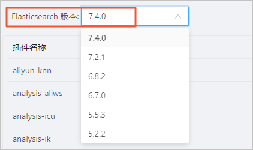

**上传插件**

> **重要**
>
> 支持上传自定义插件，但不是所有自定义插件都支持。例如：X-Pack相关插件（安全、ML、告警、ILM、Reporting等）或者依赖X-Pack API的第三方插件，均不支持。

1. 进入插件管理页面。

2. 在页面左上角，选择版本。

3. 单击**上传插件**。

4. 在**上传插件**对话框中，上传插件安装包。

5. 单击**上传**。

   上传成功后，插件会显示在插件列表中。

   > **说明**
   >
   > 如果查看不到已上传的插件，可在页面右上角，单击**刷新**，刷新插件列表再次查看。

**更新插件**

> **重要**
>
> 不支持更新内置插件。

1. 进入插件管理页面。

2. 在页面左上角，选择版本。

3. 在**操作**列下，单击**更新**。

4. 在**更新插件**对话框中，上传插件安装包。

5. 单击**上传**。

**删除插件**

> **警告**
>
> - 插件删除后，需要重新安装才能使用，请谨慎操作。
>
> - 如果存量集群使用了待删除的插件，插件删除后，集群的rolling和扩容操作以及被动重启都会失败。

1. 进入插件管理页面。

2. 在页面左上角，选择版本。

3. 在**操作**列下，单击**删除**。

4. 单击**确定**。

<a id="section-3-3"></a>

## 3.3. 资源管理

资源管理页面展示了物理机的资源使用情况。

**操作步骤**

1. 登录检索分析服务运维控制台。

2. 在左侧导航栏，选择**平台管理 > 资源管理**。

3. 在资源管理页面，搜索目标物理机名称，查看资源使用情况。

   包括：**物理机名称**、**CPU已分配资源**、**CPU**、**内存已分配资源**和**内存大小**等信息。

   

<a id="section-3-4"></a>

## 3.4. 可用区配置

通过可用区配置功能，您可以根据产品部署方式对可用区进行管理。本文中介绍如何修改可用区配置。

**使用限制**

- 仅elasticsearch类型的实例支持可用区配置，且可用区配置功能仅适用于产品交付时已选择双可用区或多可用区的部署形态。

- opensearch类型的实例目前仅支持单可用区。

**修改可用区配置**

1. 登录检索分析服务运维控制台。

2. 在左侧导航栏，选择**平台管理 > 可用区配置 > 可用区配置**。

3. 在**可用区配置**页面，单击**修改配置**。

4. 根据业务需求，修改实例的部署方式和可用区。

5. 单击**保存**。

<a id="section-3-5"></a>

## 3.5. 操作管控

通过操作管控功能，您可以根据业务需求管控新建实例的网络类型、资源归属和用户的变更类操作。

**操作步骤**

1. 登录检索分析服务运维控制台。

2. 在左侧导航栏，选择**平台管理 > 操作管控 > 操作管控**。

3. 在**操作管控**页面，选择新建实例的网络类型管控设置、资源归属设置和变更类操作管控设置。

   > **警告**
   >
   > 当前配置会对用户使用造成影响，请谨慎修改，相关操作说明和注意事项请以实际界面为准。

   - **当前云平台（ascm-检索分析服务）产品新建实例的网络类型管控设置为**：支持**允许使用AnyTunnel**和**不允许使用AnyTunnel**。

     从安全角度，建议创建实例时选择SingleTunnel方式。如果您需要严格限制AnyTunnel的使用，可以选择**不允许使用AnyTunnel**。此次变更仅对后续新建实例生效，已经创建和使用中的实例不受影响。

   - <strong>当前云平台（ascm-检索分析服务）新建实例的资源归属为：</strong>支持**产品独占资源池**和**底座共享资源池**。

   - **当前云平台（ascm-检索分析服务）产品的变更类操作管控设置为**：支持**允许变更（用户控制台和运维控制台上均可进行实例变更类操作）**、**仅不允许在用户控制台上变更**、**不允许所有变更**。

     > **说明**
     >
     > 当您的云平台处于封网管控等阶段或您需要在某段时间限制变更操作时，您可以在此修改当前云平台中检索分析服务产品的变更类操作管控设置。当设置为**不允许所有变更**时，用户控制台和运维控制台均无法对任何集群进行任何创建、扩容、修改配置、安装插件等操作（信息展示不受影响）。

4. 单击**修改**。

<a id="section-3-6"></a>

## 3.6. 基准测试

如果您需要确认新建的Elasticsearch（简称ES）集群的配置能否满足业务需求，您可以使用阿里云ES提供的基准测试功能评估集群读写性能，该功能支持一键启动基准测试。

**一键基准测试方案介绍**

一键基准测试的测试内容包括两个部分：

- 机器性能测试：对集群硬件（包含CPU、内存、磁盘IO）性能进行测试。

  关键指标如下：

  - CPU speed ：计算能力（单核）

  - CPU dispatch speed：调度能力，切换上下文

  - memory write speed：内存写入速度

  - memory read speed：内存读取速度

  - disk IO read speed：磁盘读取速度

  - disk IO write speed：磁盘写入速度

- ESRally压测：对集群的写入和查询性能进行测试。

  压测配置如下：

  | 项目 | 说明 |
  | --- | --- |
  | ESRally配置 | 使用ESRally的默认配置tracks。 |
  | 数据集 | 使用ESRally的预置数据集<code> http_logs </code>模拟测试场景。 |
  | 分片数 | • 主分片：5<br>• 副本分片：0 |
  | bulk_size | 每次批量操作提交5000个文档。 |
  | bulk_indexing_client s | 同时执行批量索引操作的客户端数量为8个。 |
  | 输出结果 | 指定报告的输出格式为CSV。 |

**操作步骤**

> **重要**
>
> 基准测试需要在目标集群中读写数据，影响集群读写性能，请谨慎在业务集群运行测试。

1. 登录检索分析服务运维控制台。

2. 在左侧导航栏，单击**平台管理**。

3. 选择**基准测试 > 基准测试**。

4. 新建测试。

   <ol type="i">

   <li>

   输入待测试实例的实例ID、用户名和密码。

   </li>

   <li>

   根据需要选择测试方案和是否强制执行。

   - 默认压测：使用ESRally压测。

   - 默认压测并在结束后删除测试索引：在默认压测的基础上增加了结束后删除测试索引的操作。

   </li>

   <li>

   单击**确定**。

   在基准测试页面列表中会展示出新建的测试任务。

   </li>

   </ol>

5. 查看基准测试结果。

   在测试执行过程中，单击**查看Job**，可以查看测试任务的执行信息。

   

   等待测试任务完成，单击**查看结果**，在弹出的对话框中展示目标集群性能方面的测试结果。您也可以在**查看结果**对话框中，单击**下载详细结果**，将测试结果下载至本地再进行查看。

   

6. （可选）删除基准测试结果

   - 在基准测试页面列表的**操作**列，单击**删除**，删除目标基准测试实例记录。

   - 选中待删除的多条基准测试实例记录，单击**批量删除**，删除多条基准测试实例记录。

<a id="section-4"></a>

# 4.日志与监控

<a id="section-4-1"></a>

## 4.1. 查看日志

本文介绍Elasticsearch中的日志分类、日志级别和查看日志的方法。

**日志分类**

- **管控组件日志**：ESSEN日志、Bingo日志、cms_sync<strong>-</strong>deploy日志、Operator日志、基线集群Elasticsearch实例日志。

  各组件所在的namespace如下表所示。

  | 组件名称 | namespace |
  | --- | --- |
  | ESSEN、cms-sync-deploy | essen |
  | Bingo | bingo |
  | Operator、基线集群Elasticsearch实例 | elasticsearch |

- **集群实例日志**：Elasticsearch集群日志、产品审计日志。

**日志级别**

- **warn**：警告信息。

- **error**：错误信息，程序执行出错。

  > **说明**
  >
  > 有error类型的报错或对日志有其他疑问，请提交工单。

**查看管控组件日志**

1. 登录OPS1机器。

2. 执行如下命令，获取组件名称${podname}。

   ```bash
   kubectl get pod -n ${namespace}
   ```

   `${namespace}` 为组件所在的namespace。以查看ESSEN组件的日志为例，您需要将 `${namespace}` 设置为essen。

3. 执行如下命令，查看组件日志。

   ```bash
   kubectl logs ${podname} -n ${namespace} | tail -n 500
   ```

**查看产品日志**

您可以通过以下的方式查看基线集群Elasticsearch实例的日志和Elasticsearch集群的日志。

- 方式一：

  > **说明**
  >
  > 该方式仅支持用户侧控制台查看最多100行日志。

  <ol type="i">

  <li>

  登录Elasticsearch实例的用户侧控制台。

  具体操作请参见***Elasticsearch用户指南***中的***登录阿里云检索分析服务控制台***。

  </li>

  <li>

  在左侧导航栏，单击**实例列表**。

  </li>

  <li>

  在**实例列表**中，单击目标实例ID。

  </li>

  <li>

  在**基本信息**页面的**节点可视化**区域，将鼠标移动到目标节点上，单击**查看节点日志**，在弹出的对话框中，查看节点日志详情。

  </li>

  </ol>

- 方式二：

  <ol type="i">

  <li>

  登录OPS1机器。

  </li>

  <li>

  执行如下命令，获取组件名称 `${podname}` 。

  ```bash
  kubectl get pod -n ${namespace}
  ```

  `${namespace}` 为组件所在的namespace。以查看基线集群Elasticsearch实例为例，您需要将 `${namespace}` 设置为elasticsearch。

  </li>

  <li>

  执行如下命令，查看组件日志。

  ```bash
  kubectl logs ${podname} -n ${namespace} | tail -n 500
  ```

  </li>

  </ol>

- 方式三：

  > **重要**
  >
  > 对于旧版本镜像的Elasticsearch集群日志，该方式仅适用于5.5.3，6.8.13、7.10版本。更多信息，请参见判断新旧版本镜像。

  <ol type="i">

  <li>

  登录OPS1机器。

  </li>

  <li>

  执行如下命令，获取组件名称 `${podname}` 。

  ```bash
  kubectl get pod -n ${namespace}
  ```

  `${namespace}` 为组件所在的namespace。以查看基线集群Elasticsearch实例为例，您需要将 `${namespace}` 设置为elasticsearch。

  </li>

  <li>

  以基线集群Elasticsearch实例为例，执行以下命令，进入Elasticsearch容器内部。

  ```bash
  kubectl exec -it ${podname} -c es bash -n elasticsearch
  ```

  `${podname}` 为获取的组件名称。

  </li>

  <li>

  执行以下命令，进入日志文件夹。

  ```bash
  cd /usr/share/elasticsearch/logs/
  ```

  > **说明**
  >
  > Elasticsearch集群中对应节点的所有日志都存放在容器的/usr/share/elasticsearch/logs/目录下。

  </li>

  <li>

  执行以下命令，查看日志文件。

  ```text
  ls
  ```

  </li>

  </ol>

- 方式四：

  <ol type="i">

  <li>

  登录Apsara Uni-manager运维控制台。

  </li>

  <li>

  选择**平台运维 > 日志查询**，进入日志查询页面。

  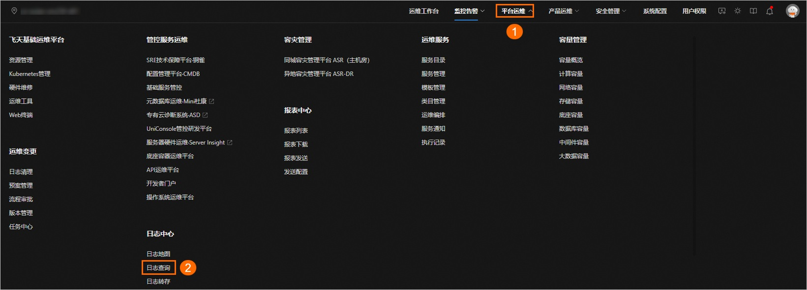

  </li>

  <li>

  在**平台日志**页签，按照指定条件进行筛选，搜索目标日志。

  > **说明**
  >
  > Elasticsearch的索引慢日志默认不开启，查询索引慢日志之前需手动修改ES配置加载 `log4j` 配置文件，开启慢日志。详情请参见配置慢日志。

  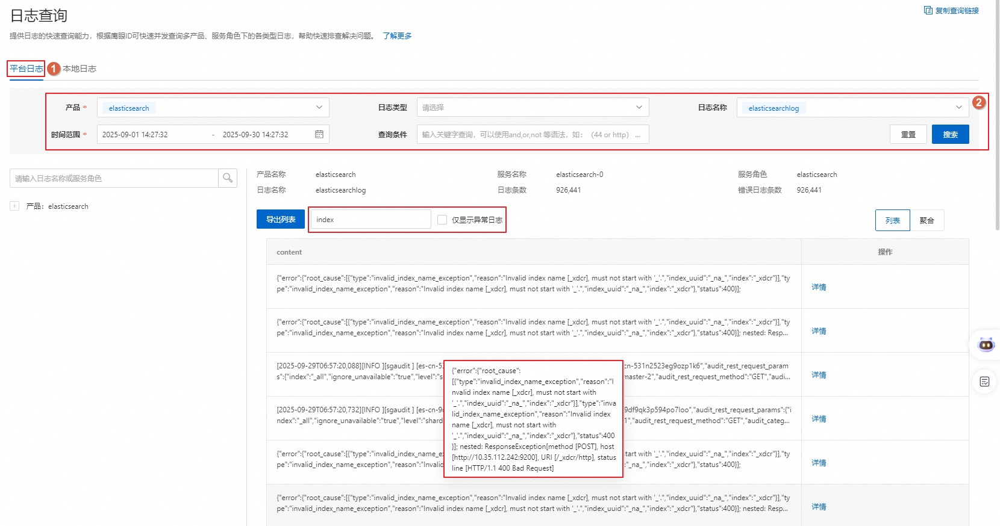

  - 其中，**产品**选择 `elasticsearch` ，**日志名称**选择 `elasticsearchlog` ，其他条件按需配置。

  - 在**导出列表**处，可通过关键词（例如： `index.search.accesslog` ）筛选目标日志，也可选择仅显示异常日志。

  - 鼠标悬停至目标日志，即可查看日志的时间、日志级别、IP、请求及响应等详细内容。

  </li>

  </ol>

Elasticsearch集群主要日志：

| 日志类型 | 日志文件名 | 说明 | 使用场景 |
| --- | --- | --- | --- |
| 主日志 | elasticsear ch-cluster.log | 集群的健康运行状态及索引的查询、写入日志。<br>• 写入相关日志包含创建索引、更新索引mapping和写入队列满了等日志。<br>• 查询相关日志包含查询队列和查询异常等日志。 | • 查看集群中各节点的运行状况及查询写入情况，例如节点之间的连通性，Full GC情况，创建或删除索引情况，集群级别的查询报错等。<br>• 如果您的业务侧出现问题，建议优先查看主日志和检查集群监控，排除集群自身的性能瓶颈或配置问题。 详细信息，请参见官网Logging。 |
| Searc hing慢日志 | elasticsear ch-cluster_ind ex_search _slowlog.lo g | 当查询耗时超过指定阈值时，将在慢查询日志中打印相关信息。慢查询阈值已在场景化模板的索引模板中配置，默认情况下已是最优，只需一键应用即可。详细信息，请参见索引模板配置。 | • 如果业务出现查询耗时久的情况，可查看Searching慢日志进行排查。 查询耗时越久，集群资源消耗越大。<br>• 如果日志存在大量的慢日志，请排查集群资源及负载情况，获取瓶颈项，根据瓶颈项及时扩充对应资源，以保证集群的稳定性。 详细信息，请参见官网Slow Log。 |
| Indexi ng慢日志 | elasticsear ch-cluster_ind ex_indexin g_slowlog.log | 当写入耗时超过指定阈值时，将在慢写入日志中打印相关信息。慢写入阈值已在场景化模板的索引模板中配置，默认情况下已是最优，只需一键应用即可。详细信息，请参见索引模板配置。 | • 如果您的业务出现写入耗时久的情况，可查看Indexing慢日志进行排查。写入耗时越久，对集群的资源消耗越大。<br>• 如果日志存在大量的慢日志，请排查集群资源及负载情况，获取瓶颈项，根据瓶颈项及时扩充对应资源，以保证集群的稳定性。 详细信息，请参见官网Slow Log。 |
| GC日志 | gc.log | 垃圾回收器日志显示所有JVM堆内存占用触发的垃圾回收情况，通过垃圾回收器日志可获取详细的垃圾回收信息，包括Old GC、CMS GC、Full GC以及Minor GC等。 | 如果集群出现性能瓶颈，可通过GC日志获取详细的GC回收信息，查看是否存在耗时长或操作频繁的GC。如果存在，需要及时扩充集群资源，以保证集群的稳定性。<br>说明默认情况下，Elasticsearch集群使用CMS回收器，而当数据节点内存大于等于32 GB时，建议使用G1回收器，以提高GC回收效率。 |
| 审计日志 | elasticsear ch-cluster_au dit_log.log | Elasticsearch实例的增、删、改、查等操作产生的审计日志。 | 如果出现身份验证失败、拒绝连接、需要查看数据访问事件和发现集群存在可疑活动的情况，可通过查看审计日志进行排查分析。 |
| SSL传输日志 | elasticsear ch-cluster_ssl _transport.log | 在Elasticsearch集群中，节点之间的通信通常使用SSL/TLS加密，以保护数据安全和防止被窃听或篡改。SSL传输日志主要用于记录节点之间SSL/TLS连接的建立、握手、数据传输等过程中的错误和异常情况。 | 查询Elasticsearch节点之间的SSL传输过程中的详细信息。 |
| 过时日志 | elasticsear ch-cluster_de precation.l og | 在集群中使用已经被替换或删除的API或功能，可能会导致系统不稳定或出现错误。过时日志会记录Elasticsearch在运行过程中遇到的已经被弃用的API和功能的使用情况。 | 及时发现集群中仍在使用的废弃API和功能，帮助您及时采取措施进行修复或迁移。 |

> **说明**
>
> 您可以在 `$ES_HOME/config/log4j2.properties` 文件中查看日志输出配置。log4j相关配置，请参见官网appenders。

**查看产品审计日志**

新旧版本镜像查看审计日志的方法不同，请先判断集群的镜像是新版本还是旧版本。详细信息，请参见判断新旧版本镜像。

**查看旧版本镜像集群审计日志**

1. 在运维侧控制台，登录目标Elasticsearch实例的Kibana控制台。具体操作，请参见登录Kibana控制台。

   > **说明**
   >
   > 本文以阿里云Elasticsearch 7.10版本为例，其他版本操作可能略有差别，请以实际界面为准。

2. 在左侧导航栏，单击

   图标，选择**Management > Dev tools**。

   

3. 在**Console**页签中，执行以下命令查看审计日志。

   <ol type="i">

   <li>

   查询审计日志索引名称。

   ```text
   GET _cat/indices/security*
   ```

   </li>

   <li>

   自定义查询索引内容。

   ```text
   GET ${index_name}/_search
   {
       …  #具体查询命令语句
   }
   ```

   `${index_name}` 为审计索引名称。

   </li>

   <li>

   统计各类审计索引的条数。

   ```text
   GET security-auditlog-*/_search
   {
     "size": 0,
     "aggs": {
       "c": {
         "terms": {
           "field": "audit_category.keyword",
           "size": 10
         }
       }
     }
   }
   ```

   </li>

   </ol>

**查看新版本镜像集群审计日志**

1. 登录OPS1机器。

2. 执行如下命令，获取组件名称 `${podname}` 。

   ```bash
   kubectl get pod -n ${namespace}
   ```

   `${namespace}` 为组件所在的namespace。以查看基线集群Elasticsearch实例为例，您需要将 `${namespace}` 设置为elasticsearch。

3. 以基线集群Elasticsearch实例为例，执行以下命令，进入Elasticsearch容器内部。

   ```bash
   kubectl exec -it ${podname} -c es bash -n elasticsearch
   ```

   `${podname}` 为获取的组件名称。

4. 执行以下命令，进入日志文件夹。

   ```bash
   cd /usr/share/elasticsearch/logs/
   ```

   > **说明**
   >
   > Elasticsearch集群中对应节点的所有日志都存放在容器的/usr/share/elasticsearch/logs/目录下。

5. 执行以下命令，查看日志文件。

   ```text
   ls
   ```

   > **说明**
   >
   > 通过 `ls` 命令可以列出Elasticsearch所有类型的日志，其中elasticsearch-cluster_audit_log.log为集群审计日志。

6. 查看审计日志。

   ```bash
   cat -n elasticsearch-cluster_audit_log.log
   ```

**判断新旧版本镜像**

镜像tag号大于等于以下镜像tag号为新版本，否则为旧版本。

<table>
  <tr>
    <th width="93">架构</th>
    <th>版本</th>
  </tr>
  <tr>
    <td>x86架构</td>
    <td>• 5.5.3_0.0.0_3_2<br>• 6.3.2_1.0.3<br>• 6.8.13_1.3.0_8_1<br>• 6.8.2_1.0.6<br>• 7.10.0_1.6.0_13_1<br>• 7.2.1_1.0.3<br>• 7.4.0_1.0.2</td>
  </tr>
  <tr>
    <td>arm架构</td>
    <td>• 6.8.13_1.3.0_3_1<br>• 7.10.0_1.6.0_3_1</td>
  </tr>
</table>

您可以通过以下命令查看镜像tag号：

```bash
kubectl get es ${es_name} -o yaml -n ${namespace} | grep -w image
```

> **说明**
>
> - `${es_name}` 为Elasticsearch实例的名称。
>
> - `${namespace}` 为Elasticsearch实例所在的namespace。
>
> - 您可以通过 `kubectl get es -A` 命令查询实例 `${es_name}` 和 `${namespace}` 的对应关系。

以基线集群为例，执行命令 `kubectl get es elasticsearch-cluster -o yaml -n elasticsearch | grep -w image` 获取镜像tag号，执行结果如下图所示。


获取的镜像tag号为6.8.13_1.3.0_5-arm64，arm架构下6.8.13_1.3.0_5大于6.8.13_1.3.0_3_1，因此该基线集群为新版本镜像集群。

<a id="section-4-2"></a>

## 4.2. 查看ElasticSearch监控指标

本文介绍如何通过自定义大盘查看ElasticSearch的监控指标。

**操作步骤**

1. 登录Apsara Uni-manager运维控制台。

2. 在顶部菜单栏，选择**监控告警 > 监控管理 > 云平台监控大盘**。

3. 在左侧导航栏，选择**数据大盘 > 自定义大盘**。

4. 在**大盘目录**列表下，选择**ElasticSearch 监控大盘**。

5. 单击大盘名称**ElasticSearch**或者**OpenSearch**，进入监控大盘查看监控指标。

   关键监控指标说明如下，具体以界面显示为准：

   **ElasticSearch监控指标**

   **指标分类**

   **指标**

   **说明**

   集群健康状态，通过颜色标识整体可用性：绿色（所有分片正常分配）、黄色（副本分片未分配，存在风险）、红

   Cluster health

   色（主分片未分配，数据丢失）。

   节点角色状态，区分数据节点、协调节点等角色类型及其

   Node state

   分布情况。

   数据节点最大资源使用率，监控CPU、JVM堆内存、磁盘空

   Data state max

   间在数据节点上的峰值利用率。

   协调节点最大资源使用率，监控CPU和JVM堆内在协调节点

   Coordinating state

   （非数据/摄入节点）上的峰值负载。

   max

   Cluster

   索引核心状态指标，包含文档值内存占用、段数量和总文档数，反映索引底层结构健康状况。

   Index State

   集群挂起任务数，显示待执行的集群级操作（如索引创建、分片分配）。数值持续非零或增长表明主节点过载或

   Pending tasks

   存在任务阻塞。

   断路器触发统计，监控因内存过载被拒绝的请求次数，数

   Tripped for breakers

   值大于0表示节点内存压力过大。

   集群文件描述符总量，反映所有节点打开文件句柄的总

   Open file descriptors

   数，过高可能导致系统资源耗尽。

   per cluster

   活动分片总数，集群中正常提供服务的主分片和副本分片

   Active shards

   总和。

   活动主分片数，集群中正常提供写入服务的主分片数量。

   Active primary shards

   节点分片负载均衡，计算每个数据节点承载的平均主分片

   Shard per node

   数量，数值过高可能导致热点问题。

   未分配分片数，未成功分配到节点的分片数量。大于0表示

   Unassigned shards

   数据不可访问或查询性能下降。

   Shards

   初始化中分片数，正在恢复或创建过程中的分片数量，持

   Initializing shards

   续高位表明集群恢复缓慢。

   重定位中分片数，正在节点间迁移的分片数量，反映集群

   Relocating shards

   负载均衡活动强度。

   延迟未分配分片数，因等待超时或条件不满足而延迟分配

   Delayed shards

   的分片数量。

   节点实时资源状态，展示CPU、JVM内存、磁盘空间、系统

   Nodes stats

   负载及索引存储/文档/段数量的节点级监控。

   Nodes & Indices

   索引核心性能指标，包含分片文档分布、总文档数、存储

   Index stats

   大小、活跃查询和段内存等关键统计。

   年轻代GC次数速率，单位时间内JVM年轻代垃圾回收触发

   Young GC count

   频率，高频可能表示对象创建过快。

   老年代GC次数速率，单位时间内JVM老年代垃圾回收触发

   Old GC count

   频率，高频可能表示内存泄漏或堆配置不足。

   JVM Garbage Collection

   年轻代GC耗时速率，单位时间内JVM年轻代垃圾回收消耗

   Young GC time

   的CPU时间，影响写入/查询延迟。

   老年代GC耗时速率，单位时间内JVM老年代垃圾回收消耗

   Old GC time

   的CPU时间，长时间停顿会导致服务卡顿。

   事务日志操作总数变化率，单位时间内写入事务日志的操

   Total translog

   作次数，反映写入负载强度。

   operations

   Translog

   事务日志大小变化率，单位时间内事务日志增长的字节

   Total translog size in

   数，过大可能影响恢复速度。

   bytes

   断路器触发统计，监控因内存过载被拒绝的请求次数，数

   Tripped for breakers

   值大于0表示节点内存压力过大。

   Breakers

   断路器预估内存占用，当前请求预估消耗的内存字节数与

   Estimated size in

   断路器阈值对比，预防OOM。

   bytes of breaker

   节点CPU使用率，操作系统层面的CPU资源消耗百分比。

   CPU usage

   年轻代堆内存使用量，JVM年轻代（Eden/Survivor区）当

   Young - JVM heap

   前已用堆内存量。

   memory used

   1分钟系统负载，节点最近1分钟的平均CPU负载，反映短

   Load1 average

   期压力。

   老年代堆内存使用量，JVM老年代当前已用堆内存量，持续

   Old - JVM heap

   增长可能预示内存泄漏。

   memory used

   5分钟系统负载，节点最近5分钟的平均CPU负载，反映中

   Load5 average

   期压力趋势。

   CPU and Memory

   JVM非堆内存使用率，Metaspace/线程栈等非堆区域内存占用百分比。

   JVM non-heap memory usage

   15分钟系统负载，节点最近15分钟的平均CPU负载，反映

   Load15 average

   长期压力趋势。

   JVM峰值内存使用量，历史最高内存占用字节数，用于容量

   JVM peak memory

   规划。

   usage

   JVM堆内存使用率，当前已用堆内存占最大堆内存的百分

   JVM heap memory

   比，超过75%需警惕。

   used

   磁盘IO吞吐量，单位时间内磁盘读写的数据量（KB/s），

   Disk IO throughput

   反映存储性能瓶颈。

   磁盘操作速率，单位时间内磁盘总IOPS（含读写操作次

   Total Disk Operations

   数），高值可能影响查询延迟。

   rate

   磁盘已用空间，节点上Elasticsearch数据目录占用的磁盘

   Disk usage size

   字节数。

   Disk and Network

   网络发送流量，节点单位时间内向外传输的数据字节数

   Network usage sent

   （如分片恢复、副本同步）。

   磁盘空间使用率，数据目录已用空间占总空间的百分比，

   Disk usage

   超过85%需扩容。

   网络接收流量，节点单位时间内接收的数据字节数（如客

   Network usage

   户端写入、跨节点查询）。

   received

   节点文档总数，当前节点承载的所有索引文档数量，反映

   Documents count on

   数据分布均衡性。

   node

   文档索引速率，单位时间内成功写入的文档数量，核心写

   Documents indexed

   入性能指标。

   rate

   Documents

   文档删除速率，单位时间内被删除的文档数量，高频删除

   Documents deleted

   可能影响段合并效率。

   rate

   段合并文档速率，单位时间内段合并操作处理的文档数

   Documents merged

   量，反映后台优化负载。

   rate

   Documents merged

   段合并字节速率，单位时间内段合并操作处理的数据字节

   bytes

   数，高值消耗大量IO资源。

   节点索引操作速率，单个节点单位时间内处理的索引请求

   Node indexing

   次数。

   operations rate

   Node indexing

   节点索引操作耗时，单个节点处理单次索引请求的平均耗

   operations time

   时（秒），影响写入延迟。

   节点查询操作速率，单个节点单位时间内处理的查询请求

   Node query

   数量。

   operations rate

   节点查询操作耗时，单个节点处理单次查询请求的平均耗

   Node query

   时（秒），直接影响用户体验。

   operations time

   索引索引操作速率，单个索引单位时间内处理的索引请求

   Index indexing

   次数。

   operations rate

   索引索引操作耗时，单个索引处理单次索引请求的平均耗

   Index Indexing

   时（秒）。

   operations time

   Total Operations

   索引查询操作速率，单个索引单位时间内处理的查询请求

   Index query

   and time

   数量。

   operations rate

   索引查询操作耗时，单个索引处理单次查询请求的平均耗

   Index query

   时（秒）。

   operations time

   段合并总耗时，单位时间内段合并操作消耗的总秒数，高

   Merging time

   值会拖慢写入性能。

   索引存储限流耗时，因磁盘IO过载被限流的操作累计等待

   Throttle time for

   时间，反映存储瓶颈。

   index store

   其他操作速率，包含获取/刷新/刷盘等操作的请求频率统

   Other Operations rate

   计。

   其他操作耗时，包含获取/刷新/刷盘等单次操作的平均处理

   Other operations

   时间。

   time

   写入线程活跃数，处理索引/删除请求的活跃线程数量，持

   Write threads active

   续高位表明写入压力大。

   写入线程排队数，等待处理的索引/删除请求在队列中的积

   Write thread queued

   压数量。

   写入线程拒绝数，因队列满或资源不足被拒绝的写入请求

   Write thread rejected

   数量。

   查询线程活跃数，处理搜索请求的活跃线程数量，持续高

   Search threads active

   位表明查询负载重。

   查询线程排队数，等待处理的搜索请求在队列中的积压数

   Search thread

   量。

   queued

   Thread Pool

   查询线程拒绝数，因队列满或资源不足被拒绝的查询请求

   Search thread

   数量。

   rejected

   其他线程池活跃数，非写入/查询类操作（如合并、快照）

   Thread Pool others

   的活跃线程数量。

   threads active

   其他操作排队数，非写入/查询类请求在队列中的积压数

   Thread Pool others

   量。

   operations queued

   其他操作拒绝数，非写入/查询类请求被线程池拒绝的数

   Thread Pool others

   量。

   operations rejected

   线程池操作完成数，单位时间内所有线程池成功处理的请

   Thread Pool

   求总数。

   operations completed

   字段数据内存大小，用于聚合/排序的fielddata缓存占用字

   Field data memory

   节数。

   size

   字段数据驱逐速率，因内存不足被强制清理的fielddata缓

   Field data evictions

   存次数，高频驱逐导致性能下降。

   查询缓存大小，缓存查询结果占用的内存字节数。

   Query cache size

   Caches

   查询缓存驱逐速率，因空间不足被淘汰的缓存条目速率，

   Query cache

   影响重复查询性能。

   evictions

   过滤器缓存驱逐速率，因内存压力被淘汰的过滤器缓存次

   Evictions from filter

   数，影响范围查询性能。

   cache

   索引段数量，当前索引包含的Lucene段总数，过多段会降

   Count of index

   低查询效率。

   segments

   Segments

   段内存占用，所有索引段在内存中缓存的元数据字节数

   Current memory size

   （不包括文档数据）。

   of segments in bytes

   Count of documents

   仅主分片文档总数，所有索引主分片承载的文档总和（不

   with only primary

   含副本），反映有效数据量。

   shards

   Total size of stored index data in bytes

   仅主分片存储总量，所有节点上主分片的原始数据字节数

   with only primary

   （不含副本），用于容量规划。

   shards on all nodes

   Indices: Count of documents and Total size

   Total size of stored index data in bytes with all shards on all

   全分片存储总量，所有节点上主分片+副本分片的总数据字

   nodes

   节数，反映实际磁盘占用。

   仅主分片索引写入缓冲，主分片在内存中暂存的待刷新文

   Index writer with only

   档字节数。

   primary shards on all nodes in bytes

   Indices: Index writer

   Index writer with all

   全分片索引写入缓冲，主分片+副本分片在内存中暂存的待

   shards on all nodes in

   刷新文档字节数。

   bytes

   Segments with only

   仅主分片段数量，所有主分片包含的Lucene段总数。

   primary shards on all nodes

   全分片段数量，所有主分片+副本分片的Lucene段总数

   Segments with all

   （因副本独立存储）。

   shards on all nodes

   Size of segments with

   仅主分片段内存占用，主分片段元数据在内存中的总字节

   Indices: Segments

   only primary shards

   数。

   on all nodes in bytes

   Size of segments with

   全分片段内存占用，主分片+副本分片段元数据在内存中的

   all shards on all

   总字节数。

   nodes in bytes

   Doc values with only primary shards on all

   仅主分片文档值内存，主分片用于聚合/排序的doc_values

   nodes in bytes

   列存内存字节数。

   Indices: Doc values

   Doc values with all

   全分片文档值内存，主分片+副本分片的doc_values总内

   shards on all nodes in

   存字节数。

   bytes

   Size of fields with

   仅主分片字段内存，主分片字段元数据（字段名/类型）占

   only primary shards

   用内存字节数。

   on all nodes in bytes

   Indices: Fields

   Size of fields with all

   全分片字段内存，主分片+副本分片的字段元数据总内存字

   shards on all nodes in

   节数。

   bytes

   Size of fixed bit with

   仅主分片位集内存，主分片用于倒排索引的位集（bitset）

   only primary shards

   内存字节数。

   on all nodes in bytes

   Indices: Fixed bit

   Size of fixed bit with

   全分片位集内存，主分片+副本分片的位集总内存字节数。

   all shards on all nodes in bytes

   Size of norms with

   仅主分片归一化内存，主分片存储字段归一化因子（如文

   only primary shards

   本长度）的内存字节数。

   on all nodes in bytes

   Indices: Norms

   Size of norms with all

   全分片归一化内存，主分片+副本分片的归一化因子总内存

   shards on all nodes in

   字节数。

   bytes

   Size of points with

   仅主分片点内存，主分片BKD树（用于地理/数值字段）占

   only primary shards

   用内存字节数。

   on all nodes in bytes

   Size of points with all

   全分片点内存，主分片+副本分片的BKD树总内存字节

   Indices: Points

   shards on all nodes in

   数。

   bytes

   Size of terms with

   仅主分片词项内存，主分片倒排索引词典（terms）占用内

   only primary shards

   存字节数。

   on all nodes in bytes

   Indices: Terms

   Number of terms with

   全分片词项内存，主分片+副本分片的倒排索引词典总内存

   all shards on all

   字节数。

   nodes in bytes

   Size of version map

   仅主分片版本映射内存，主分片用于乐观锁的版本号映射

   with only primary

   内存字节数。

   shards on all nodes in bytes

   Indices: Version map

   Size of version map

   全分片版本映射内存，主分片+副本分片的版本映射总内存

   with all shards on all

   字节数。

   nodes in bytes

   XDCR插件及开关状态。

   XDCR

   当前XDCR同步的索引个数。

   XDCR tasks number

   索引同步速率，单位时间内成功同步到远程集群的文档数

   xdcr synchronous

   量（按索引统计）。

   rate for index

   XDCR: synchronous

   Unsynchronized

   索引未同步文档数，本地与远程集群间按索引统计的未同

   stats

   document number for

   步文档差值。

   index

   分片同步速率，单位时间内成功同步到远程集群的文档数

   xdcr synchronous

   量（按分片统计）。

   rate for shard

   Unsynchronized

   分片未同步文档数，本地与远程集群间按分片统计的未同

   document number for

   步文档差值。

   shard

   本地文档数量，XDCR源集群中按索引/仓库统计的文档总

   Local document

   数。

   number

   本地序列号，XDCR源集群中按索引/仓库统计的最新操作

   Local seq number

   序列号。

   XDCR: local stats

   本地检查点，XDCR源集群中已安全持久化的操作序列号

   Local checkpoint

   （按索引/仓库）。

   本地全局检查点，XDCR源集群中所有分片达成一致的持久

   Local global

   化操作序列号（按索引/仓库）。

   checkpoint

   <table>
     <tr>
       <td rowspan="4">XDCR: remote stats</td>
       <td>Remote document number</td>
       <td>远程文档数量，XDCR目标集群中按索引/仓库统计的文档总数。</td>
     </tr>
     <tr>
       <td>Remote seq number</td>
       <td>远程序列号，XDCR目标集群中按索引/仓库统计的最新操作序列号。</td>
     </tr>
     <tr>
       <td>Remote checkpoint</td>
       <td>远程检查点，XDCR目标集群中已应用到分片的操作序列号（按索引/仓库）。</td>
     </tr>
     <tr>
       <td>Remote global checkpoint</td>
       <td>远程全局检查点，XDCR目标集群中所有分片达成一致的应用操作序列号（按索引/仓库）。</td>
     </tr>
   </table>

   **OpenSearch监控指标**

   **指标分类**

   **指标**

   **说明**

   显示整个集群的健康状况。

   - Green：表示所有主分片和副分片都已分配，集群健康。

   集群状态

   - Yellow：表示所有主分片已分配，但有副本分片未分配，存在数据丢失风险。

   - Red：表示有主分片未分配，数据已丢失，集群不可用。

   显示集群级别尚未执行的任务数量，如创建索引、分

   待处理任务数

   片分配等。数值持续不为0或持续增长，表明Master节点压力过大或集群存在阻碍任务执行的问题。

   概览集群分片的总体情况。重点关注“未分配分

   分片状态

   片”数，大于0代表有数据可能无法访问或查询性能下降。

   显示每个节点JVM进程所占用的物理内存（RSS）大

   内存使用量

   小。此指标反映了节点对宿主机内存资源的消耗情况。

   监控每个节点数据路径的磁盘使用百分比。磁盘使用

   磁盘使用率

   率过高（>85%）会触发分片迁移，甚至导致整个节点变为只读模式，严重影响集群稳定性。

   显示每个节点的CPU使用百分比。持续的高CPU使用

   CPU使用率

   率表明节点正承受巨大计算压力，可能源于复杂的查询、高并发的索引操作或后台任务。

   集群健康状态与关键指标

   显示每个节点文件描述符（FD）的使用率。FD是处

   文件描述符使用率

   理文件和网络连接的宝贵资源，使用率过高（接近100%）是严重的资源瓶颈警告。

   显示在所选时间范围内，熔断器被触发的总计次数。

   熔断器触发次数

   熔断器旨在防止JVM因内存溢出（OOM）而崩溃。任何大于0的值都表明节点曾面临内存压力，需要警惕。

   显示集群中的总节点数和数据节点数。数据节点是存

   节点数

   储数据并执行索引、搜索等操作的核心节点。

   显示集群中各节点上所有索引包含的文档总数，反映

   文档总数

   了集群存储的数据量规模。

   显示通过HTTP协议与各节点建立的累计连接总数。此

   HTTP连接数

   数值持续增长，反映了历史连接活动，无法直接表示当前瞬时活跃连接数。

   显示集群内部节点间通信（Transport服务）打开的

   Transport服务连接数

   连接数。连接数异常增高可能预示着节点间通信问题或“脑裂”风险。

   显示每个节点当前打开的文件句柄数量。这是一个关

   文件描述符打开数

   键的OS资源指标，过高（接近系统限制）会导致节点无法打开新文件或接受新连接，从而服务中断。

   显示父级熔断器预估内存占其限制的百分比。此比率

   熔断器使用率

   超过80%需要注意，表明内存请求即将达到阈值，可能导致请求被拒绝甚至熔断器触发。

   显示JVM垃圾收集（GC）发生的频率，按节点和GC

   GC频率

   类型（Old/Young）分组。频繁的GC，特别是Old GC，会引入应用停顿，严重影响查询和索引性能。

   展示查询缓存和请求缓存的命中率。高命中率（>80%）意味着缓存有效，能显著提升查询性能并降低CPU负载。命中率低则表明查询模式不善于利用

   缓存命中率

   资源使用与性能监控

   缓存或缓存配置过小。

   显示单次索引操作和查询操作的耗时。这是最核心的

   索引和查询延迟（关键性

   性能指标，直接影响用户体验。延迟突然增加通常与

   能）

   资源瓶颈（CPU、磁盘IO）、不合理的查询或数据倾斜有关。

   展示search、write等关键线程池中等待执行的任务队列长度。队列持续积压是节点负载过高的直接信

   关键线程池队列长度

   号，表明请求速度超过了处理速度，可能导致请求超时或拒绝。

   线程池监控

   显示关键线程池中正在执行任务的活跃线程数量。当

   关键线程池活跃线程数

   活跃线程数持续达到线程池最大值时，意味着节点处理能力已达上限，新的请求将在队列中等待。

   此比率帮助定位查询瓶颈来源。若远小于1，说明时间主要花在获取数据阶段，可能是磁盘I/O慢或缓存命中

   查询耗时与取出耗时比率

   率低；若接近1或大于1，说明时间主要花在查询和计算阶段，问题在于查询本身或CPU。

   显示fielddata和查询缓存因空间不足而驱逐已有数据

   缓存驱逐速率

   的速率。频繁的驱逐表明缓存空间不足，导致缓存无法有效发挥作用，增加内存和CPU压力。

   显示集群管理任务（如分片分配）在队列中等待的最

   任务最大等待时间

   长时间。数值较大或持续增长，表明Master节点过载或存在集群级别的问题，正在阻塞后台任务的执行。

   业务错误与异常检测

   显示文档因各种原因（如映射错误、磁盘满）索引失

   写入失败速率

   败的速率（次/秒）。一个大于0的值就代表有数据丢失风险，需要立即排查原因。

   显示滚动查询的发起速率。滚动查询适用于大量数据

   滚动查询速率

   分页，但会消耗节点内存，高并发或长时间未关闭的滚动查询是常见的性能杀手。

   显示当前正在Ingest管道中处理的文档数量。Ingest处理会消耗 CPU 和内存，持续较高的数值表示预处理压力较大。

   Ingest当前处理数

   显示每秒成功索引的文档数量。此指标反映了集群的

   文档索引速率

   写入吞吐量，是评估集群写入能力的关键。

   显示单次文档索引操作的平均耗时。延迟升高通常与

   索引延迟

   资源瓶颈（CPU、磁盘IO）、复杂的Ingest管道或分片过多有关。

   显示每秒执行的查询次数。此指标反映了集群的查询

   搜索速率

   负载和吞吐量。

   显示单次查询操作的平均耗时，是衡量查询性能最核

   查询平均耗时

   心的指标。高延迟通常由慢查询、数据倾斜或资源瓶颈引起，直接影响用户体验。

   显示集群中各节点上所有索引包含的待删除文档总

   索引与搜索性能分析

   文档删除速率

   数。此数值的突然增长通常与大量删除操作有关，这些文档的空间将在段合并时被回收。

   此指标直接反映当前有多少个长时间运行的查询（如

   当前打开的搜索上下文数

   深度分页、大型聚合）在活跃。如果此数值很高，说

   量

   明有潜在的大量慢查询正在消耗节点内存，可能导致OOM。

   显示索引操作因被限流而等待的时间占总时间的比

   索引限流时间占比

   例。高值表明节点I/O或CPU资源紧张，系统主动限制写入以保护稳定性，这会降低索引吞吐量。

   显示段合并操作因被限流而等待的时间占总时间的比

   合并限流时间占比

   例。高值表明后台合并操作已对I/O造成巨大压力，系统主动限制合并以防止其影响前台读写性能。

   显示段合并过程中每秒合并的文档数量。此指标反映了后台合并活动的激烈程度。持续的高速率会消耗大

   文档合并速率

   量I/O和CPU资源。

   显示用于排序、聚合等操作的字段数据所占用的JVM

   字段数据内存大小

   堆内存大小。此内存不可控，极易因不当查询导致飙升，是OOM的主要元凶之一。

   显示查询缓存占用的JVM堆内存大小。监控其大小有

   查询缓存大小

   助于评估缓存配置，并防止其过度膨胀挤占其他业务所需内存。

   显示所有索引的段所占用的总内存。小碎片化的段会

   段内存使用量

   显著增加内存开销，定期进行强制合并可以优化段内存使用。

   缓存与内存监控

   显示fielddata缓存因内存不足而驱逐旧数据的速率。

   字段数据驱逐次数

   频繁的驱逐是极大的性能浪费，意味着fielddata缓存配置过小或查询存在严重问题。

   综合展示查询缓存的命中率、未命中率和驱逐情况，

   查询缓存统计

   用于评估查询缓存的有效性和压力。

   显示节点上所有索引的Lucene段的总数。段数量过多

   段数量

   会消耗大量内存和文件句柄，并降低查询性能。过多的段通常需要通过强制合并来优化。

   显示JVM堆内存的使用百分比。这是最重要的内存指标，使用率持续高于85%会频繁触发GC，甚至导致

   堆内存使用率

   OOM。健康的堆内存使用应在波浪形上升后由GC回收，形成一个健康的锯齿状曲线。

   显示JVM非堆内存（如线程栈、代码缓存、类元数据）的使用量。非堆内存持续增长通常与类加载、线

   非堆内存使用量

   程创建等问题有关，虽然不常发生，但一旦发生也难以排查。

   显示JVM垃圾收集（GC）每秒发生的次数，按节点和

   JVM监控

   GC类型（Old/Young）分组。频繁的GC，特别是

   GC频率

   Old GC，会引入应用停顿，严重影响查询和索引性能。

   显示单次GC操作的平均耗时。单次GC耗时过长会造

   GC平均耗时

   成长时间的应用'Stop-The-World'，用户能明显感觉到服务卡顿。

   专门监控JVM老年代内存池的使用率。老年代用于存

   JVM老年代内存使用率

   放生命周期长的对象，其使用率持续攀升预示着内存泄漏或堆内存配置不足，是OOM之前的最后预警。

   显示每个节点磁盘读写的字节数速率。高写入I/O通常

   磁盘IO速率

   与索引和合并有关，高读取I/O与查询有关。I/O能力是磁盘场景下的核心性能瓶颈。

   显示每个节点磁盘读写的操作次数速率。此指标与字

   磁盘IO操作速率

   节速率结合，可以帮助判断I/O模式是随机读写还是顺序读写。

   显示集群内部节点之间通信的网络流量。查询和数据

   节点间网络IO

   复制（如副本同步、分片迁移）都会产生内部网络流量。

   显示集群内部节点之间通信的网络包数量速率。在同

   节点间包速率

   等流量下，包数越多表明网络开销越大，效率越低。

   显示每个节点上所有分片事务日志的总大小。Translog保障了数据不丢失，但过大的Translog会在

   磁盘IO与网络传输监控

   事务日志大小

   恢复时花费大量时间。其大小通常与索引速率正相关。

   显示尚未从事务日志刷到磁盘段文件的操作数量。此

   事务日志未提交操作数

   数值持续增长表明刷新压力大，节点宕机时会增加数据恢复的时间。

   表示有多少查询正在等待索引刷新完成。如果此数值

   当前刷新监听器数量

   持续很高，说明索引压力巨大，新数据无法及时可见，查询请求也可能被阻塞，严重影响实时性。

   合并是后台最消耗I/O和CPU的操作之一。监控当前活

   当前活跃合并任务数

   跃的合并数，可以了解节点此刻是否正承受着来自后台维护的巨大压力，这会直接影响前台请求的延迟。

   > **说明**
   >
   > 关于自定义大盘的更多操作，请参见<strong>《专有云运维平台 用户指南》</strong>中**监控告警 > 监控管理 > 云平台监控 > 数据大盘 > 自定义大盘**章节。

<a id="section-4-3"></a>

## 4.3. 查看Elasticsearch的Granfana监控大盘

本文介绍如何查看Elasticsearch的Granfana监控大盘。

**前提条件**

- 已从部署人员或管理员处获取Apsara Uni-manager运维控制台的访问地址、用户名和密码。

  Apsara Uni-manager运维控制台访问地址格式为 `region-id.ops.console.intranet-domain-id.com` 。

- 推荐使用Chrome浏览器。

**操作步骤**

1. 打开浏览器。

2. 在地址栏中，输入Apsara Uni-manager运维控制台的访问地址 `region-id.aso.intranet-domain-id.com` ，按回车键。

   

   > **说明**
   >
   > 您可以单击右上角的当前语言切换其它语言。当前支持简体中文、英文、繁体中文三种语言切换。

3. 输入正确的用户名及密码。

   > **说明**
   >
   > - 登录Apsara Uni-manager运维控制台的用户名和密码请从部署人员或管理员处获取。
   >
   > - 若连续输入密码错误三次，系统将启动图片验证码登录功能；若连续输入错误五次，账户将被锁定，请联系管理员进行激活。

   首次登录Apsara Uni-manager运维控制台时，需要修改登录用户名的密码，请按照提示完成密码修改。

   为提高安全性，密码必须满足以下要求：

   - 必须包含英文大小写字母。

   - 必须包含阿拉伯数字（0~9）。

   - 必须包含特殊符号，包括感叹号（!）、at（@）、井号（#）、美元符号（$）、百分号（%）等。

   - 密码长度为10~20个字符。

4. 单击**账号登录**。

5. 在顶部菜单栏，选择**平台运维 > 飞天基础运维平台 > Kubernetes管理**。

6. 在**集群概况**页面选择目标集群后，在**节点列表**区域，单击目标节点右侧的**节点性能数据**，进入Grafana页面。

7. 单击左上角

   图标，进入**Tianjimon-运行情况-详细**。

   

8. 在左侧导航栏单击

   图标，搜索框中输入Elasticsearch，在搜索结果中单击对应大盘的名称。

   

9. 在大盘监控页面上方的**Cluster**下拉列表中，选择目标实例，查看该实例的Granfana监控大盘。

<a id="section-4-4"></a>

## 4.4. 实例监控告警

通过Grafana监控大盘，您可以查看Elasticsearch集群的监控指标数据，实时了解集群的运行状况，及时处理潜在风险，保障集群稳定运行。本文介绍各监控指标含义、异常原因和异常处理建议。

**监控指标概览**

您可以通过Grafana监控大盘查看Elasticsearch集群的监控指标，详细信息请参见查看Elasticsearch的Granfana监控大盘。本文主要介绍以下指标：

- Cluster_Health(Red)

- Cluster_Health(Yellow)

- Tripped for breakers

- CPU usage Avg

- JVM memory used Avg

- Active shards

- Relocating shards

- Unassigned shards

- GC time

- CPU and Memory-Load average

- Disk and Network-Disk IO throughput

- Disk and Network-Disk usage

- Thread Pool operations rejected

- Thread Pool operations queued

- Thread Pool thread active

**Cluster_Health(Red)**

**指标含义**

索引有主分片未正常分配，导致集群状态变红。

**异常原因**

出现该异常说明集群部分索引已经不可使用，需要紧急恢复。常见原因是节点宕机，导致有索引主分片未被重新分配。

**处理建议**

登录Kibana控制台，执行以下命令：

- 查看未分配分片的数目

  ```text
  GET _cluster/health
  ```

- 获取分片未分配的原因

  ```text
  GET _cat/shards?v&h=index,shard,prirep,state,unassigned.reason
  ```

- 获取分片未分配的详细原因（具体到每个节点为什么无法分配）

  ```text
  GET _cluster/allocation/explain
  ```

- 当未分配的分片数量较多时，还需要查看指定分片未分配的原因

  ```text
  GET _cluster/allocation/explain
  {
    "index": "indexName",
    "shard": shardNum,
    "primary": true
  }
  ```

  > `indexName` 为索引名称； `shardNum` 为shard编号。
  >
  > **说明**

**Cluster_Health(Yellow)**

**指标含义**

索引有副本分片未正常分配，导致集群状态变黄。

**异常原因**

出现该异常说明集群可用，但有副本未分配，不符合高可用原则，存在机器故障导致数据丢失的风险。常见原因是硬件资源不足，存在单机多Data的情况。

**处理建议**

登录Kibana控制台，执行以下命令：

- 查看节点的attr属性（node_name、zone）是否有缺失

  ```text
  GET _cat/nodeattrs?v&s=node
  ```

- 查看集群设置中是否有配置attr属性

  ```text
  GET _cluster/settings?
  include_defaults&filter_path=*.cluster.routing.allocation.awareness
  ```

- 查看未分配分片的数目

  ```text
  GET _cluster/health
  ```

- 获取分片未分配的原因

  ```text
  GET _cat/shards?v&h=index,shard,prirep,state,unassigned.reason
  ```

- 获取分片未分配的详细原因（具体到每个节点为什么无法分配）

  ```text
  GET _cluster/allocation/explain
  ```

- 当未分配的分片数量较多时，还需要查看指定分片未分配的原因

  ```text
  GET _cluster/allocation/explain
  {
    "index": "indexName",
    "shard": shardNum,
    "primary": false
  }
  ```

  > `indexName` 为索引名称； `shardNum` 为shard编号。
  >
  > **说明**

**Tripped for breakers**

**指标含义**

集群启动断路器的数目，断路器包括以下部分：accounting、fielddata、in_flight_request、parent、request。

**异常影响**

该指标数值非0表示当前集群的内存压力较高，可能会导致Data too large或circuit_breaking_exception类型的错误，以及_cat/nodes等接口出现部分节点数据丢失的问题。

**处理建议**

1. 在Grafana大盘的CPU and Memory监控中查看内存使用情况，同时查看Total disk operations rate监控指标，判断是否存在访问激增的问题。

2. 排查业务查询语句是否存在聚合、通配符、在查询中使用宽时间范围以及使用fielddata数据结构查询数据等问题。

   > 对大索引的复杂搜索语句可能会导致Tripped for breakers指标异常。
   >
   > **说明**

3. 登录Kibana控制台，执行以下命令。

   - 查看节点内存使用情况

     ```text
     GET _cat/nodes?v&h=ram.percent
     ```

   - 查看索引的倒排索引占用的内存（terms_memory_in_bytes）

     ```text
     GET _nodes/stats?filter_path=nodes.*.indices.segments,nodes.*.name&human
     ```

   - 索引级别清除fielddata缓存

     ```text
     POST /index_name/_cache/clear?fielddata=true
     ```

   - 集群级别清除fielddata缓存

     ```text
     POST */_cache/clear?fielddata=true
     ```

**CPU usage Avg**

**指标含义**

所有节点CPU负载的均值。

**异常影响**

较高的CPU使用率会导致业务延迟的升高。如果该指标超过60%，说明集群有压力，如果长时间高于80%，说明集群压力较大，需要考虑对集群进行扩容。

**JVM memory used Avg**

**指标含义**

集群heap使用率，为所有节点heap使用率的平均值。

**异常影响**

heap使用过高会影响集群性能。heap使用率的阈值为80%，长时间超过该值需要排查原因。

**处理建议**

1. 在Grafana大盘查看heap使用率是否持续过高，以及GC指标情况。

2. 如果持续过高，需要登录Kibana控制台，执行以下命令查看指标数据，并进行分析解决。

   **segment内存查询与清理**

   查看单个node上所有segment占用的memory总和

   ```text
   GET _cat/nodes?v&h=name,sm
   ```

   如果发现节点上segment memory较大，需要考虑降低，具体操作如下：

   <ol type="i">

   <li>

   删除不用的索引。

   </li>

   <li>

   关闭索引，需要的时候再重新打开索引。

   </li>

   </ol>

   **fielddata内存查询与清理**

   - 查看集群的fielddata

     ```text
     GET _stats/fielddata?human
     ```

   - 查看所有节点的fielddata

     ```text
     GET _nodes/stats/indices/fielddata?human
     ```

   - 查看单个索引的fielddata

     ```text
     GET ${index_name}/_stats/fielddata?human
     ```

   如果有fielddata内存占用较大的节点，则需要根据实际情况清理缓存。

   - 清理集群的fielddata缓存

     ```text
     POST _cache/clear?fielddata=true
     ```

   - 清理单个索引的fielddata缓存

     ```text
     POST ${index_name}/_cache/clear?fielddata=true
     ```

   **query cache查询与清理**

   - 查询集群的query_cache

     ```text
     GET _stats/query_cache?human
     ```

   - 查询所有节点的query_cache

     ```text
     GET _nodes/stats/indices/query_cache?human
     ```

   - 查询单个节点的query_cache

     ```text
     GET _nodes/${nodeName}/stats/indices/query_cache?human
     ```

   - 查询单个索引的query_cache

     ```text
     GET ${my_index}/_stats/query_cache?human
     ```

   如果有query_cache内存占用较大的节点，则需要根据实际情况清理缓存。

   - 清理集群的query_cache缓存

     ```text
     POST _cache/clear?query=true
     ```

   - 清理单个索引的query_cache缓存

     ```text
     POST ${index_name}/_cache/clear?query=true
     ```

**Active shards**

**指标含义**

集群活跃的shard的总数（包括所有主分片和副本）分片，单个数据节点的shard数小于900为正常。

**异常影响**

索引过多，可能会导致Elasticsearch集群shard数量接近阈值，需要及时扩容或者清理无用索引。

**处理建议**

登录Kibana控制台，执行 `GET _cat/allocation?v` 获取各个节点的shard数。如果存在shard数超过900的节点，说明需要对集群进行扩容或者清理不需要的索引。

**Relocating shards**

**指标含义**

正在重新分配的分片数量。

**异常影响**

分片的重新分配会占用较多的CPU和磁盘IO资源。

**Unassigned shards**

**指标含义**

未分配的分片的数量。如果是主分片未分配会导致集群健康状态变红，如果副本分片未分配会导致集群健康状态变黄。

**异常影响**

主分片未分配会影响集群的正常使用，副本分片未分配会影响集群高可用，并且对查询性能有一定的影响。

**GC time**

**指标含义**

JVM GC的频率（每秒GC所占用的时间）。

**异常影响**

频繁的GC会占用大量的系统资源，导致集群性能下降。一般以0.3s为界限，如果该指标长时间高于0.3s，则需要排查频繁GC的原因。

**CPU and Memory-Load average**

**指标含义**

CPU压力值。该指标与节点规格有关，例如数据节点的CPU核数是4核，那么该指标值最大为4。

**异常影响**

CPU压力过大会导致业务延迟变高，严重时会无响应。

**Disk and Network-Disk IO throughput**

**指标含义**

磁盘IO速度，可以查看每个节点的磁盘读取和写入速率。

**Disk and Network-Disk usage**

**指标含义**

磁盘使用率。

**异常影响**

磁盘使用率过高会影响索引的创建和数据的写入。

**Thread Pool operations rejected**

**指标含义**

集群线程池中拒绝的消息数。

**异常影响**

当该指标非0时，说明集群压力较大，会出现部分请求被拒绝的现象。

**Thread Pool operations queued**

**指标含义**

线程池消息队列中的消息个数。

**异常影响**

在高并发的场景下，Elasticsearch集群可能无法及时处理客户端发送的请求，此时会将没有来得及消费的请求放入消息队列等待消费。如果消息队列放满了，那么多余的请求会被拒绝。如果该指标长期非0，说明集群压力较大，需要额外关注。

**Thread Pool thread active**

**指标含义**

集群线程池中活跃的线程数。

**异常影响**

不同类型的线程数上限与节点规格有关，常见的写入和查询线程数的上限与节点的CPU核数一致。例如数据节点的CPU核数是4核，则写入线程数的上限为4。如果写入请求的并发度大于4，则Elasticsearch会将没有来得及消费的请求放入消息队列，此时可以在Thread Pool operations queued中体现。如果消息队列放满了，那么多余的请求会被拒绝。

<a id="section-4-5"></a>

## 4.5. 运维平台默认监控告警

通过Apsara Uni-manager运维控制台的默认监控告警，您可以查看Elasticsearch服务的监控告警指标，实时了解服务的运行状况，及时处理潜在风险，保障服务稳定运行。本文介绍各监控告警指标的说明和影响。

**查看告警指标**

1. 登录Apsara Uni-manager运维控制台。

2. 在顶部菜单栏，选择**监控告警 > 告警管理 > 告警列表**。

3. 在**告警列表**页面中的**资源归属**中搜索**elasticsearch**，查看Elasticsearch服务的默认监控告警指标。

   Elasticsearch服务支持以下告警：

   - Elasticsearch_health_up

   - Elastic_Cluster_Health_RED

   - Elastic_Cluster_Health_Yellow

   - Elasticsearch_Pending_Tasks

   - Elasticsearch_JVM_Heap_Too_High

   - Elasticsearch_JVM_Heap_Warning

   - Elasticsearch_Disk_Out_Of_Space

   - Elasticsearch_Disk_Space_Low

   - Elasticsearch_Cpu_Usage_Too_High

   - Elasticsearch_Count_of_JVM_GC_Runs

   - Elasticsearch_slow_young_gc

   - Elasticsearch_slow_old_gc

   - Elasticsearch_young_gc_surge

   - Elasticsearch_old_gc_surge

   - Elasticsearch_XDCR_Too_Many_Repository

   - Elasticsearch_XDCR_Synchronize_Error

   - Elasticsearch_XDCR_Synchronize_Max

   > **说明**
   >
   > 除了默认的监控告警指标，您还可以借助运维平台能力结合业务场景自定义配置告警，具体操作请参见<strong>《专有云运维平台 用户指南》</strong>手册中<strong>《告警管理》</strong>目录下的<strong>《告警规则》</strong>。

**Elasticsearch_health_up**

**告警说明**

无法获取集群健康状态时会立即触发该告警。

**告警影响**

该告警从集群的 `_cluster/health` 接口获取信息，触发该告警表示 `_cluster/health` 接口无响应，此时集群可能存在压力过大甚至不可用的问题。

**Elastic_Cluster_Health_RED**

**告警说明**

集群健康度为red会立即触发该告警。

**告警影响**

索引存在主分片未分配的问题。

**Elastic_Cluster_Health_Yellow告警说明**

集群健康度为yellow，并持续5min会触发该告警。

**告警影响**

索引存在副本未分配问题，影响集群的高可用。

**Elasticsearch_Pending_Tasks**

**告警说明**

集群存在Pending task，且持续5min会触发该告警。

**Elasticsearch_JVM_Heap_Too_High**

**告警说明**

JVM使用率超过90%，并持续5min会触发该告警。

**告警影响**

集群压力较大，部分业务延迟会变高。

**Elasticsearch_JVM_Heap_Warning**

**告警说明**

JVM使用率超过80%，并持续5min会触发该告警。

**告警影响**

集群压力较大，部分业务延迟会变高。

**Elasticsearch_Disk_Out_Of_Space**

**告警说明**

集群可用磁盘空间小于10%会立即触发该告警。

**告警影响**

可能会导致写入索引失败。

**Elasticsearch_Disk_Space_Low**

**告警说明**

集群可用磁盘空间小于20%，且持续2min触发该告警。

**告警影响**

磁盘使用达到预警水位。

**Elasticsearch_Cpu_Usage_Too_High**

**告警说明**

集群CPU负载达到90%以上，且持续1min会触发该告警。

**告警影响**

集群压力过大，业务延迟变高。

**Elasticsearch_Count_of_JVM_GC_Runs**

**告警说明**

JVM GC次数大于5次/秒，且持续1min会触发该告警。

**Elasticsearch_slow_young_gc**

**告警说明**

每秒内Young GC的时间超过0.5s，且持续5min会触发该告警。

**Elasticsearch_slow_old_gc**

**告警说明**

每秒内Old GC的时间超过0.8s，且持续5min会触发该告警。

**Elasticsearch_young_gc_surge**

**告警说明**

Young GC的时间超过最近3小时均值的10倍，且持续5min会触发该告警。

**Elasticsearch_old_gc_surge**

**告警说明**

Old GC的时间超过最近3小时均值的10倍，且持续5min会触发该告警。

**Elasticsearch_XDCR_Too_Many_Repository**

**告警说明**

XDCR主从集群，一个从集群对应多个主集群会触发该告警。

**告警影响**

XDCR同步异常。

**Elasticsearch_XDCR_Synchronize_Error**

**告警说明**

XDCR主集群存在写入，从集群没有同步，持续5min会触发该告警。

**告警影响**

同步异常，影响容灾。

**Elasticsearch_XDCR_Synchronize_Max**

**告警说明**

从集群同步索引速度小于主集群索引写入速度，持续5min会触发该告警。

<a id="section-5"></a>

# 5.常见问题处理

<a id="section-5-1"></a>

## 5.1. 可用类问题

<a id="section-5-1-1"></a>

### 5.1.1. 集群状态异常

当您通过Grafana监控或Elasticsearch命令脚本查看到集群的状态存在异常时，可参考本文进行排查和解决。

**异常说明**

您可以通过三种方式查看集群的状态（健康度）：

- 运维控制台的实例列表页面：具体操作请参见实例列表。

- Grafana监控：具体操作请参见查看Elasticsearch的Granfana监控大盘。

- Elasticsearch命令脚本：

  - 登录Kibana控制台，执行 `GET _cluster/health` 命令查看集群状态。

    > **说明**
    >
    > 您也可以通过执行 `GET _cat/nodes` 命令，查看节点信息。

  - 登录Kubernetes服务器的master节点，执行 `kubectl get es -A` 命令查看集群状态。

集群健康度分为green、yellow和red，其代表的含义如下。

<table>
  <tr>
    <th width="105">集群健康度</th>
    <th>含义</th>
  </tr>
  <tr>
    <td>green</td>
    <td>集群处于正常状态，所有shard都正常分配。</td>
  </tr>
  <tr>
    <td>yellow</td>
    <td>集群可用，但是有索引副本未分配。</td>
  </tr>
  <tr>
    <td>red</td>
    <td>有主分片无法分配，存在red索引，其索引无法正常写入，集群无法正常提供服务。</td>
  </tr>
</table>

当集群处于yellow或者red状态时，表示集群有未分配的副本或主分片。分片未分配的常见原因包括：

| 字段 | 原因 |
| --- | --- |
| INDEX_CREATED | 由于API创建索引而未分配。当创建一个新索引时，需要等待Elasticsearch将分片分配给各节点。 |
| CLUSTER_RECOVERED | 由于集群暂未完整恢复而未分配。在整个集群故障或重新启动后，分片需要等待完整的集群恢复才能被重新分配。 |
| INDEX_REOPENED | 由于重新打开一个已关闭的索引而未分配。当索引从关闭状态重新打开时，它的分片需要重新分配。 |
| DANGLING_INDEX_IMPORTED | 由于导入一个悬挂索引而未能分配。当索引在数据节点中存在，但是cluster state中没有时，则该索引称之为悬挂索引。例如在某节点离线后，集群中删除了超过cluster.indices.tombstones.size（默认500）个索引，后续在离线节点重新加入时，会将本地的索引导入集群。此时因为cluster state中已没有对应元数据，这些被删除的索引便会成为悬挂索引，此时常见的解决方案便是删除对应索引。 |
| NEW_INDEX_RESTORED | 由于恢复到一个新索引而未分配。当在Elasticsearch中创建一个新的索引并从另一个索引中恢复数据时，分片将在恢复过程中分配给节点。 |
| EXISTING_INDEX_RESTORED | 由于恢复到一个已关闭的索引而未分配。当索引处于关闭状态时，该索引中的所有分片都处于未分配状态，因此在重新打开索引之前，这些分片将无法重新分配。 |
| REPLICA_ADDED | 由于显式添加一个副本而未分配。当为现有索引添加副本时，可能需要等待Elasticsearch将新的副本分配给节点。 |
| ALLOCATION_FAILED | 由于分配失败而未分配。这种情况可能是由于数据文件损坏、分片副本不足或分配策略问题等导致的。 |
| NODE_LEFT | 由于托管该分片的节点离开集群而未分配。这种情况可能发生在节点故障、网络问题或节点维护期间。 |
| REROUTE_CANCELLED | 由于显式取消重新路由命令而未分配。在Elasticsearch中，可以使用<code> _cluster/reroute </code> API手动重新路由分片，但是如果在此过程中取消了路由命令，分片可能会变为未分配状态。 |
| REINITIALIZED | 由于从已启动状态返回到初始化状态而未分配。这可能发生在Elasticsearch节点重新启动或数据文件损坏等情况下。 |
| REALLOCATED_REPLICA | 由于重新分配其副本而未分配。Elasticsearch会尝试在其他节点上重新分配该分片的副本，如果发现新的副本位置更好，则会取消现有副本的分配，这可能导致该分片的未分配状态。 |

**解决方案**

**Kibana控制台方式**

1. 登录目标Elasticsearch实例的Kibana控制台，根据页面提示进入Kibana主页。

   登录Kibana控制台的具体操作，请参见登录Kibana控制台。

   > **说明**
   >
   > 本文以阿里云Elasticsearch 7.10版本为例，其他版本操作可能略有差别，请以实际界面为准。

2. 在左侧导航栏，单击

   图标，然后选择**Management > Dev tools**。

   

3. 在**Console**页签中，执行对应命令进行排查。

   <ol type="i">

   <li>

   查看集群健康度。

   ```text
   GET _cluster/health
   ```

   </li>

   <li>

   获取异常分片的编号和所属的索引名称。

   ```text
   GET _cat/shards?v&h=index,shard,prirep,state,node,unassigned.reason
   ```

   </li>

   <li>

   查看分片未分配的具体原因。

   ```text
   GET _cluster/allocation/explain
   {
      "index": "${indexName}",
      "shard": ${shardNum},
      "primary": false
   }
   ```

   > **说明**
   >
   > 其中， `${indexName}` 需要替换为异常索引的名称； `${shardNum}` 需要替换为异常分片的编号。

   </li>

   </ol>

4. 根据获取到的分片未分配原因，参见上文的异常说明并结合现场实际情况进行分析并修复。

**Terminal机器方式**

1. 登录目标Elasticsearch实例的Terminal机器。

   具体操作请参见<strong>《专有云运维平台 用户指南》</strong>中的**平台运维 > 飞天基础运维平台 > 资源管理 > 机器管理 > 机器详情**章节。

2. 执行对应命令进行排查。

   <ol type="i">

   <li>

   获取异常分片的编号和所属的索引名称，并将结果记录在shards.txt文件中。

   ```bash
   curl -XGET "http://${ip}:${port}/_cat/shards?
   v&h=index,shard,prirep,state,node,unassigned.reason" > shards.txt
   ```

   > **说明**
   >
   > 其中， `${ip}` 为目标Elasticsearch实例的域名实际IP地址， `${port}` 为协议端口（一般为9200），您可在实例的基本信息页面获取，详情请参见查看实例基本信息。

   </li>

   <li>

   查看异常分片的编号和所属的索引名。

   ```bash
   cat shards.txt | grep UNASSIGNED
   ```

   </li>

   <li>

   获取分片分配失败的具体原因。

   ```bash
   curl -XPOST -uelastic:${es集群访问密码} 
   "http://${ip}:${port}/_cluster/allocation/explain?pretty" -H 'Content-Type:application/json' -d '{"index":"${索引名称}","shard":${分⽚编号},"primary":false}'
   ```

   执行命令时，以下参数需要替换：

   | 参数 | 说明 |
   | --- | --- |
   | <code> ${es</code>集群访问密码<code>} </code> | 创建Elasticsearch实例时设置的密码。 |
   | <code>${ip}</code> | 目标Elasticsearch实例的域名实际IP地址。获取方式，请参见查看实例基本信息。 |
   | <code>${port}</code> | 协议端口。获取方式，请参见查看实例基本信息。 |
   | <code> ${</code>索引名称<code>} </code> | 替换为上一步中获取的异常索引名称。 |
   | <code> ${</code>分片编号<code>} </code> | 替换为上一步中获取的异常shard编号。 |

   > **说明**
   >
   > 其中， `"primary":false` 表示副本分片， `"primary":true` 表示主分片。

   </li>

   </ol>

3. 根据获取到的分片未分配原因，参见上文的异常说明并结合现场实际情况进行分析并修复。

> **说明**
>
> 如果无法修复，请收集排查信息，提交工单联系阿里云技术支持进行确认和处理。工单中需要附上异常时的相关截图并详细描述之前进行的相关操作。

**集群健康度为yellow的排查示例**

集群健康度为yellow，表示是有副本分片未被分配，可通过以下方式排查解决：

1. 在Kibana控制台上执行如下命令，查看集群的健康度和索引未分配的shard数量。

   ```text
   GET _cluster/health
   ```

   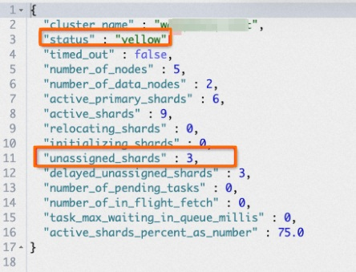

2. 发现集群状态为yellow，未被分配的副本分片数量为3，进一步查询未被分配的原因。

   ```text
   GET _cluster/allocation/explain
   ```

   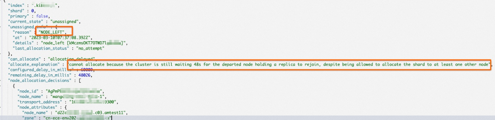

3. 副本分片未被分配的原因代码是 `NODE_LEFT` ，根据分片未分配的常见原因结合具体原因判断集群中可能有节点离线。

4. 执行以下命令查询集群节点信息，确认是否有节点离线。

   ```text
   GET _cat/nodes?v
   ```

   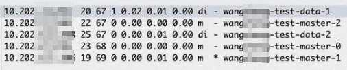

5. 根据以上返回结果发现data-0节点离线，导致集群状态变为yellow。此时需要恢复data-0节点并将其重新加入集群。

<a id="section-5-1-2"></a>

### 5.1.2. 业务请求异常

当您遇到无法访问Elasticsearch实例的问题时，可参考本文进行排查解决。

**排查步骤**

当业务请求出现异常时，如果是请求慢问题请参见查询慢进行排查解决；如果是无法访问Elasticsearch实例可以按照以下步骤进行排查解决。

1. 检查Elasticsearch实例状态是否正常。

   <ol type="i">

   <li>

   登录目标Elasticsearch实例的Kibana控制台，根据页面提示进入Kibana主页。登录Kibana控制台的具体操作，请参见登录Kibana控制台。

   > 本文以阿里云Elasticsearch 7.10版本为例，其他版本操作可能略有差别，请以实际
   >
   > **说明**
   >
   > 界面为准。

   </li>

   <li>

   在左侧导航栏，单击

   图标，然后选择**Management > Dev tools**。

   

   </li>

   <li>

   在**Console**页签中，执行以下命令检查待访问的索引状态是否正常。

   ```text
   GET _cat/indices
   ```

   如果待访问的索引状态为red，可参见集群状态异常进行排查解决。

   </li>

   </ol>

2. 如果实例状态正常，请检查网络选择是否正确。即检查业务与实例是否在同一网络环境中，如果处于不同网络，需要更改为同一网络环境。

   > 对于网络类型为single tunnel的Elasticsearch实例，客户端需要与其在同一VPC和
   >
   > **说明**
   >
   > VSwitch下。

3. 如果网络选择正确，请在客户端上执行如下命令测试访问是否正常。

   ```bash
   curl ${es实例域名}:9200 -uelastic:${es实例访问密码} 
   ```

   如果访问正常，请排查业务本身使用问题。如果不正常，需要提交工单联系阿里云技术支持进行确认和处理。工单中需要附上异常时的相关截图并详细描述之前进行的相关操作。

<a id="section-5-1-3"></a>

### 5.1.3. 变更配置异常

当您的集群出现变更配置异常时，可参考本文进行排查解决。

**排查步骤**

当您在变更集群配置时，如果发现集群状态长时间为**更新中**，则需要排查变更是否处于异常状态。

1. 登录OPS1机器，执行如下命令查看节点状态。

   ```bash
   kubectl get pod -n ${es实例的namespace} | grep ${es实例名称}
   ```

   如果集群中有状态长期异常（非Running）的节点，则表示集群变更异常。

   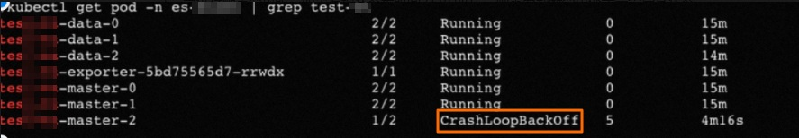

2. 查询状态异常的节点的日志，分析报错信息。

   ```bash
   kubectl logs ${es实例节点pod名称} -c es -n ${es实例所在namespace}
   ```

3. 如果异常节点日志为空或者无法发现报错，那么需要查看operator日志来分析报错。

   ```bash
   kubectl logs ${operator pod名称} -n ${es实例所在namespace}
   ```

4. 通过上述日志描述判断变更异常原因，并进行排查解决。

   如果无法排查解决，需要按照以上步骤收集信息，提交工单联系技术支持人员根据实际业务场景分析解决。工单中需要附上异常时的相关截图并详细描述之前进行的相关操作。

<a id="section-5-1-4"></a>

### 5.1.4. 反亲和性导致集群状态异常

当您的集群由于反亲和性出现状态异常时，可参考本文进行排查解决。

**背景信息**

为了预防单台机器上有多个数据节点或专有主节点导致的风险，阿里云Elasticsearch设置了集群反亲和性来避免同一个机器上分配相同角色的节点，其中Master节点强反亲和，Data节点弱反亲和：

- Master节点强反亲和：单台机器上无法调度出多个Master节点。

- Data节点弱反亲和：将Data节点尽可能不分配在一台机器上。但出于资源利用率考虑，当机器不够时，可支持多个Data在同一台机器上。此时，Elasticsearch会通过node attributes属性禁止同一分片的所有主副本调度在同一台机器上，防止造成单机故障时数据丢失。同时通过opendistro索引变黄，来提示集群的状态不健康。此时，若仍坚持单机多Data ，则需要调整相关配置来使集群变绿，具体操作请参见因Data弱反亲和导致集群变黄的调整方法。

**因Data弱反亲和导致集群变黄的调整方法**

1. 登录目标Elasticsearch实例的Kibana控制台，根据页面提示进入Kibana主页。

   登录Kibana控制台的具体操作，请参见登录Kibana控制台。

   > **说明**
   >
   > 本文以阿里云Elasticsearch 7.10版本为例，其他版本操作可能略有差别，请以实际界面为准。

2. 在左侧导航栏，单击

   图标，然后选择**Management > Dev tools**。

   

3. 在**Console**页签中，执行以下命令查看节点分布情况，确保至少有2台机器。

   ```text
   GET _cat/nodeattrs?v&s=value
   ```

   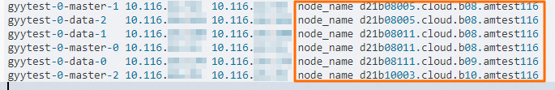

4. 调整 `cluster.routing.allocation.awareness.force.node_name.values` 配置。

   ```text
   PUT _cluster/settings
   {
     "persistent": {
       "cluster.routing.allocation.awareness.force.node_name.values" : ""
     }
   }
   ```

   > **重要**
   >
   > - 调整配置时，请以实际集群中的配置为准，在一些集群中可能awareness需要替换为node_ip。
   >
   > - 一旦节点发生迁移，需要关注节点的分布情况，保证至少有2台机器。

5. 等待索引全部分配后，将配置设回，以防止后续节点迁移时所有节点迁移到单台机器造成故障。

   ```text
   PUT _cluster/settings
   {
     "persistent": {
       "cluster.routing.allocation.awareness.force.node_name.values" : null
     }
   }
   ```

<a id="section-5-1-5"></a>

### 5.1.5. 白屏功能异常

您在使用Elasticsearch时如果遇到白屏功能异常，可以参考本文进行排查和解决。

- Kibana界面无法登录

  - 报错信息：

    - 6.x/7.x版本：kibana server is not ready yet

    - 5.x版本：Authorization Exception

  - 原因分析：kibanaserver账号的白名单配置有误。

  - 解决方案：修改kibanaserver账号白名单，kibanaserver账号增加Kibana服务所在IP地址。

- Kibana白名单关闭后仍可登录

  - 异常现象：Kibana白名单关闭后仍可登录，未正常限制打开。

  - 原因分析：Kibana界面未重新初始化。

  - 解决方案：联系现场运维同学重启该Kibana所在的pod。

- 监控数据无数据

  - 异常现象：grafana监控页面的数据显示no data。

  - 原因分析：monitoring_collector账号的白名单配置有误。

  - 解决方案：修改monitoring_collector账号白名单，monitoring_collector账号增加exporter服务所在IP地址。

- 访问Elasticsearch插件页面报错

  - 报错信息：403 Forbidden:[Ip 23.5.\*\*.\*\* is not allow in ip white/black list]

  - 原因分析：monitoring_collector账号的白名单配置有误。

  - 解决方案：monitoring_collector账号白名单，monitoring_collector账号增加essen服务所在IP地址。

- 访问自动备份页面报错

  - 报错信息：proxy request fail

  - 原因分析：monitoring_collector账号的白名单配置有误。

  - 解决方案：修改monitoring_collector账号白名单，monitoring_collector账号增加essen服务所在IP地址。

- 自动备份不生效

  - 异常现象：到规定时间点后未正常快照。

  - 原因分析：monitoring_collector账号的白名单配置有误。

  - 解决方案：修改monitoring_collector账号白名单，monitoring_collector账号增加snapshot服务所在IP地址。

- Kibana登录报错

  - 异常现象：账号密码无误，但登录报错(此处以monitoring_collector为例)

  - 原因分析：对应账号的白名单配置有误或未开启**能否登陆kibana**功能。

  - 解决方案：对应账号配置Kibana服务所在IP地址，并选中**能否登陆kibana**。

- 跨集群访问报错（xdcr集群同步失败）

  - 报错信息：[][22.0.x.x:9300] general node connection failure

  - 原因分析：交互的集群证书不同。

  - 解决方案：咨询现场运维人员，或查看运维指南中实例管理相关操作。

> **说明**
>
> 更多信息，请参见集群运维。

<a id="section-5-2"></a>

## 5.2. 性能类问题

<a id="section-5-2-1"></a>

### 5.2.1. 查询慢

当您的业务出现查询慢的问题时，可参考本文进行排查解决。

**排查步骤**

1. 判断是全部机器慢还是部分机器慢。

   <ol type="i">

   <li>

   登录目标Elasticsearch实例的Kibana控制台，根据页面提示进入Kibana主页。登录Kibana控制台的具体操作，请参见登录Kibana控制台。

   > 本文以阿里云Elasticsearch 7.10版本为例，其他版本操作可能略有差别，请以实际
   >
   > **说明**
   >
   > 界面为准。

   </li>

   <li>

   在左侧导航栏，单击

   图标，然后选择**Management > Dev tools**。

   

   </li>

   <li>

   在**Console**页签中，执行如下命令。

   - 使用profile API获取profile内容。

     ```text
     GET /${索引名称}/_search?human=true
     {
         "profile": true, 
         "_source": false,
         "query": {
            "您⾃⼰的业务代码"
         }
     }
     ```

     > 如果您使用的是其他查询方式，将 `"profile": true` 插入自己的业务查询代码中
     >
     > **说明**
     >
     > 即可。

     通过返回结果可以看到节点id和查询耗时。如果所有节点的查询耗时都较高，可判断为全部机器慢；如果仅部分节点的查询耗时较高，可判断为部分机器慢。

     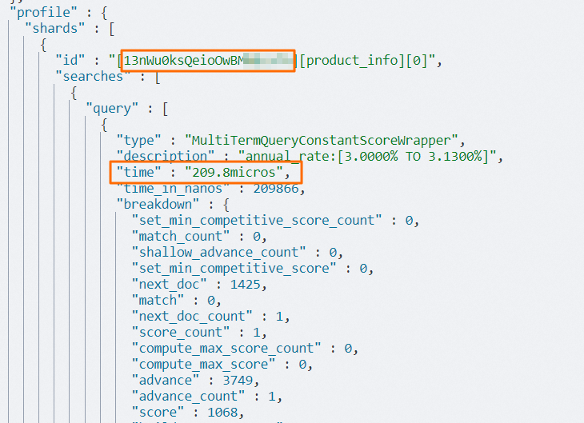

   - 查询节点id与集群pod名称对应关系，找到查询慢的机器所在pod。

     ```text
     GET _cluster/state
     ```

   </li>

   </ol>

2. 根据结果进行排查解决。如果是全部机器慢，需要业务自行查看查询语法问题。如果是部分机器慢，则重试一次，看有无恢复。如果未恢复，则可定位为单机问题；如果恢复，则考虑为IO问题。这两种问题都需要提交工单联系技术支持人员根据实际业务场景分析解决。

<a id="section-5-2-2"></a>

### 5.2.2. 写入慢

当您的业务出现写入慢的问题时，可参考本文进行排查解决。

**排查步骤**

1. 判断单次访问慢，还是压力情况下访问慢。

   - 如果单次访问慢，则可在其他环境复测，确认是否为环境问题。

   - 如果压力下访问慢，则首先对比性能基线，看是否符合预期。

2. 如果没有上述因素，需要判断是否出现性能瓶颈。

   <ol type="i">

   <li>

   登录目标Elasticsearch实例的Kibana控制台，根据页面提示进入Kibana主页。登录Kibana控制台的具体操作，请参见登录Kibana控制台。

   > 本文以阿里云Elasticsearch 7.10版本为例，其他版本操作可能略有差别，请以实际
   >
   > **说明**
   >
   > 界面为准。

   </li>

   <li>

   在左侧导航栏，单击

   图标，然后选择**Management > Dev tools**。

   

   </li>

   <li>

   在**Console**页签中，执行以下命令查询节点信息并根据节点名称排序。

   ```text
   GET _cat/nodes?v&s=n
   ```

   在返回结果中观察**cpu**列是否过高，90以上表示CPU负载高；或者观察load_5m是否大于实例pod的CPU核数，大于则表示CPU负载高。

   </li>

   <li>

   如果CPU负载高，需要查询线程信息。

   ```text
   GET _nodes/hot_threads
   ```

   如果返回结果中出现大量write线程或者具体索引分片的merge线程，则此时CPU负载是在写入，等待写入完成再观察具体情况。如果负载还高，需要提交工单联系技术支持人员根据现场情况分析解决。

   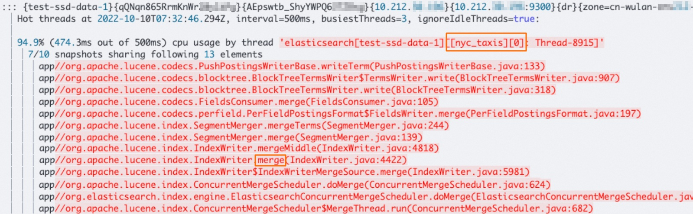

   </li>

   </ol>

3. 如果CPU负载正常，则需要查询write线程池情况。

   ```text
   GET _cat/thread_pool/write?v
   ```

   如果返回结果的**queue**列不为0，说明写入压力较大，对应实例无法及时处理请求，需要提交工单联系技术支持人员根据现场情况分析解决。

4. 排查内存瓶颈。在Elasticsearch的Granfana监控大盘中查询Old GC情况。具体操作，请参见查看Elasticsearch的Granfana监控大盘。

   Old GC执行会导致卡顿，需要提交工单联系技术支持人员根据现场情况分析解决。

5. 排查磁盘瓶颈。

   <ol type="i">

   <li>

   登录Kubernetes服务器的master节点，执行如下命令进入Elasticsearch实例的Data节点所在的pod中。

   ```bash
   kubectl -n ${es实例的namespace} exec -it {es的data pod名称} -c es /bin/bash
   ```

   </li>

   <li>

   查看所有磁盘的使用情况，重点关注读取速率（rkB/s）、写入速率（wkB/s）、磁盘压力（%util）。

   ```text
   iostat -xm 3
   ```

   > `-m` 表示使用MB作为读写速率的单位； `3` 表示读取数据的间隔时间为3秒，即每3
   >
   > **说明**
   >
   > 秒刷新1次。

   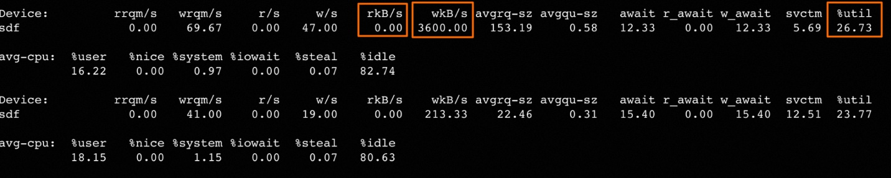

   </li>

   <li>

   根据磁盘压力找到负载高的磁盘，然后通过如下命令查看该磁盘（Device列为磁盘名称）的信息。

   ```text
   iostat -xm ${对应的磁盘名称} 3
   ```

   </li>

   <li>

   收集排查得到的磁盘信息，提交工单联系技术支持人员根据实际业务场景分析解决。

   </li>

   </ol>

   如果无法排查解决，需要按照以上步骤收集信息，提交工单联系技术支持人员根据实际业务场景分析解决。工单中需要附上异常时的相关截图并详细描述之前进行的相关操作。

<a id="section-5-2-3"></a>

### 5.2.3. CPU使用率高

当集群出现CPU使用率高的问题时，可参考本文进行排查解决。

**排查步骤**

CPU使用率大于80，则表示CPU使用率高，需要进行下面的检查。

1. 登录Elasticsearch的Granfana监控大盘，观察CPU使用率是否持续过高。具体操作请参见查看Elasticsearch的Granfana监控大盘。如果CPU使用率持续过高，需要执行以下步骤排查解决。

2. 登录目标Elasticsearch实例的Kibana控制台，根据页面提示进入Kibana主页。登录Kibana控制台的具体操作，请参见登录Kibana控制台。

   > 本文以阿里云Elasticsearch 7.10版本为例，其他版本操作可能略有差别，请以实际界
   >
   > **说明**
   >
   > 面为准。

3. 在左侧导航栏，单击

   图标，然后选择**Management > Dev tools**。

   

4. 在**Console**页签中，执行如下命令查询CPU过高对应的节点名称。

   ```text
   GET _cat/nodes?v&h=cpu,name
   ```

5. 在**Console**页签中，执行如下命令查询CPU使用率高的节点的hot_thread信息。

   ```text
   GET _nodes/${CPU使⽤率⾼的节点name}/hot_threads
   ```

6. 根据获取的hot_threads线程信息，结合现场实际情况进行排查解决。如果无法排查解决，需要按照以上步骤收集信息，提交工单联系技术支持人员根据实际业务场景分析解决。工单中需要附上异常时的相关截图并详细描述之前进行的相关操作。

<a id="section-5-2-4"></a>

### 5.2.4. heap使用率高

当集群出现heap使用率高的问题时，可参考本文进行排查解决。

**排查步骤**

heap使用率大于90，则表示heap使用率高，需要进行下面的检查。

1. 登录Elasticsearch的Granfana监控大盘，观察heap使用率是否持续过高并查看gc指标情况。具体操作请参见查看Elasticsearch的Granfana监控大盘。如果heap使用率持续过高，需要执行以下步骤排查解决。

2. 登录目标Elasticsearch实例的Kibana控制台，根据页面提示进入Kibana主页。登录Kibana控制台的具体操作，请参见登录Kibana控制台。

   > 本文以阿里云Elasticsearch 7.10版本为例，其他版本操作可能略有差别，请以实际界
   >
   > **说明**
   >
   > 面为准。

3. 在左侧导航栏，单击

   图标，然后选择**Management > Dev tools**。

   

4. 在**Console**页签中，执行以下命令查看每个节点上所有segment占用的memory总和。

   ```text
   GET _cat/nodes?v&h=name,sm
   ```

   如果节点上segment占用的memory较大，则需要考虑降低，具体操作如下：

   <ol type="i">

   <li>

   删除无用的索引。

   > 索引删除后将无法恢复，请谨慎操作。
   >
   > **警告**

   ```text
   DELETE ${索引名称}
   ```

   </li>

   <li>

   关闭暂时不使用的索引，需要的时候再重新打开索引。

   ```text
   POST ${索引名称}/_close
   ```

   </li>

   </ol>

5. 查看fielddata内存占用情况。

   - 查看集群的fielddata

     ```text
     GET _stats/fielddata?human
     ```

   - 查看所有节点的fielddata

     ```text
     GET _nodes/stats/indices/fielddata?human
     ```

   - 查看单个索引的fielddata

     ```text
     GET ${索引名称}/_stats/fielddata?human
     ```

   如果fielddata占用的内存过大，则需要根据实际情况清理缓存，相关命令如下：

   - 清理所有fielddata缓存

     ```text
     POST _cache/clear?fielddata=true
     ```

   - 清理单个索引的fielddata缓存

     ```text
     POST ${索引名称}/_cache/clear?fielddata=true
     ```

6. 查看query_cache内存占用情况。

   - 查询集群的query_cache。

     ```text
     GET _stats/query_cache?human
     ```

   - 查询所有节点的query_cache。

     ```text
     GET _nodes/stats/indices/query_cache?human
     ```

   - 查询单个节点的query_cache。

     ```text
     GET _nodes/${节点名称}/stats/indices/query_cache?human
     ```

   - 查询单个索引的query_cache。

     ```text
     GET ${索引名称}/_stats/query_cache?human
     ```

   如果query_cache占用的内存过大，则需要根据实际情况进行清理，相关命令如下：

   - 清理所有query_cache

     ```text
     POST _cache/clear?query=true
     ```

   - 清理单个索引的query_cache

     ```text
     POST ${索引名称}/_cache/clear?query=true
     ```

如果无法排查解决，需要按照以上步骤收集信息，提交工单联系技术支持人员根据实际业务场景分析解决。工单中需要附上异常时的相关截图并详细描述之前进行的相关操作。

<a id="section-5-2-5"></a>

### 5.2.5. load负载高

当您的Elasticsearch集群出现load负载高的问题时，可参考本文进行排查解决。

**排查步骤**

如果节点的Load5 average指标长期大于该节点的available_processors参数值，表示该节点有load负载高的问题。可通过以下方式排查处理：

1. 获取节点的Load5 average指标值。

   <ol type="i">

   <li>

   进入目标Elasticsearch集群的Grafana监控大盘，具体操作请参见查看Elasticsearch的Granfana监控大盘。

   </li>

   <li>

   观察各节点的Load5 average指标是否持续过高。如果有节点的Load5 average指标长期居高不下，那么需要记录该节点的名称和Load5 average指标值。

   </li>

   </ol>

2. 获取节点的available_processors参数值。

   <ol type="i">

   <li>

   登录目标Elasticsearch实例的Kibana控制台，根据页面提示进入Kibana主页。登录Kibana控制台的具体操作，请参见登录Kibana控制台。

   > 本文以阿里云Elasticsearch 7.10版本为例，其他版本操作可能略有差别，请以实际
   >
   > **说明**
   >
   > 界面为准。

   </li>

   <li>

   在左侧导航栏，单击

   图标，然后选择**Management > Dev tools**。

   

   </li>

   <li>

   在**Console**页签中，执行以下命令查询目标节点的**available_processors**值。

   ```text
   GET _nodes/${es节点名称}/?filter_path=*.*.os.available_processors
   ```

   `${es`的节点名称`}` 需要替换为步骤1中记录的节点名称。

   </li>

   </ol>

3. 判断集群是否存在load负载高的问题。如果获取到的available_processors值大于步骤1中记录的Load5 average指标值，则说明对应节点的load负载高。需要继续执行以下步骤。

4. 在**Console**页签中，执行以下命令查询负载高的节点的hot_threads。

   ```text
   GET /_nodes/${es负载⾼的节点名称}/hot_threads
   ```

5. 根据获取的hot_threads信息，结合现场实际情况进行排查处理。如果无法处理，需要收集排查信息，提交工单联系阿里云技术支持进行确认和处理。

<a id="section-5-3"></a>

## 5.3. 使用类问题

<a id="section-5-3-1"></a>

### 5.3.1. 创建实例问题

当您在Apsara Uni-manager运维控制台创建Elasticsearch实例，遇到400报错、实例创建后长时间处于更新中状态、实例创建后健康度不为green（例如yellow、unknown）等问题时，可参考本文排查解决。

**背景信息**

- 在Apsara Uni-manager运营控制台创建Elasticsearch实例的具体操作，请参见<strong>《Elasticsearch用户指南》</strong>中的<strong>《创建实例》</strong>章节。

- 在Apsara Uni-manager运维控制台创建Elasticsearch实例的具体操作，请参见创建实例。

**概述**

本文主要介绍在Apsara Uni-manager运维控制台创建Elasticsearch实例的常见问题与排查方法，包括：

- 创建实例报错400

- 创建后实例状态长时间处于更新中

- 创建后实例健康度不为green

**创建实例报错400**

**问题说明**

具体报错如下：


此报错表示数据节点个数大于5个但没有设置专有主节点，或者数据节点个数为2个但没有设置专有主节点。

**解决方案**

重新创建实例。创建时，如果设置的数据节点个数为2个，则必须设置专有主节点；如果设置的数据节点个数大于5个，也必须设置专有主节点。

**创建后实例状态长时间处于更新中**

**问题说明**

更新中的状态说明实例部署还未到达终态。

**排查方案**

1. 登录Kubernetes服务器的master节点。

2. 查询创建实例的信息，获取实例的namespace。

   ```bash
   kubectl get es -A | grep ${实例名称}
   ```

3. 查看实例的pod信息，获取不为Running状态的pod名称。

   ```bash
   kubectl get pod -n ${实例的namespace}
   ```

   

4. 查看状态不为Running的pod的详细信息。

   ```bash
   kubectl describe pod ${podname} -n ${实例的namespace}
   ```

   > **说明**
   >
   > `${podname}` ：状态不为Running的pod名称。

5. 根据结果进行分析，排查具体是哪种原因导致pod处于非Running状态，并根据结果进行修复。

   如果无法排查修复，需要按照以上步骤收集信息，提交工单联系技术支持人员根据实际业务场景分析解决。工单中需要附上异常时的相关截图并详细描述之前进行的相关操作。

**创建后实例健康度不为green**

**问题说明**

Elasticsearch实例的健康度异常分为2种：创建中健康度为unknown、创建完成健康度为red或yellow。

**创建中健康度为unknown**

正常情况，一般实例部署到终态之后就会变为green，长时间未改变状态则需要参见创建后实例状态长时间处于更新中进行排查处理。

**创建完成健康度为red或yellow**

登录Kibana控制台，参见集群状态异常进行排查处理。

<a id="section-5-3-2"></a>

### 5.3.2. 查看实例的基本信息和监控信息

当您在运维过程中需要获取实例的基本信息和相关指标的监控信息时，可参考本文进行查看获取。

**查看实例的基本信息**

- 如果您是在Apsara Uni-manager运营控制台创建的实例，需要前往Apsara Uni-manager运营控制台查看实例的基本信息。在实例列表中单击目标实例ID，在基本信息页面查看即可，具体操作请参见<strong>《Elasticsearch 用户指南》</strong>中的<strong>《查看实例基本信息》</strong>章节。

- 如果您是在Apsara Uni-manager运维控制台创建的实例，需要前往Apsara Uni-manager运维控制台查看实例的基本信息。在实例列表中单击目标实例ID，在基本信息页面查看即可，具体操作请参见创建实例。

**查看实例的监控信息**

- 如果您是在Apsara Uni-manager运营控制台上，依次进入**产品 > 迁移与运维管理 > 云监控 > 云资源监控 > 云产品监控 > 大数据（数加） > 检索分析服务 Elasticsearch 版**页面，单击目标实例ID或者**操作**列下的**监控图表**，查看监控信息。具体操作请参见<strong>《云监控 用户指南》</strong>中的<strong>《管理云产品监控》</strong>章节。

- 如果您是在Apsara Uni-manager运维控制台上，依次进入**监控告警 > 监控管理 > 云平台监控大盘 >数据大盘 > 自定义大盘 > ElasticSearch 监控大盘**页面，单击大盘名称，查看监控信息。具体操作请参见<strong>《Apsara Uni-manager运维控制台 用户指南》</strong>中的<strong>《自定义大盘》</strong>章节。

<a id="section-5-3-3"></a>

### 5.3.3. 配置analysis-ik词典

analysis-ik是阿里云Elasticsearch内置的中文分词插件，专为中文文本的索引和搜索场景设计。该插件能够通过精准的中文分词能力，提升搜索相关性，是中文业务场景（如电商、政务、日志分析）中的核心组件。本文主要介绍该插件的使用方式。

**前提条件**

已开启白名单。详情操作，请参见账号安全设置。

**使用限制**

上传的自定义词典文件大小必须小于1 MB，如果上传多个自定义词典文件，文件大小的总和也必须小于1 MB，否则会失败。

**注意事项**

该操作会导致实例重启，请谨慎操作。

**操作步骤**

1. 进入插件修改配置页面。

   <ol type="i">

   <li>

   登录检索分析服务运维控制台。

   </li>

   <li>

   在实例列表中，单击目标实例ID。

   </li>

   <li>

   在左侧导航栏，选择**插件管理 > Elasticsearch插件**。

   </li>

   <li>

   在插件列表中，找到**analysis-ik**插件，单击右侧的**修改配置**。

   </li>

   </ol>

2. 添加文件。

   <ol type="i">

   <li>

   添加自定义文件。

   <ol type="a">

   <li>

   在配置页面，单击**添加文件**，在对话框中自定义文件名称。本文以 `extra_main_1.dic` 为例。

   > **重要**
   >
   > 文件名称可以自定义，但是扩展名 `.dic` 不可以修改。

   </li>

   <li>

   单击创建的文件名，在右侧编辑文件内容。示例如下：

   ```text
   ⻄溪湿地
   多⾏内容
   aaabbb
   ```

   </li>

   </ol>

   </li>

   <li>

   添加IKAnalyzer.cfg.xml文件。

   再次单击**添加文件**，命名为 `IKAnalyzer.cfg.xml` ，然后在右侧编辑文件内容。具体内容如下：

   ```xml
   <?xml version="1.0" encoding="UTF-8"?>
   <!DOCTYPE properties SYSTEM "http://java.sun.com/dtd/properties.dtd">
   <properties>
    <comment>IK Analyzer 扩展配置</comment>
    <!--⽤户可以在这⾥配置⾃⼰的扩展字典 -->
    <entry key="ext_dict">extra_main_1.dic</entry>
     <!--⽤户可以在这⾥配置⾃⼰的扩展停⽌词字典-->
    <entry key="ext_stopwords">custom/ext_stopword.dic</entry>
     <!--⽤户可以在这⾥配置远程扩展字典 -->
    <entry key="remote_ext_dict">location</entry>
     <!--⽤户可以在这⾥配置远程扩展停⽌词字典-->
    <entry key="remote_ext_stopwords">http://xxx.com/xxx.dic</entry>
   </properties>
   ```

   > **重要**
   >
   > 上面代码中的 `key="ext_dict"` 字段后面的值需要替换成前面步骤a中的文件名（ `extra_main_1.dic` ）。如果有多个文件需要用 `;` 号分隔，其他字段不用修改。

   </li>

   </ol>

3. 选中上面创建的两个文件，单击**确定**。

4. 在确认提交对话框中，单击**确定**。

5. 选择重启方式后，单击**确定**。

   此时，实例开始重启。待实例重启成功后，该配置生效。

**结果验证**

登录目标实例对应的Kibana，执行如下示例命令，提交analyzer和分词字符串。

```text
POST _analyze
{
"analyzer": "ik_max_word",
"text": "⻄溪湿地"
}
```

预期结果：系统会对输入的文本做切分，然后会把自定义词典里的内容提取出来。

执行结果如下所示，则表示执行成功。

```json
{
  "tokens" : [
    {
      "token" : "⻄溪湿地",
      "start_offset" : 0,
      "end_offset" : 4,
      "type" : "CN_WORD",
      "position" : 0
    },
    {
      "token" : "湿地",
      "start_offset" : 2,
      "end_offset" : 4,
      "type" : "CN_WORD",
      "position" : 1
    }
  ]
}
```
