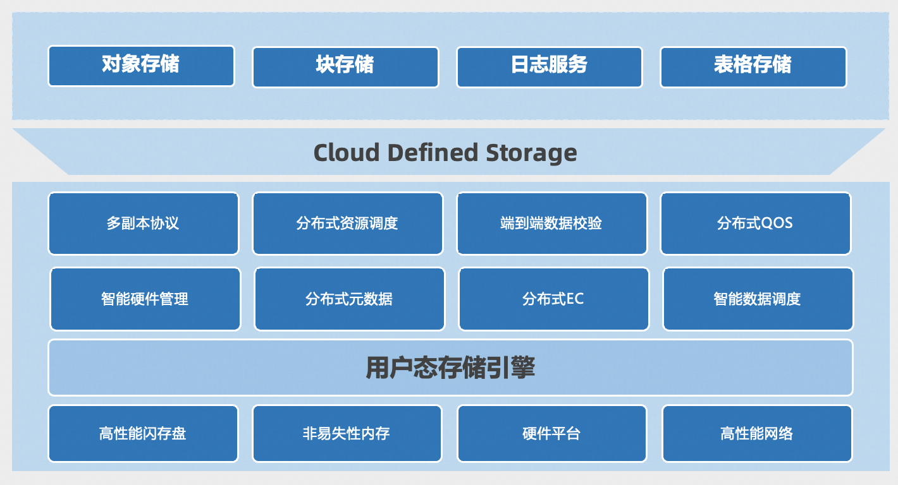

阿里云  
专有云  
云服务定义存储  
产品简介  
产品版本：V3.18.6  
文档版本：20251205

**目录**

- [1.云定义存储](#section-1)
    - [1.1. 产品详情](#section-1-1)
    - [1.2. 产品价值](#section-1-2)
    - [1.3. 应用场景](#section-1-3)
    - [1.4. 功能特性](#section-1-4)
        - [1.4.1. 对象存储OSS](#section-1-4-1)
        - [1.4.2. 块存储EBS](#section-1-4-2)
        - [1.4.3. 日志服务SLS](#section-1-4-3)

# 1.云定义存储

云定义存储CDS（ Cloud Defined Storage）是阿里云提供的以云定义存储的分布式文件系统，具有安全、低成本、高可靠、统一管控、云上和云下资源弹性扩展等特点，能有效解决在本地高效存储和获取数据的问题。

针对不同行业的非结构化数据访问、海量日志数据处理等需求，CDS通过部署对象存储OSS、日志服务SLS、块存储EBS、表格存储Tablestore（简称OTS）等不同服务，提供非结构化数据（例如文档、图片、视频等）存储，日志数据存储以及日志查询和分析功能，适用于移动应用、大型网站等大数据场景下的非结构化数据存储以及海量日志数据的存储、查询和分析。CDS能为不同领域的企业用户提供低成本、安全可靠的一体化存储解决方案。

## 1.1. 产品详情

**概述**

云定义存储CDS（Cloud Defined Storage）是阿里云提供的以云服务定义存储的分布式文件系统。CDS通过部署块存储EBS、对象存储OSS、日志服务SLS、表格存储Tablestore（简称OTS）等不同服务，提供结构化和非结构化数据存储、查询和分析能力，为不同领域的企业用户提供低成本、安全可靠的一体化存储解决方案。

产品架构图：

CDS的存储集群上支持部署对象存储服务、日志服务等。当CDS中部署不同云服务时，支持的功能特性不同。对象存储OSS、块存储EBS、表格存储OTS和日志服务SLS四种数据存储服务的区别请参见下表。

| 分类 | 特点 | 场景 |
| --- | --- | --- |
| 块存储 | 是为ECS实例提供的块设备，高性能、低时延，满足随机读写，可以像使用物理硬盘一样格式化建文件系统使用。 | 可用于大部分通用业务场景下的数据存储。 |
| 对象存储 | 可以理解为一个海量的存储空间，最适合存储互联网上产生的图片、短视频、音频等海量非结构化数据。用户可以通过API在任何时间、任何地点访问对象存储中的数据。 | 常用于互联网业务网站搭建、动静资源分离等业务场景。 |
| 日志服务 | 提供日志数据采集、加工、存储、查询与分析、可视化、告警、消费与投递等能力。 | 适用于数据采集、实时计算、数仓与离线分析、产品运营与分析、运维与管理等场景。 |

**对象存储OSS**

对象存储OSS（Object Storage Service ）是阿里云提供的安全、低成本、高可靠的云存储服务。采用三副本、EC纠删码、版本控制等技术，同时拥有完善的权限管理、容灾备份、数据加密、数据处理等能力，具有高可靠性、高安全性、低成本等特点。适用于海量文档、音视频、图片等非结构化数据存储、离线数据归档存储、数据多地容灾等场景。

**块存储EBS**

块存储EBS（Elastic Block Storage）是为云服务器ECS提供的低时延、持久性、高可靠的块级随机存储。块存储提供基于分布式存储架构的弹性块存储产品。

弹性块存储产品为ECS实例提供数据块级别的随机存储，具有低时延、持久性、高可靠等特点，采用EC纠删码机制，为ECS实例提供数据可靠性保证。可以随时创建或释放，也可以随时扩容。

EBS支持云盘。云盘是为云服务器ECS提供的数据块级别的块存储产品。根据性能不同，云盘包括高性能云盘、普通性能云盘、高效云盘和SSD云盘。

**日志服务SLS**

日志服务SLS（Log Service）是针对日志类数据的一站式服务，在阿里巴巴集团经历大量大数据场景锤炼而成，为Log、Metric、Trace等数据提供大规模、低成本、实时的平台化服务。用户无需开发就能快捷完成日志数据采集、加工、消费以及查询分析等功能，提升运维、运营效率，建立DT时代海量日志处理能力。

**混合云容灾**

混合云容灾HDR产品详情如下：

- 解决的核心问题

  应用级容灾保障业务持续性（Business Continuity）：在数据中心故障或长时间系统维护作业时，在容灾站点快速恢复应用运行，缩短业务停机时间，极大减少损失。利用混合云容灾服务的服务器整机复制能力，您可以方便地跨可用区进行ECS容灾，无需重构。

- 支持的业务类型

  为企业关键应用提供高标准容灾方案，提供分钟级的RPO和RTO容灾。

## 1.2. 产品价值

CDS具有部署形态灵活、高性能、高可靠性等优势。CDS中部署不同的云服务时，云服务也具有各自的优势。

**整体优势**

**部署形态灵活**

以云服务的方式定义存储，用户可以灵活选择融合部署或者分离部署不同服务，支持动态灵活扩容。

**高性能**

- 通过整合所有存储节点的资源（例如CPU、硬盘等），实时动态均匀分配数据存储以及处理任务，实现并发数据处理，避免了单点故障造成的瓶颈，提升整个集群的处理能力。

- 存储集群具有良好的性能扩展能力，能满足应用程序不断增长的存储性能需求。

**高可靠性**

- 存储集群采用纠删码机制，将数据分块存储在不同机架的不同机器上，并会在数据块异常时进行快速恢复。

**高可用性**

- 存储集群采用全冗余架构，无单点故障。通过自动的故障检测和数据迁移，对应用屏蔽了机器和网络的硬件故障，提供高可用性。

- 存储集群采用纠删码机制，在保证一定数据冗余情况下，有效提升了存储集群的空间利用率。

**高扩展性**

通过扩展存储集群、增加和升级存储集群中的服务器硬件、增加存储集群中的存储节点数量等多种方式提升集群的服务能力。存储集群可支持在线平滑升级，动态增加或者删除存储节点以及进行集群热升级，不需要停机维护，数据可以自动迁移。

**访问安全性**

提供多种权限管理机制，并对应用的每一次请求都进行身份认证和鉴权，以防止未授权的数据访问，确保数据访问的安全性。

**管理便捷**

- 应用程序无需关心数据分区的管理、软硬件升级、配置更新、集群扩容等繁琐的运维任务。

- 支持将审计日志自动存储到日志存储服务中，并可通过日志存储服务下载日志，便于长期存储、管理审计日志信息。

- 通过CDS Ops统一运维平台对存储集群以及运行在存储集群上的对象存储服务、日志存储服务、块存储EBS等进行日常运维管理。

**对象存储OSS优势**

**OSS与自建存储对比的优势**

| 对比项 | 对象存储OSS | 自建服务器存储 |
| --- | --- | --- |
| 可靠性 | • 数据自动多重冗余备份。 • 支持硬盘级，节点级、机柜级和集群级别故障。最大支持2个节点损坏，可以实现业务不中断持续提供数据读写操作。 | • 受限于硬件可靠性，易出问题，一旦出现磁盘坏道，容易出现不可逆转的数据丢失。 • 人工数据恢复困难、耗时、耗力。 |
| 安全 | • 提供企业级多层次安全防护。 • 多用户资源隔离机制。 • 提供多种鉴权和授权机制，以及白名单、防盗链、主子账号、STS临时授权访问功能。 | 需要单独实现安全机制。 |
| 数据处理能力 | 提供图片处理功能。 | 需要额外采购，单独部署。 |

**OSS的其他优势**

- 方便、快捷的使用方式

  - 提供标准的RESTful API接口（部分接口与Amazon S3 API兼容）、丰富的SDK包、客户端工具、控制台。您可以像使用文件一样方便地上传、下载、检索、管理用于Web网站或者移动应用的海量数据。

  - 支持流式写入和读出。特别适合视频等大文件的边写边读业务场景。

  - 支持数据生命周期管理。您可以自定义将到期数据批量删除。

  - 提供超大的存储空间：您可以通过增加节点数量扩展存储空间。对象存储OSS单Bucket存放文件数量无上限，实测存放万亿小文件，读写性能无损失。

- 强大、灵活的安全机制

  灵活的鉴权、授权机制。提供STS和URL鉴权和授权机制，以及白名单、防盗链、主子账号功能。

- 丰富的图片处理服务

  支持JPG、PNG、BMP、GIF、WebP、TIFF等多种图片格式的转换，以及缩略图、剪裁、水印、缩放等多种操作。

**块存储EBS优势**

块存储提供了基于分布式存储架构的弹性块存储产品。

弹性块存储产品为ECS实例提供数据块级别的随机存储，具有低时延、持久性、高可靠等特点，采用EC纠删码机制，为ECS实例提供数据可靠性保证。可以随时创建或释放，也可以随时扩容。

**高性能**

- 采用自研用户态TCP协议栈，单路时延低至百微妙；采用自研用户态文件系统，进一步提升SSD性能。

**高可靠性**

- 单节点宕机业务不中断，多节点宕机数据不丢失，保障业务的稳定性。

- 支持通过云内复制和跨云复制对数据进行容灾保护。

**高可用性**

- 弹性块存储支持在不停止业务运行的情况下进行在线扩容，包括系统盘和数据盘。在扩容期间，用户无需停止ECS实例，也无需卸载云盘。

- 云盘跨集群热迁移，业务无影响。

**安全性**

- 云盘落盘加密，快照、镜像基于加密算法的完整性保护。

- 通过全链路CRC校验，规避底层硬件故障风险。

**表格存储Tablestore优势**

**扩展性**

- 表格存储中表的数据量没有上限，随着表数据量的不断增大，表格存储会进行数据分区的调整从而为该表配置更多的存储并提供更高的并发访问能力。

- 在不影响运行性能的前提下，支持单组件集群中使用的CPU，硬盘、内存、网卡规格不一致，可以最大限度地兼容已有设备。

**高性能**

高性能实例能够提供单个毫秒级的单行平均访问延时，读写性能不受单表数据大小的影响。

**数据可靠性**

- 表格存储通过存储多个数据备份及备份失效时的快速恢复，提供极高的数据可靠性。

- 支持对集群内服务器硬盘故障自动容错处理，支持硬盘热插拔，故障硬盘的业务恢复时间小于1分钟。

- 支持对数据进行备份，支持全量或增量备份，并支持从存储中恢复数据。

- 支持数据中心间的数据集群备份，满足多中心之间的数据互备需求，备份过程可视化管理。

- 支持对关键组件元数据、文件、表进行备份和恢复。

**高可用性**

通过自动的故障检测和数据迁移，表格存储对应用屏蔽了机器和网络的硬件故障，提供高可用性。

**访问安全性**

- 表格存储提供多种权限管理机制，并对应用的每一次请求都进行身份认证和鉴权，以防止未授权的数据访问，确保数据访问的安全性。

- 支持数据访问权限管理，包括登录权限、创建表权限、读写权限、白名单控制权限等。

- 支持通过云管平台管理权限控制，包括管理员分级等；通过云管平台，提供集中统一的用户权限管理功能，将系统中各组件零散的权限管理功能集中呈现和管理，对普通用户屏蔽掉内部的权限管理细节，对管理员简化权限管理的操作方法，提升权限管理的易用性和用户体验。

**强一致性**

表格存储保证数据写入强一致，写操作一旦返回成功，保证数据3副本均写入磁盘，并且应用就能立即读到最近更新的数据。

**灵活的数据模型**

表格存储的表无固定格式要求，每行的列数可以不相同，支持多种数据类型（Integer、Boolean、Double、String、Binary）。

**多元化数据索引**

除了支持主键查询，表格存储还支持二级索引和多元索引的索引方式，提供强大的数据查询能力。

- 二级索引：相当于给数据表提供了另外一种排序方式，即对查询条件预先设计了一种数据分布，可加快数据查询的效率。

- 多元索引：基于倒排索引和列式存储，支持多字段自由组合查询、模糊查询、地理位置查询、全文检索等，可解决大数据的复杂查询难题。

**监控集成**

用户可以从表格存储控制台实时获取每秒请求数、平均响应延时等监控。

**多租户**

- 隔离：支持多租户并行执行，租户任务提交到不同的队列执行，租户间资源隔离。

- 权限：支持通过控制台，实现的租户统一管理，实现租户资源的动态配置和管理，资源隔离，资源使用统计等功能，支持多级租户的管理功能。

- 调度：支持多集群和多资源池的多租户调度。

**日志服务SLS优势**

**全托管服务**

- 应用性强，简单快速即可接入服务进行使用。

- LogHub 覆盖 Kafka 全部功能，提供监控、报警等功能数据，并支持弹性伸缩（可支持PB/Day规模）。

- LogSearch/Analytics 提供快速查询、仪表盘和报警功能。

- 提供超过30种接入方式，与开源软件（Storm、Spark）无缝对接。

**生态丰富**

- LogHub支持30多种日志数据源，无论是嵌入式设备、网页、服务器、程序等都能轻松接入。在消费端，支持与Storm、Spark Streaming等对接。

- LogSearch/Analytics 查询分析语法完整，兼容SQL92，支持JDBC协议与对接Grafana。

**实时性强**

- LogHub：写入即可消费；Logtail（采集Agent）实时采集传输。

- LogSearch/Analytics：写入后3秒内即可进行查询分析，在千亿数据规模多个查询分析条件下实现数据的秒级查询结果返回。

**高吞吐**

日志服务具备高吞吐特性，通过日志服务软件优化，单机吞吐性能可参考如下：

- 数据写入：单机原始日志写入最高可达400 MB/s以上，索引日志写入最高可达150 MB/s以上。

- 实时消费：实时消费最高可达400 MB/s以上。

- QPS：单机QPS最高可达1万以上。

- 原始查询：千亿级数据5个及以上查询条件，10秒内返回命中的100行数据。

- 实时分析：10亿级数据秒级返回数据，100亿级数据5个及以上的查询条件，5秒内返回数据。

> 单机吞吐性能，根据硬件不同存在波动。
>
> **说明**

**弹性**

提供PB级别数据弹性伸缩能力。

**混合云容灾**

**简单易用**

- 容灾站点部署简单、控制台集中管控。

- 可按需进行故障切换和容灾演练，一键启动、快速清理。

**RPO/RTO分级**

企业需要对重要性级别不同的应用制定阶梯化的RPO/RTO。企业的基础架构，尤其是网络情况会制约能达到的容灾指标。基于磁盘级数据复制技术，可以提供分钟级的RPO/RTO。

**跨可用区容灾**

- 支持将Windows、Linux应用服务器做高效的容灾复制和恢复，实现应用级跨可用区容灾。

- 您可以只针对关键应用的数据，包括SQL Server、Oracle数据库等进行定时备份和恢复，实现数据级跨可用区容灾。

**跨云容灾**

跨云容灾是指生产云和灾备云是部署在异地的两个云实例。当生产云发生故障时，业务系统切换到灾备云，有效避免了云实例异常导致的系统故障，保障业务的可用性，满足业务的RTO/RPO核心指标。

## 1.3. 应用场景

CDS能为不同领域的企业用户提供低成本、安全可靠的一体化存储解决方案。企业用户可以通过在CDS中部署不同服务来满足不同场景的需求。

**对象存储OSS**

**图片和音视频等应用的海量存储**

OSS可用于图片、音视频、日志等海量文件的存储。各种终端设备、Web网站程序、移动应用可以直接向OSS写入或读取数据。OSS支持文件写入方式。

**离线数据归档存储**

根据OSS低成本和高可用的特性，可以将企业内部长期需要离线归档的数据转存至OSS。

**数据多地容灾**

您存储的数据可以通过跨区域复制或跨云复制等能力实现两个Region或两个云之间的数据异步复制，帮助您实现两地三中心的技术架构、多地数据容灾备份，使您可以在极端灾难中保证业务流畅。

**块存储EBS**

块存储EBS（Elastic Block Storage）是为云服务器ECS提供的低时延、持久性、高可靠的块级随机存储。块存储提供了基于分布式存储架构的弹性块存储产品。弹性块存储产品根据是否可挂载到多台ECS实例分为云盘和共享云盘。

**云盘**

云盘根据性能不同分为普通性能云盘和高性能云盘，高效云盘和SSD云盘。

- 普通性能云盘和高性能云盘面向OLTP数据库（例如MySQL、PostgreSQL、Oracle、SQL Server等关系型数据库）、NoSQL数据库（例如MongoDB、HBase、Cassandra等非关系型数据库）、ElasticSearch分布式日志（ELK，即ElasticSearch、Logstash和Kibana日志分析等）场景，高性能云盘为ECS实例提供最高25000的随机IOPS性能。

- 高效云盘面向中度I/O负载的应用场景，为ECS实例提供最高3000的随机IOPS性能，可用作系统盘。

- SSD云盘为I/O密集型应用提供稳定的高随机IOPS性能，适用于对数据可靠性要求高的中小型开发测试环境。

**日志服务SLS**

日志服务的典型应用场景，包括数据采集、实时计算、数仓与离线分析、产品运营与分析、运维与管理。

**数据采集与消费**

通过日志服务LogHub功能，可以大规模低成本接入各种实时日志数据（包括Metric、Event、BinLog、TextLog、Click等）。

- 使用便捷：提供30+实时数据采集方式，让您快速搭建平台、减轻运维负担。

- 弹性伸缩：无论是流量高峰还是业务增长都能轻松应对。

**数据清洗与实时计算 （ETL/Stream Processing）**

日志中枢（LogHub）支持与各种实时计算及服务对接，并提供完整的进度监控、报警等功能，并可以根据SDK/API实现自定义消费。

- 操作便捷：提供多种语言的SDK以及编程框架，与各流计算引擎无缝对接。

- 功能完善：支持报警机制，并提供丰富的监控数据。

- 弹性伸缩：PB级弹性能力，0延迟。

**日志实时查询与分析**

实时查询分析（LogAnalytics）可以实时索引LogHub中数据，提供关键词、模糊、上下文、范围、SQL聚合等丰富查询手段。

- 实时性强：写入后即可查询。

- 海量低成本：支持PB/Day索引能力，成本为自建方案的15%。

- 分析能力强：支持多种查询手段，及SQL进行聚合分析，并提供可视化及报警功能。

**混合云容灾**

**跨可用区容灾**

混合云容灾服务支持业务的跨可用区（Zone）容灾能力，应对不同的业务需求，当生产站点发生故障时，业务系统切换到容灾站点，有效避免了地域性灾害导致的系统故障，保障业务的可用性，满足业务的RTO/RPO核心指标。

**跨云容灾**

支持跨云容灾能力。跨云容灾是指生产云和灾备云是部署在异地的两个云实例。当生产云发生故障时，业务系统切换到灾备云，有效避免了云实例异常导致的系统故障，保障业务的可用性，满足业务的RTO/RPO核心指标。

## 1.4. 功能特性

### 1.4.1. 对象存储OSS

本文介绍对象存储OSS的功能特性。

**Bucket管理**

<table>
  <tr>
    <th width="199">功能</th>
    <th>说明</th>
  </tr>
  <tr>
    <td>创建Bucket</td>
    <td>存储空间（Bucket）是用于存储对象（Object）的容器，所有的Object都必须隶属于某个Bucket。Bucket具有各种配置属性，包括地域、访问权限、存储类型等。用户可以按需创建Bucket来存储数据。</td>
  </tr>
  <tr>
    <td>删除Bucket</td>
    <td>支持删除无对象的空Bucket。 警告Bucket删除后无法恢复，请谨慎操作。</td>
  </tr>
  <tr>
    <td>读写权限ACL</td>
    <td>支持在创建Bucket时设置访问权限（ACL），也可以在创建Bucket后根据自己的业务需求修改ACL，该操作只有Bucket的拥有者可以执行。访问权限： • public-read-write：公共读写，任何人（包括匿名访问者）都可以对该Bucket内文件进行读写操作。 警告互联网上任何用户都可以对该Bucket内的文件进行访问，并且向该Bucket写入数据。这有可能造成您数据的外泄，若被人恶意写入违法信息还可能会侵害您的合法权益。除特殊场景外，不建议您配置公共读写权限。 • public-read：公共读，只有该存储空间的拥有者可以对该Bucket内的文件进行写操作，任何人（包括匿名访问者）都可以对该Bucket中的文件进行读操作。 警告互联网上任何用户都可以对该Bucket内文件进行访问，这有可能造成您数据的外泄，请谨慎设置。 • private：私有，只有该存储空间的拥有者可以对该Bucket内的文件进行读写操作，其他人无法访问该Bucket内的文件。</td>
  </tr>
  <tr>
    <td>静态网站托管</td>
    <td>可以通过静态网站托管功能将用户的静态网站托管到OSS的Bucket，并使用Bucket的访问域名访问这个网站。 • 默认首页是通过浏览器访问静态网站域名时，OSS返回的网站首页（相当于网站的index.html）。为默认首页指定的文件必须是Bucket根目录下允许被匿名访问的文件，文件仅支持HTML格式。 • 默认404页是通过浏览器访问Bucket内文件出现404错误时，OSS返回的错误页面。为默认404页指定的文件必须是Bucket根目录下允许被匿名访问的文件，文件支持HTML、JPG、PNG、BMP、WebP格式。</td>
  </tr>
  <tr>
    <td>容量管理</td>
    <td>• 创建Bucket时，支持限制该Bucket容量上限。 • 支持通过控制台修改Bucket容量上限。</td>
  </tr>
  <tr>
    <td>日志转存</td>
    <td>访问对象存储OSS的过程中会产生大量的访问日志，用户可以通过日志转存功能将这些日志按照固定命名规则，以小时为单位生成日志文件写入用户指定的Bucket。对于已存储的日志，用户可以通过阿里云日志服务或搭建Spark集群等方式进行分析。</td>
  </tr>
  <tr>
    <td>生命周期管理</td>
    <td>生命周期规则可以定期将非热门数据，或者将不再需要访问的数据删除，让用户更高效地管理存储的数据，节省大量人力及存储成本。例如某存储空间内有大量文件需要全部删除，但是手动删除每次仅可以删除最多1000个文件，操作较为繁琐。此时可以配置一条匹配整个Bucket的生命周期规则，设置一天后删除所有文件。此Bucket内的数据会在第二天被全部删除。</td>
  </tr>
  <tr>
    <td>Bucket标签</td>
    <td>通过Bucket的标签功能， 可对Bucket进行分类管理，如列举带有指定标签的Bucket、对拥有指定标签的Bucket设置访问权限等。</td>
  </tr>
  <tr>
    <td>防盗链设置</td>
    <td>OSS支持基于HTTP和HTTPS header中标头字段Referer的方法设置防盗链白名单、黑名单和Referer是否为空。当浏览器向OSS发送请求时，请求标头中将包含Referer，用于告知OSS该请求的页面链接来源。如果配置了防盗链，OSS将根据请求的Referer与配置的Referer规则来判断是否允许此请求： • 如果浏览器附带的Referer与白名单Referer匹配，则OSS将允许该请求的访问。 • 如果浏览器附带的Referer与黑名单Referer匹配，或与白名单Referer不匹配，则OSS将拒绝该请求的访问。 • 如果不允许空Referer，则只有HTTP或HTTPS header中包含Referer字段的请求才能访问OSS资源。</td>
  </tr>
  <tr>
    <td>保留策略（WORM）</td>
    <td>OSS保留策略具有WORM（Write Once Read Many）特性，满足用户以不可删除、不可篡改方式保存和使用数据。如果用户希望指定时间内任何用户（包括资源拥有者）均不能修改和删除OSS某个Bucket中的Object，用户可以选择为Bucket配置保留策略。在保留策略指定的Object保留时间到期之前，仅支持在Bucket中上传和读取Object。Object保留时间到期后，才可以修改或删除Object。</td>
  </tr>
  <tr>
    <td>跨域资源共享（CORS）</td>
    <td>OSS提供HTML5协议中的跨域资源共享CORS（Cross-Origin Resource Sharing）设置，帮助用户实现跨域访问。当OSS收到一个跨域请求（或者OPTIONS请求），会读取存储空间对应的CORS规则，然后进行相应的权限检查。OSS会依次检查每一条规则，使用第一条匹配的规则来允许请求并返回对应的Header。如果所有规则都匹配失败，则不附加任何CORS相关的Header。</td>
  </tr>
  <tr>
    <td>清单（Inventory）</td>
    <td>支持通过API获取Bucket中指定Object的数量、大小、存储类型等信息。</td>
  </tr>
  <tr>
    <td>回源规则</td>
    <td>回源类型分为镜像和重定向两种方式，可以满足用户对于数据热迁移、特定请求的重定向等需求。 • 镜像回源配置了镜像回源后，当用户对OSS中一个不存在的文件进行GET操作时，OSS会向回源规则指定的地址请求这个文件，在获取到目标文件后返回给用户，并将该文件写入OSS。镜像回源主要用于无缝迁移数据到OSS，即服务已经在自己建立的源站或者在其他云产品上运行，需要迁移到OSS上，但是又不能停止服务，此时可利用镜像回写功能实现。 • 重定向配置了重定向后，当用户对OSS中一个不存在的文件进行GET操作时，OSS会将用户的请求重定向至回源规则指定的地址去获取目标文件。用户可以利用这种跳转的功能对文件做重定向以及在此基础之上的各种业务。</td>
  </tr>
</table>

**Object管理**

<table>
  <tr>
    <th width="121">功能</th>
    <th>说明</th>
  </tr>
  <tr>
    <td>上传对象</td>
    <td>对象（Object）是OSS存储数据的基本单元，也被称为OSS的文件。用户可以结合待上传的文件大小以及网络环境，选择适当的上传方式。OSS提供以下多种上传方式： • 简单上传：包括流式上传和文件上传。最大不能超过5 GiB。 • 表单上传：最大不能超过5 GiB。 • 追加上传：最大不能超过5 GiB。 • 断点续传上传：支持并发、断点续传、自定义分片大小。大文件上传推荐使用断点续传。最大不能超过48.8 TiB。 • 分片上传：当文件较大时，可以使用分片上传，最大不能超过48.8 TiB。上传过程中，用户可以设置文件元信息，也可以通过进度条功能查看上传进度。上传完成后，用户还可以进行上传回调。</td>
  </tr>
  <tr>
    <td>删除对象</td>
    <td>支持删除对象，可通过如下几种方式删除： • 通过控制台删除对象。 • 通过生命周期管理策略自动删除对象。 • 通过SDK和API删除对象。 • 通过ossutil等工具删除对象。 警告对象删除后无法恢复，请谨慎操作。</td>
  </tr>
  <tr>
    <td>读写权限ACL</td>
    <td>OSS提供Object级别的文件读写权限ACL，用以控制Object的访问权限。用户可以在上传Object时设置相应的ACL权限控制，也可以在上传之后修改ACL。如果不设置ACL，默认值为<strong>继承Bucket</strong>。 • 继承Bucket：Object的读写权限按Bucket的读写权限为准。 • 私有：只有该文件的拥有者可以对该文件进行读写操作，其他人无法访问该文件。 • 公共读：只有该文件的拥有者可以进行写操作，任何人（包括匿名访问者）都可以对该文件进行读操作。 • 公共读写：任何人（包括匿名访问者）都可以对该对象进行读写操作，请慎用该权限。</td>
  </tr>
</table>

<table>
  <tr>
    <td>下载对象</td>
    <td>OSS提供了丰富的Object下载方式，用户可以选择合适的方式将存储在Bucket中的文件下载下来。提供以下几种下载方式： • 下载到本地文件：将Bucket中的文件下载到本地。 • 流式下载：当下载的文件太大或者一次性下载耗时太长时，用户可以通过流式下载，一次处理部分内容，直到完成文件的下载。 • 范围下载：如果仅需要文件中的部分数据，用户可以使用范围下载，下载指定范围内的数据。 • 断点续传下载：当下载大文件时，如果网络不稳定或者程序异常退出，会导致下载失败，甚至重试多次仍无法完成下载。为此OSS提供了断点续传下载功能。断点续传下载的方式，将需要下载的文件分成若干个分片分别下载，所有分片均下载完成后，将所有分片合并成完整的文件。 • 限定条件下载：下载文件时，可以指定一个或多个限定条件。满足限定条件则下载，不满足则返回错误，不下载。</td>
  </tr>
  <tr>
    <td>管理对象</td>
    <td>• OSS支持通过指定文件名前缀快速搜索并定位目标文件。 • 可创建目录将文件存放至指定目录。</td>
  </tr>
  <tr>
    <td>对象标签</td>
    <td>对象标签使用一组键值对（Key-Value）标记对象，用户可以在上传文件时添加标签，也可以为现有文件添加标签，实现以下功能： • 为相同标签的Object设置生命周期规则。 • 通过RAM Policy管理指定标签Object的权限。</td>
  </tr>
</table>

**数据安全**

<table>
  <tr>
    <th width="96">功能</th>
    <th>说明</th>
  </tr>
  <tr>
    <td>三副本</td>
    <td>将每个数据块（Chunk）复制成三个相同的副本，并将这些副本按照一定的策略存放在集群中的不同节点上，这样可以确保即使某个节点发生故障，数据仍然可以从其他节点恢复。</td>
  </tr>
  <tr>
    <td>EC纠删码</td>
    <td>• 将原始数据分成多个数据块，并通过计算生成一定数量的校验块。这些数据块和校验块共同组成一个EC组，分布在不同的存储节点上。当部分数据块或校验块丢失时，可以通过其他块恢复丢失的数据。EC包含数据块（n）和校验块（m）这两个概念： • 数据块（n）：数据分成n个数据切片。 • 校验块（m）：通过n个数据块计算而得的m个校验块。数据块（n）+校验块（m）组成一个EC组，它们分别位于不同的服务器上，当丢失任意小于等于m个块时，都能通过EC算法恢复丢失的块。 • 其中n+m是可配置的，专有云推荐配置为8+3（取决于部署的集群节点数量）。 • 支持在线修改EC策略。</td>
  </tr>
  <tr>
    <td>资源隔离</td>
    <td>OSS的用户认证采用Access Key对称密钥认证技术，对于用户的每个HTTP请求都验证签名。在用户验证通过后，重组用户离散存储的数据，从而实现多租户间的数据存储隔离。</td>
  </tr>
</table>

同城容灾是指将您的数据冗余存储在同一个地域的多个可用区AZ（Availability Zone），在单可用区故障时尽可能保证数据不丢，帮助您快速恢复业务。

OSS提供了两种同城容灾方案。具体说明如下：

- 同城2AZ容灾：为Bucket开启同城容灾功能后，OSS会将主机房Bucket数据同步到备机房OSS集群中的备份Bucket。当主机房整体故障时（如断电、火灾等），仍然能够保障数据的正常访问。

同城容灾

- 同城3AZ容灾：创建同城冗余存储的Bucket后，用户数据将冗余存储于同一地域内的三个独立可用区中，确保任一可用区因断网、断电或灾难等事件导致不可用时，其他两个可用区仍能继续提供服务，保障业务连续性和数据安全。

  当某个可用区故障时，OSS仍能提供强一致性的服务。故障切换过程对用户无感知，确保数据不丢失，满足关键业务系统对RPO（恢复点目标）等于0和RTO（恢复时间目标）趋于0的强需

容灾备份

求。

跨区域复制（Cross-Region Replication）是跨不同OSS数据中心（地域）的Bucket自动、异步（近实时）复制文件（Object），

跨区域复制

它会将Object的创建、更新和删除等操作从源存储空间复制到不同区域的目标存储空间。

跨云复制是指用户可以将一个云系统里的数据复制到另一个云系统中，帮助用户实现不同云系统的数据备份。当某个云系统出现故障时，用户可以直接将业务切换到另一个云系统，确保业务的连续

跨云复制

性。

RAM（Resource Access Management）是阿里云提供的资源访问控制服务。RAM Policy是基于用户的授权策略。通过设置RAM Policy，用户可以集中管理用户（例如员工、系统或应用程序），

RAM Policy

以及控制用户可以访问用户名下哪些资源的权限，例如限制其他用户只拥有对某一个Bucket的读权限。

- Bucket Policy：Bucket Policy是基于资源的授权策略。相比于RAM Policy，Bucket Policy操作简单，支持在控制台直接进行图形化配置，并且Bucket拥有者可以直接进行访问授权，无需具备RAM操作权限。Bucket Policy支持向其他账号的RAM用户授予访问权限，以及向匿名用户授予带特定IP条件限制的访问权限。

Bucket

- Bucket ACL：用户可以在创建Bucket时设置读写权限ACL，也

Policy

可以在Bucket创建后的任意时间内根据自己的业务需求随时修改ACL，该操作只有Bucket的拥有者可以执行。Bucket ACL分为public-read-write（公共读写）、public-read（公共读）

安全管控和账号授权

和private（私有）三种。

- 防盗链：OSS支持对Bucket设置防盗链，即通过对访问来源设置白名单的机制，避免OSS资源被其他人盗用。

除Bucket级别ACL以外，OSS还提供了Object级别的ACL。用户可以在上传Object时设置相应的ACL，也可以在Object上传后的任意时间内根据自己的业务需求随时修改ACL。Object ACL分为继承

Object ACL

Bucket、public-read-write（公共读写）、public-read（公共读）和private（私有）四种。

OSS通过服务端加密机制，提供静态数据保护。适合于对文件存储有高安全性或者合规性要求的应用场景。例如，深度学习样本文件的存储、在线协作类文档数据的存储。

服务端加密

使用客户端加密时，会为每个Object生成一个随机数据加密密钥，用该随机数据加密密钥明文对Object的数据进行对称加密。主密钥用于生成随机的数据加密密钥，加密后的内容会作为Object的meta信息保存在服务端。解密时先用主密钥将加密后的随机密钥解密出来，再用解密出来的随机数据加密密钥明文解密Object的数据。主密钥只参与客户端本地计算，不会在网络上进行传输或保存

加密

在服务端，以保证主密钥的数据安全。

> **警告**

客户端加密

> - 使用客户端加密功能时，您需要对主密钥的完整性和正确性负责。因您维护不当导致主密钥用错或丢失，从而导致加密数据无法解密所引起的一切损失和后果均由您自行承担。
>
> - 在对加密数据进行复制或者迁移时，您需要对加密元信息的完整性和正确性负责。因您维护不当导致加密元信息出错或丢失，从而导致加密数据无法解密所引起的一切损失和后果均由您自行承担。

版本控制是针对Bucket级别的数据保护功能。开启版本控制后，针对数据的覆盖和删

版本控制

除操作将会以历史版本的形式保存下来。在错误覆盖或者删除对象（Object）后，能够将Bucket中存储的Object恢复至任意时刻的历史版本。

**数据处理**

<table>
  <tr>
    <th width="122">功能</th>
    <th>说明</th>
  </tr>
  <tr>
    <td>原图保护</td>
    <td>开启原图保护后，将禁止直接访问 OSS 原文件或传入图片参数修改图片样式的访问。</td>
  </tr>
  <tr>
    <td>图片处理规则</td>
    <td>支持配置多条样式处理规则。</td>
  </tr>
  <tr>
    <td>图片效果处理</td>
    <td>通过图形化界面设置图片亮度、对比度、锐化、模糊、旋转。</td>
  </tr>
  <tr>
    <td>图片样式</td>
    <td>在一个样式（Style）中包含多个图片处理参数，快速实现复杂的图片处理操作。</td>
  </tr>
  <tr>
    <td>图片缩放</td>
    <td>按需选择不使用缩略、等比例缩小、等比例放大、指定宽高缩放。</td>
  </tr>
  <tr>
    <td>渐进显示</td>
    <td>用以开启先模糊后清晰的呈现方式，仅对格式为ipg的图片有效。</td>
  </tr>
  <tr>
    <td>自适应方向</td>
    <td>根据图片中 EXIF 旋转信息先旋转后进行缩略。</td>
  </tr>
  <tr>
    <td>格式转换</td>
    <td>可对图片进行格式转换，按需选择原图格式、jpg、jpeg、png、bmp、gif、webp、tiff格式类型。</td>
  </tr>
  <tr>
    <td>图片质量</td>
    <td>按需选择相对质量、绝对质量、不压缩。</td>
  </tr>
  <tr>
    <td>图片水印</td>
    <td>按需选择不使用水印、图片水印、文字水印。</td>
  </tr>
  <tr>
    <td>视频截帧</td>
    <td>可通过SDK或在URL中添加截帧参数方式提取视频帧并转换为需要的图片格式。</td>
  </tr>
</table>

**可扩展性**

<table>
  <tr>
    <th width="106">功能</th>
    <th>说明</th>
  </tr>
  <tr>
    <td>云存储网关</td>
    <td>文件网关将OSS Bucket的对象结构与NAS文件系统的目录/文件建立映射关系。用户通过标准的NFS和SMB协议即可读写指定OSS Bucket里的对象。并且利用本地存储空间作为热数据缓存，使用户在享受OSS Bucket海量空间的同时，保障数据访问的高性能。</td>
  </tr>
</table>

**工具及兼容性**

**功能**

**说明**

**支持的版本**

ossbrowser图形化管理工具

ossbrowser2.0

ossfs对象转文件系统工具NFS和CIFS

ossfs1.91.4

工具

ossftp对象转FTP工具

ossftp1.2.0

ossutil命令行工具

ossutil2.0

3.17.4及以前的版本

java

2.18.3及以前的版本

Python

SDK支持

2.0.0及以前的版本

PHP

3.11.2及以前的版本

C

3.0.2及以前的版本

Go

**部署要求**

- 在非容灾场景下，OSS集群部署需至少6个节点。

- 在同城容灾场景下，OSS集群部署时的节点数与使用的容灾方案有关。

  - 同城2AZ容灾：OSS集群分别部署在两个可用区，单个可用区中的集群部署需至少6个节点且两个可用区中集群的节点数必须一致。

  - 同城3AZ容灾：OSS 3AZ集群不能是首集群，且该朵云必须已存在一个同城容灾集群时才能额外建设3AZ容灾集群。OSS 3AZ集群部署需至少21个节点。单个可用区中的集群部署需至少7个节点且三个可用区中集群的节点数必须一致。

### 1.4.2. 块存储EBS

本文介绍块存储EBS的功能特性。

**云盘管理**

<table>
  <tr>
    <th width="160">功能</th>
    <th>说明</th>
  </tr>
  <tr>
    <td>创建云盘</td>
    <td>可单独创建云盘，增加ECS实例的存储空间。根据性能不同，云盘包括高性能云盘、普通性能云盘、高效云盘和SSD云盘。</td>
  </tr>
  <tr>
    <td>挂载云盘</td>
    <td>可将单独创建作为数据盘使用的云盘挂载至同地域同可用区的ECS实例。</td>
  </tr>
  <tr>
    <td>卸载云盘</td>
    <td>如果您不再需要使用数据盘，或者需要将数据盘挂载到同可用区的其他ECS实例时，需要先卸载数据盘。</td>
  </tr>
  <tr>
    <td>释放云盘</td>
    <td>如果您不再需要某块数据盘，可以将其手动释放，存储在云盘上的数据会被全部释放。</td>
  </tr>
  <tr>
    <td>批量挂载/卸载云盘</td>
    <td>• 支持将多个云盘批量挂载至同一个ECS实例上。 • 支持批量卸载挂载在同一个ECS实例上的多个云盘。</td>
  </tr>
  <tr>
    <td>重新初始化云盘</td>
    <td>支持将云盘重新初始化，恢复到云盘刚创建时的状态。 重要初始化云盘会导致现有数据丢失，无法恢复，请谨慎操作。如果您仍然需要云盘中的数据，请提前转移数据或者创建快照。</td>
  </tr>
  <tr>
    <td>云盘克隆</td>
    <td>您可以通过云盘克隆快速创建与现有云盘相同的云盘副本。</td>
  </tr>
  <tr>
    <td>云盘扩容</td>
    <td>随着业务的发展和应用数据增长，您可以在线扩容，从而存储更多数据，支持扩容系统盘和数据盘，且扩容后立即生效，无需重启ECS实例。您也可以离线扩容云盘，扩容后，您必须在控制台重启实例或者调用API <code> RebootInstance </code>使操作生效。</td>
  </tr>
  <tr>
    <td>云盘热变配</td>
    <td>可在云服务器运行过程中，在线调整云盘的类型，而无需停止实例或卸载云盘，适用于需要灵活扩展存储性能的场景。支持以下云盘变配操作，不支持降配等其他变配操作： • 高效云盘：支持变配到SSD云盘、普通性能云盘和高性能云盘。 • SSD云盘：支持变配到高效云盘、普通性能云盘和高性能云盘。 • 高性能云盘：仅支持变配到普通性能云盘。 • 普通性能云盘：仅支持变配到高性能云盘。</td>
  </tr>
  <tr>
    <td>存储集</td>
    <td>通过创建存储集，您可以按照业务类型等维度对块存储集群进行划分并绑定相应EBS集群到存储集的不同分区，实现不同业务之间EBS集群的隔离。</td>
  </tr>
  <tr>
    <td>设置云盘QoS</td>
    <td>支持通过CDS统一运维平台CDS Ops白屏化设置云盘IOPS和吞吐量上限。</td>
  </tr>
</table>

**数据安全及可靠性**

<table>
  <tr>
    <th width="144">功能</th>
    <th>说明</th>
  </tr>
  <tr>
    <td>三副本</td>
    <td>将每个数据块（Chunk）复制成三个相同的副本，并将这些副本按照一定的策略存放在集群中的不同节点上，这样可以确保即使某个节点发生故障，数据仍然可以从其他节点恢复。</td>
  </tr>
  <tr>
    <td>EC纠删码</td>
    <td>• 将原始数据分成多个数据块，并通过计算生成一定数量的校验块。这些数据块和校验块共同组成一个EC组，分布在不同的存储节点上。当部分数据块或校验块丢失时，可以通过其他块恢复丢失的数据。EC包含数据块（n）和校验块（m）这两个概念： • 数据块（n）：数据分成n个数据切片。 • 校验块（m）：通过n个数据块计算而得的m个校验块。数据块（n）和校验块（m）组成一个EC组，它们分别位于不同的服务器上，当丢失任意小于等于m个块时，都能通过EC算法恢复丢失的块。 • 其中n+m是可配置的，专有云推荐配置为8+3（取决于部署的集群节点数量）。</td>
  </tr>
  <tr>
    <td>在线修改EC策略</td>
    <td>支持通过运维平台在线修改EC策略。 重要开启EC模式后无法再切换为三副本模式，请谨慎操作。</td>
  </tr>
</table>

- 云盘异步复制

  <strong>异步复制适用于一组云盘的容灾需求。</strong>云盘异步复制基于块存储数据复制能力实现云内跨可用区或跨云的数据保护，该功能可以将某一块云盘的数据，异步复制到其他云或者云内其他可用区内的另一块云盘中，当主盘出现故障时，可通过从盘进行故障切换以及反向复制实现容灾恢复。

- 一致性复制组

云盘容灾

<strong>一致性复制组适用于多组云盘的容灾需求。</strong>一致性复制组能够实现业务系统跨多块云盘的容灾场景下，对多块云盘的异步复制做统一管理和操作，同时可以确保同一复制组内的多块云盘数据能够恢复到同一个时间点，以便实现容灾场景下多云盘的容灾保护。

多块云盘通过一致性复制组功能将生产站点的主盘数据云内跨可用区或跨云异步复制到灾备站点的从盘中，当生产站点出现故障时，可通过灾备站点进行故障切换以及反向复制实现容灾恢复。

数据加密适用于数据安全或法规合规等场景，帮助您加密保护存储在ECS上

云盘加密

的数据。支持加密系统盘和数据盘，均需在云盘创建时启用加密，创建后无法转换加密状态。

通过创建云盘热迁移任务，您可以快速完成块存储集群之间的云盘迁移，迁移期间不影响云盘的使用，可提升云盘的维护效率和优化资源分配。仅

云盘热迁移

支持迁移高性能云盘和普通性能云盘，迁移前后的云盘类型和云盘ID不变。

通过创建快照，用户可以保留某个时间点一块云盘的数据拷贝，有计划地

创建快照

对云盘创建快照，从而保证业务可持续运行。快照适用于环境复制、容灾备份等场景中。

自动快照策略适用于系统盘和数据盘，可以周期性地为云盘创建快照。合

自动快照

理利用自动快照策略能提高数据安全和操作容错率。

如果您已经为云盘创建了快照，可以通过回滚云盘功能将一块云盘的数据恢复到之前的某一时刻。

通过快照回滚云

> **重要**

盘

> 回滚云盘是不可逆操作，一旦回滚完成，回滚前的云盘数据将无法恢复，请谨慎操作。

快照链是一块云盘中所有快照组成的关系链，一块云盘对应一条快照链。

快照链

您可以通过快照链查看某一块云盘所有快照所占的容量。

云盘快照

- 通过创建快照一致性组，您可以为一台或多台ECS实例中的多块云盘同时创建快照。快照一致性组能够保证在业务系统跨多块云盘的场景下，数据写入云盘的时序一致性，并保证其崩溃一致性。

- 若用户对数据一致性有严格要求，可以在创建一致性快照组时开启应用

快照一致性组

一致性快照功能，应用一致性快照会确保应用程序内部的数据一致。仅支持对Windows 2016、Windows 2019、Windows 2022、Windows 2025、Ubuntu20.04、Ubuntu22.04、Ubuntu 24.04的操作系统启用应用一致性快照。

对于高性能云盘，如果在为高性能云盘创建快照时启用了快照极速可用特

快照极速可用

性，则创建快照后，您可以立即执行快照回滚、基于快照创建云盘操作。当不再需要使用快照极速可用特性时，您可以手动关闭该特性。

支持将本组织下创建的快照共享给其他一级组织，被共享的组织下的人员

共享快照

可通过共享的快照创建云盘。

本地盘是ECS实例所在物理机上的本地硬盘设备，为ECS实例提供本地缓存

本地盘

访问能力。由于本地盘直接连接到物理机上，因此具有低时延、高随机IOPS、高吞吐量的优势，适用于高性能缓存场景。

**性能及可扩展性**

<table>
  <tr>
    <th width="173">性能</th>
    <th>说明</th>
  </tr>
  <tr>
    <td>单盘容量下限</td>
    <td>20GB</td>
  </tr>
  <tr>
    <td>单盘容量上限</td>
    <td>• 高效云盘：32,768 GiB • 高性能云盘：131,072 GiB • SSD盘：32,768 GiB • 普通性能云盘：32,768 GiB</td>
  </tr>
  <tr>
    <td>最大IOPS</td>
    <td>• 高效云盘：5,000 • 高性能云盘：25,000 • SSD盘：25,000 • 普通性能云盘：5,000</td>
  </tr>
  <tr>
    <td>最大吞吐量</td>
    <td>• 高效云盘：140 MB/s • 高性能云盘：300 MB/s • SSD盘：300 MB/s • 普通性能云盘：140 MB/s</td>
  </tr>
  <tr>
    <td>HyperCache读缓存</td>
    <td>HyperCache是一种基于NVMe SSD的本地读缓存技术，部署在ECS计算节点上，用于加速云盘的读操作。其核心目标是减少跨网络访问存储集群的开销，从而显著降低读延迟并提升整体性能。</td>
  </tr>
  <tr>
    <td>多实例挂载</td>
    <td>开启了多重挂载功能的高性能云盘可以同时挂载到同可用区内的多台支持NVMe协议的ECS实例上，从而实现多台ECS实例对同一块高性能云盘的并发读写访问。</td>
  </tr>
</table>

**部署要求**

- EBS标准集群部署需至少6个节点，最多支持96个节点。

- EBS Lite集群在全闪存储介质上部署需至少4个节点。

  > **重要**
  >
  > 4节点部署时故障域只有1台，如果再有一台故障，则存在数据丢失风险。

### 1.4.3. 日志服务SLS

本文介绍日志服务SLS的功能特性。

**基本功能**

**功能**

**说明**

项目是日志服务中的资源管理单元，用于资源隔离和控制。您可以通过项目来管理某一个

项目（Project）

应用的所有日志及相关的日志源。它管理着用户的所有日志库（Logstore），采集日志的机器配置等信息，同时它也是用户访问日志服务资源的入口。

日志库是日志服务中日志数据的采集、存储和查询单元。每个日志库隶属于一个项目，且

日志库（LogStore）

每个项目可以创建多个日志库。

时序库是日志服务中时序数据的采集、存储和查询单元。日志服务的时序数据类型遵循

时序库

Prometheus的定义规范，在时序库中所有的数据都按照时序类型存储。时序数据由时序

（MetricStore）

标识和数据点组成，相同时序标识的数据组成时间线。

日志服务通过机器组的方式管理所有需要通过Logtail客户端收集日志的服务器。机器组是

机器组管理

包含多台服务器的虚拟分组。如果有多台服务器，并希望这些服务器使用同样的Logtail配置采集日志，可以将这些服务器加入同一个机器组，并将Logtail配置应用到该机器组。

通过Logtail客户端、WebTracking、SDK等方式，支持Log、Metric、Trace等数据类

日志采集

型，并支持多种数据源，包括阿里云产品、服务器与应用、物联网设备、移动端、开源软件、标准协议等多种格式的日志数据。

- 通用聚合函数。

- 安全监测函数。

- MAP映射函数。

分析算法

- 数理统计函数：标准差，协方差，相关度、回归斜率等算法。

- 估算函数、数学计算函数、字符串处理、日期与时间、URL函数、正则表达式、JSON处理、IP地址、窗口函数等。

序列分解

使用STL算法对时序数据进行序列分解。

- 支持JSON、文本、数值等数据类型查询。

- 支持JSON格式中文本自动构建索引。

数据查询

- 支持对数据进行全文查询。

- 支持多个条件组合查询（And、Or、Not）

- 支持原始日志中上下文查询（前后N行）。

- 支持对任意格式进行聚类。

日志查询分析

- 支持对查询结果数据进行聚类。

日志聚类

- 支持聚类精度调整。

- 支持根据聚类结果反查原始数据。

- 使用密度聚类方法对多条时序数据进行聚类。

时序聚类

- 使用层次聚类方法对多条时序数据进行聚类。

支持对时序数据进行平滑处理（Holt-Winters、FIR、IIR算

时序平滑处理

法）。

- 使用自回归模型对时序数据进行建模，并进行简单的时序预测和异常点的检测。

- 使用移动自回归模型对时序数据进行建模，并进行简单的时序预测和异常点检测。

时序预测

- 使用带有差分的移动自回归模型对时序数据进行建模，并进行简单的时序预测和异常点检测。

- 针对含有周期性、趋势性的单时序序列，进行准确预测。

极大值检测

极大值检测函数用于在指定窗口中寻找序列的局部极大值。

- 寻找时序序列中具有不同统计特性的区间，区间端点即为变点。

跳变点检测

- 寻找时序序列中，某统计量发生陡升或陡降的点。

日志服务提供基于原生OpenTelemetry协议的分布式链路追踪功能，支持各类Trace数据的接入、存储、分析、可视化、人工智能运维等。OpenTelemetry是目前全球公认的分布

Trace服务

式链路追踪标准，兼容OpenTracing、OpenCensus的各类客户端。OpenTelemetry由一组API、SDK和工具组成，用来观察、生成、采集和导出各类可观测性数据（Traces、Logs、Metrics）。

日志服务提供Scheduled SQL功能，用于定时分析数据、存储聚合数据、投影与过滤数

Scheduled SQL

据。

支持将常用的查询语句以图表形式展示，支持表格、线图、柱状图等多种统计图表类型。

仪表盘

支持将多项分析图表保存到一个仪表盘中统一查看。支持下钻分析功能，可获得更深维度的分析结果。

<table>
  <tr>
    <td>告警</td>
    <td>支持为日志的查询/分析结果设置告警。设置告警后，日志服务对查询分析结果进行定期检查，当检查结果满足预设条件时发送告警通知，实现实时的服务状态监控。</td>
  </tr>
</table>

**数据安全及可靠性**

<table>
  <tr>
    <th width="154">功能</th>
    <th>说明</th>
  </tr>
  <tr>
    <td>三副本</td>
    <td>将每个数据块（Chunk）复制成三个相同的副本，并将这些副本按照一定的策略存放在集群中的不同节点上，这样可以确保即使某个节点发生故障，数据仍然可以从其他节点恢复。</td>
  </tr>
  <tr>
    <td>EC纠删码</td>
    <td>• 将原始数据分成多个数据块，并通过计算生成一定数量的校验块。这些数据块和校验块共同组成一个EC组，分布在不同的存储节点上。当部分数据块或校验块丢失时，可以通过其他块恢复丢失的数据。EC包含数据块（n）和校验块（m）这两个概念： • 数据块（n）：数据分成n个数据切片。 • 校验块（m）：通过n个数据块计算而得的m个校验块。数据块（n）和校验块（m）组成一个EC组，它们分别位于不同的服务器上，当丢失任意小于等于m个块时，都能通过EC算法恢复丢失的块。 • 其中n+m是可配置的，具体取决于部署的集群节点数量。专有云推荐配置为8+3（节点数大于等于14台）。</td>
  </tr>
  <tr>
    <td>在线修改副本策略</td>
    <td>支持通过运维平台在线修改EC策略。</td>
  </tr>
  <tr>
    <td>数据加密</td>
    <td>日志服务支持通过密钥管理服务KMS（KeyManagementService）对数据进行加密存储，提供数据静态保护能力。 • 支持使用SLS托管密钥进行加密。 • 支持通过用户自带密钥（BYOK）加密。</td>
  </tr>
  <tr>
    <td>多Region</td>
    <td>中心Region部署管控模块SCMG，用于Project的唯一性校验，以及向各个Region的SLS服务集群同步账号信息。各Region部署独立的SLS服务集群，用于日志的存储、查询和分析。</td>
  </tr>
</table>

**数据管理**

<table>
  <tr>
    <th width="90">功能</th>
    <th>说明</th>
  </tr>
  <tr>
    <td>数据加工</td>
    <td>提供200多个内置函数、400多个正则表达式、灵活的自定义函数，实现过滤、分裂、转换、富化、复制等效果，满足数据分派、规整、融合等场景。</td>
  </tr>
  <tr>
    <td>数据消费</td>
    <td>对于采集到服务端的日志数据提供实时消费接口。支持如下类型的实时消费： • SDK消费：日志服务提供多语言（Java 、Python、Go等）SDK。 • 消费组消费：消费组是日志服务对消费者提供的高级模式。消费组提供了一个轻量级计算框架，解决多个消费者并行消费Logstore的能力，消费组提供自动分配Shard、保序、断点续传等功能，并提供多语言（Java、Python、Go等）消费组SDK。 • 实时计算系统消费 • Spark Streaming消费 • Storm消费 • 开源Flink消费 • 开源产品消费：Flume消费。</td>
  </tr>
  <tr>
    <td>数据投递</td>
    <td>支持将日志实时投递至对象存储OSS，便于长期存储数据和数据备份。</td>
  </tr>
</table>

**部署要求**

SLS集群部署需至少4个节点，但推荐使用6节点配置。

> **重要**
>
> 4节点部署时故障域只有1台，如果再有一台故障，则存在数据丢失风险。
