阿里云  
专有云  
云服务定义存储  
开发指南  
产品版本：V3.18.6  
文档版本：20251205

**目录**

- [1.对象存储](#section-1)
    - [1.1. API参考](#section-1-1)
        - [1.1.1. OSS API文档简介](#section-1-1-1)
        - [1.1.2. 访问控制](#section-1-1-2)
            - [1.1.2.1. 用户签名验证](#section-1-1-2-1)
            - [1.1.2.2. 在Header中包含签名](#section-1-1-2-2)
            - [1.1.2.3. 在URL中包含签名](#section-1-1-2-3)
            - [1.1.2.4. 临时授权访问](#section-1-1-2-4)
            - [1.1.2.5. Bucket权限控制](#section-1-1-2-5)
        - [1.1.3. 公共HTTP头定义](#section-1-1-3)
        - [1.1.4. 关于Service的操作](#section-1-1-4)
            - [1.1.4.1. GetService(ListBuckets)](#section-1-1-4-1)
        - [1.1.5. 关于Bucket的操作](#section-1-1-5)
            - [1.1.5.1. 基础操作](#section-1-1-5-1)
                - [1.1.5.1.1. PutBucket](#section-1-1-5-1-1)
                - [1.1.5.1.2. GetBucket (ListObjects)](#section-1-1-5-1-2)
                - [1.1.5.1.3. GetBucketInfo](#section-1-1-5-1-3)
                - [1.1.5.1.4. GetBucketLocation](#section-1-1-5-1-4)
                - [1.1.5.1.5. GetBucketStat](#section-1-1-5-1-5)
                - [1.1.5.1.6. DeleteBucket](#section-1-1-5-1-6)
            - [1.1.5.2. 合规保留策略（WORM）](#section-1-1-5-2)
                - [1.1.5.2.1. InitiateBucketWorm](#section-1-1-5-2-1)
                - [1.1.5.2.2. AbortBucketWorm](#section-1-1-5-2-2)
                - [1.1.5.2.3. CompleteBucketWorm](#section-1-1-5-2-3)
                - [1.1.5.2.4. ExtendBucketWorm](#section-1-1-5-2-4)
                - [1.1.5.2.5. GetBucketWorm](#section-1-1-5-2-5)
            - [1.1.5.3. 权限控制（ACL）](#section-1-1-5-3)
                - [1.1.5.3.1. PutBucketACL](#section-1-1-5-3-1)
                - [1.1.5.3.2. GetBucketAcl](#section-1-1-5-3-2)
            - [1.1.5.4. 生命周期（Lifecycle）](#section-1-1-5-4)
                - [1.1.5.4.1. PutBucketLifecycle](#section-1-1-5-4-1)
                - [1.1.5.4.2. GetBucketLifecycle](#section-1-1-5-4-2)
                - [1.1.5.4.3. DeleteBucketLifecycle](#section-1-1-5-4-3)
            - [1.1.5.5. 清单（Inventory）](#section-1-1-5-5)
                - [1.1.5.5.1. PutBucketInventory](#section-1-1-5-5-1)
                - [1.1.5.5.2. GetBucketInventory](#section-1-1-5-5-2)
                - [1.1.5.5.3. ListBucketInventory](#section-1-1-5-5-3)
                - [1.1.5.5.4. DeleteBucketInventory](#section-1-1-5-5-4)
            - [1.1.5.6. 日志管理（Logging）](#section-1-1-5-6)
                - [1.1.5.6.1. PutBucketLogging](#section-1-1-5-6-1)
                - [1.1.5.6.2. GetBucketLogging](#section-1-1-5-6-2)
                - [1.1.5.6.3. DeleteBucketLogging](#section-1-1-5-6-3)
            - [1.1.5.7. 静态网站（Website）](#section-1-1-5-7)
                - [1.1.5.7.1. PutBucketWebsite](#section-1-1-5-7-1)
                - [1.1.5.7.2. GetBucketWebsite](#section-1-1-5-7-2)
                - [1.1.5.7.3. DeleteBucketWebsite](#section-1-1-5-7-3)
            - [1.1.5.8. 防盗链（Referer）](#section-1-1-5-8)
                - [1.1.5.8.1. PutBucketReferer](#section-1-1-5-8-1)
                - [1.1.5.8.2. GetBucketReferer](#section-1-1-5-8-2)
            - [1.1.5.9. 标签（Tags）](#section-1-1-5-9)
                - [1.1.5.9.1. PutBucketTags](#section-1-1-5-9-1)
                - [1.1.5.9.2. GetBucketTags](#section-1-1-5-9-2)
                - [1.1.5.9.3. DeleteBucketTags](#section-1-1-5-9-3)
            - [1.1.5.10. 跨域资源共享](#section-1-1-5-10)
                - [1.1.5.10.1. 简介](#section-1-1-5-10-1)
                - [1.1.5.10.2. PutBucketcors](#section-1-1-5-10-2)
                - [1.1.5.10.3. GetBucketcors](#section-1-1-5-10-3)
                - [1.1.5.10.4. DeleteBucketcors](#section-1-1-5-10-4)
                - [1.1.5.10.5. OptionObject](#section-1-1-5-10-5)
            - [1.1.5.11. 版本控制（Versioning）](#section-1-1-5-11)
                - [1.1.5.11.1. PutBucketVersioning](#section-1-1-5-11-1)
                - [1.1.5.11.2. GetBucketVersioning](#section-1-1-5-11-2)
                - [1.1.5.11.3. GetBucketVersions(ListObjectVersions)](#section-1-1-5-11-3)
            - [1.1.5.12. 授权策略（Policy）](#section-1-1-5-12)
                - [1.1.5.12.1. PutBucketPolicy](#section-1-1-5-12-1)
                - [1.1.5.12.2. GetBucketPolicy](#section-1-1-5-12-2)
                - [1.1.5.12.3. GetBucketPolicyStatus](#section-1-1-5-12-3)
                - [1.1.5.12.4. DeleteBucketPolicy](#section-1-1-5-12-4)
        - [1.1.6. 关于Object的操作](#section-1-1-6)
            - [1.1.6.1. 基础操作](#section-1-1-6-1)
                - [1.1.6.1.1. PutObject](#section-1-1-6-1-1)
                - [1.1.6.1.2. GetObject](#section-1-1-6-1-2)
                - [1.1.6.1.3. CopyObject](#section-1-1-6-1-3)
                - [1.1.6.1.4. AppendObject](#section-1-1-6-1-4)
                - [1.1.6.1.5. DeleteObject](#section-1-1-6-1-5)
                - [1.1.6.1.6. DeleteMultipleObjects](#section-1-1-6-1-6)
                - [1.1.6.1.7. HeadObject](#section-1-1-6-1-7)
                - [1.1.6.1.8. GetObjectMeta](#section-1-1-6-1-8)
                - [1.1.6.1.9. PostObject](#section-1-1-6-1-9)
            - [1.1.6.2. 权限控制（ACL)](#section-1-1-6-2)
                - [1.1.6.2.1. PutObjectACL](#section-1-1-6-2-1)
                - [1.1.6.2.2. GetObjectACL](#section-1-1-6-2-2)
            - [1.1.6.3. 标签（Tagging）](#section-1-1-6-3)
                - [1.1.6.3.1. PutObjectTagging](#section-1-1-6-3-1)
                - [1.1.6.3.2. GetObjectTagging](#section-1-1-6-3-2)
                - [1.1.6.3.3. DeleteObjectTagging](#section-1-1-6-3-3)
            - [1.1.6.4. 分片上传](#section-1-1-6-4)
                - [1.1.6.4.1. 简介](#section-1-1-6-4-1)
                - [1.1.6.4.2. InitiateMultipartUpload](#section-1-1-6-4-2)
                - [1.1.6.4.3. UploadPart](#section-1-1-6-4-3)
                - [1.1.6.4.4. UploadPartCopy](#section-1-1-6-4-4)
                - [1.1.6.4.5. CompleteMultipartUpload](#section-1-1-6-4-5)
                - [1.1.6.4.6. AbortMultipartUpload](#section-1-1-6-4-6)
                - [1.1.6.4.7. ListMultipartUploads](#section-1-1-6-4-7)
                - [1.1.6.4.8. ListParts](#section-1-1-6-4-8)
        - [1.1.7. OSS错误响应](#section-1-1-7)
    - [1.2. SDK参考](#section-1-2)
        - [1.2.1. Java-SDK](#section-1-2-1)
            - [1.2.1.1. 前言](#section-1-2-1-1)
            - [1.2.1.2. 安装](#section-1-2-1-2)
            - [1.2.1.3. 初始化](#section-1-2-1-3)
            - [1.2.1.4. 快速入门](#section-1-2-1-4)
            - [1.2.1.5. 存储空间](#section-1-2-1-5)
                - [1.2.1.5.1. 创建存储空间](#section-1-2-1-5-1)
                - [1.2.1.5.2. 列举存储空间](#section-1-2-1-5-2)
                - [1.2.1.5.3. 判断存储空间是否存在](#section-1-2-1-5-3)
                - [1.2.1.5.4. 管理存储空间访问权限](#section-1-2-1-5-4)
                - [1.2.1.5.5. 存储空间标签](#section-1-2-1-5-5)
                - [1.2.1.5.6. 删除存储空间](#section-1-2-1-5-6)
                - [1.2.1.5.7. 存储空间清单](#section-1-2-1-5-7)
                - [1.2.1.5.8. 合规保留策略](#section-1-2-1-5-8)
                - [1.2.1.5.9. 生命周期管理](#section-1-2-1-5-9)
                - [1.2.1.5.10. 防盗链](#section-1-2-1-5-10)
                - [1.2.1.5.11. 跨域资源共享](#section-1-2-1-5-11)
                - [1.2.1.5.12. 设置访问日志](#section-1-2-1-5-12)
                - [1.2.1.5.13. 静态网站托管](#section-1-2-1-5-13)
            - [1.2.1.6. 上传文件](#section-1-2-1-6)
                - [1.2.1.6.1. 概述](#section-1-2-1-6-1)
                - [1.2.1.6.2. 简单上传](#section-1-2-1-6-2)
                - [1.2.1.6.3. 表单上传](#section-1-2-1-6-3)
                - [1.2.1.6.4. 追加上传](#section-1-2-1-6-4)
                - [1.2.1.6.5. 断点续传上传](#section-1-2-1-6-5)
                - [1.2.1.6.6. 分片上传](#section-1-2-1-6-6)
                - [1.2.1.6.7. 进度条](#section-1-2-1-6-7)
            - [1.2.1.7. 下载文件](#section-1-2-1-7)
                - [1.2.1.7.1. 概述](#section-1-2-1-7-1)
                - [1.2.1.7.2. 流式下载](#section-1-2-1-7-2)
                - [1.2.1.7.3. 下载到本地文件](#section-1-2-1-7-3)
                - [1.2.1.7.4. 范围下载](#section-1-2-1-7-4)
                - [1.2.1.7.5. 断点续传下载](#section-1-2-1-7-5)
                - [1.2.1.7.6. 限定条件下载](#section-1-2-1-7-6)
                - [1.2.1.7.7. 进度条](#section-1-2-1-7-7)
            - [1.2.1.8. 管理文件](#section-1-2-1-8)
                - [1.2.1.8.1. 概述](#section-1-2-1-8-1)
                - [1.2.1.8.2. 判断文件是否存在](#section-1-2-1-8-2)
                - [1.2.1.8.3. 管理文件访问权限](#section-1-2-1-8-3)
                - [1.2.1.8.4. 管理文件元信息](#section-1-2-1-8-4)
                - [1.2.1.8.5. 列举文件](#section-1-2-1-8-5)
                - [1.2.1.8.6. 查询文件](#section-1-2-1-8-6)
                - [1.2.1.8.7. 删除文件](#section-1-2-1-8-7)
                - [1.2.1.8.8. 拷贝文件](#section-1-2-1-8-8)
            - [1.2.1.9. 版本控制](#section-1-2-1-9)
                - [1.2.1.9.1. 管理版本控制](#section-1-2-1-9-1)
                - [1.2.1.9.2. 上传文件](#section-1-2-1-9-2)
                - [1.2.1.9.3. 下载文件](#section-1-2-1-9-3)
                - [1.2.1.9.4. 拷贝文件](#section-1-2-1-9-4)
                - [1.2.1.9.5. 列举文件](#section-1-2-1-9-5)
                - [1.2.1.9.6. 删除文件](#section-1-2-1-9-6)
                - [1.2.1.9.7. 获取文件元信息](#section-1-2-1-9-7)
                - [1.2.1.9.8. 管理文件访问权限](#section-1-2-1-9-8)
            - [1.2.1.10. 授权访问](#section-1-2-1-10)
            - [1.2.1.11. 图片处理](#section-1-2-1-11)
            - [1.2.1.12. 异常处理](#section-1-2-1-12)
            - [1.2.1.13. 常见问题](#section-1-2-1-13)
        - [1.2.2. Python-SDK](#section-1-2-2)
            - [1.2.2.1. 前言](#section-1-2-2-1)
            - [1.2.2.2. 安装](#section-1-2-2-2)
            - [1.2.2.3. 快速入门](#section-1-2-2-3)
            - [1.2.2.4. 初始化](#section-1-2-2-4)
            - [1.2.2.5. 存储空间](#section-1-2-2-5)
                - [1.2.2.5.1. 创建存储空间](#section-1-2-2-5-1)
                - [1.2.2.5.2. 列举存储空间](#section-1-2-2-5-2)
                - [1.2.2.5.3. 判断存储空间是否存在](#section-1-2-2-5-3)
                - [1.2.2.5.4. 管理存储空间访问权限](#section-1-2-2-5-4)
                - [1.2.2.5.5. 存储空间标签](#section-1-2-2-5-5)
                - [1.2.2.5.6. 删除存储空间](#section-1-2-2-5-6)
                - [1.2.2.5.7. 存储空间清单](#section-1-2-2-5-7)
                - [1.2.2.5.8. 合规保留策略](#section-1-2-2-5-8)
                - [1.2.2.5.9. 生命周期管理](#section-1-2-2-5-9)
                - [1.2.2.5.10. 静态网站托管](#section-1-2-2-5-10)
                - [1.2.2.5.11. 跨域资源共享](#section-1-2-2-5-11)
                - [1.2.2.5.12. 防盗链](#section-1-2-2-5-12)
                - [1.2.2.5.13. 设置访问日志](#section-1-2-2-5-13)
            - [1.2.2.6. 上传文件](#section-1-2-2-6)
                - [1.2.2.6.1. 概述](#section-1-2-2-6-1)
                - [1.2.2.6.2. 简单上传](#section-1-2-2-6-2)
                - [1.2.2.6.3. 追加上传](#section-1-2-2-6-3)
                - [1.2.2.6.4. 断点续传上传](#section-1-2-2-6-4)
                - [1.2.2.6.5. 分片上传](#section-1-2-2-6-5)
                - [1.2.2.6.6. 进度条](#section-1-2-2-6-6)
            - [1.2.2.7. 下载文件](#section-1-2-2-7)
                - [1.2.2.7.1. 概述](#section-1-2-2-7-1)
                - [1.2.2.7.2. 流式下载](#section-1-2-2-7-2)
                - [1.2.2.7.3. 下载到本地文件](#section-1-2-2-7-3)
                - [1.2.2.7.4. 范围下载](#section-1-2-2-7-4)
                - [1.2.2.7.5. 断点续传下载](#section-1-2-2-7-5)
                - [1.2.2.7.6. 进度条](#section-1-2-2-7-6)
            - [1.2.2.8. 管理文件](#section-1-2-2-8)
                - [1.2.2.8.1. 概述](#section-1-2-2-8-1)
                - [1.2.2.8.2. 判断文件是否存在](#section-1-2-2-8-2)
                - [1.2.2.8.3. 管理文件访问权限](#section-1-2-2-8-3)
                - [1.2.2.8.4. 管理文件元信息](#section-1-2-2-8-4)
                - [1.2.2.8.5. 列举文件](#section-1-2-2-8-5)
                - [1.2.2.8.6. 查询文件](#section-1-2-2-8-6)
                - [1.2.2.8.7. 删除文件](#section-1-2-2-8-7)
                - [1.2.2.8.8. 拷贝文件](#section-1-2-2-8-8)
            - [1.2.2.9. 版本控制](#section-1-2-2-9)
                - [1.2.2.9.1. 管理版本控制](#section-1-2-2-9-1)
                - [1.2.2.9.2. 上传文件](#section-1-2-2-9-2)
                - [1.2.2.9.3. 下载文件](#section-1-2-2-9-3)
                - [1.2.2.9.4. 拷贝文件](#section-1-2-2-9-4)
                - [1.2.2.9.5. 列举文件](#section-1-2-2-9-5)
                - [1.2.2.9.6. 删除文件](#section-1-2-2-9-6)
                - [1.2.2.9.7. 获取文件元信息](#section-1-2-2-9-7)
                - [1.2.2.9.8. 管理文件访问权限](#section-1-2-2-9-8)
            - [1.2.2.10. 授权访问](#section-1-2-2-10)
            - [1.2.2.11. 中文和时间](#section-1-2-2-11)
            - [1.2.2.12. 图片处理](#section-1-2-2-12)
            - [1.2.2.13. 异常处理](#section-1-2-2-13)
        - [1.2.3. PHP-SDK](#section-1-2-3)
            - [1.2.3.1. 前言](#section-1-2-3-1)
            - [1.2.3.2. 安装](#section-1-2-3-2)
            - [1.2.3.3. 初始化](#section-1-2-3-3)
            - [1.2.3.4. 快速入门](#section-1-2-3-4)
            - [1.2.3.5. 存储空间](#section-1-2-3-5)
                - [1.2.3.5.1. 创建存储空间](#section-1-2-3-5-1)
                - [1.2.3.5.2. 列举存储空间](#section-1-2-3-5-2)
                - [1.2.3.5.3. 判断存储空间是否存在](#section-1-2-3-5-3)
                - [1.2.3.5.4. 管理存储空间访问权限](#section-1-2-3-5-4)
                - [1.2.3.5.5. 存储空间标签](#section-1-2-3-5-5)
                - [1.2.3.5.6. 删除存储空间](#section-1-2-3-5-6)
                - [1.2.3.5.7. 合规保留策略](#section-1-2-3-5-7)
                - [1.2.3.5.8. 生命周期管理](#section-1-2-3-5-8)
                - [1.2.3.5.9. 防盗链](#section-1-2-3-5-9)
                - [1.2.3.5.10. 设置访问日志](#section-1-2-3-5-10)
                - [1.2.3.5.11. 静态网站托管](#section-1-2-3-5-11)
                - [1.2.3.5.12. 跨域资源共享](#section-1-2-3-5-12)
            - [1.2.3.6. 上传文件](#section-1-2-3-6)
                - [1.2.3.6.1. 概述](#section-1-2-3-6-1)
                - [1.2.3.6.2. 简单上传](#section-1-2-3-6-2)
                - [1.2.3.6.3. 追加上传](#section-1-2-3-6-3)
                - [1.2.3.6.4. 分片上传](#section-1-2-3-6-4)
            - [1.2.3.7. 下载文件](#section-1-2-3-7)
                - [1.2.3.7.1. 概述](#section-1-2-3-7-1)
                - [1.2.3.7.2. 下载到本地文件](#section-1-2-3-7-2)
                - [1.2.3.7.3. 下载到本地内存](#section-1-2-3-7-3)
                - [1.2.3.7.4. 范围下载](#section-1-2-3-7-4)
                - [1.2.3.7.5. 限定条件下载](#section-1-2-3-7-5)
            - [1.2.3.8. 管理文件](#section-1-2-3-8)
                - [1.2.3.8.1. 概述](#section-1-2-3-8-1)
                - [1.2.3.8.2. 判断文件是否存在](#section-1-2-3-8-2)
                - [1.2.3.8.3. 管理文件访问权限](#section-1-2-3-8-3)
                - [1.2.3.8.4. 管理文件元信息](#section-1-2-3-8-4)
                - [1.2.3.8.5. 列举文件](#section-1-2-3-8-5)
                - [1.2.3.8.6. 删除文件](#section-1-2-3-8-6)
                - [1.2.3.8.7. 拷贝文件](#section-1-2-3-8-7)
            - [1.2.3.9. 版本控制](#section-1-2-3-9)
                - [1.2.3.9.1. 管理版本控制](#section-1-2-3-9-1)
                - [1.2.3.9.2. 上传文件](#section-1-2-3-9-2)
                - [1.2.3.9.3. 下载文件](#section-1-2-3-9-3)
                - [1.2.3.9.4. 拷贝文件](#section-1-2-3-9-4)
                - [1.2.3.9.5. 删除文件](#section-1-2-3-9-5)
                - [1.2.3.9.6. 获取文件元信息](#section-1-2-3-9-6)
                - [1.2.3.9.7. 管理文件访问权限](#section-1-2-3-9-7)
            - [1.2.3.10. 授权访问](#section-1-2-3-10)
            - [1.2.3.11. 图片处理](#section-1-2-3-11)
            - [1.2.3.12. 异常处理](#section-1-2-3-12)
        - [1.2.4. C-SDK](#section-1-2-4)
            - [1.2.4.1. 前言](#section-1-2-4-1)
            - [1.2.4.2. 安装](#section-1-2-4-2)
            - [1.2.4.3. 初始化](#section-1-2-4-3)
            - [1.2.4.4. 快速入门](#section-1-2-4-4)
            - [1.2.4.5. 存储空间](#section-1-2-4-5)
                - [1.2.4.5.1. 创建存储空间](#section-1-2-4-5-1)
                - [1.2.4.5.2. 列举存储空间](#section-1-2-4-5-2)
                - [1.2.4.5.3. 管理存储空间访问权限](#section-1-2-4-5-3)
                - [1.2.4.5.4. 删除存储空间](#section-1-2-4-5-4)
                - [1.2.4.5.5. 生命周期管理](#section-1-2-4-5-5)
                - [1.2.4.5.6. 跨域资源共享](#section-1-2-4-5-6)
                - [1.2.4.5.7. 防盗链](#section-1-2-4-5-7)
                - [1.2.4.5.8. 静态网站托管](#section-1-2-4-5-8)
            - [1.2.4.6. 上传文件](#section-1-2-4-6)
                - [1.2.4.6.1. 概述](#section-1-2-4-6-1)
                - [1.2.4.6.2. 简单上传](#section-1-2-4-6-2)
                - [1.2.4.6.3. 追加上传](#section-1-2-4-6-3)
                - [1.2.4.6.4. 断点续传上传](#section-1-2-4-6-4)
                - [1.2.4.6.5. 分片上传](#section-1-2-4-6-5)
                - [1.2.4.6.6. 进度条](#section-1-2-4-6-6)
            - [1.2.4.7. 下载文件](#section-1-2-4-7)
                - [1.2.4.7.1. 概述](#section-1-2-4-7-1)
                - [1.2.4.7.2. 下载到本地文件](#section-1-2-4-7-2)
                - [1.2.4.7.3. 下载到本地内存](#section-1-2-4-7-3)
                - [1.2.4.7.4. 范围下载](#section-1-2-4-7-4)
                - [1.2.4.7.5. 断点续传下载](#section-1-2-4-7-5)
                - [1.2.4.7.6. 进度条](#section-1-2-4-7-6)
            - [1.2.4.8. 管理文件](#section-1-2-4-8)
                - [1.2.4.8.1. 概述](#section-1-2-4-8-1)
                - [1.2.4.8.2. 管理文件访问权限](#section-1-2-4-8-2)
                - [1.2.4.8.3. 管理文件元信息](#section-1-2-4-8-3)
                - [1.2.4.8.4. 列举文件](#section-1-2-4-8-4)
                - [1.2.4.8.5. 删除文件](#section-1-2-4-8-5)
                - [1.2.4.8.6. 拷贝文件](#section-1-2-4-8-6)
            - [1.2.4.9. 授权访问](#section-1-2-4-9)
            - [1.2.4.10. 图片处理](#section-1-2-4-10)
            - [1.2.4.11. 错误处理](#section-1-2-4-11)
        - [1.2.5. Go-SDK](#section-1-2-5)
            - [1.2.5.1. 前言](#section-1-2-5-1)
            - [1.2.5.2. 安装](#section-1-2-5-2)
            - [1.2.5.3. 初始化](#section-1-2-5-3)
            - [1.2.5.4. 快速开始](#section-1-2-5-4)
            - [1.2.5.5. 存储空间](#section-1-2-5-5)
                - [1.2.5.5.1. 创建存储空间](#section-1-2-5-5-1)
                - [1.2.5.5.2. 列举存储空间](#section-1-2-5-5-2)
                - [1.2.5.5.3. 管理存储空间的访问权限](#section-1-2-5-5-3)
                - [1.2.5.5.4. 存储空间标签](#section-1-2-5-5-4)
                - [1.2.5.5.5. 删除存储空间](#section-1-2-5-5-5)
                - [1.2.5.5.6. 存储空间清单](#section-1-2-5-5-6)
                - [1.2.5.5.7. 合规保留策略](#section-1-2-5-5-7)
                - [1.2.5.5.8. 生命周期管理](#section-1-2-5-5-8)
                - [1.2.5.5.9. 防盗链](#section-1-2-5-5-9)
                - [1.2.5.5.10. 设置访问日志](#section-1-2-5-5-10)
                - [1.2.5.5.11. 静态网站托管](#section-1-2-5-5-11)
                - [1.2.5.5.12. 跨域资源共享](#section-1-2-5-5-12)
            - [1.2.5.6. 上传文件](#section-1-2-5-6)
                - [1.2.5.6.1. 概述](#section-1-2-5-6-1)
                - [1.2.5.6.2. 简单上传](#section-1-2-5-6-2)
                - [1.2.5.6.3. 追加上传](#section-1-2-5-6-3)
                - [1.2.5.6.4. 断点续传上传](#section-1-2-5-6-4)
                - [1.2.5.6.5. 分片上传](#section-1-2-5-6-5)
                - [1.2.5.6.6. 进度条](#section-1-2-5-6-6)
            - [1.2.5.7. 下载文件](#section-1-2-5-7)
                - [1.2.5.7.1. 概述](#section-1-2-5-7-1)
                - [1.2.5.7.2. 流式下载](#section-1-2-5-7-2)
                - [1.2.5.7.3. 范围下载](#section-1-2-5-7-3)
                - [1.2.5.7.4. 下载到本地文件](#section-1-2-5-7-4)
                - [1.2.5.7.5. 断点续传下载](#section-1-2-5-7-5)
                - [1.2.5.7.6. 限定条件下载](#section-1-2-5-7-6)
                - [1.2.5.7.7. 进度条](#section-1-2-5-7-7)
            - [1.2.5.8. 管理文件](#section-1-2-5-8)
                - [1.2.5.8.1. 概述](#section-1-2-5-8-1)
                - [1.2.5.8.2. 判断文件是否存在](#section-1-2-5-8-2)
                - [1.2.5.8.3. 管理文件访问权限](#section-1-2-5-8-3)
                - [1.2.5.8.4. 管理文件元信息](#section-1-2-5-8-4)
                - [1.2.5.8.5. 列举文件](#section-1-2-5-8-5)
                - [1.2.5.8.6. 删除文件](#section-1-2-5-8-6)
                - [1.2.5.8.7. 拷贝文件](#section-1-2-5-8-7)
            - [1.2.5.9. 版本控制](#section-1-2-5-9)
                - [1.2.5.9.1. 管理版本控制](#section-1-2-5-9-1)
                - [1.2.5.9.2. 上传文件](#section-1-2-5-9-2)
                - [1.2.5.9.3. 下载文件](#section-1-2-5-9-3)
                - [1.2.5.9.4. 拷贝文件](#section-1-2-5-9-4)
                - [1.2.5.9.5. 列举文件](#section-1-2-5-9-5)
                - [1.2.5.9.6. 删除文件](#section-1-2-5-9-6)
                - [1.2.5.9.7. 获取文件元信息](#section-1-2-5-9-7)
                - [1.2.5.9.8. 管理文件访问权限](#section-1-2-5-9-8)
            - [1.2.5.10. 授权访问](#section-1-2-5-10)
            - [1.2.5.11. 图片处理](#section-1-2-5-11)
            - [1.2.5.12. 错误处理](#section-1-2-5-12)
    - [1.3. 获取Endpoint](#section-1-3)
    - [1.4. 获取AccessKey](#section-1-4)
    - [1.5. OSS与Amazon S3的兼容性](#section-1-5)
- [2.块存储](#section-2)
    - [2.1. 使用前须知](#section-2-1)
    - [2.2. 准备工作](#section-2-2)
        - [2.2.1. 登录开发者门户控制台](#section-2-2-1)
        - [2.2.2. 获取API信息](#section-2-2-2)
        - [2.2.3. 获取AccessKey](#section-2-2-3)
        - [2.2.4. 获取STS AccessKey](#section-2-2-4)
        - [2.2.5. 获取公共Header参数](#section-2-2-5)
        - [2.2.6. 获取Endpoint](#section-2-2-6)
        - [2.2.7. 获取云产品的SDK包](#section-2-2-7)
    - [2.3. Java SDK调用示例](#section-2-3)
        - [2.3.1. 快速开始](#section-2-3-1)
        - [2.3.2. 使用手册](#section-2-3-2)
            - [2.3.2.1. 安装Java SDK](#section-2-3-2-1)
            - [2.3.2.2. 设置身份验证凭证](#section-2-3-2-2)
            - [2.3.2.3. 请求连接配置](#section-2-3-2-3)
            - [2.3.2.4. 发起调用](#section-2-3-2-4)
            - [2.3.2.5. 错误处理](#section-2-3-2-5)
            - [2.3.2.6. 使用CommonRequest进行调用](#section-2-3-2-6)
    - [2.4. Python SDK调用示例](#section-2-4)
        - [2.4.1. 快速开始](#section-2-4-1)
        - [2.4.2. 使用手册](#section-2-4-2)
            - [2.4.2.1. 安装Python SDK](#section-2-4-2-1)
            - [2.4.2.2. 设置身份验证凭证](#section-2-4-2-2)
            - [2.4.2.3. 设置HTTPS请求](#section-2-4-2-3)
            - [2.4.2.4. 发起调用](#section-2-4-2-4)
            - [2.4.2.5. 错误处理](#section-2-4-2-5)
            - [2.4.2.6. 使用CommonRequest进行调用](#section-2-4-2-6)
    - [2.5. Go SDK调用示例](#section-2-5)
        - [2.5.1. 快速开始](#section-2-5-1)
        - [2.5.2. 使用手册](#section-2-5-2)
            - [2.5.2.1. 安装Go SDK核心包](#section-2-5-2-1)
            - [2.5.2.2. 设置身份验证凭证](#section-2-5-2-2)
            - [2.5.2.3. 发起调用](#section-2-5-2-3)
            - [2.5.2.4. 错误处理](#section-2-5-2-4)
            - [2.5.2.5. 使用CommonRequest进行调用](#section-2-5-2-5)
    - [2.6. API参考](#section-2-6)
        - [2.6.1. 调用API](#section-2-6-1)
            - [2.6.1.1. 概述](#section-2-6-1-1)
            - [2.6.1.2. 请求结构](#section-2-6-1-2)
            - [2.6.1.3. API授权](#section-2-6-1-3)
            - [2.6.1.4. 签名机制](#section-2-6-1-4)
            - [2.6.1.5. 返回结果](#section-2-6-1-5)
        - [2.6.2. RAM鉴权](#section-2-6-2)
        - [2.6.3. 公共参数](#section-2-6-3)
        - [2.6.4. 云盘](#section-2-6-4)
            - [2.6.4.1. CreateDisk](#section-2-6-4-1)
            - [2.6.4.2. DescribeDisks](#section-2-6-4-2)
            - [2.6.4.3. AttachDisk](#section-2-6-4-3)
            - [2.6.4.4. DetachDisk](#section-2-6-4-4)
            - [2.6.4.5. ModifyDiskAttribute](#section-2-6-4-5)
            - [2.6.4.6. ModifyDiskSpec](#section-2-6-4-6)
            - [2.6.4.7. ReInitDisk](#section-2-6-4-7)
            - [2.6.4.8. ResetDisk](#section-2-6-4-8)
            - [2.6.4.9. ReplaceSystemDisk](#section-2-6-4-9)
            - [2.6.4.10. ResizeDisk](#section-2-6-4-10)
            - [2.6.4.11. DeleteDisk](#section-2-6-4-11)
            - [2.6.4.12. DescribeDisksUsage](#section-2-6-4-12)
            - [2.6.4.13. GetRegionDiskForEar](#section-2-6-4-13)
        - [2.6.5. 快照](#section-2-6-5)
            - [2.6.5.1. CreateSnapshot](#section-2-6-5-1)
            - [2.6.5.2. DeleteSnapshot](#section-2-6-5-2)
            - [2.6.5.3. DescribeSnapshots](#section-2-6-5-3)
            - [2.6.5.4. DescribeSnapshotLinks](#section-2-6-5-4)
            - [2.6.5.5. DescribeSnapshotsUsage](#section-2-6-5-5)
            - [2.6.5.6. CreateAutoSnapshotPolicy](#section-2-6-5-6)
            - [2.6.5.7. DeleteAutoSnapshotPolicy](#section-2-6-5-7)
            - [2.6.5.8. ModifyAutoSnapshotPolicyEx](#section-2-6-5-8)
            - [2.6.5.9. ModifySnapshotAttribute](#section-2-6-5-9)
            - [2.6.5.10. DescribeAutoSnapshotPolicyEX](#section-2-6-5-10)
            - [2.6.5.11. ApplyAutoSnapshotPolicy](#section-2-6-5-11)
            - [2.6.5.12. CancelAutoSnapshotPolicy](#section-2-6-5-12)
            - [2.6.5.13. CreateSnapshotGroup](#section-2-6-5-13)
            - [2.6.5.14. DescribeSnapshotGroups](#section-2-6-5-14)
            - [2.6.5.15. DeleteSnapshotGroup](#section-2-6-5-15)
            - [2.6.5.16. ModifySnapshotGroup](#section-2-6-5-16)
        - [2.6.6. 存储集](#section-2-6-6)
            - [2.6.6.1. CreateStorageSet](#section-2-6-6-1)
            - [2.6.6.2. DescribeStorageSets](#section-2-6-6-2)
            - [2.6.6.3. DescribeStorageSetDetails](#section-2-6-6-3)
            - [2.6.6.4. ModifyStorageSetAttribute](#section-2-6-6-4)
            - [2.6.6.5. DeleteStorageSet](#section-2-6-6-5)
            - [2.6.6.6. SetStorageSetPartitionAttr](#section-2-6-6-6)
            - [2.6.6.7. DescribeStorageSetPartition](#section-2-6-6-7)
            - [2.6.6.8. GetStorageSetPartition](#section-2-6-6-8)
        - [2.6.7. 异步复制](#section-2-6-7)
            - [2.6.7.1. CreateDiskReplicaPair](#section-2-6-7-1)
            - [2.6.7.2. StartDiskReplicaPair](#section-2-6-7-2)
            - [2.6.7.3. DescribeDiskReplicaPairs](#section-2-6-7-3)
            - [2.6.7.4. DescribeDiskReplicaPairProgress](#section-2-6-7-4)
            - [2.6.7.5. ModifyDiskReplicaPair](#section-2-6-7-5)
            - [2.6.7.6. FailoverDiskReplicaPair](#section-2-6-7-6)
            - [2.6.7.7. ReprotectDiskReplicaPair](#section-2-6-7-7)
            - [2.6.7.8. StopDiskReplicaPair](#section-2-6-7-8)
            - [2.6.7.9. DeleteDiskReplicaPair](#section-2-6-7-9)
            - [2.6.7.10. DescribeDestCloudRegionDetailInfo](#section-2-6-7-10)
        - [2.6.8. 一致性复制组](#section-2-6-8)
            - [2.6.8.1. CreateDiskReplicaGroup](#section-2-6-8-1)
            - [2.6.8.2. AddDiskReplicaPair](#section-2-6-8-2)
            - [2.6.8.3. StartDiskReplicaGroup](#section-2-6-8-3)
            - [2.6.8.4. DescribeDiskReplicaGroups](#section-2-6-8-4)
            - [2.6.8.5. ModifyDiskReplicaGroup](#section-2-6-8-5)
            - [2.6.8.6. FailoverDiskReplicaGroup](#section-2-6-8-6)
            - [2.6.8.7. ReprotectDiskReplicaGroup](#section-2-6-8-7)
            - [2.6.8.8. ReprotectDiskReplicaPair](#section-2-6-8-8)
            - [2.6.8.9. RemoveDiskReplicaPair](#section-2-6-8-9)
            - [2.6.8.10. StopDiskReplicaGroup](#section-2-6-8-10)
            - [2.6.8.11. DeleteDiskReplicaGroup](#section-2-6-8-11)
            - [2.6.8.12. ClearReplicaGroupDrill](#section-2-6-8-12)
            - [2.6.8.13. StartReplicaGroupDrill](#section-2-6-8-13)
            - [2.6.8.14. DescribeReplicaGroupDrills](#section-2-6-8-14)
            - [2.6.8.15. ClearPairDrill](#section-2-6-8-15)
            - [2.6.8.16. StartPairDrill](#section-2-6-8-16)
            - [2.6.8.17. DescribePairDrills](#section-2-6-8-17)
        - [2.6.9. 地域](#section-2-6-9)
            - [2.6.9.1. DescribeRegions](#section-2-6-9-1)
        - [2.6.10. 附录](#section-2-6-10)
            - [2.6.10.1. 如何保证幂等性](#section-2-6-10-1)
            - [2.6.10.2. 复制对的操作和状态说明](#section-2-6-10-2)
            - [2.6.10.3. 一致性复制组的操作和状态说明](#section-2-6-10-3)
- [3.日志服务](#section-3)
    - [3.1. 准备工作](#section-3-1)
        - [3.1.1. 获取AccessKey](#section-3-1-1)
        - [3.1.2. 获取日志服务的Endpoint](#section-3-1-2)
        - [3.1.3. 获取日志服务的SDK包](#section-3-1-3)
    - [3.2. SDK参考](#section-3-2)
        - [3.2.1. 基本介绍](#section-3-2-1)
            - [3.2.1.1. 概述](#section-3-2-1-1)
            - [3.2.1.2. 配置](#section-3-2-1-2)
            - [3.2.1.3. 错误处理](#section-3-2-1-3)
            - [3.2.1.4. 接口规范](#section-3-2-1-4)
        - [3.2.2. Java SDK](#section-3-2-2)
        - [3.2.3. .NET SDK](#section-3-2-3)
        - [3.2.4. .NET Core SDK](#section-3-2-4)
        - [3.2.5. PHP SDK](#section-3-2-5)
        - [3.2.6. Python SDK](#section-3-2-6)
        - [3.2.7. Android SDK](#section-3-2-7)
        - [3.2.8. C SDK](#section-3-2-8)
        - [3.2.9. GO SDK](#section-3-2-9)
        - [3.2.10. iOS SDK](#section-3-2-10)
        - [3.2.11. C++ SDK](#section-3-2-11)
        - [3.2.12. Node.js SDK](#section-3-2-12)
    - [3.3. API参考](#section-3-3)
        - [3.3.1. 概览](#section-3-3-1)
        - [3.3.2. 公共请求头](#section-3-3-2)
        - [3.3.3. 公共响应头](#section-3-3-3)
        - [3.3.4. 请求签名](#section-3-3-4)
        - [3.3.5. 通用错误码](#section-3-3-5)
        - [3.3.6. 日志项目接口](#section-3-3-6)
            - [3.3.6.1. CreateProject](#section-3-3-6-1)
            - [3.3.6.2. DeleteProject](#section-3-3-6-2)
            - [3.3.6.3. UpdateProject](#section-3-3-6-3)
            - [3.3.6.4. GetProject](#section-3-3-6-4)
            - [3.3.6.5. ListProject](#section-3-3-6-5)
            - [3.3.6.6. GetProjectLogs](#section-3-3-6-6)
        - [3.3.7. 日志库相关接口](#section-3-3-7)
            - [3.3.7.1. CreateLogstore](#section-3-3-7-1)
            - [3.3.7.2. CreateSubstore](#section-3-3-7-2)
            - [3.3.7.3. DeleteLogstore](#section-3-3-7-3)
            - [3.3.7.4. UpdateLogstore](#section-3-3-7-4)
            - [3.3.7.5. GetLogstore](#section-3-3-7-5)
            - [3.3.7.6. ListLogstore](#section-3-3-7-6)
            - [3.3.7.7. ListShards](#section-3-3-7-7)
            - [3.3.7.8. SplitShard](#section-3-3-7-8)
            - [3.3.7.9. MergeShards](#section-3-3-7-9)
            - [3.3.7.10. GetCursor](#section-3-3-7-10)
            - [3.3.7.11. GetCursorTime](#section-3-3-7-11)
            - [3.3.7.12. PullLogs](#section-3-3-7-12)
            - [3.3.7.13. PostLog](#section-3-3-7-13)
            - [3.3.7.14. GetShipperStatus](#section-3-3-7-14)
            - [3.3.7.15. RetryShipperTask](#section-3-3-7-15)
            - [3.3.7.16. GetLogs](#section-3-3-7-16)
            - [3.3.7.17. GetHistograms](#section-3-3-7-17)
            - [3.3.7.18. UpdateIndex](#section-3-3-7-18)
            - [3.3.7.19. CreateIndex](#section-3-3-7-19)
            - [3.3.7.20. DeleteIndex](#section-3-3-7-20)
            - [3.3.7.21. GetIndex](#section-3-3-7-21)
            - [3.3.7.22. PutWebtracking](#section-3-3-7-22)
            - [3.3.7.23. MetricStore HTTP API详情](#section-3-3-7-23)
        - [3.3.8. Logtail 机器组相关接口](#section-3-3-8)
            - [3.3.8.1. CreateMachineGroup](#section-3-3-8-1)
            - [3.3.8.2. DeleteMachineGroup](#section-3-3-8-2)
            - [3.3.8.3. UpdateMachineGroup](#section-3-3-8-3)
            - [3.3.8.4. ListMachineGroup](#section-3-3-8-4)
            - [3.3.8.5. GetMachineGroup](#section-3-3-8-5)
            - [3.3.8.6. ApplyConfigToMachineGroup](#section-3-3-8-6)
            - [3.3.8.7. RemoveConfigFromMachineGroup](#section-3-3-8-7)
            - [3.3.8.8. ListMachines](#section-3-3-8-8)
            - [3.3.8.9. GetAppliedConfigs](#section-3-3-8-9)
        - [3.3.9. Logtail 配置相关接口](#section-3-3-9)
            - [3.3.9.1. CreateConfig](#section-3-3-9-1)
            - [3.3.9.2. ListConfig](#section-3-3-9-2)
            - [3.3.9.3. GetAppliedMachineGroups](#section-3-3-9-3)
            - [3.3.9.4. GetConfig](#section-3-3-9-4)
            - [3.3.9.5. DeleteConfig](#section-3-3-9-5)
            - [3.3.9.6. UpdateConfig](#section-3-3-9-6)
        - [3.3.10. 仪表盘相关接口](#section-3-3-10)
            - [3.3.10.1. CreateDashboard](#section-3-3-10-1)
            - [3.3.10.2. GetDashboard](#section-3-3-10-2)
            - [3.3.10.3. ListDashboard](#section-3-3-10-3)
            - [3.3.10.4. UpdateDashboard](#section-3-3-10-4)
            - [3.3.10.5. DeleteDashboard](#section-3-3-10-5)
        - [3.3.11. 快速查询相关接口](#section-3-3-11)
            - [3.3.11.1. CreateSavedSearch](#section-3-3-11-1)
            - [3.3.11.2. GetSavedSearch](#section-3-3-11-2)
            - [3.3.11.3. ListSavedSearch](#section-3-3-11-3)
            - [3.3.11.4. UpdateSavedSearch](#section-3-3-11-4)
            - [3.3.11.5. DeleteSavedSearch](#section-3-3-11-5)
        - [3.3.12. 数据加工相关接口](#section-3-3-12)
            - [3.3.12.1. CreateETL](#section-3-3-12-1)
            - [3.3.12.2. GetETL](#section-3-3-12-2)
            - [3.3.12.3. ListETLs](#section-3-3-12-3)
            - [3.3.12.4. UpdateETL](#section-3-3-12-4)
            - [3.3.12.5. StartETL](#section-3-3-12-5)
            - [3.3.12.6. StopETL](#section-3-3-12-6)
            - [3.3.12.7. DeleteETL](#section-3-3-12-7)
        - [3.3.13. 消费组接口](#section-3-3-13)
            - [3.3.13.1. CreateConsumerGroup](#section-3-3-13-1)
            - [3.3.13.2. DeleteConsumerGroup](#section-3-3-13-2)
            - [3.3.13.3. GetCheckPoint](#section-3-3-13-3)
            - [3.3.13.4. HeartBeat](#section-3-3-13-4)
            - [3.3.13.5. ListConsumerGroup](#section-3-3-13-5)
            - [3.3.13.6. UpdateCheckPoint](#section-3-3-13-6)
            - [3.3.13.7. UpdateConsumerGroup](#section-3-3-13-7)
        - [3.3.14. 外部存储](#section-3-3-14)
            - [3.3.14.1. 概述](#section-3-3-14-1)
            - [3.3.14.2. CreateExternalStore](#section-3-3-14-2)
            - [3.3.14.3. DeleteExternalStore](#section-3-3-14-3)
            - [3.3.14.4. GetExternalStore](#section-3-3-14-4)
            - [3.3.14.5. ListExternalStore](#section-3-3-14-5)
            - [3.3.14.6. UpdateExternalStore](#section-3-3-14-6)
        - [3.3.15. 快速查询接口](#section-3-3-15)
            - [3.3.15.1. CreateSavedSearch](#section-3-3-15-1)
            - [3.3.15.2. DeleteSavedSearch](#section-3-3-15-2)
            - [3.3.15.3. GetSavedSearch](#section-3-3-15-3)
            - [3.3.15.4. ListSavedSearch](#section-3-3-15-4)
            - [3.3.15.5. UpdateSavedSearch](#section-3-3-15-5)
        - [3.3.16. RAM/STS](#section-3-3-16)
            - [3.3.16.1. 概览](#section-3-3-16-1)
            - [3.3.16.2. 资源列表](#section-3-3-16-2)
            - [3.3.16.3. 动作列表](#section-3-3-16-3)
            - [3.3.16.4. 鉴权规则](#section-3-3-16-4)
        - [3.3.17. 公共资源说明](#section-3-3-17)
            - [3.3.17.1. 数据加密](#section-3-3-17-1)
            - [3.3.17.2. 数据模型](#section-3-3-17-2)
            - [3.3.17.3. 数据编码方式](#section-3-3-17-3)
            - [3.3.17.4. 日志库](#section-3-3-17-4)
            - [3.3.17.5. 分区](#section-3-3-17-5)
            - [3.3.17.6. Logtail 配置](#section-3-3-17-6)
            - [3.3.17.7. Logtail 机器组](#section-3-3-17-7)
            - [3.3.17.8. 数据加工](#section-3-3-17-8)
    - [3.4. CLI参考](#section-3-4)
        - [3.4.1. CLI概述](#section-3-4-1)
        - [3.4.2. 安装CLI](#section-3-4-2)
        - [3.4.3. 配置CLI](#section-3-4-3)
        - [3.4.4. 请求语法](#section-3-4-4)
        - [3.4.5. 全局参数](#section-3-4-5)
        - [3.4.6. 使用CLI](#section-3-4-6)
            - [3.4.6.1. Project管理](#section-3-4-6-1)
                - [3.4.6.1.1. copy_project](#section-3-4-6-1-1)
                - [3.4.6.1.2. create_project](#section-3-4-6-1-2)
                - [3.4.6.1.3. delete_project](#section-3-4-6-1-3)
                - [3.4.6.1.4. get_project](#section-3-4-6-1-4)
                - [3.4.6.1.5. list_project](#section-3-4-6-1-5)
            - [3.4.6.2. Logstore管理](#section-3-4-6-2)
                - [3.4.6.2.1. copy_logstore](#section-3-4-6-2-1)
                - [3.4.6.2.2. create_logstore](#section-3-4-6-2-2)
                - [3.4.6.2.3. delete_logstore](#section-3-4-6-2-3)
                - [3.4.6.2.4. get_logstore](#section-3-4-6-2-4)
                - [3.4.6.2.5. list_logstore](#section-3-4-6-2-5)
                - [3.4.6.2.6. update_logstore](#section-3-4-6-2-6)
            - [3.4.6.3. Shard管理](#section-3-4-6-3)
                - [3.4.6.3.1. list_shards](#section-3-4-6-3-1)
                - [3.4.6.3.2. merge_shard](#section-3-4-6-3-2)
                - [3.4.6.3.3. split_shard](#section-3-4-6-3-3)
            - [3.4.6.4. Logtail机器组管理](#section-3-4-6-4)
                - [3.4.6.4.1. create_machine_group](#section-3-4-6-4-1)
                - [3.4.6.4.2. delete_machine_group](#section-3-4-6-4-2)
                - [3.4.6.4.3. get_machine_group](#section-3-4-6-4-3)
                - [3.4.6.4.4. list_machine_group](#section-3-4-6-4-4)
                - [3.4.6.4.5. list_machines](#section-3-4-6-4-5)
                - [3.4.6.4.6. update_machine_group](#section-3-4-6-4-6)
            - [3.4.6.5. Logtail配置管理](#section-3-4-6-5)
                - [3.4.6.5.1. create_logtail_config](#section-3-4-6-5-1)
                - [3.4.6.5.2. delete_logtail_config](#section-3-4-6-5-2)
                - [3.4.6.5.3. get_logtail_config](#section-3-4-6-5-3)
                - [3.4.6.5.4. list_logtail_config](#section-3-4-6-5-4)
                - [3.4.6.5.5. update_logtail_config](#section-3-4-6-5-5)
            - [3.4.6.6. 机器组与Logtail配置关联](#section-3-4-6-6)
                - [3.4.6.6.1. apply_config_to_machine_group](#section-3-4-6-6-1)
                - [3.4.6.6.2. get_config_applied_machine_groups](#section-3-4-6-6-2)
                - [3.4.6.6.3. get_machine_group_applied_configs](#section-3-4-6-6-3)
                - [3.4.6.6.4. remove_config_to_machine_group](#section-3-4-6-6-4)
            - [3.4.6.7. 索引管理](#section-3-4-6-7)
                - [3.4.6.7.1. create_index](#section-3-4-6-7-1)
                - [3.4.6.7.2. delete_index](#section-3-4-6-7-2)
                - [3.4.6.7.3. get_index_config](#section-3-4-6-7-3)
                - [3.4.6.7.4. update_index](#section-3-4-6-7-4)
            - [3.4.6.8. 游标管理](#section-3-4-6-8)
                - [3.4.6.8.1. get_begin_cursor](#section-3-4-6-8-1)
                - [3.4.6.8.2. get_cursor](#section-3-4-6-8-2)
                - [3.4.6.8.3. get_cursor_time](#section-3-4-6-8-3)
                - [3.4.6.8.4. get_end_cursor](#section-3-4-6-8-4)
                - [3.4.6.8.5. get_previous_cursor_time](#section-3-4-6-8-5)
            - [3.4.6.9. 日志管理](#section-3-4-6-9)
                - [3.4.6.9.1. get_histograms](#section-3-4-6-9-1)
                - [3.4.6.9.2. get_logs](#section-3-4-6-9-2)
                - [3.4.6.9.3. get_log](#section-3-4-6-9-3)
                - [3.4.6.9.4. get_log_all](#section-3-4-6-9-4)
                - [3.4.6.9.5. pull_log](#section-3-4-6-9-5)
                - [3.4.6.9.6. pull_logs](#section-3-4-6-9-6)
                - [3.4.6.9.7. pull_log_dump](#section-3-4-6-9-7)
            - [3.4.6.10. 投递管理](#section-3-4-6-10)
                - [3.4.6.10.1. create_shipper](#section-3-4-6-10-1)
                - [3.4.6.10.2. delete_shipper](#section-3-4-6-10-2)
                - [3.4.6.10.3. get_shipper_tasks](#section-3-4-6-10-3)
                - [3.4.6.10.4. list_shipper](#section-3-4-6-10-4)
                - [3.4.6.10.5. retry_shipper_tasks](#section-3-4-6-10-5)
                - [3.4.6.10.6. update_shipper](#section-3-4-6-10-6)
            - [3.4.6.11. 消费组管理](#section-3-4-6-11)
                - [3.4.6.11.1. create_consumer_group](#section-3-4-6-11-1)
                - [3.4.6.11.2. delete_consumer_group](#section-3-4-6-11-2)
                - [3.4.6.11.3. get_check_point](#section-3-4-6-11-3)
                - [3.4.6.11.4. list_consumer_group](#section-3-4-6-11-4)
                - [3.4.6.11.5. update_check_point](#section-3-4-6-11-5)
                - [3.4.6.11.6. update_consumer_group](#section-3-4-6-11-6)
            - [3.4.6.12. 关联外部数据源](#section-3-4-6-12)
                - [3.4.6.12.1. create_external_store](#section-3-4-6-12-1)
                - [3.4.6.12.2. delete_external_store](#section-3-4-6-12-2)
                - [3.4.6.12.3. get_external_store](#section-3-4-6-12-3)
                - [3.4.6.12.4. list_external_store](#section-3-4-6-12-4)
                - [3.4.6.12.5. update_external_store](#section-3-4-6-12-5)
        - [3.4.7. 最佳实践](#section-3-4-7)
        - [3.4.8. 常见问题](#section-3-4-8)
- [4.云存储网关](#section-4)
    - [4.1. 准备工作](#section-4-1)
        - [4.1.1. 登录开发者门户](#section-4-1-1)
        - [4.1.2. 获取API信息及其EndPoint](#section-4-1-2)
        - [4.1.3. 获取AccessKey](#section-4-1-3)
        - [4.1.4. 获取STS AccessKey](#section-4-1-4)
        - [4.1.5. 获取公共Header参数](#section-4-1-5)
        - [4.1.6. 获取云存储网关的SDK包](#section-4-1-6)
    - [4.2. Java SDK调用示例](#section-4-2)
        - [4.2.1. 快速开始](#section-4-2-1)
        - [4.2.2. 使用手册](#section-4-2-2)
            - [4.2.2.1. 安装Java SDK](#section-4-2-2-1)
            - [4.2.2.2. 设置身份验证凭证](#section-4-2-2-2)
            - [4.2.2.3. 请求连接配置](#section-4-2-2-3)
            - [4.2.2.4. 发起调用](#section-4-2-2-4)
            - [4.2.2.5. 错误处理](#section-4-2-2-5)
    - [4.3. Python SDK调用示例](#section-4-3)
        - [4.3.1. 快速开始](#section-4-3-1)
        - [4.3.2. 使用手册](#section-4-3-2)
            - [4.3.2.1. 安装Python SDK](#section-4-3-2-1)
            - [4.3.2.2. 设置身份验证凭证](#section-4-3-2-2)
            - [4.3.2.3. 设置HTTPS请求](#section-4-3-2-3)
            - [4.3.2.4. 发起调用](#section-4-3-2-4)
            - [4.3.2.5. 错误处理](#section-4-3-2-5)
    - [4.4. API参考](#section-4-4)
        - [4.4.1. API概览](#section-4-4-1)
        - [4.4.2. 公共参数](#section-4-4-2)
        - [4.4.3. 网关](#section-4-4-3)
            - [4.4.3.1. DescribeGatewayTypes](#section-4-4-3-1)
            - [4.4.3.2. DescribeGatewayActions](#section-4-4-3-2)
            - [4.4.3.3. DescribeGatewayClasses](#section-4-4-3-3)
            - [4.4.3.4. CreateGateway](#section-4-4-3-4)
            - [4.4.3.5. DescribeGateways](#section-4-4-3-5)
            - [4.4.3.6. DescribeGateway](#section-4-4-3-6)
            - [4.4.3.7. ModifyGateway](#section-4-4-3-7)
            - [4.4.3.8. DeleteGateway](#section-4-4-3-8)
            - [4.4.3.9. UpgradeGateway](#section-4-4-3-9)
            - [4.4.3.10. DescribeGatewayLocations](#section-4-4-3-10)
            - [4.4.3.11. RebootGateway](#section-4-4-3-11)
            - [4.4.3.12. DescribeGatewayCategories](#section-4-4-3-12)
            - [4.4.3.13. DescribeTasks](#section-4-4-3-13)
            - [4.4.3.14. DescribeRegions](#section-4-4-3-14)
            - [4.4.3.15. CheckSlrRole](#section-4-4-3-15)
            - [4.4.3.16. DescribeVSwitches](#section-4-4-3-16)
            - [4.4.3.17. DescribeVpcs](#section-4-4-3-17)
            - [4.4.3.18. DescribeOssBucketInfo](#section-4-4-3-18)
            - [4.4.3.19. DescribeOssBucketEndpoints](#section-4-4-3-19)
            - [4.4.3.20. DescribeOssBuckets](#section-4-4-3-20)
        - [4.4.4. 文件共享](#section-4-4-4)
            - [4.4.4.1. DeployCacheDisk](#section-4-4-4-1)
            - [4.4.4.2. DescribeGatewayFileShares](#section-4-4-4-2)
            - [4.4.4.3. ModifyGatewayFileShare](#section-4-4-4-3)
            - [4.4.4.4. DeleteGatewayFileShares](#section-4-4-4-4)
            - [4.4.4.5. CreateGatewaySMBUser](#section-4-4-4-5)
            - [4.4.4.6. DescribeGatewaySMBUsers](#section-4-4-4-6)
            - [4.4.4.7. DeleteGatewaySMBUser](#section-4-4-4-7)
            - [4.4.4.8. RestartFileShares](#section-4-4-4-8)
            - [4.4.4.9. CacheConfig请求参数说明](#section-4-4-4-9)
        - [4.4.5. 缓存盘](#section-4-4-5)
            - [4.4.5.1. DescribeGatewayCaches](#section-4-4-5-1)
            - [4.4.5.2. ExpandCacheDisk](#section-4-4-5-2)
            - [4.4.5.3. DeleteGatewayCacheDisk](#section-4-4-5-3)
- [5.混合云容灾](#section-5)
    - [5.1. 公共参数](#section-5-1)
    - [5.2. 获取AccessKey](#section-5-2)
    - [5.3. 获取Endpoint](#section-5-3)
    - [5.4. ROA风格请求体&签名机制](#section-5-4)
    - [5.5. API参考](#section-5-5)
        - [5.5.1. DeleteSitePairDrillSetting](#section-5-5-1)
        - [5.5.2. DescribeNetworkMappings](#section-5-5-2)
        - [5.5.3. DescribeProtectionInstances](#section-5-5-3)
        - [5.5.4. DescribeDrillGroupInstances](#section-5-5-4)
        - [5.5.5. DescribeClouds](#section-5-5-5)
        - [5.5.6. DescribeOpsOrders](#section-5-5-6)
        - [5.5.7. EnableReplicationForGroup](#section-5-5-7)
        - [5.5.8. DescribeDrTasks](#section-5-5-8)
        - [5.5.9. CreateGroupDrill](#section-5-5-9)
        - [5.5.10. DescribeCloudSecurityGroups](#section-5-5-10)
        - [5.5.11. ReversedEnableReplicationForGroupPreview](#section-5-5-11)
        - [5.5.12. DescribeProtectionGroupStatistics](#section-5-5-12)
        - [5.5.13. DescribeInspectionTaskDetail](#section-5-5-13)
        - [5.5.14. ResumeTask](#section-5-5-14)
        - [5.5.15. DescribeSitePairDrillSettings](#section-5-5-15)
        - [5.5.16. DescribeDependencyServiceStatus](#section-5-5-16)
        - [5.5.17. DrillCleanupGroup](#section-5-5-17)
        - [5.5.18. DeleteNetworkMapping](#section-5-5-18)
        - [5.5.19. SyncCloudOrganizations](#section-5-5-19)
        - [5.5.20. SyncCrossCloudData](#section-5-5-20)
        - [5.5.21. DisableReplicationForGroup](#section-5-5-21)
        - [5.5.22. DeleteDrSitePair](#section-5-5-22)
        - [5.5.23. UpdateProtectionGroup](#section-5-5-23)
        - [5.5.24. DescribeCloudVSwitches](#section-5-5-24)
        - [5.5.25. CreateNetworkMapping](#section-5-5-25)
        - [5.5.26. DescribeAlarmStatistics](#section-5-5-26)
        - [5.5.27. RestartGroup](#section-5-5-27)
        - [5.5.28. DescribeProtectionCandidates](#section-5-5-28)
        - [5.5.29. DeleteOpsOrder](#section-5-5-29)
        - [5.5.30. DescribeAvailableImages](#section-5-5-30)
        - [5.5.31. AddProtectionInstancesIntoGroupPreview](#section-5-5-31)
        - [5.5.32. DescribeCloudVpcs](#section-5-5-32)
        - [5.5.33. ReversedChangeRecoveryPointGroup](#section-5-5-33)
        - [5.5.34. RepairReplicationForInstances](#section-5-5-34)
        - [5.5.35. DescribeCloudAccountMappings](#section-5-5-35)
        - [5.5.36. CreateOrder](#section-5-5-36)
        - [5.5.37. ChangeRecoveryPointGroup](#section-5-5-37)
        - [5.5.38. UpdateDiskReplicationPair](#section-5-5-38)
        - [5.5.39. FailoverGroup](#section-5-5-39)
        - [5.5.40. AddProtectionEntitiesIntoGroup](#section-5-5-40)
        - [5.5.41. UpdateNetworkMapping](#section-5-5-41)
        - [5.5.42. SyncCloudAccountMapping](#section-5-5-42)
        - [5.5.43. UpdateSecurityGroupMapping](#section-5-5-43)
        - [5.5.44. SetProtectionInstanceMeta](#section-5-5-44)
        - [5.5.45. DefineCloudAccountMapping](#section-5-5-45)
        - [5.5.46. CreateSecurityGroupMapping](#section-5-5-46)
        - [5.5.47. SkipDrTaskStepGroup](#section-5-5-47)
        - [5.5.48. RemoveProtectionEntitiesFromGroup](#section-5-5-48)
        - [5.5.49. DescribeUserHdrStatus](#section-5-5-49)
        - [5.5.50. CreateProtectionGroup](#section-5-5-50)
        - [5.5.51. CreateGroupDrillPreview](#section-5-5-51)
        - [5.5.52. CreateInspectionTask](#section-5-5-52)
        - [5.5.53. DefineSitePairDrillSetting](#section-5-5-53)
        - [5.5.54. DescribeDrillGroups](#section-5-5-54)
        - [5.5.55. DescribeCloudRegions](#section-5-5-55)
        - [5.5.56. ReversedEnableReplicationForGroup](#section-5-5-56)
        - [5.5.57. ResumeIdemTask](#section-5-5-57)
        - [5.5.58. DescribeProtectionEntityCandidates](#section-5-5-58)
        - [5.5.59. SyncMetaDataToCloud](#section-5-5-59)
        - [5.5.60. DescribeDashboard](#section-5-5-60)
        - [5.5.61. FailbackGroup](#section-5-5-61)
        - [5.5.62. DescribeAvailableTypes](#section-5-5-62)
        - [5.5.63. SetProtectionEntityInstanceType](#section-5-5-63)
        - [5.5.64. DescribeZoneMappings](#section-5-5-64)
        - [5.5.65. CleanGroupDrill](#section-5-5-65)
        - [5.5.66. CheckRole](#section-5-5-66)
        - [5.5.67. SyncCloudDefinition](#section-5-5-67)
        - [5.5.68. EnableReplicationForGroupPreview](#section-5-5-68)
        - [5.5.69. DescribeProtectionEntities](#section-5-5-69)
        - [5.5.70. CreateSlrRole](#section-5-5-70)
        - [5.5.71. EnableService](#section-5-5-71)
        - [5.5.72. DescribeInstanceTypes](#section-5-5-72)
        - [5.5.73. HandleAlarmEvent](#section-5-5-73)
        - [5.5.74. DescribeCloudOrganizations](#section-5-5-74)
        - [5.5.75. DisableReplicationForInstances](#section-5-5-75)
        - [5.5.76. DescribeGroupGateways](#section-5-5-76)
        - [5.5.77. DescribeFeature](#section-5-5-77)
        - [5.5.78. DescribeDrSitePairs](#section-5-5-78)
        - [5.5.79. DescribeAlarmEvents](#section-5-5-79)
        - [5.5.80. CreateDrSitePair](#section-5-5-80)
        - [5.5.81. DescribeDrRecoveryPoints](#section-5-5-81)
        - [5.5.82. DeleteGroupDrill](#section-5-5-82)
        - [5.5.83. UpdateDrSitePair](#section-5-5-83)
        - [5.5.84. SetRemoteCloudPrimaryStatus](#section-5-5-84)
        - [5.5.85. DrillGroup](#section-5-5-85)
        - [5.5.86. ResynchronizeForInstances](#section-5-5-86)
        - [5.5.87. DescribeProtectionEntityMetadata](#section-5-5-87)
        - [5.5.88. EnableReplicationForInstances](#section-5-5-88)
        - [5.5.89. GenerateInstallAgentScript](#section-5-5-89)
        - [5.5.90. DescribeAlarmHistory](#section-5-5-90)
        - [5.5.91. DescribeSitePairSecurityGroupMappings](#section-5-5-91)
        - [5.5.92. ReversedDisableReplicationForGroup](#section-5-5-92)
        - [5.5.93. CheckSlrRole](#section-5-5-93)
        - [5.5.94. DescribeProtectionGroups](#section-5-5-94)
        - [5.5.95. DeleteZoneMapping](#section-5-5-95)
        - [5.5.96. SetProtectionInstanceImage](#section-5-5-96)
        - [5.5.97. CheckRemoteAccountWithSlr](#section-5-5-97)
        - [5.5.98. CancelDrTask](#section-5-5-98)
        - [5.5.99. DeleteCloudAccountMapping](#section-5-5-99)
        - [5.5.100. DescribeCloudZones](#section-5-5-100)
        - [5.5.101. DeleteProtectionGroup](#section-5-5-101)
        - [5.5.102. SetupAgentGroup](#section-5-5-102)
        - [5.5.103. CreateZoneMapping](#section-5-5-103)
        - [5.5.104. CommitGroup](#section-5-5-104)
        - [5.5.105. DescribeProtectionInstanceMeta](#section-5-5-105)
        - [5.5.106. DescribeSecurityGroupMappings](#section-5-5-106)
        - [5.5.107. SetDeletionProtection](#section-5-5-107)
        - [5.5.108. DescribeAvailableDiskCategories](#section-5-5-108)
        - [5.5.109. DescribeInspectionTasks](#section-5-5-109)
        - [5.5.110. DeleteSecurityGroupMapping](#section-5-5-110)
        - [5.5.111. DescribeStorageSets](#section-5-5-111)

<a id="section-1"></a>

# 1.对象存储

<a id="section-1-1"></a>

## 1.1. API参考

<a id="section-1-1-1"></a>

### 1.1.1. OSS API文档简介

阿里云对象存储OSS（Object Storage Service）是阿里云对外提供的海量、安全、低成本、高可靠的云存储服务。您可以通过本文档提供的简单的RESTful接口，在任何时间、任何地点、任何互联网设备上进行上传和下载数据。基于OSS，您可以搭建出各种多媒体分享网站、网盘、个人和企业数据备份等基于大规模数据的服务。

> **说明**
>
> 请确保在使用这些接口前，已充分了解了OSS产品说明、使用协议。

**使用说明**

OSS API参考主要介绍接口的请求语法、相关参数含义以及请求和返回示例。如果要进行快速二次开发，建议您使用SDK开发包。关于SDK的安装和使用，请参见OSS SDK参考。

**资源术语**

| 中文 | 英文 | 说明 |
| --- | --- | --- |
| 存储空间 | Bucket | 存储空间是您用于存储对象（Object）的容器，所有的对象都必须隶属于某个存储空间。 |
| 对象/文件 | Object | 对象是OSS存储数据的基本单元，也被称为OSS的文件。对象由元信息（Object Meta）、用户数据（Data）和文件名（Key）组成。对象由存储空间内部唯一的Key来标识。 |
| 访问域名 | Endpoint | Endpoint表示OSS对外服务的访问域名。OSS以HTTP RESTful API的形式对外提供服务，当访问不同地域的时候，需要不同的域名。通过内网和外网访问同一个地域所需要的域名也是不同的。获取Endpoint请参见获取Endpoint。 |
| 访问密钥 | AccessKey | AccessKey简称AK，指的是访问身份验证中用到的AccessKeyId和AccessKeySecret。OSS通过使用AccessKeyId 和AccessKeySecret对称加密的方法来验证某个请求的发送者身份。AccessKeyId用于标识用户，AccessKeySecret是用户用于加密签名字符串和OSS用来验证签名字符串的密钥，其中AccessKeySecret 必须保密。获取AccessKey操作请参见获取AccessKey。 |

<a id="section-1-1-2"></a>

### 1.1.2. 访问控制

<a id="section-1-1-2-1"></a>

#### 1.1.2.1. 用户签名验证

OSS通过使用AccessKeyId和AccessKeySecret对称加密的方法来验证某个请求的发送者身份。AccessKeyId用于标示用户，AccessKeySecret是您用于加密签名字符串和OSS用来验证签名字符串的密钥，其中AccessKeySecret必须保密。

> **说明**
>
> 关于如何获取AccessKey，请参见获取AccessKey。

AccessKey根据所属账号的类型有所区分：

- 阿里云账户AccessKey：每个阿里云账号提供的AccessKey拥有对拥有的资源有完全的权限。

- RAM账户AccessKey：RAM账户由阿里云账号授权生成，所拥的AccessKey拥有对特定资源限定的操作权限。

- STS临时访问凭证：由阿里云账号或RAM账号生成，所拥有的AccessKey在限定时间内拥有对特定资源限定的操作权限。过期权限收回。

当您想以个人身份向OSS发送请求时，需要首先将发送的请求按照OSS指定的格式生成签名字符串；然后使用AccessKeySecret对签名字符串进行加密产生验证码。OSS收到请求以后，会通过AccessKeyId找到对应的AccessKeySecret，以同样的方法提取签名字符串和验证码，如果计算出来的验证码和提供的一样即认为该请求是有效的；否则，OSS将拒绝处理这次请求，并返回HTTP 403错误。

<a id="section-1-1-2-2"></a>

#### 1.1.2.2. 在Header中包含签名

您可以在HTTP请求中增加 Authorization 的Header来包含签名（Signature）信息，表明这个消息已被授权。

**Authorization字段计算的方法**

```text
Authorization = "OSS " + AccessKeyId + ":" + Signature
Signature = base64(hmac-sha1(AccessKeySecret,
 VERB + "\n"
 + Content-MD5 + "\n"
 + Content-Type + "\n"
 + Date + "\n"
 + CanonicalizedOSSHeaders
 + CanonicalizedResource))
```

- `AccessKeySecret`  表示签名所需的密钥。

- `VERB` 表示HTTP 请求的Method，主要有PUT，GET，POST，HEAD，DELETE等。

- `\n`  表示换行符。

- `Content-MD5`  表示请求内容数据的MD5值，对消息内容（不包括头部）计算MD5值获得128比特位数字，对该数字进行base64编码而得到。该请求头可用于消息合法性的检查（消息内容是否与发送时一致），如”eB5eJF1ptWaXm4bijSPyxw==”，也可以为空。详情参看RFC2616 Content-MD5。

- `Content-Type`  表示请求内容的类型，如”application/octet-stream”，也可以为空。

- `Date`  表示此次操作的时间，且必须为GMT格式，如”Sun, 22 Nov 2015 08:16:38 GMT”。

- `CanonicalizedOSSHeaders`  表示以x-oss-为前缀的http header的字典序排列。

- `CanonicalizedResource`  表示用户想要访问的OSS资源。

其中，Date和CanonicalizedResource不能为空；如果请求中的Date时间和OSS服务器的时间差15分钟以上，OSS服务器将拒绝该服务，并返回HTTP 403错误。

**构建CanonicalizedOSSHeaders的方法**

所有以 **x-oss-** 为前缀的HTTP Header被称为CanonicalizedOSSHeaders。它的构建方法如下：

1. 将所有以 **x-oss-** 为前缀的HTTP请求头的名字转换成小写。如 `X-OSS-Meta-Name: TaoBao` 转换成 `x-oss-meta-name: TaoBao` 。

2. 如果请求是以STS获得的AccessKeyId和AccessKeySecret发送时，还需要将获得的security-token值，以  `x-oss-security-token:security-token`  的形式加入到签名字符串中。

3. 将上一步得到的所有HTTP请求头按照名字的字典序进行升序排列。

4. 删除请求头和内容之间分隔符两端出现的任何空格。如 `x-oss-meta-name: TaoBao` 转换成： `x-oss-meta-name:TaoBao` 。

5. 将每一个头和内容用  `\n`  分隔符分隔拼成最后的CanonicalizedOSSHeaders。

> **说明**
>
> - CanonicalizedOSSHeaders可以为空，无需添加最后的  `\n` 。
>
> - 如果只有一个，则如  `x-oss-meta-a\n` ，注意最后的 `\n` 。
>
> - 如果有多个，则如  `x-oss-meta-a:a\nx-oss-meta-b:b\nx-oss-meta-c:c\n` , 注意最后的 `\n` 。

**构建CanonicalizedResource的方法**

用户发送请求中想访问的OSS目标资源被称为CanonicalizedResource。它的构建方法如下：

1. 将CanonicalizedResource置成空字符串 ""；

2. 放入要访问的OSS资源  `/BucketName/ObjectName` （无ObjectName则CanonicalizedResource为 `/BucketName/` ，如果同时也没有BucketName则为 `/` ）

3. 如果请求的资源包括子资源(SubResource) ，那么将所有的子资源按照字典序，从小到大排列并以  `&`  为分隔符生成子资源字符串。在CanonicalizedResource字符串尾添加  ？ 和子资源字符串。此时的CanonicalizedResource如： `/BucketName/ObjectName?acl&uploadId=UploadId`

4. 如果用户请求在指定了查询字符串(QueryString，也叫Http Request Parameters)，那么将这些查询字符串及其请求值按照字典序，从小到大排列，以  `&`  为分隔符，按参数添加到CanonicalizedResource中。此时的CanonicalizedResource如： `/BucketName/ObjectName?acl&response-content-type=ContentType&uploadId=UploadId` 。

> **说明**
>
> - OSS目前支持的子资源(sub-resource)包括：acl，uploads，location，cors，logging，website，referer，lifecycle，delete，append，tagging，objectMeta，uploadId，partNumber，security-

token，position，img，style，styleName，replication，replicationProgress，replicationLocation，cname，bucketInfo，comp，qos，live，status，

> oss-process，response-content-type，response-content-language，response-expires，response-cache-control，response-content-disposition，response-content-encoding等。
>
> - 子资源(sub-resource)有三种类型：
>
>   - 资源标识，如子资源中的acl，append，uploadId，symlink等。
>
>   - 指定返回Header字段，如  `response-***` 。
>
>   - 文件（Object）处理方式，如  `x-oss-process` ，用于文件的处理方式。

**计算签名头规则**

1. 签名的字符串必须为 UTF-8 格式。含有中文字符的签名字符串必须先进行 UTF-8 编码，再与 AccessKeySecret计算最终签名。

2. 签名的方法用RFC 2104中定义的HMAC-SHA1方法，其中Key为  `AccessKeySecret`  。

3. Content-Type 和 Content-MD5 在请求中不是必须的，但是如果请求需要签名验证，空值的话以换行符  `\n`  代替。

4. 在所有非HTTP标准定义的header中，只有以  `x-oss-`  开头的header，需要加入签名字符串；其他非HTTP标准header将被OSS忽略（如上例中的x-oss-magic是需要加入签名字符串的）。

5. 以  `x-oss-`  开头的header在签名验证前需要符合以下规范：

   - header的名字需要变成小写。

   - header按字典序自小到大排序。

   - 分割header name和value的冒号前后不能有空格。

   - 每个header之后都有一个换行符 `\n` ，如果没有header， `CanonicalizedOSSHeaders` 就设置为空。

**签名示例**

假如AccessKeyId是 `4***7` ，AccessKeySecret是 `O***V` 。

表 1. 签名示例

| 请求 | 签名字符串计算公式 | 签名字符串 |
| --- | --- | --- |
| <code>PUT /nelson HTTP/1.0 Content-MD5:</code><br><code>eB5eJF1ptWaXm4bijSPyxw== Content-Type:</code><br><code>text/html Date: Thu, 17 Nov 2005 18:49:58 GMT</code><br><code>Host: oss-example.regionid.example.com X-OSS-</code><br><code>Meta-Author: ***@bar.com X-OSS-Magic: a***a</code> | <code>Signature = base64(hmac-</code><br><code>sha1(AccessKeySecret,VERB + “\n” + Content-</code><br><code>MD5 + “\n”+ Content-Type + “\n” + Date + “\n”</code><br><code>+ CanonicalizedOSSHeaders+</code><br><code>CanonicalizedResource))</code> | <code>"PUT\n ***w==\n text/html\n Thu, 17 Nov</code><br><code>2005 18:49:58 GMT\n x-oss-magic:a***a\nx-oss-</code><br><code>meta-author:***@bar.com\n/oss-</code><br><code>example/nelson"</code> |

可用以下方法计算签名(Signature):

```python
import base64
import hmac
import sha
h = hmac.new("O***V",
 "PUT\n***M=\ntext/html\nThu, 17 Nov 2005 18:49:58 GMT\nx-oss-magic:abracadabra\nx-oss-meta-author:***@bar.com\n/oss-example/nelson", sha)
Signature = base64.b64encode(h.digest())
print("Signature: %s" % Signature)
```

签名(Signature)计算结果应该为 2\*\*\*A=，因为Authorization = “OSS” + AccessKeyId + “:” + Signature，所以最后Authorization为“OSS 4\*\*\*7:2\*\*\*A=”然后加上Authorization头来组成最后需要发送的消息：

```http
PUT /nelson HTTP/1.0
Authorization:OSS 4***7:2***A=
Content-Md5: e***w==
Content-Type: text/html
Date: Thu, 17 Nov 2005 18:49:58 GMT
Host: oss-example.regionid.example.com
X-OSS-Meta-Author: ***@bar.com
X-OSS-Magic: a***a
```

**细节分析**

- 如果传入的AccessKeyId不存在或inactive，返回403 Forbidden。错误码：InvalidAccessKeyId。

- 若用户请求头中Authorization值的格式不对，返回400 Bad Request。错误码：InvalidArgument。

- OSS所有的请求都必须使用HTTP 1.1协议规定的GMT时间格式。其中，日期的格式为： `date1 = 2DIGIT SP month SP 4DIGIT; day month year (e.g., 02 Jun`

  1982. 上述日期格式中，“天”所占位数都是“2 DIGIT”。因此，“Jun 2”、“2 Jun 1982”和“2-Jun-82”都是非法日期格式。

- 如果签名验证的时候，头中没有传入Date或者格式不正确，返回403 Forbidden错误。错误码：AccessDenied。

- 传入请求的时间必须在OSS服务器当前时间之后的15分钟以内，否则返回403 Forbidden。错误码：RequestTimeTooSkewed。

- 如果AccessKeyId是active的，但OSS判断用户的请求发生签名错误，则返回403 Forbidden，并在返回给用户的response中告诉用户正确的用于验证加密的签名字符串。用户可以根据OSS的response来检查自己的签名字符串是否正确。返回示例：

```xml
<?xml version="1.0" ?>
<Error>
 <Code>
 SignatureDoesNotMatch
 </Code>
 <Message>
 The request signature we calculated does not match the signature you provided. Check your key and signing method.
 </Message>
 <StringToSignBytes>
 47 45 54 0a 0a 0a 57 65 64 2c 20 31 31 20 4d 61 79 20 32 30 31 31 20 30 37 3a 35 39 3a 32 35 20 47 4d 54 0a 2f 75 73 72 65 61 6c 74 65 73 74 3
f 61 63 6c
 </StringToSignBytes>
 <RequestId>
 1***2
 </RequestId>
 <HostId>
 regionid.example.com
 </HostId>
 <SignatureProvided>
 y***8=
 </SignatureProvided>
 <StringToSign>
 GET
Wed, 11 May 2011 07:59:25 GMT
/oss-example?acl
 </StringToSign>
 <OSSAccessKeyId>
 A***Q
 </OSSAccessKeyId>
</Error>
```

OSS SDK已经实现签名，用户使用OSS SDK不需要关注签名问题。如果您想了解具体语言的签名实现，请参考OSS SDK的代码。OSS SDK签名实现的文件如下表： 表 2. OSS SDK签名实现的文件

| SDK | 签名实现 |
| --- | --- |
| Java SDK | OSSRequestSigner.java |
| Python SDK | auth.py |
| .Net SDK | OssRequestSigner.cs |
| PHP SDK | OssClient.php |
| C SDK | oss_auth.c |
| JavaScript SDK | client.js |
| Go SDK | auth.go |
| Ruby SDK | util.rb |
| iOS SDK | OSSModel.m |
| Android SDK | OSSUtils.java |

**常见问题**

以消息内容为“123456789”来说，计算这个字符串的Content-MD5，正确的计算方式：

1. 先计算MD5加密的二进制数组（128位）。

2. 再对这个二进制进行base64编码（而不是对32位字符串编码）。

以Python为例，正确计算的代码为：

```text
>>> import base64,hashlib
>>> hash = hashlib.md5()
>>> hash.update("0123456789")
>>> base64.b64encode(hash.digest())
'eB5eJF1ptWaXm4bijSPyxw=='
```

注意：需要使用hash.digest()计算出进制数组（128位）。

```text
>>> hash.digest()
'x\x1e^$]i\xb5f\x97\x9b\x86\xe2\x8d#\xf2\xc7'
```

常见错误原因是直接对计算出的32位字符串编码进行Base64编码。例如，错误使用hash.hexdigest()计算得到可见的32位字符串编码：

```text
>>> hash.hexdigest()
'781e5e245d69b566979b86e28d23f2c7'
```

使用错误的MD5值进行Base64编码后的结果：

```text
>>> base64.b64encode(hash.hexdigest())
'NzgxZTVlMjQ1ZDY5YjU2Njk3OWI4NmUyOGQyM2YyYzc='
```

<a id="section-1-1-2-3"></a>

#### 1.1.2.3. 在URL中包含签名

除了使用Authorization Header，用户还可以在URL中加入签名信息，这样用户就可以把该URL转给第三方实现授权访问。

**实现方式**

- URL签名示例：

  ```text
  http://oss-example.regionid.example.com/oss-api.pdf?
  AccessKeyId=AccessKeyId&Expires=1141889120&Signature=vjb***%3D
  ```

- URL签名，必须至少包含Signature、Expires、AccessKeyId三个参数。

  - `Expires`  这个参数的值是一个UNIX时间（自UTC时间1970年1月1号开始的秒数），用于标识该URL的超时时间。如果OSS接收到这个URL请求的时候晚于签名中包含的Expires参数时，则返回请求超时的错误码。例如：当前时间是1141889060，开发者希望创建一个60秒后自动失效的URL，则可以设置Expires时间为1141889120。

  - `AccessKeyId`  即密钥中的AccessKeyId。

  - `Signature`  表示签名信息。所有的OSS支持的请求和各种Header参数，在URL中进行签名的算法和在Header中包含签名的算法基本一样。

    ```text
    Signature = urlencode(base64(hmac-sha1(AccessKeySecret,
     VERB + "\n" 
     + CONTENT-MD5 + "\n" 
     + CONTENT-TYPE + "\n" 
     + EXPIRES + "\n" 
     + CanonicalizedOSSHeaders
     + CanonicalizedResource)))
    ```

    与Header中包含签名相比主要区别如下：

    - 通过URL包含签名时，之前的Date参数换成Expires参数。

    - 不支持同时在URL和Header中包含签名。

    - 如果多次传入Signature，Expires或AccessKeyId，以第一次为准。

    - 先验证请求时间是否晚于Expires时间，然后再验证签名。

    - 将签名字符串放到URL时，注意要对URL进行urlencode。

  - 临时用户URL签名时，需要携带  `security-token` ，格式如下：

    ```text
    http://oss-example.regionid.example.com/oss-api.pdf?
    AccessKeyId=AccessKeyId&Expires=1141889120&Signature=vjb***%3D&security-token=SecurityToken
    ```

**示例代码**

URL中添加签名的python示例代码：

```python
import base64
import hmac
import sha
import urllib
h = hmac.new("O***V",
 "GET\n\n\n1141889120\n/oss-example/oss-api.pdf",
 sha)
urllib.quote (base64.encodestring(h.digest()).strip())
```

OSS SDK中提供了提供URL签名的方法，使用方法请参见SDK文件中的授权访问章节。OSS SDK的URL签名实现，请参见下表。 表 1. OSS SDK的URL签名实现文件

| SDK | URL签名方法 | 实现文件 |
| --- | --- | --- |
| Java SDK | OSSClient.generatePresignedUrl | OSSClient.java |
| Python SDK | Bucket.sign_url | api.py |
| .Net SDK | OssClient.GeneratePresignedUri | OssClient.cs |
| PHP SDK | OssClient.signUrl | OssClient.php |
| JavaScript SDK | signatureUrl | object.js |
| C SDK | oss_gen_signed_url | oss_object.c |

**细节分析**

- 使用在URL中签名的方式，会将你授权的数据在过期时间以内曝露在互联网上，请预先评估使用风险。

- PUT和GET请求都支持在URL中签名。

- 在URL中添加签名时，Signature、Expires、AccessKeyId顺序可以交换，但是如果缺少Signature、Expires或AccessKeyId其中的一个或者多个，返回403 Forbidden消息。错误码：AccessDenied。

- 如果访问的当前时间晚于请求中设定的Expires时间或时间格式错误，返回403 Forbidden消息。错误码：AccessDenied。

- 如果URL中包含Signature、Expires、AccessKeyId中的一个或者多个，并且Header中也包含签名消息，返回400 Bad Request消息。错误码：InvalidArgument。

- 生成签名字符串时，除Date被替换成Expires参数外，仍然包含content-type、content-md5等上节中定义的Header。（请求中虽然仍有Date这个请求头，但不需要将Date加入签名字符串中）。

<a id="section-1-1-2-4"></a>

#### 1.1.2.4. 临时授权访问

OSS可以通过STS（Security Token Service）进行临时授权访问，向第三方应用或子用户（即用户身份由您自己管理的用户）颁发一个自定义时效和权限的访问凭证。

**STS介绍**

STS是为用户提供临时访问令牌的Web服务。通过STS，您可以为第三方应用或子用户颁发一个自定义时效和权限的访问凭证。第三方应用或子用户可以使用该访问凭证直接调用云产品API，或者使用云产品提供的SDK来访问云产品API。

- 您不需要透露您的长期密钥（AccessKey）给第三方应用，只需要生成一个访问令牌并将令牌交给第三方应用即可。这个令牌的访问权限及有效期限都可以由您自定义。

- 您不需要关心权限撤销问题，访问令牌过期后就自动失效。

以APP应用为例，交互流程如下图：

图 1. 交互流程

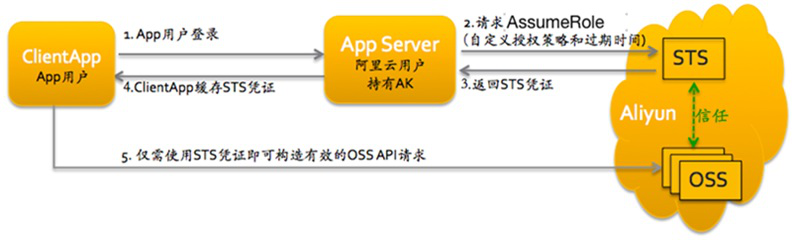

方案的详细描述如下：

1. App用户登录。App用户身份是客户自己管理。客户可以自定义身份管理系统，也可以使用外部Web账号或OpenID。对于每个有效的App用户来说，AppServer是可以确切地定义出每个App用户的最小访问权限。

2. AppServer请求STS服务获取一个安全令牌（SecurityToken）。在调用STS之前，AppServer需要确定App用户的最小访问权限（用Policy语法描述）以及授权的过期时间。然后通过调用STS的AssumeRole（扮演角色）接口来获取安全令牌。角色管理与使用相关内容请参考<strong>《Apsara Uni-manager运营控制台 用户指南》</strong>手册中**企业中心 > 权限管理 > 角色授权**章节。

3. STS返回给AppServer一个有效的访问凭证，包括一个安全令牌（SecurityToken）、临时访问密钥（AccessKeyId、AccessKeySecret）以及过期时间。

4. AppServer将访问凭证返回给ClientApp。ClientApp可以缓存这个凭证。当凭证失效时，ClientApp需要向AppServer申请新的有效访问凭证。比如，访问凭证有效期为1小时，那么ClientApp可以每30分钟向AppServer请求更新访问凭证。

5. ClientApp客户端使用本地缓存的临时访问凭证去请求OSS API。OSS收到访问请求后，会通过STS服务来验证访问凭证，正确响应用户请求。

STS安全令牌详情，请参考<strong>《Apsara Uni-manager运营控制台 开发指南》</strong>手册中**STS API参考 > AssumeRole - 获取扮演角色的临时身份凭证**章节。关键是调用STS服务接口AssumeRole来获取有效访问凭证。

**使用STS凭证构造签名请求**

用户的客户端获取到STS临时凭证后，通过其中安全令牌（SecurityToken）以及临时访问密钥（AccessKeyId、AccessKeySecret）构建签名。授权访问签名的构建方式与使用直接使用根账号的AccessKey在Header中包含签名基本一致，关键注意两点：

- 用户使用的签名密钥为STS提供的临时访问密钥（AccessKeyId, AccessKeySecret）。

- 用户需要将安全令牌（SecurityToken）携带在请求header中或者以请求参数的形式放入URL中。这两种形式只能选择其一，如果都选择，oss会返回InvalidArgument错误。

  - 在header中包含头部 `x-oss-security-token`：`SecurityToken` 。计算签名CanonicalizedOSSHeaders时，将x-oss-security-token计算在内。

  - 在URL中携带参数**security-token=SecurityToken**。计算签名CanonicalizedResource时 ，将security-token当做一个sub-resource计算在内。

<a id="section-1-1-2-5"></a>

#### 1.1.2.5. Bucket权限控制

您可以在创建存储空间（Bucket）时设置存储空间的访问权限（ACL），也可以在创建Bucket后根据自己的业务需求修改存储空间的ACL，该操作只有存储空间的拥有者可以执行。

Bucket目前有三种访问权限：public-read-write，public-read和private，它们的含义如下：

- public-read-write：任何人（包括匿名访问）都可以对该Bucket中的Object进行Put，Get和Delete操作；所有这些操作产生的费用由该Bucket的创建者承担，请慎用该权限。

- public-read：只有该Bucket的创建者可以对该Bucket内的Object进行写操作（包括Put和Delete Object）；任何人（包括匿名访问）可以对该Bucket中的Object进行读操作（Get Object）。

- private：只有该Bucket的创建者可以对该Bucket内的Object进行读写操作（包括Put、Delete和Get Object）；其他人无法访问该Bucket内的Object。

用户新创建一个新Bucket时，如果不指定Bucket权限，OSS会自动为该Bucket设置private权限。对于一个已经存在的Bucket，只有它的创建者可以通过OSS的PutBucketACL接口修改该Bucket的权限。

<a id="section-1-1-3"></a>

### 1.1.3. 公共HTTP头定义

本文介绍OSS的RESTful接口使用的请求头和响应头。

**公共请求头（Common Request Headers）**

OSS的RESTful接口中使用了一些公共请求头。这些请求头可以被所有的OSS请求所使用，其详细定义如下：

表 1. 公共请求头

<table>
  <tr>
    <th width="151">名称</th>
    <th>描述</th>
  </tr>
  <tr>
    <td>Authorization</td>
    <td>用于验证请求合法性的认证信息。类型：字符串。默认值：无。使用场景：非匿名请求。</td>
  </tr>
  <tr>
    <td>Content-Length</td>
    <td>RFC2616中定义的HTTP请求内容长度。类型：字符串。默认值：无。使用场景：需要向OSS提交数据的请求。</td>
  </tr>
  <tr>
    <td>Content-Type</td>
    <td>RFC2616中定义的HTTP请求内容类型。类型：字符串。默认值：无。使用场景：需要向OSS提交数据的请求。</td>
  </tr>
  <tr>
    <td>Date</td>
    <td>HTTP 1.1协议中规定的GMT时间，例如：Wed, 05 Sep. 2012 23:00:00 GMT。类型：字符串。默认值：无。</td>
  </tr>
  <tr>
    <td>Host</td>
    <td>访问Host值，格式为：<code> &lt;bucketname&gt;.regionid.example.com </code>。类型：字符串。默认值：无。</td>
  </tr>
</table>

**公共响应头（Common Response Headers）**

OSS的RESTful接口中使用了一些公共响应头。这些响应头可以被所有的OSS请求所使用，其详细定义如下：

表 2. 公共响应头

<table>
  <tr>
    <th width="155">名称</th>
    <th>描述</th>
  </tr>
  <tr>
    <td>Content-Length</td>
    <td>RFC2616中定义的HTTP请求内容长度。类型：字符串。默认值：无。使用场景：需要向OSS提交数据的请求。</td>
  </tr>
  <tr>
    <td>Connection</td>
    <td>标明客户端和OSS服务器之间的链接状态。类型：枚举。有效值：open、close。默认值：无。</td>
  </tr>
  <tr>
    <td>Date</td>
    <td>HTTP 1.1协议中规定的GMT时间，例如：Wed, 05 Sep. 2012 23:00:00 GMT。类型：字符串。默认值：无。</td>
  </tr>
  <tr>
    <td>ETag</td>
    <td>ETag (entity tag) 在每个Object生成的时候被创建，用于标示一个Object的内容。对于Put Object请求创建的Object，ETag值是其内容的MD5值；对于其他方式创建的Object，ETag值是其内容的UUID。ETag值可以用于检查Object内容是否发生变化。类型：字符串。默认值：无。</td>
  </tr>
  <tr>
    <td>Server</td>
    <td>生成Response的服务器。类型：字符串。默认值：AliyunOSS。</td>
  </tr>
  <tr>
    <td>x-oss-request-id</td>
    <td>x-oss-request-id是由Aliyun OSS创建，并唯一标识这个response的UUID。如果在使用OSS服务时遇到问题，可以凭借该字段联系OSS工作人员，快速定位问题。类型：字符串。默认值：无。</td>
  </tr>
</table>

<a id="section-1-1-4"></a>

### 1.1.4. 关于Service的操作

<a id="section-1-1-4-1"></a>

#### 1.1.4.1. GetService(ListBuckets)

对于服务地址作Get请求可以返回请求者拥有的所有Bucket，其中正斜线（/）表示根目录。

**注意事项**

- GetService这个API只对验证通过的用户有效。

- 如果请求中没有用户验证信息（即匿名访问），返回403 Forbidden。错误码：AccessDenied。

- 当所有的Bucket都返回时，返回的XML中不包含Prefix、Marker、MaxKeys、IsTruncated、NextMarker节点；如果还有部分结果未返回，则增加上述节点，其中NextMarker用于继续查询时给marker赋值。

**请求语法**

```http
GET / HTTP/1.1
Host: oss.example.com
Date: GMT Date
Authorization: SignatureValue
```

**请求参数**

GetService(ListBucket)时，可以通过prefix，marker和max-keys对list做限定，返回部分结果。

| 名称 | 类型 | 是否必选 | 示例值 | 描述 |
| --- | --- | --- | --- | --- |
| prefix | 字符串 | 否 | example | 限定返回的Bucket名称必须以prefix作为前缀。不设定时不过滤前缀信息。 |
| marker | 字符串 | 否 | examplebucket | 设定结果从marker之后按字母排序的第一个开始返回。不设定时从头开始返回数据。 |
| max-keys | 字符串 | 否 | 100 | 限定此次返回Bucket的最大数。取值范围：1~1000默认值：100 |

**返回数据**

| 名称 | 类型 | 示例值 | 描述 |
| --- | --- | --- | --- |
| ListAllMyBucketsResult | 容器 | 不涉及 | 保存GetService(ListBucket)请求结果的容器。 |
| Prefix | 字符串 | example | 本次查询结果的前缀。当Bucket未全部返回时才有此节点。 |
| Marker | 字符串 | examplebucket | 标明此次GetService(ListBucket)的起点。当Bucket未全部返回时才有此节点。 |
| MaxKeys | 字符串 | 1 | 响应请求内返回结果的最大数目。当Bucket未全部返回时才有此节点。 |
| IsTruncated | 枚举字符串 | true | 指明是否所有的结果都已经返回。取值如下：<br>• <code> true </code>：表示本次没有返回全部结果<br>• <code> false </code>：表示本次已经返回了全部结果。当Bucket未全部返回时才有此节点。 |
| NextMarker | 字符串 | xz02tphky6fjfiuc0 | 表示下一次GetService(ListBucket)时，可以以此为marker，将未返回的结果返回。当Bucket未全部返回时才有此节点。 |
| Owner | 容器 | 不涉及 | 用于存放Bucket拥有者信息的容器。 |
| ID | 字符串 | 17464\*\*\*\*\*\*02745 | Bucket拥有者的用户ID。 |
| DisplayName | 字符串 | 17464\*\*\*\*\*\*02745 | Bucket拥有者的名称，目前和用户ID一致。 |
| Buckets | 容器 | 不涉及 | 保存多个Bucket信息的容器。 |
| Bucket | 容器 | 不涉及 | 保存Bucket信息的容器。 |
| Name | 字符串 | examplebucket | Bucket名称。 |
| CreationDate | 时间 | 2011-12-01T12:27:13.000Z | Bucket的创建时间。格式：<code> yyyy-mm-ddThh:mm:ss.timezone </code> 。 |
| Location | 字符串 | oss-cn-shenzhen | Bucket所在的数据中心。 |
| ExtranetEndpoint | 字符串 | oss-cn-shenzhen.aliyuncs.com | Bucket的外网Endpoint。 |
| IntranetEndpoint | 字符串 | oss-cn-shenzhen-internal.aliyuncs.com | Bucket的内网Endpoint。 |

**示例**

- 请求示例1

  ```http
  GET / HTTP/1.1
  Date: Thu, 15 May 2014 11:18:32 GMT
  Host: regionid.example.com
  Authorization: OSS n***i:C***I=
  ```

- 返回示例1

  ```xml
  HTTP/1.1 200 OK
  Date: Thu, 15 May 2014 11:18:32 GMT
  Content-Type: application/xml
  Content-Length: 556
  Connection: keep-alive
  Server: AliyunOSS
  x-oss-request-id: 5***4
  <?xml version="1.0" encoding="UTF-8"?>
  <ListAllMyBucketsResult>
   <Owner>
   <ID>17464******02745</ID>
   <DisplayName>17464******02745</DisplayName>
   </Owner>
   <Buckets>
   <Bucket>
   <CreationDate>2015-12-17T18:12:43.000Z</CreationDate>
   <ExtranetEndpoint>regionid.example.com</ExtranetEndpoint>
   <IntranetEndpoint>regionid-internal.example.com</IntranetEndpoint>
   <Location>oss-cn-shanghai</Location>
   <Name>app-base-oss</Name>
   </Bucket>
   <Bucket>
   <CreationDate>2014-12-25T11:21:04.000Z</CreationDate>
   <ExtranetEndpoint>regionid.example.com</ExtranetEndpoint>
   <IntranetEndpoint>regionid-internal.example.com</IntranetEndpoint>
   <Location>regionid</Location>
   <Name>examplebucket</Name>
   </Bucket>
   </Buckets>
  </ListAllMyBucketsResult>
  ```

- 请求示例2

  ```http
  GET /?prefix=xz02tphky6fjfiuc&max-keys=1 HTTP/1.1
  Date: Thu, 15 May 2014 11:18:32 GMT
  Host:  regionid.example.com
  Authorization: OSS n***i:C***I=
  ```

- 返回示例2

  ```xml
  HTTP/1.1 200 OK
  Date: Thu, 15 May 2014 11:18:32 GMT
  Content-Type: application/xml
  Content-Length: 545
  Connection: keep-alive
  Server: AliyunOSS
  x-oss-request-id: 5***5
  <?xml version="1.0" encoding="UTF-8"?>
  <ListAllMyBucketsResult>
   <Prefix>xz02tphky6fjfiuc</Prefix>
   <Marker></Marker>
   <MaxKeys>1</MaxKeys>
   <IsTruncated>true</IsTruncated>
   <NextMarker>xz02tphky6fjfiuc0</NextMarker>
   <Owner>
   <ID>17464******02745</ID>
   <DisplayName>17464******02745</DisplayName>
   </Owner>
   <Buckets>
   <Bucket>
   <CreationDate>2014-05-15T11:18:32.000Z</CreationDate>
   <ExtranetEndpoint>regionid.example.com</ExtranetEndpoint>
   <IntranetEndpoint>oss-cn-hangzhou-internal.example.com</IntranetEndpoint>
   <Location>oss-cn-hangzhou</Location>
   <Name>examplebucket</Name>
   </Bucket>
   </Buckets>
  </ListAllMyBucketsResult>
  ```

<a id="section-1-1-5"></a>

### 1.1.5. 关于Bucket的操作

<a id="section-1-1-5-1"></a>

#### 1.1.5.1. 基础操作

<a id="section-1-1-5-1-1"></a>

##### 1.1.5.1.1. PutBucket

PutBucket用于创建Bucket。创建的Bucket所在的Region和发送请求的Endpoint所对应的Region一致。Bucket所在的数据中心确定后，该Bucket下的所有Object将一直存放在对应的地区。

**请求语法**

```http
PUT / HTTP/1.1
Host: BucketName.regionid.example.com
Date: GMT Date
x-oss-acl: Permission
Authorization: SignatureValue
```

**注意事项**

调用PutBucket时，有如下注意事项：

- 此接口不支持匿名访问。

- 同一阿里云账号在同一地域（Region）内最多可创建100个Bucket。

**请求头**

| 名称 | 类型 | 是否必选 | 示例值 | 描述 |
| --- | --- | --- | --- | --- |
| x-oss-acl | 字符串 | 否 | private | 指定Bucket的访问权限ACL。有效值：<br>• public-read-write：公共读写<br>• public-read：公共读<br>• private：私有（默认值） |
| x-oss-bucket-tagging | 字符串 | 否 | k1=v1&amp;k2=v2 | 指定 Bucket 标签。 |

此接口涉及的其他公共请求头的更多信息，请参见公共请求头（Common Request Headers）。

**请求元素**

| 名称 | 类型 | 是否必选 | 示例值 | 描述 |
| --- | --- | --- | --- | --- |
| StorageClass | 字符串 | 否 | Standard | 指定Bucket的存储类型。有效值： Standard（标准存储）父节点：CreateBucketConfiguration子节点：无 |
| DataRedundancyType | 字符串 | 否 | LRS | 指定Bucket的数据容灾类型。取值范围如下：<br>• LRS（默认）本地冗余LRS将您的数据冗余存储在同一个可用区的不同存储设备上，可支持两个存储设备并发损坏时，仍维持数据不丢失，可正常访问。<br>• ZRS<br>重要使用同城3AZ容灾时才能设置该项。<br>同城冗余ZRS采用多可用区（AZ）内的数据冗余存储机制，将用户的数据冗余存储在同一地域（Region）的多个可用区。当某个可用区不可用时，仍然能够保障数据的正常访问。父节点：CreateBucketConfiguration子节点：无 |

**响应头**

此接口仅涉及公共响应头。更多信息，请参见公共响应头（Common Response Headers）。

**示例**

请求示例：

```xml
PUT / HTTP/1.1
Host: BucketName.regionid.example.com
Date: Fri, 24 Feb 2012 03:15:40 GMT
x-oss-acl: private
Authorization: OSS qn6qrrqxo2oawuk53otfjbyc:77Dvh5wQgIjWjwO/KyRt8dOP****
<?xml version="1.0" encoding="UTF-8"?>
<CreateBucketConfiguration>
    <StorageClass>Standard</StorageClass>
    <DataRedundancyType>LRS</DataRedundancyType>
</CreateBucketConfiguration>
```

返回示例：

```text
HTTP/1.1 200 OK
x-oss-request-id: 5***B
Date: Fri, 24 Feb 2012 03:15:40 GMT
Location: /***
Content-Length: 0
Connection: keep-alive
Server: AliyunOSS
```

<a id="section-1-1-5-1-2"></a>

##### 1.1.5.1.2. GetBucket (ListObjects)

GetBucket操作可用来列举Bucket中所有Object的信息。

**细节分析**

- Object中用户自定义的meta在GetBucket请求时不会返回。

- 如果因为max-keys的设定无法一次完成listing，返回结果会附加一个 `<NextMarker>` ，提示继续listing可以以此为marker。NextMarker中的值仍在list结果之中。

- 在做条件查询时，即使marker实际在列表中不存在，返回也从符合marker字母排序的下一个开始打印。如果max-keys小于0或者大于1000，将返回400 Bad Request错误。错误码：InvalidArgument。

- prefix、marker用来实现分页显示效果，参数的长度必须小于1024字节。

- 如果把prefix设为某个文件夹名，就可以罗列以此prefix开头的文件，即该文件夹下递归的所有的文件和子文件夹。如果再把delimiter设置为 / 时，返回值就只罗列该文件夹下的文件，该文件夹下的子文件名返回在CommonPrefixes部分，子文件夹下递归的文件和文件夹不被显示。如一个Bucket存在三个Object : fun/test.jpg，fun/movie/001.avi， fun/movie/007.avi。若设定prefix为”fun/” ，则返回三个Object；如果增加设定delimiter为“/”，则返回文件”fun/test.jpg”和前缀”fun/movie/”。

**请求语法**

```http
GET / HTTP/1.1
Host: BucketName.regionid.example.com
Date: GMT Date
Authorization: SignatureValue
```

**请求参数**

| 名称 | 类型 | 是否必选 | 示例值 | 描述 |
| --- | --- | --- | --- | --- |
| delimiter | 字符串 | 否 | / | 对Object名字进行分组的字符。所有Object名字包含指定的前缀，第一次出现delimiter字符之间的Object作为一组元素（即CommonPrefixes）。默认值：无 |
| marker | 字符串 | 否 | test1.txt | 设定从marker之后按字母排序开始返回Object。marker用来实现分页显示效果，参数的长度必须小于1024字节。做条件查询时，即使marker在列表中不存在，也会从符合marker字母排序的下一个开始打印。默认值：无 |
| max-keys | 字符串 | 否 | 200 | 指定返回Object的最大数。 如果因为max-keys的设定无法一次完成列举，返回结果会附加NextMarker元素作为下一次列举的marker。取值：大于0小于1000默认值：100 |
| prefix | 字符串 | 否 | fun | 限定返回文件的Key必须以prefix作为前缀。<br>• prefix参数的长度必须小于1024字节。<br>• 使用prefix查询时，返回的Key中仍会包含prefix。如果把prefix设为某个文件夹名，则列举以此Prefix开头的文件，即该文件夹下递归的所有文件和子文件夹。在设置prefix的基础上，将delimiter设置为正斜线（/）时，返回值中只列举该文件夹下的文件，文件夹下的子文件夹名返回在CommonPrefixes中，子文件夹下递归的所有文件和文件夹不显示。例如，一个Bucket中有三个Object ，分别为fun/test.jpg、 fun/movie/001.avi和fun/movie/007.avi。如果设定prefix为fun/，则返回三个Object；如果在prefix设置为fun/的基础上，将delimiter设置为正斜线（/），则返回fun/test.jpg和fun/movie/。默认值：无 |
| encoding-type | 字符串 | 否 | URL | 对返回的内容进行编码并指定编码的类型。默认值：无可选值：URL<br>重要delimiter、marker、prefix、NextMarker以及Key使用UTF-8字符。如果delimiter、marker、prefix、NextMarker以及Key中包含XML 1.0标准不支持的控制字符，您可以通过指定encoding-type对返回结果中的Delimiter、Marker、Prefix、NextMarker以及Key进行编码。 |

**响应元素**

| 名称 | 类型 | 示例值 | 描述 |
| --- | --- | --- | --- |
| Contents | 容器 | 不涉及 | 保存每个返回Object元信息的容器。父节点：ListBucketResult |
| CommonPrefixes | 字符串 | 不涉及 | 如果请求中指定了Delimiter参数，则会在返回的响应中包含CommonPrefixes元素。该元素表明以Delimiter结尾，并有共同前缀的Object名称的集合。父节点：ListBucketResult |
| Delimiter | 字符串 | / | 对Object名字进行分组的字符。所有名字包含指定的前缀且第一次出现Delimiter字符之间的Object作为一组元素CommonPrefixes。父节点：ListBucketResult |
| EncodingType | 字符串 | 不涉及 | 指明了返回结果中编码使用的类型。如果请求的参数中指定了encoding-type，则会对返回结果中的Delimiter、Marker、Prefix、NextMarker和Key这些元素进行编码。父节点：ListBucketResult |
| DisplayName | 字符串 | user_example | Object拥有者名称。父节点：ListBucketResult.Contents.Owner |
| ETag | 字符串 | 5B3C1A2E053D763E1 B002CC607C5A0FE1\*\* \*\* | ETag (Entity Tag) 在每个Object生成时创建，用于标识一个Object的内容。<br>• 对于PutObject请求创建的Object，ETag值是其内容的MD5值。<br>• 对于其他方式创建的Object，ETag值是其内容的UUID。<br>• ETag值可以用于检查Object内容是否发生变化。不建议使用ETag值作为Object内容的MD5校验数据完整性的依据。父节点：ListBucketResult.Contents |
| ID | 字符串 | 0022012\*\*\*\* | Bucket拥有者的用户ID。父节点：ListBucketResult.Contents.Owner |
| IsTruncated | 枚举字符串 | false | 请求中返回的结果是否被截断。返回值：true、false<br>• true表示本次没有返回全部结果。<br>• false表示本次已经返回了全部结果。父节点：ListBucketResult |
| Key | 字符串 | fun/test.jpg | Object的Key。父节点：ListBucketResult.Contents |
| LastModified | 时间 | 2012-02-24T08:42:32.000Z | Object最后被修改的时间。父节点：ListBucketResult.Contents |
| ListBucketResult | 容器 | 不涉及 | 保存GetBucket请求结果的容器。子节点：Name、Prefix、 Marker、MaxKeys、 Delimiter、IsTruncated、Nextmarker、Contents父节点：None |
| Marker | 字符串 | test1.txt | 标识此次GetBucket（ListObjects）的起点。父节点：ListBucketResult |
| MaxKeys | 字符串 | 100 | 响应请求内返回结果的最大数目。父节点：ListBucketResult |
| Name | 字符串 | oss-example | Bucket名称。父节点：ListBucketResult |
| Owner | 容器 | 不涉及 | 保存Bucket拥有者信息的容器。子节点：DisplayName、ID父节点：ListBucketResult |
| Prefix | 字符串 | fun/ | 本次查询结果的前缀。父节点：ListBucketResult |
| Size | 字符串 | 344606 | 返回Object大小，单位为字节。父节点：ListBucketResult.Contents |
| StorageClass | 字符串 | Standard | Object的存储类型。父节点：ListBucketResult.Contents |

此接口涉及的其他公共响应头，例如 `x-oss-request-id` 、 `Content-Type` 等的更多信息，请参见公共响应头（Common Response Headers）。

**示例**

- 简单请求示例

  ```http
  GET / HTTP/1.1
  Host: oss-example.oss-cn-hangzhou.aliyuncs.com
  Date: Fri, 24 Feb 2012 08:43:27 GMT
  Authorization: OSS qn6qrrqxo2oawuk53otfjbyc:BC+oQIXVR2/ZghT7cGa0ykbo****
  ```

  返回示例

  ```xml
  HTTP/1.1 200 OK
  x-oss-request-id: 534B371674E88A4D8906****
  Date: Fri, 24 Feb 2012 08:43:27 GMT
  Content-Type: application/xml
  Content-Length: 1866
  Connection: keep-alive
  Server: AliyunOSS
  <?xml version="1.0" encoding="UTF-8"?>
  <ListBucketResult xmlns=”http://doc.oss-cn-hangzhou.aliyuncs.com”>
  <Name>oss-example</Name>
  <Prefix></Prefix>
  <Marker></Marker>
  <MaxKeys>100</MaxKeys>
  <Delimiter></Delimiter>
  <IsTruncated>false</IsTruncated>
  <Contents>
        <Key>fun/movie/001.avi</Key>
        <LastModified>2012-02-24T08:43:07.000Z</LastModified>
        <ETag>"5B3C1A2E053D763E1B002CC607C5A0FE1****"</ETag>
        <Type>Normal</Type>
        <Size>344606</Size>
        <StorageClass>Standard</StorageClass>
        <Owner>
            <ID>0022012****</ID>
            <DisplayName>user-example</DisplayName>
        </Owner>
  </Contents>
  <Contents>
        <Key>fun/movie/007.avi</Key>
        <LastModified>2012-02-24T08:43:27.000Z</LastModified>
        <ETag>"5B3C1A2E053D763E1B002CC607C5A0FE1****"</ETag>
        <Type>Normal</Type>
        <Size>344606</Size>
        <StorageClass>Standard</StorageClass>
        <Owner>
            <ID>0022012****</ID>
            <DisplayName>user-example</DisplayName>
        </Owner>
  </Contents>
  <Contents>
        <Key>fun/test.jpg</Key>
        <LastModified>2012-02-24T08:42:32.000Z</LastModified>
        <ETag>"5B3C1A2E053D763E1B002CC607C5A0FE1****"</ETag>
        <Type>Normal</Type>
        <Size>344606</Size>
        <StorageClass>Standard</StorageClass>
        <Owner>
            <ID>0022012****</ID>
            <DisplayName>user-example</DisplayName>
        </Owner>
  </Contents>
  <Contents>
        <Key>oss.jpg</Key>
        <LastModified>2012-02-24T06:07:48.000Z</LastModified>
        <ETag>"5B3C1A2E053D763E1B002CC607C5A0FE1****"</ETag>
        <Type>Normal</Type>
        <Size>344606</Size>
        <StorageClass>Standard</StorageClass>
        <Owner>
            <ID>0022012****</ID>
            <DisplayName>user-example</DisplayName>
        </Owner>
  </Contents>
  </ListBucketResult>
  ```

- 带prefix参数的请求示例

  ```http
  GET /?prefix=fun HTTP/1.1
  Host: oss-example.oss-cn-hangzhou.aliyuncs.com
  Date: Fri, 24 Feb 2012 08:43:27 GMT
  Authorization: OSS qn6qrrqxo2oawuk53otfjbyc:BC+oQIXVR2/ZghT7cGa0ykbo****
  ```

  返回示例

  ```xml
  HTTP/1.1 200 OK
  x-oss-request-id: 534B371674E88A4D8906****
  Date: Fri, 24 Feb 2012 08:43:27 GMT
  Content-Type: application/xml
  Content-Length: 1464
  Connection: keep-alive
  Server: AliyunOSS
  <?xml version="1.0" encoding="UTF-8"?>
  <ListBucketResult xmlns=”http://doc.oss-cn-hangzhou.aliyuncs.com”>
  <Name>oss-example</Name>
  <Prefix>fun</Prefix>
  <Marker></Marker>
  <MaxKeys>100</MaxKeys>
  <Delimiter></Delimiter>
  <IsTruncated>false</IsTruncated>
  <Contents>
        <Key>fun/movie/001.avi</Key>
        <LastModified>2012-02-24T08:43:07.000Z</LastModified>
        <ETag>"5B3C1A2E053D763E1B002CC607C5A0FE1****"</ETag>
        <Type>Normal</Type>
        <Size>344606</Size>
        <StorageClass>Standard</StorageClass>
        <Owner>
            <ID>0022012****</ID>
            <DisplayName>user_example</DisplayName>
        </Owner>
  </Contents>
  <Contents>
        <Key>fun/movie/007.avi</Key>
        <LastModified>2012-02-24T08:43:27.000Z</LastModified>
        <ETag>"5B3C1A2E053D763E1B002CC607C5A0FE1****"</ETag>
        <Type>Normal</Type>
        <Size>344606</Size>
        <StorageClass>Standard</StorageClass>
        <Owner>
            <ID>0022012****</ID>
            <DisplayName>user_example</DisplayName>
        </Owner>
  </Contents>
  <Contents>
        <Key>fun/test.jpg</Key>
        <LastModified>2012-02-24T08:42:32.000Z</LastModified>
        <ETag>"5B3C1A2E053D763E1B002CC607C5A0FE1****"</ETag>
        <Type>Normal</Type>
        <Size>344606</Size>
        <StorageClass>Standard</StorageClass>
        <Owner>
            <ID>0022012****</ID>
            <DisplayName>user_example</DisplayName>
        </Owner>
  </Contents>
  </ListBucketResult>
  ```

- 带prefix和delimiter参数的请求示例

  ```http
  GET /?prefix=fun/&delimiter=/ HTTP/1.1
  Host: oss-example.oss-cn-hangzhou.aliyuncs.com
  Date: Fri, 24 Feb 2012 08:43:27 GMT
  Authorization: OSS qn6qrrqxo2oawuk53otfjbyc:DNrnx7xHk3sgysx7I8U9I9IY****
  ```

  返回示例

  ```xml
  HTTP/1.1 200 OK
  x-oss-request-id: 534B371674E88A4D8906****
  Date: Fri, 24 Feb 2012 08:43:27 GMT
  Content-Type: application/xml
  Content-Length: 712
  Connection: keep-alive
  Server: AliyunOSS
  <?xml version="1.0" encoding="UTF-8"?>
  <ListBucketResult xmlns=”http://doc.oss-cn-hangzhou.aliyuncs.com”>
  <Name>oss-example</Name>
  <Prefix>fun/</Prefix>
  <Marker></Marker>
  <MaxKeys>100</MaxKeys>
  <Delimiter>/</Delimiter>
  <IsTruncated>false</IsTruncated>
  <Contents>
        <Key>fun/test.jpg</Key>
        <LastModified>2012-02-24T08:42:32.000Z</LastModified>
        <ETag>"5B3C1A2E053D763E1B002CC607C5A0FE1****"</ETag>
        <Type>Normal</Type>
        <Size>344606</Size>
        <StorageClass>Standard</StorageClass>
        <Owner>
            <ID>0022012****</ID>
            <DisplayName>user_example</DisplayName>
        </Owner>
  </Contents>
  <CommonPrefixes>
        <Prefix>fun/movie/</Prefix>
  </CommonPrefixes>
  </ListBucketResult>
  ```

- 指定marker分页列举的请求示例

  此示例中指定了max-keys=2，即最多返回2条列举信息。

  ```http
  GET /?max-keys=2&marker=test1.txt HTTP/1.1
  Host: test-bucket-xxx.oss-cn-shenzhen.aliyuncs.com
  Accept-Encoding: identity
  Accept: */*
  Connection: keep-alive
  User-Agent: aliyun-sdk-python/2.11.0(Darwin/18.2.0/x86_64;3.4.1)
  date: Tue, 26 May 2020 08:39:48 GMT
  authorization: OSS LTAIB1VW9xxxxxxx:MmY11jLlO8UlAqjqHK3Ckp****
  ```

  返回示例

  结果中的NextMarker可以做为下次列举请求的Marker。

  ```xml
  HTTP/1.1 200 OK
  Server: AliyunOSS
  Date: Tue, 26 May 2020 08:39:48 GMT
  Content-Type: application/xml
  Content-Length: 1032
  Connection: keep-alive
  x-oss-request-id: 5ECCD5D4881816373582xxx
  x-oss-server-time: 3

  <?xml version="1.0" encoding="UTF-8"?>
  <ListBucketResult>
    <Name>test-bucket-xxx</Name>
    <Prefix></Prefix>
    <Marker>test1.txt</Marker>
    <MaxKeys>2</MaxKeys>
    <Delimiter></Delimiter>
    <EncodingType>url</EncodingType>
    <IsTruncated>true</IsTruncated>
    <NextMarker>test100.txt</NextMarker>
    <Contents>
      <Key>test10.txt</Key>
      <LastModified>2020-05-26T07:50:18.000Z</LastModified>
      <ETag>"C4CA4238A0B923820DCC509A6F75****"</ETag>
      <Type>Normal</Type>
      <Size>1</Size>
      <StorageClass>Standard</StorageClass>
      <Owner>
        <ID>1305433xxx</ID>
        <DisplayName>1305433xxx</DisplayName>
      </Owner>
    </Contents>
    <Contents>
      <Key>test100.txt</Key>
      <LastModified>2020-05-26T07:50:20.000Z</LastModified>
      <ETag>"C4CA4238A0B923820DCC509A6F75****"</ETag>
      <Type>Normal</Type>
      <Size>1</Size>
      <StorageClass>Standard</StorageClass>
      <Owner>
        <ID>1305433xxx</ID>
        <DisplayName>1305433xxx</DisplayName>
      </Owner>
    </Contents>
  </ListBucketResult>
  ```

<a id="section-1-1-5-1-3"></a>

##### 1.1.5.1.3. GetBucketInfo

调用GetBucketInfo接口查看Bucket的相关信息，例如创建时间、ACL（AccessControlList）、存储类型、数据容灾类型等。

**请求语法**

```http
GET /?bucketInfo HTTP/1.1
Host: BucketName.oss.example.com
Date: GMT Date
Authorization: SignatureValue
```

**请求头**

此接口涉及的公共请求头，请参见公共请求头（Common Request Headers）。

**响应元素**

| 名称 | 类型 | 示例值 | 描述 |
| --- | --- | --- | --- |
| BucketInfo | 容器 | 不涉及 | 保存Bucket信息的容器。子节点：Bucket父节点：无 |
| Bucket | 容器 | 不涉及 | 保存Bucket具体信息的容器。父节点：BucketInfo |
| CreationDate | 时间 | 2013-07-31T10:56:21.000Z | Bucket创建时间，格式为UTC时间。父节点：BucketInfo.Bucket |
| ExtranetEndpoint | 字符串 | oss-cn-hangzhou.aliyuncs.com | 外网Endpoint。父节点：BucketInfo.Bucket |
| IntranetEndpoint | 字符串 | oss-cn-hangzhou-internal.aliyuncs.com | 内网Endpoint。父节点：BucketInfo.Bucket |
| Location | 字符串 | cn-hangzhou | Bucket所在数据中心的区域。父节点：BucketInfo.Bucket |
| StorageClass | 字符串 | Standard | Bucket的存储类型。有效值：Standard父节点：BucketInfo.Bucket |
| DataRedundancyType | 枚举字符串 | LRS | Bucket的数据容灾类型。有效值：LRS、ZRS父节点：BucketInfo.Bucket |
| Name | 字符串 | oss-example | Bucket名称。父节点：BucketInfo.Bucket |
| Owner | 容器 | 不涉及 | 用于存放Bucket拥有者信息的容器。父节点：BucketInfo.Bucket |
| ID | 字符串 | 2\*\*\*3 | Bucket拥有者的用户ID。父节点：BucketInfo.Bucket.Owner |
| DisplayName | 字符串 | 2\*\*\*3 | Bucket拥有者的名称（目前和ID一致）。父节点：BucketInfo.Bucket.Owner |
| AccessControlList | 容器 | 不涉及 | 存放Bucket读写权限（ACL）信息的容器。父节点：BucketInfo.Bucket |
| Grant | 枚举字符串 | private | Bucket的ACL权限。有效值：private、public-read、public-read-write父节点：BucketInfo.Bucket.AccessControlList |
| Versioning | 字符串 | Enabled | Bucket的版本控制状态。有效值：Enabled、Suspended父节点：BucketInfo.Bucket |

**示例**

请求示例：

```text
Get /?bucketInfo HTTP/1.1
Host: BucketName.oss.example.com
Date: Sat, 12 Sep 2015 07:51:28 GMT
Authorization: OSS q***c: B***=
            
```

成功获取Bucket信息的返回示例：

```xml
HTTP/1.1 200
x-oss-request-id: 5***B
Date: Sat, 12 Sep 2015 07:51:28 GMT
Connection: keep-alive
Content-Length: 531
Server: AliyunOSS

<?xml version="1.0" encoding="UTF-8"?>
<BucketInfo>
  <Bucket>
    <CreationDate>2013-07-31T10:56:21.000Z</CreationDate>
    <ExtranetEndpoint>oss-cn-hangzhou.aliyuncs.com</ExtranetEndpoint>
    <IntranetEndpoint>oss-cn-hangzhou-internal.aliyuncs.com</IntranetEndpoint>
    <Location>cn-hangzhou</Location>
    <StorageClass>Standard</StorageClass>
    <DataRedundancyType>LRS</DataRedundancyType>
    <Name>oss-example</Name>
    <Owner>
      <DisplayName>2***3</DisplayName>
      <ID>2***3</ID>
    </Owner>
    <AccessControlList>
      <Grant>private</Grant>
    </AccessControlList>
  </Bucket>
</BucketInfo>
            
```

获取不存在的Bucket信息的返回示例：

```xml
HTTP/1.1 404
x-oss-request-id: 5***B
Date: Sat, 12 Sep 2015 07:51:28 GMT
Connection: keep-alive
Content-Length: 308
Server: AliyunOSS

<?xml version="1.0" encoding="UTF-8"?>
<Error>
  <Code>NoSuchBucket</Code>
  <Message>The specified bucket does not exist.</Message>
  <RequestId>5***4</RequestId>
  <HostId>nosuchbucket.oss.example.com</HostId>
  <BucketName>nosuchbucket</BucketName>
</Error>
            
```

获取没有权限访问的Bucket信息的返回示例：

```xml
HTTP/1.1 403
x-oss-request-id: 5***C
Date: Sat, 12 Sep 2015 07:51:28 GMT
Connection: keep-alive
Content-Length: 209
Server: AliyunOSS

<?xml version="1.0" encoding="UTF-8"?>
<Error>
  <Code>AccessDenied</Code>
  <Message>AccessDenied</Message>
  <RequestId>5***E</RequestId>
  <HostId>BucketName.oss.example.com</HostId>
</Error>
```

<a id="section-1-1-5-1-4"></a>

##### 1.1.5.1.4. GetBucketLocation

GetBucketLocation用于查看Bucket所属的数据中心位置信息。

**请求语法**

```http
GET /?location HTTP/1.1
Host: BucketName.regionid.example.com
Date: GMT Date
Authorization: SignatureValue
```

**请求头**

此接口涉及的公共请求头，请参见公共请求头（Common Request Headers）。

**响应元素(Response Elements)**

| 名称 | 类型 | 示例值 | 描述 |
| --- | --- | --- | --- |
| LocationConstraint | 字符串 | oss-cn-hangzhou | Bucket所在的区域。 |

**示例**

请求示例：

```text
Get /?location HTTP/1.1
Host: ***.regionid.example.com  
Date: Fri, 04 May 2012 05:31:04 GMT  
Authorization: OSS q***c:c***=
            
```

返回示例：

```xml
HTTP/1.1 200
x-oss-request-id: 5***B
Date: Fri, 15 Mar 2013 05:31:04 GMT
Connection: keep-alive
Content-Length: 90 
Server: AliyunOSS

<?xml version="1.0" encoding="UTF-8"?>
<LocationConstraint xmlns=”http://doc.oss-cn-hangzhou.aliyuncs.com”>oss-cn-hangzhou</LocationConstraint >
```

<a id="section-1-1-5-1-5"></a>

##### 1.1.5.1.5. GetBucketStat

GetBucketStat用于获取指定存储空间（Bucket）的存储容量以及文件（Object）数量。

**注意事项**

- 调用该接口时需要拥有 `oss:GetBucketStat` 权限。

- 调用该接口获取的数据并非是实时数据，延时可能超过一个小时。

- 调用该接口获取到的存储信息的时间点不保证是最新的，即后一次调用该接口返回的LastModifiedTime字段值可能比前一次调用该接口返回的LastModifiedTime字段值小。

**请求语法**

```http
GET /?stat HTTP/1.1
Host: BucketName.oss-cn-hangzhou.aliyuncs.com
Date: GMT Date
Authorization: SignatureValue
```

**请求头**

此接口仅涉及公共请求头。更多信息，请参见公共请求头（Common Request Headers）。

**响应头**

此接口仅涉及公共响应头。更多信息，请参见公共响应头（Common Response Headers）。

**响应元素**

| 名称 | 类型 | 示例值 | 说明 |
| --- | --- | --- | --- |
| BucketStat | 容器 | 不涉及 | BucketStat结构的容器。 |
| Storage | 正整数 | 1600 | Bucket总的实际存储量，单位字节。父节点：BucketStat子节点：无 |
| ObjectCount | 正整数 | 230 | Bucket中总的Object数量。父节点：BucketStat子节点：无 |
| MultipartUploadCount | 正整数 | 40 | Bucket中已经初始化但还未完成（Complete）或者还未中止（Abort）的Multipart Upload数量。父节点：BucketStat子节点：无 |

**示例**

- 请求示例

  ```http
  GET /?stat HTTP/1.1
  Host: examplebucket.oss-cn-hangzhou.aliyuncs.com
  Date: Tue, 28 Dec 2021 01:17:29 GMT
  Authorization: OSS qn6q**************:77Dv****************
  ```

- 返回示例

  ```xml
  <?xml version="1.0" encoding="UTF-8"?>
  <BucketStat>
    <Storage>1600</Storage>
    <ObjectCount>230</ObjectCount>
    <MultipartUploadCount>40</MultipartUploadCount>
  </BucketStat>
  ```

<a id="section-1-1-5-1-6"></a>

##### 1.1.5.1.6. DeleteBucket

DeleteBucket用于删除某个Bucket。

**请求语法**

```http
DELETE / HTTP/1.1
Host: BucketName.regionid.example.com
Date: GMT Date
Authorization: SignatureValue
```

**注意事项**

- 为了防止误删除的发生，OSS不允许用户删除一个非空的Bucket。

- 如果试图删除一个不为空的Bucket，返回409 Conflict错误，错误码：BucketNotEmpty。

- 只有Bucket的拥有者才能删除这个Bucket。如果试图删除一个没有对应权限的Bucket，返回403 Forbidden错误。错误码：AccessDenied。

**请求头**

此接口仅涉及公共请求头。更多信息，请参见公共请求头（Common Request Headers）。

**响应头**

此接口仅涉及公共响应头。更多信息，请参见公共响应头（Common Response Headers）。

**示例**

请求示例：

```http
DELETE / HTTP/1.1
Host: ***.regionid.example.com  
Date: Fri, 24 Feb 2012 05:31:04 GMT  
Authorization: OSS q***:c***=
            
```

返回示例：

```text
HTTP/1.1 204 No Content 
x-oss-request-id: 534B371674E88A4D8906008B
Date: Fri, 24 Feb 2012 05:31:04 GMT
Connection: keep-alive
Content-Length: 0  
Server: AliyunOSS
```

<a id="section-1-1-5-2"></a>

#### 1.1.5.2. 合规保留策略（WORM）

<a id="section-1-1-5-2-1"></a>

##### 1.1.5.2.1. InitiateBucketWorm

调用InitiateBucketWorm接口新建一条合规保留策略。

**注意事项**

对象存储OSS支持WORM（Write Once Read Many）特性，允许以不可删除、不可篡改的方式保存和使用数据。OSS允许针对存储空间（Bucket）设置基于时间的合规保留策略，保护周期为1天到70年。

- 当基于时间的合规保留策略创建24小时后未提交锁定，则该策略自动失效。当合规保留策略锁定后，您可以在Bucket中上传和读取文件（Object），但是在Object的保留时间到期之前，不允许删除Object及合规保留策略。Object的保留时间到期后，才可以删除Object。

- 同一个Bucket中，版本控制和合规保留策略无法同时配置。如果Bucket已开启版本控制功能，则无法再配置保留策略。

**请求元素**

| 名称 | 类型 | 是否必须 | 描述 |
| --- | --- | --- | --- |
| InitiateWormConfiguration | 容器 | 是 | 根节点子节点：RetentionPeriodInDays |
| RetentionPeriodInDays | 正整数 | 是 | 指定Object保留天数。 |

**示例**

- 请求示例

  ```xml
  POST /?worm HTTP/1.1
  Date: Thu, 15 May 2014 11:18:32 GMT
  Content-Length：556
  Content-Type: application/xml
  Host: BucketName.oss.aliyuncs.com
  Authorization: OSS nxj7dtlhcyl5hp****:COS3OQkfQPnKmYZTEHYv2****

  <InitiateWormConfiguration>
    <RetentionPeriodInDays>365</RetentionPeriodInDays>
  </InitiateWormConfiguration>
  ```

- 返回示例

  ```text
  HTTP/1.1 200 OK
  x-oss-request-id: 5374A2880232A65C2300****
  x-oss-worm-id: 1666E2CFB2B3418****
  Date: Thu, 15 May 2014 11:18:32 GMT
  ```

<a id="section-1-1-5-2-2"></a>

##### 1.1.5.2.2. AbortBucketWorm

调用AbortBucketWorm接口删除未锁定的合规保留策略。

**注意事项**

当基于时间的合规保留策略创建后，此策略默认处于InProgress状态，且该状态的有效期为24小时。在有效期24小时内，此策略对应的Bucket数据处于保护状态。

- 启动合规保留策略24小时内，如果此策略未提交锁定，则Bucket所有者以及授权用户可以删除该策略；如果此策略已提交锁定，则不允许删除该策略，且无法缩短策略保护周期，仅可以延长保护周期。

- 启动合规保留策略24小时后，如果超过24小时此策略未提交锁定，则该策略自动失效。

如果Bucket内有文件处于保护周期内，则您将无法删除合规保留策略，同时也无法删除Bucket。当Bucket为空时，Bucket的所有者可以删除该Bucket，从而间接删除该Bucket的合规保留策略。

**示例**

- 请求示例

  ```http
  DELETE /?worm HTTP/1.1
  Date: Mon, 3 Aug 2020 03:15:40 GMT
  Host: BucketName.oss.aliyuncs.com
  Authorization: OSS qn6qrrqxo2oawuk53otf****:77Dvh5wQgIjWjwO/KyRt8dOP****
  ```

- 返回示例

  ```text
  HTTP/1.1 204 NoContent
  x-oss-request-id: 534B371674E88A4D8906****
  Date: Mon, 3 Aug 2020 03:15:40 GMT
  ```

<a id="section-1-1-5-2-3"></a>

##### 1.1.5.2.3. CompleteBucketWorm

调用CompleteBucketWorm接口锁定合规保留策略。

**注意事项**

当基于时间的合规保留策略创建后，此策略默认处于InProgress状态，且该状态的有效期为24小时。在有效期24小时内，此策略对应的Bucket数据处于保护状态。

- 启动合规保留策略24小时内，如果此策略未提交锁定，则Bucket所有者以及授权用户可以删除该策略；如果此策略已提交锁定，则不允许删除该策略，且无法缩短策略保护周期，仅可以延长保护周期。

- 启动合规保留策略24小时后，如果超过24小时此策略未提交锁定，则该策略自动失效。

**示例**

- 请求示例

  ```http
  POST /?wormId=xxx HTTP/1.1
  Date: GMT Date
  Host: BucketName.oss.aliyuncs.com
  Authorization: SignatureValue
  ```

- 返回示例

  ```text
  HTTP/1.1 200 OK
  x-oss-request-id: RequestId
  Date: Date
  Content-Type: application/xml
  Content-Length: length
  ```

<a id="section-1-1-5-2-4"></a>

##### 1.1.5.2.4. ExtendBucketWorm

调用ExtendBucketWorm接口延长已锁定的合规保留策略对应Bucket中Object的保留天数。

> 如果指定用于延长Object保留天数对应的WORM ID不存在，则返回404。
>
> **说明**

**注意事项**

**注意事项**

当基于时间的合规保留策略创建后，此策略默认处于InProgress状态，且该状态的有效期为24小时。在有效期24小时内，此策略对应的Bucket数据处于保护状态。

- 启动合规保留策略24小时内，如果此策略未提交锁定，则Bucket所有者以及授权用户可以删除该策略；如果此策略已提交锁定，则不允许删除该策略，且无法缩短策略保护周期，仅可以延长保护周期。

- 启动合规保留策略24小时后，如果超过24小时此策略未提交锁定，则该策略自动失效。

如果Bucket内有文件处于保护周期内，则您将无法删除合规保留策略，同时也无法删除Bucket。当Bucket为空时，Bucket的所有者可以删除该Bucket，从而间接删除该Bucket的合规保留策略。

**请求元素**

| 名称 | 类型 | 是否必须 | 描述 |
| --- | --- | --- | --- |
| ExtendWormConfiguration | 容器 | 是 | 根节点子节点：RetentionPeriodInDays |
| RetentionPeriodInDays | 正整数 | 是 | 指定Object的保留天数。 |

**示例**

- 请求示例

  ```xml
  POST /?wormId=xxx&wormExtend HTTP/1.1
  Date: Thu, 15 May 2014 11:18:32 GMT
  Host: BucketName.oss.aliyuncs.com
  Authorization: OSS nxj7dtlhcyl5hp****:COS3OQkfQPnKmYZTEHYv2**** 

  <ExtendWormConfiguration>
    <RetentionPeriodInDays>366</RetentionPeriodInDays>
  </ExtendWormConfiguration>
  ```

- 返回示例

  ```text
  HTTP/1.1 200 OK
  x-oss-request-id: 5374A2880232A65C2300****
  Date: Thu, 15 May 2014 11:18:32 GMT
  Content-Type: application/xml
  Content-Length: 556
  ```

<a id="section-1-1-5-2-5"></a>

##### 1.1.5.2.5. GetBucketWorm

调用GetBucketWorm接口获取指定存储空间（Bucket）的合规保留策略信息。

> 如果指定用来获取Bucket的合规保留策略信息对应的WORM ID不存在，则返回404。
>
> **说明**

**注意事项**

对象存储OSS支持WORM（Write Once Read Many）特性，允许您以不可删除、不可篡改的方式保存和使用数据。OSS允许针对Bucket设置基于时间的合规保留策略，保护周期为1天到70年。

当合规保留策略锁定后，您可以在Bucket中上传和读取文件（Object），但是在Object的保留时间到期之前，不允许删除Object及合规保留策略。Object的保留时间到期后，才可以删除Object。

**请求头**

此接口仅涉及公共请求头。更多信息，请参见公共请求头（Common Request Headers）。

**响应头**

此接口仅涉及公共响应头。更多信息，请参见公共响应头（Common Response Headers）。

**响应元素**

| 名称 | 类型 | 描述 |
| --- | --- | --- |
| WormConfiguration | 容器 | 根节点。子节点：WormId、State、RetentionPeriodInDays、CreationDate |
| WormId | 字符串 | 合规保留策略的ID。 |
| State | 字符串 | 合规保留策略所处的状态。可选值：<br>• InProgress：合规保留策略创建后，该策略默认处于“InProgress”状态，且该状态的有效期为24小时。<br>• Locked：合规保留策略处于锁定状态。 |
| RetentionPeriodInDays | 正整数 | Object的指定保留天数。 |
| CreationDate | 字符串 | 合规保留策略的创建时间。 |

**示例**

- 请求示例

  ```http
  GET /?worm HTTP/1.1
  Date: Fri, 16 Oct 2020 11:18:32 GMT
  Host: BucketName.oss.aliyuncs.com
  Authorization: SignatureValue
  ```

- 返回示例

  ```xml
  HTTP/1.1 200 OK
  x-oss-request-id: 5374A2880232A65C2300****
  Date: Fri, 16 Oct 2020 11:18:32 GMT
  Content-Type: application/xml
  Content-Length: length
  <WormConfiguration>
    <WormId>1666E2CFB2B3418****</WormId>
    <State>Locked</State>
    <RetentionPeriodInDays>1</RetentionPeriodInDays>
    <CreationDate>2020-10-15T15:50:32</CreationDate>
  </WormConfiguration>
  ```

<a id="section-1-1-5-3"></a>

#### 1.1.5.3. 权限控制（ACL）

<a id="section-1-1-5-3-1"></a>

##### 1.1.5.3.1. PutBucketACL

PutBucketACL接口用于修改Bucket访问权限。

**请求语法**

```http
PUT /?acl HTTP/1.1
x-oss-acl: Permission
Host: BucketName.regionid.example.com
Date: GMT Date
Authorization: SignatureValue
```

**注意事项**

使用PutBucketAcl接口时，有如下注意事项：

- 该接口的请求者需要对Bucket有写入ACL的权限。

- PutBucketAcl为覆盖语义，即新传入的ACL将覆盖原有的ACL。

- 如果指定要设置ACL的Bucket不存在，调用该接口时将新建Bucket。

**请求头**

| 名称 | 类型 | 是否必选 | 示例值 | 描述 |
| --- | --- | --- | --- | --- |
| x-oss-acl | 字符串 | 是 | private | 指定Bucket的访问权限ACL。PutBucketAcl接口通过Put请求中的x-oss-acl请求头来设置访问权限，如果没有该请求头，则访问权限设置不生效。取值：public-read-write、public-read、private。<br>• public-read-write（公共读写）：所有用户都有该Bucket内的文件的读写权限。请谨慎使用该访问权限。<br>• public-read（公共读）：Bucket的拥有者和授权用户有该Bucket内的文件的读写权限，其他用户只有该Bucket内的文件的读权限。请谨慎使用该访问权限。<br>• private：Bucket的拥有者和授权用户有该Bucket内的文件的读写权限，其他用户没有权限操作该Bucket内的文件。 |

此接口涉及的其他公共请求头，请参见公共请求头（Common Request Headers）。

**响应头**

此接口仅涉及公共响应头，请参见公共响应头（Common Response Headers）。

**示例**

请求示例：

```http
PUT /?acl HTTP/1.1
x-oss-acl: public-read
Host: BucketName.regionid.example.com
Date: Fri, 24 Feb 2012 03:21:12 GMT
Authorization: OSS q***c:K***=
```

返回示例：

```text
HTTP/1.1 200 OK
x-oss-request-id: 5***B
Date: Fri, 24 Feb 2012 03:21:12 GMT
Content-Length: 0
Connection: keep-alive
Server: AliyunOSS
```

如果该设置的权限不存在，则返回400错误码。

错误返回示例：

```xml
HTTP/1.1 400 Bad Request
x-oss-request-id: 5***9
Date: Fri, 24 Feb 2012 03:55:00 GMT
Content-Length: 309
Content-Type: text/xml; charset=UTF-8
Connection: keep-alive
Server: AliyunOSS

<?xml version="1.0" encoding="UTF-8"?>
<Error>
  <Code>InvalidArgument</Code>
  <Message>no such bucket access control exists</Message>
  <RequestId>5***9</RequestId>
  <HostId>***-test.example.com</HostId>
  <ArgumentName>x-oss-acl</ArgumentName>
  <ArgumentValue>error-acl</ArgumentValue>
</Error>
```

<a id="section-1-1-5-3-2"></a>

##### 1.1.5.3.2. GetBucketAcl

GetBucketACL用来获取某个Bucket的访问权限。

**请求语法**

```http
GET /?acl HTTP/1.1
Host: BucketName.regionid.example.com
Date: GMT Date
Authorization: SignatureValue
```

**请求头**

此接口涉及的公共请求头，请参见公共请求头（Common Request Headers）。

**响应元素**

| 名称 | 类型 | 示例值 | 描述 |
| --- | --- | --- | --- |
| AccessControlPolicy | 容器 | 不涉及 | 保存GetBucketACL结果的容器。 |
| Owner | 容器 | 不涉及 | 保存Bucket拥有者信息的容器。 |
| ID | 字符串 | 0022012\*\*\*\* | Bucket拥有者的用户ID。 |
| DisplayName | 字符串 | 0022012\*\*\*\* | Bucket拥有者的名称（目前和ID一致）。 |
| AccessControlList | 容器 | 不涉及 | 存储ACL信息的容器。 |
| Grant | 枚举字符串 | public-read | Bucket的ACL权限。有效值：private、public-read、public-read-write |

**示例**

请求示例：

```http
GET /?acl HTTP/1.1
Host: ***.regionid.example.com
Date: Fri, 24 Feb 2012 04:11:23 GMT
Authorization: OSS q***c:C***=
            
```

返回示例：

```xml
HTTP/1.1 200 OK
x-oss-request-id: 5***B
Date: Fri, 24 Feb 2012 04:11:23 GMT 
Content-Length: 253
Content-Tupe: application/xml
Connection: keep-alive
Server: AliyunOSS

<?xml version="1.0" ?>
<AccessControlPolicy>
    <Owner>
        <ID>0022012****</ID>
        <DisplayName>0022012****</DisplayName>
    </Owner>
    <AccessControlList>
        <Grant>public-read</Grant>
    </AccessControlList>
</AccessControlPolicy>
```

<a id="section-1-1-5-4"></a>

#### 1.1.5.4. 生命周期（Lifecycle）

<a id="section-1-1-5-4-1"></a>

##### 1.1.5.4.1. PutBucketLifecycle

Bucket的拥有者可以通过PutBucket Lifecycle来设置Bucket的Lifecycle配置。Lifecycle开启后，OSS将按照配置，定期自动删除与Lifecycle规则相匹配的Object。

**注意事项**

调用PutBucketLifecycle接口时，有如下注意事项：

- 只有Bucket的拥有者以及被授予PutBucketLifecycle权限的RAM用户才能发起配置生命周期规则的请求。

- 如果Bucket此前没有设置过生命周期规则，此操作会创建一个新的生命周期规则；如果Bucket此前设置过生命周期规则，此操作会覆写先前的规则配置。

- 由于PutBucketLifecycle是覆盖语义，当您需要追加生命周期规则时，请先调用GetBucketLifecycle接口获取当前生命周期规则配置，然后追加新的生命周期规则配置，最后调用PutBucketLifecycle接口更新生命周期规则配置。

- PutBucketLifecycle操作可以对Object以及Part（以分片方式上传，但最后未提交的分片）设置过期时间。

**请求语法**

```xml
PUT /?lifecycle HTTP/1.1
Date: GMT Date
Content-Length：ContentLength
Content-Type: application/xml
Authorization: SignatureValue
Host: BucketName.oss.example.com
<?xml version="1.0" encoding="UTF-8"?>
<LifecycleConfiguration>
 <Rule>
 <ID>RuleID</ID>
 <Prefix>Prefix</Prefix>
 <Status>Status</Status>
 <Expiration>
 <Days>Days</Days>
 </Expiration>
 <AbortMultipartUpload>
 <Days>Days</Days> </AbortMultipartUpload>
 </Rule>
</LifecycleConfiguration>
```

**请求头**

此接口仅涉及公共请求头。更多信息，请参见公共请求头（Common Request Headers）。

**请求元素**

| 名称 | 类型 | 是否必选 | 示例值 | 描述 |
| --- | --- | --- | --- | --- |
| CreatedBeforeDate | 字符串 | Days和CreatedBeforeDate二选一 | 2002-10-11T00:00:00.000Z | 指定一个日期，OSS会对最后更新时间早于该日期的数据执行生命周期规则。日期必须服从ISO8601的格式，且要求是UTC的零点。例如：2002-10-11T00:00:00.000Z，表示将最后更新时间早于2002-10-11T00:00:00.000Z 的Object删除或转换成其他存储类型，等于或晚于这个时间的Object不会被删除或转储。 |
| Days | 正整数 | Days和CreatedBeforeDate二选一 | 1 | 指定生命周期规则在距离Object最后更新多少天后生效。 |
| Expiration | 容器 | 否 | 不涉及 | 指定Object生命周期规则的过期属性。 |
| AbortMultipartUpload | 容器 | 否 | 不涉及 | 指定未完成分片上传的过期属性。 |
| ID | 字符串 | 否 | rule1 | 标识规则的唯一ID。最多由255个字节组成。如没有指定，或者该值为空时，OSS会自动生成一个唯一ID。 |
| LifecycleConfiguratio n | 容器 | 是 | 不涉及 | Lifecycle配置的容器，最多可容纳1000条规则。 |
| Prefix | 字符串 | 是 | data | 指定规则所适用的前缀（Prefix）。Prefix不可重复。<br>• 若指定了Prefix，则表示此规则仅适用于Bucket中与Prefix匹配的Object。<br>• 若Prefix置空，则表示此规则适用于Bucket中的所有Object。 |
| Rule | 容器 | 是 | 不涉及 | 标识一条规则。 |
| Status | 字符串 | 是 | Enabled | 如果值为Enabled，那么OSS会定期执行该规则；如果为Disabled，那么OSS会忽略该规则。 |
| Tag | 容器 | 否 | 不涉及 | 指定规则所适用的对象标签，可设置多个。 |
| Key | 字符串 | 若父节点Tag已设置，则必选 | xx | Tag Key |
| Value | 字符串 | 若父节点Tag已设置，则必选 | 1 | Tag Value |

**响应头**

此接口仅涉及公共响应头。更多信息，请参见公共响应头（Common Response Headers）。

**示例**

请求示例：

```xml
PUT /?lifecycle HTTP/1.1
Host: BucketName.oss.example.com
Content-Length: 443
Date: Mon, 14 Apr 2014 01:08:38 GMT
Authorization: OSS q***c:K***=
<?xml version="1.0" encoding="UTF-8"?>
</LifecycleConfiguration>
 <Rule>
 <ID>rule1</ID>
 <Prefix>logs/</Prefix>
 <Tag><Key>xx</Key><Value>1</Value></Tag>
 <Tag><Key>yy</Key><Value>2</Value></Tag>
 <Status>Enabled</Status>
 <Expiration>
 <Days>1</Days>
 </Expiration>
 <AbortMultipartUpload>
 <Days>1</Days>
 </AbortMultipartUpload>
 </Rule>
 <Rule>
 <ID>rule2</ID>
 <Prefix>backup/</Prefix>
 <Status>Enabled</Status>
 <Expiration>
 <CreatedBeforeDate>2014-10-11T00:00:00.000Z</CreatedBeforeDate>
 </Expiration>
 <AbortMultipartUpload>
 <CreatedBeforeDate>2014-10-11T00:00:00.000Z</CreatedBeforeDate>
 </AbortMultipartUpload>
 </Rule>
</LifecycleConfiguration>
```

返回示例：

```text
HTTP/1.1 200 OK
x-oss-request-id: 5***B
Date: Mon, 14 Apr 2014 01:17:10 GMT
Content-Length: 0
Connection: keep-alive
Server: AliyunOSS
```

<a id="section-1-1-5-4-2"></a>

##### 1.1.5.4.2. GetBucketLifecycle

GetBucketLifecycle用于查看Bucket的Lifecycle配置。

```http
GET /?lifecycle HTTP/1.1
Host: BucketName.oss.example.com
Date: GMT Date
Authorization: SignatureValue
```

**请求头**

此接口涉及的公共请求头，请参见公共请求头（Common Request Headers）。

**响应元素**

| 名称 | 类型 | 示例值 | 描述 |
| --- | --- | --- | --- |
| CreatedBeforeDate | 字符串 | 2002-10-11T00:00:00.000Z | 指定一个日期，OSS会对最后更新时间早于该日期的数据执行生命周期规则。日期必须服从ISO8601的格式，且要求是UTC的零点。例如：2002-10-11T00:00:00.000Z，表示将最后更新时间早于2002-10-11T00:00:00.000Z 的Object删除或转换成其他存储类型，等于或晚于这个时间的Object不会被删除或转储。 |
| Days | 正整数 | 1 | 指定生命周期规则在距离Object最后更新多少天后生效。 |
| Expiration | 容器 | 不涉及 | 指定Object生命周期规则的过期属性。 |
| AbortMultipartUpload | 容器 | 不涉及 | 指定未完成分片上传的过期属性。 |
| ID | 字符串 | rule1 | 标识规则的唯一ID。最多由255个字节组成。如没有指定，或者该值为空时，OSS会自动生成一个唯一ID。 |
| LifecycleConfiguration | 容器 | 不涉及 | Lifecycle配置的容器，最多可容纳1000条规则。 |
| Prefix | 字符串 | logs/ | 规则所适用的前缀（Prefix）。<br>• 若指定了Prefix，则表示此规则仅适用于Bucket中与Prefix匹配的Object。<br>• 若Prefix置空，则表示此规则适用于Bucket中的所有Object。 |
| Rule | 容器 | 不涉及 | 标识一条规则。 |
| Status | 字符串 | Enabled | 如果值为Enabled，那么OSS会定期执行该规则；如果为Disabled，那么OSS会忽略该规则。 |
| Tag | 容器 | 不涉及 | 指定规则所适用的对象标签，可设置多个。 |
| Key | 字符串 | xx | Tag Key |
| Value | 字符串 | 1 | Tag Value |

**示例**

请求示例：

```text
Get /?lifecycle HTTP/1.1
Host: BucketName.oss.example.com  
Date: Mon, 14 Apr 2014 01:17:29 GMT  
Authorization: OSS q***:c***=
            
```

已设置Lifecycle的返回示例：

```xml
HTTP/1.1 200
x-oss-request-id: 5***B
Date: Mon, 14 Apr 2014 01:17:29 GMT
Connection: keep-alive
Content-Length: 255
Server: AliyunOSS

<?xml version="1.0" encoding="UTF-8"?>
<LifecycleConfiguration>
<Rule>
 <ID>rule1</ID>
 <Prefix>logs/</Prefix>
 <Tag><Key>xx</Key><Value>1</Value></Tag>
 <Tag><Key>yy</Key><Value>2</Value></Tag>
 <Status>Enabled</Status>
 <Expiration>
 <Days>1</Days>
 </Expiration>
 <AbortMultipartUpload>
 <Days>1</Days>
 </AbortMultipartUpload>
 </Rule>
 <Rule>
 <ID>rule2</ID>
 <Prefix>backup/</Prefix>
 <Status>Enabled</Status>
 <Expiration>
 <CreatedBeforeDate>2014-10-11T00:00:00.000Z</CreatedBeforeDate>
 </Expiration>
 <AbortMultipartUpload>
 <CreatedBeforeDate>2014-10-11T00:00:00.000Z</CreatedBeforeDate>
 </AbortMultipartUpload>
 </Rule>
</LifecycleConfiguration>
            
```

未设置Lifecycle的返回示例：

```xml
HTTP/1.1 404
x-oss-request-id: 5***B
Date: Mon, 14 Apr 2014 01:17:29 GMT
Connection: keep-alive
Content-Length: 278
Server: AliyunOSS

<?xml version="1.0" encoding="UTF-8"?>
<Error>
  <BucketName>oss-example</BucketName>
  <Code>NoSuchLifecycle</Code>
  <Message>No Row found in Lifecycle Table.</Message>
  <RequestId>5***9</RequestId>
  <HostId> BucketName.oss.example.com</HostId>
</Error>
```

<a id="section-1-1-5-4-3"></a>

##### 1.1.5.4.3. DeleteBucketLifecycle

DeleteBucketLifecycle来删除指定Bucket的生命周期配置。

**请求语法**

```http
DELETE /?lifecycle HTTP/1.1
Host: BucketName.oss.example.com
Date: GMT Date
Authorization: SignatureValue
```

**请求头**

此接口仅涉及公共请求头。更多信息，请参见公共请求头（Common Request Headers）。

**响应头**

此接口仅涉及公共响应头。更多信息，请参见公共响应头（Common Response Headers）。

**示例**

请求示例：

```http
DELETE /?lifecycle HTTP/1.1
Host: BucketName.oss.example.com  
Date: Mon, 14 Apr 2014 01:17:35 GMT
Authorization: OSS q***:6***=
            
```

返回示例：

```text
HTTP/1.1 204 No Content 
x-oss-request-id: 5***B
Date: Mon, 14 Apr 2014 01:17:35 GMT
Connection: keep-alive
Content-Length: 0  
Server: AliyunOSS
            
```

<a id="section-1-1-5-5"></a>

#### 1.1.5.5. 清单（Inventory）

<a id="section-1-1-5-5-1"></a>

##### 1.1.5.5.1. PutBucketInventory

调用PutBucketInventory接口用于为某个存储空间（Bucket）配置清单（Inventory）规则。

**注意事项**

您可以通过清单获取Bucket中Object的各类信息，包括Object的数量、大小、存储类型、加密状态等。配置清单规则时，有如下注意事项：

- 只有Bucket的拥有者以及被授予PutBucketInventory权限的用户才能发起配置清单规则的请求。

- 配置清单规则前需生成一个RAM角色，该角色需要拥有读取源Bucket所有文件和向目标Bucket写入文件的权限。

- 单个Bucket最多只能配置1000条清单规则。

- 配置清单的源Bucket与存放导出的清单文件所在的目标Bucket必须位于同一个Region。

**请求语法**

```xml
    <InventoryConfiguration>
     <Id>report1</Id>
     <IsEnabled>true</IsEnabled>
     <Filter>
           <Prefix>filterPrefix/</Prefix>
           <LastModifyBeginTimeStamp>1637883649</LastModifyBeginTimeStamp>
           <LastModifyEndTimeStamp>1638347592</LastModifyEndTimeStamp>
           <LowerSizeBound>1024</LowerSizeBound>
           <UpperSizeBound>1048576</UpperSizeBound>
           <StorageClass>Standard,IA</StorageClass>
     </Filter>
     <Destination>
        <OSSBucketDestination>
           <Format>CSV</Format>
           <AccountId>1000000000000000</AccountId>
           <RoleArn>acs:ram::1000000000000000:role/AliyunOSSRole</RoleArn>
           <Bucket>acs:oss:::destination-bucket</Bucket>
           <Prefix>prefix1</Prefix>
           <Encryption>
              <SSE-KMS>
                 <KeyId>keyId</KeyId>
              </SSE-KMS>
           </Encryption>
        </OSSBucketDestination>
     </Destination>
     <Schedule>
        <Frequency>Daily</Frequency>
     </Schedule>
     <IncludedObjectVersions>All</IncludedObjectVersions>
     <OptionalFields>
        <Field>Size</Field>
        <Field>LastModifiedDate</Field>
        <Field>ETag</Field>
        <Field>StorageClass</Field>
        <Field>IsMultipartUploaded</Field>
        <Field>EncryptionStatus</Field>
     </OptionalFields>
  </InventoryConfiguration>
```

**请求元素**

| 名称 | 类型 | 是否必选 | 示例值 | 描述 |
| --- | --- | --- | --- | --- |
| Id | 字符串 | 是 | report1 | 由用户指定的清单名称，清单名称在当前Bucket下必须全局唯一。 |
| IsEnabled | 布尔 | 是 | true | 是否启用清单功能。取值：<br>• true：启用<br>• false：禁用 |
| Filter | 容器 | 否 | 不涉及 | 清单筛选的前缀。指定前缀后，清单将筛选出符合前缀设置的对象。 |
| Prefix | 字符串 | 否 | Pics/ | 筛选规则的匹配前缀。父节点：Filter |
| LastModifyBeginTimeStamp | 字符串 | 否 | 1637883649 | 筛选文件最后修改时间的起始时间戳，单位为秒。取值范围：\[1262275200, 253402271999\]。 |
| LastModifyEndTimeStamp | 字符串 | 否 | 1638347592 | 筛选文件最后修改时间的终止时间戳，单位为秒。取值范围：\[1262275200, 253402271999\]。 |
| LowerSizeBound | 字符串 | 否 | 1024 | 筛选文件的最小大小，单位为Byte。取值范围：大于等于0 Byte，小于等于48.8 TB。 |
| UpperSizeBound | 字符串 | 否 | 1048576 | 筛选文件的最大大小，单位为Byte。取值范围：大于0 Byte，小于等于48.8 TB。 |
| StorageClass | 字符串 | 否 | Standard,IA | 筛选文件的存储类型。取值：Standard，表示标准存储。 |
| Destination | 容器 | 是 | 不涉及 | 存放清单结果。 |
| OSSBucketDestination | 容器 | 是 | 不涉及 | 清单结果导出后存放的Bucket信息。父节点：Destination |
| Format | 字符串 | 是 | CSV | 清单文件的文件格式。 清单文件导出后的格式为使用GZIP压缩的CSV文件。取值：CSV父节点：OSSBucketDestination |
| AccountId | 字符串 | 是 | 10000000000000 0 | Bucket所有者授予的账号ID。父节点：OSSBucketDestination |
| RoleArn | 字符串 | 是 | acs:ram::100000 000000000:role/AliyunOSSRole | 具有读取源Bucket所有文件和向目标Bucket写入文件权限的角色名，格式为<code> acs:ram::uid:role/rolename </code>。父节点：OSSBucketDestination |
| Bucket | 字符串 | 是 | acs:oss:::bucket_0001 | 存放导出的清单文件的Bucket。父节点：OSSBucketDestination |
| Prefix | 字符串 | 否 | prefix1/ | 清单文件的存储路径前缀。父节点：OSSBucketDestination |
| Encryption | 容器 | 否 | 不涉及 | 清单文件的加密方式。取值：<br>• SSE-OSS：使用OSS完全托管密钥进行加解密。<br>• SSE-KMS：使用KMS托管的默认CMK（Customer Master Key）或指定CMK进行加解密。父节点：OSSBucketDestination |
| SSE-OSS | 容器 | 否 | 不涉及 | 保存SSE-OSS加密方式的容器。父节点：Encryption |
| SSE-KMS | 容器 | 否 | 不涉及 | 保存SSE-KMS加密密钥的容器。父节点：Encryption |
| KeyId | 字符串 | 否 | keyId | KMS密钥ID。父节点：SSE-KMS |
| Schedule | 容器 | 是 | 不涉及 | 存放清单导出周期信息的容器。 |
| Frequency | 字符串 | 是 | Daily | 清单文件导出的周期。取值：<br>• Daily：按天导出清单文件。<br>• Weekly：按周导出清单文件。父节点：Schedule |
| IncludedObjectVersions | 字符串 | 是 | All | 是否在清单中包含Object版本信息。取值：<br>• All：导出Object的所有版本信息。<br>• Current：导出Object的当前版本信息。 |
| OptionalFields | 容器 | 否 | 不涉及 | 设置清单结果中包含的配置项。 |
| Field | 字符串 | 否 | Size | 清单结果中包含的配置项。<br>• Size：Object的大小。<br>• LastModifiedDate：Object的最后修改时间。<br>• ETag：Object的ETag值，用于标识Object的内容。<br>• StorageClass：Object的存储类型。<br>• IsMultipartUploaded：是否为通过分片上传方式上传的Object。<br>• EncryptionStatus：Object是否加密。 |

**响应元素**

此接口仅涉及公共响应头，例如Content-Length、Date等。更多信息，请参见公共响应头（Common Response Headers）。

**示例**

- 请求示例

  ```http
    PUT /?inventory&inventoryId=report1 HTTP/1.1
    Host: BucketName.oss.aliyuncs.com
    Date: Mon, 31 Oct 2016 12:00:00 GMT
    Authorization: authorization string
    Content-Length: length

    <?xml version="1.0" encoding="UTF-8"?>
    <InventoryConfiguration>
       <Id>report1</Id>
       <IsEnabled>true</IsEnabled>
       <Filter>
           <Prefix>Pics/</Prefix>
           <LastModifyBeginTimeStamp>1637883649</LastModifyBeginTimeStamp>
           <LastModifyEndTimeStamp>1638347592</LastModifyEndTimeStamp>
           <LowerSizeBound>1024</LowerSizeBound>
           <UpperSizeBound>1048576</UpperSizeBound>
           <StorageClass>Standard,IA</StorageClass>
       </Filter>
       <Destination>
          <OSSBucketDestination>
            <Format>CSV</Format>
            <AccountId>100000000000000</AccountId>
            <RoleArn>acs:ram::100000000000000:role/AliyunOSSRole</RoleArn>
            <Bucket>acs:oss:::bucket_0001</Bucket>
            <Prefix>prefix1/</Prefix>
            <Encryption>
               <SSE-KMS>
                  <KeyId>keyId</KeyId>
               </SSE-KMS>
             </Encryption>
          </OSSBucketDestination>
       </Destination>
       <Schedule>
          <Frequency>Daily</Frequency>
       </Schedule>
       <IncludedObjectVersions>All</IncludedObjectVersions>
       <OptionalFields>
          <Field>Size</Field>
          <Field>LastModifiedDate</Field>
          <Field>ETag</Field>
          <Field>StorageClass</Field>
          <Field>IsMultipartUploaded</Field>
          <Field>EncryptionStatus</Field>
       </OptionalFields>
    </InventoryConfiguration>
  ```

- 返回示例

  ```text
    HTTP/1.1 200 OK
    x-oss-request-id: 56594298207FB3044385****
    Date: Mon, 31 Oct 2016 12:00:00 GMT
    Content-Length: 0
    Server: AliyunOSS
  ```

<a id="section-1-1-5-5-2"></a>

##### 1.1.5.5.2. GetBucketInventory

GetBucketInventory用于查看某个存储空间（Bucket）中指定的清单（Inventory）任务。

> 调用该请求时，请确保您有足够的权限对存储空间的清单任务进行操作。存储空间所有者默认拥有该权限，若您无该项权限，请先向存储空间所有者申请该
>
> **说明**
>
> 项操作的权限。

**请求语法**

```http
GET /?inventory&inventoryId=inventoryId HTTP/1.1
```

**请求元素**

| 名称 | 类型 | 是否必选 | 描述 |
| --- | --- | --- | --- |
| inventoryId | 字符串 | 是 | 查询的清单规则ID。 |

**响应元素**

| 名称 | 类型 | 是否必选 | 描述 |
| --- | --- | --- | --- |
| Id | 字符串 | 是 | 由用户指定的清单名称，清单名称在当前存储空间下必须全局唯一。 |
| IsEnabled | 布尔 | 是 | 是否启用清单。取值：<br>• true：启用，即清单功能生效。<br>• false：禁用，即不生成任何清单。 |
| Filter | 容器 | 否 | 清单筛选的前缀。指定前缀后，清单将筛选出符合前缀设置的对象。 |
| Prefix | 字符串 | 否 | 筛选规则的匹配前缀。父节点：Filter |
| Destination | 容器 | 是 | 存放清单结果的信息。 |
| OSSBucketDestinatio n | 容器 | 是 | 清单结果导出后存放的存储空间信息。父节点：Destination |
| Format | 字符串 | 是 | 导出清单文件的文件格式。取值：CSV父节点：OSSBucketDestination |
| AccountId | 字符串 | 是 | 存储空间所有者授予的账号ID。父节点：OSSBucketDestination |
| RoleArn | 字符串 | 是 | 存储空间所有者授予操作权限的角色名。格式为：<code> acs:ram::uid:role/rolename </code>父节点：OSSBucketDestination |
| Bucket | 字符串 | 是 | 存放导出的清单文件的存储空间。父节点：OSSBucketDestination |
| Prefix | 字符串 | 否 | 清单文件的存储路径前缀。父节点：OSSBucketDestination |
| Encryption | 容器 | 否 | 清单文件的加密方式。取值：<br>• SSE-OSS：使用OSS完全托管密钥进行加解密。<br>• SSE-KMS：使用KMS托管的默认CMK（Customer Master Key）或指定CMK进行加解密。父节点：OSSBucketDestination |
| SSE-OSS | 容器 | 否 | SSE-OSS加密方式的容器。父节点：Encryption |
| SSE-KMS | 容器 | 否 | 用于保存SSE-KMS加密方式下的密钥的容器。父节点：Encryption |
| KeyId | 字符串 | 否 | KMS密钥ID。父节点：SSE-KMS |
| Schedule | 容器 | 是 | 存放清单导出周期信息的容器。 |
| Frequency | 字符串 | 是 | 清单文件导出的周期。取值：<br>• Daily：按天导出清单文件。<br>• Weekly：按周导出清单文件。父节点：Schedule |
| IncludedObjectVersio ns | 字符串 | 是 | 是否在清单中包含Object版本信息。取值：<br>• All：导出Object的所有版本信息。<br>• Current：导出Object的当前版本信息。 |
| OptionalFields | 容器 | 否 | 设置清单结果中应包含的配置项。 |
| Field | 字符串 | 否 | 清单结果中包含的配置项。取值：<br>• Size：Object的大小。<br>• LastModifiedDate：Object的最后修改时间。<br>• ETag：Object的ETag值，用于标识Object的内容。<br>• StorageClass：Object的存储类型。<br>• IsMultipartUploaded：是否为通过分片上传方式上传的Object。<br>• EncryptionStatus：Object是否加密。父节点：OptionalFields |

**示例**

- 请求示例

  ```http
  GET /?inventory&inventoryId=list1 HTTP/1.1
  ```

- 返回示例

  ```text
    HTTP/1.1 200 OK
    x-oss-request-id: 56594298207FB304438516F9
    Date: Mon, 31 Oct 2016 12:00:00 GMT
    Server: AliyunOSS
    Content-Length: length

    <?xml version="1.0" encoding="UTF-8"?>
    <InventoryConfiguration">
       <Id>report1</Id>
       <IsEnabled>true</IsEnabled>
       <Destination>
          <OSSBucketDestination>
             <Format>CSV</Format>
             <AccountId>1000000000000000</AccountId>
             <RoleArn>acs:ram::1000000000000000:role/AliyunOSSRole</RoleArn>
             <Bucket>acs:oss:::bucket_0001</Bucket>
             <Prefix>prefix1</Prefix>
             <Encryption>
                <SSE-OSS/>
             </Encryption>
          </OSSBucketDestination>
       </Destination>
       <Schedule>
          <Frequency>Daily</Frequency>
       </Schedule>
       <Filter>
         <Prefix>myprefix/</Prefix>
       </Filter>
       <IncludedObjectVersions>All</IncludedObjectVersions>
       <OptionalFields>
          <Field>Size</Field>
          <Field>LastModifiedDate</Field>
          <Field>ETag</Field>
          <Field>StorageClass</Field>
          <Field>IsMultipartUploaded</Field>
          <Field>EncryptionStatus</Field>
       </OptionalFields>
    </InventoryConfiguration>
  ```

<a id="section-1-1-5-5-3"></a>

##### 1.1.5.5.3. ListBucketInventory

ListBucketInventory用于批量获取某个存储空间（Bucket）中的所有清单（Inventory）任务。

> **说明**
>
> - 单次请求最多可获取100条清单配置项内容。若需获取超过100条清单配置项，则需发送多次请求，并保留相应的token，作为下一次请求的参数。
>
> - 调用该请求时，请确保您有足够的权限对存储空间的清单任务进行操作。存储空间所有者默认拥有该权限，若您无该项权限，请先向存储空间所有者申请该项操作的权限。

**请求语法**

- 带continuation-token的形式

  ```http
  GET /?inventory&continuation-token=xxx HTTP/1.1
  ```

- 不带continuation-token的形式

  ```http
  GET /?inventory HTTP/1.1
  ```

**响应元素**

| 名称 | 类型 | 描述 |
| --- | --- | --- |
| InventoryConfiguration | 容器 | 存放清单配置参数的容器。 |
| IsTruncated | 布尔 | 是否列举全部的清单任务。取值：<br>• false：存储空间中的所有清单任务已全部列出。<br>• true：还未完整列出存储空间中的所有清单任务。您可以将NextContinuationToken字段的值作为下一次list请求的continuation-token参数，以获取下一页的清单配置列表。 |
| NextContinuationToken | 字符串 | 当响应中的IsTruncated为true且NextContinuationToken非空时，使用该字段作为下一次list请求的continuation-token参数。 |
| Id | 字符串 | 由用户指定的清单名称，清单名称在当前存储空间下必须全局唯一。 |
| IsEnabled | 布尔 | 是否启用清单功能。取值：<br>• true：启用<br>• false：禁用 |
| Filter | 容器 | 清单筛选的前缀。指定前缀后，清单将筛选出符合前缀设置的对象。 |
| Prefix | 字符串 | 筛选规则的匹配前缀。父节点：Filter |
| Destination | 容器 | 存放清单结果的信息。 |
| OSSBucketDestination | 容器 | 清单结果导出后存放的存储空间信息。父节点：Destination |
| Format | 字符串 | 导出清单文件的文件格式。取值：CSV父节点：OSSBucketDestination |
| AccountId | 字符串 | 存储空间所有者授予的账号ID。父节点：OSSBucketDestination |
| RoleArn | 字符串 | 存储空间所有者授予操作权限的角色名。格式为：<code> acs:ram::uid:role/rolename </code>父节点：OSSBucketDestination |
| Bucket | 字符串 | 存放导出的清单文件的存储空间。父节点：OSSBucketDestination |
| Prefix | 字符串 | 清单文件的存储路径前缀。父节点：OSSBucketDestination |
| Encryption | 容器 | 清单文件的加密方式。取值：<br>• SSE-OSS：使用OSS完全托管密钥进行加解密。<br>• SSE-KMS：使用KMS托管的默认CMK（Customer Master Key）或指定CMK进行加解密。父节点：OSSBucketDestination |
| SSE-OSS | 容器 | SSE-OSS加密方式的容器。父节点：Encryption |
| SSE-KMS | 容器 | 用于保存SSE-KMS加密方式下的密钥的容器。父节点：Encryption |
| KeyId | 字符串 | KMS密钥ID。父节点：SSE-KMS |
| Schedule | 容器 | 存放清单导出周期信息的容器。 |
| Frequency | 字符串 | 清单文件导出的周期。取值：<br>• Daily：按天导出清单文件。<br>• Weekly：按周导出清单文件。父节点：Schedule |
| IncludedObjectVersions | 字符串 | 是否在清单中包含Object版本信息。取值：<br>• All：导出Object的所有版本信息。<br>• Current：导出Object的当前版本信息。 |
| OptionalFields | 容器 | 设置清单结果中应包含的配置项。 |
| Field | 容器 | 清单结果中包含的配置项。<br>• Size：Object的大小。<br>• LastModifiedDate：Object的最后修改时间。<br>• ETag：Object的ETag值，用于标识Object的内容。<br>• StorageClass：Object的存储类型。<br>• IsMultipartUploaded：是否为通过分片上传方式上传的Object。<br>• EncryptionStatus：Object是否加密。父节点：OptionalFields |

**示例**

- 请求示例

  ```http
    GET /?inventory HTTP/1.1
    Host: BucketName.oss.aliyuncs.com
    Date: Fri, 24 Feb 2012 03:55:00 GMT
    Authorization: authorization string
    Content-Type: text/plain
  ```

- 返回示例

  ```text
    HTTP/1.1 200 OK
    x-oss-request-id: 56594298207FB304438516F9
    Date: Sat, 30 Apr 2016 23:29:37 GMT
    Content-Type: application/xml
    Content-Length: length
    Connection: close
    Server: AliyunOSS

    <?xml version="1.0" encoding="UTF-8"?>
    <ListInventoryConfigurationsResult>
       <InventoryConfiguration>
          <Id>report1</Id>
          <IsEnabled>true</IsEnabled>
          <Destination>
             <OSSBucketDestination>
                <Format>CSV</Format>
                <AccountId>1000000000000000</AccountId>
                <RoleArn>acs:ram::1000000000000000:role/AliyunOSSRole</RoleArn>
                <Bucket>acs:oss:::destination-bucket</Bucket>
                <Prefix>prefix1</Prefix>
             </OSSBucketDestination>
          </Destination>
          <Schedule>
             <Frequency>Daily</Frequency>
          </Schedule>
          <Filter>
             <Prefix>prefix/One</Prefix>
          </Filter>
          <IncludedObjectVersions>All</IncludedObjectVersions>
          <OptionalFields>
             <Field>Size</Field>
             <Field>LastModifiedDate</Field>
             <Field>ETag</Field>
             <Field>StorageClass</Field>
             <Field>IsMultipartUploaded</Field>
             <Field>EncryptionStatus</Field>
          </OptionalFields>
       </InventoryConfiguration>
       <InventoryConfiguration>
          <Id>report2</Id>
          <IsEnabled>true</IsEnabled>
          <Destination>
             <OSSBucketDestination>
                <Format>CSV</Format>
                <AccountId>1000000000000000</AccountId>
                <RoleArn>acs:ram::1000000000000000:role/AliyunOSSRole</RoleArn>
                <Bucket>acs:oss:::destination-bucket</Bucket>
                <Prefix>prefix2</Prefix>
             </OSSBucketDestination>
          </Destination>
          <Schedule>
             <Frequency>Daily</Frequency>
          </Schedule>
          <Filter>
             <Prefix>prefix/Two</Prefix>
          </Filter>
          <IncludedObjectVersions>All</IncludedObjectVersions>
          <OptionalFields>
             <Field>Size</Field>
             <Field>LastModifiedDate</Field>
             <Field>ETag</Field>
             <Field>StorageClass</Field>
             <Field>IsMultipartUploaded</Field>
             <Field>EncryptionStatus</Field>
          </OptionalFields>
       </InventoryConfiguration>
       <InventoryConfiguration>
          <Id>report3</Id>
          <IsEnabled>true</IsEnabled>
          <Destination>
             <OSSBucketDestination>
                <Format>CSV</Format>
                <AccountId>1000000000000000</AccountId>
                <RoleArn>acs:ram::1000000000000000:role/AliyunOSSRole</RoleArn>
                <Bucket>acs:oss:::destination-bucket</Bucket>
                <Prefix>prefix3</Prefix>
             </OSSBucketDestination>
          </Destination>
          <Schedule>
             <Frequency>Daily</Frequency>
          </Schedule>
          <Filter>
             <Prefix>prefix/Three</Prefix>
          </Filter>
          <IncludedObjectVersions>All</IncludedObjectVersions>
          <OptionalFields>
             <Field>Size</Field>
             <Field>LastModifiedDate</Field>
             <Field>ETag</Field>
             <Field>StorageClass</Field>
             <Field>IsMultipartUploaded</Field>
             <Field>EncryptionStatus</Field>
          </OptionalFields>
       </InventoryConfiguration>
        ...
       <IsTruncated>true</IsTruncated>
       <NextContinuationToken>...</NextContinuationToken> 
    </ListInventoryConfigurationsResult>
  ```

<a id="section-1-1-5-5-4"></a>

##### 1.1.5.5.4. DeleteBucketInventory

DeleteBucketInventory用于删除某个存储空间（Bucket）中指定的清单（Inventory）任务。

> **说明**
>
> - 调用该请求时，请确保您有足够的权限对存储空间的清单任务进行操作。存储空间所有者默认拥有该权限，若您无该项权限，请先向存储空间所有者申请该项操作的权限。
>
> - 请求成功将返回HTTP状态码204。

**请求语法**

```http
DELETE ?/inventory&inventoryId=list1 HTTP/1.1
```

**请求元素**

| 名称 | 类型 | 是否必选 | 描述 |
| --- | --- | --- | --- |
| inventoryId | 字符串 | 是 | 删除的清单任务ID。 |

**示例**

- 请求示例

  ```http
    DELETE ?/inventory&inventoryId=list1 HTTP/1.1
    Host: BucketName.oss.aliyuncs.com
    Date: Wed, 14 May 2014 02:11:22 GMT
    Authorization: signatureValue
  ```

- 返回示例

  ```text
    HTTP/1.1 204 No Content
    x-oss-request-id: 56594298207FB3044385****
    Date: Wed, 14 May 2014 02:11:22 GMT
    Server: AliyunOSS
  ```

<a id="section-1-1-5-6"></a>

#### 1.1.5.6. 日志管理（Logging）

<a id="section-1-1-5-6-1"></a>

##### 1.1.5.6.1. PutBucketLogging

Bucket的拥有者可以为Bucket开启访问日志记录功能。这个功能开启后，OSS将自动记录访问这个Bucket请求的详细信息，并按照用户指定的规则，以小时为单位，将访问日志作为一个Object写入用户指定的Bucket。

> OSS提供Bucket访问日志的目的是为了方便Bucket的拥有者理解和分析Bucket的访问行为。OSS提供的Bucket访问日志不保证记录下每一条访问记录。
>
> **重要**

**注意事项**

- 源Bucket和目标Bucket必须属于同一个用户。

- 当关闭一个Bucket的访问日志记录功能时，只要发送一个空的BucketLoggingStatus即可，具体方法可以参考下面的请求示例。

- 所有PUTBucketLogging请求必须带签名，即不支持匿名访问。

- 源Bucket被删除时，对应的Logging规则也将被删除。

- OSS以小时为单位生成bucket访问的Log文件，但并不表示这个小时的所有请求都记录在这个小时的LOG文件内，也有可能出现在上一个或者下一个LOG文件中。

- OSS生成的LOG文件命名规则中的“UniqueString”仅仅是OSS为其生成的UUID，用于唯一标识该文件。

- OSS生成一个Bucket访问的Log文件，算作一次PUT操作，并记录其占用的空间，但不会记录产生的流量。LOG生成后，用户可以按照普通的Object来操作这些LOG文件。

- OSS会忽略掉所有以“x-”开头的query-string参数，但这个query-string会被记录在访问LOG中。如果你想从海量的访问日志中，标示一个特殊的请求，可以在URL中添加一个“x-”开头的query-string参数。例如：

  ```text
   http://oss-example.regionid.example.com/aliyun-logo.png 
   http://oss-example.regionid.example.com/aliyun-logo.png?x-user=admin 
  ```

  OSS处理上面两个请求，结果是一样的。但是在访问LOG中，你可以通过搜索“x-user=admin”，很方便地定位出经过标记的这个请求。

- OSS的LOG中的任何一个字段，都可能出现 `-` ，用于表示未知数据或对于当前请求该字段无效。

- 根据需求，OSS的LOG格式将来会在尾部添加一些字段，请您开发LOG处理工具时考虑兼容性的问题。

**请求语法**

```xml
PUT /?logging HTTP/1.1
Date: GMT Date
Content-Length：ContentLength
Content-Type: application/xml
Authorization: SignatureValue 
Host: BucketName.regionid.example.com
<?xml version="1.0" encoding="UTF-8"?>
<BucketLoggingStatus>
 <LoggingEnabled>
 <TargetBucket>TargetBucket</TargetBucket>
 <TargetPrefix>TargetPrefix</TargetPrefix>
 </LoggingEnabled>
</BucketLoggingStatus>
```

**请求元素(Request Elements)**

| 名称 | 类型 | 是否必选 | 示例值 | 描述 |
| --- | --- | --- | --- | --- |
| BucketLoggingStatu s | 容器 | 是 | 不涉及 | 访问日志状态信息的容器。 |
| LoggingEnabled | 容器 | 否 | 不涉及 | 访问日志信息的容器。这个元素在开启时需要，关闭时不需要。 |
| TargetBucket | 字符串 | 在开启访问日志的时候必需 | doc-log | 指定存放访问日志的Bucket。 |
| TargetPrefix | 字符串 | 否 | MyLog- | 指定最终被保存的访问日志文件前缀。 |

**响应头**

此接口仅涉及公共响应头。更多信息，请参见公共响应头（Common Response Headers）。

**存储访问日志记录的object命名规则**

```xml
<TargetPrefix><SourceBucket>-YYYY-mm-DD-HH-MM-SS-UniqueString
```

命名规则中，TargetPrefix由用户指定；YYYY、mm、DD、HH、MM和SS分别是该Object被创建时的阿拉伯数字的年、月、日、小时、分钟和秒（注意位数）；UniqueString为OSS系统生成的字符串。一个实际的用于存储OSS访问日志的Object名称例子如下：

```text
MyLog-oss-example-2012-09-10-04-00-00-0000
```

上例中，MyLog-是用户指定的Object前缀；oss-example是源Bucket的名称；2012-09-10-04-00-00是该Object被创建时的北京时间；0000是OSS系统生成的字符串。

**LOG文件格式**

| 名称 | 例子 | 含义 |
| --- | --- | --- |
| Remote IP | 119.140.142.11 | 请求发起的IP地址（Proxy代理或用户防火墙可能会屏蔽该字段）。 |
| Reserved | 不涉及 | 保留字段。 |
| Reserved | 不涉及 | 保留字段。 |
| Time | \[02/May/2012:00:00:04 +0800\] | OSS收到请求的时间。 |
| Request-URI | “GET /aliyun-logo.png HTTP/1.1“ | 用户请求的URI（包括query-string）。 |
| HTTP Status | 200 | OSS返回的HTTP状态码。 |
| SentBytes | 5576 | 用户从OSS下载的流量。 |
| RequestTime (ms) | 71 | 完成本次请求的时间（毫秒）。 |
| Referer | http://www.aliyun.com/product/oss | 请求的HTTP Referer。 |
| User-Agent | curl/7.15.5 | HTTP的User-Agent头。 |
| HostName | oss-example.regionid.example.com | 请求访问域名。 |
| Request ID | 505B01695037C2AF032593A4 | 用于唯一标示该请求的UUID。 |
| LoggingFlag | true | 是否开启了访问日志功能。 |
| Requester Aliyun ID | 1657136103983691 | 请求者的阿里云ID；匿名访问时为<code> - </code>。 |
| Operation | GetObject | 请求类型。 |
| Bucket | oss-example | 请求访问的Bucket名字。 |
| Key | /aliyun-logo.png | 用户请求的Key。 |
| ObjectSize | 5576 | Object大小。 |
| Server Cost Time (ms) | 17 | OSS服务器处理本次请求所花的时间（毫秒）。 |
| Error Code | NoSuchBucket | OSS返回的错误码。 |
| Request Length | 302 | 用户请求的长度（Byte）。 |
| UserID | 1657136103983691 | Bucket拥有者ID。 |
| Delta DataSize | 280 | Bucket大小的变化量；若没有变化为<code> - </code>。 |
| Sync Request | - | 是否是CDN回源请求；若不是为<code> - </code>。 |
| Reserved | - | 保留字段。 |

**示例**

开启Bucket访问日志的请求示例：

```xml
PUT /?logging HTTP/1.1
Host: ***.regionid.example.com
Content-Length: 186
Date: Fri, 04 May 2012 03:21:12 GMT
Authorization: OSS q***c:K***=
<?xml version="1.0" encoding="UTF-8"?>
<BucketLoggingStatus>
<LoggingEnabled>
<TargetBucket>doc-log</TargetBucket>
<TargetPrefix>MyLog-</TargetPrefix>
</LoggingEnabled>
</BucketLoggingStatus>
```

返回示例：

```text
HTTP/1.1 200 OK
x-oss-request-id: 5***B
Date: Fri, 04 May 2012 03:21:12 GMT
Content-Length: 0
Connection: keep-alive
Server: AliyunOSS
```

关闭Bucket访问日志的请求示例：

```xml
PUT /?logging HTTP/1.1
Host: ***.regionid.example.com
Content-Type: application/xml
Content-Length: 86
Date: Fri, 04 May 2012 04:21:12 GMT
Authorization: OSS q***c:K***=
<?xml version="1.0" encoding="UTF-8"?>
<BucketLoggingStatus>
</BucketLoggingStatus>
```

返回示例：

```text
HTTP/1.1 200 OK
x-oss-request-id: 5***B
Date: Fri, 04 May 2012 04:21:12 GMT
Content-Length: 0
Connection: keep-alive
Server: AliyunOSS
```

<a id="section-1-1-5-6-2"></a>

##### 1.1.5.6.2. GetBucketLogging

GetBucketLogging用于查看Bucket的访问日志配置情况。

**请求语法**

```http
GET /?logging HTTP/1.1
Host: BucketName.regionid.example.com
Date: GMT Date
Authorization: SignatureValue
```

**请求头**

此接口涉及的公共请求头，请参见公共请求头（Common Request Headers）。

**响应元素**

| 名称 | 类型 | 示例值 | 描述 |
| --- | --- | --- | --- |
| BucketLoggingStatus | 容器 | 不涉及 | 访问日志状态信息的容器。 |
| LoggingEnabled | 容器 | 不涉及 | 访问日志信息的容器。这个元素在开启时需要，关闭时不需要。 |
| TargetBucket | 字符串 | mybucketlogs | 指定存放访问日志的Bucket。 |
| TargetPrefix | 字符串 | mybucket-access_log/ | 指定最终被保存的访问日志文件前缀。 |

**示例**

请求示例：

```text
Get /?logging HTTP/1.1
Host: ***.regionid.example.com  
Date: Fri, 04 May 2012 05:31:04 GMT  
Authorization: OSS q***c:c***=
            
```

已设置LOG规则的返回示例：

```xml
HTTP/1.1 200
x-oss-request-id: 5***B
Date: Fri, 04 May 2012 05:31:04 GMT
Connection: keep-alive
Content-Length: 210  
Server: AliyunOSS

<?xml version="1.0" encoding="UTF-8"?>
<BucketLoggingStatus xmlns=”http://doc.oss-cn-hangzhou.aliyuncs.com”>
    <LoggingEnabled>
        <TargetBucket>mybucketlogs</TargetBucket>
        <TargetPrefix>mybucket-access_log/</TargetPrefix>
    </LoggingEnabled>
</BucketLoggingStatus>
            
```

未设置LOG规则的返回示例：

```xml
HTTP/1.1 200 
x-oss-request-id: 5***B
Date: Fri, 04 May 2012 05:31:04 GMT
Connection: keep-alive
Content-Length: 110  
Server: AliyunOSS

<?xml version="1.0" encoding="UTF-8"?>
<BucketLoggingStatus xmlns=”http://doc.oss-cn-hangzhou.aliyuncs.com”>
</BucketLoggingStatus>
```

<a id="section-1-1-5-6-3"></a>

##### 1.1.5.6.3. DeleteBucketLogging

DeleteBucketLogging操作用于关闭Bucket访问日志记录功能。

**请求语法**

```http
DELETE /?logging HTTP/1.1
Host: BucketName.regionid.example.com
Date: GMT Date
Authorization: SignatureValue
```

**请求头**

此接口仅涉及公共请求头。更多信息，请参见公共请求头（Common Request Headers）。

**响应头**

此接口仅涉及公共响应头。更多信息，请参见公共响应头（Common Response Headers）。

**示例**

请求示例：

```http
DELETE /?logging HTTP/1.1
Host: ***.regionid.example.com  
Date: Fri, 24 Feb 2012 05:35:24 GMT  
Authorization: OSS q***c:6***=
            
```

返回示例：

```text
HTTP/1.1 204 No Content 
x-oss-request-id: 5***B
Date: Fri, 24 Feb 2012 05:35:24 GMT
Connection: keep-alive
Content-Length: 0  
Server: AliyunOSS
```

<a id="section-1-1-5-7"></a>

#### 1.1.5.7. 静态网站（Website）

<a id="section-1-1-5-7-1"></a>

##### 1.1.5.7.1. PutBucketWebsite

PutBucketWebsite操作可以将一个Bucket设置成静态网站托管模式。

**注意事项**

- 所谓静态网站是指所有的网页都由静态内容构成，包括客户端执行的脚本，例如JavaScript；OSS不支持涉及到需要服务器端处理的内容，例如PHP、JSP、APS.NET等。

- 在将一个Bucket设置成静态网站托管模式后，对静态网站根域名的匿名访问，OSS将返回索引页面；对静态网站根域名的签名访问，OSS将返回Get Bucket结果。

**请求语法**

```xml
PUT /?website HTTP/1.1
Date: GMT Date
Content-Length：ContentLength
Content-Type: application/xml
Host: BucketName.regionid.example.com
Authorization: SignatureValue

<?xml version="1.0" encoding="UTF-8"?>
<WebsiteConfiguration>
    <IndexDocument>
        <Suffix>index.html</Suffix>
    </IndexDocument>
    <ErrorDocument>
        <Key>errorDocument.html</Key>
    </ErrorDocument>
</WebsiteConfiguration>
```

**请求参数**

- WebsiteConfiguration的内容

  | 名称 | 类型 | 是否必须 | 描述 |
  | --- | --- | --- | --- |
  | WebsiteConfiguration | 容器 | 是 | 根节点父节点：无 |

- IndexDocument的内容

  | 名称 | 类型 | 是否必须 | 示例值 | 描述 |
  | --- | --- | --- | --- | --- |
  | IndexDocument | 容器 | 有条件至少指定IndexDocument、ErrorDocument、RoutingRules三个容器中的一个。 | 不涉及 | 默认主页的容器父节点：WebsiteConfiguration |
  | Suffix | 字符串 | 有条件若指定了父节点IndexDocument，则必须指定此项。 | index.html | 默认主页如果设置，则访问以正斜线（/）结尾的Object时都会返回此默认主页。父节点：IndexDocument |
  | SupportSubDir | 字符串 | 否 | false | 表示是否支持访问子目录时转到子目录下的默认主页。取值：<br>• true：则表示转到子目录下的默认主页。<br>• false：表示不转到子目录下的默认主页，而是转到根目录下的默认主页。假设访问bucket.oss-cn-hangzhou.aliyuncs.com/subdir/时，默认主页设置为index.html，则false表示转到bucket.oss-cn-hangzhou.aliyuncs.com/index.html，true表示转到bucket.oss-cn-hangzhou.aliyuncs.com/subdir/index.html。默认值：false父节点：IndexDocument |
  | Type | 枚举值 | 否 | 0 | 表示设置了默认主页后，访问以非正斜线（/）结尾的Object，且该Object不存在时的行为。说明只有在SupportSubDir为true时生效，且生效的顺序在RoutingRule之后、ErrorFile之前。<br>假设默认主页设置为index.html，访问的文件路径是bucket.oss-cn-hangzhou.aliyuncs.com/abc，且abc这个Object不存在，此时type三种取值类型对应的行为如下：<br>• 0：检查abc/index.html是否存在（即<code> Object + </code>正斜线（<code>/</code>）<code>+ </code>主页<code> </code>的形式），如果存在则返回302，Location头为<code> /abc/ </code>的URL编码（即<code> </code>正斜线（<code>/</code>）<code> + Object + </code>正斜线（<code>/</code>）<code> </code>的形式），如果不存在则返回404，继续检查ErrorFile。<br>• 1：直接返回404，报错NoSuchKey，继续检查ErrorFile。<br>• 2：检查abc/index.html是否存在，如果存在则返回该Object的内容；如果不存在则返回404，继续检查ErrorFile。默认值：0父节点：IndexDocument |

  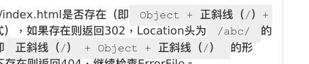

- ErrorDocument的内容

  | 名称 | 类型 | 是否必须 | 描述 |
  | --- | --- | --- | --- |
  | ErrorDocument | 容器 | 有条件至少指定IndexDocument、ErrorDocument、RoutingRules三个容器中的一个。 | 404页面的容器父节点：WebsiteConfiguration |
  | Key | 容器 | 有条件若指定了父节点ErrorDocument，则必须指定此项。 | 404页面如果指定，则访问的Object不存在时则返回此404页面。父节点：ErrorDocument |

- RoutingRules|RoutingRule|RuleNumber的内容

  | 名称 | 类型 | 是否必须 | 示例值 | 描述 |
  | --- | --- | --- | --- | --- |
  | RoutingRules | 容器 | 有条件至少指定IndexDocument、ErrorDocument、RoutingRules三个容器中的一个。 | 不涉及 | RoutingRule的容器父节点：WebsiteConfiguration |
  | RoutingRule | 容器 | 否 | 不涉及 | 指定跳转规则或者镜像回源规则，最多指定20个RoutingRule。父节点：RoutingRules |
  | RuleNumber | 字符串 | 有条件若指定了父节点RoutingRule，则必须指定此项。 | 1 | 匹配和执行RoutingRule的序号，OSS将按照此序号依次匹配规则。如果匹配成功，则执行此规则，后续的规则不再执行。父节点：RoutingRule |

- RoutingRules|RoutingRule|Condition的内容

  | 名称 | 类型 | 是否必须 | 示例值 | 描述 |
  | --- | --- | --- | --- | --- |
  | Condition | 容器 | 有条件若指定了父节点RoutingRule，则必须指定此项。 | 不涉及 | 匹配的条件如果指定的项都满足，则执行此规则。满足此容器下的各个节点的所有条件才算匹配。父节点：RoutingRule |
  | KeyPrefixEquals | 字符串 | 否 | abc/ | 只有匹配此前缀的Object才能匹配此规则。父节点：Condition |
  | HttpErrorCodeReturnedE quals | HTTP状态码 | 否 | 404 | 访问指定Object时返回此status才能匹配此规则。当跳转规则是镜像回源类型时，此字段必须为404。父节点：Condition |
  | IncludeHeader | 容器 | 否 | 不涉及 | 只有请求中包含了指定Header，且值为指定值时，才能匹配此规则。该容器最多可指定5个。父节点：Condition |
  | Key | 字符串 | 有条件若指定了父节点IncludeHeader，则必须指定此项。 | host | 只有请求中包含了此Header，且值为Equals的指定值时，才能匹配此规则。父节点：IncludeHeader |
  | Equals | 字符串 | 有条件若指定了父节点IncludeHeader，则必须指定此项。 | test.oss-cn-beijing-internal.aliyunc s.com | 只有请求中包含了Key指定的Header，且值为指定值时，才能匹配此规则。父节点：IncludeHeader |
  | KeySuffixEquals | 字符串 | 否 | zip | 只有匹配此字段指定的后缀才能匹配此规则。默认值为空，表示不匹配指定的后缀父节点：Condition |

- RoutingRules|RoutingRule|Redirect的内容

  | 名称 | 类型 | 是否必须 | 示例值 | 描述 |
  | --- | --- | --- | --- | --- |
  | Redirect | 容器 | 有条件若指定了父节点RoutingRule，则必须指定此项。 | 不涉及 | 指定匹配此规则后执行的动作。父节点：RoutingRule |
  | RedirectType | 字符串 | 有条件若指定了父节点Redirect，则必须指定此项。 | Mirror | 指定跳转的类型。取值：<br>• Mirror：镜像回源<br>• External：外部跳转，即OSS会返回一个3xx请求，指定跳转到另外一个地址。<br>• Internal：内部跳转，即OSS会根据此规则将访问的Object1转换成另外一个Object2，相当于用户访问的是Object2。<br>• AliCDN：阿里云CDN跳转，主要用于阿里云的CDN。与External不同的是，OSS会额外添加一个Header。阿里云CDN识别到此Header后会主动跳转到指定的地址，返回给用户获取到的数据，而不是将3xx跳转请求返回给用户。父节点：Redirect |
  | PassQueryString | 布尔 | 否 | true | 执行跳转或者镜像回源时，是否携带请求参数。用户请求OSS时携带了请求参数<code> ?a=b&amp;c=d </code>，并且此项设置为true，当规则为302跳转，则跳转的Location头中会添加此请求参数。例如<code> Location:www.example.com?a=b&amp;c=d </code>，跳转类型是镜像回源，则在发起的回源请求中也会携带此请求参数。取值：true、false默认值：false父节点：Redirect |
  | MirrorURL | 字符串 | 有条件若RedirectType指定为Mirror，则必须指定此项。 | http://www.exa mple.com/ | 仅在RedirectType为Mirror时生效，表示镜像回源的源站地址。假设以http://或者https://开头，必须以正斜线（/）结尾，OSS会在此字符串的基础上加上Object名称构成回源URL。例如指定为<code> http://www.example.com/ </code>，访问的Object名称是myobject，则回源的URL为<code> http://www.example.com/myobject </code>，如果指定为<code> http://www.example.com/dir1/ </code>，那么回源的URL为<code> http://www.example.com/dir1/myobject </code>。父节点：Redirect |
  | MirrorPassQueryString | 布尔 | 否 | true | 与PassQueryString作用相同，优先级高于PassQueryString。仅在RedirectType为Mirror时生效。默认值：false父节点：Redirect |
  | MirrorFollowRedirect | 布尔 | 否 | true | 如果镜像回源获取的结果是3xx，是否要继续跳转到指定的Location获取数据。例如发起镜像回源请求时，如果源站返回了302，并且指定了Location。<br>• 如果设置为true，则oss会继续请求Location指定的地址（最多跳转10次，如果超过10次，则返回镜像回源失败）。<br>• 如果设置为false，则OSS返回302，并将Location透传出去。只有在RedirectType为Mirror时生效。默认值：true父节点：Redirect |
  | MirrorCheckMd5 | 布尔 | 否 | false | 是否检查回源body的MD5。当此项为true且源站返回的response中含有Content-Md5头时，OSS检查拉取的数据MD5是否与此Header匹配，如果不匹配，则不保存在OSS上。仅在RedirectType为Mirror时生效。默认值：false父节点：Redirect |
  | MirrorHeaders | 容器 | 否 | 不涉及 | 用于指定镜像回源时携带的Header。只有在RedirectType为Mirror时生效。父节点：Redirect |
  | PassAll | 布尔 | 否 | true | 是否透传除以下Header之外的其他Header到源站。<br>• content-length、authorization2、authorization、range、date等Header<br>• 以oss-/x-oss-/x-drs-开头的Header只有在RedirectType为Mirror时生效。默认值：false父节点：MirrorHeaders |
  | Pass | 字符串 | 否 | myheader-key1 | 透传指定的Header到源站。每个Header长度最多1024个字节，字符集为0~9、A~Z、a~z以及短划线（-）。只有在RedirectType为Mirror时生效。此字段最多可指定10个。父节点：MirrorHeaders |
  | Remove | 字符串 | 否 | myheader-key3 | 禁止透传指定的Header到源站。每个Header长度最多1024个字节，字符集与Pass相同。只有在RedirectType为Mirror时生效。此字段最多可指定10个，通常与PassAll一起使用。父节点：MirrorHeaders |
  | Set | 容器 | 否 | 不涉及 | 设置一个Header传到源站，不管请求中是否携带这些指定的Header，回源时都会设置这些Header。此容器最多可指定10组，仅在RedirectType为Mirror时生效。父节点：MirrorHeaders |
  | Key | 字符串 | 有条件若指定了父节点Set，则必须指定此项。 | myheader-key5 | 设置Header的key，最多1024个字节，字符集与Pass相同。仅在RedirectType为Mirror时生效。父节点：Set |
  | Value | 字符串 | 有条件若指定了父节点Set，则必须指定此项。 | myheader-value5 | 设置Header的value，最多1024个字节，不能出现<code> \r\n </code>。仅在RedirectType为Mirror时生效。父节点：Set |
  | Protocol | 字符串 | 有条件若RedirectType指定为External或者AliCDN，则必须指定此项。 | http | 跳转时的协议。假设访问的文件为test，设定跳转到<code> www.example.com </code>，而且Protocol字段为https，那么Location头为<code> https://www.example.com/test </code>。仅在RedirectType为External或者AliCDN时生效。取值：http或https。父节点：Redirect |
  | HostName | 字符串 | 有条件若RedirectType指定为External或者AliCDN，则必须指定此项。 | www.example.c om | 跳转时的域名，需符合域名规范。例如访问的Object为test，Protocol为https，Hostname指定为<code> www.example.com </code>，那么Location头为<code> https://www.example.com/test </code>。父节点：Redirect |
  | ReplaceKeyPrefixWith | 字符串 | 否 | abc/ | Redirect时Object名称的前缀将替换成该值。如果前缀为空，则将这个字符串插入Object名称的前面。说明仅允许存在ReplaceKeyWith或ReplaceKeyPrefixWith节点。<br>假设指定了KeyPrefixEquals为abc/，指定了ReplaceKeyPrefixWith为def/，那么如果访问的Object为abc/test.txt，Location头则为<code> http://www.example.com/def/test.txt </code>。父节点：Redirect |
  | EnableReplacePrefix | 布尔 | 否 | true | 如果此字段设置为true，则Object的前缀将被替换为ReplaceKeyPrefixWith指定的值。如果未指定此字段或为空，则表示截断Object前缀。说明ReplaceKeyWith字段不为空时，此字段不能设置为true。<br>默认值：false父节点：Redirect |
  | ReplaceKeyWith | 字符串 | 否 | prefix/${key}.s uffix | Redirect时Object名称将替换成ReplaceKeyWith指定的值，ReplaceKeyWith支持设置变量。目前支持的变量是${key}，表示该请求中的Object名称。假设设置ReplaceKeyWith为<code> prefix/${key}.suffix </code>，访问的Object为test，那么Location头则为<code> http://www.example.com/prefix/test.suffix </code>。父节点：Redirect |
  | HttpRedirectCode | HTTP状态码 | 有条件若RedirectType指定为External或者AliCDN，则必须指定此项。 | 301 | 跳转时返回的状态码。仅在RedirectType为External或者AliCDN时生效。取值：301、302或307。父节点：Redirect |

有关此接口的其他公共请求元素，请参见公共请求头（Common Request Headers）。

**响应元素**

有关此接口的响应元素，请参见公共响应头（Common Response Headers）。

**示例**

- 请求示例

  ```xml
  PUT /?website HTTP/1.1
  Host: oss-example.oss-cn-hangzhou.aliyuncs.com
  Content-Length: 209
  Date: Fri, 04 May 2012 03:21:12 GMT
  Authorization: OSS qn6qrrqx******k53otfjbyc:KU5h8YM******0dXqf3JxrTZHiA=

  <?xml version="1.0" encoding="UTF-8"?>
  <WebsiteConfiguration>
    <IndexDocument>
      <Suffix>index.html</Suffix>
        <SupportSubDir>true</SupportSubDir>
        <Type>0</Type>
    </IndexDocument>
    <ErrorDocument>
      <Key>error.html</Key>
    </ErrorDocument>
  </WebsiteConfiguration>
  ```

- 返回示例

  ```text
  HTTP/1.1 200 OK
  x-oss-request-id: 534B371674E88A4D8906008B
  Date: Fri, 04 May 2012 03:21:12 GMT
  Content-Length: 0
  Connection: keep-alive
  Server: AliyunOSS
  ```

- 完整示例

  ```xml
  PUT /?website HTTP/1.1
  Date: Fri, 27 Jul 2018 09:03:18 GMT
  Content-Length: 2064
  Host: test.oss-cn-hangzhou-internal.aliyuncs.com
  Authorization: OSS a1nBN******QMf8u:sNKIHT6ci/z231yIT5vYnetD****
  User-Agent: aliyun-sdk-python-test/0.4.0

  <WebsiteConfiguration>
    <IndexDocument>
      <Suffix>index.html</Suffix>
      <SupportSubDir>true</SupportSubDir>
      <Type>0</Type>
    </IndexDocument>
    <ErrorDocument>
      <Key>error.html</Key>
    </ErrorDocument>
    <RoutingRules>
      <RoutingRule>
        <RuleNumber>1</RuleNumber>
        <Condition>
          <KeyPrefixEquals>abc/</KeyPrefixEquals>
          <HttpErrorCodeReturnedEquals>404</HttpErrorCodeReturnedEquals>
        </Condition>
        <Redirect>
          <RedirectType>Mirror</RedirectType>
          <PassQueryString>true</PassQueryString>
          <MirrorURL>http://www.test.com/</MirrorURL>
          <MirrorPassQueryString>true</MirrorPassQueryString>
          <MirrorFollowRedirect>true</MirrorFollowRedirect>
          <MirrorCheckMd5>false</MirrorCheckMd5>
          <MirrorHeaders>
            <PassAll>true</PassAll>
            <Pass>myheader-key1</Pass>
            <Pass>myheader-key2</Pass>
            <Remove>myheader-key3</Remove>
            <Remove>myheader-key4</Remove>
            <Set>
              <Key>myheader-key5</Key>
              <Value>myheader-value5</Value>
            </Set>
          </MirrorHeaders>
        </Redirect>
      </RoutingRule>
      <RoutingRule>
        <RuleNumber>2</RuleNumber>
        <Condition>
          <KeyPrefixEquals>abc/</KeyPrefixEquals>
          <HttpErrorCodeReturnedEquals>404</HttpErrorCodeReturnedEquals>
          <IncludeHeader>
            <Key>host</Key>
            <Equals>test.oss-cn-beijing-internal.aliyuncs.com</Equals>
          </IncludeHeader>
        </Condition>
        <Redirect>
          <RedirectType>AliCDN</RedirectType>
          <Protocol>http</Protocol>
          <HostName>www.test.com</HostName>
          <PassQueryString>false</PassQueryString>
          <ReplaceKeyWith>prefix/${key}.suffix</ReplaceKeyWith>
          <HttpRedirectCode>301</HttpRedirectCode>
        </Redirect>
      </RoutingRule>
    </RoutingRules>
  </WebsiteConfiguration>

  HTTP/1.1 200 OK
  Server: AliyunOSS
  Date: Fri, 27 Jul 2018 09:03:18 GMT
  Content-Length: 0
  Connection: keep-alive
  x-oss-request-id: 5B5ADFD6ED3CC49176CBE29D
  x-oss-server-time: 47
  ```

<a id="section-1-1-5-7-2"></a>

##### 1.1.5.7.2. GetBucketWebsite

GetBucketWebsite操作用于查看Bucket的静态网站托管状态。

**请求语法**

```http
GET /?website HTTP/1.1
Host: BucketName.regionid.example.com
Date: GMT Date
Authorization: SignatureValue
```

**请求头**

此接口涉及的公共请求头，请参见公共请求头（Common Request Headers）。

**响应元素**

| 名称 | 类型 | 示例值 | 描述 |
| --- | --- | --- | --- |
| ErrorDocument | 容器 | 不涉及 | 子元素Key的父元素。 |
| IndexDocument | 容器 | 不涉及 | 子元素Suffix的父元素。 |
| Key | 字符串 | error.html | 返回404错误时使用的文件名。 |
| Suffix | 字符串 | index.html | 返回目录URL时添加的索引文件名，不要为空，也不要包含正斜线（/）。例如索引文件设置为index.html，则访问regionid.example.com/mybucket/mydir/的时候相当于访问regionid.example.com/mybucket/index.html。 |
| WebsiteConfiguration | 容器 | 不涉及 | 请求的容器。 |

**示例**

请求示例：

```text
Get /?website HTTP/1.1
Host: BucketName.regionid.example.com  
Date: Thu, 13 Sep 2012 07:51:28 GMT
Authorization: OSS q***c:B***=
            
```

正确请求的返回示例：

```xml
HTTP/1.1 200
x-oss-request-id: 5***B
Date: Thu, 13 Sep 2012 07:51:28 GMT
Connection: keep-alive
Content-Length: 218  
Server: AliyunOSS

<?xml version="1.0" encoding="UTF-8"?>
<WebsiteConfiguration xmlns=”http://doc.oss-cn-hangzhou.aliyuncs.com”>
<IndexDocument>
<Suffix>index.html</Suffix>
    </IndexDocument>
    <ErrorDocument>
        <Key>error.html</Key>
    </ErrorDocument>
</WebsiteConfiguration>
            
```

错误请求的返回示例：

```xml
HTTP/1.1 404 
x-oss-request-id: 5***B
Date: Thu, 13 Sep 2012 07:56:46 GMT
Connection: keep-alive
Content-Length: 308  
Server: AliyunOSS

<?xml version="1.0" encoding="UTF-8"?>
<Error xmlns=”http://doc.oss-cn-hangzhou.aliyuncs.com”>
    <Code>NoSuchWebsiteConfiguration</Code>
    <Message>The specified bucket does not have a website configuration.</Message>
    <BucketName>oss-example</BucketName>
    <RequestId>5***F</RequestId>
    <HostId>BucketName.regionid.example.com</HostId>
</Error>
```

<a id="section-1-1-5-7-3"></a>

##### 1.1.5.7.3. DeleteBucketWebsite

DeleteBucketWebsite用于关闭Bucket的静态网站托管模式。

**请求语法**

```http
DELETE /?website HTTP/1.1
Host: BucketName.regionid.example.com
Date: GMT Date
Authorization: SignatureValue
```

**请求头**

此接口仅涉及公共请求头。更多信息，请参见公共请求头（Common Request Headers）。

**响应头**

此接口仅涉及公共响应头。更多信息，请参见公共响应头（Common Response Headers）。

**示例**

请求示例：

```http
DELETE /?website HTTP/1.1
Host: ***.regionid.example.com  
Date: Fri, 24 Feb 2012 05:45:34 GMT  
Authorization: OSS q***:L***=
            
```

返回示例：

```text
HTTP/1.1 204 No Content 
x-oss-request-id: 5***B
Date: Fri, 24 Feb 2012 05:45:34 GMT
Connection: keep-alive
Content-Length: 0  
Server: AliyunOSS
```

<a id="section-1-1-5-8"></a>

#### 1.1.5.8. 防盗链（Referer）

<a id="section-1-1-5-8-1"></a>

##### 1.1.5.8.1. PutBucketReferer

PutBucketReferer操作可以设置一个Bucket的Referer访问白名单、黑名单和是否允许Referer字段为空的请求访问。

**注意事项**

此操作将用RefererList中的白名单或黑名单列表覆盖之前已配置的列表，当用户上传的RefererList为空时（不包含Referer请求元素），此操作会覆盖已配置的白名单或黑名单列表，即删除之前配置的RefererList。

**请求语法**

```xml
PUT /?referer HTTP/1.1
Date: GMT Date
Content-Length：ContentLength
Content-Type: application/xml
Host: BucketName.oss.example.com
Authorization: SignatureValue

<?xml version="1.0" encoding="UTF-8"?>
<RefererConfiguration>
  <AllowEmptyReferer>true</AllowEmptyReferer >
  <RefererList>
      <Referer> http://www.aliyun.com</Referer>
      <Referer> https://www.aliyun.com</Referer>
      <Referer> http://www.*.com</Referer>
      <Referer> https://www.?.aliyuncs.com</Referer>
  </RefererList>
  <RefererBlacklist>
    <Referer>http://www.refuse.com</Referer>
    <Referer>https://*.hack.com</Referer>
    <Referer>http://ban.*.com</Referer>
    <Referer>https://www.?.deny.com</Referer>
  </RefererBlacklist>
</RefererConfiguration>
```

**请求元素**

| 名称 | 类型 | 是否必选 | 示例值 | 描述 |
| --- | --- | --- | --- | --- |
| RefererConfiguration | 容器 | 是 | 不涉及 | 保存Referer配置内容的容器。类型：容器子节点：AllowEmptyReferer节点、RefererList节点父节点：无 |
| AllowEmptyReferer | 枚举字符串 | 是 | true | 指定是否允许Referer字段为空的请求访问。默认值：true |
| RefererList | 容器 | 是 | 不涉及 | 保存Referer访问白名单的容器。 |
| RefererBlacklist | 容器 | 否 | 不涉及 | 保存Referer访问黑名单的容器。 |
| Referer | 字符串 | 否 | http://www.aliy un.com | 指定一条Referer访问域名。 |

**响应头**

此接口仅涉及的公共响应头，请参见公共响应头（Common Response Headers）。

**示例**

- 不包含Referer的请求示例：

  ```xml
  PUT /?referer HTTP/1.1
  Host: BucketName.oss.example.com
  Content-Length: 247
  Date: Fri, 04 May 2012 03:21:12 GMT
  Authorization: OSS q***c:K***=

  <?xml version="1.0" encoding="UTF-8"?>
  <RefererConfiguration>
    <AllowEmptyReferer>true</AllowEmptyReferer >
    < RefererList />
  </RefererConfiguration>
  ```

- 仅包含白名单Referer的请求示例：

  ```xml
  PUT /?referer HTTP/1.1
  Host: BucketName.oss.example.com
  Content-Length: 247
  Date: Fri, 04 May 2012 03:21:12 GMT
  Authorization: OSS q***c:K***=

  <?xml version="1.0" encoding="UTF-8"?>
  <RefererConfiguration>
    <AllowEmptyReferer>true</AllowEmptyReferer >
    <RefererList>
      <Referer> http://www.aliyun.com</Referer>
      <Referer> https://www.aliyun.com</Referer>
      <Referer> http://www.*.com</Referer>
      <Referer> https://www.?.aliyuncs.com</Referer>
    </RefererList>
  </RefererConfiguration>
  ```

- 同时包含白名单Referer以及黑名单Referer的请求示例：

  ```xml
  PUT /?referer HTTP/1.1
  Host: BucketName.oss.example.com
  Content-Length: 247
  Date: Fri, 04 May 2012 03:21:12 GMT
  Authorization: OSS q***c:K***=

  <?xml version="1.0" encoding="UTF-8"?>
  <RefererConfiguration>
    <AllowEmptyReferer>true</AllowEmptyReferer >
    <RefererList>
      <Referer> http://www.aliyun.com</Referer>
      <Referer> https://www.aliyun.com</Referer>
      <Referer> http://www.*.com</Referer>
      <Referer> https://www.?.aliyuncs.com</Referer>
    </RefererList>
    <RefererBlacklist>
      <Referer>http://www.refuse.com</Referer>
      <Referer>https://*.hack.com</Referer>
      <Referer>http://ban.*.com</Referer>
      <Referer>https://www.?.deny.com</Referer>
    </RefererBlacklist>
  </RefererConfiguration>
  ```

返回示例：

```text
HTTP/1.1 200 OK
x-oss-request-id: 5***B
Date: Fri, 04 May 2012 03:21:12 GMT
Content-Length: 0
Connection: keep-alive
Server: AliyunOSS
```

<a id="section-1-1-5-8-2"></a>

##### 1.1.5.8.2. GetBucketReferer

GetBucketReferer操作用于查看Bucket的Referer相关配置。

**请求语法**

```http
GET /?referer HTTP/1.1
Host: BucketName.oss.example.com
Date: GMT Date
Authorization: SignatureValue
```

**请求头**

此接口涉及的公共请求头，请参见公共请求头（Common Request Headers）。

**响应元素**

| 名称 | 类型 | 示例值 | 描述 |
| --- | --- | --- | --- |
| RefererConfiguration | 容器 | 不涉及 | 保存Referer配置内容的容器。 |
| AllowEmptyReferer | 枚举字符串 | true | 获取是否允许Referer字段为空的请求访问。有效值：true、false默认值：true |
| RefererList | 容器 | 不涉及 | 保存Referer访问白名单的容器。 |
| RefererBlacklist | 容器 | 不涉及 | 保存Referer访问黑名单的容器。 |
| Referer | 字符串 | http://www.aliyun.com | 获取Referer访问白名单或黑名单。 |

**示例**

- 请求示例：

  ```text
  Get /?referer HTTP/1.1
  Host: BucketName.oss.example.com  
  Date: Thu, 13 Sep 2012 07:51:28 GMT
  Authorization: OSS q***: B***=
  ```

- 仅设置白名单Referer规则的返回示例：

  ```xml
  HTTP/1.1 200
  x-oss-request-id: 5***B
  Date: Thu, 13 Sep 2012 07:51:28 GMT
  Connection: keep-alive
  Content-Length: 218  
  Server: AliyunOSS

  <?xml version="1.0" encoding="UTF-8"?>
  <RefererConfiguration>
  <AllowEmptyReferer>true</AllowEmptyReferer >
      <RefererList>
          <Referer>http://www.aliyun.com</Referer>
          <Referer>https://www.aliyun.com</Referer>
          <Referer>http://www.*.com</Referer>
          <Referer>https://www.?.aliyuncs.com</Referer>
      </RefererList>
  </RefererConfiguration>      
  ```

- 同时设置白名单Referer以及黑名单Referer规则的返回示例：

  ```xml
  HTTP/1.1 200
  x-oss-request-id: 5***B
  Date: Thu, 13 Sep 2012 07:51:28 GMT
  Connection: keep-alive
  Content-Length: 218  
  Server: AliyunOSS

  <?xml version="1.0" encoding="UTF-8"?>
  <RefererConfiguration>
  <AllowEmptyReferer>true</AllowEmptyReferer >
    <RefererList>
      <Referer>http://www.aliyun.com</Referer>
      <Referer>https://www.aliyun.com</Referer>
      <Referer>http://www.*.com</Referer>
      <Referer>https://www.?.aliyuncs.com</Referer>
    </RefererList>
    <RefererBlacklist>
      <Referer>http://www.refuse.com</Referer>
      <Referer>https://*.hack.com</Referer>
      <Referer>http://ban.*.com</Referer>
      <Referer>https://www.?.deny.com</Referer>
    </RefererBlacklist>
  </RefererConfiguration>      
  ```

- 未设置Referer规则的返回示例：

  ```xml
  HTTP/1.1 200
  x-oss-request-id: 5***B
  Date: Thu, 13 Sep 2012 07:56:46 GMT
  Connection: keep-alive
  Content-Length: 308  
  Server: AliyunOSS

  <?xml version="1.0" encoding="UTF-8"?>
  <RefererConfiguration>
    <AllowEmptyReferer>true</AllowEmptyReferer >
    < RefererList />
  </RefererConfiguration>
  ```

<a id="section-1-1-5-9"></a>

#### 1.1.5.9. 标签（Tags）

<a id="section-1-1-5-9-1"></a>

##### 1.1.5.9.1. PutBucketTags

调用PutBucketTags接口用来给某个存储空间（Bucket）添加或修改标签。用户可以通过标签，对Bucket进行分类管理。

**注意事项**

- 只有Bucket的拥有者及授权RAM账户才能为Bucket设置用户标签，否则返回403 Forbidden错误，错误码为AccessDenied。

- 最多可设置20对Bucket用户标签（Key-Value对）。

- PutBucketTags是覆盖语义，即新添加的标签会完全覆盖已有的标签。

- v3.18.1及以后版本，Apsara Uni-manager运营控制台会自动给Bucket下发key为 `ascm:tag/rg` 的系统标签。在修改Bucket标签时请勿覆盖此标签，避免影响控制台正常使用。

**请求语法**

```xml
PUT /?tagging HTTP/1.1
Date: GMT Date
Content-Length: ContentLength
Authorization: SignatureValue
Host: BucketName.oss-cn-hangzhou.aliyuncs.com
<?xml version="1.0" encoding="UTF-8"?>
<Tagging>
  <TagSet>
    <Tag>
      <Key>key1</Key>
      <Value>value1</Value>
    </Tag>
    <Tag>
      <Key>key2</Key>
      <Value>value2</Value>
    </Tag>
  </TagSet>
</Tagging>
```

**请求头**

此接口仅涉及公共请求头。更多信息，请参见公共请求头（Common Request Headers）。

**请求元素**

| 名称 | 类型 | 是否必需 | 描述 |
| --- | --- | --- | --- |
| Tagging | 容器 | 是 | 设置Bucket TagSet的容器。子元素：TagSet父元素：无 |
| TagSet | 容器 | 是 | 包含一系列Bucket Tag的容器。子元素：Tag父元素：Tagging |
| Tag | 容器 | 是 | 设置Bucket Tag的容器。子元素：Key、Value父元素：TagSet |
| Key | 字符串 | 是 | 指定Bucket Tag的Key。<br>• 最大长度为64字节。<br>• 不能以<code> http :// </code>、<code> https:// </code>、<code> Aliyun </code>为前缀。<br>• 必须为UTF-8编码；<br>• 不能为空。子元素：无父元素：Tag |
| Value | 字符串 | 否 | 指定Bucket Tag的Value。<br>• 最大长度为128字节。<br>• 必须为UTF-8编码。<br>• 可以为空。子元素：无父元素：Tag |

**响应头**

此接口仅涉及公共响应头。更多信息，请参见公共响应头（Common Response Headers）。

**示例**

- 请求示例

  ```xml
  PUT /?tagging
  Host: oss-example.oss-cn-hangzhou.aliyuncs.com
  Date: Tue, 20 Dec 2018 11:49:13 GMT
  Authorization: OSS qn6qrrqxo2oawuk53otf****:ceOEyZavKY4QcjoUWYSpYbJ3****
  <Tagging>
    <TagSet>
      <Tag>
        <Key>testa</Key>
        <Value>testv1</Value>
      </Tag>
      <Tag>
        <Key>testb</Key>
        <Value>testv2</Value>
      </Tag>
    </TagSet>
  </Tagging>
  ```

- 返回示例

  ```text
  200 (OK)
  content-length: 0
  server: AliyunOSS
  x-oss-request-id: 5C1B138A109F4E405B2D****
  date: Thu, 20 Dec 2018 11:59:06 GMT
  x-oss-server-time: 148
  connection: keep-alive
  ```

<a id="section-1-1-5-9-2"></a>

##### 1.1.5.9.2. GetBucketTags

调用GetBucketTags获取存储空间（Bucket）的标签信息。

**请求语法**

```text
GET /?tagging
Host: BucketName.oss-cn-hangzhou.aliyuncs.com
Date: GMT Date
Authorization: SignatureValue
```

**响应元素**

| 名称 | 类型 | 描述 |
| --- | --- | --- |
| Tagging | 容器 | 保存Bucket Tag结果的容器。父元素：无<br>说明如果源Bucket未设置Tag，OSS仍返回一个XML消息体，但其中的Tagging元素为空。 |
| TagSet | 容器 | 保存Bucket Tag结果的容器。父元素：Tagging |
| Tag | 容器 | 保存Bucket Tag结果的容器。父元素：TagSet |
| Key | 字符串 | 某个Tag的Key。父元素：Tag |
| Value | 字符串 | 某个Tag的Value。父元素：Tag |

**示例**

- 请求示例

  ```text
  GET /?tagging
  Host: oss-example.oss-cn-hangzhou.aliyuncs.com
  Date: Tue, 20 Dec 2018 13:09:13 GMT
  Authorization: OSS qn6qrrqxo2oawuk53otf****:ceOEyZavKY4QcjoUWYSpYbJ3****
  ```

- 返回示例

  ```xml
  200 (OK)
  content-length: 237
  server: AliyunOSS
  x-oss-request-id: 5C1B2D24B90AD5490CFE368E
  date: Thu, 20 Dec 2018 13:12:21 GMT
  content-type: application/xml
  <?xml version="1.0" encoding="UTF-8"?>
  <Tagging>
    <TagSet>
      <Tag>
        <Key>testa</Key>
        <Value>value1-test</Value>
      </Tag>
      <Tag>
        <Key>testb</Key>
        <Value>value2-test</Value>
      </Tag>
    </TagSet>
  </Tagging>
  ```

**错误码**

| 错误码 | HTTP状态码 | 描述 |
| --- | --- | --- |
| NoSuchBucket | 404 | 目标Bucket不存在。 |
| AccessDenied | 403 | 没有查看Bucket标签的权限。只有Bucket的拥有者及授权子账户才能查看Bucket的标签信息。 |

<a id="section-1-1-5-9-3"></a>

##### 1.1.5.9.3. DeleteBucketTags

调用DeleteBucketTags接口删除存储空间（Bucket）标签。

> 如果目标Bucket没有任何标签或指定标签的Key不存在，则返回HTTP状态码204。
>
> **说明**

**请求语法**

```http
DELETE /?tagging HTTP/1.1
Host: BucketName.oss-cn-hangzhou.aliyuncs.com
Date: GMT Date
Authorization: SignatureValue
```

**请求头**

此接口仅涉及公共请求头。更多信息，请参见公共请求头（Common Request Headers）。

**响应头**

此接口仅涉及公共响应头。更多信息，请参见公共响应头（Common Response Headers）。

**示例**

- 示例1：删除所有标签

  ```http
  DELETE /?tagging HTTP/1.1
  Host: oss-example.oss-cn-hangzhou.aliyuncs.com
  Date: Tue, 25 Dec 2018 17:35:24 GMT
  Authorization: OSS qn6qrrqxo2oawuk53otf****:6ZVHOehYzxoC1yxRydPQs/Cn****
  ```

  返回示例

  ```text
  HTTP/1.1 204 No Content
  x-oss-request-id: 5C22E0EFD127F6810B1A****
  Date: Tue, 25 Dec 2018 17:35:24 GMT
  Connection: keep-alive
  Content-Length: 0
  Server: AliyunOSS
  ```

- 示例2：删除Key为k1和k2的标签

  ```http
  DELETE /?tagging=k1,k2 HTTP/1.1
  Host: oss-example.oss-cn-hangzhou.aliyuncs.com
  Date: Tue, 25 Dec 2018 17:35:24 GMT
  Authorization: OSS qn6qrrqxo2oawuk53otf****:6ZVHOehYzxoC1yxRydPQs/Cn****
  ```

  返回示例

  ```text
  HTTP/1.1 204 No Content
  x-oss-request-id: 5C22E0EFD127F6810B1A92A8
  Date: Tue, 25 Dec 2018 17:35:24 GMT
  Connection: keep-alive
  Content-Length: 0
  Server: AliyunOSS
  ```

**错误码**

| 错误码 | HTTP状态码 | 描述 |
| --- | --- | --- |
| NoSuchBucket | 404 No Content | 目标Bucket不存在。 |
| AccessDenied | 403 Forbidden | 无权限删除该Bucket的标签信息。只有Bucket的拥有者才能删除Bucket的标签信息。 |

<a id="section-1-1-5-10"></a>

#### 1.1.5.10. 跨域资源共享

<a id="section-1-1-5-10-1"></a>

##### 1.1.5.10.1. 简介

跨域资源共享CORS允许Web端的应用程序访问不属于本域的资源。OSS提供了CORS支持以方便利用OSS开发更灵活的WEB应用程序。OSS提供接口方便开发者控制跨域访问的各种权限。

<a id="section-1-1-5-10-2"></a>

##### 1.1.5.10.2. PutBucketcors

PutBucketcors接口用于为指定的存储空间（Bucket）设定一个跨域资源共享（CORS）规则。如果Bucket已有CORS规则，使用此接口会覆盖原有规则。Bucket默认不开启CORS功能，所有跨域请求的Origin都不被允许。

**注意事项**

使用跨域资源共享时，有如下注意事项：

- 默认不开启CORS

  Bucket默认不开启CORS功能，所有跨域请求的Origin都不被允许。

- 覆盖语义

  PutBucketCors为覆盖语义，即新配置的CORS规则将覆盖已有的CORS规则。

- 应用程序中使用CORS

  在应用程序中使用CORS功能时，需通过PutBucketCors接口手动上传CORS规则来开启CORS功能。

  例如，从 `www.a.com` 通过浏览器的 `XMLHttpRequest` 功能来访问OSS，需要通过本接口手动上传CORS规则，且CORS规则需由XML文档进行描述。

- CORS规则匹配

  当OSS收到一个跨域请求或OPTIONS请求，会先读取Bucket对应的CORS规则，然后进行相应的权限检查。OSS会依次检查每一条规则，使用第一条匹配的规则来允许请求并返回对应的Header。如果所有规则都匹配失败，则不附加任何CORS相关的Header。

  CORS规则匹配成功必须满足以下三个条件：

  - 请求的Origin必须匹配一个 `AllowedOrigin` 项。

  - 请求的方法（如GET、PUT等）或者OPTIONS请求的 `Access-Control-Request-Method` 头对应的方法必须匹配一个 `AllowedMethod` 项。

  - OPTIONS请求的 `Access-Control-Request-Headers` 头包含的每个header都必须匹配一个 `AllowedHeader` 项。

**请求语法**

```xml
PUT /?cors HTTP/1.1
Date: GMT Date
Content-Length：ContentLength
Content-Type: application/xml
Host: BucketName.regionid.example.com
Authorization: SignatureValue

<?xml version="1.0" encoding="UTF-8"?>
<CORSConfiguration>
    <CORSRule>
      <AllowedOrigin>the origin you want allow CORS request from</AllowedOrigin>
      <AllowedOrigin>…</AllowedOrigin>
      <AllowedMethod>HTTP method</AllowedMethod>
      <AllowedMethod>…</AllowedMethod>
        <AllowedHeader> headers that allowed browser to send</AllowedHeader>
          <AllowedHeader>…</AllowedHeader>
          <ExposeHeader> headers in response that can access from client app</ExposeHeader>
          <ExposeHeader>…</ExposeHeader>
          <MaxAgeSeconds>time to cache pre-fight response</MaxAgeSeconds>
    </CORSRule>
    <CORSRule>
      …
    </CORSRule>
…
</CORSConfiguration >
```

**请求元素**

| 名称 | 类型 | 是否必选 | 示例值 | 描述 |
| --- | --- | --- | --- | --- |
| CORSRule | 容器 | 是 | 不涉及 | CORS规则的容器，每个Bucket最多允许10条规则。 |
| AllowedOrigin | 字符串 | 是 | \* | 指定允许的跨域请求的来源，允许使用多个元素来指定多个允许的来源。允许使用最多一个星号（\*）通配符。如果指定为星号（\*）则表示允许所有的来源的跨域请求。 |
| AllowedMethod | 枚举字符串 | 是 | GET | 指定允许的跨域请求方法。可选值：GET、PUT、DELETE、POST、HEAD |
| AllowedHeader | 字符串 | 否 | Authorization | 控制在OPTIONS预取指令中Access-Control-Request-Headers头中指定的header是否允许。在Access-Control-Request-Headers中指定的每个header都必须在AllowedHeader中有一条对应的项。允许使用最多一个星号（\*）通配符。 |
| ExposeHeader | 字符串 | 否 | x-oss-test | 指定允许用户从应用程序中访问的响应头（例如一个Javascript的XMLHttpRequest对象。）不允许使用星号（\*）通配符。 |
| CORSConfiguration | 容器 | 是 | 不涉及 | Bucket的CORS规则容器。 |
| MaxAgeSeconds | 整型 | 否 | 100 | 指定浏览器对特定资源的预取（OPTIONS）请求返回结果的缓存时间，单位为秒。一个CORSRule里面最多允许出现一个。 |

**响应头**

此接口仅涉及公共响应头。更多信息，请参见公共响应头（Common Response Headers）。

**示例**

请求示例：

```xml
PUT /?cors HTTP/1.1
Host: ***.regionid.example.com
Content-Length: 186
Date: Fri, 04 May 2012 03:21:12 GMT
Authorization: OSS q***A=

<?xml version="1.0" encoding="UTF-8"?>
<CORSConfiguration>
    <CORSRule>
      <AllowedOrigin>*</AllowedOrigin>
      <AllowedMethod>PUT</AllowedMethod>
      <AllowedMethod>GET</AllowedMethod>
      <AllowedHeader>Authorization</AllowedHeader>
    </CORSRule>
    <CORSRule>
      <AllowedOrigin>http://www.a.com</AllowedOrigin>
      <AllowedOrigin>http://www.b.com</AllowedOrigin>
      <AllowedMethod>GET</AllowedMethod>
      <AllowedHeader> Authorization</AllowedHeader>
      <ExposeHeader>x-oss-test</ExposeHeader>
      <ExposeHeader>x-oss-test1</ExposeHeader>
      <MaxAgeSeconds>100</MaxAgeSeconds>
    </CORSRule>
</CORSConfiguration >
            
```

返回示例：

```text
HTTP/1.1 200 OK
x-oss-request-id: 5***F
Date: Fri, 04 May 2012 03:21:12 GMT
Content-Length: 0
Connection: keep-alive
Server: AliyunOSS
```

<a id="section-1-1-5-10-3"></a>

##### 1.1.5.10.3. GetBucketcors

GetBucketcors操作用于获取指定的Bucket目前的CORS规则。

**请求语法**

```http
GET /?cors HTTP/1.1
Host: BucketName.regionid.example.com
Date: GMT Date
Authorization: SignatureValue
```

**请求头**

此接口仅涉及公共请求头。更多详情，请参见公共请求头（Common Request Headers）。

**响应元素**

| 名称 | 类型 | 示例值 | 描述 |
| --- | --- | --- | --- |
| CORSRule | 容器 | 不涉及 | CORS规则的容器。每个Bucket最多允许10条规则。 |
| AllowedOrigin | 字符串 | \* | 允许的跨域请求来源。 星号（\*）表示允许所有的来源的跨域请求。 |
| AllowedMethod | 枚举字符串 | GET | 允许的跨域请求方法。可选值：GET、PUT、DELETE、POST、HEAD |
| AllowedHeader | 字符串 | \* | 控制在OPTIONS预取指令中Access-Control-Request-Headers指定的header是否允许。在Access-Control-Request-Headers中指定的每个header都在AllowedHeader中有一条对应的项。 |
| ExposeHeader | 字符串 | x-oss-test | 允许用户从应用程序中访问的响应头（例如一个Javascript的XMLHttpRequest对象）。 |
| MaxAgeSeconds | 整型 | 100 | 浏览器对特定资源的预取（OPTIONS）请求返回结果的缓存时间。 一个CORS规则里面最多允许出现一个MaxAgeSeconds。 |
| CORSConfiguration | 容器 | 不涉及 | Bucket的CORS规则容器。 |

**示例**

请求示例：

```text
Get /?cors HTTP/1.1
Host: ***.regionid.example.com
Date: Thu, 13 Sep 2012 07:51:28 GMT
Authorization: OSS q***w=
            
```

已设置CORS规则的返回示例：

```xml
HTTP/1.1 200
x-oss-request-id: 5***F
Date: Thu, 13 Sep 2012 07:51:28 GMT
Connection: keep-alive
Content-Length: 218
Server: AliyunOSS

<?xml version="1.0" encoding="UTF-8"?>
<CORSConfiguration>
    <CORSRule>
      <AllowedOrigin>*</AllowedOrigin>
      <AllowedMethod>GET</AllowedMethod>
      <AllowedHeader>*</AllowedHeader>
      <ExposeHeader>x-oss-test</ExposeHeader>
      <MaxAgeSeconds>100</MaxAgeSeconds>
    </CORSRule>
</CORSConfiguration>
```

<a id="section-1-1-5-10-4"></a>

##### 1.1.5.10.4. DeleteBucketcors

DeleteBucketcors用于清空CORS规则。

**请求语法**

```http
DELETE /?cors HTTP/1.1
Host: BucketName.regionid.example.com
Date: GMT Date
Authorization: SignatureValue
```

**请求头**

此接口仅涉及公共请求头。更多信息，请参见公共请求头（Common Request Headers）。

**响应头**

此接口仅涉及公共响应头。更多信息，请参见公共响应头（Common Response Headers）。

**示例**

请求示例：

```http
DELETE /?cors HTTP/1.1
Host: ***.regionid.example.com  
Date: Fri, 24 Feb 2012 05:45:34 GMT  
Authorization: OSS q***g=
            
```

返回示例：

```text
HTTP/1.1 204 No Content 
x-oss-request-id: 5***C
Date: Fri, 24 Feb 2012 05:45:34 GMT
Connection: keep-alive
Content-Length: 0  
Server: AliyunOSS
```

<a id="section-1-1-5-10-5"></a>

##### 1.1.5.10.5. OptionObject

浏览器在发送跨域请求之前会发送一个preflight请求（OPTIONS）并带上特定的来源域，HTTP方法和header信息等给OSS以决定是否发送真正的请求。

OSS可以通过PutBucketcors接口来开启Bucket的CORS支持，开启CORS功能之后，OSS在收到浏览器preflight请求时会根据设定的规则评估是否允许本次请求。如果不允许或者CORS功能没有开启，返回403 Forbidden。

**请求语法**

```text
OPTIONS /ObjectName HTTP/1.1
Host: BucketName.regionid.example.com
Origin:Origin
Access-Control-Request-Method:HTTP method
Access-Control-Request-Headers:Request Headers
```

**请求头**

| 名称 | 类型 | 是否必选 | 示例值 | 描述 |
| --- | --- | --- | --- | --- |
| Origin | 字符串 | 是 | http://www.example.com | 请求来源域，用来标示跨域请求。默认值：无 |
| Access-Control-Request-Method | 字符串 | 是 | PUT | 表示在实际请求中将会用到的方法。默认值：无 |
| Access-Control-Request-Headers | 字符串 | 是 | x-oss-test | 表示在实际请求中会用到的除了简单头部之外的头。默认值：无 |

**响应头**

| 名称 | 类型 | 示例值 | 描述 |
| --- | --- | --- | --- |
| Access-Control-Allow-Origin | 字符串 | http://www.example.com | 请求中包含的Origin。如不允许该请求，则响应头不包含该头部。 |
| Access-Control-Allow-Methods | 字符串 | PUT | 允许请求的HTTP方法。如不允许该请求，则响应头不包含该头部。 |
| Access-Control-Allow-Headers | 字符串 | x-oss-test | 允许请求携带的header的列表。如果请求中有不被允许的header，则不包含该头部，请求也将被拒绝。 |
| Access-Control-Expose-Headers | 字符串 | Content-Length | 允许在客户端JavaScript程序中访问的headers的列表。 |
| Access-Control-Max-Age | 整型 | 100 | 允许浏览器缓存preflight结果的时间，单位为秒。 |

**示例**

请求示例：

```text
OPTIONS /testobject HTTP/1.1
Host: ***.regionid.example.com  
Date: Fri, 24 Feb 2012 05:45:34 GMT  
Origin:http://www.example.com
Access-Control-Request-Method:PUT
Access-Control-Request-Headers:x-oss-test
            
```

返回示例：

```text
HTTP/1.1 200 OK 
x-oss-request-id: 5***C
Date: Fri, 24 Feb 2012 05:45:34 GMT
Access-Control-Allow-Origin: http://www.example.com
Access-Control-Allow-Methods: PUT
Access-Control-Expose-Headers: x-oss-test
Connection: keep-alive
Content-Length: 0  
Server: AliyunOSS
```

<a id="section-1-1-5-11"></a>

#### 1.1.5.11. 版本控制（Versioning）

<a id="section-1-1-5-11-1"></a>

##### 1.1.5.11.1. PutBucketVersioning

调用PutBucketVersioning设置指定存储空间（Bucket）的版本控制状态。

**注意事项**

- 要配置版本控制，您必须有PutBucketVersioning权限。

- Bucket包括未开启、开启（Enabled）或者暂停（Suspended）三种版本控制状态。默认情况下Bucket处于未开启版本控制状态。

- 在Bucket处于开启版本控制状态下，所有新添加的文件（Object）都将拥有唯一的版本ID，OSS将累积所添加Object的多个版本。

- 在Bucket处于暂停版本控制状态下，所有新添加Object的版本ID将为null，且OSS将不再为此状态下添加的Object累积更多的版本。

**请求语法**

```xml
PUT /?versioning HTTP/1.1
Host: BucketName.oss-cn-hangzhou.aliyuncs.com
Date: GMT Date
Authorization: SignatureValue
<?xml version="1.0" encoding="UTF-8"?>
<VersioningConfiguration>
    <Status>Enabled</Status>
</VersioningConfiguration>
```

**示例**

- 开启版本控制请求示例

  ```xml
  PUT /?versioning HTTP/1.1
  Host: bucket-versioning.oss-cn-hangzhou.aliyuncs.com
  Date: Tue, 09 Apr 2019 02:20:12 GMT
  Authorization: OSS e7thre3jj5mlvqk:12ztptkaR8a74gIGFzOaZZQe****
  <?xml version="1.0" encoding="UTF-8"?>
  <VersioningConfiguration>
      <Status>Enabled</Status>
  </VersioningConfiguration>
  ```

  返回示例

  ```text
  HTTP/1.1 200 OK
  x-oss-request-id: 5CAC015CB7AEADE01700****
  Date: Tue, 09 Apr 2019 02:20:12 GMT
  Content-Length: 0
  Connection: keep-alive
  Server: AliyunOSS
  ```

- 暂停版本控制请求示例

  ```xml
  PUT /?versioning HTTP/1.1
  Host: bucket-versioning.oss-cn-hangzhou.aliyuncs.com
  Date: Tue, 09 Apr 2019 02:28:18 GMT
  Authorization: OSS m2qa99e9tpkaehr:DWAzr2EkqDwFJNke1Nuaogn7****
  <?xml version="1.0" encoding="UTF-8"?>
  <VersioningConfiguration>
      <Status>Suspended</Status>
  </VersioningConfiguration>
  ```

  返回示例

  ```text
  HTTP/1.1 200 OK
  x-oss-request-id: 5CAC0342B7AEADE01700****
  Date: Tue, 09 Apr 2019 02:28:18 GMT
  Content-Length: 0
  Connection: keep-alive
  Server: AliyunOSS
  ```

**错误码**

| 错误码 | HTTP状态码 | 描述 |
| --- | --- | --- |
| AccessDenied | 403 | 无设置版本控制状态的操作权限。 |
| InvalidArgument | 400 | 无效的Versioning状态。Versioning状态只能设置为Enabled或Suspended。 |

<a id="section-1-1-5-11-2"></a>

##### 1.1.5.11.2. GetBucketVersioning

调用GetBucketVersioning接口获取指定Bucket的版本控制状态。

**请求语法**

```http
GET /?versioning HTTP/1.1
Host: BucketName.oss-cn-hangzhou.aliyuncs.com
Date: GMT Date
Authorization: SignatureValue
```

**响应元素**

| 名称 | 类型 | 描述 |
| --- | --- | --- |
| VersioningConfiguration | 容器 | 保存版本控制状态的容器子节点：Status父节点：无 |
| Status | 字符串 | 版本控制状态父节点：VersioningConfiguration有效值：<br>• Enabled：开启版本控制状态<br>• Suspended：暂停版本控制状态 |

**示例**

请求示例

```http
GET /?versioning HTTP/1.1
Host: bucket-versioning.oss-cn-hangzhou.aliyuncs.com
Date: Tue, 09 Apr 2019 02:28:18 GMT
Authorization: OSS pu4kyewh6qk6nut:2TeHBmWY36GwdwS0JFiRb+NV****
```

返回示例

- 已开启版本控制的返回示例

  ```xml
  HTTP/1.1 200 OK
  x-oss-request-id: 5CAC0342B7AEADE01700****
  Date: Tue, 09 Apr 2019 02:28:18 GMT 
  Content-Length: 121
  Content-Type: application/xml
  Connection: keep-alive
  Server: AliyunOSS
  <?xml version="1.0" encoding="UTF-8"?>
  <VersioningConfiguration>
      <Status>Enabled</Status>
  </VersioningConfiguration>
  ```

- 未曾开启版本控制的返回示例

  如果该Bucket未曾开启版本控制状态，则XML中不会返回版本控制Status信息。

  ```xml
  HTTP/1.1 200 OK
  x-oss-request-id: 5CAC015CB7AEADE01700****
  Date: Tue, 09 Apr 2019 02:20:12 GMT 
  Content-Length: 74
  Content-Type: application/xml
  Connection: keep-alive
  Server: AliyunOSS
  <VersioningConfiguration xmlns="http://doc.oss-cn-hangzhou.aliyuncs.com"/>
  ```

**错误码**

| 错误码 | HTTP状态码 | 描述 |
| --- | --- | --- |
| AccessDenied | 403 | 无权限查看Bucket的版本控制状态。只有Bucket拥有者及授予了GetBucketVersioning权限的RAM用户才能查看Bucket的版本控制状态。 |
| NoSuchBucket | 404 | 访问的Bucket不存在。 |

<a id="section-1-1-5-11-3"></a>

##### 1.1.5.11.3. GetBucketVersions(ListObjectVersions)

调用GetBucketVersions(ListObjectVersions)接口列出Bucket中包括删除标记（Delete Marker）在内的所有Object的版本信息。

**注意事项**

对于已开启版本控制的Bucket，调用GetBucketVersions(ListObjectVersions)与GetBucket(ListObjects)接口的返回结果区别如下：

- GetBucket(ListObjects)接口仅返回Object的当前版本，且当前版本不能为删除标记。

- GetBucketVersions(ListObjectVersions)接口返回Bucket中所有Object的所有版本。

  不同Object之间按字母排序返回，同一个Object的不同版本则按从新到旧排序，与版本ID的字母序无关。

**请求头**

此接口仅涉及公共请求头，例如 `Authorization` 、 `Host` 等更多信息，请参见公共请求头（Common Request Headers）。

**请求参数**

调用GetBucketVersions(ListObjectVersions)接口时，可通过设置**prefix**、**key-marker**、**version-id-marker**、**delimiter**和**max-keys**参数限制仅返回部分结果。

| 名称 | 类型 | 是否必选 | 示例值 | 描述 |
| --- | --- | --- | --- | --- |
| delimiter | 字符串 | 否 | / | 对Object名字进行分组的字符。所有Object名字包含指定的前缀（prefix），第一次出现delimiter字符之间的Object作为一组元素（即CommonPrefixes）。如果将prefix设为文件夹名称后，再把delimiter设置为正斜线（/），则只返回该文件夹下的文件，该文件夹下的子文件名在CommonPrefixes中返回，子文件夹下递归的文件和文件夹不显示。默认值：无 |
| key-marker | 字符串 | 如果version-id-marker不为空，则key-marker不能为空 | example | 设定结果从key-marker之后按字母序开始返回，与version-id-marker组合使用。参数的长度必须小于1024字节。默认值：无 |
| version-id-marker | 字符串 | 否 | CAEQMxiBgICbof2D0BYiIGRh ZjgwMzJiMjA3MjQ0ODE5MWY xZDYwMzJlZjU1\*\*\*\* | 设定结果从key-marker对象的version-id-marker之后按新旧版本排序开始返回。如果version-id-marker未设定，则默认从key-marker按字母序排序的下一个Key的第一个版本开始返回。默认值：无有效值：版本ID |
| max-keys | 字符串 | 否 | 100 | 限定此次返回Object的最大个数。如果因为max-keys的设定无法一次完成列举，返回结果会附加<code> NextKeyMarker </code>和<code> NextVersionIdMarker </code>作为下一次列举的marker。列举结果中包含<code> NextKeyMarker </code>和<code> NextVersionIdMarker </code>的值。取值：大于0小于1000默认值：100 |
| prefix | 字符串 | 否 | fun | 限定返回的Object Key必须以prefix作为前缀。<br>• prefix的长度必须小于1024字节。<br>• 使用prefix查询时，返回结果的Key仍会包含prefix。如果将prefix设为某个文件夹名，则列举以此prefix开头的文件，即该文件夹下递归的所有的文件和子文件夹。默认值：无 |
| encoding-type | 字符串 | 否 | URL | 对返回的内容进行编码并指定编码类型。默认值：无可选值：URL<br>重要delimiter、marker、prefix、NextMarker以及Key使用UTF-8字符。如果delimiter、marker、prefix、NextMarker以及Key中包含XML 1.0标准不支持的控制字符，您可以通过指定encoding-type对返回结果中的Delimiter、Marker、Prefix、NextMarker以及Key进行编码。 |

**响应元素**

| 名称 | 类型 | 示例值 | 描述 |
| --- | --- | --- | --- |
| ListVersionsResult | 容器 | 不涉及 | 保存GetBucketVersions请求结果的容器。子节点：Name、Prefix、Marker、MaxKeys、Delimiter、IsTruncated、Nextmarker、Version、DeleteMarker父节点：None |
| CommonPrefixes | 字符串 | 不涉及 | 如果请求中指定了delimiter参数，则OSS返回的响应中包含CommonPrefixes元素。该元素标明以delimiter结尾，并有共同前缀的Object名称的集合。父节点：ListVersionsResult |
| Delimiter | 字符串 | / | 用于对Object名字进行分组的字符。所有名字包含指定的前缀且第一次出现Delimiter字符之间的Object作为一组元素CommonPrefixes。父节点：ListVersionsResult |
| EncodingType | 字符串 | URL | 指明返回结果中编码使用的类型。如果请求的参数中指定了encoding-type，则表示对返回结果中的Delimiter、Marker、Prefix、NextMarker和Key这些元素进行编码。父节点：ListVersionsResult |
| IsTruncated | 字符串 | true | 指明是否已返回所有结果。<br>• true：表示本次没有返回全部结果。<br>• false：表示本次已返回全部结果。有效值：true、false父节点：ListVersionsResult |
| KeyMarker | 字符串 | example | 标识此次GetBucketVersions的起点Object。父节点：ListVersionsResult |
| VersionIdMarker | 字符串 | CAEQMxiBgICbof2D0BYiIGRhZjgw MzJiMjA3MjQ0ODE5MWYxZDYwM zJlZjU1\*\*\*\* | 与KeyMarker参数一同使用，以指定GetBucketVersions的起点。父节点：ListVersionsResult |
| NextKeyMarker | 字符串 | test | 如果本次没有返回全部结果，响应请求中将包含NextKeyMarker元素，用于标明接下来请求的key-marker。父节点：ListVersionsResult |
| NextVersionIdMarker | 字符串 | CAEQGBiBgIC_jq7P9xYiIDRiZWJkN jY2Y2Q4NDQ5ZTI5ZGE5ODIxMTIy ZThl\*\*\*\* | 如果本次没有返回全部结果，响应请求中将包含NextVersionIdMarker元素，用于标明接下来请求的version-id-marker。父节点：ListVersionsResult |
| MaxKeys | 字符串 | 1000 | 响应请求内返回结果的最大数目。父节点：ListVersionsResult |
| Name | 字符串 | examplebucket-1250000000 | Bucket名称。父节点：ListVersionsResult |
| Owner | 容器 | 不涉及 | 保存Bucket拥有者信息的容器。父节点：ListVersionsResult |
| Prefix | 字符串 | fun | 本次查询结果的前缀。父节点：ListVersionsResult |
| Version | 容器 | 不涉及 | 保存除删除标记以外的Object版本的容器。父节点：ListVersionsResult |
| DeleteMarker | 容器 | 不涉及 | 保存删除标记的容器。父节点：ListVersionsResult |
| ETag | 字符串 | 250F8A0AE989679A22926A875F 0A2\*\*\*\* | 每个Object生成时创建的ETag ，用于标识Object的内容。<br>• 对于PutObject请求创建的Object，ETag值是其内容的MD5值。<br>• 对于其他方式创建的Object，ETag值是其内容的UUID。<br>说明ETag值仅用于检查Object内容是否发生变化。不建议使用ETag值作为Object内容的MD5数据完整性校验的依据。<br>父节点：ListVersionsResult.Version |
| Key | 字符串 | example | Object的名称。父节点：ListVersionsResult.Version、ListVersionsResult.DeleteMarker |
| LastModified | 时间 | 2019-04-09T07:27:28.000Z | Object最后被修改的时间。父节点：ListVersionsResult.Version、ListVersionsResult.DeleteMarker |
| VersionId | 字符串 | CAEQMxiBgMDNoP2D0BYiIDE3M WUxNzgxZDQxNTRiODI5OGYwZG MwNGY3MzZjN\*\*\*\* | Object的版本ID。父节点：ListVersionsResult.Version、 ListVersionsResult.DeleteMarker |
| IsLatest | 字符串 | true | Object是否为当前版本。取值：<br>• true：Object为当前版本。<br>• false：Object为非当前版本。父节点：ListVersionsResult.Version、 ListVersionsResult.DeleteMarker |
| Size | 字符串 | 93731 | Object的字节数。父节点：ListVersionsResult.Version、ListVersionsResult.DeleteMarker |
| StorageClass | 字符串 | Standard | Object的存储类型。父节点：ListVersionsResult.Version、ListVersionsResult.DeleteMarker |
| DisplayName | 字符串 | 12345125285864390 | Object拥有者的名称。父节点：ListVersionsResult.Version.Owner、ListVersionsResult.DeleteMarker.Owner |
| ID | 字符串 | 1234512528586\*\*\*\* | Bucket拥有者的用户ID。父节点：ListVersionsResult.Version.Owner、ListVersionsResult.DeleteMarker.Owner |

此接口涉及的其他公共响应头，例如 `x-oss-request-id` 、 `Content-Type` 等的更多信息，请参见公共响应头（Common Response Headers）。

**示例**

- 未启用版本控制

  请求示例

  ```http
  GET /?versions HTTP/1.1
  Host: oss-example.oss-cn-hangzhou.aliyuncs.com
  Date: Tue, 09 Apr 2019 07:27:48 GMT
  Authorization: OSS ami4tq0x76ov9cu:WFx4****+e7Rc0jawCsh7hlk****
  ```

  返回示例

  ```xml
  HTTP/1.1 200 OK
  Content-Type: application/xml
  Content-Length: 1262
  Connection: keep-alive
  Date: Thu, Tue, 09 Apr 2019 07:27:48 GMT
  Server: AliyunOSS
  x-cos-request-id: 534B371674E88A4D8906****

  <ListVersionsResult>
      <Name>examplebucket-1250000000</Name>
      <Prefix/>
      <KeyMarker/>
      <VersionIdMarker/>
      <MaxKeys>1000</MaxKeys>
      <IsTruncated>false</IsTruncated>
      <Version>
          <Key>example-object-1.jpg</Key>
          <VersionId/>
          <IsLatest>true</IsLatest>
          <LastModified>2019-08-5T12:03:10.000Z</LastModified>
          <ETag>5B3C1A2E053D763E1B669CC607C5A0FE1****</ETag>
          <Size>20</Size>
          <StorageClass>STANDARD</StorageClass>
          <Owner>
              <ID>1250000000</ID>
              <DisplayName>1250000000</DisplayName>
          </Owner>
      </Version>
      <Version>
          <Key>example-object-2.jpg</Key>
          <VersionId/>
          <IsLatest>true</IsLatest>
          <LastModified>2019-08-9T12:03:09.000Z</LastModified>
          <ETag>5B3C1A2E053D763E1B002CC607C5A0FE1****</ETag>
          <Size>20</Size>
          <StorageClass>STANDARD</StorageClass>
          <Owner>
              <ID>1250000000</ID>
              <DisplayName>1250000000</DisplayName>
          </Owner>
      </Version>
      <Version>
          <Key>example-object-3.jpg</Key>
          <VersionId/>
          <IsLatest>true</IsLatest>
          <LastModified>2019-08-10T12:03:08.000Z</LastModified>
          <ETag>4B3F1A2E053D763E1B002CC607C5AGTRF****</ETag>
          <Size>20</Size>
          <StorageClass>STANDARD</StorageClass>
          <Owner>
              <ID>1250000000</ID>
              <DisplayName>1250000000</DisplayName>
          </Owner>
      </Version>
  </ListVersionsResult>
  ```

- 已开启版本控制

  假设在名为oss example的Bucket中有example和pic.jpg 2个Object，其中example这个Object有3个版本，从新到旧排序的版本ID依次为111222、000123（删除标记）、222333 。pic.jpg这个Object仅有1个版本，其版本ID为232323 。

  列举文件时将key-marker设置为example，version-id-marker指定为111222 ，则按example 000123、example 222333、pic.jpg 232323的顺序返回3个版本。

  请求示例：

  ```http
  GET /?versions&key-marker=example&version-id-marker=CAEQMxiBgICbof2D0BYiIGRhZjgwMzJiMjA3MjQ0ODE5MWYxZDYwMzJlZjU1**** HTTP/1.1
  Host: oss-example.oss-cn-hangzhou.aliyuncs.com
  Date: Tue, 09 Apr 2019 07:27:48 GMT
  Authorization: OSS ami4tq0x76o****:WFx4kLpx+e7Rc0jawCsh7hlk****
  ```

  返回示例：

  ```xml
  HTTP/1.1 200 OK
  x-oss-request-id: 5CAC4974B7AEADE01700****
  Date: Tue, 09 Apr 2019 07:27:48 GMT
  Content-Type: application/xml
  Connection: keep-alive
  Server: AliyunOSS
  <?xml version="1.0" encoding="UTF-8"?>
  <ListVersionsResult xmlns=”http://doc.oss-cn-hangzhou.aliyuncs.com”>
      <Name>oss-example</Name>
      <Prefix></Prefix>
      <KeyMarker>example</KeyMarker>
      <VersionIdMarker>CAEQMxiBgICbof2D0BYiIGRhZjgwMzJiMjA3MjQ0ODE5MWYxZDYwMzJlZjU1****</VersionIdMarker>
      <MaxKeys>100</MaxKeys>
      <Delimiter></Delimiter>
      <IsTruncated>false</IsTruncated>
      <DeleteMarker>
          <Key>example</Key>
          <VersionId>CAEQMxiBgICAof2D0BYiIDJhMGE3N2M1YTI1NDQzOGY5NTkyNTI3MGYyMzJm****</VersionId>
          <IsLatest>false</IsLatest>
          <LastModified>2019-04-09T07:27:28.000Z</LastModified>
          <Owner>
            <ID>1234512528586****</ID>
            <DisplayName>12345125285864390</DisplayName>
          </Owner>
      </DeleteMarker>
      <Version>
          <Key>example</Key>
          <VersionId>CAEQMxiBgMDNoP2D0BYiIDE3MWUxNzgxZDQxNTRiODI5OGYwZGMwNGY3MzZjN****</VersionId>
          <IsLatest>false</IsLatest>
          <LastModified>2019-04-09T07:27:28.000Z</LastModified>
          <ETag>"250F8A0AE989679A22926A875F0A2****"</ETag>
          <Type>Normal</Type>
          <Size>93731</Size>
          <StorageClass>Standard</StorageClass>
          <Owner>
            <ID>1234512528586****</ID>
            <DisplayName>12345125285864390</DisplayName>
          </Owner>
      </Version>
      <Version>
          <Key>pic.jpg</Key>
          <VersionId>CAEQMxiBgMCZov2D0BYiIDY4MDllOTc2YmY5MjQxMzdiOGI3OTlhNTU0ODIx****</VersionId>
          <IsLatest>true</IsLatest>
          <LastModified>2019-04-09T07:27:28.000Z</LastModified>
          <ETag>"3663F7B0B9D3153F884C821E7CF4****"</ETag>
          <Type>Normal</Type>
          <Size>574768</Size>
          <StorageClass>Standard</StorageClass>
          <Owner>
            <ID>1234512528586****</ID>
            <DisplayName>12345125285864390</DisplayName>
          </Owner>
      </Version>
  </ListVersionsResult>
  ```

**错误码**

| 错误码 | HTTP状态码 | 描述 |
| --- | --- | --- |
| NoSuchBucket | 404 | 目标Bucket不存在，包括试图访问因命名不规范而无法创建的Bucket。 |
| AccessDenied | 403 | 无访问此Bucket的权限。 |
| InvalidArgument | 400 | • max-keys小于0或者大于1000。<br>• prefix、marker、delimiter参数长度不符合要求。<br>• version-id-marker为无效的版本ID。 |

<a id="section-1-1-5-12"></a>

#### 1.1.5.12. 授权策略（Policy）

<a id="section-1-1-5-12-1"></a>

##### 1.1.5.12.1. PutBucketPolicy

PutBucketPolicy接口用于为指定的存储空间（Bucket）设置授权策略（Policy)。

**请求语法**

```text
PUT /?policy
Host: BucketName.oss-cn-hangzhou.aliyuncs.com
Date: GMT Date
Authorization: SignatureValue
Policy written in JSON
```

**请求头**

此接口仅涉及公共请求头。更多信息，请参见公共请求头（Common Request Headers）。

**响应头**

此接口仅涉及公共响应头。更多信息，请参见公共响应头（Common Response Headers）。

**示例**

- 请求示例

  ```text
  PUT /?policy
  Content-Length: 230
  Host: oss-example.oss-cn-hangzhou.aliyuncs.com
  Date: Thu, 21 Feb 2019 12:51:09 GMT
  Authorization: OSS qn6q**************:77Dv****************
  {
     "Version":"1",
     "Statement":[
     {
       "Action":[
         "oss:PutObject",
         "oss:GetObject"
      ],
      "Effect":"Deny",
      "Principal":["1234567890"],
      "Resource":["acs:oss:*:1234567890:*/*"]
     }
    ]
   }
  ```

- 返回示例

  ```text
  HTTP/1.1 200 OK
  content-length: 0
  server: AliyunOSS
  x-oss-server-time: 87
  connection: keep-alive
  x-oss-request-id: 5C6E9EBD5CC26B28EE41****
  date: Thu, 21 Feb 2019 12:51:09 GMT
  ```

<a id="section-1-1-5-12-2"></a>

##### 1.1.5.12.2. GetBucketPolicy

GetBucketPolicy用于获取指定存储空间（Bucket）的权限策略（Policy）。

**请求语法**

```text
GET /?policy
Host: BucketName.oss-cn-hangzhou.aliyuncs.com
Date: GMT Date
Authorization: SignatureValue
```

**请求头**

此接口仅涉及公共请求头。更多信息，请参见公共请求头（Common Request Headers）。

**响应头**

此接口仅涉及公共响应头。更多信息，请参见公共响应头（Common Response Headers）。

**示例**

- 请求示例

  ```text
  GET /?policy
  Host: oss-example.oss-cn-hangzhou.aliyuncs.com
  Date: Tue, 13 Nov 2018 09:09:13 GMT
  Authorization: OSS qn6q**************:77Dv****************
  ```

- 返回示例

  ```text
  HTTP/1.1 200 OK
  server: AliyunOSS
  x-oss-server-time: 24
  connection: keep-alive
  x-oss-request-id: 5C6E9847BE0EBCD13DA90C11
  date: Thu, 21 Feb 2019 12:23:35 GMT
  content-type: application/json
  {
    "Version":"1",
    "Statement":[
      {
        "Action":[
          "oss:PutObject",
          "oss:GetObject"
        ],
        "Effect":"Deny",
        "Principal":["1234567890"],
        "Resource":["acs:oss:*:1234567890:*/*"]
      }
    ]
  }
  ```

**错误码**

| 错误码 | HTTP状态码 | 描述 |
| --- | --- | --- |
| NoSuchBucketPolicy | 404 | 请求的Bucket没有配置权限策略（Policy）。 |

<a id="section-1-1-5-12-3"></a>

##### 1.1.5.12.3. GetBucketPolicyStatus

调用GetBucketPolicyStatus接口查看当前Bucket Policy是否允许公共访问。

**注意事项**

阿里云账号默认拥有查看当前Bucket Policy是否允许公共访问的权限。如果您希望通过RAM用户或者STS的方式进行查看，您必须拥有 `oss:GetBucketPolicyStatus` 权限。

**请求语法**

```http
GET /?policyStatus HTTP/1.1
Date: GMT Date
Content-Length：ContentLength
Content-Type: application/xml
Host: BucketName.oss-cn-hangzhou.aliyuncs.com
Authorization: SignatureValue
```

**请求头**

此接口仅涉及公共请求头。更多信息，请参见公共请求头（Common Request Headers）。

**响应头**

此接口仅涉及公共响应头。更多信息，请参见公共响应头（Common Response Headers）。

**响应元素**

| 名称 | 类型 | 示例值 | 描述 |
| --- | --- | --- | --- |
| PolicyStatus | 容器 | 不涉及 | 保存公共访问信息的容器。父节点：无子节点：IsPublic |
| IsPublic | 布尔值 | true | 当前Bucket Policy是否包含公共访问的语义。<br>• true：包含公共访问的语义。<br>• false：不包含公共访问的语义或者没有设置Bucket Policy。 |

**示例**

- 请求示例

  ```http
  GET /?policyStatus HTTP/1.1
  Date: Mon, 19 Feb 2024 08:40:17 GMT
  Content-Length：0
  Content-Type: application/xml
  Host: examplebucket.oss-cn-hangzhou.aliyuncs.com
  Authorization:  OSS qn6q**************:77Dv****************
  ```

- 返回示例

  ```xml
  HTTP/1.1 200 OK
  x-oss-request-id: 534B371674E88A4D8906****
  Date: Mon, 19 Feb 2024 08:40:17 GMT
  Server: AliyunOSS

  <?xml version="1.0" encoding="UTF-8"?>
  <PolicyStatus>
     <IsPublic>true</IsPublic>
  </PolicyStatus>
  ```

<a id="section-1-1-5-12-4"></a>

##### 1.1.5.12.4. DeleteBucketPolicy

DeleteBucketPolicy用于删除指定存储空间（Bucket）的权限策略（Policy）。

**请求语法**

```text
DELETE /?policy
Host: BucketName.oss-cn-hangzhou.aliyuncs.com
Date: GMT Date
Authorization: SignatureValue
```

**请求头**

此接口仅涉及公共请求头。更多信息，请参见公共请求头（Common Request Headers）。

**响应头**

此接口仅涉及公共响应头。更多信息，请参见公共响应头（Common Response Headers）。

**示例**

- 请求示例

  ```text
  DELETE /?policy
  Host: oss-example.oss-cn-hangzhou.aliyuncs.com
  Date: Thu, 21 Feb 2019 12:55:10 GMT
  Authorization: OSS qn6q**************:77Dv****************
  ```

- 返回示例

  ```text
  204 (No Content)
  content-length: 0
  server: AliyunOSS
  x-oss-server-time: 31
  connection: keep-alive
  x-oss-request-id: 5C6E9FAF31A13327124B****
  date: Thu, 21 Feb 2019 12:55:11 GMT
  ```

<a id="section-1-1-6"></a>

### 1.1.6. 关于Object的操作

<a id="section-1-1-6-1"></a>

#### 1.1.6.1. 基础操作

<a id="section-1-1-6-1-1"></a>

##### 1.1.6.1.1. PutObject

调用PutObject接口上传文件（Object）。

**注意事项**

- 添加的Object大小不能超过5 GB。

- 默认情况下，如果已经存在同名Object且对该Object有访问权限，则新添加的Object将覆盖原有的Object，并成功返回200 OK。

- OSS没有文件夹的概念，所有元素都是以文件来存储，但您可以通过创建一个以正斜线（/）结尾，大小为0的Object来创建模拟文件夹。

- 为确保数据完整性，OSS提供多种方式对数据的MD5值进行校验。 如需通过Content-MD5进行MD5验证，可将其加入请求头中。在请求中指定Content-MD5头后，OSS会计算所发送数据的MD5值，并与请求中Conent-MD5的值进行比较。如果两者不一致，则操作失败并返回400（Bad Request）错误。

**版本控制**

在已开启版本控制的Bucket中，OSS会为新添加的Object自动生成唯一的版本ID，并在响应Header中通过x-oss-version-id形式返回。

在暂停了版本控制的Bucket中，新添加的Object的版本ID为null。OSS会保证同一个Object仅有一个null的版本ID。

**请求语法**

```http
PUT /ObjectName HTTP/1.1
Content-Length：ContentLength
Content-Type: ContentType
Host: BucketName.regionid.example.com
Date: GMT Date
Authorization: SignatureValue
```

**请求头**

| 名称 | 类型 | 是否必选 | 示例值 | 描述 |
| --- | --- | --- | --- | --- |
| Cache-Control | 字符串 | 否 | no-cache | 指定该Object被下载时的网页的缓存行为。更多信息请参见RFC2616。 |
| Content-Disposition | 字符串 | 否 | attachment;filena me=oss_download.jpg | 指定该Object被下载时的名称。更多信息请参见RFC2616。 |
| Content-Encoding | 字符串 | 否 | utf-8 | 指定该Object被下载时的内容编码格式。更多信息请参见RFC2616。类型：字符串默认值：无 |
| Content-MD5 | 字符串 | 否 | uk8Os/oShU2MMh cajpeAVA== | 根据协议RFC 1864对消息内容（不包括头部）计算MD5值获得128比特位数字，对该数字进行Base64编码为一个消息的Content-MD5值。该请求头可用于消息合法性的检查（消息内容是否与发送时一致）。虽然该请求头是可选项，OSS建议您使用该请求头进行端到端检查。 |
| Expires | 字符串 | 否 | Fri, 28 Feb 2012 05:38:42 GMT | 过期时间。更多信息请参见RFC2616。说明OSS不会对这个值进行限制和验证。 |
| x-oss-server-side-encryption | 字符串 | 否 | KMS | 创建Object时，指定服务器端加密方式。取值：AES256、KMS指定此参数后，在响应头中会返回此参数，OSS会对上传的Object进行加密编码存储。当下载该Object时，响应头中会包含x-oss-server-side-encryption，且该值会被设置成此Object的加密算法。 |
| x-oss-server-side-data-encryption | 字符串 | 否 | SM4 | 指定Object的加密算法。若未指定此选项，表明Object使用AES256加密算法。此选项仅当<strong>x-oss-server-side-encryption</strong>为KMS时有效。取值：SM4 |
| x-oss-server-side-encryption-key-id | 字符串 | 否 | 3dea0cae-5fd6-4bf8-8574-87c557\*\*\*\*\*\* | KMS托管的用户主密钥。此参数仅在<strong>x-oss-server-side-encryption</strong>为KMS时有效。 |
| x-oss-object-acl | 字符串 | 否 | private | 指定OSS创建Object时的访问权限。合法值：public-read、private、public-read-write |
| x-oss-tagging | 字符串 | 否 | xx=1 | 指定Object的标签，可同时设置多个标签，例如：TagA=A&amp;TagB=B。说明Key和Value需要先进行URL编码，如果某项没有”=“，则看作Value为空字符串。 |

**响应头**

此接口仅涉及公共响应头。更多信息，请参见公共响应头（Common Response Headers）。

**示例**

- 未启用版本控制请求示例

  ```http
  PUT /oss.jpg HTTP/1.1
  Host: ***.regionid.example.com
  Cache-control: no-cache
  Expires: Fri, 28 Feb 2012 05:38:42 GMT
  Content-Encoding: utf-8
  Content-Disposition: attachment;filename=oss_download.jpg
  Date: Fri, 24 Feb 2012 06:03:28 GMT
  Content-Type: image/jpg
  Content-Length: 344606
  Authorization: OSS q***:k***=

  [344606 bytes of object data]
              
  ```

  返回示例

  ```text
  HTTP/1.1 200 OK
  Server: AliyunOSS
  Date: Sat, 21 Nov 2015 18:52:34 GMT
  Content-Length: 0
  Connection: keep-alive
  x-oss-request-id: 5***A
  x-oss-bucket-version: 1***9
  ETag: "A***2"
  ```

- 已启用版本控制请求示例

  ```http
  PUT /test HTTP/1.1
  Content-Length：362149
  Content-Type: text/html
  Host: ***.regionid.example.com
  Date: Tue, 09 Apr 2019 02:53:24 GMT
  Authorization: OSS lkojgn8y1exic6e:6yYhX+BuuEqzI1tAMW0wgIyl****
  ```

  返回示例

  ```text
  HTTP/1.1 200 OK
  Server: AliyunOSS
  Date: Tue, 09 Apr 2019 02:53:24 GMT
  Content-Length: 0
  Connection: keep-alive
  x-oss-request-id: 5CAC0A3DB7AEADE01700****
  x-oss-version-id: CAEQNhiBgMDJgZCA0BYiIDc4MGZjZGI2OTBjOTRmNTE5NmU5NmFhZjhjYmY0****
  ETag: "4F345B1F066DB1444775AA97D5D2****"
  ```

<a id="section-1-1-6-1-2"></a>

##### 1.1.6.1.2. GetObject

GetObject用于获取某个Object，此操作要求您对该Object有读权限。

**注意事项**

- GetObject通过range参数可以支持断点续传，对于比较大的Object建议使用该功能。

- 如果在请求头中使用Range参数，则返回消息中会包含整个文件的长度和此次返回的范围，例如：Content-Range: bytes 0-9/44，表示整个文件长度为44，此次返回的范围为0~9。如果不符合范围规范，则传送整个文件，并且不在结果中提及Content-Range。

- OSS不支持在匿名访问的GET请求中，通过请求参数来自定义返回请求的header。

- 若该Object为进行服务器端熵编码加密存储的，则在GET请求时会自动解密返回给用户，并且在响应头中，会返回x-oss-server-side-encryption，其值表明该Object的服务器端加密算法。

- 需要将返回内容进行GZIP压缩传输的用户，需要在请求的Header中显示方式加入Accept-Encoding:gzip，OSS会根据文件的Content-Type和文件大小，判断是否返回给用户经过GZIP 压缩的数据。如果采用了GZIP压缩则不会附带ETag 信息。目前OSS支持GZIP压缩的Content-Type为HTML、Javascript、CSS、XML、RSS、JSON，文件大小需不小于1 KB。

**版本控制**

默认情况下，调用GetObject接口仅返回Object的当前版本。

如果在查询参数中指定Object的versionId，则返回指定的Object版本。当versionId指定为null时，则返回versionId为null的Object版本。

**请求语法**

```http
GET /ObjectName HTTP/1.1
Host: BucketName.regionid.example.com
Date: GMT Date
Authorization: SignatureValue
Range: bytes=ByteRange(可选)
```

**请求参数**

OSS支持在发送GET请求时，可以自定义OSS返回请求中的一些Header，前提是您发送的GET请求必须携带签名。这些Header包括：

| 名称 | 类型 | 是否必选 | 示例值 | 描述 |
| --- | --- | --- | --- | --- |
| response-content-type | 字符串 | 否 | text | 设置OSS返回请求的content-type头。 |
| response-content-language | 字符串 | 否 | 中文 | 设置OSS返回请求的content-language头。 |
| response-expires | 字符串 | 否 | Fri, 24 Feb 2012 17:00:00 GMT | 设置OSS返回请求的expires头。 |
| response-cache-control | 字符串 | 否 | No-cache | 设置OSS返回请求的cache-control头。类型：字符串默认值：无 |
| response-content-disposition | 字符串 | 否 | attachment; filename:testing.txt | 设置OSS返回请求的content-disposition头。类型：字符串默认值：无 |
| response-content-encoding | 字符串 | 否 | utf-8 | 设置OSS返回请求的content-encoding头。类型：字符串默认值：无 |

**请求头**

| 名称 | 类型 | 是否必选 | 示例值 | 描述 |
| --- | --- | --- | --- | --- |
| Range | 字符串 | 否 | bytes=100-900 | 指定文件传输的范围。例如设定bytes=0-9，表示传送0~9这10个字符。 |
| If-Modified-Since | 字符串 | 否 | Fri, 13 Nov 2015 14:47:53 GMT | 如果指定的时间早于实际修改时间，则正常传送文件，并返回200 OK；否则返回304 not modified。时间格式：GMT时间 |
| If-Unmodified-Since | 字符串 | 否 | Fri, 13 Nov 2015 14:47:53 GMT | 如果传入参数中的时间等于或者晚于文件实际修改时间，则正常传输文件，并返回200 OK；否则返回412 precondition failed错误。时间格式：GMT时间 |
| If-Match | 字符串 | 否 | 5B3C1A2E0563E1B002CC60 7C\*\*\*\*\* | 如果传入期望的ETag和Object的ETag匹配，则正常传输文件，并返回200 OK；否则返回412 precondition failed错误。 |
| If-None-Match | 字符串 | 否 | 5B3C1A2E0563E1B002CC60 7C\*\*\*\*\* | 如果传入的ETag值和Object的ETag不匹配，则正常传输文件，并返回200 OK；否则返回304 Not Modified。类型：字符串默认值：无 |

**响应头**

如果Object类型为符号链接，则返回目标Object的内容。响应头中 `Content-Length` 、 `ETag` 、 `Content-Md5` 为目标Object的元数据； `Last-Modified` 取目标Object和符号链接对应的最大值（即在两者中取更新较晚的时间）；其他均为符号链接的元数据。

| 名称 | 类型 | 示例值 | 描述 |
| --- | --- | --- | --- |
| x-oss-server-side-encryption | 字符串 | x-oss-server-side-encryption | 若Object在服务器端采用熵编码加密存储，使用GET请求时，系统会自动解密返回给用户，并且在响应头中返回x-oss-server-side-encryption，表明该Object的服务器端加密算法。 |
| x‑oss‑tagging‑count | 字符串 | 10 | 对象关联的标签的个数。仅当有读取标签权限时返回。 |

**示例**

- 简单的GET请求请求示例

  ```http
  GET /oss.jpg HTTP/1.1
  Host: ***.regionid.example.com
  Date: Fri, 24 Feb 2012 06:38:30 GMT
  Authorization: OSS qn6qrrqxo2oawuk53otfjbyc:UNQDb7GapEgJkcde6OhZ9J*****
  ```

  返回示例

  ```text
  HTTP/1.1 200 OK
  x-oss-request-id: 3a8f-2e2d-7965-3ff9-51c875b*****
  x-oss-object-type: Normal
  Date: Fri, 24 Feb 2012 06:38:30 GMT
  Last-Modified: Fri, 24 Feb 2012 06:07:48 GMT
  ETag: "5B3C1A2E0563E1B002CC607C*****"
  Content-Type: image/jpg
  Content-Length: 344606
  Server: AliyunOSS
  [344606 bytes of object data]
  ```

- 带有Range参数请求示例

  ```http
  GET /oss.jpg HTTP/1.1
  Host: ***.regionid.example.com
  Date: Fri, 28 Feb 2012 05:38:42 GMT
  Range: bytes=100-900
  Authorization: OSS qn6qrrqxo2oawuk5jbyc:qZzjF3DUtd+yK16BdhGtFcC*****
  ```

  返回示例

  ```text
  HTTP/1.1 206 Partial Content
  x-oss-request-id: 28f6-15ea-8224-234e-c0ce407*****
  x-oss-object-type: Normal
  Date: Fri, 28 Feb 2012 05:38:42 GMT
  Last-Modified: Fri, 24 Feb 2012 06:07:48 GMT
  ETag: "5B3C1A2E05E1B002CC607C*****"
  Accept-Ranges: bytes
  Content-Range: bytes 100-900/344606
  Content-Type: image/jpg
  Content-Length: 801
  Server: AliyunOSS
  [801 bytes of object data]
  ```

- 带自定义返回消息头请求示例

  ```text
  GET /oss.jpg?response-expires=Thu%2C%2001%20Feb%202012%2017%3A00%3A00%20GMT& response-content-type=text&response-cache-control=No-
  cache&response-content-disposition=attachment%253B%2520filename%253Dtesting.txt&response-content-encoding=utf-8&response-content-
  language=%E4%B8%AD%E6%96%87 HTTP/1.1
  Host: ***.regionid.example.com
  Date: Fri, 24 Feb 2012 06:09:48 GMT
  ```

  返回示例

  ```text
  HTTP/1.1 200 OK
  x-oss-request-id: 559CC9BDC75A644*****
  x-oss-object-type: Normal
  Date: Fri, 24 Feb 2012 06:09:48 GMT 
  Last-Modified: Fri, 24 Feb 2012 06:07:48 GMT
  ETag: "5B3C1A2E053D1B002CC607*****"
  Content-Length: 344606
  Connection: keep-alive
  Content-disposition: attachment; filename:testing.txt
  Content-language: 中⽂
  Content-encoding: utf-8
  Content-type: text
  Cache-control: no-cache
  Expires: Fri, 24 Feb 2012 17:00:00 GMT
  Server: AliyunOSS
  [344606 bytes of object data]
  ```

- 指定versionId访问指定版本Object请求示例

  ```http
  GET /example?versionId=CAEQNhiBgMDJgZCA0BYiIDc4MGZjZGI2OTBjOTRmNTE5NmU5NmFhZjhjYmY0**** HTTP/1.1
  Host: ***.regionid.example.com
  Date: Tue, 09 Apr 2019 02:58:06 GMT
  Authorization: OSS lkojgxic6e:8wcOrEDt4iSxpBPfQW9OJNw*****
  ```

  返回示例

  ```text
  HTTP/1.1 200 OK
  x-oss-request-id: 5CAC0A3EDE0170*****
  x-oss-version-id: CAEQNhiBgM0BYiIDc4MGZjZGI2OTBjOTRmNTE5NmU5NmFhZjhjYmY*****
  x-oss-object-type: Normal
  Date: Tue, 09 Apr 2019 02:58:06 GMT
  Last-Modified: Fri, 22 Mar 2018 08:07:50 GMT
  ETag: "5B3C1A2E053D7002CC607C5A*****"
  Content-Type: text/html
  Content-Length: 362149
  Server: AliyunOSS
  [362149 bytes of object data]
  ```

- 未指定versionId且Object的当前版本为删除标记请求示例

  ```http
  GET /example HTTP/1.1
  Host: ***.regionid.example.com
  Date: Tue, 09 Apr 2019 03:22:33 GMT
  Authorization: OSS duagpvtn35:taVlDvAJMhEumrR+oLMWtQp*****
  ```

  返回示例

  ```xml
  HTTP/1.1 404 Not Found
  x-oss-request-id: 5CAC0FEADE0170*****
  x-oss-delete-marker: true
  x-oss-version-id: CAEQNxiBgyA0BYiIDc4ZDdmNTA2MGViZTRiNjE5NzZlZWM4OWM5OT*****
  Date: Tue, 09 Apr 2019 03:22:33 GMT
  Content-Type: application/xml
  Connection: keep-alive
  Server: AliyunOSS
  <?xml version="1.0" encoding="UTF-8"?>
  <Error>
    <Code>NoSuchKey</Code>
    <Message>The specified key does not exist.</Message>
    <RequestId>5CAC0FEADE0170*****</RequestId>
    <HostId>versioning-get.oss-cn-hangzhou.aliyun*****</HostId>
    <Key>example</Key>
  </Error>
  ```

- 指定versionId访问删除标记请求示例

  ```http
  GET /example?versionId=CAEQMxiBgMCfqaWA0BYiIDliMWI4MGQ0MTVmMjQ3MmE5MDNlMmY4YmFkYTk3**** HTTP/1.1
  Host: ***.regionid.example.com
  Date: Tue, 09 Apr 2019 03:09:44 GMT
  Authorization: OSS tvqm50uz4y:51UaP+wQt5k1RQang/U6Eeq*****
  ```

  返回示例

  ```xml
  HTTP/1.1 405 Method Not Allowed
  x-oss-request-id: 5CAC0CF8DE01700*****
  x-oss-delete-marker: true
  x-oss-version-id: CAEQMxiBgMCfqaWADliMWI4MGQ0MTVmMjQ3MmE5MDNlMmY4YmFkYTk*****
  Allow: DELETE
  Date: Tue, 09 Apr 2019 03:09:44 GMT
  Content-Type: application/xml
  Content-Length: 318
  Connection: keep-alive
  Server: AliyunOSS
  <?xml version="1.0" encoding="UTF-8"?>
  <Error>
    <Code>MethodNotAllowed</Code>
    <Message>The specified method is not allowed against this resource.</Message>
    <RequestId>5CAC0CF8DE0170*****</RequestId>
    <HostId>versioning-get.oss-cn-hangzhou.aliyunc*****</HostId>
    <Method>GET</Method>
    <ResourceType>DeleteMarker</ResourceType>
  </Error>
  ```

<a id="section-1-1-6-1-3"></a>

##### 1.1.6.1.3. CopyObject

CopyObject接口用于在同一个存储空间（Bucket ）内或同地域的不同Bucket之间拷贝文件（Object）。

拷贝一个在OSS上已经存在的Object成另外一个Object，可以发送一个PUT请求给OSS，并在PUT请求头中添加元素x-oss-copy-source来指定拷贝源。OSS会自动判断出这是一个Copy操作，并直接在服务器端执行该操作。如果拷贝成功，则返回新的Object信息给用户。该操作适用于拷贝小于1 GiB的文件，当拷贝一个大于1 GiB的文件时，必须使用Multipart Upload操作，具体请参见UploadPartCopy。

**注意事项**

- 如果拷贝操作的源Object地址和目标Object地址相同，则无论x-oss-metadata-directive为何值，都会直接替换源Object的meta信息。

- 拷贝操作涉及到的请求头都是以“x-oss-”开头的，所以要加入签名字符串中。

- 若在拷贝操作中指定了x-oss-server-side-encryption请求头，并且请求值合法，则无论源Object是否进行过服务器端加密编码，拷贝之后的目标Object都会进行服务器端加密编码。并且拷贝操作的响应头中会包含x-oss-server-side-encryption，值被设置成目标Object的加密算法。在这个目标Object被下载时，响应头中也会包含x-oss-server-side-encryption，值被设置成该Object的加密算法；若拷贝操作中未指定x-oss-server-side-encryption请求头，则无论源Object是否进行过服务器端加密编码，拷贝之后的目标Object都是未进行过服务器端加密编码加密的数据。

- 该操作不能拷贝通过追加上传方式产生的Object。

**版本控制**

`x-oss-copy-source` 默认拷贝Object的当前版本，您可以在 `x-oss-copy-source` 中加入versionId来拷贝指定的Object版本。拷贝Object时，如果源Object的对应版本为删除标记，则返回404表示该Object不存在。

如果需要恢复Object的早期版本为当前版本，您只需将Object的早期版本拷贝到同一个Bucket中，OSS会将该Object对应早期版本置为当前版本。

如果目标Bucket已开启版本控制，OSS将会为新拷贝的Object自动生成唯一的版本ID，此版本ID将会在响应Header中的 `x-oss-version-id` 返回。如果目标Bucket未开启或者暂停了版本控制，OSS将会为新拷贝的Object自动生成version ID为null的版本，且会覆盖原有versionId为null的版本。

**请求语法**

```http
PUT /DestObjectName HTTP/1.1
Host: DestBucketName.regionid.example.com
Date: GMT Date
Authorization: SignatureValue
x-oss-copy-source: /SourceBucketName/SourceObjectName
```

**请求头**

| 名称 | 类型 | 是否必选 | 取值 | 描述 |
| --- | --- | --- | --- | --- |
| x-oss-copy-source | 字符串 | 是 | /oss-example/oss.jpg | 指定拷贝的源地址。默认值：无 |
| x-oss-copy-source-if-match | 字符串 | 否 | 5B3C1A2E053D7 63E1B002CC607 C5\*\*\*\* | 如果源Object的ETag值和您提供的ETag相等，则执行拷贝操作，并返回200 OK；否则返回412 Precondition Failed错误码（预处理失败）。默认值：无 |
| x-oss-copy-source-if-none-match | 字符串 | 否 | 5B3C1A2E053D7 63E1B002CC607 C5\*\*\*\* | 如果源Object的ETag值和您提供的ETag不相等，则执行拷贝操作，并返回200 OK；否则返回304 Not Modified错误码（预处理失败）。默认值：无 |
| x-oss-copy-source-if-unmodified-since | 字符串 | 否 | 2019-04-09T07:01:56.000 Z | 如果指定的时间等于或者晚于文件实际修改时间，则正常拷贝文件，并返回200 OK；否则返回412 Precondition Failed错误码（预处理失败）。默认值：无 |
| x-oss-copy-source-if-modified-since | 字符串 | 否 | 2019-04-09T07:01:56.000 Z | 如果源Object在用户指定的时间以后被修改过，则执行拷贝操作；否则返回304 Not Modified错误码（预处理失败）。默认值：无 |
| x-oss-metadata-directive | 字符串 | 否 | COPY | 指定如何设置目标Object的元信息。取值如下：<br>• COPY（默认值）：复制源Object的元数据到目标Object。OSS不会复制源Object的<strong>x-oss-server-side-encryption</strong>属性配置到目标Object。目标Object的服务器端加密编码方式取决于当前拷贝操作是否指定了<strong>x-oss-server-side-encryption</strong>。<br>• REPLACE：忽略源Object的元数据，直接采用请求中指定的元数据。 |
| x-oss-server-side-encryption | 字符串 | 否 | AES256 | 指定OSS创建目标Object时，服务器端熵编码加密算法 。取值：AES256 、KMS<br>• 如果拷贝操作中未指定<strong>x-oss-server-side-encryption</strong>，则无论源Object是否进行过服务器端加密编码，拷贝后的目标Object均不进行服务器端加密编码。<br>• 如果拷贝操作中指定了<strong>x-oss-server-side-encryption</strong>，则无论源Object是否进行过服务器端加密编码，拷贝后的目标Object均会进行服务器端加密编码。并且拷贝操作的响应头中会包含<strong>x-oss-server-side-</strong><strong>encryption</strong>，值为目标Object的加密算法。在目标Object被下载时，响应头中也会包含<strong>x-oss-server-side-encryption</strong>，值为该Object的加密算法。 |
| x-oss-server-side-encryption-key-id | 字符串 | 否 | 9468da86-3509-4f8d-a61e-6eab1eac\*\*\*\* | 表示KMS托管的用户主密钥。该参数仅在<strong>x-oss-server-side-encryption</strong>为KMS时有效。 |
| x-oss-object-acl | 字符串 | 否 | private | 指定OSS创建目标Object时的访问权限。取值：public-read、private、public-read-write、default。 |
| x-oss-tagging | 字符串 | 否 | a:1 | 指定Object的对象标签，可同时设置多个标签，例如：TagA=A&amp;TaGiB=B。<br>说明Key和Value需要先进行URL编码，如果某项没有“=”，则看作Value为空字符串。 |
| x-oss-tagging-directive | 字符串 | 否 | Copy | 指定如何设置目标Object的对象标签。取值如下：<br>• Copy（默认值）：复制源Object的对象标签到目标 Object。<br>• Replace：忽略源Object的对象标签，直接采用请求中指定的对象标签。 |

此接口涉及的公共请求头，例如Host、Date等。更多信息，请参见公共请求头（Common Request Headers）。

**响应头**

此接口涉及的公共响应头，例如Content-Length、Connection等。更多信息，请参见公共响应头（Common Response Headers）。

**响应元素**

| 名称 | 类型 | 示例值 | 描述 |
| --- | --- | --- | --- |
| CopyObjectResult | 容器 | 不涉及 | CopyObject的结果。默认值：无 |
| ETag | 字符串 | 5B3C1A2E053D763E1B002C C607C5\*\*\*\* | 目标Object的ETag值。父元素：CopyObjectResult |
| LastModified | 字符串 | Fri, 24 Feb 2012 07:18:48 GMT | 目标Object最后更新时间。父元素：CopyObjectResult |

**示例**

- 未开启版本控制

  请求示例

  ```http
  PUT /copy_oss.jpg HTTP/1.1
  Host: ***.regionid.example.com
  Date: Fri, 24 Feb 2012 07:18:48 GMT
  x-oss-copy-source: /oss-example/oss.jpg
  Authorization: OSS q***:g***=
  ```

  返回示例

  ```xml
  HTTP/1.1 200 OK
  x-oss-request-id: 5***1
  Content-Type: application/xml
  Content-Length: 193
  Connection: keep-alive
  Date: Fri, 24 Feb 2012 07:18:48 GMT
  Server: AliyunOSS
  <?xml version="1.0" encoding="UTF-8"?>
  <CopyObjectResult xmlns=”http://doc.oss-cn-hangzhou.aliyuncs.com”>
   <LastModified>Fri, 24 Feb 2012 07:18:48 GMT</LastModified>
   <ETag>"5***E"</ETag>
  </CopyObjectResult>
  ```

- 未指定versionId进行拷贝

  请求示例

  ```http
  PUT /dest-object-example HTTP/1.1
  Host: ***.regionid.example.com
  Date: Tue, 09 Apr 2019 03:45:32 GMT
  Authorization: OSS qeyxjc9arppwa0t:QqwOjq7U7j04NVpPqdfcVk0I****
  x-oss-copy-source: /versioning-copy-source/source-object
  ```

  返回示例

  示例中的 `x-oss-copy-source-version-id` 为源拷贝Object的versionId，在该示例中即为源拷贝Object的当前版本。 `x-oss-version-id` 为新拷贝生成Object的versionId。

  ```xml
  HTTP/1.1 200 OK
  x-oss-copy-source-version-id: CAEQNRiBgIC28uaA0BYiIDY5OGIwNmNlNjYyMTRjNTc4N2M2OGNiMjZkZTQ2****
  x-oss-version-id: CAEQNxiBgIDG8uaA0BYiIGZhZDRkZTk5Zjg3YzRhNzdiMWEwZGViNDM1NTFh****
  x-oss-request-id: 5CAC155CB7AEADE01700****
  Content-Type: application/xml
  Content-Length: 184
  Connection: keep-alive
  Date: Tue, 09 Apr 2019 03:45:32 GMT
  Server: AliyunOSS
  <?xml version="1.0" encoding="UTF-8"?>
  <CopyObjectResult>
    <ETag>"C81E728D9D4C2F636F067F89CC14****"</ETag>
    <LastModified>2019-04-09T03:45:32.000Z</LastModified>
  </CopyObjectResult>
  ```

- 指定versionId进行拷贝

  请求示例

  ```http
  PUT /dest-object-example HTTP/1.1
  Host: ***.regionid.example.com
  Date: Tue, 09 Apr 2019 03:45:32 GMT
  Authorization: OSS qeyxjc9arppwa0t:5qG4DLaHjxDPtpLlf2e8fBfX****
  x-oss-copy-source: /versioning-copy-source/source-object?versionId=CAEQNRiBgICv8uaA0BYiIDliZDc3MTc1NjE5MjRkMDI4ZGU4MTZkYjY1ZDgy****
  ```

  返回示例

  示例中的 `x-oss-copy-source-version-id` 为源拷贝Object的versionId，在该示例中即为 `x-oss-copy-source` 中versionId指定的版本， `x-oss-version-id` 为新拷贝生成Object的versionId。

  ```xml
  HTTP/1.1 200 OK
  x-oss-copy-source-version-id: CAEQNRiBgICv8uaA0BYiIDliZDc3MTc1NjE5MjRkMDI4ZGU4MTZkYjY1ZDgy****
  x-oss-version-id: CAEQNxiBgMDP8uaA0BYiIDIyNGNhZDQ1M2M3NzRkZThiNzE0N2I3ZDkxOWY4****
  x-oss-request-id: 5CAC155CB7AEADE01700****
  Content-Type: application/xml
  Content-Length: 184
  Connection: keep-alive
  Date: Tue, 09 Apr 2019 03:45:32 GMT
  Server: AliyunOSS
  <?xml version="1.0" encoding="UTF-8"?>
  <CopyObjectResult>
    <ETag>"C4CA4238A0B923820DCC509A6F75****"</ETag>
    <LastModified>2019-04-09T03:45:32.000Z</LastModified>
  </CopyObjectResult>
  ```

<a id="section-1-1-6-1-4"></a>

##### 1.1.6.1.4. AppendObject

AppendObject以追加写的方式上传文件。通过AppendObject操作创建的Object类型为Appendable Object，而通过PutObject上传的Object是Normal Object。

**注意事项**

- 不能对一个非Appendable Object进行AppendObject操作。例如，已经存在一个同名Normal Object时，AppendObject调用返回409，错误码ObjectNotAppendable。

- 对一个已经存在的Appendable Object进行PutObject操作，那么该Appendable Object会被新的Object覆盖，类型变为Normal Object。

- HeadObject操作会返回x-oss-object-type，用于表明Object的类型。对于Appendable Object来说，该值为Appendable。对Appendable Object，HeadObject也会返回上述的x-oss-next-append-position和x-oss-hash-crc64ecma。

- GetBucket（List Objects）请求的响应XML中，会把Appendable Object的Type设为Appendable

- 不能使用CopyObject来拷贝一个Appendable Object，也不能改变它的服务器端加密的属性。可以使用CopyObject来改变用户自定义元信息。

- URL参数append和position均为CanonicalizedResource，需要包含在签名中。

**版本控制**

在目标Bucket处于开启或暂停版本控制状态下，对Appendable类型Object执行相关操作时，有如下注意事项：

- 仅允许对当前版本为Appendable类型的Object执行追加上传（AppendObject）操作，且OSS不会为该Appendable类型的Object生成历史版本。

  对当前版本为Appendable类型的Object执行PutObject或DeleteObject操作时，OSS会将该Appendable类型的Object保留为历史版本，但该Object不允许继续追加。

- 不支持对Appendable类型Object执行拷贝操作。

- 不支持对非Appendable类型的Object，包括Normal Object、删除标记（Delete Marker）等执行AppendObject操作。

**请求语法**

```http
POST /ObjectName?append&position=Position HTTP/1.1
Content-Length：ContentLength
Content-Type: ContentType
Host: BucketName.oss.example.com
Date: GMT Date
Authorization: SignatureValue
```

**请求头**

| 名称 | 类型 | 是否必选 | 示例值 | 描述 |
| --- | --- | --- | --- | --- |
| append | 字符串 | 是 | 不涉及 | 用于指定AppendObject操作。每次执行AppendObject都会更新该Object的最后修改时间。 |
| position | 字符串 | 是 | 0 | 用于指定从何处进行追加。 每次操作成功后，响应消息头x-oss-next-append-position会标明下一次追加的position。首次追加操作的position必须为0，后续追加操作的position是Object的当前大小。例如，第一次AppendObject请求指定position值为0，content-length是65536，则第二次AppendObject需要指定position为65536。<br>• 当position值为0，且不存在同名Object时，则AppendObject与PutObject请求类似，即允许设置x-oss-server-side-encryption等请求头。如果加入了正确的x-oss-server-side-encryption头，那么后续的AppendObject响应头部也会包含x-oss-server-side-encryption头。后续如需更改元数据，可以使用CopyObject接口。<br>• 在position值正确的情况下，对已存在的Appendable Object追加一个大小为0的内容，该操作不会改变Object的状态。 |
| Cache-control | 字符串 | 否 | no-cache | 指定该Object的网页缓存行为。更多信息，请参见RFC2616。默认值：无 |
| Content-Disposition | 字符串 | 否 | attachment;filena me=oss_downloa d.jpg | 指定该Object被下载时的名称。更多信息，请参见RFC2616。默认值：无 |
| Content-Encoding | 字符串 | 否 | utf-8 | 指定该Object的内容编码格式。更多信息，请参见RFC2616。默认值：无 |
| Content-MD5 | 字符串 | 否 | ohhnqLBJFiKkPSB O1eNaUA== | Content-MD5是一串由MD5算法生成的值，该请求头用于检查消息内容是否与发送时一致。获取Content-MD5值：对消息内容（不包括头部）执行MD5算法，获得128比特位数字，然后对该数字进行base64编码。默认值：无限制：无 |
| Expires | GMT | 否 | Wed, 08 Jul 2015 16:57:01 GMT | 过期时间。更多信息，请参见RFC2616。默认值：无 |
| x-oss-server-side-encryption | 字符串 | 否 | AES256 | 指定服务器端加密方式。合法值：<br>• AES256：使用OSS完全托管密钥进行加解密（SSE-OSS）<br>• KMS：使用KMS托管密钥进行加解密<br>• SM4：国密SM4算法 |
| x-oss-object-acl | 字符串 | 否 | private | 指定Object的访问权限。取值：<br>• public-read：只有该存储空间的拥有者可以对该存储空间内的Object进行写操作，任何人（包括匿名访问者）可以对该存储空间中的文件进行读操作。<br>• private：只有该存储空间的拥有者可以对该存储空间内的Object进行读写操作，其他人无法访问该存储空间内的Object。<br>• public-read-write：任何人（包括匿名访问者）都可以对该存储空间中的Object进行读写操作，所有这些操作产生的费用由该存储空间的拥有者承担，请慎用该权限。 |
| x-oss-meta-\* | 字符串 | 否 | x-oss-meta-location | 创建AppendObject时可以添加x-oss-meta-\*，继续追加时不可以携带此参数。如果配置以x-oss-meta-\*为前缀的参数，则该参数视为元数据。元数据大小限制：一个Object可以包含多个元数据，但所有的元数据总大小不能超过8 KB。元数据命名规则：支持短划线（-）、数字、英文字母（a~z）。英文字符的大写字母会被转成小写字母，不支持下划线（_）在内的其他字符。 |

有关此接口涉及的其他公共请求头的更多信息，请参见公共请求头（Common Request Headers）。

**响应头**

| 响应消息头 | 类型 | 示例 | 描述 |
| --- | --- | --- | --- |
| x-oss-next-append-position | 64位整型 | 1717 | 下一次请求应当提供的position，即当前Object大小。当AppendObject执行成功，或者因position和Object大小不匹配而引起的409错误时，会返回此消息头。 |
| x-oss-hash-crc64ecma | 64位整型 | 3231342946509354535 | 表明Object的64位CRC值。该64位CRC由ECMA-182标准计算得出。 |

有关此接口涉及的其他公共响应头的更多信息，请参见公共响应头（Common Response Headers）。

**CRC64的计算方式**

Appendable Object的CRC64采用ECMA-182标准。您可以使用以下方法进行计算：

- 用Boost CRC模块的方式计算

  ```text
  typedef boost::crc_optimal<64, 0x42F0E1EBA9EA3693ULL, 0xffffffffffffffffULL, 0xffffffffffffffffULL, true, true> boost_ecma;
  uint64_t do_boost_crc(const char* buffer, int length)
  {
      boost_ecma crc;
      crc.process_bytes(buffer, length);
      return crc.checksum();
  }
  ```

- 用Python crcmod的方式计算

  ```text
  do_crc64 = crcmod.mkCrcFun(0x142F0E1EBA9EA3693L, initCrc=0L, xorOut=0xffffffffffffffffL, rev=True)
  print do_crc64(“123456789”)
  ```

**示例**

- 未启用版本控制

  请求示例

  ```http
  POST /oss.jpg?append&position=0 HTTP/1.1 
  Host: ***.regionid.example.com 
  Cache-control: no-cache 
  Expires: Wed, 08 Jul 2015 16:57:01 GMT 
  Content-Encoding: utf-8 
  Content-Disposition: attachment;filename=oss_download.jpg 
  Date: Wed, 08 Jul 2015 06:57:01 GMT 
  Content-Type: image/jpg 
  Content-Length: 1717 
  Authorization: OSS qn6qrrqxo2oawuk53otf****:kZoYNv66bsmc10+dcGKw5x2P****  
  [1717 bytes of object data]
  ```

  返回示例

  ```text
  HTTP/1.1 200 OK
  Date: Wed, 08 Jul 2015 06:57:01 GMT
  ETag: "0F7230CAA4BE94CCBDC99C550000****"
  Connection: keep-alive
  Content-Length: 0  
  Server: AliyunOSS
  x-oss-hash-crc64ecma: 14741617095266562575
  x-oss-next-append-position: 1717
  x-oss-request-id: 559CC9BDC755F95A6448****
  ```

- 已启用或暂停版本控制

  请求示例

  对于开启或暂停了版本控制的Bucket，AppendObject的响应Header中会返回x-oss-version-id，且x-oss-version-id只能为null。

  ```http
  POST /example?append&position=0 HTTP/1.1 
  Host: ***.regionid.example.com 
  Date: Tue, 09 Apr 2019 03:59:33 GMT
  Content-Length: 3
  Content-Type: application/octet-stream
  Authorization: OSS bwo4j5l8d3j****:MCY5nnfgfJU/f3Xe0odqBtG5****
  ```

  返回示例

  ```text
  HTTP/1.1 200 OK
  Date: Tue, 09 Apr 2019 03:59:33 GMT
  ETag: "2776271A4A09D82CA518AC5C0000****"
  Connection: keep-alive
  Content-Length: 0  
  Server: AliyunOSS
  x-oss-version-id: null
  x-oss-hash-crc64ecma: 3231342946509354535
  x-oss-next-append-position: 3
  x-oss-request-id: 5CAC18A5B7AEADE01700****
  ```

<a id="section-1-1-6-1-5"></a>

##### 1.1.6.1.5. DeleteObject

DeleteObject用于删除某个Object。

**注意事项**

- 您需要对要删除的Object有写权限。

- 无论要删除的Object是否存在，删除成功后均会返回204状态码。

- 如果Object类型为软链接，使用DeleteObject仅会删除该软链接。

**版本控制**

版本控制状态下的删除行为说明如下：

- 未指定versionId（临时删除）：

  如果在未指定versionId的情况下执行删除操作时，默认不会删除Object的当前版本，而是对当前版本插入删除标记（Delete Marker）。此时，在未指定versionId的情况下执行GetObject操作，OSS会检测到当前版本为删除标记，并返回 `404 Not Found` 。此外，响应中还会返回 `header`：`x-oss-delete-marker = true` 以及新生成的删除标记的版本号 `x-oss-version-id` 。

  `x-oss-delete-marker` 的值为true，表示与返回的 `x-oss-version-id` 对应的版本为删除标记。

- 指定versionId（永久删除）：

  如果在指定versionId的情况下执行删除操作时，OSS会根据 `params` 中指定的 `versionId` 参数永久删除该版本。如果要删除ID为“null”的版本，请在 `params` 参数中添加 `params['versionId'] = “null”` ，OSS将“null”字符串当成“null”的versionId，从而删除versionId为“null”的Object。

**请求语法**

```http
DELETE /ObjectName HTTP/1.1
Host: BucketName.regionid.example.com
Date: GMT Date
Authorization: SignatureValue
```

**请求头**

此接口仅涉及公共请求头。更多信息，请参见公共请求头（Common Request Headers）。

**响应头**

| 名称 | 类型 | 示例值 | 描述 |
| --- | --- | --- | --- |
| x-oss-delete-marker | 布尔型 | true | Object为删除标记。<br>• 未指定versionId执行DeleteObject操作时，OSS会创建删除标记，响应中会返回此Header，且值为true。<br>• 指定versionId来永久删除指定Object版本时，如果该版本是删除标记，响应中会返回此Header，且值为true。有效值：true |
| x-oss-version-id | 字符串 | CAEQMxiBgIDh3ZCB0BYiIGE4YjI yMjExZDhhYjQxNzZiNGUyZTI4Zj ljZDcz\*\*\*\* | Object的versionId。<br>• 未指定versionId执行DeleteObject操作时，OSS会创建删除标记，响应中会返回此Header，表示新创建的删除标记的versionId。<br>• 指定versionId来永久删除Object指定版本时，响应中会返回此Header，表示删除Object的versionId。 |

此接口还需要包含公共响应头。关于公共响应头的更多信息，请参见公共响应头（Common Response Headers）。

**示例**

- 未启用版本控制执行DeleteObject操作请求示例

  ```http
  DELETE /AK.txt HTTP/1.1
  Host: ***.regionid.example.com
  Accept-Encoding: identity
  User-Agent: aliyun-sdk-python/2.6.0(Windows/7/AMD64;3.7.0)
  Accept: text/html
  Connection: keep-alive
  date: Wed, 02 Jan 2019 13:28:38 GMT
  authorization: OSS qn6qrrqxo2oawuk53otfjbyc:zUglwRPGkbByZxm1+y4eyu+NIUs=zV0****
  Content-Length: 0
  ```

  返回示例

  ```text
  HTTP/1.1 204 No Content
  Server: AliyunOSS
  Date: Wed, 02 Jan 2019 13:28:38 GMT
  Content-Length: 0
  Connection: keep-alive
  x-oss-request-id: 5C2CBC8653718B5511EF4535
  x-oss-server-time: 134
  ```

- 未指定versionId执行DeleteObject操作

  此时OSS中会插入删除标记，响应中将返回 `x-oss-delete-marker=true` 。

  请求示例

  ```http
  DELETE /example HTTP/1.1
  Host: ***.regionid.example.com
  Date: Tue, 09 Apr 2019 04:08:23 GMT
  Authorization: OSS twnetzwjkqr9eq6:z73SSKA6t2tNTP4GuPjPiyV/****
  ```

  返回示例

  ```text
  HTTP/1.1 204 NoContent
  x-oss-delete-marker: true
  x-oss-version-id: CAEQMxiBgIDh3ZCB0BYiIGE4YjIyMjExZDhhYjQxNzZiNGUyZTI4ZjljZDcz****
  x-oss-request-id: 5CAC1AB7B7AEADE01700****
  Date: Tue, 09 Apr 2019 04:08:23 GMT
  Connection: keep-alive
  Server: AliyunOSS
  ```

- 指定versionId执行DeleteObject操作

  通过指定versionId来执行DeleteObject操作时，将永久删除该指定versionId的Object。

  请求示例

  ```http
  DELETE /example?versionId=CAEQOBiBgIDNlJeB0BYiIDAwYjJlNDQ4YjJkMzQxMmY5NTM5N2UzZWNiZTQ2**** HTTP/1.1
  Host: ***.regionid.example.com
  Date: Tue, 09 Apr 2019 04:11:54 GMT
  Authorization: OSS gb3m2qiwirupd6v:UjOXBmIbJD3qXL+DP1EDNyCI****
  ```

  返回示例

  ```text
  HTTP/1.1 204 No Content
  x-oss-version-id: CAEQOBiBgIDNlJeB0BYiIDAwYjJlNDQ4YjJkMzQxMmY5NTM5N2UzZWNiZTQ2****
  x-oss-request-id: 5CAC1B8AB7AEADE01700****
  Date: Tue, 09 Apr 2019 04:11:54 GMT
  Content-Length: 0
  Connection: keep-alive
  Server: AliyunOSS
  ```

- 指定versionId删除“删除标记”

  指定删除的版本为删除标记时，响应中将返回 `x-oss-delete-marker=true` 。

  请求示例

  ```http
  DELETE /example?versionId=CAEQOBiBgIDNlJeB0BYiIDAwYjJlNDQ4YjJkMzQxMmY5NTM5N2UzZWNiZTQ2**** HTTP/1.1
  Host: ***.regionid.example.com
  Date: Tue, 09 Apr 2019 04:16:25 GMT
  Authorization: OSS jh475i54ffozhoy:4tX6Z+fnhtINhp0g+sRiLEQb****
  ```

  返回示例

  ```text
  HTTP/1.1 204 No Content
  x-oss-delete-marker: true
  x-oss-version-id: CAEQNhiBgIDFtp.B0BYiIDk4NzgwMmU4NDMyOTQyM2NiMDQxOTcxYWNhMjc1****
  x-oss-request-id: 5CAC1C99B7AEADE01700****
  Date: Tue, 09 Apr 2019 04:16:25 GMT
  Content-Length: 0
  Connection: keep-alive
  Server: AliyunOSS
  ```

<a id="section-1-1-6-1-6"></a>

##### 1.1.6.1.6. DeleteMultipleObjects

DeleteMultipleObjects操作支持用户通过一个HTTP请求删除同一个Bucket中的多个Object。

DeleteMultipleObjects操作支持一次请求内最多删除1000个Object，并提供详细（verbose）模式和简单（quiet）模式两种返回模式：

- 详细模式：OSS返回的消息体中会包含每一个删除Object的结果。

- 简单模式：OSS返回的消息体中只包含删除过程中出错的Object结果；如果所有删除都成功的话，则没有消息体。

**注意事项**

- DeleteMultipleObjects请求必须填Content-Length和Content-MD5字段。OSS会根据这些字段验证收到的消息体是正确的，之后才会执行删除操作。

- 生成Content-MD5字段内容方法：首先将DeleteMultipleObject请求内容经过MD5加密后得到一个128位字节数组，再将该字节数组用base64算法编码，最后得到的字符串即是Content-MD5字段内容。

- 在DeleteMultipleObjects请求中删除一个不存在的Object，仍然认为是成功的。

- DeleteMultipleObjects的消息体最大允许2 MB的内容，超过2 MB会返回MalformedXML错误码。

- DeleteMultipleObjects请求最多允许一次删除1000个Object，超过1000个Object会返回MalformedXML错误码。

- 如果用户上传了Content-MD5请求头，OSS会计算body的Content-MD5并检查一致性，如果不一致，将返回InvalidDigest错误码。

**版本控制**

在开启版本控制的Bucket中，同样可以使用DeleteMultipleObjects接口来批量删除Object。在Delete请求中如果没有指定versionId，将插入删除标记。如果指定了versionId，将永久删除该Object的指定版本。

**请求语法**

```xml
POST /?delete HTTP/1.1
Host: BucketName.regionid.example.com
Date: GMT Date
Content-Length: ContentLength
Content-MD5: MD5Value
Authorization: SignatureValue

<?xml version="1.0" encoding="UTF-8"?>
<Delete>
  <Quiet>true</Quiet>
  <Object>
    <Key>key</Key>
  </Object>
…
</Delete>
```

**请求头**

DeleteMultipleObjects时，可以通过encoding-type对返回结果中的Key进行编码。

| 名称 | 类型 | 是否必选 | 示例值 | 描述 |
| --- | --- | --- | --- | --- |
| Encoding-type | 字符串 | 否 | url | Key使用UTF-8字符。如果Key中包含XML 1.0标准不支持的控制字符，您可以通过指定Encoding-type对返回结果中的Key进行编码。可选值：url |
| Content-Length | 字符串 | 是 | 151 | 用于描述HTTP消息体的传输长度。OSS会根据此请求头验证收到的消息体，消息体正确才会执行删除操作。 |
| Content-MD5 | 字符串 | 是 | IVaXz0QX0UTC XraY9Z61mQ= = | Content-MD5是一串由MD5算法生成的值，该请求头用于检查消息内容是否与发送时一致。上传了Content-MD5请求头后，OSS会计算消息体的Content-MD5并检查一致性。说明将DeleteMultipleObjects的请求消息体经过MD5加密后得到一个128位字节数组。然后将该字节数组用base64算法编码，编码后得到的字符串即Content-MD5字段内容。 |

**请求元素**

| 名称 | 类型 | 是否必选 | 示例值 | 描述 |
| --- | --- | --- | --- | --- |
| Delete | 容器 | 是 | 不涉及 | 保存DeleteMultipleObjects请求的容器。 |
| Object | 容器 | 是 | 不涉及 | 保存一个Object信息的容器。 |
| Key | 字符串 | 是 | test.jpg | 被删除Object的名字。 |
| Quiet | 枚举字符串 | 是 | true | 打开简单响应模式的开关。DeleteMultipleObjects提供以下两种消息返回模式：<br>• 简单模式（quiet）：OSS返回的消息体中只包含删除过程中出错的Object结果。如果所有删除都成功，则没有消息体。<br>• 详细模式（verbose）：OSS返回的消息体中会包含所有删除Object的结果。默认采用详细模式。有效值：true（开启简单模式）、false（开启详细模式）默认值：false |
| VersionId | 字符串 | 否 | CAEQMhiBgIDXi aaB0BYiIGQzYm RkZGUxMTM1Z DRjOTZhNjk4Yj RjMTAyZjhl\*\*\*\* | 被删除Object的版本号。父节点：Object |

**响应头**

此接口仅涉及公共响应头。更多信息，请参见公共响应头（Common Response Headers）。

**响应元素**

| 名称 | 类型 | 描述 |
| --- | --- | --- |
| Deleted | 容器 | 保存被成功删除的Object的容器。子节点：Key父节点：DeleteResult |
| DeleteResult | 容器 | 保存DeleteMultipleObjects请求结果的容器。子节点：Deleted父节点：None |
| Key | 字符串 | 被删除Object的名字。父节点：Deleted |
| EncodingType | 字符串 | 返回结果中编码使用的类型。如果请求的参数中指定了Encoding-type，则返回的结果会对Key进行编码。父节点：容器 |
| DeleteMarker | 布尔 | 表示该版本是否为删除标记。true为是，false为否。说明只有当创建删除标记和永久删除删除标记时，才会返回该元素，且值为true。 |
| DeleteMarkerVersionId | 字符串 | 表示删除标记对应的版本ID。父节点：Deleted |

**示例**

- 关闭简单响应模式的请求示例

  ```xml
  POST /?delete HTTP/1.1
  Host: ***.regionid.example.com
  Date: Wed, 29 Feb 2012 12:26:16 GMT
  Content-Length:151
  Content-MD5: ohhnqLBJFiKkPSBO1eNaUA==
  Authorization: OSS qn6qrrqxo2oawuk53otfjbyc:+z3gBfnFAxBcBDgx27Y/jEfb****
  <?xml version="1.0" encoding="UTF-8"?>
  <Delete> 
    <Quiet>false</Quiet>  
    <Object> 
      <Key>multipart.data</Key> 
    </Object>  
    <Object> 
      <Key>test.jpg</Key> 
    </Object>  
    <Object> 
      <Key>demo.jpg</Key> 
    </Object> 
  </Delete>
  ```

  返回示例

  ```xml
  HTTP/1.1 200 OK
  x-oss-request-id: 78320852-7eee-b697-75e1-b6db0f4849e7
  Date: Wed, 29 Feb 2012 12:26:16 GMT
  Content-Length: 244
  Content-Type: application/xml
  Connection: keep-alive
  Server: AliyunOSS
  <?xml version="1.0" encoding="UTF-8"?>
  <DeleteResult xmlns=”http://doc.oss-cn-hangzhou.aliyuncs.com”>
      <Deleted>
         <Key>multipart.data</Key>
      </Deleted>
      <Deleted>
         <Key>test.jpg</Key>
      </Deleted>
      <Deleted>
         <Key>demo.jpg</Key>
      </Deleted>
  </DeleteResult>
  ```

- 打开简单响应模式的请求示例

  ```xml
  POST /?delete HTTP/1.1
  Host: ***.regionid.example.com
  Date: Wed, 29 Feb 2012 12:33:45 GMT
  Content-Length:151
  Content-MD5: ohhnqLBJFiKkPSBO1eNaUA==
  Authorization: OSS qn6qrrqxo2oawuk53otfjbyc:WuV0Jks8RyGSNQrBca64kEEx****
  <?xml version="1.0" encoding="UTF-8"?>
  <Delete> 
    <Quiet>true</Quiet>  
    <Object> 
      <Key>multipart.data</Key> 
    </Object>  
    <Object> 
      <Key>test.jpg</Key> 
    </Object>  
    <Object> 
      <Key>demo.jpg</Key> 
    </Object> 
  </Delete>
  ```

  返回示例

  ```text
  HTTP/1.1 200 OK
  x-oss-request-id: 559CC9BDC755F95A64485981
  Date: Wed, 29 Feb 2012 12:33:45 GMT
  Content-Length: 0
  Connection: keep-alive
  Server: AliyunOSS
  ```

- 未指定versionID执行DeleteMultipartObjects操作的请求示例

  ```xml
  POST /?delete HTTP/1.1
  Host: ***.regionid.example.com
  Date: Tue, 09 Apr 2019 04:20:03 GMT
  Content-MD5: xSLOYWaPC86RPwWXNiFeXg==
  Authorization: OSS xq39jyxyrddzvvh:/G5kxMIw1ilMQjPp2HkJEp5q****
  <?xml version="1.0" encoding="UTF-8"?>
  <Delete> 
    <Quiet>false</Quiet>  
    <Object> 
      <Key>multipart.data</Key>
    </Object>  
    <Object> 
      <Key>test.jpg</Key> 
    </Object>
  </Delete>
  ```

  返回示例

  以下示例中由于要删除的两个Object（multipart.dat和test.jpg）都未指定versionId，因此OSS为其插入了删除标记，并返回&lt;DeleteMarker>true&lt;/DeleteMarker>和&lt;DeleteMarkerVersionId>XXXXXX&lt;/DeleteMarkerVersionId>。

  ```xml
  HTTP/1.1 200 OK
  x-oss-request-id: 5CAC1D73B7AEADE01700****
  Date: Tue, 09 Apr 2019 04:20:03 GMT
  Content-Type: application/xml
  Connection: keep-alive
  Server: AliyunOSS
  <?xml version="1.0" encoding="UTF-8"?>
  <DeleteResult>
      <Deleted>
         <Key>multipart.data</Key>
         <DeleteMarker>true</DeleteMarker>
         <DeleteMarkerVersionId>CAEQMhiBgIDXiaaB0BYiIGQzYmRkZGUxMTM1ZDRjOTZhNjk4YjRjMTAyZjhl****</DeleteMarkerVersionId>
      </Deleted>
      <Deleted>
         <Key>test.jpg</Key>
         <DeleteMarker>true</DeleteMarker>
         <DeleteMarkerVersionId>CAEQMhiBgIDB3aWB0BYiIGUzYTA3YzliMzVmNzRkZGM5NjllYTVlMjYyYWEy****</DeleteMarkerVersionId>
      </Deleted>
  </DeleteResult>
  ```

- 指定versionId来删除指定版本Object的请求示例

  > 指定versionId的同时必须指定Key。
  >
  > **说明**

  ```xml
  POST /?delete HTTP/1.1
  Host: ***.regionid.example.com
  Date: Tue, 09 Apr 2019 06:09:34 GMT
  Content-Length:151
  Content-MD5: 2Tpk+dL/tGyuSA+YCEuSVg==
  Authorization: OSS qac50zy2vbvbq4z:/pingCxyqfxc0+50Bfi2SX9c****
  <?xml version="1.0" encoding="UTF-8"?>
  <Delete> 
    <Quiet>false</Quiet>  
    <Object> 
      <Key>multipart.data</Key>
      <VersionId>CAEQNRiBgIDyz.6C0BYiIGQ2NWEwNmVhNTA3ZTQ3MzM5ODliYjM1ZTdjYjA4****</VersionId>
    </Object>
  </Delete>
  ```

  返回示例

  示例中返回了被删除的对象Key和相应的版本ID。

  ```xml
  HTTP/1.1 200 OK
  x-oss-request-id: 5CAC371EB7AEADE01700****
  Date: Tue, 09 Apr 2019 06:09:34 GMT
  Content-Length: 244
  Content-Type: application/xml
  Connection: keep-alive
  Server: AliyunOSS
  <?xml version="1.0" encoding="UTF-8"?>
  <DeleteResult xmlns=”http://doc.oss-cn-hangzhou.aliyuncs.com”>
      <Deleted>
         <Key>multipart.data</Key>
         <VersionId>CAEQNRiBgIDyz.6C0BYiIGQ2NWEwNmVhNTA3ZTQ3MzM5ODliYjM1ZTdjYjA4****</VersionId>
      </Deleted>
  </DeleteResult>
  ```

- 指定versionId来删除删除标记的请求示例

  ```xml
  POST /?delete HTTP/1.1
  Host: ***.regionid.example.com
  Date: Tue, 09 Apr 2019 06:14:50 GMT
  Content-Length: 178
  Content-MD5: dX9IFePFgYhmINvAhG30Bg==
  Authorization: OSS 9dfwrokza5gf1p7:iyl6IU6TcfFXcu5p0ds5dUdo****
  <?xml version="1.0" encoding="UTF-8"?>
  <Delete> 
    <Quiet>false</Quiet>  
    <Object> 
      <Key>multipart.data</Key>
      <VersionId>CAEQNRiBgICEoPiC0BYiIGMxZWJmYmMzYjE0OTQ0ZmZhYjgzNzkzYjc2NjZk****</VersionId>
    </Object>
  </Delete>
  ```

  返回示例

  - 示例中返回的Key和VersionId分别代表被删除的对象Key及其对应的版本ID。

  - DeleteMarker和DeleteMarkerVersionId分别代表被删除的是删除标记及其对应的版本ID，此时的VersionId和DeleteMarkerVersionId相同，且DeleteMarker和DeleteMarkerVersionId同时出现。

  ```xml
  HTTP/1.1 200 OK
  x-oss-request-id: 5CAC385AB7AEADE01700****
  Date: Tue, 09 Apr 2019 06:14:50 GMT
  Content-Length: 364
  Content-Type: application/xml
  Connection: keep-alive
  Server: AliyunOSS
  <?xml version="1.0" encoding="UTF-8"?>
  <DeleteResult xmlns=”http://doc.oss-cn-hangzhou.aliyuncs.com”>
      <Deleted>
         <Key>demo.jpg</Key>
         <VersionId>CAEQNRiBgICEoPiC0BYiIGMxZWJmYmMzYjE0OTQ0ZmZhYjgzNzkzYjc2NjZk****</VersionId>
         <DeleteMarker>true</DeleteMarker>
         <DeleteMarkerVersionId>111111</DeleteMarkerVersionId>
      </Deleted>
  </DeleteResult>
  ```

<a id="section-1-1-6-1-7"></a>

##### 1.1.6.1.7. HeadObject

HeadObject只返回某个Object的meta信息，不返回文件内容。

**注意事项**

- 不论正常返回200 OK还是非正常返回，HeadObject都不返回消息体。

- 如果用户在PutObject的时候传入以x-oss-meta-为开头的user meta，比如x-oss-meta-location，返回消息时，返回这些user meta。

- 如果文件不存在返回404 Not Found错误。

- 若该Object为进行服务器端熵编码加密存储的，则在Head请求响应头中，会返回x-oss-server-side-encryption，其值表明该Object的服务器端加密算法。

**版本控制**

HeadObject操作默认获取Object当前版本的元信息。如果Object的当前版本为删除标记，则返回404 Not Found。请求参数中指定versionId则返回指定版本Object的元信息。

**请求语法**

```http
HEAD /ObjectName HTTP/1.1
Host: BucketName/regionid.example.com
Date: GMT Date
Authorization: SignatureValue
```

**请求头**

| 名称 | 类型 | 是否必选 | 示例值 | 描述 |
| --- | --- | --- | --- | --- |
| If-Modified-Since | 字符串 | 否 | Fri, 24 Feb 2012 07:32:52 GMT | 如果传入参数中的时间早于实际修改时间，则返回200 OK和Object Meta；否则返回304 not modified。默认值：无 |
| If-Unmodified-Since | 字符串 | 否 | Fri, 24 Feb 2012 07:32:52 GMT | 如果传入参数中的时间等于或者晚于文件实际修改时间，则返回200 OK和Object Meta；否则返回412 precondition failed。默认值：无 |
| If-Match | 字符串 | 否 | 215697CF4417D 144C25EB698F5\* \*\*\*\*\* | 如果传入期望的ETag和Object的 ETag匹配，则返回200 OK和Object Meta；否则返回412 precondition failed。默认值：无 |
| If-None-Match | 字符串 | 否 | 215697CF4417D 144C25EB698F5\* \*\*\*\*\* | 如果传入期望的ETag值和Object的ETag不匹配，则返回200 OK和Object Meta；否则返回304 Not Modified。默认值：无 |

**响应头**

如果请求的文件类型为软链接，则各个响应头的信息说明如下：

- Content-Length、ETag以及Content-Md5均为目标文件的元信息。

- Last-Modified取软链接的最后修改时间及目标文件的最后修改时间两者中的较大值。

- 其他响应头均表示软链接的元信息。

| 名称 | 类型 | 示例值 | 描述 |
| --- | --- | --- | --- |
| x-oss-meta-\* | 字符串 | x-oss-meta-test | 以x-oss-meta-为前缀的参数作为用户自定义meta header。当用户在PutObject时设置了以x-oss-meta-为前缀的自定义meta，则响应中会包含这些自定义meta。 |
| 非x-oss-meta-开头的自定义header | 字符串 | x-oss-persistent-headers | 当用户在PutObject时，自定义一些非x-oss-meta为前缀的Header，如x-oss-persistent-headers: <code>key1:base64_encode(value1),key2:base64_encode(value2)....</code> ，响应中会增加相应的自定义Header。 |
| x-oss-server-side-encryption | 字符串 | KMS | 若该Object为进行服务器端熵编码加密存储的，则在响应头头中会返回此参数，其值表明该Object的服务器端加密算法。 |
| x-oss-server-side-encryption-key-id | 字符串 | 3dea0cae-5fd6-4bf8-8574-87c557\*\*\*\*\*\* | 如果用户在创建Object时使用了服务端加密，且加密方法为KMS，则响应中会包含此Header，表示加密所使用的用户KMS CMK ID。 |
| x-oss-object-type | 字符串 | Normal | 表示Object的类型。<br>• 通过PutObject上传的Object类型为Normal。<br>• 通过AppendObject上传的Object类型为Appendable。<br>• 通过MultipartUpload上传的Object类型为Multipart。 |
| x-oss-next-append-position | 字符串 | 100 | 对于Appendable类型的Object会返回此Header，指明下一次请求应当提供的position。 |
| x-oss-hash-crc64ecma | 字符串 | 1542941521816027 4758 | 表示该Object的64位CRC值。该64位CRC根据ECMA-182标准计算得出。对OSS支持CRC64校验前创建的Object，调用HeadObject接口时可能不会返回此响应头。 |
| Content-Md5 | 字符串 | IVaXz0QX0UTCXraY 9Z61mQ== | • 对于Normal类型的Object，根据RFC 1864标准对消息内容（不包括Header）计算Md5值获得128比特位数字，对该数字进行Base64编码作为一个消息的Content-Md5值。<br>• Multipart和Appendable类型的文件不会返回这个Header。 |
| Last-Modified | 字符串 | Fri, 24 Feb 2012 06:07:48 GMT | Object最后一次修改的日期，格式为HTTP 1.1协议中规定的GMT时间。 |
| x‑oss‑tagging‑count | 字符串 | 10 | 对象关联的标签个数。仅当用户有读取标签权限时返回。 |

**示例**

- 未启用版本控制请求示例

  ```http
  HEAD /oss.jpg HTTP/1.1
  Host: oss-example.oss-cn-hangzhou.aliyuncs.com
  Date: Fri, 7 Aug 2020 07:32:52 GMT
  Authorization: OSS qn6qrrqxo2oawuk53otfjbyc:JbzF2LxZUtanlJ5dLA092wpD****
  ```

  返回示例

  ```text
  HTTP/1.1 200 OK
  x-oss-request-id: 559CC9BDC755F95A6448****
  x-oss-object-type: Normal
  Date: Fri, 7 Aug 2020 07:32:52 GMT
  Last-Modified: Fri, 24 Feb 2012 06:07:48 GMT
  ETag: "fba9dede5f27731c9771645a3986****"
  Content-Length: 344606
  Content-Type: image/jpg
  Connection: keep-alive
  Server: AliyunOSS
  ```

- 请求对象指定版本（启用版本控制）请求示例

  ```text
  HEAD /example?versionId=CAEQNRiBgICb8o6D0BYiIDNlNzk5NGE2M2Y3ZjRhZTViYTAxZGE0ZTEyMWYy****
  Host: versioning-test.oss-cn-hangzhou.aliyuncs.com
  Date: Fri, 7 Aug 2020 06:27:12 GMT
  Authorization: OSS ryghu9rp3mqp1ya:RvyjGvKxaUhdF0ibyEwX5mOM****
  ```

  返回示例

  ```text
  HTTP/1.1 200 OK
  x-oss-versionId: CAEQNRiBgICb8o6D0BYiIDNlNzk5NGE2M2Y3ZjRhZTViYTAxZGE0ZTEyMWYy****
  x-oss-request-id: 5CAC3B40B7AEADE01700****
  x-oss-object-type: Normal
  Date: Fri, 7 Aug 2020 06:27:12 GMT
  Last-Modified: Fri, 7 Aug 2020 06:27:12 GMT
  ETag: "A082B659EF78733A5A042FA253B1****"
  Content-Length: 481827
  Content-Type: text/html
  Connection: keep-alive
  Server: AliyunOSS
  ```

- 请求对象最新版本（启用版本控制）请求示例

  ```http
  HEAD /example HTTP/1.1    
  Host: versioning-test.oss-cn-hangzhou.aliyuncs.com
  Date: Fri, 7 Aug 2020 06:27:12 GMT
  Authorization: OSS ryghu9rp3mqp1ya:RvyjGvKxaUhdF0ibyEwX5mOM****
  ```

  返回示例

  ```text
  HTTP/1.1 200 OK
  x-oss-versionId: CAEQMxiBgMCZov2D0BYiIDY4MDllOTc2YmY5MjQxMzdiOGI3OTlhNTU0ODIx****
  x-oss-request-id: 5CAC3B40B7AEADE01700****
  x-oss-object-type: Normal
  Date: Fri, 7 Aug 2020 06:27:12 GMT
  Last-Modified: Fri, 7 Aug 2020 06:27:12 GMT
  ETag: "3663F7B0B9D3153F884C821E7CF4****"
  Content-Length: 485859
  Content-Type: text/html
  Connection: keep-alive
  Server: AliyunOSS
  ```

- 使用服务端加密SSE-OSS请求示例

  ```http
  HEAD /oss.jpg HTTP/1.1
  Host: ***.regionid.example.com
  Date: Fri, 7 Aug 2020 07:32:52 GMT
  Authorization: OSS qn6qrrqxo2oawuk53otfjbyc:JbzF2LxZUtanlJ5dLA092wpD****
  ```

  返回示例

  ```text
  HTTP/1.1 200 OK
  x-oss-request-id: 559CC9BDC755F95A6448****
  x-oss-object-type: Normal
  x-oss-server-side-encryption: AES256
  Date: Fri, 7 Aug 2020 07:32:52 GMT
  Last-Modified: Fri, 7 Aug 2020 06:07:48 GMT
  ETag: "fba9dede5f27731c9771645a3986****"
  Content-Length: 344606
  Content-Type: image/jpg
  Connection: keep-alive
  Server: AliyunOSS
  ```

- 使用服务器端加密SSE-KMS请求示例

  ```http
  HEAD /oss.jpg HTTP/1.1
  Host: ***.regionid.example.com
  Date: Fri, 7 Aug 2020 07:32:52 GMT
  Authorization: OSS qn6qrrqxo2oawuk53otfjbyc:JbzF2LxZUtanlJ5dLA092wpD****
  ```

  返回示例

  ```text
  HTTP/1.1 200 OK
  x-oss-request-id: 559CC9BDC755F95A64485981
  x-oss-object-type: Normal
  x-oss-server-side-encryption: KMS
  x-oss-server-side-encryption-key-id: 9468da86-3509-4f8d-a61e-6eab1eac****
  Date: Fri, 7 Aug 2020 07:32:52 GMT
  Last-Modified: Fri, 7 Aug 2020 06:07:48 GMT
  ETag: "fba9dede5f27731c9771645a3986****"
  Content-Length: 344606
  Content-Type: image/jpg
  Connection: keep-alive
  Server: AliyunOSS
  ```

<a id="section-1-1-6-1-8"></a>

##### 1.1.6.1.8. GetObjectMeta

GetObjectMeta用来获取某个Bucket下的某个Object的基本meta信息，包括该Object的ETag、Size（文件大小）、LastModified，并不返回其内容。

**注意事项**

- 无论正常返回还是非正常返回，GetObjectMeta均不返回消息体。

- GetObjectMeta需包含Object meta请求参数，否则表示GetObject请求。

- 如果文件不存在返回404 Not Found错误。

- GetObjectMeta相比HeadObject更轻量，仅返回指定Object的少量基本meta信息，包括该Object的ETag、Size（文件大小）、LastModified，其中Size由响应头Content-Length的数值表示。

**版本控制**

GetObjectMeta操作默认获取Object当前版本的元数据信息。如果Object的当前版本为删除标记，则返回404 Not Found。请求参数中指定versionId则返回指定版本Object的元数据信息。

**请求语法**

```http
GET /ObjectName?objectMeta HTTP/1.1
Host: BucketName.regionid.example.com
Date: GMT Date
Authorization: SignatureValue
```

**请求头**

此接口仅涉及公共请求头。更多信息，请参见公共请求头（Common Request Headers）。

**响应头**

| 响应头 | 类型 | 示例值 | 描述 |
| --- | --- | --- | --- |
| Content-Length | 字符串 | 344606 | Object的文件大小。 |
| ETag | 字符串 | 215697CF4417D144 C25EB698F59EB599 | Object生成时会创建ETag (entity tag)，ETag用于标示一个Object的内容。对于PutObject请求创建的Object，ETag值是其内容的MD5值；对于其他方式创建的Object，ETag值是其内容的UUID。ETag值可以用于检查Object内容是否发生变化。不建议用户使用ETag来作为Object内容的MD5校验数据完整性。默认值：无 |
| Last-Modified | 字符串 | Fri, 24 Feb 2012 06:07:48 GMT | Object最后一次修改的日期，格式为HTTP 1.1协议中规定的GMT时间。 |

**示例**

- 未启用版本控制请求示例

  ```http
  HEAD /oss.jpg?objectMeta HTTP/1.1
  Host: ***.regionid.example.com
  Date: Wed, 29 Apr 2015 05:21:12 GMT
  Authorization: OSS qn6qrrqxo2oawuk53otfjbyc:CTkuxpLAi4XZ+WwIfNm0Fmgb****
  ```

  返回示例

  ```text
  HTTP/1.1 200 OK
  x-oss-request-id: 559CC9BDC755F95A6448****
  Date: Wed, 29 Apr 2015 05:21:12 GMT
  ETag: "5B3C1A2E053D763E1B002CC607C5****"
  Last-Modified: Fri, 24 Feb 2012 06:07:48 GMT
  Content-Length: 344606
  Connection: keep-alive
  Server: AliyunOSS
  ```

- 已启用版本控制请求示例

  ```http
  GET /example?objectMeta&versionId=CAEQNRiBgIDMh4mD0BYiIDUzNDA4OGNmZjBjYTQ0YmI4Y2I4ZmVlYzJlNGVk**** HTTP/1.1
  Host: ***.regionid.example.com
  Date: Tue, 09 Apr 2019 06:24:00 GMT
  Authorization: OSS 5n4nrhyqrcs6ngn:i/M/c36KzrOEA/bBSHLllIAt****
  ```

  返回示例

  ```text
  HTTP/1.1 200 OK
  x-oss-version-id: CAEQNRiBgIDMh4mD0BYiIDUzNDA4OGNmZjBjYTQ0YmI4Y2I4ZmVlYzJlNGVk****
  x-oss-request-id: 5CAC3A80B7AEADE0170005F6
  Date: Tue, 09 Apr 2019 06:24:00 GMT
  ETag: "1CF5A685959CA2ED8DE6E5F8ACC2****"
  Last-Modified: Tue, 09 Apr 2019 06:24:00 GMT
  Content-Length: 119914
  Connection: keep-alive
  Server: AliyunOSS
  ```

<a id="section-1-1-6-1-9"></a>

##### 1.1.6.1.9. PostObject

PostObject使用HTML表单上传文件到指定Bucket。

**注意事项**

调用此接口时，有如下注意事项：

- Post操作需要对Bucket拥有写权限。如果Bucket为public-read-write，可以不上传签名信息，否则要求对该操作进行签名验证。

- 与Put操作不同，Post操作使用AccessKeySecret对Policy进行签名，计算出签名字符串作为Signature表单域的值，OSS通过验证该值从而判断签名的合法性。

- 提交表单的URL为Bucket域名，不需要在URL中指定Object。即请求行是 `POST / HTTP/1.1` ，不能写为 `POST /ObjectName HTTP/1.1` 。

- 如果POST请求中包含Header签名信息或URL签名信息，OSS不会对此类信息做检查。

**请求语法**

```http
POST / HTTP/1.1
Host: BucketName.regionid.example.com
User-Agent: browser_data
Content-Length：ContentLength
Content-Type: multipart/form-data; boundary=9431149156168
--9431149156168
Content-Disposition: form-data; name="key"
key
--9431149156168
Content-Disposition: form-data; name="success_action_redirect"
success_redirect
--9431149156168
Content-Disposition: form-data; name="Content-Disposition"
attachment;filename=oss_download.jpg
--9431149156168
Content-Disposition: form-data; name="x-oss-meta-uuid"
myuuid
--9431149156168
Content-Disposition: form-data; name="x-oss-meta-tag"
mytag
--9431149156168
Content-Disposition: form-data; name="OSSAccessKeyId"
access-key-id
--9431149156168
Content-Disposition: form-data; name="policy"
encoded_policy
--9431149156168
Content-Disposition: form-data; name="Signature"
signature
--9431149156168
Content-Disposition: form-data; name="file"; filename="MyFilename.jpg"
Content-Type: image/jpeg
file_content
--9431149156168
Content-Disposition: form-data; name="submit"
Upload to OSS
--9431149156168--
```

**请求头**

> PostObject的消息实体通过多重表单格式（multipart/form-data）编码，在PutObject操作中参数通过HTTP请求头传递，在PostObject操作中则作为消
>
> **说明**
>
> 息体中的表单域传递。

| 名称 | 类型 | 是否必选 | 示例值 | 描述 |
| --- | --- | --- | --- | --- |
| OSSAccessKeyId | 字符串 | 有条件 | LTAI4Fw2NbDUCV8zYU\*\*\*\*\*\* | Bucket拥有者的AccessKeyId。默认值：无限制：当Bucket为非public-read-write或者提供了Policy（或Signature）表单域时，必须提供OSSAccessKeyId表单域。 |
| policy | 字符串 | 有条件 | <code>{ "expiration": "2014-12-</code><br><code>01T12:00:00.000Z",</code><br><code>"conditions": [</code><br><code>{"bucket": "johnsmith" },</code><br><code>["starts-with", "$key",</code><br><code>"user/eric/"]</code><br><code>]</code><br><code>}</code> | Policy规定了请求表单域的合法性。不包含Policy表单域的请求被认为是匿名请求，并只能访问public-read-write的Bucket。Policy示例，请参见Post policy。默认值：无限制：当Bucket为非public-read-write或者提供了OSSAccessKeyId（或Signature）表单域时，必须提供Policy表单域。<br>说明表单和Policy必须使用UTF-8编码。 |
| Signature | 字符串 | 有条件 | 无 | 根据AccessKeySecret和Policy计算的签名信息，OSS验证该签名信息从而验证该Post请求的合法性。默认值：无限制：当Bucket为非public-read-write或者提供了OSSAccessKeyId（或Policy）表单域时，必须提供Signature表单域。<br>说明表单域对大小写不敏感，但表单域的值对大小写敏感。 |
| Cache-Control、Content-Type, Content-Disposition、Content-Encoding、Expires | 字符串 | 否 | 无 | HTTP请求Header，详细信息请参见PutObject。默认值：无Post操作提交表单编码必须为<code> multipart/form-data </code>，即Header中Content-Type为<code> multipart/form-data;boundary=xxxxxx </code>这样的形式，boundary为边界字符串。 |
| x-oss-content-type | 字符串 | 否 | text/h323 | 由于浏览器会自动在文件表单域中增加Content-Type，为了解决此问题，OSS支持用户在Post请求体中增加x-oss-content-type，该项允许用户指定Content-Type，且拥有最高优先级。优先级顺序：x-oss-content-type &gt; 文件表单域的Content-Type &gt; Content-Type默认值：无 |
| key | 字符串 | 是 | /user/a/objectName.txt | 上传Object的名称。如果名称包含路径，例如a/b/c/b.jpg，则OSS会自动创建相应的文件夹。默认值：无 |
| success_action_r edirect | 字符串 | 否 | 无 | 上传成功后客户端跳转到的URL。如果未指定该表单域，返回结果由success_action_status表单域指定。如果上传失败，OSS返回错误码，并不进行跳转。默认值：无 |
| success_action_s tatus | 字符串 | 否 | 200 | 未指定success_action_redirect表单域时，该表单域指定了上传成功后返回给客户端的状态码。默认值：无有效值：200、201、204（默认）。<br>• 如果该域的值为200或者204，OSS返回一个空文档和相应的状态码。<br>• 如果该域的值设置为201，OSS返回一个XML文件和201状态码。<br>• 如果该域的值未设置或者设置成一个非法值，OSS返回一个空文档和204状态码。 |
| x-oss-meta-\* | 字符串 | 否 | x-oss-meta-location | 用户指定的user meta值。默认值：无如果请求中携带以x-oss-meta-为前缀的表单域，则视为user meta，比如x-oss-meta-location。<br>说明一个Object可以有多个类似的参数，但所有的user meta总大小不能超过8 KB。 |
| x-oss-server-side-encryption | 字符串 | 否 | KMS | 创建Object时，指定服务器端加密方式。取值：AES256、KMS指定此参数后，在响应头中会返回此参数，OSS会对上传的Object进行加密编码存储。当下载该Object时，响应头中会包含x-oss-server-side-encryption，且该值会被设置成该Object的加密算法。 |
| x-oss-server-side-encryption-key-id | 字符串 | 否 | 3dea0cae-5fd6-4bf8-8574-87c557\*\*\*\*\*\* | 表示KMS托管的用户主密钥。该参数在<strong>x-oss-server-side-encryption</strong>的值为KMS时有效。 |
| x-oss-object-acl | 字符串 | 否 | private | 创建Object时，指定Object的访问权限。有效值：public-read、private、public-read-write |
| x-oss-security-token | 字符串 | 否 | 无 | 若本次访问是使用STS临时授权方式，则需要指定该项为SecurityToken的值，同时OSSAccessKeyId需要使用与之配对的临时AccessKeyId。计算签名时，与使用普通AccessKeyId签名方式一致。默认值：无 |
| file | 字符串 | 是 | MyFilename.txt | 文件或文本内容。浏览器会自动根据文件类型来设置Content-Type，并覆盖用户的设置。OSS一次只能上传一个文件。默认值：无<br>重要file必须是表单中的最后一个域。 |

**响应头**

| 名称 | 类型 | 示例值 | 描述 |
| --- | --- | --- | --- |
| x-oss-server-side-encryption | 字符串 | KMS | 如果请求Header中指定了x-oss-server-side-encryption，则响应Header中将包含该头部，指明所使用的服务器端加密算法。 |

**响应元素**

| 名称 | 类型 | 示例值 | 描述 |
| --- | --- | --- | --- |
| PostResponse | 容器 | 不涉及 | 保存Post请求结果的容器。 |
| Bucket | 字符串 | examplebucket | Bucket名称。 |
| ETag | 字符串 | E64478CDF7F0BFAF602F8D67 6D5B04E1 | ETag (Entity Tag) 在每个Object生成的时候被创建。Post请求创建的Object，ETag值是该Object内容的UUID，可以用于检查该Object内容是否发生变化。 |
| Location | 字符串 | https://examplebucket.endpoi nt/user/a/objectName.txt | 新创建Object的URL。 |

**示例**

请求示例：

```http
POST / HTTP/1.1
Host: ***.regionid.example.com
Content-Length: 344606
Content-Type: multipart/form-data; boundary=9431149156168
--9431149156168
Content-Disposition: form-data; name="key"
/user/a/${filename}
--9431149156168
Content-Disposition: form-data; name="success_action_status"
200
--9431149156168
Content-Disposition: form-data; name="Content-Disposition"
content_disposition
--9431149156168
Content-Disposition: form-data; name="x-oss-meta-uuid"
uuid
--9431149156168
Content-Disposition: form-data; name="x-oss-meta-tag"
metadata
--9431149156168
Content-Disposition: form-data; name="OSSAccessKeyId"
44CF9590006BF252F707
--9431149156168
Content-Disposition: form-data; name="policy"
```

```text
eyJleHBpcmF0aW9uIjoiMjAxMy0xMi0wMVQxMjowMDowMFoiLCJjb25kaXRpb25zIjpbWyJjb250ZW50LWxlbmd0aC1yYW5nZSIsIDAsIDEwNDg1NzYwXSx7ImJ1Y2tldCI6ImFoYWhhIn0sI
```

```text
SI6ICJhIn0seyJrZXkiOiAiQUJDIn1dfQ==
--9431149156168
Content-Disposition: form-data; name="Signature"
k***0+d***k=
--9431149156168
Content-Disposition: form-data; name="file"; filename="MyFilename.txt"
Content-Type: text/plain
abcdefg
--9431149156168
Content-Disposition: form-data; name="submit"
Upload to OSS
--9431149156168--
```

返回示例：

```text
HTTP/1.1 200 OK
x-oss-request-id: 6***e
Date: Fri, 24 Feb 2014 06:03:28 GMT
ETag: 5***E
Connection: keep-alive
Content-Length: 0
Server: AliyunOSS
```

**Post policy**

Post请求的policy表单域用于验证请求的合法性。 policy为一段经过UTF-8和Base64编码的JSON文本，声明了Post请求必须满足的条件。虽然对于public-read-write的Bucket上传时，post表单域为可选项，我们强烈建议使用该域来限制Post请求。

- Policy示例

  ```json
  { "expiration": "2014-12-01T12:00:00.000Z",
   "conditions": [
   {"bucket": "johnsmith" },
   ["starts-with", "$key", "user/eric/"]
   ]
  }
  ```

  Post policy中必须包含expiration和condtions。

- Expiration

  Expiration项指定了policy的过期时间，以ISO8601 GMT时间表示。例如”2014-12-01T12:00:00.000Z”指定了Post请求必须发生在2014年12月1日12点之前。

- Conditions

  Conditions是一个列表，可以用于指定Post请求的表单域的合法值。表单域对应的值在检查policy之后进行扩展，因此，policy中设置的表单域的合法值应当对应于扩展之前的表单域的值。例如，如果设置key表单域为user/user1/${filename}，用户的文件名为a.txt，则Post policy应当设置成[“eq”, “$key”, “user/user1/\\${filename}”]，而不是[“eq”, “$key”，“$key”, “user/user1/a.txt”]。Policy中支持的conditions项见下表：

  表 1. Conditions

  | 名称 | 描述 |
  | --- | --- |
  | content-length-range | 上传文件的最小和最大允许大小。该condition支持contion-length-range匹配方式。 |
  | Cache-Control, Content-Type, Content-Disposition, Content-Encoding, Expires | HTTP请求头。该condition支持精确匹配和starts-with匹配方式。 |
  | key | 上传文件的Object名称。该condition支持精确匹配和starts-with匹配方式。 |
  | success_action_redirect | 上传成功后的跳转URL地址。该condition支持精确匹配和starts-with匹配方式。 |
  | success_action_status | 未指定success_action_redirect时，上传成功后的返回状态码。该condition支持精确匹配和starts-with匹配方式。 |
  | x-oss-meta-\* | 用户指定的user meta。该condition支持精确匹配和starts-with匹配方式。 |

  如果Post请求中包含其他的表单域，可以将这些额外的表单域加入到policy的conditions中，conditions不涉及的表单域将不会进行合法性检查。

- Conditions匹配方式

  <table>
    <tr>
      <th width="185">Conditions匹配方式</th>
      <th>描述</th>
    </tr>
    <tr>
      <td>精确匹配</td>
      <td>表单域的值必须精确匹配conditions中声明的值。如指定key表单域的值必须为a： {“key”: “a”} 同样可以写为： [“eq”, “$key”, “a”]</td>
    </tr>
    <tr>
      <td>Starts With</td>
      <td>表单域的值必须以指定值开始。例如指定key的值必须以/user/user1开始： [“starts-with”, “$key”, “/user/user1”]</td>
    </tr>
    <tr>
      <td>指定文件大小</td>
      <td>指定所允许上传的文件最大大小和最小大小，例如允许的文件大小为1到10字节： [“content-length-range”, 1, 10]</td>
    </tr>
  </table>

- 转义字符

  在Post policy中美元符号（$）表示变量，所以如果要描述$，需要使用转义字符\\$。除此之外，JSON将对一些字符进行转义。下图描述了Post policy的JSON中需要进行转义的字符。

  表 2. 转义字符

  | 转义字符 | 描述 |
  | --- | --- |
  | \\/ | 斜杠 |
  | \\ | 反斜杠 |
  | \\” | 双引号 |
  | \\$ | 美元符 |
  | \\b | 空格 |
  | \\f | 换页 |
  | \\n | 换行 |
  | \\r | 回车 |
  | \\t | 水平制表符 |
  | \\uxxxx | Unicode字符 |

**Post Signature**

对于验证的Post请求，HTML表单中必须包含policy和Signature信息。policy控制请求中那些值是允许的。计算Signature的具体流程为：

1. 创建一个UTF-8编码的policy。

2. 将policy进行Base64 编码，其值即为policy表单域该填入的值，将该值作为将要签名的字符串。

3. 使用AccessKey Secret对要签名的字符串进行签名，签名方法与Head中签名的计算方法相同（将要签名的字符串替换为policy即可）。

<a id="section-1-1-6-2"></a>

#### 1.1.6.2. 权限控制（ACL)

<a id="section-1-1-6-2-1"></a>

##### 1.1.6.2.1. PutObjectACL

PutObjectACL接口用于修改Object的访问权限。

PutObjectACL操作通过Put请求中的x-oss-object-acl头来设置Object的ACL，这个操作只有Bucket拥有者有权限执行。如果操作成功，则返回200；否则返回相应的错误码和提示信息。目前Object支持四种访问权限：private、 public-read、 public-read-write、default。

**版本控制**

调用PutObjectACL接口时，默认只能设置Object当前版本的ACL。您可以通过指定versionId参数来设置指定Object版本的ACL。如果Object的对应版本为删除标记（Delete Marker），则OSS将返回404 Not Found。

**ACL说明**

PutObjectACL接口通过Put请求中的 `x-oss-object-acl` 头来设置Object ACL。目前Object包括如下四种访问权限。

<table>
  <tr>
    <th width="182">名称</th>
    <th>描述</th>
  </tr>
  <tr>
    <td>private</td>
    <td>Object是私有资源。只有该Object的Owner拥有该Object的读写权限，其他用户没有权限操作该Object。</td>
  </tr>
  <tr>
    <td>public-read</td>
    <td>Object是公共读资源。Object Owner拥有该Object的读写权限。非Object Owner只有该Object的读权限。</td>
  </tr>
  <tr>
    <td>public-read-write</td>
    <td>Object是公共读写资源。所有用户拥有对该Object的读写权限。</td>
  </tr>
  <tr>
    <td>default</td>
    <td>Object遵循其所在Bucket的读写权限，即Bucket是什么权限，Object就是什么权限。</td>
  </tr>
</table>

> **说明**
>
> - Object ACL优先级高于Bucket ACL。例如Bucket ACL是private的，而Object ACL是public-read-write的，则所有用户都拥有该Object的访问权限，即使该Bucket是私有Bucket。如果某个Object未设置过ACL，则访问权限遵循Bucket ACL。
>
> - Object的读操作包括GetObject、HeadObject、CopyObject和UploadPartCopy中的对原Object的读；Object的写操作包括PutObject、PostObject、AppendObject、DeleteObject、DeleteMultipleObjects、CompleteMultipartUpload以及CopyObject对新Object的写。
>
> - 您还可以在进行Object的写操作时，在请求头中带上x-oss-object-acl来设置Object ACL，效果与PutObjectACL等同。例如PutObject时在请求头中带上x-oss-object-acl可以在上传一个Object的同时设置此Object的ACL。

**请求语法**

```http
PUT /ObjectName?acl HTTP/1.1
x-oss-object-acl: Permission
Host: BucketName.regionid.example.com
Date: GMT Date
Authorization: SignatureValue
```

**请求头**

| 名称 | 类型 | 是否必须 | 示例值 | 描述 |
| --- | --- | --- | --- | --- |
| x-oss-object-acl | 字符串 | 是 | private | 指定OSS创建Object时的访问权限。合法值：<br>• private：仅授权用户可以访问目标文件。<br>• public-read：所有用户都可以读取目标文件，仅授权用户可以修改目标文件。<br>• public-read-write：所有用户都可以读写目标文件。<br>• default：文件的ACL和Bucket一致。 |

此接口仅涉的其他公共请求头，请参见公共请求头（Common Request Headers）。

**响应头**

此接口仅涉及公共响应头。更多信息，请参见公共响应头（Common Response Headers）。

**示例**

- 未启用版本控制请求示例

  ```http
  PUT /test-object?acl HTTP/1.1
  x-oss-object-acl: public-read
  Host: ***.regionid.example.com
  Date: Wed, 29 Apr 2015 05:21:12 GMT
  Authorization: OSS qn6qrrqxo2oawuk53otfjbyc:KU5h8YMUC78M30dXqf3JxrTZ****
  ```

  返回示例

  ```text
  HTTP/1.1 200 OK
  x-oss-request-id: 559CC9BDC755F95A64485981
  Date: Wed, 29 Apr 2015 05:21:12 GMT
  Content-Length: 0
  Connection: keep-alive
  Server: AliyunOSS
  ```

- 已启用版本控制请求示例

  ```http
  PUT /example?acl&versionId=CAEQMhiBgIC3rpSD0BYiIDBjYTk5MmIzN2JlNjQxZTFiNGIzM2E3OTliODA0**** HTTP/1.1
  x-oss-object-acl: public-read
  Host: ***.regionid.example.com
  Date: Tue, 09 Apr 2019 06:30:11 GMT
  Authorization: OSS qctg2ns3l8u51iu:UTsv3F7L34v+ECq52vURdCSv****
  ```

  返回示例

  ```text
  HTTP/1.1 200 OK
  x-oss-version-id: CAEQMhiBgIC3rpSD0BYiIDBjYTk5MmIzN2JlNjQxZTFiNGIzM2E3OTliODA0****
  x-oss-request-id: 5CAC3BF3B7AEADE017000624
  Date: Tue, 09 Apr 2019 06:30:11 GMT
  Content-Length: 0
  Connection: keep-alive
  Server: AliyunOSS
  ```

<a id="section-1-1-6-2-2"></a>

##### 1.1.6.2.2. GetObjectACL

GetObjectACL用来获取Object的访问权限信息。

**版本控制**

调用GetObjectACL接口时，默认只能获取Object当前版本的ACL。您可以通过指定versionId参数来获取指定Object版本的ACL。如果Object的对应版本为删除标记（Delete Marker），则OSS将返回404 Not Found。

> 如果一个Object从未设置过ACL，则调用GetObjectACL时，返回的ObjectACL为default，表示该Object的ACL遵循Bucket ACL。即如果Bucket的访问
>
> **说明**
>
> 权限是private，则该Object的访问权限也是private。

**请求语法**

```http
GET /ObjectName?acl HTTP/1.1
Host: BucketName.regionid.example.com
Date: GMT Date
Authorization: SignatureValue
```

**请求头**

此接口仅涉及公共请求头。更多信息，请参见公共请求头（Common Request Headers）。

**响应元素**

| 名称 | 类型 | 示例值 | 描述 |
| --- | --- | --- | --- |
| AccessControlList | 容器 | 不涉及 | 存储ACL信息的容器。 |
| AccessControlPolicy | 容器 | 不涉及 | 保存GetObjectACL结果的容器。 |
| DisplayName | 字符串 | 1746495857\*\*\*\*\*\* | Bucket拥有者的名称（目前和ID一致）。 |
| Grant | 枚举字符串 | private | Object的ACL权限。有效值：private、public-read、public-read-write |
| ID | 字符串 | 1746495857\*\*\*\*\*\* | Bucket拥有者的用户ID。 |
| Owner | 容器 | 不涉及 | 保存Bucket拥有者信息的容器。 |

**示例**

- 未开启版本控制请求示例

  ```http
  GET /test-object?acl HTTP/1.1
  Host: ***.regionid.example.com
  Date: Wed, 29 Apr 2015 05:21:12 GMT
  Authorization: OSS qn6qrrqxo2oawuk53otfjbyc:CTkuxpLAi4XZ+WwIfNm0Fmgb****
  ```

  返回示例

  ```xml
  HTTP/1.1 200 OK
  x-oss-request-id: 559CC9BDC755F95A64485981
  Date: Wed, 29 Apr 2015 05:21:12 GMT
  Content-Length: 253
  Content-Tupe: application/xml
  Connection: keep-alive
  Server: AliyunOSS
  <?xml version="1.0" ?>
  <AccessControlPolicy>
      <Owner>
          <ID>00220120222</ID>
          <DisplayName>00220120222</DisplayName>
      </Owner>
      <AccessControlList>
          <Grant>public-read </Grant>
      </AccessControlList>
  </AccessControlPolicy>
  ```

- 已启用版本控制请求示例

  ```http
  GET /example?acl&versionId=CAEQMhiBgMC1qpSD0BYiIGQ0ZmI5ZDEyYWVkNTQwMjBiNTliY2NjNmY3ZTVk**** HTTP/1.1
  Host: ***.regionid.example.com
  Date: Tue, 09 Apr 2019 06:30:10 GMT
  Authorization: OSS qctg2ns3l8u51iu:w4DK66Kb/0M9GJKdsrpNs8l1****
  ```

  返回示例

  ```xml
  HTTP/1.1 200 OK
  x-oss-version-id: CAEQMhiBgMC1qpSD0BYiIGQ0ZmI5ZDEyYWVkNTQwMjBiNTliY2NjNmY3ZTVk****
  x-oss-request-id: 5CAC3BF2B7AEADE017000621
  Date: Tue, 09 Apr 2019 06:30:10 GMT
  Content-Length: 261
  Content-Tupe: application/xml
  Connection: keep-alive
  Server: AliyunOSS
  <?xml version="1.0" encoding="UTF-8"?>
  <AccessControlPolicy>
    <Owner>
      <ID>1234513715092****</ID>
      <DisplayName>1234513715092****</DisplayName>
    </Owner>
    <AccessControlList>
      <Grant>public-read</Grant>
    </AccessControlList>
  </AccessControlPolicy>
  ```

<a id="section-1-1-6-3"></a>

#### 1.1.6.3. 标签（Tagging）

<a id="section-1-1-6-3-1"></a>

##### 1.1.6.3.1. PutObjectTagging

您可以通过PutObjectTagging接口设置或更新对象的标签（Object Tagging）。

**注意事项**

对象标签使用一组键值对（Key-Value）标记对象。调用PutObjectTagging接口时，有如下注意事项：

- 标签限制

  - 单个Object最多可设置10个标签，Key不可重复。

  - 每个Key长度不超过128字节，每个Value长度不超过256字节。

  - Key和Value区分大小写。

  - 标签合法字符集包括大小写字母、数字、空格和以下符号：

    +‑=._:/

    通过HTTP header的方式设置标签且标签中包含任意字符时，您需要对标签的Key和Value做URL编码。

- Last‑Modified

  更改标签信息不会更新Object的Last‑Modified时间。

**请求语法**

```xml
PUT /objectname?tagging
Content‐Length: 114
Host: bucketname.oss‐cn‐hangzhou.aliyuncs.com
Date: GMT Date
Authorization: SignatureValue
<Tagging>
  <TagSet>
    <Tag>
      <Key>Key</Key>
      <Value>Value</Value>
    </Tag>
  </TagSet>
</Tagging>
                
```

**请求元素**

| 名称 | 类型 | 是否必选 | 示例值 | 描述 |
| --- | --- | --- | --- | --- |
| Tagging | 容器 | 是 | 不涉及 | 标签集合。 |
| TagSet | 容器 | 是 | 不涉及 | 标签集合。 |
| Tag | 容器 | 否 | 不涉及 | 标签集合。 |
| Key | 字符串 | 否 | xx | 标签键。 |
| Value | 字符串 | 否 | 1 | 标签值。 |

**响应头**

此接口仅涉及公共响应头。更多信息，请参见公共响应头（Common Response Headers）。

**示例**

请求示例：

```xml
PUT /objectname?tagging
Content‐Length: 114
Host: bucketname.oss‐cn‐hangzhou.aliyuncs.com
Date: Mon, 18 Mar 2019 08:25:17 GMT
Authorization: OSS ***********:*********************
<Tagging>
  <TagSet>
    <Tag>
      <Key>a</Key>
      <Value>1</Value>
    </Tag>
    <Tag>
      <Key>b</Key>
      <Value>2</Value>
    </Tag>
  </TagSet>
</Tagging>
```

返回示例：

```text
200 (OK)
content‐length: 0
server: AliyunOSS
x‐oss‐request‐id: 5C8F55ED461FB4A64C000004
date: Mon, 18 Mar 2019 08:25:17 GMT
```

<a id="section-1-1-6-3-2"></a>

##### 1.1.6.3.2. GetObjectTagging

您可以通过GetObjectTagging接口获取对象的标签信息。

**请求语法**

```text
GET /objectname?tagging
Host: bucketname.oss‐cn‐hangzhou.aliyuncs.com
Date: GMT Date
Authorization: SignatureValue
```

**请求头**

此接口仅涉及公共请求头。更多信息，请参见公共请求头（Common Request Headers）。

**响应头**

此接口仅涉及公共响应头。更多信息，请参见公共响应头（Common Response Headers）。

**响应元素**

| 名称 | 类型 | 示例值 | 描述 |
| --- | --- | --- | --- |
| Tagging | 容器 | 不涉及 | 标签集合。 |
| TagSet | 容器 | 不涉及 | 标签集合。 |
| Tag | 容器 | 不涉及 | 标签集合。 |
| Key | 字符串 | a | 标签键。 |
| Value | 字符串 | 1 | 标签值。 |

**示例**

请求示例：

```text
GET /objectname?tagging
Host: bucketname.oss‐cn‐hangzhou.aliyuncs.com
Date: Wed, 20 Mar 2019 02:02:36 GMT
Authorization: OSS ************:********************
```

响应示例：

```xml
200 (OK)
content‐length: 209
server: AliyunOSS
x‐oss‐request‐id: 5C919F38461FB42826000002
date: Wed, 20 Mar 2019 02:02:32 GMT
content‐type: application/xml
<?xml version="1.0" encoding="UTF‐8"?>
<Tagging>
  <TagSet>
    <Tag>
      <Key>a</Key>
      <Value>1</Value>
    </Tag>
    <Tag>
      <Key>b</Key>
      <Value>2</Value>
    </Tag>
  </TagSet>
</Tagging>
```

<a id="section-1-1-6-3-3"></a>

##### 1.1.6.3.3. DeleteObjectTagging

您可以通过DeleteObjectTagging删除指定对象的标签。

**请求语法**

```text
DELETE /objectname?tagging
Host: bucketname.oss‐cn‐hangzhou.aliyuncs.com
Date: GMT Date
Authorization: SignatureValue
```

**请求头**

此接口仅涉及公共请求头。更多信息，请参见公共请求头（Common Request Headers）。

**响应头**

此接口仅涉及公共响应头。更多信息，请参见公共响应头（Common Response Headers）。

**示例**

请求示例：

```text
DELETE /objectname?tagging
Host: bucketname.oss‐cn‐hangzhou.aliyuncs.com
Date: Tue, 09 Apr 2019 03:00:33 GMT
Authorization: OSS LTAIbsTkySSptaz****/Zr0o6BKgAl7iiBtHN2JMC****
```

响应示例：

```text
204 (No Content)
content‐length: 0
server: AliyunOSS
x‐oss‐request‐id: 5CAC0AD16D0232E2051B****
date: Tue, 09 Apr 2019 03:00:33 GMT
```

<a id="section-1-1-6-4"></a>

#### 1.1.6.4. 分片上传

<a id="section-1-1-6-4-1"></a>

##### 1.1.6.4.1. 简介

除了通过PutObject、PostObject等接口上传文件到OSS以外，OSS还提供了Multipart Upload上传模式。

您可以在如下的应用场景内（但不仅限于此），使用Multipart Upload上传模式，例如：

- 需要支持断点上传。

- 上传超过5 GiB大小的文件。

- 网络条件较差，和OSS的服务器之间的链接经常断开。

- 上传文件之前，无法确定上传文件的大小。

<a id="section-1-1-6-4-2"></a>

##### 1.1.6.4.2. InitiateMultipartUpload

使用Multipart Upload模式传输数据前，必须先调用InitiateMultipartUpload接口来通知OSS初始化一个Multipart Upload事件。

InitiateMultipartUpload接口会返回一个OSS服务器创建的全局唯一的Upload ID，用于标识本次Multipart Upload事件。您可以根据这个ID来发起相关的操作，如中止Multipart Upload、查询Multipart Upload等。

**注意事项**

- 该操作计算认证签名的时候，需要加 `?uploads` 到CanonicalizedResource中。

- 初始化Multipart Upload请求时，若设置了x-oss-server-side-encryption Header，则在响应头中会返回该Header，并且在上传的每个part时，服务端会自动对每个part进行熵编码加密存储，目前OSS服务器端只支持256位高级加密标准（AES256）和国密SM4，指定其他值会返回400和相应的错误提示：InvalidEncryptionAlgorithmError；在上传每个part时不必再添加x-oss-server-side-encryption请求头，若指定该请求头则OSS会返回400和相应的错误提示：InvalidArgument。

**请求语法**

```http
POST /ObjectName?uploads HTTP/1.1
Host: BucketName.regionid.example.com
Date: GMT date
Authorization: SignatureValue
```

**请求参数**

InitiateMultipartUpload时，可以通过encoding-type对返回结果中的Key进行编码。

| 名称 | 类型 | 是否必选 | 示例值 | 描述 |
| --- | --- | --- | --- | --- |
| encoding-type | 字符串 | 否 | url | 指定对返回的Key进行编码，目前支持URL编码。Key使用UTF-8字符，但XML 1.0标准不支持解析一些控制字符，比如ASCII值从0到10的字符。对于Key中包含XML 1.0标准不支持的控制字符，可以通过指定encoding-type对返回的Key进行编码。默认值：无可选值：url |

**请求头**

| 名称 | 类型 | 是否必选 | 示例值 | 描述 |
| --- | --- | --- | --- | --- |
| Cache-Control | 字符串 | 否 | no-cache | 指定该Object被下载时的网页的缓存行为。更多详情请参见RFC2616。类型：字符串默认值：无 |
| Content-Disposition | 字符串 | 否 | attachment;filename= oss_download.jpg | 指定该Object被下载时的名称。更多详情请参见RFC2616。类型：字符串默认值：无 |
| Content-Encoding | 字符串 | 否 | utf-8 | 指定该Object被下载时的内容编码格式。更多详情请参见RFC2616。类型：字符串默认值：无 |
| Expires | 整数 | 否 | 无 | 过期时间（milliseconds）。更多详情请参见RFC2616。默认值：无 |
| x-oss-server-side-encryption | 字符串 | 否 | AES256 | 指定上传该Object每个part时使用的服务器端加密编码算法，OSS会对上传的每个part采用服务器端加密编码进行存储。合法值：AES256或SM4 |

**响应元素**

| 名称 | 类型 | 示例值 | 描述 |
| --- | --- | --- | --- |
| Bucket | 字符串 | multipart_upload | 初始化一个Multipart Upload事件的Bucket名称。 |
| InitiateMultipartUploadResult | 容器 | 不涉及 | 保存Initiate Multipart Upload请求结果的容器。 |
| Key | 字符串 | multipart.data | 初始化一个Multipart Upload事件的Object名称。 |
| UploadId | 字符串 | 0\*\*\*D | 唯一标示此次Multipart Upload事件的ID。 |
| EncodingType | 字符串 | url | 指明返回结果中编码使用的类型。如果请求的参数中指定了encoding-type，那返回的结果会对Key进行编码。 |

**示例**

请求示例：

```http
POST /multipart.data?uploads HTTP/1.1
Host: ***.regionid.example.com
Date: Wed, 22 Feb 2012 08:32:21 GMT
Authorization: OSS q***4=
            
```

返回示例：

```xml
HTTP/1.1 200 OK
Content-Length: 230
Server: AliyunOSS
Connection: keep-alive
x-oss-request-id: 4***8
Date: Wed, 22 Feb 2012 08:32:21 GMT
Content-Type: application/xml

<?xml version="1.0" encoding="UTF-8"?>
<InitiateMultipartUploadResult xmlns=”http://doc.oss-cn-hangzhou.aliyuncs.com”>
    <Bucket>multipart_upload</Bucket>
    <Key>multipart.data</Key>
    <UploadId>0***D</UploadId>
</InitiateMultipartUploadResult>
```

<a id="section-1-1-6-4-3"></a>

##### 1.1.6.4.3. UploadPart

初始化一个Multipart Upload之后，可以根据指定的Object名和Upload ID来分块（Part）上传数据。

**注意事项**

- 调用该接口上传Part数据前，必须调用InitiateMultipartUpload接口获取一个OSS服务器颁发的Upload ID。

- Part号码的范围是1~10000。如果超出这个范围，OSS将返回InvalidArgument的错误码。

- Multipart Upload要求除最后一个Part以外，其他的Part大小都要大于100 KB。但是Upload Part接口并不会立即校验上传Part的大小（因为不知道是否为最后一块），只有当CompleteMultipartUpload的时候才会校验。

- OSS会将服务器端收到Part数据的MD5值放在ETag头内返回给用户。

- 若调用InitiateMultipartUpload接口时，指定了x-oss-server-side-encryption请求头，则会对上传的Part进行加密编码，并在UploadPart响应头中返回x-oss-server-side-encryption头，其值表明该Part的服务器端加密算法，具体请参见InitiateMultipartUpload。

**请求语法**

```http
PUT /ObjectName?partNumber=PartNumber&uploadId=UploadId HTTP/1.1
Host: BucketName.regionid.example.com
Date: GMT Date
Content-Length: Size
Authorization: SignatureValue
```

**请求头**

此接口仅涉及公共请求头。更多信息，请参见公共请求头（Common Request Headers）。

**响应头**

此接口仅涉及公共响应头。更多信息，请参见公共响应头（Common Response Headers）。

**示例**

请求示例：

```http
PUT /multipart.data?partNumber=1&uploadId=0***6 HTTP/1.1
Host: ***.regionid.example.com
Content-Length：6291456
Date: Wed, 22 Feb 2012 08:32:21 GMT
Authorization: OSS q***I=
[6291456 bytes data]
```

返回示例：

```text
HTTP/1.1 200 OK
Server: AliyunOSS
Connection: keep-alive
ETag: 7***9
x-oss-request-id: 3***a
Date: Wed, 22 Feb 2012 08:32:21 GMT
```

<a id="section-1-1-6-4-4"></a>

##### 1.1.6.4.4. UploadPartCopy

UploadPartCopy接口通过从一个已存在的Object中拷贝数据来上传一个Part。

**注意事项**

当拷贝一个大于1 GiB的文件时，必须使用UploadPartCopy的方式进行拷贝。如果想通过单个操作拷贝小于1 GiB的文件，请参见CopyObject。

使用UploadPartCopy接口时，有如下注意事项：

- 不允许拷贝以AppendObject方式上传的Object。

- 执行UploadPartCopy的源Bucket地址和目标Bucket地址必须是同一个Region。

- 调用该接口上传Part数据前，必须先调用InitiateMultipartUpload接口来获取一个OSS服务器颁发的Upload ID。

- 若调用InitiateMultipartUpload接口时，指定了x-oss-server-side-encryption请求头，则会对上传的Part进行加密编码，并在UploadPart响应头中返回x-oss-server-side-encryption头，其值表明该Part的服务器端加密算法。

- MultipartUpload要求除最后一个Part以外，其他的Part大小都要大于100 KiB。因不确定是否为最后一个Part，UploadPart接口并不会立即校验上传Part的大小，只有当CompleteMultipartUpload的时候才会校验。

**版本控制**

UploadPartCopy默认从一个已存在的Object的当前版本中拷贝数据来上传一个Part。允许通过在请求头x-oss-copy-source中附带versionId的子条件，实现从Object的指定版本进行拷贝，例如x-oss-copy-source : /SourceBucketName/SourceObjectName?versionId=111111。

> **说明**
>
> SourceObjectName要进行URL编码。响应中将会返回被拷贝Object的versionId：x-oss-copy-source-version-id。

如果未指定versionId且拷贝Object的当前版本为删除标记（Delete Marker），OSS将返回404 Not Found。通过指定versionId来拷贝删除标记时，OSS将返回400 Bad Request。

**请求语法**

```text
PUT /ObjectName? partNumber=PartNumber&uploadId=UploadId HTTP/1.1
Host: BucketName.regionid.example.com
Date: GMT Date
Content-Length: Size
Authorization: SignatureValue
x-oss-copy-source: /SourceBucketName/SourceObjectName
x-oss-copy-source-range:bytes=first-last
```

**请求头**

除了通用的请求Header，UploadPartCopy请求中通过下述Header指定拷贝的源Object地址和拷贝的范围。

| 名称 | 类型 | 是否必选 | 示例值 | 描述 |
| --- | --- | --- | --- | --- |
| x-oss-copy-source | 字符串 | 是 | oss-example/src-object | 复制源地址（必须有可读权限）。默认值：无 |
| x-oss-copy-source-range | 整型 | 否 | bytes=100-6291756 | 源Object的拷贝范围。例如设置bytes=0~9，表示拷贝0到9这10个字符。默认值：无<br>• 不指定该请求头时，表示拷贝整个源Object。<br>• 当指定该请求头时，则返回消息中会包含整个文件的长度和此次拷贝的范围，例如：Content-Range: bytes 0~9/44，表示整个文件长度为44，此次拷贝的范围为0~9。<br>• 当指定的范围不符合规范时，则拷贝整个源Object，并且不在结果中提及Content-Range。 |

下述请求Header作用于x-oss-copy-source指定的源Object。

| 名称 | 类型 | 是否必选 | 示例值 | 描述 |
| --- | --- | --- | --- | --- |
| x-oss-copy-source-if-match | 字符串 | 否 | 5B3C1A2E053D763E1B 002CC607C5\*\*\*\* | 如果源Object的ETag值和用户提供的ETag相等，则执行拷贝操作；否则返回412 HTTP错误码（预处理失败）。类型：字符串默认值：无 |
| x-oss-copy-source-if-none-match | 字符串 | 否 | 2019-04-09T07:01:56.000Z | 如果源Object自从用户指定的时间以后就没有被修改过，则执行拷贝操作；否则返回412 HTTP错误码（预处理失败）。类型：字符串默认值：无 |
| x-oss-copy-source-if-unmodified-since | 字符串 | 否 | 2019-04-09T07:01:56.000Z | 如果传入参数中的时间等于或者晚于文件实际修改时间，则正常传输文件，并返回200 OK；否则返回412 precondition failed错误。类型：字符串默认值：无 |
| x-oss-copy-source-if-modified-since | 字符串 | 否 | 2019-04-09T07:01:56.000Z | 如果源Object自从用户指定的时间以后被修改过，则执行拷贝操作；否则返回412 HTTP错误码（预处理失败）。类型：字符串默认值：无 |

**响应元素**

| 名称 | 类型 | 示例值 | 描述 |
| --- | --- | --- | --- |
| CopyObjectResult | 容器 | 不涉及 | CopyObject的结果。 |
| LastModified | 字符串 | 2019-04-09T07:01:56.000Z | 目标Object最后更新时间。 |
| ETag | 字符串 | 5B3C1A2E053D763E1B002C C607C5\*\*\*\* | 目标Object的ETag值。 |

**示例**

- 未启用版本控制

  请求示例

  ```text
  PUT /multipart.data?partNumber=1&uploadId=0004B9895DBBB6EC98E36  HTTP/1.1
  Host: ***.regionid.example.com
  Content-Length：6291456
  Date: Wed, 22 Feb 2012 08:32:21 GMT
  Authorization: OSS qn6qrrqxo2oawuk53otf****:J/lICfXEvPmmSW86bBAfMmUm****
  x-oss-copy-source: /oss-example/ src-object
  x-oss-copy-source-range:bytes=100-6291756
  ```

  返回示例

  ```xml
  HTTP/1.1 200 OK
  Server: AliyunOSS
  Connection: keep-alive
  x-oss-request-id: 3e6aba62-1eae-d246-6118-8ff42cd0****
  Date: Thu, 17 Jul 2014 06:27:54 GMT'
  <?xml version="1.0" encoding="UTF-8"?>
  <CopyPartResult xmlns=”http://doc.oss-cn-hangzhou.aliyuncs.com”>
      <LastModified>2014-07-17T06:27:54.000Z </LastModified>
      <ETag>"5B3C1A2E053D763E1B002CC607C5****"</ETag>
  </CopyPartResult>
  ```

- 指定versionId进行UploadPartCopy

  请求示例

  ```text
  PUT /multipart.data?partNumber=2&uploadId=63C06A5CFF6F4AE4A6BB3AD7F01C****  HTTP/1.1
  Host: ***.regionid.example.com
  Date: Tue, 09 Apr 2019 07:01:56 GMT
  Authorization: OSS 6jftttm6x6san0ewtgyk****:v/sJFtYvg7DTa4pJ2AMShZL/****
  x-oss-copy-source: /oss-example/src-object?versionId=CAEQMxiBgMC0vs6D0BYiIGJiZWRjOTRjNTg0NzQ1MTRiN2Y1OTYxMTdkYjQ0****
  ```

  返回示例

  ```xml
  HTTP/1.1 200 OK
  Server: AliyunOSS
  Connection: keep-alive
  x-oss-copy-source-version-id: CAEQMxiBgMC0vs6D0BYiIGJiZWRjOTRjNTg0NzQ1MTRiN2Y1OTYxMTdkYjQ0****
  x-oss-request-id: 5CAC4364B7AEADE017000660
  Date: Tue, 09 Apr 2019 07:01:56 GMT
  <?xml version="1.0" encoding="UTF-8"?>
  <CopyPartResult>
    <LastModified>2019-04-09T07:01:56.000Z</LastModified>
    <ETag>"25A9F4ABFCC05743DF6E2C886C56****"</ETag>
  </CopyPartResult>
  ```

<a id="section-1-1-6-4-5"></a>

##### 1.1.6.4.5. CompleteMultipartUpload

在将所有数据Part都上传完成后，必须调用CompleteMultipartUpload API来完成整个文件的Multipart Upload。

**注意事项**

调用CompleteMultipartUpload操作时，用户必须提供所有有效的Part列表（包括PartNumber和ETag）。OSS收到用户提交的Part列表后，会逐一验证每个Part的有效性。当所有的Part验证通过后，OSS将把这些Part组合成一个完整的Object。

- 确认Part的大小

  CompleteMultipartUpload时会确认除最后一个Part以外所有Part的大小是否都大于或等于100 KB，并检查用户提交的Part列表中的每一个PartNumber和ETag。所以在上传Part时，客户端除了需要记录Part号码外，还需要记录每次上传Part成功后服务器返回的ETag值。

- 处理请求

  由于OSS处理CompleteMultipartUpload请求时会持续一定的时间。在这段时间内，如果客户端与OSS之间连接中断，OSS仍会继续该请求。

- PartNumber

  服务端在调用CompleteMultipartUpload接口时会对PartNumber做校验。

  PartNumber取值为1~10000。PartNumber可以不连续，但必须升序排列。例如第一个Part的PartNumber是1，第二个Part的PartNumber可以是5。

- UploadId

  同一个Object可以同时拥有不同的UploadId，当Complete一个UploadId后，此UploadId将无效，但该Object的其他UploadId不受影响。

- x-oss-server-side-encryption请求头

  若调用InitiateMultipartUpload接口时，指定了x-oss-server-side-encryption请求头，则在CompleteMultipartUpload的响应头中返回x-oss-server-side-encryption，其值表明该Object的服务器端加密算法。

**版本控制**

在开启版本控制的情况下，调用CompleteMultipartUpload接口来完成整个文件的MultipartUpload，OSS会为整个文件生成唯一的版本ID，并在响应header中以x-oss-version-id的形式返回。

**请求语法**

```xml
POST /ObjectName?uploadId=UploadId HTTP/1.1
Host: BucketName.regionid.example.com
Date: GMT Date
Content-Length: Size
Authorization: Signature

<CompleteMultipartUpload>
<Part>
<PartNumber>PartNumber</PartNumber>
<ETag>ETag</ETag>
</Part>
...
</CompleteMultipartUpload>
```

**请求头**

| 名称 | 类型 | 是否必选 | 描述 |
| --- | --- | --- | --- |
| x-oss-complete-all:yes | 字符串 | 否 | 指定是否列举当前UploadId已上传的所有Part。<br>• 若指定了x-oss-complete-all:yes，则OSS会列举当前UploadId已上传的所有Part，然后按照PartNumber的序号排序并执行CompleteMultipartUpload操作。执行CompleteMultipartUpload过程中无法检测正在上传或者漏传的Part，因此用户需要自己确保Part的完整性。<br>• 若指定了x-oss-complete-all:yes，则不允许继续指定body，否则报错。<br>• 若指定了x-oss-complete-all:yes，response的格式保持不变。 |

其他公共请求头例如Host、Date等的更多信息，请参见公共请求头（Common Request Headers）。

**请求元素**

| 名称 | 类型 | 是否必选 | 示例值 | 描述 |
| --- | --- | --- | --- | --- |
| CompleteMultipartUplo ad | 容器 | 是 | 不涉及 | 保存CompleteMultipartUpload请求内容的容器。 |
| ETag | 字符串 | 否 | 3\*\*\*9 | Part成功上传后，OSS返回的ETag值。 |
| Part | 容器 | 是 | 不涉及 | 保存已经上传Part信息的容器。 |
| PartNumber | 整数 | 是 | 1 | Part数目。 |

**响应元素**

| 名称 | 类型 | 示例值 | 描述 |
| --- | --- | --- | --- |
| Bucket | 字符串 | oss-example | Bucket名称。 |
| CompleteMultipartUpload Result | 容器 | 不涉及 | 保存CompleteMultipartUpload请求结果的容器。 |
| ETag | 字符串 | B\*\*\*D-3 | ETag在每个Object生成的时候被创建，用于标示一个Object的内容。CompleteMultipartUpload请求创建的Object，ETag值是其内容的UUID。ETag值可以用于检查Object内容是否发生变化。 |
| Location | 字符串 | http://oss-example.endpoint/multipart.data | 新创建Object的URL。 |
| Key | 字符串 | multipart.data | 新创建Object的名字。 |
| EncodingType | 字符串 | utf-8 | 指明返回结果中编码使用的类型。如果请求的参数中指定了encoding-type，那返回的结果会对Key进行编码。 |

**示例**

- 未启用版本控制请求示例

  ```xml
  POST /multipart.data?uploadId=0004B9B2D2F7815C432C9057C031****&encoding-type=url HTTP/1.1
  Host: ***.regionid.example.com
  Content-Length: 1056
  Date: Fri, 24 Feb 2012 10:19:18 GMT
  Authorization: OSS qn6qrrqxo2oawuk53otf****:8VwFhFUWmVecK6jQlHlXMK/z****
  <CompleteMultipartUpload> 
      <Part> 
          <PartNumber>1</PartNumber>  
          <ETag>"3349DC700140D7F86A0784842780****"</ETag> 
      </Part>  
      <Part> 
          <PartNumber>5</PartNumber>  
          <ETag>"8EFDA8BE206636A695359836FE0A****"</ETag> 
      </Part>  
      <Part> 
          <PartNumber>8</PartNumber>  
          <ETag>"8C315065167132444177411FDA14****"</ETag> 
      </Part> 
  </CompleteMultipartUpload>
  ```

  返回示例

  ```xml
  HTTP/1.1 200 OK
  Server: AliyunOSS
  Content-Length: 329
  Content-Type: Application/xml
  Connection: keep-alive
  x-oss-request-id: 594f0751-3b1e-168f-4501-4ac71d21****
  Date: Fri, 24 Feb 2012 10:19:18 GMT
  <?xml version="1.0" encoding="UTF-8"?>
  <CompleteMultipartUploadResult xmlns=”http://doc.oss-cn-hangzhou.aliyuncs.com”>
      <EncodingType>url</EncodingType>
      <Location>http://oss-example.oss-cn-hangzhou.aliyuncs.com /multipart.data</Location>
      <Bucket>oss-example</Bucket>
      <Key>multipart.data</Key>
      <ETag>"B864DB6A936D376F9F8D3ED3BBE540****"</ETag>
  </CompleteMultipartUploadResult>
  ```

- 已启用版本控制请求示例

  ```xml
  POST /multipart.data?uploadId=63C06A5CFF6F4AE4A6BB3AD7F01C****  HTTP/1.1
  Host: ***.regionid.example.com
  Content-Length: 223
  Date: Tue, 09 Apr 2019 07:01:56 GMT
  Authorization: OSS 6jftttm6x6s****:XljBrYBYxDnxKdFMj9WYI6qu****
  <CompleteMultipartUpload> 
      <Part> 
          <PartNumber>1</PartNumber>  
          <ETag>"25A9F4ABFCC05743DF6E2C886C56****"</ETag> 
      </Part>  
      <Part> 
          <PartNumber>5</PartNumber>  
          <ETag>"25A9F4ABFCC05743DF6E2C886C56****"</ETag> 
      </Part>  
  </CompleteMultipartUpload>
  ```

  返回示例

  ```xml
  HTTP/1.1 200 OK
  Server: AliyunOSS
  Content-Length: 314
  Content-Type: Application/xml
  Connection: keep-alive
  x-oss-version-id: CAEQMxiBgID6v86D0BYiIDc3ZDI0YTBjZGQzYjQ2Mjk4OWVjYWNiMDljYzhlN****
  x-oss-request-id: 5CAC4364B7AEADE017000662
  Date: Tue, 09 Apr 2019 07:01:56 GMT
  <?xml version="1.0" encoding="UTF-8"?>
  <CompleteMultipartUploadResult>
    <Location>http://oss-example.oss-cn-hangzhou.aliyuncs.com/multipart.data</Location>
    <Bucket>oss-example</Bucket>
    <Key>multipart.data</Key>
    <ETag>"097DE458AD02B5F89F9D0530231876****"</ETag>
  </CompleteMultipartUploadResult>
  ```

<a id="section-1-1-6-4-6"></a>

##### 1.1.6.4.6. AbortMultipartUpload

AbortMultipartUpload接口可以根据用户提供的Upload ID中止其对应的Multipart Upload事件。

**注意事项**

调用AbortMultipartUpload接口时，有如下注意事项：

- 您需要提供MultipartUpload事件相应的uploadId。

- 取消一个MultipartUpload事件过程中，如果所属的某些Part仍然在上传，那么此次取消操作将无法删除这些Part。

- 取消一个MultipartUpload事件后，您无法再使用此uploadId做任何操作，已经上传的Part数据也会被删除。

- 建议您及时完成分片上传或者取消分片上传，因为已上传但是未完成或未取消的分片会占用存储空间进而产生存储费用。

**请求语法**

```http
DELETE /ObjectName?uploadId=UploadId HTTP/1.1
Host: BucketName.regionid.example.com
Date: GMT Date
Authorization: Signature
```

**请求元素**

| 名称 | 类型 | 是否必选 | 示例值 | 描述 |
| --- | --- | --- | --- | --- |
| uploadId | 字符串 | 是 | F18A92392DFD4B3F A897C26782\*\*\*\*\*\* | 此次MultipartUpload事件的唯一标识。 |

其他公共请求头例如Host、Date等，详情请参见公共请求头（Common Request Headers）。

**响应头**

此接口仅涉及公共响应头。更多信息，请参见公共响应头（Common Response Headers）。

**示例**

请求示例：

```text
Delete /multipart.data?&uploadId=0***E  HTTP/1.1
Host: ***.regionid.example.com
Date: Wed, 22 Feb 2012 08:32:21 GMT
Authorization: OSS q***I=
            
```

返回示例：

```text
HTTP/1.1 204 
Server: AliyunOSS
Connection: keep-alive
x-oss-request-id: 0***d
Date: Wed, 22 Feb 2012 08:32:21 GMT
```

<a id="section-1-1-6-4-7"></a>

##### 1.1.6.4.7. ListMultipartUploads

ListMultipartUploads可以罗列出所有执行中的Multipart Upload事件，即已经被初始化的Multipart Upload但是未被Complete或者Abort的Multipart Upload事件。

OSS返回的罗列结果中最多会包含1000个Multipart Upload信息。如果想指定OSS返回罗列结果内Multipart Upload信息的数目，可以在请求中添加max-uploads参数。另外，OSS返回罗列结果中的IsTruncated元素标明是否还有其他的Multipart Upload。

**请求语法**

```text
Get /?uploads HTTP/1.1
Host: BucketName.regionid.example.com
Date: GMT Date
Authorization: Signature
```

**请求参数**

| 名称 | 类型 | 是否必选 | 示例值 | 描述 |
| --- | --- | --- | --- | --- |
| delimiter | 字符串 | 否 | 无 | 是一个用于对Object名字进行分组的字符。所有名字包含指定的前缀且第一次出现delimiter字符之间的Object作为一组元素（即CommonPrefixes）。 |
| max-uploads | 字符串 | 否 | 1000 | 限定此次返回Multipart Uploads事件的最大数目，如果不设定，默认为1000，max-uploads取值不能大于1000。类型：字符串 |
| key-marker | 字符串 | 否 | 无 | 与upload-id-marker参数一同使用来指定返回结果的起始位置。<br>• 如果upload-id-marker参数未设置，查询结果中包含：所有Object名字的字典序大于key-marker参数值的Multipart事件。<br>• 如果upload-id-marker参数被设置，查询结果中包含：所有Object名字的字典序大于key-marker参数值的Multipart事件和Object名字等于key-marker参数值，但是Upload ID比upload-id-marker参数值大的Multipart Uploads事件。 |
| prefix | 字符串 | 否 | 无 | 限定返回的Object key必须以prefix作为前缀。注意使用prefix查询时，返回的key中仍会包含prefix。 |
| upload-id-marker | 字符串 | 否 | 无 | 与key-marker参数一同使用来指定返回结果的起始位置。<br>• 如果key-marker参数未设置，则OSS忽略upload-id-marker参数。<br>• 如果key-marker参数被设置，查询结果中包含：所有Object名字的字典序大于key-marker参数值的Multipart事件和Object名字等于key-marker参数值，但是Upload ID比upload-id-marker参数值大的Multipart Uploads事件。 |
| encoding-type | 字符串 | 否 | utf-8 | 指定对返回的内容进行编码，指定编码的类型。Delimiter、KeyMarker、Prefix、NextKeyMarker和Key使用UTF-8字符，但XML1.0标准不支持解析一些控制字符，比如ASCII值从0到10的字符。对于包含XML 1.0标准不支持的控制字符，可以通过指定encoding-type对返回的Delimiter、KeyMarker、Prefix、NextKeyMarker和Key进行编码。默认值：无 |

**响应元素**

| 名称 | 类型 | 示例值 | 描述 |
| --- | --- | --- | --- |
| ListMultipartUploadsRes ult | 容器 | 不涉及 | 保存List Multipart Upload请求结果的容器。 |
| Bucket | 字符串 | oss-example | Bucket名称。 |
| EncodingType | 字符串 | UTF-8 | 指明返回结果中编码使用的类型。如果请求的参数中指定了encoding-type，那返回的结果会对Delimiter、KeyMarker、Prefix、NextKeyMarker和Key这些元素进行编码。 |
| KeyMarker | 字符串 | 5 | 列表的起始Object位置。 |
| UploadIdMarker | 字符串 | 无 | 列表的起始UploadID位置。 |
| NextKeyMarker | 字符串 | oss.avi | 如果本次没有返回全部结果，响应请求中将包含NextKeyMarker元素，用于标明接下来请求的KeyMarker值。 |
| NextUploadMarker | 字符串 | 0004B99B8E707874FC 2D692FA5D77D3F | 如果本次没有返回全部结果，响应请求中将包含NextUploadMarker元素，用于标明接下来请求的UploadMarker值。 |
| MaxUploads | 整数 | 1000 | 返回的最大Upload数目。 |
| IsTruncated | 枚举字符串 | false | 标明是否本次返回的Multipart Upload结果列表被截断。true表示本次没有返回全部结果；false表示本次已经返回了全部结果。有效值：false、true默认值：false |
| Upload | 容器 | 不涉及 | 保存Multipart Upload事件信息的容器。 |
| Key | 字符串 | multipart.data | 初始化Multipart Upload事件的Object名字。 |
| UploadId | 字符串 | 0004B999EF518A1FE58 5B0C9360DC4C8 | Multipart Upload事件的ID。 |
| Initiated | 日期 | 2012-02-23T04:18:23.000Z | Multipart Upload事件初始化的时间。 |

**细节分析**

- max-uploads参数最大值为1000。

- 在OSS的返回结果首先按照Object名字字典序升序排列；对于同一个Object，则按照时间序，升序排列。

- 可以灵活地使用prefix参数对bucket内的object进行分组管理（类似与文件夹的功能）。

- ListMultipartUploads请求支持5种请求参数： prefix、marker、delimiter、upload-id-marker和max-uploads。通过这些参数的组合，可以设定查询Multipart Uploads事件的规则，获得期望的查询结果。

**示例**

请求示例：

```text
Get /?uploads  HTTP/1.1
Host:***.regionid.example.com
Date: Thu, 23 Feb 2012 06:14:27 GMT
Authorization: OSS q***Y=
            
```

返回示例：

```xml
HTTP/1.1 200 
Server: AliyunOSS
Connection: keep-alive
Content-length: 1839
Content-type: application/xml
x-oss-request-id: 5***a
Date: Thu, 23 Feb 2012 06:14:27 GMT

<?xml version="1.0" encoding="UTF-8"?>
<ListMultipartUploadsResult xmlns=”http://doc.oss-cn-hangzhou.aliyuncs.com”>
    <Bucket>oss-example</Bucket>
    <KeyMarker></KeyMarker>
    <UploadIdMarker></UploadIdMarker>
    <NextKeyMarker>oss.avi</NextKeyMarker>
    <NextUploadIdMarker>0***F</NextUploadIdMarker>
    <Delimiter></Delimiter>
    <Prefix></Prefix>
    <MaxUploads>1000</MaxUploads>
    <IsTruncated>false</IsTruncated>
    <Upload>
        <Key>multipart.data</Key>
        <UploadId>0***8</UploadId>
        <Initiated>2012-02-23T04:18:23.000Z</Initiated>
    </Upload>
    <Upload>
        <Key>multipart.data</Key>
        <UploadId>0***5</UploadId>
        <Initiated>2012-02-23T04:18:23.000Z</Initiated>
    </Upload>
    <Upload>
        <Key>oss.avi</Key>
        <UploadId>0***F</UploadId>
        <Initiated>2012-02-23T06:14:27.000Z</Initiated>
    </Upload>
</ListMultipartUploadsResult>
```

<a id="section-1-1-6-4-8"></a>

##### 1.1.6.4.8. ListParts

ListParts接口可以列举出指定Upload ID所属的所有已经上传成功Part。

**注意事项**

- ListParts支持max-parts和part-number-marker两种请求参数。

- max-parts参数最大值为1000，默认值为1000。

- 在OSS的返回结果按照Part号码升序排列。

- 由于网络传输可能出错，所以不推荐用ListParts出来的结果（Part Number和ETag值）来生成最后Complete Multipart的Part列表。

**请求语法**

```text
Get  /ObjectName?uploadId=UploadId HTTP/1.1
Host: BucketName.regionid.example.com
Date: GMT Date
Authorization: Signature
```

**请求参数**

| 名称 | 类型 | 是否必选 | 示例值 | 描述 |
| --- | --- | --- | --- | --- |
| uploadId | 字符串 | 否 | 0004B999EF5A2 39BB9138C6227 D69F95 | Multipart Upload事件的ID。默认值：无 |
| max-parts | 整数 | 否 | 1000 | 规定在OSS响应中的最大Part数目。类型：整数默认值：1000 |
| part-number-marker | 整数 | 否 | 5 | 指定List的起始位置，只有Part Number数目大于该参数的Part会被列出。类型：整数默认值：无 |
| encoding-type | 字符串 | 否 | url | 指定对返回的内容进行编码，指定编码的类型。Key使用UTF-8字符，但XML 1.0标准不支持解析一些控制字符，比如ASCII值从0到10的字符。对于Key中包含XML 1.0标准不支持的控制字符，可以通过指定encoding-type对返回的Key进行编码。 |

**响应元素**

| 名称 | 类型 | 示例值 | 描述 |
| --- | --- | --- | --- |
| ListPartsResult | 容器 | 不涉及 | 保存ListParts请求结果的容器。 |
| Bucket | 字符串 | multipart_upload | Bucket名称。 |
| EncodingType | 字符串 | url | 指明对返回结果进行编码使用的类型。如果请求的参数中指定了encoding-type，那会对返回结果中的Key进行编码。 |
| Key | 字符串 | multipart.data | Object名称。 |
| UploadId | 字符串 | 0004B999EF5A239B B9138C6227D69F95 | Upload事件ID。 |
| PartNumberMarker | 整数 | 5 | 本次List结果的Part Number起始位置。 |
| NextPartNumberMar ker | 整数 | 5 | 如果本次没有返回全部结果，响应请求中将包含NextPartNumberMarker元素，用于标明接下来请求的PartNumberMarker值。 |
| MaxParts | 整数 | 1000 | 返回请求中最大的Part数目。 |
| IsTruncated | 枚举字符串 | false | 标明是否本次返回的List Part结果列表被截断。true表示本次没有返回全部结果；false表示本次已经返回了全部结果。有效值：true、false |
| Part | 容器 | 不涉及 | 保存Part信息的容器。 |
| PartNumber | 整数 | 1 | 标示Part的数字。 |
| LastModified | 日期 | 2012-02-23T07:01:34.000Z | Part上传的时间。 |
| ETag | 字符串 | 3349DC700140D7F8 6A0784842780\*\*\*\* | 已上传Part内容的ETag。类型：父节点：ListPartsResult.Part |
| Size | 整数 | 6291456 | 已上传Part大小。 |

**示例**

请求示例：

```text
Get  /multipart.data?uploadId=0***5  HTTP/1.1
Host: ***.regionid.example.com
Date: Thu, 23 Feb 2012 07:13:28 GMT
Authorization: OSS q***8=
            
```

返回示例：

```xml
HTTP/1.1 200 
Server: AliyunOSS
Connection: keep-alive
Content-length: 1221
Content-type: application/xml
x-oss-request-id: 1***c
Date: Thu, 23 Feb 2012 07:13:28 GMT

<?xml version="1.0" encoding="UTF-8"?>
<ListPartsResult xmlns=”http://doc.oss-cn-hangzhou.aliyuncs.com”>
    <Bucket>multipart_upload</Bucket>
    <Key>multipart.data</Key>
    <UploadId>0***5</UploadId>
    <NextPartNumberMarker>5</NextPartNumberMarker>
    <MaxParts>1000</MaxParts>
    <IsTruncated>false</IsTruncated>
    <Part>
        <PartNumber>1</PartNumber>
        <LastModified>2012-02-23T07:01:34.000Z</LastModified>
        <ETag>3***9</ETag>
        <Size>6291456</Size>
    </Part>
    <Part>
        <PartNumber>2</PartNumber>
        <LastModified>2012-02-23T07:01:12.000Z</LastModified>
        <ETag>3***9</ETag>
        <Size>6291456</Size>
    </Part>
    <Part>
        <PartNumber>5</PartNumber>
        <LastModified>2012-02-23T07:02:03.000Z</LastModified>
        <ETag>7***9</ETag>
        <Size>1024</Size>
    </Part>
</ListPartsResult>
```

<a id="section-1-1-7"></a>

### 1.1.7. OSS错误响应

当用户访问OSS出现错误时，OSS会返回给用户相应的错误码和错误信息，便于用户定位问题，并做出适当的处理。

**OSS的错误响应格式**

当用户访问OSS出错时，OSS会返回给用户一个合适的3xx、4xx或者5xx的HTTP状态码，以及一个application/xml格式的消息体。

错误响应的消息体例子：

```xml
<?xml version="1.0" ?>
<Error xmlns=”http://doc.oss-cn-hangzhou.aliyuncs.com”>
 <Code>
 AccessDenied
 </Code>
 <Message>
 Query-string authentication requires the Signature, Expires and OSSAccessKeyId parameters
 </Message>
 <RequestId>
 1D842BC5425544BB
 </RequestId>
 <HostId>
 regionid.example.com
 </HostId>
</Error>
```

所有错误的消息体中都包括以下几个元素：

- Code：OSS返回给用户的错误码。

- Message：OSS给出的详细错误信息。

- RequestId：用于唯一标识该次请求的UUID。当你无法解决问题时，可以凭这个RequestId来请求OSS开发工程师的帮助。

- HostId：用于标识访问的OSS集群，与用户请求时使用的Host一致。

其他特殊的错误信息元素请参照每个请求的具体介绍。

**OSS的错误码**

OSS的错误码列表如下：

表 1. OSS的错误码

| 错误码 | 描述 | HTTP状态码 |
| --- | --- | --- |
| AccessDenied | 拒绝访问。 | 403 |
| BucketAlreadyExists | Bucket已经存在。 | 409 |
| BucketNotEmpty | Bucket不为空。 | 409 |
| EntityTooLarge | 实体过大。 | 400 |
| EntityTooSmall | 实体过小。 | 400 |
| FieldItemTooLong | Post请求中表单域过大。 | 400 |
| FilePartInterity | 文件Part已改变。 | 400 |
| FilePartNotExist | 文件Part不存在。 | 400 |
| FilePartStale | 文件Part过时。 | 400 |
| IncorrectNumberOfFilesInPOSTRequest | Post请求中文件个数非法。 | 400 |
| InvalidArgument | 参数格式错误。 | 400 |
| InvalidAccessKeyId | AccessKeyId不存在。 | 403 |
| InvalidBucketName | 无效的Bucket名字。 | 400 |
| InvalidDigest | 无效的摘要。 | 400 |
| InvalidEncryptionAlgorithmError | 指定的熵编码加密算法错误。 | 400 |
| InvalidObjectName | 无效的Object名字。 | 400 |
| InvalidPart | 无效的Part。 | 400 |
| InvalidPartOrder | 无效的part顺序。 | 400 |
| InvalidPolicyDocument | 无效的Policy文档。 | 400 |
| InvalidTargetBucketForLogging | Logging操作中有无效的目标Bucket。 | 400 |
| InternalError | OSS内部发生错误。 | 500 |
| MalformedXML | XML格式非法。 | 400 |
| MalformedPOSTRequest | Post请求的body格式非法。 | 400 |
| MaxPOSTPreDataLengthExceededError | Post请求上传文件内容之外的body过大。 | 400 |
| MethodNotAllowed | 不支持的方法。 | 405 |
| MissingArgument | 缺少参数。 | 411 |
| MissingContentLength | 缺少内容长度。 | 411 |
| NoSuchBucket | Bucket不存在。 | 404 |
| NoSuchKey | 文件不存在。 | 404 |
| NoSuchUpload | Multipart Upload ID不存在。 | 404 |
| NotImplemented | 无法处理的方法。 | 400 |
| PreconditionFailed | 预处理错误。 | 412 |
| RequestTimeTooSkewed | 发起请求的时间和服务器时间超出15分钟。 | 403 |
| RequestTimeout | 请求超时。 | 400 |
| RequestIsNotMultiPartContent | Post请求content-type非法。 | 400 |
| SignatureDoesNotMatch | 签名错误。 | 403 |
| TooManyBuckets | 用户的Bucket数目超过限制。 | 400 |

**OSS不支持的操作**

如果试图以OSS不支持的操作来访问某个资源，返回405 Method Not Allowed错误。

错误请求示例：

```text
ABC /1.txt HTTP/1.1
Host: bucketname.regionid.example.com
Date: Thu, 11 Aug 2016 03:53:40 GMT
Authorization: signatureValue
```

返回示例：

```xml
HTTP/1.1 405 Method Not Allowed
Server: AliyunOSS
Date: Thu, 11 Aug 2016 03:53:44 GMT
Content-Type: application/xml
Content-Length: 338
Connection: keep-alive
x-oss-request-id: 57ABF6C8BC4D25D86CBA5ADE
Allow: GET DELETE HEAD PUT POST OPTIONS
<?xml version="1.0" encoding="UTF-8"?>
<Error>
 <Code>MethodNotAllowed</Code>
 <Message>The specified method is not allowed against this resource.</Message>
 <RequestId>57ABF6C8BC4D25D86CBA5ADE</RequestId>
 <HostId>bucketname.regionid.example.com</HostId>
 <Method>abc</Method>
 <ResourceType>Bucket</ResourceType>
</Error>
```

> 如果访问的资源是/bucket/， ResourceType应该是Bucket，如果访问的资源是/bucket/object，ResourceType应该是Object。
>
> **说明**

**OSS操作支持但参数不支持的操作**

如果在OSS合法的操作中，添加了OSS不支持的参数（例如在PUT的时候，加入If-Modified-Since参数），OSS会返回400 Bad Request错误。

错误请求示例：

```http
PUT /abc.zip HTTP/1.1
Host: bucketname.regionid.example.com
Accept: */*
Date: Thu, 11 Aug 2016 01:44:50 GMT
If-Modified-Since: Thu, 11 Aug 2016 01:43:51 GMT
Content-Length: 363
```

返回示例：

```xml
HTTP/1.1 400 Bad Request
Server: AliyunOSS
Date: Thu, 11 Aug 2016 01:44:54 GMT
Content-Type: application/xml
Content-Length: 322
Connection: keep-alive
x-oss-request-id: 57ABD896CCB80C366955187E
x-oss-server-time: 0
<?xml version="1.0" encoding="UTF-8"?>
<Error>
 <Code>NotImplemented</Code>
 <Message>A header you provided implies functionality that is not implemented.</Message>
 <RequestId>57ABD896CCB80C366955187E</RequestId>
 <HostId>bucketname.regionid.example.com</HostId>
 <Header>If-Modified-Since</Header>
</Error>
```

<a id="section-1-2"></a>

## 1.2. SDK参考

<a id="section-1-2-1"></a>

### 1.2.1. Java-SDK

<a id="section-1-2-1-1"></a>

#### 1.2.1.1. 前言

本文档基于OSS Java SDK 3.8.0编写。

**兼容性**

- 对于3.×.×系列SDK：

  - 接口： 兼容。

  - 命名空间： 兼容。

- 对于2.×.×系列SDK：

  - 接口： 兼容。

  - 命名空间： 兼容。

- 对于1.0.× 系列SDK：

  - 接口：兼容。

  - 命名空间：不兼容。2.0.0版本移除了1.0.x版本中Table Store相关代码，将包名称 `com.aliyun.openservices.*` 和 `com.aliyun.openservices.oss.*` 更换为 `com.aliyun.oss.*` 。

**SDK源码和API文档**

SDK源码请参见GitHub。更多信息请参见OSS Java SDK API文档。

**示例代码**

OSS Java SDK提供丰富的示例代码，方便您参考或直接使用。示例代码包括以下内容：

| 示例文件 | 示例内容 |
| --- | --- |
| GetStartedSample.java | 展示了基本的上传、下载用法。 |
| SimpleGetObjectSample.java | 展示了文件下载的用法。 |
| ListObjectsSample.java | 展示了列举文件的用法。 |
| DeleteObjectsSample.java | 展示了批量删除文件的用法。 |
| AppendObjectSample.java | 展示了追加上传的用法。 |
| ObjectMetaSample.java | 展示文件元信息的使用方法。 |
| CreateFolderSample.java | 创建文件夹的用法，OSS文件夹的详细说明请参看文件夹。 |
| UploadSample.java | 展示断点续传上传的用法。 |
| DownloadSample.java | 展示了断点续传下载的用法。 |
| ImageSample.java | 展示了图片服务的用法。 |
| PostObjectSample.java | 展示了PostObject的用法，该实现不依赖于Java SDK。 |
| GetProgressSample.java | 展示了上传、下载进度条的用法。 |
| CallbackSample.java | 展示了上传回调的用法。 |
| CRCSample.java | 展示了上传、下载CRC校验的用法。 |
| BucketOperationsSample.java | 展示了存储空间配置的用法，包括权限、生命周期、日志、防盗链、CORS等。 |
| MultipartUploadSample.java | 利用分片上传接口实现的并发上传，推荐直接使用断点续传上传（uploadFile）。 |
| ConcurrentGetObjectSample.java | 利用范围下载实现的并发下载，推荐直接使用的断点续传下载（downloadFile）。 |
| UploadPartCopySample.java | 展示了大文件分片复制的用法。 |

<a id="section-1-2-1-2"></a>

#### 1.2.1.2. 安装

本文介绍如何安装Java SDK。

**环境准备**

- 环境要求

  使用Java 1.7及以上版本。

- 查看版本

  执行命令 `java -version` 查看Java版本。

**下载SDK**

- 直接下载

- 通过GitHub下载

- 历史版本下载

**安装SDK**

- 方式一：在Maven项目中加入依赖项（推荐方式）

  在 Maven 工程中使用 OSS Java SDK，只需在 pom.xml 中加入相应依赖即可。以 3.8.0 版本为例，在 &lt;dependencies> 内加入如下内容：

  ```xml
  <dependency>
      <groupId>com.aliyun.oss</groupId>
      <artifactId>aliyun-sdk-oss</artifactId>
      <version>3.8.0</version>
  </dependency>
  ```

- 方式二：在Eclipse项目中导入JAR包

  以 3.8.0 版本为例，步骤如下：

  <ol type="i">

  <li>

  下载Java SDK 开发包。

  </li>

  <li>

  解压该开发包。

  </li>

  <li>

  将解压后文件夹中的文件 aliyun-sdk-oss-3.8.0.jar 以及 lib 文件夹下的所有文件拷贝到您的项目中。

  </li>

  <li>

  在 Eclipse 中选择您的工程，右击选择 **Properties > Java Build Path > Add JARs**。

  </li>

  <li>

  选中您在第3步拷贝的所有JAR文件，导入到Libraries中。

  </li>

  </ol>

- 方式三：在Intellij IDEA项目中导入JAR包

  以 3.8.0 版本为例，步骤如下：

  <ol type="i">

  <li>

  下载Java SDK 开发包。

  </li>

  <li>

  解压该开发包。

  </li>

  <li>

  将解压后文件夹中的文件 aliyun-sdk-oss-3.8.0.jar 以及lib文件夹下的所有JAR文件拷贝到您的项目中。

  </li>

  <li>

  在 Intellij IDEA中选择您的工程，选择**File > Project Structure > Modules > Dependencies > + > JARs or directories** 。

  </li>

  <li>

  选中您在第3步拷贝的所有JAR文件，导入到External Libraries中。

  </li>

  </ol>

<a id="section-1-2-1-3"></a>

#### 1.2.1.3. 初始化

OSSClient是OSS的Java客户端，用于管理存储空间和文件等OSS资源。使用Java SDK发起OSS请求，您需要初始化一个OSSClient实例，并根据需要修改ClientConfiguration的默认配置项。

**新建OSSClient**

新建OSSClient时，需要指定Endpoint。有关Endpoint的更多信息，请参见获取Endpoint。

新建OSSClient时，需要指定AccessKey。获取AccessKey的操作，请参见获取AccessKey。

- 使用OSS域名新建OSSClient

  以下代码用于使用OSS域名新建OSSClient：

  ```text
  // Endpoint以杭州为例，其它Region请按实际情况填写。
  String endpoint = "https://oss-cn-hangzhou.aliyuncs.com";

  String accessKeyId = "<yourAccessKeyId>";
  String accessKeySecret = "<yourAccessKeySecret>";

  // 创建OSSClient实例。
  OSS ossClient = new OSSClientBuilder().build(endpoint, accessKeyId, accessKeySecret);

  // 关闭OSSClient。
  ossClient.shutdown();
       
  ```

  您的工程中可以有一个或多个OSSClient。OSSClient可以并发使用。

- 专有云、专有域环境新建OSSClient

  以下代码用于使用专有云或专有域环境新建OSSClient：

  ```text
  // Endpoint以杭州为例，其它Region请按实际情况填写。
  String endpoint = "https://oss-cn-hangzhou.aliyuncs.com";

  String accessKeyId = "<yourAccessKeyId>";
  String accessKeySecret = "<yourAccessKeySecret>";

  // 创建ClientConfiguration实例，按照您的需要修改默认参数。
  ClientBuilderConfiguration conf = new ClientBuilderConfiguration();
  // 关闭CNAME选项。
  conf.setSupportCname(false);

  // 创建OSSClient实例。
  OSS ossClient = new OSSClientBuilder().build(endpoint, accessKeyId, accessKeySecret, conf);

  // 关闭OSSClient。
  ossClient.shutdown();
       
  ```

- 使用IP新建OSSClient

  以下代码用于使用IP新建OSSClient：

  ```text
  // 某些特殊情况（比如专有域）下，您需要将IP地址做作为Endpoint，请按照实际IP地址填写。
  String endpoint = "http://10.10.10.10";

  String accessKeyId = "<yourAccessKeyId>";
  String accessKeySecret = "<yourAccessKeySecret>";

  // 创建ClientConfiguration。
  ClientBuilderConfiguration conf = new ClientBuilderConfiguration();
  // 开启⼆级域名访问OSS，默认不开启。OSS Java SDK 2.1.2及以前的版本需要设置此值，OSS Java SDK 2.1.2以后的版本会⾃动检测到IP地址，不需要再设置此值。
  conf.setSLDEnabled(true);

  // 创建OSSClient实例。
  OSS ossClient = new OSSClientBuilder().build(endpoint, accessKeyId, accessKeySecret, conf);

  // 关闭OSSClient。
  ossClient.shutdown();
       
  ```

- 使用STS新建OSSClient

  以下代码用于使用STS新建一个OSSClient：

  ```text
  // Endpoint以杭州为例，其它Region请按实际情况填写。
  String endpoint = "https://oss-cn-hangzhou.aliyuncs.com";

  String accessKeyId = "<yourAccessKeyId>";
  String accessKeySecret = "<yourAccessKeySecret>";
  String securityToken = "<yourSecurityToken>";

  // 创建OSSClient实例。
  OSS ossClient = new OSSClientBuilder().build(endpoint, accessKeyId, accessKeySecret, securityToken);

  // 关闭OSSClient。
  ossClient.shutdown();
       
  ```

**配置OSSClient**

ClientConfiguration是OSSClient的配置类，您可通过此类来配置代理、连接超时、最大连接数等参数。可设置的参数如下：

| 参数 | 描述 | 方法 |
| --- | --- | --- |
| MaxConnections | 允许打开的最大HTTP连接数。默认为1024 | ClientConfiguration.setMaxConnections |
| SocketTimeout | Socket层传输数据的超时时间（单位：毫秒）。默认为50000毫秒 | ClientConfiguration.setSocketTimeout |
| ConnectionTimeout | 建立连接的超时时间（单位：毫秒）。默认为50000毫秒 | ClientConfiguration.setConnectionTimeout |
| ConnectionRequestTimeout | 从连接池中获取连接的超时时间（单位：毫秒）。默认不超时 | ClientConfiguration.setConnectionRequestTimeout |
| IdleConnectionTime | 连接空闲超时时间，超时则关闭连接（单位：毫秒）。默认为60000毫秒 | ClientConfiguration.setIdleConnectionTime |
| MaxErrorRetry | 请求失败后最大的重试次数。默认3次 | ClientConfiguration.setMaxErrorRetry |
| SupportCname | 是否支持CNAME作为Endpoint，默认支持CNAME | ClientConfiguration.setSupportCname |
| SLDEnabled | 是否开启二级域名（Second Level Domain）的访问方式，默认不开启 | ClientConfiguration.setSLDEnabled |
| Protocol | 连接OSS所采用的协议（HTTP或HTTPS），默认为HTTP | ClientConfiguration.setProtocol |
| UserAgent | 用户代理，指HTTP的User-Agent头。默认为”aliyun-sdk-java” | ClientConfiguration.setUserAgent |
| ProxyHost | 代理服务器主机地址 | ClientConfiguration.setProxyHost |
| ProxyPort | 代理服务器端口 | ClientConfiguration.setProxyPort |
| ProxyUsername | 代理服务器验证的用户名 | ClientConfiguration.setProxyUsername |
| ProxyPassword | 代理服务器验证的密码 | ClientConfiguration.setProxyPassword |

以下代码用于使用ClientConfiguration设置OSSClient参数：

```text
// Endpoint以杭州为例，其它Region请按实际情况填写。
String endpoint = "https://oss-cn-hangzhou.aliyuncs.com";

String accessKeyId = "<yourAccessKeyId>";
String accessKeySecret = "<yourAccessKeySecret>";

// 创建ClientConfiguration。ClientConfiguration是OSSClient的配置类，可配置代理、连接超时、最⼤连接数等参数。
ClientBuilderConfiguration conf = new ClientBuilderConfiguration();

// 设置OSSClient允许打开的最⼤HTTP连接数，默认为1024个。
conf.setMaxConnections(200);
// 设置Socket层传输数据的超时时间，默认为50000毫秒。
conf.setSocketTimeout(10000);
// 设置建立连接的超时时间，默认为50000毫秒。
conf.setConnectionTimeout(10000);
// 设置从连接池中获取连接的超时时间（单位：毫秒），默认不超时。
conf.setConnectionRequestTimeout(1000);
// 设置连接空闲超时时间。超时则关闭连接，默认为60000毫秒。
conf.setIdleConnectionTime(10000);
// 设置失败请求重试次数，默认为3次。
conf.setMaxErrorRetry(5);
// 设置是否⽀持将⾃定义域名作为Endpoint，默认⽀持。
conf.setSupportCname(true);
// 设置是否开启⼆级域名的访问⽅式，默认不开启。
conf.setSLDEnabled(true);
// 设置连接OSS所使⽤的协议（HTTP/HTTPS），默认为HTTP。
conf.setProtocol(Protocol.HTTP);
// 设置⽤户代理，指HTTP的User-Agent头，默认为aliyun-sdk-java。
conf.setUserAgent("aliyun-sdk-java");
// 设置代理服务器端⼝。
conf.setProxyHost("<yourProxyHost>");
// 设置代理服务器验证的⽤户名。
conf.setProxyUsername("<yourProxyUserName>");
// 设置代理服务器验证的密码。
conf.setProxyPassword("<yourProxyPassword>");

// 创建OSSClient实例。
OSS ossClient = new OSSClientBuilder().build(endpoint, accessKeyId, accessKeySecret, conf);

// 关闭OSSClient。
ossClient.shutdown();
   
```

<a id="section-1-2-1-4"></a>

#### 1.2.1.4. 快速入门

本节您将看到如何快速使用 OSS Java SDK，完成常见操作，如创建存储空间、上传文件、下载文件等。

**示例工程**

OSS Java SDK提供了基于Maven和Ant的示例工程。您可以在本地设备上编译和运行示例工程，也可以以示例工程为基础开发您的应用。工程的编译和运行方法，请参见工程目录下的README.md。

- Maven示例工程：aliyun-oss-java-sdk-demo-mvn.zip

- Ant示例工程：aliyun-oss-java-sdk-demo-ant.zip

**创建存储空间**

存储空间是OSS全局命名空间，相当于数据的容器，可以存储若干文件。 以下代码用于新建一个存储空间：

```text
// Endpoint以杭州为例，其它Region请按实际情况填写。
String endpoint = "http://oss-cn-hangzhou.aliyuncs.com";

String accessKeyId = "<yourAccessKeyId>";
String accessKeySecret = "<yourAccessKeySecret>";
String bucketName = "<yourBucketName>";

// 创建OSSClient实例。
OSS ossClient = new OSSClientBuilder().build(endpoint, accessKeyId, accessKeySecret);

// 创建存储空间。
ossClient.createBucket(bucketName);

// 关闭OSSClient。
ossClient.shutdown();
   
```

AccessKey Id和AccessKey Secret获取方式请参见获取AccessKey。

获取Endpoint信息，请参见获取Endpoint。

**上传文件**

以下代码用于上传文件至OSS：

```text
// Endpoint以杭州为例，其它Region请按实际情况填写。
String endpoint = "http://oss-cn-hangzhou.aliyuncs.com";

String accessKeyId = "<yourAccessKeyId>";
String accessKeySecret = "<yourAccessKeySecret>";
String bucketName = "<yourBucketName>";
String objectName = "<yourObjectName>";

// 创建OSSClient实例。
OSSClient ossClient = new OSSClient(endpoint, accessKeyId, accessKeySecret);

// 上传内容到指定的存储空间（bucketName）并保存为指定的⽂件名称（objectName）。
String content = "Hello OSS";
ossClient.putObject(bucketName, objectName, new ByteArrayInputStream(content.getBytes()));

// 关闭OSSClient。
ossClient.shutdown();
   
```

**下载文件**

以下代码用于获取文件的文本内容：

```java
// Endpoint以杭州为例，其它Region请按实际情况填写。
String endpoint = "http://oss-cn-hangzhou.aliyuncs.com";

String accessKeyId = "<yourAccessKeyId>";
String accessKeySecret = "<yourAccessKeySecret>";
String bucketName = "<yourBucketName>";
String objectName = "<yourObjectName>";

// 创建OSSClient实例。
OSSClient ossClient = new OSSClient(endpoint, accessKeyId, accessKeySecret);

// 调⽤ossClient.getObject返回⼀个OSSObject实例，该实例包含⽂件内容及⽂件元信息。
OSSObject ossObject = ossClient.getObject(bucketName, objectName);
// 调⽤ossObject.getObjectContent获取⽂件输入流，可读取此输入流获取其内容。
InputStream content = ossObject.getObjectContent();
if (content != null) {
    BufferedReader reader = new BufferedReader(new InputStreamReader(content));
    while (true) {
        String line = reader.readLine();
        if (line == null) break;
        System.out.println("\n" + line);
    }
    // 数据读取完成后，获取的流必须关闭，否则会造成连接泄漏，导致请求无连接可⽤，程序无法正常⼯作。
    content.close();
}

// 关闭OSSClient。
ossClient.shutdown();
   
```

**列举文件**

以下代码用于列举指定存储空间下的文件。默认列举100个文件。

```java
// Endpoint以杭州为例，其它Region请按实际情况填写。
String endpoint = "http://oss-cn-hangzhou.aliyuncs.com";

String accessKeyId = "<yourAccessKeyId>";
String accessKeySecret = "<yourAccessKeySecret>";
String bucketName = "<yourBucketName>";

// 创建OSSClient实例。
OSSClient ossClient = new OSSClient(endpoint, accessKeyId, accessKeySecret);

// ossClient.listObjects返回ObjectListing实例，包含此次listObject请求的返回结果。
ObjectListing objectListing = ossClient.listObjects(bucketName);
// objectListing.getObjectSummaries获取所有⽂件的描述信息。
for (OSSObjectSummary objectSummary : objectListing.getObjectSummaries()) {
    System.out.println(" - " + objectSummary.getKey() + "  " +
            "(size = " + objectSummary.getSize() + ")");
}

// 关闭OSSClient。
ossClient.shutdown();
   
```

**删除文件**

删除文件完整代码请参见GitHub。

以下代码用于删除指定文件：

```text
// Endpoint以杭州为例，其它Region请按实际情况填写。
String endpoint = "http://oss-cn-hangzhou.aliyuncs.com";

String accessKeyId = "<yourAccessKeyId>";
String accessKeySecret = "<yourAccessKeySecret>";
String bucketName = "<yourBucketName>";
String objectName = "<yourObjectName>";

// 创建OSSClient实例。
OSSClient ossClient = new OSSClient(endpoint, accessKeyId, accessKeySecret);

// 删除⽂件。
ossClient.deleteObject(bucketName, objectName);

// 关闭OSSClient。
ossClient.shutdown();
   
```

<a id="section-1-2-1-5"></a>

#### 1.2.1.5. 存储空间

<a id="section-1-2-1-5-1"></a>

##### 1.2.1.5.1. 创建存储空间

存储空间（Bucket）是存储对象（Object）的容器。对象都隶属于存储空间。本文介绍如何创建存储空间。

**注意事项**

如需使用同城3AZ容灾，请在3AZ集群中创建存储空间时设置数据容灾类型为同城冗余存储（ZRS）。

**示例代码**

以下代码用于创建存储空间：

```text
// Endpoint以杭州为例，其它Region请按实际情况填写。
String endpoint = "http://oss-cn-hangzhou.aliyuncs.com";

String accessKeyId = "<yourAccessKeyId>";
String accessKeySecret = "<yourAccessKeySecret>";
String bucketName = "<yourBucketName>";

// 创建OSSClient实例。
OSS ossClient = new OSSClientBuilder().build(endpoint, accessKeyId, accessKeySecret);
createBucketRequest.setStorageClass(StorageClass.Standard);
// 数据容灾类型默认为本地冗余存储，即DataRedundancyType.LRS。在使⽤同城3AZ容灾时，您必须设置数据容灾类型为同城冗余存储，即DataRedundancyType.ZRS。
//createBucketRequest.setDataRedundancyType(DataRedundancyType.ZRS);
// 创建存储空间。
ossClient.createBucket(bucketName);

// 关闭OSSClient。
ossClient.shutdown();
  
```

<a id="section-1-2-1-5-2"></a>

##### 1.2.1.5.2. 列举存储空间

存储空间（Bucket）是存储对象（Object）的容器。对象都隶属于存储空间。本文介绍如何列举存储空间。

存储空间按照字母顺序排列。您可以列举所有的存储空间，或符合指定条件的存储空间。如果有低频类型或归档类型的存储空间，请使用Java SDK 2.6.0及以上版本。

**列举所有的存储空间**

以下代码用于列举所有的存储空间：

```java
// Endpoint以杭州为例，其它Region请按实际情况填写。
String endpoint = "http://oss-cn-hangzhou.aliyuncs.com";

String accessKeyId = "<yourAccessKeyId>";
String accessKeySecret = "<yourAccessKeySecret>";

// 创建OSSClient实例。
OSS ossClient = new OSSClientBuilder().build(endpoint, accessKeyId, accessKeySecret);

// 列举存储空间。
List<Bucket> buckets = ossClient.listBuckets();
for (Bucket bucket : buckets) {
    System.out.println(" - " + bucket.getName());
}

// 关闭OSSClient。
ossClient.shutdown();                    
```

**列举指定前缀的存储空间**

以下代码用于列举包含指定前缀（prefix）的存储空间：

```java
ListBucketsRequest listBucketsRequest = new ListBucketsRequest();
// 列举指定前缀的存储空间。
listBucketsRequest.setPrefix("<yourBucketPrefix>");
BucketList bucketList = ossClient.listBuckets(listBucketsRequest);
for (Bucket bucket : bucketList.getBucketList()) {
    System.out.println(" - " + bucket.getName());
}
   
```

**列举指定marker之后的存储空间**

参数marker代表存储空间名称。以下代码用于列举指定marker之后的存储空间：

```java
ListBucketsRequest listBucketsRequest = new ListBucketsRequest();
// 列举指定marker之后的存储空间。
listBucketsRequest.setMarker("<yourBucketMarker>");
BucketList bucketList = ossClient.listBuckets(listBucketsRequest);
for (Bucket bucket : bucketList.getBucketList()) {
    System.out.println(" - " + bucket.getName());
}                    
```

**列举指定个数的存储空间**

以下代码用于列举指定个数（maxKeys）的存储空间：

```java
ListBucketsRequest listBucketsRequest = new ListBucketsRequest();
// 限定此次列举存储空间的个数为500。默认值为100，最⼤值为1000。
listBucketsRequest.setMaxKeys(500);
BucketList bucketList = ossClient.listBuckets(listBucketsRequest);
for (Bucket bucket : bucketList.getBucketList()) {
    System.out.println(" - " + bucket.getName());
}                    
```

<a id="section-1-2-1-5-3"></a>

##### 1.2.1.5.3. 判断存储空间是否存在

存储空间（Bucket）是存储对象（Object）的容器。对象都隶属于存储空间。本文介绍如何判断存储空间是否存在。

以下代码用于判断指定的存储空间是否存在：

```text
// Endpoint以杭州为例，其它Region请按实际情况填写。
String endpoint = "http://oss-cn-hangzhou.aliyuncs.com";
// 阿⾥云主账号AccessKey拥有所有API的访问权限，⻛险很⾼。强烈建议您创建并使⽤RAM账号进⾏API访问或⽇常运维，请登录 https://ram.console.aliyun.com 创建RAM账号。
String accessKeyId = "<yourAccessKeyId>";
String accessKeySecret = "<yourAccessKeySecret>";

// 创建OSSClient实例。
OSS ossClient = new OSSClientBuilder().build(endpoint, accessKeyId, accessKeySecret);

boolean exists = ossClient.doesBucketExist("<yourBucketName>");

// 关闭OSSClient。
ossClient.shutdown();            
```

<a id="section-1-2-1-5-4"></a>

##### 1.2.1.5.4. 管理存储空间访问权限

存储空间（Bucket）是存储对象（Object）的容器。对象都隶属于存储空间。本文介绍如何设置和获取存储空间访问权限（ACL）。

**设置存储空间访问权限**

存储空间的访问权限（ACL）有以下三类：

| 访问权限 | 描述 | 访问权限值 |
| --- | --- | --- |
| 私有 | 存储空间的拥有者和授权用户有该存储空间内的文件的读写权限，其他用户没有权限操作该存储空间内的文件。 | CannedAccessControlList.Private |
| 公共读 | 存储空间的拥有者和授权用户有该存储空间内的文件的读写权限，其他用户只有该存储空间内的文件的读权限。请谨慎使用该权限。 | CannedAccessControlList.PublicRead |
| 公共读写 | 所有用户都有该存储空间内的文件的读写权限。请谨慎使用该权限。 | CannedAccessControlList.PublicReadWrite |

以下代码用于设置存储空间的访问权限：

```text
// Endpoint以杭州为例，其它Region请按实际情况填写。
String endpoint = "http://oss-cn-hangzhou.aliyuncs.com";

String accessKeyId = "<yourAccessKeyId>";
String accessKeySecret = "<yourAccessKeySecret>";

// 创建OSSClient实例。
OSS ossClient = new OSSClientBuilder().build(endpoint, accessKeyId, accessKeySecret);

// 设置存储空间的访问权限为私有。
ossClient.setBucketAcl("<yourBucketName>", CannedAccessControlList.Private);

// 关闭OSSClient。
ossClient.shutdown();            
```

**获取存储空间访问权限**

以下代码用于获取存储空间的访问权限：

```java
// Endpoint以杭州为例，其它Region请按实际情况填写。
String endpoint = "http://oss-cn-hangzhou.aliyuncs.com";

String accessKeyId = "<yourAccessKeyId>";
String accessKeySecret = "<yourAccessKeySecret>";

// 创建OSSClient实例。
OSS ossClient = new OSSClientBuilder().build(endpoint, accessKeyId, accessKeySecret);
// 获取存储空间的访问权限。
AccessControlList acl = ossClient.getBucketAcl("<yourBucketName>");
System.out.println(acl.toString());

// 关闭OSSClient。
ossClient.shutdown();            
```

<a id="section-1-2-1-5-5"></a>

##### 1.2.1.5.5. 存储空间标签

您可以通过存储空间（Bucket）的标签功能， 对Bucket进行分类管理，例如ListBucket时只显示带有指定标签的Bucket。

> **说明**
>
> - 只有Bucket的拥有者及授权用户才能为Bucket设置用户标签，否则返回403 Forbidden错误，错误码：AccessDenied。
>
> - 最多可设置20对Bucket用户标签（Key-Value对）。
>
> - Key最大长度为64字节，不能以 `http ://` 、 `https://` 、 `Aliyun` 为前缀，且不能为空。
>
> - Value最大长度为128字节，可以为空。
>
> - Key和Value必须为UTF-8编码。
>
> - PutBucketTagging是覆盖语义，即新设置的标签会完全覆盖已有的标签。

**设置Bucket标签**

以下代码用于设置Bucket标签：

```text
// Endpoint以杭州为例，其它Region请按实际情况填写。
String endpoint = "http://oss-cn-hangzhou.aliyuncs.com";
// 阿⾥云主账号AccessKey拥有所有API的访问权限，⻛险很⾼。强烈建议您创建并使⽤RAM账号进⾏API访问或⽇常运维，请登录 https://ram.console.aliyun.com 创建RAM账号。
String accessKeyId = "<yourAccessKeyId>";
String accessKeySecret = "<yourAccessKeySecret>";

// 创建OSSClient实例。
OSS ossClient = new OSSClientBuilder().build(endpoint, accessKeyId, accessKeySecret);

// 设置Bucket标签。
SetBucketTaggingRequest request = new SetBucketTaggingRequest("<yourBucketName>");
request.setTag("<yourTagkey1>", "<yourTagValue1>");
request.setTag("<yourTagkey2>", "<yourTagValue2>");
ossClient.setBucketTagging(request);

// 关闭OSSClient。
ossClient.shutdown();
```

**获取Bucket标签**

以下代码用于获取Bucket标签：

```text
// Endpoint以杭州为例，其它Region请按实际情况填写。
String endpoint = "http://oss-cn-hangzhou.aliyuncs.com";
// 阿⾥云主账号AccessKey拥有所有API的访问权限，⻛险很⾼。强烈建议您创建并使⽤RAM账号进⾏API访问或⽇常运维，请登录 https://ram.console.aliyun.com 创建RAM账号。
String accessKeyId = "<yourAccessKeyId>";
String accessKeySecret = "<yourAccessKeySecret>";

// 创建OSSClient实例。
OSS ossClient = new OSSClientBuilder().build(endpoint, accessKeyId, accessKeySecret);

// 获取Bucket标签信息。
TagSet tagSet = ossClient.getBucketTagging(new GenericRequest("<yourBucketName>"));
Map<String, String> tags = tagSet.getAllTags();

// 关闭OSSClient。
ossClient.shutdown();
```

**列举带指定标签的Bucket**

以下代码用于列举带指定标签的Bucket：

```java
// Endpoint以杭州为例，其它Region请按实际情况填写。
String endpoint = "http://oss-cn-hangzhou.aliyuncs.com";
// 阿⾥云主账号AccessKey拥有所有API的访问权限，⻛险很⾼。强烈建议您创建并使⽤RAM账号进⾏API访问或⽇常运维，请登录 https://ram.console.aliyun.com 创建RAM账号。
String accessKeyId = "<yourAccessKeyId>";
String accessKeySecret = "<yourAccessKeySecret>";

// 创建OSSClient实例。
OSS ossClient = new OSSClientBuilder().build(endpoint, accessKeyId, accessKeySecret);

// 列举带指定标签的Bucket。
ListBucketsRequest listBucketsRequest = new ListBucketsRequest();
listBucketsRequest.setTag("<yourTagKey>", "<yourTagValue>");
BucketList bucketList = ossClient.listBuckets(listBucketsRequest);
for (Bucket o : bucketList.getBucketList()) {
  System.out.println("list result bucket: " + o.getName());
}

// 关闭OSSClient。
ossClient.shutdown();
            
```

**删除Bucket标签**

以下代码用于删除Bucket标签：

```text
// Endpoint以杭州为例，其它Region请按实际情况填写。
String endpoint = "http://oss-cn-hangzhou.aliyuncs.com";
// 阿⾥云主账号AccessKey拥有所有API的访问权限，⻛险很⾼。强烈建议您创建并使⽤RAM账号进⾏API访问或⽇常运维，请登录 https://ram.console.aliyun.com 创建RAM账号。
String accessKeyId = "<yourAccessKeyId>";
String accessKeySecret = "<yourAccessKeySecret>";

// 创建OSSClient实例。
OSS ossClient = new OSSClientBuilder().build(endpoint, accessKeyId, accessKeySecret);

// 删除Bucket标签。
ossClient.deleteBucketTagging(new GenericRequest("<yourBucketName>"));

// 关闭OSSClient。
ossClient.shutdown();
```

<a id="section-1-2-1-5-6"></a>

##### 1.2.1.5.6. 删除存储空间

存储空间（Bucket）是存储对象（Object）的容器。对象都隶属于存储空间。本文介绍如何删除存储空间。

> 删除存储空间之前，必须先删除存储空间下的所有文件和分片上传产生的碎片。
>
> **说明**

以下代码用于删除存储空间：

```text
// Endpoint以杭州为例，其它Region请按实际情况填写。
String endpoint = "http://oss-cn-hangzhou.aliyuncs.com";

String accessKeyId = "<yourAccessKeyId>";
String accessKeySecret = "<yourAccessKeySecret>";

// 创建OSSClient实例。
OSS ossClient = new OSSClientBuilder().build(endpoint, accessKeyId, accessKeySecret);

// 删除存储空间。
ossClient.deleteBucket("<yourBucketName>");

// 关闭OSSClient。
ossClient.shutdown();            
```

<a id="section-1-2-1-5-7"></a>

##### 1.2.1.5.7. 存储空间清单

本文介绍如何添加、查看、批量列举和删除存储空间（Bucket）的清单（Inventory）配置。

**注意事项**

- 请确保您拥有调用添加、查看、列举和删除存储空间清单配置的权限。Bucket所有者默认拥有此类权限，如果您无此类权限，请先向Bucket所有者申请对应操作的权限。

- 单个Bucket最多只能有1000条清单配置。

- 配置清单的源Bucket与存放导出的清单文件的目标Bucket必须位于同一个Region。

**添加清单配置**

以下代码用于为某个Bucket添加清单配置：

```java
import com.aliyun.oss.ClientException;
import com.aliyun.oss.OSS;
import com.aliyun.oss.OSSClientBuilder;
import com.aliyun.oss.OSSException;
import com.aliyun.oss.model.*;
import java.util.ArrayList;
import java.util.List;

public class Demo {

    public static void main(String[] args) throws Exception {
        // Endpoint以杭州为例，其它Region请按实际情况填写。
        String endpoint = "https://oss-cn-hangzhou.aliyuncs.com";
        String accessKeyId = "yourAccessKeyId";
        String accessKeySecret = "yourAccessKeySecret";
        // 填写Bucket名称，例如examplebucket。
        String bucketName = "examplebucket";
        // 填写存放清单结果的Bucket名称。
        String destBucketName ="yourDestinationBucketName";
        // 填写Bucket所有者授予的账号ID。
        String accountId ="yourDestinationBucketAccountId";
        // 填写具有读取源Bucket所有⽂件和向⽬标Bucket写入⽂件权限的⾓⾊名称。
        String roleArn ="yourDestinationBucketRoleArn";

        // 创建OSSClient实例。
        OSS ossClient = new OSSClientBuilder().build(endpoint, accessKeyId, accessKeySecret);

        try {
            // 创建清单配置。
            InventoryConfiguration inventoryConfiguration = new InventoryConfiguration();

            // 设置清单规则名称。
            String inventoryId = "testid";
            inventoryConfiguration.setInventoryId(inventoryId);

            // 设置清单中包含的Object属性。
            List<String> fields = new ArrayList<String>();
            fields.add(InventoryOptionalFields.Size);
            fields.add(InventoryOptionalFields.LastModifiedDate);
            fields.add(InventoryOptionalFields.IsMultipartUploaded);
            fields.add(InventoryOptionalFields.StorageClass);
            fields.add(InventoryOptionalFields.ETag);
            fields.add(InventoryOptionalFields.EncryptionStatus);
            inventoryConfiguration.setOptionalFields(fields);

            // 设置清单的⽣成计划，以下示例为每周⼀次。其中，Weekly表示每周⼀次，Daily表示每天⼀次。
            inventoryConfiguration.setSchedule(new InventorySchedule().withFrequency(InventoryFrequency.Weekly));

            // 设置清单中包含的Object的版本为当前版本。如果设置为InventoryIncludedObjectVersions.All则表示Object的所有版本在版本控制状态下⽣效。
            inventoryConfiguration.setIncludedObjectVersions(InventoryIncludedObjectVersions.Current);

            // 清单配置是否启⽤的标识，取值为true或者false，设置为true表示启⽤清单配置，设置为false表示关闭清单配置。
            inventoryConfiguration.setEnabled(true);

            // 设置清单筛选规则，指定筛选Object的前缀。
            InventoryFilter inventoryFilter = new InventoryFilter().withPrefix("obj-prefix");
            inventoryConfiguration.setInventoryFilter(inventoryFilter);

            // 创建存放清单结果的⽬标Bucket配置。
            InventoryOSSBucketDestination ossInvDest = new InventoryOSSBucketDestination();
            // 设置存放清单结果的存储路径前缀。
            ossInvDest.setPrefix("destination-prefix");
            // 设置清单格式。
            ossInvDest.setFormat(InventoryFormat.CSV);
            // 设置⽬标Bucket的⽤户accountId。
            ossInvDest.setAccountId(accountId);
            // 设置⽬标Bucket的roleArn。
            ossInvDest.setRoleArn(roleArn);
            // 设置⽬标Bucket的名称。
            ossInvDest.setBucket(destBucketName);

            // 如果需要使⽤KMS加密清单，请参考如下设置。
            // InventoryEncryption inventoryEncryption = new InventoryEncryption();
            // InventoryServerSideEncryptionKMS serverSideKmsEncryption = new InventoryServerSideEncryptionKMS().withKeyId("test-kms-id");
            // inventoryEncryption.setServerSideKmsEncryption(serverSideKmsEncryption);
            // ossInvDest.setEncryption(inventoryEncryption);

            // 如果需要使⽤OSS服务端加密清单，请参考如下设置。
            // InventoryEncryption inventoryEncryption = new InventoryEncryption();
            // inventoryEncryption.setServerSideOssEncryption(new InventoryServerSideEncryptionOSS());
            // ossInvDest.setEncryption(inventoryEncryption);

            // 设置清单的⽬的地。
            InventoryDestination destination = new InventoryDestination();
            destination.setOssBucketDestination(ossInvDest);
            inventoryConfiguration.setDestination(destination);

            // 上传清单配置。
            ossClient.setBucketInventoryConfiguration(bucketName, inventoryConfiguration);
        } catch (OSSException oe) {
            System.out.println("Caught an OSSException, which means your request made it to OSS, "
                    + "but was rejected with an error response for some reason.");
            System.out.println("Error Message:" + oe.getErrorMessage());
            System.out.println("Error Code:" + oe.getErrorCode());
            System.out.println("Request ID:" + oe.getRequestId());
            System.out.println("Host ID:" + oe.getHostId());
        } catch (ClientException ce) {
            System.out.println("Caught an ClientException, which means the client encountered "
                    + "a serious internal problem while trying to communicate with OSS, "
                    + "such as not being able to access the network.");
            System.out.println("Error Message:" + ce.getMessage());
        } finally {
            if (ossClient != null) {
                ossClient.shutdown();
            }
        }
    }
}
```

**查看清单配置**

以下代码用于查看某个Bucket的清单配置：

```java
import com.aliyun.oss.ClientException;
import com.aliyun.oss.OSS;
import com.aliyun.oss.OSSClientBuilder;
import com.aliyun.oss.OSSException;
import com.aliyun.oss.model.*;
import java.util.List;

public class Demo {

    public static void main(String[] args) throws Exception {
        // Endpoint以杭州为例，其它Region请按实际情况填写。
        String endpoint = "https://oss-cn-hangzhou.aliyuncs.com";
        String accessKeyId = "yourAccessKeyId";
        String accessKeySecret = "yourAccessKeySecret";
        // 填写Bucket名称，例如examplebucket。
        String bucketName = "examplebucket";
        // 指定清单规则名称。
        String inventoryId = "yourInventoryConfigurationId";

        // 创建OSSClient实例。
        OSS ossClient = new OSSClientBuilder().build(endpoint, accessKeyId, accessKeySecret);

        try {
            // 查看指定清单规则的配置信息。
            GetBucketInventoryConfigurationRequest request = new GetBucketInventoryConfigurationRequest(bucketName, inventoryId);
            GetBucketInventoryConfigurationResult getResult = ossClient.getBucketInventoryConfiguration(request);

            // 打印清单配置信息。
            InventoryConfiguration config = getResult.getInventoryConfiguration();
            System.out.println("=====Inventory configuration=====");
            System.out.println("inventoryId:" + config.getInventoryId());
            System.out.println("isenabled:" + config.isEnabled());
            System.out.println("includedVersions:" + config.getIncludedObjectVersions());
            System.out.println("schdule:" + config.getSchedule().getFrequency());
            if (config.getInventoryFilter().getPrefix() != null) {
                System.out.println("filter, prefix:" + config.getInventoryFilter().getPrefix());
            }

            List<String> fields = config.getOptionalFields();
            for (String field : fields) {
                System.out.println("field:" + field);
            }

            System.out.println("===bucket destination config===");
            InventoryOSSBucketDestination destin = config.getDestination().getOssBucketDestination();
            System.out.println("format:" + destin.getFormat());
            System.out.println("bucket:" + destin.getBucket());
            System.out.println("prefix:" + destin.getPrefix());
            System.out.println("accountId:" + destin.getAccountId());
            System.out.println("roleArn:" + destin.getRoleArn());
            if (destin.getEncryption() != null) {
                if (destin.getEncryption().getServerSideKmsEncryption() != null) {
                    System.out.println("server-side kms encryption, key id:" + destin.getEncryption().getServerSideKmsEncryption().getKeyId());
                } else if (destin.getEncryption().getServerSideOssEncryption() != null) {
                    System.out.println("server-side oss encryption.");
                }
            }
        } catch (OSSException oe) {
            System.out.println("Caught an OSSException, which means your request made it to OSS, "
                    + "but was rejected with an error response for some reason.");
            System.out.println("Error Message:" + oe.getErrorMessage());
            System.out.println("Error Code:" + oe.getErrorCode());
            System.out.println("Request ID:" + oe.getRequestId());
            System.out.println("Host ID:" + oe.getHostId());
        } catch (ClientException ce) {
            System.out.println("Caught an ClientException, which means the client encountered "
                    + "a serious internal problem while trying to communicate with OSS, "
                    + "such as not being able to access the network.");
            System.out.println("Error Message:" + ce.getMessage());
        } finally {
            if (ossClient != null) {
                ossClient.shutdown();
            }
        }
    }
}
```

**批量列举清单配置**

> 单次请求最多可获取100条清单配置项内容。若需获取超过100条清单配置项，则需发送多次请求，并保留相应的Token，作为下一次请求的参数。
>
> **说明**

以下代码用于批量列举某个Bucket的清单配置：

```java
package com.aliyun.oss.demo;

importcomaliyunossClientException;
import com.aliyun.oss.OSS;
import com.aliyun.oss.OSSClientBuilder;
import com.aliyun.oss.OSSException;
import com.aliyun.oss.model.*;
import java.util.List;

public class Demo {

    public static void main(String[] args) throws Exception {
        // Endpoint以杭州为例，其它Region请按实际情况填写。
        String endpoint = "https://oss-cn-hangzhou.aliyuncs.com";
        String accessKeyId = "yourAccessKeyId";
        String accessKeySecret = "yourAccessKeySecret";
        // 填写Bucket名称，例如examplebucket。
        String bucketName = "examplebucket";

        // 创建OSSClient实例。
        OSS ossClient = new OSSClientBuilder().build(endpoint, accessKeyId, accessKeySecret);

        try {
            // 列举清单配置项。默认每次最多列举100条结果，如果配置超过100条，结果将会分⻚返回，通过传入Token⽅式列举下⼀⻚。
            String continuationToken = null;
            while (true) {
                ListBucketInventoryConfigurationsRequest listRequest = new ListBucketInventoryConfigurationsRequest(bucketName, 
continuationToken);
                ListBucketInventoryConfigurationsResult result = ossClient.listBucketInventoryConfigurations(listRequest);
                System.out.println("=======List bucket inventory configuration=======");
                System.out.println("istruncated:" + result.isTruncated());
                System.out.println("continuationToken:" + result.getContinuationToken());
                System.out.println("nextContinuationToken:" + result.getNextContinuationToken());
                System.out.println("list size :" + result.getInventoryConfigurationList());
                if (result.getInventoryConfigurationList() != null && !result.getInventoryConfigurationList().isEmpty()) {
                    for (InventoryConfiguration config : result.getInventoryConfigurationList()) {
                        System.out.println("===Inventory configuration===");
                        System.out.println("inventoryId:" + config.getInventoryId());
                        System.out.println("isenabled:" + config.isEnabled());
                        System.out.println("includedVersions:" + config.getIncludedObjectVersions());
                        System.out.println("schdule:" + config.getSchedule().getFrequency());
                        if (config.getInventoryFilter().getPrefix() != null) {
                            System.out.println("filter, prefix:" + config.getInventoryFilter().getPrefix());
                        }

                        List<String> fields = config.getOptionalFields();
                        for (String field : fields) {
                            System.out.println("field:" + field);
                        }

                        System.out.println("===bucket destination config===");
                        InventoryOSSBucketDestination destin = config.getDestination().getOssBucketDestination();
                        System.out.println("format:" + destin.getFormat());
                        System.out.println("bucket:" + destin.getBucket());
                        System.out.println("prefix:" + destin.getPrefix());
                        System.out.println("accountId:" + destin.getAccountId());
                        System.out.println("roleArn:" + destin.getRoleArn());
                        if (destin.getEncryption() != null) {
                            if (destin.getEncryption().getServerSideKmsEncryption() != null) {
                                System.out.println("server-side kms encryption key id:" + 
destin.getEncryption().getServerSideKmsEncryption().getKeyId());
                            } else if (destin.getEncryption().getServerSideOssEncryption() != null) {
                                System.out.println("server-side oss encryption.");
                            }
                        }
                    }

                    if (result.isTruncated()) {
                        continuationToken = result.getNextContinuationToken();
                    } else {
                        break;
                    }
                }
            }
        } catch (OSSException oe) {
            System.out.println("Caught an OSSException, which means your request made it to OSS, "
                    + "but was rejected with an error response for some reason.");
            System.out.println("Error Message:" + oe.getErrorMessage());
            System.out.println("Error Code:" + oe.getErrorCode());
            System.out.println("Request ID:" + oe.getRequestId());
            System.out.println("Host ID:" + oe.getHostId());
        } catch (ClientException ce) {
            System.out.println("Caught an ClientException, which means the client encountered "
                    + "a serious internal problem while trying to communicate with OSS, "
                    + "such as not being able to access the network.");
            System.out.println("Error Message:" + ce.getMessage());
        } finally {
            if (ossClient != null) {
                ossClient.shutdown();
            }
        }
    }
}
```

**删除清单配置**

以下代码用于删除某个Bucket的清单配置：

```java
import com.aliyun.oss.ClientException;
import com.aliyun.oss.OSS;
import com.aliyun.oss.OSSClientBuilder;
import com.aliyun.oss.OSSException;

public class Demo {

    public static void main(String[] args) throws Exception {
        // Endpoint以杭州为例，其它Region请按实际情况填写。
        String endpoint = "https://oss-cn-hangzhou.aliyuncs.com";
        String accessKeyId = "yourAccessKeyId";
        String accessKeySecret = "yourAccessKeySecret";
        // 填写Bucket名称，例如examplebucket。
        String bucketName = "examplebucket";
        // 指定待删除的清单规则名称。
        String inventoryId = "yourInventoryConfigurationId";

        // 创建OSSClient实例。
        OSS ossClient = new OSSClientBuilder().build(endpoint, accessKeyId, accessKeySecret);

        try {
            // 删除清单配置。
            ossClient.deleteBucketInventoryConfiguration(bucketName, inventoryId);
        } catch (OSSException oe) {
            System.out.println("Caught an OSSException, which means your request made it to OSS, "
                    + "but was rejected with an error response for some reason.");
            System.out.println("Error Message:" + oe.getErrorMessage());
            System.out.println("Error Code:" + oe.getErrorCode());
            System.out.println("Request ID:" + oe.getRequestId());
            System.out.println("Host ID:" + oe.getHostId());
        } catch (ClientException ce) {
            System.out.println("Caught an ClientException, which means the client encountered "
                    + "a serious internal problem while trying to communicate with OSS, "
                    + "such as not being able to access the network.");
            System.out.println("Error Message:" + ce.getMessage());
        } finally {
            if (ossClient != null) {
                ossClient.shutdown();
            }
        }
    }
}
```

<a id="section-1-2-1-5-8"></a>

##### 1.2.1.5.8. 合规保留策略

对象存储OSS允许针对存储空间（Bucket）设置基于时间的合规保留策略，保护周期为1天到70年。本文介绍如何新建、获取、锁定合规保留策略等。

**背景信息**

OSS支持WORM（Write Once Read Many）特性，允许您以不可删除、不可篡改的方式保存和使用数据。

当基于时间的合规保留策略创建24小时后未提交锁定，则该策略自动失效。当合规保留策略锁定后，您可以在Bucket中上传和读取文件（Object），但是在Object的保留时间到期之前，不允许删除Object及合规保留策略，且无法缩短策略保护周期，仅允许延长Object的保留时间。

**新建合规保留策略**

以下代码用于新建合规保留策略。

```java
import com.aliyun.oss.ClientException;
import com.aliyun.oss.OSS;
import com.aliyun.oss.OSSClientBuilder;
import com.aliyun.oss.OSSException;
import com.aliyun.oss.model.InitiateBucketWormRequest;
import com.aliyun.oss.model.InitiateBucketWormResult;

public class Demo {

    public static void main(String[] args) throws Exception {
        // Endpoint以华东1（杭州）为例，其它Region请按实际情况填写。
        String endpoint = "https://oss-cn-hangzhou.aliyuncs.com";
        String accessKeyId = "yourAccessKeyId";
        String accessKeySecret = "yourAccessKeySecret";
        // 填写Bucket名称，例如examplebucket。
        String bucketName = "examplebucket";

        // 创建OSSClient实例。
        OSS ossClient = new OSSClientBuilder().build(endpoint, accessKeyId, accessKeySecret);

        try {
            // 创建InitiateBucketWormRequest对象。
            InitiateBucketWormRequest initiateBucketWormRequest = new InitiateBucketWormRequest(bucketName);
            // 指定Object保护天数为1天。
            initiateBucketWormRequest.setRetentionPeriodInDays(1);

            // 创建合规保留策略。
            InitiateBucketWormResult initiateBucketWormResult = ossClient.initiateBucketWorm(initiateBucketWormRequest);

            // 查看合规保留策略ID。
            String wormId = initiateBucketWormResult.getWormId();
            System.out.println(wormId);
        } catch (OSSException oe) {
            System.out.println("Caught an OSSException, which means your request made it to OSS, "
                    + "but was rejected with an error response for some reason.");
            System.out.println("Error Message:" + oe.getErrorMessage());
            System.out.println("Error Code:" + oe.getErrorCode());
            System.out.println("Request ID:" + oe.getRequestId());
            System.out.println("Host ID:" + oe.getHostId());
        } catch (ClientException ce) {
            System.out.println("Caught an ClientException, which means the client encountered "
                    + "a serious internal problem while trying to communicate with OSS, "
                    + "such as not being able to access the network.");
            System.out.println("Error Message:" + ce.getMessage());
        } finally {
            if (ossClient != null) {
                ossClient.shutdown();
            }
        }
    }
}
```

**取消未锁定的合规保留策略**

以下代码用于取消未锁定的合规保留策略。

```java
import com.aliyun.oss.ClientException;
import com.aliyun.oss.OSS;
import com.aliyun.oss.OSSClientBuilder;
import com.aliyun.oss.OSSException;

public class Demo {

    public static void main(String[] args) throws Exception {
        // Endpoint以华东1（杭州）为例，其它Region请按实际情况填写。
        String endpoint = "https://oss-cn-hangzhou.aliyuncs.com";
        String accessKeyId = "yourAccessKeyId";
        String accessKeySecret = "yourAccessKeySecret";
        // 填写Bucket名称，例如examplebucket。
        String bucketName = "examplebucket";

        // 创建OSSClient实例。
        OSS ossClient = new OSSClientBuilder().build(endpoint, accessKeyId, accessKeySecret);

        try {
            // 取消未锁定的合规保留策略。
            ossClient.abortBucketWorm(bucketName);
        } catch (OSSException oe) {
            System.out.println("Caught an OSSException, which means your request made it to OSS, "
                    + "but was rejected with an error response for some reason.");
            System.out.println("Error Message:" + oe.getErrorMessage());
            System.out.println("Error Code:" + oe.getErrorCode());
            System.out.println("Request ID:" + oe.getRequestId());
            System.out.println("Host ID:" + oe.getHostId());
        } catch (ClientException ce) {
            System.out.println("Caught an ClientException, which means the client encountered "
                    + "a serious internal problem while trying to communicate with OSS, "
                    + "such as not being able to access the network.");
            System.out.println("Error Message:" + ce.getMessage());
        } finally {
            if (ossClient != null) {
                ossClient.shutdown();
            }
        }
    }
}
```

**锁定合规保留策略**

以下代码用于锁定合规保留策略。

```java
import com.aliyun.oss.ClientException;
import com.aliyun.oss.OSS;
import com.aliyun.oss.OSSClientBuilder;
import com.aliyun.oss.OSSException;

public class Demo {

    public static void main(String[] args) throws Exception {
        // Endpoint以华东1（杭州）为例，其它Region请按实际情况填写。
        String endpoint = "https://oss-cn-hangzhou.aliyuncs.com";
        String accessKeyId = "yourAccessKeyId";
        String accessKeySecret = "yourAccessKeySecret";
        // 填写Bucket名称，例如examplebucket。
        String bucketName = "examplebucket";
        String wormId = "yourWormId";

        // 创建OSSClient实例。
        OSS ossClient = new OSSClientBuilder().build(endpoint, accessKeyId, accessKeySecret);

        try {
            // 锁定合规保留策略。
            ossClient.completeBucketWorm(bucketName, wormId);
        } catch (OSSException oe) {
            System.out.println("Caught an OSSException, which means your request made it to OSS, "
                    + "but was rejected with an error response for some reason.");
            System.out.println("Error Message:" + oe.getErrorMessage());
            System.out.println("Error Code:" + oe.getErrorCode());
            System.out.println("Request ID:" + oe.getRequestId());
            System.out.println("Host ID:" + oe.getHostId());
        } catch (ClientException ce) {
            System.out.println("Caught an ClientException, which means the client encountered "
                    + "a serious internal problem while trying to communicate with OSS, "
                    + "such as not being able to access the network.");
            System.out.println("Error Message:" + ce.getMessage());
        } finally {
            if (ossClient != null) {
                ossClient.shutdown();
            }
        }
    }
}
```

**获取合规保留策略**

以下代码用于获取合规保留策略。

```java
import com.aliyun.oss.ClientException;
import com.aliyun.oss.OSS;
import com.aliyun.oss.OSSClientBuilder;
import com.aliyun.oss.OSSException;
import com.aliyun.oss.model.GetBucketWormResult;

public class Demo {

    public static void main(String[] args) throws Exception {
        // Endpoint以华东1（杭州）为例，其它Region请按实际情况填写。
        String endpoint = "https://oss-cn-hangzhou.aliyuncs.com";
        String accessKeyId = "yourAccessKeyId";
        String accessKeySecret = "yourAccessKeySecret";
        // 填写Bucket名称，例如examplebucket。
        String bucketName = "examplebucket";

        // 创建OSSClient实例。
        OSS ossClient = new OSSClientBuilder().build(endpoint, accessKeyId, accessKeySecret);

        try {
            // 获取合规保留策略。
            GetBucketWormResult getBucketWormResult = ossClient.getBucketWorm(bucketName);
            // 查看合规保留策略ID。
            System.out.println(getBucketWormResult.getWormId());
            // 查看合规保留策略状态。未锁定状态下为“InProgress”，锁定状态下为“Locked”。
            System.out.println(getBucketWormResult.getWormState());
            // 查看Object的保护时间。
            System.out.println(getBucketWormResult.getRetentionPeriodInDays());
            // 查看合规保留策略的创建时间。
            System.out.println(getBucketWormResult.getCreationDate());
        } catch (OSSException oe) {
            System.out.println("Caught an OSSException, which means your request made it to OSS, "
                    + "but was rejected with an error response for some reason.");
            System.out.println("Error Message:" + oe.getErrorMessage());
            System.out.println("Error Code:" + oe.getErrorCode());
            System.out.println("Request ID:" + oe.getRequestId());
            System.out.println("Host ID:" + oe.getHostId());
        } catch (ClientException ce) {
            System.out.println("Caught an ClientException, which means the client encountered "
                    + "a serious internal problem while trying to communicate with OSS, "
                    + "such as not being able to access the network.");
            System.out.println("Error Message:" + ce.getMessage());
        } finally {
            if (ossClient != null) {
                ossClient.shutdown();
            }
        }
    }
}
```

**延长Object的保留天数**

以下代码用于延长已锁定的合规保留策略中Object的保留天数。

```java
import com.aliyun.oss.ClientException;
import com.aliyun.oss.OSS;
import com.aliyun.oss.OSSClientBuilder;
import com.aliyun.oss.OSSException;

public class Demo {

    public static void main(String[] args) throws Exception {
        // Endpoint以华东1（杭州）为例，其它Region请按实际情况填写。
        String endpoint = "https://oss-cn-hangzhou.aliyuncs.com";
        String accessKeyId = "yourAccessKeyId";
        String accessKeySecret = "yourAccessKeySecret";
        // 填写Bucket名称，例如examplebucket。
        String bucketName = "examplebucket";
        String wormId = "yourWormId";

        // 创建OSSClient实例。
        OSS ossClient = new OSSClientBuilder().build(endpoint, accessKeyId, accessKeySecret);

        try {
            // 延⻓已锁定的合规保留策略中Object的保留天数。
            ossClient.extendBucketWorm(bucketName, wormId, 2);
        } catch (OSSException oe) {
            System.out.println("Caught an OSSException, which means your request made it to OSS, "
                    + "but was rejected with an error response for some reason.");
            System.out.println("Error Message:" + oe.getErrorMessage());
            System.out.println("Error Code:" + oe.getErrorCode());
            System.out.println("Request ID:" + oe.getRequestId());
            System.out.println("Host ID:" + oe.getHostId());
        } catch (ClientException ce) {
            System.out.println("Caught an ClientException, which means the client encountered "
                    + "a serious internal problem while trying to communicate with OSS, "
                    + "such as not being able to access the network.");
            System.out.println("Error Message:" + ce.getMessage());
        } finally {
            if (ossClient != null) {
                ossClient.shutdown();
            }
        }
    }
}
```

<a id="section-1-2-1-5-9"></a>

##### 1.2.1.5.9. 生命周期管理

OSS支持设置生命周期（Lifecycle）规则，自动删除过期的文件和碎片，从而节省存储空间。本文介绍如何管理生命周期规则。

**背景信息**

生命周期规则包含如下信息：

- 策略：生命周期规则匹配的Object和碎片。

  - 按前缀匹配：按指定前缀匹配Object和碎片。可创建多条规则匹配不同的前缀，前缀不能重复。

  - 配置到整个Bucket：匹配整个Bucket内的所有Object和碎片。此种方式只能创建一条规则。

- 文件过期策略：设置Object的过期时间及操作。

  - 过期天数：指定一个过期天数N，Object会在其最后修改时间的N天后被删除。

  - 过期日期：指定一个过期日期，最后修改时间在该日期之前的Object全部会被删除。

- 碎片过期策略：设置碎片的过期时间及操作。

  - 过期天数：可指定一个过期天数N，文件碎片会在其最后修改时间的N天后被删除。

  - 过期日期：指定一个过期日期，最后修改时间在该日期之前的文件碎片会被全部删除。

通过uploadPart方法上传的分片也支持设置生命周期规则。文件最后修改时间以初始化分片上传事件的时间为准。

**设置生命周期规则**

以下代码用于设置生命周期规则：

```text
// Endpoint以杭州为例，其它Region请按实际情况填写。
String endpoint = "http://oss-cn-hangzhou.aliyuncs.com";

String accessKeyId = "<yourAccessKeyId>";
String accessKeySecret = "<yourAccessKeySecret>";
String bucketName = "<yourBucketName>";
// 创建OSSClient实例。
OSSClient ossClient = new OSSClient(endpoint, accessKeyId, accessKeySecret);
SetBucketLifecycleRequest request = new SetBucketLifecycleRequest(bucketName);
//规则ID和⽂件前缀。
String ruleId0 = "rule0";
String matchPrefix0 = "A0/";
String ruleId1 = "rule1";
String matchPrefix1 = "A1/";
String ruleId2 = "rule2";
String matchPrefix2 = "A2/";
String ruleId3 = "rule3";
String matchPrefix3 = "A3/";
// 距最后修改时间3天后过期。
request.AddLifecycleRule(new LifecycleRule(ruleId0, matchPrefix0, RuleStatus.Enabled, 3));
// 指定⽇期之前创建的⽂件过期。
LifecycleRule rule = new LifecycleRule(ruleId1, matchPrefix1, RuleStatus.Enabled);
rule.setCreatedBeforeDate(DateUtil.parseISO8601Date("2022-10-12T00:00:00.000Z"));
request.AddLifecycleRule(rule);
// 分⽚3天后过期。
rule = new LifecycleRule(ruleId2, matchPrefix2, RuleStatus.Enabled);
LifecycleRule.AbortMultipartUpload abortMultipartUpload = new LifecycleRule.AbortMultipartUpload();
abortMultipartUpload.setExpirationDays(3);
rule.setAbortMultipartUpload(abortMultipartUpload);
request.AddLifecycleRule(rule);
// 指定⽇期之前的分⽚过期。
rule = new LifecycleRule(ruleId3, matchPrefix3, RuleStatus.Enabled);
abortMultipartUpload = new LifecycleRule.AbortMultipartUpload();
abortMultipartUpload.setCreatedBeforeDate(DateUtil.parseISO8601Date("2022-10-12T00:00:00.000Z"));
rule.setAbortMultipartUpload(abortMultipartUpload);
request.AddLifecycleRule(rule);
ossClient.setBucketLifecycle(request);
// 关闭Client。
ossClient.shutdown();
```

**查看生命周期规则**

以下代码用于查看生命周期规则：

```java
// Endpoint以杭州为例，其它Region请按实际情况填写。
String endpoint = "http://oss-cn-hangzhou.aliyuncs.com";

String accessKeyId = "<yourAccessKeyId>";
String accessKeySecret = "<yourAccessKeySecret>";
String bucketName = "<yourBucketName>";
// 创建OSSClient实例。
OSSClient ossClient = new OSSClient(endpoint, accessKeyId, accessKeySecret);
List<LifecycleRule> rules = ossClient.getBucketLifecycle(bucketName);
for (LifecycleRule rule : rules) {
    System.out.println(rule.getId());
    System.out.println(rule.getPrefix());
    System.out.println(rule.getExpirationDays());
    System.out.println(rule.getCreatedBeforeDate());
    if(rule.hasAbortMultipartUpload()) {
        System.out.println(rule.getAbortMultipartUpload().getExpirationDays());
        System.out.println(rule.getAbortMultipartUpload().getCreatedBeforeDate());
    }
}
// 关闭Client。
ossClient.shutdown();
```

**清空生命周期规则**

以下代码用于清空生命周期规则：

```text
// Endpoint以杭州为例，其它Region请按实际情况填写。
String endpoint = "http://oss-cn-hangzhou.aliyuncs.com";

String accessKeyId = "<yourAccessKeyId>";
String accessKeySecret = "<yourAccessKeySecret>";
String bucketName = "<yourBucketName>";
// 创建OSSClient实例。
OSSClient ossClient = new OSSClient(endpoint, accessKeyId, accessKeySecret);
ossClient.deleteBucketLifecycle(bucketName);
// 关闭Client。
ossClient.shutdown();
```

<a id="section-1-2-1-5-10"></a>

##### 1.2.1.5.10. 防盗链

为了防止用户在OSS上的数据被其他人盗链，OSS支持基于HTTP header中表头字段referer的防盗链方法。

防盗链功能包括以下参数：

- Referer白名单。仅允许指定的域名访问OSS资源。

- 是否允许空Referer。如果不允许空Referer，则只有HTTP或HTTPS header中包含Referer字段的请求才能访问OSS资源。

**设置Referer白名单**

通过下面代码设置Referer白名单：

```text
// Endpoint以杭州为例，其它Region请按实际情况填写。
String endpoint = "http://oss-cn-hangzhou.aliyuncs.com";

String accessKeyId = "<yourAccessKeyId>";
String accessKeySecret = "<yourAccessKeySecret>";
String bucketName = "<yourBucketName>";

// 创建OSSClient实例。
OSS ossClient = new OSSClientBuilder().build(endpoint, accessKeyId, accessKeySecret);

List<String> refererList = new ArrayList<String>();
// 添加Referer⽩名单。Referer参数⽀持通配符星号（*）和问号（？）。
refererList.add("http://www.aliyun.com");
refererList.add("http://www.*.com");
refererList.add("http://www.?.aliyuncs.com");
// 设置存储空间Referer列表。设为true表示Referer字段允许为空。
BucketReferer br = new BucketReferer(true, refererList);
ossClient.setBucketReferer(bucketName, br);

// 关闭OSSClient。
ossClient.shutdown();
   
```

**获取防盗链配置**

以下代码用于获取防盗链配置：

```java
// Endpoint以杭州为例，其它Region请按实际情况填写。
String endpoint = "http://oss-cn-hangzhou.aliyuncs.com";

String accessKeyId = "<yourAccessKeyId>";
String accessKeySecret = "<yourAccessKeySecret>";
String bucketName = "<yourBucketName>";

// 创建OSSClient实例。
OSS ossClient = new OSSClientBuilder().build(endpoint, accessKeyId, accessKeySecret);

// 获取存储空间Referer⽩名单列表。
BucketReferer br = ossClient.getBucketReferer(bucketName);
List<String> refererList = br.getRefererList();
for (String referer : refererList) {
    System.out.println(referer);
}

// 关闭OSSClient。
ossClient.shutdown();
   
```

**清空防盗链配置**

以下代码用于清空防盗链：

```text
// Endpoint以杭州为例，其它Region请按实际情况填写。
String endpoint = "http://oss-cn-hangzhou.aliyuncs.com";

String accessKeyId = "<yourAccessKeyId>";
String accessKeySecret = "<yourAccessKeySecret>";
String bucketName = "<yourBucketName>";

// 创建OSSClient实例。
OSS ossClient = new OSSClientBuilder().build(endpoint, accessKeyId, accessKeySecret);

// 防盗链不能直接清空，需要新建⼀个允许空Referer的规则来覆盖之前的规则。
BucketReferer br = new BucketReferer();
ossClient.setBucketReferer(bucketName, br);

// 关闭OSSClient。
ossClient.shutdown();
   
```

<a id="section-1-2-1-5-11"></a>

##### 1.2.1.5.11. 跨域资源共享

跨域资源共享CORS（Cross-origin resource sharing）允许Web端的应用程序访问不属于本域的资源。OSS提供跨域资源共享接口，方便您控制跨域访问的权限。

**设置跨域资源共享规则**

以下代码用于设置指定存储空间的跨域资源共享规则：

```text
// Endpoint以杭州为例，其它Region请按实际情况填写。
String endpoint = "http://oss-cn-hangzhou.aliyuncs.com";

String accessKeyId = "<yourAccessKeyId>";
String accessKeySecret = "<yourAccessKeySecret>";
String bucketName = "<yourBucketName>";

// 创建OSSClient实例。
OSS ossClient = new OSSClientBuilder().build(endpoint, accessKeyId, accessKeySecret);

SetBucketCORSRequest request = new SetBucketCORSRequest(bucketName);

// 跨域资源共享规则的容器，每个存储空间最多允许10条规则。
ArrayList<CORSRule> putCorsRules = new ArrayList<CORSRule>();

CORSRule corRule = new CORSRule();

ArrayList<String> allowedOrigin = new ArrayList<String>();
// 指定允许跨域请求的来源。
allowedOrigin.add( "http://www.b.com");

ArrayList<String> allowedMethod = new ArrayList<String>();
// 指定允许的跨域请求⽅法(GET、PUT、DELETE、POST、HEAD)。
allowedMethod.add("GET");

ArrayList<String> allowedHeader = new ArrayList<String>();
// 是否允许预取指令（OPTIONS）中Access-Control-Request-Headers头中指定的Header。
allowedHeader.add("x-oss-test");

ArrayList<String> exposedHeader = new ArrayList<String>();
// 指定允许⽤户从应⽤程序中访问的响应头。
exposedHeader.add("x-oss-test1");
// AllowedOrigins和AllowedMethods最多⽀持⼀个星号（*）通配符。星号（*）表示允许所有的域来源或者操作。
corRule.setAllowedMethods(allowedMethod);
corRule.setAllowedOrigins(allowedOrigin);
// AllowedHeaders和ExposeHeaders不⽀持通配符。
corRule.setAllowedHeaders(allowedHeader);
corRule.setExposeHeaders(exposedHeader);
// 指定浏览器对特定资源的预取（OPTIONS）请求返回结果的缓存时间，单位为秒。
corRule.setMaxAgeSeconds(10);

// 最多允许10条规则。
putCorsRules.add(corRule);
// 已存在的规则将被覆盖。
request.setCorsRules(putCorsRules);
ossClient.setBucketCORS(request);

// 关闭OSSClient。
ossClient.shutdown();
   
```

**获取跨域资源共享规则**

以下代码用于获取跨域资源共享规则：

```java
// Endpoint以杭州为例，其它Region请按实际情况填写。
String endpoint = "http://oss-cn-hangzhou.aliyuncs.com";

String accessKeyId = "<yourAccessKeyId>";
String accessKeySecret = "<yourAccessKeySecret>";
String bucketName = "<yourBucketName>";

// 创建OSSClient实例。
OSS ossClient = new OSSClientBuilder().build(endpoint, accessKeyId, accessKeySecret);

ArrayList<CORSRule> corsRules;
// 获取跨域资源共享规则列表。
corsRules =  (ArrayList<CORSRule>) ossClient.getBucketCORSRules(bucketName);
for (CORSRule rule : corsRules) {
    for (String allowedOrigin1 : rule.getAllowedOrigins()) {
        // 获取允许的跨域请求源。
        System.out.println(allowedOrigin1);
    }

    for (String allowedMethod1 : rule.getAllowedMethods()) {
        // 获取允许的跨域请求⽅法。
        System.out.println(allowedMethod1);
    }

    if (rule.getAllowedHeaders().size() > 0){
        for (String allowedHeader1 : rule.getAllowedHeaders()) {
            // 获取允许的头部列表。
            System.out.println(allowedHeader1);
        }
    }

    if (rule.getExposeHeaders().size() > 0) {
        for (String exposeHeader : rule.getExposeHeaders()) {
            // 获取允许的头部。
            System.out.println(exposeHeader);
        }
    }

    if ( null != rule.getMaxAgeSeconds()) {
        System.out.println(rule.getMaxAgeSeconds());
    }
}

// 关闭OSSClient。
ossClient.shutdown();
   
```

**删除跨域资源共享规则**

以下代码用于删除指定存储空间的所有跨域资源共享规则：

```text
// Endpoint以杭州为例，其它Region请按实际情况填写。
String endpoint = "http://oss-cn-hangzhou.aliyuncs.com";

String accessKeyId = "<yourAccessKeyId>";
String accessKeySecret = "<yourAccessKeySecret>";
String bucketName = "<yourBucketName>";

// 创建OSSClient实例。
OSS ossClient = new OSSClientBuilder().build(endpoint, accessKeyId, accessKeySecret);

// 删除存储空间的跨域资源共享规则。
ossClient.deleteBucketCORSRules(bucketName);

// 关闭OSSClient。
ossClient.shutdown();
   
```

<a id="section-1-2-1-5-12"></a>

##### 1.2.1.5.12. 设置访问日志

您可以开启存储空间的访问日志记录功能，开启后对于此存储空间的访问会被记录成日志文件，保存在指定的存储空间中。

日志文件的格式为： `<TargetPrefix><SourceBucket>-YYYY-mm-DD-HH-MM-SS-UniqueString`

**开启访问日志记录**

以下代码用于开启存储空间的访问日志记录：

```text
// Endpoint以杭州为例，其它Region请按实际情况填写。
String endpoint = "http://oss-cn-hangzhou.aliyuncs.com";
String accessKeyId = "<yourAccessKeyId>";
String accessKeySecret = "<yourAccessKeySecret>";

// 创建OSSClient实例。
OSS ossClient = new OSSClientBuilder().build(endpoint, accessKeyId, accessKeySecret);

SetBucketLoggingRequest request = new SetBucketLoggingRequest("<yourSourceBucketName>");
// 设置存放⽇志⽂件的存储空间。
request.setTargetBucket("<yourTargetBucketName>");
// 设置⽇志⽂件存放的⽬录。
request.setTargetPrefix("<yourTargetPrefix>");
ossClient.setBucketLogging(request);

// 关闭OSSClient。
ossClient.shutdown();
   
```

**查看访问日志设置**

以下代码用于查看存储空间的访问日志设置：

```java
// Endpoint以杭州为例，其它Region请按实际情况填写。
String endpoint = "http://oss-cn-hangzhou.aliyuncs.com";
String accessKeyId = "<yourAccessKeyId>";
String accessKeySecret = "<yourAccessKeySecret>";

// 创建OSSClient实例。
OSS ossClient = new OSSClientBuilder().build(endpoint, accessKeyId, accessKeySecret);

BucketLoggingResult result = ossClient.getBucketLogging("<yourSourceBucketName>");
System.out.println(result.getTargetBucket());
System.out.println(result.getTargetPrefix());

// 关闭OSSClient。
ossClient.shutdown();
   
```

**关闭访问日志记录**

以下代码用于关闭存储空间的访问日志记录：

```text
// Endpoint以杭州为例，其它Region请按实际情况填写。
String endpoint = "http://oss-cn-hangzhou.aliyuncs.com";
String accessKeyId = "<yourAccessKeyId>";
String accessKeySecret = "<yourAccessKeySecret>";

// 创建OSSClient实例。
OSS ossClient = new OSSClientBuilder().build(endpoint, accessKeyId, accessKeySecret);

SetBucketLoggingRequest request = new SetBucketLoggingRequest("<yourSourceBucketName>");
request.setTargetBucket(null);
request.setTargetPrefix(null);
ossClient.setBucketLogging(request);

// 关闭OSSClient。
ossClient.shutdown();
   
```

<a id="section-1-2-1-5-13"></a>

##### 1.2.1.5.13. 静态网站托管

您可以将存储空间配置成静态网站托管模式。配置生效后，访问网站相当于访问存储空间，并且能够自动跳转至指定的索引页面和错误页面。

**设置静态网站托管**

以下代码用于设置静态网站托管：

```text
// Endpoint以杭州为例，其它Region请按实际情况填写。
String endpoint = "http://oss-cn-hangzhou.aliyuncs.com";
String accessKeyId = "<yourAccessKeyId>";
String accessKeySecret = "<yourAccessKeySecret>";

// 创建OSSClient实例。
OSS ossClient = new OSSClientBuilder().build(endpoint, accessKeyId, accessKeySecret);

SetBucketWebsiteRequest request = new SetBucketWebsiteRequest("<yourBucketName>");
request.setIndexDocument("index.html");
request.setErrorDocument("error.html");
ossClient.setBucketWebsite(request);

// 关闭OSSClient。
ossClient.shutdown();
   
```

**查看静态网站托管配置**

以下代码用于查看静态网站托管配置：

```java
// Endpoint以杭州为例，其它Region请按实际情况填写。
String endpoint = "http://oss-cn-hangzhou.aliyuncs.com";
String accessKeyId = "<yourAccessKeyId>";
String accessKeySecret = "<yourAccessKeySecret>";

// 创建OSSClient实例。
OSS ossClient = new OSSClientBuilder().build(endpoint, accessKeyId, accessKeySecret);

BucketWebsiteResult result = ossClient.getBucketWebsite("<yourBucketName>");
System.out.println(result.getIndexDocument());
System.out.println(result.getErrorDocument());

// 关闭OSSClient。
ossClient.shutdown();
   
```

**删除静态网站托管配置**

以下代码用于删除静态网站托管配置：

```text
// Endpoint以杭州为例，其它Region请按实际情况填写。
String endpoint = "http://oss-cn-hangzhou.aliyuncs.com";
String accessKeyId = "<yourAccessKeyId>";
String accessKeySecret = "<yourAccessKeySecret>";

// 创建OSSClient实例。
OSS ossClient = new OSSClientBuilder().build(endpoint, accessKeyId, accessKeySecret);

ossClient.deleteBucketWebsite("<yourBucketName>");

// 关闭OSSClient。
ossClient.shutdown();
   
```

<a id="section-1-2-1-6"></a>

#### 1.2.1.6. 上传文件

<a id="section-1-2-1-6-1"></a>

##### 1.2.1.6.1. 概述

本文介绍对象存储OSS Java SDK的多种文件上传方式。

在OSS中，操作的基本数据单元是文件（Object）。OSS Java SDK提供了以下几种文件上传方式：

- 简单上传：包括流式上传和文件上传。最大不能超过5 GiB。

- 表单上传：最大不能超过5 GiB。

- 追加上传：最大不能超过5 GiB。

- 断点续传上传：支持并发、断点续传、自定义分片大小。大文件上传推荐使用断点续传。最大不能超过48.8 TiB。

- 分片上传：当文件较大时，可以使用分片上传，最大不能超过48.8 TiB。

上传过程中，您可以设置文件元信息，也可以通过进度条功能查看上传进度。上传完成后，您还可以进行上传回调。

<a id="section-1-2-1-6-2"></a>

##### 1.2.1.6.2. 简单上传

简单上传指的是使用OSS API中的PutObject方法上传单个文件（Object），本文主要介绍通过Java SDK进行简单上传。

简单上传分为流式上传和文件上传。流式上传使用InputStream作为文件的数据源。文件上传使用本地文件作为OSS文件的数据源。

> 简单上传的完整代码请参见GitHub。
>
> **说明**

**流式上传**

使用ossClient.putObject上传数据流到OSS。

- 上传字符串

  以下代码用于上传字符串：

  ```text
  // Endpoint以杭州为例，其它Region请按实际情况填写。
  String endpoint = "http://oss-cn-hangzhou.aliyuncs.com";
  String accessKeyId = "<yourAccessKeyId>";
  String accessKeySecret = "<yourAccessKeySecret>";

  // 创建OSSClient实例。
  OSS ossClient = new OSSClientBuilder().build(endpoint, accessKeyId, accessKeySecret);

  // 创建PutObjectRequest对象。
  String content = "Hello OSS";
  // <yourObjectName>表示上传⽂件到OSS时需要指定包含⽂件后缀在内的完整路径，例如abc/efg/123.jpg。
  PutObjectRequest putObjectRequest = new PutObjectRequest("<yourBucketName>", "<yourObjectName>", new 
  ByteArrayInputStream(content.getBytes()));

  // 上传字符串。
  ossClient.putObject(putObjectRequest);

  // 关闭OSSClient。
  ossClient.shutdown();                   
  ```

- 上传Byte数组

  以下代码用于上传Byte数组：

  ```text
  // Endpoint以杭州为例，其它Region请按实际情况填写。
  String endpoint = "http://oss-cn-hangzhou.aliyuncs.com";
  String accessKeyId = "<yourAccessKeyId>";
  String accessKeySecret = "<yourAccessKeySecret>";

  // 创建OSSClient实例。
  OSS ossClient = new OSSClientBuilder().build(endpoint, accessKeyId,accessKeySecret);

  // 上传Byte数组。
  byte[] content = "Hello OSS".getBytes();
  ossClient.putObject("<yourBucketName>", "<yourObjectName>", new ByteArrayInputStream(content));

  // 关闭OSSClient。
  ossClient.shutdown();
  ```

- 上传网络流

  以下代码用于上传网络流：

  ```text
  // Endpoint以杭州为例，其它Region请按实际情况填写。
  String endpoint = "http://oss-cn-hangzhou.aliyuncs.com";
  String accessKeyId = "<yourAccessKeyId>";
  String accessKeySecret = "<yourAccessKeySecret>";

  // 创建OSSClient实例。
  OSS ossClient = new OSSClientBuilder().build(endpoint, accessKeyId, accessKeySecret);

  // 上传⽹络流。
  InputStream inputStream = new URL("https://www.aliyun.com/").openStream();
  ossClient.putObject("<yourBucketName>", "<yourObjectName>", inputStream);

  // 关闭OSSClient。
  ossClient.shutdown();
  ```

- 上传文件流

  以下代码用于上传文件流：

  ```text
  // Endpoint以杭州为例，其它Region请按实际情况填写。
  String endpoint = "http://oss-cn-hangzhou.aliyuncs.com";
  String accessKeyId = "<yourAccessKeyId>";
  String accessKeySecret = "<yourAccessKeySecret>";

  // 创建OSSClient实例。
  OSS ossClient = new OSSClientBuilder().build(endpoint, accessKeyId, accessKeySecret);

  // 上传⽂件流。
  InputStream inputStream = new FileInputStream("<yourlocalFile>");
  ossClient.putObject("<yourBucketName>", "<yourObjectName>", inputStream);

  // 关闭OSSClient。
  ossClient.shutdown();
  ```

**文件上传**

以下代码用于上传本地文件：

```text
// Endpoint以杭州为例，其它Region请按实际情况填写。
String endpoint = "http://oss-cn-hangzhou.aliyuncs.com";
String accessKeyId = "<yourAccessKeyId>";
String accessKeySecret = "<yourAccessKeySecret>";

// 创建OSSClient实例。
OSS ossClient = new OSSClientBuilder().build(endpoint, accessKeyId, accessKeySecret);

// 创建PutObjectRequest对象。
PutObjectRequest putObjectRequest = new PutObjectRequest("<yourBucketName>", "<yourObjectName>", new File("<yourLocalFile>"));

// 上传⽂件。
ossClient.putObject(putObjectRequest);

// 关闭OSSClient。
ossClient.shutdown();            
```

<a id="section-1-2-1-6-3"></a>

##### 1.2.1.6.3. 表单上传

表单上传是使用HTML表单形式上传文件到指定存储空间中，文件最大不能超过5 GiB。

以下代码用于表单上传：

```java
public class PostObjectSample {
    // 上传⽂件
    private String localFilePath = "<yourLocalFile>";
    // Endpoint以杭州为例，其它Region请按实际情况填写。
    private String endpoint = "http://oss-cn-hangzhou.aliyuncs.com";
    // 阿⾥云主账号AccessKey拥有所有API的访问权限，⻛险很⾼。强烈建议您创建并使⽤RAM账号进⾏API访问或⽇常运维，请登录 https://ram.console.aliyun.com 创建RAM账
号。
    private String accessKeyId = "<yourAccessKeyId>";
    private String accessKeySecret = "<yourAccessKeySecret>";
    // 存储空间名称
    private String bucketName = "<yourBucketName>";
    // ⽂件名称
    private String objectName = "<yourObjectName>";
    /**
     * 表单上传
     * @throws Exception
     */
    private void PostObject() throws Exception {
        // 在URL中添加存储空间名称，添加后URL如下：http://yourBucketName.oss-cn-hangzhou.aliyuncs.com
        String urlStr = endpoint.replace("http://", "http://" + bucketName+ ".");
        // 表单Map。
        Map<String, String> formFields = new LinkedHashMap<String, String>();
        // 设置⽂件名称。
        formFields.put("key", this.objectName);
        // 设置Content-Disposition。
        formFields.put("Content-Disposition", "attachment;filename="
                + localFilePath);
        // 设置回调参数。
        Callback callback = new Callback();
        // 设置回调服务器地址，如http://oss-demo.aliyuncs.com:23450或http://127.0.0.1:9090。
        callback.setCallbackUrl("<yourCallbackServerUrl>");
        // 设置回调请求消息头中Host的值，如oss-cn-hangzhou.aliyuncs.com。
        callback.setCallbackHost("<yourCallbackServerHost>");
        // 设置发起回调时请求body的值。
        callback.setCallbackBody("{\\\"mimeType\\\":${mimeType},\\\"size\\\":${size}}");
        // 设置发起回调请求的Content-Type。
        callback.setCalbackBodyType(CalbackBodyType.JSON);
        // 设置发起回调请求的⾃定义参数，由Key和Value组成，Key必须以x:开始，且必须为⼩写。
        callback.addCallbackVar("x:var1", "value1");
        callback.addCallbackVar("x:var2", "value2");
        // 在表单Map中设置回调参数。
        setCallBack(formFields, callback);
        // 设置OSSAccessKeyId。
        formFields.put("OSSAccessKeyId", accessKeyId);
        String policy = "{\"expiration\": \"2120-01-01T12:00:00.000Z\",\"conditions\": [[\"content-length-range\", 0, 104857600]]}";
        String encodePolicy = new String(Base64.encodeBase64(policy.getBytes()));
        // 设置policy。
        formFields.put("policy", encodePolicy);
        // ⽣成签名。
        String signaturecom = com.aliyun.oss.common.auth.ServiceSignature.create().computeSignature(accessKeySecret, encodePolicy);
        // 设置签名。
        formFields.put("Signature", signaturecom);
        String ret = formUpload(urlStr, formFields, localFilePath);
        System.out.println("Post Object [" + this.objectName + "] to bucket [" + bucketName + "]");
        System.out.println("post reponse:" + ret);
    }
    private static String formUpload(String urlStr, Map<String, String> formFields, String localFile)
            throws Exception {
        String res = "";
        HttpURLConnection conn = null;
        String boundary = "9431149156168";
        try {
            URL url = new URL(urlStr);
            conn = (HttpURLConnection) url.openConnection();
            conn.setConnectTimeout(5000);
            conn.setReadTimeout(30000);
            conn.setDoOutput(true);
            conn.setDoInput(true);
            conn.setRequestMethod("POST");
            conn.setRequestProperty("User-Agent", 
                    "Mozilla/5.0 (Windows; U; Windows NT 6.1; zh-CN; rv:1.9.2.6)");
            // 设置MD5值。MD5值是由整个body计算得出的。
            conn.setRequestProperty("Content-MD5", "<yourContentMD5>");
            conn.setRequestProperty("Content-Type",
                    "multipart/form-data; boundary=" + boundary);
            OutputStream out = new DataOutputStream(conn.getOutputStream());
            // 遍历读取表单Map中的数据，将数据写入到输出流中。
            if (formFields != null) {
                StringBuffer strBuf = new StringBuffer();
                Iterator<Entry<String, String>> iter = formFields.entrySet().iterator();
                int i = 0;
                while (iter.hasNext()) {
                    Entry<String, String> entry = iter.next();
                    String inputName = entry.getKey();
                    String inputValue = entry.getValue();
                    if (inputValue == null) {
                        continue;
                    }
                    if (i == 0) {
                        strBuf.append("--").append(boundary).append("\r\n");
                        strBuf.append("Content-Disposition: form-data; name=\""
                                + inputName + "\"\r\n\r\n");
                        strBuf.append(inputValue);
                    } else {
                        strBuf.append("\r\n").append("--").append(boundary).append("\r\n");
                        strBuf.append("Content-Disposition: form-data; name=\""
                                + inputName + "\"\r\n\r\n");
                        strBuf.append(inputValue);
                    }
                    i++;
                }
                out.write(strBuf.toString().getBytes());
            }
            // 读取⽂件信息，将要上传的⽂件写入到输出流中。
            File file = new File(localFile);
            String filename = file.getName();
            String contentType = new MimetypesFileTypeMap().getContentType(file);
            if (contentType == null || contentType.equals("")) {
                contentType = "application/octet-stream";
            }
            StringBuffer strBuf = new StringBuffer();
            strBuf.append("\r\n").append("--").append(boundary)
                    .append("\r\n");
            strBuf.append("Content-Disposition: form-data; name=\"file\"; "
                    + "filename=\"" + filename + "\"\r\n");
            strBuf.append("Content-Type: " + contentType + "\r\n\r\n");
            out.write(strBuf.toString().getBytes());
            DataInputStream in = new DataInputStream(new FileInputStream(file));
            int bytes = 0;
            byte[] bufferOut = new byte[1024];
            while ((bytes = in.read(bufferOut)) != -1) {
                out.write(bufferOut, 0, bytes);
            }
            in.close();
            byte[] endData = ("\r\n--" + boundary + "--\r\n").getBytes();
            out.write(endData);
            out.flush();
            out.close();
            // 读取返回数据。
            strBuf = new StringBuffer();
            BufferedReader reader = new BufferedReader(new InputStreamReader(conn.getInputStream()));
            String line = null;
            while ((line = reader.readLine()) != null) {
                strBuf.append(line).append("\n");
            }
            res = strBuf.toString();
            reader.close();
            reader = null;
        } catch (Exception e) {
            System.err.println("Send post request exception: " + e);
            throw e;
        } finally {
            if (conn != null) {
                conn.disconnect();
                conn = null;
            }
        }
        return res;
    }
     private static void setCallBack(Map<String, String> formFields, Callback callback) {
        if (callback != null) {
            String jsonCb = OSSUtils.jsonizeCallback(callback);
            String base64Cb = BinaryUtil.toBase64String(jsonCb.getBytes());
            formFields.put("callback", base64Cb);
            if (callback.hasCallbackVar()) {
                Map<String, String> varMap = callback.getCallbackVar();
                for (Entry<String, String> entry : varMap.entrySet()) {
                    formFields.put(entry.getKey(), entry.getValue());
                }
            }
        }
    }
    public static void main(String[] args) throws Exception {
        PostObjectSample ossPostObject = new PostObjectSample();
        ossPostObject.PostObject();
    }
}
```

<a id="section-1-2-1-6-4"></a>

##### 1.2.1.6.4. 追加上传

OSS提供了追加上传（Append Object）的方式，在一个Object后面直接追加内容。通过这种方式操作的Object的类型为Appendable Object。

追加类型的文件（Append Object）暂时不支持copyObject操作。

以下代码用于追加上传文件：

```java
// Endpoint以杭州为例，其它Region请按实际情况填写。
String endpoint = "http://oss-cn-hangzhou.aliyuncs.com";
// 阿⾥云主账号AccessKey拥有所有API的访问权限，⻛险很⾼。强烈建议您创建并使⽤RAM账号进⾏API访问或⽇常运维，请登录 https://ram.console.aliyun.com 创建RAM账号。
String accessKeyId = "<yourAccessKeyId>";
String accessKeySecret = "<yourAccessKeySecret>";

String content1 = "Hello OSS A \n";
String content2 = "Hello OSS B \n";
String content3 = "Hello OSS C \n";

// 创建OSSClient实例。
OSS ossClient = new OSSClientBuilder().build(endpoint, accessKeyId, accessKeySecret);

ObjectMetadata meta = new ObjectMetadata();
// 指定上传的内容类型。
meta.setContentType("text/plain");

// 通过AppendObjectRequest设置多个参数。
AppendObjectRequest appendObjectRequest = new AppendObjectRequest("<yourBucketName>", "<yourObjectName>", new 
ByteArrayInputStream(content1.getBytes()),meta);

// 通过AppendObjectRequest设置单个参数。
// 设置存储空间名称。
//appendObjectRequest.setBucketName("<yourBucketName>");
// 设置⽂件名称。
//appendObjectRequest.setKey("<yourObjectName>");
// 设置待追加的内容。有两种可选类型：InputStream类型和File类型。这⾥为InputStream类型。
//appendObjectRequest.setInputStream(new ByteArrayInputStream(content1.getBytes()));
// 设置待追加的内容。有两种可选类型：InputStream类型和File类型。这⾥为File类型。
//appendObjectRequest.setFile(new File("<yourLocalFile>"));
// 指定⽂件的元信息，第⼀次追加时有效。
//appendObjectRequest.setMetadata(meta);

// 第⼀次追加。
// 设置⽂件的追加位置。
appendObjectRequest.setPosition(0L);
AppendObjectResult appendObjectResult = ossClient.appendObject(appendObjectRequest);
// ⽂件的64位CRC值。此值根据ECMA-182标准计算得出。
System.out.println(appendObjectResult.getObjectCRC());

// 第⼆次追加。
// nextPosition指明下⼀次请求中应当提供的Position，即⽂件当前的⻓度。
appendObjectRequest.setPosition(appendObjectResult.getNextPosition());
appendObjectRequest.setInputStream(new ByteArrayInputStream(content2.getBytes()));
appendObjectResult = ossClient.appendObject(appendObjectRequest);

// 第三次追加。
appendObjectRequest.setPosition(appendObjectResult.getNextPosition());
appendObjectRequest.setInputStream(new ByteArrayInputStream(content3.getBytes()));
appendObjectResult = ossClient.appendObject(appendObjectRequest);

// 关闭OSSClient。
ossClient.shutdown();
   
```

<a id="section-1-2-1-6-5"></a>

##### 1.2.1.6.5. 断点续传上传

在使用分片上传的过程中，如果系统意外崩溃，可以在重启的时候通过ListMultipartUploads和ListParts两个接口来获取某个Object上的所有的分片上传任务和每个分片上传任务中上传成功的Part列表。这样就可以从最后一块成功上传的Part开始继续上传，从而达到断点续传的效果。

以下代码用于断点续传上传：

```text
// Endpoint以杭州为例，其它Region请按实际情况填写。
String endpoint = "http://oss-cn-hangzhou.aliyuncs.com";
String accessKeyId = "<yourAccessKeyId>";
String accessKeySecret = "<yourAccessKeySecret>";

// 创建OSSClient实例。
OSS ossClient = new OSSClientBuilder().build(endpoint, accessKeyId, accessKeySecret);

ObjectMetadata meta = new ObjectMetadata();
// 指定上传的内容类型。
meta.setContentType("text/plain");

// 通过UploadFileRequest设置多个参数。
UploadFileRequest uploadFileRequest = new UploadFileRequest("<yourBucketName>","<yourObjectName>");

// 通过UploadFileRequest设置单个参数。
// 设置存储空间名称。
//uploadFileRequest.setBucketName("<yourBucketName>");
// 设置⽂件名称。
//uploadFileRequest.setKey("<yourObjectName>");
// 指定上传的本地⽂件。
uploadFileRequest.setUploadFile("<yourLocalFile>");
// 指定上传并发线程数，默认为1。
uploadFileRequest.setTaskNum(5);
// 指定上传的分⽚⼤⼩，范围为100KiB~5GiB，默认为⽂件⼤⼩/10000。
uploadFileRequest.setPartSize(1 * 1024 * 1024);
// 开启断点续传，默认关闭。
uploadFileRequest.setEnableCheckpoint(true);
// 记录本地分⽚上传结果的⽂件。开启断点续传功能时需要设置此参数，上传过程中的进度信息会保存在该⽂件中，如果某⼀分⽚上传失败，再次上传时会根据⽂件中记录的点继续上传。上传
完成后，该⽂件会被删除。默认与待上传的本地⽂件同⽬录，为uploadFile.ucp。
uploadFileRequest.setCheckpointFile("<yourCheckpointFile>");
// ⽂件的元数据。
uploadFileRequest.setObjectMetadata(meta);
// 设置上传成功回调，参数为Callback类型。
uploadFileRequest.setCallback("<yourCallbackEvent>");

// 断点续传上传。
ossClient.uploadFile(uploadFileRequest);

// 关闭OSSClient。
ossClient.shutdown();
   
```

<a id="section-1-2-1-6-6"></a>

##### 1.2.1.6.6. 分片上传

分片上传将要上传的文件分成若干个分片（Part）分别上传，所有分片都上传完成后，将所有分片合并成完整的文件，完成整个文件的上传。

分片上传（Multipart Upload）分为以下三个步骤：

1. 初始化一个分片上传事件。

   调用ossClient.initiateMultipartUpload方法返回OSS创建的全局唯一的uploadId。

2. 上传分片。

   调用ossClient.uploadPart方法上传分片数据。

   > **说明**
   >
   > - 对于同一个uploadId，分片号（partNumber）标识了该分片在整个文件内的相对位置。如果使用同一个分片号上传了新的数据，那么OSS上这个分片已有的数据将会被覆盖。
   >
   > - OSS将收到的分片数据的MD5值放在ETag头内返回给用户。
   >
   > - OSS计算上传数据的MD5值，并与SDK计算的MD5值比较，如果不一致则返回InvalidDigest错误码。

3. 完成分片上传。

   所有分片上传完成后，调用ossClient.completeMultipartUpload方法将所有分片合并成完整的文件。

以下通过一个完整的示例对分片上传的流程进行逐步解析：

```text
// Endpoint以杭州为例，其它Region请按实际情况填写。
String endpoint = "http://oss-cn-hangzhou.aliyuncs.com";
String accessKeyId = "<yourAccessKeyId>";
String accessKeySecret = "<yourAccessKeySecret>";
String bucketName = "<yourBucketName>";
// <yourObjectName>表示上传⽂件到OSS时需要指定包含⽂件后缀在内的完整路径，例如abc/efg/123.jpg。
String objectName = "<yourObjectName>";

// 创建OSSClient实例。
OSS ossClient = new OSSClientBuilder().build(endpoint, accessKeyId, accessKeySecret);

// 创建InitiateMultipartUploadRequest对象。
InitiateMultipartUploadRequest request = new InitiateMultipartUploadRequest("<yourBucketName>", "<yourObjectName>");

// 如果需要在初始化分⽚时设置⽂件存储类型，请参考以下示例代码。
// ObjectMetadata metadata = new ObjectMetadata();
// metadata.setHeader(OSSHeaders.OSS_STORAGE_CLASS, StorageClass.Standard.toString());
// request.setObjectMetadata(metadata);

// 初始化分⽚。
InitiateMultipartUploadResult upresult = ossClient.initiateMultipartUpload(request);
// 返回uploadId，它是分⽚上传事件的唯⼀标识，您可以根据这个ID来发起相关的操作，如取消分⽚上传、查询分⽚上传等。
String uploadId = upresult.getUploadId();

// partETags是PartETag的集合。PartETag由分⽚的ETag和分⽚号组成。
List<PartETag> partETags =  new ArrayList<PartETag>();
// 计算⽂件有多少个分⽚。
final long partSize = 1 * 1024 * 1024L;   // 1MB
final File sampleFile = new File("<localFile>");
long fileLength = sampleFile.length();
int partCount = (int) (fileLength / partSize);
if (fileLength % partSize != 0) {
    partCount++;
 }
// 遍历分⽚上传。
for (int i = 0; i < partCount; i++) {
    long startPos = i * partSize;
    long curPartSize = (i + 1 == partCount) ? (fileLength - startPos) : partSize;
    InputStream instream = new FileInputStream(sampleFile);
    // 跳过已经上传的分⽚。
    instream.skip(startPos);
    UploadPartRequest uploadPartRequest = new UploadPartRequest();
    uploadPartRequest.setBucketName(bucketName);
    uploadPartRequest.setKey(objectName);
    uploadPartRequest.setUploadId(uploadId);
    uploadPartRequest.setInputStream(instream);
    // 设置分⽚⼤⼩。除了最后⼀个分⽚没有⼤⼩限制，其他的分⽚最⼩为100KB。
    uploadPartRequest.setPartSize(curPartSize);
    // 设置分⽚号。每⼀个上传的分⽚都有⼀个分⽚号，取值范围是1~10000，如果超出这个范围，OSS将返回InvalidArgument的错误码。
    uploadPartRequest.setPartNumber( i + 1);
    // 每个分⽚不需要按顺序上传，甚⾄可以在不同客户端上传，OSS会按照分⽚号排序组成完整的⽂件。
    UploadPartResult uploadPartResult = ossClient.uploadPart(uploadPartRequest);
    // 每次上传分⽚之后，OSS的返回结果会包含⼀个PartETag。PartETag将被保存到partETags中。
    partETags.add(uploadPartResult.getPartETag());
}


// 创建CompleteMultipartUploadRequest对象。
// 在执⾏完成分⽚上传操作时，需要提供所有有效的partETags。OSS收到提交的partETags后，会逐⼀验证每个分⽚的有效性。当所有的数据分⽚验证通过后，OSS将把这些分⽚组合成⼀个
完整的⽂件。
CompleteMultipartUploadRequest completeMultipartUploadRequest =
        new CompleteMultipartUploadRequest(bucketName, objectName, uploadId, partETags);

// 如果需要在完成⽂件上传的同时设置⽂件访问权限，请参考以下示例代码。
// completeMultipartUploadRequest.setObjectACL(CannedAccessControlList.PublicRead);

// 完成上传。
CompleteMultipartUploadResult completeMultipartUploadResult = ossClient.completeMultipartUpload(completeMultipartUploadRequest);

// 关闭OSSClient。
ossClient.shutdown();
```

**取消分片上传事件**

您可以调用ossClient.abortMultipartUpload方法来取消分片上传事件。当一个分片上传事件被取消后，无法再使用这个uploadId做任何操作，已经上传的分片数据会被删除。

以下代码用于取消分片上传事件：

```text
// Endpoint以杭州为例，其它Region请按实际情况填写。
String endpoint = "http://oss-cn-hangzhou.aliyuncs.com";
String accessKeyId = "<yourAccessKeyId>";
String accessKeySecret = "<yourAccessKeySecret>";

// 创建OSSClient实例。
OSS ossClient = new OSSClientBuilder().build(endpoint, accessKeyId, accessKeySecret);

// 取消分⽚上传，其中uploadId来⾃于InitiateMultipartUpload。
AbortMultipartUploadRequest abortMultipartUploadRequest =
        new AbortMultipartUploadRequest("<yourBucketName>", "<yourObjectName>", "<uploadId>");
ossClient.abortMultipartUpload(abortMultipartUploadRequest);

// 关闭OSSClient。
ossClient.shutdown();
   
```

**列举已上传的分片**

调用ossClient.listParts方法列举出指定uploadId下所有已经上传成功的分片。

- 简单列举已上传的分片

  以下代码用于简单列举已上传的分片：

  ```text
  // Endpoint以杭州为例，其它Region请按实际情况填写。
  String endpoint = "http://oss-cn-hangzhou.aliyuncs.com";
  String accessKeyId = "<yourAccessKeyId>";
  String accessKeySecret = "<yourAccessKeySecret>";

  // 创建OSSClient实例。
  OSS ossClient = new OSSClientBuilder().build(endpoint, accessKeyId, accessKeySecret);

  // 列举已上传的分⽚，其中uploadId来⾃于InitiateMultipartUpload返回的结果。
  ListPartsRequest listPartsRequest = new ListPartsRequest("<yourBucketName>", "<yourObjectName>", "<uploadId>");
   // 设置uploadId。
   //listPartsRequest.setUploadId(uploadId);
   // 设置分⻚时每⼀⻚中分⽚数量为100个。默认列举1000个分⽚。
   listPartsRequest.setMaxParts(100);
   // 指定List的起始位置。只有分⽚号⼤于该参数值的分⽚会被列出。
   listPartsRequest.setPartNumberMarker(2);
  PartListing partListing = ossClient.listParts(listPartsRequest);

  for (PartSummary part : partListing.getParts()) {
      // 获取分⽚号。
      part.getPartNumber();
      // 获取分⽚数据⼤⼩。
      part.getSize();
      // 获取分⽚的ETag。
      part.getETag();
      // 获取分⽚的最后修改时间。
      part.getLastModified();
  }

  // 关闭OSSClient。
  ossClient.shutdown();
       
  ```

- 列举所有已上传的分片

  默认情况下，listParts只能一次列举1000个分片。当分片数量大于1000时，请使用以下代码列举所有已上传的分片。

  ```text
  // Endpoint以杭州为例，其它Region请按实际情况填写。
  String endpoint = "http://oss-cn-hangzhou.aliyuncs.com";
  String accessKeyId = "<yourAccessKeyId>";
  String accessKeySecret = "<yourAccessKeySecret>";

  // 创建OSSClient实例。
  OSS ossClient = new OSSClientBuilder().build(endpoint, accessKeyId, accessKeySecret);

  // 列举所有已上传的分⽚。
  PartListing partListing;
  ListPartsRequest listPartsRequest = new ListPartsRequest("<yourBucketName>", "<yourObjectName>", "<uploadId>");

  do {
      partListing = ossClient.listParts(listPartsRequest);

      for (PartSummary part : partListing.getParts()) {
          // 获取分⽚号。
          part.getPartNumber();
          // 获取分⽚数据⼤⼩。
          part.getSize();
          // 获取分⽚的ETag。
          part.getETag();
          // 获取分⽚的最后修改时间。
          part.getLastModified();
      }
  // 指定List的起始位置，只有分⽚号⼤于该参数值的分⽚会被列出。
  listPartsRequest.setPartNumberMarker(partListing.getNextPartNumberMarker());
  } while (partListing.isTruncated());

  // 关闭OSSClient。
  ossClient.shutdown()
       
  ```

- 分页列举所有已上传的分片

  以下代码用于指定每页分片的数量，分页列举所有分片。

  ```text
  // Endpoint以杭州为例，其它Region请按实际情况填写。
  String endpoint = "http://oss-cn-hangzhou.aliyuncs.com";
  String accessKeyId = "<yourAccessKeyId>";
  String accessKeySecret = "<yourAccessKeySecret>";

  // 创建OSSClient实例。
  OSS ossClient = new OSSClientBuilder().build(endpoint, accessKeyId, accessKeySecret);

  // 分⻚列举已上传的分⽚。
  PartListing partListing;
  ListPartsRequest listPartsRequest = new ListPartsRequest("<yourBucketName>", "<yourObjectName>", "<uploadId>");
  // 设置分⻚时每⼀⻚100个分⽚。
  listPartsRequest.setMaxParts(100);

  do {
      partListing = ossClient.listParts(listPartsRequest);

      for (PartSummary part : partListing.getParts()) {
          // 获取分⽚号。
          part.getPartNumber();
          // 获取分⽚数据⼤⼩。
          part.getSize();
          // 获取分⽚的ETag。
          part.getETag();
          // 获取分⽚的最后修改时间。
          part.getLastModified();
      }

      listPartsRequest.setPartNumberMarker(partListing.getNextPartNumberMarker());

  } while (partListing.isTruncated());

  // 关闭OSSClient。
  ossClient.shutdown();
       
  ```

**列举分片上传事件**

调用ossClient.listMultipartUploads方法列举出所有执行中的分片上传事件，即已初始化但尚未完成或已取消的分片上传事件。可设置的参数如下：

| 参数 | 作用 | 如何设置 |
| --- | --- | --- |
| prefix | 限定返回的文件名称必须以指定的prefix作为前缀。注意使用prefix查询时，返回的文件名称中仍会包含prefix。 | ListMultipartUploadsRequest.setPrefix(String prefix) |
| delimiter | 用于对文件名称进行分组的一个字符。所有名称包含指定的前缀且第一次出现delimiter字符之间的文件作为一组元素。 | ListMultipartUploadsRequest.setDelimiter(String delimiter) |
| maxUploads | 限定此次返回分片上传事件的最大数目，默认值和最大值均为1000。 | ListMultipartUploadsRequest.setMaxUploads(Integer maxUploads) |
| keyMarker | 所有文件名称的字母序大于keyMarker参数值的分片上传事件。可以与uploadIdMarker参数一同使用来指定返回结果的起始位置。 | ListMultipartUploadsRequest.setKeyMarker(String keyMarker) |
| uploadIdMarker | 与keyMarker参数一同使用来指定返回结果的起始位置。如果未设置keyMarker参数，则此参数无效。如果设置了keyMarker参数，则查询结果中包含：<br>• 名称的字母序大于keyMarker参数值的所有文件。<br>• 文件名称等于keyMarker参数值且uploadId比uploadIdMarker参数值大的所有分片上传事件。 | ListMultipartUploadsRequest.setUploadIdMarker(Strin g uploadIdMarker) |

- 简单列举分片上传事件

  以下代码用于列举分片上传事件：

  ```text
  // Endpoint以杭州为例，其它Region请按实际情况填写。
  String endpoint = "http://oss-cn-hangzhou.aliyuncs.com";
  String accessKeyId = "<yourAccessKeyId>";
  String accessKeySecret = "<yourAccessKeySecret>";
  String bucketName = "<yourBucketName>";

  // 创建OSSClient实例。
  OSS ossClient = new OSSClientBuilder().build(endpoint, accessKeyId, accessKeySecret);

  // 列举分⽚上传事件。默认列举1000个分⽚。
  ListMultipartUploadsRequest listMultipartUploadsRequest = new ListMultipartUploadsRequest(bucketName);
  MultipartUploadListing multipartUploadListing = ossClient.listMultipartUploads(listMultipartUploadsRequest);

  for (MultipartUpload multipartUpload : multipartUploadListing.getMultipartUploads()) {
      // 获取uploadId。
      multipartUpload.getUploadId();
      // 获取Key。
      multipartUpload.getKey();
      // 获取分⽚上传的初始化时间。
      multipartUpload.getInitiated();
  }

  // 关闭OSSClient。
  ossClient.shutdown();
       
  ```

  返回结果中isTruncated为false，返回nextKeyMarker和nextUploadIdMarker作为下次读取的起点。如果没有一次性获取所有的上传事件，可以采用分页列举的方式。

- 列举全部分片上传事件

  默认情况下，listMultipartUploads只能一次列举1000个分片。当分片数量大于1000时，请使用以下代码列举全部分片上传事件。

  ```text
  // Endpoint以杭州为例，其它Region请按实际情况填写。
  String endpoint = "http://oss-cn-hangzhou.aliyuncs.com";
  String accessKeyId = "<yourAccessKeyId>";
  String accessKeySecret = "<yourAccessKeySecret>";
  String bucketName = "<yourBucketName>";

  // 创建OSSClient实例。
  OSS ossClient = new OSSClientBuilder().build(endpoint, accessKeyId, accessKeySecret);

  // 列举分⽚上传事件。
  MultipartUploadListing multipartUploadListing;
  ListMultipartUploadsRequest listMultipartUploadsRequest = new ListMultipartUploadsRequest(bucketName);

  do {
      multipartUploadListing = ossClient.listMultipartUploads(listMultipartUploadsRequest);

      for (MultipartUpload multipartUpload : multipartUploadListing.getMultipartUploads()) {
          // 获取uploadId。
          multipartUpload.getUploadId();
          // 获取⽂件名称。
          multipartUpload.getKey();
          // 获取分⽚上传的初始化时间。
          multipartUpload.getInitiated();
      }

      listMultipartUploadsRequest.setKeyMarker(multipartUploadListing.getNextKeyMarker());

      listMultipartUploadsRequest.setUploadIdMarker(multipartUploadListing.getNextUploadIdMarker());
  } while (multipartUploadListing.isTruncated());

  // 关闭OSSClient。
  ossClient.shutdown();
       
  ```

- 分页列举全部上传事件

  以下代码用于分页列举所有上传事件：

  ```text
  // Endpoint以杭州为例，其它Region请按实际情况填写。
  String endpoint = "http://oss-cn-hangzhou.aliyuncs.com";
  String accessKeyId = "<yourAccessKeyId>";
  String accessKeySecret = "<yourAccessKeySecret>";
  String bucketName = "<yourBucketName>";

  // 创建OSSClient实例。
  OSS ossClient = new OSSClientBuilder().build(endpoint, accessKeyId, accessKeySecret);

  // 列举分⽚上传事件。
  MultipartUploadListing multipartUploadListing;
  ListMultipartUploadsRequest listMultipartUploadsRequest = new ListMultipartUploadsRequest(bucketName);
  // 设置每⻚列举的分⽚上传事件数⽬。
  listMultipartUploadsRequest.setMaxUploads(50);

  do {
      multipartUploadListing = ossClient.listMultipartUploads(listMultipartUploadsRequest);

      for (MultipartUpload multipartUpload : multipartUploadListing.getMultipartUploads()) {
          // 获取uploadId。
          multipartUpload.getUploadId();
          // 获取Key。
          multipartUpload.getKey();
          // 获取分⽚上传的初始化时间。
          multipartUpload.getInitiated();
      }

      listMultipartUploadsRequest.setKeyMarker(multipartUploadListing.getNextKeyMarker());
      listMultipartUploadsRequest.setUploadIdMarker(multipartUploadListing.getNextUploadIdMarker());

  } while (multipartUploadListing.isTruncated());

  // 关闭OSSClient。
  ossClient.shutdown();
       
  ```

<a id="section-1-2-1-6-7"></a>

##### 1.2.1.6.7. 进度条

进度条用于指示上传或下载的进度。

下面的代码以ossClient.putObject方法为例，介绍如何使用进度条。

```java
public class PutObjectProgressListener implements ProgressListener {
    private long bytesWritten = 0;
    private long totalBytes = -1;
    private boolean succeed = false;

    @Override
    public void progressChanged(ProgressEvent progressEvent) {
        long bytes = progressEvent.getBytes();
        ProgressEventType eventType = progressEvent.getEventType();
        switch (eventType) {
        case TRANSFER_STARTED_EVENT:
            System.out.println("Start to upload......");
            break;
        case REQUEST_CONTENT_LENGTH_EVENT:
            this.totalBytes = bytes;
            System.out.println(this.totalBytes + " bytes in total will be uploaded to OSS");
            break;
        case REQUEST_BYTE_TRANSFER_EVENT:
            this.bytesWritten += bytes;
            if (this.totalBytes != -1) {
                int percent = (int)(this.bytesWritten * 100.0 / this.totalBytes);
                System.out.println(bytes + " bytes have been written at this time, upload progress: " + percent + "%(" + this.bytesWritten + "/
" + this.totalBytes + ")");
            } else {
                System.out.println(bytes + " bytes have been written at this time, upload ratio: unknown" + "(" + this.bytesWritten + "/...)");
            }
            break;
        case TRANSFER_COMPLETED_EVENT:
            this.succeed = true;
            System.out.println("Succeed to upload, " + this.bytesWritten + " bytes have been transferred in total");
            break;
        case TRANSFER_FAILED_EVENT:
            System.out.println("Failed to upload, " + this.bytesWritten + " bytes have been transferred");
            break;
        default:
            break;
        }
    }

    public boolean isSucceed() {
        return succeed;
    }

    public static void main(String[] args) {
        // Endpoint以杭州为例，其它Region请按实际情况填写。
        String endpoint = "http://oss-cn-hangzhou.aliyuncs.com";
        // 阿⾥云主账号AccessKey拥有所有API的访问权限，⻛险很⾼。强烈建议您创建并使⽤RAM账号进⾏API访问或⽇常运维，请登录 https://ram.console.aliyun.com 创建RA
M账号。
        String accessKeyId = "<yourAccessKeyId>";
        String accessKeySecret = "<yourAccessKeySecret>";
        String bucketName = "<yourBucketName>";
        String objectName = "<yourObjectName>";

        // 创建OSSClient实例。
        OSS ossClient = new OSSClientBuilder().build(endpoint, accessKeyId, accessKeySecret);

        try {
            // 带进度条的上传。
            ossClient.putObject(new PutObjectRequest(bucketName, objectName, new File("<yourLocalFile>")).
                    <PutObjectRequest>withProgressListener(new PutObjectProgressListener()));

        } catch (Exception e) {
            e.printStackTrace();
        }
        // 关闭OSSClient。
        ossClient.shutdown();
    }
}
   
```

ossClient.putObject、ossClient.getObject和ossClient.uploadPart方法支持进度条功能。ossClient.uploadFile和ossClient.downloadFile方法不支持进度条功能。

<a id="section-1-2-1-7"></a>

#### 1.2.1.7. 下载文件

<a id="section-1-2-1-7-1"></a>

##### 1.2.1.7.1. 概述

OSS提供了丰富的文件下载方式，您可以选择合适的方式将OSS上的文件（Object）下载下来。

OSS Java SDK提供了以下文件下载方式：

- 流式下载

- 下载到本地文件

- 范围下载

- 断点续传下载

- 限定条件下载

下载过程中，您还可以通过下载进度条功能查看下载进度。详情请参见进度条。

<a id="section-1-2-1-7-2"></a>

##### 1.2.1.7.2. 流式下载

如果要下载的文件太大，或者一次性下载耗时太长，您可以通过流式下载，一次处理部分内容，直到完成文件的下载。

ossObject对象使用完毕后必须关闭，否则会造成连接泄漏，导致请求无连接可用，程序无法正常工作。关闭方法如下：

```text
OSSObject ossObject = ossClient.getObject(bucketName, objectName);
ossObject.close();
   
```

以下代码用于流式下载：

```java
// Endpoint以杭州为例，其它Region请按实际情况填写。
String endpoint = "http://oss-cn-hangzhou.aliyuncs.com";
String accessKeyId = "<yourAccessKeyId>";
String accessKeySecret = "<yourAccessKeySecret>";
String bucketName = "<yourBucketName>";
//<yourObjectName>表示从OSS下载⽂件时需要指定包含⽂件后缀在内的完整路径，例如abc/efg/123.jpg。
String objectName = "<yourObjectName>";

// 创建OSSClient实例。
OSS ossClient = new OSSClientBuilder().build(endpoint, accessKeyId, accessKeySecret);

// ossObject包含⽂件所在的存储空间名称、⽂件名称、⽂件元信息以及⼀个输入流。
OSSObject ossObject = ossClient.getObject(bucketName, objectName);

// 读取⽂件内容。
System.out.println("Object content:");
BufferedReader reader = new BufferedReader(new InputStreamReader(ossObject.getObjectContent()));
while (true) {
    String line = reader.readLine();
    if (line == null) break;

    System.out.println("\n" + line);
}
// 数据读取完成后，获取的流必须关闭，否则会造成连接泄漏，导致请求无连接可⽤，程序无法正常⼯作。
reader.close();

// 关闭OSSClient。
ossClient.shutdown();
   
```

<a id="section-1-2-1-7-3"></a>

##### 1.2.1.7.3. 下载到本地文件

本文介绍如何将OSS文件下载到本地。

以下代码用于把指定的OSS文件下载到本地文件：

```text
// Endpoint以杭州为例，其它Region请按实际情况填写。
String endpoint = "http://oss-cn-hangzhou.aliyuncs.com";
String accessKeyId = "<yourAccessKeyId>";
String accessKeySecret = "<yourAccessKeySecret>";
String bucketName = "<yourBucketName>";
String objectName = "<yourObjectName>";

// 创建OSSClient实例。
OSS ossClient = new OSSClientBuilder().build(endpoint, accessKeyId, accessKeySecret);

// 下载OSS⽂件到本地⽂件。如果指定的本地⽂件存在会覆盖，不存在则新建。
ossClient.getObject(new GetObjectRequest(bucketName, objectName), new File("<yourLocalFile>"));

// 关闭OSSClient。
ossClient.shutdown();
   
```

<a id="section-1-2-1-7-4"></a>

##### 1.2.1.7.4. 范围下载

如果仅需要文件中的部分数据，您可以使用范围下载，下载指定范围内的数据。

**指定正常的下载范围**

以下代码用于指定正常的下载范围来下载文件：

```text
// Endpoint以杭州为例，其它Region请按实际情况填写。
String endpoint = "http://oss-cn-hangzhou.aliyuncs.com";
String accessKeyId = "<yourAccessKeyId>";
String accessKeySecret = "<yourAccessKeySecret>";
String bucketName = "<yourBucketName>";
//<yourObjectName>表示从OSS下载⽂件时需要指定包含⽂件后缀在内的完整路径，例如abc/efg/123.jpg。
String objectName = "<yourObjectName>";

// 创建OSSClient实例。
OSS ossClient = new OSSClientBuilder().build(endpoint, accessKeyId, accessKeySecret);

GetObjectRequest getObjectRequest = new GetObjectRequest(bucketName, objectName);
// 对于1000字节⼤⼩的⽂件，正常的字节范围为0～999。
// 获取0～999字节范围内的数据，包括0和999，共1000个字节的数据。如果指定的范围无效（比如开始或结束位置的指定值为负数，或指定值⼤于⽂件⼤⼩），则下载整个⽂件。
getObjectRequest.setRange(0, 999);

// 范围下载。
OSSObject ossObject = ossClient.getObject(getObjectRequest);

// 读取数据。
byte[] buf = new byte[1024];
InputStream in = ossObject.getObjectContent();
for (int n = 0; n != -1; ) {
    n = in.read(buf, 0, buf.length);
}

// 数据读取完成后，获取的流必须关闭，否则会造成连接泄漏，导致请求无连接可⽤，程序无法正常⼯作。
in.close();

// 关闭OSSClient。
ossClient.shutdown();
```

流式读取一次可能无法读取全部数据。如果您需要流式读取64 KB的数据，请使用如下的方式多次读取，直到读取到64 KB或者文件结束。详情请参见InputStream.read。

```text
byte[] buf = new byte[1024];
InputStream in = ossObject.getObjectContent();
for (int n = 0; n != -1; ) {
    n = in.read(buf, 0, buf.length);
}
in.close();
```

**指定异常的下载范围**

假设现有大小为1000 Byte的Object，则指定的正常下载范围应为0~999。如果指定范围不在有效区间，会导致Range不生效，响应返回值为200，并传送整个Object内容。请求不合法的示例及返回说明如下：

- 若指定了Range: bytes=500-2000，此时范围末端取值不在有效区间，返回整个文件的内容，且http code为200。

- 若指定了Range: bytes=1000-2000，此时范围首端取值不在有效区间，返回整个文件的内容，且http code为200。

**兼容行为范围下载**

在请求中增加请求头x-oss-range-behavior:standard，则改变指定范围不在有效区间时OSS的下载行为。假设现有大小为1000 Byte的Object：

- 若指定了Range: bytes=500-2000，此时范围末端取值不在有效区间，返回500~999字节范围内容，且http code为206。

- 若指定了Range: bytes=1000-2000，此时范围首端取值不在有效区间，返回http code为416，错误码为InvalidRange。

以下代码用于兼容行为范围下载：

```java
// Endpoint以杭州为例，其它Region请按实际情况填写。
String endpoint = "http://oss-cn-hangzhou.aliyuncs.com";
String accessKeyId = "<yourAccessKeyId>";
String accessKeySecret = "<yourAccessKeySecret>";
String bucketName = "<yourBucketName>";
// 指定⼤⼩为1000字节的⽂件。
String objectName = "<yourObjectName>";

// 创建OSSClient实例。
OSS ossClient = new OSSClientBuilder().build(endpoint, accessKeyId, accessKeySecret);

// 指定兼容⾏为。
// 范围末端取值不在有效区间，返回500~999字节范围内容，http code为206。
getObjectRequest = new GetObjectRequest(bucketName, objectName);
getObjectRequest.setRange(500, 2000);
getObjectRequest.addHeader("x-oss-range-behavior", "standard");
OSSObject ossObject = ossClient.getObject(getObjectRequest);
ossObject.close();

System.out.println("standard get " + "500~2000 "+ "statusCode:"  + ossObject.getResponse().getStatusCode());
System.out.println("standard get " + "500~2000 " + "contentLength:" + ossObject.getResponse().getContentLength());

try {
    // 范围⾸端取值不在有效区间，以下代码会抛出异常。http code为416，错误码为InvalidRange。
    getObjectRequest = new GetObjectRequest(bucketName, objectName);
    getObjectRequest.setRange(1000, 2000);
    getObjectRequest.addHeader("x-oss-range-behavior", "standard");
    ossClient.getObject(getObjectRequest);
} catch (OSSException e) {
    System.out.println("standard get " + "1000~2000:" + "error code:" + e.getErrorCode());
}

// 关闭OSSClient。
ossClient.shutdown();
```

<a id="section-1-2-1-7-5"></a>

##### 1.2.1.7.5. 断点续传下载

当下载大文件时，如果网络不稳定或者程序异常退出，会导致下载失败，甚至重试多次仍无法完成下载。为此OSS提供了断点续传下载功能。

断点续传下载将需要下载的文件分成若干个分片分别下载，所有分片都下载完成后，将所有分片合并成完整的文件。

您可以通过ossClient.downloadFile方法实现断点续传下载。此方法的DownloadFileRequest请求包含以下参数：

| 参数 | 描述 | 是否必需 | 默认值 | 如何设置 |
| --- | --- | --- | --- | --- |
| bucket | 存储空间名称。 | 是 | 无 | 通过构造方法设置。 |
| key | OSS文件名称。 | 是 | 无 | 通过构造方法设置。 |
| downloadFile | 本地文件。OSS文件将下载到该文件。 | 否 | OSS文件名称 | 通过构造方法或setDownloadFile设置。 |
| partSize | 分片大小，取值范围为1 B~5 GiB。 | 否 | 文件大小/10000 | 通过setPartSize设置。 |
| taskNum | 分片下载的并发数。 | 否 | 1 | 通过setTaskNum设置。 |
| enableCheckpoint | 是否开启断点续传功能。 | 否 | 关闭 | 通过setEnableCheckpoint设置。 |
| checkpointFile | 记录本地分片下载结果的文件。开启断点续传功能时需要设置此参数。下载过程中的进度信息会保存在该文件中，如果某一分片下载失败，再次下载时会根据文件中记录的点继续下载。下载完成后，该文件会被删除。 | 否 | downloadFile.ucp（与DownloadFile同目录）。 | 通过setCheckpointFile设置。 |

以下代码用于断点续传下载：

```text
// Endpoint以杭州为例，其它Region请按实际情况填写。
String endpoint = "http://oss-cn-hangzhou.aliyuncs.com";
String accessKeyId = "<yourAccessKeyId>";
String accessKeySecret = "<yourAccessKeySecret>";
String bucketName = "<yourBucketName>";
String objectName = "<yourObjectName>";

// 创建OSSClient实例。
OSS ossClient = new OSSClientBuilder().build(endpoint, accessKeyId, accessKeySecret);

// 下载请求，10个任务并发下载，启动断点续传。
DownloadFileRequest downloadFileRequest = new DownloadFileRequest(bucketName, objectName);
downloadFileRequest.setDownloadFile("<yourDownloadFile>");
downloadFileRequest.setPartSize(1 * 1024 * 1024);
downloadFileRequest.setTaskNum(10);
downloadFileRequest.setEnableCheckpoint(true);
downloadFileRequest.setCheckpointFile("<yourCheckpointFile>");

// 下载⽂件。
DownloadFileResult downloadRes = ossClient.downloadFile(downloadFileRequest);
// 下载成功时，会返回⽂件元信息。
downloadRes.getObjectMetadata();

// 关闭OSSClient。
ossClient.shutdown();
   
```

<a id="section-1-2-1-7-6"></a>

##### 1.2.1.7.6. 限定条件下载

本文介绍如何使用限定条件下载OSS文件。

下载文件时，可以指定一个或多个限定条件。满足限定条件则下载，不满足则返回错误，不下载。可以使用的限定条件如下：

<table>
  <tr>
    <th width="183">参数</th>
    <th>描述</th>
  </tr>
  <tr>
    <td>If-Modified-Since</td>
    <td>如果指定的时间早于实际修改时间，则正常传输文件，否则返回错误（304 Not modified）。</td>
  </tr>
  <tr>
    <td>If-Unmodified-Since</td>
    <td>如果指定的时间等于或者晚于文件实际修改时间，则正常传输文件，否则返回错误（412 Precondition failed）。</td>
  </tr>
  <tr>
    <td>If-Match</td>
    <td>如果指定的ETag和OSS文件的ETag匹配，则正常传输文件，否则返回错误（412 Precondition failed）。</td>
  </tr>
  <tr>
    <td>If-None-Match</td>
    <td>如果指定的ETag和OSS文件的ETag不匹配，则正常传输文件，否则返回错误（304 Not modified）。</td>
  </tr>
</table>

If-Modified-Since和If-Unmodified-Since可以同时存在。If-Match和If-None-Match可以同时存在。

ETag可以通过ossClient.getObjectMeta方法获取。

以下代码用于限定条件下载：

```text
// Endpoint以杭州为例，其它Region请按实际情况填写。
String endpoint = "http://oss-cn-hangzhou.aliyuncs.com";
String accessKeyId = "<yourAccessKeyId>";
String accessKeySecret = "<yourAccessKeySecret>";
String bucketName = "<yourBucketName>";
String objectName = "<yourObjectName>";

// 创建OSSClient实例。
OSS ossClient = new OSSClientBuilder().build(endpoint, accessKeyId, accessKeySecret);

GetObjectRequest request = new GetObjectRequest(bucketName, objectName);
// 设置限定条件。
request.setModifiedSinceConstraint(new Date());

// 下载OSS⽂件到本地⽂件。
ossClient.getObject(request, new File("<yourLocalFile>"));

// 关闭OSSClient。
ossClient.shutdown();
   
```

ossClient.getObject和ossClient.downloadFile方法支持限定条件下载。

<a id="section-1-2-1-7-7"></a>

##### 1.2.1.7.7. 进度条

进度条用于指示上传或下载的进度。

下载进度条的完整代码请参见GitHub。

下面的代码以ossClient.getObject方法为例，介绍如何使用进度条。

```java
static class GetObjectProgressListener implements ProgressListener {
        private long bytesRead = 0;
        private long totalBytes = -1;
        private boolean succeed = false;
        @Override
        public void progressChanged(ProgressEvent progressEvent) {
            long bytes = progressEvent.getBytes();
            ProgressEventType eventType = progressEvent.getEventType();
            switch (eventType) {
            case TRANSFER_STARTED_EVENT:
                System.out.println("Start to download......");
                break;
            case RESPONSE_CONTENT_LENGTH_EVENT:
                this.totalBytes = bytes;
                System.out.println(this.totalBytes + " bytes in total will be downloaded to a local file");
                break;
            case RESPONSE_BYTE_TRANSFER_EVENT:
                this.bytesRead += bytes;
                if (this.totalBytes != -1) {
                    int percent = (int)(this.bytesRead * 100.0 / this.totalBytes);
                    System.out.println(bytes + " bytes have been read at this time, download progress: " +
                            percent + "%(" + this.bytesRead + "/" + this.totalBytes + ")");
                } else {
                    System.out.println(bytes + " bytes have been read at this time, download ratio: unknown" +
                            "(" + this.bytesRead + "/...)");
                }
                break;
            case TRANSFER_COMPLETED_EVENT:
                this.succeed = true;
                System.out.println("Succeed to download, " + this.bytesRead + " bytes have been transferred in total");
                break;
            case TRANSFER_FAILED_EVENT:
                System.out.println("Failed to download, " + this.bytesRead + " bytes have been transferred");
                break;
            default:
                break;
            }
        }
        public boolean isSucceed() {
            return succeed;
        }
    }
public static void main(String[] args) { 
    // Endpoint以杭州为例，其它Region请按实际情况填写。
    String endpoint = "http://oss-cn-hangzhou.aliyuncs.com";
    String accessKeyId = "<yourAccessKeyId>";
    String accessKeySecret = "<yourAccessKeySecret>";
    String bucketName = "<yourBucketName>";
    String objectName = "<yourObjectName>";
    OSS ossClient = new OSSClientBuilder().build(endpoint, accessKeyId, accessKeySecret);
    try {            
            // 带进度条的下载。
            ossClient.getObject(new GetObjectRequest(bucketName, objectName).
                    <GetObjectRequest>withProgressListener(new GetObjectProgressListener()),
                    new File("<yourLocalFile>"));
    } catch (Exception e) {
        e.printStackTrace();
    }
    // 关闭OSSClient。
    ossClient.shutdown();
}
```

ossClient.putObject、ossClient.getObject和ossClient.uploadPart方法支持进度条功能。ossClient.uploadFile和ossClient.downloadFile方法不支持进度条功能。

<a id="section-1-2-1-8"></a>

#### 1.2.1.8. 管理文件

<a id="section-1-2-1-8-1"></a>

##### 1.2.1.8.1. 概述

您可以通过一系列的接口管理存储空间（Bucket）下的文件（Object），例如SetObjectAcl、GetObjectAcl、ListObjects、DeleteObject、CopyObject、DoesObjectExist等。

利用上述接口，您可以完成以下操作：

- 判断文件是否存在

- 管理文件访问权限

- 管理文件元信息

- 列举文件

- 查询文件

- 删除文件

- 拷贝文件

<a id="section-1-2-1-8-2"></a>

##### 1.2.1.8.2. 判断文件是否存在

本文介绍如何判断文件是否存在。

以下代码用于判断指定的文件是否存在：

```java
// Endpoint以杭州为例，其它Region请按实际情况填写。
String endpoint = "http://oss-cn-hangzhou.aliyuncs.com";
String accessKeyId = "<yourAccessKeyId>";
String accessKeySecret = "<yourAccessKeySecret>";

// 创建OSSClient实例。
OSS ossClient = new OSSClientBuilder().build(endpoint, accessKeyId, accessKeySecret);

// 判断⽂件是否存在。doesObjectExist还有⼀个参数isOnlyInOSS，如果为true则忽略302重定向或镜像；如果
为false，则考虑302重定向或镜像。
boolean found = ossClient.doesObjectExist("<yourBucketName>", "<yourObjectName>");
System.out.println(found);

// 关闭OSSClient。
ossClient.shutdown();
   
```

<a id="section-1-2-1-8-3"></a>

##### 1.2.1.8.3. 管理文件访问权限

本文介绍如何管理文件访问权限。

文件的访问权限（ACL）有以下四种：

| 访问权限 | 描述 | 访问权限值 |
| --- | --- | --- |
| 继承Bucket | 文件遵循存储空间的访问权限。 | CannedAccessControlList.Default |
| 私有 | 文件的拥有者和授权用户有该文件的读写权限，其他用户没有权限操作该文件。 | CannedAccessControlList.Private |
| 公共读 | 文件的拥有者和授权用户有该文件的读写权限，其他用户只有文件的读权限。请谨慎使用该权限。 | CannedAccessControlList.PublicRead |
| 公共读写 | 所有用户都有该文件的读写权限。请谨慎使用该权限。 | CannedAccessControlList.PublicReadWrite |

文件的访问权限优先级高于存储空间的访问权限。例如存储空间的访问权限是私有，而文件的访问权限是公共读写，则所有用户都有该文件的读写权限。如果某个文件没有设置过访问权限，则遵循存储空间的访问权限。

**设置文件访问权限**

以下代码用于设置指定文件的访问权限：

```text
// Endpoint以杭州为例，其它Region请按实际情况填写。
String endpoint = "http://oss-cn-hangzhou.aliyuncs.com";
String accessKeyId = "<yourAccessKeyId>";
String accessKeySecret = "<yourAccessKeySecret>";

// 创建OSSClient实例。
OSS ossClient = new OSSClientBuilder().build(endpoint, accessKeyId, accessKeySecret);

// 设置⽂件的访问权限为公共读。
ossClient.setObjectAcl("<yourBucketName>", "<yourObjectName>", CannedAccessControlList.PublicRead);

// 关闭OSSClient。
ossClient.shutdown();
   
```

**获取文件访问权限**

以下代码用于获取指定文件的访问权限：

```java
// Endpoint以杭州为例，其它Region请按实际情况填写。
String endpoint = "http://oss-cn-hangzhou.aliyuncs.com";
String accessKeyId = "<yourAccessKeyId>";
String accessKeySecret = "<yourAccessKeySecret>";

// 创建OSSClient实例。
OSSClient ossClient = new OSSClient(endpoint, accessKeyId, accessKeySecret);

// 获取⽂件的访问权限。
ObjectAcl objectAcl = ossClient.getObjectAcl("<yourBucketName>", "<yourObjectName>");
System.out.println(objectAcl.getPermission().toString());

// 关闭OSSClient。
ossClient.shutdown();
   
```

<a id="section-1-2-1-8-4"></a>

##### 1.2.1.8.4. 管理文件元信息

文件元信息（Object Meta）包括HTTP header和自定义元信息。

**设置文件元信息**

- 设置HTTP header

  以下代码用于设置HTTP header：

  ```text
  // Endpoint以杭州为例，其它Region请按实际情况填写。
  String endpoint = "http://oss-cn-hangzhou.aliyuncs.com";
  String accessKeyId = "<yourAccessKeyId>";
  String accessKeySecret = "<yourAccessKeySecret>";

  String content = "Hello OSS";

  // 创建上传⽂件的元信息，可以通过⽂件元信息设置HTTP header。
  ObjectMetadata meta = new ObjectMetadata();

  String md5 = BinaryUtil.toBase64String(BinaryUtil.calculateMd5(content.getBytes()));
  // 开启⽂件内容MD5校验。开启后OSS会把您提供的MD5与⽂件的MD5比较，不⼀致则抛出异常。
  meta.setContentMD5(md5);
  // 指定上传的内容类型。内容类型决定浏览器将以什么形式、什么编码读取⽂件。如果没有指定则根据⽂件的扩展名⽣成，如果没有扩展名则为默认值application/octet-stream。
  meta.setContentType("text/plain");
  // 设置内容被下载时的名称。
  meta.setContentDisposition("attachment; filename=\"DownloadFilename\"");
  // 设置上传⽂件的⻓度。如超过此⻓度，则会被截断，为设置的⻓度。如不⾜，则为上传⽂件的实际⻓度。
  meta.setContentLength(content.length());
  // 设置内容被下载时⽹⻚的缓存⾏为。
  meta.setCacheControl("Download Action");
  // 设置缓存过期时间，格式是格林威治时间（GMT）。
  meta.setExpirationTime(DateUtil.parseIso8601Date("2022-10-12T00:00:00.000Z"));
  // 设置内容被下载时的编码格式。
  meta.setContentEncoding("utf-8");
  // 设置header。
  meta.setHeader("<yourHeader>", "<yourHeaderValue>");
  // 创建OSSClient实例。
  OSS ossClient = new OSSClientBuilder().build(endpoint, accessKeyId, accessKeySecret);

  // 上传⽂件。
  ossClient.putObject("<yourBucketName>", "<yourObjectName>", new ByteArrayInputStream(content.getBytes()), meta);

  // 关闭OSSClient。
  ossClient.shutdown();
       
  ```

  HTTP header详情请参见RFC2616。

- 设置自定义元信息

  您可以自定义文件的元信息来对文件进行描述。

  以下代码用于设置文件的自定义元信息：

  ```text
  // Endpoint以杭州为例，其它Region请按实际情况填写。
  String endpoint = "http://oss-cn-hangzhou.aliyuncs.com";
  // 阿⾥云主账号AccessKey拥有所有API的访问权限，⻛险很⾼。强烈建议您创建并使⽤RAM账号进⾏API访问或⽇常运维，请登录 https://ram.console.aliyun.com 创建RAM账号
  。
  String accessKeyId = "<yourAccessKeyId>";
  String accessKeySecret = "<yourAccessKeySecret>";

  String content = "Hello OSS";

  // 创建OSSClient实例。
  OSSClient ossClient = new OSSClient(endpoint, accessKeyId, accessKeySecret);

  // 创建⽂件元信息。
  ObjectMetadata meta = new ObjectMetadata();

  // 设置⾃定义元信息property值为property-value。建议使⽤Base64编码。
  meta.addUserMetadata("property", "property-value");

  // 上传⽂件。
  ossClient.putObject("<yourBucketName>", "<yourObjectName>", new ByteArrayInputStream(content.getBytes()), meta);

  // 获取⽂件元信息。
  ossClient.getObjectMetadata("<yourBucketName>", "<yourObjectName>");

  // 关闭OSSClient。
  ossClient.shutdown();
       
  ```

  下载文件时，文件元信息也会同时下载。一个文件可以有多个元信息，总大小不能超过8 KB。

**修改文件元信息**

以下代码用于修改文件的元信息：

```text
// Endpoint以杭州为例，其它Region请按实际情况填写。
String endpoint = "http://oss-cn-hangzhou.aliyuncs.com";
String accessKeyId = "<yourAccessKeyId>";
String accessKeySecret = "<yourAccessKeySecret>";
String sourceBucketName = "<yourSourceBucketName>";
String sourceObjectName = "<yourSourceObjectName>";
String destinationBucketName = "<yourDestinationBucketName>";
String destinationObjectName = "<yourDestinationObjectName>";

// 创建OSSClient实例。
OSSClient ossClient = new OSSClient(endpoint, accessKeyId,accessKeySecret);

// 设置源⽂件与⽬标⽂件相同，调⽤ossClient.copyObject⽅法修改⽂件元信息。
CopyObjectRequest request = new CopyObjectRequest(sourceBucketName, sourceObjectName, destinationBucketName, destinationObjectName);

ObjectMetadata meta = new ObjectMetadata();
// 指定上传的内容类型。内容类型决定浏览器将以什么形式、什么编码读取⽂件。如果没有指定则根据⽂件的扩展名⽣成，如果没有扩展名则为默认值application/octet-stream。
meta.setContentType("text/plain");
// 设置内容被下载时的名称。
meta.setContentDisposition("Download File Name");
// 设置内容被下载时⽹⻚的缓存⾏为。
meta.setCacheControl("Download Action");
// 设置缓存过期时间，格式是格林威治时间（GMT）。
meta.setExpirationTime(DateUtil.parseIso8601Date("2022-10-12T00:00:00.000Z"));
// 设置内容被下载时的编码格式。
meta.setContentEncoding("utf-8");
// 设置header。
meta.setHeader("<yourHeader>", "<yourHeaderValue>");
// 设置⾃定义元信息property值为property-value。
meta.addUserMetadata("property", "property-value");
request.setNewObjectMetadata(meta);

//修改元信息。
ossClient.copyObject(request);

// 关闭OSSClient。
ossClient.shutdown();
   
```

**获取文件元信息**

您可以通过以下两种方法获取文件元信息：

| 方法 | 描述 | 优势 |
| --- | --- | --- |
| ossClient.getSimplifiedObjectMeta | 获取文件的ETag、Size（文件大小）、LastModified（最后修改时间）。 | 更轻量、更快 |
| ossClient.getObjectMetadata | 获取文件的全部元信息。 | 无 |

以下代码用于获取文件元信息：

```java
// Endpoint以杭州为例，其它Region请按实际情况填写。
String endpoint = "http://oss-cn-hangzhou.aliyuncs.com";
String accessKeyId = "<yourAccessKeyId>";
String accessKeySecret = "<yourAccessKeySecret>";

// 创建OSSClient实例。
OSSClient ossClient = new OSSClient(endpoint, accessKeyId, accessKeySecret);

// 获取⽂件的部分元信息。
SimplifiedObjectMeta objectMeta = ossClient.getSimplifiedObjectMeta("<yourBucketName>", "<yourObjectName>");
System.out.println(objectMeta.getSize());
System.out.println(objectMeta.getETag());
System.out.println(objectMeta.getLastModified());

// 获取⽂件的全部元信息。
ObjectMetadata metadata = ossClient.getObjectMetadata("<yourBucketName>", "<yourObjectName>");
System.out.println(metadata.getContentType());
System.out.println(metadata.getLastModified());
System.out.println(metadata.getExpirationTime());

// 关闭OSSClient。
ossClient.shutdown();
   
```

<a id="section-1-2-1-8-5"></a>

##### 1.2.1.8.5. 列举文件

OSS文件按照字母顺序排列。您可以通过ossClient.listObjects列出存储空间下的文件。

listObjects有以下三类参数格式：

- ObjectListing listObjects(String bucketName)：列举存储空间下的文件。最多列举100个文件。

- ObjectListing listObjects(String bucketName, String prefix)：列举存储空间下指定前缀的文件。最多列举100个文件。

- ObjectListing listObjects(ListObjectsRequest listObjectsRequest)：提供多种过滤功能，实现灵活的查询功能。

ObjectListing的参数如下：

| 参数 | 描述 | 方法 |
| --- | --- | --- |
| objectSummaries | 限定返回的文件元信息。 | List&lt;OSSObjectSummary&gt; getObjectSummaries() |
| prefix | 本次查询结果的前缀。 | String getPrefix() |
| delimiter | 对文件名称进行分组的一个字符。 | String getDelimiter() |
| marker | 标明本次列举文件的起点。 | String getMarker() |
| maxKeys | 列举文件的最大个数。 | int getMaxKeys() |
| nextMarker | 下一次列举文件的起点。 | String getNextMarker() |
| isTruncated | 指明列举文件是否被截断。<br>• 列举完没有截断，返回值为false。<br>• 没列举完就有截断，返回值为true。 | boolean isTruncated() |
| commonPrefixes | 以delimiter结尾，且有共同前缀的文件集合。 | List&lt;String&gt; getCommonPrefixes() |
| encodingType | 指明返回结果中编码使用的类型。 | String getEncodingType() |

**简单列举文件**

以下代码用于列举指定存储空间下的文件，默认列举100个文件。

```java
// Endpoint以杭州为例，其它Region请按实际情况填写。
String endpoint = "http://oss-cn-hangzhou.aliyuncs.com";
String accessKeyId = "<yourAccessKeyId>";
String accessKeySecret = "<yourAccessKeySecret>";
String bucketName = "<yourBucketName>";
String KeyPrefix = "<yourKeyPrefix>";

// 创建OSSClient实例。
OSS ossClient = new OSSClientBuilder().build(endpoint, accessKeyId, accessKeySecret);

// 列举⽂件。 如果不设置KeyPrefix，则列举存储空间下所有的⽂件。KeyPrefix，则列举包含指定前缀的⽂件。
ObjectListing objectListing = ossClient.listObjects(bucketName, KeyPrefix);
List<OSSObjectSummary> sums = objectListing.getObjectSummaries();
for (OSSObjectSummary s : sums) {
    System.out.println("\t" + s.getKey());
}

// 关闭OSSClient。
ossClient.shutdown();
            
```

**通过ListObjectsRequest列举文件**

通过设置ListObjectsReques的参数实现各种灵活的查询功能。ListObjectsReques的参数如下：

| 参数 | 描述 | 方法 |
| --- | --- | --- |
| prefix | 限定返回的文件必须以prefix作为前缀。 | setPrefix(String prefix) |
| delimiter | 对文件名称进行分组的一个字符。所有名称包含指定的前缀且第一次出现delimiter字符之间的文件作为一组元素（commonPrefixes）。 | setDelimiter(String delimiter) |
| marker | 列举指定marker之后的文件。 | setMarker(String marker) |
| maxKeys | 限定此次列举文件的最大个数。默认值为100，最大值为1000。 | setMaxKeys(Integer maxKeys) |
| encodingType | 请求响应体中文件名称采用的编码方式，目前仅支持URL。 | setEncodingType(String encodingType) |

- 列举指定个数的文件

  以下代码用于列举指定个数的文件。

  ```java
  // Endpoint以杭州为例，其它Region请按实际情况填写。
  String endpoint = "http://oss-cn-hangzhou.aliyuncs.com";
  String accessKeyId = "<yourAccessKeyId>";
  String accessKeySecret = "<yourAccessKeySecret>";
  String bucketName = "<yourBucketName>";

  // 创建OSSClient实例
  OSS ossClient = new OSSClientBuilder().build(endpoint, accessKeyId, accessKeySecret);

  // 设置最⼤个数。
  final int maxKeys = 200;
  // 列举⽂件。
  ObjectListing objectListing = ossClient.listObjects(new ListObjectsRequest(bucketName).withMaxKeys(maxKeys));
  List<OSSObjectSummary> sums = objectListing.getObjectSummaries();
  for (OSSObjectSummary s : sums) {
      System.out.println("\t" + s.getKey());
  }

  // 关闭OSSClient。
  ossClient.shutdown();
                      
  ```

- 列举指定前缀的文件

  以下代码用于列举包含指定前缀（prefix）的文件。

  ```java
  // Endpoint以杭州为例，其它Region请按实际情况填写。
  String endpoint = "http://oss-cn-hangzhou.aliyuncs.com";
  String accessKeyId = "<yourAccessKeyId>";
  String accessKeySecret = "<yourAccessKeySecret>";
  String bucketName = "<yourBucketName>";

  // 创建OSSClient实例。
  OSS ossClient = new OSSClientBuilder().build(endpoint, accessKeyId, accessKeySecret);

  // 指定前缀。
  final String keyPrefix = "<yourkeyPrefix>";

  // 列举包含指定前缀的⽂件。默认列举100个⽂件。
  ObjectListing objectListing = ossClient.listObjects(new ListObjectsRequest(bucketName).withPrefix(keyPrefix));
  List<OSSObjectSummary> sums = objectListing.getObjectSummaries();
  for (OSSObjectSummary s : sums) {
      System.out.println("\t" + s.getKey());
  }

  // 关闭OSSClient。
  ossClient.shutdown();
                      
  ```

- 列举指定marker之后的文件

  参数marker代表文件名称。以下代码用于列举指定marker之后的文件。

  ```java
  // Endpoint以杭州为例，其它Region请按实际情况填写。
  String endpoint = "http://oss-cn-hangzhou.aliyuncs.com";
  String accessKeyId = "<yourAccessKeyId>";
  String accessKeySecret = "<yourAccessKeySecret>";
  String bucketName = "<yourBucketName>";

  // 创建OSSClient实例。
  OSS ossClient = new OSSClientBuilder().build(endpoint, accessKeyId, accessKeySecret);
  final String marker = "<yourMarker>";

  // 列举指定marker之后的⽂件。默认列举100个⽂件。
  ObjectListing objectListing = ossClient.listObjects(new ListObjectsRequest(bucketName).withMarker(marker));
  List<OSSObjectSummary> sums = objectListing.getObjectSummaries();
  for (OSSObjectSummary s : sums) {
      System.out.println("\t" + s.getKey());
  }

  // 关闭OSSClient。
  ossClient.shutdown();
                      
  ```

- 分页列举所有文件

  以下代码用于分页列举指定存储空间下的所有文件。每页列举的文件个数通过maxKeys指定。

  ```java
  // Endpoint以杭州为例，其它Region请按实际情况填写。
  String endpoint = "http://oss-cn-hangzhou.aliyuncs.com";
  String accessKeyId = "<yourAccessKeyId>";
  String accessKeySecret = "<yourAccessKeySecret>";
  String bucketName = "<yourBucketName>";

  // 创建OSSClient实例。
  OSS ossClient = new OSSClientBuilder().build(endpoint, accessKeyId, accessKeySecret);

  final int maxKeys = 200;
  String nextMarker = null;
  ObjectListing objectListing;

  do {
      objectListing = ossClient.listObjects(new ListObjectsRequest(bucketName).withMarker(nextMarker).withMaxKeys(maxKeys));

      List<OSSObjectSummary> sums = objectListing.getObjectSummaries();
      for (OSSObjectSummary s : sums) {
          System.out.println("\t" + s.getKey());
      }

      nextMarker = objectListing.getNextMarker();

  } while (objectListing.isTruncated());

  // 关闭OSSClient。
  ossClient.shutdown();
                      
  ```

- 分页列举指定前缀的文件

  以下代码用于分页列举包含指定前缀的文件。

  ```java
  // Endpoint以杭州为例，其它Region请按实际情况填写。
  String endpoint = "http://oss-cn-hangzhou.aliyuncs.com";
  String accessKeyId = "<yourAccessKeyId>";
  String accessKeySecret = "<yourAccessKeySecret>";
  String bucketName = "<yourBucketName>";

  // 创建OSSClient实例。
  OSS ossClient = new OSSClientBuilder().build(endpoint, accessKeyId, accessKeySecret);

  // 指定每⻚200个⽂件。
  final int maxKeys = 200;
  final String keyPrefix = "<yourkeyPrefix>";
  String nextMarker = "<yourNextMarker>";
  ObjectListing objectListing;

  do {
      objectListing = ossClient.listObjects(new ListObjectsRequest(bucketName).
              withPrefix(keyPrefix).withMarker(nextMarker).withMaxKeys(maxKeys));

      List<OSSObjectSummary> sums = objectListing.getObjectSummaries();
      for (OSSObjectSummary s : sums) {
          System.out.println("\t" + s.getKey());
      }

      nextMarker = objectListing.getNextMarker();

  } while (objectListing.isTruncated());

  // 关闭OSSClient。
  ossClient.shutdown();
                      
  ```

- 指定文件名称编码

  如果文件名称含有以下特殊字符，需要进行编码传输。OSS目前仅支持URL编码。

  - 单引号（'）

  - 双引号（"）

  - and符号（&）

  - 尖括号（<>）

  - 顿号（、）

  - 中文

  以下代码用于指定文件名称编码。

  ```java
  // Endpoint以杭州为例，其它Region请按实际情况填写。
  String endpoint = "http://oss-cn-hangzhou.aliyuncs.com";
  String accessKeyId = "<yourAccessKeyId>";
  String accessKeySecret = "<yourAccessKeySecret>";
  String bucketName = "<yourBucketName>";

  // 创建OSSClient实例。
  OSS ossClient = new OSSClientBuilder().build(endpoint, accessKeyId, accessKeySecret);

  final int maxKeys = 200;
  final String keyPrefix = "<yourkeyPrefix>";
  String nextMarker = "<yourNextMarker>";
  ObjectListing objectListing;

  do {
      ListObjectsRequest listObjectsRequest = new ListObjectsRequest(bucketName);
      listObjectsRequest.setPrefix(keyPrefix);
      listObjectsRequest.setMaxKeys(maxKeys);
      listObjectsRequest.setMarker(nextMarker);

      // 指定⽂件名称编码。
      listObjectsRequest.setEncodingType("url");

      objectListing = ossClient.listObjects(listObjectsRequest);

      // ⽂件解码。
      for (OSSObjectSummary objectSummary: objectListing.getObjectSummaries()) {
          System.out.println("Key:" + URLDecoder.decode(objectSummary.getKey(), "UTF-8"));
      }

      // commonPrefixes解码。
      for (String commonPrefixes: objectListing.getCommonPrefixes()) {
          System.out.println("CommonPrefixes:" + URLDecoder.decode(commonPrefixes, "UTF-8"));
      }

      // nextMarker解码。
      if (objectListing.getNextMarker() != null) {
          nextMarker = URLDecoder.decode(objectListing.getNextMarker(), "UTF-8");
      }
  } while (objectListing.isTruncated());

  // 关闭OSSClient。
  ossClient.shutdown();
                      
  ```

**文件夹功能**

OSS没有文件夹的概念，所有元素都是以文件来存储。创建文件夹本质上来说是创建了一个大小为0并以正斜线（/）结尾的文件。这个文件可以被上传和下载，控制台会对以正斜线（/）结尾的文件以文件夹的方式展示。

通过delimiter和prefix两个参数可以模拟文件夹功能：

- 如果设置prefix为某个文件夹名称，则会列举以此prefix开头的文件，即该文件夹下所有的文件和子文件夹（目录），显示为Objects。

- 如果再设置delimiter为正斜线（/），则只列举该文件夹下的文件和子文件夹（目录），该文件夹下的子文件夹（目录）则显示为CommonPrefixes，子文件夹下的文件和文件夹不显示。

创建文件夹的完整代码请参见GitHub。

假设存储空间中有4个文件：oss.jpg、fun/test.jpg、fun/movie/001.avi、fun/movie/007.avi，正斜线（/）作为文件夹的分隔符。下面的示例展示了如何模拟文件夹功能。

- 列举存储空间下所有文件

  以下代码用于列举指定存储空间下的所有文件。

  ```java
  // Endpoint以杭州为例，其它Region请按实际情况填写。
  String endpoint = "http://oss-cn-hangzhou.aliyuncs.com";
  String accessKeyId = "<yourAccessKeyId>";
  String accessKeySecret = "<yourAccessKeySecret>";
  String bucketName = "<yourBucketName>";

  // 创建OSSClient实例。
  OSS ossClient = new OSSClientBuilder().build(endpoint, accessKeyId, accessKeySecret);

  // 构造ListObjectsRequest请求。
  ListObjectsRequest listObjectsRequest = new ListObjectsRequest(bucketName);

  // 列出⽂件。
  ObjectListing listing = ossClient.listObjects(listObjectsRequest);

  // 遍历所有⽂件。
  System.out.println("Objects:");
  for (OSSObjectSummary objectSummary : listing.getObjectSummaries()) {
      System.out.println(objectSummary.getKey());
  }

  // 遍历所有commonPrefix。
  System.out.println("CommonPrefixes:");
  for (String commonPrefix : listing.getCommonPrefixes()) {
      System.out.println(commonPrefix);
  }

  // 关闭OSSClient。
  ossClient.shutdown();
                      
  ```

  返回结果如下：

  ```text
  Objects:
  fun/movie/001.avi
  fun/movie/007.avi
  fun/test.jpg
  oss.jpg

  CommonPrefixes:
                      
  ```

- 列举指定目录下所有文件

  以下代码用于列举指定目录下的所有文件。

  ```java
  // Endpoint以杭州为例，其它Region请按实际情况填写。
  String endpoint = "http://oss-cn-hangzhou.aliyuncs.com";
  String accessKeyId = "<yourAccessKeyId>";
  String accessKeySecret = "<yourAccessKeySecret>";
  String bucketName = "<yourBucketName>";

  // 创建OSSClient实例。
  OSS ossClient = new OSSClientBuilder().build(endpoint, accessKeyId, accessKeySecret);

  // 构造ListObjectsRequest请求。
  ListObjectsRequest listObjectsRequest = new ListObjectsRequest(bucketName);
  // 设置prefix参数来获取fun⽬录下的所有⽂件。
  listObjectsRequest.setPrefix("fun/");

  // 递归列出fun⽬录下的所有⽂件。
  ObjectListing listing = ossClient.listObjects(listObjectsRequest);

  // 遍历所有⽂件。
  System.out.println("Objects:");
  for (OSSObjectSummary objectSummary : listing.getObjectSummaries()) {
      System.out.println(objectSummary.getKey());
  }

  // 遍历所有commonPrefix。
  System.out.println("\nCommonPrefixes:");
  for (String commonPrefix : listing.getCommonPrefixes()) {
      System.out.println(commonPrefix);
  }

  // 关闭OSSClient。
  ossClient.shutdown();
                      
  ```

  返回结果如下：

  ```text
  Objects:
  fun/movie/001.avi
  fun/movie/007.avi
  fun/test.jpg

  CommonPrefixes:
                      
  ```

- 列举目录下的文件和子目录

  以下代码用于列举指定目录下的文件和子目录。

  ```java
  // Endpoint以杭州为例，其它Region请按实际情况填写。
  String endpoint = "http://oss-cn-hangzhou.aliyuncs.com";
  String accessKeyId = "<yourAccessKeyId>";
  String accessKeySecret = "<yourAccessKeySecret>";
  String bucketName = "<yourBucketName>";

  // 创建OSSClient实例。
  OSS ossClient = new OSSClientBuilder().build(endpoint, accessKeyId, accessKeySecret);

  // 构造ListObjectsRequest请求。
  ListObjectsRequest listObjectsRequest = new ListObjectsRequest(bucketName);

  // 设置正斜线（/）为⽂件夹的分隔符。
  listObjectsRequest.setDelimiter("/");

  // 列出fun⽬录下的所有⽂件和⽂件夹。
  listObjectsRequest.setPrefix("fun/");

  ObjectListing listing = ossClient.listObjects(listObjectsRequest);

  // 遍历所有⽂件。
  System.out.println("Objects:");
  // objectSummaries的列表中给出的是fun⽬录下的⽂件。
  for (OSSObjectSummary objectSummary : listing.getObjectSummaries()) {
      System.out.println(objectSummary.getKey());
  }

  // 遍历所有commonPrefix。
  System.out.println("\nCommonPrefixes:");
  // commonPrefixs列表中给出的是fun⽬录下的所有⼦⽂件夹。fun/movie/001.avi和fun/movie/007.avi两个⽂件没有被列出来，因为它们属于fun⽂件夹下的movie⽬录。
  for (String commonPrefix : listing.getCommonPrefixes()) {
      System.out.println(commonPrefix);
  }

  // 关闭OSSClient。
  ossClient.shutdown();
                      
  ```

  返回结果如下：

  ```text
  Objects:
  fun/test.jpg

  CommonPrefixes:
  fun/movie/
                      
  ```

- 获取指定目录下的文件大小以下代码用于获取指定目录下的文件大小。

  ```java
  // 获取bucket下某个⽂件夹⼤⼩。
      private static long calculateFolderLength(OSS ossClient, String bucketName, String folder) {
          long size = 0L;
          ObjectListing objectListing = null;
          do {
                // MaxKey默认值为100，最⼤值为1000。
              ListObjectsRequest request = new ListObjectsRequest(bucketName).withPrefix(folder).withMaxKeys(1000);
              if (objectListing != null) {
                  request.setMarker(objectListing.getNextMarker());
              }
              objectListing = ossClient.listObjects(request);
              List<OSSObjectSummary> sums = objectListing.getObjectSummaries();
              for (OSSObjectSummary s : sums) {
                  size += s.getSize();
              }
          } while (objectListing.isTruncated());
          return size;
      }
      public void Calculate() {
          // Endpoint以杭州为例，其它Region请按实际情况填写。
          String endpoint = "http://oss-cn-hangzhou.aliyuncs.com";
          String accessKeyId = "<yourAccessKeyId>";
          String accessKeySecret = "<yourAccessKeySecret>";
          String bucketName = "<yourBucketName>";
          // 创建OSSClient实例。
          OSS ossClient = new OSSClientBuilder().build(endpoint, accessKeyId, accessKeySecret);
          // 指定前缀，若希望遍历主⽬录⽂件夹，则将该值置空。
          final String keyPrefix = "<YourPrefix>";
          ObjectListing objectListing = null;
          do {
              // 默认情况下，每次列举100个⽂件或⽬录。
              ListObjectsRequest request = new ListObjectsRequest(bucketName).withDelimiter("/").withPrefix(keyPrefix);
              if (objectListing != null) {
                  request.setMarker(objectListing.getNextMarker());
              }
              objectListing = ossClient.listObjects(request);
              List<String> folders = objectListing.getCommonPrefixes();
              for (String folder : folders) {
                  System.out.println(folder + " : " + (calculateFolderLength(ossClient, bucketName, folder) / 1024) + "KB");
              }
              List<OSSObjectSummary> sums = objectListing.getObjectSummaries();
              for (OSSObjectSummary s : sums) {
                  System.out.println(s.getKey() + " : " + (s.getSize() / 1024) + "KB");
              }
          } while (objectListing.isTruncated());
          ossClient.shutdown();
      }
  ```

<a id="section-1-2-1-8-6"></a>

##### 1.2.1.8.6. 查询文件

本文介绍如何使用Java SDK的SelectObject查询CSV和JSON文件。

以下代码用于查询CSV和JSON文件：

```java
package samples;

import com.aliyun.oss.model.*;
import com.aliyun.oss.OSS;
import com.aliyun.oss.OSSClientBuilder;
import java.io.BufferedReader;
import java.io.ByteArrayInputStream;
import java.io.InputStreamReader;

/**
 * Examples of create select object metadata and select object.
 *
 */
public class SelectObjectSample {
    private static String endpoint = "<endpoint, http://oss-cn-hangzhou.aliyuncs.com>";
    private static String accessKeyId = "<yourAccessKeyId>";
    private static String accessKeySecret = "<yourAccessKeySecret>";
    private static String bucketName = "<yourBucketName>";

    public static void main(String[] args) throws Exception {
        OSS ossClient = new OSSClientBuilder().build(endpoint, accessKeyId, accessKeySecret);
        selectCsvSample("test.csv", ossClient);
        selectJsonSample("test.json", ossClient);
        ossClient.shutdown();
    }

    private static void selectCsvSample(String key, OSS ossClient) throws Exception {
        String content = "name,school,company,age\r\n" +
                "Lora Francis,School A,Staples Inc,27\r\n" +
                "Eleanor Little,School B,\"Conectiv, Inc\",43\r\n" +
                "Rosie Hughes,School C,Western Gas Resources Inc,44\r\n" +
                "Lawrence Ross,School D,MetLife Inc.,24";

        ossClient.putObject(bucketName, key, new ByteArrayInputStream(content.getBytes()));

        SelectObjectMetadata selectObjectMetadata = ossClient.createSelectObjectMetadata(
                new CreateSelectObjectMetadataRequest(bucketName, key)
                        .withInputSerialization(
                                new InputSerialization().withCsvInputFormat(
                                        new CSVFormat().withHeaderInfo(CSVFormat.Header.Use).withRecordDelimiter("\r\n"))));
        System.out.println(selectObjectMetadata.getCsvObjectMetadata().getTotalLines());
        System.out.println(selectObjectMetadata.getCsvObjectMetadata().getSplits());

        SelectObjectRequest selectObjectRequest =
                new SelectObjectRequest(bucketName, key)
                        .withInputSerialization(
                                new InputSerialization().withCsvInputFormat(
                                        new CSVFormat().withHeaderInfo(CSVFormat.Header.Use).withRecordDelimiter("\r\n")))
                        .withOutputSerialization(new OutputSerialization().withCsvOutputFormat(new CSVFormat()));
        selectObjectRequest.setExpression("select * from ossobject where _4 > 40");
        OSSObject ossObject = ossClient.selectObject(selectObjectRequest);

        // read object content from ossObject
        BufferedReader reader = new BufferedReader(new InputStreamReader(ossObject.getObjectContent()));
        while (true) {
            String line = reader.readLine();
            if (line == null) {
                break;
            }
            System.out.println(line);
        }
        reader.close();

        ossClient.deleteObject(bucketName, key);
    }

    private static void selectJsonSample(String key, OSS ossClient) throws Exception {
        final String content = "{\n" +
                "\t\"name\": \"Lora Francis\",\n" +
                "\t\"age\": 27,\n" +
                "\t\"company\": \"Staples Inc\"\n" +
                "}\n" +
                "{\n" +
                "\t\"name\": \"Eleanor Little\",\n" +
                "\t\"age\": 43,\n" +
                "\t\"company\": \"Conectiv, Inc\"\n" +
                "}\n" +
                "{\n" +
                "\t\"name\": \"Rosie Hughes\",\n" +
                "\t\"age\": 44,\n" +
                "\t\"company\": \"Western Gas Resources Inc\"\n" +
                "}\n" +
                "{\n" +
                "\t\"name\": \"Lawrence Ross\",\n" +
                "\t\"age\": 24,\n" +
                "\t\"company\": \"MetLife Inc.\"\n" +
                "}";

        ossClient.putObject(bucketName, key, new ByteArrayInputStream(content.getBytes()));

        SelectObjectRequest selectObjectRequest =
                new SelectObjectRequest(bucketName, key)
                        .withInputSerialization(new InputSerialization()
                                .withCompressionType(CompressionType.NONE)
                                .withJsonInputFormat(new JsonFormat().withJsonType(JsonType.LINES)))
                        .withOutputSerialization(new OutputSerialization()
                                .withCrcEnabled(true)
                                .withJsonOutputFormat(new JsonFormat()))
                        .withExpression("select * from ossobject as s where s.age > 40");

        OSSObject ossObject = ossClient.selectObject(selectObjectRequest);

        // read object content from ossObject
        BufferedReader reader = new BufferedReader(new InputStreamReader(ossObject.getObjectContent()));
        while (true) {
            String line = reader.readLine();
            if (line == null) {
                break;
            }
            System.out.println(line);
        }
        reader.close();

        ossClient.deleteObject(bucketName, key);
    }
}
```

<a id="section-1-2-1-8-7"></a>

##### 1.2.1.8.7. 删除文件

本文介绍如何删除文件。

> 请您谨慎使用删除操作，文件一旦删除将无法恢复。
>
> **警告**

**删除单个文件**

以下代码用于删除单个文件：

```text
// Endpoint以杭州为例，其它Region请按实际情况填写。
String endpoint = "http://oss-cn-hangzhou.aliyuncs.com";
String accessKeyId = "<yourAccessKeyId>";
String accessKeySecret = "<yourAccessKeySecret>";
String bucketName = "<yourBucketName>";
String objectName = "<yourObjectName>";

// 创建OSSClient实例。
OSS ossClient = new OSSClientBuilder().build(endpoint, accessKeyId, accessKeySecret);

// 删除⽂件。如需删除⽂件夹，请将ObjectName设置为对应的⽂件夹名称。如果⽂件夹非空，则需要将⽂件夹下的所有object删除后才能删除该⽂件夹。
ossClient.deleteObject(bucketName, objectName);

// 关闭OSSClient。
ossClient.shutdown();
   
```

**删除多个文件**

每次最多删除1000个文件。有两种返回模式：

- 详细（verbose）模式：返回删除成功的文件列表。默认为详细模式。

- 简单（quiet）模式：返回删除失败的文件列表。

DeleteObjectsRequest的参数如下：

| 参数 | 描述 | 方法 |
| --- | --- | --- |
| Keys | 需要删除的文件。 | setKeys(List&lt;String&gt;) |
| quiet | 返回模式。true表示简单模式，false表示详细模式。默认为详细模式。 | setQuiet(boolean) |
| encodingType | 对返回的文件名称进行编码。编码类型目前仅支持URL。 | setEncodingType(String) |

DeleteObjectsResult的参数如下：

| 参数 | 描述 | 方法 |
| --- | --- | --- |
| deletedObjects | 删除结果。详细模式下为删除成功的文件列表，简单模式下为删除失败的文件列表。 | List&lt;String&gt; getDeletedObjects() |
| encodingType | deletedObjects中文件名称的编码，为空表示没有编码。 | getEncodingType() |

以下代码用于批量删除文件：

```text
// Endpoint以杭州为例，其它Region请按实际情况填写。
String endpoint = "http://oss-cn-hangzhou.aliyuncs.com";
String accessKeyId = "<yourAccessKeyId>";
String accessKeySecret = "<yourAccessKeySecret>";
String bucketName = "<yourBucketName>";

// 创建OSSClient实例。
OSS ossClient = new OSSClientBuilder().build(endpoint, accessKeyId, accessKeySecret);

// 删除⽂件。key等同于ObjectName，表示删除OSS⽂件时需要指定包含⽂件后缀在内的完整路径，例如abc/efg/123.jpg。
List<String> keys = new ArrayList<String>();
keys.add("key0");
keys.add("key1");
keys.add("key2");

DeleteObjectsResult deleteObjectsResult = ossClient.deleteObjects(new DeleteObjectsRequest(bucketName).withKeys(keys));
List<String> deletedObjects = deleteObjectsResult.getDeletedObjects();

// 关闭OSSClient。
ossClient.shutdown();
   
```

批量删除文件的完整代码请参见GitHub。

**删除指定前缀（prefix）的文件**

以下代码用于删除指定前缀的文件：

```java
// Endpoint以杭州为例，其它Region请按实际情况填写。
String endpoint = "http://oss-cn-hangzhou.aliyuncs.com";
String accessKeyId = "<yourAccessKeyId>";
String accessKeySecret = "<yourAccessKeySecret>";
String bucketName = "<yourBucketName>";

// 指定前缀。
final String prefix = "<yourkeyPrefix>";

// 创建OSSClient实例。
OSS ossClient = new OSSClientBuilder().build(endpoint, accessKeyId, accessKeySecret);

// 列举所有包含指定前缀的⽂件并删除。
String nextMarker = null;
ObjectListing objectListing = null;
do {
    ListObjectsRequest listObjectsRequest = new ListObjectsRequest(bucketName)
            .withPrefix(prefix)
            .withMarker(nextMarker);

    objectListing = ossClient.listObjects(listObjectsRequest);
    if (objectListing.getObjectSummaries().size() > 0) {
        List<String> keys = new ArrayList<String>();
        for (OSSObjectSummary s : objectListing.getObjectSummaries()) {
            System.out.println("key name: " + s.getKey());
            keys.add(s.getKey());
        }
        DeleteObjectsRequest deleteObjectsRequest = new DeleteObjectsRequest(bucketName).withKeys(keys);
        ossClient.deleteObjects(deleteObjectsRequest);
    }

    nextMarker = objectListing.getNextMarker();
} while (objectListing.isTruncated());

// 关闭OSSClient。
ossClient.shutdown();
```

<a id="section-1-2-1-8-8"></a>

##### 1.2.1.8.8. 拷贝文件

拷贝文件分为拷贝小文件和拷贝大文件。

**拷贝小文件**

对于不超过1 GiB的文件，您可以通过ossClient.copyObject方法将文件从一个存储空间（源存储空间）复制到同一地域的另一个存储空间（目标存储空间）。此方法有两种参数指定方式：

| 参数指定方式 | 描述 |
| --- | --- |
| CopyObjectResult copyObject(String sourceBucketName, String sourceKey, String destinationBucketName, String destinationKey) | 允许指定源存储空间和源文件，以及目标存储空间和目标文件。拷贝后，目标文件的内容及元信息与源文件相同，称为简单拷贝。 |
| CopyObjectResult copyObject(CopyObjectRequest copyObjectRequest) | 允许指定目标文件的元信息和拷贝的限制条件。如果拷贝操作的源文件地址和目标文件地址相同，则直接替换源文件的元信息。 |

CopyObjectRequest可设置的参数如下：

| 参数 | 描述 | 方法 |
| --- | --- | --- |
| sourceBucketName | 源存储空间名称。 | setSourceBucketName(String sourceBucketName) |
| sourceKey | 源文件名称。 | setSourceKey(String sourceKey) |
| destinationBucketName | 目标存储空间名称。 | setDestinationBucketName(String destinationBucketName) |
| destinationKey | 目标文件名称。 | setDestinationKey(String destinationKey) |
| newObjectMetadata | 目标文件元信息。 | setNewObjectMetadata(ObjectMetadata newObjectMetadata) |
| matchingETagConstraints | 拷贝的限制条件。如果源文件的ETag值和用户提供的ETag值相等，则执行拷贝操作，否则返回错误。 | setMatchingETagConstraints(List&lt;String&gt; matchingETagConstraints) |
| nonmatchingEtagConstraints | 拷贝的限制条件。如果源文件的ETag值和用户提供的ETag值不相等，则执行拷贝操作，否则返回错误。 | setNonmatchingETagConstraints(List&lt;String&gt; nonmatchingEtagConstraints) |
| unmodifiedSinceConstraint | 拷贝的限制条件。如果传入参数中的时间等于或者晚于文件实际修改时间，则执行拷贝操作，否则返回错误。 | setUnmodifiedSinceConstraint(Date unmodifiedSinceConstraint) |
| modifiedSinceConstraint | 拷贝的限制条件。如果源文件在指定的时间之后被修改过，则执行拷贝操作，否则返回错误。 | setModifiedSinceConstraint(Date modifiedSinceConstraint) |

CopyObjectRequest的参数如下：

| 参数 | 描述 | 方法 |
| --- | --- | --- |
| etag | OSS文件唯一性标志。 | String getETag() |
| lastModified | 文件最后修改时间。 | Date getLastModified() |

> **说明**
>
> 此操作的限制条件如下：
>
> - 用户有源文件的读写权限。
>
> - 不支持跨地域拷贝。
>
> - 文件的大小不能超过1 GiB。

拷贝小文件有以下几种拷贝形式。

- 简单拷贝

  以下代码用于简单拷贝：

  ```java
  // Endpoint以杭州为例，其它Region请按实际情况填写。
  String endpoint = "http://oss-cn-hangzhou.aliyuncs.com";
  String accessKeyId = "<yourAccessKeyId>";
  String accessKeySecret = "<yourAccessKeySecret>";

  String sourceBucketName = "<yourSourceBucketName>";
  String sourceObjectName = "<yourSourceObjectName>";
  String destinationBucketName = "<yourDestinationBucketName>";
  String destinationObjectName = "<yourDestinationObjectName>";

  // 创建OSSClient实例。
  OSS ossClient = new OSSClientBuilder().build(endpoint, accessKeyId, accessKeySecret);

  // 拷⻉⽂件。
  CopyObjectResult result = ossClient.copyObject(sourceBucketName, sourceObjectName, destinationBucketName, destinationObjectName);
  System.out.println("ETag: " + result.getETag() + " LastModified: " + result.getLastModified());

  // 关闭OSSClient。
  ossClient.shutdown();
       
  ```

- 通过CopyObjectRequest拷贝

  以下代码用于通过CopyObjectRequest拷贝文件：

  ```java
  // Endpoint以杭州为例，其它Region请按实际情况填写。
  String endpoint = "http://oss-cn-hangzhou.aliyuncs.com";
  String accessKeyId = "<yourAccessKeyId>";
  String accessKeySecret = "<yourAccessKeySecret>";

  String sourceBucketName = "<yourSourceBucketName>";
  String sourceObjectName = "<yourSourceObjectName>";
  String destinationBucketName = "<yourDestinationBucketName>";
  String destinationObjectName = "<yourDestinationObjectName>";

  // 创建OSSClient实例。
  OSS ossClient = new OSSClientBuilder().build(endpoint, accessKeyId, accessKeySecret);

  // 创建CopyObjectRequest对象。
  CopyObjectRequest copyObjectRequest = new CopyObjectRequest(sourceBucketName, sourceObjectName, destinationBucketName, 
  destinationObjectName);

  // 设置新的⽂件元信息。
  ObjectMetadata meta = new ObjectMetadata();
  meta.setContentType("text/html");
  copyObjectRequest.setNewObjectMetadata(meta);

  // 复制⽂件。
  CopyObjectResult result = ossClient.copyObject(copyObjectRequest);
  System.out.println("ETag: " + result.getETag() + " LastModified: " + result.getLastModified());

  // 关闭OSSClient。
  ossClient.shutdown();
       
  ```

**拷贝大文件**

对于大于1 GiB的文件，需要使用分片拷贝（UploadPartCopy）。分片拷贝分为三步：

1. 通过ossClient.initiateMultipartUpload初始化分片拷贝任务。

2. 通过ossClient.uploadPartCopy进行分片拷贝。除最后一个分片外，其它分片都要大于100 KiB。

3. 通过ossClient.completeMultipartUpload提交分片拷贝任务。

分片拷贝的完整代码请参见GitHub。

以下代码用于分片拷贝：

```java
// Endpoint以杭州为例，其它Region请按实际情况填写。
String endpoint = "http://oss-cn-hangzhou.aliyuncs.com";
String accessKeyId = "<yourAccessKeyId>";
String accessKeySecret = "<yourAccessKeySecret>";

String sourceBucketName = "<yourSourceBucketName>";
String sourceObjectName = "<yourSourceObjectName>";
String destinationBucketName = "<yourDestinationBucketName>";
String destinationObjectName = "<yourDestinationObjectName>";

ObjectMetadata objectMetadata = ossClient.getObjectMetadata(sourceBucketName, sourceObjectName);
// 获取被拷⻉⽂件的⼤⼩。
long contentLength = objectMetadata.getContentLength();

// 设置分⽚⼤⼩为10MB。
long partSize = 1024 * 1024 * 10;

// 计算分⽚总数。
int partCount = (int) (contentLength / partSize);
if (contentLength % partSize != 0) {
    partCount++;
}
System.out.println("total part count:" + partCount);

// 初始化拷⻉任务。可以通过InitiateMultipartUploadRequest指定⽬标⽂件元信息。
InitiateMultipartUploadRequest initiateMultipartUploadRequest = new InitiateMultipartUploadRequest(destinationBucketName, 
destinationObjectName);
InitiateMultipartUploadResult initiateMultipartUploadResult = ossClient.initiateMultipartUpload(initiateMultipartUploadRequest);
String uploadId = initiateMultipartUploadResult.getUploadId();

// 分⽚拷⻉。
List<PartETag> partETags = new ArrayList<PartETag>();
for (int i = 0; i < partCount; i++) {
     // 计算每个分⽚的⼤⼩。
    long skipBytes = partSize * i;
    long size = partSize < contentLength - skipBytes ? partSize : contentLength - skipBytes;

    // 创建UploadPartCopyRequest。可以通过UploadPartCopyRequest指定限定条件。
    UploadPartCopyRequest uploadPartCopyRequest = 
        new UploadPartCopyRequest(sourceBucketName, sourceObjectName, destinationBucketName, destinationObjectName);
    uploadPartCopyRequest.setUploadId(uploadId);
    uploadPartCopyRequest.setPartSize(size);
    uploadPartCopyRequest.setBeginIndex(skipBytes);
    uploadPartCopyRequest.setPartNumber(i + 1);
    UploadPartCopyResult uploadPartCopyResult = ossClient.uploadPartCopy(uploadPartCopyRequest);

    // 将返回的分⽚ETag保存到partETags中。
    partETags.add(uploadPartCopyResult.getPartETag());
}

// 提交分⽚拷⻉任务。
CompleteMultipartUploadRequest completeMultipartUploadRequest = new CompleteMultipartUploadRequest(
                    destinationBucketName, destinationObjectName, uploadId, partETags);
ossClient.completeMultipartUpload(completeMultipartUploadRequest);

// 关闭OSSClient。
ossClient.shutdown();
   
```

<a id="section-1-2-1-9"></a>

#### 1.2.1.9. 版本控制

<a id="section-1-2-1-9-1"></a>

##### 1.2.1.9.1. 管理版本控制

版本控制应用于存储空间（Bucket）内的所有文件（Object）。通过Object的版本管理，在错误覆盖或者删除Object后，您能够将Bucket中存储的Object恢复至任意时刻的历史版本。

Bucket的版本状态包括非版本化（默认）、开启版本控制及暂停版本控制三种。

> Bucket开启了版本控制后，将无法返回至未开启状态，但允许暂停版本控制。
>
> **重要**

**设置Bucket版本控制状态**

以下代码用于设置Bucket为开启版本控制（Enabled）或暂停版本控制（Suspended）状态。

```text
// Endpoint以杭州为例，其它Region请按实际情况填写。
String endpoint = "http://oss-cn-hangzhou.aliyuncs.com";
// 阿⾥云主账号AccessKey拥有所有API的访问权限，⻛险很⾼。强烈建议您创建并使⽤RAM⽤户进⾏API访问或⽇常运维，请登录RAM控制台创建RAM⽤户。
String accessKeyId = "<yourAccessKeyId>";
String accessKeySecret = "<yourAccessKeySecret>";

// 创建OSSClient实例。
OSS ossClient = new OSSClientBuilder().build(endpoint, accessKeyId, accessKeySecret);

// 设置存储空间版本控制状态为Enabled。
BucketVersioningConfiguration configuration = new BucketVersioningConfiguration();
configuration.setStatus(BucketVersioningConfiguration.ENABLED);
SetBucketVersioningRequest request = new SetBucketVersioningRequest(bucketName, configuration);
ossClient.setBucketVersioning(request);

// 关闭OSSClient。
ossClient.shutdown();
                
```

**获取Bucket版本控制状态信息**

以下代码用于获取Bucket的版本控制状态信息。

```java
// Endpoint以杭州为例，其它Region请按实际情况填写。
String endpoint = "http://oss-cn-hangzhou.aliyuncs.com";
// 阿⾥云主账号AccessKey拥有所有API的访问权限，⻛险很⾼。强烈建议您创建并使⽤RAM⽤户进⾏API访问或⽇常运维，请登录RAM控制台创建RAM⽤户。
String accessKeyId = "<yourAccessKeyId>";
String accessKeySecret = "<yourAccessKeySecret>";

// 创建OSSClient实例。
OSS ossClient = new OSSClientBuilder().build(endpoint, accessKeyId, accessKeySecret);

// 获取存储空间版本控制状态信息。
BucketVersioningConfiguration versionConfiguration = ossClient.getBucketVersioning("<yourBucketName>");
System.out.println("bucket versioning status: " + versionConfiguration.getStatus());

// 关闭OSSClient。
ossClient.shutdown();
                
```

<a id="section-1-2-1-9-2"></a>

##### 1.2.1.9.2. 上传文件

本文介绍如何在受版本控制的存储空间（Bucket）中上传文件（Object）。

**简单上传**

在已开启版本控制的Bucket中，OSS会为新添加的Object自动生成唯一的版本ID，并在响应header中通过x-oss-version-id形式返回。在暂停了版本控制的Bucket中，新添加的Object的版本ID为“null”，上传同名Object，后一次会覆盖前一次上传的文件内容。OSS保证同一个Object只会有一个版本的ID为“null”。

以下代码用于简单上传：

```java
// Endpoint以杭州为例，其它Region请按实际情况填写。
String endpoint = "http://oss-cn-hangzhou.aliyuncs.com";
// 阿⾥云主账号AccessKey拥有所有API的访问权限，⻛险很⾼。强烈建议您创建并使⽤RAM账号进⾏API访问或⽇常运维，请登录RAM控制台创建RAM账号。
String accessKeyId = "<yourAccessKeyId>";
String accessKeySecret = "<yourAccessKeySecret>";

// 创建OSSClient实例。
OSS ossClient = new OSSClientBuilder().build(endpoint, accessKeyId, accessKeySecret);

// 以上传字符串为例。
String content = "Hello OSS";
PutObjectResult result = ossClient.putObject("<yourBucketName>", "<yourObjectName>", new ByteArrayInputStream(content.getBytes()));
// 查看此次上传object的版本id。
System.out.println("result.versionid: " + result.getVersionId());

// 关闭OSSClient。
ossClient.shutdown();
                
```

**追加上传**

在受版本控制的Bucket中，仅支持对于当前版本为Appendable类型的Object执行追加（AppendObject）操作，不支持对于历史版本为Appendable类型的Object执行AppendObject操作。

> **说明**
>
> - 对当前版本为Appendable类型的Object执行AppendObject操作时，OSS不会为该Appendable类型的Object生成历史版本。
>
> - 对当前版本为Appendable类型的Object执行PutObject或DeleteObject操作时，OSS会将该Appendable类型的Object保留为历史版本，且该Object不允许继续追加。
>
> - 不支持对当前版本为非Appendable类型的Object（包括 Normal Object、Delete Marker等）执行AppendObject 操作。

以下代码用于追加上传：

```java
// Endpoint以杭州为例，其它Region请按实际情况填写。
String endpoint = "http://oss-cn-hangzhou.aliyuncs.com";
// 阿⾥云主账号AccessKey拥有所有API的访问权限，⻛险很⾼。强烈建议您创建并使⽤RAM账号进⾏API访问或⽇常运维，请登录RAM控制台创建RAM账号。
String accessKeyId = "<yourAccessKeyId>";
String accessKeySecret = "<yourAccessKeySecret>";

String content1 = "Hello OSS A \n";
String content2 = "Hello OSS B \n";
String content3 = "Hello OSS C \n";

// 创建OSSClient实例。
OSSClient ossClient = new OSSClient(endpoint, accessKeyId, accessKeySecret);

ObjectMetadata meta = new ObjectMetadata();
// 指定上传的内容类型。
meta.setContentType("text/plain");

// 通过AppendObjectRequest设置多个参数。
AppendObjectRequest appendObjectRequest = new AppendObjectRequest("<yourBucketName>", "<yourObjectName>", new 
ByteArrayInputStream(content1.getBytes()),meta);

// 通过AppendObjectRequest设置单个参数。
// 设置存储空间名称。
//appendObjectRequest.setBucketName("<yourBucketName>");
// 设置⽂件名称。
//appendObjectRequest.setKey("<yourObjectName>");
// 设置待追加的内容。有两种可选类型：InputStream类型和File类型。这⾥为InputStream类型。
//appendObjectRequest.setInputStream(new ByteArrayInputStream(content1.getBytes()));
// 设置待追加的内容。有两种可选类型：InputStream类型和File类型。这⾥为File类型。
//appendObjectRequest.setFile(new File("<yourLocalFile>"));
// 指定⽂件的元信息，第⼀次追加时有效。
//appendObjectRequest.setMetadata(meta);

// 第⼀次追加。
// 设置⽂件的追加位置。
appendObjectRequest.setPosition(0L);
AppendObjectResult appendObjectResult = ossClient.appendObject(appendObjectRequest);
// ⽂件的64位CRC值。此值根据ECMA-182标准计算得出。
System.out.println(appendObjectResult.getObjectCRC());

// 第⼆次追加。
// nextPosition指明下⼀次请求中应当提供的Position，即⽂件当前的⻓度。
appendObjectRequest.setPosition(appendObjectResult.getNextPosition());
appendObjectRequest.setInputStream(new ByteArrayInputStream(content2.getBytes()));
appendObjectResult = ossClient.appendObject(appendObjectRequest);

// 第三次追加。
appendObjectRequest.setPosition(appendObjectResult.getNextPosition());
appendObjectRequest.setInputStream(new ByteArrayInputStream(content3.getBytes()));
appendObjectResult = ossClient.appendObject(appendObjectRequest);

// 关闭OSSClient。
ossClient.shutdown();
```

**分片上传**

在受版本控制的Bucket中，调用CompleteMultipartUpload接口来完成整个文件的分片上传，OSS会为整个文件生成唯一的版本ID，并在响应header中以x-oss-version-id的形式返回。

以下代码用于分片上传：

```java
// Endpoint以杭州为例，其它Region请按实际情况填写。
String endpoint = "http://oss-cn-hangzhou.aliyuncs.com";
// 阿⾥云主账号AccessKey拥有所有API的访问权限，⻛险很⾼。强烈建议您创建并使⽤RAM账号进⾏API访问或⽇常运维，请登录RAM控制台创建RAM账号。
String accessKeyId = "<yourAccessKeyId>";
String accessKeySecret = "<yourAccessKeySecret>";
String bucketName = "<yourBucketName>";
String objectName = "<yourObjectName>";

// 创建OSSClient实例。
OSS ossClient = new OSSClientBuilder().build(endpoint, accessKeyId, accessKeySecret);

/* 步骤1：初始化⼀个分⽚上传事件。
*/
InitiateMultipartUploadRequest request = new InitiateMultipartUploadRequest(bucketName, objectName);
InitiateMultipartUploadResult upresult = ossClient.initiateMultipartUpload(request);
// 返回uploadId，它是分⽚上传事件的唯⼀标识，您可以根据此uploadId来发起相关的操作，如取消分⽚上传、查询分⽚上传等。
String uploadId = upresult.getUploadId();

/* 步骤2：上传分⽚。
*/
// partETags是PartETag的集合。PartETag由分⽚的ETag和分⽚号组成。
List<PartETag> partETags =  new ArrayList<PartETag>();
// 计算⽂件有多少个分⽚。
final long partSize = 1 * 1024 * 1024L;   // 1MB
final File sampleFile = new File("<localFile>");
long fileLength = sampleFile.length();
int partCount = (int) (fileLength / partSize);
if (fileLength % partSize != 0) {
    partCount++;
 }
// 遍历分⽚上传。
for (int i = 0; i < partCount; i++) {
    long startPos = i * partSize;
    long curPartSize = (i + 1 == partCount) ? (fileLength - startPos) : partSize;
    InputStream instream = new FileInputStream(sampleFile);
    // 跳过已经上传的分⽚。
    instream.skip(startPos);
    UploadPartRequest uploadPartRequest = new UploadPartRequest();
    uploadPartRequest.setBucketName(bucketName);
    uploadPartRequest.setKey(objectName);
    uploadPartRequest.setUploadId(uploadId);
    uploadPartRequest.setInputStream(instream);
    // 设置分⽚⼤⼩。除了最后⼀个分⽚没有⼤⼩限制，其他的分⽚最⼩为100 KB。
    uploadPartRequest.setPartSize(curPartSize);
    // 设置分⽚号。每⼀个上传的分⽚都有⼀个分⽚号，取值范围是1~10000，如果超出这个范围，OSS将返回InvalidArgument的错误码。
    uploadPartRequest.setPartNumber( i + 1);
  // 每个分⽚不需要按顺序上传，甚⾄可以在不同客户端上传，OSS会按照分⽚号排序组成完整的⽂件。
    UploadPartResult uploadPartResult = ossClient.uploadPart(uploadPartRequest);
  // 每次上传分⽚之后，OSS的返回结果会包含⼀个PartETag。PartETag将被保存到partETags中。
    partETags.add(uploadPartResult.getPartETag());
}

/* 步骤3：完成分⽚上传。
*/
// 在执⾏该操作时，需要提供所有有效的partETags。OSS收到提交的partETags后，会逐⼀验证每个分⽚的有效性。当所有的数据分⽚验证通过后，OSS将把这些分⽚组合成⼀个完整的⽂件
。
CompleteMultipartUploadRequest completeMultipartUploadRequest =
        new CompleteMultipartUploadRequest(bucketName, objectName, uploadId, partETags);

CompleteMultipartUploadResult completeMultipartUploadResult = ossClient.completeMultipartUpload(completeMultipartUploadRequest);
// 查看上传⽂件的版本id。
System.out.println("restore object versionid: " + completeMultipartUploadResult.getVersionId());

// 关闭OSSClient。
ossClient.shutdown();
                
```

<a id="section-1-2-1-9-3"></a>

##### 1.2.1.9.3. 下载文件

默认情况下，在受版本控制的存储空间（Bucket）中调用GetObject接口仅返回文件（Object）的当前版本。

对某个Bucket执行GetObject操作时，分以下三种情况：

- 如果该Bucket中Object的当前版本是删除标记（Delete Marker），则返回404 Not Found。

- 如果在查询参数中指定Object的versionId，则返回指定的Object版本。当versionId指定为“null”时，则返回versionId为“null”的Object版本。

- 通过指定versionId的方式来获取删除标记时，则返回405 Method Not Allowed。

以下代码用于下载文件：

```java
// Endpoint以杭州为例，其它Region请按实际情况填写。
String endpoint = "http://oss-cn-hangzhou.aliyuncs.com";
// 阿⾥云主账号AccessKey拥有所有API的访问权限，⻛险很⾼。强烈建议您创建并使⽤RAM账号进⾏API访问或⽇常运维，请登录RAM控制台创建RAM账号。
String accessKeyId = "<yourAccessKeyId>";
String accessKeySecret = "<yourAccessKeySecret>";
String bucketName = "<yourBucketName>";
String objectName = "<yourObjectName>";
String versionid = "<yourObjectVersionid>";

// 创建OSSClient实例。
OSS ossClient = new OSSClientBuilder().build(endpoint, accessKeyId, accessKeySecret);

// 封装GetObject请求。
GetObjectRequest getObjectRequest = new GetObjectRequest(bucketName, objectName);
// 指定object版本id。
getObjectRequest.setVersionId(versionid);
// ossObject包含⽂件所在的存储空间名称、⽂件名称、⽂件元信息以及⼀个输入流。
OSSObject ossObject = ossClient.getObject(getObjectRequest);

// 查看下载⽂件的版本id。
System.out.println("Get Object versionid:" +  ossObject.getObjectMetadata().getVersionId());
// 读取⽂件内容。
System.out.println("Object content:");
BufferedReader reader = new BufferedReader(new InputStreamReader(ossObject.getObjectContent()));
while (true) {
    String line = reader.readLine();
    if (line == null) break;
    System.out.println("\n" + line);
}

// 关闭OSSClient。
ossClient.shutdown();
```

<a id="section-1-2-1-9-4"></a>

##### 1.2.1.9.4. 拷贝文件

本文介绍如何在受版本控制的存储空间（Bucket）中拷贝文件（Object）。您可以通过CopyObject的方法拷贝小于1 GiB的文件，通过分片拷贝（UploadPartCopy）的方法拷贝大于1 GiB的文件。

**拷贝小文件**

对于小于1 GiB的文件，您可以通过CopyObject方法将文件从一个存储空间（源存储空间）复制到同一地域的另一个存储空间（目标存储空间）。

- x-oss-copy-source默认拷贝Object的当前版本。如果当前版本是删除标记，则返回404表示该Object不存在。您可以在x-oss-copy-source中加入versionId来拷贝指定的Object版本，删除标记不能被拷贝。

- 您可以将Object的早期版本拷贝到同一个Bucket中，拷贝Object的历史版本将会成为一个新的当前版本，达到恢复Object早期版本的目的。

- 如果目标Bucket已开启版本控制，OSS将会为新拷贝出来的Object自动生成唯一的版本ID，此版本ID将会在响应header 的x-oss-version-id中返回。如果目标Bucket未曾开启或者暂停了版本控制，OSS将会为新拷贝的Object自动生成version ID为”null“的版本，且会覆盖原先versionId为”null“的版本。

- 目标Bucket在开启或暂停版本控制状态下，不支持对Appendable类型Object执行拷贝操作。

以下代码用于拷贝小文件：

```java
// Endpoint以杭州为例，其它Region请按实际情况填写。
String endpoint = "http://oss-cn-hangzhou.aliyuncs.com";
// 阿⾥云主账号AccessKey拥有所有API的访问权限，⻛险很⾼。强烈建议您创建并使⽤RAM账号进⾏API访问或⽇常运维，请登录RAM控制台创建RAM账号。
String accessKeyId = "<yourAccessKeyId>";
String accessKeySecret = "<yourAccessKeySecret>";

// 创建OSSClient实例。
OSS ossClient = new OSSClientBuilder().build(endpoint, accessKeyId, accessKeySecret);

String sourceBucketName = "<yourSourceBucketName>";
String sourceObjectName = "<yourSourceObjectName>";
String destinationBucketName = "<yourDestinationBucketName>";
String destinationObjectName = "<yourDestinationObjectName>";
String versionid = "<yourSourceObjectVersionid>";

CopyObjectRequest copyObjectRequest = new CopyObjectRequest(sourceBucketName, sourceObjectName, destinationBucketName, destinationObjectName);
copyObjectRequest.setSourceVersionId(versionid);
CopyObjectResult copyObjectResult = ossClient.copyObject(copyObjectRequest);
System.out.println("ETag: " + copyObjectResult.getETag() + " LastModified: " + copyObjectResult.getLastModified());
System.out.println("dest object versionid: " + copyObjectResult.getVersionId());

// 关闭OSSClient。
ossClient.shutdown();
```

**拷贝大文件**

对于大于1 GiB的文件，需要使用分片拷贝（UploadPartCopy）。

UploadPartCopy默认从一个已存在的Object的当前版本中拷贝数据来上传一个Part。允许通过在请求header : x-oss-copy-source中附带versionId的子条件，实现从Object的指定版本进行拷贝，如x-oss-copy-source : /SourceBucketName/SourceObjectName?versionId=111111。

> **说明**
>
> SourceObjectName要进行URL编码。响应中将会返回被拷贝的Object版本ID：x-oss-copy-source-version-id。

如果未指定versionId且拷贝Object的当前版本为删除标记，OSS将返回404 Not Found。通过指定versionId来拷贝删除标记时，OSS将返回400 Bad Request。

以下代码用于分片拷贝：

```java
// Endpoint以杭州为例，其它Region请按实际情况填写。
String endpoint = "http://oss-cn-hangzhou.aliyuncs.com";
// 阿⾥云主账号AccessKey拥有所有API的访问权限，⻛险很⾼。强烈建议您创建并使⽤RAM账号进⾏API访问或⽇常运维，请登录RAM控制台创建RAM账号。
String accessKeyId = "<yourAccessKeyId>";
String accessKeySecret = "<yourAccessKeySecret>";

String sourceBucketName = "<yourSourceBucketName>";
String sourceObjectName = "<yourSourceObjectName>";
String destinationBucketName = "<yourDestinationBucketName>";
String destinationObjectName = "<yourDestinationObjectName>";
String sourceObjectVersionid = "<yourSourceObjectVersionid>";

ObjectMetadata objectMetadata = ossClient.getObjectMetadata(sourceBucketName, sourceObjectName, sourceObjectVersionid);
// 获取被拷⻉⽂件的⼤⼩。
long contentLength = objectMetadata.getContentLength();
// 设置分⽚⼤⼩为10 MB。
long partSize = 1024 * 1024 * 10;
// 计算分⽚总数。
int partCount = (int) (contentLength / partSize);
if (contentLength % partSize != 0) {
    partCount++;
}

System.out.println("total part count:" + partCount);
// 初始化拷⻉任务。可以通过InitiateMultipartUploadRequest指定⽬标⽂件元信息。
InitiateMultipartUploadRequest initiateMultipartUploadRequest = new InitiateMultipartUploadRequest(destinationBucketName, 
destinationObjectName);
InitiateMultipartUploadResult initiateMultipartUploadResult = ossClient.initiateMultipartUpload(initiateMultipartUploadRequest);
String uploadId = initiateMultipartUploadResult.getUploadId();

// 分⽚拷⻉。
List<PartETag> partETags = new ArrayList<PartETag>();
for (int i = 0; i < partCount; i++) {
     // 计算每个分⽚的⼤⼩。
    long skipBytes = partSize * i;
    long size = partSize < contentLength - skipBytes ? partSize : contentLength - skipBytes;

    // 创建UploadPartCopyRequest。可以通过UploadPartCopyRequest指定限定条件。
    UploadPartCopyRequest uploadPartCopyRequest =
        new UploadPartCopyRequest(sourceBucketName, sourceObjectName, destinationBucketName, destinationObjectName);
    uploadPartCopyRequest.setUploadId(uploadId);
    uploadPartCopyRequest.setPartSize(size);
    uploadPartCopyRequest.setBeginIndex(skipBytes);
    uploadPartCopyRequest.setPartNumber(i + 1);
    // 指定源⽂件的versionId。
    uploadPartCopyRequest.setSourceVersionId(sourceObjectVersionid);
    UploadPartCopyResult uploadPartCopyResult = ossClient.uploadPartCopy(uploadPartCopyRequest);

    // 将返回的分⽚ETag保存到partETags中。
    partETags.add(uploadPartCopyResult.getPartETag());
}

// 提交分⽚拷⻉任务。
CompleteMultipartUploadRequest completeMultipartUploadRequest = new CompleteMultipartUploadRequest(
                    destinationBucketName, destinationObjectName, uploadId, partETags);
CompleteMultipartUploadResult completeMultipartUploadResult = ossClient.completeMultipartUpload(completeMultipartUploadRequest);
// 查看⽬标⽂件的versionId。
System.out.println("object versionid: " + completeMultipartUploadResult.getVersionId());

// 关闭OSSClient。
ossClient.shutdown();
```

<a id="section-1-2-1-9-5"></a>

##### 1.2.1.9.5. 列举文件

本文介绍如何在开启版本控制状态下列举存储空间下（Bucket）的所有文件（Object）、指定个数的文件、指定前缀的文件等。

**列举Bucket中所有Object的信息**

以下代码用于列举指定Bucket中包括删除标记（Delete Marker）在内的所有Object的版本信息。

```java
// Endpoint以杭州为例，其它Region请按实际情况填写。
String endpoint = "https://oss-cn-hangzhou.aliyuncs.com";
// 阿⾥云主账号AccessKey拥有所有API的访问权限，⻛险很⾼。强烈建议您创建并使⽤RAM⽤户进⾏API访问或⽇常运维，请登录RAM控制台创建RAM⽤户。
String accessKeyId = "<yourAccessKeyId>";
String accessKeySecret = "<yourAccessKeySecret>";
String bucketName = "<yourBucketName>";

// 创建OSSClient实例。
OSS ossClient = new OSSClientBuilder().build(endpoint, accessKeyId, accessKeySecret);

// 列举包括删除标记在内的所有Object的版本信息。
String nextKeyMarker = null;
String nextVersionMarker = null;
VersionListing versionListing = null;
do {
    ListVersionsRequest listVersionsRequest = new ListVersionsRequest()
            .withBucketName(bucketName)
            .withKeyMarker(nextKeyMarker)
            .withVersionIdMarker(nextVersionMarker);

    versionListing = ossClient.listVersions(listVersionsRequest);
    for (OSSVersionSummary ossVersion : versionListing.getVersionSummaries()) {
        System.out.println("key name: " + ossVersion.getKey());
        System.out.println("versionid: " + ossVersion.getVersionId());
        System.out.println("Is latest: " + ossVersion.isLatest());
        System.out.println("Is delete marker: " + ossVersion.isDeleteMarker());
    }

    nextKeyMarker = versionListing.getNextKeyMarker();
    nextVersionMarker = versionListing.getNextVersionIdMarker();
} while (versionListing.isTruncated());

// 关闭OSSClient。
ossClient.shutdown();
```

**列举指定前缀Object的版本信息**

以下代码用于列举指定前缀Object的版本信息：

```java
// Endpoint以杭州为例，其它Region请按实际情况填写。
String endpoint = "https://oss-cn-hangzhou.aliyuncs.com";
// 阿⾥云主账号AccessKey拥有所有API的访问权限，⻛险很⾼。强烈建议您创建并使⽤RAM⽤户进⾏API访问或⽇常运维，请登录RAM控制台创建RAM⽤户。
String accessKeyId = "<yourAccessKeyId>";
String accessKeySecret = "<yourAccessKeySecret>";
String bucketName = "<yourBucketName>";

// 创建OSSClient实例。
OSS ossClient = new OSSClientBuilder().build(endpoint, accessKeyId, accessKeySecret);

// 指定列举以"test-"为前缀的Object的版本信息。
String prefix = "test-";
String nextKeyMarker = null;
String nextVersionMarker = null;
VersionListing versionListing = null;
do {
    ListVersionsRequest listVersionsRequest = new ListVersionsRequest()
            .withBucketName(bucketName)
            .withKeyMarker(nextKeyMarker)
            .withVersionIdMarker(nextVersionMarker)
            .withEncodingType(OSSConstants.URL_ENCODING)
            .withPrefix(prefix);

    versionListing = ossClient.listVersions(listVersionsRequest);
    // 查看Object的版本信息。
    for (OSSVersionSummary ossVersion : versionListing.getVersionSummaries()) {
        System.out.println("key name: " + ossVersion.getKey());
        System.out.println("versionid: " + ossVersion.getVersionId());
        System.out.println("Is latest: " + ossVersion.isLatest());
        System.out.println("Is delete marker: " + ossVersion.isDeleteMarker());
    }

    nextKeyMarker = versionListing.getNextKeyMarker();
    nextVersionMarker = versionListing.getNextVersionIdMarker();
} while (versionListing.isTruncated());

// 关闭OSSClient。
ossClient.shutdown();
```

**列举指定个数Object的版本信息**

以下代码用于列举指定个数Object的版本信息：

```java
// Endpoint以杭州为例，其它Region请按实际情况填写。
String endpoint = "https://oss-cn-hangzhou.aliyuncs.com";
// 阿⾥云主账号AccessKey拥有所有API的访问权限，⻛险很⾼。强烈建议您创建并使⽤RAM⽤户进⾏API访问或⽇常运维，请登录RAM控制台创建RAM⽤户。
String accessKeyId = "<yourAccessKeyId>";
String accessKeySecret = "<yourAccessKeySecret>";
String bucketName = "<yourBucketName>";

// 创建OSSClient实例。
OSS ossClient = new OSSClientBuilder().build(endpoint, accessKeyId, accessKeySecret);

// 指定最多返回200个结果。
ListVersionsRequest listVersionsRequest = new ListVersionsRequest()
            .withBucketName(bucketName)
            .withMaxResults(200);

versionListing = ossClient.listVersions(listVersionsRequest);
for (OSSVersionSummary ossVersion : versionListing.getVersionSummaries()) {
    System.out.println("key name: " + ossVersion.getKey());
    // 在未开启版本控制的情况下，VersionId为none。
    System.out.println("versionid: " + ossVersion.getVersionId());
    System.out.println("Is latest: " + ossVersion.isLatest());
    System.out.println("Is delete marker: " + ossVersion.isDeleteMarker());
}

// 关闭OSSClient。
ossClient.shutdown();
```

**分页列举所有Object的版本信息**

以下代码用于分页列举所有Object的版本信息：

```java
// Endpoint以杭州为例，其它Region请按实际情况填写。
String endpoint = "https://oss-cn-hangzhou.aliyuncs.com";
// 阿⾥云主账号AccessKey拥有所有API的访问权限，⻛险很⾼。强烈建议您创建并使⽤RAM⽤户进⾏API访问或⽇常运维，请登录RAM控制台创建RAM⽤户。
String accessKeyId = "<yourAccessKeyId>";
String accessKeySecret = "<yourAccessKeySecret>";
String bucketName = "<yourBucketName>";

// 创建OSSClient实例。
OSS ossClient = new OSSClientBuilder().build(endpoint, accessKeyId, accessKeySecret);

// 分⻚列举所有Object的版本信息。
String nextKeyMarker = null;
String nextVersionMarker = null;
VersionListing versionListing = null;
do {
    ListVersionsRequest listVersionsRequest = new ListVersionsRequest()
            .withBucketName(bucketName)
            .withKeyMarker(nextKeyMarker)
            .withVersionIdMarker(nextVersionMarker);

    versionListing = ossClient.listVersions(listVersionsRequest);
    for (OSSVersionSummary ossVersion : versionListing.getVersionSummaries()) {
        System.out.println("key name: " + ossVersion.getKey());
        System.out.println("versionid: " + ossVersion.getVersionId());
        System.out.println("Is latest: " + ossVersion.isLatest());
        System.out.println("Is delete marker: " + ossVersion.isDeleteMarker());
    }

    nextKeyMarker = versionListing.getNextKeyMarker();
    nextVersionMarker = versionListing.getNextVersionIdMarker();
} while (versionListing.isTruncated());

// 关闭OSSClient。
ossClient.shutdown();
```

**列举名称中包含特殊字符的Object**

如果文件名称含有以下特殊字符，需要进行编码传输。OSS目前仅支持URL编码。

- 单引号（' '）

- 双引号（" "）

- and符号（&）

- 尖括号（< >）

- 顿号（、）

- 中文

以下代码用于列举名称中包含特殊字符的Object：

```java
// Endpoint以杭州为例，其它Region请按实际情况填写。
String endpoint = "https://oss-cn-hangzhou.aliyuncs.com";
// 阿⾥云主账号AccessKey拥有所有API的访问权限，⻛险很⾼。强烈建议您创建并使⽤RAM⽤户进⾏API访问或⽇常运维，请登录RAM控制台创建RAM⽤户。
String accessKeyId = "<yourAccessKeyId>";
String accessKeySecret = "<yourAccessKeySecret>";
String bucketName = "<yourBucketName>";

// 创建OSSClient实例。
OSS ossClient = new OSSClientBuilder().build(endpoint, accessKeyId, accessKeySecret);

// 指定返回结果以URL编码进⾏传输。
String nextKeyMarker = null;
String nextVersionMarker = null;
VersionListing versionListing = null;
do {
    ListVersionsRequest listVersionsRequest = new ListVersionsRequest()
            .withBucketName(bucketName)
            .withKeyMarker(nextKeyMarker)
            .withVersionIdMarker(nextVersionMarker)
            .withEncodingType(OSSConstants.URL_ENCODING)

    versionListing = ossClient.listVersions(listVersionsRequest);
      // 查看Object的版本信息。
    for (OSSVersionSummary ossVersion : versionListing.getVersionSummaries()) {
        System.out.println("key name: " + ossVersion.getKey());
        System.out.println("versionid: " + ossVersion.getVersionId());
        System.out.println("Is latest: " + ossVersion.isLatest());
        System.out.println("Is delete marker: " + ossVersion.isDeleteMarker());
    }

    nextKeyMarker = versionListing.getNextKeyMarker();
    nextVersionMarker = versionListing.getNextVersionIdMarker();
} while (versionListing.isTruncated());

// 关闭OSSClient。
ossClient.shutdown();
```

**文件夹功能**

OSS没有文件夹的概念，所有元素都是以文件来存储。创建文件夹本质上来说是创建了一个大小为0并以正斜线（/）结尾的文件。这个文件可以被上传和下载，控制台会对以正斜线（/）结尾的文件以文件夹的方式展示。

通过delimiter和prefix两个参数可以模拟文件夹功能：

- 如果设置prefix为某个文件夹名称，则会列举以此prefix开头的文件，即该文件夹下所有的文件和子文件夹（目录）均显示为Object。

- 如果在设置了prefix的情况下，将delimiter设置为正斜线（/），则只列举该文件夹下的文件和子文件夹（目录），该文件夹下的子文件夹（目录）显示为CommonPrefixes，子文件夹下的文件和文件夹不显示。

假设存储空间中包含文件oss.jpg、fun/test.jpg、fun/movie/001.avi和fun/movie/007.avi，以正斜线（/）作为文件夹的分隔符。以下示例说明了如何通过模拟文件夹的方式列举文件。

- 列举根目录下的Object的版本信息

  以下代码用于列举根目录下的Object的版本信息：

  ```java
  // Endpoint以杭州为例，其它Region请按实际情况填写。
  String endpoint = "https://oss-cn-hangzhou.aliyuncs.com";
  // 阿⾥云主账号AccessKey拥有所有API的访问权限，⻛险很⾼。强烈建议您创建并使⽤RAM⽤户进⾏API访问或⽇常运维，请登录RAM控制台创建RAM⽤户。
  String accessKeyId = "<yourAccessKeyId>";
  String accessKeySecret = "<yourAccessKeySecret>";
  String bucketName = "<yourBucketName>";

  // 创建OSSClient实例。
  OSS ossClient = new OSSClientBuilder().build(endpoint, accessKeyId, accessKeySecret);

  // 指定delimiter参数为正斜线（/），将会列举根⽬录下的Object的版本信息以及⽂件夹名称。
  String delimiter = "/";
  String nextKeyMarker = null;
  String nextVersionMarker = null;
  VersionListing versionListing = null;
  do {
      ListVersionsRequest listVersionsRequest = new ListVersionsRequest()
              .withBucketName(bucketName)
              .withKeyMarker(nextKeyMarker)
              .withVersionIdMarker(nextVersionMarker)
              .withEncodingType(OSSConstants.URL_ENCODING)
              .withDelimiter(delimiter);

      versionListing = ossClient.listVersions(listVersionsRequest);
      // 查看Object的版本信息。
      for (OSSVersionSummary ossVersion : versionListing.getVersionSummaries()) {
          System.out.println("key name: " + ossVersion.getKey());
          System.out.println("versionid: " + ossVersion.getVersionId());
          System.out.println("Is latest: " + ossVersion.isLatest());
          System.out.println("Is delete marker: " + ossVersion.isDeleteMarker());
      }
      // 查看根⽬录下以正斜线（/）结尾的⽂件夹名称。
      for (String commonPrefix : versionListing.getCommonPrefixes()) {
          System.out.println("commonPrefix: " + commonPrefix);
      }

      nextKeyMarker = versionListing.getNextKeyMarker();
      nextVersionMarker = versionListing.getNextVersionIdMarker();
  } while (versionListing.isTruncated());

  // 关闭OSSClient。
  ossClient.shutdown();
  ```

  返回结果

  ```text
  key name: oss.jpg
  versionid: CAEQEhiBgMCw8Y7FqBciIGIzMDE3MTEzOWRiMDRmZmFhMmRlMjljZWI0MWU4****
  Is latest: true
  Is delete marker: false

  commonPrefix: fun/
  ```

- 列举目录下的文件和子目录

  以下代码用于列举指定目录下的文件和子目录：

  ```java
  // Endpoint以杭州为例，其它Region请按实际情况填写。
  String endpoint = "https://oss-cn-hangzhou.aliyuncs.com";
  // 阿⾥云主账号AccessKey拥有所有API的访问权限，⻛险很⾼。强烈建议您创建并使⽤RAM⽤户进⾏API访问或⽇常运维，请登录RAM控制台创建RAM⽤户。
  String accessKeyId = "<yourAccessKeyId>";
  String accessKeySecret = "<yourAccessKeySecret>";
  String bucketName = "<yourBucketName>";

  // 创建OSSClient实例。
  OSS ossClient = new OSSClientBuilder().build(endpoint, accessKeyId, accessKeySecret);

  // 设置prefix参数来获取fun⽬录下的所有⽂件与⽂件夹，同时设置delimiter参数为正斜线（/）作为⽂件夹的分隔符。
  String prefix = "fun/";
  String delimiter = "/";
  String nextKeyMarker = null;
  String nextVersionMarker = null;
  VersionListing versionListing = null;
  do {
      ListVersionsRequest listVersionsRequest = new ListVersionsRequest()
              .withBucketName(bucketName)
              .withKeyMarker(nextKeyMarker)
              .withVersionIdMarker(nextVersionMarker)
              .withEncodingType(OSSConstants.URL_ENCODING)
              .withDelimiter(delimiter)
              .withPrefix(prefix);

      versionListing = ossClient.listVersions(listVersionsRequest);
      // 查看Object的版本信息。
      for (OSSVersionSummary ossVersion : versionListing.getVersionSummaries()) {
          System.out.println("key name: " + ossVersion.getKey());
          System.out.println("versionid: " + ossVersion.getVersionId());
          System.out.println("Is latest: " + ossVersion.isLatest());
          System.out.println("Is delete marker: " + ossVersion.isDeleteMarker());
      }
      // 查看fun⽬录下的⼦⽬录名称。
      for (String commonPrefix : versionListing.getCommonPrefixes()) {
          System.out.println("commonPrefix: " + commonPrefix);
      }

      nextKeyMarker = versionListing.getNextKeyMarker();
      nextVersionMarker = versionListing.getNextVersionIdMarker();
  } while (versionListing.isTruncated());

  // 关闭OSSClient。
  ossClient.shutdown();
  ```

  返回结果：

  ```text
  key name: fun/test.jpg
  versionid: CAEQEhiBgIC48Y7FqBciIDU4NjAzMjczMTY5NDRjYmVhNGY4NTM2YTdjY2Ji****
  Is latest: true
  Is delete marker: false

  commonPrefix: fun/movie/
  ```

<a id="section-1-2-1-9-6"></a>

##### 1.2.1.9.6. 删除文件

本文介绍如何在受版本控制的存储空间（Bucket）中删除单个或多个文件（Object））以及指定前缀的（Prefix）的文件。

**版本控制下的删除行为**

版本控制下的删除行为说明如下：

- 未指定versionId（临时删除）：

  如果在未指定versionId的情况下执行删除操作时，默认不会删除Object的当前版本，而是对当前版本插入删除标记（Delete Marker）。当执行GetObject操作时，OSS会检测到当前版本为删除标记，并返回 `404 Not Found` 。此外，响应中会返回 `header`：`x-oss-delete-marker = true` 以及新生成的删除标记的版本号 `x-oss-version-id` 。

  `x-oss-delete-marker` 的值为true，表示与返回的 `x-oss-version-id` 对应的版本为删除标记。

- 指定versionId（永久删除）：

  如果在指定versionId的情况下执行删除操作时，OSS会根据 `params` 中指定的 `versionId` 参数永久删除该版本。如果要删除ID为“null”的版本，请在 `params` 参数中添加 `params['versionId'] = “null”` ，OSS将“null”字符串当成“null”的versionId，从而删除versionId为“null”的Object。

**删除单个文件**

以下提供了永久删除及临时删除单个Object的示例。

- 永久删除以下代码用于指定versionId对Object进行永久删除：

  ```text
  // Endpoint以杭州为例，其它Region请按实际情况填写。
  String endpoint = "https://oss-cn-hangzhou.aliyuncs.com";
  // 阿⾥云主账号AccessKey拥有所有API的访问权限，⻛险很⾼。强烈建议您创建并使⽤RAM账号进⾏API访问或⽇常运维，请登录RAM控制台创建RAM账号。
  String accessKeyId = "<yourAccessKeyId>";
  String accessKeySecret = "<yourAccessKeySecret>";
  String bucketName = "<yourBucketName>";
  // Object所在存储空间的完整名称，即包含⽂件后缀在内的完整路径，例如example/test.jpg。
  String objectName = "<yourObjectName>";
  // 可以传入Object的版本id，也可以传入删除标记的版本id。
  String versionid = "<yourObjectVersionidOrDelMarkerVersionid>";

  // 创建OSSClient实例。
  OSS ossClient = new OSSClientBuilder().build(endpoint, accessKeyId, accessKeySecret);

  // 删除指定版本的Object。
  ossClient.deleteVersion(bucketName, objectName , versionid);

  // 关闭OSSClient。
  ossClient.shutdown();
  ```

- 临时删除以下代码用于不指定versionId对Object进行临时删除：

  ```text
  // Endpoint以杭州为例，其它Region请按实际情况填写。
  String endpoint = "https://oss-cn-hangzhou.aliyuncs.com";
  // 阿⾥云主账号AccessKey拥有所有API的访问权限，⻛险很⾼。强烈建议您创建并使⽤RAM账号进⾏API访问或⽇常运维，请登录RAM控制台创建RAM账号。
  String accessKeyId = "<yourAccessKeyId>";
  String accessKeySecret = "<yourAccessKeySecret>";
  String bucketName = "<yourBucketName>";
  String objectName = "<yourObjectName>";

  // 创建OSSClient实例。
  OSSClient ossClient = new OSSClient(endpoint, accessKeyId, accessKeySecret);

  // 开启版本控制状态下，此⽅法为临时删除，将会给Object添加删除标记。
  ossClient.deleteObject(bucketName, objectName);

  // 关闭OSSClient。
  ossClient.shutdown();
  ```

**删除多个文件**

以下提供了永久删除以及临时删除多个Object的示例。

- 永久删除以下代码用于指定versionId对多个Object及删除标记进行永久删除：

  ```java
  // Endpoint以杭州为例，其它Region请按实际情况填写。
  String endpoint = "https://oss-cn-hangzhou.aliyuncs.com";
  // 阿⾥云主账号AccessKey拥有所有API的访问权限，⻛险很⾼。强烈建议您创建并使⽤RAM账号进⾏API访问或⽇常运维，请登录RAM控制台创建RAM账号。
  String accessKeyId = "<yourAccessKeyId>";
  String accessKeySecret = "<yourAccessKeySecret>";
  String bucketName = "<yourBucketName>";

  // 创建OSSClient实例。
  OSS ossClient = new OSSClientBuilder().build(endpoint, accessKeyId, accessKeySecret);

  // 删除指定版本的Object与删除标记。
  List<KeyVersion> keyVersionsList = new ArrayList<KeyVersion>();
  keyVersionsList.add(new KeyVersion("<yourObject3Name>","<yourObject3NameVersionid>"));
  keyVersionsList.add(new KeyVersion("<yourObject4Name>","<yourObject4DelMarkerVersionid>"));
  DeleteVersionsRequest delVersionsRequest = new DeleteVersionsRequest(bucketName);
  delVersionsRequest.setKeys(keyVersionsList);
  // 发起deleteVersions请求。
  DeleteVersionsResult delVersionsResult = ossClient.deleteVersions(delVersionsRequest);

  // 查看删除结果。
  for (DeletedVersion delVer : delVersionsResult.getDeletedVersions()) {
    String keyName = URLDecoder.decode(delVer.getKey(), "UTF-8");
    String keyVersionId = delVer.getVersionId();
    String keyDelMarkerId = delVer.getDeleteMarkerVersionId();
    System.out.println("delete key: " + keyName);
    System.out.println("delete key versionid: " + keyVersionId);
    if(keyDelMarkerId != null && keyDelMarkerId.length() != 0){
      System.out.println("delete key del_marker versionid: " + keyDelMarkerId);
    }
  }

  // 关闭OSSClient。
  ossClient.shutdown();
  ```

- 临时删除以下代码用于不指定versionId对多个Object进行临时删除：

  ```java
  // Endpoint以杭州为例，其它Region请按实际情况填写。
  String endpoint = "https://oss-cn-hangzhou.aliyuncs.com";
  // 阿⾥云主账号AccessKey拥有所有API的访问权限，⻛险很⾼。强烈建议您创建并使⽤RAM账号进⾏API访问或⽇常运维，请登录RAM控制台创建RAM账号。
  String accessKeyId = "<yourAccessKeyId>";
  String accessKeySecret = "<yourAccessKeySecret>";
  String bucketName = "<yourBucketName>";
  String versionid = "<yourObjectVersionid>";

  // 创建OSSClient实例。
  OSS ossClient = new OSSClientBuilder().build(endpoint, accessKeyId, accessKeySecret);

  // 批量删除Object。
  List<String> KeysList = new ArrayList<String>();
  KeysList.add("<yourObject1Name>");
  KeysList.add("<yourObject2Name>");
  DeleteObjectsRequest request = new DeleteObjectsRequest(bucketName);
  request.setKeys(KeysList);
  // 发起deleteObjects请求。
  DeleteObjectsResult delObjResult = ossClient.deleteObjects(request);

  // 查看删除结果。
  for (String o : delObjResult.getDeletedObjects()) {
      String keyName = URLDecoder.decode(o, "UTF-8");
      System.out.println("delete key name: " + keyName);
  }

  // 关闭OSSClient。
  ossClient.shutdown();
  ```

**删除指定前缀（prefix）的文件**

以下代码用于删除指定前缀的文件：

```java
// Endpoint以杭州为例，其它Region请按实际情况填写。
String endpoint = "https://oss-cn-hangzhou.aliyuncs.com";
// 阿⾥云主账号AccessKey拥有所有API的访问权限，⻛险很⾼。强烈建议您创建并使⽤RAM账号进⾏API访问或⽇常运维，请登录RAM控制台创建RAM账号。
String accessKeyId = "<yourAccessKeyId>";
String accessKeySecret = "<yourAccessKeySecret>";
String bucketName = "<yourBucketName>";

// 指定前缀。
final String prefix = "<yourkeyPrefix>";

// 创建OSSClient实例。
OSS ossClient = new OSSClientBuilder().build(endpoint, accessKeyId, accessKeySecret);

// 列举所有指定前缀⽂件的版本信息并删除这些⽂件。
String nextKeyMarker = null;
String nextVersionMarker = null;
VersionListing versionListing = null;
do {
    ListVersionsRequest listVersionsRequest = new ListVersionsRequest()
            .withBucketName(bucketName)
            .withKeyMarker(nextKeyMarker)
            .withVersionIdMarker(nextVersionMarker)
            .withPrefix(prefix);

    versionListing = ossClient.listVersions(listVersionsRequest);
    if (versionListing.getVersionSummaries().size() > 0) {
        List<KeyVersion> keyVersionsList = new ArrayList<KeyVersion>();
        for (OSSVersionSummary ossVersion : versionListing.getVersionSummaries()) {
            System.out.println("key name: " + ossVersion.getKey());
            System.out.println("versionid: " + ossVersion.getVersionId());
            System.out.println("Is delete marker: " + ossVersion.isDeleteMarker());
            keyVersionsList.add(new KeyVersion(ossVersion.getKey(), ossVersion.getVersionId()));
        }
        DeleteVersionsRequest delVersionsRequest = new DeleteVersionsRequest(bucketName).withKeys(keyVersionsList);
        ossClient.deleteVersions(delVersionsRequest);
    }

    nextKeyMarker = versionListing.getNextKeyMarker();
    nextVersionMarker = versionListing.getNextVersionIdMarker();
} while (versionListing.isTruncated());

// 关闭OSSClient。
ossClient.shutdown();
```

<a id="section-1-2-1-9-7"></a>

##### 1.2.1.9.7. 获取文件元信息

默认情况下，在受版本控制的存储空间（Bucket）中调用HeadObject接口仅获取文件（Object）当前版本的meta信息。

> 如果Object的当前版本为删除标记，则返回404 Not Found。请求参数中指定versionId则返回指定版本Object的meta信息。
>
> **说明**

以下代码用于获取文件元信息：

```java
// Endpoint以杭州为例，其它Region请按实际情况填写。
String endpoint = "http://oss-cn-hangzhou.aliyuncs.com";
// 阿⾥云主账号AccessKey拥有所有API的访问权限，⻛险很⾼。强烈建议您创建并使⽤RAM账号进⾏API访问或⽇常运维，请登录 https://ram.console.aliyun.com 创建RAM账号。
String accessKeyId = "<yourAccessKeyId>";
String accessKeySecret = "<yourAccessKeySecret>";

// 创建OSSClient实例。
OSS ossClient = new OSSClientBuilder().build(endpoint, accessKeyId, accessKeySecret);

// 获取指定版本⽂件的部分元信息。
GenericRequest getSimplifiedObjectMetaRequest = new GenericRequest("<yourBucketName>", "<yourObjectName>", "<yourVersionId>");
SimplifiedObjectMeta objectMeta = ossClient.getSimplifiedObjectMeta(getSimplifiedObjectMetaRequest);
System.out.println(objectMeta.getSize());
System.out.println(objectMeta.getETag());
System.out.println(objectMeta.getLastModified());

// 获取指定版本⽂件的全部元信息。
GenericRequest getObjectMetadataRequest = new GenericRequest("<yourBucketName>", "<yourObjectName>", "<yourObjectVersionid>");
ObjectMetadata metadata = ossClient.getObjectMetadata(getObjectMetadataRequest);
System.out.println(metadata.getContentType());
System.out.println(metadata.getLastModified());
System.out.println(metadata.getExpirationTime());

// 关闭OSSClient。
ossClient.shutdown();
```

<a id="section-1-2-1-9-8"></a>

##### 1.2.1.9.8. 管理文件访问权限

本文介绍如何在受版本控制的存储空间（Bucket）中管理文件（Object）的访问权限（ACL）。

**设置文件访问权限**

PutObjectACL默认设置Object当前版本的ACL权限。如果Object的当前版本是删除标记（Delete Marker），OSS将返回404 Not Found。请求参数中指定versionId可以设置指定Object版本的ACL权限。

以下代码用于设置文件访问权限：

```text
// Endpoint以杭州为例，其它Region请按实际情况填写。
String endpoint = "http://oss-cn-hangzhou.aliyuncs.com";
// 阿⾥云主账号AccessKey拥有所有API的访问权限，⻛险很⾼。强烈建议您创建并使⽤RAM账号进⾏API访问或⽇常运维，请登录 https://ram.console.aliyun.com 创建RAM账号。
String accessKeyId = "<yourAccessKeyId>";
String accessKeySecret = "<yourAccessKeySecret>";
String bucketName = "<yourBucketName>";
String objectName = "<yourObjectName>";
String versionid = "<yourObjectVersionid>";

// 创建OSSClient实例。
OSS ossClient = new OSSClientBuilder().build(endpoint, accessKeyId, accessKeySecret);

// 创建SetObjectAclRequest对象，此示例中设置⽂件的访问权限为公共读。
SetObjectAclRequest setObjectAclRequest = new SetObjectAclRequest(bucketName, objectName,
        versionid, CannedAccessControlList.PublicRead);

// 设置指定版本⽂件的权限。
ossClient.setObjectAcl(setObjectAclRequest);

// 关闭OSSClient。
ossClient.shutdown();
```

**获取文件访问权限**

GetObjectACL默认获取Object当前版本的ACL权限。如果Object的当前版本是删除标记（Delete Marker），OSS将返回404 Not Found。请求参数中指定versionId可以获取指定Object版本的ACL权限。

以下代码用于获取文件访问权限：

```java
// Endpoint以杭州为例，其它Region请按实际情况填写。
String endpoint = "http://oss-cn-hangzhou.aliyuncs.com";
// 阿⾥云主账号AccessKey拥有所有API的访问权限，⻛险很⾼。强烈建议您创建并使⽤RAM账号进⾏API访问或⽇常运维，请登录 https://ram.console.aliyun.com 创建RAM账号。
String accessKeyId = "<yourAccessKeyId>";
String accessKeySecret = "<yourAccessKeySecret>";
String bucketName = "<yourBucketName>";
String objectName = "<yourObjectName>";
String versionid = "<yourObjectVersionid>";

// 创建OSSClient实例。
OSS ossClient = new OSSClientBuilder().build(endpoint, accessKeyId, accessKeySecret);

// 获取⽂件的访问权限。
GenericRequest genericRequest = new GenericRequest(bucketName, objectName, versionid);
ObjectAcl objectAcl = ossClient.getObjectAcl(genericRequest);
System.out.println("get object acl: " + objectAcl.getPermission().toString());
System.out.println("object versionid: " + objectAcl.getVersionId());

// 关闭OSSClient。
ossClient.shutdown();
```

<a id="section-1-2-1-10"></a>

#### 1.2.1.10. 授权访问

本文介绍如何使用STS和文件URL进行授权访问。

**使用STS进行临时授权**

阿里云STS（Security Token Service）是为云计算用户提供临时访问令牌的Web服务。通过STS，您可以为第三方应用或子用户（即用户身份由您自己管理的用户）颁发一个自定义时效和权限的访问凭证。

STS的优势如下：

- 您无需透露您的长期密钥（AccessKey）给第三方应用，只需生成一个访问令牌并将令牌交给第三方应用。您可以自定义这个令牌的访问权限及有效期限。

- 您无需关心权限撤销问题，访问令牌过期后自动失效。

以下代码用于使用STS凭证构造签名请求：

```text
// Endpoint以杭州为例，其它Region请按实际情况填写。
String endpoint = "http://oss-cn-hangzhou.aliyuncs.com";
String accessKeyId = "<yourAccessKeyId>";
String accessKeySecret = "<yourAccessKeySecret>";
String securityToken = "<yourSecurityToken>";

// ⽤户拿到STS临时凭证后，通过其中的安全令牌（SecurityToken）和临时访问密钥（AccessKeyId和AccessKeySecret）⽣成OSSClient。
// 创建OSSClient实例。
OSS ossClient = new OSSClientBuilder().build(endpoint, accessKeyId, accessKeySecret, securityToken);

// OSS相关操作。例如上传、下载⽂件等。
// 上传⽂件。
// ossClient.putObject(putObjectRequest);

// 下载OSS⽂件到本地⽂件。如果指定的本地⽂件存在会覆盖，不存在则新建。
// ossClient.getObject(new GetObjectRequest(bucketName, objectName), new File("<yourLocalFile>"));

// 关闭OSSClient。
ossClient.shutdown();
```

**使用签名URL进行临时授权**

- 生成签名URL

  您可以将生成的签名URL提供给访客进行临时访问。生成签名URL时，您可以指定URL的过期时间，来限制访客的访问时长。

- 生成以GET方法访问的签名URL

  以下代码用于生成以GET方法访问的签名URL：

  ```text
  // Endpoint以杭州为例，其它Region请按实际情况填写。
  String endpoint = "http://oss-cn-hangzhou.aliyuncs.com";
  String accessKeyId = "<yourAccessKeyId>";
  String accessKeySecret = "<yourAccessKeySecret>";
  String bucketName = "<yourBucketName>";
  String objectName = "<yourObjectName>";

  // 创建OSSClient实例。
  OSS ossClient = new OSSClientBuilder().build(endpoint, accessKeyId, accessKeySecret);

  // 设置URL过期时间为1⼩时。
  Date expiration = new Date(new Date().getTime() + 3600 * 1000);
  // ⽣成以GET⽅法访问的签名URL，访客可以直接通过浏览器访问相关内容。
  URL url = ossClient.generatePresignedUrl(bucketName, objectName, expiration);

  // 关闭OSSClient。
  ossClient.shutdown();
       
  ```

- 生成以其他HTTP方法访问的签名URL

  如果您想允许访客临时进行其他操作（比如上传或删除文件），需要生成对应的签名URL，例如使用生成PUT的签名URL上传文件：

  ```text
  // Endpoint以杭州为例，其它Region请按实际情况填写。
  String endpoint = "oss-cn-hangzhou.aliyuncs.com";
  String accessKeyId = "<yourAccessKeyId>";
  String accessKeySecret = "<yourAccessKeySecret>";
  String securityToken = "<yourSecurityToken>";
  String bucketName = "<yourBucketName>";
  String objectName = "<yourObjectName>";

  // ⽤户拿到STS临时凭证后，通过其中的安全令牌（SecurityToken）和临时访问密钥（AccessKeyId和AccessKeySecret）⽣成OSSClient。
  OSS ossClient = new OSSClientBuilder().build(endpoint, accessKeyId, accessKeySecret, securityToken);

  GeneratePresignedUrlRequest request = new GeneratePresignedUrlRequest(bucketName, objectName, HttpMethod.PUT);
  // 设置URL过期时间为1⼩时。
  Date expiration = new Date(new Date().getTime() + 3600 * 1000);
  request.setExpiration(expiration);
  // 设置ContentType。
  request.setContentType(DEFAULT_OBJECT_CONTENT_TYPE);
  // 设置⾃定义元信息。
  request.addUserMetadata("author", "aliy");

  // ⽣成PUT⽅式的签名URL。
  URL signedUrl = ossClient.generatePresignedUrl(request);

  Map<String, String> requestHeaders = new HashMap<String, String>();
  requestHeaders.put(HttpHeaders.CONTENT_TYPE, DEFAULT_OBJECT_CONTENT_TYPE);
  requestHeaders.put(OSS_USER_METADATA_PREFIX + "author", "aliy");

  // 使⽤签名URL上传⽂件。
  ossClient.putObject(signedUrl, new ByteArrayInputStream("Hello OSS".getBytes()), -1, requestHeaders, true);

  // 关闭OSSClient。
  ossClient.shutdown();
       
  ```

  通过传入HttpMethod.PUT参数，访客可以使用生成的签名URL上传文件。

- 生成指定参数的签名URL

  以下代码用于生成指定参数的签名URL：

  ```text
  // Endpoint以杭州为例，其它Region请按实际情况填写。
  String endpoint = "http://oss-cn-hangzhou.aliyuncs.com";
  String accessKeyId = "<yourAccessKeyId>";
  String accessKeySecret = "<yourAccessKeySecret>";
  String bucketName = "<yourBucketName>";
  String objectName = "<yourObjectName>";

  // 创建OSSClient实例。
  OSS ossClient = new OSSClientBuilder().build(endpoint, accessKeyId, accessKeySecret);

  // 创建请求。
  GeneratePresignedUrlRequest generatePresignedUrlRequest = new GeneratePresignedUrlRequest(bucketName, objectName);
  // HttpMethod为PUT。
  generatePresignedUrlRequest.setMethod(HttpMethod.PUT);
  // 添加⽤户⾃定义元信息。
  generatePresignedUrlRequest.addUserMetadata("author", "baymax");
  // 添加Content-Type。
  generatePresignedUrlRequest.setContentType("application/octet-stream");
  // 设置URL过期时间为1⼩时。
  Date expiration = new Date(new Date().getTime() + 3600 * 1000);
  generatePresignedUrlRequest.setExpiration(expiration);
  // ⽣成签名URL。
  URL url = ossClient.generatePresignedUrl(generatePresignedUrlRequest);

  // 关闭OSSClient。
  ossClient.shutdown();
       
  ```

- 使用签名URL上传或获取文件

  - 使用签名URL获取文件

    以下代码用于使用签名URL获取指定文件：

    ```java
    // Endpoint以杭州为例，其它Region请按实际情况填写。
    String endpoint = "http://oss-cn-hangzhou.aliyuncs.com";
    String accessKeyId = "<yourAccessKeyId>";
    String accessKeySecret = "<yourAccessKeySecret>";
    String bucketName = "<yourBucketName>";
    String objectName = "<yourObjectName>";

    // 创建OSSClient实例。
    OSS ossClient = new OSSClientBuilder().build(endpoint, accessKeyId, accessKeySecret);

    Date expiration = DateUtil.parseRfc822Date("Wed, 18 Mar 2022 14:20:00 GMT");
    GeneratePresignedUrlRequest request = new GeneratePresignedUrlRequest(bucketName, objectName, HttpMethod.GET);
    // 设置过期时间。
    request.setExpiration(expiration);
    // ⽣成签名URL（HTTP GET请求）。
    URL signedUrl = ossClient .generatePresignedUrl(request);
    System.out.println("signed url for getObject: " + signedUrl);

    // 使⽤签名URL发送请求。
    Map<String, String> customHeaders = new HashMap<String, String>();
    // 添加GetObject请求头。
    customHeaders.put("Range", "bytes=100-1000");
    OSSObject object = ossClient.getObject(signedUrl,customHeaders);

    // 关闭OSSClient。
    ossClient.shutdown();
           
    ```

  - 使用签名URL上传文件

    以下代码用于使用签名URL上传文件：

    ```java
    // Endpoint以杭州为例，其它Region请按实际情况填写。
    String endpoint = "http://oss-cn-hangzhou.aliyuncs.com";
    String accessKeyId = "<yourAccessKeyId>";
    String accessKeySecret = "<yourAccessKeySecret>";
    String bucketName = "<yourBucketName>";
    String objectName = "<yourObjectName>";

    // 创建OSSClient实例。
    OSS ossClient = new OSSClientBuilder().build(endpoint, accessKeyId, accessKeySecret);

    // ⽣成签名URL。
    Date expiration = DateUtil.parseRfc822Date("Thu, 19 Mar 2019 18:00:00 GMT");
    GeneratePresignedUrlRequest request = new GeneratePresignedUrlRequest(bucketName, objectName, HttpMethod.PUT);
    // 设置过期时间。
    request.setExpiration(expiration);
    // 设置Content-Type。
    request.setContentType("application/octet-stream");
    // 添加⽤户⾃定义元信息。
    request.addUserMetadata("author", "aliy");
    // ⽣成签名URL（HTTP PUT请求）。
    URL signedUrl = ossClient.generatePresignedUrl(request);
    System.out.println("signed url for putObject: " + signedUrl);

    // 使⽤签名URL发送请求。
    File f = new File("<yourLocalFile>");
    FileInputStream fin = new FileInputStream(f);
    // 添加PutObject请求头。
    Map<String, String> customHeaders = new HashMap<String, String>();
    customHeaders.put("Content-Type", "application/octet-stream");
    customHeaders.put("x-oss-meta-author", "aliy");

    PutObjectResult result = ossClient.putObject(signedUrl, fin, f.length(), customHeaders);

    // 关闭OSSClient。
    ossClient.shutdown();
           
    ```

<a id="section-1-2-1-11"></a>

#### 1.2.1.11. 图片处理

图片处理是OSS提供的海量、安全、低成本、高可靠的图片处理服务。原始图片上传到OSS后，您可以通过简单的RESTful接口，在任何时间、任何地点、任何互联网设备上对图片进行处理。基于OSS图片处理，您可以搭建自己的图片处理服务。

**图片处理基础功能**

OSS图片处理提供以下功能：

- 获取图片信息。

- 图片格式转换。

- 图片缩放、裁剪、旋转。

- 图片效果。

- 图片水印，包括添加图片、文字、图文混合水印。

- 自定义图片处理样式，登录对象存储控制台后，在Bucket详情页面中单击**图片处理 > 新建样式**对图片处理样式进行自定义。

- 级联处理，调用多个图片处理功能。

**图片处理使用**

图片处理使用标准的  `HTTP GET`  请求，您可以在URL的QueryString中设置处理参数。

- 匿名访问

  如果图片文件（Object）的访问权限是 **公共读** ，如下表所示的权限，则可以匿名访问图片服务。

  | Bucket权限 | Object权限 |
  | --- | --- |
  | 公共读私有写（public-read）或公共读写（public-read-write） | 默认（default） |
  | 任意权限 | 公共读私有写（public-read）或公共读写（public-read-write） |

  通过如下格式的三级域名匿名访问图片处理：

  ```text
  http://bucket.<endpoint>/object?x-oss-process=image/action,parame_value
  ```

  | 参数 | 描述 |
  | --- | --- |
  | bucket | 存储空间名称。 |
  | endpoint | 存储空间所在地域的访问域名。 |
  | object | 图片文件名称。 |
  | image | 图片处理的保留标志符。 |
  | action | 对图片做的操作，如缩放、裁剪、旋转等。 |
  | param | 对图片做的操作所对应的参数。 |

  - 基础操作

    例如，将图缩略成宽度为100，高度按比例处理：

    ```text
    http://image-demo.oss-cn-hangzhou.aliyuncs.com/example.jpg?x-oss-process=image/resize,w_100
    ```

  - 自定义样式

    使用如下格式的三级域名匿名访问图片处理：

    ```text
    http://<yourBucketName>.<yourEndpoint>/<yourObjectName>?x-oss-process=style/<yourStyleName>
    ```

    - style：自定义样式的保留标志符。

    - yourStyleName：自定义样式名称，即通过控制台自定义样式的规则名称。

    例如：

    ```text
    http://image-demo.oss-cn-hangzhou.aliyuncs.com/example.jpg?x-oss-process=style/oss-pic-style-w-100
    ```

  - 级联处理

    通过级联处理，可以对一张图片顺序进行多个操作，格式如下：

    ```xml
    http://<yourBucketName>.<yourEndpoint>/<yourObjectName>?x-oss-process=image/<yourAction1>,<yourParamValue1>/<yourAction2>,
    <yourParamValue2>/...
    ```

    例如：

    ```text
    http://image-demo.oss-cn-hangzhou.aliyuncs.com/example.jpg?x-oss-process=image/resize,w_100/rotate,90
    ```

  - 支持HTTPS访问

    图片服务支持HTTPS访问，例如：

    ```text
    https://image-demo.oss-cn-hangzhou.aliyuncs.com/example.jpg?x-oss-process=image/resize,w_100
    ```

- 授权访问

  对私有权限的文件（Object），如下表所示的权限，必须通过授权才能访问图片服务。

  | Bucket权限 | Object权限 |
  | --- | --- |
  | 私有读写（private） | 默认权限（default） |
  | 任意权限 | 私有读写（private） |

  生成带签名的图片处理的URL代码如下：

  ```java
      String endpoint = "<endpoint, 例如http://oss-cn-hangzhou.aliyuncs.com>";
      String accessKeyId = "<accessKeyId>";
      String accessKeySecret = "<accessKeySecret>";
      String bucketName = "<bucketName>";
      private static String key = "example.jpg";
      OSSClient ossClient = new OSSClient(endpoint, accessKeyId, accessKeySecret);
      // 图⽚处理样式
      String style = "image/resize,m_fixed,w_100,h_100/rotate,90";
      // 过期时间10分钟
      Date expiration = new Date(new Date().getTime() + 1000 * 60 * 10 );
      GeneratePresignedUrlRequest req = new GeneratePresignedUrlRequest(bucketName, key, HttpMethod.GET);
      req.setExpiration(expiration);
      req.setProcess(style);
      URL signedUrl = ossClient.generatePresignedUrl(req);
      System.out.println(signedUrl);
  ```

  > **说明**
  >
  > - 授权访问支持 **自定义样式**、 **HTTPS**、**级联处理**。
  >
  > - 指定过期时间请使用  `Date expiration = DateUtil.parseRfc822Date("Wed, 21 Dec 2022 14:20:00 GMT");` 。

- SDK访问

  对于任意权限的图片文件，都可以直接使用 **SDK** 访问图片、进行处理。

  > **说明**
  >
  > - 图片处理的完整代码请参考：GitHub
  >
  > - SDK处理图片文件支持 **自定义样式**、 **HTTPS**、**级联处理**

  - 基础操作

    图片处理的基础操作包括，获取图片信息、格式转换、缩放、裁剪、旋转、效果、水印等。

    ```text
        String endpoint = "<endpoint, 例如http://oss-cn-hangzhou.aliyuncs.com>";
        String accessKeyId = "<accessKeyId>";
        String accessKeySecret = "<accessKeySecret>";
        String bucketName = "<bucketName>";
        String key = "example.jpg";
        OSSClient ossClient = new OSSClient(endpoint, accessKeyId, accessKeySecret);
        // 缩放
        String style = "image/resize,m_fixed,w_100,h_100";  
        GetObjectRequest request = new GetObjectRequest(bucketName, key);
        request.setProcess(style);
        ossClient.getObject(request, new File("example-resize.jpg"));
        // 裁剪
        style = "image/crop,w_100,h_100,x_100,y_100,r_1"; 
        request = new GetObjectRequest(bucketName, key);
        request.setProcess(style);
        ossClient.getObject(request, new File("example-crop.jpg"));
        // 旋转
        style = "image/rotate,90"; 
        request = new GetObjectRequest(bucketName, key);
        request.setProcess(style);
        ossClient.getObject(request, new File("example-rotate.jpg"));
        // 锐化
        style = "image/sharpen,100"; 
        request = new GetObjectRequest(bucketName, key);
        request.setProcess(style);
        ossClient.getObject(request, new File("example-sharpen.jpg"));
        // ⽔印
        style = "image/watermark,text_SGVsbG8g5Zu-54mH5pyN5YqhIQ"; 
        request = new GetObjectRequest(bucketName, key);
        request.setProcess(style);
        ossClient.getObject(request, new File("example-watermark.jpg"));
        // 格式转换
        style = "image/format,png"; 
        request = new GetObjectRequest(bucketName, key);
        request.setProcess(style);
        ossClient.getObject(request, new File("example-format.png"));
        // 图⽚信息
        style = "image/info"; 
        request = new GetObjectRequest(bucketName, key);
        request.setProcess(style);
        ossClient.getObject(request, new File("example-info.txt"));
        ossClient.shutdown();
    ```

  - 自定义样式

    ```text
        String endpoint = "<endpoint, 例如http://oss-cn-hangzhou.aliyuncs.com>";
        String accessKeyId = "<accessKeyId>";
        String accessKeySecret = "<accessKeySecret>";
        String bucketName = "<bucketName>";
        String key = "example.jpg";
        OSSClient ossClient = new OSSClient(endpoint, accessKeyId, accessKeySecret);
        // ⾃定义样式
        String style = "style/oss-pic-style-w-100";  
        GetObjectRequest request = new GetObjectRequest(bucketName, key);
        request.setProcess(style);
        ossClient.getObject(request, new File("example-new.jpg"));
        ossClient.shutdown();
    ```

  - 级联处理

    ```text
        String endpoint = "<endpoint, 例如http://oss-cn-hangzhou.aliyuncs.com>";
        String accessKeyId = "<accessKeyId>";
        String accessKeySecret = "<accessKeySecret>";
        String bucketName = "<bucketName>";
        private static String key = "example.jpg";
        OSSClient ossClient = new OSSClient(endpoint, accessKeyId, accessKeySecret);
        // 级联处理
        String style = "image/resize,m_fixed,w_100,h_100/rotate,90";  
        GetObjectRequest request = new GetObjectRequest(bucketName, key);
        request.setProcess(style);
        ossClient.getObject(request, new File("example-new.jpg"));
        ossClient.shutdown();
    ```

<a id="section-1-2-1-12"></a>

#### 1.2.1.12. 异常处理

调用OSSClient类的相关接口时，如果抛出异常，则表明操作失败，否则操作成功。抛出异常时，方法返回的数据无效。OSS Java SDK包含两类异常，一类是服务器端异常OSSException，另一类是客户端异常ClientException，它们均继承自RuntimeException。

**异常处理示例**

```java
try {
    // Do some operations with the instance here, such as put object...
    client.putObject(...);
} catch (OSSException oe) {
    System.out.println("Caught an OSSException, which means your request made it to OSS, "
            + "but was rejected with an error response for some reason.");
    System.out.println("Error Message: " + oe.getErrorCode());
    System.out.println("Error Code:       " + oe.getErrorCode());
    System.out.println("Request ID:      " + oe.getRequestId());
    System.out.println("Host ID:           " + oe.getHostId());
} catch (ClientException ce) {
    System.out.println("Caught an ClientException, which means the client encountered "
            + "a serious internal problem while trying to communicate with OSS, "
            + "such as not being able to access the network.");
    System.out.println("Error Message: " + ce.getMessage());
} finally {
    if (client != null) {
        client.shutdown();
    }
}
```

**ClientException**

ClientException表示客户端尝试向OSS发送请求以及数据传输时遇到的异常。例如，当发送请求时网络连接不可用时，则会抛出 ClientException；当上传文件时发生IO异常时，也会抛出ClientException。

**OSSException**

OSSException指服务器端错误，它来自于对服务器错误信息的解析，包含OSS会返回给用户相应的错误码和错误信息，便于用户定位问题，并做出适当的处理。

OSSException通常包含以下错误信息：

- Code：OSS返回给用户的错误码。

- Message：OSS提供的详细错误信息。

- RequestId：用于唯一标识该请求的UUID；当您无法解决问题时，可以凭这个RequestId来请求OSS开发工程师的帮助。

- HostId：用于标识访问的OSS集群，与用户请求时使用的Host一致。

**OSS常见错误码**

| 错误码 | 描述 | HTTP状态码 |
| --- | --- | --- |
| AccessDenied | 拒绝访问。 | 403 |
| BucketAlreadyExists | Bucket已经存在。 | 409 |
| BucketNotEmpty | Bucket不为空。 | 409 |
| EntityTooLarge | 实体过大。 | 400 |
| EntityTooSmall | 实体过小。 | 400 |
| FileGroupTooLarge | 文件组过大。 | 400 |
| FilePartNotExist | 文件Part不存在。 | 400 |
| FilePartStale | 文件Part过时。 | 400 |
| InvalidArgument | 参数格式错误。 | 400 |
| InvalidAccessKeyId | AccessKeyId不存在。 | 403 |
| InvalidBucketName | 无效的Bucket名字。 | 400 |
| InvalidDigest | 无效的摘要。 | 400 |
| InvalidObjectName | 无效的Object名字。 | 400 |
| InvalidPart | 无效的Part。 | 400 |
| InvalidPartOrder | 无效的part顺序。 | 400 |
| InvalidTargetBucketForLogging | Logging操作中有无效的目标Bucket。 | 400 |
| InternalError | OSS内部发生错误。 | 500 |
| MalformedXML | XML格式非法。 | 400 |
| MethodNotAllowed | 不支持的方法。 | 405 |
| MissingArgument | 缺少参数。 | 411 |
| MissingContentLength | 缺少内容长度。 | 411 |
| NoSuchBucket | Bucket不存在。 | 404 |
| NoSuchKey | 文件不存在。 | 404 |
| NoSuchUpload | Multipart Upload ID不存在。 | 404 |
| NotImplemented | 无法处理的方法。 | 501 |
| PreconditionFailed | 预处理错误。 | 412 |
| RequestTimeTooSkewed | 发起请求的时间和服务器时间超出15分钟。 | 403 |
| RequestTimeout | 请求超时。 | 400 |
| SignatureDoesNotMatch | 签名错误。 | 403 |
| InvalidEncryptionAlgorithmError | 指定的熵编码加密算法错误。 | 400 |

<a id="section-1-2-1-13"></a>

#### 1.2.1.13. 常见问题

本文介绍使用OSS Java SDK的常见问题及解决方法。

**包冲突**

使用OSS Java SDK时，报类似如下错误，说明您的工程里可能有包冲突。

```text
Exception in thread "main" java.lang.NoClassDefFoundError: org/apache/http/ssl/TrustStrategy
    at com.aliyun.oss.OSSClient.<init>(OSSClient.java:268)
    at com.aliyun.oss.OSSClient.<init>(OSSClient.java:193)
    at com.aliyun.oss.demo.HelloOSS.main(HelloOSS.java:77)
Caused by: java.lang.ClassNotFoundException: org.apache.http.ssl.TrustStrategy
    at java.net.URLClassLoader$1.run(URLClassLoader.java:366)
    at java.net.URLClassLoader$1.run(URLClassLoader.java:355)
    at java.security.AccessController.doPrivileged(Native Method)
    at java.net.URLClassLoader.findClass(URLClassLoader.java:354)
    at java.lang.ClassLoader.loadClass(ClassLoader.java:425)
    at sun.misc.Launcher$AppClassLoader.loadClass(Launcher.java:308)
    at java.lang.ClassLoader.loadClass(ClassLoader.java:358)
    ... 3 more
    
```

或

```text
Exception in thread "main" java.lang.NoSuchFieldError: INSTANCE
 at org.apache.http.impl.io.DefaultHttpRequestWriterFactory.<init>(DefaultHttpRequestWriterFactory.java:52)
 at org.apache.http.impl.io.DefaultHttpRequestWriterFactory.<init>(DefaultHttpRequestWriterFactory.java:56)
 at org.apache.http.impl.io.DefaultHttpRequestWriterFactory.<clinit>(DefaultHttpRequestWriterFactory.java:46)
 at org.apache.http.impl.conn.ManagedHttpClientConnectionFactory.<init>(ManagedHttpClientConnectionFactory.java:82)
 at org.apache.http.impl.conn.ManagedHttpClientConnectionFactory.<init>(ManagedHttpClientConnectionFactory.java:95)
 at org.apache.http.impl.conn.ManagedHttpClientConnectionFactory.<init>(ManagedHttpClientConnectionFactory.java:104)
 at org.apache.http.impl.conn.ManagedHttpClientConnectionFactory.<clinit>(ManagedHttpClientConnectionFactory.java:62)
 at org.apache.http.impl.conn.PoolingHttpClientConnectionManager$InternalConnectionFactory.<init>(PoolingHttpClientConnectionManager.java:572)
 at org.apache.http.impl.conn.PoolingHttpClientConnectionManager.<init>(PoolingHttpClientConnectionManager.java:174)
 at org.apache.http.impl.conn.PoolingHttpClientConnectionManager.<init>(PoolingHttpClientConnectionManager.java:158)
 at org.apache.http.impl.conn.PoolingHttpClientConnectionManager.<init>(PoolingHttpClientConnectionManager.java:149)
 at org.apache.http.impl.conn.PoolingHttpClientConnectionManager.<init>(PoolingHttpClientConnectionManager.java:125)
 at com.aliyun.oss.common.comm.DefaultServiceClient.createHttpClientConnectionManager(DefaultServiceClient.java:237)
 at com.aliyun.oss.common.comm.DefaultServiceClient.<init>(DefaultServiceClient.java:78)
 at com.aliyun.oss.OSSClient.<init>(OSSClient.java:268)
 at com.aliyun.oss.OSSClient.<init>(OSSClient.java:193)
 at OSSManagerImpl.upload(OSSManagerImpl.java:42)
 at OSSManagerImpl.main(OSSManagerImpl.java:63)
    
```

问题原因：OSS Java SDK使用了Apache httpclient 4.4.1，而您的工程使用了与Apache httpclient 4.4.1冲突的Apache httpclient或commons-httpclient jar包。要查看工程使用的jar包及版本，请在您的工程目录下执行 `mvn dependency:tree` 。如下图所示，您的工程里使用了Apache httpclient 4.3：

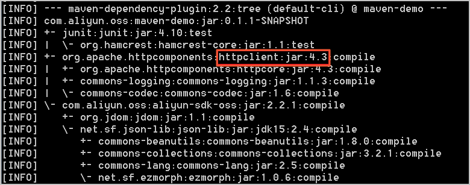

解决方案：包冲突有以下两种解决方法。

- 使用统一版本。如果您的工程使用与Apache httpclient 4.4.1冲突的版本，请您使用4.4.1版本，并在pom.xml删除其它版本的Apache httpclient依赖。如果您的工程使用了commons-httpclient，也可能存在冲突，请删除commons-httpclient。

- 解除依赖冲突。如果您的工程依赖多个第三方包，而第三方包又依赖不同版本的Apache httpclient，您的工程里会有依赖冲突，请使用exclusion解除。详细请参见Maven Guides。

OSS Java SDK依赖以下版本的包，冲突解决办法与httpclient类似。

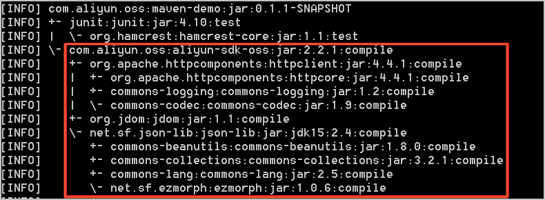

**缺少包**

使用OSS Java SDK时，报类似如下错误：

```text
Exception in thread "main" java.lang.NoClassDefFoundError: org/apache/http/auth/Credentials
        at com.aliyun.oss.OSSClient.<init>(OSSClient.java:268)
        at com.aliyun.oss.OSSClient.<init>(OSSClient.java:193)
        at com.aliyun.oss.demo.HelloOSS.main(HelloOSS.java:76)
Caused by: java.lang.ClassNotFoundException: org.apache.http.auth.Credentials
        at java.net.URLClassLoader$1.run(URLClassLoader.java:366)
        at java.net.URLClassLoader$1.run(URLClassLoader.java:355)
        at java.security.AccessController.doPrivileged(Native Method)
        at java.net.URLClassLoader.findClass(URLClassLoader.java:354)
        at java.lang.ClassLoader.loadClass(ClassLoader.java:425)
        at sun.misc.Launcher$AppClassLoader.loadClass(Launcher.java:308)
        at java.lang.ClassLoader.loadClass(ClassLoader.java:358)
        ... 3 more
```

或

```text
Exception in thread "main" java.lang.NoClassDefFoundError: org/apache/http/protocol/HttpContext
        at com.aliyun.oss.OSSClient.<init>(OSSClient.java:268)
        at com.aliyun.oss.OSSClient.<init>(OSSClient.java:193)
        at com.aliyun.oss.demo.HelloOSS.main(HelloOSS.java:76)
Caused by: java.lang.ClassNotFoundException: org.apache.http.protocol.HttpContext
        at java.net.URLClassLoader$1.run(URLClassLoader.java:366)
        at java.net.URLClassLoader$1.run(URLClassLoader.java:355)
        at java.security.AccessController.doPrivileged(Native Method)
        at java.net.URLClassLoader.findClass(URLClassLoader.java:354)
        at java.lang.ClassLoader.loadClass(ClassLoader.java:425)
        at sun.misc.Launcher$AppClassLoader.loadClass(Launcher.java:308)
        at java.lang.ClassLoader.loadClass(ClassLoader.java:358)
        ... 3 more
```

或

```text
Exception in thread "main" java.lang.NoClassDefFoundError: org/jdom/input/SAXBuilder
        at com.aliyun.oss.internal.ResponseParsers.getXmlRootElement(ResponseParsers.java:645)
        at … …
        at com.aliyun.oss.OSSClient.doesBucketExist(OSSClient.java:471)
        at com.aliyun.oss.OSSClient.doesBucketExist(OSSClient.java:465)
        at com.aliyun.oss.demo.HelloOSS.main(HelloOSS.java:82)
Caused by: java.lang.ClassNotFoundException: org.jdom.input.SAXBuilder
        at java.net.URLClassLoader$1.run(URLClassLoader.java:366)
        at java.net.URLClassLoader$1.run(URLClassLoader.java:355)
        at java.security.AccessController.doPrivileged(Native Method)
        at java.net.URLClassLoader.findClass(URLClassLoader.java:354)
        at java.lang.ClassLoader.loadClass(ClassLoader.java:425)
        at sun.misc.Launcher$AppClassLoader.loadClass(Launcher.java:308)
        at java.lang.ClassLoader.loadClass(ClassLoader.java:358)
        ... 11 more
```

问题原因：您的工程中可能缺少编译或运行OSS Java SDK所必需的包，OSS Java SDK依赖下列包：

- aliyun-sdk-oss-2.2.1.jar

- hamcrest-core-1.1.jar

- jdom-1.1.jar

- commons-codec-1.9.jar

- httpclient-4.4.1.jar

- commons-logging-1.2.jar

- httpcore-4.4.1.jar

- log4j-1.2.15.jar

其中，log4j-1.2.15.jar是可选的，需要日志功能的时加入该包，其他包都是必不可少的。

解决方案：您的工程中在加入OSS Java SDK依赖的包，加入方法如下：

- 如果您的工程在Eclipse中，请参考安装中的安装方式二：在Eclipse项目中导入工程依赖的包。

- 如果您的工程是Ant。请把OSS Java SDK依赖的包，放入工程lib目录；

- 如果您直接使用javac/java，请使用-classpath/-cp指定OSS Java SDK依赖的包路径，或把OSS Java SDK依赖的包放入classpath路经下。

**连接超时**

运行OSS Java SDK程序抛出如下异常：

```text
com.aliyun.oss.ClientException: SocketException
    at com.aliyun.oss.common.utils.ExceptionFactory.createNetworkException(ExceptionFactory.java:71)
    at com.aliyun.oss.common.comm.DefaultServiceClient.sendRequestCore(DefaultServiceClient.java:116)
    at com.aliyun.oss.common.comm.ServiceClient.sendRequestImpl(ServiceClient.java:121)
    at com.aliyun.oss.common.comm.ServiceClient.sendRequest(ServiceClient.java:67)
    at com.aliyun.oss.internal.OSSOperation.send(OSSOperation.java:92)
    at com.aliyun.oss.internal.OSSOperation.doOperation(OSSOperation.java:140)
    at com.aliyun.oss.internal.OSSOperation.doOperation(OSSOperation.java:111)
    at com.aliyun.oss.internal.OSSBucketOperation.getBucketInfo(OSSBucketOperation.java:1152)
    at com.aliyun.oss.OSSClient.getBucketInfo(OSSClient.java:1220)
    at com.aliyun.oss.OSSClient.getBucketInfo(OSSClient.java:1214)
    at com.aliyun.oss.demo.HelloOSS.main(HelloOSS.java:94)
Caused by: org.apache.http.conn.HttpHostConnectException: Connect to oss-test.oss-cn-hangzhou-internal.aliyuncs.com:80 [oss-test.oss-cn-
hangzhou-internal.aliyuncs.com/10.84.135.99] failed: Connection timed out: connect
    at org.apache.http.impl.conn.DefaultHttpClientConnectionOperator.connect(DefaultHttpClientConnectionOperator.java:151)
    at org.apache.http.impl.conn.PoolingHttpClientConnectionManager.connect(PoolingHttpClientConnectionManager.java:353)
    at org.apache.http.impl.execchain.MainClientExec.establishRoute(MainClientExec.java:380)
    at org.apache.http.impl.execchain.MainClientExec.execute(MainClientExec.java:236)
    at org.apache.http.impl.execchain.ProtocolExec.execute(ProtocolExec.java:184)
    at org.apache.http.impl.execchain.RedirectExec.execute(RedirectExec.java:110)
    at org.apache.http.impl.client.InternalHttpClient.doExecute(InternalHttpClient.java:184)
    at org.apache.http.impl.client.CloseableHttpClient.execute(CloseableHttpClient.java:82)
    at com.aliyun.oss.common.comm.DefaultServiceClient.sendRequestCore(DefaultServiceClient.java:113)
    ... 9 more
```

问题原因：Endpoint错误或者网络不通。

解决方案：解决网络问题后重试。

**org.apache.http.NoHttpResponseException: The target server failed to respond**

运行OSS Java SDK程序抛出如下异常：

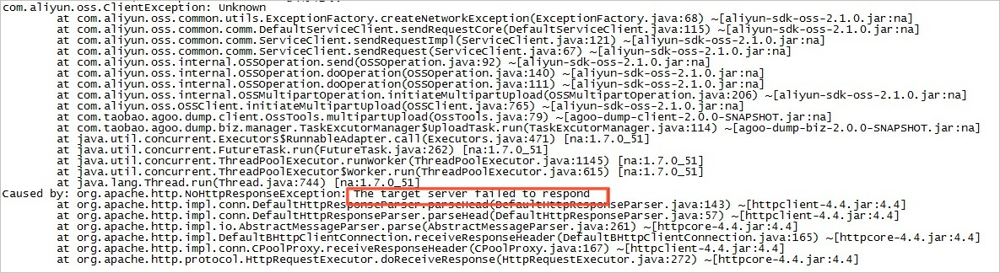

问题原因：使用过期的连接会导致上述错误。该错误仅在Java SDK 2.1.2前的版本出现。

解决方案：请升级OSS Java SDK到2.1.2及以后版本。

**调用OSS Java SDK不响应**

调用OSS Java SDK不响应，通过 `jstack -l <pid>` 查看堆栈，问题出现在如下位置：

```text
"main" prio=6 tid=0x000000000291e000 nid=0xc40 waiting on condition [0x0000000002dae000]
java.lang.Thread.State: WAITING (parking)
    at sun.misc.Unsafe.park(Native Method)
    - parking to wait for  <0x00000007d85697f8> (a java.util.concurrent.locks.AbstractQueuedSynchronizer$ConditionObject)
    at java.util.concurrent.locks.LockSupport.park(LockSupport.java:186)
    at java.util.concurrent.locks.AbstractQueuedSynchronizer$ConditionObject.await(AbstractQueuedSynchronizer.java:2043)
    at org.apache.http.pool.PoolEntryFuture.await(PoolEntryFuture.java:138)
    at org.apache.http.pool.AbstractConnPool.getPoolEntryBlocking(AbstractConnPool.java:306)
    at org.apache.http.pool.AbstractConnPool.access$000(AbstractConnPool.java:64)
    at org.apache.http.pool.AbstractConnPool$2.getPoolEntry(AbstractConnPool.java:192)
    at org.apache.http.pool.AbstractConnPool$2.getPoolEntry(AbstractConnPool.java:185)
    at org.apache.http.pool.PoolEntryFuture.get(PoolEntryFuture.java:107)
    at org.apache.http.impl.conn.PoolingHttpClientConnectionManager.leaseConnection(PoolingHttpClientConnectionManager.java:276)
    at org.apache.http.impl.conn.PoolingHttpClientConnectionManager$1.get(PoolingHttpClientConnectionManager.java:263)
    at org.apache.http.impl.execchain.MainClientExec.execute(MainClientExec.java:190)
    at org.apache.http.impl.execchain.ProtocolExec.execute(ProtocolExec.java:184)
    at org.apache.http.impl.execchain.RedirectExec.execute(RedirectExec.java:110)
    at org.apache.http.impl.client.InternalHttpClient.doExecute(InternalHttpClient.java:184)
    at org.apache.http.impl.client.CloseableHttpClient.execute(CloseableHttpClient.java:82)
    at com.aliyun.oss.common.comm.DefaultServiceClient.sendRequestCore(DefaultServiceClient.java:113)
    at com.aliyun.oss.common.comm.ServiceClient.sendRequestImpl(ServiceClient.java:123)
    at com.aliyun.oss.common.comm.ServiceClient.sendRequest(ServiceClient.java:68)
    at com.aliyun.oss.internal.OSSOperation.send(OSSOperation.java:94)
    at com.aliyun.oss.internal.OSSOperation.doOperation(OSSOperation.java:146)
    at com.aliyun.oss.internal.OSSOperation.doOperation(OSSOperation.java:113)
    at com.aliyun.oss.internal.OSSObjectOperation.getObject(OSSObjectOperation.java:229)
    at com.aliyun.oss.OSSClient.getObject(OSSClient.java:629)
    at com.aliyun.oss.OSSClient.getObject(OSSClient.java:617)
    at samples.HelloOSS.main(HelloOSS.java:49)
```

问题原因：连接池中连接泄漏，可能是使用 `OSSClient.getObject` ，但是没有关闭。

解决方案：请检查您的程序，确保没有连接泄漏。关闭方法如下：

```text
// 读取⽂件
OSSObject ossObject = ossClient.getObject(bucketName, objectName);
// OSS操作
// 关闭ossObject
ossObject.close();               
```

**连接关闭**

您在使用OSSClient.getObject时，报类似如下错误：

```text
Exception in thread "main" org.apache.http.ConnectionClosedException: Premature end of Content-Length delimited message body (expected: 
11990526; received: 202880
    at org.apache.http.impl.io.ContentLengthInputStream.read(ContentLengthInputStream.java:180)
    at org.apache.http.impl.io.ContentLengthInputStream.read(ContentLengthInputStream.java:200)
    at org.apache.http.impl.io.ContentLengthInputStream.close(ContentLengthInputStream.java:103)
    at org.apache.http.impl.execchain.ResponseEntityProxy.streamClosed(ResponseEntityProxy.java:128)
    at org.apache.http.conn.EofSensorInputStream.checkClose(EofSensorInputStream.java:228)
    at org.apache.http.conn.EofSensorInputStream.close(EofSensorInputStream.java:174)
    at java.io.FilterInputStream.close(FilterInputStream.java:181)
    at java.io.FilterInputStream.close(FilterInputStream.java:181)
    at com.aliyun.oss.event.ProgressInputStream.close(ProgressInputStream.java:147)
    at java.io.FilterInputStream.close(FilterInputStream.java:181)
    at samples.HelloOSS.main(HelloOSS.java:39)
```

问题原因：两次读取数据间隔时间超过1分钟。OSS会关闭超过1分钟没有发送/接收数据的连接。如果您的应用模式是，读取部分数据—处理数据—读取数据—处理数据，且处理数据的时间不固定。

解决方案：如果您每次读取部分数据进行处理，且处理数据的时间不固定，建议指定范围读取，避免数据读取时连接关闭。

**内存泄露**

调调用OSS Java SDK的程序，运行一段时间（根据业务量，几小时到几天不等）后内存泄露。

问题原因：请使用内存分析工具，分析内存使用情况。推荐使用Eclipse Memory Analyzer(MAT)，使用方法请参见使用MAT进行堆转储文件分析。

如果分析结果类似下图所示（PoolingHttpClientConnectionManager占96%的内存），原因是程序中可能多次执行new OSSClient，但是没有调用ossClient.shutdown，造成内存泄漏。

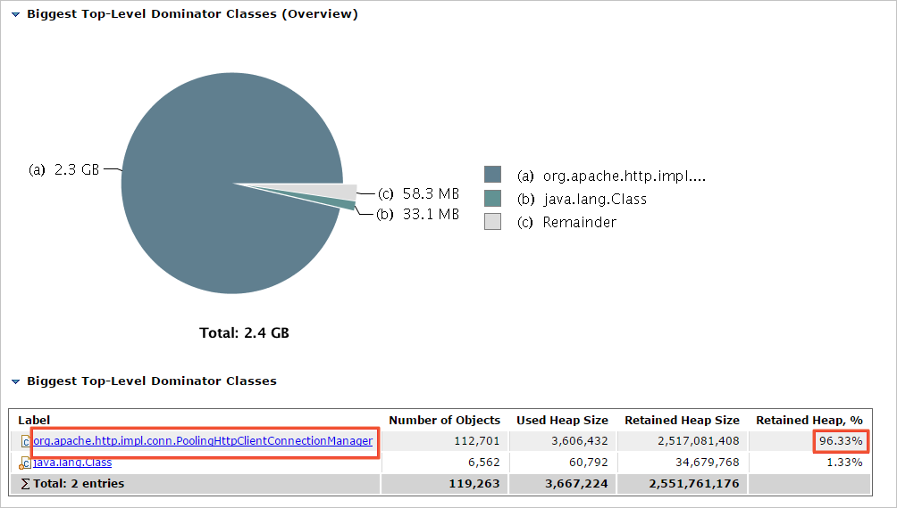

解决方案：new OSSClient一定要和ossClient.shutdown成对使用。

**调用OSSClient.shutdown抛异常InterruptedException**

调用OSSClient.shutdown抛如下异常：

```text
java.lang.InterruptedException: sleep interrupted
        at java.lang.Thread.sleep(Native Method)
        at com.aliyun.oss.common.comm.IdleConnectionReaper.run(IdleConnectionReaper:76)
```

问题原因：OSSClient后台线程IdleConnectionReaper，定时关闭闲置连接。IdleConnectionReaper线程在sleep时，调用shutdown，就会抛出上面的异常。

解决方案：

- OSS Java SDK 2.3.0已经修复该问题，请升级您的SDK版本。

- OSS Java SDK 2.3.0之前的版本，请使用如下代码，忽略该异常：

  ```text
  try {
  serviceClient.shutdown();
  } catch(Exception e) {
  }
  ```

<a id="section-1-2-2"></a>

### 1.2.2. Python-SDK

<a id="section-1-2-2-1"></a>

#### 1.2.2.1. 前言

本文介绍对象存储OSS的Python SDK各种使用场景下的示例代码。

**源码地址**

请访问GitHub获取源码。

**示例程序**

Python SDK的示例代码在examples目录下，地址是GitHub。示例包括以下内容：

| 示例文件 | 示例内容 |
| --- | --- |
| object_basic.py | 展示了文件相关的基本用法，包括上传、下载、列举、删除等。 |
| object_extra.py | 展示了文件相关的高级用法，如中文、设置用户自定义元信息、拷贝文件、追加上传等。 |
| upload.py | 展示了文件上传的高级用法，如断点续传上传、分片上传等。 |
| download.py | 展示了文件下载的用法，如下载文件、范围下载、断点续传下载等。 |
| object_check.py | 展示了上传、下载时数据校验的用法，包括MD5和CRC。 |
| object_progress.py | 展示了进度条功能的用法，包括上传进度条和下载进度条。 |
| object_callback.py | 展示了上传回调的用法。 |
| object_post.py | 展示了PostObject的用法，PostObject的实现不依赖于Python SDK。 |
| sts.py | 展示了STS的用法，包括角色扮演获取临时用户的密钥、使用临时用户的密钥访问OSS。 |
| live_channel.py | 展示了Live Channel的用法。 |
| image.py | 展示了图片服务的用法。 |
| bucket.py | 展示了Bucket管理操作的用法，诸如创建、删除、列举Bucket等。 |

<a id="section-1-2-2-2"></a>

#### 1.2.2.2. 安装

本文介绍如何安装Python SDK。

**环境准备**

OSS Python SDK适用于Python 2.6、2.7、3.3、3.4、3.5、3.6版本。

- 安装环境

  根据Python官网的引导安装合适的Python版本。

- 查看版本

  执行命令 `python -V` 查看Python版本。

  Windows环境中，如果提示“不是内部或外部命令”，请在环境变量中编辑 `Path` ，增加Python和pip的安装路径。pip的安装路径一般为Python所在目录的Scripts文件夹。

  > 您可能需要重启电脑使环境变量生效。
  >
  > **说明**

**下载SDK**

- 通过GitHub下载

- 历史版本下载

更多信息请参见OSS API文档。

**安装python-devel**

由于SDK需要crcmod库计算CRC校验码，而crcmod依赖Python.h文件，如果系统缺少这个头文件，安装SDK不会失败，但crcmod的C扩展模式安装会失败，因此导致上传、下载等操作效率非常低下。如果python-devel包不存在，则首先要安装这个包。

- 对于Windows和Mac OS X系统，由于安装Python的时候会将Python依赖的头文件一并安装，因此您无需安装python-devel。

- 对于CentOS、RHEL、Fedora系统，请执行以下命令安装python-devel：

  ```bash
  yum install python-devel                   
  ```

- 对于Debian、Ubuntu系统，请执行以下命令安装python-devel：

  ```bash
  apt-get install python-dev                  
  ```

**安装SDK**

- 通过pip安装

  执行命令如下：

  ```bash
  pip install oss2          
  ```

  > 如果您的环境尚未安装pip，请参见pip官网安装。
  >
  > **说明**

- 通过源码安装

  从GitHub下载相应版本的SDK包，解压后进入目录，确认目录下有setup.py文件，然后执行命令如下：

  ```text
  python setup.py install         
  ```

**验证**

- 验证SDK版本

  <ol type="i">

  <li>

  在命令行输入 `python` 并回车，进入Python环境。

  </li>

  <li>

  执行以下命令检查SDK版本：

  ```text
  >>> import oss2
  >>> oss2.__version__
  '2.0.0'                         
  ```

  上面的输出表明您已经成功安装了Python SDK 2.0.0。

  </li>

  </ol>

- 验证crcmod

  OSS的CRC数据校验有两种方式：C扩展模式（通过SDK的依赖库crcmod调用扩展库_crcfunext.so计算CRC）和纯Python模式。前者的性能远优于后者。安装oss2时会自动安装crcmod。crcmod详情请参见crcmod introduction。

  如果发现安装SDK之后调用上传、下载接口较其他工具或者其他SDK慢了很多，有可能是安装SDK的依赖库crcmod的C扩展模式失败，导致在上传、下载计算CRC校验码时采用了纯Python模式。

  验证crcmod的C扩展模式是否安装成功的方法如下：

  <ol type="i">

  <li>

  在命令行输入 `python` 并回车，进入Python环境。

  </li>

  <li>

  输入 `import crcmod._crcfunext` 并回车。

  - 如果没有出现错误提示，则表明crcmod库的C扩展模式安装成功。

  - 如果出现以下错误提示，则表明crcmod库的C扩展模式安装失败。

    ```text
    >>> import crcmod._crcfunext
    Traceback (most recent call last):
    File "<stdin>", line 1, in <module>
    ImportError: No module named _crcfunext                          
    ```

    出现这种情况的原因是编译crcmod时，由于_crcfunext.so依赖Python.h文件，而系统中缺少这个头文件，因此_crcfunext.so库生成失败。CRC数据校验就会使用纯Python方式。虽然SDK安装成功，但是上传、下载等操作的效率非常低下。

    如果出现该问题，请执行以下步骤：

    <ol type="a">

    <li>

    执行以下命令卸载crcmod：

    ```bash
    pip uninstall crcmod
    ```

    </li>

    <li>

    安装python-devel。

    </li>

    </ol>

    <ol type="i" start="100">

    <li>

    执行以下命令重新安装crcmod：

    ```bash
    pip install crcmod
    ```

    如果执行上述步骤依然安装失败，请卸载crcmod，然后执行以下命令查看安装失败的详细原因：

    ```bash
    pip install crcmod -v
    ```

    </li>

    </ol>

  </li>

  </ol>

**卸载SDK**

如果安装失败，建议通过pip卸载然后重装。卸载命令如下：

```bash
pip uninstall oss2    
```

<a id="section-1-2-2-3"></a>

#### 1.2.2.3. 快速入门

本节介绍如何快速使用OSS Python SDK完成常见操作，如创建存储空间（Bucket）、上传或下载文件（Object）等。

**创建存储空间**

存储空间是OSS的全局命名空间，相当于数据的容器，可以存储若干文件。

```python
# -*- coding: utf-8 -*-
import oss2

auth = oss2.Auth('<yourAccessKeyId>', '<yourAccessKeySecret>')
# Endpoint以杭州为例，其它Region请按实际情况填写。
bucket = oss2.Bucket(auth, 'http://oss-cn-hangzhou.aliyuncs.com', '<yourBucketName>')

# 设置存储空间为私有读写权限。
bucket.create_bucket(oss2.models.BUCKET_ACL_PRIVATE)
            
```

AccessKey ID和AccessKey Secret获取方式请参见获取AccessKey。

获取Endpoint信息，请参见获取Endpoint。

**上传文件**

以下代码用于通过流式上传方式上传文件到OSS。

```python
# -*- coding: utf-8 -*-
import oss2

auth = oss2.Auth('<yourAccessKeyId>', '<yourAccessKeySecret>')
# Endpoint以杭州为例，其它Region请按实际情况填写。
bucket = oss2.Bucket(auth, 'http://oss-cn-hangzhou.aliyuncs.com', '<yourBucketName>')

# <yourObjectName>上传⽂件到OSS时需要指定包含⽂件后缀在内的完整路径，例如abc/efg/123.jpg。
# <yourLocalFile>由本地⽂件路径加⽂件名包括后缀组成，例如/users/local/myfile.txt。
bucket.put_object_from_file('<yourObjectName>', '<yourLocalFile>')
            
```

**下载文件**

以下代码用于将指定的OSS文件下载到本地文件：

```python
# -*- coding: utf-8 -*-
import oss2

auth = oss2.Auth('<yourAccessKeyId>', '<yourAccessKeySecret>')
# Endpoint以杭州为例，其它Region请按实际情况填写。
bucket = oss2.Bucket(auth, 'http://oss-cn-hangzhou.aliyuncs.com', '<yourBucketName>')
# <yourObjectName>从OSS下载⽂件时需要指定包含⽂件后缀在内的完整路径，例如abc/efg/123.jpg。
# <yourLocalFile>由本地⽂件路径加⽂件名包括后缀组成，例如/users/local/myfile.txt。
bucket.get_object_to_file('<yourObjectName>', '<yourLocalFile>')
            
```

**列举文件**

以下代码用于列举指定存储空间下的10个文件：

```python
# -*- coding: utf-8 -*-
import oss2
from itertools import islice

auth = oss2.Auth('<yourAccessKeyId>', '<yourAccessKeySecret>')
# Endpoint以杭州为例，其它Region请按实际情况填写。
bucket = oss2.Bucket(auth, 'http://oss-cn-hangzhou.aliyuncs.com', '<yourBucketName>')

# oss2.ObjectIteratorr⽤于遍历⽂件。
for b in islice(oss2.ObjectIterator(bucket), 10):
    print(b.key)
            
```

**删除文件**

以下代码用于删除指定文件。

```python
# -*- coding: utf-8 -*-
import oss2

auth = oss2.Auth('<yourAccessKeyId>', '<yourAccessKeySecret>')
# Endpoint以杭州为例，其它Region请按实际情况填写。
bucket = oss2.Bucket(auth, 'http://oss-cn-hangzhou.aliyuncs.com', '<yourBucketName>')

# <yourObjectName>表示删除OSS⽂件时需要指定包含⽂件后缀在内的完整路径，例如abc/efg/123.jpg。
bucket.delete_object('<yourObjectName>')
            
```

<a id="section-1-2-2-4"></a>

#### 1.2.2.4. 初始化

本文介绍如何初始化Python SDK。

Python SDK中的大部分操作都是通过oss2.Service和oss2.Bucket这两个类进行的。

- oss2.Service类用于列举存储空间。

- oss2.Bucket类用于上传、下载、删除文件以及对存储空间进行各种配置。

初始化这两个类时，需要指定Endpoint。其中oss2.Service类不支持自定义域名访问。有关Endpoint的更多信息，请参见获取Endpoint。

**初始化oss2.Service类**

详情请参见列举存储空间。

**初始化oss2.Bucket类**

- 使用OSS域名初始化

  以下代码用于使用OSS域名初始化：

  ```python
  # -*- coding: utf-8 -*-
  import oss2

  auth = oss2.Auth('<yourAccessKeyId>', '<yourAccessKeySecret>')
  # Endpoint以杭州为例，其它Region请按实际情况填写。
  endpoint = 'https://oss-cn-hangzhou.aliyuncs.com'

  bucket = oss2.Bucket(auth, endpoint, '<yourBucketName>')
                      
  ```

- 设置连接超时时间

  以下代码用于设置连接超时时间：

  ```python
  # -*- coding: utf-8 -*-
  import oss2

  auth = oss2.Auth('<yourAccessKeyId>', '<yourAccessKeySecret>')
  # Endpoint以杭州为例，其它Region请按实际情况填写。
  endpoint = 'https://oss-cn-hangzhou.aliyuncs.com'

  # 设置连接超时时间为30秒。
  bucket = oss2.Bucket(auth, endpoint, '<yourBucketName>', connect_timeout=30)
                      
  ```

- 关闭CRC数据校验

  > **警告**
  >
  > 强烈建议您不要关闭CRC数据校验功能。如果您关闭此功能，则阿里云不保证上传、下载过程数据的完整性。

  上传、下载文件时默认开启CRC数据校验，确保上传、下载过程的数据完整性。 以下代码用于关闭CRC数据校验：

  ```python
  # -*- coding: utf-8 -*-
  import oss2

  auth = oss2.Auth('<yourAccessKeyId>', '<yourAccessKeySecret>')
  # Endpoint以杭州为例，其它Region请按实际情况填写。
  endpoint = 'https://oss-cn-hangzhou.aliyuncs.com'

  bucket = oss2.Bucket(auth, endpoint, '<yourBucketName>', enable_crc=False)
                      
  ```

<a id="section-1-2-2-5"></a>

#### 1.2.2.5. 存储空间

<a id="section-1-2-2-5-1"></a>

##### 1.2.2.5.1. 创建存储空间

存储空间（Bucket）是存储对象（Object）的容器。对象都隶属于存储空间。本文介绍如何创建存储空间。

**注意事项**

如需使用同城3AZ容灾，请在3AZ集群中创建存储空间时设置数据容灾类型为同城冗余存储（ZRS）。

**示例代码**

以下代码用于创建存储空间。

```python
# -*- coding: utf-8 -*-
import oss2

auth = oss2.Auth('<yourAccessKeyId>', '<yourAccessKeySecret>')
# 通过指定Endpoint和存储空间名称，您可以在指定的地域创建新的存储空间。Endpoint以杭州为例，其它Region请按实际情况填写。
bucket = oss2.Bucket(auth, 'http://oss-cn-hangzhou.aliyuncs.com', '<yourBucketName>')

# 数据容灾类型默认为本地冗余存储，即BUCKET_DATA_REDUNDANCY_TYPE_LRS。在使⽤同城3AZ容灾时，您必须设置数据容灾类型为同城冗余存储，即
BUCKET_DATA_REDUNDANCY_TYPE_ZRS。
# bucketConfig = oss2.models.BucketCreateConfig(oss2.BUCKET_STORAGE_CLASS_STANDARD, oss2.BUCKET_DATA_REDUNDANCY_TYPE_ZRS)
# 新建存储空间默认为私有访问权限。
# bucket.create_bucket(oss2.BUCKET_ACL_PRIVATE,bucketConfig)
# 新建存储空间默认为私有访问权限。
bucket.create_bucket()
```

<a id="section-1-2-2-5-2"></a>

##### 1.2.2.5.2. 列举存储空间

存储空间（Bucket）是用来存储对象（Object）的容器。对象都隶属于存储空间。存储空间按照字母顺序排列。您可以列举当前账号所有地域下符合指定条件的存储空间。

以下代码用于列举所有存储空间。

```python
# -*- coding: utf-8 -*-
import oss2

auth = oss2.Auth('<yourAccessKeyId>', '<yourAccessKeySecret>')
# Endpoint以杭州为例，其它Region请按实际情况填写。
service = oss2.Service(auth, 'http://oss-cn-hangzhou.aliyuncs.com')

print([b.name for b in oss2.BucketIterator(service)])            
```

<a id="section-1-2-2-5-3"></a>

##### 1.2.2.5.3. 判断存储空间是否存在

存储空间（Bucket）是存储对象（Object）的容器。对象均隶属于存储空间。本文介绍如何判断存储空间是否存在。

以下代码用于判断存储空间是否存在。

```python
# -*- coding: utf-8 -*-
import oss2

auth = oss2.Auth('<yourAccessKeyId>', '<yourAccessKeySecret>')
# Endpoint以杭州为例，其它Region请按实际情况填写。
bucket = oss2.Bucket(auth, 'http://oss-cn-hangzhou.aliyuncs.com', '<yourBucketName>')

def does_bucket_exist(bucket):
    try:
        bucket.get_bucket_info()
    except oss2.exceptions.NoSuchBucket:
        return False
    except:
        raise
    return True

exist = does_bucket_exist(bucket)
# 返回值为true表示已存在同名Bucket，false表示不存在同名Bucket。
if exist:
    print('bucket exist')
else:
    print('bucket not exist')
```

<a id="section-1-2-2-5-4"></a>

##### 1.2.2.5.4. 管理存储空间访问权限

存储空间（Bucket）是存储对象（Object）的容器。对象都隶属于存储空间。本文介绍如何设置和获取存储空间读写权限（ACL）。

**设置存储空间访问权限**

存储空间的访问权限（ACL）有以下三类：

| 访问权限 | 描述 | 访问权限值 |
| --- | --- | --- |
| 私有 | 存储空间的拥有者和授权用户有该存储空间内的文件的读写权限，其他用户没有权限操作该存储空间内的文件。 | oss2.BUCKET_ACL_PRIVATE |
| 公共读 | 存储空间的拥有者和授权用户有该存储空间内的文件的读写权限，其他用户只有该存储空间内的文件的读权限。请谨慎使用该权限。 | oss2.BUCKET_ACL_PUBLIC_READ |
| 公共读写 | 所有用户都有该存储空间内的文件的读写权限。请谨慎使用该权限。 | oss2.BUCKET_ACL_PUBLIC_READ_WRITE |

以下代码用于设置存储空间的访问权限。

```python
# -*- coding: utf-8 -*-
import oss2

auth = oss2.Auth('<yourAccessKeyId>', '<yourAccessKeySecret>')
# Endpoint以杭州为例，其它Region请按实际情况填写。
bucket = oss2.Bucket(auth, 'http://oss-cn-hangzhou.aliyuncs.com', '<yourBucketName>')

# 设置存储空间访问权限为私有。
bucket.put_bucket_acl(oss2.BUCKET_ACL_PRIVATE)            
```

**获取存储空间访问权限**

以下代码用于获取存储空间的访问权限。

```python
# -*- coding: utf-8 -*-
import oss2

auth = oss2.Auth('<yourAccessKeyId>', '<yourAccessKeySecret>')
# Endpoint以杭州为例，其它Region请按实际情况填写。
bucket = oss2.Bucket(auth, 'http://oss-cn-hangzhou.aliyuncs.com', '<yourBucketName>')

print(bucket.get_bucket_acl().acl)            
```

<a id="section-1-2-2-5-5"></a>

##### 1.2.2.5.5. 存储空间标签

您可以通过存储空间（Bucket）的标签功能， 对Bucket进行分类管理，例如ListBucket时只显示带有指定标签的Bucket。

> **说明**
>
> - 只有Bucket的拥有者及授权用户才能为Bucket设置用户标签，否则返回403 Forbidden错误，错误码：AccessDenied。
>
> - 最多可设置20对Bucket用户标签（Key-Value对）。
>
> - Key最大长度为64字节，不能以 `http ://` 、 `https://` 、 `Aliyun` 为前缀，且不能为空。
>
> - Value最大长度为128字节，可以为空。
>
> - Key和Value必须为UTF-8编码。
>
> - PutBucketTagging是覆盖语义，即新设置的标签会完全覆盖已有的标签。

**设置Bucket标签**

以下代码用于设置Bucket标签：

```python
# -*- coding: utf-8 -*-
import oss2
from oss2.models import Tagging, TaggingRule

# 阿⾥云主账号AccessKey拥有所有API的访问权限，⻛险很⾼。强烈建议您创建并使⽤RAM账号进⾏API访问或⽇常运维，请登录 https://ram.console.aliyun.com 创建RAM账号。
auth = oss2.Auth('<yourAccessKeyId>', '<yourAccessKeySecret>')
# Endpoint以杭州为例，其它Region请按实际情况填写。
bucket = oss2.Bucket(auth, 'http://oss-cn-hangzhou.aliyuncs.com', '<yourBucketName>')

# 创建标签规则。
rule = TaggingRule()
rule.add('key1', 'value1')
rule.add('key2', 'value2')

# 创建标签。
tagging = Tagging(rule)
# 设置Bucket标签。
result = bucket.put_bucket_tagging(tagging)
# 查看HTTP返回码。
print('http status:', result.status)
```

**获取Bucket标签**

以下代码用于获取Bucket标签：

```python
# -*- coding: utf-8 -*-
import oss2

# 阿⾥云主账号AccessKey拥有所有API的访问权限，⻛险很⾼。强烈建议您创建并使⽤RAM账号进⾏API访问或⽇常运维，请登录 https://ram.console.aliyun.com 创建RAM账号。
auth = oss2.Auth('<yourAccessKeyId>', '<yourAccessKeySecret>')
# Endpoint以杭州为例，其它Region请按实际情况填写。
bucket = oss2.Bucket(auth, 'http://oss-cn-hangzhou.aliyuncs.com', '<yourBucketName>')

# 获取Bucket标签信息。
result = bucket.get_bucket_tagging()
# 查看获取到的标签规则。
tag_rule = result.tag_set.tagging_rule
print('tag rule:', tag_rule)
```

**列举带指定标签的Bucket**

以下代码用于列举带指定标签的Bucket：

```python
# -*- coding: utf-8 -*-
import oss2

#创建Server对象。
#阿⾥云主账号AccessKey拥有所有API的访问权限，⻛险很⾼。强烈建议您创建并使⽤RAM账号进⾏API访问或⽇常运维，请登录 https://ram.console.aliyun.com 创建RAM账号。
auth = oss2.Auth('<yourAccessKeyId>', '<yourAccessKeySecret>')
# Endpoint以杭州为例，其它Region请按实际情况填写。
service = oss2.Service(auth,  'http://oss-cn-hangzhou.aliyuncs.com')

#填充tag-key，tag-value字段到list_buckets接⼝的params参数中。
params = {}
params['tag-key'] = '<yourTagging_key>'
params['tag-value'] = '<yourTagging_value>'

#列举出带指定标签的Bucket。
result = service.list_buckets(params=params)
#查看列举结果。
for bucket in result.buckets:
    print('result bucket_name:', bucket.name)
```

**删除Bucket标签**

以下代码用于删除Bucket标签：

```python
# -*- coding: utf-8 -*-
import oss2

# 阿⾥云主账号AccessKey拥有所有API的访问权限，⻛险很⾼。强烈建议您创建并使⽤RAM账号进⾏API访问或⽇常运维，请登录 https://ram.console.aliyun.com 创建RAM账号。
auth = oss2.Auth('<yourAccessKeyId>', '<yourAccessKeySecret>')
# Endpoint以杭州为例，其它Region请按实际情况填写。
bucket = oss2.Bucket(auth, 'http://oss-cn-hangzhou.aliyuncs.com', '<yourBucketName>')

# 删除Bucket标签。
result = bucket.delete_bucket_tagging()
# 查看HTTP返回码。
print('http status:', result.status)
```

<a id="section-1-2-2-5-6"></a>

##### 1.2.2.5.6. 删除存储空间

当您不再需要保留某个存储空间（Bucket）时，可将其删除，以免产生额外费用。

删除存储空间之前，必须先删除存储空间下的所有文件、LiveChannel和分片上传产生的碎片。以下代码用于删除存储空间：

```python
# -*- coding: utf-8 -*-
import oss2
auth = oss2.Auth('<yourAccessKeyId>', '<yourAccessKeySecret>')
# Endpoint以杭州为例，其它Region请按实际情况填写。
bucket = oss2.Bucket(auth, 'http://oss-cn-hangzhou.aliyuncs.com', '<yourBucketName>')
try:
    # 删除存储空间。
    bucket.delete_bucket()
except oss2.exceptions.BucketNotEmpty:
    print('bucket is not empty.')
except oss2.exceptions.NoSuchBucket:
    print('bucket does not exist')
```

对于非空的存储空间，可以通过边列举边删除（对于分片上传则是终止上传）的方法清空存储空间，然后再删除。

<a id="section-1-2-2-5-7"></a>

##### 1.2.2.5.7. 存储空间清单

本文介绍如何添加、查看、批量列举和删除存储空间（Bucket）的清单（Inventory）配置。

**注意事项**

- 请确保您拥有调用添加、查看、列举和删除存储空间清单配置的权限。Bucket所有者默认拥有此类权限，如果您无此类权限，请先向Bucket所有者申请对应操作的权限。

- 单个Bucket最多只能有1000条清单配置。

- 配置清单的源Bucket与存放导出的清单文件的目标Bucket必须位于同一个Region。

**添加清单配置**

以下代码用于为某个Bucket添加清单配置：

```python
# -*- coding: utf-8 -*-

import oss2
from oss2.models import (InventoryConfiguration,
                        InventoryFilter, 
                        InventorySchedule, 
                        InventoryDestination, 
                        InventoryBucketDestination, 
                        InventoryServerSideEncryptionKMS,
                        InventoryServerSideEncryptionOSS,
                        INVENTORY_INCLUDED_OBJECT_VERSIONS_CURRENT,
                        INVENTORY_INCLUDED_OBJECT_VERSIONS_ALL,
                        INVENTORY_FREQUENCY_DAILY,
                        INVENTORY_FREQUENCY_WEEKLY,
                        INVENTORY_FORMAT_CSV,
                        FIELD_SIZE,
                        FIELD_LAST_MODIFIED_DATE,
                        FIELD_STORAG_CLASS,
                        FIELD_ETAG,
                        FIELD_IS_MULTIPART_UPLOADED,
                        FIELD_ENCRYPTION_STATUS)

auth = oss2.Auth('yourAccessKeyId', 'yourAccessKeySecret')
# yourEndpoint填写Bucket所在地域对应的Endpoint。
# 填写Bucket名称，例如examplebucket。
bucket = oss2.Bucket(auth, 'https://oss-cn-hangzhou.aliyuncs.com', 'examplebucket')

# 填写Bucket所有者授予的账号ID。
account_id = 'yourtBucketDestinationAccountId'
# 填写具有读取源Bucket所有⽂件和向⽬标Bucket写入⽂件权限的⾓⾊名称。
role_arn = 'yourBucketDestinationRoleArn'
# 填写存放清单结果的Bucket名称。
dest_bucket_name = 'yourDestinationBucketName'

# 设置清单规则名称。
inventory_id = "inventory1"

# 设置清单结果中包含的Object属性。
optional_fields = [FIELD_SIZE, FIELD_LAST_MODIFIED_DATE, FIELD_STORAG_CLASS,
        FIELD_ETAG, FIELD_IS_MULTIPART_UPLOADED, FIELD_ENCRYPTION_STATUS]

# 创建存放清单⽂件的⽬标Bucket配置。
bucket_destination = InventoryBucketDestination(
        # ⽬标Bucket的⽤户accountId。
        account_id=account_id, 
        # ⽬标Bucket的roleArn。
        role_arn=role_arn,
        # ⽬标Bucket的名称。
        bucket=dest_bucket_name,
        # 指定清单格式。
        inventory_format=INVENTORY_FORMAT_CSV,
        # 清单结果的存储路径前缀。
        prefix='destination-prefix',
        # 如果需要使⽤KMS加密清单，请参考如下设置。
        # sse_kms_encryption=InventoryServerSideEncryptionKMS("test-kms-id"),
        # 如果需要使⽤OSS服务端加密清单，请参考如下设置。
        # sse_oss_encryption=InventoryServerSideEncryptionOSS()
        )

# 创建清单配置。
inventory_configuration = InventoryConfiguration(
        # 设置清单的配置id。
        inventory_id=inventory_id,
        # 清单配置是否启⽤的标识, true或false。
        is_enabled=True, 
        # 设置清单的⽣成计划，以下示例为每天⼀次。其中，WEEKLY对应每周⼀次，DAILY对应每天⼀次。
        inventory_schedule=InventorySchedule(frequency=INVENTORY_FREQUENCY_DAILY),
        # 设置清单中包含的object的版本为当前版本。如果设置为INVENTORY_INCLUDED_OBJECT_VERSIONS_ALL则表示object的所有版本，在版本控制状态下⽣效。
        included_object_versions=INVENTORY_INCLUDED_OBJECT_VERSIONS_CURRENT,
        # 设置清单清筛选object的前缀。
        inventory_filter=InventoryFilter(prefix="obj-prefix"),
        # 设置清单中包含的object属性。
        optional_fields=optional_fields,
        # 设置清单的接收⽬的地。
        inventory_destination=InventoryDestination(bucket_destination=bucket_destination))

# 上传清单配置。
bucket.put_bucket_inventory_configuration(inventory_configuration)
```

**查看清单配置**

以下代码用于查看某个Bucket的清单配置：

```python
# -*- coding: utf-8 -*-

import oss2
import os

auth = oss2.Auth('yourAccessKeyId', 'yourAccessKeySecret')
# yourEndpoint填写Bucket所在地域对应的Endpoint。
# 填写Bucket名称，例如examplebucket。
bucket = oss2.Bucket(auth, 'https://oss-cn-hangzhou.aliyuncs.com', 'examplebucket')

# 填写清单规则名称。
inventory_id = "inventory1"

# 获取清单配置。
result = bucket.get_bucket_inventory_configuration(inventory_id=inventory_id);

# 打印清单配置信息。
print('======inventory configuration======')
print('inventory_id', result.inventory_id)
print('is_enabled', result.is_enabled)
print('frequency', result.inventory_schedule.frequency)
print('included_object_versions', result.included_object_versions)
print('inventory_filter prefix', result.inventory_filter.prefix)
print('fields', result.optional_fields)
bucket_destin = result.inventory_destination.bucket_destination
print('===bucket destination===')
print('account_id', bucket_destin.account_id)
print('role_arn', bucket_destin.role_arn)
print('bucket', bucket_destin.bucket)
print('format', bucket_destin.inventory_format)
print('prefix', bucket_destin.prefix)
if bucket_destin.sse_kms_encryption is not None:
    print('server side encryption by kms, key id:', bucket_destin.sse_kms_encryption.key_id)
elif bucket_destin.sse_oss_encryption is not None:
    print('server side encryption by oss.')
```

**批量列举清单配置**

> 单次请求最多可获取100条清单配置项内容。若需获取超过100条清单配置项，则需发送多次请求，并保留相应的Token，作为下一次请求的参数。
>
> **说明**

以下代码用于批量列举某个Bucket的清单配置：

```python
# -*- coding: utf-8 -*-

import oss2
import os

auth = oss2.Auth('yourAccessKeyId', 'yourAccessKeySecret')
# yourEndpoint填写Bucket所在地域对应的Endpoint。
# 填写Bucket名称，例如examplebucket。
bucket = oss2.Bucket(auth, 'https://oss-cn-hangzhou.aliyuncs.com', 'examplebucket')

# 打印清单配置信息。
def print_inventory_configuration(configuration):
    print('======inventory configuration======')
    print('inventory_id', configuration.inventory_id)
    print('is_enabled', configuration.is_enabled)
    print('frequency', configuration.inventory_schedule.frequency)
    print('included_object_versions', configuration.included_object_versions)
    print('inventory_filter prefix', configuration.inventory_filter.prefix)
    print('fields', configuration.optional_fields)
    bucket_destin = configuration.inventory_destination.bucket_destination
    print('===bucket destination===')
    print('account_id', bucket_destin.account_id)
    print('role_arn', bucket_destin.role_arn)
    print('bucket', bucket_destin.bucket)
    print('format', bucket_destin.inventory_format)
    print('prefix', bucket_destin.prefix)
    if bucket_destin.sse_kms_encryption is not None:
        print('server side encryption by kms, key id:', bucket_destin.sse_kms_encryption.key_id)
    elif bucket_destin.sse_oss_encryption is not None:
        print('server side encryption by oss.')

# 列举所有的清单配置。
# 如果存在超过100条配置，列举结果将会分⻚，分⻚信息保存在class: <oss2.models.ListInventoryConfigurationResult>中。
continuation_token = None
while 1:
    result = bucket.list_bucket_inventory_configurations(continuation_token=continuation_token)
    # 本次列举结果是否分⻚。
    print('is truncated', result.is_truncated)
    # 本次列举携带的token。
    print('continuaiton_token', result.continuaiton_token)
    # 下次列举需要携带的token。
    print('next_continuation_token', result.next_continuation_token)

    # 打印清单配置信息。
    for inventory_config in result.inventory_configurations:
        print_inventory_configuration(inventory_config)

    # 如果本次列举为分⻚列举，则继续列举，且需要携带分⻚token。
    if result.is_truncated:
        continuation_token = result.next_continuation_token
    else:
         break
```

**删除清单配置**

以下代码用于删除某个Bucket的清单配置：

```python
# -*- coding: utf-8 -*-

import oss2
import os

auth = oss2.Auth('yourAccessKeyId', 'yourAccessKeySecret')
# yourEndpoint填写Bucket所在地域对应的Endpoint。
# 填写Bucket名称，例如examplebucket。
bucket = oss2.Bucket(auth, 'https://oss-cn-hangzhou.aliyuncs.com', 'examplebucket')

# 填写清单规则名称。
inventory_id = "inventory1"

# 删除清单配置。
bucket.delete_bucket_inventory_configuration(inventory_id)
```

<a id="section-1-2-2-5-8"></a>

##### 1.2.2.5.8. 合规保留策略

对象存储OSS允许针对存储空间（Bucket）设置基于时间的合规保留策略，保护周期为1天到70年。本文介绍如何新建、获取、锁定合规保留策略等。

**背景信息**

OSS支持WORM（Write Once Read Many）特性，允许您以不可删除、不可篡改的方式保存和使用数据。

当基于时间的合规保留策略创建24小时后未提交锁定，则该策略自动失效。当合规保留策略锁定后，您可以在Bucket中上传和读取文件（Object），但是在Object的保留时间到期之前，不允许删除Object及合规保留策略，且无法缩短策略保护周期，仅允许延长Object的保留时间。

**新建合规保留策略**

以下代码用于新建合规保留策略。

```python
# -*- coding: utf-8 -*-
import oss2

auth = oss2.Auth('yourAccessKeyId', 'yourAccessKeySecret')
# 填写Bucket所在地域对应的Endpoint。以华东1（杭州）为例，Endpoint填写为https://oss-cn-hangzhou.aliyuncs.com。
# yourBucketName填写存储空间名称。
bucket = oss2.Bucket(auth, 'https://oss-cn-hangzhou.aliyuncs.com', 'yourBucketName')

# 新建合规保留策略，并指定Object保护天数为1天。
result = bucket.init_bucket_worm(1)
# 查看合规保留策略ID。
print(result.worm_id)
```

**取消未锁定的合规保留策略**

以下代码用于取消未锁定的合规保留策略。

```python
# -*- coding: utf-8 -*-
import oss2

auth = oss2.Auth('yourAccessKeyId', 'yourAccessKeySecret')
# 填写Bucket所在地域对应的Endpoint。以华东1（杭州）为例，Endpoint填写为https://oss-cn-hangzhou.aliyuncs.com。
# yourBucketName填写存储空间名称。
bucket = oss2.Bucket(auth, 'https://oss-cn-hangzhou.aliyuncs.com', 'yourBucketName')

# 取消未锁定的合规保留策略。
bucket.abort_bucket_worm()
```

**锁定合规保留策略**

以下代码用于锁定合规保留策略。

```python
# -*- coding: utf-8 -*-
import oss2

auth = oss2.Auth('yourAccessKeyId', 'yourAccessKeySecret')
# 填写Bucket所在地域对应的Endpoint。以华东1（杭州）为例，Endpoint填写为https://oss-cn-hangzhou.aliyuncs.com。
# yourBucketName填写存储空间名称。
bucket = oss2.Bucket(auth, 'https://oss-cn-hangzhou.aliyuncs.com', 'yourBucketName')

# 锁定合规保留策略。
bucket.complete_bucket_worm('yourWromId')
```

**获取合规保留策略**

以下代码用于获取合规保留策略。

```python
# -*- coding: utf-8 -*-
import oss2

auth = oss2.Auth('yourAccessKeyId', 'yourAccessKeySecret')
# 填写Bucket所在地域对应的Endpoint。以华东1（杭州）为例，Endpoint填写为https://oss-cn-hangzhou.aliyuncs.com。
# yourBucketName填写存储空间名称。
bucket = oss2.Bucket(auth, 'https://oss-cn-hangzhou.aliyuncs.com', 'yourBucketName')

# 获取合规保留策略。
result = bucket.get_bucket_worm()

# 查看合规保留策略ID。
print(result.worm_id)
# 查看合规保留策略状态。未锁定状态下为"InProgress"，锁定状态下为"Locked"。
print(result.state)
# 查看Object的保护时间。
print(result.retention_period_days)
# 查看合规保留策略创建时间。
print(result.creation_date)
```

**延长Object的保留天数**

以下代码用于延长已锁定的合规保留策略中Object的保留天数。

```python
# -*- coding: utf-8 -*-
import oss2

auth = oss2.Auth('yourAccessKeyId', 'yourAccessKeySecret')
# 填写Bucket所在地域对应的Endpoint。以华东1（杭州）为例，Endpoint填写为https://oss-cn-hangzhou.aliyuncs.com。
# yourBucketName填写存储空间名称。
bucket = oss2.Bucket(auth, 'https://oss-cn-hangzhou.aliyuncs.com', 'yourBucketName')

# 延⻓已锁定的合规保留策略中Object的保留天数。
bucket.extend_bucket_worm('yourWormId', 2)
```

<a id="section-1-2-2-5-9"></a>

##### 1.2.2.5.9. 生命周期管理

并不是所有上传至OSS的数据都需要频繁访问，但基于数据合规或者存档等原因，部分数据仍需要继续以冷存储类型进行保存。或者基于业务使用场景，希望批量删除Bucket内不再需要保存的数据，您可以配置基于最后一次修改时间（Last Modified Time）的生命周期规则。如果您希望OSS自动监测数据的访问模式并识别冷数据，然后将识别出来的冷数据进行存储类型的转换，从而达到数据的冷热分层存储，最终降低存储成本，您可以配置基于最后一次访问时间（Last Access Time）的生命周期规则。

**设置生命周期规则**

以下代码用于设置生命周期规则。

```python
# -*- coding: utf-8 -*-
import oss2
from oss2.models import LifecycleExpiration, LifecycleRule, BucketLifecycle,AbortMultipartUpload
import datetime

auth = oss2.Auth('<yourAccessKeyId>', '<yourAccessKeySecret>')
# Endpoint以杭州为例，其它Region请按实际情况填写。
bucket = oss2.Bucket(auth, 'http://oss-cn-hangzhou.aliyuncs.com', '<yourBucketName>')

# 距最后修改时间3天后过期。
rule1 = LifecycleRule('rule1', 'tests/',
                      status=LifecycleRule.ENABLED,
                      expiration=LifecycleExpiration(days=3))

# 指定⽇期之前创建的⽂件过期。
rule2 = LifecycleRule('rule2', 'logging-',
                      status=LifecycleRule.DISABLED,
expiration=LifecycleExpiration(created_before_date=datetime.date(2018, 12, 12)))

# 分⽚3天后过期。
rule3 = LifecycleRule('rule3', 'tests1/',
                      status=LifecycleRule.ENABLED,
            abort_multipart_upload=AbortMultipartUpload(days=3))

# 指定⽇期之前的分⽚过期。
rule4 = LifecycleRule('rule4', 'logging1-',
                      status=LifecycleRule.DISABLED,
                      abort_multipart_upload = AbortMultipartUpload(created_before_date=datetime.date(2018, 12, 12)))

lifecycle = BucketLifecycle([rule1, rule2,rule3,rule4])

bucket.put_bucket_lifecycle(lifecycle)
            
```

**查看生命周期规则**

以下代码用于查看存储空间的生命周期规则。

```python
# -*- coding: utf-8 -*-
import oss2

auth = oss2.Auth('<yourAccessKeyId>', '<yourAccessKeySecret>')
# Endpoint以杭州为例，其它Region请按实际情况填写。
bucket = oss2.Bucket(auth, 'http://oss-cn-hangzhou.aliyuncs.com', '<yourBucketName>')

lifecycle = bucket.get_bucket_lifecycle()

for rule in lifecycle.rules:
    if rule.abort_multipart_upload is None:
        print('id={0}, prefix={1}, status={2}, days={3}, created_before_date={4}'
              .format(rule.id, rule.prefix, rule.status,
                      rule.expiration.days,
                      rule.expiration.created_before_date))
    else:
        print('id={0}, prefix={1}, status={2}, days={3}, created_before_date={4}'
              .format(rule.id, rule.prefix, rule.status,
                      rule.abort_multipart_upload.days,
                      rule.abort_multipart_upload.created_before_date))
            
```

**清空生命周期规则**

以下代码用于清空存储空间的生命周期规则。

```python
# -*- coding: utf-8 -*-
import oss2

auth = oss2.Auth('<yourAccessKeyId>', '<yourAccessKeySecret>')
# Endpoint以杭州为例，其它Region请按实际情况填写。
bucket = oss2.Bucket(auth, 'http://oss-cn-hangzhou.aliyuncs.com', '<yourBucketName>')

bucket.delete_bucket_lifecycle()

# 再次查看⽣命周期规则会抛出异常。
try:
    lifecycle = bucket.get_bucket_lifecycle()
except oss2.exceptions.NoSuchLifecycle:
    print('lifecycle is not configured')
            
```

<a id="section-1-2-2-5-10"></a>

##### 1.2.2.5.10. 静态网站托管

您可以将存储空间配置成静态网站托管模式。配置生效后，访问网站相当于访问存储空间，并且能够自动跳转至指定的索引页面和错误页面。

**设置静态网站托管**

以下代码用于设置静态网站托管。

```python
# -*- coding: utf-8 -*-
import oss2
from oss2.models import BucketWebsite

auth = oss2.Auth('<yourAccessKeyId>', '<yourAccessKeySecret>')
# Endpoint以杭州为例，其它Region请按实际情况填写。
bucket = oss2.Bucket(auth, 'http://oss-cn-hangzhou.aliyuncs.com', '<yourBucketName>')

# 开启静态⽹站托管模式，并把索引⻚⾯设置为index.html，404错误⻚⾯设置为error.html。
bucket.put_bucket_website(BucketWebsite('index.html', 'error.html'))
            
```

**查看静态网站托管配置**

以下代码用于查看静态网站托管配置。

```python
# -*- coding: utf-8 -*-
import oss2

auth = oss2.Auth('<yourAccessKeyId>', '<yourAccessKeySecret>')
# Endpoint以杭州为例，其它Region请按实际情况填写。
bucket = oss2.Bucket(auth, 'http://oss-cn-hangzhou.aliyuncs.com', '<yourBucketName>')

try:
    # 当静态⽹站托管模式没有开启时，get_bucket_website会抛出NoSuchWebsite异常。
    website = bucket.get_bucket_website()
    print('Index file is {0}, error file is {1}'.format(website.index_file, website.error_file))
except oss2.exceptions.NoSuchWebsite as e:
    print('Website is not configured, request_id={0}'.format(e.request_id))
            
```

**删除静态网站托管配置**

以下代码用于删除静态网站托管配置。

```python
# -*- coding: utf-8 -*-
import oss2

auth = oss2.Auth('<yourAccessKeyId>', '<yourAccessKeySecret>')
# Endpoint以杭州为例，其它Region请按实际情况填写。
bucket = oss2.Bucket(auth, 'http://oss-cn-hangzhou.aliyuncs.com', '<yourBucketName>')

bucket.delete_bucket_website()
            
```

<a id="section-1-2-2-5-11"></a>

##### 1.2.2.5.11. 跨域资源共享

跨域资源共享CORS（Cross-origin resource sharing）允许Web端的应用程序访问不属于本域的资源。OSS提供跨域资源共享接口，方便您控制跨域访问的权限。

**设置跨域资源共享规则**

以下代码用于设置指定存储空间的跨域资源共享规则。

```python
# -*- coding: utf-8 -*-
import oss2
from oss2.models import BucketCors, CorsRule

auth = oss2.Auth('<yourAccessKeyId>', '<yourAccessKeySecret>')
# Endpoint以杭州为例，其它Region请按实际情况填写。
bucket = oss2.Bucket(auth, 'http://oss-cn-hangzhou.aliyuncs.com', '<yourBucketName>')

rule = CorsRule(allowed_origins=['*'],
                allowed_methods=['GET', 'HEAD'],
                allowed_headers=['*'],
                max_age_seconds=1000)

# 已存在的规则将被覆盖。
bucket.put_bucket_cors(BucketCors([rule]))
            
```

**获取跨域资源共享规则**

以下代码用于获取跨域资源共享规则。

```python
# -*- coding: utf-8 -*-
import oss2

auth = oss2.Auth('<yourAccessKeyId>', '<yourAccessKeySecret>')
# Endpoint以杭州为例，其它Region请按实际情况填写。
bucket = oss2.Bucket(auth, 'http://oss-cn-hangzhou.aliyuncs.com', '<yourBucketName>')

try:
    cors = bucket.get_bucket_cors()
except oss2.exceptions.NoSuchCors:
    print('cors is not set')
else:
    for rule in cors.rules:
        print('AllowedOrigins={0}'.format(rule.allowed_origins))
        print('AllowedMethods={0}'.format(rule.allowed_methods))
        print('AllowedHeaders={0}'.format(rule.allowed_headers))
        print('ExposeHeaders={0}'.format(rule.expose_headers))
        print('MaxAgeSeconds={0}'.format(rule.max_age_seconds))
            
```

**删除跨域资源共享规则**

以下代码用于删除指定存储空间的所有跨域资源共享规则。

```python
# -*- coding: utf-8 -*-
import oss2

auth = oss2.Auth('<yourAccessKeyId>', '<yourAccessKeySecret>')
# Endpoint以杭州为例，其它Region请按实际情况填写。
bucket = oss2.Bucket(auth, 'http://oss-cn-hangzhou.aliyuncs.com', '<yourBucketName>')

bucket.delete_bucket_cors()
            
```

<a id="section-1-2-2-5-12"></a>

##### 1.2.2.5.12. 防盗链

为了防止用户在OSS上的数据被其他人盗链，OSS支持基于HTTP header中表头字段Referer的防盗链方法。

防盗链功能包括以下参数：

- Referer白名单。仅允许指定的域名访问OSS资源。

- Referer黑名单。不允许指定的域名访问OSS资源。

- 是否允许空Referer。如果不允许空Referer，则只有HTTP或HTTPS header中包含Referer字段的请求才能访问OSS资源。

**设置防盗链**

以下代码用于设置防盗链。

```python
# -*- coding: utf-8 -*-
import os
import oss2
from oss2.models import BucketReferer

# 从环境变量中获取 AccessKey 信息，AK的获取⽅式请参考《获取AccessKey》章节
access_key_id = os.getenv('OSS_ACCESS_KEY_ID')
access_key_secret = os.getenv('OSS_ACCESS_KEY_SECRET')
endpoint = "http://oss-cn-hangzhou.aliyuncs.com"  # 获取⽅式请参考《获取Endpoint》章节
bucketName = "BucketName"

bucket = oss2.Bucket(access_key_id, access_key_secret, endpoint, bucketName)

# 设置防盗链信息
allow_empty_referer = True
referers = ['http://aliyun.com', 'http://*.aliyuncs.com']
black_referers = ['http://www.refuse.com', 'https://www.?.deny.com']
bucket.put_bucket_referer(BucketReferer(allow_empty_referer=allow_empty_referer, referers=referers, black_referers=black_referers))
```

**获取防盗链信息**

以下代码用于获取防盗链信息。

```python
# -*- coding: utf-8 -*-
import os
import oss2

# 从环境变量中获取 AccessKey 信息，AK的获取⽅式请参考《获取AccessKey》章节
access_key_id = os.getenv('OSS_ACCESS_KEY_ID')
access_key_secret = os.getenv('OSS_ACCESS_KEY_SECRET')
endpoint = "http://oss-cn-hangzhou.aliyuncs.com"  # 获取⽅式请参考《获取Endpoint》章节
bucketName = "BucketName"

bucket = oss2.Bucket(access_key_id, access_key_secret, endpoint, bucketName)

config = bucket.get_bucket_referer()
print('allow empty referer={0}, referers={1}, balck_referers={2}'.format(config.allow_empty_referer, config.referers, config.black_referers)) 

  
```

**清空防盗链设置**

下代码用于清空防盗链设置。

```python
# -*- coding: utf-8 -*-
import os
import oss2

# 从环境变量中获取 AccessKey 信息，AK的获取⽅式请参考《获取AccessKey》章节
access_key_id = os.getenv('OSS_ACCESS_KEY_ID')
access_key_secret = os.getenv('OSS_ACCESS_KEY_SECRET')
endpoint = "http://oss-cn-hangzhou.aliyuncs.com"  #获取⽅式请参考《获取Endpoint》章节
bucketName = "BucketName"

bucket = oss2.Bucket(access_key_id, access_key_secret, endpoint, bucketName)
# 不能直接清空防盗链，需要新建⼀个允许空Referer的规则来覆盖之前的规则。
bucket.put_bucket_referer(BucketReferer(True, []))
```

<a id="section-1-2-2-5-13"></a>

##### 1.2.2.5.13. 设置访问日志

您可以开启存储空间的访问日志记录功能，开启后对于此存储空间的访问会被记录成日志文件，保存在指定的存储空间中。

日志文件的格式为： `<TargetPrefix><SourceBucket>-YYYY-mm-DD-HH-MM-SS-UniqueString`

**开启访问日志记录**

以下代码用于开启存储空间的访问日志记录。

```python
# -*- coding: utf-8 -*-
import oss2
from oss2.models import BucketLogging

auth = oss2.Auth('<yourAccessKeyId>', '<yourAccessKeySecret>')
# Endpoint以杭州为例，其它Region请按实际情况填写。
bucket = oss2.Bucket(auth, 'http://oss-cn-hangzhou.aliyuncs.com', '<yourBucketName>')

# 开启⽇志记录。把⽇志保存在当前存储空间，设置⽇志⽂件存放的⽬录为 `logging/`。
logging = bucket.put_bucket_logging(BucketLogging(bucket.bucket_name, 'logging/'))
if logging.status == 200:
    print("Enable access logging")
else:
    print("request_id ：", logging.request_id)
    print("resp : ", logging.resp.response)
            
```

**查看访问日志设置**

以下代码用于查看存储空间的访问日志设置。

```python
# -*- coding: utf-8 -*-
import oss2

auth = oss2.Auth('<yourAccessKeyId>', '<yourAccessKeySecret>')
# Endpoint以杭州为例，其它Region请按实际情况填写。
bucket = oss2.Bucket(auth, 'http://oss-cn-hangzhou.aliyuncs.com', '<yourBucketName>')

logging = bucket.get_bucket_logging()
print('TargetBucket={0}, TargetPrefix={1}'.format(logging.target_bucket, logging.target_prefix))
            
```

**关闭访问日志记录**

以下代码用于关闭存储空间的访问日志记录

```python
# -*- coding: utf-8 -*-
import oss2

auth = oss2.Auth('<yourAccessKeyId>', '<yourAccessKeySecret>')
# Endpoint以杭州为例，其它Region请按实际情况填写。
bucket = oss2.Bucket(auth, 'http://oss-cn-hangzhou.aliyuncs.com', '<yourBucketName>')

logging = bucket.delete_bucket_logging()
if logging.status == 204:
    print("Disable access logging")
else:
    print("request_id ：", logging.request_id)
    print("resp : ", logging.resp.response)
            
```

<a id="section-1-2-2-6"></a>

#### 1.2.2.6. 上传文件

<a id="section-1-2-2-6-1"></a>

##### 1.2.2.6.1. 概述

在OSS中，操作的基本数据单元是文件（Object）。OSS Python SDK提供了丰富的文件上传方式。

OSS Python SDK支持以下文件上传方式：

- 简单上传：文件最大不能超过5 GiB。

- 追加上传：文件最大不能超过5 GiB。

- 断点续传上传：支持并发、断点续传、自定义分片大小。大文件上传推荐使用断点续传。最大不能超过48.8 TiB。

- 分片上传：当文件较大时，可以使用分片上传，最大不能超过48.8 TiB。

上传过程中，您可以设置文件元信息，也可以通过进度条功能查看上传进度。

<a id="section-1-2-2-6-2"></a>

##### 1.2.2.6.2. 简单上传

简单上传提供上传字符串、上传Bytes、上传Unicode、上传网络流以及上传本地文件五种形式。

通过bucket.put_object方法上传文件。上传方法支持多种类型的输入源，输入源有如下几种类型：

<table>
  <tr>
    <th width="91">类型</th>
    <th>上传方式</th>
  </tr>
  <tr>
    <td>字符串</td>
    <td>直接上传。</td>
  </tr>
  <tr>
    <td>Bytes</td>
    <td>直接上传。</td>
  </tr>
  <tr>
    <td>Unicode</td>
    <td>自动转换为UTF-8编码的Bytes进行上传。</td>
  </tr>
  <tr>
    <td>本地文件</td>
    <td>文件对象（File Object），必须以二进制方式打开（如“rb”模式）。</td>
  </tr>
  <tr>
    <td>网络流</td>
    <td>可迭代对象（Iterable），以Chunked Encoding的方式上传。</td>
  </tr>
</table>

> 试图添加文件（Object）时，如果存储空间（Bucket）中已经存在同名文件且对该文件有访问权限，则新添加的文件将覆盖原来的文件，文件添加成功后返
>
> **说明**
>
> 回200 OK。

**上传字符串**

以下代码用于将字符串上传到OSS文件。

```python
# -*- coding: utf-8 -*-
import oss2

auth = oss2.Auth('<yourAccessKeyId>', '<yourAccessKeySecret>')
# Endpoint以杭州为例，其它Region请按实际情况填写。
bucket = oss2.Bucket(auth, 'http://oss-cn-hangzhou.aliyuncs.com', '<yourBucketName>')

# 返回值。
result = bucket.put_object('<yourObjectName>', 'content of object')
# HTTP返回码。
print('http status: {0}'.format(result.status))
# 请求ID。请求ID是请求的唯⼀标识，强烈建议在程序⽇志中添加此参数。
print('request_id: {0}'.format(result.request_id))
# ETag是put_object⽅法返回值特有的属性。
print('ETag: {0}'.format(result.etag))
# HTTP响应头部。
print('date: {0}'.format(result.headers['date']))
            
```

**上传Bytes**

以下代码用于上传Bytes。

```python
# -*- coding: utf-8 -*-

import oss2

auth = oss2.Auth('<yourAccessKeyId>', '<yourAccessKeySecret>')
# Endpoint以杭州为例，其它Region请按实际情况填写。
bucket = oss2.Bucket(auth, 'http://oss-cn-hangzhou.aliyuncs.com', '<yourBucketName>')

bucket.put_object('<yourObjectName>', b'content of object')

            
```

**上传Unicode**

以下代码用于上传Unicode。

```python
# -*- coding: utf-8 -*-
import oss2

auth = oss2.Auth('<yourAccessKeyId>', '<yourAccessKeySecret>')
# Endpoint以杭州为例，其它Region请按实际情况填写。
bucket = oss2.Bucket(auth, 'http://oss-cn-hangzhou.aliyuncs.com', '<yourBucketName>')

bucket.put_object('<yourObjectName>', u'content of object')
            
```

**上传本地文件**

以下代码用于上传本地文件。

```python
# -*- coding: utf-8 -*-
import oss2

auth = oss2.Auth('<yourAccessKeyId>', '<yourAccessKeySecret>')
# Endpoint以杭州为例，其它Region请按实际情况填写。
bucket = oss2.Bucket(auth, 'http://oss-cn-hangzhou.aliyuncs.com', '<yourBucketName>')

# 必须以⼆进制的⽅式打开⽂件，因为需要知道⽂件包含的字节数。
with open('<yourLocalFile>', 'rb') as fileobj:
    # Seek⽅法⽤于指定从第1000个字节位置开始读写。上传时会从您指定的第1000个字节位置开始上传，直到⽂件结束。
    fileobj.seek(1000, os.SEEK_SET)
    # Tell⽅法⽤于返回当前位置。
    current = fileobj.tell()
    bucket.put_object('<yourObjectName>', fileobj)
            
```

Python SDK还提供了一个更加便捷的方法用于上传本地文件：

```text
bucket.put_object_from_file('<yourObjectName>', '<yourLocalFile>')
            
```

**上传网络流**

以下代码用于上传网络流。

```python
# -*- coding: utf-8 -*-
import oss2
import requests

auth = oss2.Auth('<yourAccessKeyId>', '<yourAccessKeySecret>')
# Endpoint以杭州为例，其它Region请按实际情况填写。
bucket = oss2.Bucket(auth, 'http://oss-cn-hangzhou.aliyuncs.com', '<yourBucketName>')

# requests.get返回的是⼀个可迭代对象（Iterable），此时Python SDK会通过Chunked Encoding⽅式上传。
input = requests.get('http://www.aliyun.com')
bucket.put_object('<yourObjectName>', input)
            
```

<a id="section-1-2-2-6-3"></a>

##### 1.2.2.6.3. 追加上传

OSS提供了追加上传（Append Object）的方式，在一个Object后面直接追加内容。通过这种方式操作的Object的类型为Appendable Object。

以下代码用于追加上传文件到OSS。

```python
# -*- coding: utf-8 -*-
import oss2

auth = oss2.Auth('<yourAccessKeyId>', '<yourAccessKeySecret>')
# Endpoint以杭州为例，其它Region请按实际情况填写。
bucket = oss2.Bucket(auth, 'http://oss-cn-hangzhou.aliyuncs.com', '<yourBucketName>')

# 设置⾸次上传的追加位置（Position参数）为0。
result = bucket.append_object('<yourObjectName>', 0, 'content of first append')
# 如果不是⾸次上传，可以通过bucket.head_object⽅法或上次追加返回值的next_position属性，得到追加位置。
bucket.append_object('<yourObjectName>', result.next_position, 'content of second append')
        
```

如果文件已经存在，如下两种情况将会抛出异常：

- 不可追加文件，则抛出ObjectNotAppendable异常。

- 可追加文件，但设置的追加位置和文件当前长度不等，则抛出PositionNotEqualToLength异常。

<a id="section-1-2-2-6-4"></a>

##### 1.2.2.6.4. 断点续传上传

在使用分片上传的过程中，如果系统意外崩溃，可以在重启的时候通过ListMultipartUploads和ListParts两个接口来获取某个Object上的所有的分片上传任务和每个分片上传任务中上传成功的Part列表。这样就可以从最后一块成功上传的Part开始继续上传，从而达到断点续传的效果。

您可以通过oss2.resumable_upload方法断点续传上传指定文件，该方法包含以下参数：

| 参数 | 描述 | 是否必需 | 默认值 |
| --- | --- | --- | --- |
| bucket | 存储空间名称。 | 是 | 无 |
| key | 文件名称。 | 是 | 无 |
| filename | 待上传的本地文件名称。 | 是 | 无 |
| store | 指定保存断点信息的目录。 | 否 | HOME目录下建立的.py-oss-upload目录。 |
| headers | HTTP头部。 | 否 | 无 |
| multipart_threshold | 文件长度大于该值时，则用分片上传。 | 否 | 10 MiB |
| part_size | 分片大小。 | 否 | 自动计算 |
| progress_callback | 上传进度回调函数。 | 否 | 无 |
| num_threads | 并发上传的线程数。 | 否 | 1 |

以下代码用于断点续传上传：

```python
# -*- coding: utf-8 -*-
import oss2
auth = oss2.Auth('<yourAccessKeyId>', '<yourAccessKeySecret>')
# Endpoint以杭州为例，其它Region请按实际情况填写。
bucket = oss2.Bucket(auth, 'http://oss-cn-hangzhou.aliyuncs.com', '<yourBucketName>')
# 当⽂件⻓度⼤于或等于可选参数multipart_threshold（默认值为10MB）时，会使⽤分⽚上传。如未使⽤参数store指定⽬录，则会在HOME⽬录下建立.py-oss-upload⽬录来保存断点
信息。
oss2.resumable_upload(bucket, '<yourObjectName>', '<yourLocalFile>')
```

Python SDK 2.1.0以上版本支持设置可选参数进行断点续传上传，代码如下：

```text
# 如使⽤store指定了⽬录，则保存断点信息在指定⽬录中。如使⽤num_threads设置上传并发数，请将oss2.defaults.connection_pool_size设成⼤于或等于线程数。默认线程数为1
。
oss2.resumable_upload(bucket, '<yourObjectName>', '<yourLocalFile>',
    store=oss2.ResumableStore(root='/tmp'),
    multipart_threshold=100*1024,
    part_size=100*1024,
    num_threads=4)
```

> **说明**
>
> - 断点续传内部使用了多线程，调用时无需在外面封装多线程，否则可能导致数据重复传输。
>
> - 网络情况较好时，建议增大分片大小。反之，减小分片大小。

<a id="section-1-2-2-6-5"></a>

##### 1.2.2.6.5. 分片上传

分片上传将要上传的文件分成若干个分片（Part）分别上传，所有分片都上传完成后，将所有分片合并成完整的文件，完成整个文件的上传。

分片上传（Multipart Upload）分为以下三个步骤：

1. 初始化一个分片上传事件。

   调用ossClient.initiateMultipartUpload方法返回OSS创建的全局唯一的uploadId。

2. 上传分片。

   调用ossClient.uploadPart方法上传分片数据。

   > **说明**
   >
   > - 对于同一个uploadId，分片号（partNumber）标识了该分片在整个文件内的相对位置。如果使用同一个分片号上传了新的数据，那么OSS上这个分片已有的数据将会被覆盖。
   >
   > - OSS将收到的分片数据的MD5值放在ETag头内返回给用户。
   >
   > - OSS计算上传数据的MD5值，并与SDK计算的MD5值比较，如果不一致则返回InvalidDigest错误码。

3. 完成分片上传。

   所有分片上传完成后，调用ossClient.completeMultipartUpload方法将所有分片合并成完整的文件。

以下代码用于分片上传文件：

```python
# -*- coding: utf-8 -*-
import os
from oss2 import SizedFileAdapter, determine_part_size
from oss2.models import PartInfo
import oss2

auth = oss2.Auth('<yourAccessKeyId>', '<yourAccessKeySecret>')
# Endpoint以杭州为例，其它Region请按实际情况填写。
bucket = oss2.Bucket(auth, 'http://oss-cn-hangzhou.aliyuncs.com', '<yourBucketName>')

key = '<yourObjectName>'
filename = '<yourLocalFile>'

total_size = os.path.getsize(filename)
# determine_part_size⽅法⽤来确定分⽚⼤⼩。
part_size = determine_part_size(total_size, preferred_size=100 * 1024)

# 初始化分⽚。
# 如果需要在初始化分⽚时设置⽂件存储类型，请在init_multipart_upload中设置相关headers，参考如下。
# headers = dict()
# headers["x-oss-storage-class"] = "Standard"
# upload_id = bucket.init_multipart_upload(key, headers=headers).upload_id
upload_id = bucket.init_multipart_upload(key).upload_id
parts = []

# 逐个上传分⽚。
with open(filename, 'rb') as fileobj:
    part_number = 1
    offset = 0
    while offset < total_size:
        num_to_upload = min(part_size, total_size - offset)
        # SizedFileAdapter(fileobj, size)⽅法会⽣成⼀个新的⽂件对象，重新计算起始追加位置。
        result = bucket.upload_part(key, upload_id, part_number,
                                    SizedFileAdapter(fileobj, num_to_upload))
        parts.append(PartInfo(part_number, result.etag))

        offset += num_to_upload
        part_number += 1

# 完成分⽚上传。
# 如果需要在完成分⽚上传时设置⽂件访问权限ACL，请在complete_multipart_upload函数中设置相关headers，参考如下。
# headers = dict()
# headers["x-oss-object-acl"] = oss2.OBJECT_ACL_PRIVATE
# bucket.complete_multipart_upload(key, upload_id, parts, headers=headers)
bucket.complete_multipart_upload(key, upload_id, parts)

# 验证分⽚上传。
with open(filename, 'rb') as fileobj:
    assert bucket.get_object(key).read() == fileobj.read()
   
```

**取消分片上传事件**

您可以调用bucket.abort_multipart_upload方法来取消分片上传事件。当一个分片上传事件被取消后，无法再使用这个uploadId做任何操作，已经上传的分片数据会被删除。

```python
# -*- coding: utf-8 -*-
import os
import oss2

auth = oss2.Auth('<yourAccessKeyId>', '<yourAccessKeySecret>')
# Endpoint以杭州为例，其它Region请按实际情况填写。
bucket = oss2.Bucket(auth, 'http://oss-cn-hangzhou.aliyuncs.com', '<yourBucketName>')

key = '<yourObjectName>'
# 由init_multipart_upload接⼝返回的upload_id。
upload_id = '<yourUploadId>'

# 取消指定upload_id的分⽚上传事件，已上传的分⽚会被删除。
bucket.abort_multipart_upload(key, upload_id)
```

**列举已上传的分片信息**

以下代码用于列举已上传的分片信息：

```python
# -*- coding: utf-8 -*-
import os
import oss2

auth = oss2.Auth('<yourAccessKeyId>', '<yourAccessKeySecret>')
# Endpoint以杭州为例，其它Region请按实际情况填写。
bucket = oss2.Bucket(auth, 'http://oss-cn-hangzhou.aliyuncs.com', '<yourBucketName>')

key = '<yourObjectName>'
# 由init_multipart_upload接⼝返回的upload_id。
upload_id = '<yourUploadId>'

# 列举指定upload_id的已上传的分⽚信息。
for part_info in oss2.PartIterator(bucket, key, upload_id):
    print('part_number:', part_info.part_number)
    print('etag:', part_info.etag)
    print('size:', part_info.size)
```

**列举分片上传事件**

- 列举指定Object的分片上传事件

  以下代码用于列举指定Object的分片上传事件：

  ```python
  # -*- coding: utf-8 -*-
  import os
  import oss2

  auth = oss2.Auth('<yourAccessKeyId>', '<yourAccessKeySecret>')
  # Endpoint以杭州为例，其它Region请按实际情况填写。
  bucket = oss2.Bucket(auth, 'http://oss-cn-hangzhou.aliyuncs.com', '<yourBucketName>')
  key = '<yourObjectName>'

  # 列举Object的所有分⽚上传事件。同⼀个Object每次调⽤init_multipart_upload会返回不同的upload_id。
  # ⼀个upload_id对应⼀个分⽚上传事件。
  for upload_info in oss2.ObjectUploadIterator(bucket, key):
      print('key:', upload_info.key)
      print('upload_id:', upload_info.upload_id)
  ```

- 列举存储空间下的所有分片事件

  以下代码用于列举存储空间下的所有分片上传事件：

  ```python
  # -*- coding: utf-8 -*-
  import os
  import oss2

  auth = oss2.Auth('<yourAccessKeyId>', '<yourAccessKeySecret>')
  # Endpoint以杭州为例，其它Region请按实际情况填写。
  bucket = oss2.Bucket(auth, 'http://oss-cn-hangzhou.aliyuncs.com', '<yourBucketName>')

  # 列举存储空间下的所有分⽚上传事件。
  for upload_info in oss2.MultipartUploadIterator(bucket):
      print('key:', upload_info.key)
      print('upload_id:', upload_info.upload_id)
  ```

- 列举存储空间下指定前缀Object的分片上传事件

  以下代码用于列举存储空间下指定前缀Object的分片上传事件：

  ```python
  # -*- coding: utf-8 -*-
  import os
  import oss2

  auth = oss2.Auth('<yourAccessKeyId>', '<yourAccessKeySecret>')
  # Endpoint以杭州为例，其它Region请按实际情况填写。
  bucket = oss2.Bucket(auth, 'http://oss-cn-hangzhou.aliyuncs.com', '<yourBucketName>')

  # 列举存储空间下以'test'为前缀的Object的分⽚上传事件。
  for upload_info in oss2.MultipartUploadIterator(bucket, prefix='test'):
      print('key:', upload_info.key)
      print('upload_id:', upload_info.upload_id)
  ```

<a id="section-1-2-2-6-6"></a>

##### 1.2.2.6.6. 进度条

进度条用于指示上传或下载的进度。

进度条的完整示例代码请参见GitHub。

下面的代码以bucket.put_object方法为例，介绍如何使用进度条。

```python
# -*- coding: utf-8 -*-
from __future__ import print_function
import os, sys
import oss2
auth = oss2.Auth('<yourAccessKeyId>', '<yourAccessKeySecret>')
# Endpoint以杭州为例，其它Region请按实际情况填写。
bucket = oss2.Bucket(auth, 'http://oss-cn-hangzhou.aliyuncs.com', '<yourBucketName>')
# 当无法确定待上传的数据⻓度时，total_bytes的值为None。
def percentage(consumed_bytes, total_bytes):
    if total_bytes:
        rate = int(100 * (float(consumed_bytes) / float(total_bytes)))
        print('\r{0}% '.format(rate), end='')
        sys.stdout.flush()
# progress_callback为可选参数，⽤于实现进度条功能。
bucket.put_object('<yourObjectName>', 'a'*1024*1024, progress_callback=percentage)
```

<a id="section-1-2-2-7"></a>

#### 1.2.2.7. 下载文件

<a id="section-1-2-2-7-1"></a>

##### 1.2.2.7.1. 概述

在OSS中，操作的基本数据单元是文件（Object）。OSS Python SDK提供了丰富的文件下载方式。

您可以通过以下方式下载OSS文件：

- 流式下载

- 下载到本地文件

- 范围下载

- 断点续传下载

下载过程中，您还可以通过进度条功能查看下载进度。

<a id="section-1-2-2-7-2"></a>

##### 1.2.2.7.2. 流式下载

如果要下载的文件太大，或者一次性下载耗时太长，您可以通过流式下载，一次处理部分内容，直到完成文件的下载。

以下代码用于流式下载文件。

```python
# -*- coding: utf-8 -*-
import oss2

auth = oss2.Auth('<yourAccessKeyId>', '<yourAccessKeySecret>')
# Endpoint以杭州为例，其它Region请按实际情况填写。
bucket = oss2.Bucket(auth, 'http://oss-cn-hangzhou.aliyuncs.com', '<yourBucketName>')

# bucket.get_object的返回值是⼀个类⽂件对象（File-Like Object），同时也是⼀个可迭代对象（Iterable）。
object_stream = bucket.get_object('<yourObjectName>')
print(object_stream.read())

# 由于get_object接⼝返回的是⼀个stream流，需要执⾏read()后才能计算出返回Object数据的CRC checksum，因此需要在调⽤该接⼝后做CRC校验。
if object_stream.client_crc != object_stream.server_crc:
    print "The CRC checksum between client and server is inconsistent!"
        
```

以下代码用于将数据下载到本地文件：

```python
import shutil

# object_stream是类⽂件对象，您可以使⽤shutil.copyfileobj⽅法，将数据下载到本地⽂件中。
object_stream = bucket.get_object('<yourObjectName>')
with open('<yourLocalFile>', 'wb') as local_fileobj:
    shutil.copyfileobj(object_stream, local_fileobj)
            
```

以下代码用于流式拷贝到另一个文件：

```python
# -*- coding: utf-8 -*-
import oss2

# object_stream是⼀个可迭代对象，您可以将它流式拷⻉到另⼀个⽂件中。
object_stream = bucket.get_object('<yourObjectName>')
bucket.put_object('<yourBackupObjectName>', object_stream)
            
```

<a id="section-1-2-2-7-3"></a>

##### 1.2.2.7.3. 下载到本地文件

本文介绍如何将OSS文件下载到本地。

以下代码用于把指定的OSS文件下载到本地文件：

```python
# -*- coding: utf-8 -*-
import oss2

auth = oss2.Auth('<yourAccessKeyId>', '<yourAccessKeySecret>')
# Endpoint以杭州为例，其它Region请按实际情况填写。
bucket = oss2.Bucket(auth, 'http://oss-cn-hangzhou.aliyuncs.com', '<yourBucketName>')

# 下载OSS⽂件到本地⽂件。如果指定的本地⽂件存在会覆盖，不存在则新建。
#  <yourLocalFile>由本地⽂件路径加⽂件名包括后缀组成，例如/users/local/myfile.txt。
bucket.get_object_to_file('<yourObjectName>', '<yourLocalFile>')
   
```

<a id="section-1-2-2-7-4"></a>

##### 1.2.2.7.4. 范围下载

如果仅需要文件中的部分数据，您可以使用范围下载，下载指定范围内的数据。

**指定正常的下载范围**

以下代码用于指定正常的下载范围来下载文件。

```python
# -*- coding: utf-8 -*-
import oss2

auth = oss2.Auth('<yourAccessKeyId>', '<yourAccessKeySecret>')
# Endpoint以杭州为例，其它Region请按实际情况填写。
bucket = oss2.Bucket(auth, 'http://oss-cn-hangzhou.aliyuncs.com', '<yourBucketName>')

# 对于1000字节⼤⼩的⽂件，正常的下载范围取值为0~999。
# 获取0~999字节范围内的数据，包括0和999，共1000个字节的数据。如果指定的范围无效（比如开始或结束位置的指定值为负数，或指定值⼤于⽂件⼤⼩），则下载整个⽂件。
object_stream = bucket.get_object('<yourObjectName>', byte_range=(0, 999))
```

**指定异常的下载范围**

假设现有大小为1000 Byte的Object，则指定的正常下载范围应为0~999。如果指定范围不在有效区间，会导致Range不生效，响应返回值为200，并传送整个Object内容。请求不合法的示例及返回说明如下：

- 若指定了Range: bytes=500-2000，此时范围末端取值不在有效区间，返回整个文件的内容，且http code为200。

- 若指定了Range: bytes=1000-2000，此时范围首端取值不在有效区间，返回整个文件的内容，且http code为200。

**兼容行为范围下载**

在请求中增加请求头x-oss-range-behavior:standard，则改变指定范围不在有效区间时OSS的下载行为。假设现有大小为1000 Byte的Object：

- 若指定了Range: bytes=500~2000，此时范围末端取值不在有效区间，返回500~999字节范围内容，且HTTP Code为206。

- 若指定了Range: bytes=1000~2000，此时范围首端取值不在有效区间，返回HTTP Code为416，错误码为InvalidRange。

以下代码用于兼容行为范围下载。

```python
# -*- coding: utf-8 -*-
import oss2

auth = oss2.Auth('<yourAccessKeyId>', '<yourAccessKeySecret>')
# Endpoint以杭州为例，其它Region请按实际情况填写。
bucket = oss2.Bucket(auth, 'http://oss-cn-hangzhou.aliyuncs.com', '<yourBucketName>')

# 创建⼤⼩为1000字节的Object。
object_name = 'rangeTest.txt'
content = 'a' * 1000
bucket.put_object(object_name, content)

headers = {'x-oss-range-behavior':'standard'}

# 指定兼容⾏为。
# 范围末端取值不在有效区间，返回500~999字节范围内容，http状态码为206。
object_stream = bucket.get_object(object_name, byte_range=(500, 2000), headers=headers)
print('standard get 500~2000 http status code:', object_stream.status)
print('standard get 500~2000 contnet_length:', object_stream.content_length)

try:
    # 范围⾸端取值不在有效区间，以下代码抛出异常。http状态码为416，错误码为InvalidRange。
    object_stream = bucket.get_object(object_name, byte_range=(1000, 2000), headers=headers)
except oss2.exceptions.ServerError as e:
    print('standard get 1000~2000 http status code:', e.status)
    print('standard get 1000~2000 error code:', e.code)
```

<a id="section-1-2-2-7-5"></a>

##### 1.2.2.7.5. 断点续传下载

当下载大文件时，如果网络不稳定或者程序异常退出，会导致下载失败，甚至重试多次仍无法完成下载。为此OSS提供了断点续传下载功能。

断点续传下载的流程如下：

1. 在本地创建一个临时文件，文件名由原文件名加上一个随机的后缀组成。

2. 通过指定HTTP请求的Range头，按照范围读取OSS文件，并写入到临时文件里相应的位置。

3. 下载完成之后，把临时文件重命名为目标文件。如目标文件已存在会覆盖，不存在则新建。

您可以通过oss2.resumable_download方法断点续传下载，该方法中包含以下参数：

| 参数 | 描述 | 是否必需 | 默认值 |
| --- | --- | --- | --- |
| bucket | 存储空间名称。 | 是 | 无 |
| key | OSS文件名称。 | 是 | 无 |
| filename | 本地文件。OSS文件将下载到该文件中。 | 是 | 无 |
| store | 记录本地分片下载结果的文件。下载过程中，断点信息会保存在此文件中，如果下载中断了，再次下载时会根据文件中记录的点继续下载。 | 否 | HOME目录下建立的.py-oss-download目录。 |
| multipart_threshold | 文件长度大于该值时，则使用断点续传下载。 | 否 | 10 MB |
| part_size | 分片大小。 | 否 | 自动计算 |
| progress_callback | 下载进度回调函数。 | 否 | 无 |
| num_threads | 并发下载的线程数。 | 否 | 1 |

以下代码用于断点续传下载。

```python
# -*- coding: utf-8 -*-
import oss2

auth = oss2.Auth('<yourAccessKeyId>', '<yourAccessKeySecret>')
# Endpoint以杭州为例，其它Region请按实际情况填写。
bucket = oss2.Bucket(auth, 'http://oss-cn-hangzhou.aliyuncs.com', '<yourBucketName>')

oss2.resumable_download(bucket, '<yourObjectName>', '<yourLocalFile>')
        
```

Python SDK 2.1.0以上版本支持设置可选参数进行断点续传下载，代码如下：

```python
# -*- coding: utf-8 -*-
import oss2

auth = oss2.Auth('<yourAccessKeyId>', '<yourAccessKeySecret>')
# Endpoint以杭州为例，其它Region请按实际情况填写。
bucket = oss2.Bucket(auth, 'http://oss-cn-hangzhou.aliyuncs.com', '<yourBucketName>')

# 请将oss2.defaults.connection_pool_size设成⼤于或等于线程数，并将part_size参数设成⼤于或等于oss2.defaults.multiget_part_size。
oss2.resumable_download(bucket, '<yourObjectName>', '<yourLocalFile>',
  store=oss2.ResumableDownloadStore(root='/tmp'),
  multiget_threshold=20*1024*1024,
  part_size=10*1024*1024,
  num_threads=3)
            
```

> 避免多个程序（线程）同时调用该方法下载同一个源文件到同一个目标文件中。因为断点信息会在本地磁盘上互相覆盖，且临时文件名可能会冲突。
>
> **说明**

<a id="section-1-2-2-7-6"></a>

##### 1.2.2.7.6. 进度条

进度条用于指示上传或下载的进度。

进度条的完整示例代码请参见GitHub。

下面的代码以bucket.get_object_to_file方法为例，介绍如何使用进度条。

```python
# -*- coding: utf-8 -*-
from __future__ import print_function
import os, sys
import oss2

auth = oss2.Auth('<yourAccessKeyId>', '<yourAccessKeySecret>')
# Endpoint以杭州为例，其它Region请按实际情况填写。
bucket = oss2.Bucket(auth, 'http://oss-cn-hangzhou.aliyuncs.com', '<yourBucketName>')
# 当HTTP响应头部没有Content-Length时，total_bytes的值为None。
def percentage(consumed_bytes, total_bytes):
    if total_bytes:
        rate = int(100 * (float(consumed_bytes) / float(total_bytes)))
        print('\r{0}% '.format(rate), end='')

        sys.stdout.flush()

# progress_callback是可选参数，⽤于实现进度条功能。
bucket.get_object_to_file('<yourObjectName>', '<yourLocalFile>', progress_callback=percentage)
   
```

<a id="section-1-2-2-8"></a>

#### 1.2.2.8. 管理文件

<a id="section-1-2-2-8-1"></a>

##### 1.2.2.8.1. 概述

您可以通过一系列的接口管理存储空间（Bucket）下的文件（Object），例如SetObjectAcl、GetObjectAcl、ListObjects、DeleteObject、CopyObject等。

利用上述接口，您可以完成以下操作：

- 判断文件是否存在

- 管理文件访问权限

- 管理文件元信息

- 列举文件

- 查询文件

- 删除文件

- 拷贝文件

<a id="section-1-2-2-8-2"></a>

##### 1.2.2.8.2. 判断文件是否存在

本文介绍如何判断文件是否存在。

以下代码用于判断文件是否存在。

```python
# -*- coding: utf-8 -*-
import oss2

auth = oss2.Auth('<yourAccessKeyId>', '<yourAccessKeySecret>')
# Endpoint以杭州为例，其它Region请按实际情况填写。
bucket = oss2.Bucket(auth, 'http://oss-cn-hangzhou.aliyuncs.com', '<yourBucketName>')

exist = bucket.object_exists('<yourObjectName>')
# 返回值为true表示⽂件存在，false表示⽂件不存在。
if exist:
    print('object exist')
else:
    print('object not exist')
        
```

<a id="section-1-2-2-8-3"></a>

##### 1.2.2.8.3. 管理文件访问权限

本文介绍如何管理文件访问权限。

文件的访问权限（ACL）有以下四种：

| 访问权限 | 描述 | 访问权限值 |
| --- | --- | --- |
| 继承Bucket | 文件遵循存储空间的访问权限。 | oss2.OBJECT_ACL_DEFAULT |
| 私有 | 文件的拥有者和授权用户有该文件的读写权限，其他用户没有权限操作该文件。 | oss2.OBJECT_ACL_PRIVATE |
| 公共读 | 文件的拥有者和授权用户有该文件的读写权限，其他用户只有文件的读权限。请谨慎使用该权限。 | oss2.OBJECT_ACL_PUBLIC_READ |
| 公共读写 | 所有用户都有该文件的读写权限。请谨慎使用该权限。 | oss2.OBJECT_ACL_PUBLIC_READ_WRITE |

文件的访问权限优先级高于存储空间的访问权限。例如存储空间的访问权限是私有，而文件的访问权限是公共读写，则所有用户都有该文件的读写权限。如果某个文件没有设置过访问权限，则遵循存储空间的访问权限。

**设置文件访问权限**

以下代码用于设置指定文件的访问权限。

```python
# -*- coding: utf-8 -*-
import oss2

auth = oss2.Auth('<yourAccessKeyId>', '<yourAccessKeySecret>')
# Endpoint以杭州为例，其它Region请按实际情况填写。
bucket = oss2.Bucket(auth, 'http://oss-cn-hangzhou.aliyuncs.com', '<yourBucketName>')

# 设置⽂件的访问权限。
bucket.put_object_acl('<yourObjectName>', oss2.OBJECT_ACL_PUBLIC_READ)
            
```

**获取文件访问权限**

以下代码用于获取指定文件的访问权限。

```python
# -*- coding: utf-8 -*-
import oss2

auth = oss2.Auth('<yourAccessKeyId>', '<yourAccessKeySecret>')
# Endpoint以杭州为例，其它Region请按实际情况填写。
bucket = oss2.Bucket(auth, 'http://oss-cn-hangzhou.aliyuncs.com', '<yourBucketName>')

print(bucket.get_object_acl('<yourObjectName>').acl)
            
```

<a id="section-1-2-2-8-4"></a>

##### 1.2.2.8.4. 管理文件元信息

文件元信息（Object Meta）包括HTTP header和自定义元信息。

**设置HTTP header**

以下代码用于设置HTTP header。

```python
# -*- coding: utf-8 -*-
import oss2

auth = oss2.Auth('<yourAccessKeyId>', '<yourAccessKeySecret>')
# Endpoint以杭州为例，其它Region请按实际情况填写。
bucket = oss2.Bucket(auth, 'http://oss-cn-hangzhou.aliyuncs.com', '<yourBucketName>')

bucket.put_object('<yourObjectName>', '{"age": 1}', headers={'Content-Type': 'application/json; charset=utf-8'})
            
```

HTTP header详情请参见RFC2616。

**设置自定义元信息**

您可以自定义文件的元信息来对文件进行描述。

以下代码用于设置文件的自定义元信息。

```python
# -*- coding: utf-8 -*-

import oss2

auth = oss2.Auth('<yourAccessKeyId>', '<yourAccessKeySecret>')
# Endpoint以杭州为例，其它Region请按实际情况填写。
bucket = oss2.Bucket(auth, 'http://oss-cn-hangzhou.aliyuncs.com', '<yourBucketName>')

bucket.put_object('<yourObjectName>', 'a novel', headers={'x-oss-meta-author': 'O. Henry', 'Content-Type': 'application/json; charset=utf-8'})

            
```

**修改文件元信息**

以下代码用于修改文件的元信息。

```python
# -*- coding: utf-8 -*-
import oss2

auth = oss2.Auth('<yourAccessKeyId>', '<yourAccessKeySecret>')
# Endpoint以杭州为例，其它Region请按实际情况填写。
bucket = oss2.Bucket(auth, 'http://oss-cn-hangzhou.aliyuncs.com', '<yourBucketName>')

bucket.update_object_meta('<yourObjectName>', {'x-oss-meta-author': 'O. Henry'})
# 每次调⽤bucket.update_object_meta都会清空⽤户⾃定义元信息，重新写入。
bucket.update_object_meta('<yourObjectName>', {'x-oss-meta-price': '100 dollar'})
            
```

以下代码用于更改Content-Type等元信息：

```text
bucket.update_object_meta('<yourObjectName>', {'x-oss-meta-author': 'O. Henry'})
# 每次调⽤bucket.update_object_meta都会清空⽤户⾃定义元信息，重新写入。
bucket.update_object_meta('<yourObjectName>', {'Content-Type': 'text/plain'})
            
```

**获取文件元信息**

您可以通过SDK提供的API获取文件元信息。

| 方法 | 描述 | 优势 |
| --- | --- | --- |
| get_object_meta | 获取文件的ETag、Size（文件大小）、LastModified（最后修改时间）。 | 更轻量、更快 |
| head_object | 获取文件的全部元信息。 | 无 |

以下代码用于获取文件元信息。

```python
# -*- coding: utf-8 -*-

import oss2

auth = oss2.Auth('<yourAccessKeyId>', '<yourAccessKeySecret>')
# Endpoint以杭州为例，其它Region请按实际情况填写。
bucket = oss2.Bucket(auth, 'http://oss-cn-hangzhou.aliyuncs.com', '<yourBucketName>')

# 获取⽂件的部分元信息
simplifiedmeta = bucket.get_object_meta("<yourObjectName>")
print(simplifiedmeta.headers['Last-Modified']) 
print(simplifiedmeta.headers['Content-Length']) 
print(simplifiedmeta.headers['ETag']) 

# 获取⽂件的全部元信息
objectmeta = bucket.head_object("<yourObjectName>")
print(objectmeta.headers['Content-Type']) 
print(objectmeta.headers['Last-Modified']) 
print(objectmeta.headers['x-oss-object-type'])
            
```

<a id="section-1-2-2-8-5"></a>

##### 1.2.2.8.5. 列举文件

OSS文件按照字母顺序排列。Python SDK提供了一系列列举文件的方法。

**简单列举**

以下代码用于列举指定存储空间下的10个文件。

```python
# -*- coding: utf-8 -*-
import oss2
from itertools import islice

auth = oss2.Auth('<yourAccessKeyId>', '<yourAccessKeySecret>')
# Endpoint以杭州为例，其它Region请按实际情况填写。
bucket = oss2.Bucket(auth, 'http://oss-cn-hangzhou.aliyuncs.com', '<yourBucketName>')

for b in islice(oss2.ObjectIterator(bucket), 10):
    print(b.key)
            
```

**列举存储空间下所有文件**

以下代码用于列举存储空间下的所有文件。

```python
# -*- coding: utf-8 -*-
import oss2

auth = oss2.Auth('<yourAccessKeyId>', '<yourAccessKeySecret>')
# Endpoint以杭州为例，其它Region请按实际情况填写。
bucket = oss2.Bucket(auth, 'http://oss-cn-hangzhou.aliyuncs.com', '<yourBucketName>')

# 列举存储空间下所有⽂件。
for obj in oss2.ObjectIterator(bucket):
    print(obj.key)
```

**列举指定前缀的所有文件**

假设存储空间中有4个文件：oss.jpg、fun/test.jpg、fun/movie/001.avi、fun/movie/007.avi，正斜线（/）作为文件夹的分隔符。

以下代码用于列举指定前缀的所有文件。

```python
# -*- coding: utf-8 -*-
import oss2

auth = oss2.Auth('<yourAccessKeyId>', '<yourAccessKeySecret>')
# Endpoint以杭州为例，其它Region请按实际情况填写。
bucket = oss2.Bucket(auth, 'http://oss-cn-hangzhou.aliyuncs.com', '<yourBucketName>')

# 列举fun⽂件夹下的所有⽂件，包括⼦⽬录下的⽂件。
for obj in oss2.ObjectIterator(bucket, prefix='fun/'):
    print(obj.key)
```

返回结果如下：

```text
fun/movie/001.avi
fun/movie/007.avi
fun/test.jpg
```

**列举指定目录下的文件和子目录**

OSS没有文件夹的概念，所有元素都是以文件来存储。创建文件夹本质上来说是创建了一个大小为0并以正斜线（/）结尾的文件。这个文件可以被上传和下载，控制台会对以正斜线（/）结尾的文件以文件夹的方式展示。关于创建文件夹的完整示例代码，请参见GitHub示例。

通过delimiter和prefix两个参数可以模拟文件夹功能：

- 如果设置prefix为某个文件夹名称，则会列举以此prefix开头的文件，即该文件夹下所有的文件和子文件夹（目录）。

- 如果再设置delimiter为正斜线（/），则只列举该文件夹下的文件和子文件夹（目录）名称，子文件夹下的文件和文件夹不显示。

以下代码用于列举指定目录下的文件和子目录。

```python
# -*- coding: utf-8 -*-
import oss2

auth = oss2.Auth('<yourAccessKeyId>', '<yourAccessKeySecret>')
# Endpoint以杭州为例，其它Region请按实际情况填写。
bucket = oss2.Bucket(auth, 'http://oss-cn-hangzhou.aliyuncs.com', '<yourBucketName>')

# 列举fun⽂件夹下的⽂件与⼦⽂件夹名称，不列举⼦⽂件夹下的⽂件。
for obj in oss2.ObjectIterator(bucket, prefix = 'fun/', delimiter = '/'):
    # 通过is_prefix⽅法判断obj是否为⽂件夹。
    if obj.is_prefix():  # ⽂件夹
        print('directory: ' + obj.key)
    else:                # ⽂件
        print('file: ' + obj.key)
```

返回结果如下：

```text
directory: fun/movie/
file: fun/test.jpg
```

**获取指定目录下的文件大小**

以下代码用于获取指定目录下的文件大小。

```python
# -*- coding: utf-8 -*-
import oss2

def CalculateFolderLength(bucket, folder):
    length = 0
    for obj in oss2.ObjectIterator(bucket, prefix=folder):
        length += obj.size
    return length

auth = oss2.Auth('<yourAccessKeyId>', '<yourAccessKeySecret>')
# Endpoint以杭州为例，其它Region请按实际情况填写。
bucket = oss2.Bucket(auth, 'http://oss-cn-hangzhou.aliyuncs.com', '<yourBucketName>')

for obj in oss2.ObjectIterator(bucket, delimiter='/'):
    if obj.is_prefix():  # ⽂件夹
        length = CalculateFolderLength(bucket, obj.key)
        print('directory: ' + obj.key + '  length:' + str(length) + "Byte.")
    else: # ⽂件
        print('file:' + obj.key + '  length:' + str(obj.size) + "Byte.")
```

<a id="section-1-2-2-8-6"></a>

##### 1.2.2.8.6. 查询文件

本文主要介绍如何使用Python SDK的SelectObject查询CSV和JSON文件。

**Python SDK示例**

以下代码用于查询CSV和JSON文件：

```python
import oss2

def select_call_back(consumed_bytes, total_bytes =  None):
        print('Consumed Bytes:' + str(consumed_bytes) + '\n')

access_key_id = '<yourAccessKeyId>'
access_key_secret = '<yourAccessKeySecret>'
bucket_name = '<yourtBucketName>'
endpoint = '<yourEndpoint>'

# 创建存储空间，所有⽂件相关的⽅法都需要通过存储空间来调⽤。
bucket = oss2.Bucket(oss2.Auth(access_key_id, access_key_secret), endpoint, bucket_name)
key =  'python_select.csv'
content =  'Tom Hanks,USA,45\r\n'*1024
filename =  'python_select.csv'

# 上传CSV⽂件。
bucket.put_object(key, content)
# Select API的参数。
csv_meta_params = {'RecordDelimiter': '\r\n'}
select_csv_params = {'CsvHeaderInfo': 'None',
                    'RecordDelimiter': '\r\n',
                    'LineRange': (500, 1000)}

csv_header = bucket.create_select_object_meta(key, csv_meta_params)
print(csv_header.rows)
print(csv_header.splits)
result = bucket.select_object(key, "select * from ossobject where _3 > 44", select_call_back, select_csv_params)
select_content = result.read()
print(select_content)

result = bucket.select_object_to_file(key, filename,
      "select * from ossobject where _3 > 44", select_call_back, select_csv_params)
bucket.delete_object(key)

###JSON DOCUMENT
key =  'python_select.json'
content =  "{\"contacts\":[{\"key1\":1,\"key2\":\"hello world1\"},{\"key1\":2,\"key2\":\"hello world2\"}]}"
filename =  'python_select.json'
# 上传JSON DOCUMENT。
bucket.put_object(key, content)
select_json_params = {'Json_Type': 'DOCUMENT'}
result = bucket.select_object(key, "select s.key2 from ossobject.contacts[*] s where s.key1 = 1", None, select_json_params)
select_content = result.read()
print(select_content)

result = bucket.select_object_to_file(key, filename,
      "select s.key2 from ossobject.contacts[*] s where s.key1 = 1", None, select_json_params)
bucket.delete_object(key)

###JSON LINES
key =  'python_select_lines.json'
content =  "{\"key1\":1,\"key2\":\"hello world1\"}\n{\"key1\":2,\"key2\":\"hello world2\"}"
filename =  'python_select.json'
# 上传JSON LINE。
bucket.put_object(key, content)
select_json_params = {'Json_Type': 'LINES'}
json_header = bucket.create_select_object_meta(key,select_json_params)
print(json_header.rows)
print(json_header.splits)

result = bucket.select_object(key, "select s.key2 from ossobject s where s.key1 = 1", None, select_json_params)
select_content =  result.read()
print(select_content)
result = bucket.select_object_to_file(key, filename,
           "select s.key2 from ossobject s where s.key1 = 1", None, select_json_params)
bucket.delete_object(key)
```

**Python Select API**

以下内容是对Python Select API中的select_object、select_object_to_file、create_select_object_meta等元素的详细介绍。

- select_object

  - select_object示例：

    ```text
    def select_object(self, key, sql,
                       progress_callback=None,
                       select_params=None
                       byte_range=None
                       headers=None                
                       ):
    ```

    以上示例用于对指定Key的文件运行SQL，并返回查询结果。

    - **sql**是原始的SQL字符串，无需做base64编码。

    - **Progress_callback**是可选的用来汇报进度的回调函数。

    - **select_params**用于指定select执行的各种参数以及行为。

    - **headers**用于指定请求中附带的header信息，其行为和get-object一致。比如，对于CSV文件，在某些情况下可以用bytes来指定SQL查询在文件中的范围。

  - select_params支持的参数：

    | 参数名称 | 描述 |
    | --- | --- |
    | Json_Type | • 当Json_Type没有指定时，默认为CSV文件。<br>• 当Json_Type指定为DOCUMENT时，该文件为JSON DOCUMENT文件。<br>• 当Json_Type指定为LINES时，该文件为JSON LINE文件。 |
    | CsvHeaderInfo | CSV的header信息。合法值为None、Ignore以及Use。<br>• None：该文件没有header信息。<br>• Ignore：该文件有header信息但未在SQL中使用。<br>• Use：该文件有Header信息且在sql语句中使用了Header中的列名。 |
    | CommentCharacter | CSV中的注释字符。仅支持一个字符，默认为None表示没有注释字符。 |
    | RecordDelimiter | CSV中的行分隔符，仅支持一个或两个字符。默认为\\n。 |
    | OutputRecordDelimiter | Select输出结果中的行分隔符。默认为\\n。 |
    | FieldDelimiter | CSV的列分隔符，仅支持一个字符，默认为英文逗号（,）。 |
    | OutputFieldDelimiter | Select输出结果中的列分隔符，默认为英文逗号（,）。 |
    | QuoteCharacter | CSV列的引号字符，只支持一个字符，默认为双引号。引号内的行列分隔符被当做普通字符处理。 |
    | SplitRange | 使用Split做分片查询。格式为(start, end)，此处为闭区间，表示查询范围从Split start#到end#。 |
    | LineRange | 使用行做分片查询。格式为(start, end)，此处为闭区间，表示查询范围从行号start#到end#。 |
    | CompressionType | 压缩类型，可以为GZIP。默认为None。 |
    | KeepAllColumns | 该参数设置为true时表示原CSV文件中未在select列中出现的列将以空值输出（但保留列的位置）。默认为False。如果CSV文件中的列为firstname、lastname、age，SQL为<code> select firstname, age from ossobject </code>。<br>• 如果<strong>KeepAllColumns</strong>为true，则输出为firstname,,age（中间多一个逗号）。<br>• 如果<strong>KeepAllColumns</strong>为false，则输出为firstname,age。<br>说明引入该选项的原因是让原本处理GetObject返回数据的代码可以在不用修改的情况下平移切换到SelectObject。 |
    | OutputRawData | • 该参数为True时表示输出为Select数据，没有Frame的包装，表明很长时间不返回数据时会引起超时。<br>• 该参数为False时表示输出为Frame包装的数据。默认是False。 |
    | EnablePayloadCrc | 为每个Frame计算CRC校验值，默认为False。 |
    | OutputHeader | 仅用于CSV文件，表示输出结果中第一行是Header信息。 |
    | SkipPartialDataRecord | 该参数为True时，如果CSV中某一列值不存在或者JSON中某一个Key不存在，则直接跳过整个记录。该参数为False时，则把该列当做null来处理。假如某一行的列为firstname,lastname,age。SQL为<code> select _1, _4 from ossobject </code>。<br>• 如果为True，则直接跳过此行。<br>• 如果为False，则返回firstname,\\n。 |
    | MaxSkippedRecordsAllowed | 允许跳过的行的最大值。默认为0，表示一旦有一行跳过就返回错误。 |
    | ParseJsonNumberAsString | • 当该参数为True时：表示JSON文件中的数字都解析为字符串。<br>• 当参数为False时：按照整数或者浮点数进行解析，False为默认值。当JSON文件中含有高精度的浮点数时，直接解析为浮点数会丢失精度。如果想保留原始的精度，则可以设置该参数为True，并且在SQL语句中将该列Cast为decimal类型即可。 |

  - select_object返回值：返回SelectObjectResult对象，该对象支持read()函数以获得所有select结果。同时也支持__iter__方法。

    > 如果Select结果偏大，调用read()函数会阻塞直到select结果完全返回，同时占用过多的内存。建议使用__iter__方法（foreach chunk in result），
    >
    > **说明**
    >
    > 然后对每个chunk进行处理。__iter__方法不仅可以降低内存使用，且OSS服务器端每处理一个请求chunk客户端都能及时处理，不必等到全部结果返回后才处理。

- select_object_to_file

  ```text
  def select_object_to_file(self, key, filename, sql,
                     progress_callback=None,
                     select_params=None
                     headers=None
                     ):
  ```

  以上示例用于对指定Key的文件运行SQL，将查询结果写入指定的文件。

- create_select_object_meta

  - create_select_object_meta的语法结构：

    ```python
    def create_select_object_meta(self, key, select_meta_params=None, header=None):
    ```

    以上示例用于对指定Key的文件进行创建或者获取select meta。select meta是指该文件的总行数、总列数（CSV文件）、总的Split数。

    如果该文件已经创建过meta，则调用该函数不会重新创建，除非在参数中指定OverwriteIfExists为true。

    创建select meta需要扫描整个文件。

  - select_meta_params中支持的参数：

    <table>
      <tr>
        <th width="170">参数名称</th>
        <th>描述</th>
      </tr>
      <tr>
        <td>Json_Type</td>
        <td>• 当Json_Type没有指定时，默认为CSV文件。<br>• 若指定，必须为LINES，表示文件是JSON LINES。<br>说明JSON DOCUMENT不支持该操作。</td>
      </tr>
      <tr>
        <td>RecordDelimiter</td>
        <td>CSV文件换行符。</td>
      </tr>
      <tr>
        <td>FieldDelimiter</td>
        <td>CSV文件列分隔符。</td>
      </tr>
      <tr>
        <td>QuoteCharacter</td>
        <td>CSV文件列引号符。引号符内的行列分隔符按普通字符处理。</td>
      </tr>
      <tr>
        <td>CompressionType</td>
        <td>压缩类型。目前不支持任何压缩类型，故只能为None。</td>
      </tr>
      <tr>
        <td>OverwriteIfExists</td>
        <td>覆盖原有的Select Meta。正常情况无需使用该选项。</td>
      </tr>
    </table>

  - create_select_object_meta 返回值： GetSelectObjectMetaResult对象，包括rows、 splits 两个属性。对于CSV文件，其内部的select_resp对象还包括columns值，表示CSV文件的列数。

<a id="section-1-2-2-8-7"></a>

##### 1.2.2.8.7. 删除文件

本文介绍如何删除文件。

> **警告**
>
> 请您谨慎使用删除操作，文件一旦删除将无法恢复。

**删除单个文件**

以下代码用于删除单个文件。

```python
# -*- coding: utf-8 -*-
import oss2

auth = oss2.Auth('<yourAccessKeyId>', '<yourAccessKeySecret>')
# Endpoint以杭州为例，其它Region请按实际情况填写。
bucket = oss2.Bucket(auth, 'http://oss-cn-hangzhou.aliyuncs.com', '<yourBucketName>')

# 删除⽂件。<yourObjectName>表示删除OSS⽂件时需要指定包含⽂件后缀在内的完整路径，例如abc/efg/123.jpg。
# 如需删除⽂件夹，请将<yourObjectName>设置为对应的⽂件夹名称。如果⽂件夹非空，则需要将⽂件夹下的所有object删除后才能删除该⽂件夹。
bucket.delete_object('<yourObjectName>')
            
```

**删除多个文件**

以下代码用于删除多个文件。

```text
# 批量删除3个⽂件。每次最多删除1000个⽂件。
result = bucket.batch_delete_objects(['<yourObjectName-a>', '<yourObjectName-b>', '<yourObjectName-c>'])
# 打印成功删除的⽂件名。
print('\n'.join(result.deleted_keys))
            
```

**删除指定前缀（prefix）的文件**

以下代码用于删除指定前缀的文件。

> **说明**
>
> 支持指定目录（文件夹）及目录下的所有文件，删除时将prefix设置为 `src/` 格式即可。

```python
# -*- coding: utf-8 -*-
import oss2

auth = oss2.Auth('<yourAccessKeyId>', '<yourAccessKeySecret>')
# Endpoint以杭州为例，其它Region请按实际情况填写。
bucket = oss2.Bucket(auth, 'http://oss-cn-hangzhou.aliyuncs.com', '<yourBucketName>')
prefix = "<yourKeyPrefix>"

# 删除指定前缀的⽂件。
for obj in oss2.ObjectIterator(bucket, prefix=prefix):
    bucket.delete_object(obj.key)
```

<a id="section-1-2-2-8-8"></a>

##### 1.2.2.8.8. 拷贝文件

您可以通过拷贝方法将文件从一个存储空间（源存储空间）复制到同一地域的另一个存储空间（目标存储空间）中。

拷贝时限制条件如下：

- 有源文件的读权限和目标存储空间的写权限。

- 不支持跨地域拷贝。

**简单拷贝**

对于不超过1 GiB的文件，您可以使用简单拷贝。以下代码用于简单拷贝：

```python
# -*- coding: utf-8 -*-
import oss2

auth = oss2.Auth('<yourAccessKeyId>', '<yourAccessKeySecret>')
# Endpoint以杭州为例，其它Region请按实际情况填写。
bucket = oss2.Bucket(auth, 'http://oss-cn-hangzhou.aliyuncs.com', '<yourDestinationBucketName>')

bucket.copy_object('<yourSourceBucketName>', '<yourSourceObjectName>', '<yourDestinationObjectName>')
            
```

**拷贝大文件**

对于大于1 GiB的文件，需要使用分片拷贝（UploadPartCopy）。分片拷贝分为三步：

1. 通过bucket.init_multipart_upload初始化分片拷贝任务。

2. 通过bucket.upload_part_copy进行分片拷贝。除最后一个分片外，其它分片都要大于100 KiB。

3. 通过bucket.complete_multipart_upload提交分片拷贝任务。

以下代码用于分片拷贝文件。

```python
# -*- coding: utf-8 -*-
import oss2
from oss2.models import PartInfo
from oss2 import determine_part_size

auth = oss2.Auth('<yourAccessKeyId>', '<yourAccessKeySecret>')
# Endpoint以杭州为例，其它Region请按实际情况填写。
bucket = oss2.Bucket(auth, 'http://oss-cn-hangzhou.aliyuncs.com', '<yourBucketName>')

src_object = '<yourSourceObjectName>'
dst_object = '<yourDestinationObjectName>'

total_size = bucket.head_object(src_object).content_length
part_size = determine_part_size(total_size, preferred_size=100 * 1024)

# 初始化分⽚。
upload_id = bucket.init_multipart_upload(dst_object).upload_id
parts = []

# 逐个分⽚拷⻉。
part_number = 1
offset = 0
while offset < total_size:
    num_to_upload = min(part_size, total_size - offset)
    byte_range = (offset, offset + num_to_upload - 1)

    result = bucket.upload_part_copy(bucket.bucket_name, src_object, byte_range,dst_object, upload_id, part_number)
    parts.append(PartInfo(part_number, result.etag))

    offset += num_to_upload
    part_number += 1

# 完成分⽚拷⻉。
bucket.complete_multipart_upload(dst_object, upload_id, parts)
            
```

<a id="section-1-2-2-9"></a>

#### 1.2.2.9. 版本控制

<a id="section-1-2-2-9-1"></a>

##### 1.2.2.9.1. 管理版本控制

版本控制应用于存储空间（Bucket） 内的所有文件（Object）。通过Object的版本管理，在错误覆盖或者删除Object后，您能够将Bucket中存储的Object恢复至任意时刻的历史版本。

Bucket的版本状态包括非版本化（默认）、开启版本控制及暂停版本控制三种。

> Bucket开启了版本控制后，将无法返回至未开启状态，但允许暂停版本控制。
>
> **重要**

**设置Bucket版本控制状态**

以下代码用于设置Bucket为开启版本控制（Enabled）或暂停版本控制（Suspended）状态。

```python
# -*- coding: utf-8 -*-
import oss2
from oss2.models import BucketVersioningConfig

# 阿⾥云主账号AccessKey拥有所有API的访问权限，⻛险很⾼。强烈建议您创建并使⽤RAM⽤户进⾏API访问或⽇常运维，请登录RAM控制台创建RAM⽤户。
auth = oss2.Auth('<yourAccessKeyId>', '<yourAccessKeySecret>')
# Endpoint以杭州为例，其它Region请按实际情况填写。
bucket = oss2.Bucket(auth, 'http://oss-cn-hangzhou.aliyuncs.com', '<yourBucketName>')

# 创建bucket版本控制配置。
config = BucketVersioningConfig()
# 状态配置为Enabled或Suspended。
config.status = oss2.BUCKET_VERSIONING_ENABLE

# 设置bucket版本控制状态。
result = bucket.put_bucket_versioning(config)
# 查看http返回码。
print('http response code:', result.status)
```

**获取Bucket版本控制状态信息**

以下代码用于获取Bucket的版本控制状态信息。

```python
# -*- coding: utf-8 -*-
import oss2

# 阿⾥云主账号AccessKey拥有所有API的访问权限，⻛险很⾼。强烈建议您创建并使⽤RAM⽤户进⾏API访问或⽇常运维，请登录RAM控制台创建RAM⽤户。
auth = oss2.Auth('<yourAccessKeyId>', '<yourAccessKeySecret>')
# Endpoint以杭州为例，其它Region请按实际情况填写。
bucket = oss2.Bucket(auth, 'http://oss-cn-hangzhou.aliyuncs.com', '<yourBucketName>')

# 获取bucket版本控制状态信息。
versioning_info = bucket.get_bucket_versioning()
# 查看bucket版本控制状态, 如果曾开启过版本控制则返回Enabled或Suspended, 如果从未开启过版本控制则返回None。
print('bucket versioning status:', versioning_info.status)
```

<a id="section-1-2-2-9-2"></a>

##### 1.2.2.9.2. 上传文件

本文介绍如何在受版本控制的存储空间（Bucket）中使用简单上传、追加上传或者分片上传的方式来上传文件（Object）。

**简单上传**

在已开启版本控制的Bucket中，OSS会为新添加的Object自动生成唯一的版本ID，并在响应header中通过x-oss-version-id形式返回。在暂停了版本控制的Bucket中，新添加的Object的版本ID为“null”，上传同名Object，后一次会覆盖前一次上传的文件内容。OSS保证同一个Object只会有一个版本ID为“null”。

以下代码用于简单上传：

```python
# -*- coding: utf-8 -*-
import oss2

# 阿⾥云主账号AccessKey拥有所有API的访问权限，⻛险很⾼。强烈建议您创建并使⽤RAM账号进⾏API访问或⽇常运维，请登录RAM控制台创建RAM账号。
auth = oss2.Auth('<yourAccessKeyId>', '<yourAccessKeySecret>')
# Endpoint以杭州为例，其它Region请按实际情况填写。
bucket = oss2.Bucket(auth, 'http://oss-cn-hangzhou.aliyuncs.com', '<yourBucketName>')

# 上传⽂件。
result = bucket.put_object('<yourObjectName>', 'content of object')
# HTTP返回码。
print('http response code: {0}'.format(result.status))
# 查看本次上传Object的版本ID。
print('put object version:', result.versionid)
```

**追加上传**

在受版本控制的Bucket中，仅支持对于当前版本为Appendable类型的Object执行追加（AppendObject）操作，不支持对于历史版本为Appendable类型的Object执行AppendObject操作。

> **说明**
>
> - 对当前版本为Appendable类型的Object执行AppendObject操作时，OSS不会为该Appendable类型的Object生成历史版本。
>
> - 对当前版本为Appendable类型的Object执行PutObject或DeleteObject操作时，OSS会将该Appendable类型的Object保留为历史版本，且该Object不允许继续追加。
>
> - 不支持对当前版本为非Appendable类型的Object（包括Normal Object、Delete Marker等）执行AppendObject操作。

以下代码用于追加上传：

```python
# -*- coding: utf-8 -*-
import oss2

# 阿⾥云主账号AccessKey拥有所有API的访问权限，⻛险很⾼。强烈建议您创建并使⽤RAM账号进⾏API访问或⽇常运维，请登录RAM控制台创建RAM账号。
auth = oss2.Auth('<yourAccessKeyId>', '<yourAccessKeySecret>')
# Endpoint以杭州为例，其它Region请按实际情况填写。
bucket = oss2.Bucket(auth, 'http://oss-cn-hangzhou.aliyuncs.com', '<yourBucketName>')

# 设置⾸次上传的追加位置（Position参数）为0。
result = bucket.append_object('<yourObjectName>', 0, 'content of first append')
# 查看本次执⾏追加⽂件的Object的版本ID。
print('append object versionid:', result.versionid)
# 如果不是⾸次上传，可以通过bucket.head_object⽅法或上次追加返回值的next_position属性，得到追加位置。
bucket.append_object('<yourObjectName>', result.next_position, 'content of second append')
```

**分片上传**

在受版本控制的Bucket中，调用CompleteMultipartUpload接口来完成整个文件的分片上传，OSS会为整个文件生成唯一的版本ID，并在响应header中以x-oss-version-id的形式返回。

以下代码用于分片上传：

```python
# -*- coding: utf-8 -*-
import os
import oss2
from oss2 import SizedFileAdapter, determine_part_size
from oss2.models import PartInfo

# 阿⾥云主账号AccessKey拥有所有API的访问权限，⻛险很⾼。强烈建议您创建并使⽤RAM账号进⾏API访问或⽇常运维，请登录RAM控制台创建RAM账号。
auth = oss2.Auth('<yourAccessKeyId>', '<yourAccessKeySecret>')
# Endpoint以杭州为例，其它Region请按实际情况填写。
bucket = oss2.Bucket(auth, 'http://oss-cn-hangzhou.aliyuncs.com', '<yourBucketName>')

key = '<yourObjectName>'
filename = '<yourLocalFile>'

total_size = os.path.getsize(filename)
# determine_part_size⽅法⽤来确定分⽚⼤⼩。
part_size = determine_part_size(total_size, preferred_size=100 * 1024)

# 初始化分⽚。
upload_id = bucket.init_multipart_upload(key).upload_id
parts = []

# 逐个上传分⽚。
with open(filename, 'rb') as fileobj:
    part_number = 1
    offset = 0
    while offset < total_size:
        num_to_upload = min(part_size, total_size - offset)
    # SizedFileAdapter(fileobj, size)⽅法会⽣成⼀个新的⽂件对象，重新计算起始追加位置。
        result = bucket.upload_part(key, upload_id, part_number,
                                    SizedFileAdapter(fileobj, num_to_upload))
        parts.append(PartInfo(part_number, result.etag))

        offset += num_to_upload
        part_number += 1

# 完成分⽚上传。
result = bucket.complete_multipart_upload(key, upload_id, parts)
# 查看response中携带的上传⽂件的versionid
print('result.versionid:', result.versionid)


# 验证分⽚上传。
with open(filename, 'rb') as fileobj:
    assert bucket.get_object(key).read() == fileobj.read()
```

<a id="section-1-2-2-9-3"></a>

##### 1.2.2.9.3. 下载文件

默认情况下，在受版本控制的存储空间（Bucket）中调用GetObject接口仅返回文件（Object）的当前版本。

对某个Bucket执行GetObject操作时，分以下三种情况：

- 如果该Bucket中Object的当前版本是删除标记（Delete Marker），则返回404 Not Found。

- 如果在查询参数中指定Object的versionId，则返回指定的Object版本。当versionId指定为“null”时，则返回versionId为“null”的Object版本。

- 通过指定versionId的方式来获取删除标记时，则返回405 Method Not Allowed。

以下代码用于下载文件：

```python
# -*- coding: utf-8 -*-
import oss2

# 阿⾥云主账号AccessKey拥有所有API的访问权限，⻛险很⾼。强烈建议您创建并使⽤RAM账号进⾏API访问或⽇常运维，请登录RAM控制台创建RAM账号。
auth = oss2.Auth('<yourAccessKeyId>', '<yourAccessKeySecret>')
# Endpoint以杭州为例，其它Region请按实际情况填写。
bucket = oss2.Bucket(auth, 'http://oss-cn-hangzhou.aliyuncs.com', '<yourBucketName>')

# 下载指定版本的object。
params = dict()
params['versionId'] = '<yourObjectVersionId>'
object_stream = bucket.get_object('<yourObjectName>', params=params)

# 读取下载的object内容。
read_content = object_stream.read()
print('get object content:', read_content)
# 查看本次下载的object的版本id。
print('get object versionid:', object_stream.versionid)

# 由于get_object接⼝返回的是⼀个stream流，需要执⾏read()后才能计算出返回Object数据的CRC checksum，因此需要在调⽤该接⼝后做CRC校验。
if object_stream.client_crc != object_stream.server_crc:
   print "The CRC checksum between client and server is inconsistent!"


            
```

<a id="section-1-2-2-9-4"></a>

##### 1.2.2.9.4. 拷贝文件

本文介绍如何在受版本控制的存储空间（Bucket）中拷贝文件（Object）。您可以通过CopyObject的方法拷贝小于1 GiB的文件，通过分片拷贝（UploadPartCopy）的方法拷贝大于1 GiB的文件。

**拷贝小文件**

对于小于1 GiB的文件，您可以通过CopyObject方法将文件从一个存储空间（源存储空间）复制到同一地域的另一个存储空间（目标存储空间）。

- x-oss-copy-source默认拷贝Object的当前版本。如果当前版本是删除标记，则返回404表示该Object不存在。您可以在x-oss-copy-source中加入versionId来拷贝指定的Object版本，删除标记不能被拷贝。

- 您可以将Object的早期版本拷贝到同一个Bucket中，拷贝Object的历史版本将会成为一个新的当前版本，达到恢复Object早期版本的目的。

- 如果目标Bucket已开启版本控制，OSS将会为新拷贝出来的Object自动生成唯一的版本ID，此版本ID将会在响应header的x-oss-version-id中返回。如果目标Bucket未曾开启或者暂停了版本控制，OSS将会为新拷贝的Object自动生成version ID为“null”的版本，且会覆盖原先versionId为“null”的版本。

- 目标Bucket在开启或暂停版本控制状态下，不支持对Appendable类型Object执行拷贝操作。

以下代码用于拷贝小文件：

```python
# -*- coding: utf-8 -*-
import oss2

# 阿⾥云主账号AccessKey拥有所有API的访问权限，⻛险很⾼。强烈建议您创建并使⽤RAM账号进⾏API访问或⽇常运维，请登录RAM控制台创建RAM账号。
auth = oss2.Auth('<yourAccessKeyId>', '<yourAccessKeySecret>')
# Endpoint以杭州为例，其它Region请按实际情况填写。
bucket = oss2.Bucket(auth, 'http://oss-cn-hangzhou.aliyuncs.com', '<yourBucketName>')

# 拷⻉指定版本的⽂件。
params = dict()
params['versionId'] = '<yourObjectVersionId>'
result = bucket.copy_object('<yourBucketName>',  '<yourSourceObjectName>', '<yourDestinationObjectName>', params=params)
#查看⽬的地object的versionid。
print('result.versionid:', result.versionid)
```

**拷贝大文件**

对于大于1 GiB的文件，需要使用分片拷贝（UploadPartCopy）。

UploadPartCopy默认从一个已存在的Object的当前版本中拷贝数据来上传一个Part。允许通过在请求header : x-oss-copy-source中附带versionId的子条件，实现从Object的指定版本进行拷贝，如x-oss-copy-source : /SourceBucketName/SourceObjectName?versionId=111111。

> **说明**
>
> SourceObjectName要进行URL编码。响应中将会返回被拷贝的Object版本ID：x-oss-copy-source-version-id。

如果未指定versionId且拷贝Object的当前版本为删除标记，OSS将返回404 Not Found。通过指定versionId来拷贝删除标记时，OSS将返回400 Bad Request。

以下代码用于分片拷贝：

```python
# -*- coding: utf-8 -*-
import os
import oss2
from oss2 import determine_part_size
from oss2.models import PartInfo

# 阿⾥云主账号AccessKey拥有所有API的访问权限，⻛险很⾼。强烈建议您创建并使⽤RAM账号进⾏API访问或⽇常运维，请登录RAM控制台创建RAM账号。
auth = oss2.Auth('<yourAccessKeyId>', '<yourAccessKeySecret>')
# Endpoint以杭州为例，其它Region请按实际情况填写。
bucket = oss2.Bucket(auth, 'http://oss-cn-hangzhou.aliyuncs.com', '<yourBucketName>')

src_object_name = '<yourSrcObject>'
dest_object_name = '<yourDestObject>'

params = dict()
params['versionId'] = '<yourObjectVersionId>'

# 获取指定版本的源⽂件的⽂件⼤⼩。
head_info = bucket.head_object(src_object_name, params=params)
total_size = head_info.content_length
print('src object size:', total_size)

# determine_part_size⽅法⽤来确定分⽚⼤⼩。
part_size = determine_part_size(total_size, preferred_size=100 * 1024)
print('part_size:', part_size)

# 初始化分⽚。
upload_id = bucket.init_multipart_upload(dest_object_name).upload_id
parts = []

# 逐个上传分⽚。
part_number = 1
offset = 0
while offset < total_size:
    num_to_upload = min(part_size, total_size - offset)
    end = offset + num_to_upload - 1;
    result = bucket.upload_part_copy(bucket.bucket_name, src_object_name, (offset, end), dest_object_name, upload_id, part_number, 
params=params)
    # 保存part信息。
    parts.append(PartInfo(part_number, result.etag))

    offset += num_to_upload
    part_number += 1

# 完成分⽚上传。
result = bucket.complete_multipart_upload(dest_object_name, upload_id, parts)
# 查看拷⻉⽣成的⽬标⽂件的versionId。
print('result version id:', result.versionid)
# 获取⽂件元信息。
head_info = bucket.head_object(dest_object_name)
# 查看⽬标⽂件⼤⼩。
dest_object_size = head_info.content_length
print('dest object size:', dest_object_size)
# 对比源⽂件⼤⼩。
assert dest_object_size == total_size
```

<a id="section-1-2-2-9-5"></a>

##### 1.2.2.9.5. 列举文件

本文介绍如何在开启版本控制状态下列举存储空间下（Bucket）的所有文件（Object）、指定个数的文件、指定前缀的文件等。

**列举Bucket中所有Object的信息**

以下代码用于列举指定Bucket中包括删除标记（Delete Marker）在内的所有Object的版本信息：

```python
# -*- coding: utf-8 -*-
import oss2

# 阿⾥云主账号AccessKey拥有所有API的访问权限，⻛险很⾼。强烈建议您创建并使⽤RAM⽤户进⾏API访问或⽇常运维，请登录RAM控制台创建RAM⽤户。
auth = oss2.Auth('<yourAccessKeyId>', '<yourAccessKeySecret>')
# Endpoint以杭州为例，其它Region请按实际情况填写。
bucket = oss2.Bucket(auth, 'http://oss-cn-hangzhou.aliyuncs.com', '<yourBucketName>')

# 开启Bucket版本控制后，调⽤list_object_versions接⼝返回不同版本的Object信息。
# 列举Bucket中包括删除标记（Delete Marker）在内的所有Object的版本信息。
result = bucket.list_object_versions()

# 列举所有Object的版本信息。
next_key_marker = None
next_versionid_marker = None
while True:
    result = bucket.list_object_versions(key_marker=next_key_marker, versionid_marker=next_versionid_marker)

    # 查看列举Object的版本信息。
    for version_info in result.versions:
        print('version_info.versionid:', version_info.versionid)
        print('version_info.key:', version_info.key)
        print('version_info.is_latest:', version_info.is_latest)

    # 查看列举删除标记的版本信息。
    for del_maker_Info in result.delete_marker:
        print('del_maker.key:', del_maker_Info.key)
        print('del_maker.versionid:', del_maker_Info.versionid)
        print('del_maker.is_latest:', version_info.is_latest)

    is_truncated = result.is_truncated

    # 查看列举结果是否完整。如果结果不完整，则继续罗列。如果结果已完整，则退出循环。
    if is_truncated:
        next_key_marker = result.next_key_marker
        next_versionid_marker = result.next_versionid_marker
    else:
        break
```

**列举指定前缀Object的版本信息**

以下代码用于列举指定前缀Object的版本信息：

```python
# -*- coding: utf-8 -*-
import oss2

# 阿⾥云主账号AccessKey拥有所有API的访问权限，⻛险很⾼。强烈建议您创建并使⽤RAM⽤户进⾏API访问或⽇常运维，请登录RAM账号创建RAM⽤户。
auth = oss2.Auth('<yourAccessKeyId>', '<yourAccessKeySecret>')
# Endpoint以杭州为例，其它Region请按实际情况填写。
bucket = oss2.Bucket(auth, 'http://oss-cn-hangzhou.aliyuncs.com', '<yourBucketName>')

# 开启Bucket版本控制后，调⽤list_object_versions接⼝返回不同版本的Object信息。
# 列举Bucket中包括删除标记（Delete Marker）在内的所有Object的版本信息。
result = bucket.list_object_versions()

# 指定列举以test-为前缀的Object的版本信息。
prefix = 'test-'
next_key_marker = None
next_versionid_marker = None
while True:
    result = bucket.list_object_versions(prefix=prefix, key_marker=next_key_marker, versionid_marker=next_versionid_marker)

    # 查看列举的Object版本信息。
    for version_info in result.versions:
        print('version_info.versionid:', version_info.versionid)
        print('version_info.key:', version_info.key)
        print('version_info.is_latest:', version_info.is_latest)

    # 查看列举的删除标记版本信息。
    for del_maker_Info in result.delete_marker:
        print('del_maker.key:', del_maker_Info.key)
        print('del_maker.versionid:', del_maker_Info.versionid)
        print('del_maker.is_latest:', version_info.is_latest)

    is_truncated = result.is_truncated

    # 查看列举结果是否完整。如果结果不完整，则继续罗列。如果结果已完整，则退出循环。
    if is_truncated:
        next_key_marker = result.next_key_marker
        next_versionid_marker = result.next_versionid_marker
    else:
        break
```

**列举指定个数Object的版本信息**

以下代码用于列举指定个数Object的版本信息：

```python
# -*- coding: utf-8 -*-
import oss2

# 阿⾥云主账号AccessKey拥有所有API的访问权限，⻛险很⾼。强烈建议您创建并使⽤RAM⽤户进⾏API访问或⽇常运维，请登录RAM账号创建RAM⽤户。
auth = oss2.Auth('<yourAccessKeyId>', '<yourAccessKeySecret>')
# Endpoint以杭州为例，其它Region请按实际情况填写。
bucket = oss2.Bucket(auth, 'http://oss-cn-hangzhou.aliyuncs.com', '<yourBucketName>')

# 开启Bucket版本控制后，调⽤list_object_versions接⼝返回不同版本的Object信息。
# 列举Bucket中包括删除标记（Delete Marker）在内的所有Object的版本信息。
result = bucket.list_object_versions()

# 指定本次最多返回200个结果。
max_keys = 200

result = bucket.list_object_versions(max_keys=max_keys)

# 查看列举的Object版本信息。
for version_info in result.versions:
    print('version_info.versionid:', version_info.versionid)
    print('version_info.key:', version_info.key)
    print('version_info.is_latest:', version_info.is_latest)

# 查看列举的Object删除标记的版本信息。
for del_maker_Info in result.delete_marker:
    print('del_maker.key:', del_maker_Info.key)
    print('del_maker.versionid:', del_maker_Info.versionid)
    print('del_maker.is_latest:', version_info.is_latest)

# 查看列举结果是否有截断。
# 由于指定本次列举最多返回200个结果，若Bucket中Object的个数超过200，则列举结果存在截断，即is_truncated为True。若Bucket中Object的个数少于200，则列举结果没有截断，
即is_truncated为False。
print('is truncated', result.is_truncated)
```

**文件夹功能**

OSS没有文件夹的概念，所有元素都是以文件来存储。创建文件夹本质上来说是创建了一个大小为0并以正斜线（/）结尾的文件。这个文件可以被上传和下载，控制台会对以正斜线（/）结尾的文件以文件夹的方式展示。

通过delimiter和prefix两个参数可以模拟文件夹功能：

- 如果设置prefix为某个文件夹名称，则会列举以此prefix开头的文件，即该文件夹下所有的文件和子文件夹（目录）均显示为Object。

- 如果在设置了prefix的情况下，将delimiter设置为正斜线（/），则只列举该文件夹下的文件和子文件夹（目录），该文件夹下的子文件夹（目录）显示为CommonPrefixes，子文件夹下的文件和文件夹不显示。

假设存储空间（examplebucket）中包含文件oss.jpg、fun/test.jpg、fun/movie/001.avi和fun/movie/007.txt，以正斜线（/）作为文件夹的分隔符。文件结构如下：

```text
examplebucket           
 └── oss.jpg
 └── fun               
      └── test.jpg
      └── movie
           └── 001.avi
           └── 007.txt
```

以下示例说明了如何通过模拟文件夹的方式列举文件。

- 列举根目录下的Object的版本信息

  以下代码用于列举根目录下的Object的版本信息：

  ```python
  # -*- coding: utf-8 -*-
  import oss2

  # 阿⾥云主账号AccessKey拥有所有API的访问权限，⻛险很⾼。强烈建议您创建并使⽤RAM⽤户进⾏API访问或⽇常运维，请登录RAM⽤户创建RAM账号。
  auth = oss2.Auth('<yourAccessKeyId>', '<yourAccessKeySecret>')
  # Endpoint以杭州为例，其它Region请按实际情况填写。
  bucket = oss2.Bucket(auth, 'http://oss-cn-hangzhou.aliyuncs.com', '<yourBucketName>')

  # 开启Bucket版本控制后，调⽤list_object_versions接⼝返回不同版本的Object信息。
  # 列举Bucket中包括删除标记（Delete Marker）在内的所有Object的版本信息。
  result = bucket.list_object_versions()

  # 指定delimiter为正斜线（/）。
  delimiter = "/"
  next_key_marker = None
  next_versionid_marker = None
  while True:
      result = bucket.list_object_versions(delimiter=delimiter, key_marker=next_key_marker, versionid_marker=next_versionid_marker)

      # 查看列举的Object版本信息。
      for version_info in result.versions:
          print('version_info.versionid:', version_info.versionid)
          print('version_info.key:', version_info.key)
          print('version_info.is_latest:', version_info.is_latest)

      # 查看列举的删除标记版本信息。
      for del_maker_Info in result.delete_marker:
          print('del_maker.key:', del_maker_Info.key)
          print('del_maker.versionid:', del_maker_Info.versionid)
          print('del_maker.is_latest:', version_info.is_latest)

      # 查看以正斜线（/）结尾的⽬录名称。
      for common_prefix in result.common_prefix:
          print("common_prefix:", common_prefix)

      is_truncated = result.is_truncated

      # 查看列举结果是否完整。如果结果不完整，则继续罗列。如果结果已完整，则退出循环。
      if is_truncated:
          next_key_marker = result.next_key_marker
          next_versionid_marker = result.next_versionid_marker
      else:
          break
  ```

  返回结果：

  ```text
  ('version_info.versionid:', 'CAEQEhiBgMCw8Y7FqBciIGIzMDE3MTEzOWRiMDRmZmFhMmRlMjljZWI0MWU4****'）
  ('version_info.key:', 'oss.jpg')
  ('version_info.is_latest:', True)
  ('common_prefix:', 'fun/')
  ```

- 列举目录下的文件和子目录

  以下代码用于列举指定目录下的文件和子目录：

  ```python
  # -*- coding: utf-8 -*-
  import oss2

  # 阿⾥云主账号AccessKey拥有所有API的访问权限，⻛险很⾼。强烈建议您创建并使⽤RAM⽤户进⾏API访问或⽇常运维，请登录RAM账号创建RAM⽤户。
  auth = oss2.Auth('<yourAccessKeyId>', '<yourAccessKeySecret>')
  # Endpoint以杭州为例，其它Region请按实际情况填写。
  bucket = oss2.Bucket(auth, 'http://oss-cn-hangzhou.aliyuncs.com', '<yourBucketName>')

  # 开启Bucket版本控制后，调⽤list_object_versions接⼝返回不同版本的Object信息。
  # 列出Bucket中包括删除标记（Delete Marker）在内的所有Object的版本信息。
  result = bucket.list_object_versions()

  # 指定delimiter为正斜线（/），prefix为fun/。
  prefix = "fun/"
  delimiter = "/"
  next_key_marker = None
  next_versionid_marker = None
  while True:
      result = bucket.list_object_versions(prefix=prefix, delimiter=delimiter, key_marker=next_key_marker, 
  versionid_marker=next_versionid_marker)

      # 查看列举的Object版本信息。
      for version_info in result.versions:
          print('version_info.versionid:', version_info.versionid)
          print('version_info.key:', version_info.key)
          print('version_info.is_latest:', version_info.is_latest)

      # 查看列举的删除标记的版本信息。
      for del_maker_Info in result.delete_marker:
          print('del_maker.key:', del_maker_Info.key)
          print('del_maker.versionid:', del_maker_Info.versionid)
          print('del_maker.is_latest:', version_info.is_latest)

      # 查看以正斜线（/）结尾的⽂件夹名称。
      for common_prefix in result.common_prefix:
          print("common_prefix:", common_prefix)

      is_truncated = result.is_truncated

      # 查看列举结果是否完整。如果结果不完整，则继续罗列。如果结果已完整，则退出循环。
      if is_truncated:
          next_key_marker = result.next_key_marker
          next_versionid_marker = result.next_versionid_marker
      else:
          break
  ```

  返回结果：

  ```text
  ('version_info.versionid:', 'CAEQFRiBgMCh9JDkrxciIGE3OTNkYzFhYTc2YzQzOTQ4Y2MzYjg2YjQ4ODg*****'）
  ('version_info.key:', 'fun/test.jpg')
  ('version_info.is_latest:', True)
  ('commonPrefix:', 'fun/movie/')
  ```

<a id="section-1-2-2-9-6"></a>

##### 1.2.2.9.6. 删除文件

本文介绍如何在受版本控制的存储空间（Bucket）中删除单个或多个文件（Object））以及指定前缀的（Prefix）的文件。

**版本控制下的删除行为**

版本控制下的删除行为说明如下：

- 未指定versionId（临时删除）：

  如果在未指定versionId的情况下执行删除操作时，默认不会删除Object的当前版本，而是对当前版本插入删除标记（Delete Marker）。当执行GetObject操作时，OSS会检测到当前版本为删除标记，并返回 `404 Not Found` 。此外，响应中会返回 `header`：`x-oss-delete-marker = true` 以及新生成的删除标记的版本号 `x-oss-version-id` 。

  `x-oss-delete-marker` 的值为true，表示与返回的 `x-oss-version-id` 对应的版本为删除标记。

- 指定versionId（永久删除）：

  如果在指定versionId的情况下执行删除操作时，OSS会根据 `params` 中指定的 `versionId` 参数永久删除该版本。如果要删除ID为“null”的版本，请在 `params` 参数中添加 `params['versionId'] = “null”` ，OSS将“null”字符串当成“null”的versionId，从而删除versionId为“null”的Object。

**删除单个文件**

以下提供了永久删除及临时删除单个Object的示例。

- 永久删除以下代码用于指定versionId对Object进行永久删除：

  ```python
  # -*- coding: utf-8 -*-
  import os
  import oss2

  # 阿⾥云主账号AccessKey拥有所有API的访问权限，⻛险很⾼。强烈建议您创建并使⽤RAM账号进⾏API访问或⽇常运维，请登录RAM控制台创建RAM账号。
  auth = oss2.Auth('<yourAccessKeyId>', '<yourAccessKeySecret>')
  # Endpoint以杭州为例，其它Region请按实际情况填写。
  bucket = oss2.Bucket(auth, 'http://oss-cn-hangzhou.aliyuncs.com', '<yourBucketName>')
  # 填写不包含Bucket名称在内的Object的完整路径，例如example/test.txt。
  object_name = '<yourObjectName>'

  # 指定Object的versionId，也可以是删除标记的versionId。
  params = dict()
  params['versionId'] = '<yourObjectVersionIdOrDeleteMarkerVersionId>'

  # 删除指定versionId的Object或指定versionId的删除标记关联的Object。
  result = bucket.delete_object(object_name, params=params)
  print("delete object name: ", object_name)
  # 如果指定的是Object的versionId，则返回的delete_marker为None且返回的versionId为指定Object的versionId。
  # 如果指定的是删除标记的versionId，则返回的delete_marker为True且返回的versionId为指定删除标记的versionId。
  if result.delete_marker:
      print("delete del-marker versionid: ",result.versionid)
  else:
      print("delete object versionid:", result.versionid)
  ```

- 临时删除以下代码用于不指定versionId对Object进行临时删除：

  ```python
  # -*- coding: utf-8 -*-
  import os
  import oss2

  # 阿⾥云主账号AccessKey拥有所有API的访问权限，⻛险很⾼。强烈建议您创建并使⽤RAM账号进⾏API访问或⽇常运维，请登录RAM控制台创建RAM账号。
  auth = oss2.Auth('<yourAccessKeyId>', '<yourAccessKeySecret>')
  # Endpoint以杭州为例，其它Region请按实际情况填写。
  bucket = oss2.Bucket(auth, 'http://oss-cn-hangzhou.aliyuncs.com', '<yourBucketName>')
  object_name = '<yourObjectName>'

  # 不指定versionId对Object进⾏临时删除，此操作会为Object添加删除标记。
  result = bucket.delete_object(object_name)
  # 查看删除标记。
  print("delete marker: ", result.delete_marker)
  # 查看返回删除标记的versionId。
  print("delete marker versionid: ", result.versionid)
  ```

**删除多个文件**

以下提供了永久删除以及临时删除多个Object的示例。

- 永久删除以下代码用于指定versionId对多个Object及删除标记进行永久删除：

  ```python
  # -*- coding: utf-8 -*-
  import os
  import oss2
  from oss2.models import BatchDeleteObjectVersion
  from oss2.models import BatchDeleteObjectVersionList

  # 阿⾥云主账号AccessKey拥有所有API的访问权限，⻛险很⾼。强烈建议您创建并使⽤RAM账号进⾏API访问或⽇常运维，请登录RAM控制台创建RAM账号。
  auth = oss2.Auth('<yourAccessKeyId>', '<yourAccessKeySecret>')
  # Endpoint以杭州为例，其它Region请按实际情况填写。
  bucket = oss2.Bucket(auth, 'http://oss-cn-hangzhou.aliyuncs.com', '<yourBucketName>')

  version_list = BatchDeleteObjectVersionList()
  # 可以传入Object或者删除标记的versionId。
  obj1_versionid = '<yourObject1VersionId>'
  obj1_del_marker_versionid = '<yourObject1DelMarkerVersionId>'
  obj2_versionid = '<yourObject2VersionId>'
  obj2_del_marker_versionid = '<yourObject2DelMarkerVersionId>'
  version_list.append(BatchDeleteObjectVersion(key='<yourObject1Name>', versionid=obj1_versionid))
  version_list.append(BatchDeleteObjectVersion(key='<yourObject1Name>', versionid=obj1_del_marker_versionid))
  version_list.append(BatchDeleteObjectVersion(key='<yourObject2Name>', versionid=obj2_versionid))
  version_list.append(BatchDeleteObjectVersion(key='<yourObject2Name>', versionid=obj2_del_marker_versionid))

  # 批量删除指定versionId的Object或删除标记。
  result = bucket.delete_object_versions(version_list)
  # 查看被删除Object或删除标记的versionId。
  for del_version in result.delete_versions:
      print('del object name:', del_version.key)
      # 查看删除的是否是删除标记。
      print('Is del marker:', del_version.delete_marker)
      # 如果是删除标记，则打印删除的删除标记的versionId，否则打印删除Object的versionId。
      if del_version.delete_marker :
          print('del object del_marker.versionid', del_version.delete_marker_versionid)
      else:
          print('del object versionid:', del_version.versionid)
  ```

- 临时删除以下代码用于不指定versionId对多个Object进行临时删除：

  ```python
  # -*- coding: utf-8 -*-
  import os
  import oss2
  from oss2.models import BatchDeleteObjectVersion
  from oss2.models import BatchDeleteObjectVersionList

  # 阿⾥云主账号AccessKey拥有所有API的访问权限，⻛险很⾼。强烈建议您创建并使⽤RAM账号进⾏API访问或⽇常运维，请登录RAM控制台创建RAM账号。
  auth = oss2.Auth('<yourAccessKeyId>', '<yourAccessKeySecret>')
  # Endpoint以杭州为例，其它Region请按实际情况填写。
  bucket = oss2.Bucket(auth, 'http://oss-cn-hangzhou.aliyuncs.com', '<yourBucketName>')


  key_list = ['<yourObject1Name>', '<yourObject2Name>']
  # 执⾏不指定versionId的删除操作后，将为Object添加删除标记。
  result = bucket.batch_delete_objects(key_list)
  for del_version in result.delete_versions:
      print('key name:', del_version.key)
      # 打印返回的删除标记。
      print('Is del marker:', del_version.delete_marker)
      print('key del_marker.versionid', del_version.delete_marker_versionid)
  ```

**删除指定前缀（prefix）的文件**

以下代码用于删除指定前缀的文件：

```python
# -*- coding: utf-8 -*-
import oss2

# 阿⾥云主账号AccessKey拥有所有API的访问权限，⻛险很⾼。强烈建议您创建并使⽤RAM账号进⾏API访问或⽇常运维，请登录RAM控制台创建RAM账号。
auth = oss2.Auth('<yourAccessKeyId>', '<yourAccessKeySecret>')
# Endpoint以杭州为例，其它Region请按实际情况填写。
bucket = oss2.Bucket(auth, 'http://oss-cn-hangzhou.aliyuncs.com', '<yourBucketName>')
prefix = "<yourKeyPrefix>"

# 列举所有指定前缀⽂件的versionId并删除这些⽂件。
next_key_marker = None
next_versionid_marker = None
while True:
    result = bucket.list_object_versions(prefix=prefix, key_marker=next_key_marker, versionid_marker=next_versionid_marker)

    for version_info in result.versions:
        bucket.delete_object(version_info.key, params={'versionId': version_info.versionid})

    for del_marker_info in result.delete_marker:
        bucket.delete_object(del_marker_info.key, params={'versionId': del_marker_info.versionid})

    is_truncated = result.is_truncated

    if is_truncated:
        next_key_marker = result.next_key_marker
        next_versionid_marker = result.next_versionid_marker
    else:
        break
```

<a id="section-1-2-2-9-7"></a>

##### 1.2.2.9.7. 获取文件元信息

默认情况下，在受版本控制的存储空间（Bucket）中调用HeadObject接口仅获取文件（Object）当前版本的meta信息。

> 如果Object的当前版本为删除标记，则返回404 Not Found。请求参数中指定versionId则返回指定版本Object的meta信息。
>
> **说明**

以下代码用于获取文件元信息：

```python
# -*- coding: utf-8 -*-
import oss2

# 阿⾥云主账号AccessKey拥有所有API的访问权限，⻛险很⾼。强烈建议您创建并使⽤RAM账号进⾏API访问或⽇常运维，请登录 https://ram.console.aliyun.com 创建RAM账号。
auth = oss2.Auth('<yourAccessKeyId>', '<yourAccessKeySecret>')
# Endpoint以杭州为例，其它Region请按实际情况填写。
bucket = oss2.Bucket(auth, 'http://oss-cn-hangzhou.aliyuncs.com', '<yourBucketName>')

# 填充versionId字段到param。
params = dict()
params['versionId'] = '<yourObjectVersionId>'

# 获取⽂件的部分元信息。
simplifiedmeta = bucket.get_object_meta("<yourObjectName>", params=params)
print(simplifiedmeta.headers['Last-Modified'])
print(simplifiedmeta.headers['Content-Length'])
print(simplifiedmeta.headers['ETag'])

# 获取⽂件的全部元信息。
objectmeta = bucket.head_object("<yourObjectName>", params=params)
print(objectmeta.headers['Content-Type'])
print(objectmeta.headers['Last-Modified'])
print(objectmeta.headers['x-oss-object-type'])
```

<a id="section-1-2-2-9-8"></a>

##### 1.2.2.9.8. 管理文件访问权限

本文介绍如何在受版本控制的存储空间（Bucket）中管理文件（Object）的访问权限（ACL）。

**设置文件访问权限**

PutObjectACL默认设置Object当前版本的ACL权限。如果Object的当前版本是删除标记（Delete Marker），OSS将返回404 Not Found。请求参数中指定versionId可以设置指定Object版本的ACL权限。

以下代码用于设置文件访问权限：

```python
# -*- coding: utf-8 -*-
import oss2

# 阿⾥云主账号AccessKey拥有所有API的访问权限，⻛险很⾼。强烈建议您创建并使⽤RAM账号进⾏API访问或⽇常运维，请登录 https://ram.console.aliyun.com 创建RAM账号。
auth = oss2.Auth('<yourAccessKeyId>', '<yourAccessKeySecret>')
# Endpoint以杭州为例，其它Region请按实际情况填写。
bucket = oss2.Bucket(auth, 'http://oss-cn-hangzhou.aliyuncs.com', '<yourBucketName>')

# 给指定版本的object修改权限，此处以修改为公共读权限为例。
params = dict()
params['versionId'] = '<yourObjectVersionId>'
result = bucket.put_object_acl(<'yourObjectName'>, oss2.OBJECT_ACL_PUBLIC_READ, params = params)
# 查看本次修改权限操作的object的版本id。
print('set acl object versionid:', result.versionid)
```

**获取文件访问权限**

GetObjectACL默认获取Object当前版本的ACL权限。如果Object的当前版本是删除标记（Delete Marker），OSS将返回404 Not Found。请求参数中指定versionId可以获取指定Object版本的ACL权限。

以下代码用于获取文件访问权限：

```python
# -*- coding: utf-8 -*-
import oss2

# 阿⾥云主账号AccessKey拥有所有API的访问权限，⻛险很⾼。强烈建议您创建并使⽤RAM账号进⾏API访问或⽇常运维，请登录 https://ram.console.aliyun.com 创建RAM账号。
auth = oss2.Auth('<yourAccessKeyId>', '<yourAccessKeySecret>')
# Endpoint以杭州为例，其它Region请按实际情况填写。
bucket = oss2.Bucket(auth, 'http://oss-cn-hangzhou.aliyuncs.com', '<yourBucketName>')

# 获取指定版本的object权限。
params = dict()
params['versionId'] = '<yourObjectVersionId>'
result = bucket.get_object_acl(<'yourObjectName'>, params = params)
# 查看获取到的指定版本object的权限。
print('get object acl :', result.acl)
# 查看本次执⾏获取权限操作的object的版本id。
print('object version id:', result.versionid)
```

<a id="section-1-2-2-10"></a>

#### 1.2.2.10. 授权访问

本文介绍如何使用STS和文件URL进行授权访问。

**使用STS进行临时授权**

阿里云STS（Security Token Service）是为云计算用户提供临时访问令牌的Web服务。通过STS，您可以为第三方应用或子用户（即用户身份由您自己管理的用户）颁发一个自定义时效和权限的访问凭证。

STS的优势如下：

- 您无需透露您的密钥（AccessKey）给第三方应用，只需生成一个访问令牌并将令牌交给第三方应用。您可以自定义这个令牌的访问权限及有效期限。

- 您无需关心权限撤销问题，访问令牌过期后自动失效。

首先您需要安装官方的Python STS客户端：

```bash
pip install aliyun-python-sdk-sts
                
```

请使用2.0.6及以上版本。以下代码用于使用STS临时授权上传文件：

```python
# -*- coding: utf-8 -*-

from aliyunsdkcore import client
from aliyunsdksts.request.v20150401 import AssumeRoleRequest
import json
import oss2

# Endpoint以杭州为例，其它Region请按实际情况填写。
endpoint = 'oss-cn-hangzhou.aliyuncs.com'
access_key_id = '<yourAccessKeyId>'
access_key_secret = '<yourAccessKeySecret>'
bucket_name = '<yourBucketName>'
# role_arn是⾓⾊的资源名称。
role_arn = '<yourRoleArn>'

clt = client.AcsClient(access_key_id, access_key_secret, 'cn-hangzhou')
req = AssumeRoleRequest.AssumeRoleRequest()

# 设置返回值格式为JSON。
req.set_accept_format('json')
req.set_RoleArn(role_arn)
req.set_RoleSessionName('session-name')
body = clt.do_action(req)

# 使⽤RAM账号的AccessKeyId和AccessKeySecret向STS申请临时token。
token = json.loads(body)

# 使⽤临时token中的认证信息初始化StsAuth实例。
auth = oss2.StsAuth(token['Credentials']['AccessKeyId'],
                    token['Credentials']['AccessKeySecret'],
                    token['Credentials']['SecurityToken'])

# 使⽤StsAuth实例初始化存储空间。
bucket = oss2.Bucket(auth, endpoint, bucket_name)

# 上传⼀个字符串。
bucket.put_object('object-name.txt', b'hello world')
                
```

STS应用完整的示例代码请参见GitHub。

**使用私有链接下载**

对于私有Bucket，可以生成私有链接（又称为“签名URL”）供用户访问：

```python
# -*- coding: utf-8 -*-
import oss2
auth = oss2.Auth('您的AccessKeyId', '您的AccessKeySecret')
bucket = oss2.Bucket(auth, '您的Endpoint', '您的Bucket名')
print(bucket.sign_url('GET', 'object-in-bucket.txt', 60))
```

上面的代码会打印出一个私有链接，可以把该链接分享给其他用户，直接用浏览器或者wget之类的工具下载。这个链接只在生成之时起60秒内有效。

**使用签名URL进行临时授权**

您可以将生成的签名URL提供给访客进行临时访问。生成签名URL时，您可以自定义URL的过期时间来限制访客的访问时长。

以下代码用于使用签名URL下载文件：

```python
# -*- coding: utf-8 -*-
import oss2

auth = oss2.Auth('<yourAccessKeyId>', '<yourAccessKeySecret>')
# Endpoint以杭州为例，其它Region请按实际情况填写。
bucket = oss2.Bucket(auth, 'http://oss-cn-hangzhou.aliyuncs.com', '<yourBucketName>')

# 设置此签名URL在60秒内有效。
print(bucket.sign_url('GET', '<yourObjectName>', 60))
            
```

<a id="section-1-2-2-11"></a>

#### 1.2.2.11. 中文和时间

本文介绍使用Python SDK时所用到的中文和时间知识。

**中文**

在Python代码中如果使用了中文字符，运行时会出错。因此，您需要在代码的开头部分加入字符编码的声明，例如：

```text
# -*- coding: utf-8 -*-
   
```

- 数据类型

  Python 2.x支持以下两种数据类型：

  | 数据类型 | 描述 |
  | --- | --- |
  | str | 字符串。对应Python 3.x中的bytes类型。 |
  | unicode | unicode流。其长度是字符数，例如<code> u'</code>中文<code>' </code>的长度是2。 |

  Python 3.x支持以下两种数据类型：

  <table>
    <tr>
      <th width="89">数据类型</th>
      <th>描述</th>
    </tr>
    <tr>
      <td>str</td>
      <td>字符串。对应Python 2.x中的unicode类型。</td>
    </tr>
    <tr>
      <td>bytes</td>
      <td>字节流。其长度是字节数，例如<code> b'</code>中文<code>' </code>的长度取决于编码，如果是UTF-8编码，则为6。</td>
    </tr>
  </table>

- 输入、输出类型约定

  输入类型约定如下：

  | 输入 | 类型 | 备注 |
  | --- | --- | --- |
  | OSS文件名 | str | 如为bytes，要求是UTF-8编码。 |
  | 本地文件名 | str, unicode | 如为bytes，要求是UTF-8编码，例如bucket.get_object_to_file里的yourLocalFile参数。 |
  | 输入数据流 | bytes | 例如bucket.put_object里的data参数。 |

  输出类型约定如下：

  | 输出 | 类型 | 备注 |
  | --- | --- | --- |
  | 解析XML得到的结果 | str | 例如通过bucket.list_object得到结果中的字符串。 |
  | 下载内容 | bytes | Python SDK默认bytes类型经过UTF-8编码，请确保Python源文件也是UTF-8编码。 |

- 类型转换函数

  Python SDK提供了三个用于类型转换的函数：

  <table>
    <tr>
      <th width="114">函数</th>
      <th>描述</th>
    </tr>
    <tr>
      <td>to_bytes</td>
      <td>- Python 2.x中，把unicode转换为str。其他类型则原值返回。<br>- Python 3.x中，把str转换为bytes。其他类型则原值返回。</td>
    </tr>
    <tr>
      <td>to_unicode</td>
      <td>- Python 2.x中，把str转换为unicode。其他类型则原值返回。<br>- Python 3.x中，把bytes转换为str。其他类型则原值返回。</td>
    </tr>
    <tr>
      <td>to_string</td>
      <td>Python 2.x中相当于to_bytes。Python 3.x中相当于to_unicode。</td>
    </tr>
  </table>

**时间**

Python SDK会把从服务器获得的时间戳字符串（datetime.datetime类型的时间）都转换为Unix Time类型的时间，即自1970年1月1日UTC零点以来的秒数。例如bucket.get_object方法返回结果中的last_modified就是一个int类型的Unix Time。

您可以通过datetime.datetime.fromtimestamp()方法进行时间转换，得到时间戳字符串。

<a id="section-1-2-2-12"></a>

#### 1.2.2.12. 图片处理

OSS图片处理，是OSS对外提供的海量、安全、低成本、高可靠的图片处理服务。用户将原始图片上传保存到OSS，通过简单的  `RESTful`  接口，在任何时间、任何地点、任何互联网设备上对图片进行处理。图片处理提供图片处理接口，图片上传请使用上传接口。基于OSS图片处理，用户可以搭建自己的图片处理服务。

**图片处理基础功能**

OSS图片处理提供以下功能：

- 获取图片信息。

- 图片格式转换。

- 图片缩放、裁剪、旋转。

- 图片效果。

- 图片添加图片、文字、图文混合水印。

- 自定义图片处理样式，登录对象存储控制台后，在Bucket详情页面中单击**图片处理 > 新建样式**对图片处理样式进行自定义。

- 通过级联处理调用多个图片处理功能。

**图片处理使用**

图片处理使用标准的  `HTTP GET`  请求来访问，所有的处理参数是编码在  `URL`  中的QueyString。

- 匿名访问

  如果图片文件（Object）的访问权限是  公共读 ，如下表所示的权限，则可以匿名访问图片服务。

  | Bucket权限 | Object权限 |
  | --- | --- |
  | 公共读私有写（public-read）或公共读写（public-read-write） | 默认（default） |
  | 任意权限 | 公共读私有写（public-read）或公共读写（public-read-write） |

  通过如下格式的三级域名匿名访问图片处理：

  ```text
  http://bucket.<endpoint>/object?x-oss-process=image/action,parame_value
  ```

  - bucket：存储空间（Bucket）名称。

  - endpoint：存储空间所在数据中心的访问域名。

  - object：OSS上的图片文件名称。

  - image：图片处理保留标志符。

  - action：用户对图片做的操作，如缩放、裁剪、旋转等。

  - parame：用户对图片做的操作所对应的参数。

  例如：

  ```text
  http://image-demo.oss-cn-hangzhou.aliyuncs.com/example.jpg?x-oss-process=image/resize,w_100
  ```

  自定义样式，使用如下格式的三级域名匿名访问图片处理：

  ```text
  http://bucket.<endpoint>/object?x-oss-process=x-oss-process=style/name
  ```

  - style：用户自定义样式系统保留标志符。

  - name：自定义样式名称，即在OSS控制台中新建样式时定义的**规则名称**。

  例如：

  ```text
  http://image-demo.oss-cn-hangzhou.aliyuncs.com/example.jpg?x-oss-process=style/oss-pic-style-w-100
  ```

  通过级联处理，可以对一张图片顺序实施多个操作，格式如下：

  ```text
  http://bucket.<endpoint>/object?x-oss-process=image/action,parame_value/action,parame_value/...
  ```

  例如：

  ```text
  http://image-demo.oss-cn-hangzhou.aliyuncs.com/example.jpg?x-oss-process=image/resize,w_100/rotate,90
  ```

  图片服务也支持HTTPS访问，例如：

  ```text
  https://image-demo.oss-cn-hangzhou.aliyuncs.com/example.jpg?x-oss-process=image/resize,w_100
  ```

- 授权访问

  对私有权限的文件（Object），如下表所示的权限，必须通过授权才能访问图片服务。

  | Bucket权限 | Object权限 |
  | --- | --- |
  | 私有读写（private） | 默认权限（default） |
  | 任意权限 | 私有读写（private） |

  生成带签名的图片处理的URL代码如下：

  ```python
  # -*- coding: utf-8 -*-
  import oss2
  endpoint = '<endpoint, 例如http://oss-cn-hangzhou.aliyuncs.com>'
  access_key_id = '<access_key_id>'
  access_key_secret = '<access_key_secret>'
  bucket_name = '<bucket_name>'
  key = 'example.jpg'
  # 创建Bucket对象，所有Object相关的接⼝都可以通过Bucket对象来进⾏。
  bucket = oss2.Bucket(oss2.Auth(access_key_id, access_key_secret), endpoint, bucket_name)
  # 上传示例图⽚
  bucket.put_object_from_file(key, 'example.jpg')
  # ⽣成带签名的URL，过期时间10分钟。
  style = 'image/resize,m_fixed,w_100,h_100/rotate,90'
  url = bucket.sign_url('GET', key, 10 * 60, params={'x-oss-process': style})
  print(url)
  ```

  > **说明**
  >
  > - 授权访问支持 **自定义样式**、**HTTPS** 、**级联处理**。
  >
  > - **sign_url** 过期时间单位是秒。

- SDK访问

  对于任意权限的图片文件，都可以直接使用  `SDK`  访问图片、进行处理。

  > **说明**
  >
  > - 图片处理的完整代码请参考：GitHub
  >
  > - SDK处理图片文件支持 **自定义样式**、**HTTPS** 、**级联处理**。

  - 基础操作

    图片处理的基础操作包括，获取图片信息、格式转换、缩放、裁剪、旋转、效果、水印等。

    ```python
    # -*- coding: utf-8 -*-
    import os
    import oss2
    endpoint = '<endpoint, 例如http://oss-cn-hangzhou.aliyuncs.com>'
    access_key_id = '<access_key_id>'
    access_key_secret = '<access_key_secret>'
    bucket_name = '<bucket_name>'
    key = 'example.jpg'
    new_pic = 'example-new.jpg'
    # 创建Bucket对象，所有Object相关的接⼝都可以通过Bucket对象来进⾏。
    bucket = oss2.Bucket(oss2.Auth(access_key_id, access_key_secret), endpoint, bucket_name)
    # 上传示例图⽚。
    bucket.put_object_from_file(key, 'example.jpg')
    # 图⽚缩放。
    style = 'image/resize,m_fixed,w_100,h_100'
    bucket.get_object_to_file(key, new_pic, process=style)
    # 图⽚裁剪。
    style = 'image/crop,w_100,h_100,x_100,y_100,r_1'
    bucket.get_object_to_file(key, new_pic, process=style)
    # 图⽚旋转。
    style = 'image/rotate,90'
    bucket.get_object_to_file(key, new_pic, process=style)
    # 图⽚锐化。
    style = 'image/sharpen,100'
    bucket.get_object_to_file(key, new_pic, process=style)
    # 图⽚加⽂字⽔印。
    style = 'image/watermark,text_SGVsbG8g5Zu-54mH5pyN5YqhIQ'
    bucket.get_object_to_file(key, new_pic, process=style)
    # 图⽚格式转换。
    style = 'image/format,png'
    bucket.get_object_to_file(key, new_pic, process=style)
    # 删除示例图⽚。
    bucket.delete_object(key)
    # 清除本地⽂件。
    os.remove(new_pic)
    ```

    > `get_object` 也支持图片处理功能。
    >
    > **说明**

  - 自定义样式

    ```python
    # -*- coding: utf-8 -*-
    import os
    import oss2
    endpoint = '<endpoint, 例如http://oss-cn-hangzhou.aliyuncs.com>'
    access_key_id = '<access_key_id>'
    access_key_secret = '<access_key_secret>'
    bucket_name = '<bucket_name>'
    key = 'example.jpg'
    new_pic = 'example-new.jpg'
    # 创建Bucket对象，所有Object相关的接⼝都可以通过Bucket对象来进⾏。
    bucket = oss2.Bucket(oss2.Auth(access_key_id, access_key_secret), endpoint, bucket_name)
    # 上传示例图⽚。
    bucket.put_object_from_file(key, 'example.jpg')
    # ⾃定义样式。
    style = 'style/oss-pic-style-w-100'
    # 图⽚处理。
    bucket.get_object_to_file(key, new_pic, process=style)
    # 删除示例图⽚。
    bucket.delete_object(key)
    # 清除本地⽂件。
    os.remove(new_pic)
    ```

    > `get_object` 也支持图片处理功能。
    >
    > **说明**

  - 级联处理

    ```python
    # -*- coding: utf-8 -*-
    import os
    import oss2
    endpoint = '<endpoint, 例如http://oss-cn-hangzhou.aliyuncs.com>'
    access_key_id = '<access_key_id>'
    access_key_secret = '<access_key_secret>'
    bucket_name = '<bucket_name>'
    key = 'example.jpg'
    new_pic = 'example-new.jpg'
    # 创建Bucket对象，所有Object相关的接⼝都可以通过Bucket对象来进⾏。
    bucket = oss2.Bucket(oss2.Auth(access_key_id, access_key_secret), endpoint, bucket_name)
    # 上传示例图⽚。
    bucket.put_object_from_file(key, 'example.jpg')
    # 级联处理。
    style = 'image/resize,m_fixed,w_100,h_100/rotate,90'
    # 图⽚处理。
    bucket.get_object_to_file(key, new_pic, process=style)
    # 删除示例图⽚。
    bucket.delete_object(key)
    # 清除本地⽂件。
    os.remove(new_pic)
    ```

    > `get_object` 也支持图片处理功能。
    >
    > **说明**

<a id="section-1-2-2-13"></a>

#### 1.2.2.13. 异常处理

OSS Python SDK异常（OssError）分为三类：ClientError、RequestError和ServerError，这些异常定义在oss2.exceptions子模块中。

异常的变量、类型及描述如下表所示：

| 变量 | 类型 | 描述 |
| --- | --- | --- |
| status | int | • 如果为ServerError异常，则status为HTTP状态码。<br>• 如果为ClientError和RequestError异常，则status为固定值。 |
| request_id | str | • 如果为ServerError异常，则OSS服务器返回请求ID。<br>• 如果为ClientError和RequestError异常，则request_id返回的是空字符串。 |
| code和message | str | 对应错误码中的Code和Message两个XML Tag中的文本。 |

**异常处理示例**

以下代码展示了下载一个不存在文件时的异常处理，并打印出错误信息的HTTP状态码和请求ID。

```python
# -*- coding: utf-8 -*-
import oss2

auth = oss2.Auth('<yourAccessKeyId>', '<yourAccessKeySecret>')
# Endpoint以杭州为例，其它Region请按实际情况填写。
bucket = oss2.Bucket(auth, 'http://oss-cn-hangzhou.aliyuncs.com', '<yourBucketName>')

try:
    stream = bucket.get_object('random-key.txt')
except oss2.exceptions.NoSuchKey as e:
    print('status={0}, request_id={1}'.format(e.status, e.request_id))
            
```

**ClientError**

ClientError是由于客户端输入有误引起的。例如，使用bucket.batch_delete_objects方法时，如果收到空的文件列表，会抛出该异常。ClientError的status值是oss2.exceptions.OSS_CLIENT_ERROR_STATUS。

**ServerError**

当OSS服务器返回HTTP错误码时，Python SDK会将其转换为ServerError。ServerError根据HTTP状态码和OSS错误码派生出多个子类。其中NotFound子类对应所有404异常，Conflict子类对应所有409异常。

下表列出了常见的错误码：

| 异常类 | HTTP状态码 | OSS错误码 | 描述 |
| --- | --- | --- | --- |
| NotModified | 304 | 无 | 没有修改。 |
| AccessDenied | 403 | AccessDenied | 拒绝访问。 |
| NoSuchBucket | 404 | NoSuchBucket | 存储空间不存在。 |
| NoSuchKey | 404 | NoSuchKey | 文件不存在。 |
| NoSuchUpload | 404 | NoSuchUpload | 分片上传不存在。 |
| NoSuchWebsite | 404 | NoSuchWebsiteConfiguration | 静态网站托管未配置。 |
| NoSuchLifecycle | 404 | NoSuchLifecycle | 生命周期规则未配置。 |
| NoSuchCors | 404 | NoSuchCORSConfiguration | 跨域资源共享未配置。 |
| BucketNotEmpty | 409 | BucketNotEmpty | 存储空间非空。 |
| PositionNotEqualToLength | 409 | PositionNotEqualToLength | 设置的追加位置和文件长度不等。 |
| ObjectNotAppendable | 409 | ObjectNotAppendable | 不是可追加文件。 |

<a id="section-1-2-3"></a>

### 1.2.3. PHP-SDK

<a id="section-1-2-3-1"></a>

#### 1.2.3.1. 前言

本文介绍对象存储OSS的PHP SDK各种使用场景下的示例代码。

**源码地址**

请访问GitHub获取源码地址。

**示例代码**

OSS PHP SDK提供丰富的示例代码，方便您参考或直接使用。示例代码包括以下内容：

| 示例文件 | 示例内容 |
| --- | --- |
| Object.php | 展示了Object操作的用法，包括上传、下载、复制、删除、列举、元信息等。 |
| MultipartUpload.php | 展示了大文件上传、分片上传的用法。 |
| Signature.php | 展示了URL签名授权访问的用法。 |
| Callback.php | 展示了上传回调的用法。 |
| Image.php | 展示了图片处理的用法。 |
| LiveChannel.php | 展示了LiveChannel的用法。 |
| Bucket.php | 展示了Bucket管理操作的用法，包括创建、删除、列举、权限等。 |
| BucketLifecycle.php | 展示了如何设置、读取、清除Bucket的生命周期。 |
| BucketLogging.php | 展示了如何设置、读取、清除Bucket的日志。 |
| BucketReferer.php | 展示了如何设置、读取、清除Bucket的防盗链。 |
| BucketWebsite.php | 展示了如何设置、读取、清除Bucket的静态网站托管。 |
| BucketCors.php | 展示了如何设置、读取、清除Bucket的跨域资源访问。 |

<a id="section-1-2-3-2"></a>

#### 1.2.3.2. 安装

本文介绍如何安装PHP SDK。

**环境准备**

OSS PHP SDK适用于PHP 5.3以上版本。本文以PHP 5.6.22为例。

- 安装环境

  您需要安装PHP和cURL扩展：

  - 在Windows系统中，请参见Windows下编译使用阿里云OSS PHP SDK来安装PHP和cURL扩展。在Windows环境中，如果提示找不到指定模块，请在php.ini文件中指定extension_dir为 `C:/Windows/System32/` 。

  - 在Ubuntu系统中，请使用apt-get包管理器安装PHP的cURL扩展 `sudo apt-get install php-curl` 。

  - 在CentOS系统中，请使用yum包管理器安装PHP的cURL扩展 `sudo yum install php-curl` 。

- 查看版本

  - 通过 `php -v` 命令查看当前的PHP版本。

  - 通过 `php -m` 命令查看cURL扩展是否已经安装好。

**下载SDK**

- 通过GitHub下载

- 历史版本下载

更多信息请参见OSS API文档。

**安装SDK**

您可以使用以下三种方式安装SDK：

- composer方式

  <ol type="i">

  <li>

  在项目的根目录运行 `composer require aliyuncs/oss-sdk-php` ，或者在 `composer.json` 文件中添加依赖关系如下：

  ```text
  "require": {
      "aliyuncs/oss-sdk-php": "~2.x.x"
  }
                              
  ```

  </li>

  <li>

  运行 `composer install` ，安装依赖。安装完成后，目录结构如下：

  ```text
          .
          ├── app.php
          ├── composer.json
          ├── composer.lock
          └── vendor
                              
  ```

  其中 `app.php` 是您的应用程序， `vendor/` 目录下包含了所依赖的库。您需要在 `app.php` 中添加依赖关系如下：

  ```text
  require_once __DIR__ . '/vendor/autoload.php';
                              
  ```

  </li>

  </ol>

  > **说明**
  >
  > - 如果您的项目中已经引用过 `autoload.php` ，则添加了SDK的依赖关系之后，不需要再次引入。
  >
  > - 如果使用composer出现网络错误，可以使用composer中国区的镜像源。方法是在命令行执行  `composer config -g repositories.packagist composer http://packagist.phpcomposer.com` 。

- phar方式

  <ol type="i">

  <li>

  在GitHub中选择相应的版本并下载打包好的phar文件。

  </li>

  <li>

  在代码中引入phar文件：

  ```text
  require_once '/path/to/oss-sdk-php.phar';
                              
  ```

  </li>

  </ol>

- 源码方式

  <ol type="i">

  <li>

  在GitHub中选择相应版本并下载打包好的zip文件。

  </li>

  <li>

  解压后的根目录中包含一个 `autoload.php` 文件，在代码中引入此文件：

  ```text
  require_once '/path/to/oss-sdk/autoload.php';
                              
  ```

  </li>

  </ol>

<a id="section-1-2-3-3"></a>

#### 1.2.3.3. 初始化

OssClient是OSS的PHP客户端，用于管理存储空间和文件等OSS资源。

**新建OssClient**

新建OSSClient时，需要指定Endpoint。有关Endpoint的更多信息，请参见获取Endpoint。

新建OSSClient时，需要指定AccessKey。获取AccessKey的操作，请参见获取AccessKey。

- 使用OSS域名新建OssClient

  以下代码使用OSS域名新建OssClient。

  ```php
  <?php
  if (is_file(__DIR__ . '/../autoload.php')) {
      require_once __DIR__ . '/../autoload.php';
  }
  if (is_file(__DIR__ . '/../vendor/autoload.php')) {
      require_once __DIR__ . '/../vendor/autoload.php';
  }

  use OSS\OssClient;
  use OSS\Core\OssException;

  $accessKeyId = "<yourAccessKeyId>";
  $accessKeySecret = "<yourAccessKeySecret>";
  // Endpoint以杭州为例，其它Region请按实际情况填写。
  $endpoint = "http://oss-cn-hangzhou.aliyuncs.com";

  try {
      $ossClient = new OssClient($accessKeyId, $accessKeySecret, $endpoint);
  } catch (OssException $e) {
      print $e->getMessage();
  }
       
  ```

- 使用STS新建OssClient

  以下代码用于使用STS新建一个OssClient。

  ```php
  <?php
  if (is_file(__DIR__ . '/../autoload.php')) {
      require_once __DIR__ . '/../autoload.php';
  }
  if (is_file(__DIR__ . '/../vendor/autoload.php')) {
      require_once __DIR__ . '/../vendor/autoload.php';
  }

  use OSS\OssClient;
  use OSS\Core\OssException;

  $accessKeyId = "<yourAccessKeyId>";
  $accessKeySecret = "<yourAccessKeySecret>";
  // Endpoint以杭州为例，其它Region请按实际情况填写。
  $endpoint = "http://oss-cn-hangzhou.aliyuncs.com";
  $securityToken = "<yourSecurityToken>";

  try {
      $ossClient = new OssClient(
          $accessKeyId, $accessKeySecret, $endpoint, false, $securityToken);
  } catch (OssException $e) {
      print $e->getMessage();
  }
       
  ```

- 使用代理服务器新建OssClient

  PHP 5.3以上版本支持使用代理服务器新建OssClient，代码如下：

  ```php
  <?php
  if (is_file(__DIR__ . '/../autoload.php')) {
      require_once __DIR__ . '/../autoload.php';
  }
  if (is_file(__DIR__ . '/../vendor/autoload.php')) {
      require_once __DIR__ . '/../vendor/autoload.php';
  }

  use OSS\OssClient;
  use OSS\Core\OssException;

  $accessKeyId = "<yourAccessKeyId>";
  $accessKeySecret = "<yourAccessKeySecret>";
  // 代理服务器地址，例如http://<您的⽤户名>:<您的密码>@<代理ip>:<代理端⼝>。
  $requestProxy = "<yourRequestProxy>";
  // Endpoint以杭州为例，其它Region请按实际情况填写。
  $endpoint = "http://oss-cn-hangzhou.aliyuncs.com>";

  try {
      $ossClient = new OssClient($accessKeyId, $accessKeySecret, $endpoint, false, $requestProxy);
  } catch (OssException $e) {
      print $e->getMessage();
  }
       
  ```

**配置网络参数**

以下代码用于配置OssClient网络参数：

```php
<?php
if (is_file(__DIR__ . '/../autoload.php')) {
    require_once __DIR__ . '/../autoload.php';
}
if (is_file(__DIR__ . '/../vendor/autoload.php')) {
    require_once __DIR__ . '/../vendor/autoload.php';
}

use OSS\OssClient;
use OSS\Core\OssException;

$accessKeyId = "<yourAccessKeyId>";
$accessKeySecret = "<yourAccessKeySecret>";
// Endpoint以杭州为例，其它Region请按实际情况填写。
$endpoint = "http://oss-cn-hangzhou.aliyuncs.com";

try {
    $ossClient = new OssClient(
        $accessKeyId, $accessKeySecret, $endpoint);
    // 设置Socket层传输数据的超时时间，单位秒，默认5184000秒。
    $ossClient->setTimeout(3600);
    // 设置建立连接的超时时间，单位秒，默认10秒。
    $ossClient->setConnectTimeout(10);
} catch (OssException $e) {
    print $e->getMessage();
}
   
```

<a id="section-1-2-3-4"></a>

#### 1.2.3.4. 快速入门

本节介绍如何快速使用OSS PHP SDK完成常见操作，如创建存储空间（Bucket）、上传或下载文件（Object）等。

**创建存储空间**

以下代码用于创建存储空间。

```php
<?php
if (is_file(__DIR__ . '/../autoload.php')) {
    require_once __DIR__ . '/../autoload.php';
}
if (is_file(__DIR__ . '/../vendor/autoload.php')) {
    require_once __DIR__ . '/../vendor/autoload.php';
}

use OSS\OssClient;
use OSS\Core\OssException;

$accessKeyId = "<yourAccessKeyId>";
$accessKeySecret = "<yourAccessKeySecret>";
// Endpoint以杭州为例，其它Region请按实际情况填写。
$endpoint = "http://oss-cn-hangzhou.aliyuncs.com";
// 存储空间名称。
$bucket = "<yourBucketName>";

try {
    $ossClient = new OssClient($accessKeyId, $accessKeySecret, $endpoint);
    $ossClient->createBucket($bucket);
} catch (OssException $e) {
    print $e->getMessage();
}           
```

AccessKey ID和AccessKey Secret获取方式请参见获取AccessKey。

获取Endpoint信息，请参见获取Endpoint。

**上传文件**

以下代码用于通过流式上传方式上传文件到OSS。

```php
<?php
if (is_file(__DIR__ . '/../autoload.php')) {
    require_once __DIR__ . '/../autoload.php';
}
if (is_file(__DIR__ . '/../vendor/autoload.php')) {
    require_once __DIR__ . '/../vendor/autoload.php';
}

use OSS\OssClient;
use OSS\Core\OssException;

$accessKeyId = "<yourAccessKeyId>";
$accessKeySecret = "<yourAccessKeySecret>";
// Endpoint以杭州为例，其它Region请按实际情况填写。
$endpoint = "http://oss-cn-hangzhou.aliyuncs.com";
// 存储空间名称
$bucket= " <yourBucketName>";
// <yourObjectName>上传⽂件到OSS时需要指定包含⽂件后缀在内的完整路径，例如abc/efg/123.jpg。
$object = " <yourObjectName>";
$content = "Hi, OSS.";

try {
    $ossClient = new OssClient($accessKeyId, $accessKeySecret, $endpoint);
    $ossClient->putObject($bucket, $object, $content);
} catch (OssException $e) {
    print $e->getMessage();
}           
```

**下载文件**

以下代码用于下载文件。

```php
<?php
if (is_file(__DIR__ . '/../autoload.php')) {
    require_once __DIR__ . '/../autoload.php';
}
if (is_file(__DIR__ . '/../vendor/autoload.php')) {
    require_once __DIR__ . '/../vendor/autoload.php';
}

use OSS\OssClient;
use OSS\Core\OssException;

$accessKeyId = "<yourAccessKeyId>";
$accessKeySecret = "<yourAccessKeySecret>";
// Endpoint以杭州为例，其它Region请按实际情况填写。
$endpoint = "http://oss-cn-hangzhou.aliyuncs.com";
// 存储空间名称
$bucket= "<yourBucketName>";
// <yourObjectName>从OSS下载⽂件时需要指定包含⽂件后缀在内的完整路径，例如abc/efg/123.jpg。
$object = "<yourObjectName>";

try {
    $ossClient = new OssClient($accessKeyId, $accessKeySecret, $endpoint);
    $content = $ossClient->getObject($bucket, $object);
    print("object content: " . $content);
} catch (OssException $e) {
    print $e->getMessage();
}            
```

**列举文件**

以下代码用于列举存储空间下的文件。默认列举100个文件。

```php
<?php
if (is_file(__DIR__ . '/../autoload.php')) {
    require_once __DIR__ . '/../autoload.php';
}
if (is_file(__DIR__ . '/../vendor/autoload.php')) {
    require_once __DIR__ . '/../vendor/autoload.php';
}

use OSS\OssClient;
use OSS\Core\OssException;

$accessKeyId = "<yourAccessKeyId>";
$accessKeySecret = "<yourAccessKeySecret>";
// Endpoint以杭州为例，其它Region请按实际情况填写。
$endpoint = "http://oss-cn-hangzhou.aliyuncs.com";
// 存储空间名称
$bucket= "<yourBucketName>";

try {
    $ossClient = new OssClient($accessKeyId, $accessKeySecret, $endpoint);

    $listObjectInfo = $ossClient->listObjects($bucket);
    $objectList = $listObjectInfo->getObjectList();
    if (!empty($objectList)) {
        foreach ($objectList as $objectInfo) {
        print($objectInfo->getKey() . "\t" . $objectInfo->getSize() . "\t" . $objectInfo->getLastModified() . "\n");
        }
    }
} catch (OssException $e) {
    print $e->getMessage();
}            
```

**删除文件**

以下代码用于删除指定文件。

```php
<?php
if (is_file(__DIR__ . '/../autoload.php')) {
    require_once __DIR__ . '/../autoload.php';
}
if (is_file(__DIR__ . '/../vendor/autoload.php')) {
    require_once __DIR__ . '/../vendor/autoload.php';
}

use OSS\OssClient;
use OSS\Core\OssException;

$accessKeyId = "<yourAccessKeyId>";
$accessKeySecret = "<yourAccessKeySecret>";
// Endpoint以杭州为例，其它Region请按实际情况填写。
$endpoint = "http://oss-cn-hangzhou.aliyuncs.com";
// 存储空间名称
$bucket= "<yourBucketName>";
// <yourObjectName>表示删除OSS⽂件时需要指定包含⽂件后缀在内的完整路径，例如abc/efg/123.jpg。
$object = "<yourObjectName>";

try {
    $ossClient = new OssClient($accessKeyId, $accessKeySecret, $endpoint);
    $ossClient->deleteObject($bucket, $object);
} catch (OssException $e) {
    print $e->getMessage();
}          
```

<a id="section-1-2-3-5"></a>

#### 1.2.3.5. 存储空间

<a id="section-1-2-3-5-1"></a>

##### 1.2.3.5.1. 创建存储空间

存储空间（Bucket）是存储对象（Object）的容器。对象都隶属于存储空间。本文介绍如何创建存储空间。

以下代码用于创建存储空间。

```php
<?php
if (is_file(__DIR__ . '/../autoload.php')) {
    require_once __DIR__ . '/../autoload.php';
}
if (is_file(__DIR__ . '/../vendor/autoload.php')) {
    require_once __DIR__ . '/../vendor/autoload.php';
}

use OSS\OssClient;
use OSS\Core\OssException;

$accessKeyId = "<yourAccessKeyId>";
$accessKeySecret = "<yourAccessKeySecret>";
// Endpoint以杭州为例，其它Region请按实际情况填写。
$endpoint = "http://oss-cn-hangzhou.aliyuncs.com";
// 存储空间名称。
$bucket= "<yourBucketName>";
try {
    $ossClient = new OssClient($accessKeyId, $accessKeySecret, $endpoint);
    // 设置存储空间的存储类型为标准类型，默认是标准类型。
    $options = array(
        OssClient::OSS_STORAGE => OssClient::OSS_STORAGE_Standard
    );
    // 设置存储空间的权限为公共读，默认是私有读写。
    $ossClient->createBucket($bucket, OssClient::OSS_ACL_TYPE_PUBLIC_READ, $options);
} catch (OssException $e) {
    printf(__FUNCTION__ . ": FAILED\n");
    printf($e->getMessage() . "\n");
    return;
}
print(__FUNCTION__ . ": OK" . "\n");
        
```

创建存储空间的完整代码请参见GitHub。

<a id="section-1-2-3-5-2"></a>

##### 1.2.3.5.2. 列举存储空间

存储空间（Bucket）是用来存储对象（Object）的容器。对象都隶属于存储空间。存储空间按照字母顺序排列。您可以列举当前账号所有地域下符合指定条件的存储空间。

以下代码用于列举所有存储空间。

```php
<?php
if (is_file(__DIR__ . '/../autoload.php')) {
    require_once __DIR__ . '/../autoload.php';
}
if (is_file(__DIR__ . '/../vendor/autoload.php')) {
    require_once __DIR__ . '/../vendor/autoload.php';
}

use OSS\OssClient;
use OSS\Core\OssException;

$accessKeyId = "<yourAccessKeyId>";
$accessKeySecret = "<yourAccessKeySecret>";
// Endpoint以杭州为例，其它Region请按实际情况填写。
$endpoint = "http://oss-cn-hangzhou.aliyuncs.com";
try{
    $ossClient = new OssClient($accessKeyId, $accessKeySecret, $endpoint);

    $bucketListInfo = $ossClient->listBuckets();
} catch(OssException $e) {
    printf(__FUNCTION__ . ": FAILED\n");
    printf($e->getMessage() . "\n");
    return;
}
$bucketList = $bucketListInfo->getBucketList();
foreach($bucketList as $bucket) {
    print($bucket->getLocation() . "\t" . $bucket->getName() . "\t" . $bucket->getCreatedate() . "\n");
}
        
```

<a id="section-1-2-3-5-3"></a>

##### 1.2.3.5.3. 判断存储空间是否存在

存储空间（Bucket）是存储对象（Object）的容器。对象均隶属于存储空间。本文介绍如何判断存储空间是否存在。

以下代码用于判断存储空间是否存在。

```php
<?php
if (is_file(__DIR__ . '/../autoload.php')) {
    require_once __DIR__ . '/../autoload.php';
}
if (is_file(__DIR__ . '/../vendor/autoload.php')) {
    require_once __DIR__ . '/../vendor/autoload.php';
}

use OSS\OssClient;
use OSS\Core\OssException;

$accessKeyId = "<yourAccessKeyId>";
$accessKeySecret = "<yourAccessKeySecret>";
// Endpoint以杭州为例，其它Region请按实际情况填写。
$endpoint = "http://oss-cn-hangzhou.aliyuncs.com";
// 存储空间名称。
$bucket= "<yourBucketName>";
try {
    $ossClient = new OssClient($accessKeyId, $accessKeySecret, $endpoint);

    $res = $ossClient->doesBucketExist($bucket);
} catch (OssException $e) {
    printf(__FUNCTION__ . ": FAILED\n");
    printf($e->getMessage() . "\n");
    return;
}
if ($res === true) {
    print(__FUNCTION__ . ": OK" . "\n");
} else {
    print(__FUNCTION__ . ": FAILED" . "\n");
}
        
```

<a id="section-1-2-3-5-4"></a>

##### 1.2.3.5.4. 管理存储空间访问权限

存储空间（Bucket）是存储对象（Object）的容器。对象都隶属于存储空间。本文介绍如何设置和获取存储空间读写权限（ACL）。

**设置存储空间的访问权限**

存储空间的访问权限（ACL）有以下三类：

| 访问权限 | 描述 | 访问权限值 |
| --- | --- | --- |
| 私有 | 存储空间的拥有者和授权用户有该存储空间内的文件的读写权限，其他用户没有权限操作该存储空间内的文件。 | OssClient::OSS_ACL_TYPE_PRIVATE |
| 公共读 | 存储空间的拥有者和授权用户有该存储空间内的文件的读写权限，其他用户只有该存储空间内的文件的读权限。请谨慎使用该权限。 | OssClient::OSS_ACL_TYPE_PUBLIC_READ |
| 公共读写 | 所有用户都有该存储空间内的文件的读写权限。请谨慎使用该权限。 | OssClient::OSS_ACL_TYPE_PUBLIC_READ_WRITE |

以下代码用于设置存储空间的访问权限。

```php
<?php
if (is_file(__DIR__ . '/../autoload.php')) {
    require_once __DIR__ . '/../autoload.php';
}
if (is_file(__DIR__ . '/../vendor/autoload.php')) {
    require_once __DIR__ . '/../vendor/autoload.php';
}

use OSS\OssClient;
use OSS\Core\OssException;

$accessKeyId = "<yourAccessKeyId>";
$accessKeySecret = "<yourAccessKeySecret>";
// Endpoint以杭州为例，其它Region请按实际情况填写。
$endpoint = "http://oss-cn-hangzhou.aliyuncs.com";
// 存储空间名称。
$bucket= "<yourBucketName>";
// 设置存储空间的权限为私有。
$acl = OssClient::OSS_ACL_TYPE_PRIVATE;
try {
    $ossClient = new OssClient($accessKeyId, $accessKeySecret, $endpoint);

    $ossClient->putBucketAcl($bucket, $acl);
} catch (OssException $e) {
    printf(__FUNCTION__ . ": FAILED\n");
    printf($e->getMessage() . "\n");
    return;
}
print(__FUNCTION__ . ": OK" . "\n");
            
```

**获取存储空间的访问权限**

以下代码用于获取存储空间的访问权限。

```php
<?php
if (is_file(__DIR__ . '/../autoload.php')) {
    require_once __DIR__ . '/../autoload.php';
}
if (is_file(__DIR__ . '/../vendor/autoload.php')) {
    require_once __DIR__ . '/../vendor/autoload.php';
}

use OSS\OssClient;
use OSS\Core\OssException;

$accessKeyId = "<yourAccessKeyId>";
$accessKeySecret = "<yourAccessKeySecret>";
// Endpoint以杭州为例，其它Region请按实际情况填写。
$endpoint = "http://oss-cn-hangzhou.aliyuncs.com";
// 存储空间名称。
$bucket= "<yourBucketName>";

try {
    $ossClient = new OssClient($accessKeyId, $accessKeySecret, $endpoint);

    $res = $ossClient->getBucketAcl($bucket);
} catch (OssException $e) {
    printf(__FUNCTION__ . ": FAILED\n");
    printf($e->getMessage() . "\n");
    return;
}
print(__FUNCTION__ . ": OK" . "\n");
print('acl: ' . $res);

            
```

<a id="section-1-2-3-5-5"></a>

##### 1.2.3.5.5. 存储空间标签

您可以通过标签（Tags）标记不同用途的存储空间（Bucket），并对Bucket进行分类管理。

> **说明**
>
> - 只有Bucket的拥有者及授权用户才能为Bucket设置用户标签，否则返回403 Forbidden错误，错误码：AccessDenied。
>
> - 最多可设置20对Bucket用户标签（Key-Value对）。
>
> - Key最大长度为64字节，不能以 `http ://` 、 `https://` 、 `Aliyun` 为前缀，且不能为空。
>
> - Value最大长度为128字节，可以为空。
>
> - Key和Value必须为UTF-8编码。
>
> - PutBucketTagging是覆盖语义，即新设置的标签会完全覆盖已有的标签。

**设置Bucket标签**

以下代码用于设置Bucket标签：

```php
<?php
if (is_file(__DIR__ . '/../autoload.php')) {
    require_once __DIR__ . '/../autoload.php';
}
if (is_file(__DIR__ . '/../vendor/autoload.php')) {
    require_once __DIR__ . '/../vendor/autoload.php';
}

use OSS\OssClient;
use OSS\Core\OssException;
use OSS\Model\TaggingConfig;
use OSS\Model\Tag;

// 阿⾥云主账号AccessKey拥有所有API的访问权限，⻛险很⾼。强烈建议您创建并使⽤RAM账号进⾏API访问或⽇常运维，请登录RAM控制台创建RAM账号。
$accessKeyId = "<yourAccessKeyId>";
$accessKeySecret = "<yourAccessKeySecret>";
// Endpoint以杭州为例，其它Region请按实际情况填写。
$endpoint = "https://oss-cn-hangzhou.aliyuncs.com";
$bucket= "<yourBucketName>";

$ossClient = new OssClient($accessKeyId, $accessKeySecret, $endpoint, false);

try {
    // 设置Bucket标签。
    $config = new TaggingConfig();
    $config->addTag(new Tag("key1", "value1"));
    $config->addTag(new Tag("key2", "value2"));
    $ossClient->putBucketTags($bucket, $config);
} catch (OssException $e) {
    printf(__FUNCTION__ . ": FAILED\n");
    printf($e->getMessage() . "\n");
    return;
}

print(__FUNCTION__ . ": OK" . "\n");  
```

**获取Bucket标签**

以下代码用于获取Bucket标签：

```php
<?php
if (is_file(__DIR__ . '/../autoload.php')) {
    require_once __DIR__ . '/../autoload.php';
}
if (is_file(__DIR__ . '/../vendor/autoload.php')) {
    require_once __DIR__ . '/../vendor/autoload.php';
}

use OSS\OssClient;
use OSS\Core\OssException;
use OSS\Model\TaggingConfig;
use OSS\Model\Tag;

// 阿⾥云主账号AccessKey拥有所有API的访问权限，⻛险很⾼。强烈建议您创建并使⽤RAM账号进⾏API访问或⽇常运维，请登录RAM控制台创建RAM账号。
$accessKeyId = "<yourAccessKeyId>";
$accessKeySecret = "<yourAccessKeySecret>";
// Endpoint以杭州为例，其它Region请按实际情况填写。
$endpoint = "https://oss-cn-hangzhou.aliyuncs.com";
$bucket= "<yourBucketName>";

$ossClient = new OssClient($accessKeyId, $accessKeySecret, $endpoint, false);

try {
    // 获取Bucket标签信息。
    $config = $ossClient->getBucketTags($bucket);
    print_r($config->getTags());
} catch (OssException $e) {
    printf(__FUNCTION__ . ": FAILED\n");
    printf($e->getMessage() . "\n");
    return;
}

print(__FUNCTION__ . ": OK" . "\n"); 
```

**删除Bucket标签**

以下代码用于删除Bucket标签：

```php
<?php
if (is_file(__DIR__ . '/../autoload.php')) {
    require_once __DIR__ . '/../autoload.php';
}
if (is_file(__DIR__ . '/../vendor/autoload.php')) {
    require_once __DIR__ . '/../vendor/autoload.php';
}

use OSS\OssClient;
use OSS\Core\OssException;
use OSS\Model\Tag;

// 阿⾥云主账号AccessKey拥有所有API的访问权限，⻛险很⾼。强烈建议您创建并使⽤RAM账号进⾏API访问或⽇常运维，请登录RAM控制台创建RAM账号。
$accessKeyId = "<yourAccessKeyId>";
$accessKeySecret = "<yourAccessKeySecret>";
// Endpoint以杭州为例，其它Region请按实际情况填写。
$endpoint = "https://oss-cn-hangzhou.aliyuncs.com";
$bucket= "<yourBucketName>";

$ossClient = new OssClient($accessKeyId, $accessKeySecret, $endpoint, false);

try {
    // 删除Bucket指定标签。
    $tags = array();
    $tags[] = new Tag("key1", "value1");
    $tags[] = new Tag("key2", "value2");
    $ossClient->deleteBucketTags($bucket, $tags);

    // 删除Bucket所有标签。
    $ossClient->deleteBucketTags($bucket);
} catch (OssException $e) {
    printf(__FUNCTION__ . ": FAILED\n");
    printf($e->getMessage() . "\n");
    return;
}

print(__FUNCTION__ . ": OK" . "\n"); 
```

<a id="section-1-2-3-5-6"></a>

##### 1.2.3.5.6. 删除存储空间

当您不再需要保留某个存储空间（Bucket）时，可将其删除，以免产生额外费用。

删除存储空间之前，必须先删除存储空间下的所有文件、LiveChannel和分片上传产生的碎片。以下代码用于删除存储空间：

```php
<?php
if (is_file(__DIR__ . '/../autoload.php')) {
    require_once __DIR__ . '/../autoload.php';
}
if (is_file(__DIR__ . '/../vendor/autoload.php')) {
    require_once __DIR__ . '/../vendor/autoload.php';
}

use OSS\OssClient;
use OSS\Core\OssException;

$accessKeyId = "<yourAccessKeyId>";
$accessKeySecret = "<yourAccessKeySecret>";
// Endpoint以杭州为例，其它Region请按实际情况填写。
$endpoint = "http://oss-cn-hangzhou.aliyuncs.com";
// 存储空间名称。
$bucket= "<yourBucketName>";

try{
    $ossClient = new OssClient($accessKeyId, $accessKeySecret, $endpoint);

    $ossClient->deleteBucket($bucket);
} catch(OssException $e) {
    printf(__FUNCTION__ . ": FAILED\n");
    printf($e->getMessage() . "\n");
    return;
}
print(__FUNCTION__ . ": OK" . "\n");
            
```

<a id="section-1-2-3-5-7"></a>

##### 1.2.3.5.7. 合规保留策略

对象存储OSS允许针对存储空间（Bucket）设置基于时间的合规保留策略，保护周期为1天到70年。本文介绍如何新建、获取、锁定合规保留策略等。

**背景信息**

OSS支持WORM（Write Once Read Many）特性，允许您以不可删除、不可篡改的方式保存和使用数据。

当基于时间的合规保留策略创建24小时后未提交锁定，则该策略自动失效。当合规保留策略锁定后，您可以在Bucket中上传和读取文件（Object），但是在Object的保留时间到期之前，不允许删除Object及合规保留策略，且无法缩短策略保护周期，仅允许延长Object的保留时间。

**新建合规保留策略**

以下代码用于新建合规保留策略。

```php
<?php
if (is_file(__DIR__ . '/../autoload.php')) {
    require_once __DIR__ . '/../autoload.php';
}
if (is_file(__DIR__ . '/../vendor/autoload.php')) {
    require_once __DIR__ . '/../vendor/autoload.php';
}

use OSS\OssClient;
use OSS\Core\OssException;

$accessKeyId = "yourAccessKeyId";
$accessKeySecret = "yourAccessKeySecret";
// Endpoint以杭州为例，其它Region请按实际情况填写。
$endpoint = "https://oss-cn-hangzhou.aliyuncs.com";
$bucket= "yourBucketName";

$ossClient = new OssClient($accessKeyId, $accessKeySecret, $endpoint, false);

try {
    // 创建合规保留策略，指定Object保护天数为30天。
    $wormId = $ossClient->initiateBucketWorm($bucket, 30);

    // 查看合规保留策略ID。
    print($wormId);
} catch (OssException $e) {
    printf(__FUNCTION__ . ": FAILED\n");
    printf($e->getMessage() . "\n");
    return;
}

print(__FUNCTION__ . ": OK" . "\n"); 
```

**取消未锁定的合规保留策略**

以下代码用于取消未锁定的合规保留策略。

```php
<?php
if (is_file(__DIR__ . '/../autoload.php')) {
    require_once __DIR__ . '/../autoload.php';
}
if (is_file(__DIR__ . '/../vendor/autoload.php')) {
    require_once __DIR__ . '/../vendor/autoload.php';
}

use OSS\OssClient;
use OSS\Core\OssException;

$accessKeyId = "yourAccessKeyId";
$accessKeySecret = "yourAccessKeySecret";
// Endpoint以杭州为例，其它Region请按实际情况填写。
$endpoint = "https://oss-cn-hangzhou.aliyuncs.com";
$bucket= "yourBucketName";

$ossClient = new OssClient($accessKeyId, $accessKeySecret, $endpoint, false);

try {
    // 取消合规保留策略。
    $ossClient->abortBucketWorm($bucket);
} catch (OssException $e) {
    printf(__FUNCTION__ . ": FAILED\n");
    printf($e->getMessage() . "\n");
    return;
}

print(__FUNCTION__ . ": OK" . "\n"); 
```

**锁定合规保留策略**

以下代码用于锁定合规保留策略。

```php
<?php
if (is_file(__DIR__ . '/../autoload.php')) {
    require_once __DIR__ . '/../autoload.php';
}
if (is_file(__DIR__ . '/../vendor/autoload.php')) {
    require_once __DIR__ . '/../vendor/autoload.php';
}

use OSS\OssClient;
use OSS\Core\OssException;

$accessKeyId = "yourAccessKeyId";
$accessKeySecret = "yourAccessKeySecret";
// Endpoint以杭州为例，其它Region请按实际情况填写。
$endpoint = "https://oss-cn-hangzhou.aliyuncs.com";
$bucket= "yourBucketName";

$ossClient = new OssClient($accessKeyId, $accessKeySecret, $endpoint, false);

try {
    // 创建合规保留策略，指定Object保护天数为30天。
    $wormId = $ossClient->initiateBucketWorm($bucket, 30);

    // 锁定合规保留策略。
    $ossClient->completeBucketWorm($bucket, $wormId);
} catch (OssException $e) {
    printf(__FUNCTION__ . ": FAILED\n");
    printf($e->getMessage() . "\n");
    return;
}

print(__FUNCTION__ . ": OK" . "\n");   
```

**获取合规保留策略**

以下代码用于获取合规保留策略。

```php
<?php
if (is_file(__DIR__ . '/../autoload.php')) {
    require_once __DIR__ . '/../autoload.php';
}
if (is_file(__DIR__ . '/../vendor/autoload.php')) {
    require_once __DIR__ . '/../vendor/autoload.php';
}

use OSS\OssClient;
use OSS\Core\OssException;

$accessKeyId = "yourAccessKeyId";
$accessKeySecret = "yourAccessKeySecret";
// Endpoint以杭州为例，其它Region请按实际情况填写。
$endpoint = "https://oss-cn-hangzhou.aliyuncs.com";
$bucket= "yourBucketName";

$ossClient = new OssClient($accessKeyId, $accessKeySecret, $endpoint, false);

try {
    // 获取合规保留策略。
    $config = $ossClient->getBucketWorm($bucket);

    // 打印合规保留策略信息。
    printf("WormId:%s\n", $config->getWormId());
    printf("State:%s\n", $config->getState());
    printf("Day:%d\n", $config->getDay());
} catch (OssException $e) {
    printf(__FUNCTION__ . ": FAILED\n");
    printf($e->getMessage() . "\n");
    return;
}

print(__FUNCTION__ . ": OK" . "\n");    
```

**延长Object的保留天数**

以下代码用于延长已锁定的合规保留策略中Object的保留天数。

```php
<?php
if (is_file(__DIR__ . '/../autoload.php')) {
    require_once __DIR__ . '/../autoload.php';
}
if (is_file(__DIR__ . '/../vendor/autoload.php')) {
    require_once __DIR__ . '/../vendor/autoload.php';
}

use OSS\OssClient;
use OSS\Core\OssException;

$accessKeyId = "yourAccessKeyId";
$accessKeySecret = "yourAccessKeySecret";
// Endpoint以杭州为例，其它Region请按实际情况填写。
$endpoint = "https://oss-cn-hangzhou.aliyuncs.com";
$bucket= "yourBucketName";
$wormId = "yourWormId";

$ossClient = new OssClient($accessKeyId, $accessKeySecret, $endpoint, false);

try {
    // 将已锁定的合规保留策略中Object的保留天数延⻓⾄120天。
    $ossClient->extendBucketWorm($bucket, $wormId, 120);
} catch (OssException $e) {
    printf(__FUNCTION__ . ": FAILED\n");
    printf($e->getMessage() . "\n");
    return;
}

print(__FUNCTION__ . ": OK" . "\n");
```

<a id="section-1-2-3-5-8"></a>

##### 1.2.3.5.8. 生命周期管理

并不是所有上传至OSS的数据都需要频繁访问，但基于数据合规或者存档等原因，部分数据仍需要继续以冷存储类型进行保存。或者基于业务使用场景，希望批量删除Bucket内不再需要保存的数据，您可以配置基于最后一次修改时间（Last Modified Time）的生命周期规则。如果您希望OSS自动监测数据的访问模式并识别冷数据，然后将识别出来的冷数据进行存储类型的转换，从而达到数据的冷热分层存储，最终降低存储成本，您可以配置基于最后一次访问时间（Last Access Time）的生命周期规则。

**设置生命周期规则**

以下代码用于为存储空间设置生命周期规则。

```php
<?php
if (is_file(__DIR__ . '/../autoload.php')) {
    require_once __DIR__ . '/../autoload.php';
}
if (is_file(__DIR__ . '/../vendor/autoload.php')) {
    require_once __DIR__ . '/../vendor/autoload.php';
}

use OSS\OssClient;
use OSS\Core\OssException;
use OSS\Model\LifecycleConfig;
use OSS\Model\LifecycleRule;
use OSS\Model\LifecycleAction;

$accessKeyId = "<yourAccessKeyId>";
$accessKeySecret = "<yourAccessKeySecret>";
// Endpoint以杭州为例，其它Region请按实际情况填写。
$endpoint = "http://oss-cn-hangzhou.aliyuncs.com";
$bucket= "<yourBucketName>";

// 设置规则ID和⽂件前缀。
$ruleId0 = "rule0";
$matchPrefix0 = "A0/";
$ruleId1 = "rule1";
$matchPrefix1 = "A1/";

$lifecycleConfig = new LifecycleConfig();
$actions = array();
// 距最后修改时间3天后过期。
$actions[] = new LifecycleAction(OssClient::OSS_LIFECYCLE_EXPIRATION, OssClient::OSS_LIFECYCLE_TIMING_DAYS, 3);
$lifecycleRule = new LifecycleRule($ruleId0, $matchPrefix0, "Enabled", $actions);
$lifecycleConfig->addRule($lifecycleRule);
$actions = array();
// 指定⽇期之前创建的⽂件过期。
$actions[] = new LifecycleAction(OssClient::OSS_LIFECYCLE_EXPIRATION, OssClient::OSS_LIFECYCLE_TIMING_DATE, '2022-10-12T00:00:00.000Z');
$lifecycleRule = new LifecycleRule($ruleId1, $matchPrefix1, "Enabled", $actions);
$lifecycleConfig->addRule($lifecycleRule);
try {
    $ossClient = new OssClient($accessKeyId, $accessKeySecret, $endpoint);

    $ossClient->putBucketLifecycle($bucket, $lifecycleConfig);
} catch (OssException $e) {
    printf(__FUNCTION__ . ": FAILED\n");
    printf($e->getMessage() . "\n");
    return;
}
print(__FUNCTION__ . ": OK" . "\n");
            
```

**查看生命周期规则**

以下代码用于查看存储空间的生命周期规则。

```php
<?php
if (is_file(__DIR__ . '/../autoload.php')) {
    require_once __DIR__ . '/../autoload.php';
}
if (is_file(__DIR__ . '/../vendor/autoload.php')) {
    require_once __DIR__ . '/../vendor/autoload.php';
}

use OSS\OssClient;
use OSS\Core\OssException;

$accessKeyId = "<yourAccessKeyId>";
$accessKeySecret = "<yourAccessKeySecret>";
// Endpoint以杭州为例，其它Region请按实际情况填写。
$endpoint = "http://oss-cn-hangzhou.aliyuncs.com";
$bucket= "<yourBucketName>";

$lifecycleConfig = null;
try{
    $ossClient = new OssClient($accessKeyId, $accessKeySecret, $endpoint);

    $lifecycleConfig = $ossClient->getBucketLifecycle($bucket);
} catch(OssException $e) {
    printf(__FUNCTION__ . ": FAILED\n");
    printf($e->getMessage() . "\n");
    return;
}
print(__FUNCTION__ . ": OK" . "\n");
print($lifecycleConfig->serializeToXml() . "\n");
            
```

**清空生命周期规则**

以下代码用于清空存储空间的生命周期规则。

```php
<?php
if (is_file(__DIR__ . '/../autoload.php')) {
    require_once __DIR__ . '/../autoload.php';
}
if (is_file(__DIR__ . '/../vendor/autoload.php')) {
    require_once __DIR__ . '/../vendor/autoload.php';
}

use OSS\OssClient;
use OSS\Core\OssException;

$accessKeyId = "<yourAccessKeyId>";
$accessKeySecret = "<yourAccessKeySecret>";
// Endpoint以杭州为例，其它Region请按实际情况填写。
$endpoint = "http://oss-cn-hangzhou.aliyuncs.com";
$bucket= "<yourBucketName>";

try{
    $ossClient = new OssClient($accessKeyId, $accessKeySecret, $endpoint);

    $ossClient->deleteBucketLifecycle($bucket);
} catch(OssException $e) {
    printf(__FUNCTION__ . ": FAILED\n");
    printf($e->getMessage() . "\n");
    return;
}
print(__FUNCTION__ . ": OK" . "\n");
            
```

<a id="section-1-2-3-5-9"></a>

##### 1.2.3.5.9. 防盗链

为了防止用户在OSS上的数据被其他人盗链，OSS支持基于HTTP header中表头字段Referer的防盗链方法。

**设置防盗链**

以下代码用于设置防盗链。

```php
<?php
if (is_file(__DIR__ . '/../autoload.php')) {
    require_once __DIR__ . '/../autoload.php';
}
if (is_file(__DIR__ . '/../vendor/autoload.php')) {
    require_once __DIR__ . '/../vendor/autoload.php';
}

use OSS\OssClient;
use OSS\Core\OssException;
use OSS\Model\RefererConfig;

$accessKeyId = "<yourAccessKeyId>";
$accessKeySecret = "<yourAccessKeySecret>";
// Endpoint以杭州为例，其它Region请按实际情况填写。
$endpoint = "http://oss-cn-hangzhou.aliyuncs.com";
$bucket= "<yourBucketName>";

$refererConfig = new RefererConfig();
// 设置允许空Referer。
$refererConfig->setAllowEmptyReferer(true);
// 添加Referer⽩名单。Referer参数⽀持通配符星号（*）和问号（？）。
$refererConfig->addReferer("www.aliiyun.com");
$refererConfig->addReferer("www.aliiyuncs.com");
try{
    $ossClient = new OssClient($accessKeyId, $accessKeySecret, $endpoint);

    $ossClient->putBucketReferer($bucket, $refererConfig);
} catch(OssException $e) {
    printf(__FUNCTION__ . ": FAILED\n");
    printf($e->getMessage() . "\n");
    return;
}
print(__FUNCTION__ . ": OK" . "\n");
            
```

**获取防盗链信息**

以下代码用于获取防盗链信息。

```php
<?php
if (is_file(__DIR__ . '/../autoload.php')) {
    require_once __DIR__ . '/../autoload.php';
}
if (is_file(__DIR__ . '/../vendor/autoload.php')) {
    require_once __DIR__ . '/../vendor/autoload.php';
}

use OSS\OssClient;
use OSS\Core\OssException;
use OSS\Model\RefererConfig;

$accessKeyId = "<yourAccessKeyId>";
$accessKeySecret = "<yourAccessKeySecret>";
// Endpoint以杭州为例，其它Region请按实际情况填写。
$endpoint = "http://oss-cn-hangzhou.aliyuncs.com";
$bucket= "<yourBucketName>";

$refererConfig = null;
try{
    $ossClient = new OssClient($accessKeyId, $accessKeySecret, $endpoint);

    $refererConfig = $ossClient->getBucketReferer($bucket);
} catch(OssException $e) {
    printf(__FUNCTION__ . ": FAILED\n");
    printf($e->getMessage() . "\n");
    return;
}
print(__FUNCTION__ . ": OK" . "\n");
print($refererConfig->serializeToXml() . "\n");
            
```

**清空防盗链**

以下代码用于清空防盗链。

```php
<?php
if (is_file(__DIR__ . '/../autoload.php')) {
    require_once __DIR__ . '/../autoload.php';
}
if (is_file(__DIR__ . '/../vendor/autoload.php')) {
    require_once __DIR__ . '/../vendor/autoload.php';
}

use OSS\OssClient;
use OSS\Core\OssException;
use OSS\Model\RefererConfig;

$accessKeyId = "<yourAccessKeyId>";
$accessKeySecret = "<yourAccessKeySecret>";
// Endpoint以杭州为例，其它Region请按实际情况填写。
$endpoint = "http://oss-cn-hangzhou.aliyuncs.com";
$bucket= "<yourBucketName>";

$refererConfig = new RefererConfig();
try{
    $ossClient = new OssClient($accessKeyId, $accessKeySecret, $endpoint);

    // 防盗链不能直接清空，需要新建⼀个允许空Referer的规则来覆盖之前的规则。
    $ossClient->putBucketReferer($bucket, $refererConfig);
} catch(OssException $e) {
    printf(__FUNCTION__ . ": FAILED\n");
    printf($e->getMessage() . "\n");
    return;
}
print(__FUNCTION__ . ": OK" . "\n");
            
```

<a id="section-1-2-3-5-10"></a>

##### 1.2.3.5.10. 设置访问日志

您可以开启存储空间的访问日志记录功能，开启后对于此存储空间的访问会被记录成日志文件，保存在指定的存储空间中。

日志文件的格式为： `<TargetPrefix><SourceBucket>-YYYY-mm-DD-HH-MM-SS-UniqueString`

**开启访问日志记录**

以下代码用于开启存储空间的访问日志记录。

```php
<?php
if (is_file(__DIR__ . '/../autoload.php')) {
    require_once __DIR__ . '/../autoload.php';
}
if (is_file(__DIR__ . '/../vendor/autoload.php')) {
    require_once __DIR__ . '/../vendor/autoload.php';
}

use OSS\OssClient;
use OSS\Core\OssException;

$accessKeyId = "<yourAccessKeyId>";
$accessKeySecret = "<yourAccessKeySecret>";
// Endpoint以杭州为例，其它Region请按实际情况填写。
$endpoint = "http://oss-cn-hangzhou.aliyuncs.com";
$bucket= "<yourBucketName>";

$option = array();
// 设置存放⽇志⽂件的存储空间。
$targetBucket = "<yourBucketName>";
$targetPrefix = "access.log";

try {
    $ossClient = new OssClient($accessKeyId, $accessKeySecret, $endpoint);

    // 开启访问⽇志记录。
    $ossClient->putBucketLogging($bucket, $targetBucket, $targetPrefix, $option);
} catch (OssException $e) {
    printf(__FUNCTION__ . ": FAILED\n");
    printf($e->getMessage() . "\n");
    return;
}
print(__FUNCTION__ . ": OK" . "\n");
            
```

**查看访问日志设置**

以下代码用于查看存储空间的访问日志设置。

```php
<?php
if (is_file(__DIR__ . '/../autoload.php')) {
    require_once __DIR__ . '/../autoload.php';
}
if (is_file(__DIR__ . '/../vendor/autoload.php')) {
    require_once __DIR__ . '/../vendor/autoload.php';
}

use OSS\OssClient;
use OSS\Core\OssException;

$accessKeyId = "<yourAccessKeyId>";
$accessKeySecret = "<yourAccessKeySecret>";
// Endpoint以杭州为例，其它Region请按实际情况填写。
$endpoint = "http://oss-cn-hangzhou.aliyuncs.com";
$bucket= "<yourBucketName>";

$loggingConfig = null;
$options = array();
try {
    $ossClient = new OssClient($accessKeyId, $accessKeySecret, $endpoint);

    // 查看访问⽇志设置。
    $loggingConfig = $ossClient->getBucketLogging($bucket, $options);
} catch (OssException $e) {
    printf(__FUNCTION__ . ": FAILED\n");
    printf($e->getMessage() . "\n");
    return;
}
print(__FUNCTION__ . ": OK" . "\n");
print($loggingConfig->serializeToXml() . "\n");
            
```

**关闭访问日志记录**

以下代码用于关闭存储空间的访问日志记录。

```php
<?php
if (is_file(__DIR__ . '/../autoload.php')) {
    require_once __DIR__ . '/../autoload.php';
}
if (is_file(__DIR__ . '/../vendor/autoload.php')) {
    require_once __DIR__ . '/../vendor/autoload.php';
}

use OSS\OssClient;
use OSS\Core\OssException;

$accessKeyId = "<yourAccessKeyId>";
$accessKeySecret = "<yourAccessKeySecret>";
// Endpoint以杭州为例，其它Region请按实际情况填写。
$endpoint = "http://oss-cn-hangzhou.aliyuncs.com";
$bucket= "<yourBucketName>";

try {
    $ossClient = new OssClient($accessKeyId, $accessKeySecret, $endpoint);

    // 关闭访问⽇志记录。
    $ossClient->deleteBucketLogging($bucket);
} catch (OssException $e) {
    printf(__FUNCTION__ . ": FAILED\n");
    printf($e->getMessage() . "\n");
    return;
}
print(__FUNCTION__ . ": OK" . "\n");
            
```

<a id="section-1-2-3-5-11"></a>

##### 1.2.3.5.11. 静态网站托管

您可以将存储空间配置成静态网站托管模式。配置生效后，访问网站相当于访问存储空间，并且能够自动跳转至指定的索引页面和错误页面。

以下场景的完整代码请参见GitHub。

**设置静态网站托管**

以下代码用于设置静态网站托管。

```php
<?php
if (is_file(__DIR__ . '/../autoload.php')) {
    require_once __DIR__ . '/../autoload.php';
}
if (is_file(__DIR__ . '/../vendor/autoload.php')) {
    require_once __DIR__ . '/../vendor/autoload.php';
}

use OSS\OssClient;
use OSS\Core\OssException;
use OSS\Model\WebsiteConfig;

$accessKeyId = "<yourAccessKeyId>";
$accessKeySecret = "<yourAccessKeySecret>";
// Endpoint以杭州为例，其它Region请按实际情况填写。
$endpoint = "http://oss-cn-hangzhou.aliyuncs.com";
$bucket= "<yourBucketName>";

// 设置静态⽹站托管：索引⻚⾯为index.html, 错误⻚⾯为error.html。
$websiteConfig = new WebsiteConfig("index.html", "error.html");
try {
    $ossClient = new OssClient($accessKeyId, $accessKeySecret, $endpoint);

    $ossClient->putBucketWebsite($bucket, $websiteConfig);
} catch (OssException $e) {
    printf(__FUNCTION__ . ": FAILED\n");
    printf($e->getMessage() . "\n");
    return;
}
print(__FUNCTION__ . ": OK" . "\n");
            
```

**查看静态网站托管配置**

以下代码用于查看静态网站托管配置。

```php
<?php
if (is_file(__DIR__ . '/../autoload.php')) {
    require_once __DIR__ . '/../autoload.php';
}
if (is_file(__DIR__ . '/../vendor/autoload.php')) {
    require_once __DIR__ . '/../vendor/autoload.php';
}

use OSS\OssClient;
use OSS\Core\OssException;

$accessKeyId = "<yourAccessKeyId>";
$accessKeySecret = "<yourAccessKeySecret>";
// Endpoint以杭州为例，其它Region请按实际情况填写。
$endpoint = "http://oss-cn-hangzhou.aliyuncs.com";
$bucket= "<yourBucketName>";

$websiteConfig = null;
try{
    $ossClient = new OssClient($accessKeyId, $accessKeySecret, $endpoint);

    $websiteConfig = $ossClient->getBucketWebsite($bucket);
} catch(OssException $e) {
    printf(__FUNCTION__ . ": FAILED\n");
    printf($e->getMessage() . "\n");
    return;
}
print(__FUNCTION__ . ": OK" . "\n");
print($websiteConfig->serializeToXml() . "\n");
            
```

**删除静态网站托管配置**

以下代码用于删除静态网站托管配置。

```php
<?php
if (is_file(__DIR__ . '/../autoload.php')) {
    require_once __DIR__ . '/../autoload.php';
}
if (is_file(__DIR__ . '/../vendor/autoload.php')) {
    require_once __DIR__ . '/../vendor/autoload.php';
}

use OSS\OssClient;
use OSS\Core\OssException;

$accessKeyId = "<yourAccessKeyId>";
$accessKeySecret = "<yourAccessKeySecret>";
// Endpoint以杭州为例，其它Region请按实际情况填写。
$endpoint = "http://oss-cn-hangzhou.aliyuncs.com";
$bucket= "<yourBucketName>";

try{
    $ossClient = new OssClient($accessKeyId, $accessKeySecret, $endpoint);

    $ossClient->deleteBucketWebsite($bucket);
} catch(OssException $e) {
    printf(__FUNCTION__ . ": FAILED\n");
    printf($e->getMessage() . "\n");
    return;
}
print(__FUNCTION__ . ": OK" . "\n");
            
```

<a id="section-1-2-3-5-12"></a>

##### 1.2.3.5.12. 跨域资源共享

跨域资源共享CORS（Cross-origin resource sharing）允许Web端的应用程序访问不属于本域的资源。OSS提供跨域资源共享接口，方便您控制跨域访问的权限。

跨域资源共享的完整代码请参见GitHub。

**设置跨域资源共享规则**

以下代码用于设置指定存储空间的跨域资源共享规则。

```php
<?php
if (is_file(__DIR__ . '/../autoload.php')) {
    require_once __DIR__ . '/../autoload.php';
}
if (is_file(__DIR__ . '/../vendor/autoload.php')) {
    require_once __DIR__ . '/../vendor/autoload.php';
}

use OSS\OssClient;
use OSS\Core\OssException;
use OSS\Model\CorsConfig;
use OSS\Model\CorsRule;

$accessKeyId = "<yourAccessKeyId>";
$accessKeySecret = "<yourAccessKeySecret>";
// Endpoint以杭州为例，其它Region请按实际情况填写。
$endpoint = "http://oss-cn-hangzhou.aliyuncs.com";
$bucket= "<yourBucketName>";

$corsConfig = new CorsConfig();
$rule = new CorsRule();
// AllowedHeaders和ExposeHeaders不⽀持通配符。
$rule->addAllowedHeader("x-oss-header");
// AllowedOlowedMethods最多⽀持⼀个星号（*）通配符。星号（*）表示允许所有的域来源或者操作。
$rule->addAllowedOrigin("http://www.b.com");
$rule->addAllowedMethod("POST");
$rule->setMaxAgeSeconds(10);
// 每个存储空间最多允许10条规则。
$corsConfig->addRule($rule);

try{
    $ossClient = new OssClient($accessKeyId, $accessKeySecret, $endpoint);

    // 已存在的规则将被覆盖。
    $ossClient->putBucketCors($bucket, $corsConfig);
} catch(OssException $e) {
    printf(__FUNCTION__ . ": FAILED\n");
    printf($e->getMessage() . "\n");
    return;
}
print(__FUNCTION__ . ": OK" . "\n");
            
```

**获取跨域资源共享规则**

以下代码用于获取跨域资源共享规则。

```php
<?php
if (is_file(__DIR__ . '/../autoload.php')) {
    require_once __DIR__ . '/../autoload.php';
}
if (is_file(__DIR__ . '/../vendor/autoload.php')) {
    require_once __DIR__ . '/../vendor/autoload.php';
}

use OSS\OssClient;
use OSS\Core\OssException;

$accessKeyId = "<yourAccessKeyId>";
$accessKeySecret = "<yourAccessKeySecret>";
// Endpoint以杭州为例，其它Region请按实际情况填写。
$endpoint = "http://oss-cn-hangzhou.aliyuncs.com";
$bucket= "<yourBucketName>";

$corsConfig = null;
try{
    $ossClient = new OssClient($accessKeyId, $accessKeySecret, $endpoint);

    $corsConfig = $ossClient->getBucketCors($bucket);
} catch(OssException $e) {
    printf(__FUNCTION__ . ": FAILED\n");
    printf($e->getMessage() . "\n");
    return;
}
print(__FUNCTION__ . ": OK" . "\n");
print($corsConfig->serializeToXml() . "\n");
            
```

**删除跨域资源共享规则**

以下代码用于删除指定存储空间的所有跨域资源共享规则。

```php
<?php
if (is_file(__DIR__ . '/../autoload.php')) {
    require_once __DIR__ . '/../autoload.php';
}
if (is_file(__DIR__ . '/../vendor/autoload.php')) {
    require_once __DIR__ . '/../vendor/autoload.php';
}

use OSS\OssClient;
use OSS\Core\OssException;

$accessKeyId = "<yourAccessKeyId>";
$accessKeySecret = "<yourAccessKeySecret>";
// Endpoint以杭州为例，其它Region请按实际情况填写。
$endpoint = "http://oss-cn-hangzhou.aliyuncs.com";
$bucket= "<yourBucketName>";

try{
    $ossClient = new OssClient($accessKeyId, $accessKeySecret, $endpoint);

    $ossClient->deleteBucketCors($bucket);
} catch(OssException $e) {
    printf(__FUNCTION__ . ": FAILED\n");
    printf($e->getMessage() . "\n");
    return;
}
print(__FUNCTION__ . ": OK" . "\n");
            
```

<a id="section-1-2-3-6"></a>

#### 1.2.3.6. 上传文件

<a id="section-1-2-3-6-1"></a>

##### 1.2.3.6.1. 概述

在OSS中，操作的基本数据单元是文件（Object）。OSS PHP SDK提供了丰富的文件上传方式。

您可以通过以下方式上传文件到OSS：

- 简单上传：文件最大不能超过5 GiB。

- 追加上传：文件最大不能超过5 GiB。

- 分片上传：文件最大不能超过48.8 TiB。当文件较大时，请使用分片上传。

<a id="section-1-2-3-6-2"></a>

##### 1.2.3.6.2. 简单上传

简单上传分为字符串上传和文件上传。本文介绍如何进行字符串上传和文件上传。

**字符串上传**

以下代码用于将字符串上传到OSS文件。

```php
<?php
if (is_file(__DIR__ . '/../autoload.php')) {
    require_once __DIR__ . '/../autoload.php';
}
if (is_file(__DIR__ . '/../vendor/autoload.php')) {
    require_once __DIR__ . '/../vendor/autoload.php';
}

use OSS\OssClient;
use OSS\Core\OssException;

$accessKeyId = "<yourAccessKeyId>";
$accessKeySecret = "<yourAccessKeySecret>";
// Endpoint以杭州为例，其它Region请按实际情况填写。
$endpoint = "http://oss-cn-hangzhou.aliyuncs.com";
// 设置存储空间名称。
$bucket= "<yourBucketName>";
// 设置⽂件名称。
$object = "<yourObjectName>";
// 配置⽂件内容。
$content = "Hello OSS";
try{
    $ossClient = new OssClient($accessKeyId, $accessKeySecret, $endpoint);

    $ossClient->putObject($bucket, $object, $content);
} catch(OssException $e) {
    printf(__FUNCTION__ . ": FAILED\n");
    printf($e->getMessage() . "\n");
    return;
}
print(__FUNCTION__ . ": OK" . "\n");

// 上传时可以设置相关的headers，例如设置访问权限为private和⾃定义元信息。
$options = array(
    OssClient::OSS_HEADERS => array(
        'x-oss-object-acl' => 'private',
        'x-oss-meta-info' => 'your info'
    ),
);
try{
    $ossClient = new OssClient($accessKeyId, $accessKeySecret, $endpoint);

    $ossClient->putObject($bucket, $object, $content, $options);
} catch(OssException $e) {
    printf(__FUNCTION__ . ": FAILED\n");
    printf($e->getMessage() . "\n");
    return;
}
print(__FUNCTION__ . ": OK" . "\n");           
```

**文件上传**

以下代码用于上传文件到OSS。

```php
<?php
if (is_file(__DIR__ . '/../autoload.php')) {
    require_once __DIR__ . '/../autoload.php';
}
if (is_file(__DIR__ . '/../vendor/autoload.php')) {
    require_once __DIR__ . '/../vendor/autoload.php';
}

use OSS\OssClient;
use OSS\Core\OssException;

$accessKeyId = "<yourAccessKeyId>";
$accessKeySecret = "<yourAccessKeySecret>";
// Endpoint以杭州为例，其它Region请按实际情况填写。
$endpoint = "http://oss-cn-hangzhou.aliyuncs.com";
// 设置存储空间名称。
$bucket= "<yourBucketName>";
// 设置⽂件名称。
$object = "<yourObjectName>";
// <yourLocalFile>由本地⽂件路径加⽂件名包括后缀组成，例如/users/local/myfile.txt。
$filePath = "<yourLocalFile>";

try{
    $ossClient = new OssClient($accessKeyId, $accessKeySecret, $endpoint);

    $ossClient->uploadFile($bucket, $object, $filePath);
} catch(OssException $e) {
    printf(__FUNCTION__ . ": FAILED\n");
    printf($e->getMessage() . "\n");
    return;
}
print(__FUNCTION__ . ": OK" . "\n");
```

<a id="section-1-2-3-6-3"></a>

##### 1.2.3.6.3. 追加上传

追加上传支持两种上传类型，分别为字符串和文件。追加类型的文件（Append Object）暂时不支持CopyObject操作。

**追加上传字符串**

以下代码用于追加上传字符串到OSS：

```php
<?php
if (is_file(__DIR__ . '/../autoload.php')) {
    require_once __DIR__ . '/../autoload.php';
}
if (is_file(__DIR__ . '/../vendor/autoload.php')) {
    require_once __DIR__ . '/../vendor/autoload.php';
}

use OSS\OssClient;
use OSS\Core\OssException;

$accessKeyId = "<yourAccessKeyId>";
$accessKeySecret = "<yourAccessKeySecret>";
// Endpoint以杭州为例，其它Region请按实际情况填写。
$endpoint = "http://oss-cn-hangzhou.aliyuncs.com";
// 设置存储空间名称。
$bucket= "<yourBucketName>";
// 设置⽂件名称。
$object = "<yourObjectName>";
// 获取⽂件内容。
$content_array = array('Hello OSS', 'Hi OSS', 'OSS OK');
try{
    $ossClient = new OssClient($accessKeyId, $accessKeySecret, $endpoint);

    // 第⼀次追加上传。第⼀次追加的位置是0，返回值为下⼀次追加的位置。后续追加的位置是追加前⽂件的⻓度。
    $position = $ossClient->appendObject($bucket, $object, $content_array[0], 0);    
    $position = $ossClient->appendObject($bucket, $object, $content_array[1], $position);   
    $position = $ossClient->appendObject($bucket, $object, $content_array[2], $position);
} catch(OssException $e) {
    printf(__FUNCTION__ . ": FAILED\n");
    printf($e->getMessage() . "\n");
    return;
}
print(__FUNCTION__ . ": OK" . "\n");
   
```

**追加上传文件**

以下代码用于追加上传本地文件到OSS：

```php
 <?php
if (is_file(__DIR__ . '/../autoload.php')) {
    require_once __DIR__ . '/../autoload.php';
}
if (is_file(__DIR__ . '/../vendor/autoload.php')) {
    require_once __DIR__ . '/../vendor/autoload.php';
}

use OSS\OssClient;
use OSS\Core\OssException;

$accessKeyId = "<yourAccessKeyId>";
$accessKeySecret = "<yourAccessKeySecret>";
// Endpoint以杭州为例，其它Region请按实际情况填写。
$endpoint = "http://oss-cn-hangzhou.aliyuncs.com";
// 设置存储空间名称。
$bucket= "<yourBucketName>";
// 设置⽂件名称。
$object = "<yourObjectName>";
// 获取本地⽂件1。
$filePath = "<yourLocalFile1>";
// 获取本地⽂件2。
$filePath1 = "<yourLocalFile2>";
try{
    $ossClient = new OssClient($accessKeyId, $accessKeySecret, $endpoint);

    $position = $ossClient->appendFile($bucket, $object, $filePath, 0);
    $position = $ossClient->appendFile($bucket, $object, $filePath1, $position);
} catch(OssException $e) {
    printf(__FUNCTION__ . ": FAILED\n");
    printf($e->getMessage() . "\n");
    return;
}
print(__FUNCTION__ . ": OK" . "\n");
   
```

<a id="section-1-2-3-6-4"></a>

##### 1.2.3.6.4. 分片上传

分片上传将要上传的文件分成若干个分片（Part）分别上传，所有分片都上传完成后，将所有分片合并成完整的文件，完成整个文件的上传。

分片上传（Multipart Upload）分为以下三个步骤：

1. 初始化一个分片上传事件。

   调用ossClient.initiateMultipartUpload方法返回OSS创建的全局唯一的uploadId。

2. 上传分片。

   调用ossClient.uploadPart方法上传分片数据。

   > **说明**
   >
   > - 对于同一个uploadId，分片号（partNumber）标识了该分片在整个文件内的相对位置。如果使用同一个分片号上传了新的数据，那么OSS上这个分片已有的数据将会被覆盖。
   >
   > - OSS将收到的分片数据的MD5值放在ETag头内返回给用户。
   >
   > - OSS计算上传数据的MD5值，并与SDK计算的MD5值比较，如果不一致则返回InvalidDigest错误码。

3. 完成分片上传。

   所有分片上传完成后，调用ossClient.completeMultipartUpload方法将所有分片合并成完整的文件。

分片上传的完整代码请参见：GitHub。

以下代码用于分片上传文件。

```php
<?php
if (is_file(__DIR__ . '/../autoload.php')) {
    require_once __DIR__ . '/../autoload.php';
}
if (is_file(__DIR__ . '/../vendor/autoload.php')) {
    require_once __DIR__ . '/../vendor/autoload.php';
}

use OSS\OssClient;
use OSS\Core\OssException;
use OSS\Core\OssUtil;

$accessKeyId = "<yourAccessKeyId>";
$accessKeySecret = "<yourAccessKeySecret>";
// Endpoint以杭州为例，其它Region请按实际情况填写。
$endpoint = "http://oss-cn-hangzhou.aliyuncs.com";
$bucket= "<yourBucketName>";
$object = "<yourObjectName>";
$uploadFile = "<yourLocalFile>";

/**
 *  步骤1：初始化⼀个分⽚上传事件，获取uploadId。
 */
try{
    $ossClient = new OssClient($accessKeyId, $accessKeySecret, $endpoint);

    //返回uploadId，它是分⽚上传事件的唯⼀标识，您可以根据这个ID来发起相关的操作，如取消分⽚上传、查询分⽚上传等。
    $uploadId = $ossClient->initiateMultipartUpload($bucket, $object);
} catch(OssException $e) {
    printf(__FUNCTION__ . ": initiateMultipartUpload FAILED\n");
    printf($e->getMessage() . "\n");
    return;
}
print(__FUNCTION__ . ": initiateMultipartUpload OK" . "\n");
/*
 * 步骤2：上传分⽚。
 */
$partSize = 10 * 1024 * 1024;
$uploadFileSize = filesize($uploadFile);
$pieces = $ossClient->generateMultiuploadParts($uploadFileSize, $partSize);
$responseUploadPart = array();
$uploadPosition = 0;
$isCheckMd5 = true;
foreach ($pieces as $i => $piece) {
    $fromPos = $uploadPosition + (integer)$piece[$ossClient::OSS_SEEK_TO];
    $toPos = (integer)$piece[$ossClient::OSS_LENGTH] + $fromPos - 1;
    $upOptions = array(
        $ossClient::OSS_FILE_UPLOAD => $uploadFile,
        $ossClient::OSS_PART_NUM => ($i + 1),
        $ossClient::OSS_SEEK_TO => $fromPos,
        $ossClient::OSS_LENGTH => $toPos - $fromPos + 1,
        $ossClient::OSS_CHECK_MD5 => $isCheckMd5,
    );
    // MD5校验。
    if ($isCheckMd5) {
        $contentMd5 = OssUtil::getMd5SumForFile($uploadFile, $fromPos, $toPos);
        $upOptions[$ossClient::OSS_CONTENT_MD5] = $contentMd5;
    }
    try {
        // 上传分⽚。
        $responseUploadPart[] = $ossClient->uploadPart($bucket, $object, $uploadId, $upOptions);
    } catch(OssException $e) {
        printf(__FUNCTION__ . ": initiateMultipartUpload, uploadPart - part#{$i} FAILED\n");
        printf($e->getMessage() . "\n");
        return;
    }
    printf(__FUNCTION__ . ": initiateMultipartUpload, uploadPart - part#{$i} OK\n");
}
// $uploadParts是由每个分⽚的ETag和分⽚号（PartNumber）组成的数组。
$uploadParts = array();
foreach ($responseUploadPart as $i => $eTag) {
    $uploadParts[] = array(
        'PartNumber' => ($i + 1),
        'ETag' => $eTag,
    );
}
/**
 * 步骤3：完成上传。
 */
try {
    // 在执⾏该操作时，需要提供所有有效的$uploadParts。OSS收到提交的$uploadParts后，会逐⼀验证每个分⽚的有效性。当所有的数据分⽚验证通过后，OSS将把这些分⽚组合成⼀
个完整的⽂件。
    $ossClient->completeMultipartUpload($bucket, $object, $uploadId, $uploadParts);
}  catch(OssException $e) {
    printf(__FUNCTION__ . ": completeMultipartUpload FAILED\n");
    printf($e->getMessage() . "\n");
    return;
}
printf(__FUNCTION__ . ": completeMultipartUpload OK\n");
        
```

上述例子中的$options包含的参数如下：

| 参数 | 描述 |
| --- | --- |
| $ossClient::OSS_FILE_UPLOAD | 上传文件。 |
| OssClient::OSS_PART_NUM | 分片号。 |
| OssClient::OSS_SEEK_TO | 指定开始位置。 |
| OssClient::OSS_LENGTH | 文件长度。 |
| OssClient::OSS_PART_SIZE | 分片大小。 |
| OssClient::OSS_CHECK_MD5 | 是否开启MD5校验，true为开启。 |

**取消分片上传事件**

您可以调用$ossClient->abortMultipartUpload方法来取消分片上传事件。当一个分片上传事件被取消后，无法再使用这个uploadId做任何操作，已经上传的分片数据会被删除。

```php
<?php
if (is_file(__DIR__ . '/../autoload.php')) {
    require_once __DIR__ . '/../autoload.php';
}
if (is_file(__DIR__ . '/../vendor/autoload.php')) {
    require_once __DIR__ . '/../vendor/autoload.php';
}

use OSS\OssClient;
use OSS\Core\OssException;

$accessKeyId = "<yourAccessKeyId>";
$accessKeySecret = "<yourAccessKeySecret>";
// Endpoint以杭州为例，其它Region请按实际情况填写。
$endpoint = "http://oss-cn-hangzhou.aliyuncs.com";
$bucket= "<yourBucketName>";
$object = "<yourObjectName>";
$upload_id = "<yourUploadId>";

try{
    $ossClient = new OssClient($accessKeyId, $accessKeySecret, $endpoint);

    $ossClient->abortMultipartUpload($bucket, $object, $upload_id);
} catch(OssException $e) {
    printf(__FUNCTION__ . ": FAILED\n");
    printf($e->getMessage() . "\n");
    return;
}
print(__FUNCTION__ . ": OK" . "\n");
            
```

**分片上传本地文件**

以下代码用于分片上传本地文件到OSS：

```php
<?php
if (is_file(__DIR__ . '/../autoload.php')) {
    require_once __DIR__ . '/../autoload.php';
}
if (is_file(__DIR__ . '/../vendor/autoload.php')) {
    require_once __DIR__ . '/../vendor/autoload.php';
}

use OSS\OssClient;
use OSS\Core\OssException;

$accessKeyId = "<yourAccessKeyId>";
$accessKeySecret = "<yourAccessKeySecret>";
// Endpoint以杭州为例，其它Region请按实际情况填写。
$endpoint = "http://oss-cn-hangzhou.aliyuncs.com";
$bucket= "<yourBucketName>";
$object = "<yourObjectName>";
$file = "<yourLocalFile>";

$options = array(
    OssClient::OSS_CHECK_MD5 => true,
    OssClient::OSS_PART_SIZE => 1,
);
try{
    $ossClient = new OssClient($accessKeyId, $accessKeySecret, $endpoint);

    $ossClient->multiuploadFile($bucket, $object, $file, $options);
} catch(OssException $e) {
    printf(__FUNCTION__ . ": FAILED\n");
    printf($e->getMessage() . "\n");
    return;
}
print(__FUNCTION__ . ":  OK" . "\n");
            
```

**分片上传目录**

以下代码用于分片上传本地目录（包含此目录下所有文件）到OSS：

```php
<?php
if (is_file(__DIR__ . '/../autoload.php')) {
    require_once __DIR__ . '/../autoload.php';
}
if (is_file(__DIR__ . '/../vendor/autoload.php')) {
    require_once __DIR__ . '/../vendor/autoload.php';
}

use OSS\OssClient;
use OSS\Core\OssException;

$accessKeyId = "<yourAccessKeyId>";
$accessKeySecret = "<yourAccessKeySecret>";
// Endpoint以杭州为例，其它Region请按实际情况填写。
$endpoint = "http://oss-cn-hangzhou.aliyuncs.com";
$bucket= "<yourBucketName>";
$localDirectory = ".";
$prefix = "samples/codes";
try {
    $ossClient = new OssClient($accessKeyId, $accessKeySecret, $endpoint);

    $ossClient->uploadDir($bucket, $prefix, $localDirectory);
}  catch(OssException $e) {
    printf(__FUNCTION__ . ": FAILED\n");
    printf($e->getMessage() . "\n");
    return;
}
print(__FUNCTION__ . ":  OK" . "\n");
            
```

**列举已上传的分片**

以下代码用于列举已上传的分片：

```php
<?php
if (is_file(__DIR__ . '/../autoload.php')) {
    require_once __DIR__ . '/../autoload.php';
}
if (is_file(__DIR__ . '/../vendor/autoload.php')) {
    require_once __DIR__ . '/../vendor/autoload.php';
}

use OSS\OssClient;
use OSS\Core\OssException;

$accessKeyId = "<yourAccessKeyId>";
$accessKeySecret = "<yourAccessKeySecret>";
// Endpoint以杭州为例，其它Region请按实际情况填写。
$endpoint = "http://oss-cn-hangzhou.aliyuncs.com";
$bucket= "<yourBucketName>";
$object = "<yourObjectName>";
$uploadId = "<yourUploadId>";

try{
    $ossClient = new OssClient($accessKeyId, $accessKeySecret, $endpoint);

    $listPartsInfo = $ossClient->listParts($bucket, $object, $uploadId);
    foreach ($listPartsInfo->getListPart() as $partInfo) {
        print($partInfo->getPartNumber() . "\t" . $partInfo->getSize() . "\t" . $partInfo->getETag() . "\t" . $partInfo->getLastModified() . "\
n");
    }
} catch(OssException $e) {
    printf(__FUNCTION__ . ": FAILED\n");
    printf($e->getMessage() . "\n");
    return;
}
print(__FUNCTION__ . ": OK" . "\n");
            
```

**列举分片上传事件**

以下代码用于列举分片上传事件：

```php
<?php
<?php
if (is_file(__DIR__ . '/../autoload.php')) {
    require_once __DIR__ . '/../autoload.php';
}
if (is_file(__DIR__ . '/../vendor/autoload.php')) {
    require_once __DIR__ . '/../vendor/autoload.php';
}

use OSS\OssClient;
use OSS\Core\OssException;

$accessKeyId = "<yourAccessKeyId>";
$accessKeySecret = "<yourAccessKeySecret>";
// Endpoint以杭州为例，其它Region请按实际情况填写。
$endpoint = "http://oss-cn-hangzhou.aliyuncs.com";
$bucket= "<yourBucketName>";

$options = array(
    'delimiter' => '/',
    'max-uploads' => 100,
    'key-marker' => '',
    'prefix' => '',
    'upload-id-marker' => ''
);
try {
    $ossClient = new OssClient($accessKeyId, $accessKeySecret, $endpoint);

    $listMultipartUploadInfo = $ossClient->listMultipartUploads($bucket, $options);
} catch(OssException $e) {
    printf(__FUNCTION__ . ": listMultipartUploads FAILED\n");
    printf($e->getMessage() . "\n");
    return;
}
printf(__FUNCTION__ . ": listMultipartUploads OK\n");
$listUploadInfo = $listMultipartUploadInfo->getUploads();
var_dump($listUploadInfo);
            
```

$options的参数说明如下：

<table>
  <tr>
    <th width="165">参数</th>
    <th>说明</th>
  </tr>
  <tr>
    <td>delimiter</td>
    <td>用于对文件名称进行分组的一个字符。所有名称包含指定的前缀且第一次出现delimiter字符之间的文件作为一组元素。</td>
  </tr>
  <tr>
    <td>key-marker</td>
    <td>所有文件名称的字母序大于key-marker参数值的分片上传事件。可以与upload-id-marker参数一同使用来指定返回结果的起始位置。</td>
  </tr>
  <tr>
    <td>max-uploads</td>
    <td>限定此次返回分片上传事件的最大数目，默认值和最大值均为1000。</td>
  </tr>
  <tr>
    <td>prefix</td>
    <td>限定返回的文件名称必须以指定的prefix作为前缀。注意使用prefix查询时，返回的文件名称中仍会包含prefix。</td>
  </tr>
  <tr>
    <td>upload-id-marker</td>
    <td>与key-marker参数一同使用来指定返回结果的起始位置。如果未设置key-marker参数，则此参数无效。如果设置了key-marker参数，则查询结果中包含：<br>• 名称的字母序大于key-marker参数值的所有文件。<br>• 文件名称等于key-marker参数值且uploadId比upload-id-marker参数值大的所有分片上传事件。</td>
  </tr>
</table>

<a id="section-1-2-3-7"></a>

#### 1.2.3.7. 下载文件

<a id="section-1-2-3-7-1"></a>

##### 1.2.3.7.1. 概述

在OSS中，操作的基本数据单元是文件（Object）。OSS PHP SDK提供了丰富的文件下载方式。

您可以通过以下方式下载OSS文件：

- 下载到本地文件

- 下载到本地内存

- 范围下载

- 限定条件下载

<a id="section-1-2-3-7-2"></a>

##### 1.2.3.7.2. 下载到本地文件

本文介绍如何使用PHP SDK将指定的文件（Object）下载到本地。

以下代码用于把指定的OSS文件下载到本地：

```php
<?php
if (is_file(__DIR__ . '/../autoload.php')) {
    require_once __DIR__ . '/../autoload.php';
}
if (is_file(__DIR__ . '/../vendor/autoload.php')) {
    require_once __DIR__ . '/../vendor/autoload.php';
}

use OSS\OssClient;

$accessKeyId = "<yourAccessKeyId>";
$accessKeySecret = "<yourAccessKeySecret>";
// Endpoint以杭州为例，其它Region请按实际情况填写。
$endpoint = "http://oss-cn-hangzhou.aliyuncs.com";
$bucket= "<yourBucketName>";
// <yourObjectName>表示您从OSS下载⽂件时，需要指定⽂件所在存储空间的完整名称，即包含⽂件后缀在内的完整路径，例如abc/123.jpg。
$object = "<yourObjectName>";
// <yourLocalFile>本地指定的⽂件路径加⽂件名包括后缀组成，例如/users/local/myfile.txt。
$localfile = "<yourLocalFile>";
$options = array(
        OssClient::OSS_FILE_DOWNLOAD => $localfile
    );

// 使⽤try catch捕获异常，如果捕获到异常，则说明下载失败；如果没有捕获到异常，则说明下载成功。
try{
    $ossClient = new OssClient($accessKeyId, $accessKeySecret, $endpoint);

    $ossClient->getObject($bucket, $object, $options);
} catch(OssException $e) {
    printf(__FUNCTION__ . ": FAILED\n");
    printf($e->getMessage() . "\n");
    return;
}
print(__FUNCTION__ . ": OK, please check localfile: 'upload-test-object-name.txt'" . "\n");
   
```

<a id="section-1-2-3-7-3"></a>

##### 1.2.3.7.3. 下载到本地内存

本文介绍如何使用PHP SDK将指定的文件下载到本地内存。

以下代码用于把指定的OSS文件下载到本地内存并打印出文件内容：

```php
<?php
if (is_file(__DIR__ . '/../autoload.php')) {
    require_once __DIR__ . '/../autoload.php';
}
if (is_file(__DIR__ . '/../vendor/autoload.php')) {
    require_once __DIR__ . '/../vendor/autoload.php';
}

use OSS\OssClient;

$accessKeyId = "<yourAccessKeyId>";
$accessKeySecret = "<yourAccessKeySecret>";
// Endpoint以杭州为例，其它Region请按实际情况填写。
$endpoint = "http://oss-cn-hangzhou.aliyuncs.com";
$bucket= "<yourBucketName>";
// ⽂件名称。
$object = "<yourObjectName>";
try{
    $ossClient = new OssClient($accessKeyId, $accessKeySecret, $endpoint);

    $content = $ossClient->getObject($bucket, $object);
} catch(OssException $e) {
    printf(__FUNCTION__ . ": FAILED\n");
    printf($e->getMessage() . "\n");
    return;
}
print($content);
print(__FUNCTION__ . ": OK" . "\n");
   
```

> 由于内存断电数据就会丢失，若想将下载文件保存在本地磁盘请参见下载到本地文件。
>
> **说明**

<a id="section-1-2-3-7-4"></a>

##### 1.2.3.7.4. 范围下载

如果仅需要文件中的部分数据，您可以使用范围下载，下载指定范围内的数据。

以下代码用于下载文件[0,4]的内容到本地内存：

```php
<?php
if (is_file(__DIR__ . '/../autoload.php')) {
    require_once __DIR__ . '/../autoload.php';
}
if (is_file(__DIR__ . '/../vendor/autoload.php')) {
    require_once __DIR__ . '/../vendor/autoload.php';
}

use OSS\OssClient;

$accessKeyId = "<yourAccessKeyId>";
$accessKeySecret = "<yourAccessKeySecret>";
// Endpoint以杭州为例，其它Region请按实际情况填写。
$endpoint = "http://oss-cn-hangzhou.aliyuncs.com";
$bucket= "<yourBucketName>";
$object = "<yourObjectName>";
// 获取0~4字节（包括0和4），共5个字节的数据。如果指定的范围无效（比如开始或结束位置的指定值为负数，或指定值⼤于⽂件⼤⼩），则下载整个⽂件。
$options = array(OssClient::OSS_RANGE => '0-4');
try{
    $ossClient = new OssClient($accessKeyId, $accessKeySecret, $endpoint);

    $content = $ossClient->getObject($bucket, $object, $options);
} catch(OssException $e) {
    printf(__FUNCTION__ . ": FAILED\n");
    printf($e->getMessage() . "\n");
    return;
}
print ($content);
print(__FUNCTION__ . ": OK" . "\n");
   
```

<a id="section-1-2-3-7-5"></a>

##### 1.2.3.7.5. 限定条件下载

下载文件时，可以指定一个或多个限定条件。满足限定条件则下载，条件不满足则返回错误且不会触发下载行为。

可用的限定条件如下：

| 参数 | 描述 | 如何设置 |
| --- | --- | --- |
| If-Modified-Since | 如果指定的时间早于实际修改时间，则正常传输文件，否则返回错误（304 Not modified）。 | OssClient::OSS_IF_MODIFIED_SINCE |
| If-Unmodified-Since | 如果指定的时间等于或者晚于文件实际修改时间，则正常传输文件，否则返回错误（412 Precondition failed）。 | OssClient::OSS_IF_UNMODIFIED_SINCE |
| If-Match | 如果指定的ETag和OSS文件的ETag匹配，则正常传输文件，否则返回错误（412 Precondition failed）。 | OssClient::OSS_IF_MATCH |
| If-None-Match | 如果指定的ETag和OSS文件的ETag不匹配，则正常传输文件，否则返回错误（304 Not modified）。 | OssClient::OSS_IF_NONE_MATCH |

> **说明**
>
> - If-Modified-Since和If-Unmodified-Since可以同时存在。If-Match和If-None-Match也可以同时存在。
>
> - ETag可以通过$ossClient->getObjectMeta方法获取。

条件下载既可以下载OSS文件到本地内存，也可以下载到本地文件。以下代码用于限定条件下载：

```php
<?php
if (is_file(__DIR__ . '/../autoload.php')) {
    require_once __DIR__ . '/../autoload.php';
}
if (is_file(__DIR__ . '/../vendor/autoload.php')) {
    require_once __DIR__ . '/../vendor/autoload.php';
}

use OSS\OssClient;

$accessKeyId = "<yourAccessKeyId>";
$accessKeySecret = "<yourAccessKeySecret>";
// Endpoint以杭州为例，其它Region请按实际情况填写。
$endpoint = "http://oss-cn-hangzhou.aliyuncs.com";
$bucket= "<yourBucketName>";
$object = "<yourObjectName>";

try{
    $options = array(
        OssClient::OSS_HEADERS => array(
            OssClient::OSS_IF_MODIFIED_SINCE => "Fri, 13 Nov 2015 14:47:53 GMT"),
    );

    $ossClient = new OssClient($accessKeyId, $accessKeySecret, $endpoint);

    $content = $ossClient->getObject($bucket, $object, $options);
} catch(OssException $e) {
    printf(__FUNCTION__ . ": FAILED\n");
    printf($e->getMessage() . "\n");
    return;
}
print ($content);
print(__FUNCTION__ . ": OK" . "\n");
   
```

<a id="section-1-2-3-8"></a>

#### 1.2.3.8. 管理文件

<a id="section-1-2-3-8-1"></a>

##### 1.2.3.8.1. 概述

您可以通过一系列的接口管理存储空间（Bucket）下的文件（Object），例如SetObjectAcl、GetObjectAcl、ListObjects、DeleteObject、CopyObject等。

利用上述接口，您可以完成以下操作：

- 判断文件是否存在

- 管理文件访问权限

- 管理文件元信息

- 列举文件

- 删除文件

- 拷贝文件

<a id="section-1-2-3-8-2"></a>

##### 1.2.3.8.2. 判断文件是否存在

本文介绍如何判断文件是否存在。

以下代码用于判断文件是否存在。

```php
<?php
if (is_file(__DIR__ . '/../autoload.php')) {
    require_once __DIR__ . '/../autoload.php';
}
if (is_file(__DIR__ . '/../vendor/autoload.php')) {
    require_once __DIR__ . '/../vendor/autoload.php';
}

use OSS\OssClient;
use OSS\Core\OssException;

$accessKeyId = "<yourAccessKeyId>";
$accessKeySecret = "<yourAccessKeySecret>";
// Endpoint以杭州为例，其它Region请按实际情况填写。
$endpoint = "http://oss-cn-hangzhou.aliyuncs.com";
$bucket= "<yourBucketName>";
$object = "<yourObjectName>";

try{
    $ossClient = new OssClient($accessKeyId, $accessKeySecret, $endpoint);

    $exist = $ossClient->doesObjectExist($bucket, $object);
} catch(OssException $e) {
    printf(__FUNCTION__ . ": FAILED\n");
    printf($e->getMessage() . "\n");
    return;
}
print(__FUNCTION__ . ": OK" . "\n");
var_dump($exist);
        
```

<a id="section-1-2-3-8-3"></a>

##### 1.2.3.8.3. 管理文件访问权限

本文介绍如何管理文件访问权限。

文件的访问权限（ACL）有以下四种：

| 访问权限 | 描述 | 访问权限值 |
| --- | --- | --- |
| 继承Bucket | 文件遵循存储空间的访问权限。 | default |
| 私有 | 文件的拥有者和授权用户有该文件的读写权限，其他用户没有权限操作该文件。 | private |
| 公共读 | 文件的拥有者和授权用户有该文件的读写权限，其他用户只有文件的读权限。请谨慎使用该权限。 | public-read |
| 公共读写 | 所有用户都有该文件的读写权限。请谨慎使用该权限。 | public-read-write |

**设置文件访问权限**

以下代码用于设置指定文件的访问权限。

```php
<?php
if (is_file(__DIR__ . '/../autoload.php')) {
    require_once __DIR__ . '/../autoload.php';
}
if (is_file(__DIR__ . '/../vendor/autoload.php')) {
    require_once __DIR__ . '/../vendor/autoload.php';
}

use OSS\OssClient;
use OSS\Core\OssException;

$accessKeyId = "<yourAccessKeyId>";
$accessKeySecret = "<yourAccessKeySecret>";
// Endpoint以杭州为例，其它Region请按实际情况填写。
$endpoint = "http://oss-cn-hangzhou.aliyuncs.com";
$bucket= "<yourBucketName>";
$object = "<yourObjectName>";
// 设置⽂件的访问权限为公共读，默认为继承Bucket。
$acl = "public-read";
try {
    $ossClient = new OssClient($accessKeyId, $accessKeySecret, $endpoint);

    $ossClient->putObjectAcl($bucket, $object, $acl);
} catch (OssException $e) {
    printf(__FUNCTION__ . ": FAILED\n");
    printf($e->getMessage() . "\n");
    return;
}
print(__FUNCTION__ . ": OK" . "\n");
            
```

**获取文件访问权限**

以下代码用于获取指定文件的访问权限。

```php
<?php
if (is_file(__DIR__ . '/../autoload.php')) {
    require_once __DIR__ . '/../autoload.php';
}
if (is_file(__DIR__ . '/../vendor/autoload.php')) {
    require_once __DIR__ . '/../vendor/autoload.php';
}

use OSS\OssClient;
use OSS\Core\OssException;

$accessKeyId = "<yourAccessKeyId>";
$accessKeySecret = "<yourAccessKeySecret>";
// Endpoint以杭州为例，其它Region请按实际情况填写。
$endpoint = "http://oss-cn-hangzhou.aliyuncs.com";
$bucket= "<yourBucketName>";
$object = "<yourObjectName>";
try {
    $ossClient = new OssClient($accessKeyId, $accessKeySecret, $endpoint);

    $objectAcl = $ossClient->getObjectAcl($bucket, $object);
} catch (OssException $e) {
    printf(__FUNCTION__ . ": FAILED\n");
    printf($e->getMessage() . "\n");
    return;
}
print(__FUNCTION__ . ": OK" . "\n");
var_dump($objectAcl);
            
```

<a id="section-1-2-3-8-4"></a>

##### 1.2.3.8.4. 管理文件元信息

本文介绍如何管理文件元信息。

**设置文件元信息**

以下代码用于设置文件元信息：

```php
<?php
if (is_file(__DIR__ . '/../autoload.php')) {
    require_once __DIR__ . '/../autoload.php';
}
if (is_file(__DIR__ . '/../vendor/autoload.php')) {
    require_once __DIR__ . '/../vendor/autoload.php';
}

use OSS\OssClient;
use OSS\Core\OssException;

$accessKeyId = "<yourAccessKeyId>";
$accessKeySecret = "<yourAccessKeySecret>";
// Endpoint以杭州为例，其它Region请按实际情况填写。
$endpoint = "http://oss-cn-hangzhou.aliyuncs.com";
$bucket= "<yourBucketName>";
$object = "<yourObjectName>";
$content = file_get_contents(__FILE__);
$options = array(
    OssClient::OSS_HEADERS => array(
        'Expires' => '2012-10-01 08:00:00',
        'Content-Disposition' => 'attachment; filename="xxxxxx"',
        'x-oss-meta-self-define-title' => 'user define meta info',
    ));
try{
    $ossClient = new OssClient($accessKeyId, $accessKeySecret, $endpoint);

    $ossClient->putObject($bucket, $object, $content, $options);
} catch(OssException $e) {
    printf(__FUNCTION__ . ": FAILED\n");
    printf($e->getMessage() . "\n");
    return;
}
print(__FUNCTION__ . ": OK" . "\n");
   
```

**修改文件元信息**

以下代码用于修改文件元信息：

```php
<?php
if (is_file(__DIR__ . '/../autoload.php')) {
    require_once __DIR__ . '/../autoload.php';
}
if (is_file(__DIR__ . '/../vendor/autoload.php')) {
    require_once __DIR__ . '/../vendor/autoload.php';
}

use OSS\OssClient;
use OSS\Core\OssException;

$accessKeyId = "<yourAccessKeyId>";
$accessKeySecret = "<yourAccessKeySecret>";
// Endpoint以杭州为例，其它Region请按实际情况填写。
$endpoint = "http://oss-cn-hangzhou.aliyuncs.com";
$fromBucket = "<yourFromBucketName>";
$fromObject = "<yourFromObjectName>";
$toBucket = "<yourToBucketName>";
$toObject = "<yourToObjectName>";
$copyOptions = array(
    OssClient::OSS_HEADERS => array(
        'Expires' => '2018-10-01 08:00:00',
        'Content-Disposition' => 'attachment; filename="xxxxxx"',
        'x-oss-meta-location' => 'location',
    ),
);
try{
    $ossClient = new OssClient($accessKeyId, $accessKeySecret, $endpoint);

    $ossClient->copyObject($fromBucket, $fromObject, $toBucket, $toObject, $copyOptions);
} catch(OssException $e) {
    printf(__FUNCTION__ . ": FAILED\n");
    printf($e->getMessage() . "\n");
    return;
}
print(__FUNCTION__ . ": OK" . "\n");
   
```

**获取文件元信息**

以下代码用于获取文件元数据。

```php
<?php
if (is_file(__DIR__ . '/../autoload.php')) {
    require_once __DIR__ . '/../autoload.php';
}
if (is_file(__DIR__ . '/../vendor/autoload.php')) {
    require_once __DIR__ . '/../vendor/autoload.php';
}

use OSS\OssClient;
use OSS\Core\OssException;

$accessKeyId = "<yourAccessKeyId>";
$accessKeySecret = "<yourAccessKeySecret>";
// Endpoint以杭州为例，其它Region请按实际情况填写。
$endpoint = "http://oss-cn-hangzhou.aliyuncs.com";
$bucket= "<yourBucketName>";
$object = "<yourObjectName>";
try {
    $ossClient = new OssClient($accessKeyId, $accessKeySecret, $endpoint);

    $objectMeta = $ossClient->getObjectMeta($bucket, $object);
} catch (OssException $e) {
    printf(__FUNCTION__ . ": FAILED\n");
    printf($e->getMessage() . "\n");
    return;
}
print(__FUNCTION__ . ": OK" . "\n");
if (isset($objectMeta[strtolower('Content-Disposition')]) &&
    'attachment; filename="xxxxxx"' === $objectMeta[strtolower('Content-Disposition')]
) {
    print(__FUNCTION__ . ": ObjectMeta checked OK" . "\n");
} else {
    print(__FUNCTION__ . ": ObjectMeta checked FAILED" . "\n");
}
   
```

<a id="section-1-2-3-8-5"></a>

##### 1.2.3.8.5. 列举文件

本文介绍如何列举指定存储空间（Bucket）下的所有文件或者符合条件的文件（Object）。

**列举所有文件**

以下代码用于列举指定存储空间下的所有文件：

```php
<?php
if (is_file(__DIR__ . '/../autoload.php')) {
    require_once __DIR__ . '/../autoload.php';
}
if (is_file(__DIR__ . '/../vendor/autoload.php')) {
    require_once __DIR__ . '/../vendor/autoload.php';
}

use OSS\OssClient;
use OSS\Core\OssException;

$accessKeyId = "<yourAccessKeyId>";
$accessKeySecret = "<yourAccessKeySecret>";
// Endpoint以杭州为例，其它Region请按实际情况填写。
$endpoint = "http://oss-cn-hangzhou.aliyuncs.com";
$bucket= "<yourBucketName>";

$ossClient = new OssClient($accessKeyId, $accessKeySecret, $endpoint);

$nextMarker = '';

while (true) {
    try {
        $options = array(
            'delimiter' => '',
            'marker' => $nextMarker,
        );
        $listObjectInfo = $ossClient->listObjects($bucket, $options);
    } catch (OssException $e) {
        printf(__FUNCTION__ . ": FAILED\n");
        printf($e->getMessage() . "\n");
        return;
    }
    // 得到nextMarker，从上⼀次listObjects读到的最后⼀个⽂件的下⼀个⽂件开始继续获取⽂件列表。
    $nextMarker = $listObjectInfo->getNextMarker();
    $listObject = $listObjectInfo->getObjectList();
    $listPrefix = $listObjectInfo->getPrefixList();

    if (!empty($listObject)) {
        print("objectList:\n");
        foreach ($listObject as $objectInfo) {
            print($objectInfo->getKey() . "\n");
        }
    }
    if (!empty($listPrefix)) {
        print("prefixList: \n");
        foreach ($listPrefix as $prefixInfo) {
            print($prefixInfo->getPrefix() . "\n");
        }
    }
    if ($listObjectInfo->getIsTruncated() !== "true") {
       break;
    }
}
```

> **说明**
>
> - 上述示例代码中的$options为可选参数，可以用来列举整个bucket或者某个目录下的所有文件。
>
> - 使用listObjects方法主要用于获取文件列表，如需获取其他属性，如文件名，文件大小等，请参见管理文件元信息。

**列举指定条件的文件**

以下代码用于列举指定条件的文件：

```php
<?php
if (is_file(__DIR__ . '/../autoload.php')) {
    require_once __DIR__ . '/../autoload.php';
}
if (is_file(__DIR__ . '/../vendor/autoload.php')) {
    require_once __DIR__ . '/../vendor/autoload.php';
}

use OSS\OssClient;
use OSS\Core\OssException;

$accessKeyId = "<yourAccessKeyId>";
$accessKeySecret = "<yourAccessKeySecret>";
// Endpoint以杭州为例，其它Region请按实际情况填写。
$endpoint = "http://oss-cn-hangzhou.aliyuncs.com";
$bucket= "<yourBucketName>";

$ossClient = new OssClient($accessKeyId, $accessKeySecret, $endpoint);

$prefix = 'dir/';
$delimiter = '/';
$nextMarker = '';
$maxkeys = 10;
$options = array(
    'delimiter' => $delimiter,
    'prefix' => $prefix,
    'max-keys' => $maxkeys,
    'marker' => $nextMarker,
);
try {
    $listObjectInfo = $ossClient->listObjects($bucket, $options);
} catch (OssException $e) {
    printf(__FUNCTION__ . ": FAILED\n");
    printf($e->getMessage() . "\n");
    return;
}
print(__FUNCTION__ . ": OK" . "\n");
$objectList = $listObjectInfo->getObjectList(); // object list
$prefixList = $listObjectInfo->getPrefixList(); // directory list
if (!empty($objectList)) {
    print("objectList:\n");
    foreach ($objectList as $objectInfo) {
        print($objectInfo->getKey() . "\n");
    }
}
if (!empty($prefixList)) {
    print("prefixList: \n");
    foreach ($prefixList as $prefixInfo) {
        print($prefixInfo->getPrefix() . "\n");
    }
}
   
```

上述例子中的$options包含的参数如下：

| 参数 | 说明 | 是否必须 |
| --- | --- | --- |
| delimiter | 对文件名称进行分组的一个字符。CommonPrefixes是以delimiter结尾，并有共同前缀的文件集合。 | 否 |
| prefix | 本次查询结果的前缀。 | 否 |
| max-keys | 列举文件的最大个数。默认为100，最大值为1000。 | 否 |
| marker | 标明本次列举文件的起点。 | 否 |

<a id="section-1-2-3-8-6"></a>

##### 1.2.3.8.6. 删除文件

本文介绍如何删除文件。

> 请您谨慎使用删除操作，文件删除后将无法恢复。
>
> **警告**

**删除单个文件**

以下代码用于删除单个文件。

```php
<?php
if (is_file(__DIR__ . '/../autoload.php')) {
    require_once __DIR__ . '/../autoload.php';
}
if (is_file(__DIR__ . '/../vendor/autoload.php')) {
    require_once __DIR__ . '/../vendor/autoload.php';
}

use OSS\OssClient;
use OSS\Core\OssException;

$accessKeyId = "<yourAccessKeyId>";
$accessKeySecret = "<yourAccessKeySecret>";
// Endpoint以杭州为例，其它Region请按实际情况填写。
$endpoint = "http://oss-cn-hangzhou.aliyuncs.com";
$bucket= "<yourBucketName>";
$object = "<yourObjectName>";

try{
    $ossClient = new OssClient($accessKeyId, $accessKeySecret, $endpoint);

    $ossClient->deleteObject($bucket, $object);
} catch(OssException $e) {
    printf(__FUNCTION__ . ": FAILED\n");
    printf($e->getMessage() . "\n");
    return;
}
print(__FUNCTION__ . ": OK" . "\n");
            
```

**删除多个文件**

以下代码用于删除多个文件。

```php
<?php
if (is_file(__DIR__ . '/../autoload.php')) {
    require_once __DIR__ . '/../autoload.php';
}
if (is_file(__DIR__ . '/../vendor/autoload.php')) {
    require_once __DIR__ . '/../vendor/autoload.php';
}

use OSS\OssClient;
use OSS\Core\OssException;

$accessKeyId = "<yourAccessKeyId>";
$accessKeySecret = "<yourAccessKeySecret>";
// Endpoint以杭州为例，其它Region请按实际情况填写。
$endpoint = "http://oss-cn-hangzhou.aliyuncs.com";
$bucket= "<yourBucketName>";

$objects = array();
$objects[] = "<yourObjectName1>";
$objects[] = "<yourObjectName2>";
try{
    $ossClient = new OssClient($accessKeyId, $accessKeySecret, $endpoint);

    $ossClient->deleteObjects($bucket, $objects);
} catch(OssException $e) {
    printf(__FUNCTION__ . ": FAILED\n");
    printf($e->getMessage() . "\n");
    return;
}
print(__FUNCTION__ . ": OK" . "\n");
            
```

> 如果使用try{}catch{}获取错误时抛出Exception则表示没有成功删除单个或多个文件。同时，您还可以根据$e->getMessage来分析错误原因。
>
> **说明**

<a id="section-1-2-3-8-7"></a>

##### 1.2.3.8.7. 拷贝文件

本文介绍如何拷贝文件。

拷贝文件时限制条件如下：

- 有源文件的读权限和目标存储空间的写权限。

- 不支持跨地域拷贝。

**拷贝小文件**

对于小于或等于1 GiB的文件，您可以通过$ossClient->copyObject方法将文件从一个存储空间（源存储空间）复制到同一地域的另一个存储空间（目标存储空间）。

以下代码用于拷贝小文件：

```php
<?php
if (is_file(__DIR__ . '/../autoload.php')) {
    require_once __DIR__ . '/../autoload.php';
}
if (is_file(__DIR__ . '/../vendor/autoload.php')) {
    require_once __DIR__ . '/../vendor/autoload.php';
}

use OSS\OssClient;
use OSS\Core\OssException;

$accessKeyId = "<yourAccessKeyId>";
$accessKeySecret = "<yourAccessKeySecret>";
// Endpoint以杭州为例，其它Region请按实际情况填写。
$endpoint = "http://oss-cn-hangzhou.aliyuncs.com";
$from_bucket = "<yourFromBucketName>";
$from_object = "<yourFromObjectName>";
$to_bucket = $bucket;
$to_object = $from_object . '.copy';

try{
    $ossClient = new OssClient($accessKeyId, $accessKeySecret, $endpoint);

    $ossClient->copyObject($from_bucket, $from_object, $to_bucket, $to_object);
} catch(OssException $e) {
    printf(__FUNCTION__ . ": FAILED\n");
    printf($e->getMessage() . "\n");
    return;
}
print(__FUNCTION__ . ": OK" . "\n");
            
```

**拷贝大文件**

对于大于1 GiB的文件，需要使用分片拷贝（UploadPartCopy）。分片拷贝分为三步：

1. 通过$ossClient->initiateMultipartUpload初始化分片拷贝任务。

2. 通过$ossClient->uploadPartCopy进行分片拷贝。除最后一个分片外，其它分片都要大于100 KiB。

3. 通过$ossClient->completeMultipartUpload提交分片拷贝任务。

以下代码用于分片拷贝：

```php
<?php
if (is_file(__DIR__ . '/../autoload.php')) {
    require_once __DIR__ . '/../autoload.php';
}
if (is_file(__DIR__ . '/../vendor/autoload.php')) {
    require_once __DIR__ . '/../vendor/autoload.php';
}

use OSS\OssClient;
use OSS\Core\OssException;

$accessKeySecret = "<yourAccessKeySecret>";
// Endpoint以杭州为例，其它Region请按实际情况填写。
$endpoint = "http://oss-cn-hangzhou.aliyuncs.com";
$src_bucket = "<yourSourceBucketName>";
$src_object = "<yourSourceObjectName>";
$dst_bucket = "<yourDestinationBucketName>";
$dst_object = "<yourDestinationObjectName>";

// 根据实际情况设置分⽚⼤⼩。
$part_size = 256*1024*1024;

try{
    $ossClient = new OssClient($accessKeyId, $accessKeySecret, $endpoint);

    $objectMeta = $ossClient->getObjectMeta($src_bucket, $src_object);

    $length = $objectMeta['content-length'] + 0;

    // 初始化分⽚。
    $upload_id = $ossClient->initiateMultipartUpload($dst_bucket, $dst_object);

    // 逐个分⽚拷⻉。
    $pieces = $ossClient->generateMultiuploadParts($length, $part_size);
    $response_upload_part = array();
    $copyId = 1;
    $upload_position = 0;

    foreach ($pieces as $i => $piece) {
        $from_pos = $upload_position + (integer)$piece['seekTo'];
        $to_pos = (integer)$piece['length'] + $from_pos - 1;
        $up_options = array(
            'start' => $from_pos,
            'end' => $to_pos,
        );
        $response_upload_part[] = $ossClient->uploadPartCopy( $src_bucket, $src_object, $dst_bucket, $dst_object, $copyId, $upload_id, $up_opti
ons);
        $copyId = $copyId + 1;
    }

    // 完成分⽚拷⻉。
    $upload_parts = array();
    foreach ($response_upload_part as $i => $etag) {
        $upload_parts[] = array(
            'PartNumber' => ($i + 1),
            'ETag' => $etag,
        );
    }
    $result = $ossClient->completeMultipartUpload($dst_bucket, $dst_object, $upload_id, $upload_parts);
} catch(OssException $e) {
    printf(__FUNCTION__ . ": FAILED\n");
    printf($e->getMessage() . "\n");
    return;
}
print(__FUNCTION__ . ": OK" . "\n");
```

<a id="section-1-2-3-9"></a>

#### 1.2.3.9. 版本控制

<a id="section-1-2-3-9-1"></a>

##### 1.2.3.9.1. 管理版本控制

版本控制应用于存储空间（Bucket） 内的所有文件（Object）。通过Object的版本管理，在错误覆盖或者删除Object后，您能够将Bucket中存储的Object恢复至任意时刻的历史版本。

Bucket的版本状态包括未开启版本控制（默认）、开启版本控制及暂停版本控制三种。

> Bucket开启了版本控制后，将无法返回至未开启状态，但允许暂停版本控制。
>
> **重要**

**设置Bucket版本控制状态**

以下代码用于设置Bucket版本控制状态：

```php
<?php
if (is_file(__DIR__ . '/../autoload.php')) {
    require_once __DIR__ . '/../autoload.php';
}
if (is_file(__DIR__ . '/../vendor/autoload.php')) {
    require_once __DIR__ . '/../vendor/autoload.php';
}

use OSS\OssClient;
use OSS\Core\OssException;

// 阿⾥云主账号AccessKey拥有所有API的访问权限，⻛险很⾼。强烈建议您创建并使⽤RAM账号进⾏API访问或⽇常运维，请登录RAM控制台创建RAM账号。
$accessKeyId = "<yourAccessKeyId>";
$accessKeySecret = "<yourAccessKeySecret>";
// Endpoint以杭州为例，其它Region请按实际情况填写。
$endpoint = "https://oss-cn-hangzhou.aliyuncs.com";
$bucket= "<yourBucketName>";

$ossClient = new OssClient($accessKeyId, $accessKeySecret, $endpoint);

try {
    // 设置存储空间版本控制为开启版本控制（Enabled）或暂停版本控制（Suspended）。
    $ossClient->putBucketVersioning($bucket, "Enabled");
} catch (OssException $e) {
    printf(__FUNCTION__ . ": FAILED\n");
    printf($e->getMessage() . "\n");
    return;
}

print(__FUNCTION__ . ": OK" . "\n");
```

**获取Bucket版本控制状态信息**

以下代码用于获取Bucket的版本控制状态信息：

```php
<?php
if (is_file(__DIR__ . '/../autoload.php')) {
    require_once __DIR__ . '/../autoload.php';
}
if (is_file(__DIR__ . '/../vendor/autoload.php')) {
    require_once __DIR__ . '/../vendor/autoload.php';
}

use OSS\OssClient;
use OSS\Core\OssException;

// 阿⾥云主账号AccessKey拥有所有API的访问权限，⻛险很⾼。强烈建议您创建并使⽤RAM账号进⾏API访问或⽇常运维，请登录RAM控制台创建RAM账号。
$accessKeyId = "<yourAccessKeyId>";
$accessKeySecret = "<yourAccessKeySecret>";
// Endpoint以杭州为例，其它Region请按实际情况填写。
$endpoint = "https://oss-cn-hangzhou.aliyuncs.com";
$bucket= "<yourBucketName>";

$ossClient = new OssClient($accessKeyId, $accessKeySecret, $endpoint);

try {
    // 获取Bucket版本控制状态信息。
    $status = $ossClient->getBucketVersioning($bucket);
    print($status);
} catch (OssException $e) {
    printf(__FUNCTION__ . ": FAILED\n");
    printf($e->getMessage() . "\n");
    return;
}

print(__FUNCTION__ . ": OK" . "\n");
```

**列举Bucket中所有Object的版本信息**

以下代码用于列举指定Bucket中包括删除标记（Delete Marker）在内的所有Object的版本信息：

```php
<?php
if (is_file(__DIR__ . '/../autoload.php')) {
    require_once __DIR__ . '/../autoload.php';
}
if (is_file(__DIR__ . '/../vendor/autoload.php')) {
    require_once __DIR__ . '/../vendor/autoload.php';
}

use OSS\OssClient;
use OSS\Core\OssException;

// 阿⾥云主账号AccessKey拥有所有API的访问权限，⻛险很⾼。强烈建议您创建并使⽤RAM账号进⾏API访问或⽇常运维，请登录RAM控制台创建RAM账号。
$accessKeyId = "<yourAccessKeyId>";
$accessKeySecret = "<yourAccessKeySecret>";
// Endpoint以杭州为例，其它Region请按实际情况填写。
$endpoint = "https://oss-cn-hangzhou.aliyuncs.com";
$bucket= "<yourBucketName>";

$ossClient = new OssClient($accessKeyId, $accessKeySecret, $endpoint);

try {

    $maxKey = 100;
    $nextKeyMarker = '';
    $nextVersionIdMarker = '';

    while (true) {
        $options = array(
            'delimiter' => '',
            'key-marker' => $nextKeyMarker,
            'max-keys' => $maxKey,
            'version-id-marker' => $nextVersionIdMarker,
        );
        $result = $ossClient->listObjectVersions($bucket, $options);

        $nextKeyMarker = $result->getNextKeyMarker();
        $nextVersionIdMarker = $result->getNextVersionIdMarker();
       
        $objectList = $result->getObjectVersionList();
        $deleteMarkerList = $result->getDeleteMarkerList();
        
        // 打印Object版本信息。
        if (!empty($objectList)) {
            print("objectList:\n");
            foreach ($objectList as $objectInfo) {
                print($objectInfo->getKey() . ",");
                print($objectInfo->getVersionId() . ",");
                print($objectInfo->getLastModified() . ",");
                print($objectInfo->getETag() . ",");
                print($objectInfo->getSize() . ",");
                print($objectInfo->getIsLatest() . "\n");
            }
        }
        
        // 打印删除标记版本信息。
        if (!empty($deleteMarkerList)) {
            print("deleteMarkerList: \n");
            foreach ($deleteMarkerList as $deleteMarkerInfo) {
                print($deleteMarkerInfo->getKey() . ",");
                print($deleteMarkerInfo->getVersionId() . ",");
                print($deleteMarkerInfo->getLastModified() . ",");
                print($deleteMarkerInfo->getIsLatest() . "\n");
            }
        }

                if ($result->getIsTruncated() !== "true") {
                break;
        }
    }
} catch (OssException $e) {
    printf(__FUNCTION__ . ": FAILED\n");
    printf($e->getMessage() . "\n");
    return;
}

print(__FUNCTION__ . ": OK" . "\n");
```

<a id="section-1-2-3-9-2"></a>

##### 1.2.3.9.2. 上传文件

本文介绍如何在受版本控制的存储空间（Bucket）中上传文件（Object）。

**简单上传**

在已开启版本控制的Bucket中，OSS将为新上传的Object生成全局唯一的随机字符串版本ID，并在响应Header中通过 `x-oss-version-id` 形式返回。

在暂停了版本控制的Bucket中，OSS将为新上传的Object生成特殊字符串为“null”的版本ID。上传同名Object时，后一次会覆盖前一次上传的文件内容，即同一个Object仅有一个版本的ID为“null”。

以下代码用于简单上传：

```php
<?php
if (is_file(__DIR__ . '/../autoload.php')) {
    require_once __DIR__ . '/../autoload.php';
}
if (is_file(__DIR__ . '/../vendor/autoload.php')) {
    require_once __DIR__ . '/../vendor/autoload.php';
}

use OSS\OssClient;
use OSS\Core\OssException;

// 阿⾥云主账号AccessKey拥有所有API的访问权限，⻛险很⾼。强烈建议您创建并使⽤RAM账号进⾏API访问或⽇常运维，请登录RAM控制台创建RAM账号。
$accessKeyId = "<yourAccessKeyId>";
$accessKeySecret = "<yourAccessKeySecret>";
// Endpoint以杭州为例，其它Region请按实际情况填写。
$endpoint = "https://oss-cn-hangzhou.aliyuncs.com";
$bucket= "<yourBucketName>";
// 填写不包含Bucket名称在内的Object的完整路径，例如example/test.txt。
$object = "<yourObjectName>";
$content = "hello world";

$ossClient = new OssClient($accessKeyId, $accessKeySecret, $endpoint);

try {
    // 在受版本控制的Bucket中上传Object。
    $ret = $ossClient->putObject($bucket, $object, $content);

    // 查看Object的版本信息。
    print("versionId:" .$ret[OssClient::OSS_HEADER_VERSION_ID]);
} catch (OssException $e) {
    printf(__FUNCTION__ . ": FAILED\n");
    printf($e->getMessage() . "\n");
    return;
}

print(__FUNCTION__ . ": OK" . "\n");
```

**追加上传**

在受版本控制的Bucket中对Object进行追加上传（AppendObject）操作时，有如下注意事项：

- 仅支持对当前版本为Appendable类型的Object执行AppendObject操作。

- 不支持对历史版本为Appendable类型或当前版本为非Appendable类型的Object（包括Normal Object、Delete Marker等）执行AppendObject操作。

- 对当前版本为Appendable类型的Object执行AppendObject操作时，OSS不会为该Appendable类型的Object生成历史版本。

- 对当前版本为Appendable类型的Object执行PutObject或DeleteObject操作时，OSS会将该Appendable类型的Object保留为历史版本，且该Object不允许继续追加。

以下代码用于追加上传：

```php
<?php
if (is_file(__DIR__ . '/../autoload.php')) {
    require_once __DIR__ . '/../autoload.php';
}
if (is_file(__DIR__ . '/../vendor/autoload.php')) {
    require_once __DIR__ . '/../vendor/autoload.php';
}

use OSS\OssClient;
use OSS\Core\OssException;

// 阿⾥云主账号AccessKey拥有所有API的访问权限，⻛险很⾼。强烈建议您创建并使⽤RAM账号进⾏API访问或⽇常运维，请登录RAM控制台创建RAM账号。
$accessKeyId = "<yourAccessKeyId>";
$accessKeySecret = "<yourAccessKeySecret>";
// Endpoint以杭州为例，其它Region请按实际情况填写。
$endpoint = "https://oss-cn-hangzhou.aliyuncs.com";
$bucket= "<yourBucketName>";
$object = "<yourObjectName>";
// 表示第⼀次、第⼆次以及第三次追加上传后获取的⽂件内容分别为Hello OSS、Hi OSS以及OSS OK。
$content_array = array('Hello OSS', 'Hi OSS', 'OSS OK');
try{
    $ossClient = new OssClient($accessKeyId, $accessKeySecret, $endpoint);

    // 第⼀次追加上传。第⼀次追加的位置是0，返回值为下⼀次追加的位置。后续追加的位置是追加前⽂件的⻓度。
    $position = $ossClient->appendObject($bucket, $object, $content_array[0], 0);    
    $position = $ossClient->appendObject($bucket, $object, $content_array[1], $position);   
    $position = $ossClient->appendObject($bucket, $object, $content_array[2], $position);
} catch(OssException $e) {
    printf(__FUNCTION__ . ": FAILED\n");
    printf($e->getMessage() . "\n");
    return;
}
print(__FUNCTION__ . ": OK" . "\n");
```

**分片上传**

在受版本控制的Bucket中，调用CompleteMultipartUpload接口来完成整个文件的分片上传，OSS会为整个文件生成唯一的版本ID，并在响应Header中以 `x-oss-version-id` 的形式返回。

以下代码用于分片上传：

```php
<?php
if (is_file(__DIR__ . '/../autoload.php')) {
    require_once __DIR__ . '/../autoload.php';
}
if (is_file(__DIR__ . '/../vendor/autoload.php')) {
    require_once __DIR__ . '/../vendor/autoload.php';
}

use OSS\OssClient;
use OSS\Core\OssException;
use OSS\Core\OssUtil;

// 阿⾥云主账号AccessKey拥有所有API的访问权限，⻛险很⾼。强烈建议您创建并使⽤RAM账号进⾏API访问或⽇常运维，请登录RAM控制台创建RAM账号。
$accessKeyId = "<yourAccessKeyId>";
$accessKeySecret = "<yourAccessKeySecret>";
// Endpoint以杭州为例，其它Region请按实际情况填写。
$endpoint = "https://oss-cn-hangzhou.aliyuncs.com";
$bucket= "<yourBucketName>";
$object = "<yourObjectName>";
// 填写本地⽂件的完整路径。
$uploadFile = "<yourLocalFile>";

/**
 *  步骤1：初始化⼀个分⽚上传事件，获取uploadId。
 */
try{
    $ossClient = new OssClient($accessKeyId, $accessKeySecret, $endpoint);

    // 返回uploadId。uploadId是分⽚上传事件的唯⼀标识。您可以根据uploadId发起相关的操作，如取消分⽚上传、查询分⽚上传等。
    $uploadId = $ossClient->initiateMultipartUpload($bucket, $object);
} catch(OssException $e) {
    printf(__FUNCTION__ . ": initiateMultipartUpload FAILED\n");
    printf($e->getMessage() . "\n");
    return;
}
print(__FUNCTION__ . ": initiateMultipartUpload OK" . "\n");
/*
 * 步骤2：上传分⽚。
 */
$partSize = 10 * 1024 * 1024;
$uploadFileSize = sprintf('%u',filesize($uploadFile));
$pieces = $ossClient->generateMultiuploadParts($uploadFileSize, $partSize);
$responseUploadPart = array();
$uploadPosition = 0;
$isCheckMd5 = true;
foreach ($pieces as $i => $piece) {
    $fromPos = $uploadPosition + (integer)$piece[$ossClient::OSS_SEEK_TO];
    $toPos = (integer)$piece[$ossClient::OSS_LENGTH] + $fromPos - 1;
    $upOptions = array(
        // 上传⽂件。
        $ossClient::OSS_FILE_UPLOAD => $uploadFile,
        // 设置分⽚号。
        $ossClient::OSS_PART_NUM => ($i + 1),
        // 指定分⽚上传起始位置。
        $ossClient::OSS_SEEK_TO => $fromPos,
        // 指定⽂件⻓度。
        $ossClient::OSS_LENGTH => $toPos - $fromPos + 1,
        // 是否开启MD5校验，true表示开启，false表示未开启。
        $ossClient::OSS_CHECK_MD5 => $isCheckMd5,
    );
    // 开启MD5校验。
    if ($isCheckMd5) {
        $contentMd5 = OssUtil::getMd5SumForFile($uploadFile, $fromPos, $toPos);
        $upOptions[$ossClient::OSS_CONTENT_MD5] = $contentMd5;
    }
    try {
        // 上传分⽚。
        $responseUploadPart[] = $ossClient->uploadPart($bucket, $object, $uploadId, $upOptions);
    } catch(OssException $e) {
        printf(__FUNCTION__ . ": initiateMultipartUpload, uploadPart - part#{$i} FAILED\n");
        printf($e->getMessage() . "\n");
        return;
    }
    printf(__FUNCTION__ . ": initiateMultipartUpload, uploadPart - part#{$i} OK\n");
}
// $uploadParts是由每个分⽚的ETag和分⽚号（PartNumber）组成的数组。
$uploadParts = array();
foreach ($responseUploadPart as $i => $eTag) {
    $uploadParts[] = array(
        'PartNumber' => ($i + 1),
        'ETag' => $eTag,
    );
}
/**
 * 步骤3：完成上传。
 */
try {
    // 执⾏completeMultipartUpload操作时，需要提供所有有效的$uploadParts。OSS收到提交的$uploadParts后，会逐⼀验证每个分⽚的有效性。当所有的数据分⽚验证通过后，
OSS将把这些分⽚组合成⼀个完整的⽂件。
    $ret = $ossClient->completeMultipartUpload($bucket, $object, $uploadId, $uploadParts);
    // 查看Object版本信息。
    print("versionId:" .$ret[OssClient::OSS_HEADER_VERSION_ID]);
}  catch(OssException $e) {
    printf(__FUNCTION__ . ": completeMultipartUpload FAILED\n");
    printf($e->getMessage() . "\n");
    return;
}
printf(__FUNCTION__ . ": completeMultipartUpload OK\n");   
```

<a id="section-1-2-3-9-3"></a>

##### 1.2.3.9.3. 下载文件

默认情况下，在受版本控制的存储空间（Bucket）中调用GetObject接口仅返回文件（Object）的当前版本。

对某个Bucket执行GetObject操作时，分以下三种情况：

- 如果该Bucket中Object的当前版本是删除标记（Delete Marker），则返回404 Not Found。

- 如果在查询参数中指定Object的versionId，则返回指定的Object版本。当versionId指定为“null”时，则返回versionId为“null”的Object版本。

- 通过指定versionId的方式来获取删除标记时，则返回405 Method Not Allowed。

以下代码用于下载文件：

```php
<?php
if (is_file(__DIR__ . '/../autoload.php')) {
    require_once __DIR__ . '/../autoload.php';
}
if (is_file(__DIR__ . '/../vendor/autoload.php')) {
    require_once __DIR__ . '/../vendor/autoload.php';
}

use OSS\OssClient;
use OSS\Core\OssException;

// 阿⾥云主账号AccessKey拥有所有API的访问权限，⻛险很⾼。强烈建议您创建并使⽤RAM账号进⾏API访问或⽇常运维，请登录RAM控制台创建RAM账号。
$accessKeyId = "<yourAccessKeyId>";
$accessKeySecret = "<yourAccessKeySecret>";
// Endpoint以杭州为例，其它Region请按实际情况填写。
$endpoint = "https://oss-cn-hangzhou.aliyuncs.com";
$bucket= "<yourBucketName>";
// 填写不包含Bucket名称在内的Object的完整路径，例如example/test.txt。
$object = "<yourObjectName>";
// 指定Object的版本ID。
$versionId = "<yourObjectVersionId>";

$ossClient = new OssClient($accessKeyId, $accessKeySecret, $endpoint);

try{
    // 下载指定版本ID的Object。
    $content = $ossClient->getObject($bucket, $object, array(OssClient::OSS_VERSION_ID => $versionId));
    print($content);
} catch(OssException $e) {
    printf(__FUNCTION__ . ": FAILED\n");
    printf($e->getMessage() . "\n");
    return;
}

print(__FUNCTION__ . ": OK" . "\n");        
```

<a id="section-1-2-3-9-4"></a>

##### 1.2.3.9.4. 拷贝文件

本文介绍如何在受版本控制的存储空间（Bucket）中拷贝文件（Object）。您可以通过CopyObject的方法拷贝小于1 GiB的文件，通过分片拷贝（UploadPartCopy）的方法拷贝大于1 GiB的文件。

**拷贝小文件**

对于小于1 GiB的文件，您可以通过CopyObject方法将文件从源Bucket复制到同一地域的目标Bucket。

- x-oss-copy-source默认拷贝Object的当前版本。如果当前版本是删除标记，则返回404表示该Object不存在。您可以在x-oss-copy-source中加入versionId来拷贝指定版本的Object，删除标记不能被拷贝。

- 您可以将Object的早期版本拷贝到同一个Bucket中，拷贝Object的历史版本将会成为一个新的当前版本，达到恢复Object早期版本的目的。

- 如果目标Bucket已开启版本控制，OSS将会为新拷贝的Object自动生成唯一的版本ID，此版本ID将会在响应Header的x-oss-version-id中返回。如果目标Bucket未曾开启或者暂停了版本控制，OSS将会为新拷贝的Object自动生成version ID为”null“的版本，且会覆盖原versionId为”null“的版本。

- 目标Bucket在开启或暂停版本控制状态下，不支持对Appendable类型Object执行拷贝操作。

以下代码用于拷贝小文件：

```php
<?php
if (is_file(__DIR__ . '/../autoload.php')) {
    require_once __DIR__ . '/../autoload.php';
}
if (is_file(__DIR__ . '/../vendor/autoload.php')) {
    require_once __DIR__ . '/../vendor/autoload.php';
}

use OSS\OssClient;
use OSS\Core\OssException;

// 阿⾥云主账号AccessKey拥有所有API的访问权限，⻛险很⾼。强烈建议您创建并使⽤RAM账号进⾏API访问或⽇常运维，请登录RAM控制台创建RAM账号。
$accessKeyId = "<yourAccessKeyId>";
$accessKeySecret = "<yourAccessKeySecret>";
// Endpoint以杭州为例，其它Region请按实际情况填写。
$endpoint = "https://oss-cn-hangzhou.aliyuncs.com";
$bucket= "<yourBucketName>";
// 填写不包含Bucket名称在内的Object的完整路径，例如example/test.txt。
$object = "<yourObjectName>";
$versionId = "<yourObjectVersionId>";
$to_bucket = $bucket;
$to_object = $object . '.copy';

$ossClient = new OssClient($accessKeyId, $accessKeySecret, $endpoint);

try{
    // 拷⻉指定版本的Object。
    $ret = $ossClient->copyObject($bucket, $object, $to_bucket, $to_object, array(OssClient::OSS_VERSION_ID => $versionId));
    print("versionId:" .$ret['x-oss-version-id']);
} catch(OssException $e) {
    printf(__FUNCTION__ . ": FAILED\n");
    printf($e->getMessage() . "\n");
    return;
}

print(__FUNCTION__ . ": OK" . "\n");    
            
```

**拷贝大文件**

对于大于1 GiB的文件，需要使用分片拷贝（UploadPartCopy）。

UploadPartCopy默认从一个已存在的Object的当前版本中拷贝数据来上传一个Part。允许通过在 `x-oss-copy-source` 的请求Header中附带versionId的子条件，实现从Object的指定版本进行拷贝，例如 `x-oss-copy-source : /SourceBucketName/SourceObjectName?versionId=111111` 。

> **说明**
>
> SourceObjectName要进行URL编码。响应中将会返回被拷贝的Object版本ID：x-oss-copy-source-version-id。

如果未指定versionId且拷贝Object的当前版本为删除标记，OSS将返回404 Not Found。通过指定versionId来拷贝删除标记时，OSS将返回400 Bad Request。

以下代码用于分片拷贝：

```php
<?php
if (is_file(__DIR__ . '/../autoload.php')) {
    require_once __DIR__ . '/../autoload.php';
}
if (is_file(__DIR__ . '/../vendor/autoload.php')) {
    require_once __DIR__ . '/../vendor/autoload.php';
}

use OSS\OssClient;
use OSS\Core\OssException;

// 阿⾥云主账号AccessKey拥有所有API的访问权限，⻛险很⾼。强烈建议您创建并使⽤RAM账号进⾏API访问或⽇常运维，请登录RAM控制台创建RAM账号。
$accessKeyId = "<yourAccessKeyId>";
$accessKeySecret = "<yourAccessKeySecret>";
// Endpoint以杭州为例，其它Region请按实际情况填写。
$endpoint = "https://oss-cn-hangzhou.aliyuncs.com";
$bucket= "<yourBucketName>";
$object = "<yourObjectName>";
$versionId = "<yourObjectVersionId>";
$to_bucket = $bucket;
$to_object = $object . '.copy';

$ossClient = new OssClient($accessKeyId, $accessKeySecret, $endpoint);

/**
 *  步骤1：初始化⼀个分⽚上传事件，获取uploadId。
 */
try {
    // 返回uploadId。uploadId是分⽚上传事件的唯⼀标识，您可以根据uploadId发起相关的操作，如取消分⽚上传、查询分⽚上传等。
    $uploadId = $ossClient->initiateMultipartUpload($to_bucket, $to_object);
} catch(OssException $e) {
    printf(__FUNCTION__ . ": initiateMultipartUpload FAILED\n");
    printf($e->getMessage() . "\n");
    return;
}
print(__FUNCTION__ . ": initiateMultipartUpload OK" . "\n");

/*
 * 步骤2：上传分⽚。
 */
$partSize = 10 * 1024 * 1024;
try {
    $meta = $ossClient->getSimplifiedObjectMeta($bucket, $object);
    $uploadSize = $meta[strtolower('Content-Length')];
} catch(OssException $e) {
    printf(__FUNCTION__ . ": getSimplifiedObjectMeta FAILED\n");
    printf($e->getMessage() . "\n");
    return;
}
$pieces = $ossClient->generateMultiuploadParts($uploadSize, $partSize);
$responseUploadPart = array();
$uploadPosition = 0;
foreach ($pieces as $i => $piece) {
    $fromPos = $uploadPosition + (integer)$piece[$ossClient::OSS_SEEK_TO];
    $toPos = (integer)$piece[$ossClient::OSS_LENGTH] + $fromPos - 1;
    $upOptions = array(
        // 指定源Object的起始位置。
        'start' => $fromPos,
        // 指定源Object的结束位置。
        'end' => $toPos,
        // 指定源Object的版本ID。
        OssClient::OSS_VERSION_ID => $versionId
    );
    try {
        // 上传分⽚。
        $responseUploadPart[] = $ossClient->uploadPartCopy($bucket, $object, $to_bucket, $to_object, ($i + 1), $uploadId, $upOptions);
    } catch(OssException $e) {
        printf(__FUNCTION__ . ": initiateMultipartUpload, uploadPartCopy - part#{$i} FAILED\n");
        printf($e->getMessage() . "\n");
        return;
    }
    printf(__FUNCTION__ . ": initiateMultipartUpload, uploadPartCopy - part#{$i} OK\n");
}
// $uploadParts是由每个分⽚的ETag和分⽚号（PartNumber）组成的数组。
$uploadParts = array();
foreach ($responseUploadPart as $i => $eTag) {
    $uploadParts[] = array(
        'PartNumber' => ($i + 1),
        'ETag' => $eTag,
    );
}

/**
 * 步骤3：完成分⽚上传。
 */
try {
    // 执⾏completeMultipartUpload操作时，需要提供所有有效的$uploadParts。OSS收到提交的$uploadParts后，会逐⼀验证每个分⽚的有效性。当所有的数据分⽚验证通过后，
OSS将把这些分⽚组合成⼀个完整的⽂件。
    $ret = $ossClient->completeMultipartUpload($to_bucket, $to_object, $uploadId, $uploadParts);
    // 查看Object的版本信息。
    print("versionId:" .$ret[OssClient::OSS_HEADER_VERSION_ID]);
}  catch(OssException $e) {
    printf(__FUNCTION__ . ": completeMultipartUpload FAILED\n");
    printf($e->getMessage() . "\n");
    return;
}
printf(__FUNCTION__ . ": completeMultipartUpload OK\n");     
```

<a id="section-1-2-3-9-5"></a>

##### 1.2.3.9.5. 删除文件

本文介绍如何在受版本控制的存储空间（Bucket）中删除单个或多个文件（Object））以及指定前缀的（Prefix）的文件。

**版本控制下的删除行为**

- 未指定versionId（临时删除）：

  如果在未指定versionId的情况下执行删除操作时，默认不会删除Object的当前版本，而是对当前版本插入删除标记（Delete Marker）。当执行GetObject操作时，OSS会检测到当前版本为删除标记，并返回 `404 Not Found` 。此外，响应中会返回 `header`：`x-oss-delete-marker = true` 以及新生成的删除标记的版本号 `x-oss-version-id` 。

- 指定versionId（永久删除）：

  如果在指定versionId的情况下执行删除操作时，OSS会根据 `params` 中指定的 `versionId` 参数永久删除该版本。如果要删除ID为“null”的版本，请在 `params` 参数中添加 `params['versionId'] = “null”` ，OSS会将“null”字符串当成"null"的versionId，从而删除versionId为"null"的Object。

**删除单个文件**

以下提供了永久删除和临时删除单个Object的示例。

- 永久删除

  以下代码用于指定versionId对Object进行永久删除：

  ```php
  <?php
  if (is_file(__DIR__ . '/../autoload.php')) {
      require_once __DIR__ . '/../autoload.php';
  }
  if (is_file(__DIR__ . '/../vendor/autoload.php')) {
      require_once __DIR__ . '/../vendor/autoload.php';
  }

  use OSS\OssClient;
  use OSS\Core\OssException;

  // 阿⾥云主账号AccessKey拥有所有API的访问权限，⻛险很⾼。强烈建议您创建并使⽤RAM账号进⾏API访问或⽇常运维，请登录RAM控制台创建RAM账号。
  $accessKeyId = "<yourAccessKeyId>";
  $accessKeySecret = "<yourAccessKeySecret>";
  // Endpoint以杭州为例，其它Region请按实际情况填写。
  $endpoint = "https://oss-cn-hangzhou.aliyuncs.com";
  $bucket= "<yourBucketName>";
  // 填写不包含Bucket名称在内的Object的完整路径，例如example/test.txt。
  $object = "<yourObjectName>";
  $versionId = "<yourObjectVersionId>";

  $ossClient = new OssClient($accessKeyId, $accessKeySecret, $endpoint);

  try{
      // 删除指定versionId的Object。
      $ossClient->deleteObject($bucket, $object, array(OssClient::OSS_VERSION_ID => $versionId));
  } catch(OssException $e) {
      printf(__FUNCTION__ . ": FAILED\n");
      printf($e->getMessage() . "\n");
      return;
  }

  print(__FUNCTION__ . ": OK" . "\n");        
  ```

- 临时删除

  以下代码用于不指定versionId对Object进行临时删除：

  ```php
  <?php
  if (is_file(__DIR__ . '/../autoload.php')) {
      require_once __DIR__ . '/../autoload.php';
  }
  if (is_file(__DIR__ . '/../vendor/autoload.php')) {
      require_once __DIR__ . '/../vendor/autoload.php';
  }

  use OSS\OssClient;
  use OSS\Core\OssException;

  // 阿⾥云主账号AccessKey拥有所有API的访问权限，⻛险很⾼。强烈建议您创建并使⽤RAM账号进⾏API访问或⽇常运维，请登录RAM控制台创建RAM账号。
  $accessKeyId = "<yourAccessKeyId>";
  $accessKeySecret = "<yourAccessKeySecret>";
  // Endpoint以杭州为例，其它Region请按实际情况填写。
  $endpoint = "https://oss-cn-hangzhou.aliyuncs.com";
  $bucket= "<yourBucketName>";
  $object = "<yourObjectName>";

  $ossClient = new OssClient($accessKeyId, $accessKeySecret, $endpoint);

  try{
      // 不指定versionId对Object进⾏临时删除，此操作会为Object添加删除标记。
      $ret = $ossClient->deleteObject($bucket, $object);
      print("delete marker:" .$ret['x-oss-delete-marker'] ."\n");
      print("version id:" .$ret['x-oss-version-id']);
  } catch(OssException $e) {
      printf(__FUNCTION__ . ": FAILED\n");
      printf($e->getMessage() . "\n");
      return;
  }

  print(__FUNCTION__ . ": OK" . "\n");    
  ```

**删除多个文件**

以下提供了永久删除以及临时删除多个Object的示例。

- 永久删除

  以下代码用于指定versionId对多个Object进行永久删除：

  ```php
  <?php
  if (is_file(__DIR__ . '/../autoload.php')) {
      require_once __DIR__ . '/../autoload.php';
  }
  if (is_file(__DIR__ . '/../vendor/autoload.php')) {
      require_once __DIR__ . '/../vendor/autoload.php';
  }

  use OSS\OssClient;
  use OSS\Core\OssException;
  use OSS\Model\DeleteObjectInfo;

  // 阿⾥云主账号AccessKey拥有所有API的访问权限，⻛险很⾼。强烈建议您创建并使⽤RAM账号进⾏API访问或⽇常运维，请登录RAM控制台创建RAM账号。
  $accessKeyId = "<yourAccessKeyId>";
  $accessKeySecret = "<yourAccessKeySecret>";
  // Endpoint以杭州为例，其它Region请按实际情况填写。
  $endpoint = "https://oss-cn-hangzhou.aliyuncs.com";
  $bucket= "<yourBucketName>";

  $ossClient = new OssClient($accessKeyId, $accessKeySecret, $endpoint);

  try{
      // 删除多个指定versionId的Object。
      $objects = array(); 
      $objects[] = new DeleteObjectInfo("<yourObject1Name>", "<object1VersionId>");
      $objects[] = new DeleteObjectInfo("<yourObject2Name>", "<object2VersionId>");
      
      $deletedObjectList = $ossClient->deleteObjectVersions($bucket, $objects);

      // 查看删除结果。
      if (!empty($deletedObjectList)) {
            print("deletedObjectList:\n");
            foreach ($deletedObjectList as $deletedObjectInfo) {
              print($deletedObjectInfo->getKey() . ",");
              print($deletedObjectInfo->getVersionId() . ",");
              print($deletedObjectInfo->getDeleteMarker() . ",");
              print($deletedObjectInfo->getDeleteMarkerVersionId() . "\n");
            }
      }
  } catch(OssException $e) {
      printf(__FUNCTION__ . ": FAILED\n");
      printf($e->getMessage() . "\n");
      return;
  }

  print(__FUNCTION__ . ": OK" . "\n");
  ```

- 临时删除

  以下代码用于不指定versionId对多个Object进行临时删除：

  ```php
  <?php
  if (is_file(__DIR__ . '/../autoload.php')) {
      require_once __DIR__ . '/../autoload.php';
  }
  if (is_file(__DIR__ . '/../vendor/autoload.php')) {
      require_once __DIR__ . '/../vendor/autoload.php';
  }

  use OSS\OssClient;
  use OSS\Core\OssException;
  use OSS\Model\DeleteObjectInfo;

  // 阿⾥云主账号AccessKey拥有所有API的访问权限，⻛险很⾼。强烈建议您创建并使⽤RAM账号进⾏API访问或⽇常运维，请登录RAM控制台创建RAM账号。
  $accessKeyId = "<yourAccessKeyId>";
  $accessKeySecret = "<yourAccessKeySecret>";
  // Endpoint以杭州为例，其它Region请按实际情况填写。
  $endpoint = "https://oss-cn-hangzhou.aliyuncs.com";
  $bucket= "<yourBucketName>";

  $ossClient = new OssClient($accessKeyId, $accessKeySecret, $endpoint);

  try{
      // 不指定versionId删除多个Object，此操作会为Object添加删除标记。
          $objects = array(); 
      $objects[] = new DeleteObjectInfo("<yourObject1Name>");
      $objects[] = new DeleteObjectInfo("<yourObject2Name>");
      
      $deletedObjectList = $ossClient->deleteObjectVersions($bucket, $objects);

      // 查看删除结果。
      if (!empty($deletedObjectList)) {
            print("deletedObjectList:\n");
            foreach ($deletedObjectList as $deletedObjectInfo) {
              print($deletedObjectInfo->getKey() . ",");
              print($deletedObjectInfo->getVersionId() . ",");
              print($deletedObjectInfo->getDeleteMarker() . ",");
              print($deletedObjectInfo->getDeleteMarkerVersionId() . "\n");
            }
      }
  } catch(OssException $e) {
      printf(__FUNCTION__ . ": FAILED\n");
      printf($e->getMessage() . "\n");
      return;
  }

  print(__FUNCTION__ . ": OK" . "\n");
  ```

<a id="section-1-2-3-9-6"></a>

##### 1.2.3.9.6. 获取文件元信息

默认情况下，在受版本控制的存储空间（Bucket）中调用HeadObject接口仅获取文件（Object）当前版本的元信息。

> 如果Object的当前版本为删除标记，则返回404 Not Found。请求参数中指定versionId则返回指定版本Object的元信息。
>
> **说明**

以下代码用于获取文件元信息：

```php
<?php
if (is_file(__DIR__ . '/../autoload.php')) {
    require_once __DIR__ . '/../autoload.php';
}
if (is_file(__DIR__ . '/../vendor/autoload.php')) {
    require_once __DIR__ . '/../vendor/autoload.php';
}

use OSS\OssClient;
use OSS\Core\OssException;

// 阿⾥云主账号AccessKey拥有所有API的访问权限，⻛险很⾼。强烈建议您创建并使⽤RAM账号进⾏API访问或⽇常运维，请登录RAM控制台创建RAM账号。
$accessKeyId = "<yourAccessKeyId>";
$accessKeySecret = "<yourAccessKeySecret>";
// Endpoint以杭州为例，其它Region请按实际情况填写。
$endpoint = "https://oss-cn-hangzhou.aliyuncs.com";
$bucket= "<yourBucketName>";
$object = "<yourObjectName>";
$versionId = "<yourObjectVersionId>";

$ossClient = new OssClient($accessKeyId, $accessKeySecret, $endpoint);

try {
    // 获取指定版本Object的全部元信息。
    $objectMeta = $ossClient->getObjectMeta($bucket, $object, array(OssClient::OSS_VERSION_ID => $versionId));
    print_r($objectMeta);

    // 获取指定版本Object的部分元信息。
    $objectMeta = $ossClient->getSimplifiedObjectMeta($bucket, $object, array(OssClient::OSS_VERSION_ID => $versionId));
    print_r($objectMeta);
  
} catch (OssException $e) {
    printf(__FUNCTION__ . ": FAILED\n");
    printf($e->getMessage() . "\n");
    return;
}

print(__FUNCTION__ . ": OK" . "\n");
```

<a id="section-1-2-3-9-7"></a>

##### 1.2.3.9.7. 管理文件访问权限

OSS提供了公共读写、公共读、私有读写以及默认权限共四种文件（Object）级别的访问权限（ACL）。本文介绍如何在受版本控制的存储空间（Bucket）中管理Object ACL。

**Object ACL说明**

Object ACL的四种访问权限含义如下：

| 权限值 | 中文名称 | 权限控制 |
| --- | --- | --- |
| public-read-write | 公共读写 | 该ACL表明某个Object是公共读写资源，即任何人（包括匿名访问）拥有该Object的读写权限。 |
| public-read | 公共读，私有写 | 该ACL表明某个Object是公共读资源，即非Object Owner只有该Object的读权限，而Object Owner拥有该Object的读写权限。 |
| private | 私有读写 | 该ACL表明某个Object是私有资源，即Object Owner拥有该Object的读写权限，其他人在未经授权的情况下无法访问该Object。 |
| default | 默认权限 | 该ACL表明某个Object遵循Bucket的读写权限。 |

Object ACL优先于Object所属Bucket的ACL。例如Bucket ACL设置为（public-read），Object ACL设置为private，则只有Object Owner拥有该Object的读写权限，其他人在未经授权的情况下无法访问该Object。

**设置Object ACL**

调用 `putObjectAcl` 方法默认设置Object当前版本的ACL权限。如果Object的当前版本是删除标记（Delete Marker），OSS将返回404 Not Found。请求参数中指定versionId可以设置指定Object版本的ACL权限。

以下代码用于设置Object ACL：

```php
<?php
if (is_file(__DIR__ . '/../autoload.php')) {
    require_once __DIR__ . '/../autoload.php';
}
if (is_file(__DIR__ . '/../vendor/autoload.php')) {
    require_once __DIR__ . '/../vendor/autoload.php';
}

use OSS\OssClient;
use OSS\Core\OssException;

// 阿⾥云主账号AccessKey拥有所有API的访问权限，⻛险很⾼。强烈建议您创建并使⽤RAM⽤户进⾏API访问或⽇常运维，请登录RAM控制台创建RAM⽤户。
$accessKeyId = "<yourAccessKeyId>";
$accessKeySecret = "<yourAccessKeySecret>";
// Endpoint以杭州为例，其它Region请按实际情况填写。
$endpoint = "https://oss-cn-hangzhou.aliyuncs.com";
// 填写Bucket名称。
$bucket= "<yourBucketName>";
// 填写Object名称，即不包含Bucket名称在内的Object的完整路径，例如example/test.txt。
$object = "<yourObjectName>";
// 指定Object的版本Id。
$versionId = "<yourObjectVersionId>";

$ossClient = new OssClient($accessKeyId, $accessKeySecret, $endpoint);

try {
    // 设置指定版本Object的访问权限为公共读。
    $ossClient->putObjectAcl($bucket, $object, 'public-read', array(OssClient::OSS_VERSION_ID => $versionId));
  
} catch (OssException $e) {
    printf(__FUNCTION__ . ": FAILED\n");
    printf($e->getMessage() . "\n");
    return;
}

print(__FUNCTION__ . ": OK" . "\n");
```

**获取Object ACL**

调用 `getObjectAcl` 方法默认获取Object当前版本的ACL权限。如果Object的当前版本是删除标记（Delete Marker），OSS将返回404 Not Found。请求参数中指定versionId可以获取指定Object版本的ACL权限。

以下代码用于获取Object ACL：

```php
<?php
if (is_file(__DIR__ . '/../autoload.php')) {
    require_once __DIR__ . '/../autoload.php';
}
if (is_file(__DIR__ . '/../vendor/autoload.php')) {
    require_once __DIR__ . '/../vendor/autoload.php';
}

use OSS\OssClient;
use OSS\Core\OssException;

// 阿⾥云主账号AccessKey拥有所有API的访问权限，⻛险很⾼。强烈建议您创建并使⽤RAM⽤户进⾏API访问或⽇常运维，请登录RAM控制台创建RAM⽤户。
$accessKeyId = "<yourAccessKeyId>";
$accessKeySecret = "<yourAccessKeySecret>";
// Endpoint以杭州为例，其它Region请按实际情况填写。
$endpoint = "https://oss-cn-hangzhou.aliyuncs.com";
// 填写Bucket名称。
$bucket= "<yourBucketName>";
// 填写Object名称，即不包含Bucket名称在内的Object的完整路径，例如example/test.txt。
$object = "<yourObjectName>";
// 指定Object的版本Id。
$versionId = "<yourObjectVersionId>";

$ossClient = new OssClient($accessKeyId, $accessKeySecret, $endpoint);

try {
    // 获取⽂件的访问权限。
    $acl = $ossClient->getObjectAcl($bucket, $object, array(OssClient::OSS_VERSION_ID => $versionId));
    printf($acl . "\n");

} catch (OssException $e) {
    printf(__FUNCTION__ . ": FAILED\n");
    printf($e->getMessage() . "\n");
    return;
}

print(__FUNCTION__ . ": OK" . "\n");
```

<a id="section-1-2-3-10"></a>

#### 1.2.3.10. 授权访问

本文介绍如何使用STS和文件URL进行授权访问。

**使用STS进行临时授权**

阿里云STS（Security Token Service）是为云计算用户提供临时访问令牌的Web服务。通过STS，您可以为第三方应用或子用户（即用户身份由您自己管理的用户）颁发一个自定义时效和权限的访问凭证。

STS的优势如下：

- 您无需透露您的密钥（AccessKey）给第三方应用，只需生成一个访问令牌并将令牌交给第三方应用。您可以自定义这个令牌的访问权限及有效期限。

- 您无需关心权限撤销问题，访问令牌过期后自动失效。

以下代码用于使用STS凭证构造签名请求：

```php
<?php
if (is_file(__DIR__ . '/../autoload.php')) {
    require_once __DIR__ . '/../autoload.php';
}
if (is_file(__DIR__ . '/../vendor/autoload.php')) {
    require_once __DIR__ . '/../vendor/autoload.php';
}

use OSS\OssClient;
use OSS\Core\OssException;

$accessKeyId = "<yourAccessKeyId>";
$accessKeySecret = "<yourAccessKeySecret>";
// Endpoint以杭州为例，其它Region请按实际情况填写。
$endpoint = "http://oss-cn-hangzhou.aliyuncs.com";
$bucket= "<yourBucketName>";
$object = "<yourObjectName>";
$securityToken = "<yourSecurityToken>";

$content = "Hi, OSS.";

try {
    $ossClient = new OssClient($accessKeyId, $accessKeySecret, $endpoint, false, $securityToken);

    $ossClient->putObject($bucket, $object, $content);
} catch (OssException $e) {
    print $e->getMessage();
}
            
```

**使用签名URL进行临时授权**

您可以将生成的签名URL提供给访客进行临时访问。生成签名URL时，您可以自定义URL的过期时间来限制访客的访问时长。

授权访问的完整代码请参见GitHub。

- 生成下载的签名URL

  以下代码用于生成下载的签名URL：

  ```php
  <?php
  if (is_file(__DIR__ . '/../autoload.php')) {
      require_once __DIR__ . '/../autoload.php';
  }
  if (is_file(__DIR__ . '/../vendor/autoload.php')) {
      require_once __DIR__ . '/../vendor/autoload.php';
  }

  use OSS\OssClient;
  use OSS\Core\OssException;
  use OSS\Http\RequestCore;
  use OSS\Http\ResponseCore;

  $accessKeyId = "<yourAccessKeyId>";
  $accessKeySecret = "<yourAccessKeySecret>";
  // Endpoint以杭州为例，其它Region请按实际情况填写。
  $endpoint = "http://oss-cn-hangzhou.aliyuncs.com";
  $bucket= "<yourBucketName>";
  $object = "<yourObjectName>";
  $securityToken = "<yourSecurityToken>";

  // 设置URL的有效期为3600秒。
  $timeout = 3600;
  try {
      $ossClient = new OssClient($accessKeyId, $accessKeySecret, $endpoint, false, $securityToken);

      // ⽣成GetObject的签名URL。
      $signedUrl = $ossClient->signUrl($bucket, $object, $timeout);
  } catch (OssException $e) {
      printf(__FUNCTION__ . ": FAILED\n");
      printf($e->getMessage() . "\n");
      return;
  }
  print(__FUNCTION__ . ": signedUrl: " . $signedUrl . "\n");

  // 可以使⽤代码来访问签名的URL，也可以输入到浏览器中进⾏访问。
  $request = new RequestCore($signedUrl);
  // ⽣成的URL默认以GET⽅式访问。
  $request->set_method('GET');
  $request->add_header('Content-Type', '');
  $request->send_request();
  $res = new ResponseCore($request->get_response_header(), $request->get_response_body(), $request->get_response_code());
  if ($res->isOK()) {
      print(__FUNCTION__ . ": OK" . "\n");
  } else {
      print(__FUNCTION__ . ": FAILED" . "\n");
  };
                      
  ```

- 生成上传的签名URL

  以下代码用于生成上传的签名URL：

  ```php
  <?php
  if (is_file(__DIR__ . '/../autoload.php')) {
      require_once __DIR__ . '/../autoload.php';
  }
  if (is_file(__DIR__ . '/../vendor/autoload.php')) {
      require_once __DIR__ . '/../vendor/autoload.php';
  }

  use OSS\OssClient;
  use OSS\Core\OssException;
  use OSS\Http\RequestCore;
  use OSS\Http\ResponseCore;

  $accessKeyId = "<yourAccessKeyId>";
  $accessKeySecret = "<yourAccessKeySecret>";
  // Endpoint以杭州为例，其它Region请按实际情况填写。
  $endpoint = "http://oss-cn-hangzhou.aliyuncs.com";
  $bucket= "<yourBucketName>";
  $object = "<yourObjectName>";
  $securityToken = "<yourSecurityToken>";

  $timeout = 3600;
  try {
      $ossClient = new OssClient($accessKeyId, $accessKeySecret, $endpoint, false, $securityToken);

      // ⽣成PutObject的签名URL。
      $signedUrl = $ossClient->signUrl($bucket, $object, $timeout, "PUT");
  } catch (OssException $e) {
      printf(__FUNCTION__ . ": FAILED\n");
      printf($e->getMessage() . "\n");
      return;
  }
  print(__FUNCTION__ . ": signedUrl: " . $signedUrl . "\n");

  $content = "Hello OSS.";
  $request = new RequestCore($signedUrl);
  // ⽣成的URL以PUT⽅式访问。
  $request->set_method('PUT');
  $request->add_header('Content-Type', '');
  $request->add_header('Content-Length', strlen($content));
  $request->set_body($content);
  $request->send_request();
  $res = new ResponseCore($request->get_response_header(),
      $request->get_response_body(), $request->get_response_code());
  if ($res->isOK()) {
      print(__FUNCTION__ . ": OK" . "\n");
  } else {
      print(__FUNCTION__ . ": FAILED" . "\n");
  };
                      
  ```

<a id="section-1-2-3-11"></a>

#### 1.2.3.11. 图片处理

图片处理是OSS提供的海量、安全、低成本、高可靠的图片处理服务。原始图片上传到OSS后，您可以通过简单的RESTful接口，在任何时间、任何地点、任何互联网设备上对图片进行处理。

图片处理的完整代码请参见GitHub。

**图片处理基础功能**

OSS图片处理提供以下功能：

- 获取图片信息。

- 图片格式转换。

- 图片缩放、裁剪、旋转。

- 图片效果。

- 图片水印，包括添加图片、文字、图文混合水印。

- 自定义图片处理样式，登录对象存储控制台后，在Bucket详情页面中单击**图片处理 > 新建样式**对图片处理样式进行自定义。

- 级联处理，调用多个图片处理功能。

**图片处理使用**

图片处理使用标准的  `HTTP GET`  请求，您可以在URL的QueryString中设置处理参数。

如果图片文件（Object）的访问权限是 **公共读** ，如下表所示的权限，则可以匿名访问图片服务。

| Bucket权限 | Object权限 |
| --- | --- |
| 公共读私有写（public-read）或公共读写（public-read-write） | 默认（default） |
| 任意权限 | 公共读私有写（public-read）或公共读写（public-read-write） |

通过如下格式的三级域名匿名访问图片处理：

```text
http://bucket.<endpoint>/object?x-oss-process=image/action,parame_value
```

| 参数 | 描述 |
| --- | --- |
| bucket | 存储空间名称。 |
| endpoint | 存储空间所在地域的访问域名。 |
| object | 图片文件名称。 |
| image | 图片处理的保留标志符。 |
| action | 对图片做的操作，如缩放、裁剪、旋转等。 |
| param | 对图片做的操作所对应的参数。 |

- 基础操作

  例如，将图缩略成宽度为100，高度按比例处理：

  ```text
  http://image-demo.oss-cn-hangzhou.aliyuncs.com/example.jpg?x-oss-process=image/resize,w_100
  ```

- 自定义样式

  使用如下格式的三级域名匿名访问图片处理：

  ```text
  http://<yourBucketName>.<yourEndpoint>/<yourObjectName>?x-oss-process=style/<yourStyleName>
  ```

  - style：自定义样式的保留标志符。

  - yourStyleName：自定义样式名称，即通过控制台自定义样式的规则名称。

  例如：

  ```text
  http://image-demo.oss-cn-hangzhou.aliyuncs.com/example.jpg?x-oss-process=style/oss-pic-style-w-100
  ```

- 级联处理

  通过级联处理，可以对一张图片顺序进行多个操作，格式如下：

  ```xml
  http://<yourBucketName>.<yourEndpoint>/<yourObjectName>?x-oss-process=image/<yourAction1>,<yourParamValue1>/<yourAction2>,
  <yourParamValue2>/...
  ```

  例如：

  ```text
  http://image-demo.oss-cn-hangzhou.aliyuncs.com/example.jpg?x-oss-process=image/resize,w_100/rotate,90
  ```

- 支持HTTPS访问

  图片服务支持HTTPS访问，例如：

  ```text
  https://image-demo.oss-cn-hangzhou.aliyuncs.com/example.jpg?x-oss-process=image/resize,w_100
  ```

- 授权访问

  对私有权限的文件（Object），如下表所示的权限，必须通过授权才能访问图片服务。

  | Bucket权限 | Object权限 |
  | --- | --- |
  | 私有读写（private） | 默认权限（default） |
  | 任意权限 | 私有读写（private） |

  生成带签名的图片处理的URL代码如下：

  ```php
  <?php
  if (is_file(__DIR__ . '/../autoload.php')) {
      require_once __DIR__ . '/../autoload.php';
  }
  if (is_file(__DIR__ . '/../vendor/autoload.php')) {
      require_once __DIR__ . '/../vendor/autoload.php';
  }

  use OSS\OssClient;

  $accessKeyId = "<yourAccessKeyId>";
  $accessKeySecret = "<yourAccessKeySecret>";
  // Endpoint以杭州为例，其它Region请按实际情况填写。
  $endpoint = "http://oss-cn-hangzhou.aliyuncs.com";
  $bucket= "<yourBucketName>";
  $object = "<yourObjectName>";

  $ossClient = new OssClient($accessKeyId, $accessKeySecret, $endpoint);

  // ⽣成⼀个带签名的URL，有效期是3600秒，可以直接使⽤浏览器访问。
  $timeout = 3600;
  $options = array(
      OssClient::OSS_PROCESS => "image/resize,m_lfit,h_100,w_100" );
  $signedUrl = $ossClient->signUrl($bucket, $object, $timeout, "GET", $options);

  print("rtmp url: \n" . $signedUrl);
                      
  ```

- SDK访问

  对于任意权限的图片文件，都可以直接使用 **SDK** 访问图片、进行处理。

  - 基础操作

    图片处理的基础操作包括，获取图片信息、格式转换、缩放、裁剪、旋转、效果、水印等。

    ```php
    <?php
    if (is_file(__DIR__ . '/../autoload.php')) {
        require_once __DIR__ . '/../autoload.php';
    }
    if (is_file(__DIR__ . '/../vendor/autoload.php')) {
        require_once __DIR__ . '/../vendor/autoload.php';
    }

    use OSS\OssClient;

    $accessKeyId = "<yourAccessKeyId>";
    $accessKeySecret = "<yourAccessKeySecret>";
    // Endpoint以杭州为例，其它Region请按实际情况填写。
    $endpoint = "http://oss-cn-hangzhou.aliyuncs.com";
    $bucket = "<yourBucketName>";
    $object = "<yourObjectName>";
    $download_file = "download.jpg";

    $ossClient = new OssClient($accessKeyId, $accessKeySecret, $endpoint);

    // 上传示例图⽚。
    $ossClient->uploadFile($bucket, $object, "example.jpg");

    // 图⽚缩放
    $options = array(
        OssClient::OSS_FILE_DOWNLOAD => $download_file,
        OssClient::OSS_PROCESS => "image/resize,m_fixed,h_100,w_100" );
    $ossClient->getObject($bucket, $object, $options);

    // 图⽚裁剪
    $options = array(
        OssClient::OSS_FILE_DOWNLOAD => $download_file,
        OssClient::OSS_PROCESS => "image/crop,w_100,h_100,x_100,y_100,r_1" );
    $ossClient->getObject($bucket, $object, $options);

    // 图⽚旋转
    $options = array(
        OssClient::OSS_FILE_DOWNLOAD => $download_file,
        OssClient::OSS_PROCESS => "image/rotate,90" );
    $ossClient->getObject($bucket, $object, $options);

    // 图⽚锐化
    $options = array(
        OssClient::OSS_FILE_DOWNLOAD => $download_file,
        OssClient::OSS_PROCESS => "image/sharpen,100" );
    $ossClient->getObject($bucket, $object, $options);

    // 图⽚⽔印
    $options = array(
        OssClient::OSS_FILE_DOWNLOAD => $download_file,
        OssClient::OSS_PROCESS => "image/watermark,text_SGVsbG8g5Zu-54mH5pyN5YqhIQ" );
    $ossClient->getObject($bucket, $object, $options);

    // 图⽚格式转换
    $options = array(
        OssClient::OSS_FILE_DOWNLOAD => $download_file,
        OssClient::OSS_PROCESS => "image/format,png" );
    $ossClient->getObject($bucket, $object, $options);

    // 获取图⽚信息。
    $options = array(
        OssClient::OSS_FILE_DOWNLOAD => $download_file,
        OssClient::OSS_PROCESS => "image/info" );
    $ossClient->getObject($bucket, $object, $options);

    // 删除示例图⽚。
    $ossClient->deleteObject($bucket, $object);
                                
    ```

  - 自定义样式

    ```php
    <?php
    if (is_file(__DIR__ . '/../autoload.php')) {
        require_once __DIR__ . '/../autoload.php';
    }
    if (is_file(__DIR__ . '/../vendor/autoload.php')) {
        require_once __DIR__ . '/../vendor/autoload.php';
    }

    use OSS\OssClient;

    $accessKeyId = "<yourAccessKeyId>";
    $accessKeySecret = "<yourAccessKeySecret>";
    // Endpoint以杭州为例，其它Region请按实际情况填写。
    $endpoint = "http://oss-cn-hangzhou.aliyuncs.com";
    $bucket = "<yourBucketName>";
    $object = "<yourObjectName>";
    $download_file = "download.jpg";

    $ossClient = new OssClient($accessKeyId, $accessKeySecret, $endpoint);

    // 上传示例图⽚。
    $ossClient->uploadFile($bucket, $object, "example.jpg");

    // ⾃定义样式。
    $style = "style/oss-pic-style-w-300";
    $options = array(
        OssClient::OSS_FILE_DOWNLOAD => $download_file,
        OssClient::OSS_PROCESS => $style);
    $ossClient->getObject($bucket, $object, $options);

    // 删除示例图⽚。
    $ossClient->deleteObject($bucket, $object);
                                
    ```

  - 级联处理

    ```php
    <?php
    if (is_file(__DIR__ . '/../autoload.php')) {
        require_once __DIR__ . '/../autoload.php';
    }
    if (is_file(__DIR__ . '/../vendor/autoload.php')) {
        require_once __DIR__ . '/../vendor/autoload.php';
    }

    use OSS\OssClient;

    $accessKeyId = "<yourAccessKeyId>";
    $accessKeySecret = "<yourAccessKeySecret>";
    // Endpoint以杭州为例，其它Region请按实际情况填写。
    $endpoint = "http://oss-cn-hangzhou.aliyuncs.com";
    $bucket = "<yourBucketName>";
    $object = "<yourObjectName>";
    $download_file = "download.jpg";

    $ossClient = new OssClient($accessKeyId, $accessKeySecret, $endpoint, false);

    // 上传示例图⽚。
    $ossClient->uploadFile($bucket, $object, "example.jpg");

    // 级联处理。
    $style = "image/resize,m_fixed,w_100,h_100/rotate,90";
    $options = array(
        OssClient::OSS_FILE_DOWNLOAD => $download_file,
        OssClient::OSS_PROCESS => $style);
    $ossClient->getObject($bucket, $object, $options);

    // 删除示例图⽚。
    $ossClient->deleteObject($bucket, $object);
                                
    ```

**图片处理持久化**

以下代码用于图片处理持久化：

```php
<?php
if (is_file(__DIR__ . '/../autoload.php')) {
    require_once __DIR__ . '/../autoload.php';
}
if (is_file(__DIR__ . '/../vendor/autoload.php')) {
    require_once __DIR__ . '/../vendor/autoload.php';
}

use OSS\OssClient;

$accessKeyId = "<yourAccessKeyId>";
$accessKeySecret = "<yourAccessKeySecret>";
// Endpoint以杭州为例，其它Region请按实际情况填写。
$endpoint = "http://oss-cn-hangzhou.aliyuncs.com";
$bucket= "<yourBucketName>";
// ⽂件名称。
$object = "<yourObjectName>";
// 持久化后的⽂件名称。
$targetObject = "<yourTargetObjectName>";


try{
    $ossClient = new OssClient($accessKeyId, $accessKeySecret, $endpoint);
// 以下为图⽚处理持久化的格式转换示例。如需对图⽚进⾏裁剪、旋转、添加⽔印等操作，请修改$options相应参数。
$options = array(
  OssClient::OSS_PROCESS => "image/format,png"
);
$content = $ossClient->getObject($bucket, $object，$options);
$ossClient->putObject($bucket, $targetObject, $content);

} catch(OssException $e) {
    printf(__FUNCTION__ . ": FAILED\n");
    printf($e->getMessage() . "\n");
    return;
}
print($content);
print(__FUNCTION__ . ": OK" . "\n");
```

<a id="section-1-2-3-12"></a>

#### 1.2.3.12. 异常处理

OSS PHP SDK异常（OssException）包括参数无效、文件不存在等错误。您可以通过getMessage方法获取错误信息。

OssException的详细信息请参见GitHub 。

**异常处理示例**

以下代码展示了创建一个已存在的存储空间时的异常处理，并打印出错误信息（Message）。

```text
    try {
        $ossClient->createBucket($bucket);
    } catch (OssException $e) {
        print("Exception:" . $e->getMessage() . "\n");
    }
   
```

您还可以获取以下信息：

<table>
  <tr>
    <th width="136">参数</th>
    <th>说明</th>
  </tr>
  <tr>
    <td>HTTPStatus</td>
    <td>HTTP状态码，通过方法getHTTPStatus获取。</td>
  </tr>
  <tr>
    <td>ErrorCode</td>
    <td>OSS返回的错误码，通过方法getErrorCode获取。</td>
  </tr>
  <tr>
    <td>ErrorMessage</td>
    <td>OSS返回的错误信息，通过方法getErrorMessage获取。</td>
  </tr>
  <tr>
    <td>RequestId</td>
    <td>用于唯一标识该请求的UUID。当您无法解决问题时，可以提供RequestId来请求OSS开发工程师的帮助。通过方法getRequestId获取。</td>
  </tr>
  <tr>
    <td>Details</td>
    <td>OSS返回的错误信息描述。通过方法getDetails获取。</td>
  </tr>
</table>

**OSS常见错误码**

| 错误码 | 描述 | HTTP状态码 |
| --- | --- | --- |
| AccessDenied | 拒绝访问 | 403 |
| BucketAlreadyExists | 存储空间已经存在 | 409 |
| BucketNotEmpty | 存储空间不为空 | 409 |
| EntityTooLarge | 实体过大 | 400 |
| EntityTooSmall | 实体过小 | 400 |
| FileGroupTooLarge | 文件组过大 | 400 |
| FilePartNotExist | 文件分片不存在 | 400 |
| FilePartStale | 文件分片过时 | 400 |
| InvalidArgument | 参数格式错误 | 400 |
| InvalidAccessKeyId | AccessKeyId不存在 | 403 |
| InvalidBucketName | 无效的存储空间名称 | 400 |
| InvalidDigest | 无效的摘要 | 400 |
| InvalidObjectName | 无效的文件名称 | 400 |
| InvalidPart | 无效的分片 | 400 |
| InvalidPartOrder | 无效的分片顺序 | 400 |
| InvalidTargetBucketForLogging | Logging操作中有无效的目标bucket | 400 |
| InternalError | OSS内部错误 | 500 |
| MalformedXML | XML格式非法 | 400 |
| MethodNotAllowed | 不支持的方法 | 405 |
| MissingArgument | 缺少参数 | 411 |
| MissingContentLength | 缺少内容长度 | 411 |
| NoSuchBucket | 存储空间不存在 | 404 |
| NoSuchKey | 文件不存在 | 404 |
| NoSuchUpload | 分片上传ID不存在 | 404 |
| NotImplemented | 无法处理的方法 | 501 |
| PreconditionFailed | 预处理错误 | 412 |
| RequestTimeTooSkewed | 客户端本地时间和OSS服务器时间相差超过15分钟 | 403 |
| RequestTimeout | 请求超时 | 400 |
| SignatureDoesNotMatch | 签名错误 | 403 |
| InvalidEncryptionAlgorithmError | 指定的熵编码加密算法错误 | 400 |

<a id="section-1-2-4"></a>

### 1.2.4. C-SDK

<a id="section-1-2-4-1"></a>

#### 1.2.4.1. 前言

本文档主要介绍OSS C SDK。

**兼容性**

- 对于3.\*.\*系列SDK：兼容。

- 对于 2.\*.\*系列SDK：

  - Windows兼容。

  - Linux接口兼容，链表（aos_list_t）遍历接口不兼容。

    - aos_list_for_each_entry

    - aos_list_for_each_entry_reverse

    - aos_list_for_each_entry_safe

    - aos_list_for_each_entry_safe_reverse

- 对于 1.0.0 系列SDK：以下结构体和接口不兼容，其余都兼容。

  - oss_request_options_t

  - oss_get_object_to_buffer

  - oss_get_object_to_file

  - oss_get_object_to_buffer_by_url

  - oss_get_object_to_file_by_url

  - oss_init_multipart_upload

  - oss_complete_multipart_upload

- 对于 0.0.\*系列SDK：不兼容。

**SDK源码**

SDK源码请参见GitHub。

**示例代码**

OSS C SDK提供丰富的示例代码，方便您参考或直接使用。示例代码包括以下内容：

| 示例文件 | 示例内容 |
| --- | --- |
| oss_put_object_sample | 展示了文件上传的用法，包括从内存上传、携带MD5校验上传、携带元数据上传、URL签名上传等。 |
| oss_get_object_sample.c | 展示了文件下载的用法，包括下载到内存、下载到文件、范围下载、URL签名下载等。 |
| oss_append_object_sample.c | 展示了追加上传的用法，包括从内存追加上传、从文件追加上传。 |
| oss_multipart_upload_sample.c | 展示了分片上传的用法，包括从内存分片上传、从文件分片上传、取消上传分片上传等。 |
| oss_resumable_sample.c | 展示了并发断点续传上传的用法。 |
| oss_head_object_sample.c | 展示了获取文件元信息的用法。 |
| oss_delete_object_sample.c | 展示了删除文件的用法，包括删除单个文件、删除多个文件。 |
| oss_callback_sample.c | 展示了上传回调的用法，包括上传回调、分片上传回调。 |
| oss_progress_sample.c | 展示了进度条的用法，包括简单上传、追加上传、分片上传、下载等。 |
| oss_crc_sample.c | 展示了上传、下载使用CRC校验的用法。 |
| oss_image_sample.c | 展示了图片处理的用法。 |

<a id="section-1-2-4-2"></a>

#### 1.2.4.2. 安装

本文介绍如何安装OSS C SDK。

**Linux环境下的安装**

- 安装CMake和第三方库

  OSS C SDK安装时，需要安装编译工具CMake和第三方库curl、apr、apr-util、minixml。

  安装环境时所需参数如下：

  | 名称 | 描述 | 版本要求 |
  | --- | --- | --- |
  | CMake | 编译安装工具。 | 2.6.0及以上版本 |
  | curl | 主要解决网络方面的问题。 | 7.32.0及以上版本 |
  | apr-util | 解决内存管理以及跨平台问题。 | 1.5.2及以上版本 |
  | minixml | 解析请求返回的xml。 | 推荐使用v2.9版本 |

  请选择对应的系统安装。

  - Ubuntu、Debian

    - 安装CMake

      ```bash
      sudo apt-get install cmake                                
      ```

    - 安装第三方库

      ```bash
      sudo apt-get install libcurl4-openssl-dev libapr1-dev libaprutil1-dev libmxml-dev                             
      ```

  - RedHat、Aliyun、CentOS

    - 安装CMake

      ```bash
      sudo yum install cmake                                
      ```

    - 安装第三方库

      ```bash
      sudo yum install curl-devel apr-devel apr-util-devel  mxml mxml-devel                               
      ```

      如果yum源中没有mxml安装包，可采用rpm安装。 请下载系统对应的rpm包：

      - 64位：mxml-2.9-1.x86_64.rpm

      - 32位：mxml-2.9-1.i386.rpm

      rpm包安装mxml：

      ```bash
      rpm -ivh mxml-2.9-1.x86_64.rpm                      
      ```

  - SuSE

    - 安装CMake

      ```text
      zypper install cmake                                 
      ```

    - 安装第三方库

      ```text
      zypper install libcurl-devel libapr1-devel libapr-util1-devel mxml-devel                              
      ```

  - 其它Linux

    - 安装CMake

      下载CMake，并使用如下方式安装：

      ```text
      ./configure
      make
      make install                                    
      ```

      > 执行./configure时，默认安装路径为/usr/local/，如果需要指定安装路径，请使用 ./configure --prefix选项。
      >
      > **说明**

    - 安装libcurl

      下载libcurl，并使用如下方式安装：

      ```text
      ./configure
      make
      make install                              
      ```

    - 安装apr

      下载apr，并使用如下方式安装：

      ```text
      ./configure
      make
      make install            
      ```

    - 安装apr-util

      下载apr-util，并使用如下方式安装：

      ```text
      // 安装时需要指定--with-apr选项。
      ./configure --with-apr=/your/apr/install/path
      make
      make install                          
      ```

    - 安装minixml

      > 请使用2.x版本的minixml。
      >
      > **说明**

      下载minixml，并使用如下方式安装：

      ```bash
      ./configure
      make
      sudo make install                             
      ```

- 下载SDK

  - 直接下载

  - 通过GitHub下载

  - 历史版本下载

- 安装SDK

  - 如果curl、apr、apr-util和mxml第三方库安装在默认路径下时，安装方式如下：

    ```text
    cmake .
    make
    make install               
    ```

  - 如果curl、apr、apr-util和mxml第三方库不是安装在默认路径下，安装 SDK时，需要指定其安装路径，安装方式如下：

    ```text
    cmake -f CMakeLists.txt
    // 编译类型为Release。常⽤的编译类型为：Debug、Release、RelWithDebInfo和MinSizeRel，默认使⽤Debug。
    -DCMAKE_BUILD_TYPE=Release
    // ⾃定义安装⽬录。
    -DCMAKE_INSTALL_PREFIX=/usr/local/
    // 指定curl、apr、apr-util和xml第三⽅库头⽂件和库⽂件的所在⽬录。
    -DCURL_INCLUDE_DIR=/usr/include/curl
    -DCURL_LIBRARY=/usr/lib64/libcurl.so
    -DAPR_INCLUDE_DIR=/usr/include/apr-1
    -DAPR_LIBRARY=/usr/lib64/libapr-1.so
    -DAPR_UTIL_INCLUDE_DIR=/usr/include/apr-1
    -DAPR_UTIL_LIBRARY=/usr/lib64/libaprutil-1.so
    -DMINIXML_INCLUDE_DIR=/usr/include
    -DMINIXML_LIBRARY=/usr/lib64/libmxml.so
    // 编译时，如果报`Could not find apr-config/apr-1-config`，原因是在默认路径⾥⾯找不到apr-1-config⽂件，请添加该选项。
    -DAPR_CONFIG_BIN=/path/to/bin/apr-1-config
    // 如果报：Could not find apu-config/apu-1-config，请添加该选项。
    -DAPU_CONFIG_BIN=/path/to/bin/apu-1-config
           
    ```

**Windows环境下的安装**

- 下载SDK

  - 直接下载

  - 通过GitHub下载

  - 历史版本下载

- 安装SDK

  使用Visual Studio编译OSS C SDK的详细步骤及常见问题，请参见Windows下编译使用Aliyun OSS C SDK。

  > 如果您使用Visual Studio 2012及其以后版本打开时，会提示是否将项目升级成最新版的编译器和库，这里最好和您自己的项目保持一致。如果项目使用
  >
  > **说明**
  >
  > 了最新版本的编译器和库，就选择升级，否则可以不升级。

<a id="section-1-2-4-3"></a>

#### 1.2.4.3. 初始化

使用OSS C SDK时，需要初始化请求选项（oss_request_options_t），并指定Endpoint。

初始化时，需要指定Endpoint。有关Endpoint的更多信息，请参见获取Endpoint。

初始化时，需要指定AccessKey。获取AccessKey的操作，请参见获取AccessKey。

**使用OSS域名初始化请求选项**

以下代码用于OSS域名初始化请求选项：

```cpp
#include "oss_api.h"
#include "aos_http_io.h"
const char *endpoint = "<yourEndpoint>";
const char *access_key_id = "<yourAccessKeyId>";
const char *access_key_secret = "<yourAccessKeySecret>";
void init_options(oss_request_options_t *options)
{
    options->config = oss_config_create(options->pool);
    /* ⽤char*类型的字符串初始化aos_string_t类型。*/
    aos_str_set(&options->config->endpoint, endpoint);
    aos_str_set(&options->config->access_key_id, access_key_id);
    aos_str_set(&options->config->access_key_secret, access_key_secret);
    /* 是否使⽤了CNAME。0表示不使⽤。*/
    options->config->is_cname = 0;
    /* ⽤于设置⽹络相关参数，其中这个函数的第⼆个参数表示ctl的归属，默认为0。*/
    options->ctl = aos_http_controller_create(options->pool, 0);
}
int main() {
    aos_pool_t *p;
    oss_request_options_t *options;
    /* 全局变量初始化，程序启动时，最先运⾏。*/
    if (aos_http_io_initialize(NULL, 0) != AOSE_OK) {
        return -1;
    }
    /* 初始化内存池和options。*/
    aos_pool_create(&p, NULL);
    options = oss_request_options_create(p);
    init_options(options);
    /* 逻辑代码，此处省略。*/
    /* 释放内存池，相当于释放了请求过程中各资源分配的内存。*/
    aos_pool_destroy(p);
    /* 释放之前分配的全局资源。*/
    aos_http_io_deinitialize();
    return 0;
}
```

**使用自定义域名初始化请求选项**

以下代码用于自定义域名初始化请求选项：

```cpp
#include "oss_api.h"
#include "aos_http_io.h"
const char *endpoint = "<yourCustomEndpoint>";
const char *access_key_id = "<yourAccessKeyId>";
const char *access_key_secret = "<yourAccessKeySecret>";
void init_options(oss_request_options_t *options) {
    options->config = oss_config_create(options->pool);
    /* ⽤char*类型的字符串初始化aos_string_t类型。*/
    aos_str_set(&options->config->endpoint, endpoint);
    aos_str_set(&options->config->access_key_id, access_key_id);
    aos_str_set(&options->config->access_key_secret, access_key_secret);
    /* 开启CNAME，将⾃定义域名绑定到存储空间上。*/
    options->config->is_cname = 1;
    options->ctl = aos_http_controller_create(options->pool, 0);
}
int main() {
    aos_pool_t *p;
    oss_request_options_t *options;
    /* 全局变量初始化，程序启动时，最先运⾏。*/
    if (aos_http_io_initialize(NULL, 0) != AOSE_OK) {
        return -1;
    }
    /* 初始化内存池和options。*/
    aos_pool_create(&p, NULL);
    options = oss_request_options_create(p);
    init_options(options);
    /* 逻辑代码，此处省略。*/
    /* 释放内存池，相当于释放了请求过程中各资源分配的内存。*/
    aos_pool_destroy(p);
    /* 释放之前分配的全局资源。*/
    aos_http_io_deinitialize();
    return 0;
}
```

**使用STS初始化请求选项**

以下代码用于STS初始化请求选项：

```cpp
#include "oss_api.h"
#include "aos_http_io.h"
const char *endpoint = "<yourEndpoint>";
const char *access_key_id = "<yourAccessKeyId>";
const char *access_key_secret = "<yourAccessKeySecret>";
const char *sts_token = "<yourSecurityToken>";
void init_options(oss_request_options_t *options)
{
    options->config = oss_config_create(options->pool);
    /* ⽤char*类型的字符串初始化aos_string_t类型。*/
    aos_str_set(&options->config->endpoint, endpoint);
    aos_str_set(&options->config->access_key_id, access_key_id);
    aos_str_set(&options->config->access_key_secret, access_key_secret);
    /* 设置STS。*/
    aos_str_set(&options->config->sts_token, sts_token);
    /* 是否使⽤了CNAME。0表示不使⽤。*/
    options->config->is_cname = 0;
    options->ctl = aos_http_controller_create(options->pool, 0);
}
int main() {
    aos_pool_t *p;
    oss_request_options_t *options;
    /* 全局变量初始化，程序启动时，最先运⾏。*/
    if (aos_http_io_initialize(NULL, 0) != AOSE_OK) {
        return -1;
    }
    /* 初始化内存池和options。*/
    aos_pool_create(&p, NULL);
    options = oss_request_options_create(p);
    init_options(options);
    /* 逻辑代码，此处省略。*/
    /* 释放内存池，相当于释放了请求过程中各资源分配的内存。*/
    aos_pool_destroy(p);
    /* 释放之前分配的全局资源。*/
    aos_http_io_deinitialize();
    return 0;
}
```

**设置超时时间**

以下代码用于设置超时时间：

```cpp
#include "oss_api.h"
#include "aos_http_io.h"
const char *endpoint = "<yourEndpoint>";
const char *access_key_id = "<yourAccessKeyId>";
const char *access_key_secret = "<yourAccessKeySecret>";
void init_options(oss_request_options_t *options)
{
    options->config = oss_config_create(options->pool);
    /* ⽤char*类型的字符串初始化aos_string_t类型。*/
    aos_str_set(&options->config->endpoint, endpoint);
    aos_str_set(&options->config->access_key_id, access_key_id);
    aos_str_set(&options->config->access_key_secret, access_key_secret);
    /* 是否使⽤了CNAME。0表示不使⽤。*/
    options->config->is_cname = 0;
    /* ⽤于设置⽹络相关参数，其中这个函数的第⼆个参数表示ctl的归属，默认为0。*/
    options->ctl = aos_http_controller_create(options->pool, 0);
    /* 设置链接超时，默认是10秒。*/
    options->ctl->options->connect_timeout = 10;
    /* 设置DNS超时，默认是60秒。*/
    options->ctl->options->dns_cache_timeout = 60;
    /* 
    设置请求超时：
    通过设置speed_limit的值控制能容忍的最⼩速率，默认是1024，即1KB/s。
    通过设置speed_time的值控制能容忍的最⻓时间，默认是15秒。
    表示如果传输速率连续15秒⼩于1KB/s，则超时。
    */
    options->ctl->options->speed_limit = 1024;
    options->ctl->options->speed_time = 15;
}
```

<a id="section-1-2-4-4"></a>

#### 1.2.4.4. 快速入门

本节介绍如何快速使用OSS C SDK完成常见操作，如创建存储空间、上传文件、下载文件等。

**示例工程**

- Linux示例工程

  <ol type="i">

  <li>

  下载示例工程并解压。

  </li>

  <li>

  安装oss-c-sdk-demo-specified-installation时需要指定安装目录\*\*/home/your/oss/csdk\*\*。其它示例工程基于OSS C SDK及依赖的第三方库默认安装，不需要指定安装目录。

  </li>

  <li>

  将示例代码中的OSS_ENDPOINT、ACCESS_KEY_ID、ACCESS_KEY_SECRET、BUCKET_NAME更换成有效值。如果OSS C SDK及依赖库的动态库不在系统目录下，执行时请使用 `LD_LIBRARY_PATH` 指定。

  </li>

  <li>

  进入工程目录（oss-c-sdk-demo-xxx），执行 `make` ，编译示例工程；执行 `./main` 运行可执行程序；如需重新编译，请执行 `make clean` 再进行编译。

  </li>

  </ol>

  示例工程安装详情请参见Linux下使用Aliyun OSS C SDK 。

- Windows示例工程

  <ol type="i">

  <li>

  下载示例工程并解压。

  更多示例工程下载请参见GitHub。

  </li>

  <li>

  使用Visual Studio直接打开对应的示例工程，将oss_config.c中的OSS_ENDPOINT、ACCESS_KEY_ID、ACCESS_KEY_SECRET、BUCKET_NAME、OBJECT_NAME、MULTIPART_UPLOAD_FILE_PATH和DIR_NAME更换成有效值，编译运行，也可以在示例工程基础上开发您的项目。

  > 使用Visual Studio运行示例工程的详细步骤及常见问题，请参见Windows下编译使用Aliyun OSS C SDK。
  >
  > **说明**

  </li>

  </ol>

**创建存储空间**

以下代码用于创建空间。

```cpp
#include "oss_api.h"
#include "aos_http_io.h"
const char *endpoint = "<yourEndpoint>";
const char *access_key_id = "<yourAccessKeyId>";
const char *access_key_secret = "<yourAccessKeySecret>";
const char *bucket_name = "<yourBucketName>";
void init_options(oss_request_options_t *options)
{
    options->config = oss_config_create(options->pool);
    /* ⽤char*类型的字符串初始化aos_string_t类型。*/
    aos_str_set(&options->config->endpoint, endpoint);
    aos_str_set(&options->config->access_key_id, access_key_id);
    aos_str_set(&options->config->access_key_secret, access_key_secret);
    /* 是否使⽤了CNAME。0表示不使⽤。*/
    options->config->is_cname = 0;
    /* ⽤于设置⽹络相关参数，比如超时时间等。*/
    options->ctl = aos_http_controller_create(options->pool, 0);
}
int main(int argc, char *argv[])
{
    /* 在程序入⼝调⽤aos_http_io_initialize⽅法来初始化⽹络、内存等全局资源。*/
    if (aos_http_io_initialize(NULL, 0) != AOSE_OK) {
        exit(1);
    }
    /* ⽤于内存管理的内存池（pool），等价于apr_pool_t。其实现代码在apr库中。*/
    aos_pool_t *pool;
    /* 重新创建⼀个内存池，第⼆个参数是NULL，表示没有继承其它内存池。*/
    aos_pool_create(&pool, NULL);
    /* 创建并初始化options，该参数包括endpoint、access_key_id、acces_key_secret、is_cname、curl等全局配置信息。*/
    oss_request_options_t *oss_client_options;
    /* 在内存池中分配内存给options。*/
    oss_client_options = oss_request_options_create(pool);
    /* 初始化Client的选项oss_client_options。*/
    init_options(oss_client_options);
    /* 创建存储空间。*/
    aos_status_t *resp_status; 
    aos_table_t *resp_headers;
    oss_acl_e oss_acl = OSS_ACL_PRIVATE;
    aos_string_t bucket;
    /* 将类型为char*的数据赋值给bucket。*/
    aos_str_set(&bucket, bucket_name);
    resp_status = oss_create_bucket(oss_client_options, &bucket, oss_acl, &resp_headers);
    /* 判断请求是否成功。*/
    if (aos_status_is_ok(resp_status)) {
        printf("create bucket succeeded\n");
    } else {
        printf("create bucket failed\n");
    }
    /* 释放内存池，相当于释放了请求过程中各资源分配的内存。*/
    aos_pool_destroy(pool);
    /* 释放之前分配的全局资源。*/
    aos_http_io_deinitialize();
    return 0;
}
```

**上传文件**

以下代码用于通过流式上传方式上传文件到OSS。

```cpp
#include "oss_api.h"
#include "aos_http_io.h"
const char *endpoint = "<yourEndpoint>";
const char *access_key_id = "<yourAccessKeyId>";
const char *access_key_secret = "<yourAccessKeySecret>";
const char *bucket_name = "<yourBucketName>";
const char *object_name = "<yourObjectName>";
void init_options(oss_request_options_t *options)
{
    options->config = oss_config_create(options->pool);
    /* ⽤char*类型的字符串初始化aos_string_t类型。*/
    aos_str_set(&options->config->endpoint, endpoint);
    aos_str_set(&options->config->access_key_id, access_key_id);
    aos_str_set(&options->config->access_key_secret, access_key_secret);
    /* 是否使⽤了CNAME。0表示不使⽤。*/
    options->config->is_cname = 0;
    /* ⽤于设置⽹络相关参数，比如超时时间等。*/
    options->ctl = aos_http_controller_create(options->pool, 0);
}
int main(int argc, char *argv[])
{
    /* 在程序入⼝调⽤aos_http_io_initialize⽅法来初始化⽹络、内存等全局资源。*/
    if (aos_http_io_initialize(NULL, 0) != AOSE_OK) {
        exit(1);
    }
    /* ⽤于内存管理的内存池（pool），等价于apr_pool_t。其实现代码在apr库中。*/
    aos_pool_t *pool;
    /* 重新创建⼀个内存池，第⼆个参数是NULL，表示没有继承其它内存池。*/
    aos_pool_create(&pool, NULL);
    /* 创建并初始化options，该参数包括endpoint、access_key_id、acces_key_secret、is_cname、curl等全局配置信息。*/
    oss_request_options_t *oss_client_options;
    /* 在内存池中分配内存给options。*/
    oss_client_options = oss_request_options_create(pool);
    /* 初始化Client的选项oss_client_options。*/
    init_options(oss_client_options);
    /* 初始化参数。*/
    aos_string_t bucket;
    aos_string_t object;
    aos_status_t *resp_status; 
    aos_table_t *headers;
    aos_table_t *resp_headers;
    aos_list_t buffer;
    aos_buf_t *content = NULL;
    const char *data = "More than just cloud.";    
    aos_str_set(&bucket, bucket_name);
    aos_str_set(&object, object_name);
    headers = aos_table_make(pool, 0);
    /* 将char*类型的数据转换为aos_list_t类型。*/
    aos_list_init(&buffer);    
    content = aos_buf_pack(oss_client_options->pool, data, strlen(data));
    aos_list_add_tail(&content->node, &buffer);
    /* 上传⽂件。*/
    resp_status = oss_put_object_from_buffer(oss_client_options, &bucket, &object, &buffer, headers, &resp_headers);
    /* 判断上传⽂件的请求是否成功。*/
    if (aos_status_is_ok(resp_status)) {
        printf("put file succeeded\n");
    } else {
        printf("put file failed\n");
    }
    /* 释放内存池，相当于释放了请求过程中各资源分配的内存。*/
    aos_pool_destroy(pool);
    /* 释放之前分配的全局资源。*/
    aos_http_io_deinitialize();
    return 0;
}
```

**下载文件**

以下代码用于将指定的OSS文件下载到本地文件。

```cpp
#include "oss_api.h"
#include "aos_http_io.h"
const char *endpoint = "<yourEndpoint>";
const char *access_key_id = "<yourAccessKeyId>";
const char *access_key_secret = "<yourAccessKeySecret>";
const char *bucket_name = "<yourBucketName>";
const char *object_name = "<yourObjectName>";
const char *download_filename = "<yourDownloadedFilename>";
void init_options(oss_request_options_t *options)
{
    options->config = oss_config_create(options->pool);
    /* ⽤char*类型的字符串初始化aos_string_t类型。*/
    aos_str_set(&options->config->endpoint, endpoint);
    aos_str_set(&options->config->access_key_id, access_key_id);
    aos_str_set(&options->config->access_key_secret, access_key_secret);
    /* 是否使⽤了CNAME。0表示不使⽤。*/
    options->config->is_cname = 0;
    /* ⽤于设置⽹络相关参数，比如超时时间等。*/
    options->ctl = aos_http_controller_create(options->pool, 0);
}
int main(int argc, char *argv[])
{
    /* 在程序入⼝调⽤aos_http_io_initialize⽅法来初始化⽹络、内存等全局资源。*/
    if (aos_http_io_initialize(NULL, 0) != AOSE_OK) {
        exit(1);
    }
    /* ⽤于内存管理的内存池（pool），等价于apr_pool_t。其实现代码在apr库中。*/
    aos_pool_t *pool;
    /* 重新创建⼀个内存池，第⼆个参数是NULL，表示没有继承其它内存池。*/
    aos_pool_create(&pool, NULL);
    /* 创建并初始化options，该参数包括endpoint、access_key_id、acces_key_secret、is_cname、curl等全局配置信息。*/
    oss_request_options_t *oss_client_options;
    /* 在内存池中分配内存给options。*/
    oss_client_options = oss_request_options_create(pool);
    /* 初始化Client的选项oss_client_options。*/
    init_options(oss_client_options);
    /* 初始化参数。*/
    aos_string_t bucket;
    aos_string_t object;
    aos_string_t file;
    aos_status_t *resp_status; 
    aos_table_t *headers = NULL;
    aos_table_t *params = NULL;
    aos_table_t *resp_headers = NULL;
    aos_str_set(&bucket, bucket_name);
    aos_str_set(&object, object_name);
    aos_str_set(&file, download_filename);
    headers = aos_table_make(pool, 0);
    /* 下载⽂件。*/
    resp_status = oss_get_object_to_file(oss_client_options, &bucket, &object, headers, params, &file, &resp_headers);
    /* 判断下载⽂件的请求是否成功。*/
    if (aos_status_is_ok(resp_status)) {
        printf("get object to local file succeeded\n");
    } else {
        printf("get object to local file failed\n");
    }
    /* 释放内存池，相当于释放了请求过程中各资源分配的内存。*/
    aos_pool_destroy(pool);
    /* 释放之前分配的全局资源。*/
    aos_http_io_deinitialize();
    return 0;
}
```

**列举文件**

以下代码用于列举指定存储空间的文件。

```cpp
#include "oss_api.h"
#include "aos_http_io.h"
const char *endpoint = "<yourEndpoint>";
const char *access_key_id = "<yourAccessKeyId>";
const char *access_key_secret = "<yourAccessKeySecret>";
const char *bucket_name = "<yourBucketName>";
void init_options(oss_request_options_t *options)
{
    options->config = oss_config_create(options->pool);
    /* ⽤char*类型的字符串初始化aos_string_t类型。*/
    aos_str_set(&options->config->endpoint, endpoint);
    aos_str_set(&options->config->access_key_id, access_key_id);
    aos_str_set(&options->config->access_key_secret, access_key_secret);
    /* 是否使⽤了CNAME。0表示不使⽤。*/
    options->config->is_cname = 0;
    /* ⽤于设置⽹络相关参数，比如超时时间等。*/
    options->ctl = aos_http_controller_create(options->pool, 0);
}
int main(int argc, char *argv[])
{
    /* 在程序入⼝调⽤aos_http_io_initialize⽅法来初始化⽹络、内存等全局资源。*/
    if (aos_http_io_initialize(NULL, 0) != AOSE_OK) {
        exit(1);
    }
    /* ⽤于内存管理的内存池（pool），等价于apr_pool_t。其实现代码在apr库中。*/
    aos_pool_t *pool = NULL;
    /* 重新创建⼀个内存池，第⼆个参数是NULL，表示没有继承其它内存池。*/
    aos_pool_create(&pool, NULL);
    /* 创建并初始化options，该参数包括endpoint、access_key_id、acces_key_secret、is_cname、curl等全局配置信息。*/
    oss_request_options_t *oss_client_options = NULL;
    /* 在内存池中分配内存给options。*/
    oss_client_options = oss_request_options_create(pool);
    /* 初始化Client的选项oss_client_options。*/
    init_options(oss_client_options);
    /* 初始化参数。*/
    aos_string_t bucket;
    aos_status_t *resp_status = NULL; 
    oss_list_object_params_t *params = NULL;
    oss_list_object_content_t *content = NULL;
    int size = 0;
    char *line = NULL;
    aos_str_set(&bucket, bucket_name);
    params = oss_create_list_object_params(pool);
    /* 列举⽂件。*/
    resp_status = oss_list_object(oss_client_options, &bucket, params, NULL);
    /* 判断列举⽂件的请求是否成功。*/
    if (!aos_status_is_ok(resp_status))
    {
        printf("list object failed\n");
    }
    else{
        /* 打印⽂件。*/
        printf("Object\tSize\tLastModified\n");
        aos_list_for_each_entry(oss_list_object_content_t, content, &params->object_list, node) {
            ++size;
            line = apr_psprintf(pool, "%.*s\t%.*s\t%.*s\n", content->key.len, content->key.data, 
                content->size.len, content->size.data, 
                content->last_modified.len, content->last_modified.data);
            printf("%s", line);
        }
        printf("Total %d\n", size);
    }
    /* 释放内存池，相当于释放了请求过程中各资源分配的内存。*/
    aos_pool_destroy(pool);
    /* 释放之前分配的全局资源。*/
    aos_http_io_deinitialize();
    return 0;
}
```

**删除文件**

以下代码用于删除指定文件。

```cpp
#include "oss_api.h"
#include "aos_http_io.h"
const char *endpoint = "<yourEndpoint>";
const char *access_key_id = "<yourAccessKeyId>";
const char *access_key_secret = "<yourAccessKeySecret>";
const char *bucket_name = "<yourBucketName>";
const char *object_name = "<yourObjectName>";
void init_options(oss_request_options_t *options)
{
    options->config = oss_config_create(options->pool);
    /* ⽤char*类型的字符串初始化aos_string_t类型。*/
    aos_str_set(&options->config->endpoint, endpoint);
    aos_str_set(&options->config->access_key_id, access_key_id);
    aos_str_set(&options->config->access_key_secret, access_key_secret);
    /* 是否使⽤了CNAME。0表示不使⽤。*/
    options->config->is_cname = 0;
    /* ⽤于设置⽹络相关参数，比如超时时间等。*/
    options->ctl = aos_http_controller_create(options->pool, 0);
}
int main(int argc, char *argv[])
{
    /* 在程序入⼝调⽤aos_http_io_initialize⽅法来初始化⽹络、内存等全局资源。*/
    if (aos_http_io_initialize(NULL, 0) != AOSE_OK) {
        exit(1);
    }
    /* ⽤于内存管理的内存池（pool），等价于apr_pool_t。其实现代码在apr库中。*/
    aos_pool_t *pool = NULL;
    /* 重新创建⼀个内存池，第⼆个参数是NULL，表示没有继承其它内存池。*/
    aos_pool_create(&pool, NULL);
    /* 创建并初始化options，该参数包括endpoint、access_key_id、acces_key_secret、is_cname、curl等全局配置信息。*/
    oss_request_options_t *oss_client_options = NULL;
    /* 在内存池中分配内存给options。*/
    oss_client_options = oss_request_options_create(pool);
    /* 初始化Client的选项oss_client_options。*/
    init_options(oss_client_options);
    /* 初始化参数。*/
    aos_string_t bucket;
    aos_string_t object;
    aos_status_t *resp_status = NULL; 
    aos_table_t *resp_headers = NULL;
    aos_str_set(&bucket, bucket_name);
    aos_str_set(&object, object_name);
    /* 删除⽂件。*/
    resp_status = oss_delete_object(oss_client_options, &bucket, &object, &resp_headers);
    /* 判断删除⽂件的请求是否成功。*/
    if (aos_status_is_ok(resp_status)) {
        printf("delete object succeeded\n");
    } else {
        printf("delete object failed\n");
    }
    /* 释放内存池，相当于释放了请求过程中各资源分配的内存。*/
    aos_pool_destroy(pool);
    /* 释放之前分配的全局资源。*/
    aos_http_io_deinitialize();
    return 0;
}
```

<a id="section-1-2-4-5"></a>

#### 1.2.4.5. 存储空间

<a id="section-1-2-4-5-1"></a>

##### 1.2.4.5.1. 创建存储空间

存储空间（Bucket）是存储对象（Object）的容器。对象都隶属于存储空间。本文介绍如何创建存储空间。

以下代码用于创建存储空间。

```cpp
#include "oss_api.h"
#include "aos_http_io.h"
const char *endpoint = "<yourEndpoint>";
const char *access_key_id = "<yourAccessKeyId>";
const char *access_key_secret = "<yourAccessKeySecret>";
const char *bucket_name = "<yourBucketName>";
void init_options(oss_request_options_t *options)
{
    options->config = oss_config_create(options->pool);
    /* ⽤char*类型的字符串初始化aos_string_t类型。*/
    aos_str_set(&options->config->endpoint, endpoint);
    aos_str_set(&options->config->access_key_id, access_key_id);
    aos_str_set(&options->config->access_key_secret, access_key_secret);
    /* 是否使⽤CNAME域名访问OSS服务。0表示不使⽤。 */
    options->config->is_cname = 0;
    /* 设置⽹络相关参数，比如超时时间等。*/
    options->ctl = aos_http_controller_create(options->pool, 0);
}
int main(int argc, char *argv[])
{
    /* 在程序入⼝调⽤aos_http_io_initialize⽅法来初始化⽹络、内存等全局资源。 */
    if (aos_http_io_initialize(NULL, 0) != AOSE_OK) {
        exit(1);
    }
    /* ⽤于内存管理的内存池（pool），等价于apr_pool_t。其实现代码在apr库中。*/
    aos_pool_t *pool;
    /* 重新创建⼀个内存池，第⼆个参数是NULL，表示没有继承其它内存池。*/
    aos_pool_create(&pool, NULL);
    /* 创建并初始化options，该参数包括endpoint、access_key_id、acces_key_secret、is_cname、curl等全局配置信息。*/
    oss_request_options_t *oss_client_options;
    /* 在内存池中分配内存给options。*/
    oss_client_options = oss_request_options_create(pool);
    /* 初始化Client的选项oss_client_options。*/
    init_options(oss_client_options);
    /* 初始化参数。*/
    aos_string_t bucket;
    oss_acl_e oss_acl = OSS_ACL_PRIVATE;
    aos_table_t *resp_headers = NULL; 
    aos_status_t *resp_status = NULL; 
    /* 将char*类型数据赋值给aos_string_t类型的存储空间。 */
    aos_str_set(&bucket, bucket_name);
    /* 创建存储空间。*/
    resp_status = oss_create_bucket(oss_client_options, &bucket, oss_acl, &resp_headers);
    /* 判断请求是否成功。 */
    if (aos_status_is_ok(resp_status)) {
        printf("create bucket succeeded\n");
    } else {
        printf("create bucket failed\n");
    }
    /* 释放内存池，相当于释放了请求过程中各资源分配的内存。*/
    aos_pool_destroy(pool);
    /* 释放之前分配的全局资源。 */
    aos_http_io_deinitialize();
    return 0;
}
```

以下代码用于在创建存储空间时指定存储空间的访问权限。

```text
    /* 创建存储空间，并设置存储空间的权限为公共读（默认是私有）。*/
    resp_status = oss_create_bucket(oss_client_options, &bucket, OSS_ACL_PUBLIC_READ, &resp_headers);
    if (aos_status_is_ok(resp_status)) {
        printf("create bucket succeeded\n");
    } else {
        printf("create bucket failed\n");
    }
```

<a id="section-1-2-4-5-2"></a>

##### 1.2.4.5.2. 列举存储空间

存储空间（Bucket）是用来存储对象（Object）的容器。对象都隶属于存储空间。存储空间按照字母顺序排列。您可以列举当前账号所有地域下符合指定条件的存储空间。

以下代码用于列举当前账号所有地域下的存储空间。

```cpp
#include "oss_api.h"
#include "aos_http_io.h"
const char *endpoint = "<yourEndpoint>";
const char *access_key_id = "<yourAccessKeyId>";
const char *access_key_secret = "<yourAccessKeySecret>";
void init_options(oss_request_options_t *options)
{
    options->config = oss_config_create(options->pool);
    /* ⽤char*类型的字符串初始化aos_string_t类型。*/
    aos_str_set(&options->config->endpoint, endpoint);
    aos_str_set(&options->config->access_key_id, access_key_id);
    aos_str_set(&options->config->access_key_secret, access_key_secret);
    /* 是否使⽤CNAME域名访问OSS服务。0表示不使⽤。*/
    options->config->is_cname = 0;
    /* 设置⽹络相关参数，比如超时时间等*/
    options->ctl = aos_http_controller_create(options->pool, 0);
}
int main(int argc, char *argv[])
{
    /* 在程序入⼝调⽤aos_http_io_initialize⽅法来初始化⽹络、内存等全局资源。 */
    if (aos_http_io_initialize(NULL, 0) != AOSE_OK) {
        exit(1);
    }
    /* ⽤于内存管理的内存池（pool），等价于apr_pool_t。其实现代码在apr库中。*/
    aos_pool_t *pool;
    /* 重新创建⼀个内存池，第⼆个参数是NULL，表示没有继承其它内存池。*/
    aos_pool_create(&pool, NULL);
    /* 创建并初始化options，该参数包括endpoint、access_key_id、acces_key_secret、is_cname、curl等全局配置信息。*/
    oss_request_options_t *oss_client_options;
    /* 在内存池中分配内存给options。*/
    oss_client_options = oss_request_options_create(pool);
    /* 初始化Client的选项oss_client_options。*/
    init_options(oss_client_options);
    /* 初始化参数。*/
    aos_table_t *resp_headers = NULL; 
    aos_status_t *resp_status = NULL; 
    oss_list_buckets_params_t *params = NULL;
    oss_list_bucket_content_t *content = NULL;
    int size = 0;
    params = oss_create_list_buckets_params(pool);
    /* 列举存储空间。 */
    resp_status = oss_list_bucket(oss_client_options, params, &resp_headers);
    if (aos_status_is_ok(resp_status)) {
        printf("list buckets succeeded\n");
    } else {
        printf("list buckets failed\n");
    }
    /* 打印存储空间。 */
    aos_list_for_each_entry(oss_list_bucket_content_t, content, &params->bucket_list, node) {
        printf("BucketName: %s\n", content->name.data);
        ++size;
    }
    /* 释放内存池，相当于释放了请求过程中各资源分配的内存。*/
    aos_pool_destroy(pool);
    /* 释放之前分配的全局资源。 */
    aos_http_io_deinitialize();
    return 0;
}
```

<a id="section-1-2-4-5-3"></a>

##### 1.2.4.5.3. 管理存储空间访问权限

存储空间（Bucket）是存储对象（Object）的容器。对象都隶属于存储空间。本文介绍如何设置和获取存储空间读写权限（ACL）。

**设置存储空间访问权限**

存储空间的读写权限（ACL）有以下三类：

| 访问权限 | 描述 | 访问权限值 |
| --- | --- | --- |
| 私有 | 存储空间的拥有者和授权用户有该存储空间内的文件的读写权限，其他用户没有权限操作该存储空间内的文件。 | OSS_ACL_PRIVATE |
| 公共读 | 存储空间的拥有者和授权用户有该存储空间内的文件的读写权限，其他用户只有该存储空间内的文件的读权限。请谨慎使用该权限。 | OSS_ACL_PUBLIC_READ |
| 公共读写 | 所有用户都有该存储空间内的文件的读写权限。请谨慎使用该权限。 | OSS_ACL_PUBLIC_READ_WRITE |

以下代码用于设置存储空间的访问权限：

```cpp
#include "oss_api.h"
#include "aos_http_io.h"
const char *endpoint = "<yourEndpoint>";
const char *access_key_id = "<yourAccessKeyId>";
const char *access_key_secret = "<yourAccessKeySecret>";
const char *bucket_name = "<yourBucketName>";
void init_options(oss_request_options_t *options)
{
    options->config = oss_config_create(options->pool);
    /* ⽤char*类型的字符串初始化aos_string_t类型。*/
    aos_str_set(&options->config->endpoint, endpoint);
    aos_str_set(&options->config->access_key_id, access_key_id);
    aos_str_set(&options->config->access_key_secret, access_key_secret);
    /* 是否使⽤CNAME域名访问OSS服务。0表示不使⽤。*/
    options->config->is_cname = 0;
    /* 设置⽹络相关参数，比如超时时间等*/
    options->ctl = aos_http_controller_create(options->pool, 0);
}
int main(int argc, char *argv[])
{
    /* 在程序入⼝调⽤aos_http_io_initialize⽅法来初始化⽹络、内存等全局资源。*/
    if (aos_http_io_initialize(NULL, 0) != AOSE_OK) {
        exit(1);
    }
    /* ⽤于内存管理的内存池（pool），等价于apr_pool_t。其实现代码在apr库中。*/
    aos_pool_t *pool;
    /* 重新创建⼀个内存池，第⼆个参数是NULL，表示没有继承其它内存池。*/
    aos_pool_create(&pool, NULL);
    /* 创建并初始化options，该参数包括endpoint、access_key_id、acces_key_secret、is_cname、 curl等全局配置信息。*/
    oss_request_options_t *oss_client_options;
    /* 在内存池中分配内存给options。*/
    oss_client_options = oss_request_options_create(pool);
    /* 初始化Client的选项oss_client_options。*/
    init_options(oss_client_options);
    /* 初始化参数。*/
    aos_string_t bucket;
    aos_table_t *resp_headers = NULL; 
    aos_status_t *resp_status = NULL; 
    /* 将char*类型数据赋值给aos_string_t类型的存储空间。*/
    aos_str_set(&bucket, bucket_name);
    /* 设置存储空间权限为公共读(OSS_ACL_PUBLIC_READ)。
    resp_status = oss_put_bucket_acl(oss_client_options, &bucket, OSS_ACL_PUBLIC_READ, &resp_headers);
    if (aos_status_is_ok(resp_status)) {
        printf("set bucket acl succeeded\n");
    } else {
        printf("set bucket acl failed\n");
    }
    /* 释放内存池，相当于释放了请求过程中各资源分配的内存。*/
    aos_pool_destroy(pool);
    /* 释放之前分配的全局资源。 */
    aos_http_io_deinitialize();
    return 0;
}
```

**获取存储空间的访问权限**

以下代码用于获取存储空间的读写权限：

```cpp
#include "oss_api.h"
#include "aos_http_io.h"
const char *endpoint = "<yourEndpoint>";
const char *access_key_id = "<yourAccessKeyId>";
const char *access_key_secret = "<yourAccessKeySecret>";
const char *bucket_name = "<yourBucketName>";
void init_options(oss_request_options_t *options)
{
    options->config = oss_config_create(options->pool);
    /* ⽤char*类型的字符串初始化aos_string_t类型。*/
    aos_str_set(&options->config->endpoint, endpoint);
    aos_str_set(&options->config->access_key_id, access_key_id);
    aos_str_set(&options->config->access_key_secret, access_key_secret);
    /* 是否使⽤CNAME域名访问OSS服务。0表示不使⽤。*/
    options->config->is_cname = 0;
    /* 设置⽹络相关参数，比如超时时间等。*/
    options->ctl = aos_http_controller_create(options->pool, 0);
}
int main(int argc, char *argv[])
{
    /* 在程序入⼝调⽤aos_http_io_initialize⽅法来初始化⽹络、内存等全局资源。*/
    if (aos_http_io_initialize(NULL, 0) != AOSE_OK) {
        exit(1);
    }
    /* ⽤于内存管理的内存池（pool），等价于apr_pool_t。其实现代码在apr库中。*/
    aos_pool_t *pool;
    /* 重新创建⼀个内存池，第⼆个参数是NULL，表示没有继承其它内存池。*/
    aos_pool_create(&pool, NULL);
    /* 创建并初始化options，该参数包括endpoint、access_key_id、acces_key_secret、is_cname、curl等全局配置信息。*/
    oss_request_options_t *oss_client_options;
    /* 在内存池中分配内存给options。*/
    oss_client_options = oss_request_options_create(pool);
    /* 初始化Client的选项oss_client_options。*/
    init_options(oss_client_options);
    /* 初始化参数。*/
    aos_string_t bucket;
    aos_string_t oss_acl;
    aos_table_t *resp_headers = NULL; 
    aos_status_t *resp_status = NULL; 
    /* 将char*类型数据赋值给aos_string_t类型的存储空间。 */
    aos_str_set(&bucket, bucket_name);
    /* 获取存储空间权限。*/
    resp_status = oss_get_bucket_acl(oss_client_options, &bucket, &oss_acl, &resp_headers);
    if (aos_status_is_ok(resp_status)) {
        printf("get bucket acl succeeded : %s \n", oss_acl.data);
    } else {
        printf("get bucket acl failed\n");
    }
    /* 释放内存池，相当于释放了请求过程中各资源分配的内存。*/
    aos_pool_destroy(pool);
    /* 释放之前分配的全局资源。 */
    aos_http_io_deinitialize();
    return 0;
}
```

<a id="section-1-2-4-5-4"></a>

##### 1.2.4.5.4. 删除存储空间

当您不再需要保留某个存储空间（Bucket）时，可将其删除，以免产生额外费用。

删除存储空间之前，必须先删除存储空间下的所有文件、LiveChannel和分片上传产生的碎片。以下代码用于删除存储空间：

```cpp
#include "oss_api.h"
#include "aos_http_io.h"
const char *endpoint = "<yourEndpoint>";
const char *access_key_id = "<yourAccessKeyId>";
const char *access_key_secret = "<yourAccessKeySecret>";
const char *bucket_name = "<yourBucketName>";
void init_options(oss_request_options_t *options)
{
    options->config = oss_config_create(options->pool);
    /* ⽤char*类型的字符串初始化aos_string_t类型。*/
    aos_str_set(&options->config->endpoint, endpoint);
    aos_str_set(&options->config->access_key_id, access_key_id);
    aos_str_set(&options->config->access_key_secret, access_key_secret);
    /* 是否使⽤CNAME域名访问OSS服务。0表示不使⽤。*/
    options->config->is_cname = 0;
    /* 设置⽹络相关参数，比如超时时间等。*/
    options->ctl = aos_http_controller_create(options->pool, 0);
}
int main(int argc, char *argv[])
{
    /* 在程序入⼝调⽤aos_http_io_initialize⽅法来初始化⽹络、内存等全局资源。*/
    if (aos_http_io_initialize(NULL, 0) != AOSE_OK) {
        exit(1);
    }
    /* ⽤于内存管理的内存池（pool），等价于apr_pool_t。其实现代码在apr库中。*/
    aos_pool_t *pool;
    /* 重新创建⼀个内存池，第⼆个参数是NULL，表示没有继承其它内存池。*/
    aos_pool_create(&pool, NULL);
    /* 创建并初始化options，该参数包括endpoint、access_key_id、acces_key_secret、is_cname、curl等全局配置信息。*/
    oss_request_options_t *oss_client_options;
    /* 在内存池中分配内存给options。*/
    oss_client_options = oss_request_options_create(pool);
    /* 初始化Client的选项oss_client_options。*/
    init_options(oss_client_options);
    /* 初始化参数。*/
    aos_string_t bucket;
    aos_table_t *resp_headers = NULL; 
    aos_status_t *resp_status = NULL; 
    /* 将char*类型数据赋值给aos_string_t类型的存储空间。*/
    aos_str_set(&bucket, bucket_name);
    /* 删除存储空间。 */
    resp_status = oss_delete_bucket (oss_client_options, &bucket, &resp_headers);
    if (aos_status_is_ok(resp_status)) {
        printf("delete bucket succeeded\n");
    } else {
        printf("delete bucket failed\n");
    }
    /* 释放内存池，相当于释放了请求过程中各资源分配的内存。*/
    aos_pool_destroy(pool);
    /* 释放之前分配的全局资源。 */
    aos_http_io_deinitialize();
    return 0;
}
```

<a id="section-1-2-4-5-5"></a>

##### 1.2.4.5.5. 生命周期管理

并不是所有上传至OSS的数据都需要频繁访问，但基于数据合规或者存档等原因，部分数据仍需要继续以冷存储类型进行保存。或者基于业务使用场景，希望批量删除Bucket内不再需要保存的数据，您可以配置基于最后一次修改时间（Last Modified Time）的生命周期规则。如果您希望OSS自动监测数据的访问模式并识别冷数据，然后将识别出来的冷数据进行存储类型的转换，从而达到数据的冷热分层存储，最终降低存储成本，您可以配置基于最后一次访问时间（Last Access Time）的生命周期规则。

**设置生命周期规则**

以下代码用于为存储空间设置生命周期规则。

```cpp
#include "oss_api.h"
#include "aos_http_io.h"
const char *endpoint = "<yourEndpoint>";
const char *access_key_id = "<yourAccessKeyId>";
const char *access_key_secret = "<yourAccessKeySecret>";
const char *bucket_name = "<yourBucketName>";
void init_options(oss_request_options_t *options)
{
    options->config = oss_config_create(options->pool);
    /* ⽤char*类型的字符串初始化aos_string_t类型。*/
    aos_str_set(&options->config->endpoint, endpoint);
    aos_str_set(&options->config->access_key_id, access_key_id);
    aos_str_set(&options->config->access_key_secret, access_key_secret);
    /* 是否使⽤cname域名访问OSS服务。0表示不使⽤。*/
    options->config->is_cname = 0;
    /* ⽤于设置⽹络相关参数，比如超时时间等。*/
    options->ctl = aos_http_controller_create(options->pool, 0);
}
int main(int argc, char *argv[])
{
    /* 在程序入⼝调⽤aos_http_io_initialize⽅法来初始化⽹络、内存等全局资源。*/
    if (aos_http_io_initialize(NULL, 0) != AOSE_OK) {
        exit(1);
    }
    /* ⽤于内存管理的内存池（pool），等价于apr_pool_t。其实现代码在apr库中。*/
    aos_pool_t *pool;
    /* 重新创建⼀个内存池，第⼆个参数是NULL，表示没有继承其它内存池。*/
    aos_pool_create(&pool, NULL);
    /* 创建并初始化options，该参数包括endpoint、access_key_id、acces_key_secret、is_cname、curl等全局配置信息。*/
    oss_request_options_t *oss_client_options;
    /* 在内存池中分配内存给options。*/
    oss_client_options = oss_request_options_create(pool);
    /* 初始化Client的选项oss_client_options。*/
    init_options(oss_client_options);
    /* 初始化参数。*/
    aos_string_t bucket;
    aos_table_t *resp_headers = NULL; 
    aos_status_t *resp_status = NULL; 
    aos_str_set(&bucket, bucket_name);
    aos_list_t lifecycle_rule_list;
    /* 给存储空间创建⽣命周期规则。*/
    aos_str_set(&bucket, bucket_name);
    aos_list_init(&lifecycle_rule_list);
    /* 指定过期天数。*/
    oss_lifecycle_rule_content_t *rule_content_days = oss_create_lifecycle_rule_content(pool);
    aos_str_set(&rule_content_days->id, "rule-1");
    aos_str_set(&rule_content_days->prefix, "obsoleted");
    aos_str_set(&rule_content_days->status, "Enabled");
    rule_content_days->days = 3;
    aos_list_add_tail(&rule_content_days->node, &lifecycle_rule_list);
    /* 指定过期时间。*/
    oss_lifecycle_rule_content_t *rule_content_date = oss_create_lifecycle_rule_content(pool);
    aos_str_set(&rule_content_date->id, "rule-2");
    aos_str_set(&rule_content_date->prefix, "delete");
    aos_str_set(&rule_content_date->status, "Enabled");
    aos_str_set(&rule_content_date->date, "2022-10-11T00:00:00.000Z");
    aos_list_add_tail(&rule_content_date->node, &lifecycle_rule_list);
    /* 设置⽣命周期规则。*/
    resp_status = oss_put_bucket_lifecycle(oss_client_options, &bucket, &lifecycle_rule_list, &resp_headers);
    if (aos_status_is_ok(resp_status)) {
        printf("put bucket lifecycle succeeded\n");
    } else {
        printf("put bucket lifecycle failed, code:%d, error_code:%s, error_msg:%s, request_id:%s\n",
            resp_status->code, resp_status->error_code, resp_status->error_msg, resp_status->req_id);
    }
    /* 释放内存池，相当于释放了请求过程中各资源分配的内存。*/
    aos_pool_destroy(pool);
    /* 释放之前分配的全局资源。*/
    aos_http_io_deinitialize();
    return 0;
}
```

**查看生命周期规则**

以下代码用于查看存储空间的生命周期规则。

```cpp
#include "oss_api.h"
#include "aos_http_io.h"
const char *endpoint = "<yourEndpoint>";
const char *access_key_id = "<yourAccessKeyId>";
const char *access_key_secret = "<yourAccessKeySecret>";
const char *bucket_name = "<yourBucketName>";
void init_options(oss_request_options_t *options)
{
    options->config = oss_config_create(options->pool);
    /* ⽤char*类型的字符串初始化aos_string_t类型。*/
    aos_str_set(&options->config->endpoint, endpoint);
    aos_str_set(&options->config->access_key_id, access_key_id);
    aos_str_set(&options->config->access_key_secret, access_key_secret);
    /* 是否使⽤cname域名访问OSS服务。0表示不使⽤。*/
    options->config->is_cname = 0;
    /* ⽤于设置⽹络相关参数，比如超时时间等。*/
    options->ctl = aos_http_controller_create(options->pool, 0);
}
int main(int argc, char *argv[])
{
    /* 在程序入⼝调⽤aos_http_io_initialize⽅法来初始化⽹络、内存等全局资源。*/
    if (aos_http_io_initialize(NULL, 0) != AOSE_OK) {
        exit(1);
    }
    /* ⽤于内存管理的内存池（pool），等价于apr_pool_t。其实现代码在apr库中。*/
    aos_pool_t *pool;
    /* 重新创建⼀个内存池，第⼆个参数是NULL，表示没有继承其它内存池。*/
    aos_pool_create(&pool, NULL);
    /* 创建并初始化options，该参数包括endpoint、access_key_id、acces_key_secret、is_cname、 curl等全局配置信息。*/
    oss_request_options_t *oss_client_options;
    /* 在内存池中分配内存给options。*/
    oss_client_options = oss_request_options_create(pool);
    /* 初始化Client的选项oss_client_options。*/
    init_options(oss_client_options);
    /* 初始化参数。*/
    aos_string_t bucket;
    aos_table_t *resp_headers = NULL; 
    aos_status_t *resp_status = NULL; 
    aos_list_t lifecycle_rule_list;
    oss_lifecycle_rule_content_t *rule_content;
    char *rule_id;
    char *prefix;
    char *status;
    int days = INT_MAX;
    char* date = "";
    aos_str_set(&bucket, bucket_name);
    /* 获取存储空间⽣命周期规则并打印。*/
    aos_list_init(&lifecycle_rule_list);
    resp_status = oss_get_bucket_lifecycle(oss_client_options, &bucket, &lifecycle_rule_list, &resp_headers);
    if (aos_status_is_ok(resp_status)) {
        printf("get bucket lifecycle succeeded\n");
        aos_list_for_each_entry(oss_lifecycle_rule_content_t, rule_content, &lifecycle_rule_list, node) {
            rule_id = apr_psprintf(pool, "%.*s", rule_content->id.len, rule_content->id.data);
            prefix = apr_psprintf(pool, "%.*s", rule_content->prefix.len, rule_content->prefix.data);
            status = apr_psprintf(pool,"%.*s", rule_content->status.len, rule_content->status.data);
            date = apr_psprintf(pool, "%.*s", rule_content->date.len, rule_content->date.data);
            days = rule_content->days;
        }
        printf("rule_id: %s \n", rule_id);
        printf("prefix: %s \n", prefix);
        printf("status: %s \n", status);
        printf("date: %s \n", date);
        printf("days: %d \n", days);
    } else {
        printf("get bucket lifecycle failed, code:%d, error_code:%s, error_msg:%s, request_id:%s\n",
            resp_status->code, resp_status->error_code, resp_status->error_msg, resp_status->req_id);
    }
    /* 释放内存池，相当于释放了请求过程中各资源分配的内存。*/
    aos_pool_destroy(pool);
    /* 释放之前分配的全局资源。*/
    aos_http_io_deinitialize();
    return 0;
}
```

**清空生命周期规则**

以下代码用于清空存储空间的生命周期规则。

```cpp
#include "oss_api.h"
#include "aos_http_io.h"
const char *endpoint = "<yourEndpoint>";
const char *access_key_id = "<yourAccessKeyId>";
const char *access_key_secret = "<yourAccessKeySecret>";
const char *bucket_name = "<yourBucketName>";
void init_options(oss_request_options_t *options)
{
    options->config = oss_config_create(options->pool);
    /* ⽤char*类型的字符串初始化aos_string_t类型。*/
    aos_str_set(&options->config->endpoint, endpoint);
    aos_str_set(&options->config->access_key_id, access_key_id);
    aos_str_set(&options->config->access_key_secret, access_key_secret);
    /* 是否使⽤cname域名访问OSS服务。0表示不使⽤。*/
    options->config->is_cname = 0;
    /* ⽤于设置⽹络相关参数，比如超时时间等。*/
    options->ctl = aos_http_controller_create(options->pool, 0);
}
int main(int argc, char *argv[])
{
    /* 在程序入⼝调⽤aos_http_io_initialize⽅法来初始化⽹络、内存等全局资源。*/
    if (aos_http_io_initialize(NULL, 0) != AOSE_OK) {
        exit(1);
    }
    /* ⽤于内存管理的内存池（pool），等价于apr_pool_t。其实现代码在apr库中。*/
    aos_pool_t *pool;
    /* 重新创建⼀个内存池，第⼆个参数是NULL，表示没有继承其它内存池。*/
    aos_pool_create(&pool, NULL);
    /* 创建并初始化options，该参数包括endpoint、access_key_id、acces_key_secret、is_cname、 curl等全局配置信息。*/
    oss_request_options_t *oss_client_options;
    /* 在内存池中分配内存给options。*/
    oss_client_options = oss_request_options_create(pool);
    /* 初始化Client的选项oss_client_options。*/
    init_options(oss_client_options);
    /* 初始化参数。*/
    aos_string_t bucket;
    aos_table_t *resp_headers = NULL; 
    aos_status_t *resp_status = NULL; 
    aos_str_set(&bucket, bucket_name);
    /* 删除存储空间⽣命周期规则。*/
    aos_str_set(&bucket, bucket_name);
    resp_status = oss_delete_bucket_lifecycle(oss_client_options, &bucket, &resp_headers);
    if (aos_status_is_ok(resp_status)) {
        printf("delete bucket lifecycle succeeded\n");
    } else {
        printf("delete bucket lifecycle failed, code:%d, error_code:%s, error_msg:%s, request_id:%s\n",
            resp_status->code, resp_status->error_code, resp_status->error_msg, resp_status->req_id);
    }
    /* 释放内存池，相当于释放了请求过程中各资源分配的内存。*/
    aos_pool_destroy(pool);
    /* 释放之前分配的全局资源。*/
    aos_http_io_deinitialize();
    return 0;
}
```

<a id="section-1-2-4-5-6"></a>

##### 1.2.4.5.6. 跨域资源共享

跨域资源共享CORS（Cross-origin resource sharing）允许Web端的应用程序访问不属于本域的资源。OSS提供跨域资源共享接口，方便您控制跨域访问的权限。

**设置跨域资源共享规则**

以下代码用于设置指定存储空间的跨域规则：

```cpp
#include "oss_api.h"
#include "aos_http_io.h"
const char *endpoint = "<yourEndpoint>";
const char *access_key_id = "<yourAccessKeyId>";
const char *access_key_secret = "<yourAccessKeySecret>";
const char *bucket_name = "<yourBucketName>";
void init_options(oss_request_options_t *options)
{
    options->config = oss_config_create(options->pool);
    /* ⽤char*类型的字符串初始化aos_string_t类型。*/
    aos_str_set(&options->config->endpoint, endpoint);
    aos_str_set(&options->config->access_key_id, access_key_id);
    aos_str_set(&options->config->access_key_secret, access_key_secret);
    /* 是否使⽤了CNAME。0表示不使⽤。*/
    options->config->is_cname = 0;
    /* ⽤于设置⽹络相关参数，比如超时时间等。*/
    options->ctl = aos_http_controller_create(options->pool, 0);
}
int main(int argc, char *argv[])
{
    /* 在程序入⼝调⽤aos_http_io_initialize⽅法来初始化⽹络、内存等全局资源。*/
    if (aos_http_io_initialize(NULL, 0) != AOSE_OK) {
        exit(1);
    }
    /* ⽤于内存管理的内存池（pool），等价于apr_pool_t。其实现代码在apr库中。*/
    aos_pool_t *pool;
    /* 重新创建⼀个内存池，第⼆个参数是NULL，表示没有继承其它内存池。*/
    aos_pool_create(&pool, NULL);
    /* 创建并初始化options，该参数包括endpoint、access_key_id、acces_key_secret、is_cname、curl等全局配置信息。*/
    oss_request_options_t *oss_client_options;
    /* 在内存池中分配内存给options。*/
    oss_client_options = oss_request_options_create(pool);
    /* 初始化Client的选项oss_client_options。*/
    init_options(oss_client_options);
    /* 初始化参数。*/
    aos_string_t bucket;
    aos_table_t *resp_headers = NULL; 
    aos_status_t *resp_status = NULL;
    aos_list_t cors_rule_list;
    oss_cors_rule_t *cors_rule1 = NULL, *cors_rule2 = NULL;
    aos_str_set(&bucket, bucket_name);
    aos_list_init(&cors_rule_list);
    cors_rule1 = oss_create_cors_rule(pool);
    aos_list_add_tail(&cors_rule1->node, &cors_rule_list);
    oss_create_sub_cors_rule(pool, &cors_rule1->allowed_origin_list, "allowed_origin_1_1");
    oss_create_sub_cors_rule(pool, &cors_rule1->allowed_origin_list, "allowed_origin_1_1");
    oss_create_sub_cors_rule(pool, &cors_rule1->allowed_method_list, "PUT");
    oss_create_sub_cors_rule(pool, &cors_rule1->allowed_method_list, "GET");
    oss_create_sub_cors_rule(pool, &cors_rule1->allowed_head_list, "Authorization");
    oss_create_sub_cors_rule(pool, &cors_rule1->expose_head_list, "expose_head_1_1");
    oss_create_sub_cors_rule(pool, &cors_rule1->expose_head_list, "expose_head_1_1");
    cors_rule2 = oss_create_cors_rule(pool);
    aos_list_add_tail(&cors_rule2->node, &cors_rule_list);
    oss_create_sub_cors_rule(pool, &cors_rule2->allowed_origin_list, "allowed_origin_2_1");
    oss_create_sub_cors_rule(pool, &cors_rule2->allowed_origin_list, "allowed_origin_2_2");
    oss_create_sub_cors_rule(pool, &cors_rule2->allowed_method_list, "PUT");
    oss_create_sub_cors_rule(pool, &cors_rule2->allowed_method_list, "GET");
    oss_create_sub_cors_rule(pool, &cors_rule2->allowed_head_list, "Authorization");
    oss_create_sub_cors_rule(pool, &cors_rule2->expose_head_list, "expose_head_2_1");
    oss_create_sub_cors_rule(pool, &cors_rule2->expose_head_list, "expose_head_2_2");
    /* 设置跨域资源共享规则。*/
    resp_status = oss_put_bucket_cors(oss_client_options, &bucket, &cors_rule_list, &resp_headers);
    if (aos_status_is_ok(resp_status)) {
        printf("put bucket cors succeeded\n");
    } else {
        printf("put bucket cors failed\n");      
    }
    /* 释放内存池，相当于释放了请求过程中各资源分配的内存。*/
    aos_pool_destroy(pool);
    /* 释放之前分配的全局资源。*/
    aos_http_io_deinitialize();
    return 0;
}
```

**获取跨域资源共享规则**

以下代码用于获取跨域规则：

```cpp
#include "oss_api.h"
#include "aos_http_io.h"
const char *endpoint = "<yourEndpoint>";
const char *access_key_id = "<yourAccessKeyId>";
const char *access_key_secret = "<yourAccessKeySecret>";
const char *bucket_name = "<yourBucketName>";
void init_options(oss_request_options_t *options)
{
    options->config = oss_config_create(options->pool);
    /* ⽤char*类型的字符串初始化aos_string_t类型。*/
    aos_str_set(&options->config->endpoint, endpoint);
    aos_str_set(&options->config->access_key_id, access_key_id);
    aos_str_set(&options->config->access_key_secret, access_key_secret);
    /* 是否使⽤了CNAME。0表示不使⽤。*/
    options->config->is_cname = 0;
    /* 设置⽹络相关参数，比如超时时间等。*/
    options->ctl = aos_http_controller_create(options->pool, 0);
}
int main(int argc, char *argv[])
{
    /* 在程序入⼝调⽤aos_http_io_initialize⽅法来初始化⽹络、内存等全局资源。*/
    if (aos_http_io_initialize(NULL, 0) != AOSE_OK) {
        exit(1);
    }
    /* ⽤于内存管理的内存池（pool），等价于apr_pool_t。其实现代码在apr库中。*/
    aos_pool_t *pool;
    /* 重新创建⼀个内存池，第⼆个参数是NULL，表示没有继承其它内存池。*/
    aos_pool_create(&pool, NULL);
    /* 创建并初始化options，该参数包括endpoint、access_key_id、acces_key_secret、is_cname、curl等全局配置信息。*/
    oss_request_options_t *oss_client_options;
    /* 在内存池中分配内存给options。*/
    oss_client_options = oss_request_options_create(pool);
    /* 初始化Client的选项oss_client_options。*/
    init_options(oss_client_options);
    /* 初始化参数。*/
    aos_string_t bucket;
    aos_table_t *resp_headers = NULL; 
    aos_status_t *resp_status = NULL;
    aos_list_t cors_rule_list;
    oss_cors_rule_t *cors_rule = NULL;
    oss_sub_cors_rule_t *sub_cors_rule = NULL;
    aos_str_set(&bucket, bucket_name);
    /* 获取跨域资源共享规则。*/
    aos_list_init(&cors_rule_list);
    resp_status = oss_get_bucket_cors(oss_client_options, &bucket, &cors_rule_list, &resp_headers);
    if (aos_status_is_ok(resp_status)) {
        printf("get bucket cors succeeded\n");
        aos_list_for_each_entry(oss_cors_rule_t, cors_rule, &cors_rule_list, node) {
            printf("max_age_seconds: %d\n", cors_rule->max_age_seconds);
            aos_list_for_each_entry(oss_sub_cors_rule_t, sub_cors_rule, &cors_rule->allowed_origin_list, node) {
                printf("allowed_origin_list: %s \n", sub_cors_rule->rule.data);
            }
            aos_list_for_each_entry(oss_sub_cors_rule_t, sub_cors_rule, &cors_rule->allowed_method_list, node) {
                printf("allowed_method_list: %s \n", sub_cors_rule->rule.data);
            }
            aos_list_for_each_entry(oss_sub_cors_rule_t, sub_cors_rule, &cors_rule->allowed_head_list, node) {
                printf("allowed_head_list: %s \n", sub_cors_rule->rule.data);
            }
            aos_list_for_each_entry(oss_sub_cors_rule_t, sub_cors_rule, &cors_rule->expose_head_list, node) {
                printf("expose_head_list: %s \n", sub_cors_rule->rule.data);
            }
        }
    } else {
        printf("get bucket cors failed\n");      
    }
    /* 释放内存池，相当于释放了请求过程中各资源分配的内存。*/
    aos_pool_destroy(pool);
    /* 释放之前分配的全局资源。*/
    aos_http_io_deinitialize();
    return 0;
}
```

**删除跨域资源共享规则**

以下代码用于删除指定存储空间的所有跨域规则：

```cpp
#include "oss_api.h"
#include "aos_http_io.h"
const char *endpoint = "<yourEndpoint>";
const char *access_key_id = "<yourAccessKeyId>";
const char *access_key_secret = "<yourAccessKeySecret>";
const char *bucket_name = "<yourBucketName>";
void init_options(oss_request_options_t *options)
{
    options->config = oss_config_create(options->pool);
    /* ⽤char*类型的字符串初始化aos_string_t类型。*/
    aos_str_set(&options->config->endpoint, endpoint);
    aos_str_set(&options->config->access_key_id, access_key_id);
    aos_str_set(&options->config->access_key_secret, access_key_secret);
    /* 是否使⽤了CNAME。0表示不使⽤。*/
    options->config->is_cname = 0;
    /* 设置⽹络相关参数，比如超时时间等。*/
    options->ctl = aos_http_controller_create(options->pool, 0);
}
int main(int argc, char *argv[])
{
    /* 在程序入⼝调⽤aos_http_io_initialize⽅法来初始化⽹络、内存等全局资源。*/
    if (aos_http_io_initialize(NULL, 0) != AOSE_OK) {
        exit(1);
    }
    /* ⽤于内存管理的内存池（pool），等价于apr_pool_t。其实现代码在apr库中。*/
    aos_pool_t *pool;
    /* 重新创建⼀个内存池，第⼆个参数是NULL，表示没有继承其它内存池。*/
    aos_pool_create(&pool, NULL);
    /* 创建并初始化options，该参数包括endpoint、access_key_id、acces_key_secret、is_cname、curl等全局配置信息。*/
    oss_request_options_t *oss_client_options;
    /* 在内存池中分配内存给options。*/
    oss_client_options = oss_request_options_create(pool);
    /* 初始化Client的选项oss_client_options。*/
    init_options(oss_client_options);
    /* 初始化参数。*/
    aos_string_t bucket;
    aos_table_t *resp_headers = NULL; 
    aos_status_t *resp_status = NULL;
    aos_str_set(&bucket, bucket_name);
    /* 删除跨域资源共享规则。*/
    resp_status = oss_delete_bucket_cors(oss_client_options, &bucket, &resp_headers);
    if (aos_status_is_ok(resp_status)) {
        printf("get bucket cors succeeded\n");
    } else {
        printf("get bucket cors failed\n");      
    }
    /* 释放内存池，相当于释放了请求过程中各资源分配的内存。*/
    aos_pool_destroy(pool);
    /* 释放之前分配的全局资源。*/
    aos_http_io_deinitialize();
    return 0;
}
```

<a id="section-1-2-4-5-7"></a>

##### 1.2.4.5.7. 防盗链

为了防止用户在OSS上的数据被其他人盗链，OSS支持基于HTTP header中表头字段Referer的防盗链方法。

**设置防盗链**

以下代码用于设置防盗链：

```cpp
#include "oss_api.h"
#include "aos_http_io.h"
const char *endpoint = "<yourEndpoint>";
const char *access_key_id = "<yourAccessKeyId>";
const char *access_key_secret = "<yourAccessKeySecret>";
const char *bucket_name = "<yourBucketName>";
void init_options(oss_request_options_t *options)
{
    options->config = oss_config_create(options->pool);
    /* ⽤char*类型的字符串初始化aos_string_t类型。*/
    aos_str_set(&options->config->endpoint, endpoint);
    aos_str_set(&options->config->access_key_id, access_key_id);
    aos_str_set(&options->config->access_key_secret, access_key_secret);
    /* 是否使⽤了CNAME。0表示不使⽤。*/
    options->config->is_cname = 0;
    /* 设置⽹络相关参数，比如超时时间等。*/
    options->ctl = aos_http_controller_create(options->pool, 0);
}
int main(int argc, char *argv[])
{
    /* 在程序入⼝调⽤aos_http_io_initialize⽅法来初始化⽹络、内存等全局资源。*/
    if (aos_http_io_initialize(NULL, 0) != AOSE_OK) {
        exit(1);
    }
    /* ⽤于内存管理的内存池（pool），等价于apr_pool_t。其实现代码在apr库中。*/
    aos_pool_t *pool;
    /* 重新创建⼀个内存池，第⼆个参数是NULL，表示没有继承其它内存池。*/
    aos_pool_create(&pool, NULL);
    /* 创建并初始化options，该参数包括endpoint、access_key_id、acces_key_secret、is_cname、curl等全局配置信息。*/
    oss_request_options_t *oss_client_options;
    /* 在内存池中分配内存给options。*/
    oss_client_options = oss_request_options_create(pool);
    /* 初始化Client的选项oss_client_options。*/
    init_options(oss_client_options);
    /* 初始化参数。*/
    aos_string_t bucket;
    aos_table_t *resp_headers = NULL; 
    aos_status_t *resp_status = NULL;
    oss_referer_config_t referer_config;
    aos_str_set(&bucket, bucket_name);
    aos_list_init(&referer_config.referer_list);
    oss_create_and_add_refer(pool, &referer_config, "http://www.aliyun.com");
    oss_create_and_add_refer(pool, &referer_config, "https://www.aliyun.com");
    referer_config.allow_empty_referer = 0;
    /* 添加Referer⽩名单。Referer参数⽀持通配符星号（*）和问号（？）。*/
    resp_status = oss_put_bucket_referer(oss_client_options, &bucket, &referer_config, &resp_headers);
    if (aos_status_is_ok(resp_status)) {
        printf("put bucket referer succeeded\n");
    } else {
        printf("put bucket referer failed\n");      
    }
    /* 释放内存池，相当于释放了请求过程中各资源分配的内存。*/
    aos_pool_destroy(pool);
    /* 释放之前分配的全局资源。*/
    aos_http_io_deinitialize();
    return 0;
}
```

**获取防盗链信息**

以下代码用于获取防盗链配置：

```cpp
#include "oss_api.h"
#include "aos_http_io.h"
const char *endpoint = "<yourEndpoint>";
const char *access_key_id = "<yourAccessKeyId>";
const char *access_key_secret = "<yourAccessKeySecret>";
const char *bucket_name = "<yourBucketName>";
void init_options(oss_request_options_t *options)
{
    options->config = oss_config_create(options->pool);
    /* ⽤char*类型的字符串初始化aos_string_t类型。*/
    aos_str_set(&options->config->endpoint, endpoint);
    aos_str_set(&options->config->access_key_id, access_key_id);
    aos_str_set(&options->config->access_key_secret, access_key_secret);
    /* 是否使⽤了CNAME。0表示不使⽤。*/
    options->config->is_cname = 0;
    /* 设置⽹络相关参数，比如超时时间等。*/
    options->ctl = aos_http_controller_create(options->pool, 0);
}
int main(int argc, char *argv[])
{
    /* 在程序入⼝调⽤aos_http_io_initialize⽅法来初始化⽹络、内存等全局资源。*/
    if (aos_http_io_initialize(NULL, 0) != AOSE_OK) {
        exit(1);
    }
    /* ⽤于内存管理的内存池（pool），等价于apr_pool_t。其实现代码在apr库中。*/
    aos_pool_t *pool;
    /* 重新创建⼀个内存池，第⼆个参数是NULL，表示没有继承其它内存池。*/
    aos_pool_create(&pool, NULL);
    /* 创建并初始化options，该参数包括endpoint、access_key_id、acces_key_secret、is_cname、curl等全局配置信息。*/
    oss_request_options_t *oss_client_options;
    /* 在内存池中分配内存给options。*/
    oss_client_options = oss_request_options_create(pool);
    /* 初始化Client的选项oss_client_options。*/
    init_options(oss_client_options);
    /* 初始化参数。*/
    aos_string_t bucket;
    aos_table_t *resp_headers = NULL; 
    aos_status_t *resp_status = NULL;
    oss_referer_config_t referer_config;
    oss_referer_t *referer;
    aos_str_set(&bucket, bucket_name);
    aos_list_init(&referer_config.referer_list);
    /* 获取Referer⽩名单列表。*/
    resp_status = oss_get_bucket_referer(oss_client_options, &bucket, &referer_config, &resp_headers);
    if (aos_status_is_ok(resp_status)) {
        printf("get bucket referer succeeded\n");
        aos_list_for_each_entry(oss_referer_t, referer, &referer_config.referer_list, node) {
            printf("get referer %s\n", referer->referer.data);
        }
    } else {
        printf("get bucket referer failed\n");      
    }
    /* 释放内存池，相当于释放了请求过程中各资源分配的内存。*/
    aos_pool_destroy(pool);
    /* 释放之前分配的全局资源。*/
    aos_http_io_deinitialize();
    return 0;
}
```

**清空防盗链**

以下代码用于清空防盗链：

```cpp
#include "oss_api.h"
#include "aos_http_io.h"
const char *endpoint = "<yourEndpoint>";
const char *access_key_id = "<yourAccessKeyId>";
const char *access_key_secret = "<yourAccessKeySecret>";
const char *bucket_name = "<yourBucketName>";
void init_options(oss_request_options_t *options)
{
    options->config = oss_config_create(options->pool);
    /* ⽤char*类型的字符串初始化aos_string_t类型。*/
    aos_str_set(&options->config->endpoint, endpoint);
    aos_str_set(&options->config->access_key_id, access_key_id);
    aos_str_set(&options->config->access_key_secret, access_key_secret);
    /* 是否使⽤了CNAME。0表示不使⽤。*/
    options->config->is_cname = 0;
    /* 设置⽹络相关参数，比如超时时间等。*/
    options->ctl = aos_http_controller_create(options->pool, 0);
}
int main(int argc, char *argv[])
{
    /* 在程序入⼝调⽤aos_http_io_initialize⽅法来初始化⽹络、内存等全局资源。*/
    if (aos_http_io_initialize(NULL, 0) != AOSE_OK) {
        exit(1);
    }
    /* ⽤于内存管理的内存池（pool），等价于apr_pool_t。其实现代码在apr库中。*/
    aos_pool_t *pool;
    /* 重新创建⼀个内存池，第⼆个参数是NULL，表示没有继承其它内存池。*/
    aos_pool_create(&pool, NULL);
    /* 创建并初始化options，该参数包括endpoint、access_key_id、acces_key_secret、is_cname、curl等全局配置信息。*/
    oss_request_options_t *oss_client_options;
    /* 在内存池中分配内存给options。*/
    oss_client_options = oss_request_options_create(pool);
    /* 初始化Client的选项oss_client_options。*/
    init_options(oss_client_options);
    /* 初始化参数。*/
    aos_string_t bucket;
    aos_table_t *resp_headers = NULL; 
    aos_status_t *resp_status = NULL;
    oss_referer_config_t referer_config;
    aos_str_set(&bucket, bucket_name);
    aos_list_init(&referer_config.referer_list);
    referer_config.allow_empty_referer = 1;
    /* 防盗链不能直接清空，需要新建⼀个允许空Referer的规则来覆盖之前的规则。*/
    resp_status = oss_put_bucket_referer(oss_client_options, &bucket, &referer_config, &resp_headers);
    if (aos_status_is_ok(resp_status)) {
        printf("delete bucket referer succeeded\n");
    } else {
        printf("delete bucket referer failed\n");      
    }
    /* 释放内存池，相当于释放了请求过程中各资源分配的内存。*/
    aos_pool_destroy(pool);
    /* 释放之前分配的全局资源。*/
    aos_http_io_deinitialize();
    return 0;
}
```

<a id="section-1-2-4-5-8"></a>

##### 1.2.4.5.8. 静态网站托管

您可以将存储空间配置成静态网站托管模式。配置生效后，访问网站相当于访问存储空间，并且能够自动跳转至指定的索引页面和错误页面。

**设置静态网站托管**

以下代码用于设置静态网站托管：

```cpp
#include "oss_api.h"
#include "aos_http_io.h"
const char *endpoint = "<yourEndpoint>";
const char *access_key_id = "<yourAccessKeyId>";
const char *access_key_secret = "<yourAccessKeySecret>";
const char *bucket_name = "<yourBucketName>";
void init_options(oss_request_options_t *options)
{
    options->config = oss_config_create(options->pool);
    /* ⽤char*类型的字符串初始化aos_string_t类型。*/
    aos_str_set(&options->config->endpoint, endpoint);
    aos_str_set(&options->config->access_key_id, access_key_id);
    aos_str_set(&options->config->access_key_secret, access_key_secret);
    /* 是否使⽤了CNAME。0表示不使⽤。*/
    options->config->is_cname = 0;
    /* 设置⽹络相关参数，比如超时时间等。*/
    options->ctl = aos_http_controller_create(options->pool, 0);
}
int main(int argc, char *argv[])
{
    /* 在程序入⼝调⽤aos_http_io_initialize⽅法来初始化⽹络、内存等全局资源。*/
    if (aos_http_io_initialize(NULL, 0) != AOSE_OK) {
        exit(1);
    }
    /* ⽤于内存管理的内存池（pool），等价于apr_pool_t。其实现代码在apr库中。*/
    aos_pool_t *pool;
    /* 重新创建⼀个内存池，第⼆个参数是NULL，表示没有继承其它内存池。*/
    aos_pool_create(&pool, NULL);
    /* 创建并初始化options，该参数包括endpoint、access_key_id、acces_key_secret、is_cname、curl等全局配置信息。*/
    oss_request_options_t *oss_client_options;
    /* 在内存池中分配内存给options。*/
    oss_client_options = oss_request_options_create(pool);
    /* 初始化Client的选项oss_client_options。*/
    init_options(oss_client_options);
    /* 初始化参数。*/
    aos_string_t bucket;
    aos_table_t *resp_headers = NULL; 
    aos_status_t *resp_status = NULL; 
    oss_website_config_t website_config;
    aos_str_set(&bucket, bucket_name);
    aos_str_set(&website_config.suffix_str, "index.html");
    aos_str_set(&website_config.key_str, "error.html");
    /* 设置静态⽹站托管：索引⻚⾯为index.html，错误⻚⾯为error.html。*/
    resp_status = oss_put_bucket_website(oss_client_options, &bucket, &website_config, &resp_headers);
    if (aos_status_is_ok(resp_status)) {
        printf("put bucket website succeeded\n");
    } else {
        printf("put bucket website failed\n");      
    }
    /* 释放内存池，相当于释放了请求过程中各资源分配的内存。*/
    aos_pool_destroy(pool);
    /* 释放之前分配的全局资源。*/
    aos_http_io_deinitialize();
    return 0;
}
```

**查看静态网站托管配置**

以下代码用于查看静态网站托管配置：

```cpp
#include "oss_api.h"
#include "aos_http_io.h"
const char *endpoint = "<yourEndpoint>";
const char *access_key_id = "<yourAccessKeyId>";
const char *access_key_secret = "<yourAccessKeySecret>";
const char *bucket_name = "<yourBucketName>";
void init_options(oss_request_options_t *options)
{
    options->config = oss_config_create(options->pool);
    /* ⽤char*类型的字符串初始化aos_string_t类型。*/
    aos_str_set(&options->config->endpoint, endpoint);
    aos_str_set(&options->config->access_key_id, access_key_id);
    aos_str_set(&options->config->access_key_secret, access_key_secret);
    /* 是否使⽤了CNAME。0表示不使⽤。*/
    options->config->is_cname = 0;
    /* 设置⽹络相关参数，比如超时时间等。*/
    options->ctl = aos_http_controller_create(options->pool, 0);
}
int main(int argc, char *argv[])
{
    /* 在程序入⼝调⽤aos_http_io_initialize⽅法来初始化⽹络、内存等全局资源。*/
    if (aos_http_io_initialize(NULL, 0) != AOSE_OK) {
        exit(1);
    }
    /* ⽤于内存管理的内存池（pool），等价于apr_pool_t。其实现代码在apr库中。*/
    aos_pool_t *pool;
    /* 重新创建⼀个内存池，第⼆个参数是NULL，表示没有继承其它内存池。*/
    aos_pool_create(&pool, NULL);
    /* 创建并初始化options，该参数包括endpoint、access_key_id、acces_key_secret、is_cname、curl等全局配置信息。*/
    oss_request_options_t *oss_client_options;
    /* 在内存池中分配内存给options。*/
    oss_client_options = oss_request_options_create(pool);
    /* 初始化Client的选项oss_client_options。*/
    init_options(oss_client_options);
    /* 初始化参数。*/
    aos_string_t bucket;
    aos_table_t *resp_headers = NULL; 
    aos_status_t *resp_status = NULL; 
    oss_website_config_t website_config;
    aos_str_set(&bucket, bucket_name);
    /* 查看静态⽹站托管配置。*/
    resp_status = oss_get_bucket_website(oss_client_options, &bucket, &website_config, &resp_headers);
    if (aos_status_is_ok(resp_status)) {
        printf("get bucket website succeeded\n");
        printf("website_config: %s  %s \n", website_config.suffix_str.data, website_config.key_str.data);
    } else {
        printf("get bucket website failed\n");      
    }
    /* 释放内存池，相当于释放了请求过程中各资源分配的内存。*/
    aos_pool_destroy(pool);
    /* 释放之前分配的全局资源。*/
    aos_http_io_deinitialize();
    return 0;
}
```

**删除静态网站托管配置**

以下代码用于删除静态网站托管配置：

```cpp
#include "oss_api.h"
#include "aos_http_io.h"
const char *endpoint = "<yourEndpoint>";
const char *access_key_id = "<yourAccessKeyId>";
const char *access_key_secret = "<yourAccessKeySecret>";
const char *bucket_name = "<yourBucketName>";
void init_options(oss_request_options_t *options)
{
    options->config = oss_config_create(options->pool);
    /* ⽤char*类型的字符串初始化aos_string_t类型。*/
    aos_str_set(&options->config->endpoint, endpoint);
    aos_str_set(&options->config->access_key_id, access_key_id);
    aos_str_set(&options->config->access_key_secret, access_key_secret);
    /* 是否使⽤了CNAME。0表示不使⽤。*/
    options->config->is_cname = 0;
    /* 设置⽹络相关参数，比如超时时间等。*/
    options->ctl = aos_http_controller_create(options->pool, 0);
}
int main(int argc, char *argv[])
{
    /* 在程序入⼝调⽤aos_http_io_initialize⽅法来初始化⽹络、内存等全局资源。*/
    if (aos_http_io_initialize(NULL, 0) != AOSE_OK) {
        exit(1);
    }
    /* ⽤于内存管理的内存池（pool），等价于apr_pool_t。其实现代码在apr库中。*/
    aos_pool_t *pool;
    /* 重新创建⼀个内存池，第⼆个参数是NULL，表示没有继承其它内存池。*/
    aos_pool_create(&pool, NULL);
    /* 创建并初始化options，该参数包括endpoint、access_key_id、acces_key_secret、is_cname、curl等全局配置信息。*/
    oss_request_options_t *oss_client_options;
    /* 在内存池中分配内存给options。*/
    oss_client_options = oss_request_options_create(pool);
    /* 初始化Client的选项oss_client_options。*/
    init_options(oss_client_options);
    /* 初始化参数。*/
    aos_string_t bucket;
    aos_table_t *resp_headers = NULL; 
    aos_status_t *resp_status = NULL; 
    aos_str_set(&bucket, bucket_name);
    /* 删除静态⽹站托管配置。*/
    resp_status = oss_delete_bucket_website(oss_client_options, &bucket, &resp_headers);
    if (aos_status_is_ok(resp_status)) {
        printf("delete bucket website succeeded\n");
    } else {
        printf("delete bucket website failed\n");      
    }
    /* 释放内存池，相当于释放了请求过程中各资源分配的内存。*/
    aos_pool_destroy(pool);
    /* 释放之前分配的全局资源。*/
    aos_http_io_deinitialize();
    return 0;
}
```

<a id="section-1-2-4-6"></a>

#### 1.2.4.6. 上传文件

<a id="section-1-2-4-6-1"></a>

##### 1.2.4.6.1. 概述

在OSS中，操作的基本数据单元是文件（Object）。OSS C SDK提供了丰富的文件上传方式。

您可以通过以下方式上传文件到OSS：

- 简单上传：包括流式上传和文件上传。最大不能超过5 GiB。

- 追加上传：最大不能超过5 GiB。

- 断点续传上传：支持并发、断点续传、自定义分片大小。大文件上传推荐使用断点续传。最大不能超过48.8 TiB。

- 分片上传：当文件较大时，可以使用分片上传，最大不能超过48.8 TiB。

上传过程中，您可以设置文件元信息，也可以通过进度条功能查看上传进度。上传完成后，您还可以进行上传回调。

<a id="section-1-2-4-6-2"></a>

##### 1.2.4.6.2. 简单上传

本文介绍如何使用简单上传。

简单上传的完整代码请参见GitHub。

**从内存中上传数据**

以下代码用于从内存中上传数据：

```cpp
#include "oss_api.h"
#include "aos_http_io.h"
const char *endpoint = "<yourEndpoint>";
const char *access_key_id = "<yourAccessKeyId>";
const char *access_key_secret = "<yourAccessKeySecret>";
const char *bucket_name = "<yourBucketName>";
const char *object_name = "<yourObjectName>";
const char *object_content = "More than just cloud.";
void init_options(oss_request_options_t *options)
{
    options->config = oss_config_create(options->pool);
    /* ⽤char*类型的字符串初始化aos_string_t类型。*/
    aos_str_set(&options->config->endpoint, endpoint);
    aos_str_set(&options->config->access_key_id, access_key_id);
    aos_str_set(&options->config->access_key_secret, access_key_secret);
    /* 是否使⽤了CNAME。0表示不使⽤。*/
    options->config->is_cname = 0;
    /* 设置⽹络相关参数，比如超时时间等。*/
    options->ctl = aos_http_controller_create(options->pool, 0);
}
int main(int argc, char *argv[])
{
    /* 在程序入⼝调⽤aos_http_io_initialize⽅法来初始化⽹络、内存等全局资源。*/
    if (aos_http_io_initialize(NULL, 0) != AOSE_OK) {
        exit(1);
    }
    /* ⽤于内存管理的内存池（pool），等价于apr_pool_t。其实现代码在apr库中。*/
    aos_pool_t *pool;
    /* 重新创建⼀个内存池，第⼆个参数是NULL，表示没有继承其它内存池。*/
    aos_pool_create(&pool, NULL);
    /* 创建并初始化options，该参数包括endpoint、access_key_id、acces_key_secret、is_cname、curl等全局配置信息。*/
    oss_request_options_t *oss_client_options;
    /* 在内存池中分配内存给options。*/
    oss_client_options = oss_request_options_create(pool);
    /* 初始化Client的选项oss_client_options。*/
    init_options(oss_client_options);
    /* 初始化参数。*/
    aos_string_t bucket;
    aos_string_t object;
    aos_list_t buffer;
    aos_buf_t *content = NULL;
    aos_table_t *headers = NULL;
    aos_table_t *resp_headers = NULL; 
    aos_status_t *resp_status = NULL; 
    aos_str_set(&bucket, bucket_name);
    aos_str_set(&object, object_name);
    aos_list_init(&buffer);
    content = aos_buf_pack(oss_client_options->pool, object_content, strlen(object_content));
    aos_list_add_tail(&content->node, &buffer);
    /* 上传⽂件。*/
    resp_status = oss_put_object_from_buffer(oss_client_options, &bucket, &object, &buffer, headers, &resp_headers);
    /* 判断上传是否成功。*/
    if (aos_status_is_ok(resp_status)) {
        printf("put object from buffer succeeded\n");
    } else {
        printf("put object from buffer failed\n");      
    }
    /* 释放内存池，相当于释放了请求过程中各资源分配的内存。*/
    aos_pool_destroy(pool);
    /* 释放之前分配的全局资源。*/
    aos_http_io_deinitialize();
    return 0;
}
```

**上传本地文件**

以下代码用于上传本地文件：

```cpp
#include "oss_api.h"
#include "aos_http_io.h"
const char *endpoint = "<yourEndpoint>";
const char *access_key_id = "<yourAccessKeyId>";
const char *access_key_secret = "<yourAccessKeySecret>";
const char *bucket_name = "<yourBucketName>";
const char *object_name = "<yourObjectName>";
const char *local_filename = "<yourLocalFilename>";
void init_options(oss_request_options_t *options)
{
    options->config = oss_config_create(options->pool);
    /* ⽤char*类型的字符串初始化aos_string_t类型。*/
    aos_str_set(&options->config->endpoint, endpoint);
    aos_str_set(&options->config->access_key_id, access_key_id);
    aos_str_set(&options->config->access_key_secret, access_key_secret);
    /* 是否使⽤了CNAME。0表示不使⽤。*/
    options->config->is_cname = 0;
    /* 设置⽹络相关参数，比如超时时间等。*/
    options->ctl = aos_http_controller_create(options->pool, 0);
}
int main(int argc, char *argv[])
{
    /* 在程序入⼝调⽤aos_http_io_initialize⽅法来初始化⽹络、内存等全局资源。*/
    if (aos_http_io_initialize(NULL, 0) != AOSE_OK) {
        exit(1);
    }
    /* ⽤于内存管理的内存池（pool），等价于apr_pool_t。其实现代码在apr库中。*/
    aos_pool_t *pool;
    /* 重新创建⼀个内存池，第⼆个参数是NULL，表示没有继承其它内存池。*/
    aos_pool_create(&pool, NULL);
    /* 创建并初始化options，该参数包括endpoint、access_key_id、acces_key_secret、is_cname、curl等全局配置信息。*/
    oss_request_options_t *oss_client_options;
    /* 在内存池中分配内存给options。*/
    oss_client_options = oss_request_options_create(pool);
    /* 初始化Client的选项oss_client_options。*/
    init_options(oss_client_options);
    /* 初始化参数。*/
    aos_string_t bucket;
    aos_string_t object;
    aos_string_t file;
    aos_table_t *headers = NULL;
    aos_table_t *resp_headers = NULL; 
    aos_status_t *resp_status = NULL; 
    aos_str_set(&bucket, bucket_name);
    aos_str_set(&object, object_name);
    aos_str_set(&file, local_filename);
    /* 上传⽂件。*/
    resp_status = oss_put_object_from_file(oss_client_options, &bucket, &object, &file, headers, &resp_headers);
    /* 判断上传是否成功。*/
    if (aos_status_is_ok(resp_status)) {
        printf("put object from file succeeded\n");
    } else {
        printf("put object from file failed\n");
    }
    /* 释放内存池，相当于释放了请求过程中各资源分配的内存。*/
    aos_pool_destroy(pool);
    /* 释放之前分配的全局资源。*/
    aos_http_io_deinitialize();
    return 0;
}
```

**常见问题：无法上传名称包含中文字符的文件**

以Windows系统为例，您可以通过将包含中文字符的文件名称进行UTF-8编码后再上传该文件，示例代码如下：

```cpp
#include "oss_api.h"
#include "aos_http_io.h"
#include <wchar.h>
const char *endpoint = "<yourEndpoint>";
const char *access_key_id = "<yourAccessKeyId>";
const char *access_key_secret = "<yourAccessKeySecret>";
const char *bucket_name = "<yourBucketName>";
const char *object_name = "<yourObjectName>";
const char *local_filename_ch = "c:\\测试.txt";
void init_options(oss_request_options_t *options)
{
　　options->config = oss_config_create(options->pool);
　　/* ⽤char*类型的字符串初始化aos_string_t类型。*/
　　aos_str_set(&options->config->endpoint, endpoint);
　　aos_str_set(&options->config->access_key_id, access_key_id);
　　aos_str_set(&options->config->access_key_secret, access_key_secret);
　　/* 是否使⽤了CNAME。0表示不使⽤。*/
　　options->config->is_cname = 0;
　　/* 设置⽹络相关参数，比如超时时间等。*/
　　options->ctl = aos_http_controller_create(options->pool, 0);
}

char* multibyte_to_utf8(const char * ch, char *str, int size)
{
　　if (!ch || !str || size <= 0)
　　    return NULL;

　　int chlen = strlen(ch);
　　int multi_byte_cnt = 0;
　　for (int i = 0; i < chlen - 1; i++) {
        if ((ch[i] & 0x80) && (ch[i + 1] & 0x80)) {
            i++;
            multi_byte_cnt++;
        }
　　}
　　if (multi_byte_cnt == 0)
        return ch;

　　int len = MultiByteToWideChar(CP_ACP, 0, ch, -1, NULL, 0);
　　if (len <= 0)
        return NULL;
　　wchar_t *wch = malloc(sizeof(wchar_t) * (len + 1));
　　if (!wch)
        return NULL;
　　wmemset(wch, 0, len + 1);
　　MultiByteToWideChar(CP_ACP, 0, ch, -1, wch, len);

　　len = WideCharToMultiByte(CP_UTF8, 0, wch, -1, NULL, 0, NULL, NULL);
　　if ((len <= 0) || (size < len + 1)) {
        free(wch);
        return NULL;
　　}
　　memset(str, 0, len + 1);
　　WideCharToMultiByte(CP_UTF8, 0, wch, -1, str, len, NULL, NULL);
　　free(wch);
　　return str;
}

int main(int argc, char argv[])
{
　　/* 在程序入⼝调⽤aos_http_io_initialize⽅法来初始化⽹络、内存等全局资源。*/
　　if (aos_http_io_initialize(NULL, 0) != AOSE_OK) {
　　    exit(1);
　　}
　　/* ⽤于内存管理的内存池（pool），等价于apr_pool_t。其实现代码在apr库中。*/
　　aos_pool_t pool;
　　/* 重新创建⼀个内存池，第⼆个参数是NULL，表示没有继承其它内存池。*/
　　aos_pool_create(&pool, NULL);
    /* 创建并初始化options，该参数包括endpoint、access_key_id、acces_key_secret、is_cname、curl等全局配置信息。*/
　　oss_request_options_t oss_client_options;
　　/* 在内存池中分配内存给options。*/
　　oss_client_options = oss_request_options_create(pool);
　　/* 初始化Client的选项oss_client_options。*/
　　init_options(oss_client_options);
　　/* 初始化参数。*/
　　aos_string_t bucket;
　　aos_string_t object;
    aos_string_t file;
    aos_table_t *headers = NULL;
    aos_table_t *resp_headers = NULL;
    aos_status_t *resp_status = NULL;
    aos_str_set(&bucket, bucket_name);
    aos_str_set(&object, object_name);

    /* 将多字节中⽂名字进⾏UTF-8编码。*/
    char local_filename_buf[1024];
　　char * local_filename = multibyte_to_utf8(local_filename_ch, local_filename_buf, 1024);
　　aos_str_set(&file, local_filename);

　　/* 上传⽂件。*/
    resp_status = oss_put_object_from_file(oss_client_options, &bucket, &object, &file, headers, &resp_headers);
　　/* 判断上传是否成功。*/
　　if (aos_status_is_ok(resp_status)) {
        printf("put object from file succeeded\n");
    } else {
        printf("put object from file failed\n");
　　}
　　/* 释放内存池，相当于释放了请求过程中各资源分配的内存。*/
　　aos_pool_destroy(pool);
　　/* 释放之前分配的全局资源。*/
　　aos_http_io_deinitialize();
　　return 0;
}
```

<a id="section-1-2-4-6-3"></a>

##### 1.2.4.6.3. 追加上传

追加上传支持两种上传类型，分别为字符串和文件。追加类型的文件（Append Object）暂时不支持CopyObject操作。

> 追加类型的文件（Append Object）暂时不支持CopyObject操作。
>
> **说明**

**从内存中追加数据**

以下代码用于从内存中上传数据：

```cpp
#include "oss_api.h"
#include "aos_http_io.h"
const char *endpoint = "<yourEndpoint>";
const char *access_key_id = "<yourAccessKeyId>";
const char *access_key_secret = "<yourAccessKeySecret>";
const char *bucket_name = "<yourBucketName>";
const char *object_name = "<yourObjectName>";
const char *object_content = "More than just cloud.";
void init_options(oss_request_options_t *options)
{
    options->config = oss_config_create(options->pool);
    /* ⽤char*类型的字符串初始化aos_string_t类型。*/
    aos_str_set(&options->config->endpoint, endpoint);
    aos_str_set(&options->config->access_key_id, access_key_id);
    aos_str_set(&options->config->access_key_secret, access_key_secret);
    /* 是否使⽤了CNAME。0表示不使⽤。*/
    options->config->is_cname = 0;
    /* ⽤于设置⽹络相关参数，比如超时时间等。*/
    options->ctl = aos_http_controller_create(options->pool, 0);
}
int main(int argc, char *argv[])
{
    /* 在程序入⼝调⽤aos_http_io_initialize⽅法来初始化⽹络、内存等全局资源。*/
    if (aos_http_io_initialize(NULL, 0) != AOSE_OK) {
        exit(1);
    }
    /* ⽤于内存管理的内存池（pool），等价于apr_pool_t。其实现代码在apr库中。*/
    aos_pool_t *pool;
    /* 重新创建⼀个内存池，第⼆个参数是NULL，表示没有继承其它内存池。*/
    aos_pool_create(&pool, NULL);
    /* 创建并初始化options，该参数包括endpoint、access_key_id、acces_key_secret、is_cname、curl等全局配置信息。*/
    oss_request_options_t *oss_client_options;
    /* 在内存池中分配内存给options。*/
    oss_client_options = oss_request_options_create(pool);
    /* 初始化Client的选项oss_client_options。*/
    init_options(oss_client_options);
    /* 初始化参数。*/
    aos_string_t bucket;
    aos_string_t object;
    aos_list_t buffer;
    int64_t position = 0;
    char *next_append_position = NULL;
    aos_buf_t *content = NULL;
    aos_table_t *headers1 = NULL;
    aos_table_t *headers2 = NULL;
    aos_table_t *resp_headers = NULL; 
    aos_status_t *resp_status = NULL; 
    aos_str_set(&bucket, bucket_name);
    aos_str_set(&object, object_name);
    headers1 = aos_table_make(pool, 0);
    /* 获取起始追加位置。*/
    resp_status = oss_head_object(oss_client_options, &bucket, &object, headers1, &resp_headers);
    if (aos_status_is_ok(resp_status)) {
        next_append_position = (char*)(apr_table_get(resp_headers, "x-oss-next-append-position"));
        position = atoi(next_append_position);
    }
    /* 追加⽂件。*/
    headers2 = aos_table_make(pool, 0);
    aos_list_init(&buffer);
    content = aos_buf_pack(pool, object_content, strlen(object_content));
    aos_list_add_tail(&content->node, &buffer);
    resp_status = oss_append_object_from_buffer(oss_client_options, &bucket, &object, position, &buffer, headers2, &resp_headers);
    if (aos_status_is_ok(resp_status)) {
        printf("append object from buffer succeeded\n");
    } else {
        printf("append object from buffer failed\n");
    }
    /* 释放内存池，相当于释放了请求过程中各资源分配的内存。*/
    aos_pool_destroy(pool);
    /* 释放之前分配的全局资源。*/
    aos_http_io_deinitialize();
    return 0;
}
```

**从本地文件追加数据**

以下代码用于从本地文件追加数据：

```cpp
#include "oss_api.h"
#include "aos_http_io.h"
const char *endpoint = "<yourEndpoint>";
const char *access_key_id = "<yourAccessKeyId>";
const char *access_key_secret = "<yourAccessKeySecret>";
const char *bucket_name = "<yourBucketName>";
const char *object_name = "<yourObjectName>";
const char *local_filename = "<yourLocalFilename>";
void init_options(oss_request_options_t *options)
{
    options->config = oss_config_create(options->pool);
    /* ⽤char*类型的字符串初始化aos_string_t类型。*/
    aos_str_set(&options->config->endpoint, endpoint);
    aos_str_set(&options->config->access_key_id, access_key_id);
    aos_str_set(&options->config->access_key_secret, access_key_secret);
    /* 是否使⽤了CNAME。0表示不使⽤。*/
    options->config->is_cname = 0;
    /* ⽤于设置⽹络相关参数，比如超时时间等。*/
    options->ctl = aos_http_controller_create(options->pool, 0);
}
int main(int argc, char *argv[])
{
    /* 在程序入⼝调⽤aos_http_io_initialize⽅法来初始化⽹络、内存等全局资源。*/
    if (aos_http_io_initialize(NULL, 0) != AOSE_OK) {
        exit(1);
    }
    /* ⽤于内存管理的内存池（pool），等价于apr_pool_t。其实现代码在apr库中。*/
    aos_pool_t *pool;
    /* 重新创建⼀个内存池，第⼆个参数是NULL，表示没有继承其它内存池。*/
    aos_pool_create(&pool, NULL);
    /* 创建并初始化options，该参数包括endpoint、access_key_id、acces_key_secret、is_cname、curl等全局配置信息。*/
    oss_request_options_t *oss_client_options;
    /* 在内存池中分配内存给options。*/
    oss_client_options = oss_request_options_create(pool);
    /* 初始化Client的选项oss_client_options。*/
    init_options(oss_client_options);
    /* 初始化参数。*/
    aos_string_t bucket;
    aos_string_t object;
    aos_string_t file;
    int64_t position = 0;
    char *next_append_position = NULL;
    aos_table_t *headers1 = NULL;
    aos_table_t *headers2 = NULL;
    aos_table_t *resp_headers = NULL; 
    aos_status_t *resp_status = NULL; 
    aos_str_set(&bucket, bucket_name);
    aos_str_set(&object, object_name);
    aos_str_set(&file, local_filename);
    /* 获取起始追加位置。*/
    resp_status = oss_head_object(oss_client_options, &bucket, &object, headers1, &resp_headers);
    if(aos_status_is_ok(resp_status)) {
        next_append_position = (char*)(apr_table_get(resp_headers, "x-oss-next-append-position"));
        position = atoi(next_append_position);
    }
    /* 追加⽂件。*/
    resp_status = oss_append_object_from_file(oss_client_options, &bucket, &object, position, &file, headers2, &resp_headers);
    /* 判断追加是否成功。*/
    if (aos_status_is_ok(resp_status)) {
        printf("append object from file succeeded\n");
    } else {
        printf("append object from file failed\n");
    }
    /* 释放内存池，相当于释放了请求过程中各资源分配的内存。*/
    aos_pool_destroy(pool);
    /* 释放之前分配的全局资源。*/
    aos_http_io_deinitialize();
    return 0;
}
```

<a id="section-1-2-4-6-4"></a>

##### 1.2.4.6.4. 断点续传上传

在使用分片上传的过程中，如果系统意外崩溃，可以在重启的时候通过ListMultipartUploads和ListParts两个接口来获取某个Object上的所有的分片上传任务和每个分片上传任务中上传成功的Part列表。这样就可以从最后一块成功上传的Part开始继续上传，从而达到断点续传的效果。

在上传的过程中会在Checkpoint文件中记录当前上传的进度信息，如果上传过程中某一分片上传失败，再次上传时会从Checkpoint文件中记录的点继续上传，从而达到断点续传的效果。上传完成后，Checkpoint文件会被删除。

您可以通过 `oss_resumable_clt_params_t` 实现断点续传。该方法常见参数如下：

| 参数 | 说明 |
| --- | --- |
| thread_num | 并发线程数，默认为1。 |
| enable_checkpoint | 是否开启断点续传。默认不开启。 |
| partSize | 分片上传大小，取值范围为100KiB~5GiB。 |
| checkpoint_path | checkpoint文件的路径，默认为{upload_file_path}.cp。 |

以下代码用于断点续传上传。

```cpp
#include "oss_api.h"
#include "aos_http_io.h"
const char *endpoint = "<yourEndpoint>";
const char *access_key_id = "<yourAccessKeyId>";
const char *access_key_secret = "<yourAccessKeySecret>";
const char *bucket_name = "<yourBucketName>";
const char *object_name = "<yourObjectName>";
const char *local_filename = "<yourLocalFilename>";
void init_options(oss_request_options_t *options)
{
    options->config = oss_config_create(options->pool);
    /* ⽤char*类型的字符串初始化aos_string_t类型。*/
    aos_str_set(&options->config->endpoint, endpoint);
    aos_str_set(&options->config->access_key_id, access_key_id);
    aos_str_set(&options->config->access_key_secret, access_key_secret);
    /* 是否使⽤了CNAME。0表示不使⽤。*/
    options->config->is_cname = 0;
    /* 设置⽹络相关参数，比如超时时间等。*/
    options->ctl = aos_http_controller_create(options->pool, 0);
}
int main(int argc, char *argv[])
{
    /* 在程序入⼝调⽤aos_http_io_initialize⽅法来初始化⽹络、内存等全局资源。*/
    if (aos_http_io_initialize(NULL, 0) != AOSE_OK) {
        exit(1);
    }
    /* ⽤于内存管理的内存池（pool），等价于apr_pool_t。其实现代码在apr库中。*/
    aos_pool_t *pool;
    /* 重新创建⼀个新的内存池，第⼆个参数是NULL，表示没有继承其它内存池。*/
    aos_pool_create(&pool, NULL);
    /* 创建并初始化options，该参数包括endpoint、access_key_id、acces_key_secret、is_cname、curl等全局配置信息。*/
    oss_request_options_t *oss_client_options;
    /* 在内存池中分配内存给options。*/
    oss_client_options = oss_request_options_create(pool);
    /* 初始化Client的选项oss_client_options。*/
    init_options(oss_client_options);
    /* 初始化参数。*/
    aos_string_t bucket;
    aos_string_t object;
    aos_string_t file;
    aos_list_t resp_body;
    aos_table_t *headers = NULL;
    aos_table_t *resp_headers = NULL; 
    aos_status_t *resp_status = NULL; 
    oss_resumable_clt_params_t *clt_params;
    aos_str_set(&bucket, bucket_name);
    aos_str_set(&object, object_name);
    aos_str_set(&file, local_filename);
    aos_list_init(&resp_body);
    /* 断点续传。*/
    clt_params = oss_create_resumable_clt_params_content(pool, 1024 * 100, 3, AOS_TRUE, NULL);
    resp_status = oss_resumable_upload_file(oss_client_options, &bucket, &object, &file, headers, NULL, clt_params, NULL, &resp_headers, 
&resp_body);
    if (aos_status_is_ok(resp_status)) {
        printf("resumable upload succeeded\n");
    } else {
        printf("resumable upload failed\n");
    }
    /* 释放内存池，相当于释放了请求过程中各资源分配的内存。*/
    aos_pool_destroy(pool);
    /* 释放之前分配的全局资源。*/
    aos_http_io_deinitialize();
    return 0;
}
```

<a id="section-1-2-4-6-5"></a>

##### 1.2.4.6.5. 分片上传

分片上传将要上传的文件分成若干个分片（Part）分别上传，所有分片都上传完成后，将所有分片合并成完整的文件，完成整个文件的上传。

分片上传（Multipart Upload）分为以下三个步骤：

1. 初始化一个分片上传事件。

   调用ossClient.initiateMultipartUpload方法返回OSS创建的全局唯一的uploadId。

2. 上传分片。

   调用ossClient.uploadPart方法上传分片数据。

   > **说明**
   >
   > - 对于同一个uploadId，分片号（partNumber）标识了该分片在整个文件内的相对位置。如果使用同一个分片号上传了新的数据，那么OSS上这个分片已有的数据将会被覆盖。
   >
   > - OSS将收到的分片数据的MD5值放在ETag头内返回给用户。
   >
   > - OSS计算上传数据的MD5值，并与SDK计算的MD5值比较，如果不一致则返回InvalidDigest错误码。

3. 完成分片上传。

   所有分片上传完成后，调用ossClient.completeMultipartUpload方法将所有分片合并成完整的文件。

以下通过一个完整的示例对分片上传的流程进行逐步解析：

```cpp
#include "oss_api.h"
#include "aos_http_io.h"
#include <sys/stat.h>
const char *endpoint = "<yourEndpoint>";
const char *access_key_id = "<yourAccessKeyId>";
const char *access_key_secret = "<yourAccessKeySecret>";
const char *bucket_name = "<yourBucketName>";
const char *object_name = "<yourObjectName>";
const char *local_filename = "<yourLocalFilename>";
void init_options(oss_request_options_t *options)
{
    options->config = oss_config_create(options->pool);
    /* ⽤char*类型的字符串初始化aos_string_t类型。*/
    aos_str_set(&options->config->endpoint, endpoint);
    aos_str_set(&options->config->access_key_id, access_key_id);
    aos_str_set(&options->config->access_key_secret, access_key_secret);
    /* 是否使⽤了CNAME。0表示不使⽤。*/
    options->config->is_cname = 0;
    /* 设置⽹络相关参数，比如超时时间等。*/
    options->ctl = aos_http_controller_create(options->pool, 0);
}
int64_t get_file_size(const char *file_path)
{
    int64_t filesize = -1;
    struct stat statbuff;
    if(stat(file_path, &statbuff) < 0){
        return filesize;
    } else {
        filesize = statbuff.st_size;
    }
    return filesize;
}
int main(int argc, char *argv[])
{
    /* 在程序入⼝调⽤aos_http_io_initialize⽅法来初始化⽹络、内存等全局资源。*/
    if (aos_http_io_initialize(NULL, 0) != AOSE_OK) {
        exit(1);
    }
    /* ⽤于内存管理的内存池（pool），等价于apr_pool_t。其实现代码在apr库中。*/
    aos_pool_t *pool;
    /* 重新创建⼀个内存池，第⼆个参数是NULL，表示没有继承其它内存池。*/
    aos_pool_create(&pool, NULL);
    /* 创建并初始化options，该参数包括endpoint、access_key_id、acces_key_secret、is_cname、curl等全局配置信息。*/
    oss_request_options_t *oss_client_options;
    /* 在内存池中分配内存给options。*/
    oss_client_options = oss_request_options_create(pool);
    /* 初始化Client的选项oss_client_options。*/
    init_options(oss_client_options);
    /* 初始化参数。*/
    aos_string_t bucket;
    aos_string_t object;
    oss_upload_file_t *upload_file = NULL;
    aos_string_t upload_id;   
    aos_table_t *headers = NULL;
    aos_table_t *complete_headers = NULL;
    aos_table_t *resp_headers = NULL;
    aos_status_t *resp_status = NULL; 
    aos_str_set(&bucket, bucket_name);
    aos_str_set(&object, object_name);
    aos_str_null(&upload_id);
    headers = aos_table_make(p, 1);
    complete_headers = aos_table_make(p, 1);
    int part_num = 1;
    /* 初始化分⽚上传，获取⼀个上传ID(upload_id)。*/
    resp_status = oss_init_multipart_upload(oss_client_options, &bucket, &object, &upload_id, headers, &resp_headers);
    /* 判断分⽚上传初始化是否成功。*/
    if (aos_status_is_ok(resp_status)) {
        printf("Init multipart upload succeeded, upload_id:%.*s\n", 
               upload_id.len, upload_id.data);
    } else {
        printf("Init multipart upload failed, upload_id:%.*s\n", 
               upload_id.len, upload_id.data);
    }
    /* 上传分⽚。*/
    int64_t file_length = 0;
    int64_t pos = 0;
    file_length = get_file_size(local_filename);
    while(pos < file_length) {
        upload_file = oss_create_upload_file(pool);
        aos_str_set(&upload_file->filename, local_filename);
        upload_file->file_pos = pos;
        pos += 100 * 1024;
        upload_file->file_last = pos < file_length ? pos : file_length;
        resp_status = oss_upload_part_from_file(oss_client_options, &bucket, &object, &upload_id, part_num++, upload_file, &resp_headers);
        if (aos_status_is_ok(resp_status)) {
            printf("Multipart upload part from file succeeded\n");
        } else {
            printf("Multipart upload part from file failed\n");
        }
    }
    oss_list_upload_part_params_t *params = NULL;
    aos_list_t complete_part_list;
    /* 获取已经上传的分⽚。*/
    params = oss_create_list_upload_part_params(pool);
    params->max_ret = 1000;
    aos_list_init(&complete_part_list);
    resp_status = oss_list_upload_part(oss_client_options, &bucket, &object, &upload_id, params, &resp_headers);
    /* 判断分⽚列表是否获取成功。*/
    if (aos_status_is_ok(resp_status)) {
        printf("List multipart succeeded\n");
    } else {
        printf("List multipart failed\n");
    }
    oss_complete_part_content_t *complete_part_content = NULL;
    oss_list_part_content_t *part_content = NULL;
    aos_list_for_each_entry(oss_list_part_content_t, part_content, &params->part_list, node) {
        complete_part_content = oss_create_complete_part_content(pool);
        aos_str_set(&complete_part_content->part_number, part_content->part_number.data);
        aos_str_set(&complete_part_content->etag, part_content->etag.data);
        aos_list_add_tail(&complete_part_content->node, &complete_part_list);
    }
    /* 完成分⽚上传。*/
    resp_status = oss_complete_multipart_upload(oss_client_options, &bucket, &object, &upload_id,
            &complete_part_list, complete_headers, &resp_headers);
    /* 判断分⽚上传是否完成。*/
    if (aos_status_is_ok(resp_status)) {
        printf("Complete multipart upload from file succeeded, upload_id:%.*s\n", 
               upload_id.len, upload_id.data);
    } else {
        printf("Complete multipart upload from file failed\n");
    }
    /* 释放内存池，相当于释放了请求过程中各资源分配的内存。*/
    aos_pool_destroy(pool);
    /* 释放之前分配的全局资源。*/
    aos_http_io_deinitialize();
    return 0;
}
```

> 获取已经上传的分片，调用oss_complete_multipart_upload接口时需要每个分片的ETag值。ETag值获取有两种途径：第一种是上传每个分片的时候，返
>
> **说明**
>
> 回结果里面会包含这个分片的ETag值，可以保存使用。第二种是通过调用oss_list_upload_part接口获取已经上传的分片的ETag值。上述示例采用的是第二种方式。

**取消分片上传事件**

```cpp
#include "oss_api.h"
#include "aos_http_io.h"
const char *endpoint = "<yourEndpoint>";
const char *access_key_id = "<yourAccessKeyId>";
const char *access_key_secret = "<yourAccessKeySecret>";
const char *bucket_name = "<yourBucketName>";
const char *object_name = "<yourObjectName>";
void init_options(oss_request_options_t *options)
{
    options->config = oss_config_create(options->pool);
    /* ⽤char*类型的字符串初始化aos_string_t类型。*/
    aos_str_set(&options->config->endpoint, endpoint);
    aos_str_set(&options->config->access_key_id, access_key_id);
    aos_str_set(&options->config->access_key_secret, access_key_secret);
    /* 是否使⽤了CNAME。0表示不使⽤。*/
    options->config->is_cname = 0;
    /* 设置⽹络相关参数，比如超时时间等。*/
    options->ctl = aos_http_controller_create(options->pool, 0);
}
int main(int argc, char *argv[])
{
    /* 在程序入⼝调⽤aos_http_io_initialize⽅法来初始化⽹络、内存等全局资源。*/
    if (aos_http_io_initialize(NULL, 0) != AOSE_OK) {
        exit(1);
    }
    /* ⽤于内存管理的内存池（pool），等价于apr_pool_t。其实现代码在apr库中。*/
    aos_pool_t *pool;
    /* 重新创建⼀个内存池，第⼆个参数是NULL，表示没有继承其它内存池。*/
    aos_pool_create(&pool, NULL);
    /* 创建并初始化options，该参数包括endpoint、access_key_id、acces_key_secret、is_cname、curl等全局配置信息。*/
    oss_request_options_t *oss_client_options;
    /* 在内存池中分配内存给options。*/
    oss_client_options = oss_request_options_create(pool);
    /* 初始化Client的选项oss_client_options。*/
    init_options(oss_client_options);
    /* 初始化参数。*/
    aos_string_t bucket;
    aos_string_t object;
    aos_string_t upload_id;   
    aos_table_t *headers = NULL;
    aos_table_t *resp_headers = NULL;
    aos_status_t *resp_status = NULL; 
    aos_str_set(&bucket, bucket_name);
    aos_str_set(&object, object_name);
    aos_str_null(&upload_id);
    /* 初始化分⽚上传，获取⼀个上传ID(upload_id)。*/
    resp_status = oss_init_multipart_upload(oss_client_options, &bucket, &object, &upload_id, headers, &resp_headers);
    /* 判断是否初始化分⽚上传成功。 */
    if (aos_status_is_ok(resp_status)) {
        printf("Init multipart upload succeeded, upload_id:%.*s\n", 
               upload_id.len, upload_id.data);
    } else {
        printf("Init multipart upload failed, upload_id:%.*s\n", 
               upload_id.len, upload_id.data);
    }
    /* 取消这次分⽚上传。*/
    resp_status = oss_abort_multipart_upload(oss_client_options, &bucket, &object, &upload_id, &resp_headers);
    /* 判断取消分⽚上传是否成功。*/
    if (aos_status_is_ok(resp_status)) {
        printf("Abort multipart upload succeeded, upload_id::%.*s\n", 
               upload_id.len, upload_id.data);
    } else {
        printf("Abort multipart upload failed\n"); 
    }
    /* 释放内存池，相当于释放了请求过程中各资源分配的内存。*/
    aos_pool_destroy(pool);
    /* 释放之前分配的全局资源。*/
    aos_http_io_deinitialize();
    return 0;
}
```

> 当一个分片上传事件被取消后，就不能再使用upload_id做任何操作，已经上传的分片数据也会被删除。
>
> **说明**

<a id="section-1-2-4-6-6"></a>

##### 1.2.4.6.6. 进度条

进度条用于指示上传或下载的进度。

上传进度条的完整代码请参见GitHub。

下面的代码以PutObject方法为例，介绍如何使用进度条。

```cpp
#include "oss_api.h"
#include "aos_http_io.h"
const char *endpoint = "<yourEndpoint>";
const char *access_key_id = "<yourAccessKeyId>";
const char *access_key_secret = "<yourAccessKeySecret>";
const char *bucket_name = "<yourBucketName>";
const char *object_name = "<yourObjectName>";
const char *local_filename = "<yourLocalFilename>";
void init_options(oss_request_options_t *options)
{
    options->config = oss_config_create(options->pool);
    /* ⽤char*类型的字符串初始化aos_string_t类型。*/
    aos_str_set(&options->config->endpoint, endpoint);
    aos_str_set(&options->config->access_key_id, access_key_id);
    aos_str_set(&options->config->access_key_secret, access_key_secret);
    /* 是否使⽤了CNAME。0表示不使⽤。*/
    options->config->is_cname = 0;
    /* 设置⽹络相关参数，比如超时时间等。*/
    options->ctl = aos_http_controller_create(options->pool, 0);
}
void percentage(int64_t consumed_bytes, int64_t total_bytes) 
{
    assert(total_bytes >= consumed_bytes);
    printf("%%%" APR_INT64_T_FMT "\n", consumed_bytes * 100 / total_bytes);
}
int main(int argc, char *argv[])
{
    /* 在程序入⼝调⽤aos_http_io_initialize⽅法来初始化⽹络、内存等全局资源。*/
    if (aos_http_io_initialize(NULL, 0) != AOSE_OK) {
        exit(1);
    }
    /* ⽤于内存管理的内存池（pool），等价于apr_pool_t。其实现代码在apr库中。*/
    aos_pool_t *pool;
    /* 重新创建⼀个内存池，第⼆个参数是NULL，表示没有继承其它内存池。*/
    aos_pool_create(&pool, NULL);
    /* 创建并初始化options，该参数包括endpoint、access_key_id、acces_key_secret、is_cname、curl等全局配置信息。*/
    oss_request_options_t *oss_client_options;
    /* 在内存池中分配内存给options。*/
    oss_client_options = oss_request_options_create(pool);
    /* 初始化Client的选项oss_client_options。*/
    init_options(oss_client_options);
    /* 初始化参数。*/
    aos_string_t bucket;
    aos_string_t object;
    aos_string_t file;   
    aos_list_t resp_body;
    aos_table_t *resp_headers = NULL;
    aos_status_t *resp_status = NULL; 
    aos_str_set(&bucket, bucket_name);
    aos_str_set(&object, object_name);
    aos_str_set(&file, local_filename);
    /* 带进度条的上传。*/
    resp_status = oss_do_put_object_from_file(oss_client_options, &bucket, &object, &file, NULL, NULL, percentage, &resp_headers, &resp_body);
    if (aos_status_is_ok(resp_status)) {
        printf("put object from file succeeded\n");
    } else {
        printf("put object from file failed\n");
    }
    /* 释放内存池，相当于释放了请求过程中各资源分配的内存。*/
    aos_pool_destroy(pool);
    /* 释放之前分配的全局资源。*/
    aos_http_io_deinitialize();
    return 0;
}
```

oss_put_object_from_file、oss_put_object_from_buffer不支持进度条功能。

<a id="section-1-2-4-7"></a>

#### 1.2.4.7. 下载文件

<a id="section-1-2-4-7-1"></a>

##### 1.2.4.7.1. 概述

在OSS中，操作的基本数据单元是文件（Object）。OSS C SDK提供了丰富的文件下载方式。

文件下载的完整代码请参见GitHub。

您可以通过以下方式下载OSS文件：

- 下载到本地文件

- 下载到本地内存

- 范围下载

- 断点续传下载

下载过程中，您还可以通过进度条功能查看下载进度。

<a id="section-1-2-4-7-2"></a>

##### 1.2.4.7.2. 下载到本地文件

本文介绍如何将OSS文件下载到本地。

下载OSS文件的完整代码请详见GitHub。

以下代码用于把指定的OSS文件下载到本地文件：

```cpp
#include "oss_api.h"
#include "aos_http_io.h"
const char *endpoint = "<yourEndpoint>";
const char *access_key_id = "<yourAccessKeyId>";
const char *access_key_secret = "<yourAccessKeySecret>";
const char *bucket_name = "<yourBucketName>";
const char *object_name = "<yourObjectName>";
const char *local_filename = "<yourLocalFilename>";
void init_options(oss_request_options_t *options)
{
    options->config = oss_config_create(options->pool);
    /* ⽤char*类型的字符串初始化aos_string_t类型。*/
    aos_str_set(&options->config->endpoint, endpoint);
    aos_str_set(&options->config->access_key_id, access_key_id);
    aos_str_set(&options->config->access_key_secret, access_key_secret);
    /* 是否使⽤了CNAME。0表示不使⽤。*/
    options->config->is_cname = 0;
    /* ⽤于设置⽹络相关参数，比如超时时间等。*/
    options->ctl = aos_http_controller_create(options->pool, 0);
}
int main(int argc, char *argv[])
{
    /* 在程序入⼝调⽤aos_http_io_initialize⽅法来初始化⽹络、内存等全局资源。*/
    if (aos_http_io_initialize(NULL, 0) != AOSE_OK) {
        exit(1);
    }
    /* ⽤于内存管理的内存池（pool），等价于apr_pool_t。其实现代码在apr库中。*/
    aos_pool_t *pool;
    /* 重新创建⼀个内存池，第⼆个参数是NULL，表示没有继承其它内存池。*/
    aos_pool_create(&pool, NULL);
    /* 创建并初始化options，该参数包括endpoint、access_key_id、acces_key_secret、is_cname、curl等全局配置信息。*/
    oss_request_options_t *oss_client_options;
    /* 在内存池中分配内存给options。*/
    oss_client_options = oss_request_options_create(pool);
    /* 初始化Client的选项oss_client_options。*/
    init_options(oss_client_options);
    /* 初始化参数。*/
    aos_string_t bucket;
    aos_string_t object;
    aos_string_t file;
    aos_table_t *params;
    aos_table_t *headers = NULL;
    aos_table_t *resp_headers = NULL; 
    aos_status_t *resp_status = NULL; 
    aos_str_set(&bucket, bucket_name);
    aos_str_set(&object, object_name);
    aos_str_set(&file, local_filename);
    params = aos_table_make(pool, 0);
    /* 下载⽂件。如果指定的本地⽂件存在会覆盖，不存在则新建。*/
    resp_status = oss_get_object_to_file(oss_client_options, &bucket, &object, headers, params, &file, &resp_headers);
    if (aos_status_is_ok(resp_status)) {
        printf("Get object from file succeeded\n");
    } else {
        printf("Get object from file failed\n");
    }  
    /* 释放内存池，相当于释放了请求过程中各资源分配的内存。*/
    aos_pool_destroy(pool);
    /* 释放之前分配的全局资源。*/
    aos_http_io_deinitialize();
    return 0;
}
```

> 当前版本与1.0.0版本相比，oss_get_object_to_file接口新增params参数，headers和params参数允许为NULL。
>
> **说明**

<a id="section-1-2-4-7-3"></a>

##### 1.2.4.7.3. 下载到本地内存

本文介绍如何将OSS文件下载到本地内存。

下载OSS文件的完整代码请参见GitHub。

以下代码用于把指定的OSS文件下载到内存中：

```cpp
#include "oss_api.h"
#include "aos_http_io.h"
const char *endpoint = "<yourEndpoint>";
const char *access_key_id = "<yourAccessKeyId>";
const char *access_key_secret = "<yourAccessKeySecret>";
const char *bucket_name = "<yourBucketName>";
const char *object_name = "<yourObjectName>";
void init_options(oss_request_options_t *options)
{
    options->config = oss_config_create(options->pool);
    /* ⽤char*类型的字符串初始化aos_string_t类型。*/
    aos_str_set(&options->config->endpoint, endpoint);
    aos_str_set(&options->config->access_key_id, access_key_id);
    aos_str_set(&options->config->access_key_secret, access_key_secret);
    /* 是否使⽤了CNAME。0表示不使⽤。*/
    options->config->is_cname = 0;
    /* ⽤于设置⽹络相关参数，比如超时时间等。*/
    options->ctl = aos_http_controller_create(options->pool, 0);
}
int main(int argc, char *argv[])
{
    /* 在程序入⼝调⽤aos_http_io_initialize⽅法来初始化⽹络、内存等全局资源。*/
    if (aos_http_io_initialize(NULL, 0) != AOSE_OK) {
        exit(1);
    }
    /* ⽤于内存管理的内存池（pool），等价于apr_pool_t。其实现代码在apr库中。*/
    aos_pool_t *pool;
    /* 重新创建⼀个内存池，第⼆个参数是NULL，表示没有继承其它内存池。*/
    aos_pool_create(&pool, NULL);
    /* 创建并初始化options，该参数包括endpoint、access_key_id、acces_key_secret、is_cname、curl等全局配置信息。*/
    oss_request_options_t *oss_client_options;
    /* 在内存池中分配内存给options。*/
    oss_client_options = oss_request_options_create(pool);
    /* 初始化Client的选项oss_client_options。*/
    init_options(oss_client_options);
    /* 初始化参数。*/
    aos_string_t bucket;
    aos_string_t object;
    aos_list_t buffer;
    aos_buf_t *content = NULL;
    aos_table_t *params = NULL;
    aos_table_t *headers = NULL;
    aos_table_t *resp_headers = NULL; 
    aos_status_t *resp_status = NULL; 
    char *buf = NULL;
    int64_t len = 0;
    int64_t size = 0;
    int64_t pos = 0;
    aos_str_set(&bucket, bucket_name);
    aos_str_set(&object, object_name);
    aos_list_init(&buffer);
    /* 下载⽂件到本地内存。*/
    resp_status = oss_get_object_to_buffer(oss_client_options, &bucket, &object, 
                                 headers, params, &buffer, &resp_headers);
    if (aos_status_is_ok(resp_status)) {
        printf("get object to buffer succeeded\n");
        /* 将下载内容拷⻉到buffer中。*/
        len = aos_buf_list_len(&buffer);
        buf = aos_pcalloc(pool, len + 1);
        buf[len] = '\0';
        aos_list_for_each_entry(aos_buf_t, content, &buffer, node) {
        size = aos_buf_size(content);
            memcpy(buf + pos, content->pos, size);
            pos += size;
        }
    }
    else {
        printf("get object to buffer failed\n");  
    }
    /* 释放内存池，相当于释放了请求过程中各资源分配的内存。*/
    aos_pool_destroy(pool);
    /* 释放之前分配的全局资源。*/
    aos_http_io_deinitialize();
    return 0;
}
```

<a id="section-1-2-4-7-4"></a>

##### 1.2.4.7.4. 范围下载

如果仅需要文件中的部分数据，您可以使用范围下载，下载指定范围内的数据。

以下代码用于指定范围下载：

```cpp
#include "oss_api.h"
#include "aos_http_io.h"
const char *endpoint = "<yourEndpoint>";
const char *access_key_id = "<yourAccessKeyId>";
const char *access_key_secret = "<yourAccessKeySecret>";
const char *bucket_name = "<yourBucketName>";
const char *object_name = "<yourObjectName>";
void init_options(oss_request_options_t *options)
{
    options->config = oss_config_create(options->pool);
    /* ⽤char*类型的字符串初始化aos_string_t类型。*/
    aos_str_set(&options->config->endpoint, endpoint);
    aos_str_set(&options->config->access_key_id, access_key_id);
    aos_str_set(&options->config->access_key_secret, access_key_secret);
    /* 是否使⽤了CNAME。0表示不使⽤。*/
    options->config->is_cname = 0;
    /* ⽤于设置⽹络相关参数，比如超时时间等。*/
    options->ctl = aos_http_controller_create(options->pool, 0);
}
int main(int argc, char *argv[])
{
    /* 在程序入⼝调⽤aos_http_io_initialize⽅法来初始化⽹络、内存等全局资源。*/
    if (aos_http_io_initialize(NULL, 0) != AOSE_OK) {
        exit(1);
    }
    /* ⽤于内存管理的内存池（pool），等价于apr_pool_t。其实现代码在apr库中。*/
    aos_pool_t *pool;
    /* 重新创建⼀个内存池，第⼆个参数是NULL，表示没有继承其它内存池。*/
    aos_pool_create(&pool, NULL);
    /* 创建并初始化options，该参数包括endpoint、access_key_id、acces_key_secret、is_cname、curl等全局配置信息。*/
    oss_request_options_t *oss_client_options;
    /* 在内存池中分配内存给options。*/
    oss_client_options = oss_request_options_create(pool);
    /* 初始化Client的选项oss_client_options。*/
    init_options(oss_client_options);
    /* 初始化参数。*/
    aos_string_t bucket;
    aos_string_t object;
    aos_list_t buffer;
    aos_buf_t *content = NULL;
    aos_table_t *params = NULL;
    aos_table_t *headers = NULL;
    aos_table_t *resp_headers = NULL; 
    aos_status_t *resp_status = NULL; 
    char *buf = NULL;
    int64_t len = 0;
    int64_t size = 0;
    int64_t pos = 0;
    aos_str_set(&bucket, bucket_name);
    aos_str_set(&object, object_name);
    aos_list_init(&buffer);
    headers = aos_table_make(pool, 1);
    /* 设置Range，取值范围为第20⾄第100字节。*/
    apr_table_set(headers, "Range", "bytes=20-100");
    /* 下载⽂件到内存。*/
    resp_status = oss_get_object_to_buffer(oss_client_options, &bucket, &object, headers, params, &buffer, &resp_headers);
    if (aos_status_is_ok(resp_status)) {
        printf("get object to buffer succeeded\n");
        /* 获取buffer⻓度。*/
        aos_list_for_each_entry(aos_buf_t, content, &buffer, node) {
            len += aos_buf_size(content);
        }
        buf = aos_pcalloc(pool, (apr_size_t)(len + 1));
        buf[len] = '\0';
        /* 拷⻉buffer内容到内存。*/
        aos_list_for_each_entry(aos_buf_t, content, &buffer, node) {
            size = aos_buf_size(content);
            memcpy(buf + pos, content->pos, (size_t)size);
            pos += size;
        }
    }
    else {
        printf("get object to buffer failed\n");  
    }
    /* 释放内存池，相当于释放了请求过程中各资源分配的内存。*/
    aos_pool_destroy(pool);
    /* 释放之前分配的全局资源。*/
    aos_http_io_deinitialize();
    return 0;
}
```

<a id="section-1-2-4-7-5"></a>

##### 1.2.4.7.5. 断点续传下载

大文件下载时，如果网络不稳定或者发生其他异常，会导致下载失败，甚至重试多次仍无法完成下载。为此OSS提供了断点续传下载功能。

您可以通过 `oss_resumable_clt_params_t` 方法实现断点续传下载， `oss_resumable_clt_params_t` 包含以下参数：

| 参数 | 说明 |
| --- | --- |
| thread_num | 并发线程数，默认为1。 |
| enable_checkpoint | 是否开启断点续传。默认不开启。 |
| partSize | 分片上传大小，取值范围为1 B~5 GiB，单位为Byte。 |
| checkpoint_path | checkpoint文件的路径，默认在{upload_file_path}.cp目录下。 |

下载过程中，会将当前下载的进度信息记录在 `checkpoint` 文件中，如果下载失败，再次下载将匹配 `checkpoint` 文件中的记录，继续之前的下载。下载完成后，该 `checkpoint` 文件会被删除。

以下代码用于断点续传下载。

```cpp
#include "oss_api.h"
#include "aos_http_io.h"
const char *endpoint = "<yourEndpoint>";
const char *access_key_id = "<yourAccessKeyId>";
const char *access_key_secret = "<yourAccessKeySecret>";
const char *bucket_name = "<yourBucketName>";
const char *object_name = "<yourObjectName>";
const char *local_filename = "<yourLocalFilename>";
void init_options(oss_request_options_t *options)
{
    options->config = oss_config_create(options->pool);
    /* ⽤char*类型的字符串初始化aos_string_t类型。*/
    aos_str_set(&options->config->endpoint, endpoint);
    aos_str_set(&options->config->access_key_id, access_key_id);
    aos_str_set(&options->config->access_key_secret, access_key_secret);
    /* 是否使⽤了CNAME。0表示不使⽤。*/
    options->config->is_cname = 0;
    /* ⽤于设置⽹络相关参数，比如超时时间等。*/
    options->ctl = aos_http_controller_create(options->pool, 0);
}
int main(int argc, char *argv[])
{
    /* 在程序入⼝调⽤aos_http_io_initialize⽅法来初始化⽹络、内存等全局资源。*/
    if (aos_http_io_initialize(NULL, 0) != AOSE_OK) {
        exit(1);
    }
    /* ⽤于内存管理的内存池（pool），等价于apr_pool_t。其实现代码在apr库中。*/
    aos_pool_t *pool;
    /* 重新创建⼀个内存池，第⼆个参数是NULL，表示没有继承其它内存池。*/
    aos_pool_create(&pool, NULL);
    /* 创建并初始化options，该参数包括endpoint、access_key_id、acces_key_secret、is_cname、curl等全局配置信息。*/
    oss_request_options_t *oss_client_options;
    /* 在内存池中分配内存给options。*/
    oss_client_options = oss_request_options_create(pool);
    /* 初始化Client的选项oss_client_options。*/
    init_options(oss_client_options);
    /* 初始化参数。*/
    aos_string_t bucket;
    aos_string_t object;
    aos_string_t file;
    aos_table_t *headers = NULL;
    aos_table_t *resp_headers = NULL; 
    aos_status_t *resp_status = NULL; 
    oss_resumable_clt_params_t *clt_params;
    aos_str_set(&bucket, bucket_name);
    aos_str_set(&object, object_name);
    aos_str_set(&file, local_filename);
    /* 断点续传⽂件。*/
    clt_params = oss_create_resumable_clt_params_content(pool, 1024 * 100, 3, AOS_TRUE, NULL);
    resp_status = oss_resumable_download_file(oss_client_options, &bucket, &object, &file, headers, NULL, clt_params, NULL, &resp_headers);
    if (aos_status_is_ok(resp_status)) {
        printf("download succeeded\n");
    } else {
        printf("download failed\n");
    }
    /* 释放内存池，相当于释放了请求过程中各资源分配的内存。*/
    aos_pool_destroy(pool);
    /* 释放之前分配的全局资源。*/
    aos_http_io_deinitialize();
    return 0;
}
```

<a id="section-1-2-4-7-6"></a>

##### 1.2.4.7.6. 进度条

进度条用于指示上传或下载的进度。

下载进度条的完整代码请参见GitHub。

以下代码展示如何使用进度条：

```cpp
#include "oss_api.h"
#include "aos_http_io.h"
const char *endpoint = "<yourEndpoint>";
const char *access_key_id = "<yourAccessKeyId>";
const char *access_key_secret = "<yourAccessKeySecret>";
const char *bucket_name = "<yourBucketName>";
const char *object_name = "<yourObjectName>";
const char *local_filename = "<yourLocalFilename>";
const char *download_filename = "<yourDownloadFilename>";
void init_options(oss_request_options_t *options)
{
    options->config = oss_config_create(options->pool);
    /* ⽤char*类型的字符串初始化aos_string_t类型。*/
    aos_str_set(&options->config->endpoint, endpoint);
    aos_str_set(&options->config->access_key_id, access_key_id);
    aos_str_set(&options->config->access_key_secret, access_key_secret);
    /* 是否使⽤了CNAME。0表示不使⽤。*/
    options->config->is_cname = 0;
    /* ⽤于设置⽹络相关参数，比如超时时间等。*/
    options->ctl = aos_http_controller_create(options->pool, 0);
}
void percentage(int64_t consumed_bytes, int64_t total_bytes) 
{
    assert(total_bytes >= consumed_bytes);
    printf("%%%" APR_INT64_T_FMT "\n", consumed_bytes * 100 / total_bytes);
}
int main(int argc, char *argv[])
{
    /* 在程序入⼝调⽤aos_http_io_initialize⽅法来初始化⽹络、内存等全局资源。*/
    if (aos_http_io_initialize(NULL, 0) != AOSE_OK) {
        exit(1);
    }
    /* ⽤于内存管理的内存池（pool），等价于apr_pool_t。其实现代码在apr库中。*/
    aos_pool_t *pool;
    /* 重新创建⼀个内存池，第⼆个参数是NULL，表示没有继承其它内存池。*/
    aos_pool_create(&pool, NULL);
    /* 创建并初始化options，该参数包括endpoint、access_key_id、acces_key_secret、is_cname、curl等全局配置信息。*/
    oss_request_options_t *oss_client_options;
    /* 在内存池中分配内存给options。*/
    oss_client_options = oss_request_options_create(pool);
    /* 初始化Client的选项oss_client_options。*/
    init_options(oss_client_options);
    /* 初始化参数。*/
    aos_string_t bucket;
    aos_string_t object;
    aos_string_t file;   
    aos_table_t *resp_headers = NULL;
    aos_list_t resp_body;
    aos_status_t *resp_status = NULL; 
    aos_str_set(&bucket, bucket_name);
    aos_str_set(&object, object_name);
    aos_str_set(&file, local_filename);
    /* 带进度条的⽂件上传。*/
    resp_status = oss_do_put_object_from_file(oss_client_options, &bucket, &object, &file, NULL, NULL, percentage, &resp_headers, &resp_body);
    if (aos_status_is_ok(resp_status)) {
        printf("put object from file succeeded\n");
    } else {
        printf("put object from file failed\n");
    }
    /* 带进度条的⽂件下载。*/
    aos_pool_create(&pool, NULL);
    oss_client_options = oss_request_options_create(pool);
    init_options(oss_client_options);
    aos_str_set(&file, download_filename);
    resp_status = oss_do_get_object_to_file(oss_client_options, &bucket, &object, NULL, NULL, &file, percentage, NULL);
    if (aos_status_is_ok(resp_status)) {
        printf("get object to file succeeded\n");
    } else {
        printf("get object to file failed\n");
    }
    /* 释放内存池，相当于释放了请求过程中各资源分配的内存。*/
    aos_pool_destroy(pool);
    /* 释放之前分配的全局资源。*/
    aos_http_io_deinitialize();
    return 0;
}
```

oss_get_object_from_file、oss_get_object_from_buffer不支持进度条功能。

<a id="section-1-2-4-8"></a>

#### 1.2.4.8. 管理文件

<a id="section-1-2-4-8-1"></a>

##### 1.2.4.8.1. 概述

您可以通过一系列的接口管理存储空间（Bucket）下的文件（Object），例如SetObjectAcl、GetObjectAcl、ListObjects、DeleteObject、CopyObject等。

利用上述接口，您可以完成以下操作：

- 管理文件访问权限

- 管理文件元信息

- 列举文件

- 删除文件

- 拷贝文件

<a id="section-1-2-4-8-2"></a>

##### 1.2.4.8.2. 管理文件访问权限

本文介绍如何管理文件访问权限。

文件的访问权限（ACL）有以下四种：

| 访问权限 | 描述 | 访问权限值 |
| --- | --- | --- |
| 继承Bucket | 文件遵循存储空间的访问权限。 | OSS_ACL_DEFAULT |
| 私有 | 文件的拥有者和授权用户有该文件的读写权限，其他用户没有权限操作该文件。 | OSS_ACL_PRIVATE |
| 公共读 | 文件的拥有者和授权用户有该文件的读写权限，其他用户只有文件的读权限。请谨慎使用该权限。 | OSS_ACL_PUBLIC_READ |
| 公共读写 | 所有用户都有该文件的读写权限。请谨慎使用该权限。 | OSS_ACL_PUBLIC_READ_WRITE |

> **说明**
>
> Object的访问权限优先级高于Bucket的访问权限。例如，Bucket的访问权限为私有，而Object的访问权限是公共读，则任何人（包括匿名用户）都可以对该Object进行读操作。

以下代码用于设置并获取指定Object的读写权限：

```cpp
#include "oss_api.h"
#include "aos_http_io.h"
const char *endpoint = "<yourEndpoint>";
const char *access_key_id = "<yourAccessKeyId>";
const char *access_key_secret = "<yourAccessKeySecret>";
const char *bucket_name = "<yourBucketName>";
const char *object_name = "<yourObjectName>";
void init_options(oss_request_options_t *options)
{
    options->config = oss_config_create(options->pool);
    /* ⽤char*类型的字符串初始化aos_string_t类型。*/
    aos_str_set(&options->config->endpoint, endpoint);
    aos_str_set(&options->config->access_key_id, access_key_id);
    aos_str_set(&options->config->access_key_secret, access_key_secret);
    /* 是否使⽤了CNAME。0表示不使⽤。*/
    options->config->is_cname = 0;
    /* ⽤于设置⽹络相关参数，比如超时时间等。*/
    options->ctl = aos_http_controller_create(options->pool, 0);
}
int main(int argc, char *argv[])
{
    /* 在程序入⼝调⽤aos_http_io_initialize⽅法来初始化⽹络、内存等全局资源。*/
    if (aos_http_io_initialize(NULL, 0) != AOSE_OK) {
        exit(1);
    }
    /* ⽤于内存管理的内存池（pool），等价于apr_pool_t。其实现代码在apr库中。*/
    aos_pool_t *pool;
    /* 重新创建⼀个内存池，第⼆个参数是NULL，表示没有继承其它内存池。*/
    aos_pool_create(&pool, NULL);
    /* 创建并初始化options，该参数包括endpoint、access_key_id、acces_key_secret、is_cname、curl等全局配置信息。*/
    oss_request_options_t *oss_client_options;
    /* 在内存池中分配内存给options。*/
    oss_client_options = oss_request_options_create(pool);
    /* 初始化Client的选项oss_client_options。*/
    init_options(oss_client_options);
    /* 初始化参数。*/
    aos_string_t bucket;
    aos_string_t object;
    aos_table_t *resp_headers = NULL; 
    aos_status_t *resp_status = NULL; 
    aos_str_set(&bucket, bucket_name);
    aos_str_set(&object, object_name);
    oss_acl_e oss_acl = OSS_ACL_PUBLIC_READ;
    /* 设置⽂件权限。*/
    resp_status = oss_put_object_acl(oss_client_options, &bucket, &object, oss_acl, &resp_headers);
    if (aos_status_is_ok(resp_status)) {
        printf("put object acl success!\n"); 
    } else {
        printf("put object acl failed!\n"); 
    }
    /* 获取⽂件权限。*/
    aos_string_t oss_acl_string;
    resp_status = oss_get_object_acl(oss_client_options, &bucket, &object, &oss_acl_string, &resp_headers);
    if (aos_status_is_ok(resp_status)) {
        printf("get object acl success!\n");
        printf("acl: %s \n", oss_acl_string.data);
    } else {
        printf("get object acl failed!\n");
    }
    /* 释放内存池，相当于释放了请求过程中各资源分配的内存。*/
    aos_pool_destroy(pool);
    /* 释放之前分配的全局资源。*/
    aos_http_io_deinitialize();
    return 0;
}
```

<a id="section-1-2-4-8-3"></a>

##### 1.2.4.8.3. 管理文件元信息

在OSS中上传文件后或者读取文件前，您可以通过 `oss_get_object_meta` 接口获取文件的一些元信息，比如长度，文件类型等。

以下代码用于设置和获取文件元信息：

```cpp
#include "oss_api.h"
#include "aos_http_io.h"
const char *endpoint = "<yourEndpoint>";
const char *access_key_id = "<yourAccessKeyId>";
const char *access_key_secret = "<yourAccessKeySecret>";
const char *bucket_name = "<yourBucketName>";
const char *object_name = "<yourObjectName>";
void init_options(oss_request_options_t *options)
{
    options->config = oss_config_create(options->pool);
    /* ⽤char*类型的字符串初始化aos_string_t类型。*/
    aos_str_set(&options->config->endpoint, endpoint);
    aos_str_set(&options->config->access_key_id, access_key_id);
    aos_str_set(&options->config->access_key_secret, access_key_secret);
    /* 是否使⽤了CNAME。0表示不使⽤。*/
    options->config->is_cname = 0;
    /* ⽤于设置⽹络相关参数，比如超时时间等。*/
    options->ctl = aos_http_controller_create(options->pool, 0);
}
int main(int argc, char *argv[])
{
    /* 在程序入⼝调⽤aos_http_io_initialize⽅法来初始化⽹络、内存等全局资源。*/
    if (aos_http_io_initialize(NULL, 0) != AOSE_OK) {
        exit(1);
    }
    /* ⽤于内存管理的内存池（pool），等价于apr_pool_t。其实现代码在apr库中。*/
    aos_pool_t *pool;
    /* 重新创建⼀个内存池，第⼆个参数是NULL，表示没有继承其它内存池。*/
    aos_pool_create(&pool, NULL);
    /* 创建并初始化options，该参数包括endpoint、access_key_id、acces_key_secret、is_cname、curl等全局配置信息。*/
    oss_request_options_t *oss_client_options;
    /* 在内存池中分配内存给options。*/
    oss_client_options = oss_request_options_create(pool);
    /* 初始化Client的选项oss_client_options。*/
    init_options(oss_client_options);
    /* 初始化参数。*/
    aos_string_t bucket;
    aos_string_t object;
    aos_table_t *headers;
    aos_list_t buffer;
    aos_table_t *resp_headers = NULL; 
    aos_status_t *resp_status = NULL; 
    aos_buf_t *content = NULL;
    char *content_length_str = NULL;
    char *object_type = NULL;
    char *object_author = NULL;
    int64_t content_length = 0;
    aos_str_set(&bucket, bucket_name);
    aos_str_set(&object, object_name);
    headers = aos_table_make(pool, 2);
    /* 设置⽤户⾃定义元信息。*/
    apr_table_set(headers, "Expires", "Fri, 28 Feb 2032 05:38:42 GMT"); 
    apr_table_set(headers, "x-oss-meta-author", "oss");
    aos_list_init(&buffer);
    content = aos_buf_pack(oss_client_options->pool, object_content, strlen(object_content));
    aos_list_add_tail(&content->node, &buffer);
    /* 设置⽂件权限，从缓存上传⽂件。*/
    resp_status = oss_put_object_from_buffer(oss_client_options, &bucket, &object, 
               &buffer, headers, &resp_headers);
    if (aos_status_is_ok(resp_status)) {
        printf("put object from buffer with md5 succeeded\n");
    } else {
        printf("put object from buffer with md5 failed\n");
    }
    /* 获取⽂件权限。*/
    resp_status = oss_get_object_meta(oss_client_options, &bucket, &object, &resp_headers);
    if (aos_status_is_ok(resp_status)) {
        content_length_str = (char*)apr_table_get(resp_headers, OSS_CONTENT_LENGTH);
        if (content_length_str != NULL) {
            content_length = atol(content_length_str);
        }
        object_author = (char*)apr_table_get(resp_headers, OSS_AUTHORIZATION);
        object_type = (char*)apr_table_get(resp_headers, OSS_OBJECT_TYPE);
        printf("get object meta succeeded, object author:%s, object type:%s, content_length:%ld\n", object_author, object_type, content_length)
;
    } else {
        printf("req:%s, get object meta failed\n", resp_status->req_id);
    }
    /* 释放内存池，相当于释放了请求过程中各资源分配的内存。*/
    aos_pool_destroy(pool);
    /* 释放之前分配的全局资源。*/
    aos_http_io_deinitialize();
    return 0;
}
```

> HTTP header详情请参见RFC2616。
>
> **说明**

<a id="section-1-2-4-8-4"></a>

##### 1.2.4.8.4. 列举文件

本文介绍如何列举文件。

列举文件完整代码请参见GitHub。

OSS文件按照字母顺序排列。您可以通过 `oss_list_object` 列出存储空间下的文件。主要的参数如下：

<table>
  <tr>
    <th width="98">参数</th>
    <th>说明</th>
  </tr>
  <tr>
    <td>delimiter</td>
    <td>对文件名称进行分组的一个字符。所有名称包含指定的前缀且第一次出现delimiter字符之间的文件作为一组元素（commonPrefixes）。</td>
  </tr>
  <tr>
    <td>prefix</td>
    <td>限定返回的文件必须以prefix作为前缀。</td>
  </tr>
  <tr>
    <td>max_ret</td>
    <td>限定此次列举文件的最大个数。默认值为100，最大值为1000。</td>
  </tr>
  <tr>
    <td>marker</td>
    <td>列举指定marker之后的文件。</td>
  </tr>
</table>

**列举所有文件**

以下代码用于列出当前存储空间下的所有文件。

```cpp
#include "oss_api.h"
#include "aos_http_io.h"
const char *endpoint = "<yourEndpoint>";
const char *access_key_id = "<yourAccessKeyId>";
const char *access_key_secret = "<yourAccessKeySecret>";
const char *bucket_name = "<yourBucketName>";
void init_options(oss_request_options_t *options)
{
    options->config = oss_config_create(options->pool);
    /* ⽤char*类型的字符串初始化aos_string_t类型。*/
    aos_str_set(&options->config->endpoint, endpoint);
    aos_str_set(&options->config->access_key_id, access_key_id);
    aos_str_set(&options->config->access_key_secret, access_key_secret);
    /* 是否设置了CNAME。0表示不设置。*/
    options->config->is_cname = 0;
    /* ⽤于设置⽹络相关参数，比如超时时间等。*/
    options->ctl = aos_http_controller_create(options->pool, 0);
}
int main(int argc, char *argv[])
{
    /* 在程序入⼝调⽤aos_http_io_initialize⽅法来初始化⽹络、内存等全局资源。*/
    if (aos_http_io_initialize(NULL, 0) != AOSE_OK) {
        exit(1);
    }
    /* ⽤于内存管理的内存池（pool），等价于apr_pool_t。其实现代码在apr库中。*/
    aos_pool_t *pool;
    /* 重新创建⼀个内存池，第⼆个参数值是NULL，表示没有继承其它内存池。*/
    aos_pool_create(&pool, NULL);
    /* 创建并初始化options，该参数包括endpoint、access_key_id、access_key_secret、is_cname、curl等全局配置信息。*/
    oss_request_options_t *oss_client_options;
    /* 在内存池中分配内存给options。*/
    oss_client_options = oss_request_options_create(pool);
    /* 初始化Client的选项oss_client_options。*/
    init_options(oss_client_options);
    /* 初始化参数。*/
    aos_string_t bucket;
    aos_status_t *resp_status = NULL; 
    oss_list_object_params_t *params = NULL;
    oss_list_object_content_t *content = NULL;
    int size = 0;
    char *line = NULL;
    char *prefix = "";
    char *nextMarker = "";
    aos_str_set(&bucket, bucket_name);
    params = oss_create_list_object_params(pool);
    params->max_ret = 100;
    aos_str_set(&params->prefix, prefix);
    aos_str_set(&params->marker, nextMarker);
    printf("Object\tSize\tLastModified\n");
    /* 列举所有⽂件。*/
    do {
        resp_status = oss_list_object(oss_client_options, &bucket, params, NULL);
        if (!aos_status_is_ok(resp_status))
        {
            printf("list object failed\n");
            break;
        }
        aos_list_for_each_entry(oss_list_object_content_t, content, &params->object_list, node) {
            ++size;
            line = apr_psprintf(pool, "%.*s\t%.*s\t%.*s\n", content->key.len, content->key.data, 
                content->size.len, content->size.data, 
                content->last_modified.len, content->last_modified.data);
            printf("%s", line);
        }
        nextMarker = apr_psprintf(pool, "%.*s", params->next_marker.len, params->next_marker.data);
        aos_str_set(&params->marker, nextMarker);
        aos_list_init(&params->object_list);
        aos_list_init(&params->common_prefix_list);
    } while (params->truncated == AOS_TRUE);
    printf("Total %d\n", size);
    /* 释放内存池，相当于释放了请求过程中各资源分配的内存。*/
    aos_pool_destroy(pool);
    /* 释放之前分配的全局资源。*/
    aos_http_io_deinitialize();
    return 0;
}
```

> **说明**
>
> 默认列举文件数最多1000，若超过，则只返回前1000个文件，且返回结果中的truncated为true，并返回next_marker作为下次读取的起点。若想调整返回文件数，可修改max_ret参数，或使用marker参数分次读取。

**列举指定个数的文件**

以下代码用于列举指定个数的文件。

```cpp
#include "oss_api.h"
#include "aos_http_io.h"
const char *endpoint = "<yourEndpoint>";
const char *access_key_id = "<yourAccessKeyId>";
const char *access_key_secret = "<yourAccessKeySecret>";
const char *bucket_name = "<yourBucketName>";
void init_options(oss_request_options_t *options)
{
    options->config = oss_config_create(options->pool);
    /* ⽤char*类型的字符串初始化aos_string_t类型。*/
    aos_str_set(&options->config->endpoint, endpoint);
    aos_str_set(&options->config->access_key_id, access_key_id);
    aos_str_set(&options->config->access_key_secret, access_key_secret);
    /* 是否设置了CNAME。0表示不设置。*/
    options->config->is_cname = 0;
    /* ⽤于设置⽹络相关参数，比如超时时间等。*/
    options->ctl = aos_http_controller_create(options->pool, 0);
}
int main(int argc, char *argv[])
{
    /* 程序入⼝调⽤aos_http_io_initialize⽅法，这个⽅法内部会做⼀些全局资源的初始化，涉及⽹络、内存等部分。*/
    if (aos_http_io_initialize(NULL, 0) != AOSE_OK) {
        exit(1);
    }
    /* 等价于apr_pool_t，⽤于内存管理的内存池，实现代码在apr库中。*/
    aos_pool_t *pool;
    /* 重新创建⼀个新的内存池，第⼆个参数值是NULL，表示没有继承其它内存池。*/
    aos_pool_create(&pool, NULL);
    /* 创建并初始化options，这个参数内部主要包括endpoint,access_key_id,access_key_secret，is_cname, curl参数等全局配置信息。*/
    oss_request_options_t *oss_client_options;
    /* options的内存是由pool分配的，后续释放pool后，相当于释放了options的内存，不需要单独释放内存。*/
    oss_client_options = oss_request_options_create(pool);
    /* 初始化Client的选项oss_client_options。*/
    init_options(oss_client_options);
    /* 初始化参数。*/
    aos_string_t bucket;
    aos_status_t *resp_status = NULL; 
    oss_list_object_params_t *params = NULL;
    oss_list_object_content_t *content = NULL;
    int size = 0;
    char *line = NULL;
    char *prefix = "";
    char *nextMarker = "";
    aos_str_set(&bucket, bucket_name);
    params = oss_create_list_object_params(pool);
    /* 设置列举⽂件的最⼤个数为200。*/
    params->max_ret = 200;
    aos_str_set(&params->prefix, prefix);
    aos_str_set(&params->marker, nextMarker);
    printf("Object\tSize\tLastModified\n");
    /* 列举所有⽂件。*/
    resp_status = oss_list_object(oss_client_options, &bucket, params, NULL);
    if (!aos_status_is_ok(resp_status))
    {
        printf("list object failed\n");
    }
    aos_list_for_each_entry(oss_list_object_content_t, content, &params->object_list, node) {
        ++size;
        line = apr_psprintf(pool, "%.*s\t%.*s\t%.*s\n", content->key.len, content->key.data, 
            content->size.len, content->size.data, 
            content->last_modified.len, content->last_modified.data);
        printf("%s", line);
    }
    printf("Total %d\n", size);
    /* 执⾏完⼀个请求后，释放这个内存池，相当于释放了这个请求过程中各个部分分配的内存。*/
    aos_pool_destroy(pool);
    /* 程序结束前，调⽤aos_http_io_deinitialize⽅法释放之前分配的全局资源。*/
    aos_http_io_deinitialize();
    return 0;
}
```

**列举指定前缀的文件**

以下代码用于列举包含指定前缀（prefix）的文件。

```cpp
#include "oss_api.h"
#include "aos_http_io.h"
const char *endpoint = "<yourEndpoint>";
const char *access_key_id = "<yourAccessKeyId>";
const char *access_key_secret = "<yourAccessKeySecret>";
const char *bucket_name = "<yourBucketName>";
void init_options(oss_request_options_t *options)
{
    options->config = oss_config_create(options->pool);
    /* ⽤char*类型的字符串初始化aos_string_t类型。*/
    aos_str_set(&options->config->endpoint, endpoint);
    aos_str_set(&options->config->access_key_id, access_key_id);
    aos_str_set(&options->config->access_key_secret, access_key_secret);
    /* 是否设置了CNAME。0表示不设置。*/
    options->config->is_cname = 0;
    /* ⽤于设置⽹络相关参数，比如超时时间等。*/
    options->ctl = aos_http_controller_create(options->pool, 0);
}
int main(int argc, char *argv[])
{
    /* 程序入⼝调⽤aos_http_io_initialize⽅法，这个⽅法内部会做⼀些全局资源的初始化，涉及⽹络，内存等部分。*/
    if (aos_http_io_initialize(NULL, 0) != AOSE_OK) {
        exit(1);
    }
    /* 等价于apr_pool_t，⽤于内存管理的内存池，实现代码在apr库中。*/
    aos_pool_t *pool;
    /* 重新创建⼀个新的内存池，第⼆个参数值是NULL，表示没有继承其它内存池。*/
    aos_pool_create(&pool, NULL);
    /* 创建并初始化options，这个参数内部主要包括endpoint,access_key_id,access_key_secret，is_cname, curl参数等全局配置信息。*/
    oss_request_options_t *oss_client_options;
    /* options的内存是由pool分配的，后续释放pool后，相当于释放了options的内存，不需要单独释放内存。*/
    oss_client_options = oss_request_options_create(pool);
    /* 初始化Client的选项oss_client_options。*/
    init_options(oss_client_options);
    /* 初始化参数。*/
    aos_string_t bucket;
    aos_status_t *resp_status = NULL; 
    oss_list_object_params_t *params = NULL;
    oss_list_object_content_t *content = NULL;
    int size = 0;
    char *line = NULL;
    /* 列举包含指定前缀的⽂件。*/
    char *prefix = "<yourObjectPefix>";
    char *nextMarker = "";
    aos_str_set(&bucket, bucket_name);
    params = oss_create_list_object_params(pool);
    params->max_ret = 100;
    aos_str_set(&params->prefix, prefix);
    aos_str_set(&params->marker, nextMarker);
    printf("Object\tSize\tLastModified\n");
    /* 列举所有⽂件。*/
    do {
        resp_status = oss_list_object(oss_client_options, &bucket, params, NULL);
        if (!aos_status_is_ok(resp_status))
        {
            printf("list object failed\n");
            break;
        }
        aos_list_for_each_entry(oss_list_object_content_t, content, &params->object_list, node) {
            ++size;
            line = apr_psprintf(pool, "%.*s\t%.*s\t%.*s\n", content->key.len, content->key.data, 
                content->size.len, content->size.data, 
                content->last_modified.len, content->last_modified.data);
            printf("%s", line);
        }
        nextMarker = apr_psprintf(pool, "%.*s", params->next_marker.len, params->next_marker.data);
        aos_str_set(&params->marker, nextMarker);
        aos_list_init(&params->object_list);
        aos_list_init(&params->common_prefix_list);
    } while (params->truncated == AOS_TRUE);
    printf("Total %d\n", size);
    /* 执⾏完⼀个请求后，释放这个内存池，相当于释放了这个请求过程中各个部分分配的内存。*/
    aos_pool_destroy(pool);
    /* 程序结束前，调⽤aos_http_io_deinitialize⽅法释放之前分配的全局资源。*/
    aos_http_io_deinitialize();
    return 0;
}
```

**列举指定marker之后的文件**

参数marker代表文件名称。以下代码用于列举指定marker之后的文件。

```cpp
#include "oss_api.h"
#include "aos_http_io.h"
const char *endpoint = "<yourEndpoint>";
const char *access_key_id = "<yourAccessKeyId>";
const char *access_key_secret = "<yourAccessKeySecret>";
const char *bucket_name = "<yourBucketName>";
void init_options(oss_request_options_t *options)
{
    options->config = oss_config_create(options->pool);
    /* ⽤char*类型的字符串初始化aos_string_t类型。*/
    aos_str_set(&options->config->endpoint, endpoint);
    aos_str_set(&options->config->access_key_id, access_key_id);
    aos_str_set(&options->config->access_key_secret, access_key_secret);
    /* 是否设置了CNAME。0表示不设置。*/
    options->config->is_cname = 0;
    /* ⽤于设置⽹络相关参数，比如超时时间等。*/
    options->ctl = aos_http_controller_create(options->pool, 0);
}
int main(int argc, char *argv[])
{
    /* 程序入⼝调⽤aos_http_io_initialize⽅法，这个⽅法内部会做⼀些全局资源的初始化，涉及⽹络，内存等部分。*/
    if (aos_http_io_initialize(NULL, 0) != AOSE_OK) {
        exit(1);
    }
    /* 等价于apr_pool_t，⽤于内存管理的内存池，实现代码在apr库中。*/
    aos_pool_t *pool;
    /* 重新创建⼀个新的内存池，第⼆个参数值是NULL，表示没有继承其它内存池。*/
    aos_pool_create(&pool, NULL);
    /* 创建并初始化options，这个参数内部主要包括endpoint,access_key_id,access_key_secret，is_cname, curl参数等全局配置信息。*/
    oss_request_options_t *oss_client_options;
    /* options的内存是由pool分配的，后续释放pool后，相当于释放了options的内存，不需要单独释放内存。*/
    oss_client_options = oss_request_options_create(pool);
    /* 初始化Client的选项oss_client_options。*/
    init_options(oss_client_options);
    /* 初始化参数。*/
    aos_string_t bucket;
    aos_status_t *resp_status = NULL; 
    oss_list_object_params_t *params = NULL;
    oss_list_object_content_t *content = NULL;
    int size = 0;
    char *line = NULL;
    char *prefix = "";
    /* 列举指定marker之后的⽂件。*/
    char *nextMarker = "<yourObjectMarker>";
    aos_str_set(&bucket, bucket_name);
    params = oss_create_list_object_params(pool);
    params->max_ret = 100;
    aos_str_set(&params->prefix, prefix);
    aos_str_set(&params->marker, nextMarker);
    printf("Object\tSize\tLastModified\n");
    /* 列举所有⽂件。*/
    do {
        resp_status = oss_list_object(oss_client_options, &bucket, params, NULL);
        if (!aos_status_is_ok(resp_status))
        {
            printf("list object failed\n");
            break;
        }
        aos_list_for_each_entry(oss_list_object_content_t, content, &params->object_list, node) {
            ++size;
            line = apr_psprintf(pool, "%.*s\t%.*s\t%.*s\n", content->key.len, content->key.data, 
                content->size.len, content->size.data, 
                content->last_modified.len, content->last_modified.data);
            printf("%s", line);
        }
        nextMarker = apr_psprintf(pool, "%.*s", params->next_marker.len, params->next_marker.data);
        aos_str_set(&params->marker, nextMarker);
        aos_list_init(&params->object_list);
        aos_list_init(&params->common_prefix_list);
    } while (params->truncated == AOS_TRUE);
    printf("Total %d\n", size);
    /* 执⾏完⼀个请求后，释放这个内存池，相当于释放了这个请求过程中各个部分分配的内存。*/
    aos_pool_destroy(pool);
    /* 程序结束前，调⽤aos_http_io_deinitialize⽅法释放之前分配的全局资源。*/
    aos_http_io_deinitialize();
    return 0;
}
```

**文件夹功能**

OSS没有文件夹的概念，所有元素都是以文件来存储。创建文件夹本质上来说是创建了一个大小为0并以正斜线（/）结尾的文件。这个文件可以被上传和下载，控制台会对以正斜线（/）结尾的文件以文件夹的方式展示。关于创建文件夹的完整示例代码，请参见GitHub示例。

通过delimiter和prefix两个参数可以模拟文件夹功能：

- 如果设置prefix为某个文件夹名称，则会列举以此prefix开头的文件，即该文件夹下所有的文件和子文件夹（目录）均显示为objects。

- 如果在设置了prefix的情况下，将delimiter设置为正斜线（/），则只列举该文件夹下的文件和子文件夹（目录），该文件夹下的子文件夹（目录）显示为CommonPrefixes，子文件夹下的文件和文件夹不显示。

创建文件夹的完整代码请参见GitHub。

假设存储空间中包含文件 `oss.jpg` 、 `fun/test.jpg` 、 `fun/movie/001.avi` 和 `fun/movie/007.avi` ，以正斜线（/）作为文件夹的分隔符。以下示例说明了如何通过模拟文件夹的方式列举文件。

- 列举存储空间下所有文件

  以下代码用于列举指定存储空间下的所有文件。

  ```cpp
  #include "oss_api.h"
  #include "aos_http_io.h"
  const char *endpoint = "<yourEndpoint>";
  const char *access_key_id = "<yourAccessKeyId>";
  const char *access_key_secret = "<yourAccessKeySecret>";
  const char *bucket_name = "<yourBucketName>";
  void init_options(oss_request_options_t *options)
  {
      options->config = oss_config_create(options->pool);
      /* ⽤char*类型的字符串初始化aos_string_t类型。*/
      aos_str_set(&options->config->endpoint, endpoint);
      aos_str_set(&options->config->access_key_id, access_key_id);
      aos_str_set(&options->config->access_key_secret, access_key_secret);
      /* 是否设置了CNAME。0表示不设置。*/
      options->config->is_cname = 0;
      /* ⽤于设置⽹络相关参数，比如超时时间等。*/
      options->ctl = aos_http_controller_create(options->pool, 0);
  }
  int main(int argc, char *argv[])
  {
      /* 在程序入⼝调⽤aos_http_io_initialize⽅法来初始化⽹络、内存等全局资源。*/
      if (aos_http_io_initialize(NULL, 0) != AOSE_OK) {
          exit(1);
      }
      /* ⽤于内存管理的内存池（pool），等价于apr_pool_t。其实现代码在apr库中。*/
      aos_pool_t *pool;
      /* 重新创建⼀个内存池，第⼆个参数值是NULL，表示没有继承其它内存池。*/
      aos_pool_create(&pool, NULL);
      /* 创建并初始化options，该参数包括endpoint、access_key_id、access_key_secret、is_cname、curl等全局配置信息。*/
      oss_request_options_t *oss_client_options;
      /* 在内存池中分配内存给options。*/
      oss_client_options = oss_request_options_create(pool);
      /* 初始化Client的选项oss_client_options。*/
      init_options(oss_client_options);
      /* 初始化参数。*/
      aos_string_t bucket;
      aos_status_t *resp_status = NULL; 
      oss_list_object_params_t *params = NULL;
      oss_list_object_content_t *content = NULL;
      int size = 0;
      char *line = NULL;
      char *nextMarker = "";
      aos_str_set(&bucket, bucket_name);
      params = oss_create_list_object_params(pool);
      params->max_ret = 100;
      aos_str_set(&params->marker, nextMarker);
      printf("Object\tSize\tLastModified\n");
      /* 列举所有⽂件。*/
      do {
          resp_status = oss_list_object(oss_client_options, &bucket, params, NULL);
          if (!aos_status_is_ok(resp_status))
          {
              printf("list object failed\n");
              break;
          }
          aos_list_for_each_entry(oss_list_object_content_t, content, &params->object_list, node) {
              ++size;
              line = apr_psprintf(pool, "%.*s\t%.*s\t%.*s\n", content->key.len, content->key.data, 
                  content->size.len, content->size.data, 
                  content->last_modified.len, content->last_modified.data);
              printf("%s", line);
          }
          nextMarker = apr_psprintf(pool, "%.*s", params->next_marker.len, params->next_marker.data);
          aos_str_set(&params->marker, nextMarker);
          aos_list_init(&params->object_list);
          aos_list_init(&params->common_prefix_list);
      } while (params->truncated == AOS_TRUE);
      printf("Total %d\n", size);
      /* 释放内存池，相当于释放了请求过程中各资源分配的内存。*/
      aos_pool_destroy(pool);
      /* 释放之前分配的全局资源。*/
      aos_http_io_deinitialize();
      return 0;
  }
  ```

- 列举指定目录下所有文件

  以下代码用于列举指定目录下的所有文件。

  ```cpp
  #include "oss_api.h"
  #include "aos_http_io.h"
  const char *endpoint = "<yourEndpoint>";
  const char *access_key_id = "<yourAccessKeyId>";
  const char *access_key_secret = "<yourAccessKeySecret>";
  const char *bucket_name = "<yourBucketName>";
  void init_options(oss_request_options_t *options)
  {
      options->config = oss_config_create(options->pool);
      /* aos_str_set是⽤char*类型的字符串初始化aos_string_t类型。*/
      aos_str_set(&options->config->endpoint, endpoint);
      aos_str_set(&options->config->access_key_id, access_key_id);
      aos_str_set(&options->config->access_key_secret, access_key_secret);
      /* 是否设置了CNAME。0表示不设置。*/
      options->config->is_cname = 0;
      /* ⽤于设置⽹络相关参数，比如超时时间等。*/
      options->ctl = aos_http_controller_create(options->pool, 0);
  }
  int main(int argc, char *argv[])
  {
      /* 程序入⼝调⽤aos_http_io_initialize⽅法，该⽅法内部会做某些全局资源的初始化，涉及⽹络、内存等部分。*/
      if (aos_http_io_initialize(NULL, 0) != AOSE_OK) {
          exit(1);
      }
      /* 等价于apr_pool_t，⽤于内存管理的内存池，实现代码在apr库中。*/
      aos_pool_t *pool;
      /* 重新创建⼀个新的内存池，第⼆个参数值是NULL，表示没有继承其它内存池。*/
      aos_pool_create(&pool, NULL);
      /* 创建并初始化options，这个参数内部主要包括endpoint,access_key_id,access_key_secret，is_cname, curl参数等全局配置信息。*/
      oss_request_options_t *oss_client_options;
      /* options的内存是由pool分配的，后续释放pool后，相当于释放了options的内存，不需要单独释放内存。*/
      oss_client_options = oss_request_options_create(pool);
      /* 初始化Client的选项oss_client_options。*/
      init_options(oss_client_options);
      /* 初始化参数。*/
      aos_string_t bucket;
      aos_status_t *resp_status = NULL; 
      oss_list_object_params_t *params = NULL;
      oss_list_object_content_t *content = NULL;
      int size = 0;
      char *line = NULL;
      /* 列举包含指定前缀的⽂件。*/
      char *prefix = "fun/";
      char *nextMarker = "";
      aos_str_set(&bucket, bucket_name);
      params = oss_create_list_object_params(pool);
      params->max_ret = 100;
      aos_str_set(&params->prefix, prefix);
      aos_str_set(&params->marker, nextMarker);
      printf("Object\tSize\tLastModified\n");
      /* 列举所有⽂件。*/
      do {
          resp_status = oss_list_object(oss_client_options, &bucket, params, NULL);
          if (!aos_status_is_ok(resp_status))
          {
              printf("list object failed\n");
              break;
          }
          aos_list_for_each_entry(oss_list_object_content_t, content, &params->object_list, node) {
              ++size;
              line = apr_psprintf(pool, "%.*s\t%.*s\t%.*s\n", content->key.len, content->key.data, 
                  content->size.len, content->size.data, 
                  content->last_modified.len, content->last_modified.data);
              printf("%s", line);
          }
          nextMarker = apr_psprintf(pool, "%.*s", params->next_marker.len, params->next_marker.data);
          aos_str_set(&params->marker, nextMarker);
          aos_list_init(&params->object_list);
          aos_list_init(&params->common_prefix_list);
      } while (params->truncated == AOS_TRUE);
      printf("Total %d\n", size);
      /* 执⾏完⼀个请求后，释放这个内存池，相当于释放了这个请求过程中各个部分分配的内存。*/
      aos_pool_destroy(pool);
      /* 程序结束前，调⽤aos_http_io_deinitialize⽅法释放之前分配的全局资源 */
      aos_http_io_deinitialize();
      return 0;
  }
  ```

  返回结果如下：

  ```text
  Objects:
  fun/movie/001.avi
  fun/movie/007.avi
  fun/test.jpg

  CommonPrefixes:
  ```

- 列举目录下的文件和子目录

  以下代码用于列举指定目录下的文件和子目录。

  ```cpp
  #include "oss_api.h"
  #include "aos_http_io.h"
  const char *endpoint = "<yourEndpoint>";
  const char *access_key_id = "<yourAccessKeyId>";
  const char *access_key_secret = "<yourAccessKeySecret>";
  const char *bucket_name = "<yourBucketName>";
  void init_options(oss_request_options_t *options)
  {
      options->config = oss_config_create(options->pool);
      /* aos_str_set是⽤char*类型的字符串初始化aos_string_t类型。*/
      aos_str_set(&options->config->endpoint, endpoint);
      aos_str_set(&options->config->access_key_id, access_key_id);
      aos_str_set(&options->config->access_key_secret, access_key_secret);
      /* 是否设置了CNAME。0表示不设置。*/
      options->config->is_cname = 0;
      /* ⽤于设置⽹络相关参数，比如超时时间等。*/
      options->ctl = aos_http_controller_create(options->pool, 0);
  }
  int main(int argc, char *argv[])
  {
      /* 程序入⼝调⽤aos_http_io_initialize⽅法，该⽅法内部会做某些全局资源的初始化，涉及⽹络、内存等部分。*/
      if (aos_http_io_initialize(NULL, 0) != AOSE_OK) {
          exit(1);
      }
      /* 等价于apr_pool_t，⽤于内存管理的内存池，实现代码在apr库中。*/
      aos_pool_t *pool;
      /* 重新创建⼀个新的内存池，第⼆个参数值是NULL，表示没有继承其它内存池。*/
      aos_pool_create(&pool, NULL);
      /* 创建并初始化options，这个参数内部主要包括endpoint,access_key_id,access_key_secret，is_cname, curl参数等全局配置信息。*/
      oss_request_options_t *oss_client_options;
      /* options的内存是由pool分配的，后续释放pool后，相当于释放了options的内存，不需要单独释放内存。*/
      oss_client_options = oss_request_options_create(pool);
      /* 初始化Client的选项oss_client_options。*/
      init_options(oss_client_options);
      /* 初始化参数。*/
      aos_string_t bucket;
      aos_status_t *resp_status = NULL; 
      oss_list_object_params_t *params = NULL;
      oss_list_object_content_t *content = NULL;
      oss_list_object_common_prefix_t *commonPrefix = NULL;
      int size = 0;
      char *line = NULL;
      /* 列举包含指定前缀的⽂件。*/
      char *prefix = "fun/";
      char *nextMarker = "";
      /* 设置正斜线（/）为⽂件夹的分隔符。*/
      char *delimiter = "/";
      aos_str_set(&bucket, bucket_name);
      params = oss_create_list_object_params(pool);
      params->max_ret = 100;
      aos_str_set(&params->prefix, prefix);
      aos_str_set(&params->marker, nextMarker);
      aos_str_set(&params->delimiter, delimiter);
      printf("Object\tSize\tLastModified\n");
      /*列举所有⽂件。*/
      do {
          resp_status = oss_list_object(oss_client_options, &bucket, params, NULL);
          if (!aos_status_is_ok(resp_status))
          {
              printf("list object failed\n");
              break;
          }
          aos_list_for_each_entry(oss_list_object_content_t, content, &params->object_list, node) {
              ++size;
              line = apr_psprintf(pool, "%.*s\t%.*s\t%.*s\n", content->key.len, content->key.data, 
                  content->size.len, content->size.data, 
                  content->last_modified.len, content->last_modified.data);
              printf("%s", line);
          }
          aos_list_for_each_entry(oss_list_object_common_prefix_t, commonPrefix, &params->common_prefix_list, node) {
              line = apr_psprintf(pool, "%.*s", commonPrefix->prefix.len, commonPrefix->prefix.data);
              printf("%s", line);
          }
          nextMarker = apr_psprintf(pool, "%.*s", params->next_marker.len, params->next_marker.data);
          aos_str_set(&params->marker, nextMarker);
          aos_list_init(&params->object_list);
          aos_list_init(&params->common_prefix_list);
      } while (params->truncated == AOS_TRUE);
      printf("Total %d\n", size);
      /* 执⾏完⼀个请求后，释放这个内存池，相当于释放了这个请求过程中各个部分分配的内存。*/
      aos_pool_destroy(pool);
      /* 程序结束前，调⽤aos_http_io_deinitialize⽅法释放之前分配的全局资源。*/
      aos_http_io_deinitialize();
      return 0;
  }
  ```

  返回结果如下：

  ```text
  Objects:
  fun/test.jpg

  CommonPrefixes:
  fun/movie/
  ```

- 列举指定目录下的文件大小

  以下代码用于获取指定目录下的文件大小：

  ```cpp
  #include "oss_api.h"
  #include "aos_http_io.h"
  const char *endpoint = "<yourEndpoint>";
  const char *access_key_id = "<yourAccessKeyId>";
  const char *access_key_secret = "<yourAccessKeySecret>";
  const char *bucket_name = "<yourBucketName>";

  void init_options(oss_request_options_t *options)
  {
      options->config = oss_config_create(options->pool);
      /* aos_str_set是⽤char*类型的字符串初始化aos_string_t类型。*/
      aos_str_set(&options->config->endpoint, endpoint);
      aos_str_set(&options->config->access_key_id, access_key_id);
      aos_str_set(&options->config->access_key_secret, access_key_secret);
      /* 是否设置了CNAME。0表示不设置。*/
      options->config->is_cname = 0;
      /* ⽤于设置⽹络相关参数，比如超时时间等。*/
      options->ctl = aos_http_controller_create(options->pool, 0);
  }

  int64_t calculateFolderLength (aos_string_t bucketName, char* folder)
  {
      int64_t size = 0;
      oss_list_object_params_t *params = NULL;
      char *nextMarker = "";
      aos_status_t *resp_status = NULL;
      aos_pool_t *p = NULL;
      oss_request_options_t *options = NULL;
      oss_list_object_content_t* content = NULL;
      aos_pool_create(&p, NULL);
      options = oss_request_options_create(p);
      params = oss_create_list_object_params(p);
      params->max_ret = 10;
      aos_str_set(&params->prefix, folder);
      aos_str_set(&params->marker, nextMarker);

      /* 列举所有⽂件。*/
      do {
          resp_status = oss_list_object(options, &bucketName, params, NULL);
          if (!aos_status_is_ok(resp_status))
          {
              printf("list object failed\n");
              break;
          }
          aos_list_for_each_entry(oss_list_object_content_t, content, &params->object_list, node) {
              size += content->size.len;
          }
          nextMarker = apr_psprintf(p, "%.*s", params->next_marker.len, params->next_marker.data);
          aos_str_set(&params->marker, nextMarker);
          aos_list_init(&params->object_list);
          aos_list_init(&params->common_prefix_list);
      } while (params->truncated == AOS_TRUE); 

      /* 执⾏完⼀个请求后，释放这个内存池，相当于释放了这个请求过程中各个部分分配的内存。*/
      aos_pool_destroy(p);
      return size;
  }

  int main(int argc, char *argv[])
  {
      /* 程序入⼝调⽤aos_http_io_initialize⽅法，该⽅法内部会做某些全局资源的初始化，涉及⽹络、内存等部分。*/
      if (aos_http_io_initialize(NULL, 0) != AOSE_OK) {
          exit(1);
      }
      /* 等价于apr_pool_t，⽤于内存管理的内存池，实现代码在apr库中。*/
      aos_pool_t *pool;
      /* 重新创建⼀个新的内存池，第⼆个参数值是NULL，表示没有继承其它内存池。*/
      aos_pool_create(&pool, NULL);
      /* 创建并初始化options，这个参数内部主要包括endpoint,access_key_id,access_key_secret，is_cname, curl参数等全局配置信息。*/
      oss_request_options_t *oss_client_options;
      /* options的内存是由pool分配的，后续释放pool后，相当于释放了options的内存，不需要单独释放内存。*/
      oss_client_options = oss_request_options_create(pool);
      /* 初始化Client的选项oss_client_options。*/
      init_options(oss_client_options);
      /* 初始化参数。*/
      aos_string_t bucket;
      aos_status_t *resp_status = NULL; 
      oss_list_object_params_t *params = NULL;
      oss_list_object_content_t *content = NULL;
      oss_list_object_common_prefix_t *commonPrefix = NULL;
      int size = 0;
      char *line = NULL;
      /* 列举包含指定前缀的⽂件。*/
      char *prefix = "fun/";
      char *nextMarker = "";
      /* 设置正斜线（/）为⽂件夹的分隔符。*/
      char *delimiter = "/";
      aos_str_set(&bucket, bucket_name);
      params = oss_create_list_object_params(pool);
      params->max_ret = 100;
      aos_str_set(&params->prefix, prefix);
      aos_str_set(&params->marker, nextMarker);
      aos_str_set(&params->delimiter, delimiter);
      printf("Object\tSize\tLastModified\n");
      /*列举所有⽂件。*/
      do {
          resp_status = oss_list_object(oss_client_options, &bucket, params, NULL);
          if (!aos_status_is_ok(resp_status))
          {
              printf("list object failed\n");
              break;
          }
          aos_list_for_each_entry(oss_list_object_content_t, content, &params->object_list, node) {
              ++size;
              line = apr_psprintf(pool, "%.*s\t%.*s\t%.*s\n", content->key.len, content->key.data, 
                  content->size.len, content->size.data, 
                  content->last_modified.len, content->last_modified.data);
              printf("%s", line);
          }
          aos_list_for_each_entry(oss_list_object_common_prefix_t, commonPrefix, &params->common_prefix_list, node) {
              line = apr_psprintf(pool, "%.*s", commonPrefix->prefix.len, commonPrefix->prefix.data);
              int64_t size = calculateFolderLength(bucket, commonPrefix->prefix.data);
              printf("Total %d\n", size);
          }
          nextMarker = apr_psprintf(pool, "%.*s", params->next_marker.len, params->next_marker.data);
          aos_str_set(&params->marker, nextMarker);
          aos_list_init(&params->object_list);
          aos_list_init(&params->common_prefix_list);
      } while (params->truncated == AOS_TRUE);
      printf("Total %d\n", size);
      /* 执⾏完⼀个请求后，释放这个内存池，相当于释放了这个请求过程中各个部分分配的内存。*/
      aos_pool_destroy(pool);
      /* 程序结束前，调⽤aos_http_io_deinitialize⽅法释放之前分配的全局资源。*/
      aos_http_io_deinitialize();
      return 0;
  }
  ```

<a id="section-1-2-4-8-5"></a>

##### 1.2.4.8.5. 删除文件

本文介绍如何删除文件。

> **警告**
>
> 请您谨慎使用删除操作，文件删除后将无法恢复。

删除文件的完整代码请参见GitHub。

**删除单个文件**

以下代码用于删除单个文件。

```cpp
#include "oss_api.h"
#include "aos_http_io.h"
const char *endpoint = "<yourEndpoint>";
const char *access_key_id = "<yourAccessKeyId>";
const char *access_key_secret = "<yourAccessKeySecret>";
const char *bucket_name = "<yourBucketName>";
const char *object_name = "<yourObjectName>";
void init_options(oss_request_options_t *options)
{
    options->config = oss_config_create(options->pool);
    /* ⽤char*类型的字符串初始化aos_string_t类型。*/
    aos_str_set(&options->config->endpoint, endpoint);
    aos_str_set(&options->config->access_key_id, access_key_id);
    aos_str_set(&options->config->access_key_secret, access_key_secret);
    /* 是否使⽤了CNAME。0表示不使⽤。*/
    options->config->is_cname = 0;
    /* ⽤于设置⽹络相关参数，比如超时时间等。*/
    options->ctl = aos_http_controller_create(options->pool, 0);
}
int main(int argc, char *argv[])
{
    /* 在程序入⼝调⽤aos_http_io_initialize⽅法来初始化⽹络、内存等全局资源。*/
    if (aos_http_io_initialize(NULL, 0) != AOSE_OK) {
        exit(1);
    }
    /* ⽤于内存管理的内存池（pool），等价于apr_pool_t。其实现代码在apr库中。*/
    aos_pool_t *pool;
    /* 重新创建⼀个内存池，第⼆个参数是NULL，表示没有继承其它内存池。*/
    aos_pool_create(&pool, NULL);
    /* 创建并初始化options，该参数包括endpoint、access_key_id、acces_key_secret、is_cname、curl等全局配置信息。*/
    oss_request_options_t *oss_client_options;
    /* 在内存池中分配内存给options。*/
    oss_client_options = oss_request_options_create(pool);
    /* 初始化Client的选项oss_client_options。*/
    init_options(oss_client_options);
    /* 初始化参数。*/
    aos_string_t bucket;
    aos_string_t object;
    aos_table_t *resp_headers = NULL; 
    aos_status_t *resp_status = NULL; 
    /* 将char*类型数据赋值给aos_string_t类型的bucket。*/
    aos_str_set(&bucket, bucket_name);
    aos_str_set(&object, object_name);
    /* 删除⽂件。*/
    resp_status = oss_delete_object(oss_client_options, &bucket, &object, &resp_headers);
    /* 判断是否删除成功。*/
    if (aos_status_is_ok(resp_status)) {
        printf("delete object succeed\n");
    } else {
        printf("delete object failed\n");
    }
    /* 释放内存池，相当于释放了请求过程中各资源分配的内存。*/
    aos_pool_destroy(pool);
    /* 释放之前分配的全局资源。*/
    aos_http_io_deinitialize();
    return 0;
}
```

**删除多个文件**

以下代码用于删除多个文件。

```cpp
#include "oss_api.h"
#include "aos_http_io.h"
const char *endpoint = "<yourEndpoint>";
const char *access_key_id = "<yourAccessKeyId>";
const char *access_key_secret = "<yourAccessKeySecret>";
const char *bucket_name = "<yourBucketName>";
const char *object_name1 = "<yourObjectName1>";
const char *object_name2 = "<yourObjectName2>";
void init_options(oss_request_options_t *options)
{
    options->config = oss_config_create(options->pool);
    /* ⽤char*类型的字符串初始化aos_string_t类型。*/
    aos_str_set(&options->config->endpoint, endpoint);
    aos_str_set(&options->config->access_key_id, access_key_id);
    aos_str_set(&options->config->access_key_secret, access_key_secret);
    /* 是否使⽤了CNAME。0表示不使⽤。*/
    options->config->is_cname = 0;
    /* ⽤于设置⽹络相关参数，比如超时时间等。*/
    options->ctl = aos_http_controller_create(options->pool, 0);
}
int main(int argc, char *argv[])
{
    /* 在程序入⼝调⽤aos_http_io_initialize⽅法来初始化⽹络、内存等全局资源。*/
    if (aos_http_io_initialize(NULL, 0) != AOSE_OK) {
        exit(1);
    }
    /* ⽤于内存管理的内存池（pool），等价于apr_pool_t。其实现代码在apr库中。*/
    aos_pool_t *pool;
    /* 重新创建⼀个内存池，第⼆个参数是NULL，表示没有继承其它内存池。*/
    aos_pool_create(&pool, NULL);
    /* 创建并初始化options，该参数包括endpoint、access_key_id、acces_key_secret、is_cname、curl等全局配置信息。*/
    oss_request_options_t *oss_client_options;
    /* 在内存池中分配内存给options。*/
    oss_client_options = oss_request_options_create(pool);
    /* 初始化Client的选项oss_client_options。*/
    init_options(oss_client_options);
    /* 初始化参数。*/
    aos_string_t bucket;
    aos_string_t object1;
    aos_string_t object2;
    int is_quiet = 1;
    aos_table_t *resp_headers = NULL; 
    aos_status_t *resp_status = NULL; 
    aos_str_set(&bucket, bucket_name);
    aos_str_set(&object1, object_name1);
    aos_str_set(&object2, object_name2);
    /* 构建待删除⽂件列表。*/
    aos_list_t object_list;
    aos_list_t deleted_object_list;
    oss_object_key_t *content1;
    oss_object_key_t *content2;
    aos_list_init(&object_list);
    aos_list_init(&deleted_object_list);
    content1 = oss_create_oss_object_key(pool);
    aos_str_set(&content1->key, object_name1);
    aos_list_add_tail(&content1->node, &object_list);
    content2 = oss_create_oss_object_key(pool);
    aos_str_set(&content2->key, object_name2);
    aos_list_add_tail(&content2->node, &object_list);
    /* 删除⽂件列表中的⽂件。`is_quiet`表示是否返回删除的结果。*/
    resp_status = oss_delete_objects(oss_client_options, &bucket, &object_list, is_quiet, &resp_headers, &deleted_object_list);
    if (aos_status_is_ok(resp_status)) {
        printf("delete objects succeeded\n");
    } else {
        printf("delete objects failed\n");
    }
    /* 释放内存池，相当于释放了请求过程中各资源分配的内存。*/
    aos_pool_destroy(pool);
    /* 释放之前分配的全局资源。*/
    aos_http_io_deinitialize();
    return 0;
}
```

**批量删除指定前缀的文件**

批量删除指定前缀的文件可以实现删除目录的功能，如prefix的值为**dir/**，表示删除dir目录。以下代码用于批量删除指定前缀的文件：

```cpp
#include "oss_api.h"
#include "aos_http_io.h"
const char *endpoint = "<yourEndpoint>";
const char *access_key_id = "<yourAccessKeyId>";
const char *access_key_secret = "<yourAccessKeySecret>";
const char *bucket_name = "<yourBucketName>";
const char *object_prefix = "<yourObjectNamePrefix>";
void init_options(oss_request_options_t *options)
{
    options->config = oss_config_create(options->pool);
    /* ⽤char*类型的字符串初始化aos_string_t类型。*/
    aos_str_set(&options->config->endpoint, endpoint);
    aos_str_set(&options->config->access_key_id, access_key_id);
    aos_str_set(&options->config->access_key_secret, access_key_secret);
    /* 是否使⽤了CNAME。0表示不使⽤。*/
    options->config->is_cname = 0;
    /* ⽤于设置⽹络相关参数，比如超时时间等。*/
    options->ctl = aos_http_controller_create(options->pool, 0);
}
int main(int argc, char *argv[])
{
    /* 在程序入⼝调⽤aos_http_io_initialize⽅法来初始化⽹络、内存等全局资源。*/
    if (aos_http_io_initialize(NULL, 0) != AOSE_OK) {
        exit(1);
    }
    /* ⽤于内存管理的内存池（pool），等价于apr_pool_t。其实现代码在apr库中。*/
    aos_pool_t *pool;
    /* 重新创建⼀个内存池，第⼆个参数是NULL，表示没有继承其它内存池。*/
    aos_pool_create(&pool, NULL);
    /* 创建并初始化options，该参数包括endpoint、access_key_id、acces_key_secret、is_cname、curl等全局配置信息。*/
    oss_request_options_t *oss_client_options;
    /* 在内存池中分配内存给options。*/
    oss_client_options = oss_request_options_create(pool);
    /* 初始化Client的选项oss_client_options。*/
    init_options(oss_client_options);
    /* 初始化参数。*/
    aos_string_t bucket;
    aos_string_t prefix;
    aos_status_t *resp_status = NULL; 
    aos_str_set(&bucket, bucket_name);
    aos_str_set(&prefix, object_prefix);
    /* 删除指定前缀的⽂件。*/
    resp_status = oss_delete_objects_by_prefix(oss_client_options, &bucket, &prefix);
    if (aos_status_is_ok(resp_status)) {
        printf("delete objects by prefix succeeded\n");
    } else {
        printf("delete objects by prefix failed\n");
    }
    /* 释放内存池，相当于释放了请求过程中各资源分配的内存。*/
    aos_pool_destroy(pool);
    /* 释放之前分配的全局资源。*/
    aos_http_io_deinitialize();
    return 0;
}
```

> 如果前缀prefix的值为空字符串或者NULL，将会删除整个存储空间里的文件，请谨慎使用。
>
> **警告**

<a id="section-1-2-4-8-6"></a>

##### 1.2.4.8.6. 拷贝文件

本文介绍如何拷贝文件。

拷贝文件时限制条件如下：

- 有源文件的读权限和目标存储空间的写权限。

- 不支持跨地域拷贝。

**拷贝小文件**

对于不超过1 GiB的文件，请使用以下代码拷贝：

```cpp
#include "oss_api.h"
#include "aos_http_io.h"
const char *endpoint = "<yourEndpoint>";
const char *access_key_id = "<yourAccessKeyId>";
const char *access_key_secret = "<yourAccessKeySecret>";
const char *bucket_name = "<yourBucketName>";
const char *object_name = "<yourObjectName>";
const char *source_bucket_name = "<yourSourceBucketName>";
const char *source_object_name = "<yourSourceObjectName>";
const char *dest_bucket_name = "<yourDestBucketName>";
const char *dest_object_name = "<yourDestObjectName>";
void init_options(oss_request_options_t *options)
{
    options->config = oss_config_create(options->pool);
    /* ⽤char*类型的字符串初始化aos_string_t类型。*/
    aos_str_set(&options->config->endpoint, endpoint);
    aos_str_set(&options->config->access_key_id, access_key_id);
    aos_str_set(&options->config->access_key_secret, access_key_secret);
    /* 是否使⽤了CNAME。0表示不使⽤。*/
    options->config->is_cname = 0;
    /* ⽤于设置⽹络相关参数，比如超时时间等。*/
    options->ctl = aos_http_controller_create(options->pool, 0);
}
int main(int argc, char *argv[])
{
    /* 在程序入⼝调⽤aos_http_io_initialize⽅法来初始化⽹络、内存等全局资源。*/
    if (aos_http_io_initialize(NULL, 0) != AOSE_OK) {
        exit(1);
    }
    /* ⽤于内存管理的内存池（pool），等价于apr_pool_t。其实现代码在apr库中。*/
    aos_pool_t *pool;
    /* 重新创建⼀个内存池，第⼆个参数是NULL，表示没有继承其它内存池。*/
    aos_pool_create(&pool, NULL);
    /* 创建并初始化options，该参数包括endpoint、access_key_id、acces_key_secret、is_cname、curl等全局配置信息。*/
    oss_request_options_t *oss_client_options;
    /* 在内存池中分配内存给options。*/
    oss_client_options = oss_request_options_create(pool);
    /* 初始化Client的选项oss_client_options。*/
    init_options(oss_client_options);
    /* 初始化参数。*/
    aos_string_t source_bucket;
    aos_string_t source_object;
    aos_string_t dest_bucket;
    aos_string_t dest_object;
    aos_table_t *headers = NULL;
    aos_table_t *resp_headers = NULL; 
    aos_status_t *resp_status = NULL; 
    aos_str_set(&source_bucket, source_bucket_name);
    aos_str_set(&source_object, source_object_name);
    aos_str_set(&dest_bucket, dest_bucket_name);
    aos_str_set(&dest_object, dest_object_name);
    headers = aos_table_make(pool, 0);
    /* 拷⻉⽂件。*/
    resp_status = oss_copy_object(oss_client_options, &source_bucket, &source_object, &dest_bucket, &dest_object, headers, &resp_headers);
    if (aos_status_is_ok(resp_status)) {
        printf("copy object succeeded\n");
    } else {
        printf("copy object failed\n");
    }
    /* 释放内存池，相当于释放了请求过程中各资源分配的内存。*/
    aos_pool_destroy(pool);
    /* 释放之前分配的全局资源。*/
    aos_http_io_deinitialize();
    return 0;
}
```

**拷贝大文件**

大于1 GiB的文件，建议通过oss_upload_part_copy接口来进行分片拷贝（UploadPartCopy）。以下代码用于分片拷贝文件：

```cpp
#include "oss_api.h"
#include "aos_http_io.h"
#include <sys/stat.h>
const char *endpoint = "<yourEndpoint>";
const char *access_key_id = "<yourAccessKeyId>";
const char *access_key_secret = "<yourAccessKeySecret>";
const char *source_bucket_name = "<yourSourceBucketName>";
const char *source_object_name = "<yourSourceObjectName>";
const char *dest_bucket_name = "<yourDestBucketName>";
const char *dest_object_name = "<yourDestObjectName>";
const char *local_filename = "<yourLocalFilename>";
void init_options(oss_request_options_t *options)
{
    options->config = oss_config_create(options->pool);
    /* ⽤char*类型的字符串初始化aos_string_t类型。*/
    aos_str_set(&options->config->endpoint, endpoint);
    aos_str_set(&options->config->access_key_id, access_key_id);
    aos_str_set(&options->config->access_key_secret, access_key_secret);
    /* 是否使⽤了CNAME。0表示不使⽤。*/
    options->config->is_cname = 0;
    /* ⽤于设置⽹络相关参数，比如超时时间等。*/
    options->ctl = aos_http_controller_create(options->pool, 0);
}
int64_t get_file_size(const char *file_path)
{
    int64_t filesize = -1;
    struct stat statbuff;
    if(stat(file_path, &statbuff) < 0){
        return filesize;
    } else {
        filesize = statbuff.st_size;
    }
    return filesize;
}
int main(int argc, char *argv[])
{
    /* 在程序入⼝调⽤aos_http_io_initialize⽅法来初始化⽹络、内存等全局资源。*/
    if (aos_http_io_initialize(NULL, 0) != AOSE_OK) {
        exit(1);
    }
    /* ⽤于内存管理的内存池（pool），等价于apr_pool_t。其实现代码在apr库中。*/
    aos_pool_t *pool;
    /* 重新创建⼀个内存池，第⼆个参数是NULL，表示没有继承其它内存池。*/
    aos_pool_create(&pool, NULL);
    /* 创建并初始化options，该参数包括endpoint、access_key_id、acces_key_secret、is_cname、curl等全局配置信息。*/
    oss_request_options_t *oss_client_options;
    /* 在内存池中分配内存给options。*/
    oss_client_options = oss_request_options_create(pool);
    /* 初始化Client的选项oss_client_options。*/
    init_options(oss_client_options);
    /* 初始化参数。*/
    aos_string_t dest_bucket;
    aos_string_t dest_object;
    aos_string_t upload_id;
    aos_table_t *headers = NULL;
    aos_table_t *resp_headers = NULL; 
    aos_status_t *resp_status = NULL; 
    oss_list_upload_part_params_t *list_upload_part_params;
    oss_upload_part_copy_params_t *upload_part_copy_params1;
    oss_upload_part_copy_params_t *upload_part_copy_params2;
    oss_list_part_content_t *part_content;
    aos_list_t complete_part_list;
    oss_complete_part_content_t *complete_content;
    aos_table_t *list_part_resp_headers = NULL;
    aos_table_t *complete_resp_headers = NULL;
    int part1 = 1;
    int part2 = 2;
    int64_t range_start1 = 0;
    int64_t range_end1 = 6000000;//not less than 5MB
    int64_t range_start2 = 6000001;
    int64_t range_end2;
    int max_ret = 1000;
    headers = aos_table_make(pool, 0);
    aos_str_set(&dest_bucket, dest_bucket_name);
    aos_str_set(&dest_object, dest_object_name);
    resp_status = oss_init_multipart_upload(oss_client_options, &dest_bucket, &dest_object, &upload_id, headers, &resp_headers);
    if (aos_status_is_ok(resp_status)) {
        printf("init multipart upload succeeded, upload_id is %s\n", upload_id.data);
    } else {
        printf("init multipart upload failed\n");
    }
    /* 拷⻉第⼀个分⽚数据。*/
    upload_part_copy_params1 = oss_create_upload_part_copy_params(pool);
    aos_str_set(&upload_part_copy_params1->source_bucket, source_bucket_name);
    aos_str_set(&upload_part_copy_params1->source_object, source_object_name);
    aos_str_set(&upload_part_copy_params1->dest_bucket, dest_bucket_name);
    aos_str_set(&upload_part_copy_params1->dest_object, dest_object_name);
    aos_str_set(&upload_part_copy_params1->upload_id, upload_id.data);
    upload_part_copy_params1->part_num = part1;
    upload_part_copy_params1->range_start = range_start1;
    upload_part_copy_params1->range_end = range_end1;
    headers = aos_table_make(pool, 0);
    resp_status = oss_upload_part_copy(oss_client_options, upload_part_copy_params1, headers, &resp_headers);
    if (aos_status_is_ok(resp_status)) {
        printf("upload part 1 copy succeeded\n");
    } else {
        printf("upload part 1 copy failed\n");
    }
    /* 拷⻉第⼆个分⽚数据。*/
    range_end2 = get_file_size(local_filename) - 1;
    upload_part_copy_params2 = oss_create_upload_part_copy_params(pool);
    aos_str_set(&upload_part_copy_params2->source_bucket, source_bucket_name);
    aos_str_set(&upload_part_copy_params2->source_object, source_object_name);
    aos_str_set(&upload_part_copy_params2->dest_bucket, dest_bucket_name);
    aos_str_set(&upload_part_copy_params2->dest_object, dest_object_name);
    aos_str_set(&upload_part_copy_params2->upload_id, upload_id.data);
    upload_part_copy_params2->part_num = part2;
    upload_part_copy_params2->range_start = range_start2;
    upload_part_copy_params2->range_end = range_end2;
    headers = aos_table_make(pool, 0);
    resp_status = oss_upload_part_copy(oss_client_options, upload_part_copy_params2, headers, &resp_headers);
    if (aos_status_is_ok(resp_status)) {
        printf("upload part 2 copy succeeded\n");
    } else {
        printf("upload part 2 copy failed\n");
    }
    /* 列出分⽚。*/
    headers = aos_table_make(pool, 0);
    list_upload_part_params = oss_create_list_upload_part_params(pool);
    list_upload_part_params->max_ret = max_ret;
    aos_list_init(&complete_part_list);
    resp_status = oss_list_upload_part(oss_client_options, &dest_bucket, &dest_object, &upload_id, list_upload_part_params, 
&list_part_resp_headers);
    aos_list_for_each_entry(oss_list_part_content_t, part_content, &list_upload_part_params->part_list, node) {
       complete_content = oss_create_complete_part_content(pool);
       aos_str_set(&complete_content->part_number, part_content->part_number.data);
       aos_str_set(&complete_content->etag, part_content->etag.data);
       aos_list_add_tail(&complete_content->node, &complete_part_list);
    }
    /* 完成分⽚拷⻉。*/
    resp_status = oss_complete_multipart_upload(oss_client_options, &dest_bucket, &dest_object, &upload_id, &complete_part_list, headers, 
&complete_resp_headers);
    if (aos_status_is_ok(resp_status)) {
        printf("complete multipart upload succeeded\n");
    } else {
        printf("complete multipart upload failed\n");
    }
    /* 释放内存池，相当于释放了请求过程中各资源分配的内存。*/
    aos_pool_destroy(pool);
    /* 释放之前分配的全局资源。*/
    aos_http_io_deinitialize();
    return 0;
}
```

<a id="section-1-2-4-9"></a>

#### 1.2.4.9. 授权访问

本文介绍如何使用STS和文件URL进行授权访问。

**使用STS进行临时授权**

阿里云STS（Security Token Service）是为云计算用户提供临时访问令牌的Web服务。通过STS，您可以为第三方应用或子用户（即用户身份由您自己管理的用户）颁发一个自定义时效和权限的访问凭证。

以下代码用于使用STS临时授权上传文件。

```cpp
#include "oss_api.h"
#include "aos_http_io.h"

const char *endpoint = "<yourEndpoint>";
const char *access_key_id = "<yourAccessKeyId>";
const char *access_key_secret = "<yourAccessKeySecret>";
const char *sts_token = "<yourStsToken>";
const char *bucket_name = "<yourBucketName>";
const char *object_name = "<yourObjectName>";
const char *object_content = "More than just cloud.";

void init_options(oss_request_options_t *options)
{
    options->config = oss_config_create(options->pool);
    /* ⽤char*类型的字符串初始化aos_string_t类型。*/
    aos_str_set(&options->config->endpoint, endpoint);
    aos_str_set(&options->config->access_key_id, access_key_id);
    aos_str_set(&options->config->access_key_secret, access_key_secret);
    aos_str_set(&options->config->sts_token, sts_token);
    /* 是否使⽤了CNAME。0表示不使⽤。*/
    options->config->is_cname = 0;
    /* 设置⽹络相关参数，比如超时时间等。*/
    options->ctl = aos_http_controller_create(options->pool, 0);
}

int main(int argc, char *argv[])
{
    /* 在程序入⼝调⽤aos_http_io_initialize⽅法来初始化⽹络、内存等全局资源。*/
    if (aos_http_io_initialize(NULL, 0) != AOSE_OK) {
        exit(1);
    }

    /* ⽤于内存管理的内存池（pool），等价于apr_pool_t。其实现代码在apr库中。*/
    aos_pool_t *pool;
    /* 重新创建⼀个内存池，第⼆个参数是NULL，表示没有继承其它内存池。*/
    aos_pool_create(&pool, NULL);
    /* 创建并初始化options，该参数包括endpoint、access_key_id、acces_key_secret、is_cname、curl等全局配置信息。*/
    oss_request_options_t *oss_client_options;
    /* 在内存池中分配内存给options。*/
    oss_client_options = oss_request_options_create(pool);
    /* 初始化Client的选项oss_client_options。*/
    init_options(oss_client_options);

    /* 初始化参数。*/
    aos_string_t bucket;
    aos_string_t object;
    aos_list_t buffer;
    aos_buf_t *content = NULL;
    aos_table_t *headers = NULL;
    aos_table_t *resp_headers = NULL; 
    aos_status_t *resp_status = NULL; 
    /* 将类型为char*的数据赋值给bucket。*/
    aos_str_set(&bucket, bucket_name);
    aos_str_set(&object, object_name);

    aos_list_init(&buffer);
    content = aos_buf_pack(oss_client_options->pool, object_content, strlen(object_content));
    aos_list_add_tail(&content->node, &buffer);

    /* 上传⽂件。*/
    resp_status = oss_put_object_from_buffer(oss_client_options, &bucket, &object, &buffer, headers, &resp_headers);
    /* 判断上传是否成功。*/
    if (aos_status_is_ok(resp_status)) {
        printf("put object from buffer succeeded\n");
    } else {
        printf("put object from buffer failed\n");      
    }    

    /* 释放内存池，相当于释放了请求过程中各资源分配的内存。*/
    aos_pool_destroy(pool);

    /* 释放之前分配的全局资源。*/
    aos_http_io_deinitialize();

    return 0;
}
            
```

**使用签名URL进行临时授权**

您可以将生成的签名URL提供给访客进行临时访问。生成签名URL时，您可以自定义URL的过期时间来限制访客的访问时长。

- 使用签名URL上传文件

  以下代码用于使用签名URL上传文件。

  ```cpp
  #include "oss_api.h"
  #include "aos_http_io.h"
  const char *endpoint = "<yourEndpoint>";
  const char *access_key_id = "<yourAccessKeyId>";
  const char *access_key_secret = "<yourAccessKeySecret>";
  const char *bucket_name = "<yourBucketName>";
  const char *object_name = "<yourObjectName>";
  const char *local_filename = "<yourLocalFilename>";
  void init_options(oss_request_options_t *options)
  {
      options->config = oss_config_create(options->pool);
      /* ⽤char*类型的字符串初始化aos_string_t类型。*/
      aos_str_set(&options->config->endpoint, endpoint);
      aos_str_set(&options->config->access_key_id, access_key_id);
      aos_str_set(&options->config->access_key_secret, access_key_secret);
      /* 是否使⽤了CNAME。0表示不使⽤。*/
      options->config->is_cname = 0;
      /* 设置⽹络相关参数，比如超时时间等。*/
      options->ctl = aos_http_controller_create(options->pool, 0);
  }
  int main(int argc, char *argv[])
  {
      /* 在程序入⼝调⽤aos_http_io_initialize⽅法来初始化⽹络、内存等全局资源。*/
      if (aos_http_io_initialize(NULL, 0) != AOSE_OK) {
          exit(1);
      }
      /* ⽤于内存管理的内存池（pool），等价于apr_pool_t。其实现代码在apr库中。*/
      aos_pool_t *pool;
      /* 重新创建⼀个内存池，第⼆个参数是NULL，表示没有继承其它内存池。*/
      aos_pool_create(&pool, NULL);
      /* 创建并初始化options，该参数包括endpoint、access_key_id、acces_key_secret、is_cname、curl等全局配置信息。*/
      oss_request_options_t *oss_client_options;
      /* 在内存池中分配内存给options。*/
      oss_client_options = oss_request_options_create(pool);
      /* 初始化Client的选项oss_client_options。*/
      init_options(oss_client_options);
      /* 初始化参数。*/
      aos_string_t bucket;
      aos_string_t object;
      aos_string_t file;
      aos_table_t *headers = NULL;
      aos_table_t *resp_headers = NULL; 
      aos_status_t *resp_status = NULL; 
      aos_http_request_t *req;
      apr_time_t now;
      char *url_str;
      aos_string_t url;
      int64_t expire_time; 
      int one_hour = 3600;
      aos_str_set(&bucket, bucket_name);
      aos_str_set(&object, object_name);
      aos_str_set(&file, local_filename);
      expire_time = now / 1000000 + one_hour;
      headers = aos_table_make(pool, 0);
      req = aos_http_request_create(pool);
      req->method = HTTP_PUT;
      now = apr_time_now(); /* 单位：微秒 */
      expire_time = now / 1000000 + one_hour;
      /* ⽣成签名URL。*/
      url_str = oss_gen_signed_url(oss_client_options, &bucket, &object, expire_time, req);
      aos_str_set(&url, url_str);
      printf("临时上传URL: %s\n", url_str);
      /* 使⽤签名URL上传⽂件。*/
      resp_status = oss_put_object_from_file_by_url(oss_client_options, &url, &file, headers, &resp_headers);
      if (aos_status_is_ok(resp_status)) {
          printf("put objects by signed url succeeded\n");
      } else {
          printf("put objects by signed url failed\n");
      }
      /* 释放内存池，相当于释放了请求过程中各资源分配的内存。*/
      aos_pool_destroy(pool);
      /* 释放之前分配的全局资源。*/
      aos_http_io_deinitialize();
      return 0;
  }
  ```

- 使用签名URL下载文件

  以下代码用于使用签名URL下载文件。

  ```cpp
  #include "oss_api.h"
  #include "aos_http_io.h"
  const char *endpoint = "<yourEndpoint>";
  const char *access_key_id = "<yourAccessKeyId>";
  const char *access_key_secret = "<yourAccessKeySecret>";
  const char *bucket_name = "<yourBucketName>";
  const char *object_name = "<yourObjectName>";
  const char *local_filename = "<yourLocalFilename>";
  void init_options(oss_request_options_t *options)
  {
      options->config = oss_config_create(options->pool);
      /* ⽤char*类型的字符串初始化aos_string_t类型。*/
      aos_str_set(&options->config->endpoint, endpoint);
      aos_str_set(&options->config->access_key_id, access_key_id);
      aos_str_set(&options->config->access_key_secret, access_key_secret);
      /* 是否使⽤了CNAME。0表示不使⽤。*/
      options->config->is_cname = 0;
      /* 设置⽹络相关参数，比如超时时间等。*/
      options->ctl = aos_http_controller_create(options->pool, 0);
  }
  int main(int argc, char *argv[])
  {
      /* 在程序入⼝调⽤aos_http_io_initialize⽅法来初始化⽹络、内存等全局资源。*/
      if (aos_http_io_initialize(NULL, 0) != AOSE_OK) {
          exit(1);
      }
      /* ⽤于内存管理的内存池（pool），等价于apr_pool_t。其实现代码在apr库中。*/
      aos_pool_t *pool;
      /* 重新创建⼀个内存池，第⼆个参数是NULL，表示没有继承其它内存池。*/
      aos_pool_create(&pool, NULL);
      /* 创建并初始化options，该参数包括endpoint、access_key_id、acces_key_secret、is_cname、curl等全局配置信息。*/
      oss_request_options_t *oss_client_options;
      /* 在内存池中分配内存给options。*/
      oss_client_options = oss_request_options_create(pool);
      /* 初始化Client的选项oss_client_options。*/
      init_options(oss_client_options);
      /* 初始化参数。*/
      aos_string_t bucket;
      aos_string_t object;
      aos_string_t file;
      aos_table_t *headers = NULL;
      aos_table_t *params = NULL;
      aos_table_t *resp_headers = NULL; 
      aos_status_t *resp_status = NULL; 
      aos_http_request_t *req;
      apr_time_t now;
      char *url_str;
      aos_string_t url;
      int64_t expire_time; 
      int one_hour = 3600;
      aos_str_set(&bucket, bucket_name);
      aos_str_set(&object, object_name);
      aos_str_set(&file, local_filename);
      expire_time = now / 1000000 + one_hour;
      headers = aos_table_make(pool, 0);
      params = aos_table_make(pool, 0);
      req = aos_http_request_create(pool);
      req->method = HTTP_GET;
      now = apr_time_now();  /* 单位：微秒 */
      expire_time = now / 1000000 + one_hour;
      /* ⽣成签名URL。*/
      url_str = oss_gen_signed_url(oss_client_options, &bucket, &object, expire_time, req);
      aos_str_set(&url, url_str);
      /* 使⽤签名URL下载⽂件。*/
      resp_status = oss_get_object_to_file_by_url(oss_client_options, &url, headers, params, &file, &resp_headers);
      if (aos_status_is_ok(resp_status)) {
          printf("get object succeeded\n");
      } else {
          printf("get object failed\n");
      }
      /* 释放内存池，相当于释放了请求过程中各资源分配的内存。*/
      aos_pool_destroy(pool);
      /* 释放之前分配的全局资源。*/
      aos_http_io_deinitialize();
      return 0;
  }
  ```

<a id="section-1-2-4-10"></a>

#### 1.2.4.10. 图片处理

图片处理是OSS提供的海量、安全、低成本、高可靠的图片处理服务。原始图片上传到OSS后，您可以通过简单的RESTful接口，在任何时间、任何地点、任何互联网设备上对图片进行处理。

图片处理的完整代码请参见：GitHub。

**图片处理基础功能**

OSS图片处理提供以下功能：

- 获取图片信息。

- 图片格式转换。

- 图片缩放、裁剪、旋转。

- 图片效果。

- 图片水印，包括添加图片、文字、图文混合水印。

- 自定义图片处理样式，登录对象存储控制台后，在Bucket详情页面中单击**图片处理 > 新建样式**对图片处理样式进行自定义。

- 级联处理，调用多个图片处理功能。

**图片处理使用**

图片处理使用标准的  `HTTP GET`  请求，您可以在URL的QueryString中设置处理参数。

- 匿名访问您可以通过如下格式的三级域名匿名访问处理后的图片：

  ```text
  http://<yourBucketName>.<yourEndpoint>/<yourObjectName>?x-oss-process=image/<yourAction>,<yourParamValue>
  ```

  | 参数 | 描述 |
  | --- | --- |
  | bucket | 存储空间名称。 |
  | endpoint | 存储空间所在地域的访问域名。 |
  | object | 图片文件名称。 |
  | image | 图片处理的保留标志符。 |
  | action | 对图片做的操作，如缩放、裁剪、旋转等。 |
  | param | 对图片做的操作所对应的参数。 |

  - 基础操作

    例如，将图缩略成宽度为100，高度按比例处理：

    ```text
    http://image-demo.oss-cn-hangzhou.aliyuncs.com/example.jpg?x-oss-process=image/resize,w_100
    ```

  - 自定义样式

    使用如下格式的三级域名匿名访问图片处理：

    ```text
    http://<yourBucketName>.<yourEndpoint>/<yourObjectName>?x-oss-process=style/<yourStyleName>
    ```

    - style：自定义样式的保留标志符。

    - yourStyleName：自定义样式名称，即通过控制台自定义样式的规则名称。

    例如：

    ```text
    http://image-demo.oss-cn-hangzhou.aliyuncs.com/example.jpg?x-oss-process=style/oss-pic-style-w-100
    ```

  - 级联处理

    通过级联处理，可以对一张图片顺序进行多个操作，格式如下：

    ```xml
    http://<yourBucketName>.<yourEndpoint>/<yourObjectName>?x-oss-process=image/<yourAction1>,<yourParamValue1>/<yourAction2>,
    <yourParamValue2>/...
    ```

    例如：

    ```text
    http://image-demo.oss-cn-hangzhou.aliyuncs.com/example.jpg?x-oss-process=image/resize,w_100/rotate,90
    ```

  - 支持HTTPS访问

    图片服务支持HTTPS访问，例如：

    ```text
    https://image-demo.oss-cn-hangzhou.aliyuncs.com/example.jpg?x-oss-process=image/resize,w_100
    ```

- 授权访问

  对私有权限的文件（Object），如下表所示的权限，必须通过授权才能访问图片服务。

  | Bucket权限 | Object权限 |
  | --- | --- |
  | 私有读写（private） | 默认权限（default） |
  | 任意权限 | 私有读写（private） |

  生成带签名的图片处理的URL代码如下：

  ```cpp
  #include "oss_api.h"
  #include "aos_http_io.h"
  const char *endpoint = "<yourEndpoint>";
  const char *access_key_id = "<yourAccessKeyId>";
  const char *access_key_secret = "<yourAccessKeySecret>";
  const char *bucket_name = "<yourBucketName>";
  const char *object_name = "<yourObjectName>";
  void init_options(oss_request_options_t *options)
  {
      options->config = oss_config_create(options->pool);
      /* ⽤char*类型的字符串初始化aos_string_t类型。*/
      aos_str_set(&options->config->endpoint, endpoint);
      aos_str_set(&options->config->access_key_id, access_key_id);
      aos_str_set(&options->config->access_key_secret, access_key_secret);
      /* 是否使⽤了CNAME。0表示不使⽤。*/
      options->config->is_cname = 0;
      /* 设置⽹络相关参数，比如超时时间等。*/
      options->ctl = aos_http_controller_create(options->pool, 0);
  }
  int main(int argc, char *argv[])
  {
      /* 在程序入⼝调⽤aos_http_io_initialize⽅法来初始化⽹络、内存等全局资源。*/
      if (aos_http_io_initialize(NULL, 0) != AOSE_OK) {
          exit(1);
      }
      /* ⽤于内存管理的内存池（pool），等价于apr_pool_t。其实现代码在apr库中。*/
      aos_pool_t *pool;
      /* 重新创建⼀个内存池，第⼆个参数是NULL，表示没有继承其它内存池。*/
      aos_pool_create(&pool, NULL);
      /* 创建并初始化options，该参数包括endpoint、access_key_id、acces_key_secret、is_cname、 curl等全局配置信息。*/
      oss_request_options_t *oss_client_options;
      /* 在内存池中分配内存给options。*/
      oss_client_options = oss_request_options_create(pool);
      /* 初始化Client的选项oss_client_options。*/
      init_options(oss_client_options);
      /* 初始化参数。*/
      aos_string_t bucket;
      aos_string_t object;
      aos_table_t *params = NULL;
      aos_http_request_t *req;
      char *url_str;
      apr_time_t now;
      int64_t expire_time; 
      aos_str_set(&bucket, bucket_name);
      aos_str_set(&object, object_name);
      /* 图⽚处理。*/
      params = aos_table_make(pool, 1);
      apr_table_set(params, OSS_PROCESS, "image/resize,m_fixed,w_100,h_100");
      req = aos_http_request_create(pool);
      req->method = HTTP_GET;
      req->query_params = params;
      /* 过期时间（expire_time），单位为秒。*/
      now = apr_time_now();
      expire_time = now / 1000000 + 10 * 60;
      /* ⽣成签名url。*/
      url_str = oss_gen_signed_url(oss_client_options, &bucket, &object, expire_time, req);
      printf("url: %s\n", url_str);
      /* 释放该内存池，相当于释放了请求过程中各资源分配的内存。*/
      aos_pool_destroy(pool);
      /* 释放之前分配的全局资源。 */
      aos_http_io_deinitialize();
      return 0;
  }
  ```

- SDK访问

  对于任意权限的图片文件，都可以直接使用 **SDK** 访问图片、进行处理。

  - 基础操作

    图片处理的基础操作包括，获取图片信息、格式转换、缩放、裁剪、旋转、效果、水印等。

    ```cpp
    #include "oss_api.h"
    #include "aos_http_io.h"
    const char *endpoint = "<yourEndpoint>";
    const char *access_key_id = "<yourAccessKeyId>";
    const char *access_key_secret = "<yourAccessKeySecret>";
    const char *bucket_name = "<yourBucketName>";
    const char *object_name = "<yourObjectName>";
    void init_options(oss_request_options_t *options)
    {
        options->config = oss_config_create(options->pool);
        /* ⽤char*类型的字符串初始化aos_string_t类型。*/
        aos_str_set(&options->config->endpoint, endpoint);
        aos_str_set(&options->config->access_key_id, access_key_id);
        aos_str_set(&options->config->access_key_secret, access_key_secret);
        /* 是否使⽤了CNAME。0表示不使⽤。*/
        options->config->is_cname = 0;
        /* ⽤于设置⽹络相关参数，比如超时时间等。*/
        options->ctl = aos_http_controller_create(options->pool, 0);
    }
    int main(int argc, char *argv[])
    {
        /* 在程序入⼝调⽤aos_http_io_initialize⽅法来初始化⽹络、内存等全局资源。*/
        if (aos_http_io_initialize(NULL, 0) != AOSE_OK) {
            exit(1);
        }
        /* ⽤于内存管理的内存池（pool），等价于apr_pool_t。其实现代码在apr库中。*/
        aos_pool_t *pool;
        /* 重新创建⼀个内存池，第⼆个参数是NULL，表示没有继承其它内存池。*/
        aos_pool_create(&pool, NULL);
        /* 创建并初始化options，该参数包括endpoint、access_key_id、acces_key_secret、is_cname、 curl等全局配置信息。*/
        oss_request_options_t *oss_client_options;
        /* 在内存池中分配内存给options。*/
        oss_client_options = oss_request_options_create(pool);
        /* 初始化Client的选项oss_client_options。*/
        init_options(oss_client_options);
        /* 初始化参数。*/
        aos_string_t bucket;
        aos_string_t object;
        aos_string_t file;
        aos_table_t *headers = NULL;
        aos_table_t *params = NULL;
        aos_table_t *resp_headers = NULL;
        aos_status_t *resp_status = NULL;
        aos_str_set(&bucket, bucket_name);
        aos_str_set(&object, object_name);
        /* 缩放 */
        params = aos_table_make(pool, 1);
        apr_table_set(params, OSS_PROCESS, "image/resize,m_fixed,w_100,h_100");
        /* 下载处理后的图⽚到本地⽂件。*/
        aos_str_set(&file, "example-resize.jpg");
        resp_status = oss_get_object_to_file(oss_client_options, &bucket, &object, headers, params, &file, &resp_headers);
        if (aos_status_is_ok(resp_status)) {
            printf("get object to file succeeded\n");
        } else {
            printf("get object to file failed\n");  
        }
        /* 裁剪 */
        params = aos_table_make(pool, 1);
        apr_table_set(params, OSS_PROCESS, "image/crop,w_100,h_100,x_100,y_100,r_1");
        /* 下载处理后的图⽚到本地⽂件。*/
        aos_str_set(&file, "example-crop.jpg");
        resp_status = oss_get_object_to_file(oss_client_options, &bucket, &object, headers, params, &file, &resp_headers);
        if (aos_status_is_ok(resp_status)) {
            printf("get object to file succeeded\n");
        } else {
            printf("get object to file failed\n");  
        }
        /* 旋转 */
        params = aos_table_make(pool, 1);
        apr_table_set(params, OSS_PROCESS, "image/rotate,90");
        /* 下载处理后的图⽚到本地⽂件。*/
        aos_str_set(&file, "example-rotate.jpg");
        resp_status = oss_get_object_to_file(oss_client_options, &bucket, &object, headers, params, &file, &resp_headers);
        if (aos_status_is_ok(resp_status)) {
            printf("get object to file succeeded\n");
        } else {
            printf("get object to file failed\n");  
        }
        /* 锐化 */
        params = aos_table_make(pool, 1);
        apr_table_set(params, OSS_PROCESS, "image/sharpen,100");
        /* 下载处理后的图⽚到本地⽂件。*/
        aos_str_set(&file, "example-sharpen.jpg");
        resp_status = oss_get_object_to_file(oss_client_options, &bucket, &object, headers, params, &file, &resp_headers);
        if (aos_status_is_ok(resp_status)) {
            printf("get object to file succeeded\n");
        } else {
            printf("get object to file failed\n");  
        }
        /* ⽔印 */
        params = aos_table_make(pool, 1);
        apr_table_set(params, OSS_PROCESS, "image/watermark,text_SGVsbG8g5Zu-54mH5pyN5YqhIQ");
        /* 下载处理后的图⽚到本地⽂件。*/
        aos_str_set(&file, "example-watermark.jpg");
        resp_status = oss_get_object_to_file(oss_client_options, &bucket, &object, headers, params, &file, &resp_headers);
        if (aos_status_is_ok(resp_status)) {
            printf("get object to file succeeded\n");
        } else {
            printf("get object to file failed\n");  
        }
        /* 格式转换 */
        params = aos_table_make(pool, 1);
        apr_table_set(params, OSS_PROCESS, "image/format,png");
        /* 下载处理后的图⽚到本地⽂件。*/
        aos_str_set(&file, "example-format.png");
        resp_status = oss_get_object_to_file(oss_client_options, &bucket, &object, headers, params, &file, &resp_headers);
        if (aos_status_is_ok(resp_status)) {
            printf("get object to file succeeded\n");
        } else {
            printf("get object to file failed\n");  
        }
        /* 获取图⽚信息 */
        params = aos_table_make(pool, 1);
        apr_table_set(params, OSS_PROCESS, "image/info");
        /* 下载处理后的图⽚到本地⽂件。*/
        aos_str_set(&file, "example-info.txt");
        resp_status = oss_get_object_to_file(oss_client_options, &bucket, &object, headers, params, &file, &resp_headers);
        if (aos_status_is_ok(resp_status)) {
            printf("get object to file succeeded\n");
        } else {
            printf("get object to file failed\n");  
        }
        /* 释放内存池，相当于释放了请求过程中各资源分配的内存。*/
        aos_pool_destroy(pool);
        /* 释放之前分配的全局资源。*/
        aos_http_io_deinitialize();
        return 0;
    }
    ```

  - 自定义样式

    ```cpp
    #include "oss_api.h"
    #include "aos_http_io.h"
    const char *endpoint = "<yourEndpoint>";
    const char *access_key_id = "<yourAccessKeyId>";
    const char *access_key_secret = "<yourAccessKeySecret>";
    const char *bucket_name = "<yourBucketName>";
    const char *object_name = "<yourObjectName>";
    void init_options(oss_request_options_t *options)
    {
        options->config = oss_config_create(options->pool);
        /* ⽤char*类型的字符串初始化aos_string_t类型。*/
        aos_str_set(&options->config->endpoint, endpoint);
        aos_str_set(&options->config->access_key_id, access_key_id);
        aos_str_set(&options->config->access_key_secret, access_key_secret);
        /* 是否使⽤了CNAME。0表示不使⽤。*/
        options->config->is_cname = 0;
        /* ⽤于设置⽹络相关参数，比如超时时间等。*/
        options->ctl = aos_http_controller_create(options->pool, 0);
    }
    int main(int argc, char *argv[])
    {
        /* 在程序入⼝调⽤aos_http_io_initialize⽅法来初始化⽹络、内存等全局资源。*/
        if (aos_http_io_initialize(NULL, 0) != AOSE_OK) {
            exit(1);
        }
        /* ⽤于内存管理的内存池（pool），等价于apr_pool_t。其实现代码在apr库中。*/
        aos_pool_t *pool;
        /* 重新创建⼀个内存池，第⼆个参数是NULL，表示没有继承其它内存池。*/
        aos_pool_create(&pool, NULL);
        /* 创建并初始化options，该参数包括endpoint、access_key_id、acces_key_secret、is_cname、 curl等全局配置信息。*/
        oss_request_options_t *oss_client_options;
        /* 在内存池中分配内存给options。*/
        oss_client_options = oss_request_options_create(pool);
        /* 初始化Client的选项oss_client_options。*/
        init_options(oss_client_options);
        /* 初始化参数。*/
        aos_string_t bucket;
        aos_string_t object;
        aos_string_t file;
        aos_table_t *headers = NULL;
        aos_table_t *params = NULL;
        aos_table_t *resp_headers = NULL;
        aos_status_t *resp_status = NULL;
        aos_str_set(&bucket, bucket_name);
        aos_str_set(&object, object_name);
        /* ⾃定义样式 */
        params = aos_table_make(pool, 1);
        apr_table_set(params, OSS_PROCESS, "style/<yourCustomStyleName>");
        /* 下载处理后的图⽚到本地⽂件。*/
        aos_str_set(&file, "example-custom-style.jpg");
        resp_status = oss_get_object_to_file(oss_client_options, &bucket, &object, headers, params, &file, &resp_headers);
        if (aos_status_is_ok(resp_status)) {
            printf("get object to file succeeded\n");
        } else {
            printf("get object to file failed\n");  
        }
        /* 释放内存池，相当于释放了请求过程中各资源分配的内存。*/
        aos_pool_destroy(pool);
        /* 释放之前分配的全局资源。*/
        aos_http_io_deinitialize();
        return 0;
    }
    ```

  - 级联处理

    ```cpp
    #include "oss_api.h"
    #include "aos_http_io.h"
    const char *endpoint = "<yourEndpoint>";
    const char *access_key_id = "<yourAccessKeyId>";
    const char *access_key_secret = "<yourAccessKeySecret>";
    const char *bucket_name = "<yourBucketName>";
    const char *object_name = "<yourObjectName>";
    void init_options(oss_request_options_t *options)
    {
        options->config = oss_config_create(options->pool);
        /* ⽤char*类型的字符串初始化aos_string_t类型。*/
        aos_str_set(&options->config->endpoint, endpoint);
        aos_str_set(&options->config->access_key_id, access_key_id);
        aos_str_set(&options->config->access_key_secret, access_key_secret);
        /* 是否使⽤了CNAME。0表示不使⽤。 */
        options->config->is_cname = 0;
        /* ⽤于设置⽹络相关参数，比如超时时间等。*/
        options->ctl = aos_http_controller_create(options->pool, 0);
    }
    int main(int argc, char *argv[])
    {
        /* 在程序入⼝调⽤aos_http_io_initialize⽅法来初始化⽹络、内存等全局资源。*/
        if (aos_http_io_initialize(NULL, 0) != AOSE_OK) {
            exit(1);
        }
        /* ⽤于内存管理的内存池（pool），等价于apr_pool_t。其实现代码在apr库中。*/
        aos_pool_t *pool;
        /* 重新创建⼀个内存池，第⼆个参数是NULL，表示没有继承其它内存池。*/
        aos_pool_create(&pool, NULL);
        /* 创建并初始化options，该参数包括endpoint、access_key_id、acces_key_secret、is_cname、 curl等全局配置信息。*/
        oss_request_options_t *oss_client_options;
        /* 在内存池中分配内存给options。*/
        oss_client_options = oss_request_options_create(pool);
        /* 初始化Client的选项oss_client_options。*/
        init_options(oss_client_options);
        /* 初始化参数。*/
        aos_string_t bucket;
        aos_string_t object;
        aos_string_t file;
        aos_table_t *headers = NULL;
        aos_table_t *params = NULL;
        aos_table_t *resp_headers = NULL;
        aos_status_t *resp_status = NULL;
        aos_str_set(&bucket, bucket_name);
        aos_str_set(&object, object_name);
        /* 级联处理 */
        params = aos_table_make(pool, 1);
        apr_table_set(params, OSS_PROCESS, "image/resize,m_fixed,w_100,h_100/rotate,90");
        /* 下载处理后的图⽚到本地⽂件。*/
        aos_str_set(&file, "example-cascade.jpg");
        resp_status = oss_get_object_to_file(oss_client_options, &bucket, &object, headers, params, &file, &resp_headers);
        if (aos_status_is_ok(resp_status)) {
            printf("get object to file succeeded\n");
        } else {
            printf("get object to file failed\n");  
        }
        /* 释放内存池，相当于释放了请求过程中各资源分配的内存。*/
        aos_pool_destroy(pool);
        /* 释放之前分配的全局资源。*/
        aos_http_io_deinitialize();
        return 0;
    }
    ```

<a id="section-1-2-4-11"></a>

#### 1.2.4.11. 错误处理

本文介绍OSS C SDK的错误处理。

**异常处理**

使用OSS C SDK时，如果请求出错，会在aos_status_s中输出相应的错误信息。aos_status_s有以下几种属性：

| 错误码 | 描述 | 字符类型 |
| --- | --- | --- |
| code | 出错请求的HTTP状态码。 | 整形 |
| error_code | OSS的错误码。 | 字符串 |
| error_msg | OSS的错误信息。 | 字符串 |
| req_id | 标识该次请求的UUID，可以提供req_id来寻求OSS开发工程师的帮助。 | 字符串 |

**超时处理**

如果返回的aos_status_t中的code不等于2XX，且error_code为-992或者-995时，表示链接超时或请求超时，可以重试。

使用aos_status.h中的aos_should_retry(aos_status_t \*)，判断返回的错误码是否需要重试。如果返回1，表示需要重试。

**常见错误码**

| 错误码 | 描述 | HTTP 状态码 |
| --- | --- | --- |
| AccessDenied | 拒绝访问。 | 403 |
| BucketAlreadyExists | 存储空间已经存在。 | 409 |
| BucketNotEmpty | 存储空间非空。 | 409 |
| EntityTooLarge | 实体过大。 | 400 |
| EntityTooSmall | 实体过小。 | 400 |
| FileGroupTooLarge | 文件组过大。 | 400 |
| FilePartNotExist | 文件分片不存在。 | 400 |
| FilePartStale | 文件分片过时。 | 400 |
| InvalidArgument | 参数格式错误。 | 400 |
| InvalidAccessKeyId | AccessKeyId不存在。 | 403 |
| InvalidBucketName | 无效的存储空间名称。 | 400 |
| InvalidDigest | 无效的摘要。 | 400 |
| InvalidObjectName | 无效的文件名称。 | 400 |
| InvalidPart | 无效的分片。 | 400 |
| InvalidPartOrder | 无效的分片顺序。 | 400 |
| InvalidTargetBucketForLogging | Logging操作中有无效的目标存储空间。 | 400 |
| InternalError | OSS内部错误。 | 500 |
| MalformedXML | XML格式非法。 | 400 |
| MethodNotAllowed | 不支持的方法。 | 405 |
| MissingArgument | 缺少参数。 | 411 |
| MissingContentLength | 缺少内容长度。 | 411 |
| NoSuchBucket | 存储空间不存在。 | 404 |
| NoSuchKey | 文件不存在。 | 404 |
| NoSuchUpload | 分片上传ID不存在。 | 404 |
| NotImplemented | 无法处理的方法。 | 501 |
| PreconditionFailed | 预处理错误。 | 412 |
| RequestTimeTooSkewed | 客户端本地时间和OSS服务器时间相差超过15分钟。 | 403 |
| RequestTimeout | 请求超时。 | 400 |
| SignatureDoesNotMatch | 签名错误。 | 403 |
| TooManyBuckets | 用户的存储空间数超过限制。 | 400 |

<a id="section-1-2-5"></a>

### 1.2.5. Go-SDK

<a id="section-1-2-5-1"></a>

#### 1.2.5.1. 前言

本文介绍对象存储OSS的Go SDK各种使用场景下的示例代码。

**SDK源码和API文档**

请访问GitHub获取OSS Go SDK源码。更多信息请参见OSS Go SDK API文档。

**示例程序**

OSS Go SDK提供丰富的示例程序，方便您参考或直接使用。示例包括以下内容：

| 示例文件 | 示例内容 |
| --- | --- |
| new_bucket.go | 展示了如何初始化Client。 |
| put_object.go | 展示了简单上传、断点续传上传的用法。 |
| append_object.go | 展示了追加上传的用法。 |
| get_object.go | 展示了流式下载、范围下载、断点续传下载的用法。 |
| delete_object.go | 展示了删除单个文件、批量删除文件的方法。 |
| copy_object.go | 展示了文件拷贝、文件断点续传拷贝的用法。 |
| list_objects.go | 展示了列举文件的用法，包括默认参数列举、指定参数列举。 |
| object_meta.go | 展示了如何设置、读取文件元数据（Object Meta）。 |
| object_acl.go | 展示了如何设置、读取文件权限（Object ACL）。 |
| cname_sample.go | 展示了CNAME的用法。 |
| create_bucket.go | 展示了如何创建存储空间。 |
| list_buckets.go | 展示了列举存储空间的用法，包括默认参数列举、指定参数列举。 |
| bucket_acl.go | 展示了如何读取、设置存储空间的权限（Bucket ACL）。 |
| bucket_referer.go | 展示了如何设置、读取、清除存储空间的白名单（Bucket Referer）。 |
| bucket_logging.go | 展示了如何设置、读取、清除存储空间的日志（Bucket Logging）。 |
| bucket_lifecycle.go | 展示了如何设置、读取、清除存储空间中文件的生命周期（Bucket Lifecycle）。 |
| bucket_cors.go | 展示了如何设置、读取、清除存储空间的跨域访问（Bucket CORS）。 |

<a id="section-1-2-5-2"></a>

#### 1.2.5.2. 安装

本文介绍如何安装Go SDK。

**环境准备**

- 环境要求

  使用Golang 1.6及以上版本。

  请参考Golang安装下载和安装Go编译运行环境。Go安装完毕后请新建系统变量GOPATH，并将其指向您的代码目录。要了解更多GOPATH相关信息，请执行命令 `go help gopath` 。

- 查看语言版本

  执行命令 `go version` 查看Go语言版本。

**下载SDK**

- 通过GitHub下载

- 历史版本下载

**安装SDK**

执行以下命令安装OSS Go SDK：

```text
go get github.com/aliyun/aliyun-oss-go-sdk/oss
```

> 安装过程中，界面不会打印提示，请耐心等待。如果安装超时，请再次执行以上命令。
>
> **说明**

**查看SDK版本**

运行以下代码查看OSS Go SDK版本：

```go
package main

import (
  "fmt"
  "github.com/aliyun/aliyun-oss-go-sdk/oss"
)

func main() {
  fmt.Println("OSS Go SDK Version: ", oss.Version)
}
   
```

<a id="section-1-2-5-3"></a>

#### 1.2.5.3. 初始化

Client是OSS的Go客户端，用于管理存储空间和文件等OSS资源。

新建OSSClient时，需要指定Endpoint。有关Endpoint的更多信息，请参见获取Endpoint。

新建OSSClient时，需要指定AccessKey。获取AccessKey的操作，请参见获取AccessKey。

可选的参数如下：

| 参数 | 说明 | 默认值 |
| --- | --- | --- |
| UseCname | 是否使用自定义域名CNAME。 | 否 |
| Timeout | 请求超时时间，包括连接超时、Socket读写超时，单位秒。 | 连接超时30秒，读写超时60秒。 |
| SecurityToken | 临时用户的SecurityToken。 | 空 |
| EnableMD5 | 是否开启MD5校验。推荐使用CRC校验，CRC的效率高于MD5。 | 否 |
| EnableCRC | 是否开启CRC校验。 | 是 |
| Proxy | 代理服务器，如<code> http://8.8.8.8:3128 </code>。 | 空 |
| AuthProxy | 带账号密码的代理服务器。 | 空 |

**使用OSS域名新建Client**

下面的代码用于使用OSS域名新建Client：

```text
import "github.com/aliyun/aliyun-oss-go-sdk/oss"

client, err := oss.New("<yourEndpoint>", "<yourAccessKeyId>", "<yourAccessKeySecret>")
if err != nil {
    fmt.Println("Error:", err)
    os.Exit(-1)
}
   
```

**使用自定义域名新建Client**

自定义域名的完整代码请参见GitHub。

以下代码用于使用自定义域名新建Client：

```text
import "github.com/aliyun/aliyun-oss-go-sdk/oss"

// oss.UseCname(true)为开启CNAME。CNAME是指将⾃定义域名绑定到存储空间上。
client, err := oss.New("<yourEndpoint>", "<yourAccessKeyId>", "<yourAccessKeySecret>", oss.UseCname(true))
if err != nil {
    fmt.Println("Error:", err)
    os.Exit(-1)
}
   
```

> **重要**
>
> 使用CNAME时，无法进行列举存储空间的操作，因为自定义域名已经绑定到某个特定的存储空间。

**使用STS新建Client**

以下代码用于使用STS新建一个Client：

```text
import "github.com/aliyun/aliyun-oss-go-sdk/oss"

client, err := oss.New("<yourEndpoint>", "<yourAccessKeyId>", "<yourAccessKeySecret>", oss.SecurityToken("<yourSecurityToken>"))
if err != nil {
    fmt.Println("Error:", err)
    os.Exit(-1)
}
   
```

**设置连接超时时间**

以下代码用于设置连接超时时间：

```text
import "github.com/aliyun/aliyun-oss-go-sdk/oss"

// oss.Timeout(10, 120)表示设置HTTP连接超时时间为10秒（默认值为30秒），HTTP读写超时时间为120秒（默认值为60秒）。0表示永不超时（不推荐使⽤）。
client, err := oss.New("<yourEndpoint>", "<yourAccessKeyId>", "<yourAccessKeySecret>", oss.Timeout(10, 120))
if err != nil {
    fmt.Println("Error:", err)
    os.Exit(-1)
}
   
```

**CRC数据校验**

上传、下载文件时默认开启CRC数据校验，确保上传、下载过程的数据完整性。以下代码用于关闭CRC数据校验：

> **警告**
>
> 强烈建议您不要关闭CRC数据校验功能。如果您关闭此功能，则阿里云不保证上传、下载过程数据的完整性。

```text
import "github.com/aliyun/aliyun-oss-go-sdk/oss"

client, err := oss.New("<yourEndpoint>", "<yourAccessKeyId>", "<yourAccessKeySecret>", oss.EnableCRC(false))
if err != nil {
    fmt.Println("Error:", err)
    os.Exit(-1)
}
   
```

<a id="section-1-2-5-4"></a>

#### 1.2.5.4. 快速开始

本节介绍如何快速使用OSS Go SDK完成常见操作，如创建存储空间（Bucket）、上传和下载文件（Object）等。

**创建存储空间**

存储空间是OSS全局命名空间，相当于数据的容器，可以存储若干文件。以下代码用于新建一个存储空间：

```go
package main
import (
    "fmt"
    "os"
    "github.com/aliyun/aliyun-oss-go-sdk/oss"
)
func handleError(err error) {
    fmt.Println("Error:", err)
    os.Exit(-1)
}
func main() {
    // Endpoint以杭州为例，其它Region请按实际情况填写。
    endpoint := "http://oss-cn-hangzhou.aliyuncs.com"
    accessKeyId := "<yourAccessKeyId>"
    accessKeySecret := "<yourAccessKeySecret>"
    bucketName := "<yourBucketName>"
    // 创建OSSClient实例。
    client, err := oss.New(endpoint, accessKeyId, accessKeySecret)
    if err != nil {
        handleError(err)
    }
    // 创建存储空间。
    err = client.CreateBucket(bucketName)
    if err != nil {
        handleError(err)
    }
}
```

AccessKey Id和AccessKey Secret获取方式请参见获取AccessKey。

获取Endpoint信息，请参见获取Endpoint。

**上传文件**

以下代码用于上传文件到OSS Bucket中。

```go
package main
import (
    "fmt"
    "os"
    "github.com/aliyun/aliyun-oss-go-sdk/oss"
)
func handleError(err error) {
    fmt.Println("Error:", err)
    os.Exit(-1)
}
func main() {
    // Endpoint以杭州为例，其它Region请按实际情况填写。
    endpoint := "http://oss-cn-hangzhou.aliyuncs.com"
    accessKeyId := "<yourAccessKeyId>"
    accessKeySecret := "<yourAccessKeySecret>"
    bucketName := "<yourBucketName>"
    // <yourObjectName>上传⽂件到OSS时需要指定包含⽂件后缀在内的完整路径，例如abc/efg/123.jpg。
    objectName := "<yourObjectName>"
    // <yourLocalFileName>由本地⽂件路径加⽂件名包括后缀组成，例如/users/local/myfile.txt。
    localFileName := "<yourLocalFileName>"
    // 创建OSSClient实例。
    client, err := oss.New(endpoint, accessKeyId, accessKeySecret)
    if err != nil {
        handleError(err)
    }
    // 获取存储空间。
    bucket, err := client.Bucket(bucketName)
    if err != nil {
        handleError(err)
    }
    // 上传⽂件。
    err = bucket.PutObjectFromFile(objectName, localFileName)
    if err != nil {
        handleError(err)
    }
}
```

**下载文件**

以下代码用于下载文件到本地。

```go
package main
import (
    "fmt"
    "os"
    "github.com/aliyun/aliyun-oss-go-sdk/oss"
)
func handleError(err error) {
    fmt.Println("Error:", err)
    os.Exit(-1)
}
func main() {
    // Endpoint以杭州为例，其它Region请按实际情况填写。
    endpoint := "http://oss-cn-hangzhou.aliyuncs.com"
    accessKeyId := "<yourAccessKeyId>"
    accessKeySecret := "<yourAccessKeySecret>"
    bucketName := "<yourBucketName>"
    // <yourObjectName>从OSS下载⽂件时需要指定包含⽂件后缀在内的完整路径，例如abc/efg/123.jpg。
    objectName := "<yourObjectName>"
    downloadedFileName := "<yourDownloadedFileName>"
    // 创建OSSClient实例。
    client, err := oss.New(endpoint, accessKeyId, accessKeySecret)
    if err != nil {
        handleError(err)
    }
    // 获取存储空间。
    bucket, err := client.Bucket(bucketName)
    if err != nil {
        handleError(err)
    }
    // 下载⽂件。
    err = bucket.GetObjectToFile(objectName, downloadedFileName)
    if err != nil {
        handleError(err)
    }
}
```

**列举文件**

以下代码用于列举指定存储空间下的文件，默认列举100个文件。

```go
package main
import (
    "fmt"
    "os"
    "github.com/aliyun/aliyun-oss-go-sdk/oss"
)
func HandleError(err error) {
    fmt.Println("Error:", err)
    os.Exit(-1)
}
func main() {
    // 创建OSSClient实例。
    client, err := oss.New("<yourEndpoint>", "<yourAccessKeyId>", "<yourAccessKeySecret>")
    if err != nil {
        HandleError(err)
    }
    // 获取存储空间。
    bucketName := "<yourBucketName>"
    bucket, err := client.Bucket(bucketName)
    if err != nil {
        HandleError(err)
    }
    // 列举⽂件。
    marker := ""
    for {
        lsRes, err := bucket.ListObjects(oss.Marker(marker))
        if err != nil {
            HandleError(err)
        }
        // 打印列举⽂件，默认情况下⼀次返回100条记录。 
        for _, object := range lsRes.Objects {
            fmt.Println("Bucket: ", object.Key)
        }
        if lsRes.IsTruncated {
            marker = lsRes.NextMarker
        } else {
            break
        }
    }
}
```

**删除文件**

以下示例用于删除文件。

```go
package main
import (
    "fmt"
    "os"
    "github.com/aliyun/aliyun-oss-go-sdk/oss"
)
func handleError(err error) {
    fmt.Println("Error:", err)
    os.Exit(-1)
}
func main() {
    // Endpoint以杭州为例，其它Region请按实际情况填写。
    endpoint := "http://oss-cn-hangzhou.aliyuncs.com"
    accessKeyId := "<yourAccessKeyId>"
    accessKeySecret := "<yourAccessKeySecret>"
    bucketName := "<yourBucketName>"
    // <yourObjectName>表示删除OSS⽂件时需要指定包含⽂件后缀在内的完整路径，例如abc/efg/123.jpg。
    objectName := "<yourObjectName>"
    // 创建OSSClient实例。
    client, err := oss.New(endpoint, accessKeyId, accessKeySecret)
    if err != nil {
        handleError(err)
    }
    // 获取存储空间。
    bucket, err := client.Bucket(bucketName)
    if err != nil {
        handleError(err)
    }
    // 删除⽂件。
    err = bucket.DeleteObject(objectName)
    if err != nil {
        handleError(err)
    }
}
```

删除文件详情请参见管理文件中的删除文件。

<a id="section-1-2-5-5"></a>

#### 1.2.5.5. 存储空间

<a id="section-1-2-5-5-1"></a>

##### 1.2.5.5.1. 创建存储空间

存储空间（Bucket）是存储对象（Object）的容器。对象都隶属于存储空间。本文介绍如何创建存储空间。

**注意事项**

如需使用同城3AZ容灾，请在3AZ集群中创建存储空间时设置数据容灾类型为同城冗余存储（ZRS）。

**示例代码**

以下代码用于创建存储空间。

```go
package main

import (
    "fmt"
    "os"
    "github.com/aliyun/aliyun-oss-go-sdk/oss"
)

func main() {
    // 创建OSSClient实例。
    client, err := oss.New("<yourEndpoint>", "<yourAccessKeyId>", "<yourAccessKeySecret>")
    if err != nil {
        fmt.Println("Error:", err)
        os.Exit(-1)
    }

    // 创建存储空间。默认为标准存储类型，私有权限和本地冗余存储。
    err = client.CreateBucket("<yourBucketName>")
    // 使⽤同城3AZ容灾时，请设置数据容灾类型为同城冗余存储。
    // err = client.CreateBucket("<yourBucketName>",oss.StorageClass(oss.StorageIA), oss.ACL(oss.ACLPublicRead), 
oss.RedundancyType(oss.RedundancyZRS))
    if err != nil {
        fmt.Println("Error:", err)
        os.Exit(-1)
    }
}
        
```

创建存储空间的完整代码请参见GitHub。

<a id="section-1-2-5-5-2"></a>

##### 1.2.5.5.2. 列举存储空间

存储空间（Bucket）是用来存储对象（Object）的容器。对象都隶属于存储空间。存储空间按照字母顺序排列。您可以列举当前账号所有地域下符合指定条件的存储空间。

列举存储空间的完整代码请参见GitHub。

**列举所有的存储空间**

存储空间按照字母顺序排列。您可以列举所有的存储空间，或符合指定条件的存储空间。

以下代码用于列举所有存储空间。

```go
package main

import (
    "fmt"
    "os"
    "github.com/aliyun/aliyun-oss-go-sdk/oss"
)

func main() {
    // 创建OSSClient实例。
    client, err := oss.New("<yourEndpoint>", "<yourAccessKeyId>", "<yourAccessKeySecret>")
    if err != nil {
        fmt.Println("Error:", err)
        os.Exit(-1)
    }

    // 列举存储空间。
    marker := ""
    for {
        lsRes, err := client.ListBuckets(oss.Marker(marker))
        if err != nil {
            fmt.Println("Error:", err)
            os.Exit(-1)
        }

        // 默认情况下⼀次返回100条记录。 
        for _, bucket := range lsRes.Buckets {
            fmt.Println("Bucket: ", bucket.Name)
        }

        if lsRes.IsTruncated {
            marker = lsRes.NextMarker
        } else {
            break
        }
    }
}
            
```

**列举指定前缀的存储空间**

以下代码用于列举指定前缀（prefix）的存储空间。

```text
// 列举指定前缀的存储空间。
    lsRes, err = client.ListBuckets(oss.Prefix("<yourBucketPrefix>"))
    if err != nil {
        fmt.Println("Error:", err)
        os.Exit(-1)
    }
    // 打印存储空间列表。
    fmt.Println("Buckets with prefix: ", lsRes.Buckets)
    for _, bucket := range lsRes.Buckets {
        fmt.Println("Bucket with prefix: ", bucket.Name)
    }
```

**列举指定marker之后的存储空间**

以下代码用于列举narker之后的存储空间。

```text
    // 列举指定marker之后的存储空间。
    lsRes, err = client.ListBuckets(oss.Marker("<yourBucketMarker>"))
    if err != nil {
        fmt.Println("Error:", err)
        os.Exit(-1)
    }

    // 打印存储空间列表。
    fmt.Println("My buckets with marker :", lsRes.Buckets)
    for _, bucket := range lsRes.Buckets {
        fmt.Println("Bucket with marker: ", bucket.Name)
    }
            
```

**列举指定个数的存储空间**

以下代码用于最多列举500个存储空间。

```text
    // 限定此次列举存储空间的个数为500。默认值为100，最⼤值为1000。
    lsRes, err = client.ListBuckets(oss.MaxKeys(500))
    if err != nil {
        fmt.Println("Error:", err)
        os.Exit(-1)
    }

    // 打印存储空间列表。 
    fmt.Println("My buckets max num:", lsRes.Buckets)
    for _, bucket := range lsRes.Buckets {
        fmt.Println("Bucket with maxKeys: ", bucket.Name)
    }
            
```

<a id="section-1-2-5-5-3"></a>

##### 1.2.5.5.3. 管理存储空间的访问权限

存储空间（Bucket）是存储对象（Object）的容器。对象都隶属于存储空间。本文介绍如何设置和获取存储空间读写权限（ACL）。

存储空间访问权限的完整代码请参见GitHub。

**设置存储空间的访问权限**

存储空间的读写权限（ACL）有以下三类：

| 访问权限 | 描述 | 访问权限值 |
| --- | --- | --- |
| 私有 | 存储空间的拥有者和授权用户有文件的读写权限，其他用户没有权限操作文件。 | oss.ACLPrivate |
| 公共读 | 存储空间的拥有者和授权用户有文件的读写权限，其他用户只有读权限。请谨慎使用该权限。 | oss.ACLPublicRead |
| 公共读写 | 所有用户都有文件的读写权限。请谨慎使用该权限。 | oss.ACLPublicReadWrite |

以下代码用于设置存储空间的访问权限：

```go
package main

import (
    "fmt"
    "os"
    "github.com/aliyun/aliyun-oss-go-sdk/oss"
)

func main() {
    // 创建OSSClient实例。
    client, err := oss.New("<yourEndpoint>", "<yourAccessKeyId>", "<yourAccessKeySecret>")
    if err != nil {
        fmt.Println("Error:", err)
        os.Exit(-1)
    }

    // 设置存储空间的访问权限为公共读。
    err = client.SetBucketACL("<yourBucketName>", oss.ACLPublicRead)
    if err != nil {
        fmt.Println("Error:", err)
        os.Exit(-1)
    }
}
   
```

**获取存储空间的访问权限**

以下代码用于获取存储空间的读写权限：

```go
package main

import (
    "fmt"
    "os"
    "github.com/aliyun/aliyun-oss-go-sdk/oss"
)

func main() {
    // 创建OSSClient实例。
    client, err := oss.New("<yourEndpoint>", "<yourAccessKeyId>", "<yourAccessKeySecret>")
    if err != nil {
        fmt.Println("Error:", err)
        os.Exit(-1)
    }

    // 获取存储空间的访问权限。
    aclRes, err := client.GetBucketACL("<yourBucketName>")
    if err != nil {
        fmt.Println("Error:", err)
        os.Exit(-1)
    }
    fmt.Println("Bucket ACL:", aclRes.ACL)
}
   
```

<a id="section-1-2-5-5-4"></a>

##### 1.2.5.5.4. 存储空间标签

您可以通过存储空间（Bucket）的标签功能， 对Bucket进行分类管理，例如ListBucket时只显示带有指定标签的Bucket。

> **说明**
>
> - 只有Bucket的拥有者及授权用户才能为Bucket设置用户标签，否则返回403 Forbidden错误，错误码：AccessDenied。
>
> - 最多可设置20对Bucket用户标签（Key-Value对）。
>
> - Key最大长度为64字节，不能以 `http ://` 、 `https://` 、 `Aliyun` 为前缀，且不能为空。
>
> - Value最大长度为128字节，可以为空。
>
> - Key和Value必须为UTF-8编码。
>
> - PutBucketTagging是覆盖语义，即新设置的标签会完全覆盖已有的标签。

**设置Bucket标签**

以下代码用于设置Bucket标签：

```go
package main

import (
  "fmt"
  "os"

  "github.com/aliyun/aliyun-oss-go-sdk/oss"
)

func main() {
  // 创建OSSClient实例。
  client, err := oss.New("<yourEndpoint>", "<yourAccessKeyId>", "<yourAccessKeySecret>")
  if err != nil {
    fmt.Println("Error:", err)
    os.Exit(-1)
  }

  // 初始化标签。
  tag1 := oss.Tag{
    Key:   "key1",
    Value: "value1",
  }
  tag2 := oss.Tag{
    Key:   "key2",
    Value: "value2",
  }
  tagging := oss.Tagging{
    Tags: []oss.Tag{tag1, tag2},
  }
  // 设置存储空间的标签。
  err = client.SetBucketTagging("yourBucketName", tagging)
  if err != nil {
    fmt.Println("Error:", err)
    os.Exit(-1)
  }
}
```

**获取Bucket标签**

以下代码用于获取Bucket标签：

```go
package main

import (
  "fmt"
  "os"

  "github.com/aliyun/aliyun-oss-go-sdk/oss"
)

func main() {
  // 创建OSSClient实例。
  client, err := oss.New("<yourEndpoint>", "<yourAccessKeyId>", "<yourAccessKeySecret>")
  if err != nil {
    fmt.Println("Error:", err)
    os.Exit(-1)
  }

  // 获取存储空间的标签。
  ret, err := client.GetBucketTagging("yourBucketName")
  if err != nil {
    fmt.Println("Error:", err)
    os.Exit(-1)
  }
  // 打印标签个数。
  fmt.Println("Tag length: ", len(ret.Tags))
}
```

**列举带指定标签的Bucket**

以下代码用于列举带指定标签的Bucket：

```go
package main

import (
  "fmt"
  "os"

  "github.com/aliyun/aliyun-oss-go-sdk/oss"
)

func main() {
  // 创建OSSClient实例。
  client, err := oss.New("<yourEndpoint>", "<yourAccessKeyId>", "<yourAccessKeySecret>")
  if err != nil {
    fmt.Println("Error:", err)
    os.Exit(-1)
  }

  // 根据TagKey来查找Bucket。
  ret, err := client.ListBuckets(oss.TagKey("yourTaggingKey"))
  if err != nil {
    fmt.Println("Error:", err)
    os.Exit(-1)
  }
  // 打印Bucket信息。
  for _, bucket := range ret.Buckets{
    fmt.Println("bucket:", bucket)
  }
  // 根据TagKey和TagValue⼀起来查找Bucket。
  // TagValue参数必须和TagKey⼀起使⽤，可以不设定。不设定时，不过滤TagValue信息。
  res, err := client.ListBuckets(oss.TagKey("yourTaggingKey"), oss.TagValue("yourTaggingValue"))
  if err != nil {
    fmt.Println("Error:", err)
    os.Exit(-1)
  }
  // 打印Bucket信息。
  for _, b := range res.Buckets{
    fmt.Println("bucket:", b)
  }
}
```

**删除Bucket标签**

以下代码用于删除Bucket标签：

```go
package main

import (
  "fmt"
  "os"

  "github.com/aliyun/aliyun-oss-go-sdk/oss"
)

func main() {
  // 创建OSSClient实例。
  client, err := oss.New("<yourEndpoint>", "<yourAccessKeyId>", "<yourAccessKeySecret>")
  if err != nil {
    fmt.Println("Error:", err)
    os.Exit(-1)
  }
  // 删除标签。
  err = client.DeleteBucketTagging("yourBucketName")
  if err != nil {
    fmt.Println("Error:", err)
    os.Exit(-1)
  }
}
```

<a id="section-1-2-5-5-5"></a>

##### 1.2.5.5.5. 删除存储空间

存储空间（Bucket）是存储对象（Object）的容器。对象都隶属于存储空间。本文介绍如何删除存储空间。

删除存储空间之前，必须先删除存储空间下的所有文件、LiveChannel和分片上传产生的碎片。以下代码用于删除存储空间：

```go
package main

import (
    "fmt"
    "os"
    "github.com/aliyun/aliyun-oss-go-sdk/oss"
)

func main() {
    // 创建OSSClient实例。
    client, err := oss.New("<yourEndpoint>", "<yourAccessKeyId>", "<yourAccessKeySecret>")
    if err != nil {
        fmt.Println("Error:", err)
        os.Exit(-1)
    }

    // 删除存储空间。
    err = client.DeleteBucket("<yourBucketName>")
    if err != nil {
        fmt.Println("Error:", err)
        os.Exit(-1)
    }
}
        
```

<a id="section-1-2-5-5-6"></a>

##### 1.2.5.5.6. 存储空间清单

本文介绍如何添加、查看、批量列举和删除存储空间（Bucket）的清单（Inventory）配置。

**注意事项**

- 请确保您拥有调用添加、查看、列举和删除存储空间清单配置的权限。Bucket所有者默认拥有此类权限，如果您无此类权限，请先向Bucket所有者申请对应操作的权限。

- 单个Bucket最多只能有1000条清单配置。

- 配置清单的源Bucket与存放导出的清单文件的目标Bucket必须位于同一个Region。

**添加清单配置**

以下代码用于为某个Bucket添加清单配置：

```go
package main

import (
    "fmt"
    "os"
    "github.com/aliyun/aliyun-oss-go-sdk/oss"
)

func main() {
    // 创建OSSClient实例。
    // yourEndpoint填写Bucket对应的Endpoint。
    client, err := oss.New("yourEndpoint", "yourAccessKeyId", "yourAccessKeySecret")
    if err != nil {
        fmt.Println("Error:", err)
        os.Exit(-1)
    }
    
    IsEnabled := true

    // 如果需要使⽤KMS加密清单，请参考如下设置。
    //var invEncryption oss.InvEncryption
    //var invSseOss oss.InvSseOss
    //var invSseKms oss.InvSseKms
    //invSseKms.KmsId = "<yourKmsId>" // 填写KMS密钥ID。
    //invEncryption.SseOss = &invSseOss // 使⽤OSS完全托管加密（SSE-OSS）⽅式进⾏加密。
    //invEncryption.SseKms = &invSseKms // 使⽤KMS托管密钥（SSE-KMS）的⽅式进⾏加密。

    invConfig := oss.InventoryConfiguration{
        // 由⽤户指定的清单名称，清单名称在当前Bucket下必须全局唯⼀。
        Id: "yourInventoryId2",
        // 启⽤清单配置。
        IsEnabled: &IsEnabled,

        // 设置清单筛选规则，指定筛选Object的前缀。
        Prefix: "yourFilterPrefix",
        OSSBucketDestination: oss.OSSBucketDestination{
            // 导出清单⽂件的⽂件格式。
            Format: "CSV",

            // 存储空间所有者授予的账户ID，例如109885487000****。
            AccountId: "yourGrantAccountId",

            // 存储空间所有者授予操作权限的⾓⾊名，比如acs:ram::109885487000****:role/ram-test。
            RoleArn: "yourRoleArn",

            // 存放导出的清单结果的Bucket名称。
            Bucket: "acs:oss:::" + "yourDestBucketName",

            // 存放清单结果的存储路径前缀。
            Prefix: "yourDestPrefix",

            // 如果清单需要加密，请参考以下代码。
            //Encryption:     &invEncryption,
        },

        // 清单⽂件导出的周期。
        Frequency: "Daily",

        // 是否在清单中包含Object的所有版本信息。
        IncludedObjectVersions: "All",

        OptionalFields: oss.OptionalFields{
            // 清单结果中包含的配置项。
            Field: []string{
                "Size", "LastModifiedDate", "ETag", "StorageClass", "IsMultipartUploaded", "EncryptionStatus",
            },
        },
    }
    // yourBucketName填写待配置清单规则的Bucket名称。
    err = client.SetBucketInventory("yourBucketName", invConfig)
    if err != nil {
        fmt.Println("Error:", err)
        os.Exit(-1)
    }
}
```

**查看清单配置**

下代码用于查看某个Bucket的清单配置：

```go
package main

import (
    "encoding/xml"
    "fmt"
    "os"
    "github.com/aliyun/aliyun-oss-go-sdk/oss"
)

func main() {
    // 创建OSSClient实例。
    // yourEndpoint填写Bucket对应的Endpoint，其它Region请按实际情况填写。
    client, err := oss.New("yourEndpoint", "yourAccessKeyId", "yourAccessKeySecret")
    if err != nil {
        fmt.Println("Error:", err)
        os.Exit(-1)
    }
    // yourBucketName填写Bucket名称。
    // yourInventoryId填写清单规则名称。
    result, err := client.GetBucketInventory("yourBucketName", "yourInventoryId")
    if err != nil {
        fmt.Println("Error:", err)
        os.Exit(-1)
    }

    // 打印清单信息。
    bs, err := xml.MarshalIndent(result, "  ", "    ")
    if err != nil {
        fmt.Println("Error:", err)
        os.Exit(-1)
    }
    fmt.Println(string(bs))
}
```

**批量列举清单配置**

> 单次请求最多可获取100条清单配置项内容。若需获取超过100条清单配置项，则需发送多次请求，并保留相应的Token，作为下一次请求的参数。
>
> **说明**

以下代码用于批量列举某个Bucket的清单配置：

```go
package main

import (
    "encoding/xml"
    "fmt"
    "os"
    "github.com/aliyun/aliyun-oss-go-sdk/oss"
)

func main() {
    // 创建OSSClient实例。
    // yourEndpoint填写Bucket对应的Endpoint，其它Region请按实际情况填写。
    client, err := oss.New("yourEndpoint", "yourAccessKeyId", "yourAccessKeySecret")
    if err != nil {
        fmt.Println("Error:", err)
        os.Exit(-1)
    }

    var sumResult oss.ListInventoryConfigurationsResult
    vmarker := ""
    for {
        // yourBucketName填写Bucket名称。
        listResult, err := client.ListBucketInventory("yourBucketName", vmarker)
        if err != nil {
            fmt.Println("Error:", err)
            os.Exit(-1)
        }
        sumResult.InventoryConfiguration = append(sumResult.InventoryConfiguration, listResult.InventoryConfiguration...)
        if listResult.IsTruncated != nil && *listResult.IsTruncated {
            vmarker = listResult.NextContinuationToken
        } else {
            break
        }
    }

    // 打印所有清单信息。
    bs, err := xml.MarshalIndent(sumResult, "  ", "    ")
    if err != nil {
        fmt.Println("Error:", err)
        os.Exit(-1)
    }

    fmt.Println(string(bs))
}
```

**删除清单配置**

下代码用于删除某个Bucket的清单配置：

```go
package main

import (
    "fmt"
    "os"
    "github.com/aliyun/aliyun-oss-go-sdk/oss"
)

func main() {
    // 创建OSSClient实例。
    // yourEndpoint填写Bucket对应的Endpoint，其它Region请按实际情况填写。
    client, err := oss.New("yourEndpoint", "yourAccessKeyId", "yourAccessKeySecret")
    if err != nil {
        fmt.Println("Error:", err)
        os.Exit(-1)
    }
    // 删除清单配置。
    // yourBucketName填写Bucket名称。
    // yourInventoryId填写清单规则名称。
    err = client.DeleteBucketInventory("yourBucketName", "yourInventoryId")
    if err != nil {
        fmt.Println("Error:", err)
        os.Exit(-1)
    }
}
```

<a id="section-1-2-5-5-7"></a>

##### 1.2.5.5.7. 合规保留策略

对象存储OSS允许针对存储空间（Bucket）设置基于时间的合规保留策略，保护周期为1天到70年。本文介绍如何新建、获取、锁定合规保留策略等。

**背景信息**

OSS支持WORM（Write Once Read Many）特性，允许您以不可删除、不可篡改的方式保存和使用数据。

当基于时间的合规保留策略创建24小时后未提交锁定，则该策略自动失效。当合规保留策略锁定后，您可以在Bucket中上传和读取文件（Object），但是在Object的保留时间到期之前，不允许删除Object及合规保留策略，且无法缩短策略保护周期，仅允许延长Object的保留时间。

**新建合规保留策略**

> 同一Bucket中，版本控制与合规保留策略无法同时配置。因此，当您需要为Bucket新建合规保留策略前，请确保此Bucket未开启版本控制。
>
> **重要**

以下代码用于新建合规保留策略。

```go
package main

import (
    "fmt"
    "github.com/aliyun/aliyun-oss-go-sdk/oss"
    "os"
)

func HandleError(err error) {
    fmt.Println("Error:", err)
    os.Exit(-1)
}

func main() {
    // 创建OSSClient实例。
    // yourEndpoint填写Bucket对应的Endpoint，以华东1（杭州）为例，填写为https://oss-cn-hangzhou.aliyuncs.com。其它Region请按实际情况填写。
    client, err := oss.New("yourEndpoint", "yourAccessKeyId", "yourAccessKeySecret")
    if err != nil {
        HandleError(err)
    }

    // 填写待配置合规保留策略的Bucket名称。
    bucketname := "yourBucketName"
    // 指定Object保护天数为60天。
    result,err := client.InitiateBucketWorm(bucketname,60)
    if err != nil {
        HandleError(err)
    }

    fmt.Println(result)
}            
```

**取消未锁定的合规保留策略**

以下代码用于取消未锁定的合规保留策略。

```go
package main

import (
    "fmt"
    "github.com/aliyun/aliyun-oss-go-sdk/oss"
    "os"
)

func HandleError(err error) {
    fmt.Println("Error:", err)
    os.Exit(-1)
}

func main() {
    // 创建OSSClient实例。
    // yourEndpoint填写Bucket对应的Endpoint，以华东1（杭州）为例，填写为https://oss-cn-hangzhou.aliyuncs.com。其它Region请按实际情况填写。
    client, err := oss.New("yourEndpoint", "yourAccessKeyId", "yourAccessKeySecret")
    if err != nil {
        HandleError(err)
    }

    // 填写待取消合规保留策略的Bucket名称。
    bucketname := "yourBucketName"
    err = client.AbortBucketWorm(bucketname)
    if err != nil {
        HandleError(err)
    }
}            
```

**锁定合规保留策略**

以下代码用于锁定合规保留策略。

```go
package main

import (
    "fmt"
    "github.com/aliyun/aliyun-oss-go-sdk/oss"
    "os"
)

func HandleError(err error) {
    fmt.Println("Error:", err)
    os.Exit(-1)
}

func main() {
    // 创建OSSClient实例。
    // yourEndpoint填写Bucket对应的Endpoint，以华东1（杭州）为例，填写为https://oss-cn-hangzhou.aliyuncs.com。其它Region请按实际情况填写。
    client, err := oss.New("yourEndpoint", "yourAccessKeyId", "yourAccessKeySecret")
    if err != nil {
        HandleError(err)
    }

    // 填写待锁定合规保留策略的Bucket名称。
    bucketname := "yourBucketName"
    wormConfig,err := client.GetBucketWorm(bucketname)
    err = client.CompleteBucketWorm(bucketName,wormConfig.WormId)

    if err != nil {
        HandleError(err)
    }
}            
```

**获取合规保留策略**

以下代码用于获取合规保留策略配置信息。

```go
package main

import (
    "fmt"
    "github.com/aliyun/aliyun-oss-go-sdk/oss"
    "os"
)

func HandleError(err error) {
    fmt.Println("Error:", err)
    os.Exit(-1)
}

func main() {
    // 创建OSSClient实例。
    // yourEndpoint填写Bucket对应的Endpoint，以华东1（杭州）为例，填写为https://oss-cn-hangzhou.aliyuncs.com。其它Region请按实际情况填写。
    client, err := oss.New("yourEndpoint", "yourAccessKeyId", "yourAccessKeySecret")
    if err != nil {
        HandleError(err)        
    }

    // 填写待获取合规保留策略配置信息的Bucket名称。
    bucketname := "yourBucketName"
    wormConfig,err := client.GetBucketWorm(bucketname)

    if err != nil {
        HandleError(err)
    }
    // 查看合规保留策略ID。
    fmt.Println(wormConfig.WormId)
    // 查看合规保留策略的创建时间。
    fmt.Println(wormConfig.CreationDate)
    // 查看合规保留策略状态。未锁定状态下为"InProgress", 锁定状态下为"Locked"。
    fmt.Println(wormConfig.State)
    // 查看Object的保护天数。
    fmt.Println(wormConfig.RetentionPeriodInDays)

}            
```

**延长Object的保护天数**

以下代码用于延长已锁定的合规保留策略中Object的保护天数。

```go
package main

import (
    "fmt"
    "github.com/aliyun/aliyun-oss-go-sdk/oss"
    "os"
)

func HandleError(err error) {
    fmt.Println("Error:", err)
    os.Exit(-1)
}

func main() {
    // 创建OSSClient实例。
    // yourEndpoint填写Bucket对应的Endpoint，以华东1（杭州）为例，填写为https://oss-cn-hangzhou.aliyuncs.com。其它Region请按实际情况填写。
    client, err := oss.New("yourEndpoint", "yourAccessKeyId", "yourAccessKeySecret")
    if err != nil {
       HandleError(err)     
    }

    // 填写待延⻓保护天数的Object所属的Bucket名称。
    bucketname := "yourBucketName"
    wormConfig,err := client.GetBucketWorm(bucketname)
    // 延⻓已锁定的合规保留策略中Object的保护天数为30天。
    err = client.ExtendBucketWorm(bucketName,30,wormConfig.WormId)

    if err != nil {
        HandleError(err)
    }
}           
```

<a id="section-1-2-5-5-8"></a>

##### 1.2.5.5.8. 生命周期管理

并不是所有上传至OSS的数据都需要频繁访问，但基于数据合规或者存档等原因，部分数据仍需要继续以冷存储类型进行保存。或者基于业务使用场景，希望批量删除Bucket内不再需要保存的数据，您可以配置基于最后一次修改时间（Last Modified Time）的生命周期规则。如果您希望OSS自动监测数据的访问模式并识别冷数据，然后将识别出来的冷数据进行存储类型的转换，从而达到数据的冷热分层存储，最终降低存储成本，您可以配置基于最后一次访问时间（Last Access Time）的生命周期规则。

**设置生命周期规则**

以下代码用于设置生命周期规则。

```go
package main

import (
    "fmt"
     "os"
    "github.com/aliyun/aliyun-oss-go-sdk/oss"
)

func main() {
    // 创建OSSClient实例。
    client, err := oss.New("<yourEndpoint>", "<yourAccessKeyId>", "<yourAccessKeySecret>")
    if err != nil {
        fmt.Println("Error:", err)
        os.Exit(-1)
    }

    // ⽣命周期规则1（id:"rule1", enable:true, prefix:"foo/", expiry:Days 3），表示前缀为foo的⽂件距最后修改时间3天后过期。
    rule1 := oss.BuildLifecycleRuleByDays("rule1", "foo/", true, 3)
    rules := []oss.LifecycleRule{rule1}

    // 设置⽣命周期规则。
    bucketName := "<yourBucketName>"
    err = client.SetBucketLifecycle(bucketName, rules)
    if err != nil {
        fmt.Println("Error:", err)
        os.Exit(-1)
    }
}
            
```

**查看生命周期规则**

以下代码用于查看存储空间的生命周期规则。

```go
package main

import (
    "fmt"
    "os"
    "github.com/aliyun/aliyun-oss-go-sdk/oss"
)

func main() {
    // 创建OSSClient实例。
    client, err := oss.New("<yourEndpoint>", "<yourAccessKeyId>", "<yourAccessKeySecret>")
    if err != nil {
        fmt.Println("Error:", err)
        os.Exit(-1)
    }

    bucketName := "<yourBucketName>"

    // 查看⽣命周期规则。
    lcRes, err := client.GetBucketLifecycle(bucketName)
    if err != nil {
        fmt.Println("Error:", err)
        os.Exit(-1)
    }
    fmt.Println("Lifecycle Rules:", lcRes.Rules)
}
            
```

**清空生命周期规则**

以下代码用于删除存储空间的生命周期规则。

```go
package main

import (
    "fmt"
    "os"
    "github.com/aliyun/aliyun-oss-go-sdk/oss"
)

func main() {
    // 创建OSSClient实例。
    client, err := oss.New("<yourEndpoint>", "<yourAccessKeyId>", "<yourAccessKeySecret>")
    if err != nil {
        fmt.Println("Error:", err)
        os.Exit(-1)
    }

    bucketName := "<yourBucketName>"

    // 清空⽣命周期规则。
    err = client.DeleteBucketLifecycle(bucketName)
    if err != nil {
        fmt.Println("Error:", err)
        os.Exit(-1)
    }
            
```

<a id="section-1-2-5-5-9"></a>

##### 1.2.5.5.9. 防盗链

为了防止用户在OSS上的数据被其他人盗链，OSS支持基于HTTP header中表头字段Referer的防盗链方法。

**设置防盗链**

以下代码用于设置防盗链：

```go
package main

import (
    "fmt"
    "os"
    "github.com/aliyun/aliyun-oss-go-sdk/oss"
)

func main() {
    // 创建OSSClient实例。
    client, err := oss.New("<yourEndpoint>", "<yourAccessKeyId>", "<yourAccessKeySecret>")
    if err != nil {
        fmt.Println("Error:", err)
        os.Exit(-1)
    }

    bucketName := "<yourBucketName>"

    // 添加Referer⽩名单，且不允许空Referer。Referer参数⽀持通配符星号（*）和问号（？）。
    referers := []string{"http://www.aliyun.com",
                         "http://www.???.aliyuncs.com",
                         "http://www.*.com"}
    err = client.SetBucketReferer(bucketName, referers, false)
    if err != nil {
        fmt.Println("Error:", err)
        os.Exit(-1)
    }
}
   
```

**获取防盗链信息**

以下代码用于获取防盗链配置：

```go
package main

import (
    "fmt"
    "os"
    "github.com/aliyun/aliyun-oss-go-sdk/oss"
)

func main() {
    // 创建OSSClient实例。
    client, err := oss.New("<yourEndpoint>", "<yourAccessKeyId>", "<yourAccessKeySecret>")
    if err != nil {
        fmt.Println("Error:", err)
        os.Exit(-1)
    }

    bucketName := "<yourBucketName>"

    // 获取防盗链信息。
    refRes, err := client.GetBucketReferer(bucketName)
    if err != nil {
        fmt.Println("Error:", err)
        os.Exit(-1)
    }
    fmt.Println("Referers: ", refRes.RefererList)
    fmt.Println("AllowEmptyReferer: ", refRes.AllowEmptyReferer)
}
   
```

**清空防盗链**

以下代码用于清空防盗链：

```go
package main

import (
    "fmt"
    "os"
    "github.com/aliyun/aliyun-oss-go-sdk/oss"
)

func main() {
    // 创建OSSClient实例。
    client, err := oss.New("<yourEndpoint>", "<yourAccessKeyId>", "<yourAccessKeySecret>")
    if err != nil {
        fmt.Println("Error:", err)
        os.Exit(-1)
    }

    bucketName := "<yourBucketName>"

    // 清空防盗链。防盗链不能直接清空，需要新建⼀个允许空Referer的规则来覆盖之前的规则。
    err = client.SetBucketReferer(bucketName, []string{}, true)
    if err != nil {
        fmt.Println("Error:", err)
        os.Exit(-1)
    }
}
   
```

<a id="section-1-2-5-5-10"></a>

##### 1.2.5.5.10. 设置访问日志

您可以开启存储空间的访问日志记录功能。开启后对于此存储空间的访问会被记录成日志文件，保存在指定的存储空间中。

访问日志的完整代码请参见GitHub。

**开启访问日志记录**

以下代码用于开启日志记录。

```go
package main

import (
    "fmt"
    "os"
    "github.com/aliyun/aliyun-oss-go-sdk/oss"
)

func main() {
    // 创建OSSClient实例。
    client, err := oss.New("<yourEndpoint>", "<yourAccessKeyId>", "<yourAccessKeySecret>")
    if err != nil {
        fmt.Println("Error:", err)
        os.Exit(-1)
    }

    bucketName := "<yourBucketName>"
    targetBucketName := "<yourTargetBucketName>"
    targetPrefix := "<yourTargetPrefix>"

    // 开启存储空间的访问⽇志记录。targetBucketName为存放⽇志⽂件的存储空间，targetPrefix为被保存的访问⽇志⽂件前缀，即⽇志⽂件存放的⽬录。
    err = client.SetBucketLogging(bucketName, targetBucketName, targetPrefix, true)
    if err != nil {
        fmt.Println("Error:", err)
        os.Exit(-1)
    }
}
   
```

**查看访问日志设置**

以下代码用于查看访问日志设置。

```go
package main

import (
    "fmt"
    "os"
    "github.com/aliyun/aliyun-oss-go-sdk/oss"
)

func main() {
    // 创建OSSClient实例。
    client, err := oss.New("<yourEndpoint>", "<yourAccessKeyId>", "<yourAccessKeySecret>")
    if err != nil {
        fmt.Println("Error:", err)
        os.Exit(-1)
    }

    bucketName := "<yourBucketName>"

    // 查看存储空间的访问⽇志设置。
    logRes, err := client.GetBucketLogging(bucketName)
    if err != nil {
        fmt.Println("Error:", err)
        os.Exit(-1)
    }
    fmt.Println("Target Bucket: ", logRes.LoggingEnabled.TargetBucket)
    fmt.Println("Target Prefix: ", logRes.LoggingEnabled.TargetPrefix)
}
   
```

**关闭访问日志记录**

以下代码用于关闭访问日志记录。

```go
package main

import (
    "fmt"
    "os"
    "github.com/aliyun/aliyun-oss-go-sdk/oss"
)

func main() {
    // 创建OSSClient实例。
    // client, err := oss.New("<yourEndpoint>", "<yourAccessKeyId>", "<yourAccessKeySecret>")
    if err != nil {
        fmt.Println("Error:", err)
        os.Exit(-1)
    }

    bucketName := "<yourBucketName>"

    // 关闭访问⽇志记录。
    err = client.DeleteBucketLogging(bucketName)
    if err != nil {
        fmt.Println("Error:", err)
        os.Exit(-1)
    }
}
   
```

<a id="section-1-2-5-5-11"></a>

##### 1.2.5.5.11. 静态网站托管

您可以将存储空间配置成静态网站托管模式。配置生效后，访问网站相当于访问存储空间，并且能够自动跳转至指定的索引页面和错误页面。

**设置静态网站托管**

以下代码用于设置静态网站托管：

```go
package main

import (
    "fmt"
    "os"
    "github.com/aliyun/aliyun-oss-go-sdk/oss"
)

func main() {
    // 创建OSSClient实例。
    client, err := oss.New("<yourEndpoint>", "<yourAccessKeyId>", "<yourAccessKeySecret>")
    if err != nil {
        fmt.Println("Error:", err)
        os.Exit(-1)
    }

    bucketName := "<yourBucketName>"

    // 设置静态⽹站托管：索引⻚⾯为index.html, 错误⻚⾯为error.html。
    err = client.SetBucketWebsite(bucketName, "index.html", "error.html")
    if err != nil {
        fmt.Println("Error:", err)
        os.Exit(-1)
    }
}
            
```

**查看静态网站托管配置**

以下代码用于查看静态网站托管配置：

```go
package main

import (
    "fmt"
    "os"
    "github.com/aliyun/aliyun-oss-go-sdk/oss"
)

func main() {
    // 创建OSSClient实例。
    client, err := oss.New("<yourEndpoint>", "<yourAccessKeyId>", "<yourAccessKeySecret>")
    if err != nil {
        fmt.Println("Error:", err)
        os.Exit(-1)
    }

    bucketName := "<yourBucketName>"

    // 查看静态⽹站托管配置。
    wsRes, err := client.GetBucketWebsite(bucketName)
    if err != nil {
        fmt.Println("Error:", err)
        os.Exit(-1)
    }
    fmt.Println("indexWebsite: ", wsRes.IndexDocument.Suffix)
    fmt.Println("errorWebsite: ", wsRes.ErrorDocument.Key)
}
            
```

**删除静态网站托管配置**

以下代码用于删除静态网站托管配置：

```go
package main

import (
    "fmt"
    "os"
    "github.com/aliyun/aliyun-oss-go-sdk/oss"
)

func main() {
    // 创建OSSClient实例。
    client, err := oss.New("<yourEndpoint>", "<yourAccessKeyId>", "<yourAccessKeySecret>")
    if err != nil {
        fmt.Println("Error:", err)
        os.Exit(-1)
    }

    bucketName := "<yourBucketName>"

    // 删除静态⽹站托管配置。
    err = client.DeleteBucketWebsite(bucketName)
    if err != nil {
        fmt.Println("Error:", err)
        os.Exit(-1)
    }
}
            
```

<a id="section-1-2-5-5-12"></a>

##### 1.2.5.5.12. 跨域资源共享

跨域资源共享CORS（Cross-origin resource sharing）允许Web端的应用程序访问不属于本域的资源。OSS提供跨域资源共享接口，方便您控制跨域访问的权限。

跨域资源共享的完整代码请参见GitHub。

**设置跨域资源共享规则**

以下代码用于设置指定存储空间的跨域规则：

```go
package main

import (
    "fmt"
    "os"
    "github.com/aliyun/aliyun-oss-go-sdk/oss"
)

func main() {
    // 创建OSSClient实例。
    client, err := oss.New("<yourEndpoint>", "<yourAccessKeyId>", "<yourAccessKeySecret>")
    if err != nil {
        fmt.Println("Error:", err)
        os.Exit(-1)
    }

    bucketName := "<yourBucketName>"

    rule1 := oss.CORSRule{
        AllowedOrigin: []string{"*"},
        AllowedMethod: []string{"PUT", "GET"},
        AllowedHeader: []string{},
        ExposeHeader:  []string{},
        MaxAgeSeconds: 200,
    }

    rule2 := oss.CORSRule{
        AllowedOrigin: []string{"http://www.a.com", "http://www.b.com"},
        AllowedMethod: []string{"POST"},
        AllowedHeader: []string{"Authorization"},
        ExposeHeader:  []string{"x-oss-test", "x-oss-test1"},
        MaxAgeSeconds: 100,
    }

    // 设置跨域资源共享规则。
    err = client.SetBucketCORS(bucketName, []oss.CORSRule{rule1, rule2})
    if err != nil {
        fmt.Println("Error:", err)
        os.Exit(-1)
    }
}
   
```

**获取跨域资源共享规则**

以下代码用于获取跨域规则：

```go
package main

import (
    "fmt"
    "os"
    "github.com/aliyun/aliyun-oss-go-sdk/oss"
)

func main() {
    // 创建OSSClient实例。
    client, err := oss.New("<yourEndpoint>", "<yourAccessKeyId>", "<yourAccessKeySecret>")
    if err != nil {
        fmt.Println("Error:", err)
        os.Exit(-1)
    }

    bucketName := "<yourBucketName>"

    // 获取跨域资源共享规则。
    corsRes, err := client.GetBucketCORS(bucketName)
    if err != nil {
        fmt.Println("Error:", err)
        os.Exit(-1)
    }
    fmt.Println("Bucket CORS:", corsRes.CORSRules)
}
   
```

**删除跨域资源共享规则**

以下代码用于删除指定存储空间的所有跨域规则：

```go
package main

import (
    "fmt"
    "os"
    "github.com/aliyun/aliyun-oss-go-sdk/oss"
)

func main() {
    // 创建OSSClient实例。
    client, err := oss.New("<yourEndpoint>", "<yourAccessKeyId>", "<yourAccessKeySecret>")
    if err != nil {
        fmt.Println("Error:", err)
        os.Exit(-1)
    }

    bucketName := "<yourBucketName>"

    // 删除跨域资源共享规则。
    err = client.DeleteBucketCORS(bucketName)
    if err != nil {
        fmt.Println("Error:", err)
        os.Exit(-1)
    }
}
   
```

<a id="section-1-2-5-6"></a>

#### 1.2.5.6. 上传文件

<a id="section-1-2-5-6-1"></a>

##### 1.2.5.6.1. 概述

在OSS中，操作的基本数据单元是文件（Object）。OSS PHP SDK提供了丰富的文件上传方式。

您可以通过以下方式上传文件到OSS：

- 简单上传：文件最大不能超过5 GiB。

- 追加上传：文件最大不能超过5 GiB。

- 断点续传上传：支持并发、断点续传、自定义分片大小。大文件上传推荐使用断点续传。最大不能超过48.8 TiB。

- 分片上传：文件最大不能超过48.8 TiB。当文件较大时，请使用分片上传。

上传过程中，您可以设置文件元信息，也可以通过进度条功能查看上传进度。

<a id="section-1-2-5-6-2"></a>

##### 1.2.5.6.2. 简单上传

本文介绍如何使用简单上传。

简单上传的完整代码请参见GitHub。

**上传字符串**

以下代码用于上传字符串。

```go
package main

import (
    "fmt"
    "os"
    "strings"

    "github.com/aliyun/aliyun-oss-go-sdk/oss"
)

func main() {
    // 创建OSSClient实例。
    client, err := oss.New("<yourEndpoint>", "<yourAccessKeyId>", "<yourAccessKeySecret>")
    if err != nil {
        fmt.Println("Error:", err)
        os.Exit(-1)
    }

    // 获取存储空间。
    bucket, err := client.Bucket("<yourBucketName>")
    if err != nil {
        fmt.Println("Error:", err)
        os.Exit(-1)
    }

    // 指定存储类型为标准存储，默认为标准存储。
    storageType := oss.ObjectStorageClass(oss.StorageStandard)
    // 指定访问权限为公共读，默认为继承bucket的权限。
    objectAcl := oss.ObjectACL(oss.ACLPublicRead)

    // 上传字符串。
    err = bucket.PutObject("<yourObjectName>", strings.NewReader("yourObjectValue"), storageType, objectAcl)
    if err != nil {
        fmt.Println("Error:", err)
        os.Exit(-1)
    }
}
```

**上传Byte数组**

以下代码用于上传Byte数组。

```go
package main

import (
    "fmt"
    "os"
    "bytes"
    "github.com/aliyun/aliyun-oss-go-sdk/oss"
)

func main() {
    // 创建OSSClient实例。
    client, err := oss.New("<yourEndpoint>", "<yourAccessKeyId>", "<yourAccessKeySecret>")
    if err != nil {
        fmt.Println("Error:", err)
        os.Exit(-1)
    }

    // 获取存储空间。
    bucket, err := client.Bucket("<yourBucketName>")
    if err != nil {
        fmt.Println("Error:", err)
        os.Exit(-1)
    }

    // 上传Byte数组。
    err = bucket.PutObject("<yourObjectName>", bytes.NewReader([]byte("yourObjectValueByteArrary")))
    if err != nil {
        fmt.Println("Error:", err)
        os.Exit(-1)
    }
}
   
```

**上传文件流**

以下代码用于上传文件流。

```go
package main

import (
    "fmt"
    "os"
    "github.com/aliyun/aliyun-oss-go-sdk/oss"
)

func main() {
    // 创建OSSClient实例。
    client, err := oss.New("<yourEndpoint>", "<yourAccessKeyId>", "<yourAccessKeySecret>")
    if err != nil {
        fmt.Println("Error:", err)
        os.Exit(-1)
    }

    // 获取存储空间。
    bucket, err := client.Bucket("<yourBucketName>")
    if err != nil {
        fmt.Println("Error:", err)
        os.Exit(-1)
    }

    // 读取本地⽂件。
    fd, err := os.Open("<yourLocalFile>")
    if err != nil {
        fmt.Println("Error:", err)
        os.Exit(-1)
    }
    defer fd.Close()

    // 上传⽂件流。
    err = bucket.PutObject("<yourObjectName>", fd)
    if err != nil {
        fmt.Println("Error:", err)
        os.Exit(-1)
    }
}
   
```

**上传本地文件**

以下代码用于上传本地文件。

```go
package main

import (
    "fmt"
    "os"
    "github.com/aliyun/aliyun-oss-go-sdk/oss"
)

func main() {
    // 创建OSSClient实例。
    client, err := oss.New("<yourEndpoint>", "<yourAccessKeyId>", "<yourAccessKeySecret>")
    if err != nil {
        fmt.Println("Error:", err)
        os.Exit(-1)
    }

    // 获取存储空间。
    bucket, err := client.Bucket("<yourBucketName>")
    if err != nil {
        fmt.Println("Error:", err)
        os.Exit(-1)
    }

    // 上传本地⽂件。
    err = bucket.PutObjectFromFile("<yourObjectName>", "<yourLocalFile>")
    if err != nil {
        fmt.Println("Error:", err)
        os.Exit(-1)
    }
}
   
```

<a id="section-1-2-5-6-3"></a>

##### 1.2.5.6.3. 追加上传

本文介绍如何使用追加上传。

追加类型的文件（Append Object）暂时不支持copyObject操作。文件不存在时，调用 `AppendObject` 会创建一个可追加的文件；文件存在时，调用 `AppendObject` 会向文件末尾追加内容。

以下代码用于追加上传文件。

```go
package main

import (
    "fmt"
    "os"
    "strings"
    "github.com/aliyun/aliyun-oss-go-sdk/oss"
)

func main() {
    // 创建OSSClient实例。
    client, err := oss.New("<yourEndpoint>", "<yourAccessKeyId>", "<yourAccessKeySecret>")
    if err != nil {
        fmt.Println("Error:", err)
        os.Exit(-1)
    }

    // 获取存储空间。
    bucket, err := client.Bucket("<yourBucketName>")
    if err != nil {
        fmt.Println("Error:", err)
        os.Exit(-1)
    }

    var nextPos int64 = 0
    // 第⼀次追加的位置是0，返回值为下⼀次追加的位置。后续追加的位置是追加前⽂件的⻓度。
    nextPos, err = bucket.AppendObject("<yourObjectName>", strings.NewReader("YourObjectAppendValue1"), nextPos)
    if err != nil {
        fmt.Println("Error:", err)
        os.Exit(-1)
    }

    // 第⼆次追加。
    nextPos, err = bucket.AppendObject("<yourObjectName>", strings.NewReader("YourObjectAppendValue2"), nextPos)
    if err != nil {
        fmt.Println("Error:", err)
        os.Exit(-1)
    }

    // 您可以进⾏多次Append。
}
        
```

第一次追加（即开始位置是0的追加）可以指定文件元信息。后续追加不能指定文件元信息。

```text
    // 第⼀次追加指定⽂件元信息。
    nextPos, err = bucket.AppendObject("<yourObjectName>", strings.NewReader("YourObjectValue"), 0, oss.Meta("MyProp", "MyPropVal"))
    if err != nil {
        fmt.Println("Error:", err)
        os.Exit(-1)
    }
        
```

<a id="section-1-2-5-6-4"></a>

##### 1.2.5.6.4. 断点续传上传

在使用分片上传的过程中，如果系统意外崩溃，可以在重启的时候通过ListMultipartUploads和ListParts两个接口来获取某个Object上的所有的分片上传任务和每个分片上传任务中上传成功的Part列表。这样就可以从最后一块成功上传的Part开始继续上传，从而达到断点续传的效果。

在上传的过程中会在Checkpoint文件中记录当前上传的进度信息，如果上传过程中某一分片上传失败，再次上传时会从Checkpoint文件中记录的点继续上传，从而达到断点续传的效果。上传完成后，Checkpoint文件会被删除。

> **说明**
>
> - SDK会将上传的中间状态信息记录在Checkpoint文件中，所以要确保程序对Checkpoint文件有写权限。Checkpoint携带了校验信息，请不要修改。如果Checkpoint文件损坏则会重新上传所有分片。
>
> - 如果上传过程中本地文件发生了改变，则会重新上传所有分片。

您可以使用 `Bucket.UploadFile` 实现断点续传。可设置的参数如下：

<table>
  <tr>
    <th width="105">参数</th>
    <th>说明</th>
  </tr>
  <tr>
    <td>objectKey</td>
    <td>上传到OSS的文件名称。</td>
  </tr>
  <tr>
    <td>filePath</td>
    <td>待上传的本地文件路径。</td>
  </tr>
  <tr>
    <td>partSize</td>
    <td>分片上传大小，取值范围为100 KiB~5 GiB。</td>
  </tr>
  <tr>
    <td>options</td>
    <td>可选项，包括：<br>• Routines：指定分片上传的并发数。默认是1，即不使用并发上传。<br>• Checkpoint：指定是否开启断点续传功能以及设置Checkpoint文件。默认关闭断点续传功能。例如<code> oss.Checkpoint(true, </code> <code>"") </code>表示开启断点续传功能，并且Checkpoint文件为与本地文件同目录下的<code> file.cp </code>，其中<code> file </code>是本地文件名称。您也可以使用<code> oss.Checkpoint(true, "your-cp-file.cp") </code>指定Checkpoint文件。<br>• 其它元信息：请参见管理文件元信息。</td>
  </tr>
</table>

以下代码用于断点续传上传。

```go
package main

import (
    "fmt"
    "os"
    "github.com/aliyun/aliyun-oss-go-sdk/oss"
)

func main() {
    // 创建OSSClient实例。
    client, err := oss.New("<yourEndpoint>", "<yourAccessKeyId>", "<yourAccessKeySecret>")
    if err != nil {
        fmt.Println("Error:", err)
        os.Exit(-1)
    }

    // 获取存储空间。
    bucket, err := client.Bucket("<yourBucketName>")
    if err != nil {
        fmt.Println("Error:", err)
        os.Exit(-1)
    }

    // 分⽚⼤⼩100K，3个协程并发上传分⽚，使⽤断点续传。
    // 其中"<yourObjectName>"为objectKey，表示断点上传⽂件到OSS时需要指定包含⽂件后缀在内的完整路径，例如abc/efg/123.jpg。
    // "LocalFile"为filePath，100*1024为partSize。
    err = bucket.UploadFile("<yourObjectName>", "LocalFile", 100*1024, oss.Routines(3), oss.Checkpoint(true, ""))
    if err != nil {
        fmt.Println("Error:", err)
        os.Exit(-1)
    }
}
        
```

<a id="section-1-2-5-6-5"></a>

##### 1.2.5.6.5. 分片上传

分片上传将要上传的文件分成若干个分片（Part）分别上传，所有分片都上传完成后，将所有分片合并成完整的文件，完成整个文件的上传。

分片上传（Multipart Upload）分为以下三个步骤：

1. 初始化一个分片上传事件。

   调用ossClient.initiateMultipartUpload方法返回OSS创建的全局唯一的uploadId。

2. 上传分片。

   调用ossClient.uploadPart方法上传分片数据。

   > **说明**
   >
   > - 对于同一个uploadId，分片号（partNumber）标识了该分片在整个文件内的相对位置。如果使用同一个分片号上传了新的数据，那么OSS上这个分片已有的数据将会被覆盖。
   >
   > - OSS将收到的分片数据的MD5值放在ETag头内返回给用户。
   >
   > - OSS计算上传数据的MD5值，并与SDK计算的MD5值比较，如果不一致则返回InvalidDigest错误码。

3. 完成分片上传。

   所有分片上传完成后，调用ossClient.completeMultipartUpload方法将所有分片合并成完整的文件。

以下通过一个完整的示例对分片上传的流程进行逐步解析：

```go
package main

import (
    "fmt"
    "os"

    "github.com/aliyun/aliyun-oss-go-sdk/oss"
)

func main() {
    // 创建OSSClient实例。
    client, err := oss.New("<yourEndpoint>", "<yourAccessKeyId>", "<yourAccessKeySecret>")
    if err != nil {
        fmt.Println("Error:", err)
        os.Exit(-1)
    }

    bucketName := "<yourBucketName>"
    objectName := "<yourObjectName>"
    locaFilename := "<yourLocalFilename>"

    // 获取存储空间。
    bucket, err := client.Bucket(bucketName)
    if err != nil {
        fmt.Println("Error:", err)
        os.Exit(-1)
    }
    chunks, err := oss.SplitFileByPartNum(locaFilename, 3)
    fd, err := os.Open(locaFilename)
    defer fd.Close()

    // 指定存储类型为标准存储，缺省也为标准存储。
    storageType := oss.ObjectStorageClass(oss.StorageStandard)

    // 指定存储类型为归档存储。
    // storageType := oss.ObjectStorageClass(oss.StorageArchive)

    // 步骤1：初始化⼀个分⽚上传事件，指定存储类型为标准存储。
    imur, err := bucket.InitiateMultipartUpload(objectName, storageType)
    // 步骤2：上传分⽚。
    var parts []oss.UploadPart
    for _, chunk := range chunks {
        fd.Seek(chunk.Offset, os.SEEK_SET)
        // 对每个分⽚调⽤UploadPart⽅法上传。
        part, err := bucket.UploadPart(imur, fd, chunk.Size, chunk.Number)
        if err != nil {
            fmt.Println("Error:", err)
            os.Exit(-1)
        }
        parts = append(parts, part)
    }

    // 指定访问权限为公共读，缺省为继承bucket的权限。
    objectAcl := oss.ObjectACL(oss.ACLPublicRead)

    // 步骤3：完成分⽚上传，指定访问权限为公共读。
    cmur, err := bucket.CompleteMultipartUpload(imur, parts, objectAcl)
    if err != nil {
        fmt.Println("Error:", err)
        os.Exit(-1)
    }
    fmt.Println("cmur:", cmur)
}
```

**取消分片上传事件**

您可以调用bucket.AbortMultipartUpload方法来取消分片上传事件。当一个分片上传事件被取消后，无法再使用这个uploadId做任何操作，已经上传的分片数据会被删除。

```go
package main
import (
    "fmt"
    "os"
    "github.com/aliyun/aliyun-oss-go-sdk/oss"
)
func main() {
    // 创建OSSClient实例。
    client, err := oss.New("<yourEndpoint>", "<yourAccessKeyId>", "<yourAccessKeySecret>")
    if err != nil {
        fmt.Println("Error:", err)
        os.Exit(-1)
    }
    // 获取存储空间。
    bucket, err := client.Bucket("<yourBucketName>")
    if err != nil {
        fmt.Println("Error:", err)
        os.Exit(-1)
    }
    // 初始化⼀个分⽚上传事件。
    imur, err := bucket.InitiateMultipartUpload("<yourObjectName>")
    if err != nil {
        fmt.Println("Error:", err)
        os.Exit(-1)
    }
    // 取消分⽚上传。
    err = bucket.AbortMultipartUpload(imur)
    if err != nil {
        fmt.Println("Error:", err)
        os.Exit(-1)
    }
}
```

**列举已上传的分片**

以下代码用于列举某个分片上传事件中已经上传成功的分片。

```go
package main
import (
    "fmt"
    "os"
    "github.com/aliyun/aliyun-oss-go-sdk/oss"
)
func main() {
    // 创建OSSClient实例。
    client, err := oss.New("<yourEndpoint>", "<yourAccessKeyId>", "<yourAccessKeySecret>")
    if err != nil {
        fmt.Println("Error:", err)
        os.Exit(-1)
    }
    bucketName := "<yourBucketName>"
    objectName := "<yourObjectName>"
    locaFilename := "<yourLocalFilename>"
    uploadID := "<yourUploadID>"
    // 获取存储空间。
    bucket, err := client.Bucket(bucketName)
    if err != nil {
        fmt.Println("Error:", err)
        os.Exit(-1)
    }
    // 将本地⽂件分⽚，此处分为3⽚。
    chunks, err := oss.SplitFileByPartNum(locaFilename, 3)
    fd, err := os.Open(locaFilename)
    defer fd.Close()
    // 初始化⼀个分⽚上传事件。
    imur, err := bucket.InitiateMultipartUpload(objectName)
    uploadID = imur.UploadID
    fmt.Println("InitiateMultipartUpload UploadID: ", uploadID)
    if err != nil {
        fmt.Println("Error:", err)
        os.Exit(-1)
    }
    // 上传分⽚。
    var parts []oss.UploadPart
    for _, chunk := range chunks {
        fd.Seek(chunk.Offset, os.SEEK_SET)
        // 对每个分⽚调⽤UploadPart⽅法上传。
        part, err := bucket.UploadPart(imur, fd, chunk.Size, chunk.Number)
        if err != nil {
            fmt.Println("Error:", err)
            os.Exit(-1)
        }
        fmt.Println("UploadPartNumber: ", part.PartNumber, ", ETag: ", part.ETag)
        parts = append(parts, part)
    }
    // 根据InitiateMultipartUploadResult列举已上传的分⽚。
    lsRes, err := bucket.ListUploadedParts(imur)
    if err != nil {
        fmt.Println("Error:", err)
        os.Exit(-1)
    }
    // 打印已上传的分⽚。 
    fmt.Println("\nParts:", lsRes.UploadedParts)
    for _, upload := range lsRes.UploadedParts {
        fmt.Println("List PartNumber:  ", upload.PartNumber, ", ETag: " ,upload.ETag, ", LastModified: ", upload.LastModified)
    }
    // 根据objectName和UploadID⽣成InitiateMultipartUploadResult，然后列举所有已上传的分⽚，这种情况适⽤于已知objectName和UploadID的情况。
    var imur_with_uploadid oss.InitiateMultipartUploadResult
    imur_with_uploadid.Key = objectName
    imur_with_uploadid.UploadID = uploadID
    // 列举已上传的分⽚。
    lsRes, err = bucket.ListUploadedParts(imur_with_uploadid)
    if err != nil {
        fmt.Println("Error:", err)
        os.Exit(-1)
    }
    // 打印已上传的分⽚。
    fmt.Println("\nListUploadedParts by UploadID: ", uploadID)
    for _, upload := range lsRes.UploadedParts {
        fmt.Println("List PartNumber:  ", upload.PartNumber, ", ETag: " ,upload.ETag, ", LastModified: ", upload.LastModified)
    }
    // 完成分⽚上传。
    cmur, err := bucket.CompleteMultipartUpload(imur, parts)
    if err != nil {
        fmt.Println("Error:", err)
        os.Exit(-1)
    }
    fmt.Println("cmur:", cmur)
}
```

**列举分片上传事件**

您可以使用 `Bucket.ListMultipartUploads` 方法列举所有执行中的分片上传事件，即已初始化但尚未完成或已取消的分片上传事件。可设置的参数如下：

<table>
  <tr>
    <th width="155">参数</th>
    <th>说明</th>
  </tr>
  <tr>
    <td>Delimiter</td>
    <td>用于对Object名字进行分组的字符。所有名字包含指定的前缀且第一次出现delimiter字符之间的object作为一组元素。</td>
  </tr>
  <tr>
    <td>MaxUploads</td>
    <td>限定此次返回分片上传事件的最大数目，默认值和最大值均为1000。</td>
  </tr>
  <tr>
    <td>KeyMarker</td>
    <td>所有文件名称的字典序大于KeyMarker参数值的分片上传事件，可以与UploadIDMarker参数一同使用来指定返回结果的起始位置。</td>
  </tr>
  <tr>
    <td>Prefix</td>
    <td>限定返回的文件名称必须以指定的prefix作为前缀。注意使用prefix查询时，返回的文件名称中仍会包含prefix。</td>
  </tr>
  <tr>
    <td>UploadIDMarker</td>
    <td>与KeyMarker参数一同使用来指定返回结果的起始位置。<br>• 如果KeyMarker参数未设置，则OSS忽略该参数。<br>• 如果KeyMarker参数被设置，查询结果中包含：<br>• 所有Object名字的字典序大于KeyMarker参数值的分片上传事件。<br>• Object名字等于KeyMarker参数值，但是Upload ID比UploadIDMarker参数值大的分片上传事件。</td>
  </tr>
</table>

- 使用默认参数

  ```go
  package main
  import (
      "fmt"
      "os"
      "github.com/aliyun/aliyun-oss-go-sdk/oss"
  )
  func main() {
      // 创建OSSClient实例。
      client, err := oss.New("<yourEndpoint>", "<yourAccessKeyId>", "<yourAccessKeySecret>")
      if err != nil {
          fmt.Println("Error:", err)
          os.Exit(-1)
      }
      // 获取存储空间。
      bucketName := "<yourBucketName>"
      bucket, err := client.Bucket(bucketName)
      if err != nil {
          fmt.Println("Error:", err)
          os.Exit(-1)
      }
      // 列举所有分⽚上传事件。
      keyMarker := ""
      uploadIdMarker := ""
      for {
          // 默认情况下⼀次返回1000条记录。 
          lsRes, err := bucket.ListMultipartUploads(oss.KeyMarker(keyMarker), oss.UploadIDMarker(uploadIdMarker))
          if err != nil {
              fmt.Println("Error:", err)
              os.Exit(-1)
          }
          // 打印分⽚上传事件。 
          for _, upload := range lsRes.Uploads {
              fmt.Println("Upload: ", upload.Key, ", UploadID: ",upload.UploadID)
          }
          if lsRes.IsTruncated {
              keyMarker = lsRes.NextKeyMarker
              uploadIdMarker = lsRes.NextUploadIDMarker
          } else {
              break
          }
      }
  }
  ```

- 指定前缀

  ```text
      lsRes, err := bucket.ListMultipartUploads(oss.Prefix("<yourObjectNamePrefix>"))
      if err != nil {
          fmt.Println("Error:", err)
          os.Exit(-1)
      }
      fmt.Println("Uploads:", lsRes.Uploads)
  ```

- 指定最多返回100条结果数据

  ```text
      lsRes, err := bucket.ListMultipartUploads(oss.MaxUploads(100))
      if err != nil {
          fmt.Println("Error:", err)
          os.Exit(-1)
      }
      fmt.Println("Uploads:", lsRes.Uploads)
  ```

- 同时指定前缀和最大返回条数

  ```text
      lsRes, err := bucket.ListMultipartUploads(oss.Prefix("<yourObjectNamePrefix>"), oss.MaxUploads(100))
      if err != nil {
          fmt.Println("Error:", err)
          os.Exit(-1)
      }
      fmt.Println("Uploads:", lsRes.Uploads)
  ```

<a id="section-1-2-5-6-6"></a>

##### 1.2.5.6.6. 进度条

进度条用于指示上传或下载的进度。

下面的代码以Bucket.PutObjectFromFile方法为例，介绍如何使用进度条。

```go
package main

import (
    "fmt"
    "os"
    "github.com/aliyun/aliyun-oss-go-sdk/oss"
)

// 定义进度条监听器。
type OssProgressListener struct {
}

// 定义进度变更事件处理函数。
func (listener *OssProgressListener) ProgressChanged(event *oss.ProgressEvent) {
    switch event.EventType {
    case oss.TransferStartedEvent:
        fmt.Printf("Transfer Started, ConsumedBytes: %d, TotalBytes %d.\n",
            event.ConsumedBytes, event.TotalBytes)
    case oss.TransferDataEvent:
        fmt.Printf("\rTransfer Data, ConsumedBytes: %d, TotalBytes %d, %d%%.",
            event.ConsumedBytes, event.TotalBytes, event.ConsumedBytes*100/event.TotalBytes)
    case oss.TransferCompletedEvent:
        fmt.Printf("\nTransfer Completed, ConsumedBytes: %d, TotalBytes %d.\n",
            event.ConsumedBytes, event.TotalBytes)
    case oss.TransferFailedEvent:
        fmt.Printf("\nTransfer Failed, ConsumedBytes: %d, TotalBytes %d.\n",
            event.ConsumedBytes, event.TotalBytes)
    default:
    }
}

func main() {
    // 创建OSSClient实例。
    client, err := oss.New("<yourEndpoint>", "<yourAccessKeyId>", "<yourAccessKeySecret>")
    if err != nil {
        fmt.Println("Error:", err)
        os.Exit(-1)
    }

    bucketName := "<yourBucketName>"
    objectName := "<yourObjectName>"
    localFile := "<yourLocalFile>"

    // 获取存储空间。
    bucket, err := client.Bucket(bucketName)
    if err != nil {
        fmt.Println("Error:", err)
        os.Exit(-1)
    }

    // 带进度条的上传。
    err = bucket.PutObjectFromFile(objectName, localFile, oss.Progress(&OssProgressListener{}))
    if err != nil {
        fmt.Println("Error:", err)
        os.Exit(-1)
    }
}
  
```

<a id="section-1-2-5-7"></a>

#### 1.2.5.7. 下载文件

<a id="section-1-2-5-7-1"></a>

##### 1.2.5.7.1. 概述

在OSS中，操作的基本数据单元是文件（Object）。OSS Go SDK提供了丰富的文件下载方式。

下载文件的完整示例代码请参见GitHub。

您可以通过以下方式下载OSS文件：

- 流式下载

- 范围下载

- 下载到本地文件

- 断点续传下载

- 限定条件下载

下载过程中，您还可以通过进度条功能查看下载进度。

<a id="section-1-2-5-7-2"></a>

##### 1.2.5.7.2. 流式下载

本文介绍如何使用流式下载。

**下载文件到流**

以下代码用于把指定的OSS文件下载到流：

```go
package main

import (
    "fmt"
    "os"
    "io/ioutil"
    "github.com/aliyun/aliyun-oss-go-sdk/oss"
)

func main() {
    // 创建OSSClient实例。
    client, err := oss.New("<yourEndpoint>", "<yourAccessKeyId>", "<yourAccessKeySecret>")
    if err != nil {
        fmt.Println("Error:", err)
        os.Exit(-1)
    }

    // 获取存储空间。
    bucket, err := client.Bucket("<yourBucketName>")
    if err != nil {
        fmt.Println("Error:", err)
        os.Exit(-1)
    }

    // 下载⽂件到流。
    body, err := bucket.GetObject("<yourObjectName>")
    if err != nil {
        fmt.Println("Error:", err)
        os.Exit(-1)
    }
    // 数据读取完成后，获取的流必须关闭，否则会造成连接泄漏，导致请求无连接可⽤，程序无法正常⼯作。
    defer body.Close()

    data, err := ioutil.ReadAll(body)
    if err != nil {
        fmt.Println("Error:", err)
        os.Exit(-1)
    }
    fmt.Println("data:", string(data))
}
   
```

**下载文件到缓存**

以下代码用于把指定的OSS文件下载到本地缓存：

```go
package main

import (
    "fmt"
    "os"
    "io"
    "bytes"
    "github.com/aliyun/aliyun-oss-go-sdk/oss"
)

func main() {
    // 创建OSSClient实例。
    client, err := oss.New("<yourEndpoint>", "<yourAccessKeyId>", "<yourAccessKeySecret>")
    if err != nil {
        fmt.Println("Error:", err)
        os.Exit(-1)
    }

    // 获取存储空间。
    bucket, err := client.Bucket("<yourBucketName>")
    if err != nil {
        fmt.Println("Error:", err)
        os.Exit(-1)
    }

    // 下载⽂件到缓存。
    body, err := bucket.GetObject("<yourObjectName>")
    if err != nil {
        fmt.Println("Error:", err)
        os.Exit(-1)
    }
    defer body.Close()

    buf := new(bytes.Buffer)
    io.Copy(buf, body)
    fmt.Println("buf:", buf)
}
   
```

**下载文件到本地文件流**

以下代码用于把指定的OSS文件下载到本地文件流：

```go
package main

import (
    "fmt"
    "os"
    "io"
    "github.com/aliyun/aliyun-oss-go-sdk/oss"
)

func main() {
    // 创建OSSClient实例。
    client, err := oss.New("<yourEndpoint>", "<yourAccessKeyId>", "<yourAccessKeySecret>")
    if err != nil {
        fmt.Println("Error:", err)
        os.Exit(-1)
    }

    // 获取存储空间。
    bucket, err := client.Bucket("<yourBucketName>")
    if err != nil {
        fmt.Println("Error:", err)
        os.Exit(-1)
    }

    // 下载⽂件到本地⽂件流。
    body, err := bucket.GetObject("<yourObjectName>")
    if err != nil {
        fmt.Println("Error:", err)
        os.Exit(-1)
    }
    defer body.Close()

    fd, err := os.OpenFile("LocalFile", os.O_WRONLY|os.O_CREATE, 0660)
    if err != nil {
        fmt.Println("Error:", err)
        os.Exit(-1) 
    }
    defer fd.Close()

    io.Copy(fd, body)
}
   
```

<a id="section-1-2-5-7-3"></a>

##### 1.2.5.7.3. 范围下载

如果仅需要文件中的部分数据，您可以使用范围下载，下载指定范围内的数据。

**指定正常的下载范围**

以下代码用于指定正常的下载范围来下载文件。

```go
package main

import (
  "fmt"
  "os"
  "io/ioutil"
  "github.com/aliyun/aliyun-oss-go-sdk/oss"
)

func main() {
  // 创建OSSClient实例。
  client, err := oss.New("<yourEndpoint>", "<yourAccessKeyId>", "<yourAccessKeySecret>")
  if err != nil {
    fmt.Println("Error:", err)
    os.Exit(-1)
  }

  // 获取存储空间。
  bucket, err := client.Bucket("<yourBucketName>")
  if err != nil {
    fmt.Println("Error:", err)
    os.Exit(-1)
  }

  // 获取15~35字节范围内的数据，包含15和35，共21个字节的数据。
  // 如果指定的范围无效（比如开始或结束位置的指定值为负数，或指定值⼤于⽂件⼤⼩），则下载整个⽂件。
  body, err := bucket.GetObject("<yourObjectName>", oss.Range(15, 35))
  if err != nil {
    fmt.Println("Error:", err)
    os.Exit(-1)
  }
  // 数据读取完成后，获取的流必须关闭，否则会造成连接泄漏，导致请求无连接可⽤，程序无法正常⼯作。
  defer body.Close()

  data, err := ioutil.ReadAll(body)
  if err != nil {
    fmt.Println("Error:", err)
    os.Exit(-1)
  }
  fmt.Println("data:", string(data))
}
```

**指定异常的下载范围**

假设现有大小为1000 Byte的Object，则指定的正常下载范围应为0~999。如果指定范围不在有效区间，会导致Range不生效，响应返回值为200，并传送整个Object内容。请求不合法的示例及返回说明如下：

- 若指定了Range: bytes=500-2000，此时范围末端取值不在有效区间，返回整个文件的内容，且http code为200。

- 若指定了Range: bytes=1000-2000，此时范围首端取值不在有效区间，返回整个文件的内容，且http code为200。

**兼容行为范围下载**

在请求中增加请求头x-oss-range-behavior:standard，则改变指定范围不在有效区间时OSS的下载行为。假设现有大小为1000 Byte的Object：

- 若指定了Range: bytes=500~2000，此时范围末端取值不在有效区间，返回500~999字节范围内容，且HTTP Code为206。

- 若指定了Range: bytes=1000~2000，此时范围首端取值不在有效区间，返回HTTP Code为416，错误码为InvalidRange。

以下代码用于标准行为范围下载。

```go
package main

import (
    "fmt"
    "io/ioutil"
    "os"
    "strings"

    "github.com/aliyun/aliyun-oss-go-sdk/oss"
)

func main() {
    // 创建OSSClient实例。
    client, err := oss.New("<yourEndpoint>", "<yourAccessKeyId>", "<yourAccessKeySecret>")
    if err != nil {
        fmt.Println("Error:", err)
        os.Exit(-1)
    }

    // 获取存储空间。
    bucket, err := client.Bucket("<yourBucketName>")
    if err != nil {
        fmt.Println("Error:", err)
        os.Exit(-1)
    }

    // 上传1000个字节内容。
    strContent := ""
    for i := 0; i < 100; i++ {
        strContent += "abcdefghij"
    }

    fmt.Printf("content len:%d\n", len(strContent))

    // 上传字符串。
    err = bucket.PutObject("<yourObjectName>", strings.NewReader(strContent))
    if err != nil {
        fmt.Println("Error:", err)
        os.Exit(-1)
    }

    //若指定了Range: bytes=500-2000，此时范围末端取值不在有效区间，返回500~999字节范围内容，且http code为206。
    //若指定了Range: bytes=1000-2000，此时范围⾸端取值不在有效区间，返回http code为416，错误码为InvalidRange。
    body, err := bucket.GetObject("<yourObjectName>", oss.Range(500, 2000), oss.RangeBehavior("standard"))
    if err != nil {
        fmt.Println("Error:", err)
        os.Exit(-1)
    }

    // 数据读取完成后，获取的流必须关闭，否则会造成连接泄漏，导致请求无连接可⽤，程序无法正常⼯作。
    defer body.Close()
    data, err := ioutil.ReadAll(body)
    if err != nil {
        fmt.Println("Error:", err)
        os.Exit(-1)
    }

    if len(data) != 500 {
        fmt.Println("read data error, len:%d", len(data))
        os.Exit(-1)
    }
    fmt.Println("data:", string(data))
}
   
```

<a id="section-1-2-5-7-4"></a>

##### 1.2.5.7.4. 下载到本地文件

本文介绍如何把OSS文件下载到本地。

以下代码用于把指定的OSS文件下载到本地文件：

```go
package main

import (
    "fmt"
    "os"
    "github.com/aliyun/aliyun-oss-go-sdk/oss"
)

func main() {
    // 创建OSSClient实例。
    client, err := oss.New("<yourEndpoint>", "<yourAccessKeyId>", "<yourAccessKeySecret>")
    if err != nil {
        fmt.Println("Error:", err)
        os.Exit(-1)
    }

    // 获取存储空间。
    bucket, err := client.Bucket("<yourBucketName>")
    if err != nil {
        fmt.Println("Error:", err)
        os.Exit(-1)
    }

    // 下载⽂件到本地⽂件。
    err = bucket.GetObjectToFile("<yourObjectName>", "LocalFile")
    if err != nil {
        fmt.Println("Error:", err)
        os.Exit(-1)
    }
}
  
```

<a id="section-1-2-5-7-5"></a>

##### 1.2.5.7.5. 断点续传下载

当下载大文件时，如果网络不稳定或者程序异常退出，会导致下载失败，甚至重试多次仍无法完成下载。为此OSS提供了断点续传下载功能。

断点续传下载将需要下载的大文件分成多个较小的分片并发下载，加速下载完成时间。

在下载的过程中会在checkpoint文件中记录当前下载的进度信息，如果下载过程中某一分片下载失败，再次下载时会从checkpoint文件中记录的点继续下载，从而达到断点续传下载的效果。下载完成后，checkpoint文件会被删除。

> **说明**
>
> - SDK会将下载的中间状态信息记录在Checkpoint文件中，所以要确保程序对Checkpoint文件有写权限。Checkpoint携带了校验信息，请不要修改。如果Checkpoint文件损坏则会重新下载文件。
>
> - 如果下载过程中待下载的OSS文件发生了改变（ETag改变），或者part文件丢失或被修改，则会重新下载文件。

您可以使用 `Bucket.DownloadFile` 实现断点续传下载。可设置的参数如下：

<table>
  <tr>
    <th width="105">参数</th>
    <th>说明</th>
  </tr>
  <tr>
    <td>objectKey</td>
    <td>要下载的OSS文件名称。</td>
  </tr>
  <tr>
    <td>filePath</td>
    <td>下载到本地文件的路径。</td>
  </tr>
  <tr>
    <td>partSize</td>
    <td>下载分片大小，取值范围为1 B~5 GiB。</td>
  </tr>
  <tr>
    <td>options</td>
    <td>可选项，包括：<br>• Routines：指定分片下载的并发数。默认是1，即不使用并发下载。<br>• Checkpoint：指定是否开启断点续传下载功能以及设置Checkpoint文件。默认关闭断点续传下载功能。例如<code> oss.Checkpoint(true, "") </code>表示开启断点续传下载功能，并且Checkpoint文件为与本地文件同目录下的<code> file.cp </code>，其中<code> file </code>是本地文件名称。您也可以使用<code> oss.Checkpoint(true, "your-cp-file.cp") </code>指定Checkpoint文件。<br>• 下载时限定条件，请参见管理文件元信息。</td>
  </tr>
</table>

以下代码用于断点续传下载。

```go
package main

import (
    "fmt"
    "os"
    "github.com/aliyun/aliyun-oss-go-sdk/oss"
)

func main() {
    // 创建OSSClient实例。
    client, err := oss.New("<yourEndpoint>", "<yourAccessKeyId>", "<yourAccessKeySecret>")
    if err != nil {
        fmt.Println("Error:", err)
        os.Exit(-1)
    }

    // 获取存储空间。
    bucket, err := client.Bucket("<yourBucketName>")
    if err != nil {
        fmt.Println("Error:", err)
        os.Exit(-1)
    }

    // 分⽚下载。3个协程并发下载分⽚，开启断点续传下载。
    // 其中"<yourObjectName>"为objectKey，表示从OSS断点下载⽂件到时需要指定包含⽂件后缀在内的完整路径，例如abc/efg/123.jpg。
    // "LocalFile"为filePath，100*1024为partSize。
    err = bucket.DownloadFile("<yourObjectName>", "LocalFile", 100*1024, oss.Routines(3), oss.Checkpoint(true, ""))
    if err != nil {
        fmt.Println("Error:", err)
        os.Exit(-1)
    }
}
  
```

<a id="section-1-2-5-7-6"></a>

##### 1.2.5.7.6. 限定条件下载

下载文件时，可以指定一个或多个限定条件。满足限定条件则下载，不满足则返回错误，不下载。

可以使用的限定条件如下：

| 参数 | 描述 | 如何设置 |
| --- | --- | --- |
| IfModifiedSince | 如果指定的时间早于实际修改时间，则正常传输文件，否则返回错误（304 Not modified）。 | oss.IfModifiedSince |
| IfUnmodifiedSince | 如果指定的时间等于或者晚于文件实际修改时间，则正常传输文件，否则返回错误（412 Precondition failed）。 | oss.IfUnmodifiedSince |
| IfMatch | 如果指定的ETag和OSS文件的ETag匹配，则正常传输文件，否则返回错误（412 Precondition failed）。 | oss.IfMatch |
| IfNoneMatch | 如果指定的ETag和OSS文件的ETag不匹配，则正常传输文件，否则返回错误（304 Not modified）。 | oss.IfNoneMatch |

If-Modified-Since和If-Unmodified-Since可以同时存在。If-Match和If-None-Match可以同时存在。ETag可以通过Bucket.GetObjectDetailedMeta方法获取。

以下代码用于限定条件下载。

```go
package main

import (
    "fmt"
    "os"
    "time"
    "github.com/aliyun/aliyun-oss-go-sdk/oss"
)

func main() {
    // 创建OSSClient实例。
    client, err := oss.New("<yourEndpoint>", "<yourAccessKeyId>", "<yourAccessKeySecret>")
    if err != nil {
        fmt.Println("Error:", err)
        os.Exit(-1)
    }

    // 获取存储空间。
    bucket, err := client.Bucket("<yourBucketName>")
    if err != nil {
        fmt.Println("Error:", err)
        os.Exit(-1)
    }

    // 设置时间限定条件。
    date := time.Date(2015, time.November, 10, 23, 0, 0, 0, time.UTC)

    // 限定条件不满⾜，不下载⽂件。
    err = bucket.GetObjectToFile("<yourObjectName>", "LocalFile", oss.IfModifiedSince(date))
    if err == nil {
        fmt.Println("Error:", err)
        os.Exit(-1)
    }

    // 满⾜限定条件，下载⽂件。
    err = bucket.GetObjectToFile("<yourObjectName>", "LocalFile", oss.IfUnmodifiedSince(date))
    if err != nil {
        fmt.Println("Error:", err)
        os.Exit(-1)
    }
}
  
```

<a id="section-1-2-5-7-7"></a>

##### 1.2.5.7.7. 进度条

进度条用于指示上传或下载的进度。

下面的代码以Bucket.GetObjectToFile方法为例，介绍如何使用进度条。

```go
package main

import (
    "fmt"
    "os"
    "github.com/aliyun/aliyun-oss-go-sdk/oss"
)

// 定义进度条监听器。
type OssProgressListener struct {
}

// 定义进度变更事件处理函数。
func (listener *OssProgressListener) ProgressChanged(event *oss.ProgressEvent) {
    switch event.EventType {
    case oss.TransferStartedEvent:
        fmt.Printf("Transfer Started, ConsumedBytes: %d, TotalBytes %d.\n",
            event.ConsumedBytes, event.TotalBytes)
    case oss.TransferDataEvent:
        fmt.Printf("\rTransfer Data, ConsumedBytes: %d, TotalBytes %d, %d%%.",
            event.ConsumedBytes, event.TotalBytes, event.ConsumedBytes*100/event.TotalBytes)
    case oss.TransferCompletedEvent:
        fmt.Printf("\nTransfer Completed, ConsumedBytes: %d, TotalBytes %d.\n",
            event.ConsumedBytes, event.TotalBytes)
    case oss.TransferFailedEvent:
        fmt.Printf("\nTransfer Failed, ConsumedBytes: %d, TotalBytes %d.\n",
            event.ConsumedBytes, event.TotalBytes)
    default:
    }
}

func main() {
    // 创建OSSClient实例。
    client, err := oss.New("<yourEndpoint>", "<yourAccessKeyId>", "<yourAccessKeySecret>")
    if err != nil {
        fmt.Println("Error:", err)
        os.Exit(-1)
    }

    bucketName := "<yourBucketName>"
    objectName := "<yourObjectName>"
    localFile := "<yourLocalFile>"

    // 获取存储空间。
    bucket, err := client.Bucket(bucketName)
    if err != nil {
        fmt.Println("Error:", err)
        os.Exit(-1)
    }

    // 带进度条的下载。
    err = bucket.GetObjectToFile(objectName, localFile, oss.Progress(&OssProgressListener{}))
    if err != nil {
    fmt.Println("Error:", err)
    os.Exit(-1)
    }
    fmt.Println("Transfer Completed.")
}
  
```

<a id="section-1-2-5-8"></a>

#### 1.2.5.8. 管理文件

<a id="section-1-2-5-8-1"></a>

##### 1.2.5.8.1. 概述

您可以通过一系列的接口管理存储空间（Bucket）下的文件（Object），例如SetObjectAcl、GetObjectAcl、ListObjects、DeleteObject、CopyObject等。

利用上述接口，您可以完成以下操作：

- 判断文件是否存在

- 管理文件访问权限

- 管理文件元信息

- 列举文件

- 删除文件

- 拷贝文件

<a id="section-1-2-5-8-2"></a>

##### 1.2.5.8.2. 判断文件是否存在

本文介绍如何判断文件是否存在。

以下代码用于判断文件是否存在。

```go
package main

import (
    "fmt"
    "os"
    "github.com/aliyun/aliyun-oss-go-sdk/oss"
)

func main() {
    // 创建OSSClient实例。
    client, err := oss.New("<yourEndpoint>", "<yourAccessKeyId>", "<yourAccessKeySecret>")
    if err != nil {
        fmt.Println("Error:", err)
        os.Exit(-1)
    }

    // 获取存储空间。
    bucket, err := client.Bucket("<yourBucketName>")
    if err != nil {
        fmt.Println("Error:", err)
        os.Exit(-1)
    }

    // 判断⽂件是否存在。
    isExist, err := bucket.IsObjectExist("<yourObjectName>")
    if err != nil {
        fmt.Println("Error:", err)
        os.Exit(-1)
    }
    fmt.Println("Exist:", isExist)
}
        
```

<a id="section-1-2-5-8-3"></a>

##### 1.2.5.8.3. 管理文件访问权限

本文介绍如何管理文件访问权限。

文件访问权限的完整示例代码请参见GitHub。

文件的访问权限（ACL）有以下四种：

| 访问权限 | 描述 | 访问权限值 |
| --- | --- | --- |
| 继承Bucket | 文件遵循存储空间的访问权限。 | oss.ACLDefault |
| 私有 | 文件的拥有者和授权用户有该文件的读写权限，其他用户没有权限操作该文件。 | oss.ACLPrivate |
| 公共读 | 文件的拥有者和授权用户有该文件的读写权限，其他用户只有文件的读权限。请谨慎使用该权限。 | oss.ACLPublicRead |
| 公共读写 | 所有用户都有该文件的读写权限。请谨慎使用该权限。 | oss.PublicReadWrite |

文件的访问权限优先级高于存储空间的访问权限。例如存储空间的访问权限是私有，而文件的访问权限是公共读写，则所有用户都有该文件的读写权限。如果某个文件没有设置过访问权限，则遵循存储空间的访问权限。

以下是设置并获取文件访问权限的完整代码：

```go
package main

import (
    "fmt"
    "os"
    "github.com/aliyun/aliyun-oss-go-sdk/oss"
)

func main() {
    // 创建OSSClient实例。
    client, err := oss.New("<yourEndpoint>", "<yourAccessKeyId>", "<yourAccessKeySecret>")
    if err != nil {
        fmt.Println("Error:", err)
        os.Exit(-1)
    }

    // 获取存储空间。
    bucket, err := client.Bucket("<yourBucketName>")
    if err != nil {
        fmt.Println("Error:", err)
        os.Exit(-1)
    }

    // 设置⽂件的访问权限。
    err = bucket.SetObjectACL("<yourObjectName>", oss.ACLPublicReadWrite)
    if err != nil {
        fmt.Println("Error:", err)
        os.Exit(-1)
    }

    // 获取⽂件的访问权限。
    aclRes, err := bucket.GetObjectACL("<yourObjectName>")
    if err != nil {
        fmt.Println("Error:", err)
        os.Exit(-1)
    }
    fmt.Println("Object ACL:", aclRes.ACL)
}
        
```

<a id="section-1-2-5-8-4"></a>

##### 1.2.5.8.4. 管理文件元信息

本文介绍如何使用对象存储OSS的Go SDK设置、修改和获取文件元信息。

文件元信息的完整代码请参见GitHub。

**设置文件元信息**

您可以在上传文件时设置文件元信息。可设置的文件元信息如下：

| 参数 | 说明 |
| --- | --- |
| CacheControl | 指定该文件被下载时的网页的缓存行为。 |
| ContentDisposition | 指定该文件被下载时的名称。 |
| ContentEncoding | 指定该文件被下载时的内容编码格式。 |
| Expires | 设置缓存过期时间，格式是格林威治时间（GMT）。 |
| ServerSideEncryption | 指定OSS创建文件时的服务器端加密编码算法。有效值：AES256。 |
| ObjectACL | 指定OSS创建的文件的访问权限。 |
| Meta | 自定义元信息，以<code> X-Oss-Meta- </code>为前缀的参数。 |

以下代码用于设置文件元信息：

```go
package main

import (
    "fmt"
    "os"
    "time"
    "strings"
    "github.com/aliyun/aliyun-oss-go-sdk/oss"
)

func main() {
    // 创建OSSClient实例。
    client, err := oss.New("<yourEndpoint>", "<yourAccessKeyId>", "<yourAccessKeySecret>")
    if err != nil {
        fmt.Println("Error:", err)
        os.Exit(-1)
    }

    // 获取存储空间。
    bucket, err := client.Bucket("<yourBucketName>")
    if err != nil {
        fmt.Println("Error:", err)
        os.Exit(-1)
    }

    // 设置⽂件元信息：过期时间为2049年1⽉10⽇ 23:00:00 GMT，访问权限为公共读，⾃定义元信息为MyProp（取值MyPropVal）
    expires := time.Date(2049, time.January, 10, 23, 0, 0, 0, time.UTC)
    options := []oss.Option{
        oss.Expires(expires),
        oss.ObjectACL(oss.ACLPublicRead),
        oss.Meta("MyProp", "MyPropVal"),
    }

    // 使⽤数据流上传⽂件。
    err = bucket.PutObject("<yourObjectName>", strings.NewReader("MyObjectValue"), options...)
    if err != nil {
        fmt.Println("Error:", err)
        os.Exit(-1)
    }

    // 获取⽂件元信息。
    props, err := bucket.GetObjectDetailedMeta("<yourObjectName>")
    if err != nil {
        fmt.Println("Error:", err)
        os.Exit(-1)
    }
    fmt.Println("Object Meta:", props)
}
   
```

**修改文件元信息**

您可以一次修改一条或多条元信息，代码如下：

```go
package main

import (
    "fmt"
    "os"
    "github.com/aliyun/aliyun-oss-go-sdk/oss"
)

func main() {
    // 创建OSSClient实例。
    client, err := oss.New("<yourEndpoint>", "<yourAccessKeyId>", "<yourAccessKeySecret>")
    if err != nil {
        fmt.Println("Error:", err)
        os.Exit(-1)
    }

    bucketName := "<yourBucketName>"
    objectName := "<yourObjectName>"

    // 获取存储空间。
    bucket, err := client.Bucket(bucketName)
    if err != nil {
        fmt.Println("Error:", err)
        os.Exit(-1)
    }

    // ⼀次修改⼀条元信息。
    err = bucket.SetObjectMeta(objectName, oss.Meta("MyMeta", "MyMetaValue1"))
    if err != nil {
        fmt.Println("Error:", err)
        os.Exit(-1)
    }

    // ⼀次修改多条元信息。
    options := []oss.Option{
        oss.Meta("MyMeta", "MyMetaValue2"),
        oss.Meta("MyObjectLocation", "HangZhou"),
    }
    err = bucket.SetObjectMeta(objectName, options...)
    if err != nil {
        fmt.Println("Error:", err)
        os.Exit(-1)
    }

    // 获取⽂件元信息。
    props, err := bucket.GetObjectDetailedMeta(objectName)
    if err != nil {
        fmt.Println("Error:", err)
        os.Exit(-1)
    }
    fmt.Println("Object Meta:", props)
}
   
```

**获取文件元信息**

以下代码用于获取文件元数据。

```go
package main

import (
    "fmt"
    "os"
    "github.com/aliyun/aliyun-oss-go-sdk/oss"
)

func main() {
    // 创建OSSClient实例。
    client, err := oss.New("<yourEndpoint>", "<yourAccessKeyId>", "<yourAccessKeySecret>")
    if err != nil {
        fmt.Println("Error:", err)
        os.Exit(-1)
    }

    bucketName := "<yourBucketName>"
    objectName := "<yourObjectName>"

    // 获取存储空间。
    bucket, err := client.Bucket(bucketName)
    if err != nil {
        fmt.Println("Error:", err)
        os.Exit(-1)
    }

    // 获取⽂件元信息。
    props, err := bucket.GetObjectDetailedMeta(objectName)
    if err != nil {
        fmt.Println("Error:", err)
        os.Exit(-1)
    }
    fmt.Println("Object Meta:", props)
}
   
```

<a id="section-1-2-5-8-5"></a>

##### 1.2.5.8.5. 列举文件

本文介绍如何列举文件。

OSS文件按照字母顺序排列。您可以通过 `Bucket.ListObjects` 列出存储空间下的文件。主要的参数如下：

<table>
  <tr>
    <th width="99">参数</th>
    <th>说明</th>
  </tr>
  <tr>
    <td>delimiter</td>
    <td>对文件名称进行分组的一个字符。所有名称包含指定的前缀且第一次出现delimiter字符之间的文件作为一组元素（commonPrefixes）。</td>
  </tr>
  <tr>
    <td>prefix</td>
    <td>限定返回的文件必须以prefix作为前缀。</td>
  </tr>
  <tr>
    <td>maxKeys</td>
    <td>限定此次列举文件的最大个数。默认值为100，最大值为1000。</td>
  </tr>
  <tr>
    <td>marker</td>
    <td>列举指定marker之后的文件。</td>
  </tr>
</table>

列举文件的完整代码请参见Github。

**简单列举文件**

您可以使用默认参数获取存储空间的文件列表，默认返回100条记录。代码如下：

```go
package main

import (
    "fmt"
    "os"
    "github.com/aliyun/aliyun-oss-go-sdk/oss"
)

func HandleError(err error) {
    fmt.Println("Error:", err)
    os.Exit(-1)
}

func main() {
    // 创建OSSClient实例。
    client, err := oss.New("<yourEndpoint>", "<yourAccessKeyId>", "<yourAccessKeySecret>")
    if err != nil {
        HandleError(err)
    }

    // 获取存储空间。
    bucketName := "<yourBucketName>"
    bucket, err := client.Bucket(bucketName)
    if err != nil {
        HandleError(err)
    }

    // 列举所有⽂件。
    marker := ""
    for {
        lsRes, err := bucket.ListObjects(oss.Marker(marker))
        if err != nil {
            HandleError(err)
        }

        // 打印列举⽂件，默认情况下⼀次返回100条记录。 
        for _, object := range lsRes.Objects {
            fmt.Println("Bucket: ", object.Key)
        }

        if lsRes.IsTruncated {
            marker = lsRes.NextMarker
        } else {
            break
        }
    }
}
   
```

**列举指定个数的文件**

以下代码用于列举指定个数的文件。

```go
package main

import (
    "fmt"
    "os"
    "github.com/aliyun/aliyun-oss-go-sdk/oss"
)

func main() {
    // 创建OSSClient实例。
    client, err := oss.New("<yourEndpoint>", "<yourAccessKeyId>", "<yourAccessKeySecret>")
    if err != nil {
        fmt.Println("Error:", err)
        os.Exit(-1)
    }

    bucketName := "<yourBucketName>"

    // 获取存储空间。
    bucket, err := client.Bucket(bucketName)
    if err != nil {
        fmt.Println("Error:", err)
        os.Exit(-1)
    }

    // 设置列举⽂件的最⼤个数，并列举⽂件。
    lsRes, err := bucket.ListObjects(oss.MaxKeys(200))
    if err != nil {
        fmt.Println("Error:", err)
        os.Exit(-1)
    }

    // 打印结果。
    fmt.Println("Objects:", lsRes.Objects)
    for _, object := range lsRes.Objects {
        fmt.Println("Object:", object.Key)
    }
}
   
```

**列举指定前缀的文件**

以下代码用于列举指定前缀的文件。

```go
package main

import (
    "fmt"
    "os"
    "github.com/aliyun/aliyun-oss-go-sdk/oss"
)

func main() {
    // 创建OSSClient实例。
    client, err := oss.New("<yourEndpoint>", "<yourAccessKeyId>", "<yourAccessKeySecret>")
    if err != nil {
        fmt.Println("Error:", err)
        os.Exit(-1)
    }

    bucketName := "<yourBucketName>"

    // 获取存储空间。
    bucket, err := client.Bucket(bucketName)
    if err != nil {
        fmt.Println("Error:", err)
        os.Exit(-1)
    }

    // 列举包含指定前缀的⽂件。默认列举100个⽂件。
    lsRes, err := bucket.ListObjects(oss.Prefix("my-object-"))
    if err != nil {
        fmt.Println("Error:", err)
        os.Exit(-1)
    }

    // 打印结果。
    fmt.Println("Objects:", lsRes.Objects)
    for _, object := range lsRes.Objects {
        fmt.Println("Object:", object.Key)
    }
}
   
```

**列举指定marker之后的文件**

以下代码用于列举指定marker之后的文件。

```go
package main

import (
    "fmt"
    "os"
    "github.com/aliyun/aliyun-oss-go-sdk/oss"
)

func main() {
    // 创建OSSClient实例。
    client, err := oss.New("<yourEndpoint>", "<yourAccessKeyId>", "<yourAccessKeySecret>")
    if err != nil {
        fmt.Println("Error:", err)
        os.Exit(-1)
    }

    bucketName := "<yourBucketName>"

    // 获取存储空间。
    bucket, err := client.Bucket(bucketName)
    if err != nil {
        fmt.Println("Error:", err)
        os.Exit(-1)
    }

    // 列举指定marker之后的⽂件。默认列举100个⽂件。
    lsRes, err := bucket.ListObjects(oss.Marker("my-object-xx"))
    if err != nil {
        fmt.Println("Error:", err)
        os.Exit(-1)
    }

    // 打印结果。
    fmt.Println("Objects:", lsRes.Objects)
    for _, object := range lsRes.Objects {
        fmt.Println("Object:", object.Key)
    }
}
   
```

**分页列举所有文件**

以下代码用于分页列举所有文件。

```go
package main

import (
    "fmt"
    "os"
    "github.com/aliyun/aliyun-oss-go-sdk/oss"
)

func main() {
    // 创建OSSClient实例。
    client, err := oss.New("<yourEndpoint>", "<yourAccessKeyId>", "<yourAccessKeySecret>")
    if err != nil {
        fmt.Println("Error:", err)
        os.Exit(-1)
    }

    bucketName := "<yourBucketName>"

    // 获取存储空间。
    bucket, err := client.Bucket(bucketName)
    if err != nil {
        fmt.Println("Error:", err)
        os.Exit(-1)
    }

    // 分⻚列举所有⽂件。每⻚列举200个。
    marker := oss.Marker("")
    for {
        lsRes, err := bucket.ListObjects(oss.MaxKeys(200), marker)
        if err != nil {
            fmt.Println("Error:", err)
            os.Exit(-1)
        }
        marker = oss.Marker(lsRes.NextMarker)

        fmt.Println("Objects:", lsRes.Objects)

        if !lsRes.IsTruncated {
            break
        }
    }
}
   
```

**分页列举指定marker之后的文件**

以下代码用于分页列举指定maker之后的文件。每页列举的文件个数通过maxKeys指定。

```go
package main

import (
    "fmt"
    "os"
    "github.com/aliyun/aliyun-oss-go-sdk/oss"
)

func main() {
    // 创建OSSClient实例。
    client, err := oss.New("<yourEndpoint>", "<yourAccessKeyId>", "<yourAccessKeySecret>")
    if err != nil {
        fmt.Println("Error:", err)
        os.Exit(-1)
    }

    bucketName := "<yourBucketName>"

    // 获取存储空间。
    bucket, err := client.Bucket(bucketName)
    if err != nil {
        fmt.Println("Error:", err)
        os.Exit(-1)
    }

    // 分⻚列举指定maker之后的⽂件。每⻚列举50个。
    marker = oss.Marker("my-object-xx")
    for {
        lsRes, err := bucket.ListObjects(oss.MaxKeys(50), marker)
        if err != nil {
            fmt.Println("Error:", err)
            os.Exit(-1)
        }

        marker = oss.Marker(lsRes.NextMarker)

        fmt.Println("Objects:", lsRes.Objects)

        if !lsRes.IsTruncated {
            break
        }
    }
}
   
```

**分页列举指定前缀的文件**

以下代码用于分页列举包含指定前缀的文件。每页列举的文件个数通过maxKeys指定。

```go
package main

import (
    "fmt"
    "os"
    "github.com/aliyun/aliyun-oss-go-sdk/oss"
)

func main() {
    // 创建OSSClient实例。
    client, err := oss.New("<yourEndpoint>", "<yourAccessKeyId>", "<yourAccessKeySecret>")
    if err != nil {
        fmt.Println("Error:", err)
        os.Exit(-1)
    }

    bucketName := "<yourBucketName>"

    // 获取存储空间。
    bucket, err := client.Bucket(bucketName)
    if err != nil {
        fmt.Println("Error:", err)
        os.Exit(-1)
    }

    // 分⻚列举包含指定前缀的⽂件。每⻚列举80个。
    prefix := oss.Prefix("my-object-")
    marker := oss.Marker("")
    for {
        lsRes, err := bucket.ListObjects(oss.MaxKeys(80), marker, prefix)
        if err != nil {
            fmt.Println("Error:", err)
            os.Exit(-1)
        }

        prefix = oss.Prefix(lsRes.Prefix)
        marker = oss.Marker(lsRes.NextMarker)

        fmt.Println("Objects:", lsRes.Objects)

        if !lsRes.IsTruncated {
            break
        }
    }
}
   
```

**列举指定前缀（目录）下所有文件的信息**

以下代码用于列举指定前缀（目录）下所有文件的信息，包含文件大小、文件最后被修改的时间及文件名等：

```go
package main

import (
    "fmt"
    "os"

    "github.com/aliyun/aliyun-oss-go-sdk/oss"
)

func main() {
    // 创建OSSClient实例。
    client, err := oss.New("<yourEndpoint>", "<yourAccessKeyId>", "<yourAccessKeySecret>")
    if err != nil {
        fmt.Println("Error:", err)
        os.Exit(-1)
    }

    // 获取存储空间。
    bucket, err := client.Bucket("<yourBucketName>")
    if err != nil {
        fmt.Println("Error:", err)
        os.Exit(-1)
    }

    // 遍历⽂件。
    marker := oss.Marker("")
    prefix := oss.Prefix("<yourObjectPrefix>")
    for {
        lor, err := bucket.ListObjects(marker, prefix)
        if err != nil {
            fmt.Println("Error:", err)
            os.Exit(-1)
        }

        for _, object := range lor.Objects {
            fmt.Printf("%s %d %s\n", object.LastModified, object.Size, object.Key)
        }

        prefix = oss.Prefix(lor.Prefix)
        marker = oss.Marker(lor.NextMarker)
        if !lor.IsTruncated {
            break
        }
    }
}
```

**列举指定前缀（目录）下所有子目录的信息**

以下代码用于列举指定目录下所有子目录的信息：

```go
import (
    "fmt"
    "os"

    "github.com/aliyun/aliyun-oss-go-sdk/oss"
)

func main() {
    // 创建OSSClient实例。
    client, err := oss.New("<yourEndpoint>", "<yourAccessKeyId>", "<yourAccessKeySecret>")
    if err != nil {
        fmt.Println("Error:", err)
        os.Exit(-1)
    }

    // 获取存储空间。
    bucket, err := client.Bucket("<yourBucketName>")
    if err != nil {
        fmt.Println("Error:", err)
        os.Exit(-1)
    }

    marker := oss.Marker("")
    prefix := oss.Prefix("<yourDirPrefix>")
    for {
        lor, err := bucket.ListObjects(marker, prefix, oss.Delimiter("/"))
        if err != nil {
            fmt.Println("Error:", err)
            os.Exit(-1)
        }

        for _, dirName := range lor.CommonPrefixes {
            fmt.Println(dirName)
        }

        prefix = oss.Prefix(lor.Prefix)
        marker = oss.Marker(lor.NextMarker)
        if !lor.IsTruncated {
            break
        }
    }
}
```

<a id="section-1-2-5-8-6"></a>

##### 1.2.5.8.6. 删除文件

本文介绍如何删除文件。

> **警告**
>
> 请您谨慎使用删除操作，文件删除后将无法恢复。

删除文件的完整代码请参见GitHub。

**删除单个文件**

以下代码用于删除单个文件。

```go
package main

import (
    "fmt"
    "os"
    "github.com/aliyun/aliyun-oss-go-sdk/oss"
)

func main() {
    // 创建OSSClient实例。
    client, err := oss.New("<yourEndpoint>", "<yourAccessKeyId>", "<yourAccessKeySecret>")
    if err != nil {
        fmt.Println("Error:", err)
        os.Exit(-1)
    }

    bucketName := "<yourBucketName>"
    objectName := "<yourObjectName>"

    // 获取存储空间。
    bucket, err := client.Bucket(bucketName)
    if err != nil {
        fmt.Println("Error:", err)
        os.Exit(-1)
    }

    // 删除单个⽂件。objectName表示删除OSS⽂件时需要指定包含⽂件后缀在内的完整路径，例如abc/efg/123.jpg。
    // 如需删除⽂件夹，请将objectName设置为对应的⽂件夹名称。如果⽂件夹非空，则需要将⽂件夹下的所有object删除后才能删除该⽂件夹。
    err = bucket.DeleteObject(objectName)
    if err != nil {
        fmt.Println("Error:", err)
        os.Exit(-1)
    }
}
            
```

**删除多个文件**

您可以通过 `Bucket.DeleteObjects` 来删除多个文件，并通过 `DeleteObjectsQuiet` 参数来指定是否返回删除的结果。默认返回删除成功的文件。

以下代码用于批量删除文件。

```go
package main

import (
    "fmt"
    "os"
    "github.com/aliyun/aliyun-oss-go-sdk/oss"
)

func main() {
    // 创建OSSClient实例。
    client, err := oss.New("<yourEndpoint>", "<yourAccessKeyId>", "<yourAccessKeySecret>")
    if err != nil {
        fmt.Println("Error:", err)
        os.Exit(-1)
    }

    bucketName := "<yourBucketName>"

    // 获取存储空间。
    bucket, err := client.Bucket(bucketName)
    if err != nil {
        fmt.Println("Error:", err)
        os.Exit(-1)
    }

    // 返回删除成功的⽂件。
    delRes, err := bucket.DeleteObjects([]string{"my-object-1", "my-object-2"})
    if err != nil {
        fmt.Println("Error:", err)
        os.Exit(-1)
    }
    fmt.Println("Deleted Objects:", delRes.DeletedObjects)

    // 不返回删除的结果。
    _, err = bucket.DeleteObjects([]string{"my-object-3", "my-object-4"},
    oss.DeleteObjectsQuiet(true))
    if err != nil {
        fmt.Println("Error:", err)
        os.Exit(-1)
    }
}
            
```

**删除指定前缀（prefix）的文件**

以下代码用于删除指定前缀的文件：

```go
package main

import (
    "fmt"
    "os"

    "github.com/aliyun/aliyun-oss-go-sdk/oss"
)

func main() {
    // 创建OSSClient实例。
    client, err := oss.New("<yourEndpoint>", "<yourAccessKeyId>", "<yourAccessKeySecret>")
    if err != nil {
        fmt.Println("Error:", err)
        os.Exit(-1)
    }

    // 获取存储空间。
    bucket, err := client.Bucket("<yourBucketName>")
    if err != nil {
        fmt.Println("Error:", err)
        os.Exit(-1)
    }

    // 列举所有包含指定前缀的⽂件并删除。
    marker := oss.Marker("")
    prefix := oss.Prefix("<yourObjectPrefix>")
    count := 0
    for {
        lor, err := bucket.ListObjects(marker, prefix)
        if err != nil {
            fmt.Println("Error:", err)
            os.Exit(-1)
        }

        objects := []string{}
        for _, object := range lor.Objects {
            objects = append(objects, object.Key)
        }

        delRes, err := bucket.DeleteObjects(objects, oss.DeleteObjectsQuiet(true))
        if err != nil {
            fmt.Println("Error:", err)
            os.Exit(-1)
        }

        if len(delRes.DeletedObjects) > 0 {
            fmt.Println("these objects deleted failure,", delRes.DeletedObjects)
            os.Exit(-1)
        }

        count += len(objects)

        prefix = oss.Prefix(lor.Prefix)
        marker = oss.Marker(lor.NextMarker)
        if !lor.IsTruncated {
            break
        }
    }
    fmt.Printf("success,total delete object count:%d\n", count)
}
```

<a id="section-1-2-5-8-7"></a>

##### 1.2.5.8.7. 拷贝文件

本文介绍如何拷贝文件。

拷贝文件的完整代码请参见GitHub。

**同一存储空间内拷贝文件**

以下代码用于在同一个存储空间内拷贝文件：

```go
package main

import (
    "fmt"
    "os"
    "github.com/aliyun/aliyun-oss-go-sdk/oss"
)

func main() {
    // 创建OSSClient实例。
    client, err := oss.New("<yourEndpoint>", "<yourAccessKeyId>", "<yourAccessKeySecret>")
    if err != nil {
        fmt.Println("Error:", err)
        os.Exit(-1)
    }

    bucketName := "<yourBucketName>"
    objectName := "<yourObjectName>"
    destObjectName := "<yourDestObjectName>"

    // 获取存储空间。
    bucket, err := client.Bucket(bucketName)
    if err != nil {
        fmt.Println("Error:", err)
        os.Exit(-1)
    }

    // 拷⻉⽂件到同⼀个存储空间的另⼀个⽂件。
    _, err = bucket.CopyObject(objectName, destObjectName)
    if err != nil {
        fmt.Println("Error:", err)
        os.Exit(-1)
    }
}
            
```

**跨存储空间拷贝文件**

您可以将其它存储空间的文件拷贝到当前存储空间，也可以将当前存储空间的文件拷贝到其它存储空间。代码如下：

```go
package main

import (
    "fmt"
    "os"
    "github.com/aliyun/aliyun-oss-go-sdk/oss"
)

func main() {
    // 创建OSSClient实例。
    client, err := oss.New("<yourEndpoint>", "<yourAccessKeyId>", "<yourAccessKeySecret>")
    if err != nil {
        fmt.Println("Error:", err)
        os.Exit(-1)
    }

    bucketName := "<yourBucketName>"
    srcBucketName := "<yourSrcBucketName>"
    dstBucketName := "<yourDstBucketName>"
    srcObjectName := "<yourSrcObjectName>"
    dstObjectName := "<yourDstObjectName>"

    // 获取存储空间。
    bucket, err := client.Bucket(bucketName)
    if err != nil {
        fmt.Println("Error:", err)
        os.Exit(-1)
    }

    // 从其它存储空间（srcBucketName）拷⻉源⽂件（srcObjectName）到本存储空间。
    bucket.CopyObjectFrom(srcBucketName, srcObjectName, dstObjectName)
    if err != nil {
        fmt.Println("CopyObjectFrom Error:", err)
        os.Exit(-1)
    }

    // 从本存储空间拷⻉源⽂件（srcObjectName）到其它存储空间（dstBucketName）。
    bucket.CopyObjectTo(dstBucketName, dstObjectName, srcObjectName)
    if err != nil {
        fmt.Println("CopyObjectTo Error:", err)
        os.Exit(-1)
    }
}
            
```

**拷贝时处理文件元信息**

您可以在拷贝文件时通过**MetadataDirective**参数来处理文件元信息。**MetadataDirective**的取值如下：

- oss.MetaCopy：默认值。目标文件的元信息与源文件的元信息相同，即拷贝源文件的元信息。

- oss.MetaReplace：使用指定的元信息覆盖源文件的元信息。

> oss.MetaReplace将覆盖源文件的全部元信息，且无法恢复，请谨慎操作。
>
> **重要**

**MetadataDirective**取值为oss.MetaReplace时，可以指定的元信息如下：

| 参数 | 说明 |
| --- | --- |
| CacheControl | 指定目标文件被下载时的网页的缓存行为。 |
| ContentDisposition | 指定目标文件被下载时的名称。 |
| ContentEncoding | 指定目标文件被下载时的内容编码格式。 |
| Expires | 设置缓存过期时间，格式是格林威治时间（GMT）。 |
| ObjectACL | 指定OSS创建的目标文件的访问权限。 |
| Meta | 自定义元信息，以<code> X-Oss-Meta- </code>为前缀的参数。 |

以下代码用于在拷贝时处理文件元信息：

```go
package main

import (
    "fmt"
    "os"
    "time"
    "github.com/aliyun/aliyun-oss-go-sdk/oss"
)

func main() {
    // 创建OSSClient实例。
    client, err := oss.New("<yourEndpoint>", "<yourAccessKeyId>", "<yourAccessKeySecret>")
    if err != nil {
        fmt.Println("Error:", err)
        os.Exit(-1)
    }

    bucketName := "<yourBucketName>"
    objectName := "<yourObjectName>"
    destObjectName := "<yourDestObjectName>"

    // 获取存储空间。
    bucket, err := client.Bucket(bucketName)
    if err != nil {
        fmt.Println("Error:", err)
        os.Exit(-1)
    }

    // 指定⽬标⽂件的元信息。
    expires := time.Date(2049, time.January, 10, 23, 0, 0, 0, time.UTC)
    options := []oss.Option{
        oss.MetadataDirective(oss.MetaReplace),
        oss.Expires(expires),
        oss.ObjectACL(oss.ACLPublicRead),
        oss.Meta("MyMeta", "MyMetaValue")}

    // 使⽤指定的元信息覆盖源⽂件的元信息。
    _, err = bucket.CopyObject(objectName, destObjectName, options...)
    if err != nil {
        fmt.Println("Error:", err)
        os.Exit(-1)
    }
}
            
```

**限定条件拷贝**

拷贝文件时，可以指定一个或多个限定条件。满足限定条件则拷贝，不满足则返回错误，不拷贝。可以使用的限定条件如下：

| 参数 | 说明 |
| --- | --- |
| CopySourceIfMatch | 如果源文件的ETag和指定的ETag匹配，则执行拷贝操作；否则返回错误。 |
| CopySourceIfNoneMatch | 如果源文件的ETag和指定的ETag不匹配，则执行拷贝操作；否则返回错误。 |
| CopySourceIfModifiedSince | 如果指定的时间早于实际修改时间，则执行拷贝操作；否则返回错误。 |
| CopySourceIfUnmodifiedSince | 如果指定的时间等于或者晚于文件实际修改时间，则执行拷贝操作；否则返回错误。 |

CopySourceIfMatch和CopySourceIfNoneMatch可以同时存在。CopySourceIfModifiedSince和CopySourceIfUnmodifiedSince可以同时存在。

以下代码用于限定条件拷贝：

```go
package main

import (
    "fmt"
    "os"
    "time"
    "github.com/aliyun/aliyun-oss-go-sdk/oss"
)

func main() {
    // 创建OSSClient实例。
    client, err := oss.New("<yourEndpoint>", "<yourAccessKeyId>", "<yourAccessKeySecret>")
    if err != nil {
        fmt.Println("Error:", err)
        os.Exit(-1)
    }

    // bucketName := "<yourBucketName>"
    // objectName := "<yourObjectName>"
    bucketName := "<yourBucketName>"
    objectName := "<yourObjectName>"
    destMatchObjectName := "<yourMatchDestObjectName>"
    destUnMatchObjectName := "<yourUnmatchDestObjectName>"

    // 获取存储空间。
    bucket, err := client.Bucket(bucketName)
    if err != nil {
        fmt.Println("Error:", err)
        os.Exit(-1)
    }

    date := time.Date(2011, time.November, 10, 23, 0, 0, 0, time.UTC)

    // 满⾜限定条件，执⾏拷⻉。
    _, err = bucket.CopyObject(objectName, destMatchObjectName, oss.CopySourceIfModifiedSince(date))
    if err != nil {
        fmt.Println("CopyObject CopySourceIfModifiedSince Error:", err)
    }

    // 不满⾜限定条件，不执⾏拷⻉。
    _, err = bucket.CopyObject(objectName, destUnMatchObjectName, oss.CopySourceIfUnmodifiedSince(date))
    if err != nil {
        fmt.Println("CopyObject CopySourceIfUnmodifiedSince Error:", err)
    }
}
            
```

<a id="section-1-2-5-9"></a>

#### 1.2.5.9. 版本控制

<a id="section-1-2-5-9-1"></a>

##### 1.2.5.9.1. 管理版本控制

版本控制应用于存储空间（Bucket） 内的所有文件（Object）。

通过Object的版本管理，在错误覆盖或者删除Object后，您能够将Bucket中存储的Object恢复至任意时刻的历史版本。Bucket的版本状态包括非版本化（默认）、开启版本控制及暂停版本控制三种。

> Bucket开启了版本控制后，将无法返回至未开启状态，但允许暂停版本控制。
>
> **重要**

**设置Bucket版本控制状态**

以下代码用于设置Bucket为开启版本控制（Enabled）或暂停版本控制（Suspended）状态。

```go
package main

import (
  "fmt"
  "os"

  "github.com/aliyun/aliyun-oss-go-sdk/oss"
)

func main() {
  // 创建OSSClient实例。
  client, err := oss.New("<yourEndpoint>", "<yourAccessKeyId>", "<yourAccessKeySecret>")
  if err != nil {
    fmt.Println("Error:", err)
    os.Exit(-1)
  }

  // 创建⼀个存储空间。
  err = client.CreateBucket("<yourBucketName>")
  if err != nil {
    fmt.Println("Error:", err)
    os.Exit(-1)
  }
  // 设置存储空间版本控制状态为Enabled或Suspended，此处以设置存储空间版本状态为Enabled为例。
  config := oss.VersioningConfig{Status: "Enabled"}
  err = client.SetBucketVersioning("<yourBucketName>", config)
  if err != nil {
    fmt.Println("Error:", err)
    os.Exit(-1)
  }
}
```

**获取Bucket版本控制状态信息**

以下代码用于获取Bucket的版本控制状态信息。

```go
package main

import (
  "fmt"
  "os"

  "github.com/aliyun/aliyun-oss-go-sdk/oss"
)

func main() {
  // 创建OSSClient实例。
  client, err := oss.New("<yourEndpoint>", "<yourAccessKeyId>", "<yourAccessKeySecret>")
  if err != nil {
    fmt.Println("Error:", err)
    os.Exit(-1)
  }

  // 获取存储空间版本控制状态信息。
  ret, err := client.GetBucketVersioning("<yourBucketName>")
  if err != nil {
    fmt.Println("Error:", err)
    os.Exit(-1)
  }
  // 打印存储空间版本控制状态信息。
  fmt.Println("The bucket Versioning status:", ret.Status)
}
```

**列举Bucket中所有Object的版本信息**

以下代码用于列举指定Bucket中包括删除标记（Delete Marker）在内的所有Object的版本信息。

```go
package main

import (
  "fmt"
  "net/http"
  "os"
  "strings"

  "github.com/aliyun/aliyun-oss-go-sdk/oss"
)

func main() {
  // 创建OSSClient实例。
  client, err := oss.New("<yourEndpoint>", "<yourAccessKeyId>", "<yourAccessKeySecret>")
  if err != nil {
    fmt.Println("Error:", err)
    os.Exit(-1)
  }

  // 获取存储空间。
  bucket, err := client.Bucket("<yourBucketName>")
  if err != nil {
    fmt.Println("Error:", err)
    os.Exit(-1)
  }

  // 列举包含指定前缀的⽂件。
  ret, err := bucket.ListObjectVersions(oss.Prefix("yourObjectPrefix"))
  if err != nil {
    fmt.Println("Error:", err)
    os.Exit(-1)
  }

  // 打印⽂件信息。
  for _, object := range ret.ObjectVersions {
    fmt.Println("Object:", object)
  }
  // 打印删除标记。
  for _, marker := range ret.ObjectDeleteMarkers {
    fmt.Println("Delete Markers:", marker)
  }
}
```

<a id="section-1-2-5-9-2"></a>

##### 1.2.5.9.2. 上传文件

本文介绍如何在受版本控制的存储空间（Bucket）中上传文件（Object）。

**简单上传**

在已开启版本控制的Bucket中，OSS会为新添加的Object自动生成唯一的VersionId，并在响应header中通过x-oss-version-id形式返回。在暂停了版本控制的Bucket中，新添加的Object的VersionId为“null”，上传同名Object，后一次会覆盖前一次上传的文件内容。OSS保证同一个Object只会有一个版本的ID为“null”。

以下代码用于简单上传：

```go
package main

import (
  "fmt"
  "net/http"
  "os"
  "strings"

  "github.com/aliyun/aliyun-oss-go-sdk/oss"
)

func main() {
  // 创建OSSClient实例。
  client, err := oss.New("<yourEndpoint>", "<yourAccessKeyId>", "<yourAccessKeySecret>")
  if err != nil {
    fmt.Println("Error:", err)
    os.Exit(-1)
  }

  // 获取存储空间。
  bucket, err := client.Bucket("<yourBucketName>")
  if err != nil {
    fmt.Println("Error:", err)
    os.Exit(-1)
  }

  var retHeader http.Header
  // 上传字符串。⽤oss.GetResponseHeader获取返回header。
  err = bucket.PutObject("<yourObjectName>", strings.NewReader("yourObjectValue"), oss.GetResponseHeader(&retHeader))
  if err != nil {
    fmt.Println("Error:", err)
    os.Exit(-1)
  }
  // 打印x-oss-version-id。
  fmt.Println("x-oss-version-id:", oss.GetVersionId(retHeader))
}
```

**追加上传**

在受版本控制的Bucket中，仅支持对于当前版本为Appendable类型的Object执行追加（AppendObject）操作，不支持对于历史版本为Appendable类型的Object执行AppendObject操作。

> **说明**
>
> - 对当前版本为Appendable类型的Object执行AppendObject操作时，OSS不会为该Appendable类型的Object生成历史版本。
>
> - 对当前版本为Appendable类型的Object执行PutObject或DeleteObject操作时，OSS会将该Appendable类型的Object保留为历史版本，且该Object不允许继续追加。
>
> - 不支持对当前版本为非Appendable类型的Object（包括 Normal Object、Delete Marker等）执行AppendObject 操作。

以下代码用于追加上传：

```go
package main

import (
  "fmt"
  "os"
  "strings"
  "github.com/aliyun/aliyun-oss-go-sdk/oss"
)

func main() {
  // 创建OSSClient实例。
  client, err := oss.New("<yourEndpoint>", "<yourAccessKeyId>", "<yourAccessKeySecret>")
  if err != nil {
    fmt.Println("Error:", err)
    os.Exit(-1)
  }

  // 获取存储空间。
  bucket, err := client.Bucket("<yourBucketName>")
  if err != nil {
    fmt.Println("Error:", err)
    os.Exit(-1)
  }

  // 第⼀次追加的位置是0，返回值为下⼀次追加的位置。后续追加的位置是追加前⽂件的⻓度。
  var retHeader http.Header
  var nextPos int64 = 0
  nextPos, err = bucket.AppendObject("<yourObjectName>", strings.NewReader("YourObjectAppendValue1"), nextPos,  
oss.GetResponseHeader(&retHeader))
  if err != nil {
    fmt.Println("Error:", err)
    os.Exit(-1)
  }
  // 打印x-oss-version-id。
  fmt.Println("x-oss-version-id:", retHeader.Get("x-oss-version-id"))

  // 第⼆次追加，⽤oss.GetResponseHeader获取返回header。
  nextPos, err = bucket.AppendObject("<yourObjectName>", strings.NewReader("YourObjectAppendValue2"), nextPos,  
oss.GetResponseHeader(&retHeader))
  if err != nil {
    fmt.Println("Error:", err)
    os.Exit(-1)
  }
  // 打印x-oss-version-id。
  fmt.Println("x-oss-version-id:", oss.GetVersionId(retHeader))

  // 您可以进⾏多次Append。
}
```

**分片上传**

在受版本控制的Bucket中，调用CompleteMultipartUpload接口来完成整个文件的分片上传，OSS会为整个文件生成唯一的版本ID，并在响应header中以x-oss-version-id的形式返回。

以下代码用于分片上传：

```go
package main
import (
    "fmt"
    "os"
    "github.com/aliyun/aliyun-oss-go-sdk/oss"
)
func main() {
    // 创建OSSClient实例。
    client, err := oss.New("<yourEndpoint>", "<yourAccessKeyId>", "<yourAccessKeySecret>")
    if err != nil {
        fmt.Println("Error:", err)
        os.Exit(-1)
    }
    bucketName := "<yourBucketName>"
    objectName := "<yourObjectName>"
    locaFilename := "<yourLocalFilename>"
    // ⽤oss.GetResponseHeader获取返回header。
    var retHeader http.Header

    // 获取存储空间。
    bucket, err := client.Bucket(bucketName)
    if err != nil {
        fmt.Println("Error:", err)
        os.Exit(-1)
    }
    chunks, err := oss.SplitFileByPartNum(locaFilename, 3)
    fd, err := os.Open(locaFilename)
    defer fd.Close()
    // 步骤1：初始化⼀个分⽚上传事件。
    imur, err := bucket.InitiateMultipartUpload(objectName)
    // 步骤2：上传分⽚。
    var parts []oss.UploadPart
    for _, chunk := range chunks {
        fd.Seek(chunk.Offset, os.SEEK_SET)
        // 对每个分⽚调⽤UploadPart⽅法上传。
        part, err := bucket.UploadPart(imur, fd, chunk.Size, chunk.Number)
        if err != nil {
            fmt.Println("Error:", err)
            os.Exit(-1)
        }
        parts = append(parts, part)
    }
    // 步骤3：完成分⽚上传。
    cmur, err := bucket.CompleteMultipartUpload(imur, parts, oss.GetResponseHeader(&retHeader))
    if err != nil {
        fmt.Println("Error:", err)
        os.Exit(-1)
    }
    fmt.Println("cmur:", cmur)
    // 打印x-oss-version-id。
    fmt.Println("x-oss-version-id:", oss.GetVersionId(retHeader))
}
```

<a id="section-1-2-5-9-3"></a>

##### 1.2.5.9.3. 下载文件

默认情况下，在受版本控制的存储空间（Bucket）中调用GetObject接口仅返回文件（Object）的当前版本。

对某个Bucket执行GetObject操作时，分以下三种情况：

- 如果该Bucket中Object的当前版本是删除标记（Delete Marker），则返回404 Not Found。

- 如果在查询参数中指定Object的versionId，则返回指定的Object版本。当versionId指定为“null”时，则返回versionId为“null“的Object版本。

- 通过指定versionId的方式来获取删除标记时，则返回405 Method Not Allowed。

以下代码用于下载文件：

```go
package main

import (
  "fmt"
  "net/http"
  "os"  

  "github.com/aliyun/aliyun-oss-go-sdk/oss"
)

func main() {
  // 创建OSSClient实例。
  client, err := oss.New("<yourEndpoint>", "<yourAccessKeyId>", "<yourAccessKeySecret>")
  if err != nil {
    fmt.Println("Error:", err)
    os.Exit(-1)
  }

  // 获取存储空间。
  bucket, err := client.Bucket("<yourBucketName>")
  if err != nil {
    fmt.Println("Error:", err)
    os.Exit(-1)
  }

  var retHeader http.Header
  // 下载yourObjectVersionId版本的⽂件到缓存。
  _, err = bucket.GetObject("youObjectName", oss.VersionId("yourObjectVersionId"), oss.GetResponseHeader(&retHeader))
  if err != nil {
    fmt.Println("Error:", err)
    os.Exit(-1)
  }
  // 打印x-oss-version-id。
  fmt.Println("x-oss-version-id:",  oss.GetVersionId(retHeader))
}
```

<a id="section-1-2-5-9-4"></a>

##### 1.2.5.9.4. 拷贝文件

本文介绍如何在受版本控制的存储空间（Bucket）中拷贝文件（Object）。您可以通过CopyObject的方法拷贝小于1 GiB的文件，通过分片拷贝（UploadPartCopy）的方法拷贝大于1 GiB的文件。

**拷贝小文件**

对于小于1 GiB的文件，您可以通过CopyObject方法将文件从一个存储空间（源存储空间）复制到同一地域的另一个存储空间（目标存储空间）。

- x-oss-copy-source默认拷贝Object的当前版本。如果当前版本是删除标记，则返回404表示该Object不存在。您可以在x-oss-copy-source中加入versionId来拷贝指定的Object版本，删除标记不能被拷贝。

- 您可以将Object的早期版本拷贝到同一个Bucket中，拷贝Object的历史版本将会成为一个新的当前版本，达到恢复Object早期版本的目的。

- 如果目标Bucket已开启版本控制，OSS将会为新拷贝出来的Object自动生成唯一的versionId，此versionId将会在响应header 的x-oss-version-id中返回。如果目标Bucket未曾开启或者暂停了版本控制，OSS将会为新拷贝的Object自动生成versionId为”null“的版本，且会覆盖原先versionId为”null“的版本。

- 目标Bucket在开启或暂停版本控制状态下，不支持对Appendable类型Object执行拷贝操作。

以下代码用于拷贝小文件：

```go
package main

import (
  "fmt"
  "os"
  "github.com/aliyun/aliyun-oss-go-sdk/oss"
)

func main() {
  // 创建OSSClient实例。
  client, err := oss.New("<yourEndpoint>", "<yourAccessKeyId>", "<yourAccessKeySecret>")
  if err != nil {
    fmt.Println("Error:", err)
    os.Exit(-1)
  }

  bucketName := "<yourBucketName>"
  objectName := "<yourObjectName>"
  destObjectName := "<yourDestObjectName>"

  // 获取存储空间。
  bucket, err := client.Bucket(bucketName)
  if err != nil {
    fmt.Println("Error:", err)
    os.Exit(-1)
  }

  // 拷⻉指定版本⽂件到同⼀个存储空间的另⼀个⽂件，并获取版本信息。
  var retHeader http.Header
  _, err = bucket.CopyObject(objectName, destObjectName, oss.VersionId("yourObjectVersionId"), oss.GetResponseHeader(&retHeader))
  if err != nil {
    fmt.Println("Error:", err)
    os.Exit(-1)
  }

  // 打印版本信息。
  fmt.Println("x-oss-version-id:", oss.GetVersionId(retHeader))
  fmt.Println("x-oss-copy-source-version-id:", oss.GetCopySrcVersionId(retHeader))
}
```

**拷贝大文件**

对于大于1GB的文件，需要使用分片拷贝（UploadPartCopy）。

UploadPartCopy默认从一个已存在的Object的当前版本中拷贝数据来上传一个Part。允许通过在请求header : x-oss-copy-source中附带versionId的子条件，实现从Object的指定版本进行拷贝，如x-oss-copy-source : /SourceBucketName/SourceObjectName?versionId=111111。

> **说明**
>
> SourceObjectName要进行URL编码。响应中将会返回被拷贝Object的版本id：x-oss-copy-source-version-id。

如果未指定versionId且拷贝Object的当前版本为删除标记，OSS将返回404 Not Found。通过指定versionId来拷贝删除标记时，OSS将返回400 Bad Request。

以下代码用于分片拷贝：

```go
package main

import (
  "fmt"
  "net/http"
  "os"
  "time"

  "github.com/aliyun/aliyun-oss-go-sdk/oss"
)

func main() {
  // 创建OSSClient实例。
  client, err := oss.New("<yourEndpoint>", "<yourAccessKeyId>", "<yourAccessKeySecret>")
  if err != nil {
    fmt.Println("Error:", err)
    os.Exit(-1)
  }

  // 获取存储空间。
  bucket, err := client.Bucket("yourBucketName")
  if err != nil {
    fmt.Println("Error:", err)
    os.Exit(-1)
  }

  bucketName := "yourBucketName"
  objectName := "yourObjectName"
  fileName := "yourFileName"
  futureDate := time.Date(2049, time.January, 10, 23, 0, 0, 0, time.UTC)
  var retHeader http.Header

  chunks, err := oss.SplitFileByPartNum(fileName, 3)

  // 上传⼀个待拷⻉⼤⽂件。
  err = bucket.PutObjectFromFile(objectName, fileName, oss.GetResponseHeader(&retHeader))
  if err != nil {
    fmt.Println("Error:", err)
    os.Exit(-1)
  }
  // 取得上传源⽂件的versionId。
  versionId := oss.GetVersionId(retHeader)

  options := []oss.Option{
    oss.Expires(futureDate), oss.Meta("my", "myprop"),
  }
  // ⽬标⽂件名。
  objectDest := objectName + "dest"
  var parts []oss.UploadPart
  // 设置拷⻉⽂件参数。
  copyOptions := []oss.Option{
     oss.VersionId(versionId), oss.GetResponseHeader(&retHeader),
  }

  // 进⾏⼤⽂件拷⻉。
  imu, err := bucket.InitiateMultipartUpload(objectDest, options...)
  for _, chunk := range chunks {
    part, err := bucket.UploadPartCopy(imu, bucketName, objectName, chunk.Offset, chunk.Size, (int)(chunk.Number), copyOptions...)
    if err != nil {
      fmt.Println("Error:", err)
      os.Exit(-1)
    }
    parts = append(parts, part)

    // 打印x-oss-copy-source-version-id。
    fmt.Println("x-oss-copy-source-version-id:", oss.GetCopySrcVersionId(retHeader))
  }
  _, err = bucket.CompleteMultipartUpload(imu, parts, oss.GetResponseHeader(&retHeader))
  if err != nil {
    fmt.Println("Error:", err)
    os.Exit(-1)
  }

  // 打印x-oss-version-id。
  fmt.Println("x-oss-version-id:", oss.GetVersionId(retHeader))
}
```

<a id="section-1-2-5-9-5"></a>

##### 1.2.5.9.5. 列举文件

当存储空间（Bucket）处于版本控制状态时，您可以列举该Bucket中包含的所有文件（Object）、指定前缀的文件、指定目录下的文件和子目录等。

**场景说明**

假设您有一个名为examplebucket的存储空间，存储空间内的文件结构如下所示：

```text
examplebucket
  └── fun
       └── exampleobject.jpg
       └── examplefile.txt
       └── destfolder
               └── image1.jpg
               └── image2.png
  └── srcfile.txt
  └── oss.jpg
```

以下示例分别说明如何通过对examplebucket设置不同的列举条件，获取不同的返回结果。

**列举Bucket中所有Object的信息**

以下代码用于列举指定Bucket中包括删除标记（Delete Marker）在内的所有Object的版本信息：

```go
package main

import (
    "fmt"
    "os"
    "github.com/aliyun/aliyun-oss-go-sdk/oss"
)

func HandleError(err error) {
    fmt.Println("Error:", err)
    os.Exit(-1)
}

func main() {
    // 创建OSSClient实例。
    // yourEndpoint填写Bucket所在地域对应的Endpoint。以华东1（杭州）为例，Endpoint填写为https://oss-cn-hangzhou.aliyuncs.com。
    // 阿⾥云账号AccessKey拥有所有API的访问权限，⻛险很⾼。强烈建议您创建并使⽤RAM⽤户进⾏API访问或⽇常运维，请登录RAM控制台创建RAM⽤户。
    client, err := oss.New("yourEndpoint","yourAccessKeyId","yourAccessKeySecret")
    if err != nil {
        HandleError(err)
    }

    // 填写Bucket名称。
    bucketName := "examplebucket"
    bucket,err := client.Bucket(bucketName)
    if err != nil {
        HandleError(err)
    }

    // 列举包括删除标记在内的所有Object。
    keyMarker := oss.KeyMarker("")
    // VersionIdMarker与KeyMarker参数⼀同使⽤，以指定列举的起点。
    versionIdMarker := oss.VersionIdMarker("")
    for {
        lor, err := bucket.ListObjectVersions(keyMarker,versionIdMarker)
        if err != nil {
            HandleError(err)
        }

        // 查看Object的版本信息。
        for _, dirName := range lor.ObjectVersions{
            fmt.Println("Versionid:",dirName.VersionId)
            fmt.Println("Key:",dirName.Key)
            fmt.Println("Is Latest",dirName.IsLatest)
        }
        // 查看删除标记的版本信息。
         for _, marker  := range lor.ObjectDeleteMarkers {
            fmt.Println(marker.VersionId)
            fmt.Println(marker.Key)
        }
        // 查看列举结果是否完整。如果结果不完整，则继续列举。如果结果已完整，则退出循环。
        keyMarker = oss.KeyMarker(lor.NextKeyMarker)
        versionIdMarker = oss.VersionIdMarker(lor.NextVersionIdMarker)
        if !lor.IsTruncated {
            break
        }
    }
}
```

返回结果：

```text
Versionid: CAEQChiBgIDHzNPEthciIDYzZGQ5M2VjOTU2ODRmMzA4ZWM4ODk0NjVmMWEx****
Key: fun/
Is Latest true
Versionid: CAEQChiBgID61tnEthciIDNmOGM2MTQ3ZjU1NTQ2MGFhYWJjNjQxMTQxZWZh****
Key: fun/destfolder/
Is Latest true
Versionid: CAEQChiBgMDczt3EthciIDEwYjliZmQ4MDNiMDQ2Njk4YWMxM2NhM2E5NzQ3****
Key: fun/destfolder/image1.jpg
Is Latest true
Versionid: CAEQChiBgIDszt3EthciIGU5OWU0ZTllMGY3NTRmMmU5NzVjZmJkYmE3ZWYy****
Key: fun/destfolder/image2.png
Is Latest true
Versionid: CAEQChiBgICditzEthciIDBiNTg1ZTZkMDRlMzRjNDdiMjRjMTBlOGUzMTM0****
Key: fun/examplefile.txt
Is Latest true
Versionid: CAEQChiBgMC.itzEthciIDEzNWVlYjNhYzNmMjQ4NWM5Nzc2NzllY2FiYmQ3****
Key: fun/exampleobject.jpg
Is Latest true
Versionid: CAEQChiBgIDMgdbEthciIDUyMGI0NmZlNThkODQwY2ZhNmZhNTQ1Njk4ZTdj****
Key: oss.jpg
Is Latest true
Versionid: CAEQChiBgICIgdbEthciIDdlM2Q1YjYxZDIyZDQyMzI4MTRkNzVmYzdiMTBh****
Key: srcfile.txt
Is Latest true
```

**列举指定前缀Object的版本信息**

以下代码用于列举指定前缀Object的版本信息：

```go
package main

import (
    "fmt"
    "os"
    "github.com/aliyun/aliyun-oss-go-sdk/oss"
)

func HandleError(err error) {
    fmt.Println("Error:", err)
    os.Exit(-1)
}

func main() {
    // 创建OSSClient实例。
    client, err := oss.New("yourEndpoint","yourAccessKeyId","yourAccessKeySecret")
    if err != nil {
        HandleError(err)
    }

    // 填写Bucket名称。
    bucketName := "examplebucket"
    bucket,err := client.Bucket(bucketName)
    if err != nil {
        HandleError(err)
    }

    // 通过Prefix参数列举前缀为fun的Object。
    prefix := oss.Prefix("fun")
    keyMarker := oss.KeyMarker("")
    versionIdMarker := oss.VersionIdMarker("")
    for {
        lor, err := bucket.ListObjectVersions(prefix,keyMarker,versionIdMarker)
        if err != nil {
            HandleError(err)
        }

        // 查看Object的版本信息。
        for _, dirName := range lor.ObjectVersions{
            fmt.Println("Versionid:",dirName.VersionId)
            fmt.Println("Key:",dirName.Key)
            fmt.Println("Is Latest",dirName.IsLatest)
        }
        // 查看列举结果是否完整。如果结果不完整，则继续列举。如果结果已完整，则退出循环。
        keyMarker = oss.KeyMarker(lor.NextKeyMarker)
        versionIdMarker = oss.VersionIdMarker(lor.NextVersionIdMarker)
        if !lor.IsTruncated {
            break
        }
    }
}
```

返回结果：

```text
Versionid: CAEQChiBgIDHzNPEthciIDYzZGQ5M2VjOTU2ODRmMzA4ZWM4ODk0NjVmMWEx****
Key: fun/
Is Latest true
Versionid: CAEQChiBgID61tnEthciIDNmOGM2MTQ3ZjU1NTQ2MGFhYWJjNjQxMTQxZWZh****
Key: fun/destfolder/
Is Latest true
Versionid: CAEQChiBgMDczt3EthciIDEwYjliZmQ4MDNiMDQ2Njk4YWMxM2NhM2E5NzQ3****
Key: fun/destfolder/image1.jpg
Is Latest true
Versionid: CAEQChiBgIDszt3EthciIGU5OWU0ZTllMGY3NTRmMmU5NzVjZmJkYmE3ZWYy****
Key: fun/destfolder/image2.png
Is Latest true
Versionid: CAEQChiBgICditzEthciIDBiNTg1ZTZkMDRlMzRjNDdiMjRjMTBlOGUzMTM0****
Key: fun/examplefile.txt
Is Latest true
Versionid: CAEQChiBgMC.itzEthciIDEzNWVlYjNhYzNmMjQ4NWM5Nzc2NzllY2FiYmQ3****
Key: fun/exampleobject.jpg
Is Latest true
```

**列举指定个数Object的版本信息**

以下代码用于列举指定个数Object的版本信息：

```go
package main

import (
    "fmt"
    "os"
    "github.com/aliyun/aliyun-oss-go-sdk/oss"
)

func HandleError(err error) {
    fmt.Println("Error:", err)
    os.Exit(-1)
}

func main() {
    // 创建OSSClient实例。
    client, err := oss.New("yourEndpoint","yourAccessKeyId","yourAccessKeySecret")
    if err != nil {
        HandleError(err)
    }

    // 填写Bucket名称。
    bucketName := "examplebucket"
    bucket,err := client.Bucket(bucketName)
    if err != nil {
        HandleError(err)
    }

    // 通过MaxKeys参数指定最多返回4个结果，按Object名称的字⺟序依次返回。
    maxkey := oss.MaxKeys(4)
    keyMarker := oss.KeyMarker("")
    versionIdMarker := oss.VersionIdMarker("")
    for {
        lor, err := bucket.ListObjectVersions(maxkey,keyMarker,versionIdMarker)
        if err != nil {
            fmt.Println("Error:", err)
            os.Exit(-1)
        }

        // 查看Object的版本信息。
        for _, dirName := range lor.ObjectVersions{
            fmt.Println("Versionid:",dirName.VersionId)
            fmt.Println("Key:",dirName.Key)
            fmt.Println("Is Latest",dirName.IsLatest)
        }
        // 查看列举结果是否完整。如果结果不完整，则继续列举。如果结果已完整，则退出循环。
        keyMarker = oss.KeyMarker(lor.NextKeyMarker)
        versionIdMarker = oss.VersionIdMarker(lor.NextVersionIdMarker)
        if !lor.IsTruncated {
            break
        }
    }
}
```

返回结果：

```text
Versionid: CAEQChiBgIDHzNPEthciIDYzZGQ5M2VjOTU2ODRmMzA4ZWM4ODk0NjVmMWEx****
Key: fun/
Is Latest true
Versionid: CAEQChiBgID61tnEthciIDNmOGM2MTQ3ZjU1NTQ2MGFhYWJjNjQxMTQxZWZh****
Key: fun/destfolder/
Is Latest true
Versionid: CAEQChiBgMDczt3EthciIDEwYjliZmQ4MDNiMDQ2Njk4YWMxM2NhM2E5NzQ3****
Key: fun/destfolder/image1.jpg
Is Latest true
Versionid: CAEQChiBgIDszt3EthciIGU5OWU0ZTllMGY3NTRmMmU5NzVjZmJkYmE3ZWYy****
Key: fun/destfolder/image2.png
Is Latest true
```

**分页列举所有Object的版本信息**

以下代码用于分页列举所有Object的版本信息：

```go
package main

import (
    "fmt"
    "os"
    "github.com/aliyun/aliyun-oss-go-sdk/oss"
)

func HandleError(err error) {
    fmt.Println("Error:", err)
    os.Exit(-1)
}

func main() {
    // 创建OSSClient实例。
    client, err := oss.New("yourEndpoint","yourAccessKeyId","yourAccessKeySecret")
    if err != nil {
        HandleError(err)
    }

    // 填写Bucket名称。
    bucketName := "examplebucket"
    bucket,err := client.Bucket(bucketName)
    if err != nil {
        HandleError(err)
    }

    // 分⻚列举所有Object。
    keyMarker := oss.KeyMarker("")
    // 通过MaxKeys参数指定最多返回4个结果，按Object名称的字⺟序依次返回。
    maxkey := oss.MaxKeys(4)
    versionIdMarker := oss.VersionIdMarker("")
    for {
        lor, err := bucket.ListObjectVersions(maxkey,keyMarker,versionIdMarker)
        if err != nil {
            fmt.Println("Error:", err)
            os.Exit(-1)
        }

        // 查看Object的版本信息。
        for _, dirName := range lor.ObjectVersions{
            fmt.Println("Versionid:",dirName.VersionId)
            fmt.Println("Key:",dirName.Key)
            fmt.Println("Is Latest",dirName.IsLatest)
        }

        fmt.Println("---------------")

        // 查看列举结果是否完整。如果结果不完整，则继续列举。如果结果已完整，则退出循环。
        if lor.IsTruncated {
            keyMarker = oss.KeyMarker(lor.NextKeyMarker)
            versionIdMarker = oss.VersionIdMarker(lor.NextVersionIdMarker)
        }else{
            break
        }
    }
}
```

返回结果：

```text
Versionid: CAEQChiBgIDHzNPEthciIDYzZGQ5M2VjOTU2ODRmMzA4ZWM4ODk0NjVmMWEx****
Key: fun/
Is Latest true
Versionid: CAEQChiBgID61tnEthciIDNmOGM2MTQ3ZjU1NTQ2MGFhYWJjNjQxMTQxZWZh****
Key: fun/destfolder/
Is Latest true
Versionid: CAEQChiBgMDczt3EthciIDEwYjliZmQ4MDNiMDQ2Njk4YWMxM2NhM2E5NzQ3****
Key: fun/destfolder/image1.jpg
Is Latest true
Versionid: CAEQChiBgIDszt3EthciIGU5OWU0ZTllMGY3NTRmMmU5NzVjZmJkYmE3ZWYy****
Key: fun/destfolder/image2.png
Is Latest true
---------------
Versionid: CAEQChiBgICditzEthciIDBiNTg1ZTZkMDRlMzRjNDdiMjRjMTBlOGUzMTM0****
Key: fun/examplefile.txt
Is Latest true
Versionid: CAEQChiBgMC.itzEthciIDEzNWVlYjNhYzNmMjQ4NWM5Nzc2NzllY2FiYmQ3****
Key: fun/exampleobject.jpg
Is Latest true
Versionid: CAEQChiBgIDMgdbEthciIDUyMGI0NmZlNThkODQwY2ZhNmZhNTQ1Njk4ZTdj****
Key: oss.jpg
Is Latest true
Versionid: CAEQChiBgICIgdbEthciIDdlM2Q1YjYxZDIyZDQyMzI4MTRkNzVmYzdiMTBh****
Key: srcfile.txt
Is Latest true
---------------
```

**模拟文件夹列举文件**

OSS没有文件夹的概念，所有元素都是以文件来存储。创建文件夹本质上来说是创建了一个大小为0并以正斜线（/）结尾的文件。这个文件可以被上传和下载，控制台会对以正斜线（/）结尾的文件以文件夹的方式展示。

通过delimiter和prefix两个参数可以模拟文件夹功能：

- 如果设置prefix为某个文件夹名称，则会列举以此prefix开头的文件，即该文件夹下所有的文件和子文件夹（目录）均显示为Object。

- 如果在设置了prefix的情况下，将delimiter设置为正斜线（/），则只列举该文件夹下的文件和子文件夹（目录），该文件夹下的子文件夹（目录）显示为CommonPrefixes，子文件夹下的文件和文件夹不显示。

以下示例说明了如何通过模拟文件夹的方式列举文件。

- 列举根目录下的Object的版本信息

  以下代码用于列举根目录下的Object的版本信息：

  ```go
  package main

  import (
      "fmt"
      "os"
      "github.com/aliyun/aliyun-oss-go-sdk/oss"
  )

  func HandleError(err error) {
      fmt.Println("Error:", err)
      os.Exit(-1)
  }

  func main() {
      // 创建OSSClient实例。
      client, err := oss.New("yourEndpoint","yourAccessKeyId","yourAccessKeySecret")
      if err != nil {
          HandleError(err)
      }

      // 填写Bucket名称。
      bucketName := "examplebucket"
      bucket,err := client.Bucket(bucketName)
      if err != nil {
          HandleError(err)
      }

      // 通过指定delimiter为正斜线（/），实现列举根⽬录下的Object的版本信息以及⽂件夹名称。
      delimiter := oss.Delimiter("/")
      keyMarker := oss.KeyMarker("")
      versionIdMarker := oss.VersionIdMarker("")
      for {
          lor, err := bucket.ListObjectVersions(keyMarker,delimiter,versionIdMarker)
          if err != nil {
              HandleError(err)
          }

          // 查看Object的版本信息。
          for _, dirName := range lor.ObjectVersions{
              fmt.Println("Versionid:",dirName.VersionId)
              fmt.Println("Key:",dirName.Key)
              fmt.Println("Is Latest",dirName.IsLatest)
          }

          // 查看以正斜线（/）结尾的⽂件夹名称。
          for _,common_prefix := range lor.CommonPrefixes{
              fmt.Println("common_prefix:",common_prefix)
          }
          // 查看列举结果是否完整。如果结果不完整，则继续列举。如果结果已完整，则退出循环。
          if lor.IsTruncated {
              keyMarker = oss.KeyMarker(lor.NextKeyMarker)
              versionIdMarker = oss.VersionIdMarker(lor.NextVersionIdMarker)
          }else{
              break
          }
      }
  }
  ```

  返回结果：

  ```text
  Versionid: CAEQChiBgIDMgdbEthciIDUyMGI0NmZlNThkODQwY2ZhNmZhNTQ1Njk4ZTdj****
  Key: oss.jpg
  Is Latest true
  Versionid: CAEQChiBgICIgdbEthciIDdlM2Q1YjYxZDIyZDQyMzI4MTRkNzVmYzdiMTBh****
  Key: srcfile.txt
  Is Latest true
  common_prefix: fun/
  ```

- 列举目录下的文件和子目录

  以下代码用于列举指定目录下的文件和子目录：

  ```go
  package main

  import (
      "fmt"
      "os"
      "github.com/aliyun/aliyun-oss-go-sdk/oss"
  )

  func HandleError(err error) {
      fmt.Println("Error:", err)
      os.Exit(-1)
  }

  func main() {
      // 创建OSSClient实例。
      client, err := oss.New("yourEndpoint","yourAccessKeyId","yourAccessKeySecret")
      if err != nil {
          HandleError(err)
      }

      // 填写Bucket名称。
      bucketName := "examplebucket"
      bucket,err := client.Bucket(bucketName)
      if err != nil {
          HandleError(err)
      }

      // 设置Prefix参数来获取fun⽬录下的所有⽂件与⽂件夹，同时设置delimiter参数为正斜线（/）作为⽂件夹的分隔符。
      prefix := oss.Prefix("fun/")
      delimiter := oss.Delimiter("/")
      keyMarker := oss.KeyMarker("")
      versionIdMarker := oss.VersionIdMarker("")
      for {
          lor, err := bucket.ListObjectVersions(prefix,delimiter,keyMarker,versionIdMarker)
          if err != nil {
              HandleError(err)
          }

          // 查看Object的版本信息。
          for _, dirName := range lor.ObjectVersions{
              fmt.Println("Versionid:",dirName.VersionId)
              fmt.Println("Key:",dirName.Key)
              fmt.Println("Is Latest:",dirName.IsLatest)
          }

          // 查看以正斜线（/）结尾的⽂件夹名称。
          for _,common_prefix := range lor.CommonPrefixes{
              fmt.Println("common_prefix:",common_prefix)
          }
          // 查看列举结果是否完整。如果结果不完整，则继续列举。如果结果已完整，则退出循环。
          if lor.IsTruncated {
              keyMarker = oss.KeyMarker(lor.NextKeyMarker)
              versionIdMarker = oss.VersionIdMarker(lor.NextVersionIdMarker)
          }else{
              break
          }
      }
  }
  ```

  返回结果：

  ```text
  Versionid: CAEQChiBgIDHzNPEthciIDYzZGQ5M2VjOTU2ODRmMzA4ZWM4ODk0NjVmMWEx****
  Key: fun/
  Is Latest: true
  Versionid: CAEQChiBgICditzEthciIDBiNTg1ZTZkMDRlMzRjNDdiMjRjMTBlOGUzMTM0****
  Key: fun/examplefile.txt
  Is Latest: true
  Versionid: CAEQChiBgMC.itzEthciIDEzNWVlYjNhYzNmMjQ4NWM5Nzc2NzllY2FiYmQ3****
  Key: fun/exampleobject.jpg
  Is Latest: true
  common_prefix: fun/destfolder/
  ```

<a id="section-1-2-5-9-6"></a>

##### 1.2.5.9.6. 删除文件

本文介绍如何在受版本控制的存储空间（Bucket）中删除单个或多个文件（Object））以及指定前缀的（Prefix）的文件。

**版本控制下的删除行为**

版本控制下的删除行为说明如下：

- 未指定versionId（临时删除）：

  如果在未指定versionId的情况下执行删除操作时，默认不会删除Object的当前版本，而是对当前版本插入删除标记（Delete Marker）。当执行GetObject操作时，OSS会检测到当前版本为删除标记，并返回 `404 Not Found` 。此外，响应中会返回 `header`：`x-oss-delete-marker = true` 以及新生成的删除标记的版本号 `x-oss-version-id` 。

  `x-oss-delete-marker` 的值为true，表示与返回的 `x-oss-version-id` 对应的版本为删除标记。

- 指定versionId（永久删除）：

  如果在指定versionId的情况下执行删除操作时，OSS会根据 `params` 中指定的 `versionId` 参数永久删除该版本。如果要删除ID为“null”的版本，请在 `params` 参数中添加 `params['versionId'] = “null”` ，OSS将“null”字符串当成“null”的versionId，从而删除versionId为“null”的Object。

**删除单个文件**

以下提供了永久删除及临时删除单个Object的示例。

- 指定versionId删除Object

  以下代码用于指定versionId对Object进行永久删除：

  ```go
  package main

  import (
    "fmt"
    "net/http"
    "os"
    "strings"

    "github.com/aliyun/aliyun-oss-go-sdk/oss"
  )

  func main() {
    // 创建OSSClient实例。
    client, err := oss.New("<yourEndpoint>", "<yourAccessKeyId>", "<yourAccessKeySecret>")
    if err != nil {
      fmt.Println("Error:", err)
      os.Exit(-1)
    }

    // 获取存储空间。
    bucket, err := client.Bucket("<yourBucketName>")
    if err != nil {
      fmt.Println("Error:", err)
      os.Exit(-1)
    }

    // 指定versionId对Object进⾏永久删除。
    err = bucket.DeleteObject(key, oss.VersionId("yourObjectVersionId"))
    if err != nil {
      fmt.Println("Error:", err)
      os.Exit(-1)
    }
  }
  ```

- 不指定versionId删除Object以下代码用于不指定versionId对Object进行临时删除：

  ```go
  package main

  import (
    "fmt"
    "net/http"
    "os"
    "strings"

    "github.com/aliyun/aliyun-oss-go-sdk/oss"
  )

  func main() {
    // 创建OSSClient实例。
    client, err := oss.New("<yourEndpoint>", "<yourAccessKeyId>", "<yourAccessKeySecret>")
    if err != nil {
      fmt.Println("Error:", err)
      os.Exit(-1)
    }

    // 获取存储空间。
    bucket, err := client.Bucket("<yourBucketName>")
    if err != nil {
      fmt.Println("Error:", err)
      os.Exit(-1)
    }

    // 不指定versionId对Object进⾏临时删除，此操作将会为Object添加删除标记。
    err = bucket.DeleteObject("youObjectName", oss.GetResponseHeader(&retHeader))
    if err != nil {
      fmt.Println("Error:", err)
      os.Exit(-1)
    }

    // 打印删除标记信息。
    fmt.Println("x-oss-version-id:", oss.GetVersionId(retHeader))
    fmt.Println("x-oss-delete-marker:", oss.GetDeleteMark(retHeader))
  }
  ```

**删除多个文件**

以下提供了永久删除以及临时删除多个Object或删除标记的示例。

- 指定versionId删除多个Object以下代码用于指定versionId对多个Object进行永久删除：

  ```go
  package main

  import (
    "fmt"
    "net/http"
    "os"
    "strings"

    "github.com/aliyun/aliyun-oss-go-sdk/oss"
  )

  func main() {
    // 创建OSSClient实例。
    client, err := oss.New("<yourEndpoint>", "<yourAccessKeyId>", "<yourAccessKeySecret>")
    if err != nil {
      fmt.Println("Error:", err)
      os.Exit(-1)
    }

    // 获取存储空间。
    bucket, err := client.Bucket("yourBucketName")
    if err != nil {
      fmt.Println("Error:", err)
      os.Exit(-1)
    }

    // 指定需永久删除Object的versionId。
    keyArray := []oss.DeleteObject{
      oss.DeleteObject{Key: "objectName1", VersionId:"objectVersionId1"},
      oss.DeleteObject{Key: "objectName2", VersionId:"objectVersionId2"},
    }

    // 删除指定版本的Object。
    ret, err := bucket.DeleteObjectVersions(keyArray)
    if err != nil {
      fmt.Println("Error:", err)
      os.Exit(-1)
    }
    // 打印删除的Object信息。
    for _, object := range ret.DeletedObjectsDetail {
      fmt.Println("Key:", object.Key, "\n VersionId:", object.VersionId)
    }
  }
  ```

- 指定versionId删除多个删除标记以下代码用于指定versionId对多个删除标记进行永久删除：

  ```go
  package main

  import (
    "fmt"
    "net/http"
    "os"
    "strings"

    "github.com/aliyun/aliyun-oss-go-sdk/oss"
  )

  func main() {
    // 创建OSSClient实例。
    client, err := oss.New("<yourEndpoint>", "<yourAccessKeyId>", "<yourAccessKeySecret>")
    if err != nil {
      fmt.Println("Error:", err)
      os.Exit(-1)
    }

    // 获取存储空间。
    bucket, err := client.Bucket("yourBucketName")
    if err != nil {
      fmt.Println("Error:", err)
      os.Exit(-1)
    }

    // 指定Object的版本信息。
    keyArray := []oss.DeleteObject{
      oss.DeleteObject{Key: "objectName1", VersionId:"objectVersionId1"},
      oss.DeleteObject{Key: "objectName2", VersionId:"objectVersionId2"},
    }

    // 指定versionId对多个删除标记进⾏永久删除。
    ret, err := bucket.DeleteObjectVersions(keyArray)
    if err != nil {
      fmt.Println("Error:", err)
      os.Exit(-1)
    }
    // 打印删除的Object以及删除标记。
    for _, object := range ret.DeletedObjectsDetail {
      fmt.Println("key:", object.Key, "\n versionId:", object.VersionId, "\n DeleteMarker:", object.DeleteMarker, "\nDeleteMarkerVersionId", object.DeleteMarkerVersionId)
    }
  }
  ```

- 不指定versionID删除多个Object以下代码用于不指定versionId对多个Object进行临时删除：

  ```go
  package main

  import (
    "fmt"
    "net/http"
    "os"
    "strings"

    "github.com/aliyun/aliyun-oss-go-sdk/oss"
  )

  func main() {
    // 创建OSSClient实例。
    client, err := oss.New("<yourEndpoint>", "<yourAccessKeyId>", "<yourAccessKeySecret>")
    if err != nil {
      fmt.Println("Error:", err)
      os.Exit(-1)
    }

    // 获取存储空间。
    bucket, err := client.Bucket("yourBucketName")
    if err != nil {
      fmt.Println("Error:", err)
      os.Exit(-1)
    }

    // 不指定versionId对多个Object进⾏临时删除，此操作会为Object添加删除标记。
    keyArray := []oss.DeleteObject{
      oss.DeleteObject{Key: "objectName1"},
      oss.DeleteObject{Key: "objectName2"},
    }

    res, err := bucket.DeleteObjectVersions(keyArray)
    if err != nil {
      fmt.Println("Error:", err)
      os.Exit(-1)
    }
    // 打印Object的删除标记。
    for _, object := range res.DeletedObjectsDetail {
      fmt.Println("key:", object.Key, "\n DeleteMarker:", object.DeleteMarker, "\nDeleteMarkerVersionId", object.DeleteMarkerVersionId)
    }
  }
  ```

**删除指定前缀（prefix）的文件**

以下代码用于删除指定前缀的文件：

```go
package main

import (
    "fmt"
    "os"

    "github.com/aliyun/aliyun-oss-go-sdk/oss"
)

func main() {
    // 创建OSSClient实例。
    client, err := oss.New("<yourEndpoint>", "<yourAccessKeyId>", "<yourAccessKeySecret>")
    if err != nil {
        fmt.Println("Error:", err)
        os.Exit(-1)
    }

    // 获取存储空间。
    bucket, err := client.Bucket("<yourBucketName>")
    if err != nil {
        fmt.Println("Error:", err)
        os.Exit(-1)
    }

    // 列举所有包含指定前缀的⽂件并删除这些⽂件。
    prefix := oss.Prefix("<yourObjectPrefix>")
    marker := oss.KeyMarker("")
    version := oss.VersionIdMarker("")

    for {
        lor, err := bucket.ListObjectVersions(marker, prefix, version)
        if err != nil {
            fmt.Println("Error:", err)
            os.Exit(-1)
        }

        objects := []oss.DeleteObject{}
        for _, object := range lor.ObjectDeleteMarkers {
            objects = append(objects, oss.DeleteObject{
                Key:       object.Key,
                VersionId: object.VersionId,
            })
        }

        for _, object := range lor.ObjectVersions {
            objects = append(objects, oss.DeleteObject{
                Key:       object.Key,
                VersionId: object.VersionId,
            })
        }

        delRes, err := bucket.DeleteObjectVersions(objects, oss.DeleteObjectsQuiet(true))
        if err != nil {
            fmt.Println("Error:", err)
            os.Exit(-1)
        }

        if len(delRes.DeletedObjectsDetail) > 0 {
            fmt.Println("these objects deleted failure,", delRes.DeletedObjectsDetail)
            os.Exit(-1)
        }

        prefix = oss.Prefix(lor.Prefix)
        marker = oss.KeyMarker(lor.NextKeyMarker)
        version = oss.VersionIdMarker(lor.NextVersionIdMarker)
        if !lor.IsTruncated {
            break
        }
    }
    fmt.Printf("delete success\n")
}
```

<a id="section-1-2-5-9-7"></a>

##### 1.2.5.9.7. 获取文件元信息

默认情况下，在受版本控制的存储空间（Bucket）中调用HeadObject接口仅获取文件（Object）当前版本的meta信息。

> 如果Object的当前版本为删除标记，则返回404 Not Found。请求参数中指定versionId则返回指定版本Object的meta信息。
>
> **说明**

以下代码用于获取文件元信息：

```go
package main

import (
  "fmt"
  "os"
  "github.com/aliyun/aliyun-oss-go-sdk/oss"
)

func main() {
  // 创建OSSClient实例。
  client, err := oss.New("<yourEndpoint>", "<yourAccessKeyId>", "<yourAccessKeySecret>")
  if err != nil {
    fmt.Println("Error:", err)
    os.Exit(-1)
  }

  objectName := "<yourObjectName>"

  // 获取存储空间。
  bucket, err := client.Bucket("<yourBucketName>")
  if err != nil {
    fmt.Println("Error:", err)
    os.Exit(-1)
  }

  // 获取指定版本⽂件的部分元信息。
  props, err := bucket.GetObjectMeta(objectName, oss.VersionId("youObjectVersionId"))
  if err != nil {
    fmt.Println("Error:", err)
    os.Exit(-1)
  }
  fmt.Println("Object Meta:", props)

  // 获取指定版本⽂件的所有元信息。
  props, err := bucket.GetObjectDetailedMeta(objectName, oss.VersionId("youObjectVersionId"))
  if err != nil {
    fmt.Println("Error:", err)
    os.Exit(-1)
  }
  fmt.Println("Object Meta:", ret)
}
            
```

<a id="section-1-2-5-9-8"></a>

##### 1.2.5.9.8. 管理文件访问权限

本文介绍如何在受版本控制的存储空间（Bucket）中管理文件（Object）的访问权限（ACL）。

**设置文件访问权限**

PutObjectACL默认设置Object当前版本的ACL权限。如果Object的当前版本是删除标记（Delete Marker），OSS将返回404 Not Found。请求参数中指定versionId可以设置指定Object版本的ACL权限。

以下代码用于设置文件访问权限：

```go
package main

import (
  "fmt"
  "os"
  "github.com/aliyun/aliyun-oss-go-sdk/oss"
)

func main() {
  // 创建OSSClient实例。
  client, err := oss.New("<yourEndpoint>", "<yourAccessKeyId>", "<yourAccessKeySecret>")
  if err != nil {
    fmt.Println("Error:", err)
    os.Exit(-1)
  }

  // 获取⼀个存储空间。
  bucket, err := client.Bucket("<yourBucketName>")
  if err != nil {
    fmt.Println("Error:", err)
    os.Exit(-1)
  }

  // 设置指定版本⽂件的访问权限。
  err = bucket.SetObjectACL("<yourObjectName>", oss.ACLPublicReadWrite, oss.VersionId("youObjectVersionId"))
  if err != nil {
    fmt.Println("Error:", err)
    os.Exit(-1)
  }
}
```

**获取文件访问权限**

GetObjectACL默认获取Object当前版本的ACL权限。如果Object的当前版本是删除标记（Delete Marker），OSS将返回404 Not Found。请求参数中指定versionId可以获取指定Object版本的ACL权限。

以下代码用于获取文件访问权限：

```go
package main

import (
  "fmt"
  "os"
  "github.com/aliyun/aliyun-oss-go-sdk/oss"
)

func main() {
  // 创建OSSClient实例。
  client, err := oss.New("<yourEndpoint>", "<yourAccessKeyId>", "<yourAccessKeySecret>")
  if err != nil {
    fmt.Println("Error:", err)
    os.Exit(-1)
  }

  // 获取⼀个存储空间。
  bucket, err := client.Bucket("<yourBucketName>")
  if err != nil {
    fmt.Println("Error:", err)
    os.Exit(-1)
  }

  // 获取指定版本⽂件的访问权限。
  aclRes, err := bucket.GetObjectACL("<yourObjectName>", oss.VersionId("youObjectVersionId"))
  if err != nil {
    fmt.Println("Error:", err)
    os.Exit(-1)
  }
  fmt.Println("Object ACL:", aclRes.ACL)
}
```

<a id="section-1-2-5-10"></a>

#### 1.2.5.10. 授权访问

本文介绍如何使用STS和文件URL进行授权访问。

**使用STS进行临时授权**

阿里云STS（Security Token Service）是为云计算用户提供临时访问令牌的Web服务。通过STS，您可以为第三方应用或子用户（即用户身份由您自己管理的用户）颁发一个自定义时效和权限的访问凭证。

以下代码用于使用STS凭证构造签名请求：

```text
import "github.com/aliyun/aliyun-oss-go-sdk/oss"

// ⽤户拿到STS临时凭证后，通过其中的安全令牌（SecurityToken）和临时访问密钥（AccessKeyId和AccessKeySecret）⽣成OSSClient。
// 创建OSSClient实例。
client, err := oss.New("<yourEndpoint>", "<yourAccessKeyId>", "<yourAccessKeySecret>", oss.SecurityToken("<yourSecurityToken>"))
if err != nil {
    fmt.Println("Error:", err)
    os.Exit(-1)

// OSS操作。
}
            
```

**使用签名URL进行临时授权**

您可以将生成的签名URL提供给访客进行临时访问。生成签名URL时，您可以自定义URL的过期时间来限制访客的访问时长。

使用签名URL进行临时授权的完整代码请参见GitHub。

- 使用签名URL上传文件

  以下代码用于使用签名URL上传文件。

  ```go
  package main

  import (
      "fmt"
      "os"
      "strings"

      "github.com/aliyun/aliyun-oss-go-sdk/oss"
  )

  func HandleError(err error) {
      fmt.Println("Error:", err)
      os.Exit(-1)
  }

  func main() {
      client, err := oss.New("<yourEndpoint>", "<yourAccessKeyId>", "<yourAccessKeySecret>")
      if err != nil {
          HandleError(err)
      }

      bucketName := "<yourBucketName>"
      objectName := "<yourObjectName>"
      localFilename := "<yourLocalFilename>"

      // 获取存储空间。
      bucket, err := client.Bucket(bucketName)
      if err != nil {
          HandleError(err)
      }

      // 签名直传。
      signedURL, err := bucket.SignURL(objectName, oss.HTTPPut, 60)
      if err != nil {
          HandleError(err)
      }

      var val = "上云就上阿⾥云"
      err = bucket.PutObjectWithURL(signedURL, strings.NewReader(val))
      if err != nil {
          HandleError(err)
      }

      // 带可选参数的签名直传。
      options := []oss.Option{
          oss.Meta("myprop", "mypropval"),
          oss.ContentType("image/tiff"),
      }

      signedURL, err = bucket.SignURL(objectName, oss.HTTPPut, 60, options...)
      if err != nil {
          HandleError(err)
      }

      err = bucket.PutObjectFromFileWithURL(signedURL, localFilename, options...)
      if err != nil {
          HandleError(err)
      }
  }
                      
  ```

- 使用签名URL下载文件

  以下代码用于使用签名URL下载文件。

  ```go
  package main

  import (
      "fmt"
      "os"
      "io/ioutil"

      "github.com/aliyun/aliyun-oss-go-sdk/oss"
  )

  func HandleError(err error) {
      fmt.Println("Error:", err)
      os.Exit(-1)
  }

  func main() {
      client, err := oss.New("<yourEndpoint>", "<yourAccessKeyId>", "<yourAccessKeySecret>")
      if err != nil {
          HandleError(err)
      }

      bucketName := "<yourBucketName>"
      objectName := "<yourObjectName>"
      localDownloadedFilename := "<yourDownloadedFilename>"

      // 获取存储空间。
      bucket, err := client.Bucket(bucketName)
      if err != nil {
          HandleError(err)
      }

      // 签名直传，下载到流。
      signedURL, err := bucket.SignURL(objectName, oss.HTTPGet, 60)
      if err != nil {
          HandleError(err)
      }

      body, err := bucket.GetObjectWithURL(signedURL)
      if err != nil {
          HandleError(err)
      }
      // 读取内容。
      data, err := ioutil.ReadAll(body)
      body.Close()
      data = data // use data

      // 签名直传，下载到⽂件。
      err = bucket.GetObjectToFileWithURL(signedURL, localDownloadedFilename)
      if err != nil {
          HandleError(err)
      }
  }
                      
  ```

<a id="section-1-2-5-11"></a>

#### 1.2.5.11. 图片处理

图片处理是OSS提供的海量、安全、低成本、高可靠的图片处理服务。原始图片上传到OSS后，您可以通过简单的RESTful接口，在任何时间、任何地点、任何互联网设备上对图片进行处理。

**图片处理基础功能**

OSS图片处理提供以下功能：

- 获取图片信息。

- 图片格式转换。

- 图片缩放、裁剪、旋转。

- 图片效果。

- 图片水印，包括添加图片、文字、图文混合水印。

- 自定义图片处理样式，登录对象存储控制台后，在Bucket详情页面中单击**图片处理 > 新建样式**对图片处理样式进行自定义。

- 级联处理，调用多个图片处理功能。

**图片处理使用**

图片处理使用标准的  `HTTP GET`  请求，您可以在URL的QueryString中设置处理参数。

- 匿名访问您可以通过如下格式的三级域名匿名访问处理后的图片：

  ```text
  http://<yourBucketName>.<yourEndpoint>/<yourObjectName>?x-oss-process=image/<yourAction>,<yourParamValue>
  ```

  | 参数 | 描述 |
  | --- | --- |
  | bucket | 存储空间名称。 |
  | endpoint | 存储空间所在地域的访问域名。 |
  | object | 图片文件名称。 |
  | image | 图片处理的保留标志符。 |
  | action | 对图片做的操作，如缩放、裁剪、旋转等。 |
  | param | 对图片做的操作所对应的参数。 |

  - 基础操作

    例如，将图缩略成宽度为100，高度按比例处理：

    ```text
    http://image-demo.oss-cn-hangzhou.aliyuncs.com/example.jpg?x-oss-process=image/resize,w_100
    ```

  - 自定义样式

    使用如下格式的三级域名匿名访问图片处理：

    ```text
    http://<yourBucketName>.<yourEndpoint>/<yourObjectName>?x-oss-process=style/<yourStyleName>
    ```

    - style：自定义样式的保留标志符。

    - yourStyleName：自定义样式名称，即通过控制台自定义样式的规则名称。

    例如：

    ```text
    http://image-demo.oss-cn-hangzhou.aliyuncs.com/example.jpg?x-oss-process=style/oss-pic-style-w-100
    ```

  - 级联处理

    通过级联处理，可以对一张图片顺序进行多个操作，格式如下：

    ```xml
    http://<yourBucketName>.<yourEndpoint>/<yourObjectName>?x-oss-process=image/<yourAction1>,<yourParamValue1>/<yourAction2>,
    <yourParamValue2>/...
    ```

    例如：

    ```text
    http://image-demo.oss-cn-hangzhou.aliyuncs.com/example.jpg?x-oss-process=image/resize,w_100/rotate,90
    ```

  - 支持HTTPS访问

    图片服务支持HTTPS访问，例如：

    ```text
    https://image-demo.oss-cn-hangzhou.aliyuncs.com/example.jpg?x-oss-process=image/resize,w_100
    ```

- 授权访问

  对私有权限的文件（Object），如下表所示的权限，必须通过授权才能访问图片服务。

  | Bucket权限 | Object权限 |
  | --- | --- |
  | 私有读写（private） | 默认权限（default） |
  | 任意权限 | 私有读写（private） |

  生成带签名的图片处理的URL代码如下：

  ```go
  package main

  import (
      "fmt"
      "os"
      "github.com/aliyun/aliyun-oss-go-sdk/oss"
  )

  func HandleError(err error) {
      fmt.Println("Error:", err)
      os.Exit(-1)
  }

  func main() {
      // 创建OSSClient实例。
      client, err := oss.New("<yourEndpoint>", "<yourAccessKeyId>", "<yourAccessKeySecret>")
      if err != nil {
      HandleError(err)
      }

      // 获取存储空间。
      bucketName := "<yourBucketName>"
      bucket, err := client.Bucket(bucketName)
      if err != nil {
      HandleError(err)
      }

      ossImageName := "<yourImageName>"
      signedURL, err := bucket.SignURL(ossImageName, oss.HTTPGet, 600, oss.Process("image/format,png"))
      if err != nil {
      HandleError(err)
      } else {
      fmt.Println(signedURL)
      }
  }
  ```

- SDK访问对于任意权限的图片文件，都可以直接使用 **SDK** 访问图片、进行处理。

  - 基础操作

    图片处理的基础操作包括，获取图片信息、格式转换、缩放、裁剪、旋转、效果、水印等。

    ```go
    package main

    import (
        "fmt"
        "os"
        "github.com/aliyun/aliyun-oss-go-sdk/oss"
    )

    func HandleError(err error) {
        fmt.Println("Error:", err)
        os.Exit(-1)
    }

    func main() {
        // 创建OSSClient实例。
        client, err := oss.New("<yourEndpoint>", "<yourAccessKeyId>", "<yourAccessKeySecret>")
        if err != nil {
        HandleError(err)
        }

        // 获取存储空间。
        bucketName := "<yourBucketName>"
        bucket, err := client.Bucket(bucketName)
        if err != nil {
        HandleError(err)
        }

        // 图⽚处理：缩放。
        sourceImageName := "example.png"
        targetImageName := "example-resize.png"
        style := "image/resize,m_fixed,w_100,h_100"
        err = bucket.GetObjectToFile(sourceImageName, targetImageName, oss.Process(style))
        if err != nil {
        HandleError(err)
        }

        // 图⽚处理：裁剪。
        targetImageName = "example-crop.png"
        style = "image/crop,w_100,h_100,x_100,y_100,r_1"
        err = bucket.GetObjectToFile(sourceImageName, targetImageName, oss.Process(style))
        if err != nil {
        HandleError(err)
        }

        // 图⽚处理：旋转。
        targetImageName = "example-rotate.png"
        style = "image/rotate,90"
        err = bucket.GetObjectToFile(sourceImageName, targetImageName, oss.Process(style))
        if err != nil {
        HandleError(err)
        }

        // 图⽚处理：锐化。
        targetImageName = "example-sharpen.png"
        style = "image/sharpen,100"
        err = bucket.GetObjectToFile(sourceImageName, targetImageName, oss.Process(style))
        if err != nil {
        HandleError(err)
        }

        // 图⽚处理：⽔印。
        targetImageName = "example-watermark.png"
        style = "image/watermark,text_SGVsbG8g5Zu-54mH5pyN5YqhIQ"
        err = bucket.GetObjectToFile(sourceImageName, targetImageName, oss.Process(style))
        if err != nil {
        HandleError(err)
        }

        // 图⽚处理：格式转换。
        targetImageName = "example-formatconvert.jpg"
        style = "image/format,jpg"
        err = bucket.GetObjectToFile(sourceImageName, targetImageName, oss.Process(style))
        if err != nil {
        HandleError(err)
        }
    }
    ```

  - 自定义样式

    ```go
    package main

    import (
        "fmt"
        "os"
        "github.com/aliyun/aliyun-oss-go-sdk/oss"
    )

    func HandleError(err error) {
        fmt.Println("Error:", err)
        os.Exit(-1)
    }

    func main() {
        // 创建OSSClient实例。
        client, err := oss.New("<yourEndpoint>", "<yourAccessKeyId>", "<yourAccessKeySecret>")
        if err != nil {
        HandleError(err)
        }

        // 获取存储空间。
        bucketName := "<yourBucketName>"
        bucket, err := client.Bucket(bucketName)
        if err != nil {
         HandleError(err)
        }

        // 图⽚处理：⾃定义样式。
        sourceImageName := "example.png"
        targetImageName := "example-custom.png"
        style := "style/<yourCustomStyleName>"
        err = bucket.GetObjectToFile(sourceImageName, targetImageName, oss.Process(style))
        if err != nil {
        HandleError(err)
        }
    }
    ```

  - 级联处理

    ```go
    package main

    import (
        "fmt"
        "os"
        "github.com/aliyun/aliyun-oss-go-sdk/oss"
    )

    func HandleError(err error) {
        fmt.Println("Error:", err)
        os.Exit(-1)
    }

    func main() {
        // 创建OSSClient实例。
        client, err := oss.New("<yourEndpoint>", "<yourAccessKeyId>", "<yourAccessKeySecret>")
        if err != nil {
        HandleError(err)
        }

        // 获取存储空间。
        bucketName := "<yourBucketName>"
        bucket, err := client.Bucket(bucketName)
        if err != nil {
        HandleError(err)
         }

        // 图⽚处理：⾃定义样式。
        sourceImageName := "example.png"
        targetImageName := "example-cascade.png"
        style := "image/resize,m_fixed,w_100,h_100/rotate,90"
        err = bucket.GetObjectToFile(sourceImageName, targetImageName, oss.Process(style))
        if err != nil {
         HandleError(err)
        }
    }
    ```

**图片处理持久化**

```go
package main

import (
    "fmt"
    "os"
    "encoding/base64"
    "github.com/aliyun/aliyun-oss-go-sdk/oss"
)

func HandleError(err error) {
    fmt.Println("Error:", err)
    os.Exit(-1)
}

func main() {
    // 创建OSSClient实例。
    client, err := oss.New("<yourEndpoint>", "<yourAccessKeyId>", "<yourAccessKeySecret>")
    if err != nil {
    HandleError(err)
    }    

    // 获取存储空间。
    bucketName := "<yourBucketName>"
    bucket, err := client.Bucket(bucketName)
    if err != nil {
     HandleError(err)
    }


    // 图⽚处理持久化：缩放。⽬标图⽚默认会存放到相同的bucket中。
    sourceImageName := "example.png"
    targetImageName := "example-resize.png"
    style := "image/resize,m_fixed,w_100,h_100"
    process := fmt.Sprintf("%s|sys/saveas,o_%v", style, base64.URLEncoding.EncodeToString([]byte(targetImageName)))
    result, err := bucket.ProcessObject(sourceImageName, process)
    if err != nil {
    HandleError(err)
    } else {
        fmt.Println(result)
    }

    // 图⽚处理持久化：缩放。将⽬标图⽚存放到不同的bucket中。
    targetBucketName := "<yourTargetBucketName>"
    targetImageName = "example-crop-different-bucket.png"
    style = "image/resize,m_fixed,w_100,h_100"
    process = fmt.Sprintf("%s|sys/saveas,o_%v,b_%v", style, base64.URLEncoding.EncodeToString([]byte(targetImageName)), 
base64.URLEncoding.EncodeToString([]byte(targetBucketName)))
    result, err = bucket.ProcessObject(sourceImageName, process)
    if err != nil {
    HandleError(err)
    } else {
        fmt.Println(result)
    }

    // 图⽚处理持久化：裁剪。
    targetImageName = "example-crop.png"
    style = "image/crop,w_100,h_100,x_100,y_100,r_1"
    process = fmt.Sprintf("%s|sys/saveas,o_%v", style, base64.URLEncoding.EncodeToString([]byte(targetImageName)))
    result, err = bucket.ProcessObject(sourceImageName, process)
    if err != nil {
    HandleError(err)
    } else {
        fmt.Println(result)
    }

    // 图⽚处理持久化：旋转。
    targetImageName = "example-rotate.png"
    style = "image/rotate,90"
    process = fmt.Sprintf("%s|sys/saveas,o_%v", style, base64.URLEncoding.EncodeToString([]byte(targetImageName)))
    result, err = bucket.ProcessObject(sourceImageName, process)
    if err != nil {
    HandleError(err)
    } else {
        fmt.Println(result)
    }

    // 图⽚处理持久化：锐化。
    targetImageName = "example-sharpen.png"
    style = "image/sharpen,100"
    process = fmt.Sprintf("%s|sys/saveas,o_%v", style, base64.URLEncoding.EncodeToString([]byte(targetImageName)))
    result, err = bucket.ProcessObject(sourceImageName, process)
    if err != nil {
    HandleError(err)
    } else {
       fmt.Println(result)
    }

    // 图⽚处理持久化：⽔印。
    targetImageName = "example-watermark.png"
    style = "image/watermark,text_SGVsbG8g5Zu-54mH5pyN5YqhIQ"
    process = fmt.Sprintf("%s|sys/saveas,o_%v", style, base64.URLEncoding.EncodeToString([]byte(targetImageName)))
    result, err = bucket.ProcessObject(sourceImageName, process)
    if err != nil {
    HandleError(err)
    } else {
        fmt.Println(result)
    }

    // 图⽚处理持久化：格式转换。
    targetImageName = "example-formatconvert.jpg"
    style = "image/format,jpg"
    process = fmt.Sprintf("%s|sys/saveas,o_%v", style, base64.URLEncoding.EncodeToString([]byte(targetImageName)))
    result, err = bucket.ProcessObject(sourceImageName, process)
    if err != nil {
    HandleError(err)
    } else {
        fmt.Println(result)
    }
}
```

<a id="section-1-2-5-12"></a>

#### 1.2.5.12. 错误处理

本文介绍Go SDK的错误处理。

**客户端错误**

Go SDK中调用出错会统一返回error接口，该接口定义如下：

```text
type error interface {
    Error() string
}
```

其它错误继承该接口。比如HTTP错误请求返回的错误如下：

```text
//net.Error 
type Error interface {
    error
    Timeout() bool   // Is the error a timeout
    Temporary() bool // Is the error temporary
}
```

**服务器端错误**

使用OSS Go SDK时如果请求出错，会返回相应的error。HTTP请求、IO等错误会返回Go语言自定义错误。OSS Server处理请求出错，则返回如下的错误，该错误实现了Error接口。

```text
type ServiceError struct {
    Code       string    // OSS返回给⽤户的错误码。
    Message    string    // OSS给出的详细错误信息。
    RequestId  string    // ⽤于唯⼀标识该次请求的UUID。
    HostId     string    // ⽤于标识访问的OSS集群。
    StatusCode int       // HTTP状态码。
}
```

如果OSS返回的HTTP状态码与预期不符，则返回如下错误，该错误也实现了Error接口。

```text
type UnexpectedStatusCodeError struct {
    allowed []int    // 预期OSS返回HTTP状态码。
    got     int      // OSS实际返回HTTP状态码。
}
```

**错误处理示例**

以下代码用于展示错误处理：

```go
package main
import (
    "fmt"
    "os"
    "strings"
    "github.com/aliyun/aliyun-oss-go-sdk/oss"
)
// 错误处理函数。
func HandleError(err error) {
    fmt.Println("Error:", err)
    os.Exit(-1)
}
func main() {
    // 创建OSSClient实例。
    client, err := oss.New("<yourEndpoint>", "<yourAccessKeyId>", "<yourAccessKeySecret>")
    if err != nil {
        HandleError(err)
    }
    bucketName := "<yourBucketName>"
    objectName := "<yourObjectName>"
    // 获取存储空间。
    bucket, err := client.Bucket(bucketName)
    if err != nil {
        HandleError(err)
    }
    // 简单上传：字符串上传。
    err = bucket.PutObject(objectName, strings.NewReader("yourObjectValueContentString"))
    if err != nil {
        HandleError(err)
}
```

**OSS错误码**

OSS错误码列表如下：

| 错误码 | 描述 | HTTP状态码 |
| --- | --- | --- |
| AccessDenied | 拒绝访问。 | 403 |
| BucketAlreadyExists | Bucket已经存在。 | 409 |
| BucketNotEmpty | Bucket不为空。 | 409 |
| EntityTooLarge | 实体过大。 | 400 |
| EntityTooSmall | 实体过小。 | 400 |
| FileGroupTooLarge | 文件组过大。 | 400 |
| InvalidLinkName | Object Link与指向的Object同名。 | 400 |
| LinkPartNotExist | Object Link中指向的Object不存在。 | 400 |
| ObjectLinkTooLarge | Object Link中Object个数过多。 | 400 |
| FieldItemTooLong | Post请求中表单域过大。 | 400 |
| FilePartInterity | 文件Part已改变。 | 400 |
| FilePartNotExist | 文件Part不存在。 | 400 |
| FilePartStale | 文件Part过时。 | 400 |
| IncorrectNumberOfFilesInPOSTRequest | Post请求中文件个数非法。 | 400 |
| InvalidArgument | 参数格式错误。 | 400 |
| InvalidAccessKeyId | AccessKeyId不存在。 | 403 |
| InvalidBucketName | 无效的Bucket名称。 | 400 |
| InvalidDigest | 无效的摘要。 | 400 |
| InvalidEncryptionAlgorithmError | 指定的熵编码加密算法错误。 | 400 |
| InvalidObjectName | 无效的Object名称。 | 400 |
| InvalidPart | 无效的Part。 | 400 |
| InvalidPartOrder | 无效的Part顺序。 | 400 |
| InvalidPolicyDocument | 无效的Policy文档。 | 400 |
| InvalidTargetBucketForLogging | Logging操作中有无效的目标Bucket。 | 400 |
| InternalError | OSS内部错误。 | 500 |
| MalformedXML | XML格式非法。 | 400 |
| MalformedPOSTRequest | Post请求的body格式非法。 | 400 |
| MaxPOSTPreDataLengthExceededError | Post请求上传文件内容之外的body过大。 | 400 |
| MethodNotAllowed | 不支持的方法。 | 405 |
| MissingArgument | 缺少参数。 | 411 |
| MissingContentLength | 缺少内容长度。 | 411 |
| NoSuchBucket | Bucket不存在。 | 404 |
| NoSuchKey | 文件不存在。 | 404 |
| NoSuchUpload | Multipart Upload ID不存在。 | 404 |
| NotImplemented | 无法处理的方法。 | 501 |
| PreconditionFailed | 预处理错误。 | 412 |
| RequestTimeTooSkewed | 客户端本地时间和OSS服务器时间相差超过15分钟。 | 403 |
| RequestTimeout | 请求超时。 | 400 |
| RequestIsNotMultiPartContent | Post请求Content-Type非法。 | 400 |
| SignatureDoesNotMatch | 签名错误。 | 403 |
| TooManyBuckets | 用户的Bucket数目超过限制。 | 400 |
| InvalidEncryptionAlgorithmError | 指定的熵编码加密算法错误。 | 400 |

> 上表中的**错误码**即OssServiceError.Code，**HTTP状态码**即OssServiceError.StatusCode。
>
> **说明**

<a id="section-1-3"></a>

## 1.3. 获取Endpoint

您可以通过Apsara Uni-manager运维控制台获取产品的Endpoint。

**操作步骤**

1. 登录Apsara Uni-manager运维控制台

   登录Apsara Uni-manager运维控制台的步骤，请参见<strong>《运维指南》</strong>的<strong>《登录Apsara Uni-manager运维控制台》</strong>章节。

2. 在顶部的菜单栏选择**平台运维 > 飞天基础运维平台 > 运维工具**。

3. 在**服务注册变量大盘**页面，选择**服务**并输入**oss-server**。

4. 单击**Service Registration**列

   图标，单击显示的信息。

   

5. 在**注册变量**对话框，查看**api-endpoint**的值即为OSS的Endpoint。

   

<a id="section-1-4"></a>

## 1.4. 获取AccessKey

访问身份验证中通过使用AccessKey ID和AccessKey Secret对称加密的方法来验证某个请求的发送者身份。AccessKey ID用于标示用户，AccessKey Secret是用户用于加密签名的字符串。本问将为您介绍如何获取AccessKey。

**前提条件**

只有运营管理员和一级组织管理员可以获取组织AccessKey。

**获取组织AccessKey**

获取组织AccessKey的方法如下：

1. 管理员登录Apsara Uni-manager运营控制台。

2. 在顶部菜单栏，单击**企业**。

3. 在左侧导航栏中，选择**资源管理 > 组织管理**。

4. 在组织结构中，单击目标一级组织名称。

5. 单击**管理Accesskey**。

6. 在弹出的对话框中，查看组织AccessKey信息。

**获取个人账号AccessKey**

获取个人账号AccessKey的方法如下：

1. 在浏览器地址栏中，输入Apsara Uni-manager运营控制台的访问地址，按回车键。

2. 输入正确的用户名及密码。

   请向运营管理员获取登录控制台的用户名和密码。

   > 首次登录Apsara Uni-manager运营控制台时，需要修改登录用户名的密码，请按照提示完成密码修改。为提高安全性，密码长度必须为 8~20 位，且至
   >
   > **说明**
   >
   > 少包含以下两种类型：
   >
   > - 英文大写或小写字母（A~Z、a~z）
   >
   > - 阿拉伯数字（0~9）
   >
   > - 特殊符号（感叹号（！）、at（@）、井号（#）、美元符号（$）、百分号（%）等）

3. 单击**登录**。

4. 在系统界面右上角，单击当前登录用户的头像，选择**个人信息**。

5. 在**阿里云AccessKey**模块，您可以查看个人账户的AccessKey信息。

   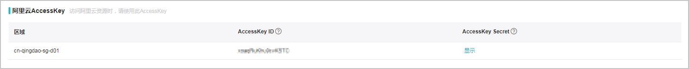

   > Accesskey ID和AccessKey Secret是您访问云资源时的密钥，具有该账号完整的权限，请您妥善保管。
   >
   > **说明**

<a id="section-1-5"></a>

## 1.5. OSS与Amazon S3的兼容性

本文介绍OSS兼容的S3 API以及OSS与S3的差异。

**OSS兼容的S3 API**

OSS对S3 Bucket、Object以及Multipart操作兼容的API如下：

<table>
  <tr>
    <th width="130">操作类型</th>
    <th>API</th>
  </tr>
  <tr>
    <td>Bucket操作</td>
    <td>• PutBucket<br>• DeleteBucket<br>• GetBucket<br>• GetBucketACL<br>• GetBucketLifecycle<br>• GetBucketLocation<br>• GetBucketLogging<br>• HeadBucket<br>• PutBucketACL<br>• PutBucketLifecycle<br>• PutBucketLogging</td>
  </tr>
  <tr>
    <td>Object操作</td>
    <td>• DeleteObject<br>• DeleteObjects<br>• GetObject<br>• GetObjectACL<br>• HeadObject<br>• PostObject<br>• PutObject<br>• PutObjectCopy<br>• PutObjectACL</td>
  </tr>
  <tr>
    <td>Multipart操作</td>
    <td>• InitiateMultipartUpload<br>• AbortMultipartUpload<br>• CompleteMultipartUpload<br>• ListParts<br>• UploadPart<br>• UploadPartCopy</td>
  </tr>
</table>

**OSS与S3的差异**

OSS与S3的差异如下：

- 请求风格

  S3支持路径（Path）请求风格和虚拟托管（Virtual Hosted）请求风格。虚拟托管请求风格是指将Bucket置于Host Header的访问方式。基于安全考虑，OSS仅支持虚拟托管访问方式。所以在S3迁移至OSS后，客户端应用需要进行相应设置。部分S3工具默认使用路径风格，也需要进行相应配置，否则可能导致OSS报错，并禁止访问。

- ACL权限定义

  OSS对ACL权限的定义与S3不完全一致，二者的主要区别如下：

  **级别**

  **权限**

  **S3**

  **OSS**

  对于Bucket下的所有Object，如果某Object没有设置Object权限，则该

  拥有Bucket的list权限。

  READ

  Object可读。

  - 对于Bucket下不存在的Object，可写入。

  Bucket下的Object可写入或覆

  - 对于Bucket下存在的Object，如果该Object没有设置Object权限，

  WRITE

  盖。

  则该Object可被覆盖。

  Bucket

  - 可以初始化分片上传（InitiateMultipartUpload）。

  读取Bucket ACL

  读取Bucket ACL，仅Bucket owner和授权子账号拥有此权限。

  READ_ACP

  设置Bucket ACL。

  设置Bucket ACL，仅Bucket owner和授权子账号拥有此权限。

  WRITE_ACP

  Object可读。

  Object可读。

  READ

  Object可以被覆盖。

  WRITE

  N/A

  Object

  读取Object ACL。

  读取Object ACL，仅Bucket owner和授权RAM用户拥有此权限。

  READ_ACP

  设置Object ACL。

  设置Object ACL，仅Bucket owner和授权RAM用户拥有此权限。

  WRITE_ACP

  > **重要**
  >
  > OSS仅支持S3中的私有、公共读和公共读写三种ACL模式。

- ETag

  - 对于PUT方式上传的Object，OSS Object的ETag与Amazon S3在大小写上有区别。OSS为大写，而S3为小写。如果客户端有关于ETag的校验，请忽略大小写。

  - 对于分片上传的Object，OSS的ETag计算方式与S3不同。

<a id="section-2"></a>

# 2.块存储

<a id="section-2-1"></a>

## 2.1. 使用前须知

使用块存储EBS API实现具体功能前，开发人员需要了解调用EBS不同功能API时使用的产品名称和API版本区别。

- 当使用EBS的云盘、快照、存储集功能时，请通过ECS SDK调用对应API来实现。使用ECS SDK调用API时，请设置产品名称为ecs，API版本为2014-05-26。

  具体调用流程如下图所示。

  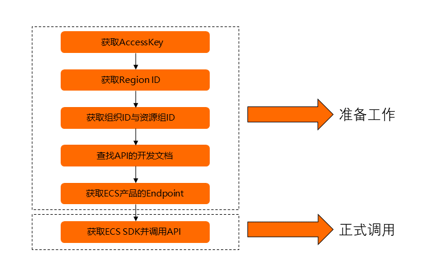

- 当使用EBS的云盘异步复制、一致性复制组功能时，请通过EBS SDK调用对应API来实现。使用EBS SDK调用API时，请设置产品名称为ebs，API版本为2021-07-30。

  > 由于云盘异步复制是基于云盘的功能，因此使用云盘异步复制功能、一致性复制组功能时，建议同时安装ECS SDK。
  >
  > **重要**

  具体调用流程如下图所示。

  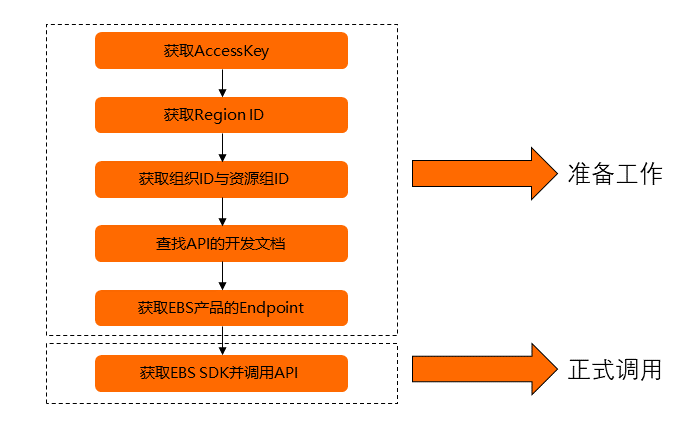

<a id="section-2-2"></a>

## 2.2. 准备工作

<a id="section-2-2-1"></a>

### 2.2.1. 登录开发者门户控制台

您可以通过Apsara Uni-manager运营控制台登录开发者门户。

**前提条件**

- 登录Apsara Uni-manager运营控制台前，确认您已从部署人员处获取Apsara Uni-manager运营控制台的服务域名地址。

- 推荐使用Chrome浏览器。

**操作步骤**

1. 在浏览器地址栏中，输入Apsara Uni-manager运营控制台的服务域名地址，按回车键。

2. 输入正确的用户名及密码。

   请向运营管理员获取登录控制台的用户名和密码。

   > **说明**
   >
   > 首次登录Apsara Uni-manager运营控制台时，需要修改登录用户名的密码，请按照提示完成密码修改。为提高安全性，密码长度必须为10~32位，且至少包含以下两种类型：
   >
   > - 英文大写或小写字母（A~Z、a~z）
   >
   > - 阿拉伯数字（0~9）
   >
   > - 特殊符号（感叹号（!）、at（@）、井号（#）、美元符号（$）、百分号（%）等）

3. 单击**登录**。

4. 如果账号已激活MFA多因素认证，请根据以下两种情况进行操作：

   - 管理员强制开启MFA后的首次登录：

     <ol type="a">

     <li>

     在绑定虚拟MFA设备页面中，按页面提示步骤绑定MFA设备。

     </li>

     <li>

     按照步骤2重新输入账号和密码，单击**登录**。

     </li>

     </ol>

     <ol type="i" start="100">

     <li>

     输入6位MFA码后单击**认证**。

     </li>

     </ol>

   - 您已开启并绑定MFA：

     输入6位MFA码后单击**认证**。

     > **说明**
     >
     > 绑定并开启MFA的操作请参见<strong>《Apsara Uni-manager运营控制台用户指南》</strong>中的<strong>《绑定并开启虚拟MFA设备》</strong>章节。

5. 在页面顶部的菜单栏中，选择**产品 > 应用服务 > 开发者门户**。

<a id="section-2-2-2"></a>

### 2.2.2. 获取API信息

首先，您需要了解产品开放API接口的相关信息，包括产品名称（code）、开放API接口名称、API版本，在通过SDK调用API接口时需要填写上述信息。

**背景信息**

Apsara Uni-manager运营控制台API目录中的API信息仅供调用参考，具体API的使用方式需要参见云产品的开发指南。如果发生不一致情况，以开发指南支持情况为准。

**操作步骤**

1. 登录Apsara Uni-manager运营控制台。

2. 在顶部菜单栏单击

   图标，进入**帮助与开放平台**。

   

3. 在顶部菜单栏**产品文档**的下拉列表中，选择**API调试**。

   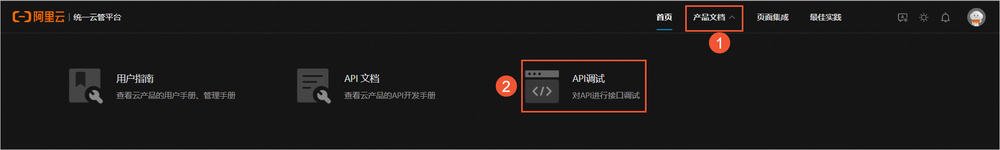

4. 在左侧导航栏中选择目标云产品。在下方API列表中可浏览当前API版本中的所有API接口名称。若当前云产品存在多个API版本，可在**版本**下拉列表中，选择目标API版本。

<a id="section-2-2-3"></a>

### 2.2.3. 获取AccessKey

AccessKey支持RAM和STS两种授权模式，在发起调用时选择使用其中一种AccessKey即可。本文将为您描述如何获取通过RAM授权的AccessKey。

**背景信息**

AccessKey通过使用AccessKey ID和AccessKey Secret对称加密，以验证某个请求发送者的身份。其中AccessKey ID用于标识用户，AccessKey Secret是用户用于加密签名的字符串。

AccessKey的两种授权模式如下：

- 通过RAM授权给第三方请求者的AccessKey ID和AccessKey Secret。

- 通过STS授权给第三方请求者的AccessKey ID、AccessKey Secret和Security Token。获取方式，请参见获取STS AccessKey。

Apsara Uni-manager运营控制台提供了个人AccessKey和组织AccessKey（只有运营管理员和一级组织管理员可以获取组织AccessKey），推荐使用个人账号AccessKey调用Apsara Uni-manager运营控制台及云产品相关接口。如果使用个人账号AccessKey，需要在Header中添加以下限制性参数，否则可能提示权限不足：

> **警告**
>
> 个人账号AccessKey是由Apsara Uni-manager运营控制台权限体系管控的受限AccessKey，组织AccessKey相对权限较大，需要管理员确认操作的安全性。

<table>
  <tr>
    <th width="206">参数名称</th>
    <th>描述</th>
  </tr>
  <tr>
    <td>x-acs-regionid</td>
    <td>地域，如：cn-hangzhou-*。</td>
  </tr>
  <tr>
    <td>x-acs-organizationid</td>
    <td>Apsara Uni-manager运营控制台中对应的组织ID。获取方式，请参见<em>Apsara Uni-manager运营控制台开发指南</em>中的<em>GetOrganizationList</em>章节。</td>
  </tr>
  <tr>
    <td>x-acs-resourcegroupid</td>
    <td>Apsara Uni-manager运营控制台中对应的资源集ID。获取方式，请参见<em>Apsara Uni-manager运营控制台开发指南</em>中的<em>ListResourceGroup</em>章节。</td>
  </tr>
  <tr>
    <td>x-acs-instanceid</td>
    <td>进行操作的实例ID，例如，ECS的实例ID可以从ECS列表中查询到。</td>
  </tr>
</table>

**获取个人账号AccessKey**

获取个人账号AccessKey的方法如下：

1. 登录Apsara Uni-manager运营控制台。

2. 在系统界面右上角，单击当前登录用户头像，单击**个人信息**。

3. 在**AccessKey**区域，您可以查看个人账户的AccessKey信息。

   > **说明**
   >
   > Accesskey ID和AccessKey Secret是您访问云资源时的密钥，具有该账号完整的权限，请您妥善保管。

**获取组织AccessKey**

获取组织AccessKey的方法如下：

1. 管理员登录Apsara Uni-manager运营控制台。

2. 在顶部菜单栏，单击**企业**。

3. 在左侧导航栏中，选择。

4. 在组织结构中，单击目标一级组织名称。

5. 单击**管理Accesskey**。

6. 在弹出的对话框中，查看组织AccessKey信息。

<a id="section-2-2-4"></a>

### 2.2.4. 获取STS AccessKey

本文为您介绍如何利用STS方式，调用专有云EBS的API。

**背景信息**

阿里云临时安全令牌STS（Security Token Service）是阿里云提供的一种临时访问权限管理服务。您可以选择使用STS方式，调用专有云的产品API。

STS AccessKey由AccessKey ID、AccessKey Secret及SecurityToken三元组组成，使用STS方式调用云产品API时，三元组缺一不可。

**操作步骤**

1. 获取用户角色的 `RAM Role` 。

   <ol type="i">

   <li>

   登录Apsara Uni-manager运营控制台。

   </li>

   <li>

   单击页面右上角的用户头像，选择**个人信息**。

   </li>

   <li>

   单击**查看当前角色策略**。

   在**当前选择角色策略**对话框中查看 `RAM Role` 。

   </li>

   </ol>

2. 获取STS Accesskey三元组。

   > **说明**
   >
   > 以下代码示例中可变参数均需替换为您实际的相关信息，尖括号（<>）在最终代码中不保留。
   >
   > 涉及替换的可变参数如下：
   >
   > - &lt;yourRegionID>，请替换为您实际的地域ID。
   >
   > - &lt;yourAccessKeyID>，请替换为您实际的AccessKey ID。
   >
   > - &lt;yourAccessKeySecret>，请替换为您实际的AccessKey Secret。
   >
   > - &lt;yourRoleSessionName>，请替换为您当前实际的会话名称。
   >
   > - &lt;yourRoleArn>，请替换为您实际的RAM Role。
   >
   > - &lt;sts.aliyuns.com> ，请替换为实际的STS Endpoint。

   ```java
   public static void main(String[] args) {
       // 创建DefaultAcsClient实例并初始化。
       // <yourRegionID>、<yourAccessKeyID>和<yourAccessKeySecret>请分别替换为您实际的地域ID、AccessKey ID和AccessKey Secret。
       DefaultProfile profile = DefaultProfile.getProfile("<yourRegionID>", "<yourAccessKeyID>", "<yourAccessKeySecret>");
       HttpClientConfig clientConfig = HttpClientConfig.getDefault();
       clientConfig.setIgnoreSSLCerts(true);
       clientConfig.setProtocolType(ProtocolType.HTTPS);
       profile.setHttpClientConfig(clientConfig);
       IAcsClient client = new DefaultAcsClient(profile);
       String assumeRole = callAssumeRole(client);
       if (StringUtils.isEmpty(assumeRole)) return;
       JSONObject assumeRoleJson = JSONObject.parseObject(assumeRole);
       JSONObject credentials = assumeRoleJson.getJSONObject("Credentials");
       // 获取到STS三元组。
       String stsAK = credentials.getString("AccessKeyId");
       String stsSK = credentials.getString("AccessKeySecret");
       String stsToken = credentials.getString("SecurityToken");
   }

   private static String callAssumeRole(IAcsClient client) {
       CommonRequest request = new CommonRequest();
       // sts.aliyuns.com请替换为实际的STS Endpoint，⼀般格式为sts-vpc.${global:region}.${global:internet-domain}。
       request.setSysDomain("sts.aliyuns.com");
       request.setSysProduct("Sts");
       request.setSysAction("AssumeRole");
       request.setSysVersion("2015-04-01");
       request.setSysMethod(MethodType.POST);
       request.setHttpContentType(FormatType.FORM);
       // 业务参数，设置本次调⽤Session的别名，<yourRoleSessionName>请您替换为实际值。
       request.putQueryParameter("RoleSessionName", "<yourRoleSessionName>");
       // 扮演的Role⾓⾊ARN，<yourRoleArn>请替换为上⼀步获取到的实际RAM Role ARN。
       request.putQueryParameter("RoleArn", "<yourRoleArn>");
       try {
           CommonResponse response = client.getCommonResponse(request);
           return response.getData();
       } catch (ServerException e) {
           System.out.println(e.getErrCode());
           System.out.println(e.getErrMsg());
       } catch (ClientException e) {
           System.out.println(e.getErrCode());
           System.out.println(e.getErrMsg());
       }
       return null;
   }
   ```

3. 通过STS AccessKey三元组调用云产品的接口。

   > **说明**
   >
   > 以下代码示例中可变参数均需替换为您实际的相关信息，尖括号（<>）在最终代码中不保留。

   对于EBS来说，使用不同功能，执行代码时使用的API版本和产品名称不同。

   - 当使用云盘、快照功能时，您必须设置API版本为**2014-05-26**，产品名称为**Ecs**。

   - 当使用异步复制、一致性复制组功能时，您必须设置APi版本为**2021-07-30**，产品名称为**ebs**。

   使用云盘的DescribeDisks接口获取云盘信息的示例代码如下：

   ```java
   public static void main(String[] args) {
       // <yourRegionID>请替换为您实际的地域ID。
       // <yourStsAccessKeyID>和<yourStsAccessKeySecret>请分别替换为前⼀步获取到的STS三元组中AccessKeyID和AccessKeySecret。
       DefaultProfile profile = DefaultProfile.getProfile("<yourRegionID>", "<yourStsAccesskey>", "<yourStsAccessSecret>");
       HttpClientConfig clientConfig = HttpClientConfig.getDefault();
       clientConfig.setIgnoreSSLCerts(true);
       clientConfig.setProtocolType(ProtocolType.HTTPS);
       profile.setHttpClientConfig(clientConfig);
       IAcsClient client = new DefaultAcsClient(profile);
       CommonRequest request = new CommonRequest();
       request.setSysDomain("ecs.aliyuns.com");
       // 设置产品名称为Ecs。
       request.setSysProduct("Ecs");
       // 填写要操作的API名称，必须与API参考中的API名称保持⼀致。
       request.setSysAction("DescribeDisks");
       // 设置API版本为2014-05-26。
       request.setSysVersion("2014-05-26");
       request.setSysMethod(MethodType.POST);
       request.setHttpContentType(FormatType.FORM);
       // <yourRegionID>请替换为您实际的地域ID。
       request.putHeadParameter("x-acs-regionid", "<yourRegionID>");
       // <yourStsToken>请替换为您前⼀步获取到的STS三元组中SecurityToken。
       request.putQueryParameter("SecurityToken", "<yourStsToken>");
       // 非必填，<yourResourceGroupID>请替换为您实际的资源集ID。
       // request.putHeadParameter("x-acs-resourcegroupid", "<yourResourceGroupID>");
       // 必填，<yourOrganizationID>请替换为您实际的组织ID。
       request.putHeadParameter("x-acs-organizationid", "<yourOrganizationID>");
       try {
           CommonResponse response = client.getCommonResponse(request);
           System.out.println(response.getData());
       } catch (ServerException e) {
           System.out.println(e.getErrCode());
           System.out.println(e.getErrMsg());
       } catch (ClientException e) {
           System.out.println(e.getErrCode());
           System.out.println(e.getErrMsg());
       }
   }
   ```

   使用异步复制的DescribeDiskReplicaPairs接口获取复制对信息的示例代码如下：

   ```java
   public static void main(String[] args) {
       // <yourRegionID>请替换为您实际的地域ID。
       // <yourStsAccesskey>和<yourStsAccessSecret>请分别替换为前⼀步获取到的STS三元组中AccessKeyID和AccessKeySecret。
       DefaultProfile profile = DefaultProfile.getProfile("<yourRegionID>", "<yourStsAccesskey>", "<yourStsAccessSecret>");
       HttpClientConfig clientConfig = HttpClientConfig.getDefault();
       clientConfig.setIgnoreSSLCerts(true);
       clientConfig.setProtocolType(ProtocolType.HTTPS);
       profile.setHttpClientConfig(clientConfig);
       IAcsClient client = new DefaultAcsClient(profile);
       CommonRequest request = new CommonRequest();
       request.setSysDomain("ebs.aliyuns.com");
       // 设置产品名称为ebs。
       request.setSysProduct("ebs");
       // 设置要操作的API名称，必须与API参考中的API名称保持⼀致。
       request.setSysAction("DescribeDiskReplicaPairs");
       // 设置API版本为2021-07-30.
       request.setSysVersion("2021-07-30");
       request.setSysMethod(MethodType.POST);
       request.setHttpContentType(FormatType.FORM);
       // <yourRegionID>请替换为您实际的地域ID。
       request.putHeadParameter("x-acs-regionid", "<yourRegionID>");
       // <yourStsToken>请替换为您前⼀步获取到的STS三元组中SecurityToken。
       request.putQueryParameter("SecurityToken", "<yourStsToken>");
       // 非必填，<yourResourceGroupID>请替换为您实际的资源集ID。
       // request.putHeadParameter("x-acs-resourcegroupid", "<yourResourceGroupID>");
       // 必填，<yourOrganizationID>请替换为您实际的组织ID。
       request.putHeadParameter("x-acs-organizationid", "<yourOrganizationID>");
       try {
           CommonResponse response = client.getCommonResponse(request);
           System.out.println(response.getData());
       } catch (ServerException e) {
           System.out.println(e.getErrCode());
           System.out.println(e.getErrMsg());
       } catch (ClientException e) {
           System.out.println(e.getErrCode());
           System.out.println(e.getErrMsg());
       }
   }
   ```

<a id="section-2-2-5"></a>

### 2.2.5. 获取公共Header参数

调用专有云API时需要提供多个Header参数。本文为您介绍这些参数的含义及其获取方式，并对调用后的一些返回值做出解释。

**Header参数描述**

| 名称 | 描述 |
| --- | --- |
| x-acs-regionid | 环境Region，获取方式请参见获取Region ID。 |
| x-acs-organizationid | Apsara Uni-manager运营控制台上的组织ID，获取方式请参见获取组织ID。 |
| x-acs-resourcegroupid | Apsara Uni-manager运营控制台上的资源集ID，获取方式请参见获取资源集ID。 |
| x-acs-instanceid | 进行操作的实例ID，获取方式请参见获取实例ID。 |

**获取Region ID**

1. 管理员登录Apsara Uni-manager运营控制台。

2. 在顶部菜单栏中，单击**企业**。

3. 在左侧导航栏中，选择**资源管理** > **地域管理**。

4. 单击目标组织名称。

5. 在右侧**Region列表**中查看Region ID。

**获取组织ID**

组织ID需要通过API进行获取，获取方式请参见*Apsara Uni-manager运营控制台开发指南*中的*GetOrganizationList章节*。

**获取资源集ID**

资源集ID需要通过API进行获取，获取方式请参见*Apsara Uni-manager运营控制台开发指南*中的*ListResourceGroup章节*。

**获取实例ID**

实例ID可以通过Apsara Uni-manager运营控制台中的云产品实例列表进行获取，根据使用的功能不同，获取的步骤不同。

使用云盘、快照功能时，获取步骤如下：

1. 登录Apsara Uni-manager运营控制台。

2. 在顶部的菜单栏中，选择**产品** > **云服务器ECS**。

3. 在左侧导航栏中，单击**云盘**、**快照**或者**自动快照策略**。

4. 在对应资源列表中查看资源ID，例如云盘ID、快照ID等。

使用异步复制、一致性复制组功能时，获取步骤如下：

1. 登录Apsara Uni-manager运营控制台。

2. 在顶部的菜单栏中，选择**产品** > **块存储EBS**。

3. 在左侧导航栏中，单击**异步复制**或者**一致性复制组**。

4. 在对应资源列表中查看资源ID，例如复制对ID、一致性复制组ID等。

**返回参数**

对于列表类的云产品资源实例接口，调用后会默认增加如下返回值。

| 名称 | 描述 |
| --- | --- |
| ResourceGroupName | 资源集名称。 |
| ResourceGroup | 资源集ID。 |
| DepartmentName | 组织名称。 |
| Department | 组织ID。 |

<a id="section-2-2-6"></a>

### 2.2.6. 获取Endpoint

本文介绍了如何获取云服务器ECS和块存储EBS的Endpoint。

**背景信息**

通过POP网关调用专有云API时需要使用云产品业务域的Endpoint。您可以在阿里云驻场运维工程师处获取。您也可以通过如下方法自行获取Endpoint。

使用EBS的不同功能时，需要获取不同产品的EndPoint。

- 当使用云盘、快照功能时，请获取云服务器ECS的EndPoint。具体操作，请参见获取云服务器ECS的Endpoint。

- 当使用异步复制、一致性复制组功能时，请获取块存储EBS的Endpoint。具体操作，请参见获取块存储EBS的Endpoint。

**获取云服务器ECS的Endpoint**

1. 登录飞天基础运维平台。

   <ol type="i">

   <li>

   登录Apsara Uni-manager运维控制台。

   </li>

   <li>

   在顶部菜单栏，选择**平台运维**>**飞天基础运维平台** > **运维工具**。

   </li>

   </ol>

2. 在**服务注册变量大盘**页面，选择**服务**并输入**ECS**。

3. 在 `ecs-yaochi` 服务的**Service Registration**列中，单击  图标，然后单击显示的信息。

   在**注册变量**对话框，查看的**ecs-internal.openapi.endpoint**值，即 `Endpoint` 。

**获取块存储EBS的Endpoint**

1. 登录飞天基础运维平台。

   <ol type="i">

   <li>

   登录Apsara Uni-manager运维控制台。

   </li>

   <li>

   在顶部菜单栏，选择**平台运维**>**飞天基础运维平台** > **运维工具**。

   </li>

   </ol>

2. 在**服务注册变量大盘**页面，选择**服务**并输入**EBS**。

3. 在EbsTiangangApi服务的**Service Registration**列中，单击  图标，然后单击显示的信息。

   在**注册变量**对话框，查看的**ebstiangang.openapi.endpoint**值，即 `Endpoint` 。

<a id="section-2-2-7"></a>

### 2.2.7. 获取云产品的SDK包

通过POP网关调用专有云API时，需使用ECS或者EBS的SDK。本文为您介绍如何获取阿里云开发工具包（SDK）。

当使用不同功能时，您需要获取对应云产品的SDK，建议同时获取ECS SDK和EBS SDK包。

- 当使用云盘、快照功能时，您需要获取云服务器ECS SDK。

  云服务器ECS SDK封装了2014-05-26版本API，以访问密钥（AccessKey）识别调用者身份，提供自动签名等功能，方便您通过API创建和管理资源。

  实现相应功能需要您同时安装ECS SDK和阿里云核心库。以Java SDK为例，您需要下载aliyun-java-sdk-core以及aliyun-java-sdk-ecs。

- 当使用异步复制、一致性复制组功能时，您需要获取块存储EBS SDK。

  块存储EBS SDK封装了2021-07-30版本API，以访问密钥（AccessKey）识别调用者身份，提供自动签名等功能，方便您通过API创建和管理资源。

  实现相应功能需要您同时安装EBS SDK和阿里云核心库。以Java SDK为例，您需要下载aliyun-java-sdk-core以及aliyun-java-sdk-ebs。

软件开发工具包（SDK）包括代码以及示例，您可以自行选择语言创建云应用。目前SDK的语言支持Java、Python、Go，您可以前往阿里云开发工具包（SDK）中进行选择。

> **说明**
>
> 推荐使用 Java、Python、Go三种语言的SDK包，使用其他语言的SDK包可能发生不兼容情况。

SDK核心库推荐使用阿里云官网的SDK核心库，其内容所有云产品共用，且适用于专有云。

<a id="section-2-3"></a>

## 2.3. Java SDK调用示例

<a id="section-2-3-1"></a>

### 2.3.1. 快速开始

本文介绍如何获取ECS Java SDK和EBS Java SDK并开始调用。

**环境准备**

- 使用阿里云专有云Java SDK，您需要一个授权账号以及一对AccessKey ID和AccessKey Secret。具体操作，请参见获取AccessKey。

- 根据所用功能获取相应产品的Endpoint。具体操作，请参见获取Endpoint。

- 阿里云专有云Java SDK需要1.8及以上的JDK。

**安装阿里云专有云Java SDK**

如果您使用Apache Maven来管理Java项目，只需在项目的pom.xml中导入JAR文件。

要使用产品的开发工具包，必须安装SDK核心库以及产品的SDK。其中，SDK核心库推荐使用4.5.17及以上版本，ECS Java SDK的版本为4.23.2，EBS Java SDK的版本为1.0.3。 具体操作，请参见安装Java SDK。

**使用Java SDK**

调用阿里云专有云Java SDK的主要操作步骤如下：

1. 创建并初始化DefaultAcsClient实例。

2. 创建API请求并设置参数。

3. 发起请求并处理应答或异常。

   对于EBS来说，使用不同功能，执行代码时使用的API版本和产品名称不同。

   - 当使用云盘、快照功能时，您必须设置API版本为**2014-05-26**，产品名称为**Ecs**。

   - 当使用异步复制、一致性复制组功能时，您必须设置APi版本为**2021-07-30**，产品名称为**ebs**。

使用云盘的DescribeDisks接口获取云盘信息的示例代码如下：

> **说明**
>
> 以下代码示例中可变参数均需替换为您实际的相关信息，尖括号（<>）在最终代码中不保留。
>
> 涉及替换的可变参数如下：
>
> - &lt;yourRegionID>，请替换为您实际的地域ID。
>
> - &lt;yourAccessKeyID>，请替换为您实际的AccessKey ID。
>
> - &lt;yourAccessKeySecret>，请替换为您实际的AccessKey Secret。
>
> - &lt;Product>，请替换为您实际的产品名称。
>
> - &lt;Endpoint>，请替换为您当前产品实际的Endpoint。
>
> - &lt;readTimeout>，请您根据实际情况设置读取超时时间，单位为毫秒。
>
> - &lt;connectionTimeout>，请您根据实际情况设置连接超时时间，单位为毫秒。
>
> - &lt;maxRequestsPerHost>，请您根据实际情况设置每个主机的最大请求数。
>
> - &lt;maxRequests>，请您根据实际情况设置最大请求数。
>
> - &lt;http://192.168.XX:33XX>，请替换为您实际的代理IP+端口。

```java
import com.aliyuncs.profile.DefaultProfile;
import com.aliyuncs.DefaultAcsClient;
import com.aliyuncs.IAcsClient;
import com.aliyuncs.exceptions.ClientException;
import com.aliyuncs.exceptions.ServerException;
import com.aliyuncs.http.HttpClientConfig;
import com.aliyuncs.http.ProtocolType;
import com.aliyuncs.ecs.model.v20140526.*;
public class Main {
    public static void main(String[] args) {
       // 创建DefaultAcsClient实例并初始化。
       DefaultProfile profile = DefaultProfile.getProfile(
           "<yourRegionID>",          // 请替换为您实际的地域ID。
           "<yourAccessKeyID>",      // 请替换为您实际的AccessKey ID。
           "<yourAccessKeySecret>"); // 请替换为您实际的AccessKey Secret。
       // 设置当前产品的Endpoint，可变参数请替换为您的实际值。产品名称设置为ECS。
       profile.addEndpoint("<yourRegionID>", "Ecs", "<Endpoint>");
       // 设置请求配置。
       HttpClientConfig clientConfig = HttpClientConfig.getDefault();
       clientConfig.setIgnoreSSLCerts(true);// 忽略证书
       clientConfig.setReadTimeoutMillis(<readTimeout>);// 读取超时时间（可选），单位为毫秒（ms）。
       clientConfig.setConnectionTimeoutMillis(<connectionTimeout>);// 连接超时时间（可选），单位为毫秒（ms）。
       clientConfig.setMaxRequestsPerHost(<maxRequestsPerHost>);// 设置每个主机的最⼤请求数（可选）。
       clientConfig.setMaxRequests(<maxRequests>);// 设置最⼤请求数（可选）。
       clientConfig.setProtocolType(ProtocolType.HTTP); // 设置请求协议，默认HTTP（可选）。
       /* 设置代理(可选),替换为代理IP+Port。
       clientConfig.setHttpProxy("<http://192.168.XX:33XX>");
       或
       clientConfig.setHttpsProxy("<https://192.168.XX:33XX>");
       */
       profile.setHttpClientConfig(clientConfig);
       IAcsClient client = new DefaultAcsClient(profile);
       // 创建API请求并设置参数.
       DescribeDisksRequest request = new DescribeDisksRequest()
               .setRegionId("cn-qingdao")
               .setZoneId("cn-qingdao-zone-1");
       // 特殊Header参数，设置组织ID和资源集ID，需要资源隔离使⽤，请根据实际情况修改.
       request.putHeaderParameter("x-acs-organizationid", "1");
       request.putHeaderParameter("x-acs-resourcegroupid", "11");
       // 发起请求并处理应答或异常。
       DescribeDisksResponse response;
       try {
           response = client.getAcsResponse(request);
           System.out.println(response.getRequestId());
           System.out.println(response.getTotalCount());
       } catch (ServerException e) {
           e.printStackTrace();
       } catch (ClientException e) {
           e.printStackTrace();
       }
    }
}
```

使用异步复制的DescribeDiskReplicaPairs接口获取复制对信息的示例代码如下：

```java
package com.aliyun.sample;
import com.aliyun.tea.*;
import com.aliyun.ebs20210730.*;
import com.aliyun.ebs20210730.models.*;
import com.aliyun.teaopenapi.*;
import com.aliyun.teaopenapi.models.*;

public class Sample {

    /**
     * 使⽤AK&SK初始化账号Client。
     * @param accessKeyId
     * @param accessKeySecret
     * @return Client
     * @throws Exception
     */
    public static com.aliyun.ebs20210730.Client createClient(String accessKeyId, String accessKeySecret) throws Exception {
        Config config = new Config()
                // 您的AccessKey ID。
                .setAccessKeyId(accessKeyId)
                // 您的AccessKey Secret。
                .setAccessKeySecret(accessKeySecret);
        // 设置当前产品的Endpoint，可变参数请替换为您的实际值。
        config.endpoint = "ebs.cn-beijing.aliyuncs.com";
        return new com.aliyun.ebs20210730.Client(config);
    }

    public static void main(String[] args_) throws Exception {
        java.util.List<String> args = java.util.Arrays.asList(args_);
        com.aliyun.ebs20210730.Client client = Sample.createClient("<yourAccessKeyID>", "<yourAccessKeySecret>");
        DescribeDiskReplicaPairsRequest describeDiskReplicaPairsRequest = new DescribeDiskReplicaPairsRequest()
            // 请替换为您实际的地域ID。
            .setRegionId("cn-beijing");
        // 复制代码运⾏请⾃⾏打印API的返回值。
        DescribeDiskReplicaPairsResponse resp = client.describeDiskReplicaPairs(describeDiskReplicaPairsRequest);
        for (int i = 0; i < resp.body.getReplicaPairs().size(); i++) {
            DescribeDiskReplicaPairsResponseBody.DescribeDiskReplicaPairsResponseBodyReplicaPairs pair
                = resp.body.getReplicaPairs().get(i);
            System.out.println(pair.getReplicaPairId());
            System.out.println(pair.getStatus());
        }
    }
}
```

<a id="section-2-3-2"></a>

### 2.3.2. 使用手册

<a id="section-2-3-2-1"></a>

#### 2.3.2.1. 安装Java SDK

本文介绍如何安装及调用ECS Java SDK和EBS Java SDK。

阿里云专有云Java SDK支持1.8及以上版本的JDK，可以通过添加Maven依赖或下载阿里云开发工具包（SDK）的方式安装专有云Java SDK。

要使用EBS功能，必须安装阿里云Java SDK核心库以及云产品的Java SDK。SDK核心库推荐使用4.5.17及以上版本，ECS Java SDK版本为4.23.2，EBS Java SDK版本为1.0.3。

对于EBS来说，使用不同功能，执行代码时请安装相关的SDK，建议同时安装ECS Java SDK和EBS Java SDK。

- 当使用云盘、快照功能时，您需要安装阿里云Java SDK核心库和ECS Java SDK，并在pom.xml文件中添加以下依赖即可。准确的SDK版本号，请参见阿里云开发工具包（SDK）。

  ```xml
  <!-- Alibaba Cloud SDK for Java -->
  <dependency>
      <groupId>com.aliyun</groupId>
      <artifactId>aliyun-java-sdk-core</artifactId>
      <version>4.5.17</version>
  </dependency>
  <!-- ECS Java SDK -->
  <dependency>
      <groupId>com.aliyun</groupId>
      <artifactId>aliyun-java-sdk-ecs</artifactId>
      <version>4.23.2</version>
  </dependency>
  ```

- 当使用异步复制、一致性复制组功能时，您需要安装阿里云Java SDK核心库和EBS Java SDK，并在pom.xml文件中添加以下依赖即可。准确的SDK版本号，请参见阿里云开发工具包（SDK）。

  ```xml
  <!-- Alibaba Cloud SDK for Java -->
  <dependency>
      <groupId>com.aliyun</groupId>
      <artifactId>aliyun-java-sdk-core</artifactId>
      <version>4.5.17</version>
  </dependency>
  <!-- EBS Java SDK-->
  <dependency>
    <groupId>com.aliyun</groupId>
    <artifactId>ebs20210730</artifactId>
    <version>1.0.3</version>
  </dependency>
  <dependency>
    <groupId>com.aliyun</groupId>
    <artifactId>tea-openapi</artifactId>
    <version>0.2.2</version>
  </dependency>
  <dependency>
    <groupId>com.aliyun</groupId>
    <artifactId>tea-console</artifactId>
    <version>0.0.1</version>
  </dependency>
  <dependency>
    <groupId>com.aliyun</groupId>
    <artifactId>tea-util</artifactId>
    <version>0.2.13</version>
  </dependency>
  <dependency>
    <groupId>com.aliyun</groupId>
    <artifactId>tea</artifactId>
    <version>1.1.14</version>
  </dependency>
  ```

<a id="section-2-3-2-2"></a>

#### 2.3.2.2. 设置身份验证凭证

当使用阿里云专有云SDK访问阿里云专有云服务时，您需要提供授权的账号进行身份验证。本文介绍了如何设置身份验证凭证。

目前，Java SDK支持通过AccessKey进行身份验证，具体获取AccessKey的方法，请参见获取AccessKey。

使用AccessKey作为访问凭据时，需要在初始化Client时设置凭证。

> **说明**
>
> 确保包含AccessKey的代码不会泄漏（例如提交到外部公开的GitHub项目），否则将会危害您的信息安全。

```text
DefaultProfile profile = DefaultProfile.getProfile(
    "<yourRegionID>",          // 请替换为您实际的地域ID
    "<yourAccessKeyID>",      // 请替换为您实际的AccessKey ID
    "<yourAccessKeySecret>"); // 请替换为您实际的AccessKey Secret
```

> **说明**
>
> 以上代码示例中可变参数均需替换为您实际的相关信息，尖括号（<>）在最终代码中不保留。

<a id="section-2-3-2-3"></a>

#### 2.3.2.3. 请求连接配置

本文介绍了如何配置请求连接（HttpClientConfig）。

您可通过以下代码配置HttpClientConfig，具体请根据自身服务能力自行选择配置项并做相应配置。

> **说明**
>
> 以下代码示例中可变参数均需替换为您实际的相关信息，尖括号（<>）在最终代码中不保留。
>
> 涉及替换的可变参数如下：
>
> - &lt;readTimeout>，请您根据自身服务的能力，配置读取超时时间，单位为毫秒（ms）。
>
> - &lt;connectionTimeout>，请您根据自身服务的能力，配置连接超时时间，单位为毫秒（ms）。
>
> - &lt;maxRequestsPerHost>，请您根据自身服务的能力，配置每台服务器的最大请求数，数据类型为INT。
>
> - &lt;maxRequests>，请您根据自身服务的能力，配置最大请求数，数据类型为INT。
>
> - &lt;http://192.168.XX.XX:33XX>，请替换为您实际的代理IP+端口。

```text
// 获取HttpClientConfig对象
HttpClientConfig clientConfig = HttpClientConfig.getDefault();
// 设置是否忽略证书
clientConfig.setIgnoreSSLCerts(true);
// (可选)设置读取超时时间，单位毫秒（ms）
clientConfig.setReadTimeoutMillis(<readTimeout>);
// (可选)设置创建连接超时时间，单位毫秒（ms）
clientConfig.setConnectionTimeoutMillis(<connectionTimeout>);
// (可选)设置每个主机的最⼤请求数，数据类型为INT
clientConfig.setMaxRequestsPerHost(<maxRequestsPerHost>);
// (可选)设置最⼤请求数，数据类型为INT
clientConfig.setMaxRequests(<maxRequests>);
// (可选)设置协议类型
clientConfig.setProtocolType(ProtocolType.HTTP);
/** （可选）请根据实际情况判断是否设置代理，设置⽅法如下：
clientConfig.setHttpProxy("<http://192.168.XX.XX:33XX>");
或
clientConfig.setHttpsProxy("<https://192.168.XX.XX:33XX>");
请替换为您实际的代理IP+端⼝
*/
profile.setHttpClientConfig(clientConfig);
```

<a id="section-2-3-2-4"></a>

#### 2.3.2.4. 发起调用

本文介绍如何使用ECS Java SDK和EBS Java SDK发起请求。

**使用ECS Java SDK**

1. 新建一个AcsClient。

   ```text
   IAcsClient client = new DefaultAcsClient(profile);
   ```

2. 创建请求。

   请求类的命名规范为 `${apiName}Request` ，其中 `${apiName}` 为API名称，例如 `DescribeDisksRequest` 。

   在引入多个产品SDK时，有可能存在Request类同名的情况，请注意按照package区分。

   ```text
   DescribeDisksRequest();
   // 业务参数
   request.setPageSize(10);
   request.setPageNumber(1);
   // 特殊Header参数,设置组织ID和资源集ID,资源隔离使⽤，请根据实际修改
   request.putHeaderParameter("x-acs-organizationid", "1");
   request.putHeaderParameter("x-acs-resourcegroupid", "");
   ```

3. 发起调用并处理应答。

   ```java
   DescribeDisksResponse response;
   try {
       response = client.getAcsResponse(request);
       System.out.println(response.getRequestId());
       System.out.println(response.getTotalCount());
   } catch (ServerException e) {
       e.printStackTrace();
   } catch (ClientException e) {
       e.printStackTrace();
   }
   ```

   正常情况下，应答中的所有字段，都会被反序列化到response中，您可以直接调用 `response.getXXX()` 来获得应答中的字段。

   ```text
   Integer count = response.getTotalCount()
   ```

   如果出现了异常，或您需要原始HTTP应答的情况下，您可以通过以使用 `doAction()` 来获取原始应答。

   ```text
   HttpResponse response = client.doAction(request);
   ```

**使用EBS Java SDK**

1. 新建一个Client。

   ```text
   public static com.aliyun.ebs20210730.Client createClient(String accessKeyId, String accessKeySecret) throws Exception {
           Config config = new Config()
                   // 您的AccessKey ID。
                   .setAccessKeyId(accessKeyId)
                   // 您的AccessKey Secret。
                   .setAccessKeySecret(accessKeySecret);
           // 设置当前产品的Endpoint，可变参数请替换为您的实际值。
           config.endpoint = "ebs.cn-beijing.aliyuncs.com";
           return new com.aliyun.ebs20210730.Client(config);
    }
   ```

2. 创建请求。

   ```text
   com.aliyun.ebs20210730.Client client = Sample.createClient("accessKeyId", "accessKeySecret");
   DescribeDiskReplicaPairsRequest describeDiskReplicaPairsRequest = new DescribeDiskReplicaPairsRequest()
               // 请替换为您实际的地域ID。
               .setRegionId("cn-beijing");
   ```

3. 发起调用并处理应答

   ```java
   DescribeDiskReplicaPairsResponse resp = client.describeDiskReplicaPairs(describeDiskReplicaPairsRequest);
   for (int i = 0; i < resp.body.getReplicaPairs().size(); i++) {
       DescribeDiskReplicaPairsResponseBody.DescribeDiskReplicaPairsResponseBodyReplicaPairs pair
           = resp.body.getReplicaPairs().get(i);
       System.out.println(pair.getReplicaPairId());
       System.out.println(pair.getStatus());
   }
   ```

<a id="section-2-3-2-5"></a>

#### 2.3.2.5. 错误处理

在使用Java SDK时，当服务端或者SDK端出错时，SDK会返回相应的异常信息。这些异常信息中会包含具体的错误信息，包括错误码（Error Code）和错误消息（Error Message）。

一般情况下，您不需要Java SDK返回的错误进行处理。您只需要根据服务端的错误提示处理服务端错误即可。

- `ServerException` 是服务端错误信息。

- `ClientException` 是SDK端错误信息。

例如，当出现如下错误时，您可以根据具体的错误信息，修改AccessKey的ID即可。

```text
com.aliyuncs.exceptions.ClientException: InvalidAccessKeyId.NotFound : Specified access key is not found.
```

如果您需要对SDK的错误进行处理，可以参考如下示例编写代码：

```java
try {
    FooResponse response = client.getAcsResponse(request);
    // 处理Response
    // ...
}catch (ServerException e){
    // 这⾥可以添加您⾃⼰的错误处理逻辑
    // 例如，打印具体的错误信息
    System.out.println("ErrorCode=" + e.getErrCode());
    System.out.println("ErrorMessage=" + e.getErrMsg());
    // 如果遇上棘⼿问题，可以提交⼯单，并将RequestId提供给我们
    System.out.println("ResponseId=" + e.getRequestId());
}catch (ClientException e){
    // 这⾥可以添加您⾃⼰的错误处理逻辑
    // 例如，打印具体的错误信息
    System.out.println("ErrorCode=" + e.getErrCode());
    System.out.println("ErrorMessage=" + e.getErrMsg());
}
```

<a id="section-2-3-2-6"></a>

#### 2.3.2.6. 使用CommonRequest进行调用

当您要调用ECS或者EBS的某个API没有提供SDK时，或者提供的SDK中的请求Request参数和返回Response值不符合需求时，可以采用泛用型的API调用方式（CommonRequest）。使用CommonRequest调用方式可实现任意OpenAPI接口的调用。

**CommonRequest调用特点**

CommonRequest的特点如下：

- 轻量：只需Core包即可发起调用，无需下载安装各产品的SDK。

- 简便：无需更新SDK即可调用最新发布的API。

- 快速迭代。

**使用CommonRequest**

发起一次CommonRequest请求，您需要获取以下几个参数的值。您可以在ECS的API文档中获取以下参数的值。

- 域名(domain)：该产品的服务地址。

- API版本(version)：该API的版本号，格式为YYYY-MM-DD。

  您可以在各产品的API文档的公共参数部分获取API版本。

- 接口信息：要调用的接口名称。

  您需要获取 `Action` 参数，使用 `request.setSysAction("<Action>")` 的方式来指定API名称。

  例如 `RunInstances` 接口，在发起 `CommonRequest` 请求时，需要使用 `request.setSysAction("RunInstances")` 来指定API名称。

**示例：调用RPC风格的API**

对于EBS来说，使用不同功能，执行代码时使用的API版本和产品名称不同。

- 当使用云盘、快照功能时，您必须设置API版本为**2014-05-26**，产品名称为**Ecs**。

- 当使用异步复制、一致性复制组功能时，您必须设置APi版本为**2021-07-30**，产品名称为**ebs**。

使用云盘的DescribeDisks接口获取云盘信息的示例代码如下：

> **说明**
>
> 以下代码示例中可变参数均需替换为您实际的相关信息，尖括号（<>）在最终代码中不保留。
>
> 涉及替换的可变参数如下：
>
> - &lt;yourRegionID>，请替换为您实际的地域ID。
>
> - &lt;yourAccessKeyID>，请替换为您实际的AccessKey ID。
>
> - &lt;yourAccessKeySecret>，请替换为您实际的AccessKey Secret。
>
> - &lt;Endpoint>，请替换为您当前产品实际的Endpoint。
>
> - &lt;yourSecurityToken>，请替换为您实际的SecurityToken。
>
> - &lt;yourResourceGroupID>，请替换为您实际的资源集ID。
>
> - &lt;yourOrganizationID>，请替换为您实际的组织ID。
>
> - &lt;yourInstanceID>，请替换为您实际的实例ID。
>
> - &lt;http://192.168.XX.XX:33XX>，请替换为您实际的代理IP和端口。

```java
import com.aliyuncs.CommonRequest;
import com.aliyuncs.CommonResponse;
import com.aliyuncs.DefaultAcsClient;
import com.aliyuncs.IAcsClient;
import com.aliyuncs.exceptions.ClientException;
import com.aliyuncs.exceptions.ServerException;
import com.aliyuncs.http.HttpClientConfig;
import com.aliyuncs.http.ProtocolType;
import com.aliyuncs.profile.DefaultProfile;
public class Sample {
    public static void main(String[] args) {
        // 创建DefaultAcsClient实例并初始化。
        DefaultProfile profile = DefaultProfile.getProfile(
            "<yourRegionID>",          // 请替换为您实际的地域ID。
            "<yourAccessKeyID>",      // 请替换为您实际的AccessKey ID。
            "<yourAccessKeySecret>"); // 请替换为您实际的AccessKey Secret。
        // 设置当前产品的Endpoint，可变参数请替换为您的实际值。 
        profile.addEndpoint("<Endpoint>");
        HttpClientConfig clientConfig = HttpClientConfig.getDefault();        
        clientConfig.setProtocolType(ProtocolType.HTTP); 
        /** 设置代理(可选),替换为代理IP+Port
        clientConfig.setHttpProxy("<http://192.168.XX.XX:33XX>");
        或
        clientConfig.setHttpsProxy("<https://192.168.XX:33XX>");
        请替换为实际代理IP+端⼝。
        */
        profile.setHttpClientConfig(clientConfig);
        IAcsClient client = new DefaultAcsClient(profile);
        // 创建API请求并设置参数。
        CommonRequest request = new CommonRequest();
        // 替换为真实的产品域名。
        request.setDomain("ecs.aliyuncs.com");
        request.setSysProduct("Ecs");
        request.setVersion("2014-05-26");
        request.setAction("DescribeDisks");
        request.putQueryParameter("PageNumber", "1");
        request.putQueryParameter("PageSize", "30");
        request.putHeadParameter("x-acs-resourcegroupid", "<yourResourceGroupID>");// 非必填，请替换为您实际的资源集ID。
        request.putHeadParameter("x-acs-organizationid", "<yourOrganizationID>");// 必填，请替换为您实际的组织ID。
        request.putHeadParameter("x-acs-caller-sdk-source","ApiTestDemo");// 必填，调⽤来源说明。
        request.putHeadParameter("x-acs-regionid", "<yourRegionID>");// 非必填（企业版V3.15.0及之前历史版本必填）,请替换为您实际的地域ID。
        // request.putHeadParameter("x-acs-instanceid", "<yourInstanceID>");// 非必填（修改、删除、查询单实例详情时必填）,请替换为您实际的实例ID。
        /** 
        当使⽤STS AccessKey调⽤接⼝时 需要在参数中加上SecurityToken字段。
        调⽤⽅法如下：
        request.putQueryParameter("SecurityToken", "<yourSecurityToken>");
        请替换为实际的Token
        */
        try {
            CommonResponse response = client.getCommonResponse(request);
            System.out.println(response.getData());
        } catch (ServerException e) {
            // TODO Auto-generated catch block
            e.printStackTrace();
        } catch (ClientException e) {
            // TODO Auto-generated catch block
            e.printStackTrace();
        }
    }
}
```

使用异步复制的DescribeDiskReplicaPairs接口获取复制对信息的示例代码如下：

```java
import com.aliyuncs.CommonRequest;
import com.aliyuncs.CommonResponse;
import com.aliyuncs.DefaultAcsClient;
import com.aliyuncs.IAcsClient;
import com.aliyuncs.exceptions.ClientException;
import com.aliyuncs.exceptions.ServerException;
import com.aliyuncs.http.HttpClientConfig;
import com.aliyuncs.http.ProtocolType;
import com.aliyuncs.profile.DefaultProfile;
public class Sample {
    public static void main(String[] args) {
        // 创建DefaultAcsClient实例并初始化。
        DefaultProfile profile = DefaultProfile.getProfile(
            "<yourRegionID>",          // 请替换为您实际的地域ID。
            "<yourAccessKeyID>",      // 请替换为您实际的AccessKey ID。
            "<yourAccessKeySecret>"); // 请替换为您实际的AccessKey Secret。
        // 设置当前产品的Endpoint，可变参数请替换为您的实际值。 
        profile.addEndpoint("ebs.cn-beijing.aliyuncs.com");
        HttpClientConfig clientConfig = HttpClientConfig.getDefault();        
        clientConfig.setProtocolType(ProtocolType.HTTP); 
        /** 设置代理(可选),替换为代理IP+Port。
        clientConfig.setHttpProxy("<http://192.168.XX.XX:33XX>");
        或
        clientConfig.setHttpsProxy("<https://192.168.XX:33XX>");
        请替换为实际代理IP+端⼝
        */
        profile.setHttpClientConfig(clientConfig);
        IAcsClient client = new DefaultAcsClient(profile);
        // 创建API请求并设置参数。
        CommonRequest request = new CommonRequest();
        // 替换为真实的产品域名。
        request.setDomain("ebs.aliyuncs.com");
        request.setSysProduct("ebs");
        request.setVersion("2021-07-30");
        request.setAction("DescribeDiskReplicaPairs");
        request.putQueryParameter("RegionId", "cn-beijing");
        request.putHeadParameter("x-acs-resourcegroupid", "<yourResourceGroupID>");// 非必填，请替换为您实际的资源集ID。
        request.putHeadParameter("x-acs-organizationid", "<yourOrganizationID>");// 必填，请替换为您实际的组织ID。
        request.putHeadParameter("x-acs-caller-sdk-source","ApiTestDemo");// 必填，调⽤来源说明。
        request.putHeadParameter("x-acs-regionid", "<yourRegionID>");// 非必填（企业版V3.15.0及之前历史版本必填），请替换为您实际的地域ID。
        // request.putHeadParameter("x-acs-instanceid", "<yourInstanceID>");// 非必填（修改、删除、查询单实例详情时必填）,请替换为您实际的实例ID。
        /** 
        当使⽤STS AccessKey调⽤接⼝时 需要在参数中加上SecurityToken字段。
        调⽤⽅法如下：
        request.putQueryParameter("SecurityToken", "<yourSecurityToken>");
        请替换为实际的Token。
        */
        try {
            CommonResponse response = client.getCommonResponse(request);
            System.out.println(response.getData());
        } catch (ServerException e) {
            // TODO Auto-generated catch block
            e.printStackTrace();
        } catch (ClientException e) {
            // TODO Auto-generated catch block
            e.printStackTrace();
        }
    }
}
```

<a id="section-2-4"></a>

## 2.4. Python SDK调用示例

<a id="section-2-4-1"></a>

### 2.4.1. 快速开始

本文介绍如何获取ECS Python SDK和EBS Python SDK并开始调用。

**环境准备**

- 使用阿里云专有云Python SDK，您需要一个授权账号以及一对AccessKey ID和AccessKey Secret。具体操作，请参见获取AccessKey。

- 根据所用功能获取相应产品的Endpoint。具体操作，请参见获取Endpoint。

**安装Python SDK**

要使用EBS功能，您必须安装阿里云Java SDK核心库以及云产品的Java SDK。

对于EBS来说，使用不同功能，执行代码时请安装相关的SDK，建议同时安装ECS SDK和EBS SDK。

- 当使用云盘、快照功能时，您需要安装阿里云Java SDK核心库和ECS SDK。

- 当使用异步复制、一致性复制组功能时，您需要安装阿里云Java SDK核心库和EBS Java SDK。

具体安装步骤如下：

1. 安装SDK核心库。

   - 如果您使用的是Python 2.x，执行以下命令，安装阿里云SDK核心库：

     ```bash
     pip install aliyun-python-sdk-core
     ```

   - 如果您使用的是Python 3.x，执行以下命令，安装阿里云SDK核心库：

     ```bash
     pip3 install aliyun-python-sdk-core-v3
     ```

2. 根据实际安装所需SDK。

   - 安装ECS SDK。

     - 如果您使用的是Python 2.x，执行以下命令，安装云服务器ECS的SDK。

       ```bash
       pip install aliyun-python-sdk-ecs
       ```

     - 如果您使用的是Python 3.x，执行以下命令，安装云服务器ECS的SDK。

       ```bash
       pip3 install aliyun-python-sdk-ecs
       ```

   - 安装EBS SDK。

     - 如果您使用的是Python 2.x，执行以下命令，安装块存储EBS的SDK。

       ```bash
       pip install alibabacloud_ebs20210730==1.0.3
       ```

     - 如果您使用的是Python 3.x，执行以下命令，安装块存储EBS的SDK。

       ```bash
       pip3 install alibabacloud_ebs20210730==1.0.3
       ```

**使用Python SDK**

调用Python SDK的3个主要步骤如下：

1. 创建Client实例。在创建Client实例时，您需要获取Region ID、AccessKey ID和AccessKey Secret。

2. 创建API请求并设置参数。

3. 发起请求并处理应答或异常。

   对于EBS来说，使用不同功能，执行代码时使用的API版本和产品名称不同。

   - 当使用云盘、快照功能时，您必须设置API版本为**2014-05-26**，产品名称为**Ecs**。

   - 当使用异步复制、一致性复制组功能时，您必须设置APi版本为**2021-07-30**，产品名称为**ebs**。

   > **说明**
   >
   > 以下代码示例中可变参数均需替换为您实际的相关信息，尖括号（<>）在最终代码中不保留。
   >
   > 涉及替换的可变参数如下：
   >
   > - &lt;yourRegionID>，请替换为您实际的地域ID。
   >
   > - &lt;yourAccessKeyID>，请替换为您实际的AccessKey ID。
   >
   > - &lt;yourAccessKeySecret>，请替换为您实际的AccessKey Secret。
   >
   > - &lt;ecs.aliyuns.com>，请替换为您实际的产品访问地址。
   >
   > - &lt;http://192.168.XX:33XX>，请替换为您实际的代理IP+端口。

   使用云盘的DescribeDisks接口获取云盘信息的示例代码如下：

   ```python
   #!/usr/bin/env python
   #coding=utf-8
   from aliyunsdkcore import client
   from aliyunsdkcore.profile import region_provider
   from aliyunsdkecs.request.v20140526 import DescribeDisksRequest
   # global config
   region_id = '<yourRegionID>' # 请替换为您实际的地域ID。
   access_key = '<yourAccessKeyID>' # 请替换为您实际的AccessKey ID。
   access_secret = '<yourAccessKeySecret>' # 请替换为您实际的AccessKey Secret。
   http_proxy='<http://192.168.XX:33XX>',    # 请替换为您实际的http_proxy。
   # product config
   product_name = 'ECS' # 填写产品名称。
   endpoint = '<ecs.aliyuns.com>' # 产品访问域名，当前为示例值，请替换为您实际的产品访问地址。
   # create client
   region_provider.modify_point(product_name, region_id, endpoint)
   clt = client.AcsClient(access_key, access_secret, region_id)
   # setup request
   request = DescribeDisksRequest.DescribeDisksRequest()
   request.set_accept_format('json') # 设置返回数据格式。
   # get response
   response = clt.do_action_with_exception(request)
   print(response)
   ```

   使用异步复制的DescribeDiskReplicaPairs接口获取复制对信息的示例代码如下：

   ```python
   # -*- coding: utf-8 -*-
   # This file is auto-generated, don't edit it. Thanks.
   import sys

   from typing import List

   from alibabacloud_ebs20210730.client import Client as ebs20210730Client
   from alibabacloud_tea_openapi import models as open_api_models
   from alibabacloud_ebs20210730 import models as ebs_20210730_models


   class Sample:
       def __init__(self):
           pass

       @staticmethod
       def create_client(
           access_key_id: str,
           access_key_secret: str,
       ) -> ebs20210730Client:
           """
           使⽤AK&SK初始化账号Client。
           @param access_key_id:
           @param access_key_secret:
           @return: Client
           @throws Exception
           """
           config = open_api_models.Config(
               # 您的AccessKey ID。
               access_key_id=access_key_id,
               # 您的AccessKey Secret。
               access_key_secret=access_key_secret
           )
           # 访问的域名。
           config.endpoint = f'ebs.cn-beijing.aliyuncs.com'
           return ebs20210730Client(config)

       @staticmethod
       def main(
           args: List[str],
       ) -> None:
           client = Sample.create_client('accessKeyId', 'accessKeySecret')
           describe_disk_replica_pairs_request = ebs_20210730_models.DescribeDiskReplicaPairsRequest(
               region_id='cn-beijing'
           )
           # 复制代码运⾏请⾃⾏打印API的返回值。
           client.describe_disk_replica_pairs(describe_disk_replica_pairs_request)

       @staticmethod
       async def main_async(
           args: List[str],
       ) -> None:
           client = Sample.create_client('accessKeyId', 'accessKeySecret')
           describe_disk_replica_pairs_request = ebs_20210730_models.DescribeDiskReplicaPairsRequest(
               region_id='cn-beijing'
           )
           # 复制代码运⾏请⾃⾏打印API的返回值。
           await client.describe_disk_replica_pairs_async(describe_disk_replica_pairs_request)


   if __name__ == '__main__':
       Sample.main(sys.argv[1:])
   ```

<a id="section-2-4-2"></a>

### 2.4.2. 使用手册

<a id="section-2-4-2-1"></a>

#### 2.4.2.1. 安装Python SDK

本文介绍如何安装及调用ECS Python SDK。

**背景信息**

阿里云专有云Python SDK支持Python 2.6.x、2.7.x和3.x及以上环境，您可以通过pip安装专有云Python SDK。

> **说明**
>
> 使用产品的开发工具包，都必须安装阿里云Python SDK核心库。例如，如果要使用ECS的Python SDK，您需要安装阿里云Python SDK核心库和ECS的Python SDK。

**安装Python SDK**

要使用EBS功能，您必须安装阿里云Java SDK核心库以及云产品的Java SDK。

对于EBS来说，使用不同功能，执行代码时请安装相关的SDK，建议同时安装ECS SDK和EBS SDK。

- 当使用云盘、快照功能时，您需要安装阿里云Java SDK核心库和ECS SDK。

- 当使用异步复制、一致性复制组功能时，您需要安装阿里云Java SDK核心库和EBS Java SDK。

具体步骤如下：

1. 安装SDK核心库。

   - 如果您使用的是Python 2.x，执行以下命令，安装阿里云SDK核心库：

     ```bash
     pip install aliyun-python-sdk-core
     ```

   - 如果您使用的是Python 3.x，执行以下命令，安装阿里云SDK核心库：

     ```bash
     pip3 install aliyun-python-sdk-core-v3
     ```

2. 根据实际安装所需SDK。

   - 安装ECS SDK。

     - 如果您使用的是Python 2.x，执行以下命令，安装云服务器ECS的SDK。

       ```bash
       pip install aliyun-python-sdk-ecs
       ```

     - 如果您使用的是Python 3.x，执行以下命令，安装云服务器ECS的SDK。

       ```bash
       pip3 install aliyun-python-sdk-ecs
       ```

   - 安装EBS SDK。

     - 如果您使用的是Python 2.x，执行以下命令，安装块存储EBS的SDK。

       ```bash
       pip install alibabacloud_ebs20210730==1.0.3
       ```

     - 如果您使用的是Python 3.x，执行以下命令，安装块存储EBS的SDK。

       ```bash
       pip3 install alibabacloud_ebs20210730==1.0.3
       ```

<a id="section-2-4-2-2"></a>

#### 2.4.2.2. 设置身份验证凭证

当使用阿里云专有云SDK访问阿里云专有云服务时，您需要提供授权的账号进行身份验证。本文介绍了如何设置身份验证凭证。

目前，Python SDK支持通过AccessKey进行身份验证，具体获取AccessKey的方法，请参见获取AccessKey。

使用AccessKey作为访问凭据时，需要在初始化Client时设置凭证。

> **说明**
>
> 确保包含AccessKey的代码不会泄漏（例如提交到外部公开的GitHub项目），否则将会危害您的信息安全。

```python
from aliyunsdkcore import client
clt = client.AcsClient(access_key, acces_secret, region_id)
```

<a id="section-2-4-2-3"></a>

#### 2.4.2.3. 设置HTTPS请求

Python SDK支持使用HTTP和HTTPS协议发起 API 请求。

使用Python SDK时，您可以为某个请求指定使用HTTP或HTTPS协议，您也可以设置全局默认协议。

> **说明**
>
> 产品的默认协议（HTTP/HTTPS）优先于设置的全局默认协议。

**添加OpenSSL依赖**

Python SDK的HTTPS协议依赖Python的OpenSSL支持。要使用阿里云SDK通过HTTPS协议发送请求，您需要在Python中添加OpenSSL 支持。Open SSL支持TLS1.2及以上版本。

运行 `python -c "import ssl"` 检查Python环境是否支持OpenSSL。运行后，如果没有出现 `ImportError: No module named ssl` 的错误信息，说明已经支持OpenSSL。

若没有OpenSSL，运行以下命令安装：

```bash
pip install pyopenssl  # Python 2使⽤此命令。
```

> **说明**
>
> 若本地环境为Python 3，则运行 `pip3 install pyopenssl` 命令。

**设置单个请求的HTTP/HTTPS协议**

参考以下代码示例为一个接口设置HTTPS调用：

```python
import DescribeInstancesRequest
request = DescribeInstancesRequest()
request.set_protocol_type("https")
# 取值："https" 或 "http"
```

**设置全局默认协议**

参考以下代码示例设置全局默认协议：

```python
import aliyunsdkcore.request
aliyunsdkcore.request.set_default_protocol_type("https")
# 创建请求并调⽤ client.do_action_with_exception() 来发送请求
```

<a id="section-2-4-2-4"></a>

#### 2.4.2.4. 发起调用

本文介绍如何使用ECS Python SDK和EBS Python SDK发起请求。

**使用EBS Python SDK**

1. 导入ECS Python SDK。

   ```python
   from aliyunsdkcore import client
   from aliyunsdkcore.profile import region_provider
   from aliyunsdkecs.request.v20140526 import DescribeDiskRequest
   ```

2. 新建一个AcsClient。

   ```text
   client.region_provider.modify_point(product_name, region_id, endpoint)
   clt = client.AcsClient(access_key, access_secret, region_id)
   ```

3. 创建Request对象。

   ```text
   request = DescribeDiskRequest.DescribeDiskRequest()
   request.set_accept_format('json')
   ```

4. 发起调用并处理返回。

   ```text
   response = clt.do_action_with_exception(request)
   print(response) 
   ```

**使用EBS Python SDK**

1. 导入EBS的SDK。

   ```python
   from alibabacloud_ebs20210730.client import Client as ebs20210730Client
   from alibabacloud_tea_openapi import models as open_api_models
   from alibabacloud_ebs20210730 import models as ebs_20210730_models
   ```

2. 新建一个Client。

   ```text
       @staticmethod
       def create_client(
           access_key_id: str,
           access_key_secret: str,
       ) -> ebs20210730Client:
           """
           使⽤AK&SK初始化账号Client。
           @param access_key_id:
           @param access_key_secret:
           @return: Client
           @throws Exception
           """
           config = open_api_models.Config(
               # 您的AccessKey ID。
               access_key_id=access_key_id,
               # 您的AccessKey Secret。
               access_key_secret=access_key_secret
           )
           # 访问的域名。
           config.endpoint = f'ebs.cn-beijing.aliyuncs.com'
           return ebs20210730Client(config)
   ```

3. 创建请求。

   ```text
   describe_disk_replica_pairs_request = ebs_20210730_models.DescribeDiskReplicaPairsRequest(
               region_id='cn-beijing'
           )
   ```

4. 发起调用并处理应答。

   ```text
   # 复制代码运⾏请⾃⾏打印API的返回值。
   response = client.describe_disk_replica_pairs(describe_disk_replica_pairs_request)
   ```

<a id="section-2-4-2-5"></a>

#### 2.4.2.5. 错误处理

在使用Python SDK时，当服务端或者SDK端出错时，SDK会返回相应的异常信息。这些异常信息中会包含具体的错误信息包括错误码（Error Code）和错误消息（Error Message）。

一般情况下，您不需要对Python SDK返回的错误进行处理。您只需要根据服务端的错误提示处理服务端错误即可。

- `ServerException` 是服务端错误信息。

- `ClientException` 是SDK端错误信息。

例如，当出现如下错误时，您可以根据具体的错误信息，修改AccessKey的ID即可。

```text
aliyunsdkcore.acs\_exception.exceptions.ServerException: HTTP Status: 404 Error:InvalidAccessKeyId.NotFound Specified access key is not found.
```

如果您需要对SDK的错误进行处理，可以参考如下示例编写代码：

```text
try:
    response = client.do_action_with_exception(request)
except ServerException as e:
    # 这⾥可以添加您⾃⼰的错误处理逻辑
    # 例如，打印具体的错误信息
    print e.get_http_status()
    print e.get_error_code()
    print e.get_error_msg()
```

<a id="section-2-4-2-6"></a>

#### 2.4.2.6. 使用CommonRequest进行调用

当您要调用的ECS或者EBS的某个API没有提供SDK时，或者提供的SDK中的请求Request参数和返回Response值不符合需求时，可以采用泛用型的API调用方式（CommonRequest）。使用CommonRequest调用方式可实现任意OpenAPI接口的调用。

**CommonRequest调用特点**

CommonRequest的特点如下：

- 轻量：只需Core包即可发起调用，无需下载安装各产品的SDK。

- 简便：无需更新SDK即可调用最新发布的API。

- 快速迭代。

**使用CommonRequest**

发起一次CommonRequest请求，您需要获取以下几个参数的值。您可以在各产品的API文档中获取以下参数的值。

- 域名(domain)：该产品的服务地址。

- API版本(version)：该API的版本号，格式为YYYY-MM-DD。

  您可以在各产品的API文档的公共参数部分获取API版本。

- 接口信息：要调用的接口名称。

  您需要获取 `Action` 参数，使用 `request.set_action_name('Action')` 的方式来指定API名称。

  例如 `RunInstances` 接口，在发起 `CommonRequest` 请求时，需要使用 `request.set_action_name('RunInstances')` 来指定API名称。

**示例：调用RPC风格的API**

对于EBS来说，使用不同功能，执行代码时使用的API版本和产品名称不同。

- 当使用云盘、快照功能时，您必须设置API版本为**2014-05-26**，产品名称为**Ecs**。

- 当使用异步复制、一致性复制组功能时，您必须设置APi版本为**2021-07-30**，产品名称为**ebs**。

使用云盘的DescribeDisks接口获取云盘信息的示例代码如下：

> **说明**
>
> 以下代码示例中可变参数均需替换为您实际的相关信息，尖括号（<>）在最终代码中不保留。
>
> 涉及替换的可变参数如下：
>
> - &lt;yourRegionID>，请替换为您实际的地域ID。
>
> - &lt;yourAccessKeyID>，请替换为您实际的AccessKey ID。
>
> - &lt;yourAccessKeySecret>，请替换为您实际的AccessKey Secret。
>
> - &lt;yourSecurityToken>，请替换为您实际的SecurityToken。
>
> - &lt;yourResourceGroupID>，请替换为您实际的资源集ID。
>
> - &lt;yourOrganizationID>，请替换为您实际的组织ID。
>
> - &lt;yourInstanceID>，请替换为您实际的实例ID。
>
> - &lt;ecs.aliyuncs.com>，请替换为您实际的产品访问地址。

```python
#!/usr/bin/env python
# coding=utf-8
from aliyunsdkcore.client import AcsClient
from aliyunsdkcore.request import CommonRequest
# 请替换为您实际的AccessKey ID、AccessKey Secret、地域ID。
client = AcsClient('{<yourAccessKeyID>}', '{<yourAccessKeySecret>}', '{<yourRegionID>}')
request = CommonRequest()
request.set_product('Ecs')
request.set_action_name('DescribeDisks')
request.set_version('2014-05-26')
request.set_domain('<ecs.aliyuncs.com>') #产品访问域名，当前为示例值，请替换为您实际的产品访问地址。
# or:
# request = = CommonRequest(product='Ecs', action_name='DescribeInstanceStatus',version='2014-05-26',domain='ecs.aliyuncs.com')
######
# 设置请求协议类型，⽀持https或http，默认为http。
# 设置https⽅法如下：
# request.set_protocol_type('https') 
######
request.set_accept_format('json')
request.set_method('POST')
request.add_query_param('PageNumber', '1')
request.add_query_param('PageSize', '30')
######
# 当使⽤STS AccessKey调⽤接⼝时，需要在参数中加上SecurityToken字段。
# 调⽤⽅法如下：
# request.add_query_param("SecurityToken", "<yourSecurityToken>");
# 请替换为您实际的SecurityToken。
######
# 非必填，请替换为您实际的资源集ID。
request.add_header("x-acs-resourcegroupid", "<yourResourceGroupID>")
# 必填，请替换为您实际的组织ID。
request.add_header("x-acs-organizationid", "<yourOrganizationID>")
# 必填，调⽤来源说明。
request.add_header("x-acs-caller-sdk-source","ApiTestDemo")
# 非必填（企业版V3.15.0及之前历史版本必填），请替换为您实际的地域ID。
request.add_header("x-acs-regionid", "<yourRegionID>")
# 非必填（修改、删除、查询单实例详情时必填），请替换为您实际的实例ID。
# request.add_header("x-acs-instanceid", "<yourInstanceID>")

response = client.do_action_with_exception(request)
# python2:  print(response) 
print(str(response, encoding = 'utf-8'))
```

使用异步复制的DescribeDiskReplicaPairs接口获取复制对信息的示例代码如下：

```python
#!/usr/bin/env python
# coding=utf-8
from aliyunsdkcore.client import AcsClient
from aliyunsdkcore.request import CommonRequest
# 请替换为您实际的AccessKey ID、AccessKey Secret、地域ID。
client = AcsClient('{<yourAccessKeyID>}', '{<yourAccessKeySecret>}', '{<yourRegionID>}')
request = CommonRequest()
request.set_product('ebs')
request.set_action_name('DescribeDiskReplicaPairs')
request.set_version('2021-07-30')
request.set_domain('<ebs.aliyuncs.com>') #产品访问域名，当前为示例值，请替换为您实际的产品访问地址。
# or:
# request = = CommonRequest(product='Ecs', action_name='DescribeInstanceStatus',version='2014-05-26',domain='ecs.aliyuncs.com')
######
# 设置请求协议类型，⽀持https或http，默认为http。
# 设置https⽅法如下：
# request.set_protocol_type('https') 
######
request.set_accept_format('json')
request.set_method('POST')
request.add_query_param('RegionId', 'cn-beijing')
######
# 当使⽤STS AccessKey调⽤接⼝时，需要在参数中加上SecurityToken字段。
# 调⽤⽅法如下：
# request.add_query_param("SecurityToken", "<yourSecurityToken>");
# 请替换为您实际的SecurityToken。
######
# 非必填，请替换为您实际的资源集ID。
request.add_header("x-acs-resourcegroupid", "<yourResourceGroupID>")
# 必填，请替换为您实际的组织ID。
request.add_header("x-acs-organizationid", "<yourOrganizationID>")
# 必填，调⽤来源说明。
request.add_header("x-acs-caller-sdk-source","ApiTestDemo")
# 非必填（企业版V3.15.0及之前历史版本必填），请替换为您实际的地域ID。
request.add_header("x-acs-regionid", "<yourRegionID>")
# 非必填（修改、删除、查询单实例详情时必填），请替换为您实际的实例ID。
# request.add_header("x-acs-instanceid", "<yourInstanceID>")

response = client.do_action_with_exception(request)
# python2:  print(response) 
print(str(response, encoding = 'utf-8'))
```

<a id="section-2-5"></a>

## 2.5. Go SDK调用示例

<a id="section-2-5-1"></a>

### 2.5.1. 快速开始

阿里云Go SDK让您不用复杂编程即可访问云产品。本操作介绍如何获取阿里云ECS Go SDK和EBS Go SDK并开始调用。

**环境准备**

- 使用Go SDK前，您需要一个授权账号以及一对AccessKey ID和AccessKey Secret。具体操作，请参见获取AccessKey。

- 根据所用功能获取相应产品的Endpoint。具体操作，请参见获取Endpoint。

**安装阿里云Go SDK核心包**

阿里云Go SDK支持Go 1.10.x及更高版本，您可以通过执行以下命令安装Go SDK核心包。

```text
go get -u github.com/aliyun/alibaba-cloud-sdk-go/sdk
```

**使用Go SDK**

使用Go SDK的主要步骤如下：

1. 初始化Client实例。

2. 创建API请求并设置参数。

3. 发起请求并处理应答或异常。

   对于EBS来说，使用不同功能，执行代码时使用的API版本和产品名称不同。

   - 当使用云盘、快照功能时，您必须设置API版本为**2014-05-26**，产品名称为**Ecs**。

   - 当使用异步复制、一致性复制组功能时，您必须设置APi版本为**2021-07-30**，产品名称为**ebs**。

   > **说明**
   >
   > 以下代码示例中可变参数均需替换为您实际的相关信息，尖括号（<>）在最终代码中不保留。
   >
   > 涉及替换的可变参数如下：
   >
   > - &lt;yourRegionID>，请替换为您实际的地域ID。
   >
   > - &lt;yourAccessKeyID>，请替换为您实际的AccessKey ID。
   >
   > - &lt;yourAccessKeySecret>，请替换为您实际的AccessKey Secret。
   >
   > - &lt;Endpoint>，请替换为您当前产品实际的Endpoint。
   >
   > - &lt;http://192.168.XX:33XX>，请替换为您实际的代理IP+端口。

   使用云盘的DescribeDisks接口获取云盘信息的示例代码如下：

   ```go
   package main
   import (
       "github.com/aliyun/alibaba-cloud-sdk-go/services/ecs"
       "github.com/aliyun/alibaba-cloud-sdk-go/sdk/requests"
       "fmt"
   )
   func main() { 
       // 创建ecsClient实例。
       ecsClient, err := ecs.NewClientWithAccessKey(
           "<yourRegionID>",             // 请替换为您实际的地域ID。
           "<yourAccessKeyID>",         // 请替换为您实际的AccessKey ID。
           "<yourAccessKeySecret>")        // 请替换为您实际的AccessKey Secret。
       if err != nil {
           // 异常处理。
           panic(err)
       }
       // 设置代理。
       ecsClient.SetHttpProxy("https://192.168.XX:33XX>")   // 设置Http代理，
       ecsClient.GetHttpProxy()                          // 获取Http代理，

       ecsClient.SetHttpsProxy("<https://192.168.XX:33XX>")   // 设置Https代理，
       ecsClient.GetHttpsProxy()                           // 获取Https代理，

       ecsClient.SetNoProxy("127.0.0.1,localhost")     // 设置代理⽩名单，
       ecsClient.GetNoProxy()                          // 获取代理⽩名单，
       // 创建API请求并设置参数。
       request := ecs.DescribeDisksRequest()
       // 设置当前产品的Endpoint。
       request.Domain = "<Endpoint>"
       // 等价于request.PageSize = "10"。
       request.PageSize = requests.NewInteger(10)
       // 发起请求并处理异常。
       response, err := ecsClient.DescribeInstances(request)
       if err != nil {
           // 异常处理。
           panic(err)
       }
       fmt.Println(response)
   }
   ```

   使用异步复制的DescribeDiskReplicaPairs接口获取复制对信息的示例代码如下：

   ```go
   package main

   import (
     "os"
     ebs20210730  "github.com/alibabacloud-go/ebs-20210730/client"
     openapi  "github.com/alibabacloud-go/darabonba-openapi/client"
     "github.com/alibabacloud-go/tea/tea"
   )


   /**
    * 使⽤AK&SK初始化账号Client。
    * @param accessKeyId
    * @param accessKeySecret
    * @return Client
    * @throws Exception
    */
   func CreateClient (accessKeyId *string, accessKeySecret *string) (_result *ebs20210730.Client, _err error) {
     config := &openapi.Config{
       // 您的AccessKey ID。
       AccessKeyId: accessKeyId,
       // 您的AccessKey Secret。
       AccessKeySecret: accessKeySecret,
     }
     // 访问的域名。
     config.Endpoint = tea.String("ebs.cn-beijing.aliyuncs.com")
     _result = &ebs20210730.Client{}
     _result, _err = ebs20210730.NewClient(config)
     return _result, _err
   }

   func _main (args []*string) (_err error) {
     client, _err := CreateClient(tea.String("accessKeyId"), tea.String("accessKeySecret"))
     if _err != nil {
       return _err
     }

     describeDiskReplicaPairsRequest := &ebs20210730.DescribeDiskReplicaPairsRequest{
       RegionId: tea.String("cn-beijing"),
     }
     // 复制代码运⾏请⾃⾏打印API的返回值。
     resp, _err = client.DescribeDiskReplicaPairs(describeDiskReplicaPairsRequest)
     if _err != nil {
       return _err
     }
     return _err
   }


   func main() {
     err := _main(tea.StringSlice(os.Args[1:]))
     if err != nil {
       panic(err)
     }
   }
   ```

4. （可选）切换HTTP/HTTPS协议。

   ```text
   request.Scheme = "HTTPS"
   ```

<a id="section-2-5-2"></a>

### 2.5.2. 使用手册

<a id="section-2-5-2-1"></a>

#### 2.5.2.1. 安装Go SDK核心包

本文档介绍如何安装 Go SDK核心包。

阿里云Go SDK支持Go 1.10.x及以上版本，您可以通过执行以下命令安装Go SDK核心包。

```text
go get -u github.com/aliyun/alibaba-cloud-sdk-go/sdk
```

<a id="section-2-5-2-2"></a>

#### 2.5.2.2. 设置身份验证凭证

当使用阿里云专有云SDK访问阿里云专有云服务时，您需要提供授权的账号进行身份验证。本文介绍了如何设置身份验证凭证。

目前，Go SDK支持通过AccessKey进行身份验证，具体获取AccessKey的方法，请参见获取AccessKey。

使用AccessKey作为访问凭据时，需要在初始化Client时设置凭证。

对于EBS来说，使用不同功能，执行代码时使用的API版本和产品名称不同。

- 当使用云盘、快照功能时，您必须设置API版本为**2014-05-26**，产品名称为**Ecs**，因此需要初始化ECS的Client实例。

- 当使用异步复制、一致性复制组功能时，您必须设置APi版本为**2021-07-30**，产品名称为**ebs**，因此需要初始化EBS的Client实例。

> **说明**
>
> - .确保包含AccessKey的代码不会泄漏（例如提交到外部公开的GitHub项目），否则将会危害您的信息安全。
>
> - 代码示例中可变参数均需替换为您实际的相关信息，尖括号（<>）在最终代码中不保留。

**初始化ECS的Client实例**

```text
// 初始化Client实例。
ecsClient, err := ecs.NewClientWithAccessKey(
        "<yourRegionID>",                 // 请替换为您实际的地域ID。
        "<yourAccessKeyID>",             // 请替换为您实际的AccessKey ID。
        "<yourAccessKeySecret>")        // 请替换为您实际的AccessKey Secret。
```

**初始化EBS的Client实例**

```text
func CreateClient (accessKeyId *string, accessKeySecret *string) (_result *ebs20210730.Client, _err error) {
  config := &openapi.Config{
    // 您的AccessKey ID。
    AccessKeyId: accessKeyId,
    // 您的AccessKey Secret。
    AccessKeySecret: accessKeySecret,
  }
  // 访问的域名。
  config.Endpoint = tea.String("ebs.cn-beijing.aliyuncs.com")
  _result = &ebs20210730.Client{}
  _result, _err = ebs20210730.NewClient(config)
  return _result, _err
}
```

<a id="section-2-5-2-3"></a>

#### 2.5.2.3. 发起调用

本文介绍如何使用ECS Go SDK和EBS Go SDK发起请求。

**使用ECS Go SDK**

1. 导入ECS Go SDK。

   ```text
   import "github.com/aliyun/alibaba-cloud-sdk-go/services/ecs"
   ```

2. 新建一个AcsClient，该client中包含产品名的所有API。

   ```text
   ecsClient,err := <ecs>.NewClientWithAccessKey(  //请替换为您实际的产品名称
       "<yourRegionID>",  // 请替换为您实际的RegionID         
       "<yourAccessKeyID>",  // 请替换为您实际的AccessKeyID                
       "<yourAccessKeySecret>")  // 请替换为您实际的AccessKeySecret
   ecsClient.Domain = "ecs.aliyuns.com" //设置请求域名地址，当前为示例值，请求根据实际请求地址替换。
   ```

3. 使用 `xxx.CreateXXXRequest` 方法创建一个请求。

   该方法的命名规范为 `${service}.Create${apiName}Request` ，其中：

   - `${service}` 为产品名称(小写)。例如ecs。ecs替换为自己的产品名称。

   - `${apiName}` 为API名称，例如DescribeDisks。

     ```text
     request := ecs.CreateDescribeDisksRequest()
     request.InstanceIds = ""
     ```

4. 发起调用并处理返回。

   ```text
   response, err := ecsClient.DescribeDisks(request)
   ```

**使用EBS Go SDK**

1. 导入EBS Go SDK。

   ```text
   import (
     "os"
     ebs20210730  "github.com/alibabacloud-go/ebs-20210730/client"
     openapi  "github.com/alibabacloud-go/darabonba-openapi/client"
     "github.com/alibabacloud-go/tea/tea"
   )
   ```

2. 新建一个client。

   ```text
   client, _err := CreateClient(tea.String("accessKeyId"), tea.String("accessKeySecret"))
   ```

3. 创建一个请求。

   ```text
   describeDiskReplicaPairsRequest := &ebs20210730.DescribeDiskReplicaPairsRequest{
       RegionId: tea.String("cn-beijing"),
     }
   ```

4. 发起调用并处理返回。

   ```text
     // 复制代码运⾏请⾃⾏打印API的返回值，
     resp, _err = client.DescribeDiskReplicaPairs(describeDiskReplicaPairsRequest)
     if _err != nil {
       return _err
     }
   ```

<a id="section-2-5-2-4"></a>

#### 2.5.2.4. 错误处理

阿里云Go SDK在服务端或者SDK端出错时，会返回相应的错误信息，即 `sdk.errors` 包下的 `ClientError` 和 `ServerError` 。这些错误是基于Go的标准Error接口实现的，您可以像处理Go标准错误一样来处理阿里云Go SDK返回的错误。

**简单处理异常**

您可以通过以下代码来简单处理错误。

```text
response,err  := ecsClient.DescribeDisks(request)
if err != nil {
    //获取异常信息
   err.Error()
}
```

**ClientError**

当SDK内部的任意调用出现error，并无法自动化处理时，SDK会返回一个 `ClientError` 。

以下以ECS为例，您可以通过以下代码来判断并获取 `ClientError` 中的错误信息：

> **说明**
>
> 使用具体异常结构时需要引入异常结构包github.com/aliyun/alibaba-cloud-sdk-go/sdk/errors，引入方法请参考：
>
> ```go
> package main
> import (
>     "github.com/aliyun/alibaba-cloud-sdk-go/services/ecs" //ecs请替换为您实际的产品名称
>     "github.com/aliyun/alibaba-cloud-sdk-go/sdk/requests"
>     // 新增的错误包
>     "github.com/aliyun/alibaba-cloud-sdk-go/sdk/errors"
>     "fmt"
> )
> ```

```text
response, err := ecsClient.DescribeDisks(request)
if clientError, ok := err.(*errors.ClientError); ok{
    // 获取错误码，
    clientError.ErrorCode()
    // 获取错误描述，
    clientError.Message()
    // 获取原始错误（可能为nil），
    clientError.OriginError()
}
```

**ServerError**

当服务端返回错误的应答时，SDK会将该应答封装成 `ServerError` 返回。在这种情况下，您依然可以从Response中获得原始的HTTP应答。

以下以ECS为例，您可以通过以下代码来判断并获取 `ServerError` 以及 `Response` 中的错误信息：

> **说明**
>
> 使用具体异常结构时需要引入异常结构包 `github.com/aliyun/alibaba-cloud-sdk-go/sdk/errors` ，引入方法请参考：
>
> ```text
> import (
>     "github.com/aliyun/alibaba-cloud-sdk-go/services/ecs" //ecs请替换为您实际的产品名称。
>     "github.com/aliyun/alibaba-cloud-sdk-go/sdk/requests"
>     // 新增的错误包。
>     "github.com/aliyun/alibaba-cloud-sdk-go/sdk/errors"
>     "fmt"
> )
> ```

```text
response, err := ecsClient.DescribeDisks(request)    
if serverError, ok := err.(*errors.ServerError); ok{
    // 获取错误码。
    serverError.ErrorCode()
    // 获取错误描述。
    serverError.Message()
    // 获取原始http应答。
    response.GetOriginHttpResponse()
}
```

<a id="section-2-5-2-5"></a>

#### 2.5.2.5. 使用CommonRequest进行调用

当您要调用的某个产品的API没有提供SDK时，或者提供的SDK中的请求Request参数和返回Response值不符合需求时，可以采用泛用型的API调用方式（CommonRequest）。使用CommonRequest调用方式可实现任意OpenAPI接口的调用。

**CommonRequest调用特点**

CommonRequest的特点如下：

- 轻量：只需Core包即可发起调用，无需下载安装各产品的SDK。

- 简便：无需更新SDK即可调用最新发布的API。

- 快速迭代。

**使用CommonRequest**

发起一次CommonRequest请求，您需要获取以下几个参数的值。您可以在ECS的API文档中获取以下参数的值。

- 域名(domain)：该产品的服务地址。

- API版本(version)：该API的版本号，格式为YYYY-MM-DD。

  您可以在各产品的API文档的公共参数部分获取API版本。

- 接口信息：要调用的接口名称。

  您需要获取 `Action` 参数，使用 `request.setSysAction("<Action>")` 的方式来指定API名称。

  例如 `RunInstances` 接口，在发起 `CommonRequest` 请求时，需要使用 `request.setSysAction("RunInstances")` 来指定API名称。

**示例：调用RPC风格的API**

对于EBS来说，使用不同功能，执行代码时使用的API版本和产品名称不同。

- 当使用云盘、快照功能时，您必须设置API版本为**2014-05-26**，产品名称为**Ecs**。

- 当使用异步复制、一致性复制组功能时，您必须设置APi版本为**2021-07-30**，产品名称为**ebs**。

使用云盘的DescribeDisks接口获取云盘信息的示例代码如下：

> **说明**
>
> 以下代码示例中可变参数均需替换为您实际的相关信息，尖括号（<>）在最终代码中不保留。
>
> 涉及替换的可变参数如下：
>
> - &lt;yourRegionID>，请替换为您实际的地域ID。
>
> - &lt;yourAccessKeyID>，请替换为您实际的AccessKey ID。
>
> - &lt;yourAccessKeySecret>，请替换为您实际的AccessKey Secret。
>
> - &lt;ecs.aliyuncs.com>，请替换为您实际的产品访问请求地址。
>
> - &lt;yourSecurityToken>，请替换为您实际的SecurityToken。
>
> - &lt;yourResourceGroupID>，请替换为您实际的资源集ID。
>
> - &lt;yourOrganizationID>，请替换为您实际的组织ID。
>
> - &lt;yourInstanceID>，请替换为您实际的实例ID。

```go
package main
import (
    "github.com/aliyun/alibaba-cloud-sdk-go/sdk/requests"
    "github.com/aliyun/alibaba-cloud-sdk-go/sdk"
    "fmt"
)
func main() {
    client, err := sdk.NewClientWithAccessKey(
        "<yourRegionID>",        //请替换为您实际的地域ID，
        "<yourAccessKeyID>",     //请替换为您实际的AccessKey ID，
        "<yourAccessKeySecret>") //请替换为您实际的AccessKey Secret，
    if err != nil {
        panic(err)
    }
    request := requests.NewCommonRequest()
    request.Method = "POST"
    request.Domain = "<ecs.aliyuncs.com>" // 请求访问地址，当前为示例值，请根据实际请求地址替换，
    request.Product = "Ecs"
    request.Version = "2014-05-26"
    // 因为是RPC接⼝，因此需指定APIName(Action)，
    request.ApiName = "DescribeDisks"
    // 业务参数
    request.QueryParams["PageNumber"] = "1"
    request.QueryParams["PageSize"] = "30"
    /* 
     当使⽤STS AccessKey调⽤RPC接⼝时，需要在参数中加上SecurityToken字段。
     调⽤⽅式如下：
     request.QueryParams["SecurityToken"]="<yourSecurityToken>"
     请替换为您实际的SecurityToken。
     */
    request.Headers["x-acs-caller-sdk-source"] = "ApiTestDemo" // 必填，调⽤来源说明。
    request.Headers["x-acs-regionid"] = "<yourRegionID>" // 非必填（企业版V3.15.0及之前历史版本必填），请替换为您实际的地域ID。
    request.Headers["x-acs-resourcegroupid"] = "<yourResourceGroupID>" // 非必填，请替换为您实际的资源集ID。
    request.Headers["x-acs-organizationid"] = "<yourOrganizationID>" // 必填，请替换为您实际的组织ID。
    // request.Headers["x-acs-instanceid"] = "<yourInstanceID>" // 非必填（修改、删除、查看单实例详情时必填），请替换为您实际的实例ID
。    response, err := client.ProcessCommonRequest(request)
    if err != nil {
        panic(err)
    }
    fmt.Print(response.GetHttpContentString())
}
```

使用异步复制的DescribeDiskReplicaPairs接口获取复制对信息的示例代码如下：

```go
package main
import (
    "github.com/aliyun/alibaba-cloud-sdk-go/sdk/requests"
    "github.com/aliyun/alibaba-cloud-sdk-go/sdk"
    "fmt"
)
func main() {
    client, err := sdk.NewClientWithAccessKey(
        "<yourRegionID>",        //请替换为您实际的地域ID。
        "<yourAccessKeyID>",     //请替换为您实际的AccessKey ID。
        "<yourAccessKeySecret>") //请替换为您实际的AccessKey Secret。
    if err != nil {
        panic(err)
    }
    request := requests.NewCommonRequest()
    request.Method = "POST"
    request.Domain = "<ebs.aliyuncs.com>" // 请求访问地址，当前为示例值，请根据实际请求地址替换。
    request.Product = "ebs"
    request.Version = "2021-07-30"
    // 因为是RPC接⼝，因此需指定APIName(Action)
    request.ApiName = "DescribeDiskReplicaPairs"
    // 业务参数
    request.QueryParams["RegionId"] = "cn-beijing"
    request.QueryParams["PageSize"] = "30"
    /* 
     当使⽤STS AccessKey调⽤RPC接⼝时，需要在参数中加上SecurityToken字段。
     调⽤⽅式如下：
     request.QueryParams["SecurityToken"]="<yourSecurityToken>"
     请替换为您实际的SecurityToken。
     */
    request.Headers["x-acs-caller-sdk-source"] = "ApiTestDemo" // 必填，调⽤来源说明。
    request.Headers["x-acs-regionid"] = "<yourRegionID>" // 非必填（企业版V3.15.0及之前历史版本必填），请替换为您实际的地域ID。
    request.Headers["x-acs-resourcegroupid"] = "<yourResourceGroupID>" // 非必填，请替换为您实际的资源集ID。
    request.Headers["x-acs-organizationid"] = "<yourOrganizationID>" // 必填，请替换为您实际的组织ID。
    // request.Headers["x-acs-instanceid"] = "<yourInstanceID>" // 非必填（修改、删除、查看单实例详情时必填），请替换为您实际的实例ID。
    response, err := client.ProcessCommonRequest(request)
    if err != nil {
        panic(err)
    }
    fmt.Print(response.GetHttpContentString())
}
```

<a id="section-2-6"></a>

## 2.6. API参考

<a id="section-2-6-1"></a>

### 2.6.1. 调用API

<a id="section-2-6-1-1"></a>

#### 2.6.1.1. 概述

EBS API接口调用是向产品的服务端地址发送HTTP GET请求。您需要按照接口描述在请求中加入相应请求参数。调用后系统会返回处理结果。请求及返回结果都使用UTF-8字符集编码。

<a id="section-2-6-1-2"></a>

#### 2.6.1.2. 请求结构

**服务地址**

如何获取产品的endpoint，请参见获取Endpoint。

**请求方法**

支持HTTP GET方法发送请求，这种方式下请求参数需要包含在请求的URL中。

**通信协议**

支持通过HTTP或HTTPS通道进行请求通信。为了获得更高的安全性，推荐您使用HTTPS通道发送请求。

**请求参数**

每个请求都需要指定要执行的操作，即Action参数（例如CreateDisk），以及每个操作都需要包含的公共请求参数和指定操作所特有的请求参数。

**字符编码**

请求及返回结果都使用UTF-8字符集进行编码。

<a id="section-2-6-1-3"></a>

#### 2.6.1.3. API授权

为了确保您的账号安全，建议您使用RAM用户的身份凭证调用API。如果使用RAM用户调用块存储API，则您需要为该RAM用户创建并附加相应的授权策略。

在RAM中，可以对一个EBS资源进行以下Action的授权。

<table>
  <tr>
    <th width="122">分类</th>
    <th>Action名称列表</th>
  </tr>
  <tr>
    <td>云盘</td>
    <td>• CreateDisk<br>• DescribeDisks<br>• AttachDisk<br>• DetachDisk<br>• ModifyDiskAttribute<br>• ReInitDisk<br>• ResetDisk<br>• DeleteDisk</td>
  </tr>
  <tr>
    <td>快照</td>
    <td>• CreateSnapshot<br>• DeleteSnapshot<br>• DescribeSnapshots<br>• CopySnapshot<br>• DescribeSnapshotLinks<br>• DescribeSnapshotsUsage<br>• CreateAutoSnapshotPolicy<br>• DeleteAutoSnapshotPolicy<br>• ModifyAutoSnapshotPolicyEx<br>• ModifySnapshotAttribute<br>• DescribeAutoSnapshotPolicyEX<br>• ApplyAutoSnapshotPolicy<br>• CancelAutoSnapshotPolicy<br>• CreateSnapshotGroup<br>• DescribeSnapshotGroups<br>• DeleteSnapshotGroup<br>• ModifySnapshotGroup</td>
  </tr>
  <tr>
    <td>异步复制</td>
    <td>• CreateDiskReplicaPair<br>• StartDiskReplicaPair<br>• DescribeDiskReplicaPairs<br>• DescribeDiskReplicaPairProgress<br>• ModifyDiskReplicaPair<br>• FailoverDiskReplicaPair<br>• ReprotectDiskReplicaPair<br>• StopDiskReplicaPair<br>• DeleteDiskReplicaPair</td>
  </tr>
  <tr>
    <td>一致性复制组</td>
    <td>• CreateDiskReplicaGroup<br>• AddDiskReplicaPair<br>• StartDiskReplicaGroup<br>• DescribeDiskReplicaGroups<br>• ModifyDiskReplicaGroup<br>• FailoverDiskReplicaGroup<br>• ReprotectDiskReplicaGroup<br>• RemoveDiskReplicaPair<br>• StopDiskReplicaGroup<br>• DeleteDiskReplicaGroup</td>
  </tr>
</table>

<a id="section-2-6-1-4"></a>

#### 2.6.1.4. 签名机制

EBS服务会对每个访问的请求进行身份验证，使用HTTP和HTTPS协议提交请求时，都需要在请求中包含签名（Signature）信息。

EBS通过使用AccessKey ID和AccessKey Secret进行对称加密，以验证请求的发送者身份。AccessKey ID和AccessKey Secret由阿里云官方颁发给访问者，其中AccessKey ID用于标识访问者的身份，AccessKey Secret是用于加密签名字符串和服务器端验证签名字符串的密钥，必须严格保密。关于如何获取AccessKey，请参见获取AccessKey。

您在访问EBS服务时，请按照以下方法对请求进行签名处理：

1. 使用请求参数构造规范化的请求字符串（Canonicalized Query String）。

   <ol type="i">

   <li>

   参数排序。按照参数名称的字典顺序对请求中所有的请求参数排序（包括**公共请求参数**和接口的自定义参数，但不能包括**公共请求参数**中提到的 **Signature参数**本身）。

   > **说明**
   >
   > 当使用GET方法提交请求时，这些参数就是请求URI中的参数部分（即URI中<strong>?</strong> 之后由<strong>&</strong>连接的部分）。

   </li>

   <li>

   参数编码。对排序之后的请求参数的名称和值分别用UTF-8字符集进行URL编码。编码的规则如下：

   - 对于字符A-Z、a-z、0-9以及字符“-”、“_”、“.”、“~”不编码。

   - 对于其他字符编码成“%XY”的格式，其中XY是字符对应ASCII码的16进制表示。例如英文的双引号（”）对应的编码就是%22。

   - 对于扩展的UTF-8字符，编码成“%XY%ZA…”的格式。

   - 英文空格（ ）编码为%20，而不是加号（+）。

   该编码方式和一般采用的 `application/x-www-form-urlencoded`  MIME格式编码算法类似（例如Java标准库中的 java.net.URLEncoder的实现），但又存在差异。实现时，可以先用标准库的方式进行编码，然后把编码后的字符串中加号（+）替换成%20、星号（\*）替换成%2A、%7E替换回波浪号（~），即可得到上述规则描述的编码字符串。这个算法可以用下面的percentEncode方法来实现：

   ```text
     private static final String ENCODING = "UTF-8";

     private static String percentEncode(String value) throws UnsupportedEncodingException {
        return value != null ? URLEncoder.encode(value, ENCODING).replace("+", "%20").replace("*", "%2A").replace("%7E", "~") : null;
    }                            
   ```

   </li>

   <li>

   将编码后的参数名称和值用英文等号（ `=` ）连接。

   </li>

   <li>

   将等号连接得到的参数组合按步骤(a)排好的顺序依次使用&符号连接，即得到规范化请求字符串。

   </li>

   </ol>

2. 将上一步构造的规范化字符串按照下面的规则构造成待签名的字符串：

   ```text
    StringToSign=
        HTTPMethod + “&” +
        percentEncode(“/”) + ”&” +
         percentEncode(CanonicalizedQueryString)               
   ```

   - 其中HTTPMethod是提交请求用的HTTP方法，例如GET。

   - percentEncode(“/”)是按照1.b中描述的URL编码规则对字符“/”进行编码得到的值，即“%2F”。percentEncode(CanonicalizedQueryString)是对第1步中构造的规范化请求字符串按1.b中描述的URL编码规则编码后得到的字符串。

3. 按照RFC2104的定义，计算待签名字符串StringToSign的HMAC值。

   > **说明**
   >
   > 计算签名时使用的Key就是您持有的**AccessKey Secret**并加上一个<em>&</em>字符（ASCII:38），使用的哈希算法是SHA1。

4. 按照Base64编码规则把上面的HMAC值编码成字符串，即得到签名值（Signature）。

5. 将得到的签名值作为**Signature**参数添加到请求参数中，即完成对请求签名的过程。

   > **说明**
   >
   > 得到的签名值在作为最后的请求参数值提交给ECS服务器时，要和其他参数一样，按照RFC3986的规则进行URL编码。

<a id="section-2-6-1-5"></a>

#### 2.6.1.5. 返回结果

调用API服务后返回数据采用统一格式，返回的HTTP状态码为2xx，代表调用成功；返回4xx或5xx的HTTP状态码代表调用失败。调用成功返回的数据格式主要有XML和JSON两种。外部系统可以在请求时传入参数来制定返回的数据格式，默认为XML格式。

> 本文档中的返回示例为了便于用户查看，做了格式化处理，实际返回结果是没有进行换行、缩进等处理的。
>
> **说明**

**成功结果**

- XML示例

  ```xml
  <?xml version="1.0" encoding="UTF-8"?> 
  <!--结果的根结点-->
  <接⼝名称+Response>
      <!--返回请求标签-->
      <RequestId>4C467B38-3910-447D-87BC-AC049166F216</RequestId>
      <!--返回结果数据-->
  </接⼝名称+Response>
  ```

- JSON示例

  ```json
  {
      "RequestId": "4C467B38-3910-447D-87BC-AC049166F216",
      /* 返回结果数据 */
  }
  ```

**错误结果**

调用接口出错后，将不会返回结果数据。调用方可根据每个接口对应的错误码来定位错误原因。当调用出错时，HTTP请求返回一个4xx或5xx的HTTP状态码。返回的消息体中是具体的错误代码及错误信息。另外还包含一个全局唯一的请求ID：RequestId和一个您本次请求访问的站点ID：HostId。

- XML示例

  ```xml
  <?xml version="1.0" encoding="UTF-8"?>
  <Error>
     <RequestId>8906582E-6722-409A-A6C4-0E7863B733A5</RequestId>
     <HostId>ebs.example.com</HostId>
     <Code>InvalidOwnerId</Code>
     <Message>The specified OwnerId is not valid.</Message>
  </Error>
  ```

- JSON示例

  ```json
  {
      "RequestId": "8906582E-6722-409A-A6C4-0E7863B733A5",
      "HostId": "ebs.example.com",
      "Code": "InvalidOwnerId",
      "Message": "The specified OwnerId is not valid."
  }
  ```

<a id="section-2-6-2"></a>

### 2.6.2. RAM鉴权

当RAM用户通过OpenAPI对阿里云账号的资源进行访问时，系统会向RAM进行权限检查，以确保资源拥有者的确将相关资源的相关权限授予了调用者。

**背景信息**

默认情况下，阿里云账号或者RAM用户均能使用EBS控制台或EBS API操作自己创建的EBS资源。在以下场景中，会涉及到操作授权问题：

- RAM用户刚创建时没有权限操作阿里云账号的资源时。

- 从其他阿里云服务访问EBS资源，或者EBS访问其他阿里云服务时。

- 操作具有权限控制的EBS资源前，需要资源拥有者授权目标资源和目标API行为权限。

当其他账号通过EBS API访问阿里云账号资源时，阿里云EBS首先向RAM发起权限检查，以确保资源拥有者已经将相关权限授予调用者。不同的EBS API会根据涉及的资源以及API语义确定需要检查哪些资源的权限。

**规则详情**

每个不同的EBS API， 会根据涉及到的资源以及API的语义，确定需要检查的资源的权限。各API的鉴权规则请参见下表。

| Action | 鉴权规则 | Action说明 |
| --- | --- | --- |
| CreateDisk | • acs:ecs:$regionid:$accountid:disk/\*<br>• acs:ecs:$regionid:$accountid:snapshot/$snapshotid<br>说明如果指定了SnapshotId参数，必须填入SnapshotId。 | 创建一块数据盘。 |
| DescribeDisks | acs:ecs:$regionid:$accountid:disk/\* | 查询一块或多块您已经创建的云盘以及本地盘。 |
| AttachDisk | • acs:ecs:$regionid:$accountid:disk/$diskid<br>• acs:ecs:$regionid:$accountid:instance/$instanceid | 为一台ECS实例挂载一块数据盘。 |
| DetachDisk | • acs:ecs:$regionid:$accountid:disk/$diskid<br>• acs:ecs:$regionid:$accountid:instance/$instanceid | 从一台ECS实例上卸载一块云盘。 |
| ModifyDiskAttribute | acs:ecs:$regionid:$accountid:disk/$diskid | 修改云盘的属性。 |
| ReInitDisk | acs:ecs:$regionid:$accountid:disk/$diskid | 重新初始化一块云盘到创建时的初始状态。 |
| ResetDisk | • acs:ecs:$regionid:$accountid:snapshot/$snapshotid<br>• acs:ecs:$regionid:$accountid:disk/$diskid | 使用云盘的历史快照回滚至某一阶段的磁盘状态。 |
| ReplaceSystemDisk | • acs:ecs:$regionid:$accountid:instance/$instanceId<br>• acs:ecs:$regionid:$accountid:image/$imageNo | 更换一台ECS实例的系统盘或者操作系统。 |
| ResizeDisk | acs:ecs:$regionid:$accountid:disk/$diskId | 扩容一块云盘，支持扩容系统盘和数据盘。 |
| DeleteDisk | acs:ecs:$regionid:$accountid:disk/$diskid | 释放一块数据盘。 |
| CreateSnapshot | • acs:ecs:$regionid:$accountid:disk/$diskid<br>• acs:ecs:$regionid:$accountid:snapshot/\* | 为一块云盘创建一份快照。 |
| DescribeSnapshots | • acs:ecs:$regionid:$accountid:snapshot/$snapshotId<br>• acs:ecs:$regionid:$accountid:snapshot/\* | 查询一台ECS实例或一块云盘所有的快照列表。 |
| DeleteSnapshot | acs:ecs:$regionid:$accountid:snapshot/$snapshotid | 删除指定的快照。 |
| DescribeSnapshotLinks | • acs:ecs:$regionid:$accountid:disk/$diskId<br>• acs:ecs:$regionid:$accountid:disk/\* | 查询云盘快照链。 |
| CreateAutoSnapshotPolicy | acs:ecs:\*:$accountid:snapshot/\* | 创建一条自动快照策略。 |
| DeleteAutoSnapshotPolicy | acs:ecs:\*:$accountid:snapshot/\* | 删除一条自动快照策略。 |
| ModifySnapshotAttribute | acs:ecs:$regionid:$accountid:snapshot/$snapshotId | 修改一份快照的名称或描述。 |
| ApplyAutoSnapshotPolicy | acs:ecs:\*:$accountid:snapshot/\* | 为一块或者多块云盘应用自动快照策略或者更换云盘当前应用的自动快照策略。 |
| CancelAutoSnapshotPolicy | acs:ecs:\*:$accountid:snapshot/\* | 取消一块或者多块云盘的自动快照策略。 |
| CreateDiskReplicaPair | acs:ebs:$regionid:$accountid:pair/\* | 创建一个复制对。 |
| StartDiskReplicaPair | acs:ebs:$regionid:$accountid:pair/$pairId | 激活复制对的异步复制功能。 |
| DescribeDiskReplicaPairs | acs:ebs:$regionid:$accountid:pair/\* | 列出复制对列表。 |
| DescribeDiskReplicaPairProgress | acs:ebs:$regionid:$accountid:pair/$pairId | 获取复制对的复制进度。 |
| ModifyDiskReplicaPair | acs:ebs:$regionid:$accountid:pair/$pairId | 修改复制对信息。 |
| FailoverDiskReplicaPair | acs:ebs:$regionid:$accountid:pair/$pairId | 启用复制对的故障切换功能 |
| ReprotectDiskReplicaPair | acs:ebs:$regionid:$accountid:pair/$pairId | 启用复制对的反向复制功能 |
| StopDiskReplicaPair | acs:ebs:$regionid:$accountid:pair/$pairId | 停止复制对的异步复制功能。 |
| DeleteDiskReplicaPair | acs:ebs:$regionid:$accountid:pair/$pairId | 删除复制对。 |
| CreateDiskReplicaGroup | acs:ebs:$regionid:$accountid:pg/\* | 创建一致性复制组。 |
| AddDiskReplicaPair | acs:ebs:$regionid:$accountid:pg/$groupId | 向一致性复制组中添加复制对。 |
| StartDiskReplicaGroup | acs:ebs:$regionid:$accountid:pg/$groupId | 激活一致性复制组的异步复制功能。 |
| DescribeDiskReplicaGroups | acs:ebs:$regionid:$accountid:pg/\* | 列出一致性复制组列表。 |
| ModifyDiskReplicaGroup | acs:ebs:$regionid:$accountid:pg/$groupId | 修改一致性复制组的信息。 |
| FailoverDiskReplicaGroup | acs:ebs:$regionid:$accountid:pg/$groupId | 启用一致性复制组的故障切换功能。 |
| ReprotectDiskReplicaGroup | acs:ebs:$regionid:$accountid:pg/$groupId | 启用一致性复制组的反向复制功能。 |
| RemoveDiskReplicaPair | acs:ebs:$regionid:$accountid:pg/$groupId | 从一致性复制组中删除复制对。 |
| StopDiskReplicaGroup | acs:ebs:$regionid:$accountid:pg/$groupId | 停止异步复制一致性组。 |
| DeleteDiskReplicaGroup | acs:ebs:$regionid:$accountid:pg/$groupId | 删除一致性复制组。 |

<a id="section-2-6-3"></a>

### 2.6.3. 公共参数

公共参数分为公共请求参数、公共Header参数和公共返回参数。

**公共请求参数**

公共请求参数是指每个接口都需要使用到的请求参数。

表 1. 公共请求参数表

| 名称 | 类型 | 是否必须 | 描述 |
| --- | --- | --- | --- |
| Format | String | 否 | 返回值的类型，仅支持JSON。 |
| Version | String | 是 | API版本号，以日期形式YYYY-MM-DD输入。根据使用不同的功能API版本取值不同。<br>• 当要使用云盘、快照功能时，API版本取值为<strong>2014-05-26</strong>。<br>• 当要使用异步复制、一致性复制组功能时，API版本取值为<strong>2021-07-30</strong>。 |
| AccessKeyId | String | 是 | 访问服务使用的密钥ID。 |
| AccessKeySecret | String | 是 | 访问服务使用的密钥值。 |
| RegionId | String | 是 | 访问服务所使用的地域ID。 |
| Product | String | 是 | 接口对应的产品名称。根据使用不同的功能API版本取值不同。<br>• 当要使用云盘、快照功能时，产品名称取值为<strong>ecs</strong>。<br>• 当要使用异步复制、一致性复制组功能时，产品名称取值为<strong>ebs</strong>。 |

**公共Header参数**

| 名称 | 描述 |
| --- | --- |
| x-acs-organizationid | Apsara Uni-manager运营控制台上的组织ID。具体获取方式，请参见获取组织ID。 |
| x-acs-resourcegroupid | Apsara Uni-manager运营控制台上的资源集ID。具体获取方式，请参见获取资源集ID。 |
| x-acs-instanceid | 进行操作的实例ID。具体获取方式，请参见获取实例ID。 |

> **说明**
>
> 在调用各云产品接口调用时，您需要在调用代码的请求头Header中添加**x-acs-instanceid**、**x-acs-organizationid**、**x-acs-resourcegroupid**等参数的实际值，用于指定当前实例的实例ID（在创建实例和查询实例列表的场景下，实例ID不存在），及其所属的组织和资源集。若未添加相关Header参数实际值，调用时则会默认指向root组织和root资源集。

**公共返回参数**

API返回结果采用统一格式，通过返回HTTP状态码来表示状态：

- 返回2xx HTTP状态码代表调用成功。

- 返回4xx或5xx HTTP状态码代表调用失败。

调用成功返回的数据格式为JSON，每次接口调用，无论成功与否，系统都会返回一个唯一识别码RequestId。

<a id="section-2-6-4"></a>

### 2.6.4. 云盘

<a id="section-2-6-4-1"></a>

#### 2.6.4.1. CreateDisk

调用CreateDisk创建一块数据盘。

接口说明

- 创建云盘时，默认在删除云盘时删除其自动快照，即 `DeleteAutoSnapshot` 取值为 `true` ，可以通过 `ModifyDiskAttribute` 修改该参数。

- 必须指定一项请求参数 `Size` 或 `SnapshotId` 。请求参数 `Size` 指定云盘容量大小，请求参数 `SnapshotId` 使用快照创建云盘。

- 创建云盘时支持开启多重挂载特性（ `MultiAttach` ）。建议您先了解该特性及使用限制，更多信息，请参见专有云文档中心《云服务器ECS用户指南》文档中的**云盘 >支持NVMe协议和多重挂载功能**章节。

- 支持创建高性能云盘、普通性能云盘、高效云盘和SSD盘。

原共享SSD盘和共享高效云盘已下线。

**请求头**

该接口使用公共请求头，无特殊请求头。请参见公共请求参数文档。

**请求参数**

| 参数名称 | 类型 | 位置 | 是否必选 | 示例 | 说明 |
| --- | --- | --- | --- | --- | --- |
| Action | String | Query | 是 | CreateDisk | 系统规定参数。取值：CreateDisk。 |
| RegionId | String | Query | 是 | cn-qingdao-env\*\*\*-d\*\* | 所属的地域ID。您可以调用<code> DescribeRegions </code>查看地域列表。 |
| ZoneId | String | Query | 否 | cn-qingdao-env\*\*\*-test001-a | 可用区ID。 |
| SnapshotId | String | Query | 否 | s-bp67acfmxazb4p\*\*\*\* | 创建云盘使用的快照。<code> SnapshotId </code>参数和<code> Size </code>参数存在以下限制：<br>• 如果<code> SnapshotId </code>参数对应的快照容量大于设置的<code> Size </code>参数值，实际创建的云盘大小为指定快照的大小。<br>• 如果<code> SnapshotId </code>参数对应的快照容量小于设置的<code> Size </code>参数值，实际创建的云盘大小为指定的<code> Size </code>参数值。 |
| DiskName | String | Query | 否 | test-DiskName | 云盘名称。长度为2~128个字符，支持Unicode中letter分类下的字符（其中包括英文、中文和数字等）。可以包含半角冒号（:）、下划线（_）、半角句号（.）或者短划线（-）。 |

<table>
  <tr>
    <td>Size</td>
    <td>Integer</td>
    <td>Query</td>
    <td>否</td>
    <td>2000</td>
    <td>容量大小，以GiB为单位。指定该参数后，其取值必须≥指定快照ID的容量大小。取值范围：<br>• cloud_efficiency：20~32768。<br>• cloud_ssd：20~32768。<br>• cloud_pperf：20~131072。<br>• cloud_sperf：20~32768。如果您指定了<code> SnapshotId </code>参数，<code> SnapshotId </code>参数和<code> Size </code>参数存在以下限制：<br>• 如果<code> SnapshotId </code>参数对应的快照容量大于设置的<code> Size </code>参数值，实际创建的云盘大小为指定快照的大小。<br>• 如果<code> SnapshotId </code>参数对应的快照容量小于设置的<code> Size </code>参数值，实际创建的云盘大小为指定的<code> Size </code>参数值。当数据盘的类型选择为高效云盘（cloud_efficiency）或者SSD盘（cloud_ssd）时，如果填写的容量超过2 TiB，注意按照以下EBS集群的机器数量与推荐的云盘最大建议值（机器数量：云盘最大值）进行填写。<br>• 6台：2 TiB<br>• 12台：4 TiB<br>• 15台：5 TiB<br>• 24台：8 TiB云盘最大建议值的计算公式为：云盘最大大小S = N/3，其中N为相应EBS集群的机器数量，结果向下取整。例如：如果EBS集群的机器数量为6台，则建议创建的云盘容量不超过2 TiB。</td>
  </tr>
  <tr>
    <td>DiskCategory</td>
    <td>String</td>
    <td>Query</td>
    <td>否</td>
    <td>cloud_ssd</td>
    <td>数据盘的云盘种类。取值范围：<br>• cloud_efficiency：高效云盘。<br>• cloud_ssd：SSD云盘。<br>• cloud_pperf：高性能云盘。<br>• cloud_sperf：普通性能云盘。默认值：cloud_efficiency。原共享SSD盘和共享高效云盘已下线。</td>
  </tr>
  <tr>
    <td>Description</td>
    <td>String</td>
    <td>Query</td>
    <td>否</td>
    <td>This is a description example.</td>
    <td>云盘描述。长度为2~256个英文或中文字符，不能以<code> http:// </code>或<code> https:// </code>开头。默认值：空。</td>
  </tr>
  <tr>
    <td>Encrypted</td>
    <td>Boolean</td>
    <td>Query</td>
    <td>否</td>
    <td>false</td>
    <td>是否加密云盘。取值范围：<br>• true：是。<br>• false：否。默认值：false。</td>
  </tr>
  <tr>
    <td>ClientToken</td>
    <td>String</td>
    <td>Query</td>
    <td>否</td>
    <td>123e4567-e89b-12d3-a456-426655440000</td>
    <td>保证请求幂等性。从您的客户端生成一个参数值，确保不同请求间该参数值唯一。ClientToken只支持ASCII字符，且不能超过64个字符。更多信息，请参见专有云文档中心《云服务器ECS开发指南》文档中的<strong>如何保证幂等性</strong>章节。</td>
  </tr>
  <tr>
    <td>KMSKeyId</td>
    <td>String</td>
    <td>Query</td>
    <td>否</td>
    <td>0e478b7a-4262-4802-b8cb-00d3fb40826X</td>
    <td>云盘使用的KMS密钥ID。</td>
  </tr>
  <tr>
    <td>StorageSetId</td>
    <td>String</td>
    <td>Query</td>
    <td>否</td>
    <td>ss-bp67acfmxazb4p****</td>
    <td>存储集ID。您可以调用<code> DescribeStorageSets </code>查询存储集ID。</td>
  </tr>
  <tr>
    <td>EncryptAlgorithm</td>
    <td>String</td>
    <td>Query</td>
    <td>否</td>
    <td>aes-256</td>
    <td>选择加密算法。取值范围：<br>• aes-256：使用AES 256算法。<br>• sm4-128：使用SM4国密算法。</td>
  </tr>
  <tr>
    <td>StorageSetPartition Number</td>
    <td>Integer</td>
    <td>Query</td>
    <td>否</td>
    <td>3</td>
    <td>存储集对应分区号，在指定了<code> StorageSetId </code>时，该参数为必填。</td>
  </tr>
  <tr>
    <td>MultiAttach</td>
    <td>String</td>
    <td>Query</td>
    <td>否</td>
    <td>Disabled</td>
    <td>是否开启多重挂载特性。取值范围：<br>• Disabled: 不开启。<br>• Enabled : 开启。目前仅高性能云盘支持设置为Enabled。默认值：Disabled。您可以在创建云盘后调用<code> AttachDisk </code>进行挂载，但需要注意开启多重挂载功能的云盘只能作为数据盘进行挂载。</td>
  </tr>
  <tr>
    <td>Tag</td>
    <td>RepeatList</td>
    <td>Query</td>
    <td>否</td>
    <td></td>
    <td>云盘的标签信息列表。</td>
  </tr>
  <tr>
    <td>-key</td>
    <td>String</td>
    <td></td>
    <td>否</td>
    <td>null</td>
    <td>云盘的标签键。为提高代码兼容性，请使用<code> Tag.N.Key </code>参数。</td>
  </tr>
  <tr>
    <td>-Key</td>
    <td>String</td>
    <td></td>
    <td>否</td>
    <td>TestKey</td>
    <td>云盘的标签键。参数格式为<code> Tag.N.Key </code>，N的取值范围：1~20。一旦传入该值，则不允许为空字符串。最多支持128个字符，不能以<code> aliyun </code>或<code> acs: </code>开头，不能包含<code> http:// </code>或<code> https:// </code>。</td>
  </tr>
  <tr>
    <td>-Value</td>
    <td>String</td>
    <td></td>
    <td>否</td>
    <td>TestValue</td>
    <td>云盘的标签值。参数格式为<code> Tag.N.Value </code>，N的取值范围：1~20。一旦传入该值，可以为空字符串。最多支持128个字符，不能包含<code> http:// </code>或<code> https:// </code>。</td>
  </tr>
  <tr>
    <td>-value</td>
    <td>String</td>
    <td></td>
    <td>否</td>
    <td>null</td>
    <td>云盘的标签值。为提高代码兼容性，请使用<code> Tag.N.Value </code>参数。</td>
  </tr>
</table>

**返回数据**

| 参数名称 | 类型 | 示例 | 说明 |
| --- | --- | --- | --- |
| DiskId | String | d-bp131n0q38u3a4zi1\*\*\*\* | 云盘ID。 |
| RequestId | String | 473469C7-AA6F-4DC5-B3DB-A3DC0DE3\*\*\*\* | 请求ID。 |

**示例**

请求示例

```text
https://ecs.example.com/?Action=CreateDisk
&RegionId=cn-qingdao-env***-d**
&ZoneId=cn-qingdao-env***-test001-a
&SnapshotId=s-bp67acfmxazb4p****
&DiskName=test-DiskName
&Size=2000
&DiskCategory=cloud_ssd
&Description=This is a description example.
&Encrypted=false
&ClientToken=123e4567-e89b-12d3-a456-426655440000
&Tag.1.Key=TestKey
&Tag.1.Value=TestValue
&<公共请求参数>
```

正常返回示例

`JSON`  格式

```json
{
    "RequestId": "473469C7-AA6F-4DC5-B3DB-A3DC0DE3****",
    "DiskId": "d-bp131n0q38u3a4zi1****"
}
```

`XML`  格式

```xml
<CreateDiskResponse>
        <RequestId>473469C7-AA6F-4DC5-B3DB-A3DC0DE3****</RequestId>
        <DiskId>d-bp131n0q38u3a4zi1****</DiskId>
</CreateDiskResponse>
```

**错误码**

| HttpCode | 错误码 | 错误信息 | 描述 |
| --- | --- | --- | --- |
| 400 | InvalidSize.ValueNotSupported | The specified parameter Size is not valid. | 指定的 Size 不合法。 |
| 400 | InvalidDiskName.Malformed | The specified disk name is wrongly formed. | 磁盘名称格式不正确。长度为2-128个字符，以英文字母或中文开头，可包含数字，点号（.），下划线（_）或连字符（-）。 不能以http://和https://开头。 |
| 400 | InvalidDescription.Malformed | The specified description is wrongly formed. | 指定的资源描述格式不合法。长度为 2-256 个字符，不能以http:// 和 https:// 开头。 |
| 400 | InvalidDiskCategory.NotSupporte d | The specified disk category is not support. | 不支持的磁盘种类。 |
| 400 | Account.Arrearage | Your account has an outstanding payment. | 您的账号存在未支付的款项。 |
| 400 | InvalidDataDiskCategory.ValueNo tSupported | %s | 指定的数据磁盘类型无效。%s为变量，将根据调用API的实际情况动态返回错误信息。 |
| 400 | InvalidParameter.Conflict | %s | 您输入的参数无效，请检查参数之间是否冲突。%s为变量，将根据调用API的实际情况动态返回错误信息。 |
| 400 | RegionUnauthorized | %s | 该地域未被授权。%s为变量，将根据调用API的实际情况动态返回错误信息。 |
| 400 | Zone.NotOnSale | %s | 该可用区暂时关闭了售卖。%s为变量，将根据调用API的实际情况动态返回错误信息。 |
| 400 | InvalidDataDiskSize.ValueNotSup ported | %s | 指定的数据盘容量无效。%s为变量，将根据调用API的实际情况动态返回错误信息。 |
| 400 | OperationDenied | The specified Zone is not available or not authorized. | 指定的可用区不可用或未授权。 |
| 400 | InvalidDiskSize.NotSupported | The specified parameter size is not valid. | 指定的磁盘容量无效。 |
| 400 | InvalidDiskSizeOrCategory | The specified disk category or size is invalid. | 指定的磁盘类别或大小无效。 |
| 400 | InvalidParameter.EncryptedIllegal | %s | 您输入的参数无效，请确认您的加密是否合法。%s为变量，将根据调用 API 的实际情况动态返回错误信息。 |
| 400 | InvalidParameter.EncryptedNotSu pported | %s | 您输入的参数无效，暂时不支持您的加密操作。%s为变量，将根据调用API的实际情况动态返回错误信息。 |
| 400 | EncryptedOption.Conflict | %s | 参数不支持（加密盘）。%s为变量，将根据调用API的实际情况动态返回错误信息。 |
| 400 | InvalidParameter.EncryptedIllegal | The specified parameter Encrypted must be true when kmsKeyId is not empty. | 设置参数 KMSKeyId 后，您必须开启加密属性。 |
| 400 | Duplicate.TagKey | The Tag.N.Key contain duplicate key. | 标签中存在重复的键，请保持键的唯一性。 |
| 400 | InvalidTagKey.Malformed | The specified Tag.n.Key is not valid. | 指定的标签键参数有误。 |
| 400 | InvalidTagValue.Malformed | The specified Tag.n.Value is not valid. | 指定的标签值参数有误。 |
| 400 | InvalidPerformanceLevel.Malform ed | The specified parameter PerformanceLevel is not valid. | 指定的参数 PerformanceLevel 无效。 |
| 400 | InvalidInstance.NotFoundSystem Disk | The specified instance has no system disk. | 指定的实例没有挂载系统盘。请确保指定的实例已挂载了系统盘。您可以调用 DescribeInstances 查询指定实例的信息。 |
| 403 | InvalidDataDiskCategory.NotSupp orted | Specified disk category is not supported. | 不支持指定的磁盘种类。 |
| 403 | InstanceDiskCategoryLimitExceed | The total size of specified disk category in an instance exceeds. | 磁盘种类总容量超过实例限制。 |
| 403 | InvalidSnapshot.NotReady | The specified snapshot creation is not completed yet. | 指定快照未创建。 |
| 403 | InvalidSnapshot.TooOld | This operation is forbidden because the specified snapshot is created before 2013-07-15. | 指定磁盘的源快照创建于2013年7月15日（含）之前，不能重新初始化。 |
| 403 | InvalidSnapshot.TooLarge | The capacity of snapshot exceeds 2000GiB. | 快照容量超过 2000 GiB。 |
| 403 | OperationDenied | The specified snapshot is not allowed to create disk. | 指定快照不支持创建磁盘。 |
| 403 | QuotaExceed.PortableCloudDisk | The quota of portable cloud disk exceeds. | 可卸载磁盘数量已达上限。 |
| 403 | InvalidDiskCategory.ValueUnauth orized | The disk category is not authorized. | 该磁盘种类未经授权。 |
| 403 | InvalidSnapshotId.NotReady | The specified snapshot has not completed yet. | 指定的快照未完成。 |
| 403 | InvalidSnapshotId.NotDataDiskSn apshot | The specified snapshot is system disk snapshot. | 指定的快照为系统磁盘快照。 |
| 403 | InvalidDiskSize.TooSmall | Specified disk size is less than the size of snapshot. | 指定的磁盘容量小于快照容量。 |
| 403 | OperationDenied | The type of the disk does not support the operation. | 此磁盘种类不支持指定的操作。 |
| 403 | InvalidDataDiskCategory.NotSupp orted | %s | 指定的数据磁盘类型无效。%s为变量，将根据调用API的实际情况动态返回错误信息。 |
| 403 | InvalidAccountStatus.NotEnoughB alance | Your account does not have enough balance. | 账号余额不足，请您先充值再进行该操作。 |
| 403 | InvalidAccountStatus.SnapshotSe rviceUnavailable | Snapshot service has not been opened yet. | 快照服务未开通，操作无法执行。 |
| 403 | InvalidPayMethod | The specified pay method is not valid. | 没有可用的付费方式。 |
| 403 | InvalidDiskCategory.NotSupporte d | The specified disk category is not supported. | 指定的云盘类型不支持当前操作。 |
| 403 | InvalidDiskSize.NotSupported | The specified disk size is not supported. | 暂不支持您设置的磁盘容量。 |
| 403 | UserNotInTheWhiteList | The user is not in disk white list. | 您不在磁盘白名单中，请加入白名单后重试。 |
| 403 | QuotaExceed.PostPaidDisk | Living postPaid disks quota exceeded. | 按量付费磁盘数量已超出允许数量。 |
| 403 | InvalidRegion.NotSupport | The specified region does not support byok. | 该地域不支持BYOK。 |
| 403 | UserNotInTheWhiteList | The user is not in byok white list. | 您不在byok白名单中，请加入白名单后重试。 |
| 403 | InvalidParameter.KMSKeyId.CMKN otEnabled | The CMK needs to be enabled. | 加密云盘设置了 KMSKeyId 后，CMK必须处于启用状态。您可以调用密钥管理服务的 DescribeKey 接口查询指定CMK的相关信息。 |
| 403 | InvalidParameter.KMSKeyId.KMSU nauthorized | ECS service have no right to access your KMS. | ECS 服务无权访问您的 KMS。 |
| 403 | SecurityRisk.3DVerification | We have detected a security risk with your default credit or debit card. Please proceed with verification via the link in your email. | 我们检测到您的默认信用卡或借记卡存在安全风险。请通过电子邮件中的链接进行验证。 |
| 403 | InvalidStatus.Upgrading | The instance is upgrading; please try again later. | 实例正在升级，请稍后重试。 |
| 403 | QuotaExceed.Tags | %s | 标签数超过可以配置的最大数量。%s为变量，将根据调用API的实际情况动态返回错误信息。 |
| 403 | OperationDenied.SnapshotNotAllo wed | The specified snapshot is not allowed to create disk. | 指定的快照不支持创建磁盘。 |
| 403 | LastTokenProcessing | The last token request is processing. | 正在处理上一条令牌请求，请您稍后再试。 |
| 403 | InvalidParameter.MultiAttach | The specified param MultiAttach is not valid. | MultiAttach 参数的取值有误。 |
| 403 | InvalidParameter.MultiAttachAndI nstanceIdConflict | The parameter MultiAttach and InstanceId are conflict. | 不支持同时设置 MultiAttach 参数和 InstanceId 参数。 |
| 403 | InvalidParameter.DiskCategoryAn dMultiAttachConflict | The specified disk category does not support multi attach set. | 共享块存储不支持设置 MultiAttach 参数。 |
| 403 | InvalidParameter.DiskCategoryAn dMultiAttachNotMatch | The specified disk category does not support multi attach enabled. | 要创建的云盘类型不支持开启多重挂载。 |
| 403 | OperationDenied.ZoneNotSupport MultiAttachDisk | The specified zone does support multi attach disk. | 指定的可用区不支持创建开启多重挂载特性的云盘。 |
| 403 | InvalidAccountStatus.CouponAmo untNotEnough | Your coupon balance is insufficient or has expired. | 代金券余额不足或已过期。 |
| 404 | InvalidRegionId.NotFound | The specified RegionId does not exist. | 指定的地域 ID 不存在。 |
| 404 | InvalidZoneId.NotFound | The specified zone does not exist. | 指定的可用区 ID 不存在。 |
| 404 | InvalidSnapshotId.NotFound | The specified SnapshotId does not exist. | 指定的快照不存在，请您检查快照是否正确。 |
| 404 | InvalidResourceGroup.NotFound | The ResourceGroup provided does not exist in our records. | 资源组并不在记录中。 |
| 404 | InvalidParameter.KMSKeyId.NotFo und | The specified KMSKeyId does not exist. | 指定的参数 KMSKeyId 不存在。 |
| 404 | InvalidInstanceId.NotFound | The InstanceId provided does not exist in our records. | 指定的实例不存在，请您检查实例 ID 是否正确。 |
| 404 | InvalidInstanceId.NotFound | The specified InstanceId does not exist. | 指定的实例不存在，请您检查实例ID是否正确。 |
| 500 | InternalError | The request processing has failed due to some unknown error. | 内部错误，请重试。如果多次尝试失败，请提交工单。 |
| 500 | InternalError | The request processing has failed due to some unknown error, exception or failure. | 内部错误，请重试。如果多次尝试失败，请提交工单。 |

Ecs

2014-05-26

CreateDisk

<a id="section-2-6-4-2"></a>

#### 2.6.4.2. DescribeDisks

调用DescribeDisks查询一块或多块您已经创建的块存储（包括云盘以及本地盘）。

接口说明

- 请求参数 `RegionId` 、 `ZoneId` 、 `DiskIds` 和 `InstanceId` 等都是过滤器的概念，参数间是逻辑与（AND）关系。

- 请求参数 `DiskIds` 是一个JSON格式的数组（Array），如果参数为空，则过滤器不起作用，但是 `DiskIds` 如果是一个空数组，则视为该过滤器有效，且返回空。

- 支持以下两种方式查看返回数据：

  ：通过 `NextToken` 设置查询凭证（Token），其取值是上一次调用 `DescribeDisks` 返回的 `NextToken` 参数值，再通过 `MaxResults` 设置单页查询的最

  - **方式一**大条目数。

    ：通过 `PageSize` 设置单页返回的条目数，再通过 `PageNumber` 设置页码。

  - **方式二**

  以上两种方式只能任选其中之一。当返回的条目数较多时，推荐使用**方式一**

  。如果设置了 `NextToken` ，则请求参数 `PageSize` 和 `PageNumber` 将失效，且返回数据

  中的 `TotalCount` 无效。

- 开启多重挂载特性的云盘可以挂载到多个实例上，您可以根据返回结果的 `Attachment` 列表查看云盘涉及的所有挂载信息。

**请求头**

该接口使用公共请求头，无特殊请求头。请参见公共请求参数文档。

**请求参数**

| 参数名称 | 类型 | 位置 | 是否必选 | 示例 | 说明 |
| --- | --- | --- | --- | --- | --- |
| Action | String | Query | 是 | DescribeDisks | 系统规定参数，取值：DescribeDisks。 |
| RegionId | String | Query | 是 | cn-qingdao-env\*\*\*-d\*\* | 块存储所属的地域ID。您可以调用<code> DescribeRegions </code>查询地域ID。 |
| ZoneId | String | Query | 否 | cn-qingdao-env\*\*\*-test001-a | 可用区ID。您可以调用<code> DescribeZones </code>查询可用区ID。 |
| DiskIds | String | Query | 否 | \["d-bp67acfmxazb4p\*\*\*\*", "d-bp67acfmxazb4p\*\*\*\*", … "d-bp67acfmxazb4p\*\*\*\*"\] | 云盘或本地盘ID。一个带有格式的JSON数组，最多支持100个ID，用半角逗号（,）隔开。 |
| InstanceId | String | Query | 否 | i-bp67acfmxazb4p\*\*\*\* | 云盘或本地盘挂载的实例ID。 |
| DiskType | String | Query | 否 | all | 要查询的云盘或本地盘类型。取值范围：<br>• all：同时查询系统盘与数据盘。<br>• system：只查询系统盘。<br>• data：只查询数据盘。默认值：all。 |
| Category | String | Query | 否 | all | 数据盘的云盘种类。取值范围：<br>• cloud_efficiency：高效云盘。<br>• cloud_ssd：SSD云盘。<br>• cloud_pperf：高性能云盘。<br>• cloud_sperf：普通性能云盘。默认值：cloud_efficiency。原共享SSD盘和共享高效云盘已下线。 |
| Status | String | Query | 否 | All | 云盘状态。取值范围：<br>• In_use：使用中。<br>• Available：待挂载。<br>• Attaching：挂载中。<br>• Detaching：卸载中。<br>• Creating：创建中。<br>• ReIniting：初始化中。<br>• All：所有状态。默认值：All。 |
| SnapshotId | String | Query | 否 | s-bp67acfmxazb4p\*\*\*\* | 创建云盘时使用的快照ID。 |
| Portable | Boolean | Query | 否 | false | 云盘或本地盘是否支持卸载。取值范围：<br>• true：支持。可以独立存在，且可以在可用区内自由挂载和卸载。<br>• false：不支持。不可以独立存在，且不可以在可用区内自由挂载和卸载。 |
| DeleteWithInstance | Boolean | Query | 否 | false | 云盘是否设置了随实例释放。取值范围：<br>• true：云盘随实例一起释放。<br>• false：云盘保留不释放。默认值：false。 |
| DeleteAutoSnapsh ot | Boolean | Query | 否 | false | 释放云盘时，是否会同时释放自动快照。取值范围：<br>• true：是。<br>• false：否。默认值：false。 |
| PageNumber | Integer | Query | 否 | 1 | 云盘或本地盘状态列表的页码。<br>• 起始值：1。<br>• 默认值：1。 |
| PageSize | Integer | Query | 否 | 10 | 分页查询时设置的每页行数。<br>• 最大值：100。<br>• 默认值：10。 |
| NextToken | String | Query | 否 | AAAAAdDWBF2\*\*\*\* | 查询凭证（Token），取值为上一次API调用返回的<code> NextToken </code>参数值。 |
| MaxResults | Integer | Query | 否 | 50 | 返回的最大数。取值范围：1~500。默认值：<br>• 当不设置值或者设置的值小于10，默认值为10。<br>• 当设置的值大于500 时，默认值为500。 |
| DiskName | String | Query | 否 | test-DiskName | 云盘或本地盘名称。 |
| AutoSnapshotPolic yId | String | Query | 否 | sp-m5e2w2jutw8bv31a\*\*\*\* | 根据自动快照策略ID查询云盘。 |
| EnableAutoSnapsh ot | Boolean | Query | 否 | false | 云盘是否启用自动快照策略功能。<br>• true：启用。<br>• false：未启用。创建后的云盘默认启用自动快照策略功能，您只需要为云盘绑定自动快照策略即可正常使用。 |
| EnableAutomatedS napshotPolicy | Boolean | Query | 否 | false | 是否查询开启了自动快照策略的云盘。<br>• true：已设置。<br>• false：未设置。默认值：false。 |
| LockReason | String | Query | 否 | security | 云盘或本地盘被安全锁定的原因。 |
| Filter.1.Key | String | Query | 否 | CreationStartTime | 查询资源时的筛选键，取值必须为<code> CreationStartTime </code>。同时设置<code> Filter.1.Ke </code>y和<code> Filter.1.Value </code>可以查询在指定时间点后创建的资源信息。 |
| Filter.2.Key | String | Query | 否 | CreationEndTime | 查询资源时的筛选键，取值必须为<code> CreationEndTime </code>。同时设置<code> Filter.2.Key </code>和<code> Filter.2.Value </code>可以查询在指定时间点前创建的资源信息。 |
| Filter.1.Value | String | Query | 否 | 2023-12-05T22:40:00Z | 查询资源时的筛选值。指定该参数时必须同时指定<code> Filter.1.Key </code>参数，格式为：<code> yyyy-</code><code>MM-ddTHH:mmZ </code>，采用UTC +0时区。 |
| Filter.2.Value | String | Query | 否 | 2023-12-06T22:40:00Z | 查询资源时的筛选值。指定该参数时必须同时指定<code> Filter.2.Key </code>参数，格式为：<code> yyyy-</code><code>MM-ddTHH:mmZ </code>，采用UTC +0时区。 |
| EnableShared | Boolean | Query | 否 | false | 是否是共享块存储。取值范围：<br>• true：是。<br>• false：否。默认值：false。 |
| Encrypted | Boolean | Query | 否 | false | 是否只筛选出加密云盘。取值范围：<br>• true：是。<br>• false：否。默认值：false。 |
| DryRun | Boolean | Query | 否 | false | 是否只预检此次请求。取值范围：<br>• true：发送检查请求，不会查询资源状况。检查项包括AccessKey是否有效、RAM用户的授权情况和是否填写了必需参数。如果检查不通过，则返回对应错误。如果检查通过，会返回错误码<code> DryRunOperation </code>。<br>• false：发送正常请求，通过检查后返回2XX HTTP状态码并直接查询资源状况。默认值：false。 |
| KMSKeyId | String | Query | 否 | 0e478b7a-4262-4802-b8cb-00d3fb408\*\*\* | 云盘使用的KMS密钥ID。 |
| MultiAttach | String | Query | 否 | Disabled | 是否开启了多重挂载特性。取值范围：<br>• Disabled：未开启。<br>• Enabled：已开启。<br>• LegacyShared：用于查询共享块存储。 |
| Tag | RepeatList | Query | 否 |  | 云盘或本地盘标签列表。 |
| -key | String |  | 否 | null | 云盘或本地盘的标签键。为提高代码兼容性，请使用<code> Tag.N.Key </code>参数。 |
| -Key | String |  | 否 | TestKey | 云盘或本地盘的标签键。参数格式为<code> Tag.N.Key </code>，N的取值范围：1~20。一旦传入该值，则不允许为空字符串。最多支持128个字符，不能以<code> aliyun </code>或<code> acs: </code>开头，不能包含<code> http:// </code>或<code> https:// </code>。 |
| -Value | String |  | 否 | TestValue | 云盘或本地盘的标签值。参数格式为<code> Tag.N.Value </code>，N的取值范围：1~20。一旦传入该值，可以为空字符串。最多支持128个字符，不能包含<code> http:// </code>或<code> https:// </code>。 |
| -value | String |  | 否 | null | 云盘或本地盘的标签值。为提高代码兼容性，请使用<code> Tag.N.Value </code>参数。 |
| AdditionalAttribute s | RepeatList | Query | 否 | IOPS | 其他属性值。目前仅支持传入值为<code> IOPS </code>，表示查询当前云盘的IOPS上限。 |

**返回数据**

| 参数名称 | 类型 | 示例 | 说明 |
| --- | --- | --- | --- |
| Disks | Array | \\ | 云盘或本地盘信息组成的集合。 |
| -OperationLocks | Array | \\ | 云盘或本地盘锁定原因类型。 |
| --LockReason | String | security | 云盘或本地盘被安全锁定的原因。 |
| -MountInstances | Array | \\ | 挂载到实例上的信息集合。 |
| --AttachedTime | String | 2017-12-05T2340:00Z | 挂载时间。按照ISO 8601标准表示，使用UTC +0时间，格式为<code> yyyy-MM-</code><code>ddTHH:mm:ssZ </code>。 |
| --InstanceId | String | i-bp1j4i2jdf3owlhe\*\*\*\* | 云盘或本地盘挂载的实例ID。 |
| --Device | String | /dev/xvda | 云盘或本地盘的挂载点。 |
| -Tags | Array | \\ | 云盘或本地盘的标签集合。 |
| --TagValue | String | TestValue | 标签值。 |
| --TagKey | String | TestKey | 标签键。 |
| -Attachments | Array | \\ | 云盘所涉及的挂载信息。由<code> Attachment </code>对象组成的列表，查询共享块存储时不返回该列表。 |
| --InstanceId | String | i-bp1j4i2jdf3owlhe\*\*\*\* | 云盘或本地盘挂载的实例ID。 |
| --Device | String | /dev/xvda | 云盘或本地盘的挂载点。 |
| --AttachedTime | String | 2017-12-05T2340:00Z | 挂载时间。按照ISO 8601标准表示，使用UTC +0时间，格式为<code> yyyy-MM-</code><code>ddTHH:mm:ssZ </code>。 |
| -SerialNumber | String | bp18um4r4f2fve2\*\*\*\* | 云盘或本地盘的序列号。 |
| -CreationTime | String | 2018-01-01T01:01:22Z | 创建时间。 |
| -Status | String | Available | 云盘状态。可能值：<br>• In_use：使用中。<br>• Available：待挂载。<br>• Attaching：挂载中。<br>• Detaching：卸载中。<br>• Creating：创建中。<br>• ReIniting：初始化中。 |
| -Type | String | data | 云盘或本地盘类型。可能值：<br>• system：系统盘。<br>• data：数据盘。 |
| -PerformanceLevel | String | null | 该参数暂未支持。 |
| -BdfId | String | null | 该参数暂未支持。 |
| -EnableAutoSnapshot | Boolean | false | 云盘是否启用自动快照策略功能。可能值：<br>• true：启用。<br>• false：未启用。创建后的云盘默认启用自动快照策略功能，您只需要为云盘绑定自动快照策略即可正常使用。 |
| -StorageSetId | String | ss-i-bp1j4i2jdf3owlhe\*\*\*\* | 存储集ID。 |
| -StorageSetPartitionNumb er | Integer | 11 | 存储集中的最大分区数量。 |
| -DiskId | String | d-bp18um4r4f2fve24\*\*\*\* | 云盘或本地盘ID。 |
| -DeleteAutoSnapshot | Boolean | false | 是否同时删除自动快照。可能值：<br>• true：删除云盘上的快照。<br>• false：保留云盘上的快照。通过<code> CreateSnapshot </code>或者在控制台创建的快照，不受本参数的影响，会始终保留。 |
| -StorageClusterId | String | null | 该参数暂未支持。 |
| -Encrypted | Boolean | false | 是否只筛选出加密云盘。可能值：<br>• true：是。<br>• false：否。默认值：false。 |
| -IOPSRead | Integer | 2000 | 每秒读操作的次数上限，单位：次/s。 |
| -MountInstanceNum | Integer | 1 | 共享存储挂载的实例数量。 |
| -Description | String | This is a description example. | 云盘或本地盘描述。 |
| -Device | String | /dev/xvda | 云盘或本地盘挂载的实例的设备名，例如/dev/xvdb。您需要注意：<br>• 该参数仅在<code> Status </code>参数值为<code> In_use </code>或<code> Detaching </code>时才有值，其他状态时为空。<br>• 对于开启多重挂载特性的云盘，该值始终为空。您可以通过返回的<code> Attachment </code>对象组成的列表，查看云盘所涉及的所有挂载信息。该参数即将停止使用，为提高代码兼容性，建议您尽量不要使用该参数。 |
| -DiskName | String | test-DiskName | 云盘或本地盘名称。 |
| -Portable | Boolean | false | 云盘是否可卸载。可能值：<br>• true：支持。可以独立存在，且可以在可用区内自由挂载和卸载。<br>• false：不支持。不可以独立存在，且不可以在可用区内自由挂载和卸载。 |
| -ImageId | String | m-bp13aqm171qynt3\*\*\*\* | 创建ECS实例时使用的镜像ID，只有通过镜像创建的云盘才有值，否则为空。这个值在云盘的生命周期内始终不变。 |
| -KMSKeyId | String | 0e478b7a-4262-4802-b8cb-00d3fb40\*\*\*\* | 云盘使用的KMS密钥ID。 |
| -DeleteWithInstance | Boolean | true | 是否随实例释放。可能值：<br>• true：释放实例时，这块云盘随实例一起释放。<br>• false：释放实例时，这块云盘保留不释放。 |
| -DetachedTime | String | 2023-01-08T01:01:22Z | 卸载时间。 该参数值仅在<code> Status </code>参数值为<code> Available </code>时才有意义。 |
| -SourceSnapshotId | String | s-bp67acfmxazb4p\*\*\*\* | 创建云盘使用的快照ID。如果创建云盘时，没有指定快照，则该参数值为空。该参数值在云盘的生命周期内始终不变。 |
| -AutoSnapshotPolicyId | String | sp-bp67acfmxazb4p\*\*\*\* | 云盘采用的自动快照策略ID。 |
| -EnableAutomatedSnapsho tPolicy | Boolean | false | 云盘是否设置了自动快照策略。可能值：<br>• true：已设置。<br>• false：未设置。 |
| -IOPSWrite | Integer | 2000 | 每秒写操作的次数上限，单位：次/s。 |
| -InstanceId | String | i-bp1j4i2jdf3owlhe\*\*\*\* | 云盘或本地盘挂载的实例ID。<br>• 该参数值仅在<code> Status </code>参数值为<code> In_use </code>或<code> Detaching </code>时才有值，其他状态时为空。<br>• 对于开启多重挂载特性的云盘，该值始终为空。您可以通过返回的<code> Attachment </code>对象组成的列表，查看云盘所涉及的所有挂载信息。 |
| -IOPS | Integer | 4000 | 每秒读写（I/O）操作的次数上限，单位：次/s。 |
| -RegionId | String | cn-qingdao-env\*\*\*-d\*\* | 云盘或本地盘所属的地域ID。 |
| -ExpiredTime | String | 2018-01-10T01:01:22Z | 该参数暂未支持。 |
| -Size | Integer | 2000 | 云盘或本地盘大小，单位：GiB。 |
| -ZoneId | String | cn-qingdao-env\*\*\*-test001-a | 云盘或本地盘所属的可用区ID。 |
| -AttachedTime | String | 2023-12-05T2340:00Z | 挂载时间。按照ISO 8601标准表示，使用UTC +0时间，格式为<code> yyyy-MM-</code><code>ddTHH:mm:ssZ </code>。 |
| -Category | String | cloud_ssd | 云盘或本地盘种类。可能值：<br>• cloud_efficiency：高效云盘<br>• cloud_ssd：SSD云盘。<br>• cloud_pperf：高性能云盘。<br>• cloud_sperf：普通性能云盘。原共享SSD盘和共享高效云盘已下线。 |
| -MultiAttach | String | Disabled | 云盘是否开启了多重挂载特性。 |
| -Throughput | Integer | 100 | 单位时间内可以成功传输的数据数量，单位：MB/s。 |
| NextToken | String | AAAAAdDWBF2\*\*\*\* | 本次调用返回的查询凭证值。 |
| PageSize | Integer | 1 | 输入时设置的每页行数。 |
| PageNumber | Integer | 1 | 云盘或本地盘列表的页码。 |
| RequestId | String | 473469C7-AA6F-4DC5-B3DB-A3DC0DE3\*\*\*\* | 请求ID。 |
| TotalCount | Integer | 76 | 查询结果总条数。 |

**示例**

请求示例

```text
https://ecs.example.com/?Action=DescribeDisks
&RegionId=cn-qingdao-env***-d**
&PageNumber=1
&PageSize=1
&<公共请求参数>
```

正常返回示例

`JSON`  格式

```text
HTTP/1.1 200 OK
Content-Type:application/json
{
 "TotalCount":76,
 "NextToken":"AAAAAdDWBF2****",
 "PageSize":1,
 "RequestId":"473469C7-AA6F-4DC5-B3DB-A3DC0DE3****",
 "PageNumber":1,
 "Disks":[
  {
   "DetachedTime":"2023-01-08T01:01:22Z",
   "Description":"This is a description example.",
   "KMSKeyId":"0e478b7a-4262-4802-b8cb-00d3fb40****",
   "Category":"cloud_ssd",
   "Encrypted":false,
   "Size":2000,
   "DeleteAutoSnapshot":false,
   "Throughput":100,
   "StorageSetPartitionNumber":11,
   "IOPS":4000,
   "Attachments":[
    {
     "AttachedTime":"2017-12-05T2340:00Z",
     "InstanceId":"i-bp1j4i2jdf3owlhe****",
     "Device":"/dev/xvda"
    }
   ],
   "MultiAttach":"Disabled",
   "ImageId":"m-bp13aqm171qynt3****",
   "StorageSetId":"ss-i-bp1j4i2jdf3owlhe****",
   "Tags":[
    {
     "TagKey":"TestKey",
     "TagValue":"TestValue"
    }
   ],
   "Status":"Available",
   "IOPSRead":2000,
   "AttachedTime":"2023-12-05T2340:00Z",
   "IOPSWrite":2000,
   "ZoneId":"cn-qingdao-env***-test001-a",
   "SourceSnapshotId":"s-bp67acfmxazb4p****",
   "InstanceId":"i-bp1j4i2jdf3owlhe****",
   "Device":"/dev/xvda",
   "DeleteWithInstance":true,
   "EnableAutomatedSnapshotPolicy":false,
   "EnableAutoSnapshot":false,
   "AutoSnapshotPolicyId":"sp-bp67acfmxazb4p****",
   "DiskName":"test-DiskName",
   "OperationLocks":[
    {
     "LockReason":"security"
    }
   ],
   "Portable":false,
   "Type":"data",
   "MountInstanceNum":1,
   "SerialNumber":"bp18um4r4f2fve2****",
   "MountInstances":[
    {
     "AttachedTime":"2017-12-05T2340:00Z",
     "InstanceId":"i-bp1j4i2jdf3owlhe****",
     "Device":"/dev/xvda"
    }
   ],
   "CreationTime":"2018-01-01T01:01:22Z",
   "RegionId":"cn-qingdao-env***-d**",
   "DiskId":"d-bp18um4r4f2fve24****"
  }
 ]
}
```

`XML`  格式

```xml
<TotalCount>76</TotalCount>
<NextToken>AAAAAdDWBF2****</NextToken>
<PageSize>1</PageSize>
<RequestId>473469C7-AA6F-4DC5-B3DB-A3DC0DE3****</RequestId>
<PageNumber>1</PageNumber>
<Disks>
 <DetachedTime>2023-01-08T01:01:22Z</DetachedTime>
 <Description>This is a description example.</Description>
 <KMSKeyId>0e478b7a-4262-4802-b8cb-00d3fb40****</KMSKeyId>
 <Category>cloud_ssd</Category>
 <Encrypted>false</Encrypted>
 <Size>2000</Size>
 <DeleteAutoSnapshot>false</DeleteAutoSnapshot>
 <Throughput>100</Throughput>
 <StorageSetPartitionNumber>11</StorageSetPartitionNumber>
 <IOPS>4000</IOPS>
 <Attachments>
  <AttachedTime>2017-12-05T2340:00Z</AttachedTime>
  <InstanceId>i-bp1j4i2jdf3owlhe****</InstanceId>
  <Device>/dev/xvda</Device>
 </Attachments>
 <MultiAttach>Disabled</MultiAttach>
 <ImageId>m-bp13aqm171qynt3****</ImageId>
 <StorageSetId>ss-i-bp1j4i2jdf3owlhe****</StorageSetId>
 <Tags>
  <TagKey>TestKey</TagKey>
  <TagValue>TestValue</TagValue>
 </Tags>
 <Status>Available</Status>
 <IOPSRead>2000</IOPSRead>
 <AttachedTime>2023-12-05T2340:00Z</AttachedTime>
 <IOPSWrite>2000</IOPSWrite>
 <ZoneId>cn-qingdao-env***-test001-a</ZoneId>
 <SourceSnapshotId>s-bp67acfmxazb4p****</SourceSnapshotId>
 <InstanceId>i-bp1j4i2jdf3owlhe****</InstanceId>
 <Device>/dev/xvda</Device>
 <DeleteWithInstance>true</DeleteWithInstance>
 <EnableAutomatedSnapshotPolicy>false</EnableAutomatedSnapshotPolicy>
 <EnableAutoSnapshot>false</EnableAutoSnapshot>
 <AutoSnapshotPolicyId>sp-bp67acfmxazb4p****</AutoSnapshotPolicyId>
 <DiskName>test-DiskName</DiskName>
 <OperationLocks>
  <LockReason>security</LockReason>
 </OperationLocks>
 <Portable>false</Portable>
 <Type>data</Type>
 <MountInstanceNum>1</MountInstanceNum>
 <SerialNumber>bp18um4r4f2fve2****</SerialNumber>
 <MountInstances>
  <AttachedTime>2017-12-05T2340:00Z</AttachedTime>
  <InstanceId>i-bp1j4i2jdf3owlhe****</InstanceId>
  <Device>/dev/xvda</Device>
 </MountInstances>
 <CreationTime>2018-01-01T01:01:22Z</CreationTime>
 <RegionId>cn-qingdao-env***-d**</RegionId>
 <DiskId>d-bp18um4r4f2fve24****</DiskId>
</Disks>
```

**错误码**

| HttpCode | 错误码 | 错误信息 | 描述 |
| --- | --- | --- | --- |
| 400 | Abs.InvalidDiskType.ValueNotSup ported | InvalidDiskType.ValueNotSupported | The specified disk type is not supported. |
| 400 | Abs.InvalidCategory.ValueNotSup ported | InvalidCategory.ValueNotSupported | The specified disk category is not supported. |
| 400 | Abs.InvalidStatus.ValueNotSuppo rted | InvalidStatus.ValueNotSupported | The specified disk status is not supported. |
| 400 | InvalidTag.Mismatch | InvalidTag.Mismatch | The specified Tag.n.Key and Tag.n.Value are not match. |
| 400 | InvalidTagCount | InvalidTagCount | The specified tags are beyond the permitted range. |
| 400 | REGION_NOT_EXISTS | InvalidRegion.NotFound | The specified parameter RegionId is not valid. |
| 400 | IZ_NOT_EXISTS | InvalidZoneId.NotFound | The zoneId provided does not exist in our records. |
| 400 | Abs.MissingParamter.RegionId | MissingParamter.RegionId | The regionId should not be null. |
| 400 | InvalidParameter | InvalidParameter.DiskIds | The specified parameter diskIds is not valid. |
| 400 | PARAMETER_MUST_NOT_NULL | IncompleteParamter | Some fields can not be null in this request. |
| 400 | -101 | InvalidParamter | Some parameters are invalid in this request. |
| 400 | PARAMETER_ERROR | InvalidParamter | Some parameters are invalid in this request. |
| 400 | SNAPSHOT_NOT_EXIST | InvalidSnapshot.NotFound | The specified parameter SnapshotId is not valid. |
| 403 | INSTANCE_IDS_SIZE_EXCEED_LIM IT | InvalidDiskIds.Malformed | The amount of specified disk Ids exceeds the limit. |
| 403 | Abs.invalidDisks.malformed | InvalidDiskIds.Malformed | The amount of specified disk Ids exceeds the limit. |
| 403 | Abs.invalidVolumes.malformed | InvalidDiskIds.Malformed | The amount of specified disk Ids exceeds the limit. |
| 403 | STORAGE_CATEGORY_IS_NOT_SU PPORT | InvalidCategory.ValueNotSupported | The specified disk category is not supported. |
| 403 | 401 | UserNotInTheWhiteList | The user is not in volume white list. |
| 403 | Abs.InvalidParam.MultiAttachAnd EnableSharedNotMatch | InvalidParameter.MultiAttachAndEnableSharedNotM atch | The parameter MultiAttach and EnableShared are not match. |
| 403 | Abs.InvalidParameter.MultiAttach | InvalidParameter.MultiAttach | The specified param MultiAttach is not valid. |
| 404 | Abs.InvalidDiskChargeType.Value NotSupported | InvalidDiskChargeType.NotFound | The DiskChargeType does not exist in our records |
| 404 | Abs.InvalidLockReason.ValueNotS upported | InvalidLockReason.NotFound | The specified LockReason is not found |
| 404 | Abs.InvalidFilterkey.MalFormed | InvalidFilterKey.NotFound | The filter key is not found. |
| 404 | Abs.InvalidFilterValue.MalFormed | InvalidFilterValue | The filter value is not valid. |
| 404 | InvalidParameter.DiskIds | InvalidDiskIds.ValueNotSupported | The specified parameter "DiskIds" is not supported. |
| 500 | -40 | InternalError | The request processing has failed due to some unknown error. |

<a id="section-2-6-4-3"></a>

#### 2.6.4.3. AttachDisk

调用AttachDisk为一台ECS实例挂载一块数据盘，或者挂载一块系统盘。实例和云盘必须在同一个可用区。

**接口说明**

调用该接口时，您需要注意：

- 云盘的状态必须为**待挂载**（ `Available` ）。

- 挂载数据盘时：

  目标ECS实例必须处于**运行中**（ `Running` ）或者**已停止**（ `Stopped` ）状态。

- 挂载系统盘时：

  - 目标ECS实例必须是卸载系统盘时的源实例。

  - 目标ECS实例必须处于**已停止**（ `Stopped` ）状态。

  - 您必须设置实例登录凭证。

- 查询ECS实例信息时，如果返回数据中包含 `{"OperationLocks": {"LockReason" : "security"}}` ，则禁止一切操作。

**请求参数**

| 名称 | 类型 | 是否必选 | 示例值 | 描述 |
| --- | --- | --- | --- | --- |
| Action | String | 是 | AttachDisk | 系统规定参数。取值：AttachDisk |
| DiskId | String | 是 | d-bp198f7xn673w2rw\*\*\*\* | 待挂载的云盘ID。云盘（<code> DiskId </code>）和实例（<code> InstanceId </code>）必须在同一个可用区。<br>说明支持挂载数据盘和系统盘，相关约束条件请参见上文接口说明章节。 |
| InstanceId | String | 是 | i-bp1ahcvgu9z55pk7\*\*\*\* | 目标ECS实例的ID。 |
| Device | String | 否 | testName | 云盘设备名称。<br>说明该参数即将被弃用，为提高兼容性，建议您尽量使用其他参数。 |
| DeleteWithInstance | Boolean | 否 | false | 释放实例时，该云盘是否随实例一起释放。<br>• true：释放。<br>• false：不释放。默认值：false。<br>说明将<code> DeleteWithInstance </code>置为<code> false </code>后，一旦ECS实例被安全控制，即<code> OperationLocks </code>中标记了<code> "LockReason" : "security" </code>，释放ECS实例时会忽略云盘的该属性，被同时释放。 |
| Bootable | Boolean | 否 | false | 是否作为系统盘挂载。默认值：false。<br>说明设置为<code> Bootable=true </code>时，目标ECS实例必须处于无系统盘状态。 |
| Password | String | 否 | EcsV587! | 挂载系统盘时，设置实例的用户名密码，仅对administrator和root用户名生效，其他用户名不生效。长度为8至30个字符，必须同时包含大小写英文字母、数字和特殊符号中的三类字符。特殊符号可以是：<br><code>()`~!@#$%^&amp;*-_+=&#124;{}[]:;'&lt;&gt;,.?/</code><br>其中，Windows实例不能以斜线号（/）为密码首字符。<br>说明如果传入<code> Password </code>参数，建议您使用HTTPS协议发送请求，避免密码泄露。 |
| KeyPairName | String | 否 | test-KeyPairName | 挂载系统盘时，为Linux系统ECS实例绑定的SSH密钥对的名称。<br>• Windows Server系统：不支持SSH密钥对。即使填写了该参数，只执行<code> Password </code>的配置。<br>• Linux系统：密码登录方式会被初始化成禁止。 |

**返回数据**

| 名称 | 类型 | 示例值 | 描述 |
| --- | --- | --- | --- |
| RequestId | String | 473469C7-AA6F-4DC5-B3DB-A3DC0DE3C83E | 请求ID。 |

**示例**

请求示例

```text
https://ecs.example.com/?Action=AttachDisk
&DiskId=d-bp198f7xn673w2rw****
&InstanceId=i-bp1ahcvgu9z55pk7****
&DeleteWithInstance=false
&<公共请求参数>
```

正常返回示例

`XML` 格式

```xml
<AttachDiskResponse>
      <RequestId>473469C7-AA6F-4DC5-B3DB-A3DC0DE3C83E</RequestId>
</AttachDiskResponse>
```

`JSON` 格式

```json
{
    "RequestId": "473469C7-AA6F-4DC5-B3DB-A3DC0DE3C83E"
}
```

**错误码**

| HttpCode | 错误码 | 错误信息 | 描述 |
| --- | --- | --- | --- |
| 404 | InvalidInstanceId.NotFound | The specified InstanceId does not exist. | 指定的实例不存在，请您检查实例ID是否正确。 |
| 404 | InvalidDiskId.NotFound | The specified disk does not exist. | 指定的磁盘不存在。请您检查磁盘ID是否正确。 |
| 400 | InvalidDevice.Malformed | The specified device is not valid. | 指定的磁盘设备名不存在。 |
| 403 | InstanceDiskLimitExceeded | The amount of the disk on instance in question reach its limits. | 指定实例已经达到可挂载磁盘的最大值。 |
| 403 | InvalidDevice.InUse | The specified device has been occupied. | 指定的设备已经挂载了磁盘。 |
| 403 | IncorrectDiskStatus | The operation is not supported in this status. | 当前的磁盘不支持此操作，请您确认磁盘处于正常使用状态，是否欠费。 |
| 403 | DiskNotPortable | The specified disk is not a portable disk. | 指定的磁盘不是可卸载的磁盘，Portable为false的磁盘无法卸载。 |
| 403 | InstanceLockedForSecurity | The instance is locked due to security. | 您的资源被安全锁定，拒绝操作。 |
| 403 | ResourcesNotInSameZone | The specified instance and disk are not in the same zone. | 指定的实例和磁盘不在同一可用区。 |
| 403 | InstanceExpiredOrInArrears | The specified operation is denied as your prepay instance is expired (prepay mode) or in arrears (afterpay mode). | 包年包月实例已过期，请您续费后再进行操作。 |
| 403 | DiskInArrears | The specified operation is denied as your disk owing fee. | 指定的磁盘已欠费。 |
| 400 | IncorrectInstanceStatus | The current status of the resource does not support this operation. | 该资源目前的状态不支持此操作。 |
| 403 | DiskError | IncorrectDiskStatus. | 指定的磁盘状态不合法。 |
| 500 | InternalError | The request processing has failed due to some unknown error. | 内部错误，请重试。如果多次尝试失败，请提交工单。 |
| 400 | InvalidParameter | The input parameter is mandatory for processing this request is empty. | 参数不能为空。 |
| 403 | DiskId.ValueNotSupported | The specified parameter diskid is not supported. | 指定的块存储类型不支持此操作。 |
| 403 | DiskId.StatusNotSupported | The specified disk status is not supported. | 当前磁盘的状态不支持此操作。 |
| 404 | InvalidDisk.InUse | The specified disk has been occupied. | 指定的磁盘已占用。 |
| 404 | DiskAttachedNumberExceeded | The attaching times of the specified disk exceeded. | 指定的云盘所挂载的实例数量已达上限。 |
| 403 | UserNotInTheWhiteList | The user is not in disk white list. | 您不在磁盘白名单中，请加入白名单后重试。 |
| 400 | InvalidRegionId.MalFormed | The specified RegionId is not valid | 指定的RegionId不合法。 |
| 400 | InvalidOperation.InstanceTypeNo tSupport | The instance type of the specified instance does not support hot attach disk. | 磁盘挂载的实例不支持磁盘热插拔操作。 |
| 400 | DiskCategory.OperationNotSuppo rted | The operation is not supported to the specified disk due to its disk category | 由于磁盘种类限制，指定的磁盘不支持该操作。 |
| 400 | InvalidOperation.InstanceTypeNo tSupport | The specified disk which has kms key should only attach to ioOptimized instance. | 指定的实例无效，只有I/O优化类型的实例支持设置KMS Key。 |
| 403 | InvalidParameter.KMSKeyId.CMK NotEnabled | The CMK needs to be enabled. | 加密云盘设置了KMSKeyId后，CMK必须处于启用状态。您可以调用密钥管理服务的DescribeKey接口查询指定CMK的相关信息。 |
| 403 | InvalidParameter.KMSKeyId.KMSU nauthorized | ECS service have no right to access your KMS. | ECS服务无权访问您的KMS。 |
| 500 | InternalError | The request processing has failed due to some unknown error, exception or failure. | 内部错误，请重试。如果多次尝试失败，请提交工单。 |
| 400 | InvalidParameter.AllEmpty | %s | 您没有输入任何参数，请输入必要的参数。 |
| 403 | InvalidInstanceType.NotSupportD iskCategory | The instanceType of the specified instance does not support this disk category. | 指定的实例规格（InstanceType）不支持当前实例的云盘类别。请尝试更换其它实例规格。关于实例规格支持的云盘类型，请参见实例规格族文档。 |

<a id="section-2-6-4-4"></a>

#### 2.6.4.4. DetachDisk

调用DetachDisk从一台ECS实例上卸载一块数据盘，或者卸载一块系统盘。

接口说明

调用该接口时，请注意：

- 云盘必须已经挂载到实例上，状态为**使用中**

  （ `In_Use` )。

- 卸载数据盘时，所挂载的实例必须处于**运行中**

  （ `Running` ）或者**已停止**

  （ `Stopped` ）状态。

- 卸载系统盘时，所挂载的实例必须处于**已停止**

  （ `Stopped` ）状态。

- 所挂载的实例被安全控制后， `OperationLocks` 中不能标记为 `"LockReason": "security"` 的锁定状态。

- DetachDisk是异步操作，调用接口成功后等待一分钟左右才能完成卸载。

**请求头**

该接口使用公共请求头，无特殊请求头。请参见公共请求参数文档。

**请求参数**

| 参数名称 | 类型 | 位置 | 是否必选 | 示例 | 说明 |
| --- | --- | --- | --- | --- | --- |
| Action | String | Query | 是 | DetachDisk | 系统规定参数。取值：DetachDisk。 |
| InstanceId | String | Query | 是 | i-bp67acfmxazb4p\*\*\*\* | 待卸载的ECS实例ID。 |
| DiskId | String | Query | 是 | d-bp67acfmxazb4p\*\*\*\* | 待卸载的云盘ID。 |
| DeleteWithInstance | Boolean | Query | 否 | false | 卸载系统盘时，设置自动释放属性。表示释放ECS实例时，是否同时释放该系统盘。默认值：true。<br>• true：释放。<br>• false：不释放。云盘会被保留下来。如果卸载的是数据盘，默认值为false。 |

**返回数据**

| 参数名称 | 类型 | 示例 | 说明 |
| --- | --- | --- | --- |
| RequestId | String | 473469C7-AA6F-4DC5-B3DB-A3DC0DE\*\*\*\*\* | 请求ID。 |

**示例**

请求示例

```text
http(s)://ecs.example.com/?Action=DetachDisk
&Action=DetachDisk
&InstanceId=i-bp67acfmxazb4p****
&DiskId=d-bp67acfmxazb4p****
&公共请求参数
```

正常返回示例

`JSON`  格式

```text
HTTP/1.1 200 OK
Content-Type:application/json
{
 "RequestId":"473469C7-AA6F-4DC5-B3DB-A3DC0DE*****"
}
```

`XML`  格式

```xml
<RequestId>473469C7-AA6F-4DC5-B3DB-A3DC0DE*****</RequestId>
```

**错误码**

| HttpCode | 错误码 | 错误信息 | 描述 |
| --- | --- | --- | --- |
| 404 | InvalidInstanceId.NotFound | The specified InstanceId does not exist. | 指定的实例不存在，请您检查实例ID是否正确。 |
| 404 | InvalidDiskId.NotFound | The specified disk does not exist. | 指定的磁盘不存在。请您检查磁盘 ID 是否正确。 |
| 403 | IncorrectDiskStatus | The current disk status does not support this operation. | 当前的磁盘不支持此操作，请您确认磁盘处于正常使用状态，是否欠费。 |
| 403 | DiskNotPortable | The specified disk is not a portable disk. | 指定的磁盘不是可卸载的磁盘，Portable为false的磁盘无法卸载。 |
| 403 | InstanceLockedForSecurity | The instance is locked due to security. | 您的资源被安全锁定，拒绝操作。 |
| 403 | DependencyViolation | The specified disk has not been attached on the specified instance. | 资源有其它依赖无法执行操作，请先将依赖取消关联。如：指定磁盘没有挂载在指定的实例上；指定安全组内有实例时无法删除安全组等。 |
| 403 | DiskTypeViolation | The specified disk is a system disk and cannot support the operation. | 指定的云盘是系统盘，不能卸载。 |
| 403 | IncorrectInstanceStatus | The current status of the resource does not support this operation. | 该资源目前的状态不支持此操作。 |
| 500 | InternalError | The request processing has failed due to some unknown error. | 内部错误，请重试。如果多次尝试失败，请提交工单。 |
| 400 | InvalidParameter | The input parameter is mandatory for processing this request is empty. | 参数不能为空。 |
| 403 | UserNotInTheWhiteList | The user is not in disk white list. | 您不在磁盘白名单中，请加入白名单后重试。 |
| 400 | InvalidRegionId.MalFormed | The specified RegionId is not valid | 指定的 RegionId 不合法。 |
| 404 | InvalidDisk.AlreadyDetached | The specified disk has been detached. | 指定的磁盘已分离。 |
| 400 | InvalidOperation.InstanceTypeNo tSupport | The instance type of the specified instance does not support hot detach disk. | 磁盘挂载的实例不支持磁盘热插拔操作。 |
| 500 | InternalError | The request processing has failed due to some unknown error, exception or failure. | 内部错误，请重试。如果多次尝试失败，请提交工单。 |

<a id="section-2-6-4-5"></a>

#### 2.6.4.5. ModifyDiskAttribute

调用ModifyDiskAttribute修改一个块存储的名称、描述、是否随实例释放等属性。

**接口说明**

当您调用该接口时设置了不随实例释放（DeleteWithInstance=false）属性，一旦磁盘挂载的ECS实例被安全锁定且OperationLocks中标记了 `"LockReason" : "security"` 的锁定状态，释放实例时会忽略磁盘的DeleteWithInstance属性而被同时释放。

**请求参数**

| 名称 | 类型 | 是否必选 | 示例值 | 描述 |
| --- | --- | --- | --- | --- |
| Action | String | 否 | ModifyDiskAttribute | 系统规定参数。取值：ModifyDiskAttribute |
| DiskId | String | 否 | d-bp198f7xn673w2rw\*\*\*\* | 待修改明细的磁盘ID。<br>说明<code> DiskId </code>和<code> DiskIds.N </code>两个参数不能同时被调用，请您根据需求任选其一传值。 |
| DiskIds.N | RepeatList | 否 | d-bp198f7xn673w2rw\*\*\*\* | 待修改明细的多个磁盘ID。N的取值范围：0~100。<br>说明<code> DiskId </code>和<code> DiskIds.N </code>两个参数不能同时被调用，请您根据需求任选其一传值。 |
| DiskName | String | 否 | test-DiskName | 磁盘名称。长度为2~128个英文或中文字符。必须以大小字母或中文开头，不能以http://和https://开头。可以包含数字、半角冒号（:）、下划线（_）或者连字符（-）。 |
| Description | String | 否 | This is a description example. | 磁盘描述。 长度为2~256个英文或中文字符，不能以http://和https://开头。 |
| DeleteWithInstance | Boolean | 否 | false | 磁盘是否随实例释放。默认值：无，无表示不改变当前的值。在下列两种情况下，将参数DeleteWithInstance设置成false时会报错。<br>• 磁盘的种类（category）为本地盘（ephemeral）时。<br>• 磁盘的种类（category）为普通云盘（cloud），且不可以卸载（Portable=false）时。 |
| DeleteAutoSnapshot | Boolean | 否 | false | 删除磁盘时，是否同时删除其自动快照。默认值：无，无表示不改变当前的值。 |
| EnableAutoSnapshot | Boolean | 否 | true | 如果您已经创建了自动快照策略，是否应用于该磁盘。默认值：无，无表示不改变当前的值。 |

**返回数据**

| 名称 | 类型 | 示例值 | 描述 |
| --- | --- | --- | --- |
| RequestId | String | 473469C7-AA6F-4DC5-B3DB-A3DC0DE3C83E | 请求ID。 |

**示例**

请求示例

```text
https://ecs.example.com/?Action=ModifyDiskAttribute
&DiskId=d-bp198f7xn673w2rw****
&DiskName=test-DiskName
&<公共请求参数>
```

正常返回示例

`XML`  格式

```xml
<ModifyDiskAttributeResponse>
      <RequestId>473469C7-AA6F-4DC5-B3DB-A3DC0DE3C83E</RequestId>
</ModifyDiskAttributeResponse>
```

`JSON`  格式

```json
{
    "RequestId": "473469C7-AA6F-4DC5-B3DB-A3DC0DE3C83E"
}
```

**错误码**

| HttpCode | 错误码 | 错误信息 | 描述 |
| --- | --- | --- | --- |
| 404 | InvalidDiskId.NotFound | The specified disk does not exist. | 指定的磁盘不存在。请您检查磁盘 ID 是否正确。 |
| 400 | InvalidDiskName.Malformed | The specified disk name is wrongly formed. | 磁盘名称格式不正确。长度为2-128个字符，以英文字母或中文开头，可包含数字，点号（.），下划线（_）或连字符（-）。 不能以http://和https://开头。 |
| 404 | InvalidDescription.Malformed | The specified description is wrongly formed. | 指定的资源描述格式不合法。长度为2-256个字符，不能以http:// 和 https:// 开头。 |
| 400 | NoAttributeToModify | No attribute to be modified in this request. | 没有任何属性被修改。 |
| 403 | QuotaExceed.Snapshot | The snapshot quota exceeds. | 快照额度超过限制，若要存储新快照，在不影响业务的情况下，请您删除已有的老快照。 |
| 403 | DiskNotPortable | The specified disk is not a portable disk. | 指定的磁盘不是可卸载的磁盘，Portable为false的磁盘无法卸载。 |
| 403 | IncorrectDiskStatus | The operation is not supported in this status. | 当前的磁盘不支持此操作，请您确认磁盘处于正常使用状态，是否欠费。 |
| 400 | IncompleteParamter | Some fields can not be null in this request. | 请求中缺失参数。 |
| 403 | UserNotInTheWhiteList | The user is not in disk white list. | 您不在磁盘白名单中，请加入白名单后重试。 |
| 400 | InvalidRegionId.MalFormed | The specified RegionId is not valid | 指定的 RegionId 不合法。 |
| 404 | InvalidInstanceId.NotFound | Specified attached instance does not exist. | 指定的实例不存在，请您检查实例ID是否正确。 |

<a id="section-2-6-4-6"></a>

#### 2.6.4.6. ModifyDiskSpec

调用ModifyDiskSpec变配一块云盘。

调用该接口完成以下操作时，您需要注意：变更一块云盘类型的注意事项，请参见《云服务器ECS用户指南》的变更云盘类型章节。 调用接口后，新的云盘类型立即生效。 开启多重挂载特性的云盘不支持云盘变配。

**请求头**

该接口使用公共请求头，无特殊请求头。请参见公共请求参数文档。

**请求参数**

| 参数名称 | 类型 | 位置 | 是否必选 | 示例 | 说明 |
| --- | --- | --- | --- | --- | --- |
| Action | String | System | 是 | ModifyDiskSpec | 系统规定参数。取值：ModifyDiskSpec |
| DiskId | String | Query | 是 | d-bp131n0q38u3a4zi\*\*\*\*\* | 云盘的ID。 |
| DiskCategory | String | Query | 否 | cloud_ssd | 变配一块云盘，即修改一块云盘的类型。取值范围：<br>• cloud_ssd：SSD云盘。<br>• cloud_efficiency：高效云盘。<br>• cloud_pperf：高性能云盘。<br>• cloud_sperf：普通性能云盘。默认值：空，表示不变配云盘。原共享SSD盘和共享高效云盘已下线。 |
| DryRun | Boolean | Query | 否 | false | 是否只预检此次请求。取值范围： true：发送检查请求。检查项包括是否填写了必需参数、请求格式、业务限制和ECS库存。如果检查不通过，则返回对应错误。如果检查通过，则返回错误码DryRunOperation。 false（默认）：发送正常请求，通过检查后返回2XX HTTP状态码并且直接变配云盘。 |

**返回数据**

| 参数名称 | 类型 | 示例 | 说明 |
| --- | --- | --- | --- |
| RequestId | String | 473469C7-AA6F-4DC5-B3DB-A3DC0DE\*\*\*\*\* | 请求ID。 |
| TaskId | String | t-bp67acfmxazb4p\*\*\*\* | 变配云盘的任务ID。 |
| OrderId | String | 20413515388\*\*\*\* | 说明 该参数未开放使用。 |

**示例**

请求示例

```text
http(s)://ecs.example.com/?Action=ModifyDiskSpec
&DiskId=d-bp131n0q38u3a4zi*****
&DiskCategory=cloud_ssd
&<公共请求参数>
```

正常返回示例

`JSON`  格式

```json
{
 "RequestId":"473469C7-AA6F-4DC5-B3DB-A3DC0DE*****"
}
```

`XML`  格式

```xml
<ModifyDiskSpecResponse>
      <RequestId>473469C7-AA6F-4DC5-B3DB-A3DC0DE*****</RequestId>
</ModifyDiskSpecResponse>
```

**错误码**

| HttpCode | 错误码 | 错误信息 | 描述 |
| --- | --- | --- | --- |
| 400 | InvalidPerformanceLevel.Malform ed | The specified parameter PerformanceLevel is not valid. | 指定的参数 PerformanceLevel 无效。 |
| 403 | DiskInArrears | The specified operation is denied as your disk owing fee. | 指定的磁盘已欠费。 |
| 403 | InstanceExpiredOrInArrears | The specified operation is denied as your prepay instance is expired (prepay mode) or in arrears (afterpay mode). | 包年包月实例已过期，请您续费后再进行操作。 |
| 403 | IncorrectDiskStatus | The current disk status does not support this operation. | 当前的磁盘不支持此操作，请您确认磁盘处于正常使用状态，是否欠费。 |
| 403 | DiskCreatingSnapshot | The operation is denied due to a snapshot of the specified disk is not completed yet. | 指定的磁盘正在创建快照。 |
| 403 | OperationDenied | The type of the disk does not support the operation. | 此磁盘种类不支持指定的操作。 |
| 403 | OperationDenied.PerformanceLev elNotMatch | The specified PerformanceLevel and disk size do not match. | 指定的性能等级与磁盘大小不匹配。 |
| 403 | InvalidInstanceType.NotSupportD iskCategory | The instanceType of the specified instance does not support this disk category. | 指定的实例规格（InstanceType）不支持当前实例的云盘类别。请尝试更换其它实例规格。关于实例规格支持的云盘类型，请参见实例规格族文档。 |
| 403 | OperationDenied.NoStock | The requested resource is sold out in the specified zone; try other types of resources or other regions and zones. | 库存不足。 |
| 403 | InvalidOperation.MultiAttachDisk | Multi attach disk does not support this operation. | 开启多重挂载特性的云盘不支持该操作。 |
| 404 | InvalidDiskId.NotFound | The specified disk does not exist. | 指定的磁盘不存在。请您检查磁盘 ID 是否正确。 |
| 404 | InvalidInstanceId.NotFound | The specified InstanceId does not exist. | 指定的实例不存在，请您检查实例ID是否正确。 |

<a id="section-2-6-4-7"></a>

#### 2.6.4.7. ReInitDisk

调用ReInitDisk重新初始化一块云盘到创建时的初始状态。

**接口说明**

调用该接口时，您需要注意：

- 云盘的状态必须为**使用中**（In_use），云盘挂载的ECS实例的状态必须为**已停止** （Stopped）。

- 实例首次启动前，不能重新初始化挂载在其上的云盘。

- 对于系统盘，初始化到镜像的最初状态。若创建云盘的源镜像被删除，则无法初始化。

- 对于直接创建的数据盘，初始化到空盘状态。

- 对于通过快照创建的数据盘，初始化到快照状态。若源快照已被删除，则无法初始化并返回错误。

**请求参数**

| 名称 | 类型 | 是否必选 | 示例值 | 描述 |
| --- | --- | --- | --- | --- |
| Action | String | 是 | ReInitDisk | 系统规定参数。取值：ReInitDisk |
| DiskId | String | 是 | d-bp67acfmxazb4p\*\*\*\* | 指定的云盘ID。 |
| Password | String | 否 | EcsV587! | 重新初始化系统盘时，是否重置ECS实例的用户名密码。长度为8~30个字符，必须同时包含大小写英文字母、数字和特殊符号中的三类字符。特殊符号可以是：<br><code>()`~!@#$%^&amp;*-_+=&#124;{}[]:;'&lt;&gt;,.?/</code><br>其中，Windows实例不能以正斜线（/）为密码首字符。<br>说明如果传入<code> Password </code>参数，建议您使用HTTPS协议发送请求，避免密码泄露。 |
| KeyPairName | String | 否 | test-KeyPairName | 密钥对名称。<br>说明该参数仅适用于Linux实例。重新初始化系统盘时，您可以为ECS实例绑定一个SSH密钥对，作为登录凭证。使用了SSH密钥对后，用户名密码的登录凭证方式将被禁用。 |
| AutoStartInstance | Boolean | 否 | true | 重新初始化云盘后，是否自动启动实例。默认值：false。 |
| SecurityEnhancementStrateg y | String | 否 | Active | 当指定的云盘为系统盘时，重新初始化云盘后是否使用云安全中心服务。取值范围：<br>• Active：使用。该值仅支持公共镜像。<br>• Deactive：不使用。该值支持所有镜像。默认值：Deactive。 |

**返回数据**

| 名称 | 类型 | 示例值 | 描述 |
| --- | --- | --- | --- |
| RequestId | String | 473469C7-AA6F-4DC5-B3DB-A3DC0DE3\*\*\*\* | 请求ID。 |

**示例**

请求示例

```text
https://ecs.example.com/?Action=ReInitDisk
&DiskId=d-bp67acfmxazb4p****
&KeyPairName=test-KeyPairName
&AutoStartInstance=true
&SecurityEnhancementStrategy=Active
&<公共请求参数>
```

正常返回示例

`XML` 格式

```xml
<ReInitDiskResponse>
      <RequestId>473469C7-AA6F-4DC5-B3DB-A3DC0DE3****</RequestId>
</ReInitDiskResponse>
```

`JSON` 格式

```json
{
    "RequestId":"473469C7-AA6F-4DC5-B3DB-A3DC0DE3****"
}
```

**错误码**

| HttpCode | 错误码 | 错误信息 | 描述 |
| --- | --- | --- | --- |
| 404 | InvalidDiskId.NotFound | The specified disk does not exist. | 指定的磁盘不存在。请您检查磁盘ID是否正确。 |
| 403 | IncorrectDiskStatus | The current disk status does not support this operation. | 当前的磁盘不支持此操作，请您确认磁盘处于正常使用状态，是否欠费。 |
| 403 | IncorrectInstanceStatus | The current status of the resource does not support this operation. | 该资源目前的状态不支持此操作。 |
| 403 | InstanceLockedForSecurity | The instance is locked due to security. | 您的资源被安全锁定，拒绝操作。 |
| 403 | InvalidSnapshot.TooOld | The disk is created from a snapshotId made before 2013-07-15, it cannot be re-initiated the specified disk any more since the detached first time. | 创建于2013年7月15日之前的快照不支持此操作。 |
| 403 | OperationDenied | The snapshot which is used to create the specified disk has been deleted. | 用来创建指定磁盘的快照不存在。 |
| 403 | InstanceExpiredOrInArrears | The specified operation is denied as your prepay instance is expired (prepay mode) or in arrears (afterpay mode). | 包年包月实例已过期，请您续费后再进行操作。 |
| 403 | DiskCreatingSnapshot | The operation is denied due to a snapshot of the specified disk is not completed yet. | 指定的磁盘正在创建快照。 |
| 403 | InvalidSourceSnapshot | The snapshot which is used to create the specified disk has been deleted. | 用于创建指定磁盘的快照已被删除。 |
| 404 | InvalidImageId.NotFound | The specified ImageId does not exist. | 指定的镜像在该用户账号下不存在，请您检查镜像ID是否正确。 |
| 403 | SharedImageDeleted | The specified image by others shared is deleted. | 指定的共享镜像已删除。 |
| 400 | InvalidPassword.Malformed | The specified parameter "Password" is not valid. | 指定的Password参数不合法。 |
| 400 | DiskCategory.OperationNotSuppo rted | The operation is not supported to the specified disk due to its disk category | 由于磁盘种类限制，指定的磁盘不支持该操作。 |
| 400 | InvalidKeyPairName.NotFound | The specified KeyPairName does not exist. | 指定的KeyPairName不存在。 |
| 400 | DependencyViolation.IoOptimize | The specified parameter InstanceId is not valid. | 指定的实例IO优化配置不合法。 |
| 403 | UserNotInTheWhiteList | The user is not in volume white list. | 用户不在共享块存储白名单中，请您提交工单申请白名单。 |
| 400 | InvalidRegionId.MalFormed | The specified RegionId is not valid | 指定的RegionId不合法。 |
| 404 | InvalidDiskId.OperationNotSuppor ted | The operation is not supported due to image not exist. | 指定的镜像不存在。 |
| 403 | InvalidParameter.KMSKeyId.CMK NotEnabled | The CMK needs to be enabled. | 加密云盘设置了KMSKeyId后，CMK必须处于启用状态。您可以调用密钥管理服务的DescribeKey接口查询指定CMK的相关信息。 |
| 403 | InvalidParameter.KMSKeyId.KMSU nauthorized | ECS service have no right to access your KMS. | ECS服务无权访问您的KMS。 |
| 500 | InternalError | The request processing has failed due to some unknown error, exception or failure. | 内部错误，请重试。如果多次尝试失败，请提交工单。 |

<a id="section-2-6-4-8"></a>

#### 2.6.4.8. ResetDisk

调用ResetDisk使用磁盘的历史快照回滚至某一阶段的磁盘状态。

**接口说明**

调用该接口时，您需要注意：

- 磁盘的状态必须为使用中（In_Use）的状态。

- 磁盘挂载的实例的状态必须为已停止（Stopped)。

- 指定的参数SnapshotId必须是由DiskId创建的历史快照。

- 通过DescribeInstances查询ECS实例信息时，如果返回数据中包含 `{"OperationLocks": {"LockReason" : "security"}}` ，则禁止一切操作。

**请求参数**

| 名称 | 类型 | 是否必选 | 示例值 | 描述 |
| --- | --- | --- | --- | --- |
| Action | String | 是 | ResetDisk | 系统规定参数。取值：ResetDisk |
| DiskId | String | 是 | d-bp198f7xn673w2rw\*\*\*\* | 指定的磁盘设备ID。 |
| SnapshotId | String | 是 | s-bp1btgnlb4licd41\*\*\*\* | 需要恢复到某一磁盘阶段的历史快照ID。 |

**返回数据**

| 名称 | 类型 | 示例值 | 描述 |
| --- | --- | --- | --- |
| RequestId | String | 473469C7-AA6F-4DC5-B3DB-A3DC0DE3C83E | 请求ID。 |

**示例**

请求示例

```text
https://ecs.example.com/?Action=ResetDisk
&DiskId=d-bp198f7xn673w2rw****
&SnapshotId=s-bp1btgnlb4licd41****
&<公共请求参数>
```

正常返回示例

`XML` 格式

```xml
<ResetDiskResponse>
      <RequestId>F3CD6886-D8D0-4FEE-B93E-1B73239673DE</RequestId>
</ResetDiskResponse>
```

`JSON` 格式

```json
{
    "RequestId":"F3CD6886-D8D0-4FEE-B93E-1B73239673DE"
}
```

**错误码**

| HttpCode | 错误码 | 错误信息 | 描述 |
| --- | --- | --- | --- |
| 404 | InvalidDiskId.NotFound | The specified disk does not exist. | 指定的磁盘不存在。请您检查磁盘ID是否正确。 |
| 404 | Disk.NotFound | The specified disk does not exist. | 指定的磁盘不存在，请您检查磁盘是否正确。 |
| 404 | InvalidSnapshotId.NotFound | The specified SnapshotId does not exist. | 指定的快照不存在，请您检查快照是否正确。 |
| 403 | IncorrectDiskStatus | The current disk status does not support this operation. | 当前的磁盘不支持此操作，请您确认磁盘处于正常使用状态，是否欠费。 |
| 403 | IncorrectInstanceStatus | The current status of the resource does not support this operation. | 该资源目前的状态不支持此操作。 |
| 403 | InstanceLockedForSecurity | The instance is locked due to security. | 您的资源被安全锁定，拒绝操作。 |
| 403 | InvalidParameter.Mismatch | The specified snapshot is not created from the specified disk. | 未加密的磁盘无法通过加密的快照重置。 |
| 403 | InvalidSnapshot.TooOld | The snapshotId is created before 2013-07-15, it cannot be restored since the first time the disk detached. | 创建于2013年7月15日之前的快照不支持此操作。 |
| 403 | InstanceExpiredOrInArrears | The specified operation is denied as your prepay instance is expired (prepay mode) or in arrears (afterpay mode). | 包年包月实例已过期，请您续费后再进行操作。 |
| 403 | OperationDenied | The specified snapshot dees not support ResetDisk. | 指定的快照不支持重置磁盘。 |
| 403 | InvalidSnapshotId.NotReady | The specified snapshot has not completed yet. | 指定的快照未完成。 |
| 500 | InternalError | The request processing has failed due to some unknown error. | 内部错误，请重试。如果多次尝试失败，请提交工单。 |
| 400 | DiskCategory.OperationNotSuppo rted | The operation is not supported to the specified disk due to its disk category | 由于磁盘种类限制，指定的磁盘不支持该操作。 |
| 403 | InvalidAccountStatus.NotEnough Balance | Your account does not have enough balance. | 账号余额不足，请您先充值再进行该操作。 |
| 403 | InvalidAccountStatus.SnapshotSe rviceUnavailable | Snapshot service has not been opened yet. | 快照服务未开通，操作无法执行。 |
| 404 | InvalidInstanceId.NotFound | The specified InstanceId does not exist. | 指定的实例不存在，请您检查实例ID是否正确。 |
| 403 | Operation.Conflict | The operation may conflicts with others. | 该操作与其他操作冲突。 |
| 403 | UserNotInTheWhiteList | The user is not in disk white list. | 您不在磁盘白名单中，请加入白名单后重试。 |
| 400 | InvalidRegionId.MalFormed | The specified RegionId is not valid | 指定的RegionId不合法。 |
| 500 | InternalError | The request processing has failed due to some unknown error, exception or failure. | 内部错误，请重试。如果多次尝试失败，请提交工单。 |
| 403 | InvalidParameter.KMSKeyId.CMK NotEnabled | The CMK needs to be enabled. | 加密云盘设置了KMSKeyId后，CMK必须处于启用状态。您可以调用密钥管理服务的DescribeKey接口查询指定CMK的相关信息。 |
| 403 | InvalidParameter.KMSKeyId.KMSU nauthorized | ECS service have no right to access your KMS. | ECS服务无权访问您的KMS。 |

<a id="section-2-6-4-9"></a>

#### 2.6.4.9. ReplaceSystemDisk

调用ReplaceSystemDisk更换一台ECS实例的系统盘或者操作系统。系统盘的云盘ID会发生变化，原云盘会被释放。

**接口说明**

更换系统盘时，您需要注意：

- 不支持更换系统盘的云盘类型。

- 实例的状态必须为已停止（Stopped）状态。

- 被安全控制的ECS实例的OperationLocks参数包含"LockReason": "security"时，不能重启实例。

- 您可以通过参数SystemDisk.Size重新指定系统盘的容量大小。

**请求参数**

| 名称 | 类型 | 是否必选 | 示例值 | 描述 |
| --- | --- | --- | --- | --- |
| Action | String | 是 | ReplaceSystemDisk | 系统规定参数。取值：ReplaceSystemDisk |
| InstanceId | String | 是 | i-bp67acfmxazb4p\*\*\*\* | 指定实例的ID。 |
| ImageId | String | 否 | m-bp67acfmxazb4p\*\*\*\* | 重置系统时使用的镜像ID。 |
| SystemDisk.Size | Integer | 否 | 80 | 新的系统盘容量，单位为GiB。取值范围：Max{20, 参数ImageId对应的镜像大小}~500默认值：Max{40, 参数ImageId对应的镜像大小}。 |
| ClientToken | String | 否 | 123e4567-e89b-12d3-a456-426655440000 | 保证请求幂等性。从您的客户端生成一个参数值，确保不同请求间该参数值唯一。<strong>ClientToken</strong>只支持ASCII字符，且不能超过64个字符。详情请参见《云服务器ECS开发指南》中的如何保证幂等性。 |
| UseAdditionalService | Boolean | 否 | true | 是否使用阿里云提供的虚拟机系统配置（Windows：NTP、KMS；Linux：NTP、YUM）。<br>说明挂载系统盘时（即设备名为/dev/xvda）有效。 |
| Password | String | 否 | EcsV587! | 是否重置ECS实例的用户名密码。长度为8至30个字符，必须同时包含大小写英文字母、数字和特殊符号中的三类字符。特殊符号可以是：<br><code>()`~!@#$%^&amp;*-_+=&#124;{}[]:;'&lt;&gt;,.?/</code><br>其中，Windows实例不能以斜线号（/）为密码首字符。默认值：保持不变。<br>说明如果传入<code> Password </code>参数，建议您使用HTTPS协议发送请求，避免密码泄露。 |
| PasswordInherit | Boolean | 否 | false | 是否使用镜像预设的密码。默认值：false。<br>说明使用该参数时，Password参数必须为空。同时您需要确保使用的镜像已经设置了密码。 |
| KeyPairName | String | 否 | test-KeyPairName | 密钥对名称。<br>说明该参数仅对Linux系统ECS实例生效。您可以为ECS实例绑定一个SSH密钥对，作为登录凭证。使用了SSH密钥对后，用户名密码的登录凭证方式将被禁用。 |
| Platform | String | 否 | CentOS | 操作系统发行版。取值范围：<br>• CentOS<br>• Ubuntu |
| Architecture | String | 否 | i386 | 系统架构。取值范围：<br>• i386<br>• x86_64 |
| SecurityEnhancementStrateg y | String | 否 | Active | 更换系统盘后，是否使用云安全中心服务。取值范围：<br>• Active：使用。该值仅支持公共镜像。<br>• Deactive：不使用。该值支持所有镜像。默认值：Deactive。 |

**返回数据**

| 名称 | 类型 | 示例值 | 描述 |
| --- | --- | --- | --- |
| DiskId | String | d-bp67acfmxazb4p\*\*\*\* | 新系统盘的云盘ID。 |
| RequestId | String | 473469C7-AA6F-4DC5-B3DB-A3DC0DE3C83E | 请求ID。 |

**示例**

请求示例

```text
https://ecs.example.com/?Action=ReplaceSystemDisk
&InstanceId=i-bp67acfmxazb4p****
&ImageId=m-bp67acfmxazb4p****
&SystemDisk.Size=80
&ClientToken=123e4567-e89b-12d3-a456-426655440000
&PasswordInherit=false
&KeyPairName=test-KeyPairName
&SecurityEnhancementStrategy=Active
&<公共请求参数>
```

正常返回示例

`XML`  格式

```xml
<ReplaceSystemDiskResponse>
      <DiskId>d-bp67acfmxazb4p****</DiskId>
      <RequestId>F3CD6886-D8D0-4FEE-B93E-1B73239673DE</RequestId>
</ReplaceSystemDiskResponse>
```

`JSON`  格式

```json
{
    "RequestId": "337568C5-64F3-4B76-8CDD-D3D8C57B5B8C",
    "DiskId": "d-bp67acfmxazb4p****"
}
```

**错误码**

| HttpCode | 错误码 | 错误信息 | 描述 |
| --- | --- | --- | --- |
| 404 | InvalidInstanceId.NotFound | The specified InstanceId does not exist. | 指定的实例不存在，请您检查实例ID是否正确。 |
| 400 | InvalidSystemDiskSize.ValueNotS upported | The specified parameter SystemDisk.Size is invalid. | 指定的SystemDisk.Size不合法。 |
| 404 | InvalidInstanceId.NotFound | The specified instance does not exist. | 指定的实例不存在，请您检查实例ID是否正确。 |
| 403 | InvalidSystemDiskStatus.IsTransf ering | The current status of the resource does not support this operation, system disk is transfering. | 当前资源的状态不支持此操作，请再系统盘停止传输数据后重试。 |
| 403 | IncorrectDiskStatus | The current disk status does not support this operation. | 当前的磁盘不支持此操作，请您确认磁盘处于正常使用状态，是否欠费。 |
| 404 | InvalidImageId.NotFound | The specified ImageId does not exist. | 指定的镜像在该用户账号下不存在，请您检查镜像ID是否正确。 |
| 403 | IncorrectInstanceStatus | The current status of the resource does not support this operation. | 该资源目前的状态不支持此操作。 |
| 403 | InstanceLockedForSecurity | The instance is locked due to security. | 您的资源被安全锁定，拒绝操作。 |
| 403 | ImageNotSubscribed | The specified image has not be subscribed. | 指定的镜像未在镜像市场订阅。 |
| 403 | ImageRemovedInMarket | The specified market image is not available, Or the specified user defined image includes product code because it is based on an image subscribed from marketplace, and that image in marketplace includeing exact the same product code has been removed. | 指定的市场镜像不可用，或者指定的用户定义镜像包含产品代码，因为它基于从市场订购的镜像，并且市场中包含完全相同的产品代码的镜像已被删除。 |
| 500 | OperationDenied | Internal Error. | 内部错误。 |
| 400 | InvalidParameter.Conflict | The specified image does not support the specified instance type. | 指定的镜像不能用于指定的实例规格。 |
| 404 | InvalidSystemDiskSize.MoreThan MaxSize | The specified SystemDisk.Size parameter exceeds the maximum size. | 指定的系统盘大小超出最大容量。 |
| 500 | InternalError | The request processing has failed due to some unknown error. | 内部错误，请重试。如果多次尝试失败，请提交工单。 |
| 403 | InstanceExpiredOrInArrears | The specified operation is denied as your prepay instance is expired (prepay mode) or in arrears (afterpay mode). | 包年包月实例已过期，请您续费后再进行操作。 |
| 403 | ChargeTypeViolation | The operation is not permitted due to charge type of the instance. | 付费方式不支持该操作，请您检查实例的付费类型是否与该操作冲突。 |
| 403 | DiskCreatingSnapshot | The operation is denied due to a snapshot of the specified disk is not completed yet. | 指定的磁盘正在创建快照。 |
| 403 | IoOptimized.NotSupported | The specified image is not support IoOptimized Instance. | 指定的镜像不支持I/O优化型实例。 |
| 403 | ImageNotSupportInstanceType | The specified image don not support the InstanceType instance. | 指定的镜像不支持此类实例规格。 |
| 403 | QuotaExceed.BuyImage | The specified image is from the image market,You have not bought it or your quota has been exceeded. | 您暂时不能使用指定的市场镜像。 |
| 404 | InvalidSystemDiskSize.LessThanI mageSize | The specified parameter SystemDisk.Size is less than the image size. | 指定的参数SystemDisk.Size小于镜像文件大小数值。 |
| 404 | InvalidSystemDiskSize.LessThan MinSize | The specified parameter SystemDisk.Size is less than the min size. | 指定的系统盘小于最低容量。 |
| 404 | NoSuchResource | The specified resource is not found. | 指定的资源不存在。 |
| 400 | InvalidSystemDiskSize.ImageNot SupportResize | The specified image does not support resize. | 指定的镜像不支持扩容。 |
| 400 | InvalidSystemDiskSize | The specified parameter SystemDisk.Size is invalid. | 指定的SystemDisk.Size不合法。 |
| 403 | INST_HAS_UNPAID_ORDER | The instance has unpaid order. | 该实例有未完成的账单。 |
| 400 | InvalidSystemDiskSize.ValueNotS upported | The specified parameter SystemDisk.Size is invalid | 指定的参数SystemDisk.Size不合法。 |
| 400 | InvalidPassword.Malformed | The specified parameter "Password" is not valid. | 指定的Password参数不合法。 |
| 400 | InvalidPasswordParam.Mismatch | The input password should be null when passwdInherit is true. | 启用PasswdInherit后，用户名密码应该设置为空。 |
| 400 | OperationDenied | The specified image contains the snapshot of the data disk,does not support this operation. | 包含了数据盘快照的镜像，不支持此操作。 |
| 400 | InvalidDiskCategory.ValueNotSup ported | The specified parameter "DiskCategory" is not valid. | 指定的SystemDisk.Category参数有误。 |
| 403 | OperationDenied.InstanceCreatin g | The specified instance is creating. | 指定的实例已存在。 |
| 400 | InvalidParameter.Conflict | %s | 您输入的参数无效，请检查参数之间是否冲突。 |
| 400 | InvalidSystemDiskSize.ValueNotS upported | %s | 当前操作不支持设置的系统盘大小。 |
| 400 | OperationDenied | %s | 拒绝操作。 |
| 400 | InvalidKeyPairName.NotFound | The specified KeyPairName does not exist. | 指定的KeyPairName不存在。 |
| 400 | DependencyViolation.IoOptimize | The specified parameter InstanceId is not valid. | 指定的实例IO优化配置不合法。 |
| 403 | InvalidParameter.NotMatch | %s | 您输入的参数无效，请检查参数之间是否冲突。 |
| 400 | MissingParameter.Architecture | Architecture should not be null. | 参数Architecture不能为空。 |
| 400 | InvalidArchitecture.Malformed | Architecture is not valid. | 您输入的参数Architecture无效，请查看该参数格式是否正确。 |
| 400 | MissingParameter.Platform | Platform should not be null. | 参数Platform不能为空。 |
| 400 | InvalidPlatform.Malformed | Platform is not valid. | 指定的平台无效。 |
| 400 | InvalidParameter.AllEmpty | %s | 您没有输入任何参数，请输入必要的参数。 |
| 400 | InvalidDiskId.NotFound | The specified disk do not exist. | 指定的磁盘不存在。 |
| 400 | InvalidDatadisk.DiskStatusViolati on | The operation is not permitted due to status of the Datadisk. | 当前数据盘的状态不支持此操作。 |
| 400 | InvalidDatadisk.DiskCategoryViol ation | The operation is not permitted due to category of the Datadisk. | 该数据盘的类型不支持该操作。 |
| 403 | ResourcesNotInSameZone | The specified instance and disk are not in the same zone. | 指定的实例和磁盘不在同一可用区。 |
| 400 | InvalidSystemDiskSize.ValueNotS upported | The specified SystemDiskSize is not valid. | 指定的SystemDisk.Size不合法。 |
| 400 | MissingParameter | The input parameter "ImageId" that is mandatory for processing this request is not supplied. | 参数ImageId不得为空。 |
| 403 | ImageNotSupportInstanceType | The specified instanceType is not supported by instance with marketplace image. | 指定的市场镜像不支持该实例规格。 |
| 500 | InternalError | The request processing has failed due to some unknown error, exception or failure. | 内部错误，请重试。如果多次尝试失败，请提交工单。 |
| 403 | OperationDenied.ImageNotValid | %s | 当前镜像不支持此操作。 |

<a id="section-2-6-4-10"></a>

#### 2.6.4.10. ResizeDisk

调用ResizeDisk扩容一块云盘，支持扩容系统盘和数据盘。

**接口说明**

*扩容前，请务必查询云盘采用的分区格式。如果是MBR格式，不支持扩容到2TiB以上，否则会造成数据丢失。对于MBR分区扩容，建议您重新创建并挂载一块数据盘，采用GPT分区格式后，再将已有数据拷贝至新的数据盘上。更多详情，请参见《云服务器ECS用户指南》中的磁盘扩容。*

- 支持扩容的云盘类型包括高效云盘（cloud_efficiency）、SSD云盘（cloud_ssd）、高性能云盘（cloud_pperf）和普通性能云盘（cloud_sperf）。

  *原共享SSD盘和共享高效云盘已下线。*

- 当云盘正在创建快照时，不允许扩容。

- 云盘挂载的实例的状态必须为运行中（Running）或者已停止（Stopped）。

- 扩容时，不会修改云盘分区和文件系统，您需要在扩容后自行分配存储空间。

**请求头**

该接口使用公共请求头，无特殊请求头。请参见公共请求参数文档。

**请求参数**

| 参数名称 | 类型 | 位置 | 是否必选 | 示例 | 说明 |
| --- | --- | --- | --- | --- | --- |
| Action | String | Query | 是 | ResizeDisk | 系统规定参数。对于您自行拼凑HTTP/HTTPS URL发起的API请求，Action为必选参数。取值：ResizeDisk |
| DiskId | String | Query | 是 | d-bp67acfmxazb4p\*\*\*\* | 云盘ID。 |
| Type | String | Query | 否 | offline | 扩容云盘的方式。取值范围：<br>• offline（默认）：离线扩容。扩容后，您必须在控制台重启实例或者调用API RebootInstance使操作生效。<br>• online：在线扩容，无需重启实例即可完成扩容。云盘类型支持高效云盘和SSD云盘。 |
| NewSize | Integer | Query | 是 | 1900 | 希望扩容到的云盘容量大小。单位为GiB。取值范围：<br>• 高效云盘（cloud_efficiency）、SSD云盘（cloud_ssd）和普通性能云盘（cloud_sperf）：20~32768。<br>• 高性能云盘（cloud_pperf）：20~131072。指定的新云盘容量必须比原云盘容量大。当数据盘的类型选择为高效云盘（cloud_efficiency）或者SSD盘（cloud_ssd）时，如果填写的容量超过2 TB，注意按照以下EBS集群的机器数量与推荐的云盘最大建议值（机器数量：云盘最大值）进行填写。<br>• 6台：2 TB<br>• 12台：4 TB<br>• 15台：5 TB<br>• 24台：8 TB云盘最大建议值的计算公式为：云盘最大大小S = N/3，其中N为相应EBS集群的机器数量，结果向下取整。例如：如果EBS集群的机器数量为6台，则建议创建的云盘容量不超过2 TB。 |
| ClientToken | String | Query | 否 | 123e4567-e89b-12d3-a456-426655440000 | 保证请求幂等性。从您的客户端生成一个参数值，确保不同请求间该参数值唯一。ClientToken只支持ASCII字符，且不能超过64个字符。详情请参见《云服务器ECS开发指南》中的如何保证幂等性。 |

**返回数据**

| 参数名称 | 类型 | 示例 | 说明 |
| --- | --- | --- | --- |
| RequestId | String | F3CD6886-D8D0-4FEE-B93E-1B73239673DE | 请求ID。 |

**示例**

请求示例

```text
https://ecs.example.com/?Action=ResizeDisk
&DiskId=d-bp67acfmxazb4p****
&NewSize=1900
&ClientToken=123e4567-e89b-12d3-a456-426655440000
&<公共请求参数>
```

正常返回示例

`JSON`  格式

```json
{
    "RequestId": "F3CD6886-D8D0-4FEE-B93E-1B73239673DE"
}
```

`XML`  格式

```xml
<ResizeDiskResponse>
      <RequestId>F3CD6886-D8D0-4FEE-B93E-1B73239673DE</RequestId>
</ResizeDiskResponse>
```

**错误码**

| HttpCode | 错误码 | 错误信息 | 描述 |
| --- | --- | --- | --- |
| 403 | InvalidDataDiskSize.ValueNotSup ported | The specified DataDisk.n.Size beyond the permitted range, or the capacity of snapshot exceeds the size limit of the specified disk category. | 指定的DataDisk.n.Size超出允许范围，或者快照的容量超过指定磁盘类别的大小限制。 |
| 404 | InvalidDiskId.NotFound | The specified disk does not exist. | 指定的磁盘不存在。请您检查磁盘ID是否正确。 |
| 404 | InvalidInstanceId.NotFound | The specified InstanceId does not exist. | 指定的实例不存在，请您检查实例ID是否正确。 |
| 403 | OperationDenied | The type of the disk does not support the operation. | 此磁盘种类不支持指定的操作。 |
| 403 | OperationDenied | The status of the disk or the instance that the disk is attaching with does not support the operation. | 此磁盘或实例状态无法执行指定的操作。 |
| 403 | InvalidDiskSize.TooSmall | Specified new disk size is less than the original disk size. | 指定的新磁盘小于原始磁盘。 |
| 403 | InvalidDiskSize.TooLarge | Specified new disk size is beyond the permitted range. | 指定的新磁盘大小超过限制。 |
| 403 | InstanceExpiredOrInArrears | The specified operation is denied as your prepay instance is expired (prepay mode) or in arrears (afterpay mode). | 包年包月实例已过期，请您续费后再进行操作。 |
| 403 | DiskError | IncorrectDiskStatus | 指定的磁盘状态不合法。 |
| 403 | DiskInArrears | The specified operation is denied as your disk owing fee. | 指定的磁盘已欠费。 |
| 403 | IncorrectInstanceStatus | The current status of the resource does not support this operation. | 该资源目前的状态不支持此操作。 |
| 500 | InternalError | The request processing has failed due to some unknown error. | 内部错误，请重试。如果多次尝试失败，请提交工单。 |
| 403 | DiskCreatingSnapshot | The operation is denied due to a snapshot of the specified disk is not completed yet. | 指定的磁盘正在创建快照。 |
| 400 | InvalidDataDiskCategory.ValueNo tSupported | %s | 指定的数据磁盘类型无效。 |
| 400 | InvalidParameter.Conflict | %s | 您输入的参数无效，请检查参数之间是否冲突。 |
| 400 | InvalidDataDiskSize.ValueNotSup ported | %s | 指定的数据盘容量无效。 |
| 400 | InvalidSystemDiskSize.ValueNotS upported | %s | 当前操作不支持设置的系统盘大小。 |
| 403 | InvalidDiskSize | Specified new disk size is less than or equal the original disk size. | 指定的新磁盘大小必须大于原始磁盘大小。 |
| 400 | IncompleteParamter | Some fields can not be null in this request. | 请求中缺失参数。 |
| 403 | Operation.Conflict | The operation may conflicts with others. | 该操作与其他操作冲突。 |
| 403 | InstanceLockedForSecurity | The instance is locked due to security. | 您的资源被安全锁定，拒绝操作。 |
| 403 | IncorrectDiskStatus | The current disk status does not support this operation. | 当前的磁盘不支持此操作，请您确认磁盘处于正常使用状态，是否欠费。 |
| 403 | UserNotInTheWhiteList | The user is not in disk white list. | 您不在磁盘白名单中，请加入白名单后重试。 |
| 400 | InvalidRegionId.MalFormed | The specified RegionId is not valid | 指定的RegionId不合法。 |
| 403 | InvalidDiskCategory.NotSupporte d | The specified disk category is not supported. | 指定的云盘类型不支持当前操作。 |
| 400 | InvalidParam.Type | The specified type is not supported. | 指定的参数Type无效。 |
| 403 | InvalidRegion.NotSupport | The specified region does not support resize online. | 该地域不支持在线扩容。 |
| 403 | InvalidDiskCategory.NotSupporte d | The specified disk category does not support resize online. | 指定的磁盘类型不支持在线扩容。 |
| 403 | IncorrectInstanceStatus | The current status of the resource does not support resize online. | 当前资源的状态不支持此操作。 |
| 403 | InvalidInstanceStatus.NotRunning | The status of instance to which the disk attachs must be running when resizing online. | 在线调整磁盘大小时，磁盘连接到的实例的状态必须正在运行。 |
| 403 | IncorrectDiskStatus | The current status of the resource does not support resize online | 当前资源的状态不支持在线扩容。 |
| 400 | LastOrderProcessing | The previous order is still processing, please try again later. | 订单正在处理中，稍后重试。 |
| 403 | InvalidParameter.KMSKeyId.KMSU nauthorized | ECS service have no right to access your KMS. | ECS服务无权访问您的KMS。 |
| 500 | InternalError | The request processing has failed due to some unknown error, exception or failure. | 内部错误，请重试。如果多次尝试失败，请提交工单。 |
| 403 | SecurityRisk.3DVerification | We have detected a security risk with your default credit or debit card. Please proceed with verification via the link in your email. | 我们检测到您的默认信用卡或借记卡存在安全风险。请通过电子邮件中的链接进行验证。 |
| 400 | InvalidSystemDiskSize.ImageNot SupportResize | The specified image does not support resize. | 指定的镜像不支持扩容。 |

<a id="section-2-6-4-11"></a>

#### 2.6.4.11. DeleteDisk

调用DeleteDisk释放一块数据盘。

**接口说明**

调用该接口时，您需要注意：

- 您的磁盘手动快照会被保留。

- 您可以通过ModifyDiskAttribute设置是否保留或者同时释放自动快照。建议您及时删除不必要的快照，以保持足够的快照额度完成周期性的自动快照策略。

- 释放磁盘时，云盘的状态必须为待挂载（Available）。

- 如果指定ID的磁盘不存在，请求将被忽略。

**请求参数**

| 名称 | 类型 | 是否必选 | 示例值 | 描述 |
| --- | --- | --- | --- | --- |
| Action | String | 是 | DeleteDisk | 系统规定参数。取值：DeleteDisk |
| DiskId | String | 是 | d-bp198f7xn673w2rw\*\*\*\* | 需要释放的云盘设备ID。 |

**返回数据**

| 名称 | 类型 | 示例值 | 描述 |
| --- | --- | --- | --- |
| RequestId | String | 473469C7-AA6F-4DC5-B3DB-A3DC0DE3\*\*\*\* | 请求ID。 |

**示例**

请求示例

```text
https://ecs.example.com/?Action=DeleteDisk
&DiskId=d-bp198f7xn673w2rw****
&<公共请求参数>
```

正常返回示例

`XML` 格式

```xml
<DeleteDiskResponse>
      <RequestId>473469C7-AA6F-4DC5-B3DB-A3DC0DE3****</RequestId>
</DeleteDiskResponse>
```

`JSON` 格式

```json
{
    "RequestId": "473469C7-AA6F-4DC5-B3DB-A3DC0DE3****"
}
```

**错误码**

| HttpCode | 错误码 | 错误信息 | 描述 |
| --- | --- | --- | --- |
| 403 | IncorrectDiskStatus | The current disk status does not support this operation. | 当前的磁盘不支持此操作，请您确认磁盘处于正常使用状态，是否欠费。 |
| 500 | InternalError | The request processing has failed due to some unknown error. | 内部错误，请重试。如果多次尝试失败，请提交工单。 |
| 403 | DiskNotPortable | The specified disk is not a portable disk. | 指定的磁盘不是可卸载的磁盘，Portable为false的磁盘无法卸载。 |
| 403 | DiskTypeViolation | The specified disk is a system disk and cannot support the operation. | 指定的云盘是系统盘，不能卸载。 |
| 403 | DiskCreatingSnapshot | The operation is denied due to a snapshot of the specified disk is not completed yet. | 指定的磁盘正在创建快照。 |
| 403 | IncorrectDiskStatus.Initializing | The current disk status does not support this operation. | 当前的磁盘不支持此操作，请您确认磁盘处于正常使用状态，是否欠费。 |
| 404 | InvalidDiskId.NotFound | The specified disk does not exist. | 指定的磁盘不存在。请您检查磁盘ID是否正确。 |
| 403 | DiskStillAttached | The disk is still attached to the disk. | 磁盘仍然挂载在实例上。 |
| 403 | UserNotInTheWhiteList | The user is not in disk white list. | 您不在磁盘白名单中，请加入白名单后重试。 |
| 400 | InvalidRegionId.MalFormed | The specified parameter RegionId is not valid. | 指定的RegionId不合法。 |
| 403 | InvalidDiskStatus.DeleteProtectio n | The specified disk is under delete protection, can not be deleted. | 指定的云盘处于删除保护状态。可能原因：该云盘作为系统盘从源实例上卸载，被卸载的系统盘会作为数据盘保留下来。源实例未释放前，被卸载的系统盘无法被主动释放。 |

<a id="section-2-6-4-12"></a>

#### 2.6.4.12. DescribeDisksUsage

描述该地域下的每种云盘的使用数量。

**请求头**

该接口使用公共请求头，无特殊请求头。请参见公共请求参数文档。

**请求参数**

| 参数名称 | 类型 | 位置 | 是否必选 | 示例 | 说明 |
| --- | --- | --- | --- | --- | --- |
| RegionId | String | Query | 是 | cn-hangzhou | 地域ID。 |

**返回数据**

| 参数名称 | 类型 | 示例 | 说明 |
| --- | --- | --- | --- |
| RequestId | String | 381D5D33-BB8F-395F-8EE4-AE3BB4B523C4 | 请求ID。 |
| Total | Long | 100 | 总数。 |
| ToalCloud | Long | 10 | 普通云盘总数。 |
| TotalCloudEfficiency | Long | 10 | 高效云盘总数。 |
| TotalCloudEssd | Long | 10 | ESSD云盘总数。 |
| TotalCloudSsd | Long | 10 | SSD盘总数。 |
| TotalLocalSsdPro | Long | 10 | I/O密集型本地盘总数。 |
| TotalLocalHddPro | Long | 10 | 吞吐密集型本地盘总数。 |
| TotalEnableAutoSnapshot | Long | 10 | 开启自动快照的磁盘总数。 |
| RegionId | String | cn-hangzhou | 地域ID。 |

**示例**

`JSON`  格式

```json
{
 "TotalCloudSsd":"",
 "TotalLocalSsdPro":"",
 "RequestId":"",
 "TotalCloudEfficiency":"",
 "TotalLocalHddPro":"",
 "Total":"",
 "TotalEnableAutoSnapshot":"",
 "RegionId":"",
 "TotalCloudEssd":"",
 "ToalCloud":""
}
```

**错误码**

| HttpCode | 错误码 | 错误信息 | 描述 |
| --- | --- | --- | --- |
| 404 | InvalidRegionId.NotFound | The specified RegionId does not exist. | 指定的 RegionId 不存在。 |
| 404 | InvalidZoneId.NotFound | The specified ZoneId does not exist. | 指定的 ZoneId 不存在。 |
| 404 | NoSuchResource | The specified resource does not exist. | 指定的资源不存在。 |
| 404 | NoSuchResource.Pair | The specified replica pair does not exist. | 指定的复制对不存在。 |
| 404 | NoSuchResource.Group | The specified replica group does not exist. | 指定的副本组不存在。 |
| 404 | NoSuchResource.Disk | The specified disk does not exist. | 指定磁盘不存在。 |
| 504 | RequestTimeout | The request is timeout, please try again later. | 请求超时，请稍后再试。 |
| 400 | InvalidParameter.%s | The parameter %s is invalid. | 提供的参数无效。 |
| 400 | MissingParameter | %s is mandatory for processing this request. | 缺少处理该请求的必填参数。 |
| 500 | InternalError | The request processing has failed due to some unknown error, exception or failure. | 由于某些未知错误、异常或故障，请求处理失败。 |
| 403 | InvalidPayMethod | The specified pay method is not valid. | 指定的支付方式无效。 |
| 403 | Forbidden | User is not authorized to operate. | 用户无权操作。 |
| 403 | Forbidden.Action | User is not authorized to operate this action. | 用户无权操作此操作。 |
| 403 | NoPermission.SLR | The RAM user does not have the permission to create service linked role: AliyunServiceLinkedRoleForEBS. | RAM 用户没有创建服务关联角色的权限：AliyunServiceLinkedRoleForEBS。 |
| 403 | LastTokenProcessing | The last token request is processing. | 正在处理最后一个令牌请求。 |
| 403 | InvalidAccountStatus.NotEnough Balance | Your account does not have enough balance. | 您的账户余额不足。 |
| 403 | InvalidDiskCategory.NotSupporte d | The specified disk category is not supported. | 不支持指定的磁盘类别。 |
| 403 | OperationDenied | The operation is not allowed. | 不允许执行该操作。 |
| 403 | OperationDenied.InvalidStatus | The operation is not allowed in current status. | 当前状态下不允许执行该操作。 |
| 403 | OperationDenied.QuotaExceed | The operation is not allowed due to quota exceed. | 由于超出配额，不允许执行操作。 |
| 403 | NotOnSale.Region | The specified region is not on sale. | 指定地区不销售。 |
| 403 | NotOnSale.Zone | The specified zone is not on sale. | 指定区域不在销售之列。 |
| 403 | OperationDenied.PairInAnotherGr oup | The operation is not allowed because pair is already in another group. | 不允许操作，因为配对已在另一个组中。 |
| 403 | OperationDenied.PairNotInGroup | The operation is not allowed because pair is not in any group. | 不允许执行操作，因为配对不在任何组中。 |
| 403 | OperationDenied.NoPairInGroup | The operation is not allowed because no pair in the group. | 不允许执行操作，因为组中没有配对。 |
| 403 | OperationDenied.PairsExceedInGr oup | The operation is not allowed due to too much pair in the group. | 由于组内配对过多，不允许进行操作。 |
| 403 | OperationDenied.ManualSyncLimi t | One shot start manual syncing too frequently, please try again later. | 单次启动手动同步过于频繁，请稍后再试。 |
| 403 | OperationDenied.TooMuchEmpty Group | Operation failed because of too many empty groups. | 由于空组过多，执行失败。 |
| 403 | OperationDenied.GroupTotalDisk CapacityLimit | Operation failed because of total disk capactiy in group over limit. | 由于组内磁盘总容量超过限制，操作失败。 |

<a id="section-2-6-4-13"></a>

#### 2.6.4.13. GetRegionDiskForEar

查询可用于创建异步复制的云盘。

**请求头**

该接口使用公共请求头，无特殊请求头。请参见公共请求参数文档。

**请求参数**

| 参数名称 | 类型 | 位置 | 是否必选 | 示例 | 说明 |
| --- | --- | --- | --- | --- | --- |
| RegionId | String | Query | 是 | cn-hangzhou | 当前调用请求的所属地域。 |
| ZoneId | String | Query | 否 | cn-hangzhou-b | 云盘所属可用区。 |
| PageSize | Integer | Query | 否 | 10 | 分页查询时的页码。 |
| PageNumber | Integer | Query | 否 | 1 | 分页查询时设置的每页行数。 |
| DiskIds | RepeatList | Query | 否 | \["d-bp67acfmxazb4p\*\*\*\*","d-bp67acfmxazs5t\*\*\*\*"\] | 磁盘ID列表。最多100个ID。 |

**返回数据**

| 参数名称 | 类型 | 示例 | 说明 |
| --- | --- | --- | --- |
| Disks | Array | list | 云盘信息集合。 |
| -InUsed | Boolean | true | 是否已被异步复制使用。 |
| -ShowName | String | d-b\*\*\*(test_name\*\*\*) | 云盘名称。 |
| -DiskId | String | d-b\*\*\* | 云盘ID。 |
| PageNumber | Integer | 1 | 分页查询时的页码。 |
| PageSize | Integer | 10 | 分页查询时设置的每页行数。 |
| TotalCount | Long | 10 | 分页查询时的结果总条数。 |
| RequestId | String | AAA478A0-BEE6-1D42-BEB6-A9CFEAD64B29 | 请求ID。 |

**示例**

请求示例

```text
http(s)://[Endpoint]/?Action=GetRegionDiskForEar
&RegionId=cn-hangzhou
&公共请求参数
```

正常返回示例

`JSON`  格式

```json
{
 "TotalCount":10,
 "PageSize":10,
 "RequestId":"AAA478A0-BEE6-1D42-BEB6-A9CFEAD64B29",
 "PageNumber":1,
 "Disks":{
  "InUsed":true,
  "ShowName":"d-b***(test_name***)",
  "DiskId":"d-b***"
 }
}
```

**错误码**

| HttpCode | 错误码 | 错误信息 | 描述 |
| --- | --- | --- | --- |
| 400 | InvalidParameter | The parameter %s is invalid. | 提供的参数无效 |
| 400 | InvalidParameter.Conflict | The specified parameter %s and %s are not blank at the same time. | 指定的参数不能同时为空。 |
| 400 | InvalidParameter.Format | Specified parameter format is not valid. | 指定的参数格式无效。 |
| 400 | MissingParameter | The input parameter %s that is mandatory for processing this request is not supplied. | 未提供处理此请求时必须使用的输入参数。 |
| 500 | InternalError | The request processing has failed due to some unknown error, exception or failure. | 由于某些未知错误、异常或故障，请求处理失败。 |
| 403 | Forbidden | User is not authorized to operate. | 用户无权操作。 |
| 403 | Forbidden.Action | User is not authorized to operate this action. | 用户无权操作此操作。 |
| 403 | LastTokenProcessing | The last token request is processing. | 正在处理最后一个令牌请求。 |
| 403 | NoPermission.SLR | The RAM user does not have the permission to create service linked role: AliyunServiceLinkedRoleForEBS. | RAM 用户没有创建服务关联角色的权限：AliyunServiceLinkedRoleForEBS。 |
| 403 | OperationDenied | The operation is not allowed. | 不允许执行该操作。 |
| 404 | InvalidApi.NotFound | Specified api is not found, please check your url and method. | 未找到指定的 api，请检查您的 url 和方法。 |
| 404 | NoSuchResource | The specified resource does not exist. | 指定的资源不存在。 |
| 504 | RequestTimeout | The request is timeout, please try again later. | 请求超时，请稍后再试。 |

<a id="section-2-6-5"></a>

### 2.6.5. 快照

<a id="section-2-6-5-1"></a>

#### 2.6.5.1. CreateSnapshot

调用CreateSnapshot为一块云盘创建一份快照。

**接口说明**

以下场景中，您无法为指定的云盘创建快照：

- 云盘保留的手动快照数达到了256份。

- 上份快照还未完成创建。

- 云盘挂载的实例从未启动过。

- 云盘挂载的实例未处于**已停止**（ `Stopped` ）或者**运行中**（ `Running` ）状态。

- 查询ECS实例信息时，如果返回数据中包含 `{"OperationLocks": {"LockReason" : "security"}}` ，则禁止一切操作。

创建快照时，您需要注意：

- 新建一台云服务器ECS或者更换系统盘大约一小时后才可以创建快照，新增一块数据盘可创建快照的时间取决于云盘数据的大小。

- 如果创建快照还未完成，这份快照无法用于创建自定义镜像（CreateImage）。

- 如果云盘已挂载到ECS实例上，创建快照期间请勿变更实例状态。

**请求参数**

| 名称 | 类型 | 是否必选 | 示例值 | 描述 |
| --- | --- | --- | --- | --- |
| Action | String | 是 | CreateSnapshot | 系统规定参数。取值：CreateSnapshot。 |
| DiskId | String | 是 | d-bp1s5fnvk4gn2tws0\*\*\*\* | 云盘ID。您可以调用DescribeDisks查询云盘ID。 |
| SnapshotName | String | 否 | test-Snapshot\*\*\*\* | 快照的显示名称。长度为2~128个英文或中文字符。必须以大小字母或中文开头，不能以<code> http:// </code>或<code> https:// </code>开头。可以包含数字、半角冒号（:）、下划线（_）或者短划线（-）。为防止和自动快照的名称冲突，不能以auto开头。 |
| Description | String | 否 | This is a description example. | 快照的描述。长度为2~256个英文或中文字符，不能以<code> http:// </code>或<code> https:// </code>开头。默认值：空。 |
| RetentionDays | Integer | 否 | 30 | 设置快照的保留时间，单位为天。超过保留时间后快照会被自动释放，取值范围：1~65535。默认值：空，表示快照不会被自动释放。 |
| Category | String | 否 | Standard | 快照类型。取值范围：<br>• Standard：普通快照<br>• Flash：本地快照<br>说明该参数即将被弃用，为提高兼容性，建议您尽量使用参数<code> InstantAccess </code>。该参数和参数<code> InstantAccess </code>不能同时传值。 |
| ClientToken | String | 否 | 123e4567-e89b-12d3-a456-42665544\*\*\*\* | 保证请求幂等性。从您的客户端生成一个参数值，确保不同请求间该参数值唯一。<strong>ClientToken</strong>只支持ASCII字符，且不能超过64个字符。更多详情，请参见《云服务器ECS开发指南》中的如何保证幂等性。 |
| Tag.N.value | String | 否 | null | 快照的标签值。<br>说明为提高兼容性，建议您尽量使用Tag.N.Value参数。 |
| Tag.N.key | String | 否 | null | 快照的标签键。<br>说明为提高兼容性，建议您尽量使用Tag.N.Key参数。 |
| Tag.N.Key | String | 否 | TestKey | 快照的标签键。N的取值范围：1~20。一旦传入该值，则不允许为空字符串。最多支持128个字符，不能以<code> aliyun </code>和<code> acs: </code>开头，不能包含<code> http:// </code>或者<code> https:// </code>。 |
| Tag.N.Value | String | 否 | TestValue | 快照的标签值。N的取值范围：1~20。一旦传入该值，可以为空字符串。最多支持128个字符，不能以acs:开头，不能包含<code> http:// </code>或者<code> https:// </code>。 |
| InstantAccess | Boolean | 否 | false | 是否开启快照极速可用功能。取值范围：<br>• true：开启。仅高性能云盘和普通性能云盘支持开启该功能。<br>说明启用快照极速可用功能后，即使快照还没有创建完成，您也可以使用快照回滚云盘或者跨可用区创建云盘。无论多大的高性能云盘或普通性能云盘，均能够快速确保该快照可用。<br>• false：关闭。即创建普通快照。默认值：false<br>说明该参数和参数<code> Category </code>不能同时传值。更多信息，请参见接口说明。 |
| InstantAccessRetentionDays | Integer | 否 | 1 | 设置快照极速可用功能的保留时间，保留时间到期后快照将自动释放。该参数在<code> InstantAccess=true </code>时生效。单位：天。取值范围：1~65535。默认与参数<code> RetentionDays </code>的值一致。 |

**返回数据**

| 名称 | 类型 | 示例值 | 描述 |
| --- | --- | --- | --- |
| RequestId | String | 473469C7-AA6F-4DC5-B3DB-A3DC0DE3\*\*\*\* | 请求ID。 |
| SnapshotId | String | s-bp17441ohwka0yuh\*\*\*\* | 快照ID。 |

**示例**

请求示例

```text
https://ecs.example.com/?Action=CreateSnapshot
&DiskId=d-bp1s5fnvk4gn2tws0****
&SnapshotName=test-SnapshotName
&Description=This is a description example.
&ClientToken=123e4567-e89b-12d3-a456-42665544****
&Tag.1.Key=TestKey
&Tag.1.Value=TestValue
&<公共请求参数>
```

正常返回示例

`XML` 格式

```xml
<CreateSnapshotResponse>
          <RequestId>473469C7-AA6F-4DC5-B3DB-A3DC0DE3****</RequestId>
          <SnapshotId>s-bp17441ohwka0yuh****</SnapshotId>
</CreateSnapshotResponse>
```

`JSON` 格式

```json
{
    "RequestId": "473469C7-AA6F-4DC5-B3DB-A3DC0DE3****",
    "SnapshotId": "s-bp17441ohwka0yuh****"
}
```

**错误码**

| HttpCode | 错误码 | 错误信息 | 描述 |
| --- | --- | --- | --- |
| 404 | InvalidDiskId.NotFound | The specified DiskId does not exist. | 指定的磁盘不存在。请您检查磁盘ID是否正确。 |
| 400 | InvalidSnapshotName.Malformed | The specified SnapshotName is wrongly formed. | 快照名称格式不合法。 |
| 404 | InvalidDescription.Malformed | The specified description is wrongly formed. | 指定的资源描述格式不合法。长度为2-256个字符，不能以http://和https://开头。 |
| 400 | IncorrectInstanceStatus | The current status of the resource does not support this operation. | 该资源目前的状态不支持此操作。 |
| 403 | IncorrectDiskStatus.CreatingSnap shot | A previous snapshot creation is in process. | 当前磁盘有创建中的快照，请您等待创建完成再试。 |
| 403 | InstanceLockedForSecurity | The disk attached instance is locked due to security. | 磁盘挂载的实例因安全原因被锁定。 |
| 403 | IncorrectDiskStatus.NeverAttache d | The specified disk has never been attached to any instance. | 可卸载的云磁盘创建后未被挂载，内容没有变化。 |
| 403 | QuotaExceed.Snapshot | The snapshot quota exceeds. | 快照额度超过限制，若要存储新快照，在不影响业务的情况下，请您删除已有的老快照。 |
| 403 | IncorrectDiskStatus.NeverUsed | The specified disk has never been used after creating. | 磁盘创建后未被使用，内容没有变化。 |
| 403 | CreateSnapshot.Failed | The process of creating snapshot is failed. | 创建快照失败。 |
| 403 | DiskInArrears | The specified operation is denied as your disk has expired. | 磁盘欠费过期。 |
| 500 | InternalError | The request processing has failed due to some unknown error. | 内部错误，请重试。如果多次尝试失败，请提交工单。 |
| 403 | DiskId.ValueNotSupported | The specified parameter diskid is not supported. | 指定的块存储类型不支持此操作。 |
| 400 | DiskCategory.OperationNotSuppo rted | The operation is not supported to the specified disk due to its disk category | 由于磁盘种类限制，指定的磁盘不支持该操作。 |
| 403 | IncorrectDiskStatus | The current disk status does not support this operation. | 当前的磁盘不支持此操作，请您确认磁盘处于正常使用状态，是否欠费。 |
| 403 | InvalidAccountStatus.NotEnough Balance | Your account does not have enough balance. | 账号余额不足，请您先充值再进行该操作。 |
| 403 | InvalidAccountStatus.SnapshotSe rviceUnavailable | Snapshot service has not been opened yet. | 快照服务未开通，操作无法执行。 |
| 404 | InvalidInstanceId.NotFound | The specified InstanceId does not exist. | 指定的实例不存在，请您检查实例ID是否正确。 |
| 403 | IncorrectVolumeStatus | The current volume status does not support this operation. | 共享块存储状态不支持当前操作。 |
| 404 | InvalidVolumeId.NotFound | The specified volume does not exist. | 指定的共享块存储不存在，请您检查共享块存储是否正确。 |
| 403 | IdempotentParameterMismatch | The specified clientToken is used. | 指定的客户令牌已经被使用。 |
| 403 | IncorrectDiskType.NotSupport | The specified device type is not supported. | 指定磁盘存储类型不支持此操作。 |
| 403 | IncorrectDiskStatus.Transferring | The specified device is transferring, you can retry after the process is finished. | 指定磁盘正在迁移中，请在迁移完毕后重试。 |
| 403 | InvalidParameter.KMSKeyId.CMK NotEnabled | The CMK needs to be enabled. | 加密云盘设置了KMSKeyId后，CMK必须处于启用状态。您可以调用密钥管理服务的DescribeKey接口查询指定CMK的相关信息。 |
| 403 | InvalidParameter.KMSKeyId.KMSU nauthorized | ECS service have no right to access your KMS. | ECS服务无权访问您的KMS。 |
| 500 | InternalError | The request processing has failed due to some unknown error, exception or failure. | 内部错误，请重试。如果多次尝试失败，请提交工单。 |
| 400 | Duplicate.TagKey | The Tag.N.Key contain duplicate key. | 标签中存在重复的键，请保持键的唯一性。 |
| 400 | InvalidTagKey.Malformed | The specified Tag.n.Key is not valid. | 指定的标签键参数有误。 |
| 400 | InvalidTagValue.Malformed | The specified Tag.n.Value is not valid. | 指定的标签值参数有误。 |
| 403 | IdempotentProcessing | The previous idempotent request(s) is still processing. | 先前的幂等请求仍在处理中，请稍后重试。 |
| 400 | InvalidRetentionDays.Malformed | The specified RetentionDays is not valid. | 指定的保留天数无效。请检查RetentionDays参数值是否正确。 |
| 403 | QuotaExceed.Tags | %s | 标签数超过可以配置的最大数量。%s为变量，将根据调用API的实际情况动态返回错误信息。 |
| 403 | InvalidSnapshotCategory.Malform ed | The specified Category is not valid. | 指定的快照类型无效。请检查Category参数值是否正确。 |

<a id="section-2-6-5-2"></a>

#### 2.6.5.2. DeleteSnapshot

调用DeleteSnapshot删除指定的快照。如果需要取消正在创建的快照，也可以调用该接口删除快照，即取消创建快照任务。

**接口说明**

调用该接口时，您需要注意：

- 如果指定的快照ID不存在，请求将被忽略。

- 如果快照已经被用于创建自定义镜像，则快照不能被删除。您需要先删除已创建的自定义镜像（DeleteImage），才能继续删除快照。

- 如果快照已经被用于创建云盘，且未设置 `Force` 参数或 `Force=false` 时，不能直接删除快照。如果您确定要删除快照，请设置 `Force=true` 进行强制删除，快照被强制删除后对应的云盘将不能执行重新初始化。

**请求参数**

| 名称 | 类型 | 是否必选 | 示例值 | 描述 |
| --- | --- | --- | --- | --- |
| Action | String | 是 | DeleteSnapshot | 系统规定参数。取值：DeleteSnapshot。 |
| SnapshotId | String | 是 | s-bp1btgnlb4licd41\*\*\*\* | 快照ID。您可以调用DescribeSnapshots查询快照ID。 |
| Force | Boolean | 否 | false | 是否强制删除已经被用于创建云盘的快照。取值范围：<br>• true：强制删除。强制删除后该磁盘无法重新初始化。<br>• false：不强制删除。默认值：false。 |

**返回数据**

| 名称 | 类型 | 示例值 | 描述 |
| --- | --- | --- | --- |
| RequestId | String | 473469C7-AA6F-4DC5-B3DB-A3DC0DE3\*\*\*\* | 请求ID。无论调用接口成功与否，都会返回请求ID。 |

**示例**

请求示例

```text
https://ecs.example.com/?Action=DeleteSnapshot
&SnapshotId=s-bp1btgnlb4licd41****
&<公共请求参数>
```

正常返回示例

`XML` 格式

```xml
<DeleteSnapshotResponse>
       <RequestId>CEF72CEB-54B6-4AE8-B225-F876FF7B****</RequestId>
</DeleteSnapshotResponse>
```

`JSON` 格式

```json
{
    "RequestId": "CEF72CEB-54B6-4AE8-B225-F876FF7B****"
}
```

**错误码**

| HttpCode | 错误码 | 错误信息 | 描述 |
| --- | --- | --- | --- |
| 403 | SnapshotCreatedImage | The snapshot has been used to create user defined image(s). | 如果快照已经被用于创建自定义镜像，将不能执行删除操作。您需要先删除已创建的自定义镜像（DeleteImage），才能继续删除快照。 |
| 403 | SnapshotCreatedDisk | The snapshot has been used to create disk(s). | 指定的快照已经用于创建云盘，当未设置Force参数或Force参数值为false时，不能直接删除快照。如果您确定要删除快照，请设置Force参数值为true进行强制删除，快照被强制删除后对应的云盘将不能执行重新初始化。 |
| 400 | MissingParameter | The input parameter SnapshotId that is mandatory for processing this request is not supplied. | 参数SnapshotId不得为空。 |
| 500 | InternalError | The request processing has failed due to some unknown error. | 内部错误，请重试。如果多次尝试失败，请提交工单。 |
| 404 | InvalidSnapshotId.NotFound | The specified snapshot is not found | 指定的快照不存在。 |
| 403 | Operation.Conflict | The operation may conflicts with others, please retry later. | 您当前的操作可能与其他人的操作产生了冲突，请稍后重试。 |

<a id="section-2-6-5-3"></a>

#### 2.6.5.3. DescribeSnapshots

调用DescribeSnapshots查询一台ECS实例或一块云盘所有的快照列表。

**接口说明**

InstanceId、DiskId和SnapshotIds不是必需的请求参数，但是可以构建过滤器逻辑，参数之间为逻辑与（And）关系。

**请求参数**

| 名称 | 类型 | 是否必选 | 示例值 | 描述 |
| --- | --- | --- | --- | --- |
| Action | String | 是 | DescribeSnapshots | 系统规定参数，取值：DescribeSnapshots。 |
| RegionId | String | 是 | cn-qingdao-\*\*\*\* | 云盘所属于的地域ID。您可以调用DescribeRegions查询地域ID。 |
| InstanceId | String | 否 | i-bp67acfmxazb4p\*\*\*\* | 指定的实例ID。您可以调用DescribeInstances查询实例ID。 |
| DiskId | String | 否 | d-bp67acfmxazb4p\*\*\*\* | 指定的云盘ID。您可以调用DescribeSnapshots查询云盘ID。 |
| SnapshotLinkId | String | 否 | sp-bp67acfmxazb4p\*\*\*\* | 快照链ID。您可以调用DescribeSnapshotLinks查询云盘快照链ID。 |
| SnapshotIds | String | 否 | \["s-bp67acfmxazb4ph\*\*\*\*", "s-bp67acfmxazb4pk\*\*\*\*", … "s-bp67acfmxazb4pj\*\*\*\*"\] | 快照标识编码。取值可以由多个快照ID组成一个JSON数组，最多支持100个ID，ID之间用半角逗号（,）隔开。 |
| PageNumber | Integer | 否 | 1 | 快照列表的页码。起始值：1。默认值：1。 |
| PageSize | Integer | 否 | 10 | 分页查询时设置的每页行数。最大值：100。默认值：10。 |
| NextToken | String | 否 | caeba0bbb2be03f84eb48b69 9f0a\*\*\*\* | 查询起始标志。由上一次的请求结果中获取。 |
| MaxResults | Integer | 否 | 10 | 分页查询时每页行数。最大值：100。默认值：10。 |
| SnapshotName | String | 否 | test-SnapshotName | 快照名称。 |
| Status | String | 否 | all | 快照状态。取值范围：<br>• progressing：正在创建的快照。<br>• accomplished：创建成功的快照。<br>• failed：创建失败的快照。<br>• all：所有快照状态。默认值：all。 |
| SnapshotType | String | 否 | all | 快照类型。取值范围：<br>• auto：自动快照。<br>• user：手动创建的快照。<br>• all：所有快照类型。默认值：all。 |
| Filter.1.Key | String | 否 | CreationStartTime | 查询资源时的筛选键，取值必须为<code> CreationStartTime </code>。同时设置<code> Filter.1.Key </code>和<code> Filter.1.Value </code>可以查询在指定时间点后创建的资源信息。 |
| Filter.2.Key | String | 否 | CreationEndTime | 查询资源时的筛选键，取值必须为<code> CreationEndTime </code>。同时设置<code> Filter.2.Key </code>和<code> Filter.2.Value </code>可以查询在指定时间点前创建的资源信息。 |
| Filter.1.Value | String | 否 | 2022-04-10T17:00Z | 查询资源时的筛选值。指定该参数时必须同时指定<code> Filter.1.Key </code>参数，格式为：<code> yyyy-MM-ddTHH:mmZ </code>，采用UTC +0时区。 |
| Filter.2.Value | String | 否 | 2022-04-10T22:00Z | 查询资源时的筛选值。指定该参数时必须同时指定<code> Filter.2.Key </code>参数，格式为：<code> yyyy-MM-ddTHH:mmZ </code>，采用UTC +0时区。 |
| Usage | String | 否 | none | 快照是否被用作创建镜像或云盘。取值范围：<br>• image：使用快照创建了自定义镜像。<br>• disk：使用快照创建了云盘。<br>• image_disk：使用快照创建了数据盘和自定义镜像。<br>• none：暂未使用。 |
| SourceDiskType | String | 否 | Data | 快照源云盘的云盘类型。取值范围：<br>• System：系统盘。<br>• Data：数据盘。 |
| Tag.N.value | String | 否 | SnapshotTest | 资源的标签值。<br>说明为提高兼容性，建议您尽量使用Tag.N.Value参数。 |
| Tag.N.key | String | 否 | SnapshotTest | 资源的标签键。<br>说明为提高兼容性，建议您尽量使用Tag.N.Key参数。 |
| Tag.N.Key | String | 否 | TestKey | 快照的标签键。N的取值范围：1~20。使用一个标签过滤资源，查询到该标签下的资源数量不能超过1000个；使用多个标签过滤资源，查询到同时绑定了多个标签的资源数量不能超过1000个。如果资源数量超过1000个，请使用ListTagResources接口进行查询。 |
| Tag.N.Value | String | 否 | TestValue | 快照的标签值。N的取值范围：1~20。使用一个标签过滤资源，查询到该标签下的资源数量不能超过1000个；使用多个标签过滤资源，查询到同时绑定了多个标签的资源数量不能超过1000个。如果资源数量超过1000个，请使用ListTagResources接口进行查询。 |
| Encrypted | Boolean | 否 | false | 是否过滤加密快照。取值范围:<br>• true：是。<br>• false：否。默认值：false。 |
| ResourceGroupId | String | 否 | rg-bp67acfmxazb4p\*\*\*\* | 资源组ID。 |
| DryRun | Boolean | 否 | false | 是否只预检此次请求。取值范围：<br>• true：发送检查请求，不会查询资源状况。检查项包括AccessKey是否有效、RAM用户的授权情况和是否填写了必需参数。如果检查不通过，则返回对应错误。如果检查通过，会返回错误码DryRunOperation。<br>• false：发送正常请求，通过检查后返回2XX HTTP状态码并直接查询资源状况。默认值：false。 |
| KMSKeyId | String | 否 | 0e478b7a-4262-4802-b8cb-00d3fb40\*\*\*\* | 数据盘对应的KMS密钥ID。 |
| Category | String | 否 | Standard | 快照类型。取值范围：<br>• Standard：普通快照。<br>• Flash：本地快照。<br>说明该参数即将被弃用，为提高兼容性，建议您尽量使用其他参数。 |

**返回数据**

| 名称 | 类型 | 示例值 | 描述 |
| --- | --- | --- | --- |
| NextToken | String | caeba0bbb2be03f84eb48b699f0a \*\*\*\* | 下一个查询起始标志。 |
| PageNumber | Integer | 1 | 快照列表的页码。 |
| PageSize | Integer | 10 | 输入时设置的每页行数。 |
| RequestId | String | 473469C7-AA6F-4DC5-B3DB-A3DC0DE3\*\*\*\* | 请求ID。 |
| Snapshots | Array of Snapshot |  | 快照详情集合。 |
| Snapshot |  |  |  |
| Category | String | standard | 快照类型。可能值：<br>• standard：普通快照。<br>• flash：本地快照。 |
| CreationTime | String | 2022-04-13T13:00:52Z | 创建时间。按照ISO8601标准表示，并使用UTC +0时间，格式为yyyy-MM-ddTHH:mm:ssZ。 |
| Description | String | FinanceDept | 描述信息。 |
| Encrypted | Boolean | false | 该快照是否加密。 |
| InstantAccess | Boolean | false | 是否开启了快照极速可用功能。可能值：<br>• true：开启。仅高性能云盘和普通性能云盘支持开启该功能。<br>• false：关闭。即快照为未开启快照极速可用功能的普通快照。 |
| InstantAccessRetentionDa ys | Integer | 30 | 设置快照极速可用功能的保留时间，保留时间到期后自动关闭快照极速可用功能。默认与参数<code> RetentionDays </code>的值一致。 |
| KMSKeyId | String | 0e478b7a-4262-4802-b8cb-00d3fb40\*\*\*\* | 数据盘对应的KMS密钥ID。 |
| LastModifiedTime | String | test | 快照的最后变更时间。按照ISO 8601标准表示，并使用UTC +0时间，格式为yyyy-MM-ddTHH:mm:ssZ。 |
| ProductCode | String | jxsc000\*\*\* | 说明该参数暂未支持。 |
| Progress | String | 100 | 快照创建进度，单位为百分比。 |
| RemainTime | Integer | 38 | 正在创建的快照剩余完成时间，单位：秒。 |
| ResourceGroupId | String | rg-bp67acfmxazb4p\*\*\*\* | 资源组ID。 |
| RetentionDays | Integer | 30 | 自动快照保留天数。 |
| SnapshotId | String | s-bp67acfmxazb4p\*\*\*\* | 快照ID。 |
| SnapshotName | String | test-SnapshotName | 快照显示名称。如果创建时指定了快照显示名称，则返回。 |
| SnapshotSN | String | 64472-116742336-61976\*\*\*\* | 快照序列号。 |
| SnapshotType | String | all | 快照类型。可能值：<br>• auto：自动快照。<br>• user：手动创建的快照。<br>• all：所有快照类型。 |
| SourceDiskId | String | d-bp67acfmxazb4p\*\*\*\* | 源云盘ID。如果快照的源云盘已经被释放，该字段仍旧保留。 |
| SourceDiskSize | String | 2000 | 源云盘容量，单位：GiB。 |
| SourceDiskType | String | Data | 源云盘属性。可能值：<br>• System。<br>• Data。 |
| SourceStorageType | String | disk | 原云盘类型。<br>说明该参数即将被弃用，为提高兼容性，建议您尽量使用其他参数。 |
| Status | String | accomplished | 快照状态。可能值：<br>• progressing：正在创建的快照。<br>• accomplished：创建成功的快照。<br>• failed：创建失败的快照。 |
| Tags | Array of Tag |  | 标签。 |
| Tag |  |  |  |
| TagKey | String | TestKey | 快照的标签键。 |
| TagValue | String | TestValue | 快照的标签值。 |
| Usage | String | none | 快照是否被用作创建镜像或云盘。可能值：<br>• image：使用快照创建了自定义镜像。<br>• disk：使用快照创建了云盘。<br>• image_disk：使用快照创建了数据盘和自定义镜像。<br>• none：暂未使用。 |
| TotalCount | Integer | 36 | 快照总个数。 |

**示例**

请求示例

```text
https://ecs.example.com/?Action=DescribeSnapshots
&RegionId=cn-qingdao-****
&InstanceId=i-bp67acfmxazb4p****
&DiskId=d-bp67acfmxazb4p****
&SnapshotIds=["s-bp67acfmxazb4p****", "s-bp67acfmxazb5p****", … "s-bp67acfmxazb6p****"]
&PageNumber=1
&PageSize=10
&SnapshotName=testSnapshotName
&Status=all
&SnapshotType=all
&Usage=none
&SourceDiskType=Data
&Tag.1.Key=TestKey
&Tag.1.Value=TestValue
&Encrypted=false
&DryRun=false
&<公共请求参数>
```

正常返回示例

`XML` 格式

```xml
<DescribeSnapshotsResponse>
  <TotalCount>36</TotalCount>
  <NextToken>caeba0bbb2be03f84eb48b699f0a****</NextToken>
  <PageSize>10</PageSize>
  <RequestId>473469C7-AA6F-4DC5-B3DB-A3DC0DE3****</RequestId>
  <PageNumber>1</PageNumber>
  <Snapshots>
        <Status>accomplished</Status>
        <InstantAccess>false</InstantAccess>
        <Usage>none</Usage>
        <Progress>100</Progress>
        <Category>standard</Category>
        <KMSKeyId>0e478b7a-4262-4802-b8cb-00d3fb40****</KMSKeyId>
        <Description>FinanceDept</Description>
        <ResourceGroupId>rg-bp67acfmxazb4p****</ResourceGroupId>
        <ProductCode>jxsc000***</ProductCode>
        <Encrypted>false</Encrypted>
        <RetentionDays>30</RetentionDays>
        <InstantAccessRetentionDays>30</InstantAccessRetentionDays>
        <SnapshotName>test-SnapshotName</SnapshotName>
        <SourceDiskId>d-bp67acfmxazb4p****</SourceDiskId>
        <SourceStorageType>disk</SourceStorageType>
        <SnapshotSN>64472-116742336-61976**** </SnapshotSN>
        <SnapshotId>s-bp67acfmxazb4p****</SnapshotId>
        <SourceDiskSize>2000</SourceDiskSize>
        <LastModifiedTime>test</LastModifiedTime>
        <CreationTime>2022-04-13T13:00:52Z</CreationTime>
        <SnapshotType>all</SnapshotType>
        <RemainTime>38</RemainTime>
        <SourceDiskType>Data</SourceDiskType>
        <Tags>
              <TagKey>TestKey</TagKey>
              <TagValue>TestValue</TagValue>
        </Tags>
  </Snapshots>
</DescribeSnapshotsResponse>
```

`JSON` 格式

```json
{
    "TotalCount": 36,
    "NextToken": "caeba0bbb2be03f84eb48b699f0a****",
    "PageSize": 10,
    "RequestId": "473469C7-AA6F-4DC5-B3DB-A3DC0DE3****",
    "PageNumber": 1,
    "Snapshots": {
        "Status": "accomplished",
        "InstantAccess": false,
        "Usage": "none",
        "Progress": 100,
        "Category": "standard",
        "KMSKeyId": "0e478b7a-4262-4802-b8cb-00d3fb40****",
        "Description": "FinanceDept",
        "ResourceGroupId": "rg-bp67acfmxazb4p****",
        "ProductCode": "jxsc000***",
        "Encrypted": false,
        "RetentionDays": 30,
        "InstantAccessRetentionDays": 30,
        "SnapshotName": "test-SnapshotName",
        "SourceDiskId": "d-bp67acfmxazb4p****",
        "SourceStorageType": "disk",
        "SnapshotSN": "64472-116742336-61976****",
        "SnapshotId": "s-bp67acfmxazb4p****",
        "SourceDiskSize": 2000,
        "LastModifiedTime": "test",
        "CreationTime": "2022-04-13T13:00:52Z",
        "SnapshotType": "all",
        "RemainTime": 38,
        "SourceDiskType": "Data",
        "Tags": {
            "TagKey": "TestKey",
            "TagValue": "TestValue"
        }
    }
}
```

**错误码**

| HttpCode | 错误码 | 错误信息 | 描述 |
| --- | --- | --- | --- |
| 403 | InvalidSnapshotIds.Malformed | The amount of specified specified snapshot Ids exceeds the limit. | 快照ID参数格式不正确。 |
| 404 | InvalidUsage | The specifed Usage is not valid | 指定有引用关系的资源类型（image、disk、image_disk、none）不合法。 |
| 404 | InvalidSourceDiskType | The specifed SourceDiskType is not valid | 指定的快照源磁盘的磁盘类型不合法。 |
| 404 | InvalidStatus.NotFound | The specified Status is not found | 指定的资源状态不存在。 |
| 404 | InvalidSnapshotType.NotFound | The specfied SnapshotType is not found | 指定的快照类型不存在。 |
| 400 | InvalidTag.Mismatch | The specified Tag.n.Key and Tag.n.Value are not match. | 指定的Tag.N.Key和Tag.N.Value不匹配。 |
| 400 | InvalidTagCount | The specified tags are beyond the permitted range. | 指定的标记超出取值范围。 |
| 500 | InternalError | The request processing has failed due to some unknown error. | 内部错误，请重试。如果多次尝试失败，请提交工单。 |
| 404 | InvalidSnapshotLinkId.NotFound | The specified snapshot link is not found. | 指定的快照链不存在。 |
| 403 | InvalidSnapshotCategory.Malform ed | The specified Category is not valid. | 指定的快照类型无效。请检查Category参数值是否正确。 |

<a id="section-2-6-5-4"></a>

#### 2.6.5.4. DescribeSnapshotLinks

调用DescribeSnapshotLinks查询云盘快照链。快照链是一块云盘所有快照组成的关系链，一块云盘对应一条快照链。

**接口说明**

调用该接口时，您需要注意：

- 请求参数 `RegionId` 、 `DiskIds` 和 `InstanceId` 等充当过滤器功能，参数间是逻辑与关系。

- 如果不指定任何参数，则过滤器不起作用。当 `DiskIds` 和 `SnapshotLinkIds` 都为空数组时，同样视该过滤器有效，但是返回结果为空。

**请求参数**

| 名称 | 类型 | 是否必选 | 示例值 | 描述 |
| --- | --- | --- | --- | --- |
| Action | String | 是 | DescribeSnapshotLinks | 系统规定参数。取值：DescribeSnapshotLinks |
| RegionId | String | 是 | cn-qingdao-env17-d01 | 云盘所属于的地域ID。您可以调用DescribeRegions查看最新的阿里云地域列表。 |
| InstanceId | String | 否 | i-bp1ahcvgu9z55pk7\*\*\*\* | 实例ID。 |
| DiskIds | String | 否 | \["d-bp198f7xn673w2rw\*\*\*\*", "d-bp12te2l9m0170wc\*\*\*\*", … "d-bp1btgnlb4lgdzoi\*\*\*\*"\] | 云盘ID。一次最多指定100个云盘ID。DiskIds参数取值格式为JSON数组，ID之间用半角逗号（,）隔开。 |
| SnapshotLinkIds | String | 否 | \["sl-bp14r3b4xczuenhr\*\*\*\*", "sl-bp1eftye2796vi2a\*\*\*\*", … "sl-bp1aixnfbjo290a8\*\*\*\*"\] | 快照链ID。一次最多指定100个快照ID。SnapshotLinkIds参数取值格式为JSON数组，ID之间用半角逗号（,）隔开。 |
| PageNumber | Integer | 否 | 1 | 云盘状态列表的页码。起始值：1默认值：1 |
| PageSize | Integer | 否 | 50 | 分页查询时设置的每页行数。取值范围：1~100。默认值：10。 |

**返回数据**

| 名称 | 类型 | 示例值 | 描述 |
| --- | --- | --- | --- |
| PageNumber | Integer | 1 | 快照链列表的页码。 |
| PageSize | Integer | 50 | 输入时设置的每页行数。 |
| RequestId | String | 473469C7-AA6F-4DC5-B3DB-A3DC0DE3C83E | 请求ID。 |
| SnapshotLinks | Array of SnapshotLink |  | 快照链信息组成的集合。 |
| SnapshotLink |  |  |  |
| Category | String | test | 说明该参数暂未支持。 |
| InstanceId | String | i-bp1ahcvgu9z55pk7\*\*\*\* | 实例ID。 |
| InstanceName | String | test-InstanceName | 实例名称。 |
| RegionId | String | cn-qingdao-env17-d01 | 快照链源云盘所属地域ID。 |
| SnapshotLinkId | String | sl-bp14r3b4xczuenhr\*\*\*\* | 快照链ID。 |
| SourceDiskId | String | d-bp198f7xn673w2rw\*\*\*\* | 源云盘ID，如果快照的源云盘已经被删除，该字段仍旧保留。 |
| SourceDiskName | String | test-SourceDiskName | 源云盘的名称。 |
| SourceDiskSize | Integer | 40 | 源云盘容量，单位为GiB。 |
| SourceDiskType | String | cloud_ssd | 源云盘的类型。可能值：<br>• cloud_efficiency：高效云盘<br>• cloud_ssd：SSD云盘<br>• cloud_essd：ESSD云盘<br>• ephemeral_ssd：本地SSD盘<br>• cloud：普通云盘 |
| TotalCount | Integer | 1 | 快照总个数。 |
| TotalSize | Long | 2097152 | 快照链中所有快照的大小，单位为Byte。 |
| TotalCount | Integer | 9 | 快照链总个数。 |

**示例**

请求示例

```text
https://ecs.example.com/?Action=DescribeSnapshotLinks
&RegionId=cn-qingdao-env17-d01
&InstanceId=i-bp1ahcvgu9z55pk7****
&DiskIds=["d-bp198f7xn673w2rw****", "d-bp12te2l9m0170wc****", … "d-bp1btgnlb4lgdzoi****"]
&SnapshotLinkIds=["sl-bp14r3b4xczuenhr****", "sl-bp1eftye2796vi2a****", … "sl-bp1aixnfbjo290a8****"]
&PageNumber=1
&PageSize=10
&<公共请求参数>
```

正常返回示例

`XML`  格式

```xml
<DescribeSnapshotLinksResponse>
      <SnapshotLinks>
            <SnapshotLink>
                  <SourceDiskSize>20</SourceDiskSize>
                  <TotalSize>2097152</TotalSize>
                  <SourceDiskType>data</SourceDiskType>
                  <RegionId>cn-qingdao-env17-d01</RegionId>
                  <SnapshotLinkId>sl-bp14r3b4xczuenhr****</SnapshotLinkId>
                  <SourceDiskId>d-bp198f7xn673w2rw****</SourceDiskId>
                  <TotalCount>1</TotalCount>
            </SnapshotLink>
            <SnapshotLink>
                  <SourceDiskSize>40</SourceDiskSize>
                  <TotalSize>2097152</TotalSize>
                  <SourceDiskType>data</SourceDiskType>
                  <RegionId>cn-qingdao-env17-d01</RegionId>
                  <SnapshotLinkId>sl-bp14r3b4xczuenhr****</SnapshotLinkId>
                  <SourceDiskId>d-bp198f7xn673w2rw****</SourceDiskId>
                  <TotalCount>1</TotalCount>
            </SnapshotLink>
      </SnapshotLinks>
      <PageNumber>1</PageNumber>
      <PageSize>2</PageSize>
      <RequestId>473469C7-AA6F-4DC5-B3DB-A3DC0DE3C83E</RequestId>
      <TotalCount>9</TotalCount>
</DescribeSnapshotLinksResponse>
```

`JSON`  格式

```json
{
    "SnapshotLinks": {
        "SnapshotLink": [
            {
                "SourceDiskSize": 20,
                "TotalSize": 2097152,
                "SourceDiskType": "data",
                "RegionId": "cn-qingdao-env17-d01",
                "SnapshotLinkId": "sl-bp14r3b4xczuenhr****",
                "SourceDiskId": "d-bp198f7xn673w2rw****",
                "TotalCount": 1
            },
            {
                "SourceDiskSize": 40,
                "TotalSize": 2097152,
                "SourceDiskType": "data",
                "RegionId": "cn-qingdao-env17-d01",
                "SnapshotLinkId": "sl-bp14r3b4xczuenhr****",
                "SourceDiskId": "d-bp198f7xn673w2rw****",
                "TotalCount": 1
            }
        ]
    },
    "PageNumber": 1,
    "PageSize": 2,
    "RequestId": "473469C7-AA6F-4DC5-B3DB-A3DC0DE3C83E",
    "TotalCount": 9
}
```

**错误码**

| HttpCode | 错误码 | 错误信息 | 描述 |
| --- | --- | --- | --- |
| 400 | InvalidRegionId | The specified regionId is invalid. | 指定的RegionId不合法。 |
| 400 | InvalidSnapshotLinkIds | The specified snapshotLinkIds is invalid. | 指定的SnapshotLinkId不合法。 |
| 400 | InvalidDiskIds | The specified diskIds is invalid. | 指定的磁盘无效。 |
| 500 | InternalError | The request processing has failed due to some unknown error. | 内部错误，请重试。如果多次尝试失败，请提交工单。 |

<a id="section-2-6-5-5"></a>

#### 2.6.5.5. DescribeSnapshotsUsage

调用DescribeSnapshotsUsage查询您在一个地域下的快照数量以及快照容量。

如果您想知道当前地域下每块磁盘的快照使用情况，推荐使用DescribeSnapshotLinks查询快照链。

**请求参数**

| 名称 | 类型 | 是否必选 | 示例值 | 描述 |
| --- | --- | --- | --- | --- |
| Action | String | 否 | DescribeSnapshotsUsage | 系统规定参数。取值：DescribeSnapshotsUsage |
| RegionId | String | 是 | cn-qingdao-env17-d01 | 快照所属的地域ID。您可以调用DescribeRegions查看最新的阿里云地域列表。 |

**返回数据**

| 名称 | 类型 | 示例值 | 描述 |
| --- | --- | --- | --- |
| RequestId | String | 473469C7-AA6F-4DC5-B3DB-A3DC0DE3C83E | 请求ID。 |
| SnapshotCount | Integer | 5 | 当前地域下的快照总数。 |
| SnapshotSize | Long | 122 | 当前地域下已产生的快照容量，单位Byte。 |

**示例**

请求示例

```text
https://ecs.example.com/?Action=DescribeSnapshotsUsage
&RegionId=cn-qingdao-env17-d01
&<公共请求参数>
```

正常返回示例

`XML`  格式

```xml
<DescribeSnapshotsUsageResponse>
   <SnapshotCount>5</SnapshotCount>
   <SnapshotSize>122</SnapshotSize>    
      <RequestId>ED5CF6DD-71CA-462C-9C94-A61A78A01479</RequestId>
</DescribeSnapshotsUsageResponse>
```

`JSON`  格式

```json
{
 "SnapshotCount": "5",
 "SnapshotSize": "122",
 "RequestId": "ACD9BBB0-A9D1-46D7-9630-B7A69889E110"
}
```

**错误码**

| HttpCode | 错误码 | 错误信息 | 描述 |
| --- | --- | --- | --- |
| 403 | InvalidParam.RegionId | The specified region is not exist. | 指定的地域不存在，请检查该参数是否正确。 |

<a id="section-2-6-5-6"></a>

#### 2.6.5.6. CreateAutoSnapshotPolicy

调用CreateAutoSnapshotPolicy创建一条自动快照策略。

**接口说明**

创建的自动快照策略可以应用到任一云盘（ApplyAutoSnapshotPolicy），成功创建的自动快照策略可以后续修改策略内容（ModifyAutoSnapshotPolicyEx）。

调用该接口时，您需要注意：

- 一个阿里云账户在一个地域最多能创建100条自动快照策略。

- 如果云盘数据较多，单次创建自动快照的时长超过两个时间点间隔，则自动跳过下一时间点。示例：您设置了09:00、10:00、11:00和12:00为自动快照时间点。由于云盘数据较多，09:00开始创建快照，10:20完成创建快照，实际耗时80分钟。系统会跳过时间点10:00，等到11:00继续为您创建自动快照。

**请求参数**

| 名称 | 类型 | 是否必选 | 示例值 | 描述 |
| --- | --- | --- | --- | --- |
| Action | String | 否 | CreateAutoSnapshotPolicy | 系统规定参数。取值：CreateAutoSnapshotPolicy |
| regionId | String | 是 | cn-qingdao-env17-d01 | 自动快照策略所属的地域。您可以调用DescribeRegions查看最新的阿里云地域列表。 |
| repeatWeekdays | String | 是 | \["1","2"\] | 自动快照的重复日期，单位为天，周期为星期。取值范围：1~7，如1表示周一。当一星期内需要创建多次自动快照时，可以传入多个时间点：<br>• 最多传入7个时间点。<br>• 多个时间点用一个格式类似<code> ["1","2"..."7"] </code>的JSON数组表示，时间点之间用半角逗号（,）隔开。 |
| retentionDays | Integer | 是 | 30 | 自动快照的保留时间，单位为天。取值范围：<br>• -1：永久保存。<br>• 1~65535：指定保存天数。默认值：-1。 |
| timePoints | String | 是 | \["0", "1", … "23"\] | 自动快照的创建时间点，单位为小时。取值范围：0~23，代表00:00至23:00共24个时间点，如1表示01:00。当一天内需要创建多次自动快照时，可以传入多个时间点，最多传入24个时间点。 |
| autoSnapshotPolicyName | String | 否 | test-autoSnapshotPolicyName | 自动快照策略的名称。长度为2~128个英文或中文字符。必须以大小字母或中文开头，不能以http://和https://开头。可以包含数字、半角冒号（:）、下划线（_）或者连字符（-）。默认值：空。 |

**返回数据**

| 名称 | 类型 | 示例值 | 描述 |
| --- | --- | --- | --- |
| AutoSnapshotPolicyId | String | sp-bp12m37ccmxvbmi5\*\*\*\* | 自动快照策略ID。 |
| RequestId | String | 473469C7-AA6F-4DC5-B3DB-A3DC0DE3C83E | 请求ID。 |

**示例**

请求示例

```text
https://ecs.example.com/?Action=CreateAutoSnapshotPolicy
&regionId=cn-qingdao-env17-d01
&repeatWeekdays=["1"]
&retentionDays=30
&timePoints=["0", "19"]
&autoSnapshotPolicyName=test-autoSnapshotPolicyName
&<公共请求参数>
```

正常返回示例

`XML`  格式

```xml
<CreateAutoSnapshotPolicyResponse>
      <RequestId>F3CD6886-D8D0-4FEE-B93E-1B73239673DE</RequestId>
      <AutoSnapshotPolicyId>sp-bp12m37ccmxvbmi5****</AutoSnapshotPolicyId>
</CreateAutoSnapshotPolicyResponse>
```

`JSON`  格式

```json
{
    "RequestId": "F3CD6886-D8D0-4FEE-B93E-1B73239673DE",
    "AutoSnapshotPolicyId": "sp-bp12m37ccmxvbmi5****"
}
```

**错误码**

| HttpCode | 错误码 | 错误信息 | 描述 |
| --- | --- | --- | --- |
| 403 | ParameterInvalid | The specified RegionId parameter is invalid. | 指定的地域 ID 无效，请您检查该地域是否正确。 |
| 403 | ParameterInvalid | The specified RepeatWeekDays parameter is invalid. | 指定的日期无效，请您检查该日期是否正确。 |
| 403 | ParameterInvalid | The specified TimePoints parameter is invalid. | 指定的时间点不合法，请您查看该时间点是否填写正确。 |
| 403 | ParameterInvalid | The specified RetentionDays parameter is invalid. | 指定的保持天数不合法。 |
| 403 | AutoSnapshotPolicy.QuotaExceed | The maximum number of automatic snapshot policy has been reached. | 自动快照策略数超出最大值。 |
| 400 | DiskCategory.OperationNotSuppo rted | The type of the specified disk does not support creating a snapshot. | 当前磁盘类型不支持此操作 |
| 403 | InvalidAccountStatus.NotEnough Balance | Your account does not have enough balance. | 账号余额不足，请您先充值再进行该操作。 |
| 403 | InvalidAccountStatus.SnapshotSe rviceUnavailable | Snapshot service has not been opened yet. | 快照服务未开通，操作无法执行。 |

<a id="section-2-6-5-7"></a>

#### 2.6.5.7. DeleteAutoSnapshotPolicy

删除一条自动快照策略。如果目标自动快照策略已经被应用到磁盘上，删除自动快照策略后，这些磁盘不再执行该策略。

**请求参数**

| 名称 | 类型 | 是否必选 | 示例值 | 描述 |
| --- | --- | --- | --- | --- |
| Action | String | 否 | DeleteAutoSnapshotPolicy | 系统规定参数。取值：DeleteAutoSnapshotPolicy |
| autoSnapshotPolicyId | String | 是 | sp-bp12m37ccmxvbmi5\*\*\*\* | 自动快照策略的ID。您可以调用DescribeAutoSnapshotPolicyEx查看您可用的自动快照策略。 |
| regionId | String | 是 | cn-qingdao-env17-d01 | 自动快照所属的地域ID。您可以调用DescribeRegions查看最新的阿里云地域列表。 |

**返回数据**

| 名称 | 类型 | 示例值 | 描述 |
| --- | --- | --- | --- |
| RequestId | String | 473469C7-AA6F-4DC5-B3DB-A3DC0DE3C83E | 请求ID。无论调用接口成功与否，都会返回请求ID。 |

**示例**

请求示例

```text
https://ecs.example.com/?Action=DeleteAutoSnapshotPolicy
&autoSnapshotPolicyId=sp-bp12m37ccmxvbmi5****
&regionId=cn-qingdao-env17-d01
&<公共请求参数>
```

正常返回示例

`XML`  格式

```xml
<DeleteAutoSnapshotPolicyResponse>
      <RequestId>F3CD6886-D8D0-4FEE-B93E-1B73239673DE</RequestId> 
</DeleteAutoSnapshotPolicyResponse>
```

`JSON`  格式

```json
{
    "RequestId":"F3CD6886-D8D0-4FEE-B93E-1B73239673DE"
}
```

**错误码**

| HttpCode | 错误码 | 错误信息 | 描述 |
| --- | --- | --- | --- |
| 404 | ParameterInvalid | The specified automatic snapshot policy does not exist. | 指定的自动快照策略不存在，请您检查自动快照策略是否正确。 |
| 404 | ParameterInvalid | The specified automatic snapshot policy does not exist in the region. | 指定的自动快照策略不存在，请您检查自动快照策略是否正确。 |

<a id="section-2-6-5-8"></a>

#### 2.6.5.8. ModifyAutoSnapshotPolicyEx

调用ModifyAutoSnapshotPolicyEx修改一条自动快照策略。修改自动快照策略后，之前已应用该策略的云盘随即执行修改后的自动快照策略。

**请求参数**

| 名称 | 类型 | 是否必选 | 示例值 | 描述 |
| --- | --- | --- | --- | --- |
| Action | String | 否 | ModifyAutoSnapshotPolicyEx | 系统规定参数。取值：ModifyAutoSnapshotPolicyEx |
| autoSnapshotPolicyId | String | 是 | sp-bp12m37ccmxvbmi5\*\*\*\* | 目标自动快照策略 ID。您可以调用DescribeAutoSnapshotPolicyEx查看您可用的自动快照策略。 |
| regionId | String | 是 | cn-qingdao-env17-d01 | 自动快照策略所在的地域 ID。您可以调用DescribeRegions查看最新的阿里云地域列表。 |
| autoSnapshotPolicyName | String | 否 | test-autoSnapshotPolicyName | 自动快照策略的名称。如果参数为空则代表不修改。 |
| timePoints | String | 否 | \["0", "1"\] | 自动快照的创建时间点，单位为小时。取值范围：0~23，代表 00:00至 23:00 共 24 个时间点，如 1 表示 01:00。当一天内需要创建多次自动快照时，可以传入多个时间点：<br>• 最多传入 24 个时间点。<br>• 多个时间点用一个格式类似 "0", "1", … "23" 的 JSON 数组表示，时间点之间用半角逗号（,）隔开。 |
| repeatWeekdays | String | 否 | \["1", "7"\] | 自动快照的重复日期，单位为天，周期为星期。取值范围：1~7，如 1表示周一。当一星期内需要创建多次自动快照时，可以传入多个时间点：<br>• 最多传入 7 个时间点。<br>• 多个时间点用一个格式类似 "1", "2", … "7" 的 JSON 数组表示，时间点之间用半角逗号（,）隔开。 |
| retentionDays | Integer | 否 | 30 | 自动快照的保留时间，单位为天。取值范围：<br>• -1（默认）：永久保存。<br>• 1~65536：指定保存天数。 |

**返回数据**

| 名称 | 类型 | 示例值 | 描述 |
| --- | --- | --- | --- |
| RequestId | String | 473469C7-AA6F-4DC5-B3DB-A3DC0DE3C83E | 请求ID。 |

**示例**

请求示例

```text
https://ecs.example.com/?Action=ModifyAutoSnapshotPolicyEx
&autoSnapshotPolicyId=sp-bp12m37ccmxvbmi5****
&regionId=cn-qingdao-env17-d01
&<公共请求参数>
```

正常返回示例

`XML`  格式

```xml
<ModifyAutoSnapshotPolicyResponse>
      <RequestId>F3CD6886-D8D0-4FEE-B93E-1B73239673DE</RequestId>
</ModifyAutoSnapshotPolicyResponse>
```

`JSON`  格式

```json
{
    "RequestId":"F3CD6886-D8D0-4FEE-B93E-1B73239673DE"
}
```

**错误码**

| HttpCode | 错误码 | 错误信息 | 描述 |
| --- | --- | --- | --- |
| 404 | ParameterInvalid | The specified automatic snapshot policy does not exist. | 指定的自动快照策略不存在，请您检查自动快照策略是否正确。 |
| 404 | ParameterInvalid | The specified automatic snapshot policy does not exist in the region. | 指定的自动快照策略不存在，请您检查自动快照策略是否正确。 |
| 403 | ParameterInvalid | The specified RegionId parameter is invalid. | 指定的地域 ID 无效，请您检查该地域是否正确。 |
| 403 | ParameterInvalid | The specified RepeatWeekDays parameter is invalid. | 指定的日期无效，请您检查该日期是否正确。 |
| 403 | ParameterInvalid | The specified TimePoints parameter is invalid. | 指定的时间点不合法，请您查看该时间点是否填写正确。 |
| 403 | ParameterInvalid | The specified AutoSnapshotPolicyId is invalid. | 指定的自动快照规则 ID 不合法。 |
| 403 | ParameterInvalid | The specified RetentionDays parameter is invalid. | 指定的保持天数不合法。 |

<a id="section-2-6-5-9"></a>

#### 2.6.5.9. ModifySnapshotAttribute

调用ModifySnapshotAttribute修改一份快照的名称或描述。

**请求参数**

| 名称 | 类型 | 是否必选 | 示例值 | 描述 |
| --- | --- | --- | --- | --- |
| Action | String | 是 | ModifySnapshotAttribute | 系统规定参数。取值：ModifySnapshotAttribute。 |
| SnapshotId | String | 是 | s-bp199lyny9bb47pa\*\*\*\* | 快照ID。您可以调用DescribeSnapshots查询快照ID。 |
| SnapshotName | String | 否 | testSnapshotName | 快照的显示名称。长度为2~128个英文或中文字符。必须以大小字母或中文开头，不能以<code> http:// </code>或<code> https:// </code>开头。可以包含数字、半角冒号（:）、下划线（_）或者短划线（-）。为防止和自动快照的名称冲突，不能以auto开头。 |
| Description | String | 否 | testDescription | 快照的描述。长度为2~256个英文或中文字符，不能以<code> http:// </code>或<code> https:// </code>开头。 |
| DisableInstantAccess | Boolean | 否 | false | 是否关闭快照极速可用功能。取值范围：<br>• true：关闭快照极速可用。<br>• false：不关闭快照极速可用。默认值：false。 |

**返回数据**

| 名称 | 类型 | 示例值 | 描述 |
| --- | --- | --- | --- |
| RequestId | String | 473469C7-AA6F-4DC5-B3DB-A3DC0DE3\*\*\*\* | 请求ID。 |

**示例**

请求示例

```text
https://ecs.example.com/?Action=ModifySnapshotAttribute
&SnapshotId=s-bp199lyny9bb47pa****
&SnapshotName=testSnapshotName
&Description=testDescription
&DisableInstantAccess=false
&<公共请求参数>
```

正常返回示例

`XML` 格式

```xml
<ModifySnapshotAttributeResponse>
            <RequestId>C8B26B44-0189-443E-9816-D951F596****</RequestId>
</ModifySnapshotAttributeResponse>
```

`JSON` 格式

```json
{
 "RequestId":"C8B26B44-0189-443E-9816-D951F596****"
}
```

**错误码**

| HttpCode | 错误码 | 错误信息 | 描述 |
| --- | --- | --- | --- |
| 404 | InvalidDescription.Malformed | The specified description is wrongly formed. | 指定的资源描述格式不合法。长度为2-256个字符，不能以http://和https://开头。 |
| 400 | InvalidSnapshotName.Malformed | The specified SnapshotName is wrongly formed. | 快照名称格式不合法。 |
| 400 | NoAttributeToModify | No attribute to be modified in this request. | 没有任何属性被修改。 |
| 404 | InvalidSnapshotId.NotFound | The specified SnapshotId does not exist. | 指定的快照不存在，请您检查快照是否正确。 |

<a id="section-2-6-5-10"></a>

#### 2.6.5.10. DescribeAutoSnapshotPolicyEX

调用DescribeAutoSnapshotPolicyEX查询您已创建的自动快照策略。

**请求参数**

| 名称 | 类型 | 是否必选 | 示例值 | 描述 |
| --- | --- | --- | --- | --- |
| Action | String | 否 | DescribeAutoSnapshotPolicy Ex | 系统规定参数。取值：DescribeAutoSnapshotPolicyEx |
| RegionId | String | 是 | cn-qingdao-env17-d01 | 要查询的自动快照策略所在的地域ID。您可以调用DescribeRegions查看最新的阿里云地域列表。 |
| AutoSnapshotPolicyId | String | 否 | sp-bp67acfmxazb4p\*\*\*\* | 自动快照策略ID。 |
| PageNumber | Integer | 否 | 1 | 自动快照策略返回结果分多页展示。起始值：1。默认值：1。 |
| PageSize | Integer | 否 | 1 | 分页展示返回的自动快照策略时的每页行数。最大值：100。默认值：10。 |
| Tag.N.Key | String | 否 | TestKey | 快照的标签键。N的取值范围：1~20。一旦传入该值，则不允许为空字符串。最多支持128个字符，不能以aliyun和acs:开头，不能包含http://或者https://。 |
| Tag.N.Value | String | 否 | TestValue | 快照的标签值。N的取值范围：1~20。一旦传入该值，可以为空字符串。最多支持128个字符，不能以acs:开头，不能包含http://或者https://。 |

**返回数据**

| 名称 | 类型 | 示例值 | 描述 |
| --- | --- | --- | --- |
| AutoSnapshotPolicies | Array |  | 自动快照策略详情AutoSnapshotPolicy组成的集合。 |
| AutoSnapshotPolicy |  |  |  |
| AutoSnapshotPolicyId | String | sp-bp67acfmxazb4p\*\*\*\* | 自动快照策略ID。 |
| AutoSnapshotPolicyName | String | test-AutoSnapshotPolicyName | 自动快照策略的名称。 |
| CopiedSnapshotsRetentio nDays | Integer | 0 | 说明该参数暂未支持。 |
| CreationTime | String | 2014-04-21T12:08:52Z | 创建时间。按照ISO8601标准表示，并需要使用UTC时间，格式为yyyy-MM-ddTHH:mm:ssZ。 |
| DiskNums | Integer | 1 | 启用该策略的云盘数量。 |
| EnableCrossRegionCopy | Boolean | false | 说明该参数暂未支持。 |
| RegionId | String | cn-qingdao-env17-d01 | 自动快照策略所属的地域ID。 |
| RepeatWeekdays | String | \["6"\] | 指定自动快照的重复日期。选定周一到周日中需要创建快照的日期，参数为1~7的数字，如1表示周一。允许选择多个日期。 |
| RetentionDays | Integer | 30 | 指定自动快照的保留时间，单位为天。可能值：<br>• -1：永久保存<br>• 1~65536：指定保存天数 |
| Status | String | Normal | 自动快照策略状态。可能值：<br>• Normal<br>• Expire |
| Tags | Array |  | 快照的标签键值集合。 |
| Tag |  |  |  |
| TagKey | String | TestKey | 快照标签键。 |
| TagValue | String | TestValue | 快照标签值。 |
| TargetCopyRegions | String | test | 说明该参数暂未支持。 |
| TimePoints | String | \["4", "19"\] | 指定自动快照的创建时间点。最小单位为小时，从00:00~23:00共24个时间点可选，参数为0~23的数字，如：1代表在01:00时间点。可以选定多个时间点。传递参数为一个带有格式的Json Array：<code> "0", "1", ... "23" </code>，最多24个时间点，用半角逗号字符（,）隔开。 |
| VolumeNums | Integer | 2 | 启用该策略的拓展卷数量。 |
| PageNumber | Integer | 1 | 自动快照策略列表的页码。 |
| PageSize | Integer | 1 | 分页展示返回的自动快照策略时的每页行数。 |
| RequestId | String | 473469C7-AA6F-4DC5-B3DB-A3DC0DE3C83E | 请求ID。 |
| TotalCount | Integer | 2 | 自动快照策略的总个数。 |

**示例**

请求示例

```text
https://ecs.example.com/?Action=DescribeAutoSnapshotPolicyEx
&RegionId=cn-qingdao-env17-d01
&AutoSnapshotPolicyId=sp-bp67acfmxazb4p****
&PageNumber=1
&PageSize=1
&<公共请求参数>
```

正常返回示例

`XML`  格式

```xml
<DescribeAutoSnapshotPolicyResponse>
      <PageNumber>1</PageNumber>
      <TotalCount>2</TotalCount>
      <AutoSnapshotPolicies>
            <AutoSnapshotPolicy>
                  <CreationTime>2019-01-22 11:38:08</CreationTime>
                  <Status>Normal</Status>
                  <DiskNums>1</DiskNums>
                  <AutoSnapshotPolicyName>test-AutoSnapshotPolicyName</AutoSnapshotPolicyName>
                  <RegionId>cn-qingdao-env17-d01</RegionId>
                  <VolumeNums>2</VolumeNums>
                  <RetentionDays>30</RetentionDays>
                  <TimePoints>["0"]</TimePoints>
                  <AutoSnapshotPolicyId>sp-bp67acfmxazb4p****</AutoSnapshotPolicyId>
                  <RepeatWeekdays>["7"]</RepeatWeekdays>
                  <Tags>
                        <Tag>
                              <TagKey>Test</TagKey>
                              <TagValue>Test</TagValue>
                        </Tag>
                  </Tags>
            </AutoSnapshotPolicy>
      </AutoSnapshotPolicies>
      <PageSize>1</PageSize>
      <RequestId>CC323EDF-BBB7-420F-BCD1-D9B9D2E9D424</RequestId>
</DescribeAutoSnapshotPolicyResponse>
```

`JSON`  格式

```json
{
 "PageNumber": 1,
 "TotalCount": 2,
 "AutoSnapshotPolicies": {
  "AutoSnapshotPolicy": [
   {
    "CreationTime": "2019-01-22 11:38:08",
    "Status": "Normal",
    "DiskNums": 1,
    "AutoSnapshotPolicyName": "test-AutoSnapshotPolicyName",
    "RegionId": "cn-qingdao-env17-d01",
    "VolumeNums": 2,
    "RetentionDays": 30,
    "TimePoints": "[\"0\"]",
    "AutoSnapshotPolicyId": "sp-bp67acfmxazb4p****",
    "RepeatWeekdays": "[\"7\"]",
                "Tags": {
     "Tag": [
      {
       "TagKey": "Test",
       "TagValue": "Test"
      }
     ]
    }
   }
  ]
 },
 "PageSize": 1,
 "RequestId": "CC323EDF-BBB7-420F-BCD1-D9B9D2E9D424"
}
```

**错误码**

| HttpCode | 错误码 | 错误信息 | 描述 |
| --- | --- | --- | --- |
| 400 | InvalidRegionId.NotFound | The specified RegionId does not exist. | 指定的地域 ID 不存在。 |
| 400 | InvalidTag.Mismatch | The specified Tag.n.Key and Tag.n.Value are not match. | 指定的Tag.n.Key和Tag.n.Value不匹配。 |
| 400 | InvalidTagCount | The specified tags are beyond the permitted range. | 指定的标记超出取值范围。 |

<a id="section-2-6-5-11"></a>

#### 2.6.5.11. ApplyAutoSnapshotPolicy

调用ApplyAutoSnapshotPolicy为一块或者多块云盘应用自动快照策略。目标云盘已经应用了自动快照策略时，调用ApplyAutoSnapshotPolicy可以更换云盘当前应用的自动快照策略。

**接口说明**

- 一块云盘只能应用一条自动快照策略。

- 一条自动快照策略能应用到多块云盘。

**请求参数**

| 名称 | 类型 | 是否必选 | 示例值 | 描述 |
| --- | --- | --- | --- | --- |
| Action | String | 是 | ApplyAutoSnapshotPolicy | 系统规定参数。取值：ApplyAutoSnapshotPolicy |
| regionId | String | 是 | cn-qingdao-\*\*\*\*-d01 | 自动快照策略和云盘所在的地域ID。您可以调用DescribeRegions查看最新的阿里云地域列表。 |
| autoSnapshotPolicyId | String | 是 | sp-bp12m37ccmxvbmi5\*\*\*\* | 目标自动快照策略ID。 |
| diskIds | String | 是 | \["d-bp198f7xn673w2rw\*\*\*\*", "d-bp12te2l9m0170wc\*\*\*\*", "d-bp1btgnlb4lgdzoi\*\*\*\*"\] | 一块或多块云盘的ID。取值是JSON数组格式，云盘ID之间用半角逗号（,）隔开。 |

**返回数据**

| 名称 | 类型 | 示例值 | 描述 |
| --- | --- | --- | --- |
| RequestId | String | 473469C7-AA6F-4DC5-B3DB-A3DC0DE3\*\*\*\* | 请求ID。 |

**示例**

请求示例

```text
https://ecs.example.com/?Action=ApplyAutoSnapshotPolicy
&autoSnapshotPolicyId=sp-bp12m37ccmxvbmi5****
&diskIds=["d-bp198f7xn673w2rw****", "d-bp12te2l9m0170wc****", "d-bp1btgnlb4lgdzoi****"]
&regionId=cn-qingdao-****-d01
&<公共请求参数>
```

正常返回示例

`XML` 格式

```xml
<ApplyAutoSnapshotPolicyResponse>
      <RequestId>473469C7-AA6F-4DC5-B3DB-A3DC0DE3****</RequestId>
</ApplyAutoSnapshotPolicyResponse>
```

`JSON` 格式

```json
{
    "RequestId":"473469C7-AA6F-4DC5-B3DB-A3DC0DE3****"
}
```

**错误码**

| HttpCode | 错误码 | 错误信息 | 描述 |
| --- | --- | --- | --- |
| 404 | ParameterInvalid | The specified automatic snapshot policy does not exist. | 指定的自动快照策略不存在，请您检查自动快照策略是否正确。 |
| 404 | ParameterInvalid | The specified automatic snapshot policy does not exist in the region. | 指定的自动快照策略不存在，请您检查自动快照策略是否正确。 |
| 404 | InvalidDiskId.NotFound | The specified disk does not exist in the region. | 当前地域不存在指定的磁盘。 |
| 403 | ParameterInvalid | The specified RegionId parameter is invalid. | 指定的地域ID无效，请您检查该地域是否正确。 |
| 403 | ParameterInvalid | The specified AutoSnapshotPolicyId parameter is invalid. | 指定的参数自动快照ID不合法。 |
| 403 | ParameterInvalid | The specified DiskIds are invalid. | 指定的磁盘ID不合法，请您检查磁盘ID是否存在。 |
| 400 | DiskCategory.OperationNotSuppo rted | The type of the specified disk does not support creating a snapshot. | 当前磁盘类型不支持此操作。 |
| 400 | PartofDiskCategory.OperationNot Supported | The types of some disks in the disk list do not support creating snapshots. | 部分指定的磁盘不支持此操作。 |
| 403 | InvalidAccountStatus.NotEnough Balance | Your account does not have enough balance. | 账号余额不足，请您先充值再进行该操作。 |
| 403 | InvalidAccountStatus.SnapshotSe rviceUnavailable | Snapshot service has not been opened yet. | 快照服务未开通，操作无法执行。 |

<a id="section-2-6-5-12"></a>

#### 2.6.5.12. CancelAutoSnapshotPolicy

调用CancelAutoSnapshotPolicy取消一块或者多块云盘的自动快照策略。

**请求参数**

| 名称 | 类型 | 是否必选 | 示例值 | 描述 |
| --- | --- | --- | --- | --- |
| Action | String | 是 | CancelAutoSnapshotPolicy | 系统规定参数，取值：CancelAutoSnapshotPolicy。 |
| diskIds | String | 是 | \["d-bp198f7xn673w2rw\*\*\*\*", "d-bp12te2l9m0170wc\*\*\*\*", "d-bp1btgnlb4lgdzoi\*\*\*\*"\] | 目标云盘ID。当您需要取消多块云盘的自动快照策略时，多块云盘ID用一个格式类似 "d-xxxxxxxxx", "d-yyyyyyyyy", … "d-zzzzzzzzz" 的JSON数组表示，云盘ID之间用半角逗号（,）隔开。 |
| regionId | String | 是 | cn-qingdao-env17-d01 | 自动快照策略和云盘所在的地域 ID。您可以调用DescribeRegions查看最新的阿里云地域列表。 |

**返回数据**

| 名称 | 类型 | 示例值 | 描述 |
| --- | --- | --- | --- |
| RequestId | String | 473469C7-AA6F-4DC5-B3DB-A3DC0DE3C83E | 请求ID。无论调用接口成功与否，都会返回请求ID。 |

**示例**

请求示例

```text
https://ecs.example.com/?Action=CancelAutoSnapshotPolicy
&diskIds=["d-bp198f7xn673w2rw****", "d-bp12te2l9m0170wc****", "d-bp1btgnlb4lgdzoi****"]
&regionId=cn-qingdao-env17-d01
&<公共请求参数>
```

正常返回示例

`XML`  格式

```xml
<CancelAutoSnapshotPolicyResponse>
      <RequestId>F3CD6886-D8D0-4FEE-B93E-1B73239673DE</RequestId>
</CancelAutoSnapshotPolicyResponse>
```

`JSON`  格式

```json
{
    "RequestId":"F3CD6886-D8D0-4FEE-B93E-1B73239673DE"
}
```

**错误码**

| HttpCode | 错误码 | 错误信息 | 描述 |
| --- | --- | --- | --- |
| 403 | ParameterInvalid | The specified RegionId parameter is invalid. | 指定的地域ID无效，请您检查该地域是否正确。 |
| 403 | ParameterInvalid | The specified DiskIds are invalid. | 指定的磁盘ID不合法，请您检查磁盘ID是否存在。 |
| 404 | InvalidDiskId.NotFound | The specified DiskIds are not found. | 指定的参数DiskIds不存在。 |

<a id="section-2-6-5-13"></a>

#### 2.6.5.13. CreateSnapshotGroup

调用CreateSnapshotGroup为指定ECS实例中的云盘创建快照一致性组。快照一致性组包含一个或多个云盘对应的快照。

**接口说明**

创建快照一致性组时，请注意：

- 待创建快照的云盘必须处于**运行中**（ `Running` ）或**待挂载**（ `Available` ）的状态。

  - 如果云盘处于**运行中**（ `Running` ）的状态，则ECS实例状态为**运行中**（ `Running` ）或者**已停止**（ `Stopped` ）。

  - 如果云盘处于**待挂载**（ `Available` ）的状态，则需要保证云盘有过挂载到ECS实例的历史操作。从未挂载过ECS实例的云盘不支持创建快照。

- 目前快照一致性组只支持高性能云盘和普通性能云盘。

- 单个快照一致性组最多包括16块云盘（包括系统盘和数据盘），且总容量不超过32 TiB。

- 您自行创建的快照会一直保留，请定期删除不再需要的快照，避免快照数量超过配额限制。

- 开启多重挂载特性的云盘不支持创建快照一致性组。如果实例挂载了开启多重挂载特性的云盘，您需要设置 `ExcludeDiskId.N` 参数排除该云盘。

关于快照一致性组的功能信息，请参见*云服务器ECS用户指南*中的*创建快照一致性组*章节。

**请求参数**

| 名称 | 类型 | 是否必选 | 示例值 | 描述 |
| --- | --- | --- | --- | --- |
| Action | String | 是 | CreateSnapshotGroup | 系统规定参数。取值：CreateSnapshotGroup。 |
| InstanceId | String | 是 | i-q1a01ac6ae3gcb11\*\*\*\* | 实例ID。 |
| RegionId | String | 是 | cn-qingdao-\*\*\*\* | 实例所属的地域ID。您可以调用DescribeRegions查看地域列表。具体操作，请参见<em>云服务器ECS开发指南</em>中的<em>DescribeRegions</em>章节。 |
| ExcludeDiskId.N | RepeatList | 否 | d-q1a0113yyonhqbgu\*\*\*\* | 实例中不需要创建快照的云盘ID。指定云盘ID后，创建的快照一致性组将不包含该云盘对应的快照。N的取值范围为1~16。默认值：空，表示为实例中的所有云盘创建快照。 |
| InstantAccess | Boolean | 否 | false | 是否开启快照极速可用。取值范围：<br>• true：开启。<br>• false：关闭。默认值为false。 |
| InstantAccessRetentionDays | Integer | 否 | 1 | 设置快照极速可用的使用时间。单位：天，取值范围：1~65535。仅当<code> InstantAccess=true </code>时，该参数生效。到期后自动关闭快照极速可用功能。默认值：空，表示和快照释放时间一致。 |
| Name | String | 否 | testName | 快照一致性组名称。长度为2~128个英文或中文字符。必须以大小字母或中文开头，不能以<code> http:// </code>或<code> https:// </code>开头，可以包含数字、半角句号（.）、下划线（_）、短划线（-）或者半角冒号（:）。 |
| Description | String | 否 | This is description. | 快照一致性组描述。长度为2～256个字符，不能以<code> http:// </code>或<code> https:// </code>开头。 |

**返回数据**

| 名称 | 类型 | 示例值 | 描述 |
| --- | --- | --- | --- |
| RequestId | String | ssg-j6ciyh3k52qp7ovm\*\*\*\* | 快照一致性组ID。 |
| SnapshotGroupId | String | 01ABBD93-1ABB-4D92-B496-1A3D20EC\*\*\*\* | 请求ID。 |

**示例**

请求示例

```text
http(s)://ecs.example.com/?Action=CreateSnapshotGroup
&InstanceId=i-q1a01ac6ae3gcb11****
&RegionId=cn-qingdao-****
&<公共请求参数>
```

正常返回示例

`XML` 格式

```xml
<CreateSnapshotGroupResponse>
  <RequestId>ssg-j6ciyh3k52qp7ovm**** </RequestId>
  <SnapshotGroupId>01ABBD93-1ABB-4D92-B496-1A3D20EC****</SnapshotGroupId>
</CreateSnapshotGroupResponse>
```

`JSON` 格式

```json
{
    "RequestId": "ssg-j6ciyh3k52qp7ovm****",
    "SnapshotGroupId": "01ABBD93-1ABB-4D92-B496-1A3D20EC****"
}
```

**错误码**

| HttpCode | 错误码 | 错误信息 | 描述 |
| --- | --- | --- | --- |
| 404 | InvalidDiskId.NotFound | The specified DiskId does not exist. | 指定的磁盘不存在。请您检查磁盘ID是否正确。 |
| 400 | InvalidSnapshotName.Malformed | The specified SnapshotName is wrongly formed. | 快照名称格式不合法。 |
| 404 | InvalidDescription.Malformed | The specified description is wrongly formed. | 指定的资源描述格式不合法。长度为2-256个字符，不能以http://和https://开头。 |
| 400 | IncorrectInstanceStatus | The current status of the resource does not support this operation. | 该资源目前的状态不支持此操作。 |
| 403 | IncorrectDiskStatus.CreatingSnap shot | A previous snapshot creation is in process. | 当前磁盘有创建中的快照，请您等待创建完成再试。 |
| 403 | InstanceLockedForSecurity | The disk attached instance is locked due to security. | 磁盘挂载的实例因安全原因被锁定。 |
| 403 | IncorrectDiskStatus.NeverAttache d | The specified disk has never been attached to any instance. | 可卸载的云磁盘创建后未被挂载，内容没有变化。 |
| 403 | QuotaExceed.Snapshot | The snapshot quota exceeds. | 快照额度超过限制，若要存储新快照，在不影响业务的情况下，请您删除已有的老快照。 |
| 403 | IncorrectDiskStatus.NeverUsed | The specified disk has never been used after creating. | 磁盘创建后未被使用，内容没有变化。 |
| 403 | CreateSnapshot.Failed | The process of creating snapshot is failed. | 创建快照失败。 |
| 403 | DiskInArrears | The specified operation is denied as your disk has expired. | 磁盘欠费过期。 |
| 500 | InternalError | The request processing has failed due to some unknown error. | 内部错误，请重试。如果多次尝试失败，请提交工单。 |
| 403 | DiskId.ValueNotSupported | The specified parameter diskid is not supported. | 指定的块存储类型不支持此操作。 |
| 400 | DiskCategory.OperationNotSuppo rted | The operation is not supported to the specified disk due to its disk category | 由于磁盘种类限制，指定的磁盘不支持该操作。 |
| 403 | IncorrectDiskStatus | The current disk status does not support this operation. | 当前的磁盘不支持此操作，请您确认磁盘处于正常使用状态，是否欠费。 |
| 403 | InvalidAccountStatus.NotEnough Balance | Your account does not have enough balance. | 账号余额不足，请您先充值再进行该操作。 |
| 403 | InvalidAccountStatus.SnapshotSe rviceUnavailable | Snapshot service has not been opened yet. | 快照服务未开通，操作无法执行。 |
| 404 | InvalidInstanceId.NotFound | The specified InstanceId does not exist. | 指定的实例不存在，请您检查实例ID是否正确。 |
| 403 | IncorrectVolumeStatus | The current volume status does not support this operation. | 共享块存储状态不支持当前操作。 |
| 404 | InvalidVolumeId.NotFound | The specified volume does not exist. | 指定的共享块存储不存在，请您检查共享块存储是否正确。 |
| 403 | IdempotentParameterMismatch | The specified clientToken is used. | 指定的客户令牌已经被使用。 |
| 403 | IncorrectDiskType.NotSupport | The specified device type is not supported. | 指定磁盘存储类型不支持此操作。 |
| 403 | IncorrectDiskStatus.Transferring | The specified device is transferring, you can retry after the process is finished. | 指定磁盘正在迁移中，请在迁移完毕后重试。 |
| 403 | InvalidParameter.KMSKeyId.CMK NotEnabled | The CMK needs to be enabled. | 加密云盘设置了KMSKeyId后，CMK必须处于启用状态。您可以调用密钥管理服务的DescribeKey接口查询指定CMK的相关信息。 |
| 403 | InvalidParameter.KMSKeyId.KMSU nauthorized | ECS service have no right to access your KMS. | ECS服务无权访问您的KMS。 |
| 500 | InternalError | The request processing has failed due to some unknown error, exception or failure. | 内部错误，请重试。如果多次尝试失败，请提交工单。 |
| 400 | Duplicate.TagKey | The Tag.N.Key contain duplicate key. | 标签中存在重复的键，请保持键的唯一性。 |
| 400 | InvalidTagKey.Malformed | The specified Tag.n.Key is not valid. | 指定的标签键参数有误。 |
| 400 | InvalidTagValue.Malformed | The specified Tag.n.Value is not valid. | 指定的标签值参数有误。 |
| 403 | IdempotentProcessing | The previous idempotent request(s) is still processing. | 先前的幂等请求仍在处理中，请稍后重试。 |
| 400 | InvalidRetentionDays.Malformed | The specified RetentionDays is not valid. | 指定的保留天数无效。请检查RetentionDays参数值是否正确。 |
| 403 | QuotaExceed.Tags | %s | 标签数超过可以配置的最大数量。%s为变量，将根据调用API的实际情况动态返回错误信息。 |
| 403 | InvalidSnapshotCategory.Malform ed | The specified Category is not valid. | 指定的快照类型无效。请检查Category参数值是否正确。 |
| 404 | InvalidRegionId.NotFound | The specified RegionId does not exist. | 指定的地域ID不存在。 |
| 400 | InvalidParameter.Name | The specified Name is invalid. | 指定的Name参数无效。 |
| 403 | NumberExceed.TooManyDisks | The number of all disks in the request exceeds. | 请求中云盘的数量超过限制。 |

<a id="section-2-6-5-14"></a>

#### 2.6.5.14. DescribeSnapshotGroups

调用DescribeSnapshotGroups查询一个或多个快照一致性组的信息。

**接口说明**

`InstanceId` 、 `SnapshotGroupId.N` 和 `Status.N` 不是必需的请求参数，但是可以构建过滤器逻辑，参数之间为逻辑与（And）关系。

**请求参数**

| 名称 | 类型 | 是否必选 | 示例值 | 描述 |
| --- | --- | --- | --- | --- |
| Action | String | 是 | DescribeSnapshotGroups | 系统规定参数。取值：DescribeSnapshotGroups。 |
| RegionId | String | 是 | cn-qingdao-\*\*\*\* | 实例所属的地域ID。您可以调用DescribeRegions查看地域列表。具体操作，请参见<em>云服务器ECS开发指南</em>中的<em>DescribeRegions</em>章节。 |
| InstanceId | String | 否 | i-q1a01ac6ae3gcb11\*\*\*\* | 实例ID。您可以调用DescribeInstances查询实例ID。 |
| SnapshotGroupId.N | RepeatList | 否 | ssg-j6ciyh3k52qp7ovm\*\*\*\* | 指定的快照一致性组ID。N的取值范围为1~10。 |
| Status.N | RepeatList | 否 | accomplished | 快照一致性组的状态。N的取值范围：1~3。取值如下：<br>• progressing：创建中。<br>• accomplished：创建成功。<br>• failed：创建失败。 |
| Name | String | 否 | testName | 快照一致性组的名称。 |
| AdditionalAttributes.N | RepeatList | 否 | META_OPTIONS | 其他属性值。N的取值范围为1~20。取值范围：<br>• META_OPTIONS：实例元数据。<br>• DDH_CLUSTER：专有宿主机集群。<br>• NETWORK_PRIMARY_ENI_IP：主网卡辅助IP。 |
| NextToken | String | 否 | caeba0bbb2be03f84eb48b69 9f0a4883 | 查询凭证（Token），取值为上一次API调用返回的NextToken参数值。 |
| MaxResults | Integer | 否 | 10 | 分页查询时每页行数。最大值为100。默认值为10。 |

**返回数据**

| 名称 | 类型 | 示例值 | 描述 |
| --- | --- | --- | --- |
| NextToken | String | caeba0bbb2be03f84eb48b699f0a 4883 | 下一个查询起始标志。<br>说明该返回值为空时，表示无更多返回的数据信息 |
| RequestId | String | 3F9A4CC4-362F-469A-B9EF-B3204EF8AA3A | 请求ID。 |
| SnapshotGroups | Array of SnapshotGroup |  | 快照一致性组的信息组成的数组。 |
| SnapshotGroup |  |  |  |
| CreationTime | String | 2021-03-23T10:58:48Z | 快照一致性组创建时间。 |
| Description | String | This is description. | 快照一致性组描述。 |
| InstanceId | String | i-q1a01ac6ae3gcb11\*\*\*\* | 快照一致性组所属的实例ID。该参数仅当快照一致性组内的所有云盘快照属于同一实例时有返回值。 |
| Name | String | testName | 快照一致性组的名称。 |
| ProgressStatus | String | null | 说明该参数暂未开放使用。 |
| SnapshotGroupId | String | ssg-j6ciyh3k52qp7ovm\*\*\*\* | 快照一致性组ID。 |
| Snapshots | Array of Snapshot |  | 快照一致性组中包含的快照信息组成的数组。 |
| Snapshot |  |  |  |
| InstantAccess | Boolean | true | 是否开启了快照极速可用功能。可能值：<br>• true：开启。仅高性能云盘和普通性能云盘支持开启该功能。<br>• false：关闭。即快照为未开启快照极速可用功能的普通快照。 |
| InstantAccessRetentionDa ys | Integer | 1 | 快照极速可用功能的保留时间，保留时间到期后快照将自动释放。 |
| Progress | String | 100% | 快照创建进度，单位为百分比。 |
| SnapshotId | String | s-j6cbzmrlbf09w72q\*\*\*\* | 快照ID。 |
| SourceDiskId | String | d-j6c3ogynmvpi6wy7\*\*\*\* | 源云盘ID。如果快照的源云盘已经被释放，该字段仍旧保留。 |
| SourceDiskType | String | system | 源云盘类型。可能值：<br>• system：系统盘<br>• data：数据盘 |
| Status | String | accomplished | 快照一致性组的状态。可能值：<br>• progressing：创建中。<br>• accomplished：创建成功。<br>• failed：创建失败。 |

**示例**

请求示例

```text
http(s)://ecs.example.com/?Action=DescribeSnapshotGroups
&RegionId=cn-qingdao-****
&SnapshotGroupId.1=ssg-j6ciyh3k52qp7ovm****
&<公共请求参数>
```

正常返回示例

`XML` 格式

```xml
<DescribeSnapshotGroupsResponse>
  <NextToken>caeba0bbb2be03f84eb48b699f0a4883</NextToken>
  <RequestId>3F9A4CC4-362F-469A-B9EF-B3204EF8AA3A </RequestId>
  <SnapshotGroups>
        <Status>accomplished</Status>
        <ProgressStatus>null</ProgressStatus>
        <Description>This is description. </Description>
        <InstanceId>i-q1a01ac6ae3gcb11****</InstanceId>
        <CreationTime>2021-03-23T10:58:48Z </CreationTime>
        <SnapshotGroupId>ssg-j6ciyh3k52qp7ovm**** </SnapshotGroupId>
        <Name>testName </Name>
        <Snapshots>
              <InstantAccess>true</InstantAccess>
              <SnapshotId>s-j6cbzmrlbf09w72q**** </SnapshotId>
              <Progress>100% </Progress>
              <SourceDiskType>system</SourceDiskType>
              <InstantAccessRetentionDays>1</InstantAccessRetentionDays>
              <SourceDiskId>d-j6c3ogynmvpi6wy7**** </SourceDiskId>
        </Snapshots>
  </SnapshotGroups>
</DescribeSnapshotGroupsResponse>
```

`JSON` 格式

```json
{
    "NextToken": "caeba0bbb2be03f84eb48b699f0a4883",
    "RequestId": "3F9A4CC4-362F-469A-B9EF-B3204EF8AA3A",
    "SnapshotGroups": {
        "Status": "accomplished",
        "ProgressStatus": "null",
        "Description": "This is description.",
        "InstanceId": "i-q1a01ac6ae3gcb11****",
        "CreationTime": "2021-03-23T10:58:48Z",
        "SnapshotGroupId": "ssg-j6ciyh3k52qp7ovm****",
        "Name": "testName",
        "Snapshots": {
            "InstantAccess": true,
            "SnapshotId": "s-j6cbzmrlbf09w72q****",
            "Progress": "100%",
            "SourceDiskType": "system",
            "InstantAccessRetentionDays": 1,
            "SourceDiskId": "d-j6c3ogynmvpi6wy7****"
        }
    }
}
```

**错误码**

| HttpCode | 错误码 | 错误信息 | 描述 |
| --- | --- | --- | --- |
| 403 | InvalidStatus.ValueNotSupported | %s | 该资源当前的状态不支持此操作。 |

<a id="section-2-6-5-15"></a>

#### 2.6.5.15. DeleteSnapshotGroup

调用DeleteSnapshotGroup删除指定的快照一致性组。

**接口说明**

如果快照一致性组中的云盘快照已经用于创建自定义镜像，则实例快照删除时相关的云盘快照不会被删除。您如果需要删除相关的云盘快照，请先删除已创建的自定义镜像（DeleteImage），再删除相关的云盘快照（DeleteSnapshot）。

**请求参数**

| 名称 | 类型 | 是否必选 | 示例值 | 描述 |
| --- | --- | --- | --- | --- |
| Action | String | 是 | DeleteSnapshotGroup | 系统规定参数。取值：DeleteSnapshotGroup。 |
| RegionId | String | 是 | cn-qingdao-\*\*\*\* | 快照一致性组所属的地域ID。您可以调用DescribeRegions查看地域列表。 |
| SnapshotGroupId | String | 是 | ssg-j6ciyh3k52qp7ovm\*\*\*\* | 快照一致性组ID。您可以调用DescribeSnapshotGroups查询快照一致性组ID。 |

**返回数据**

| 名称 | 类型 | 示例值 | 描述 |
| --- | --- | --- | --- |
| OperationProgressSet | Array of OperationProgress |  | 删除实例快照时操作状态信息合集。 |
| OperationProgress |  |  |  |
| ErrorCode | String | 400 | 错误码。删除成功时返回空值。 |
| ErrorMsg | String | testErrorMsg | 错误信息。删除成功时返回空值。 |
| OperationStatus | String | Success | 操作是否成功。成功返回Success，失败返回ErrorCode和ErrorMsg信息。 |
| RelatedItemSet | Array of RelatedItem |  | 资源信息。 |
| RelatedItem |  |  |  |
| Name | String | SnapshotId | 资源名称。 |
| Value | String | s-j6c9lpuyxo2uxxnx\*\*\*\* | 资源ID。 |
| RequestId | String | 6EDE885A-FDC1-4FAE-BC44-6EACAEA6\*\*\*\* | 请求ID。 |

**示例**

请求示例

```text
http(s)://ecs.example.com/?Action=DeleteSnapshotGroup
&RegionId=cn-qingdao-****
&SnapshotGroupId=ssg-j6ciyh3k52qp7ovm****
&<公共请求参数>
```

正常返回示例

`XML` 格式

```xml
<DeleteSnapshotGroupResponse>
  <RequestId>6EDE885A-FDC1-4FAE-BC44-6EACAEA6****</RequestId>
  <OperationProgressSet>
        <OperationStatus>Success</OperationStatus>
        <ErrorMsg>testErrorMsg</ErrorMsg>
        <ErrorCode>400 </ErrorCode>
        <RelatedItemSet>
              <Value></Value>
              <Name></Name>
        </RelatedItemSet>
  </OperationProgressSet>
</DeleteSnapshotGroupResponse>
```

`JSON` 格式

```json
{
    "RequestId": "6EDE885A-FDC1-4FAE-BC44-6EACAEA6****",
    "OperationProgressSet": {
        "OperationStatus": "Success",
        "ErrorMsg": "testErrorMsg",
        "ErrorCode": 400,
        "RelatedItemSet": {
            "Value": "",
            "Name": ""
        }
    }
}
```

<a id="section-2-6-5-16"></a>

#### 2.6.5.16. ModifySnapshotGroup

调用ModifySnapshotGroup修改指定快照一致性组的名称与描述信息。

**请求参数**

| 名称 | 类型 | 是否必选 | 示例值 | 描述 |
| --- | --- | --- | --- | --- |
| Action | String | 是 | ModifySnapshotGroup | 系统规定参数。取值：ModifySnapshotGroup。 |
| RegionId | String | 是 | cn-qingdao-\*\*\*\* | 实例快照所属的地域ID。您可以调用DescribeRegions查看地域列表。具体操作，请参见<em>云服务器ECS开发指南</em>中的<em>DescribeRegions</em>章节。 |
| SnapshotGroupId | String | 是 | ssg-j6ciyh3k52qp7ovm\*\*\*\* | 快照一致性组ID。您可以调用DescribeSnapshotGroups查询快照一致性组ID。 |
| Name | String | 否 | testName02 | 修改后的实例快照名称。长度为2~128个英文或中文字符。必须以大小字母或中文开头，不能以<code> http:// </code>和<code> https:// </code>开头，可以包含数字、半角句号（.）、下划线（_）、短划线（-）或者半角冒号（:）。 |
| Description | String | 否 | This is new description | 修改后的快照一致性组描述。长度为2~256个英文或中文字符，不能以http://和https://开头。 |

**返回数据**

| 名称 | 类型 | 示例值 | 描述 |
| --- | --- | --- | --- |
| RequestId | String | A00B5E55-76B7-42C8-8A80-AF10E980\*\*\*\* | 请求ID。 |

**示例**

请求示例

```text
http(s)://ecs.example.com/?Action=ModifySnapshotGroup
&RegionId=cn-qingdao-****
&SnapshotGroupId=ssg-j6ciyh3k52qp7ovm**** 
&<公共请求参数>
```

正常返回示例

`XML` 格式

```xml
<ModifySnapshotGroupResponse>
  <RequestId>A00B5E55-76B7-42C8-8A80-AF10E980****</RequestId>
</ModifySnapshotGroupResponse>
```

`JSON` 格式

```json
{
    "RequestId": "A00B5E55-76B7-42C8-8A80-AF10E980****"
}
```

**错误码**

| HttpCode | 错误码 | 错误信息 | 描述 |
| --- | --- | --- | --- |
| 400 | InvalidParameter.Name | The specified Name is invalid. | 指定的Name参数无效。 |

<a id="section-2-6-6"></a>

### 2.6.6. 存储集

<a id="section-2-6-6-1"></a>

#### 2.6.6.1. CreateStorageSet

调用CreateStorageSet在指定地域的可用区下创建一个存储集。

**接口说明**

存储集可以将云盘或共享块存储分散处理。存储集可以设置分区数量，分区数越大，表示云盘或共享块存储的物理位置越分散。

关于存储集的更多信息，请参见*云服务定义存储用户指南*中的*创建存储集*章节。

**请求参数**

| 名称 | 类型 | 是否必选 | 示例值 | 描述 |
| --- | --- | --- | --- | --- |
| Action | String | 是 | CreateStorageSet | 系统规定参数。取值：CreateStorageSet。 |
| RegionId | String | 是 | cn-qingdao-\*\*\*\*-d01 | 存储集所属地域。您可以调用DescribeRegions查询支持的地域列表。 |
| ZoneId | String | 是 | cn-qingdao-\*\*\*\*-d01-a | 存储集所属可用区。您可以调用DescribeZones查询支持的可用区列表。 |
| StorageSetName | String | 否 | storageSetTest | 存储集名称。长度为2~128个英文或中文字符。必须以大小字母或中文开头，不能以<code> http:// </code>和<code> https:// </code>开头。可以包含数字、半角冒号（:）、下划线（_）或者短划线（-）。 |
| MaxPartitionNumber | Integer | 否 | 10 | 存储集最大分区，StorageSet支持的最大分区号。取值范围：大于等于2。默认值：2。 |
| Description | String | 否 | storageSetTest | 存储集描述信息。长度为2~256个英文或中文字符，不能以<code> http:// </code>和<code> https:// </code>开头。 |
| ClientToken | String | 否 | 123e4567-e89b-12d3-a456-426655440000 | 保证请求幂等性。从您的客户端生成一个参数值，确保不同请求间该参数值唯一。<strong>ClientToken</strong>只支持ASCII字符，且不能超过64个字符。更多详情，请参见<em>云服务器ECS开发指南</em>中的<em>如何保证幂等性</em>章节。 |

**返回数据**

| 名称 | 类型 | 示例值 | 描述 |
| --- | --- | --- | --- |
| RequestId | String | 473469C7-AA6F-4DC5-B3DB-A3DC0DE3\*\*\*\* | 请求ID。 |
| StorageSetId | String | ss-bp67acfmxazb4ph\*\*\* | 存储集ID。 |

**示例**

请求示例

```text
http(s)://ecs.example.com/?Action=CreateStorageSet
&RegionId=cn-qingdao-****-d01
&ZoneId=cn-qingdao-****-d01-a
&StorageSetName=testStorageSetName
&MaxPartitionNumber=10
&<公共请求参数>
```

正常返回示例

`XML` 格式

```xml
<CreateStorageSetResponse>
  <RequestId>473469C7-AA6F-4DC5-B3DB-A3DC0DE3****</RequestId>
  <StorageSetId>ss-bp67acfmxazb4ph***</StorageSetId>
</CreateStorageSetResponse>
```

`JSON` 格式

```json
{
    "RequestId": "473469C7-AA6F-4DC5-B3DB-A3DC0DE3****",
    "StorageSetId": "ss-bp67acfmxazb4ph***"
}
```

**错误码**

| HttpCode | 错误码 | 错误信息 | 描述 |
| --- | --- | --- | --- |
| 400 | InvalidClientToken.ValueNotSupp orted | clienttoken is not valid. | 指定的ClientToken不合法。 |
| 403 | InvalidUser.NotSupported | %s | 您的用户暂时不支持此操作。 |
| 403 | InvalidRegionId.NotFound | %s | 提供的地域ID不存在。 |
| 403 | InvalidParameter | %s | 无效的参数。 |

<a id="section-2-6-6-2"></a>

#### 2.6.6.2. DescribeStorageSets

调用DescribeStorageSets查询一个或多个存储集信息，包括所属地域、所属可用区、创建时间和最大分区数等信息。

**请求参数**

| 名称 | 类型 | 是否必选 | 示例值 | 描述 |
| --- | --- | --- | --- | --- |
| Action | String | 是 | DescribeStorageSets | 系统规定参数。取值：DescribeStorageSets。 |
| RegionId | String | 是 | cn-qingdao-\*\*\*\*-d01 | 存储集所属地域。您可以调用DescribeRegions查询支持的地域列表。 |
| ClientToken | String | 否 | 123e4567-e89b-12d3-a456-42665544\*\*\*\* | 保证请求幂等性。从您的客户端生成一个参数值，确保不同请求间该参数值唯一。ClientToken只支持ASCII字符，且不能超过64个字符。更多详情，请参见<em>云服务定义存储用户指南</em>中的<em>创建存储集</em>章节。 |
| StorageSetIds | String | 否 | \["ss-bp1d6tsvznfghy7y\*\*\*\*", "ss-bp1ippxbaql9zet7\*\*\*\*", … "ss-bp1ib7bcz07l\*\*\*\*"\] | 存储集ID列表。取值可以由多个存储集ID组成一个JSON数组，最多支持100个ID，ID之间用半角逗号（,）隔开。 |
| ZoneId | String | 否 | cn-qingdao-\*\*\*\*-d01-a | 云盘或共享块存储所属可用区。 |
| StorageSetName | String | 否 | storageSetTest | 存储集名称。长度为2~128个英文或中文字符。必须以大小字母或中文开头，不能以<code> http:// </code>和<code> https:// </code>开头。可以包含数字、半角冒号（:）、下划线（_）或者短划线（-）。 |
| PageNumber | Integer | 否 | 1 | 存储集列表的页码。起始值：1。默认值：1。 |
| PageSize | Integer | 否 | 10 | 分页查询时设置的每页行数。最大值：100。默认值：10。 |

**返回数据**

| 名称 | 类型 | 示例值 | 描述 |
| --- | --- | --- | --- |
| PageNumber | Integer | 1 | 存储集列表的页码。 |
| PageSize | Integer | 10 | 单页返回的条目数。 |
| RequestId | String | 473469C7-AA6F-4DC5-B3DB-A3DC0DE3\*\*\*\* | 请求ID。 |
| StorageSets | Array of StorageSet |  | 由StorageSet组成的数组格式，返回存储集详细信息。 |
| StorageSet |  |  |  |
| CreationTime | String | 2022-03-31T00:00:00Z | 存储集创建时间。 |
| Description | String | testDescription | 存储集描述信息。 |
| RegionId | String | cn-qingdao-\*\*\*\*-d01 | 存储集所属地域ID。 |
| StorageSetId | String | ss-bp67acfmxazb4ph\*\*\*\* | 存储集ID。 |
| StorageSetName | String | testStorageSetName | 存储集名称。 |
| StorageSetPartitionNumb er | Integer | 3 | 存储集支持的最大分区数。 |
| ZoneId | String | cn-qingdao-\*\*\*\*-d01-a | 云盘或共享块存储所属可用区。 |
| TotalCount | Integer | 20 | 存储集总数。 |

**示例**

请求示例

```text
http(s)://ecs.example.com/?Action=DescribeStorageSets
&RegionId=cn-qingdao-****-d01
&PageSize=1
&PageNumber=1
&<公共请求参数>
```

正常返回示例

`XML` 格式

```xml
<DescribeStorageSetsResponse>
  <TotalCount>20</TotalCount>
  <PageSize>10</PageSize>
  <RequestId>473469C7-AA6F-4DC5-B3DB-A3DC0DE3****</RequestId>
  <PageNumber>1</PageNumber>
  <StorageSets>
        <Description>testDescription</Description>
        <ZoneId>cn-qingdao-****-d01-a</ZoneId>
        <CreationTime>2022-03-31T00:00:00Z</CreationTime>
        <StorageSetPartitionNumber>3</StorageSetPartitionNumber>
        <RegionId>cn-qingdao-****-d01</RegionId>
        <StorageSetId>ss-bp67acfmxazb4ph****</StorageSetId>
        <StorageSetName>testStorageSetName</StorageSetName>
  </StorageSets>
</DescribeStorageSetsResponse>
```

`JSON` 格式

```json
{
    "TotalCount": 20,
    "PageSize": 10,
    "RequestId": "473469C7-AA6F-4DC5-B3DB-A3DC0DE3****",
    "PageNumber": 1,
    "StorageSets": {
        "Description": "testDescription",
        "ZoneId": "cn-qingdao-****-d01-a",
        "CreationTime": "2022-03-31T00:00:00Z",
        "StorageSetPartitionNumber": 3,
        "RegionId": "cn-qingdao-****-d01",
        "StorageSetId": "ss-bp67acfmxazb4ph****",
        "StorageSetName": "testStorageSetName"
    }
}
```

**错误码**

| HttpCode | 错误码 | 错误信息 | 描述 |
| --- | --- | --- | --- |
| 400 | InvalidClientToken.ValueNotSupp orted | clienttoken is not valid. | 指定的ClientToken不合法。 |
| 403 | InvalidUser.NotSupported | %s | 您的用户暂时不支持此操作。 |
| 403 | InvalidRegionId.NotFound | %s | 提供的地域ID不存在。 |
| 403 | InvalidParameter | %s | 无效的参数。 |

<a id="section-2-6-6-3"></a>

#### 2.6.6.3. DescribeStorageSetDetails

调用DescribeStorageSetDetails查询一个存储集内云盘或共享块存储的详细信息。

**请求参数**

| 名称 | 类型 | 是否必选 | 示例值 | 描述 |
| --- | --- | --- | --- | --- |
| Action | String | 是 | DescribeStorageSetDetails | 系统规定参数。取值：DescribeStorageSetDetails。 |
| RegionId | String | 是 | cn-qingdao-\*\*\*\*-d01 | 存储集所属地域。您可以调用DescribeRegions查询支持的地域列表。 |
| StorageSetId | String | 是 | ss-bp67acfmxazb4ph\*\*\*\* | 存储集ID。您可以调用DescribeStorageSets查询存储集ID。 |
| ClientToken | String | 否 | 123e4567-e89b-12d3-a456-42665544\*\*\*\* | 保证请求幂等性。从您的客户端生成一个参数值，确保不同请求间该参数值唯一。ClientToken只支持ASCII字符，且不能超过64个字符。更多详情，请参见<em>云服务定义存储用户指南</em>中的<em>创建存储集</em>章节。 |
| StorageSetPartitionNumber | Integer | 否 | 10 | 存储集内的最大分区数。 |
| DiskIds | String | 否 | \["d-bp1d6tsvznfghy7y\*\*\*\*", "d-bp1ippxbaql9zet7\*\*\*\*", … "d-bp1ib7bcz07l\*\*\*\*"\] | 云盘或共享块存储ID列表。取值可以由多块云盘或共享块存储ID组成一个JSON数组，最多支持100个ID，ID之间用半角逗号（,）隔开。 |
| PageNumber | Integer | 否 | 1 | 存储集列表的页码。<br>• 起始值：1。<br>• 默认值：1。 |
| PageSize | Integer | 否 | 10 | 分页查询时设置的每页行数。<br>• 最大值：100。<br>• 默认值：10。 |

**返回数据**

| 名称 | 类型 | 示例值 | 描述 |
| --- | --- | --- | --- |
| Disks | Array of Disk |  | 由Disk组成的数组格式，返回存储集内云盘或共享块存储的详细信息。 |
| Disk |  |  |  |
| Category | String | cloud_ssd | 云盘或共享块存储种类。 |
| CreationTime | String | 2022-03-31T00:00:00Z | 云盘或共享块存储创建时间。 |
| DiskId | String | d-bp67acfmxazb4p\*\*\*\* | 云盘或共享块存储ID。 |
| DiskName | String | testDiskName | 云盘或共享块存储名称。 |
| RegionId | String | cn-qingdao-\*\*\*\*-d01 | 云盘或共享块存储所属地域。 |
| StorageSetId | String | ss-bp67acfmxazb4ph\*\*\*\* | 存储集ID。 |
| StorageSetPartitionNumb er | Integer | 10 | 存储集分区数。 |
| ZoneId | String | cn-qingdao-\*\*\*\*-d01-a | 云盘或共享块存储所属可用区。 |
| PageNumber | Integer | 1 | 存储集列表的页数。 |
| PageSize | Integer | 1 | 单页返回的条数。 |
| RequestId | String | 49765E79-0D5D-4451-B3AE-580A2083\*\*\*\* | 请求ID。 |
| TotalCount | Integer | 1 | 存储集总数。 |

**示例**

请求示例

```text
http(s)://ecs.example.com/?Action=DescribeStorageSetDetails
&RegionId=cn-qingdao-****-d01
&StorageSetId=ss-bp67acfmxazb4ph****
&<公共请求参数>
```

正常返回示例

`XML` 格式

```xml
<DescribeStorageSetDetailsResponse>
  <TotalCount>1</TotalCount>
  <PageSize>1</PageSize>
  <RequestId>49765E79-0D5D-4451-B3AE-580A2083****</RequestId>
  <PageNumber>1</PageNumber>
  <Disks>
        <Category>cloud_ssd</Category>
        <ZoneId>cn-qingdao-****-d01-a</ZoneId>
        <CreationTime>2022-03-31T00:00:00Z</CreationTime>
        <StorageSetPartitionNumber>10</StorageSetPartitionNumber>
        <RegionId>cn-qingdao-****-d01</RegionId>
        <StorageSetId>ss-bp67acfmxazb4ph****</StorageSetId>
        <DiskName>testDiskName</DiskName>
        <DiskId>d-bp67acfmxazb4p****</DiskId>
  </Disks>
</DescribeStorageSetDetailsResponse>
```

`JSON` 格式

```json
{
    "TotalCount": 1,
    "PageSize": 1,
    "RequestId": "49765E79-0D5D-4451-B3AE-580A2083****",
    "PageNumber": 1,
    "Disks": {
        "Category": "cloud_ssd",
        "ZoneId": "cn-qingdao-****-d01-a",
        "CreationTime": "2022-03-31T00:00:00Z",
        "StorageSetPartitionNumber": 10,
        "RegionId": "cn-qingdao-****-d01",
        "StorageSetId": "ss-bp67acfmxazb4ph****",
        "DiskName": "testDiskName",
        "DiskId": "d-bp67acfmxazb4p****"
    }
}
```

**错误码**

| HttpCode | 错误码 | 错误信息 | 描述 |
| --- | --- | --- | --- |
| 400 | InvalidClientToken.ValueNotSupp orted | clienttoken is not valid. | 指定的ClientToken不合法。 |
| 403 | InvalidUser.NotSupported | %s | 您的用户暂时不支持此操作。 |
| 403 | InvalidRegionId.NotFound | %s | 提供的地域ID不存在。 |
| 403 | InvalidParameter | %s | 无效的参数。 |

<a id="section-2-6-6-4"></a>

#### 2.6.6.4. ModifyStorageSetAttribute

调用ModifyStorageSetAttribute修改一个存储集的名称或描述信息。

**请求参数**

| 名称 | 类型 | 是否必选 | 示例值 | 描述 |
| --- | --- | --- | --- | --- |
| Action | String | 是 | ModifyStorageSetAttribute | 系统规定参数。取值：ModifyStorageSetAttribute。 |
| RegionId | String | 是 | cn-qingdao-\*\*\*\*-d01 | 存储集所属地域。您可以调用DescribeRegions查询支持的地域列表。 |
| StorageSetId | String | 是 | ss-bp67acfmxazb4ph\*\*\*\* | 存储集ID。您可以调用DescribeStorageSets查询要修改的存储集ID。 |
| Description | String | 否 | testStorageSetDescription | 存储集描述信息。长度为2~256个英文或中文字符，不能以<code> http:// </code>和<code> https:// </code>开头。 |
| StorageSetName | String | 否 | testStorageSetName | 存储集名称。长度为2~128个英文或中文字符。必须以大小字母或中文开头，不能以<code> http:// </code>或<code> https:// </code>开头。可以包含数字、半角冒号（:）、下划线（_）或者短划线（-）。 |
| ClientToken | String | 否 | 123e4567-e89b-12d3-a456-42665544\*\*\*\* | 保证请求幂等性。从您的客户端生成一个参数值，确保不同请求间该参数值唯一。<strong>ClientToken</strong>只支持ASCII字符，且不能超过64个字符。更多详情，请参见<em>云服务器ECS开发指南</em>中的<em>如何保证幂等性</em>章节。 |

**返回数据**

| 名称 | 类型 | 示例值 | 描述 |
| --- | --- | --- | --- |
| RequestId | String | 04F0F334-1335-436C-A1D7-6C044FE7\*\*\*\* | 请求ID。 |

**示例**

请求示例

```text
http(s)://ecs.example.com/?Action=ModifyStorageSetAttribute
&RegionId=cn-qingdao-****-d01
&StorageSetId=ss-bp67acfmxazb4ph****
&StorageSetName=testStorageSetName
&Description=testStorageSetDescription
&<公共请求参数>
```

正常返回示例

`XML` 格式

```xml
<ModifyStorageSetAttributeResponse>
    <RequestId>04F0F334-1335-436C-A1D7-6C044FE7****</RequestId>
</ModifyStorageSetAttributeResponse>
```

`JSON` 格式

```json
{
  "RequestId":"04F0F334-1335-436C-A1D7-6C044FE7****"
}
```

**错误码**

| HttpCode | 错误码 | 错误信息 | 描述 |
| --- | --- | --- | --- |
| 400 | InvalidClientToken.ValueNotSupp orted | clienttoken is not valid. | 指定的ClientToken不合法。 |
| 403 | InvalidUser.NotSupported | %s | 您的用户暂时不支持此操作。 |
| 403 | InvalidRegionId.NotFound | %s | 提供的地域ID不存在。 |
| 403 | InvalidParameter | %s | 无效的参数。 |

<a id="section-2-6-6-5"></a>

#### 2.6.6.5. DeleteStorageSet

调用DeleteStorageSet删除一个空的存储集。待删除的存储集必须为空，不能包含云盘或者共享块存储。

**请求参数**

| 名称 | 类型 | 是否必选 | 示例值 | 描述 |
| --- | --- | --- | --- | --- |
| Action | String | 是 | DeleteStorageSet | 系统规定参数。取值：DeleteStorageSet。 |
| RegionId | String | 是 | cn-qingdao-\*\*\*\*-d01 | 存储集所属地域。您可以调用DescribeRegions查询支持的地域列表。 |
| StorageSetId | String | 是 | ss-bp67acfmxazb4ph\*\*\* | 存储集ID。您可以调用DescribeStorageSets查询要删除的存储集ID。 |
| ClientToken | String | 否 | 123e4567-e89b-12d3-a456-42665544\*\*\*\* | 保证请求幂等性。从您的客户端生成一个参数值，确保不同请求间该参数值唯一。<strong>ClientToken</strong>只支持ASCII字符，且不能超过64个字符。更多详情，请参见<em>云服务器ECS开发指南</em>中的<em>如何保证幂等性</em>章节。 |

**返回数据**

| 名称 | 类型 | 示例值 | 描述 |
| --- | --- | --- | --- |
| RequestId | String | 473469C7-AA6F-4DC5-B3DB-A3DC0DE3\*\*\*\* | 请求ID。 |

**示例**

请求示例

```text
http(s)://ecs.example.com/?Action=DeleteStorageSet
&RegionId=cn-qingdao-****-d01
&StorageSetId=ss-bp67acfmxazb4ph***
&<公共请求参数>
```

正常返回示例

`XML` 格式

```xml
<DeleteStorageSetResponse>
    <RequestId>04F0F334-1335-436C-A1D7-6C044FE7****</RequestId>
</DeleteStorageSetResponse>
```

`JSON` 格式

```json
{
  "RequestId":"04F0F334-1335-436C-A1D7-6C044FE7****"
}
```

**错误码**

| HttpCode | 错误码 | 错误信息 | 描述 |
| --- | --- | --- | --- |
| 400 | InvalidClientToken.ValueNotSupp orted | clienttoken is not valid. | 指定的ClientToken不合法。 |
| 403 | InvalidUser.NotSupported | %s | 您的用户暂时不支持此操作。 |
| 403 | InvalidRegionId.NotFound | %s | 提供的地域ID不存在。 |
| 403 | InvalidParameter | %s | 无效的参数。 |

<a id="section-2-6-6-6"></a>

#### 2.6.6.6. SetStorageSetPartitionAttr

设置存储集分区信息。

**请求头**

该接口使用公共请求头，无特殊请求头。请参见公共请求参数文档。

**请求参数**

| 参数名称 | 类型 | 位置 | 是否必选 | 示例 | 说明 |
| --- | --- | --- | --- | --- | --- |
| RegionId | String | Query | 是 | cn-hangzhou | 地域ID。 |
| StorageSetId | String | Query | 是 | ss-bp67acfmxazb4p\*\*\*\* | 存储集ID。 |
| StorageSetPartition Number | Integer | Query | 是 | 1 | 存储集分区分区号。 |
| StorageSetPartition Name | String | Query | 否 | test | 存储集分区名称。 |

**返回数据**

| 参数名称 | 类型 | 示例 | 说明 |
| --- | --- | --- | --- |
| RequestId | String | 381D5D33-BB8F-395F-8EE4-AE3BB4B523C4 | 请求ID。 |

**示例**

请求示例

```text
http(s)://[Endpoint]/?Action=SetStorageSetPartitionAttr
&RegionId=
&StorageSetId=
&StorageSetPartitionNumber=
&公共请求参数
```

正常返回示例

`JSON`  格式

```json
{
 "RequestId":""
}
```

**错误码**

| HttpCode | 错误码 | 错误信息 | 描述 |
| --- | --- | --- | --- |
| 400 | InvalidParameter | The parameter %s is invalid. | 提供的参数无效 |
| 400 | InvalidParameter.Conflict | The specified parameter %s and %s are not blank at the same time. | 指定的参数不能同时为空。 |
| 400 | InvalidParameter.Format | Specified parameter format is not valid. | 指定的参数格式无效。 |
| 400 | MissingParameter | The input parameter %s that is mandatory for processing this request is not supplied. | 未提供处理此请求时必须使用的输入参数。 |
| 500 | InternalError | The request processing has failed due to some unknown error, exception or failure. | 由于某些未知错误、异常或故障，请求处理失败。 |
| 403 | Forbidden | User is not authorized to operate. | 用户无权操作。 |
| 403 | Forbidden.Action | User is not authorized to operate this action. | 用户无权操作此操作。 |
| 403 | InvalidAccountStatus.NotEnough Balance | Your account does not have enough balance. | 您的账户余额不足。 |
| 403 | LastTokenProcessing | The last token request is processing. | 正在处理最后一个令牌请求。 |
| 403 | NoPermission.SLR | The RAM user does not have the permission to create service linked role: AliyunServiceLinkedRoleForEBS. | RAM 用户没有创建服务关联角色的权限：AliyunServiceLinkedRoleForEBS。 |
| 403 | OperationDenied | The operation is not allowed. | 不允许执行该操作。 |
| 404 | InvalidApi.NotFound | Specified api is not found, please check your url and method. | 未找到指定的 api，请检查您的 url 和方法。 |
| 404 | NoSuchResource | The specified resource does not exist. | 指定的资源不存在。 |
| 504 | RequestTimeout | The request is timeout, please try again later. | 请求超时，请稍后再试。 |
| 429 | BLOCK.LimitedRequest | Request was denied due to user flow control. | 由于用户流量控制，请求被拒绝。 |

<a id="section-2-6-6-7"></a>

#### 2.6.6.7. DescribeStorageSetPartition

分页查询存储集分区信息。

**请求头**

该接口使用公共请求头，无特殊请求头。请参见公共请求参数文档。

**请求参数**

| 参数名称 | 类型 | 位置 | 是否必选 | 示例 | 说明 |
| --- | --- | --- | --- | --- | --- |
| RegionId | String | Query | 是 | cn-hangzhou | 存储集所属地域。 |
| StorageSetIds | String | Query | 是 | \["ss-bp1d6tsvznfghy7y\*\*\*\*", "ss-bp1ippxbaql9zet7\*\*\*\*", … "ss-bp1ib7bcz07l\*\*\*\*"\] | 存储集ID列表。取值可以由多个存储集ID组成一个JSON数组，ID之间用半角逗号（,）隔开。 |

**返回数据**

| 参数名称 | 类型 | 示例 | 说明 |
| --- | --- | --- | --- |
| StorageSets | Array | List | 由StorageSet组成的数组格式，返回存储集详细信息。 |
| -Partitions | Array | List | 存储集分区信息。包含存储集ID，存储集分区号和名称对应的map。 |
| --PartitionNumber | Integer | 1 | 当前存储集分区号。 |
| --PartitionName | String | testStorageSetPartitionName | 存储集名称。 |
| -RegionId | String | cn-hangzhou | 地域ID。 |
| -StorageSetId | String | StorageSetId | 存储集ID。 |
| RequestId | String | 473469C7-AA6F-4DC5-B3DB-A3DC0DE3C83E | 请求ID。 |

**示例**

请求示例

```text
http(s)://[Endpoint]/?Action=DescribeStorageSetPartition
&RegionId=cn-hangzhou
&StorageSetIds=["ss-bp1d6tsvznfghy7y****", "ss-bp1ippxbaql9zet7****", … "ss-bp1ib7bcz07l****"]
&公共请求参数
```

正常返回示例

`JSON`  格式

```json
{
 "RequestId":"473469C7-AA6F-4DC5-B3DB-A3DC0DE3C83E",
 "StorageSets":{
  "-Partitions":{
   "PartitionName":"testStorageSetPartitionName",
   "PartitionNumber":1
  },
  "RegionId":"cn-hangzhou",
  "StorageSetId":"StorageSetId"
 }
}
```

**错误码**

| HttpCode | 错误码 | 错误信息 | 描述 |
| --- | --- | --- | --- |
| 400 | InvalidParameter | The parameter %s is invalid. | 提供的参数无效 |
| 400 | InvalidParameter.Conflict | The specified parameter %s and %s are not blank at the same time. | 指定的参数不能同时为空。 |
| 400 | InvalidParameter.Format | Specified parameter format is not valid. | 指定的参数格式无效。 |
| 400 | MissingParameter | The input parameter %s that is mandatory for processing this request is not supplied. | 未提供处理此请求时必须使用的输入参数。 |
| 500 | InternalError | The request processing has failed due to some unknown error, exception or failure. | 由于某些未知错误、异常或故障，请求处理失败。 |
| 403 | Forbidden | User is not authorized to operate. | 用户无权操作。 |
| 403 | Forbidden.Action | User is not authorized to operate this action. | 用户无权操作此操作。 |
| 403 | LastTokenProcessing | The last token request is processing. | 正在处理最后一个令牌请求。 |
| 403 | NoPermission.SLR | The RAM user does not have the permission to create service linked role: AliyunServiceLinkedRoleForEBS. | RAM 用户没有创建服务关联角色的权限：AliyunServiceLinkedRoleForEBS。 |
| 403 | OperationDenied | The operation is not allowed. | 不允许执行该操作。 |
| 404 | InvalidApi.NotFound | Specified api is not found, please check your url and method. | 未找到指定的 api，请检查您的 url 和方法。 |
| 404 | NoSuchResource | The specified resource does not exist. | 指定的资源不存在。 |
| 504 | RequestTimeout | The request is timeout, please try again later. | 请求超时，请稍后再试。 |
| 429 | BLOCK.LimitedRequest | Request was denied due to user flow control. | 由于用户流量控制，请求被拒绝。 |

<a id="section-2-6-6-8"></a>

#### 2.6.6.8. GetStorageSetPartition

获取指定存储集的分区信息。

**请求头**

该接口使用公共请求头，无特殊请求头。请参见公共请求参数文档。

**请求参数**

| 参数名称 | 类型 | 位置 | 是否必选 | 示例 | 说明 |
| --- | --- | --- | --- | --- | --- |
| RegionId | String | Query | 是 | cn-hangzhou | 存储集所属地域。 |
| StorageSetId | String | Query | 是 | ss-bp67acfmxazb4p | 存储集ID。 |

**返回数据**

| 参数名称 | 类型 | 示例 | 说明 |
| --- | --- | --- | --- |
| RequestId | String | 473469C7-AA6F-4DC5-B3DB-A3DC0DE3C83E | 请求ID。 |
| StorageSet | Struct | testStorageSet | 存储集信息。 |
| -Partitions | Array | \[partition1,partition2\] | 存储集分区信息。包含存储集ID，存储集分区号和名称对应的map。 |
| --PartitionNumber | Integer | 1 | 当前存储集分区号。 |
| --PartitionName | String | testStorageSetPartitionName | 存储集名称。 |
| -RegionId | String | cn-hangzhou | 地域ID。 |
| -StorageSetId | String | ss-bp67acfmxazb4p | 存储集ID。 |

**示例**

`JSON`  格式

```json
{
 "RequestId":"473469C7-AA6F-4DC5-B3DB-A3DC0DE3C83E",
 "StorageSet":{
  "Partitions":{
   "PartitionName":"",
   "PartitionNumber":""
  },
  "RegionId":"cn-hangzhou",
  "StorageSetId":"ss-bp67acfmxazb4p"
 }
}
```

**错误码**

| HttpCode | 错误码 | 错误信息 | 描述 |
| --- | --- | --- | --- |
| 400 | InvalidParameter | The parameter %s is invalid. | 提供的参数无效 |
| 400 | InvalidParameter.Conflict | The specified parameter %s and %s are not blank at the same time. | 指定的参数不能同时为空。 |
| 400 | InvalidParameter.Format | Specified parameter format is not valid. | 指定的参数格式无效。 |
| 400 | MissingParameter | The input parameter %s that is mandatory for processing this request is not supplied. | 未提供处理此请求时必须使用的输入参数。 |
| 500 | InternalError | The request processing has failed due to some unknown error, exception or failure. | 由于某些未知错误、异常或故障，请求处理失败。 |
| 403 | Forbidden | User is not authorized to operate. | 用户无权操作。 |
| 403 | Forbidden.Action | User is not authorized to operate this action. | 用户无权操作此操作。 |
| 403 | LastTokenProcessing | The last token request is processing. | 正在处理最后一个令牌请求。 |
| 403 | NoPermission.SLR | The RAM user does not have the permission to create service linked role: AliyunServiceLinkedRoleForEBS. | RAM 用户没有创建服务关联角色的权限：AliyunServiceLinkedRoleForEBS。 |
| 403 | OperationDenied | The operation is not allowed. | 不允许执行该操作。 |
| 404 | InvalidApi.NotFound | Specified api is not found, please check your url and method. | 未找到指定的 api，请检查您的 url 和方法。 |
| 404 | NoSuchResource | The specified resource does not exist. | 指定的资源不存在。 |
| 504 | RequestTimeout | The request is timeout, please try again later. | 请求超时，请稍后再试。 |
| 429 | BLOCK.LimitedRequest | Request was denied due to user flow control. | 由于用户流量控制，请求被拒绝。 |

<a id="section-2-6-7"></a>

### 2.6.7. 异步复制

<a id="section-2-6-7-1"></a>

#### 2.6.7.1. CreateDiskReplicaPair

调用CreateDiskReplicaPair接口创建一个复制对。

云盘异步复制是一种基于块存储数据复制能力实现同地域或不同地域跨可用区数据保护的功能。该功能可以将某一块云盘的数据，异步复制到同地域或不同地域其他可用区内的另一块云盘中，实现存储数据的跨地域或跨可用区容灾备份。您可以通过该功能建立关键业务的容灾能力，保护数据库数据的同时提升业务的连续性。

在创建复制对前，您需要注意：

- 已准备好需要容灾的主盘以及已创建好的从盘。创建的从盘所属的可用区不能与主盘相同。

- 调用该接口只是创建主盘和从盘之间的复制对，创建完成后，您还需要调用StartDiskReplicaPair激活异步复制功能，以实现周期性的将主盘数据同地域跨可用区异步复制到从盘。

**请求头**

该接口使用公共请求头，无特殊请求头。请参见公共请求参数文档。

**请求参数**

| 参数名称 | 类型 | 位置 | 是否必选 | 示例 | 说明 |
| --- | --- | --- | --- | --- | --- |
| RegionId | String | Query | 是 | cn-beijing | 复制对所属的地域ID。即生产站点地域ID。 |
| SourceZoneId | String | Query | 是 | cn-beijing-f | 当前主盘所属的可用区ID。即生产站点可用区ID。 |
| DiskId | String | Query | 是 | d-iq80sgp4d0xbk24q\*\*\*\* | 当前主盘的云盘ID。 |
| DestinationRegionI d | String | Query | 是 | cn-beijing | 当前从盘所属的地域ID。即灾备站点地域ID。 |
| DestinationDiskId | String | Query | 是 | d-sa1f82p58p1tdw9g\*\*\*\* | 当前从盘的云盘ID。 |
| DestinationZoneId | String | Query | 是 | cn-beijing-e | 当前从盘所属的可用区ID。即灾备站点可用区ID。 |
| PairName | String | Query | 否 | TestReplicaPair | 复制对的名称。命名规则如下：<br>• 长度为2~128个字符。<br>• 必须以大小字母或中文开头，不能以<code> http:// </code>或<code> https:// </code>开头。<br>• 可以包含中文、英文、数字、半角冒号（:）、下划线（_）、半角句号（.）或者短划线（-）。 |
| Description | String | Query | 否 | This is description. | 复制对的描述信息。长度为2~256个英文或中文字符，不能以<code> http:/ </code>/或<code> https:// </code>开头。 |
| ChargeType | String | Query | 否 | PREPAY | 暂不支持使用。 |
| Period | Long | Query | 否 | 1 | 暂不支持使用。 |
| PeriodUnit | String | Query | 否 | Month | 暂不支持使用。 |
| ClientToken | String | Query | 否 | 123e4567-e89b-12d3-a456-426655440000 | 保证请求幂等性。从您的客户端生成一个参数值，确保不同请求间该参数值唯一。ClientToken只支持ASCII字符，且不能超过64个字符。更多信息，请参见“如何保证幂等性”章节。 |
| Bandwidth | Long | Query | 否 | 81920 | 云盘之间异步复制数据时的带宽。<br>• 单位：Kbps<br>• 取值范围：\[81920, 655360\]<br>• 默认值：81920<br>• 步长：8192 |
| RPO | Long | Query | 否 | 120 | 复制对的RPO值。<br>• 单位：秒<br>• 取值范围：\[120,604800\]<br>• 默认值：120<br>• 步长：60 |
| ResourceGroupId | String | Query | 否 | rg-acfmvs\*\*\*\*\*\*\* | 暂不支持使用。 |
| DestinationCloudId | String | Query | 否 | cloud-xxx | 创建跨云复制时的目标云ID。 |
| DestinationUid | String | Query | 否 | 123456789 | 创建跨云复制时的目标云上的云资源的所属组织ID。 |
| Tag | RepeatList | Query | 否 |  | 暂不支持使用。 |

**返回数据**

| 参数名称 | 类型 | 示例 | 说明 |
| --- | --- | --- | --- |
| RequestId | String | C123F94F-4E38-19AE-942A-A8D6F44F0450 | 请求ID。 |
| ReplicaPairId | String | pair-cn-dsa\*\*\*\* | 复制对ID。 |
| OrderId | String | 123456\*\*\*\* | 暂不支持使用。 |

**错误码**

| HttpCode | 错误码 | 错误信息 | 描述 |
| --- | --- | --- | --- |
| 500 | InternalError | The request processing has failed due to some unknown error, exception or failure. | 内部错误。 |
| 403 | OperationDenied | The operation is not allowed. | 当前操作不允许执行。 |
| 403 | OperationDenied.InvalidStatus | The operation is not allowed in current status. | 当前状态下该操作不允许执行。 |
| 403 | OperationDenied.QuotaExceed | The operation is not allowed due to quota exceed. | 当前操作已超过使用配额。 |
| 403 | InvalidPayMethod | The specified pay method is not valid. | 不支持该购买方式。请检查您传入的参数chargeType是否正确。 |
| 403 | Forbidden | User is not authorized to operate. | 当前用户无权限对当前资源执行任何操作。请检查您的账号权限或者咨询您的主账号管理员。 |
| 403 | Forbidden.Action | User is not authorized to operate this action. | 当前用户无权限执行该操作。请检查您的账号权限或者咨询您的主账号管理员。 |
| 403 | NoPermission.SLR | The RAM user does not have the permission to create service linked role: AliyunServiceLinkedRoleForEBS. | 当前用户无权限创建SLR。 |
| 403 | LastTokenProcessing | The last token request is processing. | 相同clientToken的请求正在执行，请稍后再重试。 |
| 403 | InvalidAccountStatus.NotEnough Balance | Your account does not have enough balance. | 您的账户余额不足。 |
| 403 | NotOnSale.Region | The specified region is not on sale. | 当前Region停售或无库存。 |
| 403 | NotOnSale.Zone | The specified zone is not on sale. | 当前Zone停售或无库存。 |
| 404 | InvalidRegionId.NotFound | The specified RegionId does not exist. | 指定的RegionId不存在。 |
| 404 | InvalidZoneId.NotFound | The specified ZoneId does not exist. | 指定的ZoneId不存在。 |
| 403 | Forbidden | User is not authorized to operate. | 当前用户无权限对当前资源执行任何操作。请检查您的账号权限或者咨询您的主账号管理员。 |
| 403 | Forbidden.Action | User is not authorized to operate this action. | 当前用户无权限执行该操作。请检查您的账号权限或者咨询您的主账号管理员。 |
| 404 | NoSuchResource | The specified resource does not exist. | 指定的资源不存在。 |
| 504 | RequestTimeout | The request is timeout, please try again later. | 该请求超时，请稍后再重试。 |
| 403 | IdempotentParameterMismatch | The request and a previous request contains the same client token but different parameters. | 如果您提供了一个已经使用过的ClientToken，但其他请求参数有变化。 |

<a id="section-2-6-7-2"></a>

#### 2.6.7.2. StartDiskReplicaPair

调用StartDiskReplicaPair接口为指定的复制对激活异步复制功能，以实现主盘的数据周期性的异步复制到从盘。

**接口说明**

- 当使用自动同步（即设置OneShot为false）时，复制对必须处于**已创建**

  （created）、**初始同步中**

  （initial_syncing）、**同步中**

  （syncing）、**正常**

  （normal）

  或者**已停止**

  （stopped）状态，且未被添加到一致性复制组中。

- 当使用单次同步（即设置OneShot为true）时，复制对必须处于**已创建**

  （created）、**单次同步中**

  （manual_syncing）或者**已停止**

  （stopped）状态，且未被添加

  到一致性复制组中。

- 异步复制被启动后，系统会自动进行第一次异步复制操作，此时复制对会处于**初始同步中**

  （initial_syncing）的状态，该次操作会把主盘的全量数据复制到从盘。

**请求头**

该接口使用公共请求头，无特殊请求头。请参见公共请求参数文档。

**请求参数**

| 参数名称 | 类型 | 位置 | 是否必选 | 示例 | 说明 |
| --- | --- | --- | --- | --- | --- |
| RegionId | String | Query | 是 | cn-beijing | 复制对中主盘或从盘所属的地域ID。您可以调用DescribeDiskReplicaPairs查询存量复制对的地域信息。 |
| ReplicaPairId | String | Query | 是 | pair-cn-dsa\*\*\*\* | 复制对ID。 |
| ClientToken | String | Query | 否 | 123e4567-e89b-12d3-a456-426655440000 | 保证请求幂等性。从您的客户端生成一个参数值，确保不同请求间该参数值唯一。ClientToken只支持ASCII字符，且不能超过64个字符。更多信息，请参见“如何保证幂等性”章节。 |
| OneShot | Boolean | Query | 否 | true | 是否立刻进行一次同步。取值范围如下：<br>• true：立刻开始数据同步。<br>• false（默认） ：在RPO时间周期之后才开始数据同步。 |

**返回数据**

| 参数名称 | 类型 | 示例 | 说明 |
| --- | --- | --- | --- |
| RequestId | String | A37597A6-BB99-19B3-85EA-4C2B91F00123 | 请求ID。 |

**示例**

请求示例

```text
http(s)://[Endpoint]/?Action=StartDiskReplicaPair
&RegionId=cn-beijing 
&ReplicaPairId=pair-cn-dsa**** 
&<公共请求参数>
```

正常返回示例

`JSON`  格式

```json
{
 "RequestId":"A37597A6-BB99-19B3-85EA-4C2B91F00123"
}
```

`XML`  格式

```xml
<RequestId>A37597A6-BB99-19B3-85EA-4C2B91F00123</RequestId>
```

**错误码**

| HttpCode | 错误码 | 错误信息 | 描述 |
| --- | --- | --- | --- |
| 500 | InternalError | The request processing has failed due to some unknown error, exception or failure. | 内部错误。 |
| 403 | OperationDenied | The operation is not allowed. | 当前操作不允许执行。 |
| 403 | OperationDenied.InvalidStatus | The operation is not allowed in current status. | 当前状态下该操作不允许执行。 |
| 403 | OperationDenied.ManualSyncLimi t | One shot start manual syncing too frequently, please try again later. | 手动同步冷却时间未满足。 |
| 403 | InvalidPayMethod | The specified pay method is not valid. | 不支持该购买方式。请检查您传入的参数chargeType是否正确。 |
| 403 | Forbidden | User is not authorized to operate. | 当前用户无权限对当前资源执行任何操作。请检查您的账号权限或者咨询您的主账号管理员。 |
| 403 | Forbidden.Action | User is not authorized to operate this action. | 当前用户无权限执行该操作。请检查您的账号权限或者咨询您的主账号管理员。 |
| 403 | NoPermission.SLR | The RAM user does not have the permission to create service linked role: AliyunServiceLinkedRoleForEBS. | 当前用户无权限创建SLR。 |
| 403 | LastTokenProcessing | The last token request is processing. | 相同clientToken的请求正在执行，请稍后再重试。 |
| 403 | InvalidAccountStatus.NotEnough Balance | Your account does not have enough balance. | 您的账户余额不足。 |
| 403 | OperationDenied.QuotaExceed | The operation is not allowed due to quota exceed. | 当前操作已超过使用配额。 |
| 403 | NotOnSale.Region | The specified region is not on sale. | 当前Region停售或无库存。 |
| 403 | NotOnSale.Zone | The specified zone is not on sale. | 当前Zone停售或无库存。 |
| 404 | InvalidRegionId.NotFound | The specified RegionId does not exist. | 指定的RegionId不存在。 |
| 404 | InvalidZoneId.NotFound | The specified ZoneId does not exist. | 指定的ZoneId不存在。 |
| 404 | NoSuchResource | The specified resource does not exist. | 指定的资源不存在。 |
| 504 | RequestTimeout | The request is timeout, please try again later. | 该请求超时，请稍后再重试。 |
| 400 | OperationDenied.StandbyDevice Attached | The secondary disk is attached to the instance at the secondary site. Stop the instance or detach the disk from the instance. | 从盘已挂载，请关闭从端虚拟机或卸载云盘。 |

<a id="section-2-6-7-3"></a>

#### 2.6.7.3. DescribeDiskReplicaPairs

调用DescribeDiskReplicaPairs查询指定地域下，一个或多个复制对的信息。

**接口说明**

支持以下两种方式查看返回数据：

- 方式一：通过NextToken设置查询凭证（Token），其取值是上一次调用返回的NextToken参数值，再通过MaxResults设置单页查询的最大条目数。

- 方式二：通过PageSize设置单页返回的条目数，再通过PageNumber设置页码。

以上两种方式只能任选其中之一。当返回的条目数较多时，推荐使用方式一。如果设置了NextToken，则请求参数PageSize和PageNumber将失效，且返回数据中的TotalCount无效。

**请求头**

该接口使用公共请求头，无特殊请求头。请参见公共请求参数文档。

**请求参数**

| 参数名称 | 类型 | 位置 | 是否必选 | 示例 | 说明 |
| --- | --- | --- | --- | --- | --- |
| RegionId | String | Query | 是 | cn-beijing | 复制对中主盘或从盘所属的地域ID。 |
| MaxResults | Long | Query | 否 | 1 | 分页查询时每页的最大条目数。取值范围为1~500。默认值：10 |
| NextToken | String | Query | 否 | AAAAAdDWBF2\*\*\*\* | 查询凭证（Token）。取值为上一次调用该接口返回的NextToken参数值，初次调用接口时无需设置该参数。 |
| PairIds | String | Query | 否 | pair-cn-dsa\*\*\*\*,pair-cn-asd\*\*\*\* | 复制对的ID列表。您可以指定一个或多个复制对ID进行查询。多个复制对ID之间用半角逗号（,）分隔。默认值为空，表示查询当前地域下所有的复制对。 |
| Site | String | Query | 否 | production | 查询并返回指定站点的记录，主要应用于跨Region、跨AZ复制对的场景。<br>• 如果不指定该参数，则系统会返回本地作为生产站点的复制对记录和状态信息。<br>• 如果指定该参数，则系统仅返回指定Site的复制对的记录和状态信息。取值范围如下：<br>- production：本地作为生产站点<br>- backup：本地作为灾备站点 |
| ReplicaGroupId | String | Query | 否 | pg-myreplica\*\*\*\* | 一致性复制组ID。查询并返回在指定一致性复制组中的复制对。当设置该参数为短划线（-）时，返回不在任何一致性复制组中的复制对。 |
| PageNumber | Integer | Query | 否 | 1 | 分页查询时的页码。 |
| PageSize | Integer | Query | 否 | 10 | 分页查询时设置的每页行数。取值范围1~100。 |
| Tag | RepeatList | Query | 否 |  | 暂不支持使用。 |

**返回数据**

| 参数名称 | 类型 | 示例 | 说明 |
| --- | --- | --- | --- |
| ReplicaPairs | Array |  | 复制对的信息组成的集合。 |
| -Tags | Array |  | 暂不支持使用。 |
| --TagKey | String |  | 暂不支持使用。 |
| --TagValue | String |  | 暂不支持使用。 |
| -ReplicaPairId | String | pair-cn-dsa\*\*\*\* | 复制对ID。 |
| -SourceRegion | String | cn-beijing | 主盘所属的地域信息。 |
| -SourceZoneId | String | cn-beijing-f | 主盘所属的可用区。 |
| -SourceDiskId | String | d-bp131n0q38u3a4zi\*\*\*\* | 主盘的云盘ID。 |
| -DestinationRegion | String | cn-shanghai | 从盘所属的地域信息。 |
| -DestinationZoneId | String | cn-shanghai-e | 从盘所属的可用区。 |
| -DestinationDiskId | String | d-asdfjl2342kj2l3k4\*\*\*\* | 从盘的云盘ID。 |
| -PairName | String | TestReplicaPair | 复制对的名称。 |
| -Description | String | This is description. | 复制对的描述信息。 |
| -Status | String | created | 复制对的状态。可能值如下：<br>• invalid：失效。该状态表示复制对存在异常。<br>• creating：创建中。<br>• created：已创建。<br>• create_failed：创建失败。<br>• initial_syncing：初始同步中。异步复制在创建并启动后，主盘数据初次异步复制到从盘的过程中，将处于该状态。<br>• manual_syncing：单次同步中。如果是第一次单次同步，则同步中也显示为该状态。<br>• syncing：同步中。主盘和从盘之间非第一次进行异步复制数据时，将处于该状态。<br>• normal：正常。当异步复制的当前周期内数据复制完成时，将处于该状态。<br>• stopping：停止中。<br>• stopped：已停止。<br>• stop_failed：停止失败。<br>• failovering：故障切换中。<br>• failovered：故障切换完成。<br>• failover_failed：故障切换失败。<br>• reprotecting：反向复制操作中。<br>• reprotect_failed：反向复制失败。<br>• deleting：删除中。<br>• delete_failed：删除失败。<br>• deleted：已删除。 |
| -RPO | Long | 2 | 复制对的RPO值。单位为秒。 |
| -Bandwidth | Long | 81920 | 异步复制时使用的带宽。单位为Kbps。 |
| -StatusMessage | String | DeviceRemoved | 复制对的状态提示信息。仅当status=invalid或create_failed时，该参数有返回值。可能值：<br>• DeviceRemoved：主盘或者从盘被删除。<br>• DeviceKeyChanged：主盘或从盘的DeviceKey映射发生变化。<br>• DeviceSizeChanged: 主盘或从盘的Size发生变化。<br>• OperationDenied.QuotaExceed: 复制对数量超过系统限制。 |
| -LastRecoverPoint | Long | 1637835714 | 最近一次异步复制操作完成的时间。该参数以时间戳的形式提供返回值。单位为秒。 |
| -ReplicaGroupId | String | pg-myreplica\*\*\*\* | 复制对所属的一致性复制组ID。 |
| -CreateTime | Long | 1637835114 | 复制对的创建时间。该参数以时间戳的形式提供返回值。单位为秒。 |
| -ReplicaGroupName | String | myreplicagrouptest | 复制对所属的一致性复制组名称。 |
| -Site | String | production | 复制对和一致性复制组的站点信息来源。 |
| -PrimaryRegion | String | cn-beijing | 复制对中初始主盘的所属地域。即生产站点地域。 |
| -StandbyRegion | String | cn-shanghai | 复制对中初始从盘的所属地域。即灾备站点地域。 |
| -PrimaryZone | String | cn-beijing-f | 复制对中初始主盘的所属可用区。即生产站点可用区。 |
| -StandbyZone | String | cn-shanghai-e | 复制对中初始主盘的所属可用区。即灾备站点可用区。 |
| -ChargeType | String | PREPAY | 暂不支持使用。 |
| -ExpiredTime | Long |  | 暂不支持使用。 |
| -SourceCloudId | String |  | 复制对当前的主端云ID。 |
| -DestinationCloudId | String |  | 复制对当前的从端云ID。 |
| -PrimaryCloudId | String |  | 复制对中初始主端所属云ID。即生产站点云ID。 |
| -StandbyCloudId | String |  | 复制对中初始从端所属云ID。即灾备站点云ID。 |
| -PrimaryUid | String |  | 复制对中初始主盘的所属云的组织ID。即生产站点的组织ID。 |
| -StandbyUid | String |  | 复制对中初始从盘的所属云的组织ID。即灾备站点的组织ID。 |
| -ResourceGroupId | String |  | 暂不支持使用。 |
| RequestId | String | AAA478A0-BEE6-1D42-BEB6-A9CFEAD64B29 | 请求ID。 |
| NextToken | String | AAAAAdDWBF2\*\*\*\* | 本次调用返回的查询凭证（Token）。 |
| PageNumber | Integer | 1 | 分页查询时的页码。 |
| PageSize | Integer | 10 | 分页查询时设置的每页行数。 |
| TotalCount | Long | 100 | 分页查询时的结果总条数。 |

**示例**

请求示例

```text
http(s)://[Endpoint]/?Action=DescribeDiskReplicaPairs
&RegionId=cn-beijing
&<公共请求参数>
```

正常返回示例

`JSON`  格式

```json
{
 "ReplicaPairs":{
  "Site":"production",
  "DestinationDiskId":"d-asdfjl2342kj2l3k4****",
  "Description":"This is description.",
  "StandbyZone":"cn-shanghai-e",
  "ResourceGroupId":"",
  "-Tags":{
   "TagKey":"",
   "TagValue":""
  },
  "DestinationRegion":"cn-shanghai",
  "ReplicaPairId":"pair-cn-dsa****",
  "LastRecoverPoint":1637835714,
  "ReplicaGroupId":"pg-myreplica****",
  "SourceDiskId":"d-bp131n0q38u3a4zi****",
  "RPO":2,
  "StandbyUid":"",
  "PairName":"TestReplicaPair",
  "Bandwidth":81920,
  "ExpiredTime":"",
  "PrimaryZone":"cn-beijing-f",
  "PrimaryUid":"",
  "SourceZoneId":"cn-beijing-f",
  "SourceCloudId":"",
  "Status":"created",
  "PrimaryRegion":"cn-beijing",
  "CreateTime":1637835114,
  "SourceRegion":"cn-beijing",
  "PrimaryCloudId":"",
  "StatusMessage":"DeviceRemoved",
  "StandbyCloudId":"",
  "ChargeType":"PREPAY",
  "DestinationZoneId":"cn-shanghai-e",
  "ReplicaGroupName":"myreplicagrouptest",
  "DestinationCloudId":"",
  "StandbyRegion":"cn-shanghai"
 },
 "TotalCount":100,
 "RequestId":"AAA478A0-BEE6-1D42-BEB6-A9CFEAD64B29",
 "NextToken":"AAAAAdDWBF2****",
 "PageSize":10,
 "PageNumber":1
}
```

`XML`  格式

```xml
<ReplicaPairs>
 <Site>production</Site>
 <DestinationDiskId>d-asdfjl2342kj2l3k4****</DestinationDiskId>
 <Description>This is description.</Description>
 <StandbyZone>cn-shanghai-e</StandbyZone>
 <ResourceGroupId  />
 <-Tags>
  <TagKey  />
  <TagValue  />
 </-Tags>
 <DestinationRegion>cn-shanghai</DestinationRegion>
 <ReplicaPairId>pair-cn-dsa****</ReplicaPairId>
 <LastRecoverPoint>1637835714</LastRecoverPoint>
 <ReplicaGroupId>pg-myreplica****</ReplicaGroupId>
 <SourceDiskId>d-bp131n0q38u3a4zi****</SourceDiskId>
 <RPO>2</RPO>
 <StandbyUid  />
 <PairName>TestReplicaPair</PairName>
 <Bandwidth>81920</Bandwidth>
 <ExpiredTime  />
 <PrimaryZone>cn-beijing-f</PrimaryZone>
 <PrimaryUid  />
 <SourceZoneId>cn-beijing-f</SourceZoneId>
 <SourceCloudId  />
 <Status>created</Status>
 <PrimaryRegion>cn-beijing</PrimaryRegion>
 <CreateTime>1637835114</CreateTime>
 <SourceRegion>cn-beijing</SourceRegion>
 <PrimaryCloudId  />
 <StatusMessage>DeviceRemoved</StatusMessage>
 <StandbyCloudId  />
 <ChargeType>PREPAY</ChargeType>
 <DestinationZoneId>cn-shanghai-e</DestinationZoneId>
 <ReplicaGroupName>myreplicagrouptest</ReplicaGroupName>
 <DestinationCloudId  />
 <StandbyRegion>cn-shanghai</StandbyRegion>
</ReplicaPairs>
<TotalCount>100</TotalCount>
<RequestId>AAA478A0-BEE6-1D42-BEB6-A9CFEAD64B29</RequestId>
<NextToken>AAAAAdDWBF2****</NextToken>
<PageSize>10</PageSize>
<PageNumber>1</PageNumber>
```

**错误码**

| HttpCode | 错误码 | 错误信息 | 描述 |
| --- | --- | --- | --- |
| 500 | InternalError | The request processing has failed due to some unknown error, exception or failure. | 内部错误。 |
| 403 | OperationDenied | The operation is not allowed. | 当前操作不允许执行。 |
| 403 | OperationDenied.InvalidStatus | The operation is not allowed in current status. | 当前状态下该操作不允许执行。 |
| 403 | InvalidPayMethod | The specified pay method is not valid. | 不支持该购买方式。请检查您传入的参数chargeType是否正确。 |
| 403 | Forbidden | User is not authorized to operate. | 当前用户无权限对当前资源执行任何操作。请检查您的账号权限或者咨询您的主账号管理员。 |
| 403 | Forbidden.Action | User is not authorized to operate this action. | 当前用户无权限执行该操作。请检查您的账号权限或者咨询您的主账号管理员。 |
| 403 | NoPermission.SLR | The RAM user does not have the permission to create service linked role: AliyunServiceLinkedRoleForEBS. | 当前用户无权限创建SLR。 |
| 403 | LastTokenProcessing | The last token request is processing. | 相同clientToken的请求正在执行，请稍后再重试。 |
| 403 | InvalidAccountStatus.NotEnough Balance | Your account does not have enough balance. | 您的账户余额不足。 |
| 403 | OperationDenied.QuotaExceed | The operation is not allowed due to quota exceed. | 当前操作已超过使用配额。 |
| 403 | NotOnSale.Region | The specified region is not on sale. | 当前Region停售或无库存。 |
| 403 | NotOnSale.Zone | The specified zone is not on sale. | 当前Zone停售或无库存。 |
| 404 | InvalidRegionId.NotFound | The specified RegionId does not exist. | 指定的RegionId不存在。 |
| 404 | InvalidZoneId.NotFound | The specified ZoneId does not exist. | 指定的ZoneId不存在。 |
| 404 | NoSuchResource | The specified resource does not exist. | 指定的资源不存在。 |
| 504 | RequestTimeout | The request is timeout, please try again later. | 该请求超时，请稍后再重试。 |

<a id="section-2-6-7-4"></a>

#### 2.6.7.4. DescribeDiskReplicaPairProgress

调用DescribeDiskReplicaPairProgress获取复制对的复制进度。

**请求参数**

| 名称 | 类型 | 是否必选 | 示例值 | 描述 |
| --- | --- | --- | --- | --- |
| Action | String | 是 | DescribeDiskReplicaPairProgr ess | 系统规定参数。取值：DescribeDiskReplicaPairProgress。 |
| RegionId | String | 是 | cn-beijing | 主盘所属的地域ID。 |
| ReplicaPairId | String | 是 | pair-cn-dsa\*\*\*\* | 复制对ID。 |

**返回数据**

| 名称 | 类型 | 示例值 | 描述 |
| --- | --- | --- | --- |
| Progress | Integer | 100 | 复制对的复制进度。取值范围为0、50、100。 |
| RecoverPoint | Long | 1637835114 | 最近一次RPO，即最近一次异步复制操作完成的时间。单位为秒。 |

**示例**

请求示例

```text
http(s)://[Endpoint]/?Action=DescribeDiskReplicaPairProgress
&RegionId=cn-beijing
&ReplicaPairId=pair-cn-dsa****
&<公共请求参数>
```

正常返回示例

`XML` 格式

```xml
<Progress>100</Progress>
<RecoverPoint>1637835114</RecoverPoint>
```

`JSON` 格式

```json
{
    "Progress": 100,
    "RecoverPoint": 1637835114
}
```

**错误码**

| HttpCode | 错误码 | 错误信息 | 描述 |
| --- | --- | --- | --- |
| 404 | InvalidRegionId.NotFound | The specified RegionId does not exist. | 指定的RegionId不存在。 |
| 404 | InvalidZoneId.NotFound | The specified ZoneId does not exist. | 指定的ZoneId不存在。 |
| 404 | NoSuchResource | The specified resource does not exist. | 指定的资源不存在。 |
| 404 | NoSuchResource.Pair | The specified replica pair does not exist. | 复制对不存在。 |
| 404 | NoSuchResource.Disk | The specified disk does not exist. | 磁盘不存在。 |
| 504 | RequestTimeout | The request is timeout, please try again later. | 该请求超时，请稍后再重试。 |
| 500 | InternalError | The request processing has failed due to some unknown error, exception or failure. | 内部错误。 |
| 403 | Forbidden | User is not authorized to operate. | 当前用户无权限对当前资源执行任何操作。请检查您的账号权限或者咨询您的主账号管理员。 |
| 403 | Forbidden.Action | User is not authorized to operate this action. | 当前用户无权限执行该操作。请检查您的账号权限或者咨询您的主账号管理员。 |
| 403 | NoPermission.SLR | The RAM user does not have the permission to create service linked role: AliyunServiceLinkedRoleForEBS. | 当前用户无权限创建SLR。 |
| 403 | LastTokenProcessing | The last token request is processing. | 相同clientToken的请求正在执行，请稍后再重试。 |
| 403 | InvalidDiskCategory.NotSupporte d | The specified disk category is not supported. | 当前操作不支持您指定的磁盘类型。请检查您的输入参数和API文档。 |
| 403 | OperationDenied | The operation is not allowed. | 当前操作不允许执行。 |
| 403 | OperationDenied.InvalidStatus | The operation is not allowed in current status. | 当前状态下该操作不允许执行。 |
| 403 | OperationDenied.QuotaExceed | The operation is not allowed due to quota exceed. | 当前操作已超过使用配额。 |
| 403 | NotOnSale.Region | The specified region is not on sale. | 当前Region停售或无库存。 |
| 403 | NotOnSale.Zone | The specified zone is not on sale. | 当前Zone停售或无库存。 |

<a id="section-2-6-7-5"></a>

#### 2.6.7.5. ModifyDiskReplicaPair

调用ModifyDiskReplicaPair修改一个复制对的名称、PRO或者描述信息。

**接口说明**

- 复制对必须处于**已创建**

  （created）或者**已停止**

  （stopped）状态。

- 当复制对加入一致性复制组后，不支持直接修改复制对的RPO值。

**请求头**

该接口使用公共请求头，无特殊请求头。请参见公共请求参数文档。

**请求参数**

| 参数名称 | 类型 | 位置 | 是否必选 | 示例 | 说明 |
| --- | --- | --- | --- | --- | --- |
| RegionId | String | Query | 是 | cn-beijing | 复制对所属生产地域ID。即生产站点地域。 |
| ReplicaPairId | String | Query | 是 | pair-cn-dsa\*\*\*\* | 复制对ID。 |
| PairName | String | Query | 否 | TestReplicaPair | 复制对的名称。 |
| Description | String | Query | 否 | This is description. | 复制对的描述信息。 |
| ClientToken | String | Query | 否 | 123e4567-e89b-12d3-a456-426655440000 | 保证请求幂等性。从您的客户端生成一个参数值，确保不同请求间该参数值唯一。ClientToken只支持ASCII字符，且不能超过64个字符。更多信息，请参见“如何保证幂等性”章节。 |
| Bandwidth | Long | Query | 否 | 10240 | 云盘之间异步复制数据时的带宽。单位：Kbps取值范围：\[81920, 655360\]默认值：81920步长：8192 |
| RPO | Long | Query | 否 | 2 | 复制对的RPO值。单位：秒取值范围：\[120,604800\]默认值：120步长：60 |

**返回数据**

| 参数名称 | 类型 | 示例 | 说明 |
| --- | --- | --- | --- |
| RequestId | String | C123F94F-4E38-19AE-942A-A8D6F44F0450 | 请求ID。 |

**示例**

请求示例

```text
http(s)://[Endpoint]/?Action=ModifyDiskReplicaPair
&RegionId=cn-beijing
&ReplicaPairId=pair-cn-dsa****
&<公共请求参数>
```

正常返回示例

`JSON`  格式

```json
{
 "RequestId":"C123F94F-4E38-19AE-942A-A8D6F44F0450"
}
```

`XML`  格式

```xml
<RequestId>C123F94F-4E38-19AE-942A-A8D6F44F0450</RequestId>
```

**错误码**

| HttpCode | 错误码 | 错误信息 | 描述 |
| --- | --- | --- | --- |
| 500 | InternalError | The request processing has failed due to some unknown error, exception or failure. | 内部错误。 |
| 403 | OperationDenied | The operation is not allowed. | 当前操作不允许执行。 |
| 403 | OperationDenied.InvalidStatus | The operation is not allowed in current status. | 当前状态下该操作不允许执行。 |
| 403 | InvalidPayMethod | The specified pay method is not valid. | 不支持该购买方式。请检查您传入的参数chargeType是否正确。 |
| 403 | Forbidden | User is not authorized to operate. | 当前用户无权限对当前资源执行任何操作。请检查您的账号权限或者咨询您的主账号管理员。 |
| 403 | Forbidden.Action | User is not authorized to operate this action. | 当前用户无权限执行该操作。请检查您的账号权限或者咨询您的主账号管理员。 |
| 403 | NoPermission.SLR | The RAM user does not have the permission to create service linked role: AliyunServiceLinkedRoleForEBS. | 当前用户无权限创建SLR。 |
| 403 | LastTokenProcessing | The last token request is processing. | 相同clientToken的请求正在执行，请稍后再重试。 |
| 403 | InvalidAccountStatus.NotEnough Balance | Your account does not have enough balance. | 您的账户余额不足。 |
| 403 | OperationDenied.QuotaExceed | The operation is not allowed due to quota exceed. | 当前操作已超过使用配额。 |
| 403 | NotOnSale.Region | The specified region is not on sale. | 当前Region停售或无库存。 |
| 403 | NotOnSale.Zone | The specified zone is not on sale. | 当前Zone停售或无库存。 |
| 404 | InvalidRegionId.NotFound | The specified RegionId does not exist. | 指定的RegionId不存在。 |
| 404 | InvalidZoneId.NotFound | The specified ZoneId does not exist. | 指定的ZoneId不存在。 |
| 404 | NoSuchResource | The specified resource does not exist. | 指定的资源不存在。 |
| 504 | RequestTimeout | The request is timeout, please try again later. | 该请求超时，请稍后再重试。 |
| 403 | OperationDenied.OperateNotAllo wedForPrimary | The operation is not allowed on the primary site. | 当前操作在主端不被允许。 |
| 403 | OperationDenied.OperateNotAllo wedForStandby | The operation is not allowed on the secondary site. | 当前操作在从端不被允许。 |

<a id="section-2-6-7-6"></a>

#### 2.6.7.6. FailoverDiskReplicaPair

调用FailoverDiskReplicaPair启用复制对的故障切换功能。当复制对中主盘出现故障时，可以调用该接口恢复从盘的读写权限。

**接口说明**

- 复制对必须处于**单次同步中**

  （manual_syncing）、**同步中**

  （syncing）、**正常**

  （normal）、**停止中**

  （stopping）、**停止失败**

  （stop_failed）、**已停**

  （stopped）、**故障切换中**

  （failovering）、**故障切换失败**

  （failover_failed）或者**故障切换完成**

  （failovered）状态。

  **止**

- 故障切换完成后，复制对处于**故障切换完成**

  （failovered）状态。

**请求头**

该接口使用公共请求头，无特殊请求头。请参见公共请求参数文档。

**请求参数**

| 参数名称 | 类型 | 位置 | 是否必选 | 示例 | 说明 |
| --- | --- | --- | --- | --- | --- |
| RegionId | String | Query | 是 | cn-hangzhou | 复制对中从盘所属的地域ID。您可以调用DescribeDiskReplicaPairs查询复制对中从盘的地域信息。<em>必须在从盘所属地域下启用故障切换功</em><em>能。</em> |
| ReplicaPairId | String | Query | 是 | pair-cn-dsa\*\*\*\* | 复制对ID。 |
| ClientToken | String | Query | 否 | 123e4567-e89b-12d3-a456-426655440000 | 保证请求幂等性。从您的客户端生成一个参数值，确保不同请求间该参数值唯一。ClientToken只支持ASCII字符，且不能超过64个字符。更多信息，请参见“如何保证幂等性”章节。 |

**返回数据**

| 参数名称 | 类型 | 示例 | 说明 |
| --- | --- | --- | --- |
| RequestId | String | C123F94F-4E38-19AE-942A-A8D6F44F0450 | 请求ID。 |

**示例**

请求示例

```text
http(s)://[Endpoint]/?Action=FailoverDiskReplicaPair
&RegionId=cn-hangzhou
&ReplicaPairId=pair-cn-dsa****
&<公共请求参数>
```

正常返回示例

`JSON`  格式

```json
{
 "RequestId":"C123F94F-4E38-19AE-942A-A8D6F44F0450"
}
```

`XML`  格式

```xml
<RequestId>C123F94F-4E38-19AE-942A-A8D6F44F0450</RequestId>
```

**错误码**

| HttpCode | 错误码 | 错误信息 | 描述 |
| --- | --- | --- | --- |
| 500 | InternalError | The request processing has failed due to some unknown error, exception or failure. | 内部错误。 |
| 403 | OperationDenied | The operation is not allowed. | 当前操作不允许执行。 |
| 403 | OperationDenied.InvalidStatus | The operation is not allowed in current status. | 当前状态下该操作不允许执行。 |
| 403 | InvalidPayMethod | The specified pay method is not valid. | 不支持该购买方式。请检查您传入的参数chargeType是否正确。 |
| 403 | Forbidden | User is not authorized to operate. | 当前用户无权限对当前资源执行任何操作。请检查您的账号权限或者咨询您的主账号管理员。 |
| 403 | Forbidden.Action | User is not authorized to operate this action. | 当前用户无权限执行该操作。请检查您的账号权限或者咨询您的主账号管理员。 |
| 403 | NoPermission.SLR | The RAM user does not have the permission to create service linked role: AliyunServiceLinkedRoleForEBS. | 当前用户无权限创建SLR。 |
| 403 | LastTokenProcessing | The last token request is processing. | 相同clientToken的请求正在执行，请稍后再重试。 |
| 403 | InvalidAccountStatus.NotEnough Balance | Your account does not have enough balance. | 您的账户余额不足。 |
| 403 | OperationDenied.QuotaExceed | The operation is not allowed due to quota exceed. | 当前操作已超过使用配额。 |
| 403 | NotOnSale.Region | The specified region is not on sale. | 当前Region停售或无库存。 |
| 403 | NotOnSale.Zone | The specified zone is not on sale. | 当前Zone停售或无库存。 |
| 404 | InvalidRegionId.NotFound | The specified RegionId does not exist. | 指定的RegionId不存在。 |
| 404 | InvalidZoneId.NotFound | The specified ZoneId does not exist. | 指定的ZoneId不存在。 |
| 404 | NoSuchResource | The specified resource does not exist. | 指定的资源不存在。 |
| 504 | RequestTimeout | The request is timeout, please try again later. | 该请求超时，请稍后再重试。 |
| 403 | OperationDenied.OperateNotAllo wedForPrimary | The operation is not allowed on the primary site. | 当前操作在主端不被允许。 |
| 403 | OperationDenied.OperateNotAllo wedForStandby | The operation is not allowed on the secondary site. | 当前操作在从端不被允许。 |

<a id="section-2-6-7-7"></a>

#### 2.6.7.7. ReprotectDiskReplicaPair

调用ReprotectDiskReplicaPair启用复制对的反向复制功能。启用反向复制功能后，数据复制方向反转，系统会将原从盘的数据复制到原主盘中。

**接口说明**

- 复制对必须处于**故障切换完成**

  （failovered）、**反向复制中**

  （reprotecting）或者**反向复制失败**

  （reprotect_failed）状态，且未被添加到一致性复制组中。

- 复制对中，主盘必须从所属的ECS实例上卸载，即处于未挂载的状态。您可以调用DetachDisk卸载云盘。

- 启用反向复制功能后，您还需要重新调用StartDiskReplicaPair启动异步复制功能，才可以将原从盘的数据复制到原主盘中。

- 您也可以通过设定ReverseReplicate参数值，取消failovered状态。

**请求头**

该接口使用公共请求头，无特殊请求头。请参见公共请求参数文档。

**请求参数**

| 参数名称 | 类型 | 位置 | 是否必选 | 示例 | 说明 |
| --- | --- | --- | --- | --- | --- |
| RegionId | String | Query | 是 | cn-shanghai | 复制对中从盘所属的地域ID。您可以调用DescribeDiskReplicaPairs查询复制对中从盘的地域信息。<em>必须在从盘所属地域下启用反向复制功</em><em>能。</em> |
| ReplicaPairId | String | Query | 是 | pair-cn-dsa\*\*\*\* | 复制对ID。 |
| ClientToken | String | Query | 否 | 123e4567-e89b-12d3-a456-426655440000 | 保证请求幂等性。从您的客户端生成一个参数值，确保不同请求间该参数值唯一。ClientToken只支持ASCII字符，且不能超过64个字符。更多信息，请参见“如何保证幂等性”章节。 |
| ReverseReplicate | Boolean | Query | 否 | false | 是否进行反向复制。取值：true（默认值），确认反向复制；false，不进行反向复制，将会取消failovered状态。 |

**返回数据**

| 参数名称 | 类型 | 示例 | 说明 |
| --- | --- | --- | --- |
| RequestId | String | C123F94F-4E38-19AE-942A-A8D6F44F0450 | 请求ID。 |

**示例**

请求示例

```text
http(s)://[Endpoint]/?Action=ReprotectDiskReplicaPair
&RegionId=cn-shanghai
&ReplicaPairId=pair-cn-dsa****
&<公共请求参数>
```

正常返回示例

`JSON`  格式

```json
{
 "RequestId":"C123F94F-4E38-19AE-942A-A8D6F44F0450"
}
```

`XML`  格式

```xml
<RequestId>C123F94F-4E38-19AE-942A-A8D6F44F0450</RequestId>
```

**错误码**

| HttpCode | 错误码 | 错误信息 | 描述 |
| --- | --- | --- | --- |
| 500 | InternalError | The request processing has failed due to some unknown error, exception or failure. | 内部错误。 |
| 403 | OperationDenied | The operation is not allowed. | 当前操作不允许执行。 |
| 403 | OperationDenied.InvalidStatus | The operation is not allowed in current status. | 当前状态下该操作不允许执行。 |
| 403 | OperationDenied.NoPairInGroup | The operation is not allowed because no pair in the group. | 当前操作不允许执行，因为指定的一致性组中没有复制对。 |
| 403 | OperationDenied.PairGroupAZone Conflict | The operation is not allowed due to pair and group having different RegionId or ZoneId. | 当前操作不允许执行，因为复制对和一致性组所属的RegionId和ZoneId不一致。 |
| 403 | OperationDenied.PairGroupStatus Conflict | The operation is not allowed due to pair and group status are not consistent. | 当前操作不允许执行，因为复制对和一致性组的状态不一致。 |
| 403 | OperationDenied.PairNotInGroup | The operation is not allowed because pair is not in any group. | 当前操作不允许执行，因为指定的异步复制对未加入任何一致性组中。 |
| 403 | InvalidPayMethod | The specified pay method is not valid. | 不支持该购买方式。请检查您传入的参数chargeType是否正确。 |
| 403 | Forbidden | User is not authorized to operate. | 当前用户无权限对当前资源执行任何操作。请检查您的账号权限或者咨询您的主账号管理员。 |
| 403 | Forbidden.Action | User is not authorized to operate this action. | 当前用户无权限执行该操作。请检查您的账号权限或者咨询您的主账号管理员。 |
| 403 | NoPermission.SLR | The RAM user does not have the permission to create service linked role: AliyunServiceLinkedRoleForEBS. | 当前用户无权限创建SLR。 |
| 403 | LastTokenProcessing | The last token request is processing. | 相同clientToken的请求正在执行，请稍后再重试。 |
| 403 | InvalidAccountStatus.NotEnough Balance | Your account does not have enough balance. | 您的账户余额不足。 |
| 403 | OperationDenied.QuotaExceed | The operation is not allowed due to quota exceed. | 当前操作已超过使用配额。 |
| 403 | NotOnSale.Region | The specified region is not on sale. | 当前Region停售或无库存。 |
| 403 | NotOnSale.Zone | The specified zone is not on sale. | 当前Zone停售或无库存。 |
| 404 | InvalidRegionId.NotFound | The specified RegionId does not exist. | 指定的RegionId不存在。 |
| 404 | InvalidZoneId.NotFound | The specified ZoneId does not exist. | 指定的ZoneId不存在。 |
| 404 | NoSuchResource | The specified resource does not exist. | 指定的资源不存在。 |
| 504 | RequestTimeout | The request is timeout, please try again later. | 该请求超时，请稍后再重试。 |
| 403 | OperationDenied.OperateNotAllo wedForPrimary | The operation is not allowed on the primary site. | 当前操作在主端不被允许。 |
| 403 | OperationDenied.OperateNotAllo wedForStandby | The operation is not allowed on the secondary site. | 当前操作在从端不被允许。 |
| 500 | InternalError | InternalError | The request processing has failed due to some unknown error, exception or failure. |
| 403 | OperationDenied | OperationDenied | The operation is not allowed. |
| 403 | OperationDenied.InvalidStatus | OperationDenied.InvalidStatus | The operation is not allowed in current status. |
| 403 | OperationDenied.NoPairInGroup | OperationDenied.NoPairInGroup | The operation is not allowed because no pair in the group. |
| 403 | OperationDenied.PairGroupAZone Conflict | OperationDenied.PairGroupAZoneConflict | The operation is not allowed due to pair and group having different RegionId or ZoneId. |
| 403 | OperationDenied.PairGroupStatus Conflict | OperationDenied.PairGroupStatusConflict | The operation is not allowed due to pair and group status are not consistent. |
| 403 | OperationDenied.PairNotInGroup | OperationDenied.PairNotInGroup | The operation is not allowed because pair is not in any group. |
| 403 | InvalidPayMethod | InvalidPayMethod | The specified pay method is not valid. |
| 403 | OperationDenied.OperateNotAllo wedForPrimary | OperationDenied.OperateNotAllowedForPrimary | Operation is not allowed on the primary site. |
| 403 | OperationDenied.OperateNotAllo wedForStandby | OperationDenied.OperateNotAllowedForStandby | Operation is not allowed on the secondary site. |
| 403 | Forbidden | Forbidden | User is not authorized to operate. |
| 403 | Forbidden.Action | Forbidden.Action | User is not authorized to operate this action. |
| 403 | NoPermission.SLR | NoPermission.SLR | The RAM user does not have the permission to create service linked role: AliyunServiceLinkedRoleForEBS. |
| 403 | LastTokenProcessing | LastTokenProcessing | The last token request is processing. |
| 403 | InvalidAccountStatus.NotEnough Balance | InvalidAccountStatus.NotEnoughBalance | Your account does not have enough balance. |
| 403 | OperationDenied.QuotaExceed | OperationDenied.QuotaExceed | The operation is not allowed due to quota exceed. |
| 403 | NotOnSale.Region | NotOnSale.Region | The specified region is not on sale. |
| 403 | NotOnSale.Zone | NotOnSale.Zone | The specified zone is not on sale. |
| 404 | InvalidRegionId.NotFound | InvalidRegionId.NotFound | The specified RegionId does not exist. |
| 404 | InvalidZoneId.NotFound | InvalidZoneId.NotFound | The specified ZoneId does not exist. |
| 404 | NoSuchResource | NoSuchResource | The specified resource does not exist. |
| 504 | RequestTimeout | RequestTimeout | The request is timeout, please try again later. |

<a id="section-2-6-7-8"></a>

#### 2.6.7.8. StopDiskReplicaPair

调用StopDiskReplicaPair接口为指定的复制对停止异步复制功能。

**接口说明**

- 复制对必须处于**初始同步中**（initial_syncing）、**单次同步中**（manual_syncing）、**同步中**（syncing）、**正常**（normal）、**停止中**（stopping）、**停止失败**（stopping_failed）或者**已停止**（stopped）状态，且未被添加到一致性复制组中。异步复制停止后，复制对将处于**已停止**（stopped）状态，此时从盘中数据将自动回滚到最近一次完成的异步复制后的数据（即最后一次正在进行中的异步复制对应的数据将丢失）。

- 当处于**初始同步中**状态的复制对被停止后，如果执行故障切换，则会返回错误。

**请求参数**

| 名称 | 类型 | 是否必选 | 示例值 | 描述 |
| --- | --- | --- | --- | --- |
| Action | String | 是 | StopDiskReplicaPair | 系统规定参数。取值：StopDiskReplicaPair。 |
| RegionId | String | 是 | cn-shanghai | 复制对中主盘或从盘所属的地域ID。您可以调用DescribeDiskReplicaPairs查询存量复制对的地域信息。 |
| ReplicaPairId | String | 是 | pair-cn-dsa\*\*\*\* | 复制对ID。 |
| ClientToken | String | 否 | 123e4567-e89b-12d3-a456-426655440000 | 保证请求幂等性。从您的客户端生成一个参数值，确保不同请求间该参数值唯一。ClientToken只支持ASCII字符，且不能超过64个字符。更多信息，请参见“如何保证幂等性”章节。 |

**返回数据**

| 名称 | 类型 | 示例值 | 描述 |
| --- | --- | --- | --- |
| RequestId | String | A37597A6-BB99-19B3-85EA-4C2B91F00123 | 请求ID。 |

**示例**

请求示例

```text
http(s)://[Endpoint]/?Action=StopDiskReplicaPair
&RegionId=cn-shanghai
&ReplicaPairId=pair-cn-dsa**** 
&<公共请求参数>
```

正常返回示例

`XML` 格式

```xml
<RequestId>A37597A6-BB99-19B3-85EA-4C2B91F00123</RequestId>
```

`JSON` 格式

```json
{
    "RequestId": "A37597A6-BB99-19B3-85EA-4C2B91F00123"
}
```

**错误码**

| HttpCode | 错误码 | 错误信息 | 描述 |
| --- | --- | --- | --- |
| 404 | InvalidRegionId.NotFound | The specified RegionId does not exist. | 指定的RegionId不存在。 |
| 404 | InvalidZoneId.NotFound | The specified ZoneId does not exist. | 指定的ZoneId不存在。 |
| 404 | NoSuchResource | The specified resource does not exist. | 指定的资源不存在。 |
| 404 | NoSuchResource.Pair | The specified replica pair does not exist. | 复制对不存在。 |
| 404 | NoSuchResource.Disk | The specified disk does not exist. | 磁盘不存在。 |
| 504 | RequestTimeout | The request is timeout, please try again later. | 该请求超时，请稍后再重试。 |
| 500 | InternalError | The request processing has failed due to some unknown error, exception or failure. | 内部错误。 |
| 403 | Forbidden | User is not authorized to operate. | 当前用户无权限对当前资源执行任何操作。请检查您的账号权限或者咨询您的主账号管理员。 |
| 403 | Forbidden.Action | User is not authorized to operate this action. | 当前用户无权限执行该操作。请检查您的账号权限或者咨询您的主账号管理员。 |
| 403 | NoPermission.SLR | The RAM user does not have the permission to create service linked role: AliyunServiceLinkedRoleForEBS. | 当前用户无权限创建SLR。 |
| 403 | LastTokenProcessing | The last token request is processing. | 相同clientToken的请求正在执行，请稍后再重试。 |
| 403 | InvalidDiskCategory.NotSupporte d | The specified disk category is not supported. | 当前操作不支持您指定的磁盘类型。请检查您的输入参数和API文档。 |
| 403 | OperationDenied | The operation is not allowed. | 当前操作不允许执行。 |
| 403 | OperationDenied.InvalidStatus | The operation is not allowed in current status. | 当前状态下该操作不允许执行。 |
| 403 | OperationDenied.QuotaExceed | The operation is not allowed due to quota exceed. | 当前操作已超过使用配额。 |
| 403 | NotOnSale.Region | The specified region is not on sale. | 当前Region停售或无库存。 |
| 403 | NotOnSale.Zone | The specified zone is not on sale. | 当前Zone停售或无库存。 |
| 403 | OperationDenied.PairInAnotherGr oup | The operation is not allowed because pair is already in another group. | 当前操作不允许执行，因为复制对已被加入另一个一致性组中。 |
| 403 | OperationDenied.PairNotInGroup | The operation is not allowed because pair is not in any group. | 当前操作不允许执行，因为指定的异步复制对未加入任何一致性组中。 |
| 403 | OperationDenied.NoPairInGroup | The operation is not allowed because no pair in the group. | 当前操作不允许执行，因为指定的一致性组中没有复制对。 |

<a id="section-2-6-7-9"></a>

#### 2.6.7.9. DeleteDiskReplicaPair

调用DeleteDiskReplicaPair接口删除一个复制对。

**接口说明**

- 复制对必须处于**创建中**（creating）、**已创建**（created）、**创建失败**（create_failed）、**已停止**（stopped）、**故障切换完成**（failovered）、**删除中**（deleting）、**删除失败**（delete_failed）或者**失效**（invalid）状态。删除异步复制时仅删除复制对，主盘与从盘对应的云盘资源保留。

- 必须在主盘所在地域进行删除操作，复制对被删除后，主盘与从盘受限的功能将被解除。例如，从盘可以进行挂载、读写以及扩容等操作。

- 当设置的复制对ID不合法或者不存在时，此操作仍会执行成功。

**请求参数**

| 名称 | 类型 | 是否必选 | 示例值 | 描述 |
| --- | --- | --- | --- | --- |
| Action | String | 是 | DeleteDiskReplicaPair | 系统规定参数。取值：DeleteDiskReplicaPair。 |
| RegionId | String | 是 | cn-beijing | 复制对中主盘所属的地域ID。您可以调用DescribeDiskReplicaPairs查询存量复制对的地域信息。 |
| ReplicaPairId | String | 是 | pair-cn-dsa\*\*\*\* | 复制对ID。 |
| ClientToken | String | 否 | 123e4567-e89b-12d3-a456-426655440000 | 保证请求幂等性。从您的客户端生成一个参数值，确保不同请求间该参数值唯一。ClientToken只支持ASCII字符，且不能超过64个字符。更多信息，请参见“如何保证幂等性”章节。 |

**返回数据**

| 名称 | 类型 | 示例值 | 描述 |
| --- | --- | --- | --- |
| RequestId | String | A37597A6-BB99-19B3-85EA-4C2B91F00123 | 请求ID。 |

**示例**

请求示例

```text
http(s)://[Endpoint]/?Action=DeleteDiskReplicaPair
&RegionId=cn-beijing
&ReplicaPairId=pair-cn-dsa**** 
&<公共请求参数>
```

正常返回示例

`XML` 格式

```xml
<RequestId>A37597A6-BB99-19B3-85EA-4C2B91F00123</RequestId>
```

`JSON` 格式

```json
{
    "RequestId": "A37597A6-BB99-19B3-85EA-4C2B91F00123"
}
```

**错误码**

| HttpCode | 错误码 | 错误信息 | 描述 |
| --- | --- | --- | --- |
| 404 | InvalidRegionId.NotFound | The specified RegionId does not exist. | 指定的RegionId不存在。 |
| 404 | InvalidZoneId.NotFound | The specified ZoneId does not exist. | 指定的ZoneId不存在。 |
| 404 | NoSuchResource | The specified resource does not exist. | 指定的资源不存在。 |
| 404 | NoSuchResource.Pair | The specified replica pair does not exist. | 复制对不存在。 |
| 404 | NoSuchResource.Disk | The specified disk does not exist. | 磁盘不存在。 |
| 504 | RequestTimeout | The request is timeout, please try again later. | 该请求超时，请稍后再重试。 |
| 500 | InternalError | The request processing has failed due to some unknown error, exception or failure. | 内部错误。 |
| 403 | Forbidden | User is not authorized to operate. | 当前用户无权限对当前资源执行任何操作。请检查您的账号权限或者咨询您的主账号管理员。 |
| 403 | Forbidden.Action | User is not authorized to operate this action. | 当前用户无权限执行该操作。请检查您的账号权限或者咨询您的主账号管理员。 |
| 403 | NoPermission.SLR | The RAM user does not have the permission to create service linked role: AliyunServiceLinkedRoleForEBS. | 当前用户无权限创建SLR。 |
| 403 | LastTokenProcessing | The last token request is processing. | 相同clientToken的请求正在执行，请稍后再重试。 |
| 403 | InvalidDiskCategory.NotSupporte d | The specified disk category is not supported. | 当前操作不支持您指定的磁盘类型。请检查您的输入参数和API文档。 |
| 403 | OperationDenied | The operation is not allowed. | 当前操作不允许执行。 |
| 403 | OperationDenied.InvalidStatus | The operation is not allowed in current status. | 当前状态下该操作不允许执行。 |
| 403 | NotOnSale.Region | The specified region is not on sale. | 当前Region停售或无库存。 |
| 403 | NotOnSale.Zone | The specified zone is not on sale. | 当前Zone停售或无库存。 |
| 403 | OperationDenied.PairInAnotherGr oup | The operation is not allowed because pair is already in another group. | 当前操作不允许执行，因为复制对已被加入另一个一致性组中。 |

<a id="section-2-6-7-10"></a>

#### 2.6.7.10. DescribeDestCloudRegionDetailInfo

查询用户跨云异步复制的目标云信息。

**请求头**

该接口使用公共请求头，无特殊请求头。请参见公共请求参数文档。

**请求参数**

| 参数名称 | 类型 | 位置 | 是否必选 | 示例 | 说明 |
| --- | --- | --- | --- | --- | --- |
| DestUid | String | Query | 否 | 123\*\*\* | 目标云的用户ID。 |
| RegionId | String | Query | 是 | cn-hangzhou | 当前调用请求的所属地域。 |
| DestCloudId | String | Query | 否 | 8699\*\*\* | 目标云实例ID。 |
| DestRegionId | String | Query | 否 | cn-shanghai | 目标云的地域。 |
| DestAzId | String | Query | 否 | cn-shanghai-b | 目标云的可用区。 |
| NextToken | String | Query | 否 | AAAAAdDWBF2\*\*\*\* | 查询凭证（Token）。取值为上一次调用该接口返回的NextToken参数值，初次调用接口时无需设置该参数。 |
| MaxResults | Integer | Query | 否 | 1 | 查询时每页的最大条目数。取值范围为1~500。默认值：10。 |
| PageSize | Integer | Query | 否 | 10 | 分页查询时设置的每页行数。取值范围1~100。 |
| PageNumber | Integer | Query | 否 | 1 | 分页查询时的页码。 |

支持以下两种方式查看返回数据：

- 方式一：通过NextToken设置查询凭证（Token），其取值是上一次调用返回的NextToken参数值，再通过MaxResults设置单页查询的最大条目数。

- 方式二：通过PageSize设置单页返回的条目数，再通过PageNumber设置页码。

以上两种方式只能任选其中之一。当返回的条目数较多时，推荐使用方式一。如果设置了NextToken，则请求参数PageSize和PageNumber将失效，且返回数据中的TotalCount无效。

**返回数据**

| 参数名称 | 类型 | 示例 | 说明 |
| --- | --- | --- | --- |
| CloudInfos | Array | list | 目标云信息组成的集合。 |
| -DestUid | String | 123\*\*\* | 目标云的用户ID。 |
| -DestCloudId | String | 8699\*\*\* | 目标云实例ID。 |
| -DestRegionId | String | cn-shanghai | 目标云的地域。 |
| -DestAzId | String | cn-shanghai-b | 目标云的可用区。 |
| NextToken | String | AAAAAdDWBF2\*\*\*\* | 本次调用返回的查询凭证（Token）。 |
| PageNumber | Integer | 1 | 分页查询时的页码。 |
| PageSize | Integer | 10 | 分页查询时设置的每页行数。 |
| TotalCount | Long | 10 | 分页查询时的结果总条数 |
| RequestId | String | AAA478A0-BEE6-1D42-BEB6-A9CFEAD64B29 | 请求ID。 |

**示例**

请求示例

```text
http(s)://[Endpoint]/?Action=DescribeDestCloudRegionDetailInfo
&RegionId=cn-hangzhou
&公共请求参数
```

正常返回示例

`JSON`  格式

```json
{
 "TotalCount":10,
 "NextToken":"AAAAAdDWBF2****",
 "PageSize":10,
 "RequestId":"AAA478A0-BEE6-1D42-BEB6-A9CFEAD64B29",
 "PageNumber":1,
 "CloudInfos":{
  "DestCloudId":"8699***",
  "DestAzId":"cn-shanghai-b",
  "DestUid":"123***",
  "DestRegionId":"cn-shanghai"
 }
}
```

**错误码**

| HttpCode | 错误码 | 错误信息 | 描述 |
| --- | --- | --- | --- |
| 400 | InvalidParameter | The parameter %s is invalid. | 提供的参数无效 |
| 400 | InvalidParameter.Conflict | The specified parameter %s and %s are not blank at the same time. | 指定的参数不能同时为空。 |
| 400 | InvalidParameter.Format | Specified parameter format is not valid. | 指定的参数格式无效。 |
| 400 | MissingParameter | The input parameter %s that is mandatory for processing this request is not supplied. | 未提供处理此请求时必须使用的输入参数。 |
| 500 | InternalError | The request processing has failed due to some unknown error, exception or failure. | 由于某些未知错误、异常或故障，请求处理失败。 |
| 403 | Forbidden | User is not authorized to operate. | 用户无权操作。 |
| 403 | Forbidden.Action | User is not authorized to operate this action. | 用户无权操作此操作。 |
| 403 | LastTokenProcessing | The last token request is processing. | 正在处理最后一个令牌请求。 |
| 403 | NoPermission.SLR | The RAM user does not have the permission to create service linked role: AliyunServiceLinkedRoleForEBS. | RAM 用户没有创建服务关联角色的权限：AliyunServiceLinkedRoleForEBS。 |
| 403 | OperationDenied | The operation is not allowed. | 不允许执行该操作。 |
| 404 | InvalidApi.NotFound | Specified api is not found, please check your url and method. | 未找到指定的 api，请检查您的 url 和方法。 |
| 404 | NoSuchResource | The specified resource does not exist. | 指定的资源不存在。 |
| 504 | RequestTimeout | The request is timeout, please try again later. | 请求超时，请稍后再试。 |

<a id="section-2-6-8"></a>

### 2.6.8. 一致性复制组

<a id="section-2-6-8-1"></a>

#### 2.6.8.1. CreateDiskReplicaGroup

调用CreateDiskReplicaGroup接口创建一致性复制组。

**接口说明**

一致性复制组是数据复制方向相同的多个复制对的组合，能实现一次性启用多个复制对的异步复制、故障切换和反向复制功能，以及停止多个复制对的异步复制功能。 创建一致性复制组时，您需要注意：

- 一致性复制组支持同地域跨可用区的异步容灾。

- 只有复制对与一致性复制组的数据复制方向相同（即生产地域、生产可用区、容灾地域、容灾可用区分别相同）时，才能将复制对加入到该一致性复制组中。

- 将复制对加入到一致性复制组后，复制对原有的RPO会失效，并按照一致性复制组的RPO进行运行。

**请求头**

该接口使用公共请求头，无特殊请求头。请参见公共请求参数文档。

**请求参数**

| 参数名称 | 类型 | 位置 | 是否必选 | 示例 | 说明 |
| --- | --- | --- | --- | --- | --- |
| RegionId | String | Query | 是 | cn-hangzhou | 一致性复制组所属的地域ID，与生产站点所属的地域相同。RegionId是Endpoint的标识和组成部分，用于构造请求示例中的Endpoint。 |
| SourceZoneId | String | Query | 是 | cn-beijing-f | 生产站点所属的可用区ID。 |
| DestinationRegionI d | String | Query | 是 | cn-shanghai | 灾备站点所属的地域ID。 |
| DestinationZoneId | String | Query | 是 | cn-shanghai-e | 灾备站点所属的可用区ID。 |
| GroupName | String | Query | 否 | myreplicagrouptest | 一致性复制组名称。命名规则如下：<br>• 长度为2~128个英文或中文字符。<br>• 必须以大小字母或中文开头，不能以<code> http:// </code>和<code> https:// </code>开头。<br>• 可以包含数字、半角冒号（:）、下划线（_）或者短划线（-） |
| Description | String | Query | 否 | This is description. | 一致性复制组的描述信息。长度为2~256个英文或中文字符，不能以<code> http:// </code>或<code> https:// </code>开头。 |
| ClientToken | String | Query | 否 | 123e4567-e89b-12d3-a456-426655440000 | 保证请求幂等性。从您的客户端生成一个参数值，确保不同请求间该参数值唯一。ClientToken只支持ASCII字符，且不能超过64个字符。更多信息，请参见“如何保证幂等性”章节。 |
| RPO | Long | Query | 否 | 2 | 一致性复制组的RPO值。单位：秒取值范围：\[120,604800\]默认值：120步长：60 |
| Bandwidth | Long | Query | 否 | 81920 | 云盘之间异步复制数据时的带宽。单位：Kbps取值范围：\[81920, 655360\]默认值：81920步长：8192 |
| ResourceGroupId | String | Query | 否 | rg-acfmvs\*\*\*\*\*\*\* | 暂不支持使用。 |
| DestinationCloudId | String | Query | 否 | cloud-xxx | 创建跨云复制时的目标云ID。 |
| DestinationUid | String | Query | 否 | 123456789 | 创建跨云复制时的目标云上的云资源的所属组织ID。 |
| Tag | RepeatList | Query | 否 |  | 暂不支持使用。 |

**返回数据**

| 参数名称 | 类型 | 示例 | 说明 |
| --- | --- | --- | --- |
| RequestId | String | C123F94F-4E38-19AE-942A-A8D6F44F0450 | 请求ID。 |
| ReplicaGroupId | String | pg-myreplica\*\*\*\* | 一致性复制组ID。 |

**示例**

请求示例

```text
http(s)://[Endpoint]/?Action=CreateDiskReplicaGroup
&DestinationRegionId=cn-shanghai
&DestinationZoneId=cn-shanghai-e
&RegionId=cn-hangzhou
&SourceZoneId=cn-beijing-f
&<公共请求参数>
```

正常返回示例

`JSON`  格式

```json
{
 "RequestId":"C123F94F-4E38-19AE-942A-A8D6F44F0450",
 "ReplicaGroupId":"pg-myreplica****"
}
```

`XML`  格式

```xml
<RequestId>C123F94F-4E38-19AE-942A-A8D6F44F0450</RequestId>
<ReplicaGroupId>pg-myreplica****</ReplicaGroupId>
```

**错误码**

| HttpCode | 错误码 | 错误信息 | 描述 |
| --- | --- | --- | --- |
| 500 | InternalError | The request processing has failed due to some unknown error, exception or failure. | 内部错误。 |
| 403 | OperationDenied | The operation is not allowed. | 当前操作不允许执行。 |
| 403 | OperationDenied.InvalidStatus | The operation is not allowed in current status. | 当前状态下该操作不允许执行。 |
| 403 | OperationDenied.QuotaExceed | The operation is not allowed due to quota exceed. | 当前操作已超过使用配额。 |
| 403 | OperationDenied.TooMuchEmpty Group | Operation failed because of too many empty groups. | 同一用户创建了过多的空复制组。 |
| 403 | InvalidPayMethod | The specified pay method is not valid. | 不支持该购买方式。请检查您传入的参数chargeType是否正确。 |
| 403 | Forbidden | User is not authorized to operate. | 当前用户无权限对当前资源执行任何操作。请检查您的账号权限或者咨询您的主账号管理员。 |
| 403 | Forbidden.Action | User is not authorized to operate this action. | 当前用户无权限执行该操作。请检查您的账号权限或者咨询您的主账号管理员。 |
| 403 | NoPermission.SLR | The RAM user does not have the permission to create service linked role: AliyunServiceLinkedRoleForEBS. | 当前用户无权限创建SLR。 |
| 403 | LastTokenProcessing | The last token request is processing. | 相同clientToken的请求正在执行，请稍后再重试。 |
| 403 | InvalidAccountStatus.NotEnough Balance | Your account does not have enough balance. | 您的账户余额不足。 |
| 403 | NotOnSale.Region | The specified region is not on sale. | 当前Region停售或无库存。 |
| 403 | NotOnSale.Zone | The specified zone is not on sale. | 当前Zone停售或无库存。 |
| 404 | InvalidRegionId.NotFound | The specified RegionId does not exist. | 指定的RegionId不存在。 |
| 404 | InvalidZoneId.NotFound | The specified ZoneId does not exist. | 指定的ZoneId不存在。 |
| 404 | NoSuchResource | The specified resource does not exist. | 指定的资源不存在。 |
| 504 | RequestTimeout | The request is timeout, please try again later. | 该请求超时，请稍后再重试。 |

<a id="section-2-6-8-2"></a>

#### 2.6.8.2. AddDiskReplicaPair

调用AddDiskReplicaPair接口添加复制对到一致性复制组。

**接口说明**

- 只有复制对与一致性复制组的数据复制方向相同（即生产地域、生产可用区、容灾地域、容灾可用区分别相同）时，才能将复制对加入到该一致性复制组中。

- 单个一致性复制组中最大支持添加512个复制对。

- 要添加的复制对和添加到的一致性复制组均要处于**已创建**（created）或者**已停止**（ stopped）状态。

**请求参数**

| 名称 | 类型 | 是否必选 | 示例值 | 描述 |
| --- | --- | --- | --- | --- |
| Action | String | 是 | AddDiskReplicaPair | 系统规定参数。取值：AddDiskReplicaPair。 |
| RegionId | String | 是 | cn-beijing | 一致性复制组所属的地域ID。RegionId是Endpoint的标识和组成部分，用于构造请求示例中的Endpoint。 |
| ReplicaGroupId | String | 是 | pg-myreplica\*\*\*\* | 一致性复制组ID。 |
| ReplicaPairId | String | 是 | pair-cn-dsa\*\*\*\* | 复制对ID。 |
| ClientToken | String | 否 | 123e4567-e89b-12d3-a456-426655440000 | 保证请求幂等性。从您的客户端生成一个参数值，确保不同请求间该参数值唯一。ClientToken只支持ASCII字符，且不能超过64个字符。更多信息，请参见“如何保证幂等性”章节。 |

**返回数据**

| 名称 | 类型 | 示例值 | 描述 |
| --- | --- | --- | --- |
| RequestId | String | C123F94F-4E38-19AE-942A-A8D6F44F0450 | 请求ID。 |

**示例**

请求示例

```text
http(s)://[Endpoint]/?Action=AddDiskReplicaPair
&RegionId=cn-beijing
&ReplicaGroupId=pg-myreplica****
&ReplicaPairId=pair-cn-dsa**** 
&<公共请求参数>
```

正常返回示例

`XML` 格式

```xml
<RequestId>C123F94F-4E38-19AE-942A-A8D6F44F0450</RequestId>
```

`JSON` 格式

```json
{
    "RequestId": "C123F94F-4E38-19AE-942A-A8D6F44F0450"
}
```

**错误码**

| HttpCode | 错误码 | 错误信息 | 描述 |
| --- | --- | --- | --- |
| 404 | InvalidRegionId.NotFound | The specified RegionId does not exist. | 指定的RegionId不存在。 |
| 404 | InvalidZoneId.NotFound | The specified ZoneId does not exist. | 指定的ZoneId不存在。 |
| 404 | NoSuchResource | The specified resource does not exist. | 指定的资源不存在。 |
| 404 | NoSuchResource.Pair | The specified replica pair does not exist. | 复制对不存在。 |
| 404 | NoSuchResource.Disk | The specified disk does not exist. | 磁盘不存在。 |
| 504 | RequestTimeout | The request is timeout, please try again later. | 该请求超时，请稍后再重试。 |
| 500 | InternalError | The request processing has failed due to some unknown error, exception or failure. | 内部错误。 |
| 403 | Forbidden | User is not authorized to operate. | 当前用户无权限对当前资源执行任何操作。请检查您的账号权限或者咨询您的主账号管理员。 |
| 403 | Forbidden.Action | User is not authorized to operate this action. | 当前用户无权限执行该操作。请检查您的账号权限或者咨询您的主账号管理员。 |
| 403 | NoPermission.SLR | The RAM user does not have the permission to create service linked role: AliyunServiceLinkedRoleForEBS. | 当前用户无权限创建SLR。 |
| 403 | LastTokenProcessing | The last token request is processing. | 相同clientToken的请求正在执行，请稍后再重试。 |
| 403 | InvalidDiskCategory.NotSupporte d | The specified disk category is not supported. | 当前操作不支持您指定的磁盘类型。请检查您的输入参数和API文档。 |
| 403 | OperationDenied | The operation is not allowed. | 当前操作不允许执行。 |
| 403 | OperationDenied.InvalidStatus | The operation is not allowed in current status. | 当前状态下该操作不允许执行。 |
| 403 | OperationDenied.QuotaExceed | The operation is not allowed due to quota exceed. | 当前操作已超过使用配额。 |
| 403 | NotOnSale.Region | The specified region is not on sale. | 当前Region停售或无库存。 |
| 403 | NotOnSale.Zone | The specified zone is not on sale. | 当前Zone停售或无库存。 |
| 403 | OperationDenied.PairInAnotherGr oup | The operation is not allowed because pair is already in another group. | 当前操作不允许执行，因为复制对已被加入另一个一致性组中。 |
| 403 | OperationDenied.PairsExceedInGr oup | The operation is not allowed due to too much pair in the group. | 当前操作不允许执行，因为已超过一致性组可支持的最大复制对数量。 |
| 403 | OperationDenied.GroupStatusCan notAddPair | The pair cannot be added in group current status. | 一致性组的当前状态不允许复制对加入。 |
| 403 | OperationDenied.GroupTotalDisk CapacityLimit | Operation failed because of total disk capacity in group over limit. | 复制组中的云盘总容量过大。 |
| 403 | OperationDenied.PairGroupAZone Conflict | The operation is not allowed due to pair and group having different RegionId or ZoneId. | 当前操作不允许执行，因为复制对和一致性组所属的RegionId和ZoneId不一致。 |
| 403 | OperationDenied.PairGroupStatus Conflict | The operation is not allowed due to pair and group status are not consistent. | 当前操作不允许执行，因为复制对和一致性组的状态不一致。 |
| 403 | OperationDenied.PairInitializing | The operation is not allowed due to pair initializing, please try again later. | 当前操作不允许执行，因为复制对仍在初始化中，请稍后再重试。 |
| 403 | OperationDenied.PairStatusCann otAddToGroup | The pair cannot be added in pair current status. | 复制对的当前状态不允许复制对加入到一致性组中。 |

<a id="section-2-6-8-3"></a>

#### 2.6.8.3. StartDiskReplicaGroup

调用StartDiskReplicaGroup接口激活一致性复制组中复制对的异步复制功能。首次同步时，系统会先进行一次全量同步，再按照保证RPO的时间周期内进行增量同步。

**接口说明**

- 当使用自动同步（即设置OneShot为false）时，一致性复制组必须处于**已创建**

  （created）、**同步中**

  （syncing）、**正常**

  （normal）或者**已停止**

  （stopped）状

  态。

- 当使用单次同步（即设置OneShot为true）时，一致性复制组必须处于**已创建**

  （created）、**单次同步中**

  （manual_syncing）或者**已停止**

  （stopped）状态。

- 异步复制被启动后，系统会自动进行第一次异步复制操作，此时一致性复制组会处于**初始同步中**

  （initial_syncing）的状态，该次操作会把主盘的全量数据复制到从盘。

**请求头**

该接口使用公共请求头，无特殊请求头。请参见公共请求参数文档。

**请求参数**

| 参数名称 | 类型 | 位置 | 是否必选 | 示例 | 说明 |
| --- | --- | --- | --- | --- | --- |
| RegionId | String | Query | 是 | cn-beijing | 一致性复制组生产地域或灾备地域ID。RegionId是Endpoint的标识和组成部分，用于构造请求示例中的Endpoint。 |
| ReplicaGroupId | String | Query | 是 | pg-myreplica\*\*\*\* | 一致性复制组ID。 |
| ClientToken | String | Query | 否 | 123e4567-e89b-12d3-a456-426655440000 | 保证请求幂等性。从您的客户端生成一个参数值，确保不同请求间该参数值唯一。ClientToken只支持ASCII字符，且不能超过64个字符。更多信息，请参见“如何保证幂等性”章节。 |
| OneShot | Boolean | Query | 否 | true | 是否立刻进行一次同步。取值范围如下：<br>• true：立刻开始数据同步。<br>• false（默认） ：在RPO时间周期之后才开始数据同步。 |

**返回数据**

| 参数名称 | 类型 | 示例 | 说明 |
| --- | --- | --- | --- |
| RequestId | String | C123F94F-4E38-19AE-942A-A8D6F44F0450 | 请求ID。 |

**示例**

请求示例

```text
http(s)://[Endpoint]/?Action=StartDiskReplicaGroup
&RegionId=cn-beijing
&ReplicaGroupId=pg-myreplica****
&<公共请求参数>
```

正常返回示例

`JSON`  格式

```json
{
 "RequestId":"C123F94F-4E38-19AE-942A-A8D6F44F0450"
}
```

`XML`  格式

```xml
<RequestId>C123F94F-4E38-19AE-942A-A8D6F44F0450</RequestId>
```

**错误码**

| HttpCode | 错误码 | 错误信息 | 描述 |
| --- | --- | --- | --- |
| 500 | InternalError | The request processing has failed due to some unknown error, exception or failure. | 内部错误。 |
| 403 | OperationDenied | The operation is not allowed. | 当前操作不允许执行。 |
| 403 | OperationDenied.InvalidStatus | The operation is not allowed in current status. | 当前状态下该操作不允许执行。 |
| 403 | OperationDenied.ManualSyncLimi t | One shot start manual syncing too frequently, please try again later. | 手动同步冷却时间未满足。 |
| 403 | OperationDenied.NoPairInGroup | The operation is not allowed because no pair in the group. | 当前操作不允许执行，因为指定的一致性组中没有复制对。 |
| 403 | OperationDenied.PairGroupStatus Conflict | The operation is not allowed due to pair and group status are not consistent. | 当前操作不允许执行，因为复制对和一致性组的状态不一致。 |
| 403 | OperationDenied.PairGroupAZone Conflict | The operation is not allowed due to pair and group having different RegionId or ZoneId. | 当前操作不允许执行，因为复制对和一致性组所属的RegionId和ZoneId不一致。 |
| 403 | OperationDenied.PairNotInGroup | The operation is not allowed because pair is not in any group. | 当前操作不允许执行，因为指定的异步复制对未加入任何一致性组中。 |
| 403 | InvalidPayMethod | The specified pay method is not valid. | 不支持该购买方式。请检查您传入的参数chargeType是否正确。 |
| 403 | Forbidden | User is not authorized to operate. | 当前用户无权限对当前资源执行任何操作。请检查您的账号权限或者咨询您的主账号管理员。 |
| 403 | Forbidden.Action | User is not authorized to operate this action. | 当前用户无权限执行该操作。请检查您的账号权限或者咨询您的主账号管理员。 |
| 403 | NoPermission.SLR | The RAM user does not have the permission to create service linked role: AliyunServiceLinkedRoleForEBS. | 当前用户无权限创建SLR。 |
| 403 | LastTokenProcessing | The last token request is processing. | 相同clientToken的请求正在执行，请稍后再重试。 |
| 403 | InvalidAccountStatus.NotEnough Balance | Your account does not have enough balance. | 您的账户余额不足。 |
| 403 | OperationDenied.QuotaExceed | The operation is not allowed due to quota exceed. | 当前操作已超过使用配额。 |
| 403 | NotOnSale.Region | The specified region is not on sale. | 当前Region停售或无库存。 |
| 403 | NotOnSale.Zone | The specified zone is not on sale. | 当前Zone停售或无库存。 |
| 404 | InvalidRegionId.NotFound | The specified RegionId does not exist. | 指定的RegionId不存在。 |
| 404 | InvalidZoneId.NotFound | The specified ZoneId does not exist. | 指定的ZoneId不存在。 |
| 404 | NoSuchResource | The specified resource does not exist. | 指定的资源不存在。 |
| 504 | RequestTimeout | The request is timeout, please try again later. | 该请求超时，请稍后再重试。 |
| 400 | OperationDenied.StandbyDevice Attached | The secondary disk is attached to the instance at the secondary site. Stop the instance or detach the disk from the instance. | 从盘已挂载，请关闭从端虚拟机或卸载云盘。 |

<a id="section-2-6-8-4"></a>

#### 2.6.8.4. DescribeDiskReplicaGroups

调用DescribeDiskReplicaGroups接口查询指定地域下，一个或多个一致性复制组的信息。

**接口说明**

支持以下两种方式查看返回数据：

- 方式一：通过NextToken设置查询凭证（Token），其取值是上一次调用返回的NextToken参数值，再通过MaxResults设置单页查询的最大条目数。

- 方式二：通过PageSize设置单页返回的条目数，再通过PageNumber设置页码。

以上两种方式只能任选其中之一。当返回的条目数较多时，推荐使用方式一。如果设置了NextToken，则请求参数PageSize和PageNumber将失效，且返回数据中的TotalCount无效。

**请求头**

该接口使用公共请求头，无特殊请求头。请参见公共请求参数文档。

**请求参数**

| 参数名称 | 类型 | 位置 | 是否必选 | 示例 | 说明 |
| --- | --- | --- | --- | --- | --- |
| RegionId | String | Query | 是 | cn-beijing | 一致性复制组主端或从端地域ID。RegionId是Endpoint的标识和组成部分，用于构造请求示例中的Endpoint。 |
| MaxResults | Long | Query | 否 | 10 | 分页查询时每页的最大条目数。取值范围为1~500。默认值：10 |
| NextToken | String | Query | 否 | AAAAAdDWBF2\*\*\*\* | 查询凭证（Token）。取值为上一次调用该接口返回的NextToken参数值，初次调用接口时无需设置该参数。 |
| GroupIds | String | Query | 否 | pg-cn-dsa\*\*\*\*,pg-cn-asd\*\*\*\*\` | 一致性复制组的ID列表。您可以指定一个或多个一致性复制组的ID进行查询。多个一致性复制组的ID之间用半角逗号（,）分隔。默认值为空，表示查询当前地域下所有的一致性复制组。 |
| Site | String | Query | 否 | production | 查询并返回指定站点的记录，主要应用于跨Region、跨AZ的场景。<br>• 如果不指定该参数，则系统会返回本地作为生产站点的复制组记录和状态信息。<br>• 如果指定该参数，则系统仅返回指定Site的复制组的记录和状态信息。取值范围如下：<br>- production：本地作为生产站点<br>- backup：本地作为灾备站点 |
| PageNumber | Integer | Query | 否 | 1 | 分页查询时的页码。 |
| PageSize | Integer | Query | 否 | 10 | 分页查询时设置的每页行数。取值范围1~100。 |
| ResourceGroupId | String | Query | 否 | rg-acfmvs\*\*\*\*\*\*\* | 暂不支持使用。 |
| Tag | RepeatList | Query | 否 |  | 暂不支持使用。 |

**返回数据**

| 参数名称 | 类型 | 示例 | 说明 |
| --- | --- | --- | --- |
| ReplicaGroups | Array |  | 一致性复制组的信息组成的集合。 |
| -PairIds | String | pair-cn-dsa\*\*\*\*,pair-cn-asd\*\*\*\* | 一致性复制组中包含的复制对ID列表。 |
| -Tags | Array |  | 暂不支持使用。 |
| --TagKey | String |  | 暂不支持使用。 |
| --TagValue | String |  | 暂不支持使用。 |
| -ReplicaGroupId | String | pg-myreplica\*\*\*\* | 一致性复制组ID。 |
| -SourceRegionId | String | cn-beijing | 当前主端所属的地域ID。 |
| -SourceZoneId | String | cn-beijing-f | 当前主端所属的可用区ID。 |
| -DestinationRegionId | String | cn-shanghai | 当前从端所属的地域ID。 |
| -DestinationZoneId | String | cn-shanghai-e | 当前从端所属的可用区ID。 |
| -GroupName | String | myreplicagrouptest | 一致性复制组名称。 |
| -Description | String | This is description. | 一致性复制组的描述信息。 |
| -Status | String | created | 一致性复制组的状态。可能值如下：<br>• invalid：失效。该状态表示一致性复制组中复制对存在异常。<br>• creating：创建中。<br>• created：已创建。<br>• create_failed：创建失败。<br>• manual_syncing：单次同步中。如果是第一次单次同步，则同步中也显示为该状态。<br>• syncing：同步中。主盘和从盘之间非第一次进行异步复制数据时，将处于该状态。<br>• normal：正常。当异步复制的当前周期内数据复制完成时，将处于该状态。<br>• stopping：停止中。<br>• stopped：已停止。<br>• stop_failed：停止失败。<br>• failovering：故障切换中。<br>• failovered：故障切换完成。<br>• failover_failed：故障切换失败。<br>• reprotecting：反向复制操作中。<br>• reprotect_failed：反向复制失败。<br>• deleting：删除中。<br>• delete_failed：删除失败。<br>• deleted：已删除。 |
| -RPO | Long | 2 | 一致性复制组的RPO值。单位为分钟。 |
| -LastRecoverPoint | Long | 1637835114 | 一致性复制组的最近一次异步复制操作完成的时间。该参数以时间戳的形式提供返回值。单位为秒。 |
| -Site | String | production | 复制对和一致性复制组的站点信息来源。 |
| -PairNumber | Long | 2 | 一致性复制组中包含的复制对个数。 |
| -PrimaryRegion | String | cn-beijing | 复制组的初始源地域。即生产站点地域。 |
| -StandbyRegion | String | cn-shanghai | 复制组的初始目的地域。即灾备站点地域。 |
| -PrimaryZone | String | cn-beijing-f | 复制组的初始源可用区。即生产站点可用区。 |
| -StandbyZone | String | cn-shanghai-e | 复制组的初始目的可用区。即灾备站点可用区。 |
| -Bandwidth | Long | 81920 | 异步复制时使用的带宽。单位为Kbps。 |
| -ResourceGroupId | String |  | 暂不支持使用。 |
| -SourceCloudId | String | cloud-xxx | 复制组当前的主端云ID。 |
| -DestinationCloudId | String | cloud-yyy | 复制组当前的从端云ID。 |
| -PrimaryCloudId | String | cloud-xxx | 复制组的初始源端云ID。即生产站点云ID。 |
| -StandbyCloudId | String | cloud-yyy | 复制组的初始目标端云ID。即目标站点云ID。 |
| -PrimaryUid | String | 123456789 | 复制组的初始源端云的云资源所属组织ID。即生产站点的组织ID。 |
| -StandbyUid | String | 987654321 | 复制组的初始目标端云的云资源所属组织ID。即灾备站点的组织ID。 |
| RequestId | String | AAA478A0-BEE6-1D42-BEB6-A9CFEAD64B29 | 请求ID。 |
| NextToken | String | AAAAAdDWBF2\*\*\*\* | 本次调用返回的查询凭证（Token）。 |
| PageNumber | Integer | 1 | 分页查询时的页码。 |
| PageSize | Integer | 10 | 分页查询时设置的每页行数。 |
| TotalCount | Long | 100 | 分页查询时的结果总条数。 |

**示例**

请求示例

```text
http(s)://[Endpoint]/?Action=DescribeDiskReplicaGroups
&RegionId=cn-beijing
&<公共请求参数>
```

正常返回示例

`JSON`  格式

```json
{
 "ReplicaGroups":{
  "GroupName":"myreplicagrouptest",
  "Site":"production",
  "Description":"This is description.",
  "StandbyZone":"cn-shanghai-e",
  "ResourceGroupId":"",
  "-Tags":{
   "TagKey":"",
   "TagValue":""
  },
  "LastRecoverPoint":1637835114,
  "ReplicaGroupId":"pg-myreplica****",
  "RPO":2,
  "StandbyUid":"987654321",
  "SourceRegionId":"cn-beijing",
  "DestinationRegionId":"cn-shanghai",
  "Bandwidth":81920,
  "PrimaryZone":"cn-beijing-f",
  "PrimaryUid":"123456789",
  "SourceZoneId":"cn-beijing-f",
  "SourceCloudId":"cloud-xxx",
  "Status":"created",
  "PairNumber":2,
  "PrimaryRegion":"cn-beijing",
  "PairIds":"pair-cn-dsa****,pair-cn-asd****",
  "PrimaryCloudId":"cloud-xxx",
  "StandbyCloudId":"cloud-yyy",
  "DestinationZoneId":"cn-shanghai-e",
  "DestinationCloudId":"cloud-yyy",
  "StandbyRegion":"cn-shanghai"
 },
 "TotalCount":100,
 "RequestId":"AAA478A0-BEE6-1D42-BEB6-A9CFEAD64B29",
 "NextToken":"AAAAAdDWBF2****",
 "PageSize":10,
 "PageNumber":1
}
```

`XML`  格式

```xml
<ReplicaGroups>
 <GroupName>myreplicagrouptest</GroupName>
 <Site>production</Site>
 <Description>This is description.</Description>
 <StandbyZone>cn-shanghai-e</StandbyZone>
 <ResourceGroupId  />
 <-Tags>
  <TagKey  />
  <TagValue  />
 </-Tags>
 <LastRecoverPoint>1637835114</LastRecoverPoint>
 <ReplicaGroupId>pg-myreplica****</ReplicaGroupId>
 <RPO>2</RPO>
 <StandbyUid>987654321</StandbyUid>
 <SourceRegionId>cn-beijing</SourceRegionId>
 <DestinationRegionId>cn-shanghai</DestinationRegionId>
 <Bandwidth>81920</Bandwidth>
 <PrimaryZone>cn-beijing-f</PrimaryZone>
 <PrimaryUid>123456789</PrimaryUid>
 <SourceZoneId>cn-beijing-f</SourceZoneId>
 <SourceCloudId>cloud-xxx</SourceCloudId>
 <Status>created</Status>
 <PairNumber>2</PairNumber>
 <PrimaryRegion>cn-beijing</PrimaryRegion>
 <PairIds>pair-cn-dsa****,pair-cn-asd****</PairIds>
 <PrimaryCloudId>cloud-xxx</PrimaryCloudId>
 <StandbyCloudId>cloud-yyy</StandbyCloudId>
 <DestinationZoneId>cn-shanghai-e</DestinationZoneId>
 <DestinationCloudId>cloud-yyy</DestinationCloudId>
 <StandbyRegion>cn-shanghai</StandbyRegion>
</ReplicaGroups>
<TotalCount>100</TotalCount>
<RequestId>AAA478A0-BEE6-1D42-BEB6-A9CFEAD64B29</RequestId>
<NextToken>AAAAAdDWBF2****</NextToken>
<PageSize>10</PageSize>
<PageNumber>1</PageNumber>
```

**错误码**

| HttpCode | 错误码 | 错误信息 | 描述 |
| --- | --- | --- | --- |
| 500 | InternalError | The request processing has failed due to some unknown error, exception or failure. | 内部错误。 |
| 403 | OperationDenied | The operation is not allowed. | 当前操作不允许执行。 |
| 403 | OperationDenied.InvalidStatus | The operation is not allowed in current status. | 当前状态下该操作不允许执行。 |
| 403 | InvalidPayMethod | The specified pay method is not valid. | 不支持该购买方式。请检查您传入的参数chargeType是否正确。 |
| 403 | Forbidden | User is not authorized to operate. | 当前用户无权限对当前资源执行任何操作。请检查您的账号权限或者咨询您的主账号管理员。 |
| 403 | Forbidden.Action | User is not authorized to operate this action. | 当前用户无权限执行该操作。请检查您的账号权限或者咨询您的主账号管理员。 |
| 403 | NoPermission.SLR | The RAM user does not have the permission to create service linked role: AliyunServiceLinkedRoleForEBS. | 当前用户无权限创建SLR。 |
| 403 | LastTokenProcessing | The last token request is processing. | 相同clientToken的请求正在执行，请稍后再重试。 |
| 403 | InvalidAccountStatus.NotEnough Balance | Your account does not have enough balance. | 您的账户余额不足。 |
| 403 | OperationDenied.QuotaExceed | The operation is not allowed due to quota exceed. | 当前操作已超过使用配额。 |
| 403 | NotOnSale.Region | The specified region is not on sale. | 当前Region停售或无库存。 |
| 403 | NotOnSale.Zone | The specified zone is not on sale. | 当前Zone停售或无库存。 |
| 404 | InvalidRegionId.NotFound | The specified RegionId does not exist. | 指定的RegionId不存在。 |
| 404 | InvalidZoneId.NotFound | The specified ZoneId does not exist. | 指定的ZoneId不存在。 |
| 404 | NoSuchResource | The specified resource does not exist. | 指定的资源不存在。 |
| 504 | RequestTimeout | The request is timeout, please try again later. | 该请求超时，请稍后再重试。 |

<a id="section-2-6-8-5"></a>

#### 2.6.8.5. ModifyDiskReplicaGroup

调用ModifyDiskReplicaGroup接口修改一致性复制组的名称、描述信息或者RPO。

**接口说明**

一致性复制组必须处于**已创建**

（created）或者**已停止**

（stopped）状态。

**请求头**

该接口使用公共请求头，无特殊请求头。请参见公共请求参数文档。

**请求参数**

| 参数名称 | 类型 | 位置 | 是否必选 | 示例 | 说明 |
| --- | --- | --- | --- | --- | --- |
| RegionId | String | Query | 是 | cn-beijing | 一致性复制组所属的地域ID。即生产站点地域。 |
| ReplicaGroupId | String | Query | 是 | pg-myreplica\*\*\*\* | 一致性复制组ID。 |
| GroupName | String | Query | 否 | myreplicagrouptest | 一致性复制组名称。 |
| Description | String | Query | 否 | This is description. | 一致性复制组的描述信息。 |
| RPO | Long | Query | 否 | 120 | 一致性复制组的RPO值。单位：秒取值范围：\[120,604800\]默认值：120步长：60 |
| ClientToken | String | Query | 否 | 123e4567-e89b-12d3-a456-426655440000 | 保证请求幂等性。从您的客户端生成一个参数值，确保不同请求间该参数值唯一。ClientToken只支持ASCII字符，且不能超过64个字符。更多信息，请参见“如何保证幂等性”章节。 |
| Bandwidth | Long | Query | 否 | 81920 | 云盘之间异步复制数据时的带宽。单位：Kbps取值范围：\[81920, 655360\]默认值：81920步长：8192 |

**返回数据**

| 参数名称 | 类型 | 示例 | 说明 |
| --- | --- | --- | --- |
| RequestId | String | C123F94F-4E38-19AE-942A-A8D6F44F0450 | 请求ID。 |

**示例**

请求示例

```text
http(s)://[Endpoint]/?Action=ModifyDiskReplicaGroup
&RegionId=cn-beijing
&ReplicaGroupId=pg-myreplica****
&<公共请求参数>
```

正常返回示例

`JSON`  格式

```json
{
 "RequestId":"C123F94F-4E38-19AE-942A-A8D6F44F0450"
}
```

`XML`  格式

```xml
<RequestId>C123F94F-4E38-19AE-942A-A8D6F44F0450</RequestId>
```

**错误码**

| HttpCode | 错误码 | 错误信息 | 描述 |
| --- | --- | --- | --- |
| 500 | InternalError | The request processing has failed due to some unknown error, exception or failure. | 内部错误。 |
| 403 | OperationDenied | The operation is not allowed. | 当前操作不允许执行。 |
| 403 | OperationDenied.GroupHasPair | The group cannot be deleted due to not empty. | 当前一致性组中包含有复制对，不能被删除。 |
| 403 | OperationDenied.InvalidStatus | The operation is not allowed in current status. | 当前状态下该操作不允许执行。 |
| 403 | InvalidPayMethod | The specified pay method is not valid. | 不支持该购买方式。请检查您传入的参数chargeType是否正确。 |
| 403 | Forbidden | User is not authorized to operate. | 当前用户无权限对当前资源执行任何操作。请检查您的账号权限或者咨询您的主账号管理员。 |
| 403 | Forbidden.Action | User is not authorized to operate this action. | 当前用户无权限执行该操作。请检查您的账号权限或者咨询您的主账号管理员。 |
| 403 | NoPermission.SLR | The RAM user does not have the permission to create service linked role: AliyunServiceLinkedRoleForEBS. | 当前用户无权限创建SLR。 |
| 403 | LastTokenProcessing | The last token request is processing. | 相同clientToken的请求正在执行，请稍后再重试。 |
| 403 | InvalidAccountStatus.NotEnough Balance | Your account does not have enough balance. | 您的账户余额不足。 |
| 403 | OperationDenied.QuotaExceed | The operation is not allowed due to quota exceed. | 当前操作已超过使用配额。 |
| 403 | NotOnSale.Region | The specified region is not on sale. | 当前Region停售或无库存。 |
| 403 | NotOnSale.Zone | The specified zone is not on sale. | 当前Zone停售或无库存。 |
| 404 | InvalidRegionId.NotFound | The specified RegionId does not exist. | 指定的RegionId不存在。 |
| 404 | InvalidZoneId.NotFound | The specified ZoneId does not exist. | 指定的ZoneId不存在。 |
| 404 | NoSuchResource | The specified resource does not exist. | 指定的资源不存在。 |
| 504 | RequestTimeout | The request is timeout, please try again later. | 该请求超时，请稍后再重试。 |
| 403 | OperationDenied.OperateNotAllo wedForPrimary | The operation is not allowed on the primary site. | 当前操作在主端不被允许。 |
| 403 | OperationDenied.OperateNotAllo wedForStandby | The operation is not allowed on the secondary site. | 当前操作在从端不被允许。 |

<a id="section-2-6-8-6"></a>

#### 2.6.8.6. FailoverDiskReplicaGroup

调用FailoverDiskReplicaGroup接口启用一致性复制组中复制对的故障切换功能。当一致性复制组中某些复制对的主盘出现故障时，可以调用该接口恢复从盘的读写权限。

**接口说明**

- 一致性复制组必须处于**单次同步中**

  （manual_syncing）、**同步中**

  （syncing）、**正常**

  （normal）、**停止中**

  （stopping）、**停止失败**

  （stop_failed）、**已停**

  （stopped）、**故障切换中**

  （failovering）、**故障切换失败**

  （failover_failed）或者**故障切换完成**

  （failovered）状态。

  **止**

- 故障切换完成后，一致性复制组处于**故障切换完成**

  （failovered）状态。

- 要进行故障切换，请确保主端到从端之间已完成首次数据同步。

**请求头**

该接口使用公共请求头，无特殊请求头。请参见公共请求参数文档。

**请求语法**

```text
http(s)://[Endpoint]/?Action=FailoverDiskReplicaGroup
&RegionId=cn-shanghai
&ReplicaGroupId=group-myreplica****
&<公共请求参数>
```

**请求参数**

| 参数名称 | 类型 | 位置 | 是否必选 | 示例 | 说明 |
| --- | --- | --- | --- | --- | --- |
| RegionId | String | Query | 是 | cn-shanghai | 一致性复制组的从端地域ID。<em>必须在从端地域下启用故障切换功能。</em> |
| ReplicaGroupId | String | Query | 是 | group-myreplica\*\*\*\* | 一致性复制组ID。 |
| ClientToken | String | Query | 否 | 123e4567-e89b-12d3-a456-426655440000 | 保证请求幂等性。从您的客户端生成一个参数值，确保不同请求间该参数值唯一。ClientToken只支持ASCII字符，且不能超过64个字符。更多信息，请参见“如何保证幂等性”章节。 |

**返回数据**

| 参数名称 | 类型 | 示例 | 说明 |
| --- | --- | --- | --- |
| RequestId | String | C123F94F-4E38-19AE-942A-A8D6F44F0450 | 请求ID。 |

**示例**

请求示例

```text
http(s)://[Endpoint]/?Action=FailoverDiskReplicaGroup
&RegionId=cn-shanghai
&ReplicaGroupId=group-myreplica****
&<公共请求参数>
```

正常返回示例

`JSON`  格式

```json
{
 "RequestId":"C123F94F-4E38-19AE-942A-A8D6F44F0450"
}
```

`XML`  格式

```xml
<RequestId>C123F94F-4E38-19AE-942A-A8D6F44F0450</RequestId>
```

**错误码**

| HttpCode | 错误码 | 错误信息 | 描述 |
| --- | --- | --- | --- |
| 500 | InternalError | The request processing has failed due to some unknown error, exception or failure. | 内部错误。 |
| 403 | OperationDenied | The operation is not allowed. | 当前操作不允许执行。 |
| 403 | OperationDenied.InvalidStatus | The operation is not allowed in current status. | 当前状态下该操作不允许执行。 |
| 403 | OperationDenied.NoPairInGroup | The operation is not allowed because no pair in the group. | 当前操作不允许执行，因为指定的一致性组中没有复制对。 |
| 403 | OperationDenied.PairGroupStatus Conflict | The operation is not allowed due to pair and group status are not consistent. | 当前操作不允许执行，因为复制对和一致性组的状态不一致。 |
| 403 | OperationDenied.PairGroupAZone Conflict | The operation is not allowed due to pair and group having different RegionId or ZoneId. | 当前操作不允许执行，因为复制对和一致性组所属的RegionId和ZoneId不一致。 |
| 403 | OperationDenied.PairInAnotherGr oup | The operation is not allowed because pair is already in another group. | 当前操作不允许执行，因为复制对已被加入另一个一致性组中。 |
| 403 | InvalidPayMethod | The specified pay method is not valid. | 不支持该购买方式。请检查您传入的参数chargeType是否正确。 |
| 403 | Forbidden | User is not authorized to operate. | 当前用户无权限对当前资源执行任何操作。请检查您的账号权限或者咨询您的主账号管理员。 |
| 403 | Forbidden.Action | User is not authorized to operate this action. | 当前用户无权限执行该操作。请检查您的账号权限或者咨询您的主账号管理员。 |
| 403 | NoPermission.SLR | The RAM user does not have the permission to create service linked role: AliyunServiceLinkedRoleForEBS. | 当前用户无权限创建SLR。 |
| 403 | LastTokenProcessing | The last token request is processing. | 相同clientToken的请求正在执行，请稍后再重试。 |
| 403 | InvalidAccountStatus.NotEnough Balance | Your account does not have enough balance. | 您的账户余额不足。 |
| 403 | OperationDenied.QuotaExceed | The operation is not allowed due to quota exceed. | 当前操作已超过使用配额。 |
| 403 | NotOnSale.Region | The specified region is not on sale. | 当前Region停售或无库存。 |
| 403 | NotOnSale.Zone | The specified zone is not on sale. | 当前Zone停售或无库存。 |
| 404 | InvalidRegionId.NotFound | The specified RegionId does not exist. | 指定的RegionId不存在。 |
| 404 | InvalidZoneId.NotFound | The specified ZoneId does not exist. | 指定的ZoneId不存在。 |
| 404 | NoSuchResource | The specified resource does not exist. | 指定的资源不存在。 |
| 504 | RequestTimeout | The request is timeout, please try again later. | 该请求超时，请稍后再重试。 |
| 403 | OperationDenied.OperateNotAllo wedForPrimary | The operation is not allowed on the primary site. | 当前操作在主端不被允许。 |
| 403 | OperationDenied.OperateNotAllo wedForStandby | The operation is not allowed on the secondary site. | 当前操作在从端不被允许。 |

<a id="section-2-6-8-7"></a>

#### 2.6.8.7. ReprotectDiskReplicaGroup

调用ReprotectDiskReplicaGroup接口启用一致性复制组中复制对的反向复制功能。启用反向复制功能后，数据复制方向会反转，系统会将原从盘的数据复制到原主盘中。

**接口说明**

- 一致性复制组必须处于**故障切换完成**

  （failovered）状态。您可以调用FailoverDiskReplicaPair启用故障切换功能。

- 反向复制前，主盘必须从所属的ECS实例上卸载，即处于未挂载的状态。您可以调用DetachDisk卸载云盘。

- 启用反向复制功能后，您还需要重新调用StartDiskReplicaPairGroup启动异步复制功能，才可以将原从盘的数据复制到原主盘中。

- 您也可以通过设定ReverseReplicate参数值，取消failovered状态。

**请求头**

该接口使用公共请求头，无特殊请求头。请参见公共请求参数文档。

**请求参数**

| 参数名称 | 类型 | 位置 | 是否必选 | 示例 | 说明 |
| --- | --- | --- | --- | --- | --- |
| RegionId | String | Query | 是 | cn-shanghai | 一致性复制组中从盘所属的地域ID。RegionId是Endpoint的标识和组成部分，用于构造请求示例中的Endpoint。 |
| ReplicaGroupId | String | Query | 是 | pg-myreplica\*\*\*\* | 一致性复制组ID。 |
| ClientToken | String | Query | 否 | 123e4567-e89b-12d3-a456-426655440000 | 保证请求幂等性。从您的客户端生成一个参数值，确保不同请求间该参数值唯一。ClientToken只支持ASCII字符，且不能超过64个字符。更多信息，请参见“如何保证幂等性”章节。 |
| SourceRegionId | String | Query | 否 | cn-beijing | 暂不支持使用。 |
| SourceZoneId | String | Query | 否 | cn-beijing-f | 暂不支持使用。 |
| ReverseReplicate | Boolean | Query | 否 | false | 是否进行反向复制。取值：true（默认值），确认反向复制；false，不进行反向复制，将会取消failovered状态。 |

**返回数据**

| 参数名称 | 类型 | 示例 | 说明 |
| --- | --- | --- | --- |
| RequestId | String | C123F94F-4E38-19AE-942A-A8D6F44F0450 | 请求ID。 |

**示例**

请求示例

```text
http(s)://[Endpoint]/?Action=ReprotectDiskReplicaGroup
&RegionId=cn-shanghai
&ReplicaGroupId=group-myreplica****
&<公共请求参数>
```

正常返回示例

`JSON`  格式

```json
{
 "RequestId":"C123F94F-4E38-19AE-942A-A8D6F44F0450"
}
```

`XML`  格式

```xml
<RequestId>C123F94F-4E38-19AE-942A-A8D6F44F0450</RequestId>
```

**错误码**

| HttpCode | 错误码 | 错误信息 | 描述 |
| --- | --- | --- | --- |
| 500 | InternalError | The request processing has failed due to some unknown error, exception or failure. | 内部错误。 |
| 403 | OperationDenied | The operation is not allowed. | 当前操作不允许执行。 |
| 403 | OperationDenied.InvalidStatus | The operation is not allowed in current status. | 当前状态下该操作不允许执行。 |
| 403 | OperationDenied.NoPairInGroup | The operation is not allowed because no pair in the group. | 当前操作不允许执行，因为指定的一致性组中没有复制对。 |
| 403 | InvalidPayMethod | The specified pay method is not valid. | 不支持该购买方式。请检查您传入的参数chargeType是否正确。 |
| 403 | Forbidden | User is not authorized to operate. | 当前用户无权限对当前资源执行任何操作。请检查您的账号权限或者咨询您的主账号管理员。 |
| 403 | Forbidden.Action | User is not authorized to operate this action. | 当前用户无权限执行该操作。请检查您的账号权限或者咨询您的主账号管理员。 |
| 403 | NoPermission.SLR | The RAM user does not have the permission to create service linked role: AliyunServiceLinkedRoleForEBS. | 当前用户无权限创建SLR。 |
| 403 | LastTokenProcessing | The last token request is processing. | 相同clientToken的请求正在执行，请稍后再重试。 |
| 403 | InvalidAccountStatus.NotEnough Balance | Your account does not have enough balance. | 您的账户余额不足。 |
| 403 | OperationDenied.QuotaExceed | The operation is not allowed due to quota exceed. | 当前操作已超过使用配额。 |
| 403 | NotOnSale.Region | The specified region is not on sale. | 当前Region停售或无库存。 |
| 403 | NotOnSale.Zone | The specified zone is not on sale. | 当前Zone停售或无库存。 |
| 404 | InvalidRegionId.NotFound | The specified RegionId does not exist. | 指定的RegionId不存在。 |
| 404 | InvalidZoneId.NotFound | The specified ZoneId does not exist. | 指定的ZoneId不存在。 |
| 404 | NoSuchResource | The specified resource does not exist. | 指定的资源不存在。 |
| 504 | RequestTimeout | The request is timeout, please try again later. | 该请求超时，请稍后再重试。 |
| 403 | OperationDenied.OperateNotAllo wedForPrimary | The operation is not allowed on the primary site. | 当前操作在主端不被允许。 |
| 403 | OperationDenied.OperateNotAllo wedForStandby | The operation is not allowed on the secondary site. | 当前操作在从端不被允许。 |
| 500 | InternalError | InternalError | The request processing has failed due to some unknown error, exception or failure. |
| 403 | OperationDenied | OperationDenied | The operation is not allowed. |
| 403 | OperationDenied.InvalidStatus | OperationDenied.InvalidStatus | The operation is not allowed in current status. |
| 403 | OperationDenied.NoPairInGroup | OperationDenied.NoPairInGroup | The operation is not allowed because no pair in the group. |
| 403 | InvalidPayMethod | InvalidPayMethod | The specified pay method is not valid. |
| 403 | OperationDenied.OperateNotAllo wedForPrimary | OperationDenied.OperateNotAllowedForPrimary | Operation is not allowed on the primary site. |
| 403 | OperationDenied.OperateNotAllo wedForStandby | OperationDenied.OperateNotAllowedForStandby | Operation is not allowed on the secondary site. |
| 403 | Forbidden | Forbidden | User is not authorized to operate. |
| 403 | Forbidden.Action | Forbidden.Action | User is not authorized to operate this action. |
| 403 | NoPermission.SLR | NoPermission.SLR | The RAM user does not have the permission to create service linked role: AliyunServiceLinkedRoleForEBS. |
| 403 | LastTokenProcessing | LastTokenProcessing | The last token request is processing. |
| 403 | InvalidAccountStatus.NotEnough Balance | InvalidAccountStatus.NotEnoughBalance | Your account does not have enough balance. |
| 403 | OperationDenied.QuotaExceed | OperationDenied.QuotaExceed | The operation is not allowed due to quota exceed. |
| 403 | NotOnSale.Region | NotOnSale.Region | The specified region is not on sale. |
| 403 | NotOnSale.Zone | NotOnSale.Zone | The specified zone is not on sale. |
| 404 | InvalidRegionId.NotFound | InvalidRegionId.NotFound | The specified RegionId does not exist. |
| 404 | InvalidZoneId.NotFound | InvalidZoneId.NotFound | The specified ZoneId does not exist. |
| 404 | NoSuchResource | NoSuchResource | The specified resource does not exist. |
| 504 | RequestTimeout | RequestTimeout | The request is timeout, please try again later. |

<a id="section-2-6-8-8"></a>

#### 2.6.8.8. ReprotectDiskReplicaPair

调用ReprotectDiskReplicaPair启用复制对的反向复制功能。启用反向复制功能后，数据复制方向反转，系统会将原从盘的数据复制到原主盘中。

**接口说明**

- 复制对必须处于**故障切换完成**

  （failovered）、**反向复制中**

  （reprotecting）或者**反向复制失败**

  （reprotect_failed）状态，且未被添加到一致性复制组中。

- 复制对中，主盘必须从所属的ECS实例上卸载，即处于未挂载的状态。您可以调用DetachDisk卸载云盘。

- 启用反向复制功能后，您还需要重新调用StartDiskReplicaPair启动异步复制功能，才可以将原从盘的数据复制到原主盘中。

- 您也可以通过设定ReverseReplicate参数值，取消failovered状态。

**请求头**

该接口使用公共请求头，无特殊请求头。请参见公共请求参数文档。

**请求参数**

| 参数名称 | 类型 | 位置 | 是否必选 | 示例 | 说明 |
| --- | --- | --- | --- | --- | --- |
| RegionId | String | Query | 是 | cn-shanghai | 复制对中从盘所属的地域ID。您可以调用DescribeDiskReplicaPairs查询复制对中从盘的地域信息。<em>必须在从盘所属地域下启用反向复制功</em><em>能。</em> |
| ReplicaPairId | String | Query | 是 | pair-cn-dsa\*\*\*\* | 复制对ID。 |
| ClientToken | String | Query | 否 | 123e4567-e89b-12d3-a456-426655440000 | 保证请求幂等性。从您的客户端生成一个参数值，确保不同请求间该参数值唯一。ClientToken只支持ASCII字符，且不能超过64个字符。更多信息，请参见“如何保证幂等性”章节。 |
| ReverseReplicate | Boolean | Query | 否 | false | 是否进行反向复制。取值：true（默认值），确认反向复制；false，不进行反向复制，将会取消failovered状态。 |

**返回数据**

| 参数名称 | 类型 | 示例 | 说明 |
| --- | --- | --- | --- |
| RequestId | String | C123F94F-4E38-19AE-942A-A8D6F44F0450 | 请求ID。 |

**示例**

请求示例

```text
http(s)://[Endpoint]/?Action=ReprotectDiskReplicaPair
&RegionId=cn-shanghai
&ReplicaPairId=pair-cn-dsa****
&<公共请求参数>
```

正常返回示例

`JSON`  格式

```json
{
 "RequestId":"C123F94F-4E38-19AE-942A-A8D6F44F0450"
}
```

`XML`  格式

```xml
<RequestId>C123F94F-4E38-19AE-942A-A8D6F44F0450</RequestId>
```

**错误码**

| HttpCode | 错误码 | 错误信息 | 描述 |
| --- | --- | --- | --- |
| 500 | InternalError | The request processing has failed due to some unknown error, exception or failure. | 内部错误。 |
| 403 | OperationDenied | The operation is not allowed. | 当前操作不允许执行。 |
| 403 | OperationDenied.InvalidStatus | The operation is not allowed in current status. | 当前状态下该操作不允许执行。 |
| 403 | OperationDenied.NoPairInGroup | The operation is not allowed because no pair in the group. | 当前操作不允许执行，因为指定的一致性组中没有复制对。 |
| 403 | OperationDenied.PairGroupAZone Conflict | The operation is not allowed due to pair and group having different RegionId or ZoneId. | 当前操作不允许执行，因为复制对和一致性组所属的RegionId和ZoneId不一致。 |
| 403 | OperationDenied.PairGroupStatus Conflict | The operation is not allowed due to pair and group status are not consistent. | 当前操作不允许执行，因为复制对和一致性组的状态不一致。 |
| 403 | OperationDenied.PairNotInGroup | The operation is not allowed because pair is not in any group. | 当前操作不允许执行，因为指定的异步复制对未加入任何一致性组中。 |
| 403 | InvalidPayMethod | The specified pay method is not valid. | 不支持该购买方式。请检查您传入的参数chargeType是否正确。 |
| 403 | Forbidden | User is not authorized to operate. | 当前用户无权限对当前资源执行任何操作。请检查您的账号权限或者咨询您的主账号管理员。 |
| 403 | Forbidden.Action | User is not authorized to operate this action. | 当前用户无权限执行该操作。请检查您的账号权限或者咨询您的主账号管理员。 |
| 403 | NoPermission.SLR | The RAM user does not have the permission to create service linked role: AliyunServiceLinkedRoleForEBS. | 当前用户无权限创建SLR。 |
| 403 | LastTokenProcessing | The last token request is processing. | 相同clientToken的请求正在执行，请稍后再重试。 |
| 403 | InvalidAccountStatus.NotEnough Balance | Your account does not have enough balance. | 您的账户余额不足。 |
| 403 | OperationDenied.QuotaExceed | The operation is not allowed due to quota exceed. | 当前操作已超过使用配额。 |
| 403 | NotOnSale.Region | The specified region is not on sale. | 当前Region停售或无库存。 |
| 403 | NotOnSale.Zone | The specified zone is not on sale. | 当前Zone停售或无库存。 |
| 404 | InvalidRegionId.NotFound | The specified RegionId does not exist. | 指定的RegionId不存在。 |
| 404 | InvalidZoneId.NotFound | The specified ZoneId does not exist. | 指定的ZoneId不存在。 |
| 404 | NoSuchResource | The specified resource does not exist. | 指定的资源不存在。 |
| 504 | RequestTimeout | The request is timeout, please try again later. | 该请求超时，请稍后再重试。 |
| 403 | OperationDenied.OperateNotAllo wedForPrimary | The operation is not allowed on the primary site. | 当前操作在主端不被允许。 |
| 403 | OperationDenied.OperateNotAllo wedForStandby | The operation is not allowed on the secondary site. | 当前操作在从端不被允许。 |
| 500 | InternalError | InternalError | The request processing has failed due to some unknown error, exception or failure. |
| 403 | OperationDenied | OperationDenied | The operation is not allowed. |
| 403 | OperationDenied.InvalidStatus | OperationDenied.InvalidStatus | The operation is not allowed in current status. |
| 403 | OperationDenied.NoPairInGroup | OperationDenied.NoPairInGroup | The operation is not allowed because no pair in the group. |
| 403 | OperationDenied.PairGroupAZone Conflict | OperationDenied.PairGroupAZoneConflict | The operation is not allowed due to pair and group having different RegionId or ZoneId. |
| 403 | OperationDenied.PairGroupStatus Conflict | OperationDenied.PairGroupStatusConflict | The operation is not allowed due to pair and group status are not consistent. |
| 403 | OperationDenied.PairNotInGroup | OperationDenied.PairNotInGroup | The operation is not allowed because pair is not in any group. |
| 403 | InvalidPayMethod | InvalidPayMethod | The specified pay method is not valid. |
| 403 | OperationDenied.OperateNotAllo wedForPrimary | OperationDenied.OperateNotAllowedForPrimary | Operation is not allowed on the primary site. |
| 403 | OperationDenied.OperateNotAllo wedForStandby | OperationDenied.OperateNotAllowedForStandby | Operation is not allowed on the secondary site. |
| 403 | Forbidden | Forbidden | User is not authorized to operate. |
| 403 | Forbidden.Action | Forbidden.Action | User is not authorized to operate this action. |
| 403 | NoPermission.SLR | NoPermission.SLR | The RAM user does not have the permission to create service linked role: AliyunServiceLinkedRoleForEBS. |
| 403 | LastTokenProcessing | LastTokenProcessing | The last token request is processing. |
| 403 | InvalidAccountStatus.NotEnough Balance | InvalidAccountStatus.NotEnoughBalance | Your account does not have enough balance. |
| 403 | OperationDenied.QuotaExceed | OperationDenied.QuotaExceed | The operation is not allowed due to quota exceed. |
| 403 | NotOnSale.Region | NotOnSale.Region | The specified region is not on sale. |
| 403 | NotOnSale.Zone | NotOnSale.Zone | The specified zone is not on sale. |
| 404 | InvalidRegionId.NotFound | InvalidRegionId.NotFound | The specified RegionId does not exist. |
| 404 | InvalidZoneId.NotFound | InvalidZoneId.NotFound | The specified ZoneId does not exist. |
| 404 | NoSuchResource | NoSuchResource | The specified resource does not exist. |
| 504 | RequestTimeout | RequestTimeout | The request is timeout, please try again later. |

<a id="section-2-6-8-9"></a>

#### 2.6.8.9. RemoveDiskReplicaPair

调用RemoveDiskReplicaPair接口移除一致性复制组中的复制对。移除复制对只是解除了复制对和一致性复制组的绑定关系，不会删除复制对。

**接口说明**

一致性复制组必须处于**已创建**（created）、**已停止**（stopped）或者**失效**（invalid）状态。

**请求参数**

| 名称 | 类型 | 是否必选 | 示例值 | 描述 |
| --- | --- | --- | --- | --- |
| Action | String | 是 | RemoveDiskReplicaPair | 系统规定参数。取值：RemoveDiskReplicaPair。 |
| RegionId | String | 是 | cn-beijing | 一致性复制组所属的地域ID。 |
| ReplicaGroupId | String | 是 | pg-cn-dsa\*\*\*\* | 一致性复制组ID。 |
| ReplicaPairId | String | 是 | pair-cn-dsa\*\*\*\* | 复制对ID。 |
| ClientToken | String | 否 | 123e4567-e89b-12d3-a456-426655440000 | 保证请求幂等性。从您的客户端生成一个参数值，确保不同请求间该参数值唯一。ClientToken只支持ASCII字符，且不能超过64个字符。更多信息，请参见“如何保证幂等性”章节。 |

**返回数据**

| 名称 | 类型 | 示例值 | 描述 |
| --- | --- | --- | --- |
| RequestId | String | C123F94F-4E38-19AE-942A-A8D6F44F0450 | 请求ID。 |

**示例**

请求示例

```text
http(s)://[Endpoint]/?Action=RemoveDiskReplicaPair
&RegionId=cn-beijing
&ReplicaGroupId=pg-cn-dsa****
&ReplicaPairId=pair-cn-dsa****
&<公共请求参数>
```

正常返回示例

`XML` 格式

```xml
<RequestId>C123F94F-4E38-19AE-942A-A8D6F44F0450</RequestId>
```

`JSON` 格式

```json
{
    "RequestId": "C123F94F-4E38-19AE-942A-A8D6F44F0450"
}
```

**错误码**

| HttpCode | 错误码 | 错误信息 | 描述 |
| --- | --- | --- | --- |
| 404 | InvalidRegionId.NotFound | The specified RegionId does not exist. | 指定的RegionId不存在。 |
| 404 | InvalidZoneId.NotFound | The specified ZoneId does not exist. | 指定的ZoneId不存在。 |
| 404 | NoSuchResource | The specified resource does not exist. | 指定的资源不存在。 |
| 404 | NoSuchResource.Pair | The specified replica pair does not exist. | 复制对不存在。 |
| 404 | NoSuchResource.Disk | The specified disk does not exist. | 磁盘不存在。 |
| 504 | RequestTimeout | The request is timeout, please try again later. | 该请求超时，请稍后再重试。 |
| 500 | InternalError | The request processing has failed due to some unknown error, exception or failure. | 内部错误。 |
| 403 | Forbidden | User is not authorized to operate. | 当前用户无权限对当前资源执行任何操作。请检查您的账号权限或者咨询您的主账号管理员。 |
| 403 | Forbidden.Action | User is not authorized to operate this action. | 当前用户无权限执行该操作。请检查您的账号权限或者咨询您的主账号管理员。 |
| 403 | NoPermission.SLR | The RAM user does not have the permission to create service linked role: AliyunServiceLinkedRoleForEBS. | 当前用户无权限创建SLR。 |
| 403 | LastTokenProcessing | The last token request is processing. | 相同clientToken的请求正在执行，请稍后再重试。 |
| 403 | InvalidDiskCategory.NotSupporte d | The specified disk category is not supported. | 当前操作不支持您指定的磁盘类型。请检查您的输入参数和API文档。 |
| 403 | OperationDenied | The operation is not allowed. | 当前操作不允许执行。 |
| 403 | OperationDenied.InvalidStatus | The operation is not allowed in current status. | 当前状态下该操作不允许执行。 |
| 403 | OperationDenied.QuotaExceed | The operation is not allowed due to quota exceed. | 当前操作已超过使用配额。 |
| 403 | NotOnSale.Region | The specified region is not on sale. | 当前Region停售或无库存。 |
| 403 | NotOnSale.Zone | The specified zone is not on sale. | 当前Zone停售或无库存。 |
| 403 | OperationDenied.PairInAnotherGr oup | The operation is not allowed because pair is already in another group. | 当前操作不允许执行，因为复制对已被加入另一个一致性组中。 |
| 403 | OperationDenied.PairNotInGroup | The operation is not allowed because pair is not in any group. | 当前操作不允许执行，因为指定的异步复制对未加入任何一致性组中。 |
| 403 | OperationDenied.NoPairInGroup | The operation is not allowed because no pair in the group. | 当前操作不允许执行，因为指定的一致性组中没有复制对。 |
| 403 | OperationDenied.PairsExceedInGr oup | The operation is not allowed due to too much pair in the group. | 当前操作不允许执行，因为已超过一致性组可支持的最大复制对数量。 |
| 403 | OperationDenied.GroupStatusCan notRemovePair | The pair cannot be removed in group current status. | 一致性组的当前状态不允许复制对移除。 |
| 403 | OperationDenied.PairGroupAZone Conflict | The operation is not allowed due to pair and group having different RegionId or ZoneId. | 当前操作不允许执行，因为复制对和一致性组所属的RegionId和ZoneId不一致。 |
| 403 | OperationDenied.PairGroupStatus Conflict | The operation is not allowed due to pair and group status are not consistent. | 当前操作不允许执行，因为复制对和一致性组的状态不一致。 |
| 403 | OperationDenied.PairStatusCann otRemoveFromGroup | The pair cannot be removed in pair current status. | 复制对的当前状态不允许复制对从一致性组中移除。 |

<a id="section-2-6-8-10"></a>

#### 2.6.8.10. StopDiskReplicaGroup

调用StopDiskReplicaGroup接口停止一致性复制组中复制对的异步复制功能。

**接口说明**

- 一致性复制组必须处于**单次同步中**（manual_syncing）、**同步中**（syncing）、**正常**（normal）、**停止中**（stopping）、**停止失败**（stop_failed）或者**已停止**（stopped）状态。

- 异步复制停止后，一致性复制组将处于**已停止**（stopped）状态。如果停止失败，则一致性复制组的状态不会改变或者状态为**停止失败**（stop_failed），请稍后重试。

**请求参数**

| 名称 | 类型 | 是否必选 | 示例值 | 描述 |
| --- | --- | --- | --- | --- |
| Action | String | 是 | StopDiskReplicaGroup | 系统规定参数。取值：StopDiskReplicaGroup。 |
| RegionId | String | 是 | cn-beijing | 一致性复制组所属的地域ID。 |
| ReplicaGroupId | String | 是 | pg-myreplica\*\*\*\* | 一致性复制组ID。 |
| ClientToken | String | 否 | 123e4567-e89b-12d3-a456-426655440000 | 保证请求幂等性。从您的客户端生成一个参数值，确保不同请求间该参数值唯一。ClientToken只支持ASCII字符，且不能超过64个字符。更多信息，请参见“如何保证幂等性”章节。 |

**返回数据**

| 名称 | 类型 | 示例值 | 描述 |
| --- | --- | --- | --- |
| RequestId | String | A37597A6-BB99-19B3-85EA-4C2B91F00123 | 请求ID。 |

**示例**

请求示例

```text
http(s)://[Endpoint]/?Action=StopDiskReplicaGroup
&RegionId=cn-beijing
&ReplicaGroupId=pg-myreplica****
&<公共请求参数>
```

正常返回示例

`XML` 格式

```xml
<RequestId>A37597A6-BB99-19B3-85EA-4C2B91F00123</RequestId>
```

`JSON` 格式

```json
{
    "RequestId": "A37597A6-BB99-19B3-85EA-4C2B91F00123"
}
```

**错误码**

| HttpCode | 错误码 | 错误信息 | 描述 |
| --- | --- | --- | --- |
| 404 | InvalidRegionId.NotFound | The specified RegionId does not exist. | 指定的RegionId不存在。 |
| 404 | InvalidZoneId.NotFound | The specified ZoneId does not exist. | 指定的ZoneId不存在。 |
| 404 | NoSuchResource | The specified resource does not exist. | 指定的资源不存在。 |
| 404 | NoSuchResource.Pair | The specified replica pair does not exist. | 复制对不存在。 |
| 404 | NoSuchResource.Disk | The specified disk does not exist. | 磁盘不存在。 |
| 504 | RequestTimeout | The request is timeout, please try again later. | 该请求超时，请稍后再重试。 |
| 500 | InternalError | The request processing has failed due to some unknown error, exception or failure. | 内部错误。 |
| 403 | Forbidden | User is not authorized to operate. | 当前用户无权限对当前资源执行任何操作。请检查您的账号权限或者咨询您的主账号管理员。 |
| 403 | Forbidden.Action | User is not authorized to operate this action. | 当前用户无权限执行该操作。请检查您的账号权限或者咨询您的主账号管理员。 |
| 403 | NoPermission.SLR | The RAM user does not have the permission to create service linked role: AliyunServiceLinkedRoleForEBS. | 当前用户无权限创建SLR。 |
| 403 | LastTokenProcessing | The last token request is processing. | 相同clientToken的请求正在执行，请稍后再重试。 |
| 403 | InvalidDiskCategory.NotSupporte d | The specified disk category is not supported. | 当前操作不支持您指定的磁盘类型。请检查您的输入参数和API文档。 |
| 403 | OperationDenied | The operation is not allowed. | 当前操作不允许执行。 |
| 403 | OperationDenied.InvalidStatus | The operation is not allowed in current status. | 当前状态下该操作不允许执行。 |
| 403 | OperationDenied.QuotaExceed | The operation is not allowed due to quota exceed. | 当前操作已超过使用配额。 |
| 403 | NotOnSale.Region | The specified region is not on sale. | 当前Region停售或无库存。 |
| 403 | NotOnSale.Zone | The specified zone is not on sale. | 当前Zone停售或无库存。 |
| 403 | OperationDenied.PairInAnotherGr oup | The operation is not allowed because pair is already in another group. | 当前操作不允许执行，因为复制对已被加入另一个一致性组中。 |
| 403 | OperationDenied.PairNotInGroup | The operation is not allowed because pair is not in any group. | 当前操作不允许执行，因为指定的异步复制对未加入任何一致性组中。 |
| 403 | OperationDenied.NoPairInGroup | The operation is not allowed because no pair in the group. | 当前操作不允许执行，因为指定的一致性组中没有复制对。 |

<a id="section-2-6-8-11"></a>

#### 2.6.8.11. DeleteDiskReplicaGroup

调用DeleteDiskReplicaGroup接口删除一致性复制组。

**接口说明**

- 删除一致性复制组前，请确保已移除一致性复制组中的复制对。

- 一致性复制组必须处于**已创建**（created）、**创建失败**（create_failed）、**已停止**（stopped）、**故障切换完成**（failovered）、**删除中**（deleting）、**删除失败**（delete_failed）或者**失效**（invalid）状态。

**请求参数**

| 名称 | 类型 | 是否必选 | 示例值 | 描述 |
| --- | --- | --- | --- | --- |
| Action | String | 是 | DeleteDiskReplicaGroup | 系统规定参数。取值：DeleteDiskReplicaGroup。 |
| RegionId | String | 是 | cn-beijing | 一致性复制组所属的地域ID。RegionId是Endpoint的标识和组成部分，用于构造请求示例中的Endpoint。 |
| ReplicaGroupId | String | 是 | pg-myreplica\*\*\*\* | 一致性复制组ID。 |
| ClientToken | String | 否 | 123e4567-e89b-11d3-a456-426655440000 | 保证请求幂等性。从您的客户端生成一个参数值，确保不同请求间该参数值唯一。ClientToken只支持ASCII字符，且不能超过64个字符。更多信息，请参见“如何保证幂等性”章节。 |

**返回数据**

| 名称 | 类型 | 示例值 | 描述 |
| --- | --- | --- | --- |
| RequestId | String | C123F94F-4E38-19AE-942A-A8D6F44F0450 | 请求ID。 |

**示例**

请求示例

```text
http(s)://[Endpoint]/?Action=DeleteDiskReplicaGroup
&RegionId=cn-beijing
&ReplicaGroupId=pg-myreplica****
&<公共请求参数>
```

正常返回示例

`XML` 格式

```xml
<RequestId>C123F94F-4E38-19AE-942A-A8D6F44F0450</RequestId>
```

`JSON` 格式

```json
{
    "RequestId": "C123F94F-4E38-19AE-942A-A8D6F44F0450"
}
```

**错误码**

| HttpCode | 错误码 | 错误信息 | 描述 |
| --- | --- | --- | --- |
| 404 | InvalidRegionId.NotFound | The specified RegionId does not exist. | 指定的RegionId不存在。 |
| 404 | InvalidZoneId.NotFound | The specified ZoneId does not exist. | 指定的ZoneId不存在。 |
| 404 | NoSuchResource | The specified resource does not exist. | 指定的资源不存在。 |
| 404 | NoSuchResource.Pair | The specified replica pair does not exist. | 复制对不存在。 |
| 404 | NoSuchResource.Disk | The specified disk does not exist. | 磁盘不存在。 |
| 504 | RequestTimeout | The request is timeout, please try again later. | 该请求超时，请稍后再重试。 |
| 500 | InternalError | The request processing has failed due to some unknown error, exception or failure. | 内部错误。 |
| 403 | Forbidden | User is not authorized to operate. | 当前用户无权限对当前资源执行任何操作。请检查您的账号权限或者咨询您的主账号管理员。 |
| 403 | Forbidden.Action | User is not authorized to operate this action. | 当前用户无权限执行该操作。请检查您的账号权限或者咨询您的主账号管理员。 |
| 403 | NoPermission.SLR | The RAM user does not have the permission to create service linked role: AliyunServiceLinkedRoleForEBS. | 当前用户无权限创建SLR。 |
| 403 | LastTokenProcessing | The last token request is processing. | 相同clientToken的请求正在执行，请稍后再重试。 |
| 403 | InvalidDiskCategory.NotSupporte d | The specified disk category is not supported. | 当前操作不支持您指定的磁盘类型。请检查您的输入参数和API文档。 |
| 403 | OperationDenied | The operation is not allowed. | 当前操作不允许执行。 |
| 403 | OperationDenied.InvalidStatus | The operation is not allowed in current status. | 当前状态下该操作不允许执行。 |
| 403 | OperationDenied.QuotaExceed | The operation is not allowed due to quota exceed. | 当前操作已超过使用配额。 |
| 403 | NotOnSale.Region | The specified region is not on sale. | 当前Region停售或无库存。 |
| 403 | NotOnSale.Zone | The specified zone is not on sale. | 当前Zone停售或无库存。 |
| 403 | OperationDenied.GroupHasPair | The group cannot be deleted due to not empty. | 当前一致性组中包含有复制对，不能被删除。 |

<a id="section-2-6-8-12"></a>

#### 2.6.8.12. ClearReplicaGroupDrill

清理异步复制组的容灾演练

**请求头**

该接口使用公共请求头，无特殊请求头。请参见公共请求参数文档。

**请求参数**

| 参数名称 | 类型 | 位置 | 是否必选 | 示例 | 说明 |
| --- | --- | --- | --- | --- | --- |
| RegionId | String | Query | 是 | cn-hangzhou | 地域 ID。您可以调用 DescribeRegions 查询异步复制功能支持的地域信息。 |
| GroupId | String | Query | 是 | pg-xxxx | 复制组 ID。您可以通过DescribeDiskReplicaGroups 接口查询异步复制组列表，获得复制组 ID。 |
| DrillId | String | Query | 是 | pg-drill-xxxx | 演练 ID。您可以通过DescribeReplicaGroupDrills 接口查询当前地域下复制对的容灾演练。 |

**返回数据**

| 参数名称 | 类型 | 示例 | 说明 |
| --- | --- | --- | --- |
| RequestId | String | C123F94F-4E38-19AE-942A-A8D6F44F\*\*\*\* | 请求 ID。 |

**示例**

`JSON`  格式

```json
{
  "RequestId": "C123F94F-4E38-19AE-942A-A8D6F44F****"
}
```

**错误码**

| HttpCode | 错误码 | 错误信息 | 描述 |
| --- | --- | --- | --- |
| 400 | InvalidParameter | The parameter %s is invalid. | 提供的参数无效 |
| 400 | InvalidParameter.Conflict | The specified parameter %s and %s are not blank at the same time. | 指定的参数不能同时为空。 |
| 400 | InvalidParameter.Format | Specified parameter format is not valid. | 指定的参数格式无效。 |
| 400 | MissingParameter | The input parameter %s that is mandatory for processing this request is not supplied. | 未提供处理此请求时必须使用的输入参数。 |
| 500 | InternalError | The request processing has failed due to some unknown error, exception or failure. | 由于某些未知错误、异常或故障，请求处理失败。 |
| 403 | Forbidden | User is not authorized to operate. | 用户无权操作。 |
| 403 | Forbidden.Action | User is not authorized to operate this action. | 用户无权操作此操作。 |
| 403 | LastTokenProcessing | The last token request is processing. | 正在处理最后一个令牌请求。 |
| 403 | NoPermission.SLR | The RAM user does not have the permission to create service linked role: AliyunServiceLinkedRoleForEBS. | RAM 用户没有创建服务关联角色的权限：AliyunServiceLinkedRoleForEBS。 |
| 403 | OperationDenied | The operation is not allowed. | 不允许执行该操作。 |
| 404 | InvalidApi.NotFound | Specified api is not found, please check your url and method. | 未找到指定的 api，请检查您的 url 和方法。 |
| 404 | NoSuchResource | The specified resource does not exist. | 指定的资源不存在。 |
| 504 | RequestTimeout | The request is timeout, please try again later. | 请求超时，请稍后再试。 |

<a id="section-2-6-8-13"></a>

#### 2.6.8.13. StartReplicaGroupDrill

对异步复制组的从盘启动容灾演练

**请求头**

该接口使用公共请求头，无特殊请求头。请参见公共请求参数文档。

**请求参数**

| 参数名称 | 类型 | 位置 | 是否必选 | 示例 | 说明 |
| --- | --- | --- | --- | --- | --- |
| RegionId | String | Query | 是 | cn-hangzhou | 异步复制组的当前从端所属地域 ID。您可以通过DescribeDiskReplicaGroups 接口查询异步复制组的当前从端地域。<em>必须在当前从端所属地域下启用容灾演练</em><em>功能。</em> |
| GroupId | String | Query | 是 | pg-xxxx | 复制组 ID。您可以通过DescribeDiskReplicaGroups 接口查询异步复制组列表，获得复制组 ID。 |
| ClientToken | String | Query | 否 | 123e4567-e89b-12d3-a456-42665544\*\*\*\* | 保证请求幂等性。从您的客户端生成一个参数值，确保不同请求间该参数值唯一。ClientToken 只支持 ASCII 字符，且不能超过64 个字符。更多信息，请参见如何保证幂等性。 |

**返回数据**

| 参数名称 | 类型 | 示例 | 说明 |
| --- | --- | --- | --- |
| DrillId | String | pg-drill-xxxx | 演练 ID。 |
| RequestId | String | C123F94F-4E38-19AE-942A-A8D6F44F\*\*\*\* | 请求 ID。 |

**示例**

`JSON`  格式

```json
{
  "DrillId": "pg-drill-xxxx",
  "RequestId": "C123F94F-4E38-19AE-942A-A8D6F44F****"
}
```

**错误码**

| HttpCode | 错误码 | 错误信息 | 描述 |
| --- | --- | --- | --- |
| 400 | InvalidParameter | The parameter %s is invalid. | 提供的参数无效 |
| 400 | InvalidParameter.Conflict | The specified parameter %s and %s are not blank at the same time. | 指定的参数不能同时为空。 |
| 400 | InvalidParameter.Format | Specified parameter format is not valid. | 指定的参数格式无效。 |
| 400 | MissingParameter | The input parameter %s that is mandatory for processing this request is not supplied. | 未提供处理此请求时必须使用的输入参数。 |
| 500 | InternalError | The request processing has failed due to some unknown error, exception or failure. | 由于某些未知错误、异常或故障，请求处理失败。 |
| 403 | Forbidden | User is not authorized to operate. | 用户无权操作。 |
| 403 | Forbidden.Action | User is not authorized to operate this action. | 用户无权操作此操作。 |
| 403 | LastTokenProcessing | The last token request is processing. | 正在处理最后一个令牌请求。 |
| 403 | NoPermission.SLR | The RAM user does not have the permission to create service linked role: AliyunServiceLinkedRoleForEBS. | RAM 用户没有创建服务关联角色的权限：AliyunServiceLinkedRoleForEBS。 |
| 403 | OperationDenied | The operation is not allowed. | 不允许执行该操作。 |
| 403 | OperationDenied.RecoverPointNo tFound | Recover point is not found. | 当前复制对或复制组不存在可用的恢复点。 |
| 403 | OperationDenied.StartDrillShould OnDestRegion | Operation should be executed on the secondary region. | 当前操作应当在从端执行。 |
| 404 | InvalidApi.NotFound | Specified api is not found, please check your url and method. | 未找到指定的 api，请检查您的 url 和方法。 |
| 404 | NoSuchResource | The specified resource does not exist. | 指定的资源不存在。 |
| 504 | RequestTimeout | The request is timeout, please try again later. | 请求超时，请稍后再试。 |

<a id="section-2-6-8-14"></a>

#### 2.6.8.14. DescribeReplicaGroupDrills

查询复制组当前的容灾演练

**请求头**

该接口使用公共请求头，无特殊请求头。请参见公共请求参数文档。

**请求参数**

| 参数名称 | 类型 | 位置 | 是否必选 | 示例 | 说明 |
| --- | --- | --- | --- | --- | --- |
| RegionId | String | Query | 是 | cn-hangzhou | 异步复制组中主盘或从盘所属的地域 ID。您可以调用 DescribeRegions 查询异步复制功能支持的地域信息。 |
| GroupId | String | Query | 是 | pg-xxxx | 复制组 ID。您可以通过DescribeDiskReplicaGroups 接口查询异步复制组列表，获得复制组 ID 入参的值。 |
| DrillId | String | Query | 否 | pg-drill-xxxx | 演练 ID。 |
| NextToken | String | Query | 否 | AAAAAdDWBF2\*\*\*\* | 查询凭证（Token）。取值为上一次调用该接口返回的 NextToken 参数值，初次调用接口时无需设置该参数。如果设置了 NextToken，则请求参数 PageSize 和 PageNumber 将失效，且返回数据中的 TotalCount 无效。 |
| MaxResults | Integer | Query | 否 | 10 | 本次调用期望查询的最大条目数。可配合NextToken 参数一起使用。取值范围：1~500。默认值：10。 |
| PageSize | Integer | Query | 否 | 10 | 分页查询时设置的每页行数。 取值范围 1-100。 |
| PageNumber | Integer | Query | 否 | 5 | 分页查询时的页码。 |

**返回数据**

| 参数名称 | 类型 | 示例 | 说明 |
| --- | --- | --- | --- |
| Drills | Array |  | 复制组容灾演练的信息组成的集合。 |
| -PairsInfo | Array |  | 复制对信息。 |
| --PairId | String | pair-xxx | 复制对 ID。 |
| --DrillDiskId | String | d-xxx | 演练盘 ID。 |
| --DrillDiskStatus | String | created | 演练盘状态。可能值：<br>• created：已创建。<br>• deleted：已删除。<br>• creating：创建中。<br>• deleting：删除中。<em>除演练盘状态外，还可以展示演练盘创建或删除失败的错误码详情。</em> |
| -DrillId | String | pg-drill-xxx | 演练 ID。 |
| -GroupId | String | pg-xxx | 复制组 ID。 |
| -Status | String | executed | 演练状态。可能值：<br>• execute_failed：执行失败。<br>• executed：已执行。<br>• executing：执行中。<br>• clear_failed：清理失败。<br>• clearing：清理中。 |
| -StartAt | Long | 1649750977 | 演练启动时间。该参数以时间戳的形式提供返回值。单位：秒。 |
| -RecoverPoint | Long | 1691114995 | 该演练对应的恢复点。该参数以时间戳的形式提供返回值。单位：秒。 |
| -StatusMessage | String | GROUP_SYNCPOINT_NOT_FOUND | 任务执行失败的错误提示信息。 |
| NextToken | String | AAAAAdDWBF2\*\*\*\* | 本次调用返回的查询凭证（Token）。 |
| PageNumber | Integer | 1 | 分页查询时的页码。 |
| PageSize | Integer | 10 | 分页查询时设置的每页行数。 |
| TotalCount | Long | 1 | 分页查询时的结果总条数。 |
| RequestId | String | C123F94F-4E38-19AE-942A-A8D6F44F\*\*\*\* | 请求 ID。 |

**示例**

`JSON`  格式

```json
{
  "Drills": [
    {
      "DrillId": "pg-drill-xxx",
      "GroupId": "pg-xxx",
      "Status": "executed",
      "PairsInfo": [
        {
          "PairId": "pair-xxx",
          "DrillDiskId": "d-xxx",
          "DrillDiskStatus": "created"
        }
      ],
      "StartAt": 1649750977,
      "RecoverPoint": 1691114995,
      "StatusMessage": "GROUP_SYNCPOINT_NOT_FOUND"
    }
  ],
  "NextToken": "AAAAAdDWBF2****",
  "PageNumber": 1,
  "PageSize": 10,
  "TotalCount": 1,
  "RequestId": "C123F94F-4E38-19AE-942A-A8D6F44F****"
}
```

**错误码**

| HttpCode | 错误码 | 错误信息 | 描述 |
| --- | --- | --- | --- |
| 400 | InvalidParameter | The parameter %s is invalid. | 提供的参数无效 |
| 400 | InvalidParameter.Conflict | The specified parameter %s and %s are not blank at the same time. | 指定的参数不能同时为空。 |
| 400 | InvalidParameter.Format | Specified parameter format is not valid. | 指定的参数格式无效。 |
| 400 | MissingParameter | The input parameter %s that is mandatory for processing this request is not supplied. | 未提供处理此请求时必须使用的输入参数。 |
| 500 | InternalError | The request processing has failed due to some unknown error, exception or failure. | 由于某些未知错误、异常或故障，请求处理失败。 |
| 403 | Forbidden | User is not authorized to operate. | 用户无权操作。 |
| 403 | Forbidden.Action | User is not authorized to operate this action. | 用户无权操作此操作。 |
| 403 | LastTokenProcessing | The last token request is processing. | 正在处理最后一个令牌请求。 |
| 403 | NoPermission.SLR | The RAM user does not have the permission to create service linked role: AliyunServiceLinkedRoleForEBS. | RAM 用户没有创建服务关联角色的权限：AliyunServiceLinkedRoleForEBS。 |
| 403 | OperationDenied | The operation is not allowed. | 不允许执行该操作。 |
| 404 | InvalidApi.NotFound | Specified api is not found, please check your url and method. | 未找到指定的 api，请检查您的 url 和方法。 |
| 404 | NoSuchResource | The specified resource does not exist. | 指定的资源不存在。 |
| 504 | RequestTimeout | The request is timeout, please try again later. | 请求超时，请稍后再试。 |

<a id="section-2-6-8-15"></a>

#### 2.6.8.15. ClearPairDrill

清理异步复制对的容灾演练

**请求头**

该接口使用公共请求头，无特殊请求头。请参见公共请求参数文档。

**请求参数**

| 参数名称 | 类型 | 位置 | 是否必选 | 示例 | 说明 |
| --- | --- | --- | --- | --- | --- |
| RegionId | String | Query | 是 | cn-hangzhou | 地域 ID。您可以调用 DescribeRegions 查询异步复制功能支持的地域信息。 |
| PairId | String | Query | 是 | pair-xxxx | 复制对 ID。您可以调用DescribeDiskReplicaPairs 查询异步复制对列表，获得复制对 ID。 |
| DrillId | String | Query | 是 | drill-xxxx | 演练 ID。您可以通过 DescribePairDrills 接口查询当前地域下复制对的容灾演练。 |

**返回数据**

| 参数名称 | 类型 | 示例 | 说明 |
| --- | --- | --- | --- |
| RequestId | String | 20758A-585D-4A41-A9B2-28DA8F4F\*\*\*\* | 请求 ID。 |

**示例**

`JSON`  格式

```json
{
  "RequestId": "20758A-585D-4A41-A9B2-28DA8F4F****"
}
```

**错误码**

| HttpCode | 错误码 | 错误信息 | 描述 |
| --- | --- | --- | --- |
| 400 | InvalidParameter | The parameter %s is invalid. | 提供的参数无效 |
| 400 | InvalidParameter.Conflict | The specified parameter %s and %s are not blank at the same time. | 指定的参数不能同时为空。 |
| 400 | InvalidParameter.Format | Specified parameter format is not valid. | 指定的参数格式无效。 |
| 400 | MissingParameter | The input parameter %s that is mandatory for processing this request is not supplied. | 未提供处理此请求时必须使用的输入参数。 |
| 500 | InternalError | The request processing has failed due to some unknown error, exception or failure. | 由于某些未知错误、异常或故障，请求处理失败。 |
| 403 | Forbidden | User is not authorized to operate. | 用户无权操作。 |
| 403 | Forbidden.Action | User is not authorized to operate this action. | 用户无权操作此操作。 |
| 403 | LastTokenProcessing | The last token request is processing. | 正在处理最后一个令牌请求。 |
| 403 | NoPermission.SLR | The RAM user does not have the permission to create service linked role: AliyunServiceLinkedRoleForEBS. | RAM 用户没有创建服务关联角色的权限：AliyunServiceLinkedRoleForEBS。 |
| 403 | OperationDenied | The operation is not allowed. | 不允许执行该操作。 |
| 404 | InvalidApi.NotFound | Specified api is not found, please check your url and method. | 未找到指定的 api，请检查您的 url 和方法。 |
| 404 | NoSuchResource | The specified resource does not exist. | 指定的资源不存在。 |
| 504 | RequestTimeout | The request is timeout, please try again later. | 请求超时，请稍后再试。 |

<a id="section-2-6-8-16"></a>

#### 2.6.8.16. StartPairDrill

对异步复制对的从盘启动容灾演练

**请求头**

该接口使用公共请求头，无特殊请求头。请参见公共请求参数文档。

**请求参数**

| 参数名称 | 类型 | 位置 | 是否必选 | 示例 | 说明 |
| --- | --- | --- | --- | --- | --- |
| RegionId | String | Query | 是 | cn-hangzhou | 异步复制对中从盘所属的地域 ID。您可以调用DescribeDiskReplicaPairs 查询异步复制对的当前从盘所属地域。<em>必须在当前从端所属地域下启用容灾演练</em><em>功能。</em> |
| PairId | String | Query | 是 | pair-xxxx | 复制对 ID。您可以调用DescribeDiskReplicaPairs 查询异步复制对列表，获得复制对 ID。 |
| ClientToken | String | Query | 否 | 123e4567-e89b-12d3-a456-42665544\*\*\*\* | 保证请求幂等性。从您的客户端生成一个参数值，确保不同请求间该参数值唯一。ClientToken 只支持 ASCII 字符，且不能超过64 个字符。更多信息，请参见如何保证幂等性。 |

**返回数据**

| 参数名称 | 类型 | 示例 | 说明 |
| --- | --- | --- | --- |
| DrillId | String | drill-xxx | 演练 ID。 |
| RequestId | String | C123F94F-4E38-19AE-942A-A8D6F44F\*\*\*\* | 请求 ID。 |

**示例**

`JSON`  格式

```json
{
  "DrillId": "drill-xxx",
  "RequestId": "C123F94F-4E38-19AE-942A-A8D6F44F****"
}
```

**错误码**

| HttpCode | 错误码 | 错误信息 | 描述 |
| --- | --- | --- | --- |
| 400 | InvalidParameter | The parameter %s is invalid. | 提供的参数无效 |
| 400 | InvalidParameter.Conflict | The specified parameter %s and %s are not blank at the same time. | 指定的参数不能同时为空。 |
| 400 | InvalidParameter.Format | Specified parameter format is not valid. | 指定的参数格式无效。 |
| 400 | MissingParameter | The input parameter %s that is mandatory for processing this request is not supplied. | 未提供处理此请求时必须使用的输入参数。 |
| 500 | InternalError | The request processing has failed due to some unknown error, exception or failure. | 由于某些未知错误、异常或故障，请求处理失败。 |
| 403 | Forbidden | User is not authorized to operate. | 用户无权操作。 |
| 403 | Forbidden.Action | User is not authorized to operate this action. | 用户无权操作此操作。 |
| 403 | LastTokenProcessing | The last token request is processing. | 正在处理最后一个令牌请求。 |
| 403 | NoPermission.SLR | The RAM user does not have the permission to create service linked role: AliyunServiceLinkedRoleForEBS. | RAM 用户没有创建服务关联角色的权限：AliyunServiceLinkedRoleForEBS。 |
| 403 | OperationDenied | The operation is not allowed. | 不允许执行该操作。 |
| 403 | OperationDenied.RecoverPointNo tFound | Recover point is not found. | 当前复制对或复制组不存在可用的恢复点。 |
| 403 | OperationDenied.StartDrillShould OnDestRegion | Operation should be executed on the secondary region. | 当前操作应当在从端执行。 |
| 404 | InvalidApi.NotFound | Specified api is not found, please check your url and method. | 未找到指定的 api，请检查您的 url 和方法。 |
| 404 | NoSuchResource | The specified resource does not exist. | 指定的资源不存在。 |
| 504 | RequestTimeout | The request is timeout, please try again later. | 请求超时，请稍后再试。 |

<a id="section-2-6-8-17"></a>

#### 2.6.8.17. DescribePairDrills

查询复制对当前的容灾演练

**请求头**

该接口使用公共请求头，无特殊请求头。请参见公共请求参数文档。

**请求参数**

| 参数名称 | 类型 | 位置 | 是否必选 | 示例 | 说明 |
| --- | --- | --- | --- | --- | --- |
| RegionId | String | Query | 是 | cn-hangzhou | 异步复制对中主盘或从盘所属的地域 ID。您可以调用 DescribeRegions 查询异步复制功能支持的地域信息。 |
| DrillId | String | Query | 否 | drill-xxxx | 演练 ID。 |
| PairId | String | Query | 是 | pair-xxxx | 复制对 ID。您可以通过DescribeDiskReplicaPairs 接口查询异步复制对列表，获得复制对 ID 入参的值。 |
| MaxResults | Long | Query | 否 | 10 | 本次调用期望查询的最大条目数。可配合NextToken 参数一起使用。取值范围：1~500。默认值：10。<em>该字段类型为 Long，在序列化/反序列化</em><em>的过程中可能导致精度丢失，请注意数值</em><em>不得大于 9007199254740991。</em> |
| NextToken | String | Query | 否 | AAAAAdDWBF2\*\*\*\* | 查询凭证（Token）。取值为上一次调用该接口返回的 NextToken 参数值，初次调用接口时无需设置该参数。如果设置了 NextToken，则请求参数 PageSize 和 PageNumber 将失效，且返回数据中的 TotalCount 无效。 |
| PageNumber | Integer | Query | 否 | 1 | 分页查询时的页码。 |
| PageSize | Integer | Query | 否 | 10 | 分页查询时设置的每页行数。 取值范围 1-100。 |

**返回数据**

| 参数名称 | 类型 | 示例 | 说明 |
| --- | --- | --- | --- |
| Drills | Array |  | 复制对容灾演练的信息组成的集合。 |
| -DrillId | String | drill-xxx | 演练 ID。 |
| -Status | String | executing | 演练状态。可能值：<br>• execute_failed：执行失败。<br>• executed：已执行。<br>• executing：执行中。<br>• clear_failed：清理失败。<br>• clearing：清理中。 |
| -DrillDiskId | String | d-xxx | 演练盘 ID。 |
| -DrillDiskStatus | String | created | 演练盘状态，可能值：<br>• created：已创建。<br>• deleted：已删除。<br>• creating：创建中。<br>• deleting：删除中。<em>除演练盘状态外，还可以展示演练盘创建或删除失败的错误码详情。</em> |
| -StartAt | Long | 1690855888 | 演练启动时间。该参数以时间戳的形式提供返回值。单位：秒。 |
| -RecoverPoint | Long | 1690855931 | 该演练对应的恢复点。该参数以时间戳的形式提供返回值。单位：秒。 |
| -StatusMessage | String | PAIR_SYNCPOINT_NOT_FOUND | 任务执行失败的错误提示信息。 |
| NextToken | String | AAAAAdDWBF2\*\*\*\* | 本次调用返回的查询凭证（Token）。 |
| PageNumber | Integer | 1 | 分页模式查询时的页数。 |
| PageSize | Integer | 10 | 分页模式查询时的单页记录数量。 |
| TotalCount | Long | 1 | 分页查询时的结果总条数。 |
| RequestId | String | C46FF5A8-C5F0-4024-8262-B16B6392\*\*\*\* | 请求 ID。 |

**示例**

`JSON`  格式

```json
{
  "Drills": [
    {
      "DrillId": "drill-xxx",
      "Status": "executing",
      "DrillDiskId": "d-xxx",
      "DrillDiskStatus": "created",
      "StartAt": 1690855888,
      "RecoverPoint": 1690855931,
      "StatusMessage": "PAIR_SYNCPOINT_NOT_FOUND"
    }
  ],
  "NextToken": "AAAAAdDWBF2****",
  "PageNumber": 1,
  "PageSize": 10,
  "TotalCount": 1,
  "RequestId": "C46FF5A8-C5F0-4024-8262-B16B6392****"
}
```

**错误码**

| HttpCode | 错误码 | 错误信息 | 描述 |
| --- | --- | --- | --- |
| 400 | InvalidParameter | The parameter %s is invalid. | 提供的参数无效 |
| 400 | InvalidParameter.Conflict | The specified parameter %s and %s are not blank at the same time. | 指定的参数不能同时为空。 |
| 400 | InvalidParameter.Format | Specified parameter format is not valid. | 指定的参数格式无效。 |
| 400 | MissingParameter | The input parameter %s that is mandatory for processing this request is not supplied. | 未提供处理此请求时必须使用的输入参数。 |
| 500 | InternalError | The request processing has failed due to some unknown error, exception or failure. | 由于某些未知错误、异常或故障，请求处理失败。 |
| 403 | Forbidden | User is not authorized to operate. | 用户无权操作。 |
| 403 | Forbidden.Action | User is not authorized to operate this action. | 用户无权操作此操作。 |
| 403 | LastTokenProcessing | The last token request is processing. | 正在处理最后一个令牌请求。 |
| 403 | NoPermission.SLR | The RAM user does not have the permission to create service linked role: AliyunServiceLinkedRoleForEBS. | RAM 用户没有创建服务关联角色的权限：AliyunServiceLinkedRoleForEBS。 |
| 403 | OperationDenied | The operation is not allowed. | 不允许执行该操作。 |
| 404 | InvalidApi.NotFound | Specified api is not found, please check your url and method. | 未找到指定的 api，请检查您的 url 和方法。 |
| 404 | NoSuchResource | The specified resource does not exist. | 指定的资源不存在。 |
| 504 | RequestTimeout | The request is timeout, please try again later. | 请求超时，请稍后再试。 |

<a id="section-2-6-9"></a>

### 2.6.9. 地域

<a id="section-2-6-9-1"></a>

#### 2.6.9.1. DescribeRegions

查询块存储EBS相关功能异步复制、数据洞察、专属块存储集群支持的地域信息。

**请求头**

该接口使用公共请求头，无特殊请求头。请参见公共请求参数文档。

**请求参数**

| 参数名称 | 类型 | 位置 | 是否必选 | 示例 | 说明 |
| --- | --- | --- | --- | --- | --- |
| ResourceType | String | Query | 否 | ear | 资源类型。取值范围：<br>• ear：异步复制。<br>• lens：数据洞察。<br>• dbsc: 专属块存储集群。未指定资源类型时，将会返回所有资源类型支持的地域信息。 |
| AcceptLanguage | String | Query | 否 | zh-CN | 地域和可用区名称的语言类型。对应返回参数中<code> LocalName </code>的返回值。取值范围：<br>• zh-CN：中文。<br>• en-US：英文。<br>• ja：日文。默认值：zh-CN。 |
| RegionId | String | Query | 否 | cn-beijing | 用户访问端的地域ID。 |

**返回数据**

| 参数名称 | 类型 | 示例 | 说明 |
| --- | --- | --- | --- |
| Regions | Array | List | 地域和可用区信息合集。 |
| -Zones | Array | List | 可用区信息合集。 |
| --LocalName | String | 杭州可用区B | 可用区名称。 |
| --ZoneId | String | cn-hangzhou-b | 可用区ID。 |
| -LocalName | String | 华东1（杭州） | 地域名称。 |
| -RegionEndpoint | String | ebs.cn-hangzhou.aliyuncs.com | 地域对应的接入地址（Endpoint）。 |
| -RegionId | String | cn-hangzhou | 地域ID。 |
| RequestId | String | 17EE62D8-064E-5404-8B0D-72122478\*\*\*\* | 请求ID。 |

**示例**

请求示例

```text
http(s)://[Endpoint]/?Action=DescribeRegions
&公共请求参数
```

正常返回示例

`JSON`  格式

```json
{
 "RequestId":"17EE62D8-064E-5404-8B0D-72122478****",
 "Regions":{
  "Zones":{
   "ZoneId":"",
   "LocalName":""
  },
  "RegionId":"cn-hangzhou",
  "RegionEndpoint":"ebs.cn-hangzhou.aliyuncs.com",
  "LocalName":"华东1（杭州）"
 }
}
```

**错误码**

| HttpCode | 错误码 | 错误信息 | 描述 |
| --- | --- | --- | --- |
| 400 | InvalidParameter.%s | The parameter %s is invalid. | 提供的参数无效。 |
| 400 | MissingParameter | %s is mandatory for processing this request. | 缺少处理该请求的必填参数。 |
| 500 | InternalError | The request processing has failed due to some unknown error, exception or failure. | 由于某些未知错误、异常或故障，请求处理失败。 |
| 403 | Forbidden | User is not authorized to operate. | 用户无权操作。 |
| 403 | Forbidden.Action | User is not authorized to operate this action. | 用户无权操作此操作。 |
| 403 | NoPermission.SLR | The RAM user does not have the permission to create service linked role: AliyunServiceLinkedRoleForEBS. | RAM 用户没有创建服务关联角色的权限：AliyunServiceLinkedRoleForEBS。 |
| 403 | OperationDenied | The operation is not allowed. | 不允许执行该操作。 |
| 404 | InvalidRegionId.NotFound | The specified RegionId does not exist. | 指定的 RegionId 不存在。 |
| 504 | RequestTimeout | The request is timeout, please try again later. | 请求超时，请稍后再试。 |

<a id="section-2-6-10"></a>

### 2.6.10. 附录

<a id="section-2-6-10-1"></a>

#### 2.6.10.1. 如何保证幂等性

您在调用EBS API时，如果发生请求超时或服务器内部错误，客户端可能会尝试重发请求。您可以在请求中设置**ClientToken**参数，以避免多次重试带来重复操作的问题。

**什么是幂等性**

在数学计算或者计算机科学中，幂等性（idempotence）是指相同操作或资源在一次或多次请求中具有同样效果的作用。幂等性是在分布式系统设计中具有十分重要的地位。

**保证幂等性**

通常情况下，客户端只需要在500（ `InternalErrorInternalError` ）或503（ `ServiceUnavailable` ）错误，或者无法获取响应结果时重试。使用阿里云EBS API，您可以从客户端生成一个参数值不超过64个的ASCII字符，并将值赋予**ClientToken**，保证重试请求的幂等性。

**ClientToken详解**

**ClientToken**参数的详细信息如下所示。

- **ClientToken**是一个由客户端生成的唯一的、大小写敏感、不超过64个ASCII字符的字符串。例如 `ClientToken=123e4567-e89b-12d3-a456-426655440000` 。

- 如果您提供了一个已经使用过的**ClientToken**，但其他请求参数有变化，则云服务会返回 `IdempotentParameterMismatch` 的错误代码。

  > **说明**
  >
  > 参数**SignatureNonce**、**Timestamp**和**Signature**在重试时是需要变化的。具体原因是ECS使用**SignatureNonce**防止重放攻击，使用**Timestamp**标记每次请求时间。所以再次请求必须提供不同的**SignatureNonce**和**Timestamp**参数值，同时也会导致**Signature**值的变化。

- 添加了**ClientToken**参数后：

  - 返回结果是200 HTTPCode时，重试后客户端可以得到与上次相同的结果，但对您的服务端状态没有影响。

  - 返回结果是4xx HTTPCode时，如果错误信息没有表明 `try it later` 类似的信息，重试不会成功。您需要根据错误信息排查问题后再重试请求。

**幂等请求示例**

以CreateDisk创建一个云盘为例，如果您使用同一个**ClientToken**值，其他请求参数相同时，则服务端会返回相同的请求结果，只会产生一个**DiskId**。

```text
https://ecs.example.com/?Action=CreateDisk
&RegionId=cn-qingdao-env17-d01
&ZoneId=cn-qingdao-env17-amtest11001-a
&SnapshotId=s-bp67acfmxazb4p****
&DiskName=test-DiskName
&Size=2000
&DiskCategory=cloud_ssd
&Description=This is a description example.
&Encrypted=false
&ClientToken=123e4567-e89b-12d3-a456-426655440000
&Tag.1.Key=TestKey
&Tag.1.Value=TestValue
&<公共请求参数>
```

如果您不使用**ClientToken**，在报错重试时，可能会创建多个云盘。

**API列表**

以下为包含了**ClientToken**参数的API，供您参考。具体哪些API支持**ClientToken**参数请以各API文档为准，此处不一一列举。

- CreateDisk

- ResizeDisk

- ReplaceSystemDisk

- CreateSnapshot

- CreateDiskReplicaPair

- StartDiskReplicaPair

- ModifyDiskReplicaPair

- FailoverDiskReplicaPair

- ReprotectDiskReplicaPair

- StopDiskReplicaPair

- DeleteDiskReplicaPair

- CreateDiskReplicaGroup

- AddDiskReplicaPair

- StartDiskReplicaGroup

- ModifyDiskReplicaGroup

- FailoverDiskReplicaGroup

- ReprotectDiskReplicaGroup

- RemoveDiskReplicaPair

- StopDiskReplicaGroup

- DeleteDiskReplicaGroup

<a id="section-2-6-10-2"></a>

#### 2.6.10.2. 复制对的操作和状态说明

本文列举了复制对操作和活动状态的相关信息。

**操作说明**

**复制对状态**

**操作**

**操作时条件**

**操作成功**

**操作失败**

复制对不存在

操作返回失败或者状态为create_failed

CreateDiskReplicaPair

created

配置后首次同步时显示为initial_syncing状态，否则显示为syncing状态。

created、initial_syncing、stopped

状态不会改变

当前周期同步完成后显示为normal状态。

StartDiskReplicaPair（自动同步）

syncing、normal

状态不会改变

状态不会改变

StartDiskReplicaPair（单次同步）

created、manual_syncing、stopped

状态不会改变

manual_syncing

syncing、init_syncing、manual_syncing、normal、stopping、

状态不会改变或者stop_failed

StopDiskReplicaPair

stopped

stop_failed、stopped

manual_syncing、syncing、normal、stopping、stop_failed、stopped、

FailoverDiskReplicaPair

failovered

failover_failed

failovering、failover_failed、failovered、

failovered、reprotect_failed、

ReprotectDiskReplicaPair

stopped

reprotect_failed

reprotecting

created、stopped、invalid、deleted、

复制对不存在

DeleteDiskReplicaPair

delete_failed

delete_failed、deleting

created、stopped

状态不会改变

状态不会改变

ModifyDiskReplicaPair

**状态说明**

| 状态 | 名称 | 描述 |
| --- | --- | --- |
| creating | 创建中 | 正在创建复制对。 |
| created | 已创建 | 复制对创建成功。 |
| create_failed | 创建失败 | 复制对创建失败。建议删除后重新执行操作CreateDiskReplicaPair。 |
| normal | 正常 | 本周期数据同步完成。 |
| initial_syncing | 初始同步中 | 创建后第一次数据同步过程中。 |
| manual_syncing | 单次同步中 | 单次同步，同步完成后恢复到stopped状态。如果是第一次单次同步，则同步中也显示为状态manual_syncing。 |
| syncing | 同步中 | 数据同步中。 |
| invalid | 失效 | 用户操作导致复制对异常。建议参考statusMessage原因修复。 |
| stopping | 停止中 | 停止中。 |
| stopped | 已停止 | 复制已停止。 |
| stop_failed | 停止失败 | 复制停止失败。建议重新执行StopDiskReplicaPair操作。 |
| deleting | 删除中 | 复制对删除中。 |
| delete_failed | 删除失败 | 复制对删除失败。建议重新执行DeleteDiskReplicaPair操作。 |
| deleted | 已删除 | 复制对已删除，此状态不可见。 |
| failovering | 故障切换中 | 故障切换中。 |
| failover_failed | 故障切换失败 | 故障切换失败。建议重新执行FailoverDiskReplicaPair操作。 |
| failovered | 故障切换完成 | 故障切换完成。 |
| reprotecting | 反向复制操作中 | 反向复制操作中。 |
| reprotect_failed | 反向复制失败 | 反向复制操作失败。建议重新执行ReprotectDiskReplicaPair操作。 |

<a id="section-2-6-10-3"></a>

#### 2.6.10.3. 一致性复制组的操作和状态说明

本文列举了一致性复制组操作和活动状态的相关信息。

**操作说明**

<table>
  <tr>
    <th rowspan="2">操作</th>
    <th colspan="3">一致性复制组状态</th>
  </tr>
  <tr>
    <td>操作时条件</td>
    <td>操作成功</td>
    <td>操作失败</td>
  </tr>
  <tr>
    <td>CreateDiskReplicaGroup</td>
    <td>一致性复制组不存在</td>
    <td>created</td>
    <td>操作返回失败或者状态为create_failed</td>
  </tr>
  <tr>
    <td>AddDiskReplicaPair</td>
    <td>created、stopped</td>
    <td>状态不会改变</td>
    <td>状态不会改变</td>
  </tr>
  <tr>
    <td rowspan="2">StartDiskReplicaGroup（自动同步）</td>
    <td>created、stopped</td>
    <td>syncing当前周期同步完成后显示为normal状态。</td>
    <td>状态不会改变</td>
  </tr>
  <tr>
    <td>syncing、normal</td>
    <td>状态不会改变</td>
    <td>状态不会改变</td>
  </tr>
  <tr>
    <td>StartDiskReplicaGroup（单次同步）</td>
    <td>created、manual_syncing、stopped</td>
    <td>manual_syncing</td>
    <td>状态不会改变</td>
  </tr>
  <tr>
    <td>StopDiskReplicaGroup</td>
    <td>syncing、manual_syncing、normal、stopping、stop_failed、stopped</td>
    <td>stopped</td>
    <td>状态不会改变或者stop_failed</td>
  </tr>
  <tr>
    <td>FailoverDiskReplicaGroup</td>
    <td>非invalid或deleted</td>
    <td>failovered</td>
    <td>failover_failed</td>
  </tr>
  <tr>
    <td>ReprotectDiskReplicaGroup</td>
    <td>failovered、reprotect_failed、reprotecting</td>
    <td>stopped</td>
    <td>reprotect_failed</td>
  </tr>
  <tr>
    <td>RemoveDiskReplicaPair</td>
    <td>created、stopped、invalid</td>
    <td>状态不会改变</td>
    <td>状态不会改变</td>
  </tr>
  <tr>
    <td>DeleteDiskReplicaGroup</td>
    <td>created、stopped、invalid、deleted、delete_failed、deleting</td>
    <td>一致性复制组不存在</td>
    <td>delete_failed</td>
  </tr>
  <tr>
    <td>ModifyDiskReplicaGroup</td>
    <td>created、stopped</td>
    <td>状态不会改变</td>
    <td>状态不会改变</td>
  </tr>
</table>

**状态说明**

| 状态 | 名称 | 描述 |
| --- | --- | --- |
| creating | 创建中 | 正在创建一致性复制组。 |
| created | 已创建 | 一致性复制组创建成功。 |
| create_failed | 创建失败 | 一致性复制组创建失败。建议删除后重新执行操作CreateDiskReplicaGroup。 |
| normal | 正常 | 本周期数据同步完成。 |
| manual_syncing | 单次同步中 | 单次同步，同步完成后恢复到stopped状态。如果是第一次单次同步，则同步中也显示为状态manual_syncing。 |
| syncing | 同步中 | 数据同步中。 |
| invalid | 失效 | 用户操作导致一致性复制组异常。建议参考statusMessage原因修复。 |
| stopping | 停止中 | 停止中。 |
| stopped | 已停止 | 复制已停止。 |
| stop_failed | 停止失败 | 复制停止失败。建议重新执行StopDiskReplicaGroup操作。 |
| deleting | 删除中 | 一致性复制组删除中。 |
| delete_failed | 删除失败 | 一致性复制组删除失败。建议重新执行DeleteDiskReplicaGroup操作。删除一致性复制组前，请确保已移除一致性复制组中的所有复制对。 |
| deleted | 已删除 | 一致性复制组已删除，此状态不可见。 |
| failovering | 故障切换中 | 故障切换中。 |
| failover_failed | 故障切换失败 | 故障切换失败。建议重新执行FailoverDiskReplicaGroup操作。 |
| failovered | 故障切换完成 | 故障切换完成。 |
| reprotecting | 反向复制操作中 | 反向复制操作中。 |
| reprotect_failed | 反向复制失败 | 反向复制操作失败。建议重新执行ReprotectDiskReplicaGroup操作。 |

<a id="section-3"></a>

# 3.日志服务

<a id="section-3-1"></a>

## 3.1. 准备工作

<a id="section-3-1-1"></a>

### 3.1.1. 获取AccessKey

AccessKey支持RAM授权模式，在发起调用时需要使用AccessKey。本文将为您介绍如何获取通过RAM授权的AccessKey。

**背景信息**

AccessKey通过使用AccessKey ID和AccessKey Secret对称加密，实现验证某个请求发送者的身份的功能。其中AccessKey ID用于标识用户，AccessKey Secret是用户用于加密签名的字符串。

AccessKey的RAM授权模式，通过RAM授权给第三方请求者的AccessKey ID和AccessKey Secret。

> 个人账号AccessKey是由Apsara Uni-manager运营控制台权限体系管控的受限AccessKey，组织AccessKey相对权限较大，需要管理员确认操作的安全
>
> **警告**
>
> 性。

**获取个人账号AccessKey**

获取个人账号AccessKey的方法如下：

1. 登录Apsara Uni-manager运营控制台。

2. 在系统界面右上角，单击当前登录用户头像，单击**个人信息**。

3. 在**AccessKey**区域，您可以查看个人账户的AccessKey信息。

   

   > AccessKey ID和AccessKey Secret是您访问云资源时的密钥，具有该账号完整的权限，请您妥善保管。
   >
   > **说明**

**获取组织AccessKey**

获取组织AccessKey的方法如下：

1. 管理员登录Apsara Uni-manager运营控制台。

2. 在顶部菜单栏，单击**企业**。

3. 在左侧导航栏中，选择**资源管理 > 组织管理**。

4. 在组织结构中，单击目标一级组织名称。

5. 单击**管理Accesskey**。

6. 在弹出的对话框中，查看组织AccessKey信息。

<a id="section-3-1-2"></a>

### 3.1.2. 获取日志服务的Endpoint

本文介绍如何获取日志服务Endpoint。

**背景信息**

调用专有云API时需要使用云产品业务域的Endpoint。您可以在阿里云驻场运维工程师处获取。您也可以通过如下方法自行获取Endpoint。

**方式一：通过飞天基础运维平台获取产品的Endpoint**

1. 登录Apsara Uni-manager运维控制台。

2. 在顶部菜单栏选择**平台运维 > 飞天基础运维平台 > 运维工具**。

3. 在左侧导航栏，选择**运维工具**>**基础数据管理**。

4. 在**基础数据管理**页面，单击**服务注册变量大盘**。

5. 在**服务注册变量大盘**页面，输入sls。

6. 在搜索结果中，找到sls-backend-server，单击Service Registration的值。

7. 在**注册变量**对话框，获取Endpoint的值。

   查看的**sls_data.endpoint**值，即 `Endpoint` 。一般情况，日志服务的Endpoint地址样式为 `data.${global:region}.sls-pub.${global:internet-domain}` 。

   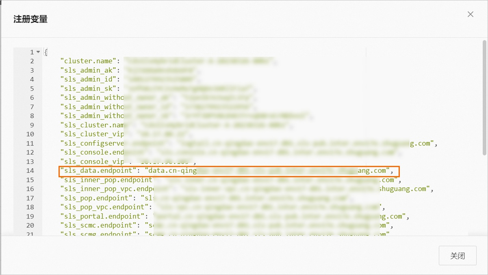

**方式二：通过产品控制台获取Endpoint**

创建Project后，您可以在Project的概览页面，获取访问域名。

1. 登录日志服务控制台。

2. 在Project列表区域，单击目标Project。

3. 在**项目概览**页面，查看Project的访问域名。

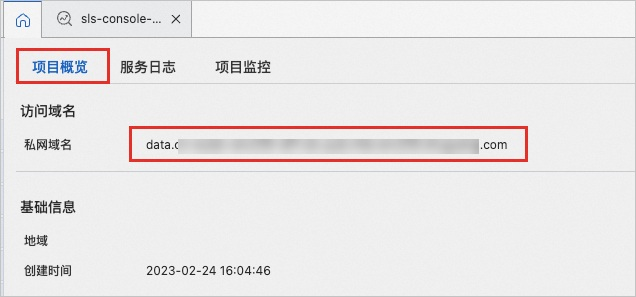

私网域名即为Endpoint。日志服务的Endpoint地址样式为 `data.${global:region}.sls-pub.${global:internet-domain}` 。

<a id="section-3-1-3"></a>

### 3.1.3. 获取日志服务的SDK包

调用专有云API时，需使用相应云产品的SDK。本文为您介绍如何获取阿里云开发工具包（SDK）。

软件开发工具包（SDK）包括代码以及示例，用户可以自行选择语言创建云应用。

目前SDK的语言支持：Java、Python、Go等，您可以前往阿里云开发工具包（SDK）中进行选择。

> **说明**
>
> 推荐使用 Java、Python、Go三种语言的SDK包，使用其他语言的SDK包可能发生不兼容情况。

SDK核心库推荐使用阿里云官网的SDK核心库，其内容所有云产品共用，且适用于专有云。

下表列举了日志服务常用语言的SDK的GitHub源码地址。

| SDK语言 | GitHub源码 |
| --- | --- |
| Java | Log Service Java SDK |
| Python | Log Service Python SDK |
| Go | Log Service Go SDK |
| PHP | Log Service PHP SDK |

<a id="section-3-2"></a>

## 3.2. SDK参考

<a id="section-3-2-1"></a>

### 3.2.1. 基本介绍

<a id="section-3-2-1-1"></a>

#### 3.2.1.1. 概述

为了能让您更高效地使用日志服务，日志服务提供了多个语言版本（.NET、Java、Python、PHP、C等）的SDK（Software Development Kit），您可以根据业务需求选择合适的SDK语言版本采集日志、查询和分析日志等。

日志服务SDK基于日志服务API实现，且提供和日志服务API同样的能力。如果您需要了解日志服务API的更多细节，参见API概览。

类似于使用日志服务API，您首先需要拥有一个处于Active状态的访问密钥。如何获取，请参见获取AccessKey。

为使用日志服务SDK，您需要了解日志服务的服务入口。更多信息，请参见获取日志服务的Endpoint和配置。

不同语言的日志服务SDK具体实现细节会有所不同，但是它们都是日志服务API在不同语言上的封装，实现的功能也基本一致。具体包括如下几个方面：

- 实现对日志服务API接口的统一封装 ，让您不需要关心具体的API请求构建和响应解析。而且各个不同语言的接口使用也非常接近，方便您在不同语言间切换。更多信息，请参见接口规范。

- 实现日志服务API的数字签名逻辑，让您不需要关心API的签名逻辑细节，降低使用日志服务API的难度。更多信息，请参见请求签名。

- 实现日志服务日志的 ProtoBuffer 格式封装，让您在写入日志时不需要关心 ProtoBuffer格式的具体细节。

- 实现日志服务 API 中定义的压缩方法，让您不用关心压缩实现的细节。部分语言的 SDK 可以让您指定是否启用压缩模式写入日志（默认为使用压缩方式）。

- 提供统一的错误处理机制，让您可以使用语言所熟悉的方式处理请求异常。更多信息，请参见错误处理机制。

- 目前所有语言实现的SDK仅提供同步请求方式。

如下表所示，各个不同语言的 SDK 的下载地址、详细使用说明及完整的编程参考如下。

表 1. SDK相关文档及源码

| SDK 语言 | 相关文档 | 源码 |
| --- | --- | --- |
| Java | Java SDK，接口参考 | GitHub |
| .NET | .NET SDK，接口参考 | GitHub |
| PHP | PHP SDK，接口参考 | GitHub |
| Node.js | Node.js SDK | GitHub |
| Python | Python SDK，接口参考 | GitHub |
| C | C SDK | GitHub |
| GO | GO SDK | GitHub |
| iOS | iOS SDK | GitHub |
| Android | Android SDK | GitHub |
| C++ | C++ SDK | GitHub |

<a id="section-3-2-1-2"></a>

#### 3.2.1.2. 配置

与使用API和日志服务服务端进行交互相同，使用SDK也需要指定一些基本配置。本文介绍SDK的基本配置信息。

具体包括如下几项：

- 服务入口（Endpoint）：确认 Client 需要访问的服务入口。

- 访问密钥（AccessKeyId/AccessKeySecret）：指定 Client 访问日志服务时使用的访问密钥。

下面详细说明这两个配置的使用方式。

**服务入口（Endpoint）**

当使用 SDK 时，首先需要确认您的接入方式和服务入口。

1. 当选择 Client 的 Endpoint 时，请根据您的部署按照正确的方式接入服务，否则 SDK 将无法访问您的项目。

2. 目前，所有 API 的服务入口仅支持 HTTP 协议。

**访问密钥（AccessKey）**

正如 API 参考文档中的访问密钥所述，所有和日志服务端交互的请求都必须经过安全验证，而访问密钥就是用来对请求进行安全验证的关键因子，且以 AccessKeyId 和AccessKeySecret 方式成对出现。在 Client 构造时需要指定两个参数（AccessKeyId，AccessKeySecret）即为该访问密钥对。所以，在使用 SDK 前，请在云控制台获取合适的密钥对。

> **说明**
>
> - 您的账号下可以拥有多组访问密钥对，但在构造 Client 时指定的 AccessKeyId 和 AccessKeySecret 必须成对，否则无法通过服务端的安全验证。
>
> - 指定的访问密钥对必须处于“启用”状态，否则会被服务端拒绝请求。同样，您也可以到云控制台查看访问密钥的状态。

**示例**

如果您需要访问某个 Project，且当前已经拥有一对处于“启用”状态的访问密钥对。如下：

```text
AccessKeyId = "<yourAccessKeyId>"
AccessKeySecret = "<yourAccessKeySecret>"
```

则可以用如下方式创建 Client 实例：

- Java

  ```text
  String endpoint = "regionid.example.com";       //在实际使⽤中，请按照您实际的服务入⼝和接入⽅式编写。
  String accessKeyId = "<youraccessKeyId>";        //⽤户访问密钥对中的 AccessKeyId。
  String accessKeySecret = "<youraccessKeySecret>";//⽤户访问密钥对中的 AccessKeySecret。
  Client client = new Client(endpoint, accessKeyId, acccessKeySecret);
  //use client to operate log service project......
  ```

- .NET(C#)

  ```text
  String endpoint = "regionid.example.com";       // 在实际使⽤中，请按照您实际的服务入⼝和接入⽅式编写。
  String accessKeyId = "<youraccessKeyId>";        //⽤户访问密钥对中的 AccessKeyId。
  String accessKeySecret = "<youraccessKeySecret>";//⽤户访问密钥对中的 AccessKeySecret。
  SLSClient client = new SLSClient(endpoint, accessKeyId, accessKeySecret);
  //use client to operate sls project......
  ```

- PHP

  ```text
  $endpoint = 'regionid.example.com'; //此处以hangzhou Region为例，在实际使⽤中，请按照您实际的服务入⼝和接入⽅式编写。
  $accessKeyId = '<youraccessKeyId>';  //⽤户访问密钥对中的 AccessKeyId。
  $accessKey = '<youraccessKey>';//⽤户访问密钥对中的 AccessKeySecret。
  $client = new Aliyun_Sls_Client($endpoint, $accessKeyId, $accessKey);
  //use client to operate sls project......
  ```

- Python

  ```text
  # // 在实际使⽤中，请按照您实际的服务入⼝和接入⽅式编写。
  endpoint = 'regionid.example.com'
  # ⽤户访问密钥对中的 AccessKeyId。
  accessKeyId = '<youraccessKeyId>'
  # ⽤户访问密钥对中的 AccessKeySecret。
  accessKey = '<youraccessKey>'  
  client = LogClient(endpoint, accessKeyId, accessKey)
  #use client to operate log project......
  ```

<a id="section-3-2-1-3"></a>

#### 3.2.1.3. 错误处理

SDK 可能出现的异常错误可以分成如下几类：

- 由日志服务端返回的错误。这类错误由日志服务端返回并由 SDK 处理。关于这类错误的详细细节可以参考日志服务 API 的通用错误码和各个 API 接口的具体说明。

- 由 SDK 在向服务端发出请求时出现的网络错误。这类错误包括网络连接不通，服务端返回超时等。

- 由 SDK 自身产生的、与平台及语言相关的错误，如内存溢出等。

目前，各个语言 SDK 的实现都采取抛出异常的方式处理错误。具体原则如下：

- 由如上第一或者第二类错误将会被 SDK 处理并包装在统一的 LogException 类抛出给用户处理。

- 由如上第三类错误不会被 SDK 处理，而是直接抛出平台及语言的 Native Exception 类给用户处理。

**LogException**

LogException 类是 SDK 定义的、用于处理日志服务自身逻辑错误的异常类。它继承自各个语言的异常基类，提供如下异常信息：

- 错误代码（Error Code）：标示错误类型。如果是来自服务端的返回错误，则这个错误代码与 API 返回的错误代码一致。如果是 SDK 网络请求错误，则其错误代码为“RequestError”。具体请参考各个语言的完整 API 参考。

- 错误消息（Error Message）：标示错误消息。如果是来自服务端的响应错误，则这个错误消息 API 返回的错误消息一致。如果是 SDK 网络请求错误，则其错误消息为“request is failed.”。具体请参考各个语言的完整 API 参考。

- 错误请求 ID（Request Id）：标示当前错误对应于服务端的请求 ID。该 ID 只有在服务端返回错误消息时有效，否则为空字符串。用户可以在遇到错误请求时记下该请求ID 并提供给日志服务团队进行问题追踪和定位。

**请求失败与重试**

在使用 SDK 访问日志服务端时，有可能会因为网络临时中断、传输延时过程、服务端处理过慢等一系列原因导致请求失败。目前，这类错误都直接以异常抛出，日志服务内部并未对此做任何重试逻辑。所以，您在使用 SDK 时需要自己定义相应的处理逻辑（重试请求或者直接报错等）。

**示例**

假设您需要访问名字为 **big-game** 的 Project，且在出现网络异常时主动重试指定次数。各语言的代码片段如下：

- Java

  ```java
  //其他代码......
  String accessId = "<youraccessId>";   //TODO：⽤您的真实阿⾥云 AccessKeyId 替代。
  String accessKey = "<youraccessKey>"; //TODO：⽤您的真实阿⾥云 AccessKeySecret 替代。
  String project = "big-game";
  String endpoint = "regionid.example.com";
  int max_retries = 3;
  /*
   * 构建⼀个 client
   */
  Client client = new Client(accessId, accessKey, endpoint);
  ListLogStoresRequest lsRequest = new ListLogStoresRequest(project);
  for (int i = 0; i < max_retries; i++)
  {
      try
      {
          ListLogStoresResponse res = client.ListLogStores(lsRequest)
          //TODO: 处理返回的 response......
          break;
      }
      catch(LogException ex)
      {
          if (e.GetErrorCode() == "RequestError")
          {
              if ( i == max_retries - 1)
              {
                  System.out.println("request is still failed after all retries.");
                  break;
              }
              else
                  System.out.println("request error happens, retry it!");
          }
          else
          {
              System.out.println("error code :" + e.GetErrorCode());
              System.out.println("error message :" + e.GetErrorMessage());
              System.out.println("error requestId :" + e.GetRequestId());
              break;
          }
      }
      catch(...)
      {
          System.out.println("unrecoverable exception when listing logstores.");
          break;
      }
  }
  //其他代码......
  ```

- .NET（C#）

  ```csharp
  //其他代码......
  String accessId = "<youraccessId>";     //TODO：⽤您的真实阿⾥云 AccessKeyId 替代。
  String accessKey = "<youraccessKey>";    //TODO：⽤您的真实阿⾥云 AccessKeySecret 替代。
  String project = "big-game";
  String endpoint = "regionid.example.com";
  int max_retries = 3;
  //创建⼀个 Client
  SLSClient client = new SLSClient(endpoint, accessId, accessKey);
  ListLogstoresRequest request = new ListLogstoresRequest();
  request.Project = project;
  for (int i = 0; i < max_retries; i++)
  {
      try
      {
          ListLogstoresResponse response = client.ListLogstores(request);
          //TODO: 处理返回的 response......
          break;
      }
      catch(LogException ex)
      {
          if (e.errorCode == "SLSRequestError")
          {
              if ( i == max_retries - 1)
              {
                  Console.Writeline(“request is still failed after all retries.”);
                  break;
              }
              else
              {
                  Console.Writeline("request error happens, retry it!");
              }
          }
          else
          {
              Console.Writeline("error code :" + e.errorCode;
              Console.Writeline("error message :" + e.Message;
              Console.Writeline("error requestId :" + e.RequestId;
              break;
          }
      }
      catch(...)
      {
          Console.Writeline("unrecoverable exception when listing logstores.");
          break;
      }
  }
  //其他代码......
  ```

- PHP

  ```php
  <?php
  //其他代码......
  $endpoint = 'regionid.example.com';
  $accessId = '<youraccessId>'; // TODO：⽤你的真实阿⾥云 AccessKeyId 替代
  $accessKey = '<youraccessKey>'; //TODO：⽤你的真实阿⾥云 AccessKeySecret 替代
  $maxRetries = 3;
  // 构建⼀个 sls client
  $client = new Aliyun_Sls_Client($endpoint, $accessId, $accessKey);
  $project = 'big-game';
  $request = new Aliyun_Sls_Models_ListLogstoresRequest($project);
  for($i = 0; $i < $maxRetries; ++$i)
  {
      try
      {
          $response = $client->ListLogstores($request);
          //TODO: 处理返回的 response......
          break;
      }
      catch (Aliyun_Sls_Exception $e)
      {
          if ($e->getErrorCode()=='RequestError')
          {
              if ($i+1 == $maxRetries)
              {
                  echo "error code :" . $e->getErrorCode() . PHP_EOL;
                  echo "error message :" . $e->getErrorMessage() . PHP_EOL;
                  break;
              }
              echo 'request error happens, retry it!' . PHP_EOL;
          }
          else
          {
              echo "error code :" . $e->getErrorCode() . PHP_EOL;
              echo "error message :" . $e->getErrorMessage() . PHP_EOL;
              echo "error requestId :" . $e->getRequestId() . PHP_EOL;
              break;
          }
      }
      catch (Exception $ex)
      {
          echo 'unrecoverable exception when listing logstores.' . PHP_EOL;
          var_dump($ex);
          break;
      }
  }
  //其他代码......
  ```

- Python

  ```text
  //其他代码......
  endpoint = 'regionid.example.com'
  accessId = '<youraccessId>' # TODO：⽤你的真实阿⾥云 AccessKeyId 替代
  accessKey = '<youraccessKey>' # TODO：⽤你的真实阿⾥云 AccessKeySecret 替代
  maxRetries = 3
  # 构建⼀个 client
  client = Client(endpoint, accessId, accessKey)
  project = 'big-game'
  lsRequest = ListLogstoresRequest(project)
  for i in xrange(maxRetries):
      try:
          res = client.ListLogstores(lsRequest)
          # TODO: 处理返回的 response......
          break
      except LogException as e:
          if e.getErrorCode() == "RequestError":
              if i+1 == maxRetries:
                  print "error code :" + e.getErrorCode()
                  print "error message :" + e.getErrorMessage()
                  break
              else:
                  print "request error happens, retry it!"
          else:
              print "error code :" + e.getErrorCode()
              print "error message :" + e.getErrorMessage()
              print "error requestId :" + e.getRequestId()
              break
      except Exception as e:
          print 'unrecoverable exception when listing logstores.'
          break
  //其他代码......
  ```

<a id="section-3-2-1-4"></a>

#### 3.2.1.4. 接口规范

尽管不同语言的 SDK 实现有所不同，但其接口都遵循 Request-Response 原则，即对 API 的调用按照如下方式进行：

1. 利用请求参数构建相应的 Request 实例。

2. 调用 SDK 中的相应接口并传入上一步的 Request 实例。

3. SDK 接口的返回结果以相应的 Response 实例返回给用户。

如下代码片段解释如何按照上面流程获取一个 Project 下的所有 Logstore 的名称。

**Java**

```text
// 其他代码......
String accessId = "<youraccessId>";     //TODO：⽤您的真实阿⾥云 AccessKeyId 替代。
String accessKey = "<youraccessKey>";   //TODO：⽤您的真实阿⾥云 AccessKeySecret 替代。
String project = "your_project";        //TODO: ⽤您的真实 project 名称替代。
String endpoint = "region_endpoint";//TODO: 此处以hangzhou Region为例，在实际使⽤中，请按照您实际的服务入⼝和接入⽅式编写。
//构建⼀个 Client 实例。
Client client = new Client(endpoint, accessId, accessKey);
//⽤请求参数“project”初始化 ListLogstores 的请求类。
ListLogStoresRequest lsRequest = new ListLogStoresRequest(project);
//使⽤ request 实例调⽤ ListLogstores 接⼝，且返回参数为对应的 Response 实例
ListLogStoresResponse res = client.ListLogStores(lsRequest);
//访问 Response 实例获取请求结果
ArrayList<String> names = res.GetLogStores();
// 其他代码......
```

**.NET(C#)**

```text
// 其他代码......
String accessId = "<youraccessId>";     //TODO：⽤您的真实阿⾥云 AccessKeyId 替代。
String accessKey = "<youraccessKey>";   //TODO：⽤您的真实阿⾥云 AccessKeySecret 替代。
String project = "your_project";        //TODO: ⽤您的真实 project 名称替代。
String endpoint = "region_endpoint";////TODO: 此处以hangzhou Region为例，在实际使⽤中，请按照您实际的服务入⼝和接入⽅式编写。
//构建⼀个 Client 实例。
SLSClient client = new SLSClient(endpoint, accessId, accessKey);
//⽤请求参数“project”初始化 ListLogstores 的请求类。
ListLogStoresRequest lsRequest = new ListLogStoresRequest();
lsRequest.Project = project;
//使⽤ request 实例调⽤ ListLogstores 接⼝，且返回参数为对应的 Response 实例
ListLogStoresResponse res = client.ListLogStores(lsRequest);
//访问 Response 实例获取请求结果
List<String> names = res.Logstores;
// 其他代码......
```

**PHP**

```text
// 其他代码......
$accessId = "<youraccessId>";     //TODO：⽤您的真实阿⾥云 AccessKeyId 替代。
$accessKey = "<youraccessKey>";   //TODO：⽤您的真实阿⾥云 AccessKeySecret 替代。
$project = "your_project";        //TODO: ⽤您的真实 project 名称替代。
$endpoint = "region_endpoint";////TODO: 此处以hangzhou Region为例，在实际使⽤中，请按照您实际的服务入⼝和接入⽅式编写。
//构建⼀个 SLS Client 实例。
$client = new Aliyun_Sls_Client($endpoint, $accessId, $accessKey);
//⽤请求参数“project”初始化 ListLogstores 的请求类。
$request = new Aliyun_Sls_Models_ListLogstoresRequest($project);
//使⽤ request 实例调⽤ ListLogstores 接⼝，且返回参数为对应的 Response 实例
$response = $client->listLogstores($request);
//访问 Response 实例获取请求结果
$names = $response->getLogstores();
// 其他代码......
```

**Python**

```text
// 其他代码......
accessId = '<youraccessId>';     //TODO：⽤您的真实阿⾥云 AccessKeyId 替代。
accessKey = '<youraccessKey>';   //TODO：⽤您的真实阿⾥云 AccessKeySecret 替代。
project = 'your_project';        //TODO: ⽤您的真实 project 名称替代。
endpoint = 'region_endpoint';////TODO: 此处以hangzhou Region为例，在实际使⽤中，请按照您实际的服务入⼝和接入⽅式编写。
# 构建⼀个 client
client = LogClient(endpoint, accessId, accessKey)
# ⽤请求参数 “project” 初始化 ListLogstores 的请求类。
lsRequest = ListLogstoresRequest(project)
# 使⽤ request 实例调⽤ ListLogstores 接⼝，且返回参数为对应的 Response 实例
res = client.list_logstores(lsRequest)
# 访问 Response 实例获取请求结果
names = res.get_logstores();
// 其他代码......
```

SDK 实现了多组类似 ListLogStores 的接口，也定义了相应的 Request 和 Response 类。除去 Request-Response 风格的基础接口外，各个不同语言的 SDK 还会提供一些包装了这些基础接口的辅助接口，让您无需自己构建 Request 及解析最终 Reponse 内容。这类接口的细节请见各 SDK 的 API 参考。

<a id="section-3-2-2"></a>

### 3.2.2. Java SDK

Log Service的Java SDK让Java开发人员可以非常方便地使用Java程序操作阿里云日志服务。开发者可以直接使用Maven依赖添加SDK，也可以下载包到本地。

**下载地址**

- SDK支持J2SE 6.0及以上版本。

- 下载最新版日志服务Java SDK

**步骤1 创建账号**

为了访问日志服务，您需要有一个控制台账号。

**步骤2 获取访问密钥**

为了使用Log Service Java SDK，您必须有一对访问密钥。如何获取，请参见获取AccessKey。

该密钥对会在下面的步骤使用，且需要保管好，不能对外泄露。另外，您可以参配置了解更多SDK如何使用访问密钥的信息。更多信息，清参见配置。

**步骤3 创建一个日志服务项目和日志库**

使用Log Service Java SDK创建日志项目（Project）和日志库（Logstore）。

> **说明**
>
> - 请确保使用同一账号获取访问密钥和创建日志项目及日志库。
>
> - Log的Project名称为日志服务全局唯一，而Logstore名称在一个Project下面唯一。
>
> - Log的Project一旦创建则无法更改它的所属区域。目前也不支持在不同Region间迁移Log Project。

**步骤4 安装 Java 开发环境**

目前，Log Java SDK 支持 J2SE 6.0 及以上的Java运行环境，您可以从 Java 官方网站下载并按说明安装Java开发环境。

**步骤5 安装 Log Service Java SDK**

在安装完Java开发环境后，您需要安装 Log Service Java SDK。目前，我们提供两种方式安装日志服务的 Java SDK：

建议使用Apache Maven 获取最新版本的 SDK，您可以添加如下配置到您的Maven项目。

```xml
<dependency>
         <groupId>com.google.protobuf</groupId>
         <artifactId>protobuf-java</artifactId>
         <version>2.5.0</version>
</dependency>
<dependency>
<groupId>com.aliyun.openservices</groupId>
<artifactId>aliyun-log</artifactId>
<version>0.6.7</version>
<exclusions>
        <exclusion>
            <groupId>com.google.protobuf</groupId>
            <artifactId>protobuf-java</artifactId>
       </exclusion>
</exclusions>
</dependency>
```

您也可以完整下载Java SDK软件包，然后在自己的Java项目中直接引用本地软件包。

1. 下载Java SDK包（版本会定期更新，如需使用最新版本请使用 Maven）。

2. 解压完整下载的包到指定的目录即可。Java SDK是一个软件开发包，不需要额外的安装操作。

3. 把SDK 包中的所有Jar包（包括依赖的第三方包）添加到您的 Java 工程（具体操作请参照不同的 IDE 文档）。

**步骤6 开始一个新的 Java 项目**

现在，您可以开始使用Java SDK。使用任何文本编辑器或者Java IDE，运行如下示例代码即可与Log Service服务端交互并得到相应输出。

```java
package sdksample;
import java.util.ArrayList;
import java.util.List;
import java.util.Vector;
import java.util.Date;
import com.aliyun.openservices.log.Client;
import com.aliyun.openservices.log.common.*;
import com.aliyun.openservices.log.exception.*;
import com.aliyun.openservices.log.request.*;
import com.aliyun.openservices.log.response.*;
import com.aliyun.openservices.log.common.LogGroupData;
import com.aliyun.openservices.log.common.LogItem;
import com.aliyun.openservices.log.common.Logs.Log;
import com.aliyun.openservices.log.common.Logs.Log.Content;
import com.aliyun.openservices.log.common.Logs.LogGroup;
import com.aliyun.openservices.log.common.Consts.CursorMode;
public class sdksample {
    public static void main(String args[]) throws LogException, InterruptedException {
        String endpoint = "<log_service_endpoint>"; // 选择与上⾯步骤创建 project 所属区域匹配的
        // Endpoint
        String accessKeyId = "<youraccessKeyId>"; // 使⽤您的访问密钥 AccessKeyId
        String accessKeySecret = "<youraccessKeySecret>"; // 使⽤您的访问密钥AccessKey Secret
        // AccessKeySecret
        String project = "<project_name>"; // 上⾯步骤创建的项⽬名称
        String logstore = "<logstore_name>"; // 上⾯步骤创建的⽇志库名称
        // 构建⼀个客户端实例
        Client client = new Client(endpoint, accessKeyId, accessKeySecret);
        // 列出当前 project 下的所有⽇志库名称
        int offset = 0;
        int size = 100;
        String logStoreSubName = "";
        ListLogStoresRequest req1 = new ListLogStoresRequest(project, offset, size, logStoreSubName);
        ArrayList<String> logStores = client.ListLogStores(req1).GetLogStores();
        System.out.println("ListLogs:" + logStores.toString() + "\n");
        // 写入⽇志
        String topic = "";
        String source = "";
        // 连续发送 10 个数据包，每个数据包有 10 条⽇志
        for (int i = 0; i < 10; i++) {
            Vector<LogItem> logGroup = new Vector<LogItem>();
            for (int j = 0; j < 10; j++) {
                LogItem logItem = new LogItem((int) (new Date().getTime() / 1000));
                logItem.PushBack("index"+String.valueOf(j), String.valueOf(i * 10 + j));
                logGroup.add(logItem);
            }
            PutLogsRequest req2 = new PutLogsRequest(project, logstore, topic, source, logGroup);
            client.PutLogs(req2);
            /*
             * 发送的时候也可以指定将数据发送⾄有⼀个特定的 shard，只要设置 shard 的 hashkey，则数据会写入包含该
             * hashkey 的 range 所对应的 shard，具体 API 参考以下接⼝：PutLogsResponse
             * PutLogs( String project, String logStore, String topic,
             * List<LogItem> logItems, String source, String shardHash // 根据
             * hashkey 确定写入 shard，hashkey 可以是 MD5(ip) 或 MD5(id) 等 );
             */
        }
        // 把 0 号 shard 中，最近 1 分钟写入的数据都读取出来。
        int shard_id = 0;
        long curTimeInSec = System.currentTimeMillis() / 1000;
        GetCursorResponse cursorRes = client.GetCursor(project, logstore, shard_id, curTimeInSec - 60);
        String beginCursor = cursorRes.GetCursor();
        cursorRes = client.GetCursor(project, logstore, shard_id, CursorMode.END);
        String endCursor = cursorRes.GetCursor();
        String curCursor = beginCursor;
        while (curCursor.equals(endCursor) == false) {
            int loggroup_count = 2; // 每次读取两个 loggroup
            BatchGetLogResponse logDataRes = client.BatchGetLog(project, logstore, shard_id, loggroup_count, curCursor,
                    endCursor);
            // 读取LogGroup的List
            List<LogGroupData> logGroups = logDataRes.GetLogGroups();
            for(LogGroupData logGroup: logGroups){
                FastLogGroup flg = logGroup.GetFastLogGroup();
                System.out.println(String.format("\tcategory\t:\t%s\n\tsource\t:\t%s\n\ttopic\t:\t%s\n\tmachineUUID\t:\t%s",
                        flg.getCategory(), flg.getSource(), flg.getTopic(), flg.getMachineUUID()));
                System.out.println("Tags");
                for (int tagIdx = 0; tagIdx < flg.getLogTagsCount(); ++tagIdx) {
                    FastLogTag logtag = flg.getLogTags(tagIdx);
                    System.out.println(String.format("\t%s\t:\t%s", logtag.getKey(), logtag.getValue()));
                }
                for (int lIdx = 0; lIdx < flg.getLogsCount(); ++lIdx) {
                    FastLog log = flg.getLogs(lIdx);
                    System.out.println("--------\nLog: " + lIdx + ", time: " + log.getTime() + ", GetContentCount: " + log.getContentsCount());
                    for (int cIdx = 0; cIdx < log.getContentsCount(); ++cIdx) {
                        FastLogContent content = log.getContents(cIdx);
                        System.out.println(content.getKey() + "\t:\t" + content.getValue());
                    }
                }
            }
            String next_cursor = logDataRes.GetNextCursor();
            System.out.println("The Next cursor:" + next_cursor);
            curCursor = next_cursor;
        }
        // ！！！重要提示 : 只有打开索引功能，才能调⽤以下接⼝ ！！！
        // 等待 1 分钟让⽇志可查询
        try {
            Thread.sleep(60 * 1000);
        } catch (InterruptedException e) {
            e.printStackTrace();
        }
        // 查询⽇志分布情况
        String query = "<此处为需要查询的关键词，如果查询全部内容设置为空字符串即可>";
        int from = (int) (new Date().getTime() / 1000 - 300);
        int to = (int) (new Date().getTime() / 1000);
        GetHistogramsResponse res3 = null;
        while (true) {
            GetHistogramsRequest req3 = new GetHistogramsRequest(project, logstore, topic, query, from, to);
            res3 = client.GetHistograms(req3);
            if (res3 != null && res3.IsCompleted()) // IsCompleted() 返回
            // true，表示查询结果是准确的，如果返回
            // false，则重复查询
            {
                break;
            }
            Thread.sleep(200);
        }
        System.out.println("Total count of logs is " + res3.GetTotalCount());
        for (Histogram ht : res3.GetHistograms()) {
            System.out.printf("from %d, to %d, count %d.\n", ht.GetFrom(), ht.GetTo(), ht.GetCount());
        }
        // 查询⽇志数据
        long total_log_lines = res3.GetTotalCount();
        int log_offset = 0;
        int log_line = 10;
        while (log_offset <= total_log_lines) {
            GetLogsResponse res4 = null;
            // 对于每个 log offset,⼀次读取 10 ⾏ log，如果读取失败，最多重复读取 3 次。
            for (int retry_time = 0; retry_time < 3; retry_time++) {
                GetLogsRequest req4 = new GetLogsRequest(project, logstore, from, to, topic, query, log_offset,
                        log_line, false);
                res4 = client.GetLogs(req4);
                if (res4 != null && res4.IsCompleted()) {
                    break;
                }
                Thread.sleep(200);
            }
            System.out.println("Read log count:" + String.valueOf(res4.GetCount()));
            log_offset += log_line;
        }
        //打开分析功能,只有打开分析功能，才能使⽤SQL 功能。 可以在控制台开通分析功能，也可以使⽤SDK开启分析功能
        IndexKeys indexKeys = new IndexKeys();
        ArrayList<String> tokens = new ArrayList<String>();
        tokens.add(",");
        tokens.add(".");
        tokens.add("#");
        IndexKey keyContent = new IndexKey(tokens,false,"text");
        indexKeys.AddKey("index0",keyContent);
        keyContent = new IndexKey(new ArrayList<String>(),false,"long");
        indexKeys.AddKey("index1",keyContent);
        keyContent = new IndexKey(new ArrayList<String>(),false,"double");
        indexKeys.AddKey("index2",keyContent);
        IndexLine indexLine = new IndexLine(new ArrayList<String>(),false);
        Index index = new Index(7,indexKeys,indexLine);
        CreateIndexRequest createIndexRequest = new CreateIndexRequest(project,logstore,index);
        client.CreateIndex(createIndexRequest);
        //使⽤分析功能
        GetLogsRequest req4 = new GetLogsRequest(project, logstore, from, to, "", " index0:value | select avg(index1) as v1,sum(index2) as v2, 
index0 group by index0");
        GetLogsResponse res4 = client.GetLogs(req4);
        if(res4 != null && res4.IsCompleted()){
            for (QueriedLog log : res4.GetLogs()){
                LogItem item = log.GetLogItem();
                for(LogContent content : item.GetLogContents()){
                    System.out.print(content.GetKey()+":"+content.GetValue());
                }
                System.out.println();
            }
        }
    }
}
```

**注意事项**

- 为了提高您的系统的IO效率，请尽量不要直接使用SDK往日志服务中写数据，写数据标准做法参考 <strong>《日志服务用户指南数据采集》</strong>中<strong>《Producer Library》</strong>章节。

- 要消费日志服务中的数据，请尽量不要直接使用SDK的拉数据接口，我们提供了一个高级消费库，该库屏蔽了日志服务的实现细节，并且提供了负载均衡、按序消费等高级功能。关于该消费库的详细信息，请参考<strong>《日志服务用户指南实时消费》</strong>中<strong>《通过消费组消费日志数据》</strong>章节。

<a id="section-3-2-3"></a>

### 3.2.3. .NET SDK

为方便开发人员更高效地使用日志服务，日志服务提供了.NET SDK。

**下载地址**

日志服务的.NET SDK让Windows平台上的开发人员可以非常方便地使用 .NET 平台操作日志服务。目前，SDK 支持 .NET Framework 3.5/4.0/4.5 版本。尽管针对不同.NET Framework 版本的 SDK 文件不同，但是其接口和实现功能完全一致。

该SDK GitHub地址请参见GitHub。

**步骤1 创建账号**

为了访问日志服务，您需要有一个控制台账号。

**步骤2 获取访问密钥**

为了使用Log Service .NET SDK，您必须有一对访问密钥。

登录云控制台，选择一对用于SDK的访问密钥对。

该密钥对会在下面的步骤使用，且需要保管好，不能对外泄露。另外，您可以参考配置 了解更多SDK如何使用访问密钥的信息。

**步骤3 创建一个日志服务项目和日志库**

使用Log Service Java SDK创建日志项目（Project）和日志库（Logstore）。

> **说明**
>
> - 请确保使用同一账号获取访问密钥和创建日志项目及日志库。
>
> - Log的Project名称为日志服务全局唯一，而Logstore名称在一个 Project 下面唯一。
>
> - Log的Project一旦创建则无法更改它的所属区域。目前也不支持在不同 Region 间迁移 Log project。

**步骤4 安装 .NET 开发环境**

目前，日志服务SDK支持.NET 3.5和.NET 4.0/4.5 运行环境。为支持日志服务SDK开发，建议安装：

- Microsoft .NET Framework 3.5/4.0/4.5（具体版本依赖于您的程序需要运行的目标环境）

- Visual Studio 2010及其以后版本

**步骤5 下载并安装日志服务 .NET SDK**

搭建好.NET开发环境后，您需要安装日志服务的.NET SDK。具体如下：

1. 下载。

   - ：通过Github下载最新的日志服务.NET SDK。

   - 下载历史版本的日志服务 .NET SDK 包。

2. 解压完整下载的包到指定的目录即可。日志服务.NET SDK是一个软件开发包，不需要额外的安装操作。您可以按照下面的步骤直接在自己的 Visual Studio项目中使用。

**步骤6 开始一个新的日志服务 .NET 项目**

安装好.NET开发环境及日志服务.NET SDK后，您就可以开始创建日志服务的.NET项目。具体请参见SLS SDK 40解决方案中的LOG SDK Sample项目。

<a id="section-3-2-4"></a>

### 3.2.4. .NET Core SDK

为方便开发人员更高效地使用日志服务，日志服务提供了.NET Core SDK。

**背景信息**

日志服务的 .NET Core SDK让跨平台的开发人员可以非常方便地使用.NET Core框架操作阿里云日志服务。

.NET Core SDK GitHub地址请参见GitHub。

**操作步骤**

1. 创建账号。为了访问日志服务，您需要有一个控制台账号。

2. 获取访问密钥。

   为了使用Log Service .NET Core SDK，您必须拥有一对访问密钥。

   登录控制台，选择一对用于SDK的访问密钥对。

   该密钥对会在下面的步骤使用，且需要保管好，不能对外泄露。关于SDK如何使用访问密钥的信息，请参见配置。

3. 创建日志服务项目和日志库。

在进行SDK操作之前，请先在控制台上创建Project和Logstore。

1. 登录日志服务控制台。

2. 单击右上角的**创建Project**。

3. 填写**Project名称**和**所属区域**，单击**确认**。

4. 在**Project列表**页面，单击项目的名称，然后单击**创建** 。

   或者在创建完项目后，根据系统提示创建日志库，单击**创建**。

5. 填写日志库的配置信息并单击**确认**。

   您需要在此处填写Logstore名称、数据保存时间、Shard数目等。请按照您的需求合理设置Shard数目，例如本文实例中，您需要设置4个Shard。

> **说明**
>
> - 请确保使用同一账号获取访问密钥和创建日志项目及日志库。
>
> - Log的Project名称为日志服务全局唯一，而Logstore名称在一个Project下面唯一。
>
> - Log的Project一旦创建则无法更改它的所属区域。目前也不支持在不同Region间迁移Log project。

4. 安装.NET Core开发环境。目前，日志服务.NET Core SDK支持以下平台版本：

   - .NET Core 2.0

   - .NET Framework (with .NET Core 1.x SDK) 4.6.2

   - .NET Framework (with .NET Core 2.0 SDK) 4.6.1

   支持的全部版本请参见GitHub。

5. 下载并安装日志服务.NET Core SDK。搭建好.NET Core开发环境后，您需要安装日志服务的.NET Core SDK。

   <ol type="i">

   <li>

   下载.NET Core SDK。

   </li>

   <li>

   解压安装包到指定的目录。日志服务.NET Core SDK是一个软件开发包，不需要额外的安装操作。您可以直接在自己的Visual Studio项目中使用。

   </li>

   </ol>

6. 开始一个新的日志服务.NET Core项目。安装好.NET开发环境及日志服务.NET Core SDK后，您就可以开始创建日志服务的.NET Core项目。更多信息，请参见Github Wiki。

<a id="section-3-2-5"></a>

### 3.2.5. PHP SDK

为方便开发人员更高效地使用日志服务，日志服务提供了 PHP SDK。

**下载地址**

该 SDK GitHub 地址如下：GitHub。

**步骤 1 创建账号**

为了访问日志服务，您需要有一个控制台账号。

**步骤 2 获取访问密钥**

为了使用 Log Service PHP SDK，您必须申请访问密钥。

登录控制台，选择一对用于SDK 的访问密钥对。

该密钥对会在下面的步骤使用，且需要保管好，不能对外泄露。另外，您可以参考配置了解更多 SDK 如何使用访问密钥的信息。

**步骤 3 创建一个日志服务项目和日志库**

使用 Log Service PHP SDK 创建日志项目（Project）和日志库（Logstore）。

> **说明**
>
> - 请确保使用同一账号获取访问密钥和创建日志项目及日志库。
>
> - Log 的 Project 名称为日志服务全局唯一，而 Logstore 名称在一个 Project 下面唯一。
>
> - Log 的 Project 一旦创建则无法更改它的所属区域。目前也不支持在不同 Region 间迁移 Log Project。

**步骤 4 安装 PHP 开发环境**

PHP SDK 支持 PHP 5.2.1 及以上版本，您可以在本地安装 SDK 所支持的任何 PHP 版本并搭建好相应的 PHP 开发环境。

**步骤 5 下载并安装 PHP SDK**

搭建好 PHP 开发环境后，您需要安装 PHP SDK。具体如下：

1. 从 GitHub 下载最新的 PHP SDK 包。

2. 解压完整下载的包到指定的目录即可。PHP SDK 是一个软件开发包，不需要额外的安装操作。这个软件开发包除了包括 SDK 自身的代码外，还有一组第三方依赖包和一个autoloader 类帮助你简化使用流程。您可以按照下面的步骤直接在自己的 PHP 项目中使用。

**步骤 6 开始一个新的 PHP 项目**

使用任何文本编辑器或者 PHP IDE，运行如下示例代码即可与日志服务端交互并得到相应输出。

```php
<?php
/* 使⽤ autoloader 类⾃动加载所有需要的 PHP 模块。注意使⽤合适的路径指向 autoloader 类所在⽂件*/
require_once realpath(dirname(__FILE__) . '/../Log_Autoload.php');
$endpoint = 'regionid.example.com'; // //此处以hangzhou Region为例，在实际使⽤中，请按照您实际的服务入⼝和接入⽅式编写。
$accessKeyId = '<youraccessKeyId>';        // 使⽤你的访问秘钥 AccessKeyId
$accessKey = '<youraccessKey>';             // 使⽤你的访问秘钥 AccessKeySecret
$project = 'your_project';                  // 上⾯步骤创建的项⽬名称
$logstore = 'your_logstore';                // 上⾯步骤创建的⽇志库名称
$client = new Aliyun_Log_Client($endpoint, $accessKeyId, $accessKey);
#列出当前 project 下的所有⽇志库名称
$req1 = new Aliyun_Log_Models_ListLogstoresRequest($project);
$res1 = $client->listLogstores($req1);
var_dump($res1);
#创建 logstore
$req2 = new Aliyun_Log_Models_CreateLogstoreRequest($project,$logstore,3,2);
$res2 = $client -> createLogstore($req2);
#等待 logstore ⽣效
sleep(60);
#写入⽇志
$topic = "";
$source = "";
$logitems = array();
for ($i = 0; $i < 5; $i++)
{
    $contents = array('index1'=> strval($i));
    $logItem = new Aliyun_Log_Models_LogItem();
    $logItem->setTime(time());
    $logItem->setContents($contents);
    array_push($logitems, $logItem);
}
$req2 = new Aliyun_Log_Models_PutLogsRequest($project, $logstore, $topic, $source, $logitems);
$res2 = $client->putLogs($req2);
var_dump($res2);
#不必等待，立即拖数据
#⾸先遍历有哪些 shardId
$listShardRequest = new Aliyun_Log_Models_ListShardsRequest($project,$logstore);
$listShardResponse = $client -> listShards($listShardRequest);
foreach($listShardResponse-> getShardIds()  as $shardId)
{
    #对每⼀个 ShardId，先获取 Cursor
    $getCursorRequest = new Aliyun_Log_Models_GetCursorRequest($project,$logstore,$shardId,null, time() - 60);
    $response = $client -> getCursor($getCursorRequest);
    $cursor = $response-> getCursor();
    $count = 100;
    while(true)
    {
        #从 cursor 开始读数据
        $batchGetDataRequest = new Aliyun_Log_Models_BatchGetLogsRequest($project,$logstore,$shardId,$count,$cursor);
        var_dump($batchGetDataRequest);
        $response = $client -> batchGetLogs($batchGetDataRequest);
        if($cursor == $response -> getNextCursor())
        {
            break;
        }
        $logGroupList = $response -> getLogGroupList();
        foreach($logGroupList as $logGroup)
        {
            print ($logGroup->getCategory());
            foreach($logGroup -> getLogsArray() as $log)
            {
                foreach($log -> getContentsArray() as $content)
                {
                    print($content-> getKey().":".$content->getValue()."\t");
                }
                print("\n");
            }
        }
        $cursor = $response -> getNextCursor();
    }
}
#等待 1 分钟让⽇志可查询
sleep(60);
#查询⽇志分布情况询（注意，要查询⽇志，必须保证已经创建了索引，PHP SDK 不提供该接⼝，请在控制台创建）
$topic = "";
$query='';
$from = time()-3600;
$to = time();
$res3 = NULL;
while (is_null($res3) || (! $res3->isCompleted()))
{
    $req3 = new Aliyun_Log_Models_GetHistogramsRequest($project, $logstore, $from, $to, $topic, $query);
    $res3 = $client->getHistograms($req3);
}
var_dump($res3);
#查询⽇志数据
$res4 = NULL;
while (is_null($res4) || (! $res4->isCompleted()))
{
    $req4 = new Aliyun_Log_Models_GetLogsRequest($project, $logstore, $from, $to, $topic, $query, 5, 0, False);
    $res4 = $client->getLogs($req4);
}
var_dump($res4);
```

<a id="section-3-2-6"></a>

### 3.2.6. Python SDK

为方便开发人员更高效地使用日志服务，日志服务提供了Python SDK。

**下载地址**

该SDK GitHub地址如下：

https://github.com/aliyun/aliyun-log-python-sdk

**步骤1 创建账号**

为了访问日志服务，您需要有一个控制台账号。

**步骤2 获取访问密钥**

为了使用Log Service Python SDK，您必须拥有一对访问密钥。

登录控制台，选择一对用于SDK的访问密钥对。如何获取，请参见获取AccessKey。

该密钥对会在下面的步骤使用，且需要保管好，不能对外泄露。另外，您可以参考配置了解更多 SDK 如何使用访问密钥的信息。

**步骤3 创建一个日志服务项目和日志库**

在进行SDK操作之前，请先在控制台上创建Project和Logstore。

1. 登录日志服务控制台。

2. 单击右上角的**创建Project**。

3. 填写**Project名称**和**所属区域**，单击 **确认**。

4. 在**Project列表**页面，单击项目的名称，然后单击**创建** 。

   或者在创建完项目后，根据系统提示创建日志库，单击**创建**。

5. 填写日志库的配置信息并单击**确认**。

   您需要在此处填写Logstore名称、数据保存时间、Shard数目等。请按照您的需求合理设置Shard数目，例如本文实例中，您需要设置4个Shard。

> **说明**
>
> - 请确保使用同一账号获取访问密钥和创建日志项目及日志库。
>
> - Log的Project名称为日志服务全局唯一，而Logstore名称在一个Project下面唯一。
>
> - Log的Project一旦创建则无法更改它的所属区域。目前也不支持在不同Region间迁移Log project。

**步骤4 安装 Python 环境**

Python SDK是一个纯Python的库，支持在所有运行Python的操作系统。目前主要为Linux、Mac OS X和Windows。请如下安装Python：

1. 下载并安装最新的Python安装包。更多信息，请参见安装包。

   > **说明**
   >
   > - 目前，Python SDK支持Python 2.6/2.7和Python 3.3/3.4/3.5/3.6环境。您可以运行 `python -V` 查询当前的Python运行版本。
   >
   > - Python官方不再支持Python 2.6和Python 3.3，推荐您使用Python 2.7、Python 3.4及以后版本。

2. 下载并安装Python的包管理工具pip。更多信息，请参见pip。

   完成pip安装后，你可以运行  `pip -V`  确认pip是否安装成功，并查看当前pip版本。

**步骤5 安装Python SDK**

Shell下以管理员权限执以下命令，安装Python SDK。

```bash
pip install -U aliyun-log-python-sdk
```

**步骤6 开始一个 Python 程序**

现在，你可以开始使用Python SDK。使用任何文本编辑器或者Python IDE，运行如下示例代码即可与服务端交互并得到相应输出。

更多信息，请参见Github 项目地址以及更多详细说明。

```python
# encoding: utf-8
import time
from aliyun.log.logitem import LogItem
from aliyun.log.logclient import LogClient
from aliyun.log.getlogsrequest import GetLogsRequest
from aliyun.log.putlogsrequest import PutLogsRequest
from aliyun.log.listlogstoresrequest import ListLogstoresRequest
from aliyun.log.gethistogramsrequest import GetHistogramsRequest
def main():
    endpoint = ''       # 选择与上⾯步骤创建Project所属区域匹配的Endpoint
    accessKeyId = ''    # 使⽤您的访问密钥AccessKeyId
    accessKey = ''      # 使⽤您的访问密钥AccessKeySecret
    project = ''        # 上⾯步骤创建的项⽬名称
    logstore = ''       # 上⾯步骤创建的⽇志库名称
    # 重要提示：创建的logstore请配置为4个shard以便于后⾯测试通过
    # 构建⼀个client
    client = LogClient(endpoint, accessKeyId, accessKey)
    # list 所有的logstore
    req1 = ListLogstoresRequest(project)
    res1 = client.list_logstores(req1)
    res1.log_print()
    topic = ""
    source = ""
    # 发送10个数据包，每个数据包有10条log
    for i in range(10):
        logitemList = []  # LogItem list
        for j in range(10):
            contents = [('index', str(i * 10 + j))]
            logItem = LogItem()
            logItem.set_time(int(time.time()))
            logItem.set_contents(contents)
            logitemList.append(logItem)
        req2 = PutLogsRequest(project, logstore, topic, source, logitemList)
        res2 = client.put_logs(req2)
        res2.log_print()
    # list所有的shard，读取上1分钟写入的数据全部读取出来
    listShardRes = client.list_shards(project, logstore)
    for shard in listShardRes.get_shards_info():
        shard_id = shard["shardID"]
        start_time = int(time.time() - 60)
        end_time = start_time + 60
        res = client.get_cursor(project, logstore, shard_id, start_time)
        res.log_print()
        start_cursor = res.get_cursor()
        res = client.get_cursor(project, logstore, shard_id, end_time)
        end_cursor = res.get_cursor()
        while True:
            loggroup_count = 100  # 每次读取100个包
            res = client.pull_logs(project, logstore, shard_id, start_cursor, loggroup_count, end_cursor)
            res.log_print()
            next_cursor = res.get_next_cursor()
            if next_cursor == start_cursor:
                break
            start_cursor = next_cursor
    # 重要提示： 只有打开索引功能，才可以使⽤以下接⼝来查询数据
    time.sleep(60)
    topic = ""
    query = "index"
    From = int(time.time()) - 600
    To = int(time.time())
    res3 = None
    # 查询最近10分钟内，满⾜query条件的⽇志条数，如果执⾏结果不是完全正确，则进⾏重试
    while (res3 is None) or (not res3.is_completed()):
        req3 = GetHistogramsRequest(project, logstore, From, To, topic, query)
        res3 = client.get_histograms(req3)
    res3.log_print()
    # 获取满⾜query的⽇志条数
    total_log_count = res3.get_total_count()
    log_line = 10
    # 每次读取10条⽇志，将⽇志数据查询完，对于每⼀次查询，如果查询结果不是完全准确，则重试3次
    for offset in range(0, total_log_count, log_line):
        res4 = None
        for retry_time in range(0, 3):
            req4 = GetLogsRequest(project, logstore, From, To, topic, query, log_line, offset, False)
            res4 = client.get_logs(req4)
            if res4 is not None and res4.is_completed():
                break
            time.sleep(1)
        if res4 is not None:
            res4.log_print()
    listShardRes = client.list_shards(project, logstore)
    shard = listShardRes.get_shards_info()[0]
    # 分裂shard
    if shard["status"] == "readwrite":
        shard_id = shard["shardID"]
        inclusiveBeginKey = shard["inclusiveBeginKey"]
        midKey = inclusiveBeginKey[:-1] + str((int(inclusiveBeginKey[-1:])) + 1)
        client.split_shard(project, logstore, shard_id, midKey)
    # 合并shard
    shard = listShardRes.get_shards_info()[1]
    if shard["status"] == "readwrite":
        shard_id = shard["shardID"]
        client.merge_shard(project, logstore, shard_id)
    # 删除shard
    shard = listShardRes.get_shards_info()[-1]
    if shard["status"] == "readonly":
        shard_id = shard["shardID"]
        client.delete_shard(project, logstore, shard_id)
 # 创建外部数据源 def sample_external_store(client,project): res = client.create_external_store(project,ExternalStoreConfig("rds_store","cn-qingdao","rds-vpc","vpc-m5eq4irc1pucpk85frr5j","i-m5eeo2whsnfg4kzq54ah","47.104.XX.XXX","3306","root","sfdsfldsfksflsdfs","meta","join_meta")); 
res.log_print() res = client.update_external_store(project,ExternalStoreConfig("rds_store","cn-qingdao","rds-vpc","vpc-
m5eq4irc1pucpk85frr5j","i-m5eeo2whsnfg4kzq54ah","47.104.XX.XXX","3306","root","sfdsfldsfksflsdfs","meta","join_meta")); res.log_print() res = client.get_external_store(project,"rds_store"); res.log_print() res = client.list_external_store(project,""); res.log_print(); res = 
client.delete_external_store(project,"rds_store") res.log_print(); # 使⽤python sdk进⾏查询分析 req4 = GetLogsRequest(project, logstore, From, To, topic, "* | select count(1)", 10,0, False) res4 = client.get_logs(req4) # 使⽤python sdk进⾏join rds查询 req4 = GetLogsRequest(project, 
logstore, From, To, topic, "* | select count(1) from "+logstore +" l join rds_store r on l.ikey =r.ekey", 10,0, False) res4 = 
client.get_logs(req4) # 使⽤python sdk把查询结果写入rds req4 = GetLogsRequest(project, logstore, From, To, topic, "* | insert into rds_store 
select count(1) ", 10,0, False) res4 = client.get_logs(req4)
if __name__ == '__main__':
    main()
```

<a id="section-3-2-7"></a>

### 3.2.7. Android SDK

日志服务 Android SDK 主要解决 Android 平台用户数据采集问题，目前提供以下功能：写入日志数据。

**下载地址**

https://github.com/aliyun/aliyun-log-android-sdk

<a id="section-3-2-8"></a>

### 3.2.8. C SDK

日志服务C SDK主要解决各种平台的日志接入问题，比如兼容MIPS芯片、OpenWrt系统等。

C SDK使用libCurl作为网络库，apr/apr-util库解决内存管理以及跨平台问题。您只需要基于源码进行简单编译便可以使用。

此外提供C版本的Producer Library和Producer Lite Library，为您提供跨平台、简洁、高性能、低资源消耗的一站式日志采集方案。

Github项目地址以及更多详细说明参见：

- C Producer Library（推荐服务端使用）

- C Producer Lite Library（推荐IOT、智能设备使用）

<a id="section-3-2-9"></a>

### 3.2.9. GO SDK

为方便开发人员更高效地使用日志服务，日志服务提供了Go SDK。

日志服务Go SDK支持以下功能：

- 批量写入、消费数据

- 通过关键词查询索引

- 操作Logtail采集配置、机器组

GitHub地址：https://github.com/aliyun/aliyun-log-go-sdk

使用帮助与代码示例请参考项目README。

<a id="section-3-2-10"></a>

### 3.2.10. iOS SDK

日志服务 IOS SDK 基于 API 实现，目前提供写入日志的功能。

GitHub 地址：

- Swift：https://github.com/aliyun/aliyun-log-ios-sdk

- Object-C：https://github.com/lujiajing1126/AliyunLogObjc （经过测试/生产考验第三方 SDK。可以给作者提 Issue，响应很快）

**基于Swift的iOS SDK示例**

```javascript
/*
    通过EndPoint、accessKeyID、accessKeySecret 构建⽇志服务客户端
    @endPoint: 服务访问入⼝，参⻅ https://help.aliyun.com/document_detail/29008.html
 */
let myClient = try! LOGClient(endPoint: "",
                              accessKeyID: "",
                              accessKeySecret: "",
                              projectName:"")
/* 创建logGroup */
let logGroup = try! LogGroup(topic: "mTopic",source: "mSource")
   /* 存入⼀条log */
    let log1 = Log()
          try! log1.PutContent("K11", value: "V11")
         try! log1.PutContent("K12", value: "V12")
         try! log1.PutContent("K13", value: "V13")
    logGroup.PutLog(log1)
   /* 存入⼀条log */
    let log2 = Log()
          try! log2.PutContent("K21", value: "V21")
         try! log2.PutContent("K22", value: "V22")
         try! log2.PutContent("K23", value: "V23")
    logGroup.PutLog(log2)
 /* 发送 log */
 myClient.PostLog(logGroup,logStoreName: ""){ response, error in
        // handle response however you want
        if error?.domain == NSURLErrorDomain && error?.code == NSURLErrorTimedOut {
            print("timed out") // note, `response` is likely `nil` if it timed out
        }
    }
```

**Objective-C**

参见 Github：Objective-C

<a id="section-3-2-11"></a>

### 3.2.11. C++ SDK

阿里云日志服务C++ SDK帮助您在C++ 程序中调用日志服务的API接口，仅用于Linux平台。

日志服务C++ SDK支持日志服务全量API接口，提供资源创建、数据读写等多种功能。

GitHub地址：https://github.com/aliyun/aliyun-log-cpp-sdk

<a id="section-3-2-12"></a>

### 3.2.12. Node.js SDK

Node.js SDK使开发人员可以非常方便地使用Node.js程序操作阿里云日志服务。本文档通过一个示例来介绍如何使用Node.js SDK将日志数据写入到日志服务。

**操作步骤**

1. 创建控制台账号。

2. 获取阿里云访问密钥。

   该密钥对会在下面的步骤使用，且需要保管好，不能对外泄露。另外，您可以参考配置 了解更多SDK如何使用访问密钥的信息。

3. 搭建项目。

   <ol type="i">

   <li>

   使用基于Node.js的web开发框架Express搭建项目。关于搭建项目的详细操作步骤请参见installing。

   </li>

   <li>

   安装morgan。

   </li>

   <li>

   在搭建好的项目中创建app.js。app.js代码如下：

   ```javascript
   var express = require('express')
   var morgan = require('morgan')
   var app = express()
   const logger = morgan(function (tokens, req, res) {
     return [
       tokens.method(req, res),
       tokens.url(req, res),
       tokens.status(req, res),
       tokens.res(req, res, 'content-length'), '-',
       tokens['response-time'](req, res), 'ms'
     ].join(' ')
   })
   app.use(logger)
   app.get('/', (req, res) => res.send('Hello World!'))
   app.listen(3000, () => console.log('Example app listening on port 3000!'))
   ```

   </li>

   <li>

   执行**node app.js**启动项目。

   </li>

   </ol>

   打开 `http://localhost:3000` ，访问后产生访问日志。

   

4. 将日志写入到日志服务。

   <ol type="i">

   <li>

   安装aliyun-sdk。下载aliyun-sdk安装包。执行**npm install aliyun-sdk**命令进行安装。

   </li>

   <li>

   在日志服务控制台创建Project和Logstore。

   </li>

   <li>

   将Node.js SDK引用到项目。代码如下：

   ```javascript
   var express = require('express')
   var morgan = require('morgan')
   var ALY = require('aliyun-sdk') // 引入aliyun-sdk
   var app = express()
   const logger = morgan(function (tokens, req, res) {
     // 获取到⽇志信息
     const log = [
       tokens.method(req, res),
       tokens.url(req, res),
       tokens.status(req, res),
       tokens.res(req, res, 'content-length'), '-',
       tokens['response-time'](req, res), 'ms'
     ]

     var sls = new ALY.SLS({
       "accessKeyId": "LTAI******G9", // 步骤2获取的密钥
       "secretAccessKey": "MMf******o1", // 步骤2获取的密钥值
       endpoint: 'http://cn-hangzhou.sls.aliyuncs.com',
       apiVersion: '2015-06-01'
     })
     var logGroup = {
       logs: [
         {
           time:  Math.floor(new Date().getTime()/1000), //单位秒
           contents: [ //key-value对
             {
               key: 'method',
               value: log[0]
             },
             {
               key: 'url',
               value: log[1]
             },
             {
               key: 'status',
               value: log[2]
             },
             {
               key: 'time',
               value: log[5]
             }
           ]
       }],
       topic: 'topicName', //optional
       source: '127.0.0.1' //optional
     };
     var opt = {
       projectName: 'wangdan-test',
       logStoreName: 'test',
       logGroup
     }
     sls.putLogs(opt,function(error, data) {
       console.log(error, data)
     })

     return [
       tokens.method(req, res),
       tokens.url(req, res),
       tokens.status(req, res),
       tokens.res(req, res, 'content-length'), '-',
       tokens['response-time'](req, res), 'ms'
     ].join(' ')
   })
   app.use(logger)
   app.get('/', (req, res) => res.send('Hello World!'))
   app.listen(3000, () => console.log('Example app listening on port 3000!'))
   ```

   </li>

   </ol>

5. 查看日志。在日志服务控制台，找到对应Project下面的Logstore，单击Logstore名称，在**查询/分析**界面输入查询语句，查看日志数据。通过对时间段的限制，可以看到在9月12日18:30到19点之间的访问量是最多的，从而可以把这段时间的访问量做成仪表图记录下来。

   

<a id="section-3-3"></a>

## 3.3. API参考

<a id="section-3-3-1"></a>

### 3.3.1. 概览

除了通过专有云控制台进行操作外，LOG 还提供了 API（Application Programming Interface）方式写入、查询日志数据，管理自己的项目及日志库等。

<table>
  <tr>
    <th>对象</th>
    <th>方法</th>
  </tr>
  <tr>
    <td>Log（日志）</td>
    <td>日志、日志组表示等基本概念</td>
  </tr>
  <tr>
    <td rowspan="2">Project（项目）</td>
    <td>ListProject、CreateProject、 DeleteProject、GetProject、UpdateProject</td>
  </tr>
  <tr>
    <td>GetProjectLogs（统计Project下所有日志）</td>
  </tr>
  <tr>
    <td rowspan="2">Config （配置）</td>
    <td>ListConfig、CreateConfig、 DeleteConfig、GetConfig、UpdateConfig</td>
  </tr>
  <tr>
    <td>GetAppliedMachineGroups（查询应用到的机器组）</td>
  </tr>
  <tr>
    <td rowspan="3">MachineGroup （机器组）</td>
    <td>ListMachineGroup、CreateMachineGroup、DeleteMachineGroup、GetMachineGrou p、UpdateMachineGroup</td>
  </tr>
  <tr>
    <td>ApplyConfigToMachineGroup、RemoveConfigFromMachineGroup（删除配置）</td>
  </tr>
  <tr>
    <td>GetAppliedConfigs（查询已应用配置列表）</td>
  </tr>
  <tr>
    <td rowspan="2">Logstore（日志库）</td>
    <td>ListLogstore、CreateLogstore、 DeleteLogstore、GetLogstore、UpdateLogstore</td>
  </tr>
  <tr>
    <td>GetLogs（查询日志）、GetHistograms（查询日志分布）</td>
  </tr>
  <tr>
    <td>Index（索引）</td>
    <td>GetIndex、CreateIndex、DeleteIndex、UpdateIndex</td>
  </tr>
  <tr>
    <td rowspan="4">Shard （分区）</td>
    <td>ListShards、SplitShard、MergeShards</td>
  </tr>
  <tr>
    <td>PostLog（写入日志）</td>
  </tr>
  <tr>
    <td>GetCursor（定位日志位置）</td>
  </tr>
  <tr>
    <td>PullLogs（消费日志）</td>
  </tr>
  <tr>
    <td rowspan="2">ConsumerGroup（消费组）</td>
    <td>CreateConsumerGroup、DeleteConsumerGroup、ListConsumerGroup、UpdateCon sumerGroup</td>
  </tr>
  <tr>
    <td>HeartBeat（发送心跳）、GetCheckPoint、UpdateCheckPoint</td>
  </tr>
</table>

通过 API 可以操作下列服务：

- 根据Logtail 配置和Logtail 机器组 信息收集日志。

- 创建日志库 、向日志库写入、读取日志。

> **说明**
>
> - API 目前提供 Rest 风格。
>
> - API 所有请求都需要做安全验证，请参见请求签名 解释了具体的 API 请求签名机制及流程。

<a id="section-3-3-2"></a>

### 3.3.2. 公共请求头

Log Service API是基于HTTP协议的Rest风格接口。它支持一组可以在所有API请求中使用的公共请求头（除特别说明，每个 Log Service API 请求都必须提供这些公共请求头）。

| Header 名称 | 类型 | 说明 |
| --- | --- | --- |
| Accept | 字符串 | 客户端希望服务端返回的类型，目前支持 application/json、application/x-protobuf 两种，该字段为非必选参数，仅对 GET 请求有效。具体取值以各个接口定义为准。 |
| Accept-Encoding | 字符串 | 客户端希望服务端返回的压缩算法，目前支持 lz4、 deflate 或空（不压缩）。该字段为非必选参数，仅对 GET 类请求有效。具体取值以各个接口定义为准。 |
| Authorization | 字符串 | 签名内容，更多细节请参见请求签名。 |
| Content-Length | 数值 | RFC 2616 中定义的 HTTP 请求 Body 长度。如果请求无 Body 部分，则不需要提供该字段。 |
| Content-MD5 | 字符串 | 请求 Body 经过 MD5 计算后的字符串，计算结果为大写。如果没有 Body 部分，则不需要提供该字段。 |
| Content-Type | 字符串 | RFC 2616 中定义的 HTTP 请求 Body 类型。目前 Log Service API 请求只支持 application/x-protobuf。如果没有 Body 部分，则不需要提供该字段。具体取值以各个接口定义为准。 |
| Date | 字符串 | 当前发送时刻的时间，参数目前只支持 RFC 822 格式，使用 GMT 标准时间。格式化字符串如下：%a, %d %b %Y %H:%M:%S GMT (如：Mon, 3 Jan 2010 08:33:47 GMT)。 |
| Host | 字符串 | HTTP 请求的完整 HOST 名字（不包括如 <code> http:// </code> 这样的协议头）。例如，<code> big-game.regionid.example.com </code>。 |
| x-log-apiversion | 字符串 | API 的版本号，当前版本为 0.6.0。 |
| x-log-bodyrawsize | 数值 | 请求的 Body 原始大小。当无 Body 时，该字段为 0；当 Body 是压缩数据，则为压缩前的原始数据大小。该域取值范围为 0~3x1024x1024。该字段为非必选字段，只在压缩时需要。 |
| x-log-compresstype | 字符串 | API 请求中 Body 部分使用的压缩方式。目前支持 lz4 压缩类型和 deflate 压缩类型，请参见 RFC 1951。如果使用 zlib 格式，请参见 RFC 1950。如果不压缩可以不提供该字段。 |
| x-log-date | 字符串 | 当前发送时刻的时间，格式和 Date 头一致。该请求头为可选项。如果请求中包含该公共请求头，它的值会取代 Date 标准头的值用于服务端请求验证。无论是否有 x-log-date 头，HTTP 标准 Date 头都必须提供。 |
| x-log-signaturemethod | 字符串 | 签名计算方式，目前仅支持 <code> hmac-sha1 </code>。 |

> **说明**
>
> - 请求中 Date 所表示的时间与服务器接收到该请求的时间最大可接受误差为 15 分钟，如果超过 15 分钟服务器端会拒绝该请求。如果请求中设置了 x-log-date头部，则该时间误差计算基于 x-log-date 头的值。
>
> - 如果请求指明了压缩算法（在 x-log-compresstype 中指定），则需要把原始数据压缩后放到 HTTP Body 部分，而对应的 Content-Length、Content-MD5头部也是按照压缩后的 Body 部分计算。
>
> - 由于某些平台上发送 HTTP 请求时无法指定 Date 头（由平台自身的库内部自动指定为发送当前时间），造成无法使用正确的 Date 值计算请求签名。在这种情况下，请指定 x-log-date 头并用该请求头的值参与请求签名计算。Log Service 服务端在接收到 API 请求后会首先判断是否有 x-log-date 头。如果有，则用它的值来做签名验证，否则就用 HTTP 的标准头 Date 做签名验证。

<a id="section-3-3-3"></a>

### 3.3.3. 公共响应头

Log Service API是基于HTTP协议的Rest风格接口。所有的Log Service API响应都提供一组公共响应头。

| Header 名称 | 类型 | 说明 |
| --- | --- | --- |
| Content-Length | 数值 | RFC 2616中定义的HTTP响应内容长度。 |
| Content-MD5 | 字符串 | RFC 2616中定义的HTTP响应内容的MD5值。Body经过MD5计算后的字符串，为大写字符串。 |
| Content-Type | 字符串 | RFC 2616中定义的HTTP响应内容类型。目前Log Service服务端响应类型支持 application/json，application/x-protobuf 两种类型。 |
| Date | 字符串 | 当前返回时刻的时间，参数目前只支持RFC 822格式，使用GMT标准时间。格式化字符串如下：%a, %d %b %Y %H:%M:%S GMT，例如：Mon, 3 Jan 2010 08:33:47 GMT。 |
| x-log-requestid | 字符串 | 服务端产生的标示该请求的唯一ID。该响应头与具体应用无关，主要用于跟踪和调查问题。如果用户希望调查出现问题的API请求，可以向Log Service团队提供该ID。 |

<a id="section-3-3-4"></a>

### 3.3.4. 请求签名

为保证用户日志数据的安全，Log Service API的所有HTTP请求都必须经过安全验证。目前，该安全验证基于访问密钥，使用对称加密算法完成的。

其工作流程如下：

1. 请求端根据API请求内容（包括 HTTP Header 和 Body）生成签名字符串。

2. 请求端使用访问密钥对（AccessKeyID和AccessKeySecret）对第一步生成的签名字符串进行签名，形成该 API 请求的数字签名。

3. 请求端把API请求内容和数字签名一同发送给服务端。

4. 服务端在接到请求后会重复如上的第一、二步工作。

   > 服务端会在后台取得该请求使用的用户访问密钥对，并在服务端计算出该请求期望的数字签名。
   >
   > **说明**

5. 服务端用期望的数字签名和请求端发送过来的数字签名做比对，如果完全一致则认为该请求通过安全验证。否则直接拒绝该请求。

如下图所示，上面的整个流程也可以直观描述。

图 1. 安全验证流程

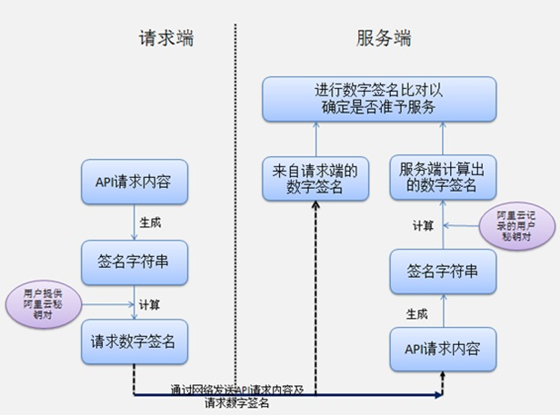

上面的安全验证流程可以达到如下目的：

- 确认哪位用户在做API请求。因为在发送请求前需要用户指定生成数字签名的密钥对，在服务端即可通过该密钥对确定用户身份，进而可做访问权限管理。

- 确认用户请求在网络传输过程中有无被篡改。因为服务端会对接收到的请求内容重新计算数字签名，一旦请求内容在网络上被篡改，则无法通过数字签名比对。

**签名API请求**

为了通过API请求的安全验证，您需要在请求端对其API请求进行签名（即生成正确的数字签名），并且使用HTTP头Authorization在网络上传输该请求的数字签名。Authorization头的具体格式如下：

```text
Authorization:LOG <AccessKeyId>:<Signature>
```

如上格式所示，Authorization头的值包含用户访问密钥对中的AccessKeyId，且与之对应的AccessKeySecret将用于Signature的构造。下面将详细解释如何构造该Signature。

1. 准备合适的访问密钥

   如上所述，给API请求生成签名，需使用一对访问密钥（AccessKeyId/AccessKeySecret)。

2. 生成请求的签名字符串Log Service API的签名字符串由HTTP请求中的Method，Header和Body信息一同生成，具体方式如下：

   ```text
   SignString = VERB + "\n"
                + CONTENT-MD5 + "\n"
                + CONTENT-TYPE + "\n"
                + DATE + "\n"
                + CanonicalizedLOGHeaders + "\n"
                + CanonicalizedResource
   ```

   上面公式中的 `\n` 表示换行转义字符， `+` （加号）表示字符串连接操作，其他各个部分定义如下表所示。

   表 1. 签名字符串定义

   | 名称 | 定义 | 示例 |
   | --- | --- | --- |
   | VERB | HTTP请求的方法名称 | PUT、GET、POST等 |
   | CONTENT-MD5 | HTTP请求中Body部分的MD5值（必须为大写字符串） | 875264590688CA6171F6228AF5BBB3D2 |
   | CONTENT-TYPE | HTTP请求中Body部分的类型 | application/x-protobuf |
   | DATE | HTTP请求中的标准时间戳头（遵循RFC 1123格式，使用GMT标准时间） | Mon, 3 Jan 2010 08:33:47 GMT |
   | CanonicalizedLOGHeaders | 由HTTP请求中以 <code> x-log </code> 和<code> x-acs </code> 为前缀的自定义头构造的字符串（具体构造方法见下面详述） | x-log-apiversion:0.6.0\\nx-log-bodyrawsize:50\\nx-log-signaturemethod:hmac-sha1 |
   | CanonicalizedResource | 由HTTP请求资源构造的字符串（具体构造方法见下面详述） | /logstores/app_log |

   对于部分无Body的HTTP请求，其CONTENT-MD5和CONTENT-TYPE两个域为空字符串，这时整个签名字符串的生成方式如下：

   ```text
   SignString = VERB + "\n"
                + "\n"
                + "\n"
                + DATE + "\n"
                + CanonicalizedLOGHeaders + "\n"
                + CanonicalizedResource
   ```

   正如公共请求头中描述，Log Service API中引入了一个自定义请求头  `x-log-date` 。如果您在请求中指定了该请求头，则其值会替代HTTP标准请求头Date加入签名计算。

   CanonicalizedLOGHeaders的构造方式如下：

   <ol type="i">

   <li>

   将所有以 `x-log` 和 `x-acs` 为前缀的HTTP请求头的名字转换成小写字母。

   </li>

   <li>

   将上一步得到的所有LOG自定义请求头按照字典序进行升序排序。

   </li>

   <li>

   删除请求头和内容之间分隔符两端出现的任何空格。

   </li>

   <li>

   将所有的头和内容用 `\n` 分隔符组合成最后的CanonicalizedLOGHeader。

   </li>

   </ol>

   CanonicalizedResource的构造方式如下：

   <ol type="i">

   <li>

   将CanonicalizedResource设置为空字符串（””）。

   </li>

   <li>

   放入要访问的LOG资源，如 /logstores/logstorename（无  `logstorename`  则不填）。

   </li>

   <li>

   如请求包含查询字符串（ `QUERY_STRING` ），则在CanonicalizedResource字符串尾部添加  `?`  和查询字符串。

   </li>

   </ol>

   其中， `QUERY_STRING` 是URL中请求参数按字典序排序后的字符串，其中参数名和值之间用  `=`  相隔组成字符串，并对参数名-值对按照字典序升序排序，然后以  `&` 符号连接构成字符串。其公式化描述如下：

   ```text
   QUERY_STRING = "KEY1=VALUE1" + "&" + "KEY2=VALUE2"
   ```

3. 生成请求的数字签名目前，Log Service API只支持一种数字签名算法，即默认签名算法  `hmac-sha1` 。其完整签名公式如下：

   ```text
   Signature = base64(hmac-sha1(UTF8-Encoding-Of(SignString),AccessKeySecret))
   ```

   签名的方法用 RFC 2104 中定义的HMAC-SHA1方法。如上公式用的AccessKeySecret必须和最终的Authorization头中使用的AccessKeyId相对应。否则，请求将无法通过服务端验证。

   在计算出数字签名后，使用该值按本节最前面描述的Authorization头格式构建完整的Log Service API请求安全验证头，并填入HTTP请求中即可发送。

**请求签名过程示例**

为更好地理解整个请求签名的流程，我们用两个示例来演示整个过程。首先，假设您用做Log Service API签名的访问密钥对如下：

```text
AccessKeyId = "<yourAccessKeyId>"
AccessKeySecret = "<yourAccessKeySecret>"
```

- 您需要发送如下GET请求列出ali-test-project项目下的所有Logstores，其HTTP请求如下：

  ```text
  GET /logstores HTTP 1.1
  Mon, 09 Nov 2015 06:11:16 GMT
  Host: ali-test-project.regionid.example.com
  x-log-apiversion: 0.6.0
  x-log-signaturemethod: hmac-sha1
  ```

  如上Log Service API请求生成的签名字符串为：

  ```text
  GET\n\n\nMon, 09 Nov 2015 06:11:16 GMT\nx-log-apiversion:0.6.0\nx-log-signaturemethod:hmac-sha1\n/logstores?logstoreName=&offset=0&size=1000
  ```

  由于是GET请求，该请求无任何HTTP Body，所以生成的签名字符串中CONTENT-TYPE与CONTENT-MD5域为空字符串。如果以前面指定的 AccessKeySecret做签名运算后得到的签名为：

  ```text
  jEYOTCJs2e88o+y5F4/S5IsnBJQ=
  ```

  最后发送经数字签名的HTTP请求内容如下：

  ```text
  GET /logstores HTTP 1.1
  Mon, 09 Nov 2015 06:11:16 GMT
  Host: ali-test-project.regionid.example.com
  x-log-apiversion: 0.6.0
  x-log-signaturemethod: hmac-sha1
  Authorization: LOG <yourAccessKeyId>:<yourSignature>
  ```

- 您需要给同上例ali-test-project项目中名为test-logstore的Logstore写入下面的日志：

  ```text
  topic=""
  time=1447048976
  source="10.10.10.1"
  "TestKey": "TestContent"
  ```

  为此，按照Log Service API定义需要构建如下HTTP请求：

  ```http
  POST /logstores/test-logstore HTTP/1.1
  Date: Mon, 09 Nov 2015 06:03:03 GMT
  Host: test-project.regionid.example.com
  x-log-apiversion: 0.6.0
  x-log-signaturemethod: hmac-sha1
  Content-MD5: 1DD45FA4A70A9300CC9FE7305AF2C494
  Content-Length: 52
  x-log-apiversion:0.6.0
  x-log-bodyrawsize:50
  x-log-compresstype:lz4
  x-log-signaturemethod:hmac-sha1
  <⽇志内容序列化成 ProtoBuffer 格式的字节流>
  ```

  在这个HTTP请求中，写入的日志内容首先被序列化成 ProtoBuffer 格式（请参见 数据编码方式 了解该格式的更多细节）后作为请求Body。所以该请求的Content-Type头的值指定为application/x-protobuf。类似，Content-MD5头的值是请求body对应的MD5值。按照上面的签名字符串构造方式，这个请求对应的签名字符串为：

  ```text
  POST\n1DD45FA4A70A9300CC9FE7305AF2C494\napplication/x-protobuf\nMon, 09 Nov 2015 06:03:03 GMT\nx-log-apiversion:0.6.0\nx-log-
  bodyrawsize:50\nx-log-compresstype:lz4\nx-log-signaturemethod:hmac-sha1\n/logstores/test-logstore
  ```

  同样，以前面示例中的AccessKeySecret做签名运算，得到的最终签名为：

  ```text
  XWLGYHGg2F2hcfxWxMLiNkGki6g=
  ```

  最后发送经数字签名的HTTP请求内容如下：

  ```http
  POST /logstores/test-logstore HTTP/1.1
  Date: Mon, 09 Nov 2015 06:03:03 GMT
  Host: test-project.regionid.example.com
  x-log-apiversion: 0.6.0
  x-log-signaturemethod: hmac-sha1
  Content-MD5: 1DD45FA4A70A9300CC9FE7305AF2C494
  Content-Length: 52
  x-log-apiversion:0.6.0
  x-log-bodyrawsize:50
  x-log-compresstype:lz4
  x-log-signaturemethod:hmac-sha1
  Authorization: LOG <yourAccessKeyId>:<yourSignature>
  <⽇志内容序列化成 ProtoBuffer 格式的字节流>
  ```

<a id="section-3-3-5"></a>

### 3.3.5. 通用错误码

本文介绍日志服务API的通用错误码。

当API请求发生错误的时候，服务端会返回错误信息，包括HTTP的Status Code和响应Body中的具体错误细节。其中响应Body中的错误细节为如下格式。

```json
{
"errorCode" : <ErrorCode>,
"errorMessage" : <ErrorMessage>
}
```

在日志服务可能返回的错误消息中，有些消息适用于大多数API，这部分消息被定义为通用错误码。其他消息仅适用于某些API，这部分消息则被定义为独有错误码。

表 1. 通用错误码

| HTTP状态码（Status Code） | 错误码（Error Code） | 错误消息（Error Message） | 描述（Description） |
| --- | --- | --- | --- |
| 411 | MissingContentLength | Content-Length does not exist in http header when it is necessary. | 没有提供必须的Content-Length请求头。 |
| 415 | InvalidContentType | Content-Type {type} is unsupported. | 不支持Content-Type指定的类型。 |
| 400 | MissingContentType | Content-Type does not exist in http header when body is not empty. | 没有为Body不为空的HTTP请求指定Content-Type头。 |
| 400 | MissingBodyRawSize | x-log-bodyrawsize does not exist in header when it is necessary. | 压缩场景下没有提供必须的x-log-bodyrawsize请求头。 |
| 400 | InvalidBodyRawSize | x-log-bodyrawsize is invalid. | x-log-bodyrawsize的值无效。 |
| 400 | InvalidCompressType | x-log-compresstype {type} is unsupported. | x-log-compresstype指定的压缩方式不支持。 |
| 400 | MissingHost | Host does not exist in http header. | 没有提供HTTP标准请求头Host。 |
| 400 | MissingDate | Date does not exist in http header. | 没有提供HTTP标准请求头Date。 |
| 400 | InvalidDateFormat | Date {date} must follow RFC822. | Date请求头的值不符合RFC822标准。 |
| 400 | MissingAPIVersion | x-log-apiversion does not exist in http header. | 没有提供HTTP请求头x-log-apiversion。 |
| 400 | InvalidAPIVersion | x-log-apiversion {version} is unsupported. | HTTP请求头x-log-apiversion的值不支持。 |
| 400 | MissAccessKeyId | x-log-accesskeyid does not exist in header. | 没有在Authorization头部提供AccessKeyId。 |
| 401 | Unauthorized | The AccessKeyId is unauthorized. | 提供的AccessKeyId值未授权。 |
| 400 | MissingSignatureMethod | x-log-signaturemethod does not exist in http header. | 没有提供HTTP请求头x-log-signaturemethod。 |
| 400 | InvalidSignatureMethod | signature method {method} is unsupported. | x-log-signaturemethod头部指定的签名方法不支持。 |
| 400 | RequestTimeTooSkewed | Request time exceeds server time more than 15 minutes. | 请求的发送时间超过当前服务处理时间前后15分钟的范围。 |
| 404 | ProjectNotExist | Project {name} does not exist. | 日志项目（Project）不存在。 |
| 401 | SignatureNotMatch | Signature {signature} is not matched. | 请求的数字签名不匹配。 |
| 403 | WriteQuotaExceed | Write quota is exceeded. | 超过写入日志限额。 |
| 403 | ReadQuotaExceed | Read quota is exceeded. | 超过读取日志限额。 |
| 500 | InternalServerError | Internal server error message. | 服务器内部错误。 |
| 503 | ServerBusy | The server is busy, please try again later. | 服务器正忙，请稍后再试。 |

错误消息中包括 {…} 部分为出错相关的具体信息。例如，ProjectNotExist的错误消息中包括{name}，表示错误消息中该部分会被具体的Project Name来替换。

<a id="section-3-3-6"></a>

### 3.3.6. 日志项目接口

<a id="section-3-3-6-1"></a>

#### 3.3.6.1. CreateProject

调用CreateProjec创建Project。

**请求语法**

```http
POST / HTTP/1.1
Authorization: <AuthorizationString> 
x-log-bodyrawsize: 0
User-Agent: <UserAgent>
x-log-apiversion: 0.6.0
Host: <Project Endpoint>
x-log-signaturemethod: hmac-sha1
Date: <GMT Date>
Content-Type: application/json
Content-MD5: <Content-MD5>
Content-Length: <ContentLength>
Connection: Keep-Alive
{
  "projectName": <ProjectName>,
  "description": <Description>
}
```

**请求元素**

- 请求头

  CreateProject接口无特有请求头，关于Log Service API的公共请求头，请参见公共请求头。

- 请求参数

  | 属性名称 | 类型 | 是否必须 | 描述 |
  | --- | --- | --- | --- |
  | projectName | string | 是 | Project 名称。 |
  | description | string | 是 | Project 描述。 |

**响应元素**

- 响应头

  CreateProject接口无特有响应头，关于Log Service API的公共响应头，请参见公共响应头。

- 响应元素

  HTTP状态码返回200。

**错误码**

除了返回Log Service API的通用错误码，还可能返回如下特有错误码。

| HTTP状态码 | ErrorCode | ErrorMessage |
| --- | --- | --- |
| 400 | ProjectAlreadyExist | Project {project} already exist |
| 400 | ParameterInvalid | The body is not valid json string |
| 500 | InternalServerError | Specified Server Error Message |

**示例**

- 请求示例

  ```http
  POST / HTTP/1.1
  Authorization: LOG <yourAccessKeyId>:<yourSignature>
  x-log-bodyrawsize: 0
  User-Agent: sls-java-sdk-v-0.6.1
  x-log-apiversion: 0.6.0
  Host: my-project-test.cn-shanghai.log.aliyuncs.com
  x-log-signaturemethod: hmac-sha1
  Date: Sun, 27 May 2018 07:43:26 GMT
  Content-Type: application/json
  Content-MD5: A7967D81EFF5E3CD447FB6D8DF294E20
  Content-Length: 80
  Connection: Keep-Alive
  {
    "projectName": "my-project-test",
    "description": "Description of my-project-test"
  }
  ```

- 响应示例

  ```text
  HTTP/1.1 200
  Server: nginx
  Content-Length: 0
  Connection: close
  Access-Control-Allow-Origin: *
  Date: Sun, 27 May 2018 07:43:27 GMT
  x-log-requestid: 5B0A619F205DC3F30EDA9322
  ```

<a id="section-3-3-6-2"></a>

#### 3.3.6.2. DeleteProject

调用DeleteProject删除一个指定的Project。

**请求语法**

```http
DELETE / HTTP/1.1
Authorization: <AuthorizationString>
x-log-bodyrawsize: 0
User-Agent: <UserAgent>
x-log-apiversion: 0.6.0
Host: <Project Endpoint>
x-log-signaturemethod: hmac-sha1
Date: <GMT Date>
Content-Type: application/x-protobuf
Connection: Keep-Alive
```

**请求元素**

- 请求头

  DeleteProject接口无特有请求头，关于Log Service API的公共请求头，请参见公共请求头。

- 请求参数

  | 属性名称 | 类型 | 是否必须 | 描述 |
  | --- | --- | --- | --- |
  | projectName | string | 是 | Project的名称，作为Header中Host的一部分。 |

**响应元素**

- 响应头

  DeleteProject接口无特有响应头，关于Log Service API的公共响应头，请参见公共响应头。

- 响应元素

  HTTP状态码返回200。

**错误码**

除了返回Log Service API的通用错误码，还可能返回如下特有错误码。

| HTTP状态码 | ErrorCode | ErrorMessage |
| --- | --- | --- |
| 404 | ProjectNotExist | The Project does not exist : {Project} |
| 500 | InternalServerError | Specified Server Error Message |

**示例**

- 请求示例

  ```http
  DELETE / HTTP/1.1
  Authorization: LOG <yourAccessKeyId>:<yourSignature>
  x-log-bodyrawsize: 0
  User-Agent: sls-java-sdk-v-0.6.1
  x-log-apiversion: 0.6.0
  Host: my-project-test.cn-shanghai.log.aliyuncs.com
  x-log-signaturemethod: hmac-sha1
  Date: Sun, 27 May 2018 08:25:04 GMT
  Content-Type: application/x-protobuf
  Connection: Keep-Alive
  ```

- 响应示例

  ```text
  HTTP/1.1 200
  Server: nginx
  Content-Length: 0
  Connection: close
  Access-Control-Allow-Origin: *
  Date: Sun, 27 May 2018 08:25:04 GMT
  x-log-requestid: 5B0A6B60BB6EE39764D458B5
  ```

<a id="section-3-3-6-3"></a>

#### 3.3.6.3. UpdateProject

调用UpdateProject修改指定的Project。

**请求语法**

```http
PUT / HTTP/1.1 
Authorization:  <AuthorizationString>
x-log-bodyrawsize: 0 
User-Agent:  <UserAgent>
x-log-apiversion: 0.6.0 
Host:  <Project Endpoint>
x-log-signaturemethod: hmac-sha1 
Date:  <GMT Date>
Content-Type: application/json 
Content-MD5:  <Content-MD5>
Content-Length:  <ContentLength>
Connection: Keep-Alive
```

**请求元素**

- 请求头UpdateProject接口无特有请求头，关于Log Service API的公共请求头，请参考公共请求头。

- 请求参数

  | 属性名称 | 类型 | 是否必须 | 描述 |
  | --- | --- | --- | --- |
  | projectName | String | 是 | Project名称，作为Header中Host的一部分。 |
  | description | String | 否 | Project描述，默认为空字符串。 |

**响应元素**

- 响应头

  UpdateProject接口无特有响应头，关于Log Service API的公共响应头，请参考公共响应头。

- 响应元素

  HTTP状态码返回200。

**错误码**

除了返回Log Service API的通用错误码，还可能返回如下特有错误码。

| HTTP状态码 | ErrorCode | ErrorMessage |
| --- | --- | --- |
| 404 | ProjectNotExist | The Project does not exist : &lt;Project&gt; |
| 400 | ParameterInvalid | The body is not valid json string |
| 500 | InternalServerError | Specified Server Error Message |

**示例**

- 请求示例

  ```http
  PUT / HTTP/1.1 
  Authorization: LOG <yourAccessKeyId>:<yourSignature> 
  x-log-bodyrawsize: 0 
  User-Agent: sls-java-sdk-v-0.6.1 
  x-log-apiversion: 0.6.0 
  Host: my-project-test.cn-shanghai.log.aliyuncs.com 
  x-log-signaturemethod: hmac-sha1 
  Date: Sun, 27 May 2018 07:43:26 GMT 
  Content-Type: application/json 
  Content-MD5: A7967D81EFF5E3CD447FB6D8DF294E20 
  Content-Length: 40 
  Connection: Keep-Alive 
  { 
    "description": "Description of my-project-test" 
  }
  ```

- 响应示例

  ```text
  HTTP/1.1 200 
  Server: nginx 
  Content-Length: 0 
  Connection: close 
  Access-Control-Allow-Origin: * 
  Date: Sun, 27 May 2018 07:43:27 GMT 
  x-log-requestid: 5B0A619F205DC3F30EDA9322
  ```

<a id="section-3-3-6-4"></a>

#### 3.3.6.4. GetProject

调用GetProject根据Project名称查询Project。

**请求语法**

```http
GET / HTTP/1.1
Authorization: <AuthorizationString>
x-log-bodyrawsize: 0
User-Agent: <UserAgent>
x-log-apiversion: 0.6.0
Host: <Project Endpoint>
x-log-signaturemethod: hmac-sha1
Date: <GMT Date>
Content-Type: application/x-protobuf
Connection: Keep-Alive
```

**请求元素**

- 请求头

  GetProject接口无特有请求头，关于Log Service API的公共请求头，请参见公共请求头。

- 请求参数

  | 属性名称 | 类型 | 是否必须 | 描述 |
  | --- | --- | --- | --- |
  | projectName | string | 是 | Project 的名称，作为Header中Host的一部分。 |

**响应元素**

- 响应头

  GetProject接口无特有响应头，关于Log Service API的公共响应头，请参见公共响应头。

- 响应参数

  GetProject请求成功，其响应Body中包含Project的详细信息，具体格式如下所示。

  | 属性名称 | 类型 | 描述 |
  | --- | --- | --- |
  | createTime | string | 创建时间。 |
  | description | string | Project描述 |
  | lastModifyTime | string | 最后一次更新时间。 |
  | owner | string | 创建人的账户ID。 |
  | projectName | string | Project名称。 |
  | status | string | Project状态。 |
  | region | string | Project所属的区域。 |

**错误码**

除了返回Log Service API的通用错误码，还可能返回如下特有错误码。

| HTTP状态码 | ErrorCode | ErrorMessage |
| --- | --- | --- |
| 404 | ProjectNotExist | The Project does not exist : {Project} |
| 500 | InternalServerError | Specified Server Error Message |

**示例**

- 请求示例

  ```http
  GET / HTTP/1.1
  Authorization: LOG <yourAccessKeyId>:<yourSignature>
  x-log-bodyrawsize: 0
  User-Agent: sls-java-sdk-v-0.6.1
  x-log-apiversion: 0.6.0
  Host: my-project-test.cn-shanghai.log.aliyuncs.com
  x-log-signaturemethod: hmac-sha1
  Date: Sun, 27 May 2018 08:25:04 GMT
  Content-Type: application/x-protobuf
  Connection: Keep-Alive
  ```

- 响应示例

  ```text
  HTTP/1.1 200
  Server: nginx
  Content-Length: 0
  Connection: close
  Access-Control-Allow-Origin: *
  Date: Sun, 27 May 2018 08:25:04 GMT
  x-log-requestid: 5B0A6B60BB6EE39764D458B5
  ```

<a id="section-3-3-6-5"></a>

#### 3.3.6.5. ListProject

调用ListProject查询所有的Project列表。

**请求语法**

```http
GET /?offset={offset}&size={size} HTTP/1.1
Authorization: <AuthorizationString>
x-log-bodyrawsize: 0
User-Agent: <UserAgent>
x-log-apiversion: 0.6.0
Host: <Endpoint>
x-log-signaturemethod: hmac-sha1
Date: <GMT Date>
Content-Type: application/x-protobuf
Connection: Keep-Alive
```

**请求元素**

- 请求头

  ListProject接口无特有请求头，关于Log Service API的公共请求头，请参考公共请求头。

- 请求参数

  | 属性名称 | 类型 | 是否必须 | 描述 |
  | --- | --- | --- | --- |
  | offset | integer | 否 | 返回记录的起始位置，默认值：0。 |
  | size | integer | 否 | 每页返回最大条目，默认值：500（最大值）。 |

**响应元素**

- 响应头

  ListProject接口无特有响应头，关于Log Service API的公共响应头，请参考公共响应头。

- 响应参数

  ListProject请求成功，其响应Body中包含Project表，具体格式如下所示。

  | 属性名称 | 类型 | 描述 |
  | --- | --- | --- |
  | count | integer | 返回的Project个数。 |
  | total | integer | Project总数。 |
  | projects | array | Project列表。 |

  projects中每个元素的格式如下所示。

  | 属性名称 | 类型 | 描述 |
  | --- | --- | --- |
  | createTime | string | 创建时间。 |
  | description | string | Project描述 |
  | lastModifyTime | string | 最后一次更新时间。 |
  | owner | string | 创建人的账户ID。 |
  | projectName | string | Project名称。 |
  | status | string | Project状态。 |
  | region | string | Project所属的区域。 |

**错误码**

除了返回Log Service API的通用错误码，还可能返回如下特有错误码。

| HTTP状态码 | ErrorCode | ErrorMessage |
| --- | --- | --- |
| 500 | InternalServerError | Specified Server Error Message |

**示例**

- 请求示例

  ```http
  GET /?offset=0&size=2&projectName= HTTP/1.1
  Authorization: LOG <yourAccessKeyId>:<yourSignature>
  x-log-bodyrawsize: 0
  User-Agent: sls-java-sdk-v-0.6.1
  x-log-apiversion: 0.6.0
  Host: cn-shanghai.log.aliyuncs.com
  x-log-signaturemethod: hmac-sha1
  Date: Sun, 27 May 2018 09:03:33 GMT
  Content-Type: application/x-protobuf
  Connection: Keep-Alive
  ```

- 响应示例

  ```text
  HTTP/1.1 200
  Server: nginx
  Content-Type: application/json
  Content-Length: 345
  Connection: close
  Access-Control-Allow-Origin: *
  Date: Sun, 27 May 2018 09:03:33 GMT
  x-log-requestid: 5B0A7465AAEA20CA70DE3064
  {
    "count": 2,
    "total": 11,
    "projects": [
      {
        "projectName": "project1",
        "status": "Normal",
        "owner": "",
        "description": "",
        "region": "cn-shanghai",
        "createTime": "1524222931",
        "lastModifyTime": "1524539357"
      },
      {
        "projectName": "project123456",
        "status": "Normal",
        "owner": "",
        "description": "",
        "region": "cn-shanghai",
        "createTime": "1471963876",
        "lastModifyTime": "1524539357"
      }
    ]
  }
  ```

<a id="section-3-3-6-6"></a>

#### 3.3.6.6. GetProjectLogs

GetProjectLogs是Project级别的SQL查询接口。

**请求语法**

GetProjectLogs接口请求语法如下所示。

```text
GET /logs query=SELECT avg(latency) as avg_latency FROM  where __date__ >'2017-09-01 00:00:00' and __date__ < '2017-09-02 00:00:00'
Authorization: <AuthorizationString>
Date: Wed, 3 Sept. 2014 08:33:46 GMT
Host: big-game.cn-hangzhou.log.aliyuncs.com
x-log-bodyrawsize: 0
x-log-apiversion: 0.6.0
x-log-signaturemethod: hmac-sha1
```

**请求元素**

- 请求头

  GetProjectLogs接口无特有请求头。关于Log Service API的公共请求头，请参见公共请求头。

- 请求参数

  | 属性名称 | 类型 | 是否必须 | 描述 |
  | --- | --- | --- | --- |
  | query | string | 是 | 查询SQL条件。 |

**响应元素**

- 响应头

  关于Log Service API的公共响应头，请参见公共响应头。该API特有的响应头如下所示。

  | 名称 | 类型 | 描述 |
  | --- | --- | --- |
  | x-log-progress | 字符串 | 查询结果的状态。可以有Incomplete 和 Complete两个选值，表示本次是否完整。 |
  | x-log-count | 整型 | 当前查询结果的日志总数。 |
  | x-log-processed-rows | 整型 | 本次查询处理的行数。 |
  | x-log-elapsed-millisecond | 整型 | 本次查询消耗的毫秒时间。 |

- 响应参数GetProjectLogs的响应body是一个数组，数组中每个元素是一条日志结果。

  | 名称 | 类型 | 描述 |
  | --- | --- | --- |
  | __time__ | 整型 | 日志的时间戳，精度为秒，从1970-1-1 00:00:00 UTC开始计算的秒数。 |
  | __source__ | 字符串 | 日志的来源，写入日志时指定。 |
  | \[content\] | Key-Value对 | 日志原始内容。 |

**细节描述**

- 该接口的query是一个标准的SQL查询语句。

- 查询的Project在请求的域名中指定。

- 查询的Logstore在查询语句的from条件中指定。可以将Logstore看做是SQL中的表。

- 在查询的SQL条件中必须指定要查询的时间范围，时间范围由__date__（timestamp类型）或__time__（int类型，单位是unix_time）来指定。

- 当查询涉及的日志数量变化非常大时，日志服务API无法预测需要调用多少次该接口来获取完整结果。所以需要您查看每次请求返回结果中的x-log-progress成员状态值，根据成员状态值来确定是否需要重复调用该接口来获取最终完整结果。

  > 每次重复调用该接口都会重新消耗相同数量的查询CU。
  >
  > **说明**

**错误码**

GetProjectLogs接口除了返回Log Service API的通用错误码，还可能返回如下特有错误码。

| HTTP状态码（Status Code） | 错误码（Error Code） | 错误消息（Error Message） | 描述（Description） |
| --- | --- | --- | --- |
| 400 | ParameterInvalid | parameter is invalid | 请求的参数错误，详情请参见具体的错误message。 |

**示例**

以杭州地域内名为big-game的Project为例，查询该Project内名为app_log的Logstore中，主题为groupA的日志数据。查询区间为2014-09-01 00:00:00到2014-09-01 22:00:00，查询关键字为error，且从时间区间头开始查询，最多返回20条日志数据。

- 请求示例

  ```text
  GET /logs/?query=SELECT * FROM <logStoreName> where __line__ = 'abc' and __date__ >'2017-09-01 00:00:00' and __date__ < '2017-09-02 00:00:00
  '&line=20&offset=0 HTTP/1.1
  Authorization: <AuthorizationString>
  Date: Wed, 3 Sept. 2014 08:33:46 GMT
  Host: big-game.cn-hangzhou.log.aliyuncs.com
  x-log-bodyrawsize: 0
  x-log-apiversion: 0.4.0
  x-log-signaturemethod: hmac-sha1
  ```

- 响应示例

  ```text
  HTTP/1.1 200 OK
  Content-MD5: 36F9F7F0339BEAF571581AF1B0AAAFB5
  Content-Type: application/json
  Content-Length: 269
  Date: Wed, 3 Sept. 2014 08:33:47 GMT
  x-log-requestid: efag01234-12341-15432f
  x-log-progress : Complete
  x-log-count : 10000
  x-log-processed-rows: 10000
  x-log-elapsed-millisecond:5
  {
      "progress": "Complete",
      "count": 2,
      "logs": [
          {
              "__time__": 1409529660,
              "__source__": "10.237.0.17",
              "Key1": "error",
              "Key2": "Value2"
          },
          {
              "__time__": 1409529680,
              "__source__": "10.237.0.18",
              "Key3": "error",
              "Key4": "Value4"
          }
      ]
  }
  ```

  响应示例中，x-log-progress的值为Complete，表明整个日志查询已经完成，返回结果为完整结果。本次请求共查询到2条符合条件的日志数据。如果响应结果中的x-log-progress的值为Incomplete，则需要重复请求以获得完整结果。

<a id="section-3-3-7"></a>

### 3.3.7. 日志库相关接口

<a id="section-3-3-7-1"></a>

#### 3.3.7.1. CreateLogstore

CreateLogstore接口用于创建Logstore。

**请求语法**

CreateLogstore接口请求语法如下。

```http
POST /logstores HTTP/1.1
Authorization: <AuthorizationString> 
Date: <GMT Date>
Host: <Project Endpoint>
x-log-apiversion: 0.6.0
x-log-signaturemethod: hmac-sha1
{
    "logstoreName" : <logStoreName>,
    "ttl": <ttl>,
    "shardCount": <shardCount>,
    "autoSplit": <autoSplit>,
    "maxSplitShard": <maxSplitShard>
}
```

**请求元素**

- 请求头

  CreateLogstore接口无特有请求头，关于Log Service API的公共请求头，请参见公共请求头。

- 请求参数

  | 属性名称 | 类型 | 是否必须 | 描述 |
  | --- | --- | --- | --- |
  | logstoreName | string | 是 | Logstore的名称，在Project下必须唯一。 |
  | ttl | integer | 是 | 数据的保存时间，单位为天，范围1~3600。 |
  | shardCount | integer | 是 | Shard个数，单位为个，范围为1~100。 |
  | enable_tracking | bool | 否 | 是否开启WebTracking，默认为false。 |
  | autoSplit | bool | 否 | 是否自动分裂shard，默认为false。 |
  | maxSplitShard | int | 否 | 自动分裂时shard最大个数 ，范围为1~64，默认为64。当autoSplit为true时必须设置。 |

**响应元素**

- 响应头

  CreateLogstore接口无特有响应头，关于Log Service API的公共响应头，请参见公共请求头。

- 响应元素

  HTTP状态码返回200。

**错误码**

除了返回Log Service API的通用错误码，还会返回该接口的特有错误码。

| HTTP状态码 | ErrorCode | ErrorMessage |
| --- | --- | --- |
| 400 | LogstoreAlreadyExist | logstore {logstoreName} already exists |
| 500 | InternalServerError | Specified Server Error Message |
| 400 | LogstoreInfoInvalid | logstore info is invalid |
| 400 | ProjectQuotaExceed | Project Quota Exceed |

**示例**

- 请求示例

  ```http
  POST /logstores HTTP/1.1
  Header :
  {
  x-log-apiversion=0.6.0, 
  Authorization=LOG <yourAccessKeyId>:<yourSignature>, 
  Host=ali-test-project.cn-hangzhou-devcommon-intranet.sls.aliyuncs.com, 
  Date=Wed, 11 Nov 2015 07:35:00 GMT, 
  Content-Length=55,
  x-log-signaturemethod=hmac-sha1, 
  Content-MD5=7EF43D0B8F4A807B95E775048C911C72, 
  User-Agent=sls-java-sdk-v-0.6.0, 
  Content-Type=application/json
  }
  Body : 
  {
      "logstoreName": "test-logstore",
      "ttl": 1,
      "shardCount": 2,
      "autoSplit": true,
      "maxSplitShard": 64
  }
  ```

- 响应示例

  ```text
  HTTP/1.1 200 OK
  Header:
  {
  Date=Wed, 11 Nov 2015 07:35:00 GMT, 
  Content-Length=0, 
  x-log-requestid=5642EFA499248C827B012B39, 
  Connection=close, 
  Server=nginx/1.6.1
  }
  ```

<a id="section-3-3-7-2"></a>

#### 3.3.7.2. CreateSubstore

CreateSubstore接口和CreateLogstore接口结合使用创建Metricstore。其中CreateLogstore用法请参见CreateLogstore。

> **说明**
>
> 创建时序库的步骤如下：
>
> 1. 调用CreateLogstore接口，并将TelemetryType参数设为Metrics，创建时序库。
>
> 2. 调用CreateSubstore接口完成时序库的配置。

**请求语法**

接口请求语法如下。

```http
POST /logstores HTTP/1.1
Authorization: <AuthorizationString> 
Date: <GMT Date>
Host: <Project Endpoint>
x-log-apiversion: 0.6.0
x-log-signaturemethod: hmac-sha1
{ 
    "projectName" : <projectName>,
    "MetricStoreName": <metricStoreName>,
    "subStore": <subStore>
}
```

**请求元素**

- 请求头

  CreateSubstore接口无特有请求头，关于Log Service API的公共请求头，请参见公共请求头。

- 请求参数

  | 属性名称 | 类型 | 是否必须 | 描述 |
  | --- | --- | --- | --- |
  | projectName | string | 是 | project的名称。 |
  | MetricStoreName | string | 是 | 时序库的名称。 |
  | subStore | class | 是 | 全文索引。 |

  subStore配置参数

  | 名称 | 类型 | 是否必须 | 描述 |
  | --- | --- | --- | --- |
  | Name | string | 是 | subStore名称，默认是prom。 |
  | Ttl | integer | 是 | 数据的保存时间，单位为天，范围1~3600。 |
  | TimeIndex | integer | 是 | 时间指标的过期时间，单位为天。 |
  | SortedKeyCount | integer | 是 | Metrics的指标。 |
  | Keys | arrays | 是 | • __name__：Metric名称。<br>• 示例：nginx_ingress_controller_response_size<br>• __labels__：label信息，分隔符形式：{key}#$#{value}\|{key}#$#{value}\| {key}#$#{value}。<br>• 示例：app#$#ingress-nginx\|controller_class#$#nginx\|controller_namespace#$#kube-system\|controller_pod#$#nginx-ingress-controller-589877c6b7-hw9cj<br>• __time_nano__：时间戳，单位为纳秒。<br>• 1585727297293000000<br>• __value__：值。<br>• 36.0<br>详情请参见<strong>《日志服务用户指南》</strong>中<strong>快速入门&gt;基本概念&gt;时序数据（Metric）</strong>章节。 |

**响应元素**

- 响应头

  CreateSubstore接口无特有响应头，关于Log Service API的公共响应头，请参见公共响应头。

- 响应元素

  HTTP状态码返回200。

**示例代码-Java**

```java
import com.aliyun.openservices.log.Client;
import com.aliyun.openservices.log.common.LogStore;
import com.aliyun.openservices.log.common.SubStore;
import com.aliyun.openservices.log.common.SubStoreKey;
import com.aliyun.openservices.log.exception.LogException;
import com.aliyun.openservices.loghub.client.exceptions.LogHubClientWorkerException;

import java.util.Arrays;

public class SimpleTest {
    public static void main(String[] args) throws LogHubClientWorkerException, InterruptedException, LogException {
        String endpoint = "***";
        String ak = "***";
        String sk = "***";
        String projectName = "sls-metric-test";
        String MetricStoreName = "sls_metric_test";
        Client client = new Client(endpoint, ak, sk);
        LogStore logStore = new LogStore(MetricStoreName, 1, 2);
        logStore.setTelemetryType("Metrics");
        client.CreateLogStore(projectName, logStore);
        SubStore subStore = new SubStore();
        subStore.setName("prom");
        subStore.setTtl(1);
        subStore.setTimeIndex(2);
        subStore.setSortedKeyCount(2);
        SubStoreKey subStoreKey1 = new SubStoreKey("__name__", "text");
        SubStoreKey subStoreKey2 = new SubStoreKey("__labels__", "text");
        SubStoreKey subStoreKey3 = new SubStoreKey("__time_nano__", "long");
        SubStoreKey subStoreKey4 = new SubStoreKey("__value__", "double");
        subStore.setKeys(Arrays.asList(subStoreKey1, subStoreKey2, subStoreKey3, subStoreKey4));
        // 创建MetricStore
        client.createSubStore(projectName, MetricStoreName, subStore);
    }
}
```

**示例代码-Python**

```python
from aliyun.log import LogClient, LogStore, SubStore, SubStoreKey
from aliyun.log.exception import LogException


def main():
    endpoint = "***"
    ak = "***"
    sk = "***"
    project_name = "sls-metric-test"
    metric_store_name = "sls_metric_test"

    # Create a LogClient
    client = LogClient(endpoint, ak, sk)

    # Create a LogStore
    log_store = LogStore(metric_store_name, 1, 2)
    log_store.set_telemetry_type("Metrics")
    client.create_log_store(project_name, log_store)

    # Create a SubStore
    sub_store = SubStore()
    sub_store.set_name("prom")
    sub_store.set_ttl(1)
    sub_store.set_time_index(2)
    sub_store.set_sorted_key_count(2)

    # Create SubStore keys
    key1 = SubStoreKey("__name__", "text")
    key2 = SubStoreKey("__labels__", "text")
    key3 = SubStoreKey("__time_nano__", "long")
    key4 = SubStoreKey("__value__", "double")

    sub_store.set_keys([key1, key2, key3, key4])

    # Create MetricStore
    try:
        client.create_sub_store(project_name, metric_store_name, sub_store)
    except LogException as e:
        print(f"LogException: {e}")


if __name__ == "__main__":
    main()
```

<a id="section-3-3-7-3"></a>

#### 3.3.7.3. DeleteLogstore

调用DeleteLogstore删除Logstore，包括所有的Shard数据、索引等。

**请求语法**

```http
DELETE /logstores/{logstoreName} HTTP/1.1
Authorization: <AuthorizationString> 
Date: <GMT Date>
Host: <Project Endpoint>
x-log-apiversion: 0.6.0
x-log-signaturemethod: hmac-sha1
```

**请求参数**

- 请求头

  DeleteLogstore接口无特有请求头，关于Log Service API的公共请求头，请参考 公共请求头。

- 请求参数

  | 参数名称 | 类型 | 是否必须 | 描述 |
  | --- | --- | --- | --- |
  | logstoreName | string | 是 | 日志库名称，同一Project下唯一。 |

**响应参数**

- 响应头

  DeleteLogstore接口无特有响应头，关于Log Service API的公共响应头，请参考公共响应头。

- 响应元素

  HTTP状态码返回200。

**错误码**

除了返回Log Service API的 通用错误码，还可能返回如下特有错误码。

| HTTP 状态码 | ErrorCode | ErrorMessage |
| --- | --- | --- |
| 404 | LogStoreNotExist | logstore {logstoreName} does not exist |
| 500 | InternalServerError | Specified Server Error Message |

**示例**

- 请求示例

  ```http
  DELETE /logstores/test_logstore HTTP/1.1
  Header :
  {
  x-log-apiversion=0.6.0, 
  Authorization=LOG <yourAccessKeyId>:<yourSignature>, 
  Host=ali-test-project.cn-hangzhou-devcommon-intranet.sls.aliyuncs.com, 
  Date=Wed, 11 Nov 2015 08:09:38 GMT, 
  Content-Length=0, 
  x-log-signaturemethod=hmac-sha1, 
  User-Agent=sls-java-sdk-v-0.6.0, 
  Content-Type=application/json
  }
  ```

- 响应示例

  ```text
  HTTP/1.1 200 OK
  Header:
  {
  Date=Wed, 11 Nov 2015 08:09:39 GMT, 
  Content-Length=0, 
  x-log-requestid=5642F7C399248C817B013A07, 
  Connection=close, 
  Server=nginx/1.6.1
  }
  ```

<a id="section-3-3-7-4"></a>

#### 3.3.7.4. UpdateLogstore

更新Logstore的属性。目前只支持更新TTL和Shard属性。

**请求语法**

```http
PUT /logstores/{logstoreName} HTTP/1.1
Authorization: <AuthorizationString> 
Date: <GMT Date>
Host: <Project Endpoint>
x-log-apiversion: 0.6.0
x-log-signaturemethod: hmac-sha1
{
    "logstoreName": <logstoreName>,
    "ttl": <ttl>,
    "shardCount": <shardCount>,
    "autoSplit": <autoSplit>,
    "maxSplitShard": <maxSplitShard>
}
```

**请求元素**

- 请求头

  UpdateLogstore接口无特有请求头。关于Log Service API的公共请求头，请参见公共请求头。

- 请求参数

  | 参数名称 | 类型 | 是否必须 | 描述 |
  | --- | --- | --- | --- |
  | logstoreName | string | 是 | 日志库名称，同一 Project下唯一。 |
  | ttl | integer | 是 | 日志数据生命周期（TTL），单位为天，范围1~3600。 |
  | shardCount | integer | 是 | 查看Shard的个数。更新Logstore的属性后，Shard的个数不变。Shard个数的修改只能通过SplitShard或MergeShards完成。 |
  | enable_tracking | bool | 否 | 是否开启WebTracking。 |
  | autoSplit | bool | 否 | 是否自动分裂shard。 |
  | maxSplitShard | int | 否 | 自动分裂时最大的shard个数 ，范围为1~64。当autoSplit为true时必须指定。 |

**响应元素**

- 响应头

  UpdateLogstore接口无特有响应头。关于Log Service API的公共响应头，请参见公共响应头。

- 响应元素

  HTTP 状态码返回 200。

**错误吗**

除了返回Log Service API的通用错误码，还可能返回如下特有错误码。

| HTTP 状态码 | ErrorCode | ErrorMessage |
| --- | --- | --- |
| 404 | ProjectNotExist | Project {ProjectName} does not exist |
| 404 | LogStoreNotExist | logstore {logstoreName} does not exist |
| 400 | LogStoreAlreadyExist | logstore {logstoreName} already exists |
| 500 | InternalServerError | Specified Server Error Message |
| 400 | ParameterInvalid | invalid shard count,you can only modify shardCount by split&amp; merge shard |

**细节描述**

目前，Shard的数量只能通过SplitShard或MergeShards操作进行调整。

**示例**

- 请求示例

  ```http
  PUT /logstores/test-logstore HTTP/1.1
  Header:
  {
  x-log-apiversion=0.6.0, 
  Authorization=LOG <yourAccessKeyId>:<yourSignature>, 
  Host=ali-test-project.cn-hangzhou-devcommon-intranet.sls.aliyuncs.com, 
  Date=Wed, 11 Nov 2015 08:28:19 GMT, 
  Content-Length=55, 
  x-log-signaturemethod=hmac-sha1, 
  Content-MD5=757C60FC41CC7D3F60B88E0D916D051E, 
  User-Agent=sls-java-sdk-v-0.6.0, 
  Content-Type=application/json
  }
  Body : 
  {
      "logstoreName": "test-logstore",
      "ttl": 1,
      "shardCount": 2,
      "autoSplit": true,
      "maxSplitShard": 64
  }
  ```

- 响应示例

  ```text
  HTTP/1.1 200 OK
  Header:
  {
  Date=Wed, 11 Nov 2015 08:28:20 GMT, 
  Content-Length=0, 
  x-log-requestid=5642FC2399248C8F7B0145FD, 
  Connection=close, 
  Server=nginx/1.6.1
  }
  ```

<a id="section-3-3-7-5"></a>

#### 3.3.7.5. GetLogstore

调用GetLogstore查看Logstore属性。

**请求语法**

```http
GET /logstores/{logstoreName} HTTP/1.1
Authorization: <AuthorizationString> 
Date: <GMT Date>
Host: <Project Endpoint>
x-log-apiversion: 0.6.0
x-log-signaturemethod: hmac-sha1
```

**请求元素**

- 请求头

  GetLogstore接口无特有请求头。关于Log Service API的公共请求头，请参见 公共请求头。

- 请求参数

  | 参数名称 | 类型 | 是否必须 | 描述 |
  | --- | --- | --- | --- |
  | logstoreName | string | 是 | 日志库名称，同一 Project 下唯一。 |

**响应元素**

- 响应头

  GetLogstore接口无特有响应头。关于Log Service API的公共响应头，请参考 公共响应头。

- 响应元素HTTP状态码返回200。

  ```json
  {
      "logstoreName" : <logstoreName>,
      "ttl": <ttl>,
      "shardCount": <shardCount>,
      "createTime": <createTime>,
      "lastModifyTime": <lastModifyTime>
  }
  ```

**错误码**

除了返回Log Service API的通用错误码，还可能返回如下特有错误码。

| HTTP 状态码 | ErrorCode | ErrorMessage |
| --- | --- | --- |
| 404 | ProjectNotExist | Project {ProjectName} does not exist |
| 404 | LogstoreNotExist | logstore {logstoreName} does not exist |
| 500 | InternalServerError | Specified Server Error Message |

**示例**

- 请求示例

  ```http
  GET /logstores/test-logstore HTTP/1.1
  Header :
  {
  x-log-apiversion=0.6.0,
  Authorization=LOG <yourAccessKeyId>:<yourSignature>,
  Host=ali-test-project.cn-hangzhou-devcommon-intranet.sls.aliyuncs.com,
  Date=Wed, 11 Nov 2015 07:53:29 GMT,
  Content-Length=0,
  x-log-signaturemethod=hmac-sha1,
  User-Agent=sls-java-sdk-v-0.6.0,
  Content-Type=application/json
  }
  ```

- 响应示例

  ```text
  HTTP/1.1 200 OK
  Header :
  {
  Date=Wed, 11 Nov 2015 07:53:30 GMT,
  Content-Length=107,
  x-log-requestid=5642F3FA99248C817B01352D,
  Connection=close,
  Content-Type=application/json,
  Server=nginx/1.6.1
  }
  Body :
  {
      "logstoreName": test-logstore,
      "ttl": 1,
      "shardCount": 2,
      "createTime": 1447833064,
      "lastModifyTime": 1447833064
  }
  ```

<a id="section-3-3-7-6"></a>

#### 3.3.7.6. ListLogstore

调用ListLogstores接口列出指定Project下的所有Logstore。

**请求语法**

```http
GET /logstores HTTP/1.1
Authorization: <AuthorizationString> 
Date: <GMT Date>
Host: <Project Endpoint>
x-log-apiversion: 0.6.0
x-log-signaturemethod: hmac-sha1
```

**请求元素**

- 请求头

  无特有请求头。关于 Log Service API 的公共请求头，请参考 公共请求头。

- 请求参数

  | 参数名称 | 类型 | 是否必须 | 描述 |
  | --- | --- | --- | --- |
  | offset | int | 否 | 返回记录的起始位置，从0开始。 |
  | size | int | 否 | 每页返回最大条目，默认500（最大值）。 |
  | logstoreName | string | 是 | 用于请求的Logstore名称（支持部分匹配）。 |

**响应元素**

- 响应头

  无特有响应头。关于Log Service API的公共响应头，请参考公共响应头。

- 响应元素

  ListLogStores请求成功，其响应Body会包括指定Project下的所有Logstore名称列表。

  | 名称 | 类型 | 描述 |
  | --- | --- | --- |
  | count | 整型 | 返回的Logstore数目。 |
  | total | 整型 | Logstore总数。 |
  | logstores | 字符串数组 | 返回的 Logstore名称列表。 |

**错误码**

除了返回Log Service API的通用错误码，还可能返回如下特有错误码。

| HTTP状态码 | ErrorCode | ErrorMessage |
| --- | --- | --- |
| 404 | ProjectNotExist | Project {ProjectName} does not exist |
| 500 | InternalServerError | Specified Server Error Message |
| 400 | ParameterInvalid | Invalid parameter size, (0.6.0\] |
| 400 | InvalidLogStoreQuery | logstore Query is invalid |

**示例**

- 请求示例

  ```http
  GET /logstores HTTP/1.1
  Header: 
  {
  x-log-apiversion=0.6.0, 
  Authorization=LOG <yourAccessKeyId>:<yourSignature>, 
  Host=ali-test-project.cn-hangzhou-devcommon-intranet.sls.aliyuncs.com, 
  Date=Wed, 11 Nov 2015 08:09:39 GMT, 
  Content-Length=0, 
  x-log-signaturemethod=hmac-sha1, 
  User-Agent=sls-java-sdk-v-0.6.0, 
  Content-Type=application/json
  }
  ```

- 响应示例

  ```text
  HTTP/1.1 200 OK
  Header: 
  {
  Date=Wed, 11 Nov 2015 08:09:39 GMT, 
  Content-Length=52, 
  x-log-requestid=5642F7C399248C8D7B01342F, 
  Connection=close, 
  Content-Type=application/json, 
  Server=nginx/1.6.1
  }
  Body:
  {
  "count":1,
  "logstores":["test-logstore"],
  "total":1
  }
  ```

<a id="section-3-3-7-7"></a>

#### 3.3.7.7. ListShards

列出Logstore下当前所有可用的Shard。

**请求语法**

```http
GET /logstores/<logstorename>/shards HTTP/1.1
Authorization: <AuthorizationString>
Date: <GMT Date>
Host: <Project Endpoint>
x-log-apiversion: 0.6.0
x-log-signaturemethod: hmac-sha1
```

**请求元素**

- 请求头

  ListShards接口无特有请求头。关于Log Service API的公共请求头，请参见公共请求头。

- 请求参数

  | 参数名称 | 类型 | 是否必须 | 描述 |
  | --- | --- | --- | --- |
  | logstoreName | string | 是 | 日志库名称 |

**响应元素**

- 响应头

  ListShards接口无特有响应头。关于Log Service API的公共响应头，请参考公共响应头。

- 响应元素shard元素组成的数组。

  ```json
  [
      {
          "shardID": 0,
          "status": "readwrite",
          "inclusiveBeginKey": "00000000000000000000000000000000",
          "exclusiveEndKey": "8000000000000000000000000000000",
          "createTime": 1453949705
      },
      {
          ...
      },
      {
          ...
      }
  ]
  ```

**错误码**

除了返回Log Service API的通用错误码，还可能返回如下特有错误码。

| HTTP 状态码 | ErrorCode | ErrorMessage |
| --- | --- | --- |
| 404 | LogStoreNotExist | logstore {logstoreName} does not exist |
| 500 | InternalServerError | Specified Server Error Message |
| 400 | LogStoreWithoutShard | logstore has no shard |

> 上表错误消息中 {name} 表示该部分会被具体的LogstoreName来替换。
>
> **说明**

**示例**

- 请求示例

  ```text
  GET /logstores/sls-test-logstore/shards
  Header :
  {
      "Content-Length": 0, 
      "x-log-signaturemethod": "hmac-sha1", 
      "x-log-bodyrawsize": 0, 
      "User-Agent": "log-python-sdk-v-0.6.0", 
      "Host": "ali-test-project.cn-hangzhou-devcommon-intranet.sls.aliyuncs.com", 
      "Date": "Thu, 12 Nov 2015 03:40:31 GMT", 
      "x-log-apiversion": "0.6.0", 
      "Authorization": "LOG <yourAccessKeyId>:<yourSignature>"
  }
  ```

- 响应示例

  ```text
  Header:
  {
      "content-length": "57", 
      "server": "nginx/1.6.1", 
      "connection": "close", 
      "date": "Thu, 12 Nov 2015 03:40:31 GMT", 
      "content-type": "application/json", 
      "x-log-requestid": "56440A2F99248C050600C74C"
  }
  Body :
  [
      {
          "shardID": 1,
          "status": "readwrite",
          "inclusiveBeginKey": "00000000000000000000000000000000",
          "exclusiveEndKey": "8000000000000000000000000000000",
          "createTime": 1453949705
      },
      {
          "shardID": 2,
          "status": "readwrite",
          "inclusiveBeginKey": "80000000000000000000000000000000",
          "exclusiveEndKey": "ffffffffffffffffffffffffffffffff",
          "createTime": 1453949705
      },
      {
          "shardID": 0,
          "status": "readonly",
          "inclusiveBeginKey": "00000000000000000000000000000000",
          "exclusiveEndKey": "ffffffffffffffffffffffffffffffff",
          "createTime": 1453949705
      }
  ]
  ```

<a id="section-3-3-7-8"></a>

#### 3.3.7.8. SplitShard

分裂一个指定readwrite状态的Shard。

**请求语法**

```http
POST /logstores/<logstorename>/shards/<shardid>?action=split&key=<splitkey> HTTP/1.1
Authorization: <AuthorizationString>
Date: <GMT Date>
Host: <Project Endpoint>
x-log-apiversion: 0.6.0
x-log-signaturemethod: hmac-sha1
```

**请求元素**

- 请求头

  SplitShard接口无特有请求头。关于 Log Service API 的公共请求头，请参考 公共请求头。

- 请求参数

  | 参数名称 | 类型 | 是否必须 | 描述 |
  | --- | --- | --- | --- |
  | logstoreName | string | 是 | 日志库名称 |
  | shardid | int | 是 | Shard ID |
  | splitkey | string | 是 | split切分位置 |

**响应元素**

- 响应头

  Content-Type: application/json

  SplitShard接口无特有响应头。关于Log Service API的公共响应头，请参考公共响应头。

- 响应参数3个Shard元素组成的数组，第一个Shard为分裂之前的Shard，后两个为分裂的结果。

  ```json
  [
      {
          "shardID": 33,
          "status": "readonly",
          "inclusiveBeginKey": "ee000000000000000000000000000000",
          "exclusiveEndKey": "ffffffffffffffffffffffffffffffff",
          "createTime": 1453949705
      },
      {
          "shardID": 163,
          "status": "readwrite",
          "inclusiveBeginKey": "ee000000000000000000000000000000",
          "exclusiveEndKey": "ef000000000000000000000000000000",
          "createTime": 1453949705
      },
      {
          "shardID": 164,
          "status": "readwrite",
          "inclusiveBeginKey": "ef000000000000000000000000000000",
          "exclusiveEndKey": "ffffffffffffffffffffffffffffffff",
          "createTime": 1453949705
      }
  ]
  ```

**错误码**

除了返回Log Service API的通用错误码，还可能返回如下特有错误码。

| HTTP状态码 | ErrorCode | ErrorMessage |
| --- | --- | --- |
| 404 | LogStoreNotExist | logstore {logstoreName} does not exist |
| 400 | ParameterInvalid | invalid shard id |
| 400 | ParameterInvalid | invalid mid hash |
| 500 | InternalServerError | Specified Server Error Message |
| 400 | LogStoreWithoutShard | logstore has no shard |

> 上表错误消息中 {name} 表示该部分会被具体的LogstoreName来替换。
>
> **说明**

**示例**

- 请求示例

  ```text
  POST /logstores/logstorename/shards/33?action=split&key=ef000000000000000000000000000000
  Header :
  {
      "Content-Length": 0, 
      "x-log-signaturemethod": "hmac-sha1", 
      "x-log-bodyrawsize": 0, 
      "User-Agent": "log-python-sdk-v-0.6.0", 
      "Host": "ali-test-project.cn-hangzhou.sls.aliyuncs.com", 
      "Date": "Thu, 12 Nov 2015 03:40:31 GMT", 
      "x-log-apiversion": "0.6.0", 
      "Authorization": "LOG <yourAccessKeyId>:<yourSignature>"
  }
  ```

- 响应示例

  ```text
  Header:
  {
      "content-length": "57", 
      "server": "nginx/1.6.1", 
      "connection": "close", 
      "date": "Thu, 12 Nov 2015 03:40:31 GMT", 
      "content-type": "application/json", 
      "x-log-requestid": "56440A2F99248C050600C74C"
  }
  Body :
  [
      {
          "shardID": 33,
          "status": "readonly",
          "inclusiveBeginKey": "ee000000000000000000000000000000",
          "exclusiveEndKey": "ffffffffffffffffffffffffffffffff",
          "createTime": 1453949705
      },
      {
          "shardID": 163,
          "status": "readwrite",
          "inclusiveBeginKey": "ee000000000000000000000000000000",
          "exclusiveEndKey": "ef000000000000000000000000000000",
          "createTime": 1453949705
      },
      {
          "shardID": 164,
          "status": "readwrite",
          "inclusiveBeginKey": "ef000000000000000000000000000000",
          "exclusiveEndKey": "ffffffffffffffffffffffffffffffff",
          "createTime": 1453949705
      }
  ]
  ```

<a id="section-3-3-7-9"></a>

#### 3.3.7.9. MergeShards

合并两个相邻的状态为readwrite的Shards。在参数中指定一个ShardId，服务端自动查找相邻的下一个Shard。

**请求语法**

```http
POST /logstores/<logstorename>/shards/<shardid>?action=merge HTTP/1.1
Authorization: <AuthorizationString>
Date: <GMT Date>
Host: <Project Endpoint>
x-log-apiversion: 0.6.0
x-log-signaturemethod: hmac-sha1
```

**请求元素**

- 请求头

  MergeShards接口无特有请求头。关于Log Service API的公共请求头，请参考公共请求头。

- 请求参数

  | 参数名称 | 类型 | 是否必须 | 描述 |
  | --- | --- | --- | --- |
  | logstoreName | string | 是 | 日志库名称 |
  | shardid | int | 是 | shard ID |

**响应元素**

- 响应头

  Content-Type: application/json

  MergeShards接口无特有响应头。关于Log Service API的公共响应头，请参见公共响应头。

- 响应元素

  3个Shard元素组成的数组，第一个shard为合并之后的Shard，后两个为合并之前的Shard。

  ```text
  [
      {
          'shardID': 167, 
          'status': 'readwrite', 
          'inclusiveBeginKey': 'e0000000000000000000000000000000',
          'createTime': 1453953105,
          'exclusiveEndKey': 'ffffffffffffffffffffffffffffffff'
      }, 
      {
          'shardID': 30, 
          'status': 'readonly', 
          'inclusiveBeginKey': 'e0000000000000000000000000000000', 
          'createTime': 0, 
          'exclusiveEndKey': 
          'e7000000000000000000000000000000'
      },
      {
          'shardID': 166, 
          'status': 'readonly', 
          'inclusiveBeginKey': 'e7000000000000000000000000000000', 
          'createTime': 1453953073, 
          'exclusiveEndKey': 'ffffffffffffffffffffffffffffffff'
      }
  ]
  ```

**错误码**

除了返回Log Service API的 通用错误码，还可能返回如下特有错误码。

| HTTP 状态码 | ErrorCode | ErrorMessage |
| --- | --- | --- |
| 404 | LogStoreNotExist | logstore {logstoreName} does not exist |
| 400 | ParameterInvalid | invalid shard id |
| 400 | ParameterInvalid | can not merge the last shard |
| 500 | InternalServerError | Specified Server Error Message |
| 400 | LogStoreWithoutShard | logstore has no shard |

> 上表错误消息中 {name} 表示该部分会被具体的LogstoreName来替换。
>
> **说明**

**示例**

- 请求示例

  ```text
  POST /logstores/logstorename/shards/30?action=merge
  Header :
  {
      "Content-Length": 0, 
      "x-log-signaturemethod": "hmac-sha1", 
      "x-log-bodyrawsize": 0, 
      "User-Agent": "log-python-sdk-v-0.6.0", 
      "Host": "ali-test-project.cn-hangzhou.sls.aliyuncs.com", 
      "Date": "Thu, 12 Nov 2015 03:40:31 GMT", 
      "x-log-apiversion": "0.6.0", 
      "Authorization": "LOG <yourAccessKeyId>:<yourSignature>"
  }
  ```

- 响应示例

  ```text
  Header:
  {
      "content-length": "57", 
      "server": "nginx/1.6.1", 
      "connection": "close", 
      "date": "Thu, 12 Nov 2015 03:40:31 GMT", 
      "content-type": "application/json", 
      "x-log-requestid": "56440A2F99248C050600C74C"
  }
  Body :
  [
      {
          'shardID': 167, 
          'status': 'readwrite', 
          'inclusiveBeginKey': 'e0000000000000000000000000000000',
          'createTime': 1453953105,
          'exclusiveEndKey': 'ffffffffffffffffffffffffffffffff'
      }, 
      {
          'shardID': 30, 
          'status': 'readonly', 
          'inclusiveBeginKey': 'e0000000000000000000000000000000', 
          'createTime': 0, 
          'exclusiveEndKey': 
          'e7000000000000000000000000000000'
      },
      {
          'shardID': 166, 
          'status': 'readonly', 
          'inclusiveBeginKey': 'e7000000000000000000000000000000', 
          'createTime': 1453953073, 
          'exclusiveEndKey': 'ffffffffffffffffffffffffffffffff'
      }
  ]
  ```

<a id="section-3-3-7-10"></a>

#### 3.3.7.10. GetCursor

GetCursor接口用于根据时间获取对应的游标（cursor）。

通过游标（cursor）可以获取特定日志对应的位置。关于cursor与Project、Logstore、Shard的关系如下图所示。

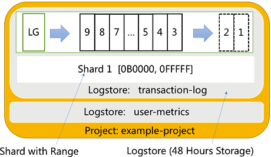

- Project下有多个Logstore。

- 每个Logstore会有多个Shard。

- 通过cursor可以获得特定日志对应的位置。

**请求语法**

GetCursor接口的请求语法如下所示。

```http
GET /logstores/ay42/shards/2?type=cursor&from=1402341900 HTTP/1.1
Authorization: <AuthorizationString>
Date: <GMT Date>
Host: <Project Endpoint>
x-log-apiversion: 0.6.0
```

**请求元素**

- 请求头

  GetCursor接口无特有请求头。关于Log Service API的公共请求头，请参见公共请求头。

- 请求参数

  | 参数名称 | 类型 | 是否必须 | 描述 |
  | --- | --- | --- | --- |
  | shard | string | 是 | Shard名称。 |
  | type | string | 是 | 此处为cursor。 |
  | from | string | 是 | 时间点（Unix时间戳）或者字符串<code> begin </code>、<code> end </code>。 |

  通过from可以在Shard中定位生命周期内的日志，假设Logstore的生命周期为 `[begin_time,end_time)` ，from=from_time，那么：

  - 当 `from_time ≤ begin_time or from_time = "begin"` 时：返回时间点为begin_time对应的cursor位置。

  - 当 `from_time ≥ end_time or from_time = "end"` 时：返回当前时间点下一条将被写入的cursor位置（当前该 cursor 位置上无数据）。

  - 当 `from_time > begin_time and from_time < end_time` 时：返回第一个服务端接收时间大于等于from_time的数据包对应的 cursor。

  > Logstore生命周期由属性中TTL字段指定。例如，当前时间为2018-11-11 09:00:00，TTL=5。则每个Shard中可以消费的数据时间段为  `[2018-11-05`
  >
  > **说明**
  >
  > `09:00:00,2018-11-11 09:00:00)` ，这里的时间指的是Server端时间。

**响应元素**

- 响应头

  GetCursor接口无特有响应头。关于Log Service API的公共响应头，请参见公共响应头。

- 响应元素

  ```json
  {
      "cursor": "MTQ0NzI5OTYwNjg5NjYzMjM1Ng=="
  }
  ```

**错误码**

GetCursor接口除了返回Log Service API的通用错误码，还可能返回如下特有错误码。

| HTTP 状态码 | ErrorCode | ErrorMessage |
| --- | --- | --- |
| 404 | LogStoreNotExist | Logstore {Name} does not exist |
| 400 | ParameterInvalid | Parameter From is not valid |
| 400 | ShardNotExist | Shard {ShardID} does not exist |
| 500 | InternalServerError | Specified Server Error Message |
| 400 | LogStoreWithoutShard | the logstore has no shard |

**示例**

- 请求示例

  ```text
  GET /logstores/sls-test-logstore/shards/0?type=cursor&from=begin
  Header:
  {
      "Content-Length": 0, 
      "x-log-signaturemethod": "hmac-sha1", 
      "x-log-bodyrawsize": 0, 
      "User-Agent": "log-python-sdk-v-0.6.0", 
      "Host": "ali-test-project.cn-hangzhou-devcommon-intranet.sls.aliyuncs.com", 
      "Date": "Thu, 12 Nov 2015 03:56:57 GMT", 
      "x-log-apiversion": "0.6.0", 
      "Content-Type": "application/json", 
      "Authorization": "LOG <yourAccessKeyId>:<yourSignature>"
  }
  ```

- 响应示例

  ```text
  Header:
  {
      "content-length": "41", 
      "server": "nginx/1.6.1", 
      "connection": "close", 
      "date": "Thu, 12 Nov 2015 03:56:57 GMT", 
      "content-type": "application/json", 
      "x-log-requestid": "56440E0999248C070600C6AA"
  }
  Body:
  {
      "cursor": "MTQ0NzI5OTYwNjg5NjYzMjM1Ng=="
  }
  ```

<a id="section-3-3-7-11"></a>

#### 3.3.7.11. GetCursorTime

GetCursorTime API根据Cursor获取服务端时间。

**请求语法**

```http
GET /logstores/{logstoreName}/shards/{shard}?cursor={cursor}&type=cursor_time HTTP/1.1 

Authorization: <AuthorizationString>
Date: <GMT Date> 
Host: <Project Endpoint> 
x-log-apiversion: 0.6.0 
x-log-signaturemethod: hmac-sha1
```

**请求参数**

- 请求头

  GetCursorTime接口无特有请求头。关于Log Service API的公共请求头，请参见公共请求头。

- 请求参数

  | 参数名称 | 类型 | 是否必须 | 描述 |
  | --- | --- | --- | --- |
  | logstoreName | string | 是 | Logstore名称 |
  | shard | int | 是 | shard ID |
  | cursor | string | 是 | 获取时间戳的Cursor。 |
  | type | string | 是 | 固定为cursor_time |

**响应参数**

- 响应头

  GetCursorTime接口无特有响应头。关于Log Service API的公共响应头，请参见公共响应头。

- 响应元素

  ```json
  { 
     "cursor_time": 1554260243 
  }
  ```

**错误码**

除了返回Log Service API的通用错误码，还可能返回如下特有错误码。

| HTTP 状态码 | ErrorCode | ErrorMessage |
| --- | --- | --- |
| 404 | LogStoreNotExist | Logstore {Name} does not exist |
| 400 | ParameterInvalid | Parameter From is not valid |
| 400 | ShardNotExist | Shard {ShardID} does not exist |
| 500 | InternalServerError | Specified Server Error Message |
| 400 | LogStoreWithoutShard | the logstore has no shard |

**示例**

- 请求示例

  ```http
  GET /logstores/internal-operation_log/shards/0?cursor=MTU0NzQ3MDY4MjM3NjUxMzQ0Ng%3D%3D&type=cursor_time HTTP/1.1 

  Authorization: LOG <yourAccessKeyId>:<yourSignature> 
  x-log-bodyrawsize: 0 
  User-Agent: sls-java-sdk-v-0.6.1 
  x-log-apiversion: 0.6.0 
  Host: my-project.cn-hangzhou.sls.aliyuncs.com 
  x-log-signaturemethod: hmac-sha1 
  Date: Wed, 03 Apr 2019 02:57:23 GMT 
  Content-Type: application/x-protobuf 
  Connection: Keep-Alive
  ```

- 响应示例

  ```text
  HTTP/1.1 200 
  Server: nginx 
  Content-Type: application/json 
  Content-Length: 26 
  Connection: close 
  Access-Control-Allow-Origin: * 
  Date: Wed, 03 Apr 2019 02:57:23 GMT 
  x-log-requestid: 5CA42113D2F00378A74B9051 
  { 
    "cursor_time": 1554260243 
  }
  ```

<a id="section-3-3-7-12"></a>

#### 3.3.7.12. PullLogs

根据游标、数量获取日志，获得日志时必须指定shard。

目前仅支持读取PB格式数据。

在storm等情况下可以通过LoghubClientLib进行选举与协同消费。

**请求语法**

```http
GET /logstores/ay42/shards/0?type=logs&cursor=MTQ0NzMyOTQwMTEwMjEzMDkwNA==&count=100 HTTP/1.1
Accept: application/x-protobuf
Accept-Encoding: lz4
Authorization: <AuthorizationString>
Date: <GMT Date>
Host: <Project Endpoint>
x-log-apiversion: 0.6.0
x-log-signaturemethod: hmac-sha1
```

**请求参数**

- 请求头

  - Accept: application/x-protobuf

  - Accept-Encoding: lz4或deflate或“”

  - Log Service API的公共请求头，请参见公共请求头。

- 请求参数

  | 参数名称 | 类型 | 是否必须 | 描述 |
  | --- | --- | --- | --- |
  | type | string | 是 | 此处为logs。 |
  | cursor | string | 是 | 游标，用以表示从什么位置开始读取数据，相当于起点。 |
  | count | int | 是 | 返回的loggroup数目，范围为 1~1000。 |

**响应参数**

- 响应头

  - x-log-cursor：当前读取数据下一条 cursor

  - x-log-count：当前返回数量

  - Log Service API的公共响应头，请参见公共响应头。

- 响应元素

  protobuf 格式序列化后的数据（可能经过压缩）。

**错误码**

除了返回Log Service API的通用错误码，还可能返回如下特有错误码。

| HTTP 状态码 | ErrorCode | ErrorMessage |
| --- | --- | --- |
| 404 | LogStoreNotExist | Logstore {Name} does not exist |
| 400 | ParameterInvalid | Parameter Cursor is not valid |
| 400 | ParameterInvalid | ParameterCount should be in \[0-1000\] |
| 400 | ShardNotExist | Shard {ShardID} does not exist |
| 400 | InvalidCursor | this cursor is invalid |
| 500 | InternalServerError | Specified Server Error Message |

**示例**

- 请求示例

  ```text
  读取 0 号 shard 上的数据
  GET /logstores/sls-test-logstore/shards/0?cursor=MTQ0NzMyOTQwMTEwMjEzMDkwNA==&count=1000&type=log  
  Header:
  {
      "Authorization"="LOG <yourAccessKeyId>:<yourSignature>", 
      "x-log-bodyrawsize"=0, 
      "User-Agent" : "sls-java-sdk-v-0.6.0", 
      "x-log-apiversion" : "0.6.0", 
      "Host" : "ali-test-project.cn-hangzhou-failover-intranet.sls.aliyuncs.com", 
      "x-log-signaturemethod" : "hmac-sha1", 
      "Accept-Encoding" : "lz4", 
      "Content-Length": 0,
      "Date" : "Thu, 12 Nov 2015 12:03:17 GMT",
      "Content-Type" : "application/x-protobuf", 
      "accept" : "application/x-protobuf"
  }
  ```

- 响应示例

  ```xml
  Header:
  {
      "x-log-count" : "1000", 
      "x-log-requestid" : "56447FB20351626D7C000874", 
      "Server" : "nginx/1.6.1", 
      "x-log-bodyrawsize" : "34121", 
      "Connection" : "close", 
      "Content-Length" : "4231", 
      "x-log-cursor" : "MTQ0NzMyOTQwMTEwMjEzMDkwNA==", 
      "Date" : "Thu, 12 Nov 2015 12:01:54 GMT", 
      "x-log-compresstype" : "lz4", 
      "Content-Type" : "application/x-protobuf"
  }
  Body:
  <protobuf 格式 loggrouplist 内容> 压缩后结果
  ```

- 翻页

  如果只为了翻页（拿到下一组 Token），不返回数据，可以通过HTTP HEAD方式进行请求。

<a id="section-3-3-7-13"></a>

#### 3.3.7.13. PostLog

PutLogs接口用于向指定的Logstore中写入日志数据。

目前仅支持写入PB格式的日志数据。

> 日志数据以LogGroup的形式写入。
>
> **说明**

写入时有两种模式：

- 负载均衡模式（LoadBalance）：自动根据Logstore下所有可写的Shard进行负载均衡写入。该方法写入可用性较高（SLA：99.95%），适合写入消费数据与Shard无关的场景，例如不保序。

- Key路由Shard 模式（KeyHash）：在URL参数中增加key字段，用来判断数据写入哪个Shard的range中。该参数为可选参数，不设置时自动切换负载均衡写入模式。例如：可以将某个生产者（例如 instance）根据名称Hash到固定Shard上，这样就能保证写入与消费在该Shard上的数据是严格有序的（在Merge/Split过程中能够严格保证对于Key在一个时间点只会出现在一个Shard上，请参见分区）。

**PB数据**

PB格式日志压缩数据字段描述如下所示，详情请参见数据模型和数据编码方式。

- Log

  | 字段名称 | 类型 | 是否必须 | 描述 |
  | --- | --- | --- | --- |
  | Time | Int | 是 | 日志时间。 |
  | Contents | List | 是，至少包含一个元素 | 日志字段列表，每个元素类型请参见Content字段表格。 |

- Content

  | 字段名称 | 类型 | 是否必须 | 描述 |
  | --- | --- | --- | --- |
  | Key | String | 是 | 自定义key名称。 |
  | Value | String | 是 | 自定义key对应的值。 |

- LogTag

  | 字段名称 | 类型 | 是否必须 | 描述 |
  | --- | --- | --- | --- |
  | Key | String | 是 | 自定义key名称。 |
  | Value | String | 是 | 自定义key对应的值。 |

- LogGroup

  | 字段名称 | 类型 | 是否必须 | 描述 |
  | --- | --- | --- | --- |
  | Logs | List | 是 | 日志列表，每个元素请参见Log字段表格。 |
  | Topic | String | 否 | 用户自定义字段，用以标记一批日志。 |
  | Source | String | 否 | 日志的来源。例如产生该日志机器的IP地址。 |
  | LogTags | List | 是 | 日志的标签列表，每个元素请参见LogTag。 |

**请求语法**

- 负载均衡模式

  ```xml
  POST /logstores/<logstorename>/shards/lb HTTP/1.1
  Authorization: <AuthorizationString>
  Content-Type: application/x-protobuf
  Content-Length: <Content Length>
  Content-MD5: <Content MD5>
  Date: <GMT Date>
  Host: <Project Endpoint>
  x-log-apiversion: 0.6.0
  x-log-bodyrawsize: <BodyRawSize>
  x-log-compresstype: lz4
  x-log-signaturemethod: hmac-sha1
  <PB 格式⽇志压缩数据>
  ```

- Key路由Shard模式

  ```xml
  POST /logstores/<logstorename>/shards/route?key=14d2f850ad6ea48e46e4547edbbb27e0
  Authorization: <AuthorizationString>
  Content-Type: application/x-protobuf
  Content-Length: <Content Length>
  Content-MD5: <Content MD5>
  Date: <GMT Date>
  Host: <Project Endpoint>
  x-log-apiversion: 0.6.0
  x-log-bodyrawsize: <BodyRawSize>
  x-log-compresstype: lz4
  x-log-signaturemethod: hmac-sha1
  <PB 格式⽇志压缩数据>
  ```

**请求元素**

- 请求头

  关于Log Service API 的公共请求头，请参见公共请求头。

- 请求参数

  | 名称 | 类型 | 必选 | 描述 |
  | --- | --- | --- | --- |
  | logstorename | string | 是 | 需要写入日志的 Logstore名称。 |

**响应元素**

- 响应头

  PutLogs接口无特有响应头。关于Log Service API 的公共响应头，请参见公共响应头。

- 响应元素

  成功后无任何响应元素。

**细节描述**

- PutLogs接口每次可以写入的日志组数据量上限为3MB或者4096条，日志组中每条日志下的Value部分不超过1MB大小。只要日志数据量超过这两条上限中的任意一条则整个请求失败，且无任何日志数据成功写入。

- 服务端会对每次PutLogs写入的日志数据做格式检查，只要日志数据中有任何一条日志不符合规范，则整个请求失败且无任何日志数据成功写入。

**错误码**

除了返回Log Service API的通用错误码，还可能返回如下特有错误码。

| HTTP 状态码（Status Code） | 错误码（Error Code） | 错误消息（Error Message） | 描述（Description） |
| --- | --- | --- | --- |
| 400 | PostBodyInvalid | Protobuffer content cannot be parsed. | Protobuffer内容不能够解析。 |
| 400 | InvalidTimestamp | Invalid timestamps are in logs. | 日志内容中有无效的日志时间戳。 |
| 400 | InvalidEncoding | Non-UTF8 characters are in logs. | 日志内容中有非UTF8字符。 |
| 400 | InvalidKey | Invalid keys are in logs. | 日志内容中有无效的 key。 |
| 400 | PostBodyTooLarge | Logs must be less than or equal to 3 MB and 4096 entries. | 日志内容包含的日志必须小于3MB和4096条。 |
| 400 | PostBodyUncompressError | Failed to decompress logs. | 日志内容解压失败。 |
| 499 | PostBodyInvalid | The post data time is out of range | 日志中时间范围不在 \[-7\*24Hour, +15Min\]有效范围内。 |
| 404 | LogStoreNotExist | logstore {Name} does not exist. | 日志库（Logstore）不存在。 |

> 上表错误消息中 {name} 表示该部分会被具体的LogstoreName来替换。
>
> **说明**

**示例**

- 请求示例

  ```xml
  POST /logstores/sls-test-logstore
  {
      "Content-Length": 118,
      "Content-Type":"application/x-protobuf",
      "x-log-bodyrawsize":1356,
      "Host": "ali-test-project.cn-hangzhou-devcommon-intranet.sls.aliyuncs.com",
      "Content-MD5":"6554BD042149C844761C2C094A8FECCE",
      "Date":"Thu, 12 Nov 2015 06:54:26 GMT",
      "x-log-apiversion": "0.6.0",
      "x-log-compresstype":"lz4"
      "x-log-signaturemethod": "hmac-sha1",
      "Authorization":"LOG <yourAccessKeyId>:<yourSignature>"
  }
  <PB 格式⽇志使⽤ Lz4 压缩后的⼆进制数据>
  ```

- 响应示例

  ```text
  Header
  {   
      "date": "Thu, 12 Nov 2015 06:53:03 GMT",
      "connection": "close",
      "x-log-requestid": "5644160399248C060600D216",
      "content-length": "0",
      "server": "nginx/1.6.1"
  }
  ```

<a id="section-3-3-7-14"></a>

#### 3.3.7.14. GetShipperStatus

查询日志投递任务状态。

**请求语法**

```http
GET /logstores/{logstoreName}/shipper/{shipperName}/tasks?from=1448748198&to=1448948198&status=success&offset=0&size=100 HTTP/1.1
Authorization: <AuthorizationString> 
Date: <GMT Date>
Host: <Project Endpoint>
x-log-apiversion: 0.6.0
x-log-signaturemethod: hmac-sha1
```

**请求参数**

请求参数如GetShipperStatus请求参数所示。表 1. GetShipperStatus请求参数

| 参数名称 | 类型 | 是否必须 | 描述 |
| --- | --- | --- | --- |
| logstoreName | string | 是 | 日志库名称，同一 Project 下唯一 |
| shipperName | string | 是 | 日志投递规则名称，同一 Logstore 下唯一 |
| from | integer | 是 | 日志投递任务创建时间区间 |
| to | integer | 是 | 日志投递任务创建时间区间 |
| status | string | 否 | 默认为空，表示返回所有状态的任务，目前支持successful/running/failed 等状态 |
| offset | integer | 否 | 返回指定时间区间内投递任务的起始数目，默认值为 0 |
| size | integer | 否 | 返回指定时间区间内投递任务的数目，默认值为 100，最大为 500 |

**请求头**

GetShipperStatus 接口无特有请求头。关于 Log Service API 的公共请求头，请参考 公共请求头。

**响应头**

GetShipperStatus 接口无特有响应头。关于 Log Service API 的公共响应头，请参考 公共响应头。

**响应元素**

请求成功，其响应 Body 会包括指定的日志投递任务列表：

```json
{
    "count" : 10,
    "total" : 20,
    "statistics" : {
        "running" : 0,
        "success" : 20,
        "fail" : 0 
    }
    "tasks" : [
        {
            "id" : "abcdefghijk",
            "taskStatus" : "success",
            "taskMessage" : "",
            "taskCreateTime" : 1448925013,
            "taskLastDataReceiveTime" : 1448915013,
            "taskFinishTime" : 1448926013
        }
    ]
}
```

GetShipperStatus响应元素如GetShipperStatus响应元素所示。表 2. GetShipperStatus响应元素

| 名称 | 类型 | 描述 |
| --- | --- | --- |
| count | integer | 返回的任务个数。 |
| total | integer | 指定范围内任务总数。 |
| statistics | json | 指定范围内任务汇总状态，具体请参考下表。 |
| tasks | array | 指定范围内投递任务具体详情，具体请参考下表。 |

**statistics内容请参考statistics参数详情。**

表 3. statistics参数详情

| 名称 | 类型 | 描述 |
| --- | --- | --- |
| running | integer | 指定范围内状态为 running 的任务个数。 |
| successful | integer | 指定范围内状态为 success 的任务个数。 |
| failed | integer | 指定范围内状态为 fail 的任务个数。 |

**tasks内容请参考tasks参数详情。**

表 4. tasks参数详情

| 名称 | 类型 | 描述 |
| --- | --- | --- |
| id | string | 具体投递任务的任务唯一 ID。 |
| taskStatus | string | 投递任务的具体状态，可能为 running/success/fail 中的一种。 |
| taskMessage | string | 投递任务失败时的具体错误信息。 |
| taskCreateTime | integer | 投递任务创建时间。 |
| taskLastDataReceiveTime | integer | 投递任务中的最新日志数据时间。 |
| taskFinishTime | integer | 投递任务结束时间。 |

**错误码**

如GetShipperStatus特有错误码所示，除了返回 Log Service API 的 通用错误码，还可能返回如下特有错误码：

表 5. GetShipperStatus特有错误码

| HTTP 状态码 | ErrorCode | ErrorMessage |
| --- | --- | --- |
| 404 | ProjectNotExist | Project {ProjectName} does not exist |
| 404 | LogStoreNotExist | logstore {logstoreName} does not exist |
| 400 | ShipperNotExist | shipper {logstoreName} does not exist |
| 500 | InternalServerError | internal server error |
| 400 | ParameterInvalid | start time must be earlier than end time |
| 400 | ParameterInvalid | only support query last 48 hours task status |
| 400 | ParameterInvalid | status only contains success/running/fail |

**细节描述**

投递任务状态查询时间区间只能指定为最近 24 小时之内。

**示例**

**请求示例：**

```http
GET /logstores/test-logstore/shipper/test-shipper/tasks?from=1448748198&to=1448948198&status=success&offset=0&size=100 HTTP/1.1
Header:
{
x-log-apiversion=0.6.0, 
Authorization=LOG <yourAccessKeyId>:<yourSignature>, 
Host=ali-test-project.regionid.example.com, 
Date=Wed, 11 Nov 2015 08:28:19 GMT, 
Content-Length=55, 
x-log-signaturemethod=hmac-sha1, 
Content-MD5=757C60FC41CC7D3F60B88E0D916D051E, 
User-Agent=sls-java-sdk-v-0.6.0, 
Content-Type=application/json
}
```

**响应示例：**

```text
HTTP/1.1 200 OK
Header:
{
Date=Wed, 11 Nov 2015 08:28:20 GMT, 
Content-Length=0, 
x-log-requestid=5642FC2399248C8F7B0145FD, 
Connection=close, 
Server=nginx/1.6.1
}
Body:
{
    "count" : 10,
    "total" : 20,
    "statistics" : {
        "running" : 0,
        "success" : 20,
        "fail" : 0 
    }
    "tasks" : [
        {
            "id" : "abcdefghijk",
            "taskStatus" : "success",
            "taskMessage" : "",
            "taskCreateTime" : 1448925013,
            "taskLastDataReceiveTime" : 1448915013,
            "taskFinishTime" : 1448926013
        }
    ]
}
```

<a id="section-3-3-7-15"></a>

#### 3.3.7.15. RetryShipperTask

重新执行失败的日志投递任务。

**请求语法**

```http
PUT /logstores/{logstoreName}/shipper/{shipperName}/tasks HTTP/1.1
Authorization: <AuthorizationString> 
Date: <GMT Date>
Host: <Project Endpoint>
x-log-apiversion: 0.6.0
x-log-signaturemethod: hmac-sha1
["task-id-1", "task-id-2", "task-id-2"]
```

**请求参数**

请求参数如RetryShipperTask请求参数所示。表 1. RetryShipperTask请求参数

| 参数名称 | 类型 | 是否必须 | 描述 |
| --- | --- | --- | --- |
| logstoreName | string | 是 | 日志库名称，同一 Project 下唯一 |
| shipperName | string | 是 | 日志投递规则名称，同一 Logstore 下唯一 |

**请求头**

RetryShipperTask 接口无特有请求头。关于 Log Service API 的公共请求头，请参考 公共请求头。

**响应头**

RetryShipperTask 接口无特有响应头。关于 Log Service API 的公共响应头，请参考 公共响应头。

**响应元素**

HTTP 状态码返回 200。

**错误码**

如RetryShipperTask特有错误码所示，除了返回 Log Service API 的 通用错误码，还可能返回如下特有错误码：

表 2. RetryShipperTask特有错误码

| HTTP 状态码 | ErrorCode | ErrorMessage |
| --- | --- | --- |
| 404 | ProjectNotExist | Project {ProjectName} does not exist |
| 404 | LogStoreNotExist | logstore {logstoreName} does not exist |
| 400 | ShipperNotExist | shipper {logstoreName} does not exist |
| 500 | InternalServerError | Specified Server Error Message |
| 400 | ParameterInvalid | only allow retry 10 tasks every time |

**细节描述**

每次最多只能重新执行 10 个失败的投递任务。

**示例**

**请求示例：**

```http
PUT /logstores/test-logstore/shipper/test-shipper/tasks HTTP/1.1
Header:
{
x-log-apiversion=0.6.0, 
Authorization=LOG <yourAccessKeyId>:<yourSignature>, 
Host=ali-test-project.regionid.example.com, 
Date=Wed, 11 Nov 2015 08:28:19 GMT, 
Content-Length=55, 
x-log-signaturemethod=hmac-sha1, 
Content-MD5=757C60FC41CC7D3F60B88E0D916D051E, 
User-Agent=sls-java-sdk-v-0.6.0, 
Content-Type=application/json
}
Body : 
["task-id-1", "task-id-2", "task-id-2"]
```

**响应示例：**

```text
HTTP/1.1 200 OK
Header:
{
Date=Wed, 11 Nov 2015 08:28:20 GMT, 
Content-Length=0, 
x-log-requestid=5642FC2399248C8F7B0145FD, 
Connection=close, 
Server=nginx/1.6.1
}
```

<a id="section-3-3-7-16"></a>

#### 3.3.7.16. GetLogs

GetLogs接口查询指定Project下某个Logstore中的日志数据。还可以通过指定相关参数仅查询符合指定条件的日志数据。

**接口说明**

当日志写入到Logstore中，日志服务的查询接口（GetHistograms 和 GetLogs）能够查到该日志的延时因写入日志类型不同而异。日志服务按日志时间戳把日志分为如下两类：

- 实时数据：日志中时间点为服务器当前时间点 （-180秒，900秒]。例如，日志时间为UTC 2014-09-25 12:03:00，服务器收到时为UTC 2014-09-25 12:05:00，则该日志被作为实时数据处理，一般出现在正常场景下。

- 历史数据：日志中时间点为服务器当前时间点 [-7 x 86400秒，-180秒）。例如，日志时间为UTC 2014-09-25 12:00:00，服务器收到时为UTC 2014-09-25 12:05:00，则该日志被作为历史数据处理，一般出现在补数据场景下。

其中，实时数据写入至可查询的最大延时为3秒（99.9%情况下1秒内即可查询）。

**请求语法**

GetLogs 接口的请求语法如下所示。

```xml
GET /logstores/<logstorename>?type=log&topic=<logtopic>&from=<starttime>&to=<endtime>&query=<querystring>&line=<linenum>&offset=
<startindex>&reverse=<ture|false> HTTP/1.1
Authorization: <AuthorizationString>
Date: <GMT Date>
Host: <Project Endpoint>
x-log-bodyrawsize: 0
x-log-apiversion: 0.6.0
x-log-signaturemethod: hmac-sha1
```

**请求元素**

- 请求头

  GetLogs接口无特有请求头。关于Log Service API的公共请求头，请参见公共请求头。

- 请求参数

  <table>
    <tr>
      <td>project</td>
      <td>String</td>
      <td>是</td>
      <td>ali-test-project</td>
      <td>Project名称。</td>
    </tr>
    <tr>
      <td>logstore</td>
      <td>String</td>
      <td>是</td>
      <td>example-logstore</td>
      <td>查询Logstore中的数据。</td>
    </tr>
    <tr>
      <td>from</td>
      <td>Integer</td>
      <td>是</td>
      <td>1627268185</td>
      <td>查询开始时间点。该时间是指写入日志数据时指定的日志时间。<br>• 请求参数<strong>from</strong>和<strong>to</strong>定义的时间区间遵循左闭右开原则，即该时间区间包括区间开始时间点，但不包括区间结束时间点。如果<strong>from</strong>和<strong>to</strong>的值相同，则为无效区间，函数直接返回错误。<br>• Unix时间戳格式，表示从1970-1-1 00:00:00 UTC计算起的秒数。<br>说明如果您要确保不漏查数据，请将查询时间对齐到分钟级别。如果您在分析语句中设置了时间范围，则查询分析时以该时间范围为准。<br>如果您需要精确到秒，需要在分析语句中指定时间时，使用from_unixtime函数或to_unixtime函数转换下时间格式。例如：<br><code>* &#124; SELECT * FROM log WHERE</code><br><code>from_unixtime(__time__) &gt;</code><br><code>from_unixtime(1664186624) AND</code><br><code>from_unixtime(__time__) &lt; now()</code><br><code>* &#124; SELECT * FROM log WHERE __time__ &gt;</code><br><code>to_unixtime(date_parse('2022-10-19 15:46:05', '%Y-</code><br><code>%m-%d %H:%i:%s')) AND __time__ &lt;</code><br><code>to_unixtime(now())</code></td>
    </tr>
    <tr>
      <td>to</td>
      <td>Integer</td>
      <td>是</td>
      <td>1627269085</td>
      <td>查询结束时间点。该时间是指写入日志数据时指定的日志时间。<br>• 请求参数<strong>from</strong>和<strong>to</strong>定义的时间区间遵循左闭右开原则，即该时间区间包括区间开始时间点，但不包括区间结束时间点。如果<strong>from</strong>和<strong>to</strong>的值相同，则为无效区间，函数直接返回错误。<br>• Unix时间戳格式，表示从1970-1-1 00:00:00 UTC计算起的秒数。<br>说明如果您要确保不漏查数据，请将查询时间对齐到分钟级别。如果您在分析语句中设置了时间范围，则查询分析时以该时间范围为准。<br>如果您需要精确到秒，需要在分析语句中指定时间时，from_unixtime函数或to_unixtime函数转换下时间格式。例如：<br><code>* &#124; SELECT * FROM log WHERE</code><br><code>from_unixtime(__time__) &gt;</code><br><code>from_unixtime(1664186624) AND</code><br><code>from_unixtime(__time__) &lt; now()</code><br><code>* &#124; SELECT * FROM log WHERE __time__ &gt;</code><br><code>to_unixtime(date_parse('2022-10-19 15:46:05', '%Y-</code><br><code>%m-%d %H:%i:%s')) AND __time__ &lt;</code><br><code>to_unixtime(now())</code></td>
    </tr>
    <tr>
      <td>query</td>
      <td>String</td>
      <td>否</td>
      <td>status: 401 | SELECT remote_addr,COUNT(*) as pv GROUP by remote_addr ORDER by pv desc limit 5</td>
      <td>查询语句或者分析语句。更多信息，请参见<strong>《日志服务用户指南查询与</strong><strong>分析》</strong>的<strong>《查询简介》</strong>和<strong>《日志服务用户指南查询与分析》</strong>的<strong>《分析简</strong><strong>介》</strong>。在query参数的分析语句中加上<code> set session </code> <code>parallel_sql=true; </code>，表示使用SQL独享版。例如<code> * &#124; set </code> <code>session parallel_sql=true; select count(*) as pv </code> 。<br>说明当query参数中有分析语句（SQL语句）时，该接口的line参数和offset参数无效，建议设置该接口的参数为0，需通过SQL语句的LIMIT语法实现翻页。</td>
    </tr>
    <tr>
      <td>topic</td>
      <td>String</td>
      <td>否</td>
      <td>topic</td>
      <td>日志主题。默认值为双引号（""）。</td>
    </tr>
    <tr>
      <td>line</td>
      <td>Long</td>
      <td>否</td>
      <td>100</td>
      <td>仅当query参数为查询语句时，该参数有效，表示请求返回的最大日志条数。最小值为0，最大值为100，默认值为100。</td>
    </tr>
    <tr>
      <td>offset</td>
      <td>Long</td>
      <td>否</td>
      <td>0</td>
      <td>仅当query参数为查询语句时，该参数有效，表示查询开始行。默认值为0。</td>
    </tr>
    <tr>
      <td>reverse</td>
      <td>Boolean</td>
      <td>否</td>
      <td>false</td>
      <td>用于指定返回结果是否按日志时间戳降序返回日志，精确到分钟级别。<br>• true：按照日志时间戳降序返回日志。<br>• false（默认值）：按照日志时间戳升序返回日志。<br>重要<br>• 当query参数为查询语句时，参数reverse有效，用于指定返回日志排序方式。<br>• 当query参数为查询和分析语句时，参数reverse无效，由SQL分析语句中order by语法指定排序方式。如果order by为asc（默认），则为升序；如果order by为desc，则为降序。</td>
    </tr>
  </table>

**响应元素**

- 响应头

  GetLogs接口无特有响应头。关于Log Service API的公共响应头，请参见公共响应头。

  响应头中有专门成员表示请求返回结果是否完整。具体响应元素格式如下所示。

  | 名称 | 类型 | 描述 |
  | --- | --- | --- |
  | x-log-progress | string | 查询结果的状态。可以有Incomplete和Complete两个选值，表示本次是否完整。 |
  | x-log-count | int | 当前查询结果的日志总数。 |

- 响应元素GetLogs请求成功，其响应Body会包括查询命中的日志数据。当需要查询的日志数据量非常大（T级别）的时候，该接口的响应结果可能并不完整，GetLogs的响应body是一个数组，数组中每个元素是一条日志结果。数组中的每个元素结构如下。

  | 名称 | 类型 | 描述 |
  | --- | --- | --- |
  | __time__ | int | 日志的时间戳（精度为秒，从 1970-1-1 00:00:00 UTC 计算起的秒数）。 |
  | __source__ | string | 日志的来源，写入日志时指定。 |
  | \[content\] | Key-Value对 | 日志原始内容。 |

**细节描述**

- 该接口中由请求参数from和to定义的时间区间遵循“左闭右开”原则，即该时间区间包括区间开始时间点，但不包括区间结束时间点。如果from和to的值相同，则为无效区间，函数直接返回错误。

- 当查询涉及的日志数量变化非常大时，日志服务API无法预测需要调用多少次该接口来获取完整结果。所以需要您查看每次请求返回结果中的x-log-progress成员状态值，根据成员状态值来确定是否需要重复调用该接口来获取最终完整结果。

  > 每次重复调用该接口都会重新消耗相同数量的查询CU。
  >
  > **说明**

**错误码**

除了返回Log Service API的 通用错误码，还可能返回如下特有错误码。

| HTTP状态码（Status Code） | 错误码（Error Code） | 错误消息（Error Message） | 描述（Description） |
| --- | --- | --- | --- |
| 404 | LogStoreNotExist | logstore {Name} does not exist | 日志库（logstore）不存在。 |
| 400 | InvalidTimeRange | request time range is invalid | 请求的时间区间无效。 |
| 400 | InvalidQueryString | query string is invalid | 请求的查询字符串无效。 |
| 400 | InvalidOffset | offset is invalid | 请求的offset参数无效。 |
| 400 | InvalidLine | line is invalid | 请求的line参数无效。 |
| 400 | InvalidReverse | Reverse value is invalid | Reverse参数的值无效。 |
| 400 | IndexConfigNotExist | logstore without index config | 日志库（logstore）未开启索引。 |

> 上表错误消息中 {name} 表示该部分会被具体的LogstoreName来替换。
>
> **说明**

**示例**

以杭州地域内名为big-game的Project为例，查询该project内名为app_log的Logstore中，主题为groupA的日志数据。查询区间为 2014-09-01 00:00:00到2014-09-01 22:00:00，查询关键字为error，且从时间区间头开始查询，最多返回20条日志数据。

- 请求示例：

  ```http
  GET /logstores/app_log？type=log&topic=groupA&from=1409529600&to=1409608800&query=error&line=20&offset=0 HTTP/1.1
  Authorization: <AuthorizationString>
  Date: Wed, 3 Sept. 2014 08:33:46 GMT
  Host: big-game.cn-hangzhou.log.aliyuncs.com
  x-log-bodyrawsize: 0
  x-log-apiversion: 0.4.0
  x-log-signaturemethod: hmac-sha1
  ```

- 响应示例：

  ```text
  HTTP/1.1 200 OK
  Content-MD5: 36F9F7F0339BEAF571581AF1B0AAAFB5
  Content-Type: application/json
  Content-Length: 269
  Date: Wed, 3 Sept. 2014 08:33:47 GMT
  x-log-requestid: efag01234-12341-15432f
  x-log-progress : Complete
  x-log-count : 10000
  x-log-processed-rows: 10000
  x-log-elapsed-millisecond:5
  {
      "progress": "Complete",
      "count": 2,
      "logs": [
          {
              "__time__": 1409529660,
              "__source__": "10.237.0.17",
              "Key1": "error",
              "Key2": "Value2"
          },
          {
              "__time__": 1409529680,
              "__source__": "10.237.0.18",
              "Key3": "error",
              "Key4": "Value4"
          }
      ]
  }
  ```

在这个响应示例中，x-log-progress成员的状态为Complete，表明整个日志查询已经完成，返回结果为完整结果。在这次请求中共查询到2条符合条件的日志，且日志数据在logs成员中。如果响应结果中的x-log-progress成员的状态为Incomplete，则需要重复相同请求以获得完整结果。

<a id="section-3-3-7-17"></a>

#### 3.3.7.17. GetHistograms

GetHistograms接口查询指定的Project下某个Logstore中日志的分布情况。还可以通过指定相关参数仅查询符合指定条件的日志分布情况。

从日志写入日志库到查询接口（GetHistograms 和 GetLogs）查到该日志，延时时长因写入日志类型不同而异。日志服务按日志时间戳把日志分为如下两类：

- 实时数据：日志中时间点为服务器当前时间点（ -180秒，900秒]。例如，日志时间为UTC 2014-09-25 12:03:00，服务器收到时为UTC 2014-09-25 12:05:00，则该日志被视作实时数据处理。实时数据从写入到在日志查询界面查询到该数据的延迟为3秒。

- 历史数据：日志中时间点为服务器当前时间点 [-7 x 86400秒，-180秒）。例如，日志时间为UTC 2014-09-25 12:00:00，服务器收到时为UTC 2014-09-25 12:05:00，则该日志被作为历史数据处理，一般出现在补数据场景下。

**请求语法**

GetHistograms接口请求语法如下。

```http
GET /logstores/<logstorename>?type=histogram&topic=<logtopic>&from=<starttime>&to=<endtime>&query=<querystring> HTTP/1.1
Authorization: <AuthorizationString>
Date: <GMT Date>
Host: <Project Endpoint>
x-log-bodyrawsize: 0
x-log-apiversion: 0.6.0
x-log-signaturemethod: hmac-sha1
```

**请求元素**

- 请求头

  GetHistograms接口无特有请求头。关于Log Service API的公共请求头，请参见公共请求头。

- 请求参数

  | 名称 | 类型 | 必选 | 描述 |
  | --- | --- | --- | --- |
  | logstorename | string | 是 | 需要查询日志的Logstore名称。 |
  | type | string | 是 | 查询Logstore数据的类型，在GetHistograms 接口中该参数必须为histogram。 |
  | from | int | 是 | 查询开始时间点。精度为秒，从1970-1-1 00:00:00 UTC计算起的秒数。 |
  | to | int | 是 | 查询结束时间点。精度为秒，从1970-1-1 00:00:00 UTC计算起的秒数。 |
  | topic | string | 否 | 查询日志主题。 |
  | query | string | 否 | 查询表达式。关于查询表达式的详细语法，请参见 <strong>《用户指南》</strong> 中的<strong>查</strong><strong>询与分析 &gt; 查询语法与功能 &gt; 查询语法</strong>。 |

**响应元素**

- 响应头

  GetHistograms接口无特有响应头。关于Log Service API的公共响应头，请参见公共响应头。

- 响应参数GetHistograms请求成功，其响应Body会包括查询命中的日志数量在时间轴上的分布情况。响应结果会把您查询的时间范围均匀分割成若干个子时间区间，并返回每个子时间区间内命中的日志条数。具体响应元素格式如下：

  | 名称 | 类型 | 描述 |
  | --- | --- | --- |
  | progress | string | 查询结果的状态。可以有Incomplete和Complete两个选值，表示结果是否完整。 |
  | count | int | 当前查询结果中所有日志总数。 |
  | histograms | array | 当前查询结果在划分的子时间区间上的分布状况，具体结构见下面的描述。 |

  上表中的histograms数组中的每个元素结构如下。

  | 名称 | 类型 | 描述 |
  | --- | --- | --- |
  | from | int | 子时间区间的开始时间点。精度为秒，从1970-1-1 00:00:00 UTC计算起的秒数。 |
  | to | int | 子时间区间的结束时间点。精度为秒，从1970-1-1 00:00:00 UTC计算起的秒数。 |
  | count | int | 当前查询结果在该子时间区间内命中的日志条数。 |
  | progress | string | 当前查询结果在该子时间区间内的结果是否完整，可以有Incomplete和Complete两个选值。 |

**细节描述**

- 该接口中涉及的时间区间（无论是请求参数from和to定义的时间区间，还是返回结果中各个子时间区间）都遵循“左闭右开”原则，即该时间区间包括区间开始时间点，但不包括区间结束时间点。如果from和to的值相同，则为无效区间，函数直接返回错误。

- 该接口的响应中子区间划分方式是一致稳定的。如果您在请求查询的时间区间不变，则响应中子区间划分结果也不会改变。

- 当查询涉及的日志数量变化非常大时，日志服务API无法预测需要调用多少次该接口来获取完整结果。所以需要您查看每次请求返回结果中的progress成员状态值，根据成员状态值来确定是否需要重复调用该接口来获取最终完整结果。

  > 每次重复调用该接口都会重新消耗相同数量的查询CU。
  >
  > **说明**

**错误码**

除了返回 Log Service API 的 通用错误码，还可能返回如下特有错误码。

| HTTP 状态码（Status Code） | 错误码（Error Code） | 错误消息（Error Message） | 描述（Description） |
| --- | --- | --- | --- |
| 404 | LogStoreNotExist | logstore {Name} does not exist | 日志库（logstore）不存在。 |
| 400 | InvalidTimeRange | request time range is invalid | 请求的时间区间无效。 |
| 400 | InvalidQueryString | query string is invalid | 请求的查询字符串无效。 |

> 上表错误消息中 {name} 表示该部分会被具体的LogstoreName替换。
>
> **说明**

**示例**

以杭州地域内名为big-game的project为例，查询该project内名为app_log的Logstore中，主题为groupA的日志分布情况。查询区间为2014-09-01 00:00:00到2014-09-01 22:00:00，查询关键字是error。

- 请求示例

  ```http
  GET /logstores/app_log?type=histogram&topic=groupA&from=1409529600&to=1409608800&query=error HTTP/1.1
  Authorization: LOG <yourAccessKeyId>:<yourSignature>
  Date: Wed, 3 Sept. 2014 08:33:46 GMT
  Host: big-game.cn-hangzhou.log.aliyuncs.com
  x-log-bodyrawsize: 0
  x-log-apiversion: 0.6.0
  x-log-signaturemethod: hmac-sha1
  ```

- 响应示例

  ```text
  HTTP/1.1 200 OK
  Content-Type: application/json
  Content-MD5: E6AD9C21204868C2DE84EE3808AAA8C8
  Content-Type: application/json
  Date: Wed, 3 Sept. 2014 08:33:47 GMT
  Content-Length: 232
  x-log-requestid: efag01234-12341-15432f
  [
          {
              "from": 1409529600,
              "to": 1409569200,
              "count": 2,
              "progress": "Complete"
          },
          {
              "from": 1409569200,
              "to": 1409608800,
              "count": 1,
              "progress": "Incomplete"
          }
  ]
  ```

在这个响应示例中，服务端把整个 Histogram 划分到两个均等的时间区间，分别为[2014-09-01 00:00:00，2014-09-01 11:00:00）和[2014-09-01 11:00:00，2014-09-01 22:00:00）。由于您的数据量过大，第一次查询会返回不完整数据。响应结果告知您命中日志条数为3，但整体结果不完整，仅在时间段[2014-09-01 00:00:00，2014-09-01 11:00:00）结果完整且命中2条，而在另外一个时间段结果不完整但已经命中1条。在这个情况下，如果您希望得到完整结果，则需要重复调用上面的请求示例若干次直到整个响应中的progress成员值变成Complete。响应示例如下。

```text
HTTP/1.1 200 OK
Content-Type: application/json
Content-MD5: E6AD9C21204868C2DE84EE3808AAA8C8
Content-Type: application/json
Date: Wed, 3 Sept. 2014 08:33:48 GMT
Content-Length: 232
x-log-requestid: afag01322-1e241-25432e
[
        {
            "from": 1409529600,
            "to": 1409569200,
            "count": 2,
            "progress": "Complete"
        },
        {
            "from": 1409569200,
            "to": 1409608800,
            "count": 2,
            "progress": "complete"
        }
]
```

<a id="section-3-3-7-18"></a>

#### 3.3.7.18. UpdateIndex

更新指定Logstore的索引。

**请求语法**

```http
PUT /logstores/<logstoreName>/index HTTP/1.1
Authorization: <AuthorizationString>
x-log-bodyrawsize: 0
User-Agent: <UserAgent>
x-log-apiversion: 0.6.0
Host: <Project Endpoint>
x-log-signaturemethod: hmac-sha1
Date: <GMT Date>
Content-Type: application/json
Content-MD5: <Content-MD5>
Content-Length: <ContentLength>
{
  "line": <full text index>,
  "keys": <key-value index>,
  "ttl": <ttl>
}
```

**请求元素**

- 请求头

  UpdateIndex接口无特有请求头，关于Log Service API的公共请求头请参见公共请求头。

- 请求参数

  | 属性名称 | 类型 | 是否必须 | 描述 |
  | --- | --- | --- | --- |
  | logstoreName | string | 是 | Logstore名称。 |
  | ttl | integer | 否 | 索引文件生命周期，支持7天，30天和90天。 |
  | keys | object | 否 | 键值索引配置，key为字段名称，value为字段索引配置。 |
  | line | object | 否 | 全文索引配置。 |

  属性keys和line必须至少指定一个。全文索引配置包含如下属性。

  | 属性名称 | 类型 | 是否必须 | 描述 |
  | --- | --- | --- | --- |
  | token | array | 是 | 分词符列表。 |
  | caseSensitive | bool | 否 | 是否大小写敏感。 |
  | chn | bool | 否 | 是否包含中文。 |
  | include_keys | array | 否 | 包含的字段列表，不能与exclude_keys同时指定。 |
  | exclude_keys | array | 否 | 排除的字段列表，不能与include_keys同时指定。 |

  字段索引配置包含如下属性。

  | 属性名称 | 类型 | 是否必须 | 描述 |
  | --- | --- | --- | --- |
  | type | string | 是 | 字段类型。 |
  | alias | string | 否 | 别名。 |
  | chn | bool | 否 | 是否包含中文，只有type为text时才有意义。 |
  | token | array | 否，当type为text时必须 | 分词符列表，只有type为text时才有意义。 |
  | caseSensitive | bool | 否 | 是否大小写敏感，只有type为text时有意义。 |
  | doc_value | bool | 否 | 是否开启统计。 |

**响应元素**

- 响应头

  UpdateIndex 接口无特有响应头，关于Log Service API的公共响应头请参见公共响应头。

- 响应元素

  HTTP 状态码返回200。

**错误码**

除了返回 Log Service API 的通用错误码，还可能返回如下特有错误码：

| HTTP状态码 | ErrorCode | ErrorMessage |
| --- | --- | --- |
| 400 | ParameterInvalid | log store index is not created |
| 400 | ParameterInvalid | key config must has type |
| 400 | IndexInfoInvalid | required field token is lacking or of error format |
| 400 | IndexInfoInvalid | required fields line/keys are lacking or of error format |
| 404 | ProjectNotExist | The Project does not exist : {Project} |
| 404 | LogStoreNotExist | logstore {logstoreName} dose not exist |
| 500 | InternalServerError | Specified Server Error Message |

**示例**

- 请求示例

  ```http
  PUT /logstores/logstore-4/index HTTP/1.1
  Header:
  Authorization: LOG <yourAccessKeyId>:<yourSignature>
  x-log-bodyrawsize: 0
  User-Agent: sls-java-sdk-v-0.6.1
  x-log-apiversion: 0.6.0
  Host: my-project.cn-shanghai.log.aliyuncs.com
  x-log-signaturemethod: hmac-sha1
  Date: Mon, 07 May 2018 09:47:20 GMT
  Content-Type: application/json
  Content-MD5: 1860B805A6AA5288B97B32CF3B519112
  Content-Length: 316
  Connection: Keep-Alive
  Body:
  {
    "line": {
      "token": [
        ",",
        " ",
        "'",
        "\"",
        ";",
        "=",
        "(",
        ")",
        "[",
        "]",
        "{",
        "}",
        "?",
        "@",
        "&",
        "<",
        ">",
        "/",
        ":",
        "\n",
        "\t",
        "\r"
      ]
    },
    "keys": {
      "agent": {
        "doc_value": true,
        "caseSensitive": true,
        "alias": "agent_alias",
        "type": "text",
        "token": [
          ",",
          " ",
          "'",
          "\"",
          ";",
          "=",
          "(",
          ")",
          "[",
          "]",
          "{",
          "}",
          "?",
          "@",
          "&",
          "<",
          ">",
          "/",
          ":",
          "\n",
          "\t",
          "\r"
        ]
      }
    },
    "ttl": 90
  }
  ```

- 响应示例

  ```text
  HTTP/1.1 200
  Server: nginx/1.12.1
  Content-Length: 0
  Connection: close
  Access-Control-Allow-Origin: *
  Date: Mon, 07 May 2018 09:47:21 GMT
  x-log-requestid: 5AF020A98CBAA2EF52AB66C9
  ```

<a id="section-3-3-7-19"></a>

#### 3.3.7.19. CreateIndex

为指定的Logstore创建索引。

**请求语法**

```http
POST /logstores/<logstoreName>/index HTTP/1.1
Authorization: <AuthorizationString>
x-log-bodyrawsize: <x-log-bodyrawsize>
User-Agent: <User-Agent>
x-log-apiversion: <APIVersion>
Host: <Project Endpoint>
x-log-signaturemethod: hmac-sha1
Date: <GMT Date>
Content-Type: application/json
Content-MD5: <Content-MD5>
Content-Length: <Content-Length>
{
  "line": <full text index>,
  "keys": <key-value index>
}
```

**请求元素**

- 请求头

  CreateIndex接口无特有请求头，关于Log Service API的公共请求头，请参考公共请求头。

- 请求参数

  | 属性名称 | 类型 | 是否必须 | 描述 |
  | --- | --- | --- | --- |
  | logstoreName | string | 是 | Logstore名称。 |
  | keys | object | 否 | 字段索引配置，key为字段名称，value为字段索引配置。 |
  | line | object | 否 | 全文索引配置。 |

  属性keys和line必须至少指定一个。全文索引配置包含如下属性。

  | 属性名称 | 类型 | 是否必须 | 描述 |
  | --- | --- | --- | --- |
  | caseSensitive | bool | 否 | 是否大小写敏感。 |
  | chn | bool | 否 | 是否包含中文。 |
  | token | array | 是 | 分词符列表。 |
  | include_keys | array | 否 | 包含的字段列表，不能与exclude_keys同时指定。 |
  | exclude_keys | array | 否 | 排除的字段列表，不能与include_keys同时指定。 |

  字段索引配置包含如下属性。

  | 属性名称 | 类型 | 是否必须 | 描述 |
  | --- | --- | --- | --- |
  | type | string | 是 | 字段类型。 |
  | alias | string | 否 | 字段别名。 |
  | chn | bool | 否 | 是否包含中文，只有type为text时才有意义。 |
  | token | array | 仅当type为text时必须 | 分词符列表，只有type为text时才有意义。 |
  | caseSensitive | bool | 否 | 是否大小写敏感，只有type为text时有意义。 |
  | doc_value | bool | 否 | 该字段是否开启统计。 |

**响应元素**

- 响应头

  CreateIndex接口无特有响应头，关于Log Service API的公共响应头，请参考公共响应头。

- 响应元素

  HTTP状态码返回200。

**错误码**

除了返回Log Service API的通用错误码，还可能返回如下特有错误码。

| HTTP状态码 | ErrorCode | ErrorMessage |
| --- | --- | --- |
| 400 | IndexInfoInvalid | required field token is lacking or of error format |
| 400 | IndexAlreadyExist | log store index is already created |
| 404 | ProjectNotExist | The Project does not exist : {Project} |
| 404 | LogStoreNotExist | logstore {logstoreName} dose not exist |
| 500 | InternalServerError | Specified Server Error Message |

> 上表错误消息中 {Project} 和 {logstoreName} 表示该部分会被具体的ProjectName和LogstoreName来替换。
>
> **说明**

**示例**

请求示例

```http
POST /logstores/my-logstore/index HTTP/1.1
Authorization: LOG <yourAccessKeyId>:<yourSignature>
x-log-bodyrawsize: 0
User-Agent: sls-java-sdk-v-0.6.1
x-log-apiversion: 0.6.0
Host: my-project.cn-shanghai.log.aliyuncs.com
x-log-signaturemethod: hmac-sha1
Date: Mon, 07 May 2018 09:43:16 GMT
Content-Type: application/json
Content-MD5: 22876515FC311F857AD6C7902F6A0148
Content-Length: 316
Connection: Keep-Alive
{
  "line": {
    "token": [
      ",",
      " ",
      "'",
      "\"",
      ";",
      "=",
      "(",
      ")",
      "[",
      "]",
      "{",
      "}",
      "?",
      "@",
      "&",
      "<",
      ">",
      "/",
      ":",
      "\n",
      "\t",
      "\r"
    ]
  },
  "keys": {
    "agent": {
      "doc_value": true,
      "caseSensitive": true,
      "alias": "agent_alias",
      "type": "text",
      "token": [
        ",",
        " ",
        "'",
        "\"",
        ";",
        "=",
        "(",
        ")",
        "[",
        "]",
        "{",
        "}",
        "?",
        "@",
        "&",
        "<",
        ">",
        "/",
        ":",
        "\n",
        "\t",
        "\r"
      ]
    }
  }
}
```

<a id="section-3-3-7-20"></a>

#### 3.3.7.20. DeleteIndex

调用DeleteIndex删除指定Logstore的索引。

**请求语法**

```http
DELETE /logstores/<logstoreName>/index HTTP/1.1

Authorization: <AuthorizationString>
x-log-bodyrawsize: 0
User-Agent: <UserAgent>
x-log-apiversion: 0.6.0
Host: <Project Endpoint>
x-log-signaturemethod: hmac-sha1
Date: <GMT Date>
Content-Type: application/x-protobuf
Connection: Keep-Alive
```

**请求参数**

- 请求头

  DeleteIndex接口无特有请求头，关于Log Service API的公共请求头，请参见公共请求头。

- 请求参数

  | 属性名称 | 类型 | 是否必须 | 描述 |
  | --- | --- | --- | --- |
  | logstoreName | string | 是 | Logstore名称。 |

**响应元素**

- 响应头

  DeleteIndex接口无特有响应头，关于Log Service API的公共响应头，请参见公共响应头。

- 响应元素

  HTTP状态码返回200。

**错误码**

除了返回Log Service API的通用错误码，还可能返回如下特有错误码。

| HTTP状态码 | ErrorCode | ErrorMessage |
| --- | --- | --- |
| 400 | ParameterInvalid | log store index not created |
| 404 | ProjectNotExist | The Project does not exist : {Project} |
| 404 | LogStoreNotExist | logstore {logstoreName} does not exist |
| 500 | InternalServerError | Specified Server Error Message |

**示例**

- 请求示例

  ```http
  DELETE /logstores/my-logstore/index HTTP/1.1

  Authorization: LOG <yourAccessKeyId>:<yourSignature>
  x-log-bodyrawsize: 0
  User-Agent: sls-java-sdk-v-0.6.1
  x-log-apiversion: 0.6.0
  Host: my-project.cn-shanghai.log.aliyuncs.com
  x-log-signaturemethod: hmac-sha1
  Date: Sun, 06 May 2018 13:22:57 GMT
  Content-Type: application/x-protobuf
  Connection: Keep-Alive
  ```

- 响应示例

  ```text
  HTTP/1.1 200

  Server: nginx/1.12.1
  Content-Length: 0
  Connection: close
  Access-Control-Allow-Origin: *
  Date: Sun, 06 May 2018 13:22:57 GMT
  x-log-requestid: 5AEF01B1A458E41C2F8326A8
  ```

<a id="section-3-3-7-21"></a>

#### 3.3.7.21. GetIndex

调用GetIndex查询指定Logstore的索引。

**请求语法**

GetIndex接口的请求语法如下所示。

```http
GET /logstores/<logstoreName>/index HTTP/1.1
Authorization: <AuthorizationString>
x-log-bodyrawsize: 0
User-Agent: <UserAgent>
x-log-apiversion: 0.6.0
Host: <Project Endpoint>
x-log-signaturemethod: hmac-sha1
Date: <GMT Date>
Content-Type: application/x-protobuf
Connection: Keep-Alive
```

**请求元素**

- 请求头

  GetIndex接口无特有请求头，关于Log Service API的公共请求头，请参见公共响应头。

- 请求参数

  | 属性名称 | 类型 | 是否必须 | 描述 |
  | --- | --- | --- | --- |
  | logstoreName | string | 是 | Logstore名称。 |

**响应元素**

- 响应头

  GetIndex接口无特有响应头，关于Log Service API的公共响应头，请参见公共响应头。

- 响应元素GetIndex请求成功，其响应Body会包括指定Project和Logstore的索引，具体格式如下所示。

  | 属性名称 | 类型 | 描述 |
  | --- | --- | --- |
  | index_mode | string | 索引类型。 |
  | keys | dict | 字段索引配置。key为字段名称，value为索引配置。 |
  | line | object | 全文索引配置。 |
  | storage | string | 存储类型，目前为pg。 |
  | ttl | int | 索引文件生命周期，支持7天、30天、90天。 |
  | lastModifyTime | int | 索引最后更新时间。UNIX时间戳。 |

  - 全文索引配置属性

    | 属性名称 | 类型 | 描述 |
    | --- | --- | --- |
    | caseSensitive | bool | 大小写是否敏感。 |
    | chn | bool | 是否包含中文。 |
    | token | array | 分词符列表。 |
    | include_keys | array | 包含的字段列表。 |
    | exclude_keys | array | 排除的字段列表。 |

  - 字段索引配置属性

    | 属性名称 | 类型 | 描述 |
    | --- | --- | --- |
    | type | string | 字段类型。 |
    | alias | string | 字段别名。 |
    | chn | bool | 是否包含中文，只有type为text时才存在。 |
    | token | array | 分词符列表，只有type为text时才存在。 |
    | caseSensitive | bool | 大小写是否敏感，只有type为text时才存在。 |
    | doc_value | bool | 是否开启字段统计。 |

**错误码**

GetIndex接口除了返回Log Service API的通用错误码，还可能返回如下特有错误码。

| HTTP状态码 | ErrorCode | ErrorMessage | 描述 |
| --- | --- | --- | --- |
| 400 | IndexConfigNotExist | index config doesn’t exist | 查询的索引不存在。 |
| 404 | ProjectNotExist | The Project does not exist : {Project} | Project不存在。 |
| 404 | LogStoreNotExist | logstore {logstoreName} dose not exist | Logstore不存在。 |
| 500 | InternalServerError | Specified Server Error Message | 服务器错误信息。 |

**示例**

- 请求示例

  ```http
  GET /logstores/logstore-4/index HTTP/1.1
  Authorization: LOG <yourAccessKeyId>:<yourSignature>
  x-log-bodyrawsize: 0
  User-Agent: sls-java-sdk-v-0.6.1
  x-log-apiversion: 0.6.0
  Host: my-project.cn-shanghai.log.aliyuncs.com
  x-log-signaturemethod: hmac-sha1
  Date: Sun, 06 May 2018 13:08:42 GMT
  Content-Type: application/x-protobuf
  Connection: Keep-Alive
  ```

- 响应示例

  ```text
  HTTP/1.1 200
  Server: nginx/1.12.1
  Content-Type: application/json
  Content-Length: 712
  Connection: close
  Access-Control-Allow-Origin: *
  Date: Sun, 06 May 2018 13:08:42 GMT
  x-log-requestid: 5AEEFE5A8B8AEB5E6C82B395
  {
    "index_mode": "v2",
    "keys": {
      "agent": {
        "alias": "",
        "caseSensitive": false,
        "chn": false,
        "doc_value": true,
        "token": [
          ",",
          " ",
          "'",
          "\"",
          ";",
          "=",
          "(",
          ")",
          "[",
          "]",
          "{",
          "}",
          "?",
          "@",
          "&",
          "<",
          ">",
          "/",
          ":",
          "\n",
          "\t",
          "\r"
        ],
        "type": "text"
      },
      "bytes": {
        "alias": "",
        "doc_value": true,
        "type": "long"
      },
      "remote_ip": {
        "alias": "",
        "caseSensitive": false,
        "chn": false,
        "doc_value": true,
        "token": [
          ",",
          " ",
          "'",
          "\"",
          ";",
          "=",
          "(",
          ")",
          "[",
          "]",
          "{",
          "}",
          "?",
          "@",
          "&",
          "<",
          ">",
          "/",
          ":",
          "\n",
          "\t",
          "\r"
        ],
        "type": "text"
      },
      "response": {
        "alias": "",
        "doc_value": true,
        "type": "long"
      }
    },
    "line": {
      "caseSensitive": false,
      "chn": false,
      "token": [
        ",",
        " ",
        "'",
        "\"",
        ";",
        "=",
        "(",
        ")",
        "[",
        "]",
        "{",
        "}",
        "?",
        "@",
        "&",
        "<",
        ">",
        "/",
        ":",
        "\n",
        "\t",
        "\r"
      ]
    },
    "storage": "pg",
    "ttl": 30,
    "lastModifyTime": 1524155379
  }
  ```

<a id="section-3-3-7-22"></a>

#### 3.3.7.22. PutWebtracking

Web Tracking采集方式，单个请求只能写入一条日志，针对日志量较大的场景，可以使用PutWebTracking API将多条日志合并为一次请求。使用PutWebtracking接口写入日志需要为Logstore打开Web Tracking开关。适用于在网页或者客户端采集日志的场景。

**请求语法**

```http
POST {project}.{endpoint}/logstores/{logstoreName}/track HTTP/1.1

x-log-apiversion: 0.6.0
x-log-bodyrawsize: 1234
x-log-compresstype: gzip

{
  "__topic__": "topic",
  "__source__": "source",
  "__logs__": [
    {
      "key1": "value1",
      "key2": "value2"
    },
    {
      "key1": "value1",
      "key2": "value2"
    }
  ],
  "__tags__": {
    "tag1": "value1",
    "tag2": "value2"
  }
}
```

**请求元素**

- 请求头仅需要如下三个请求头：

  - x-log-apiversion: 0.6.0

  - x-log-bodyrawsize: 1234

  - x-log-compresstype: gzip

  前两个为必选，第三个是可选，格式和含义请参见公共请求头。

- 请求参数

  - URL参数

    | 参数名称 | 类型 | 是否必须 | 描述 |
    | --- | --- | --- | --- |
    | logstoreName | string | 是 | Logstore名称。 |
    | endpoint | string | 是 | 日志服务的Endpoint，请参考获取日志服务的Endpoint。 |
    | project | string | 是 | Project名称。 |

  - 请求Body

    | 参数名称 | 类型 | 是否必须 | 描述 |
    | --- | --- | --- | --- |
    | __topic__ | string | 否 | 日志主题。 |
    | __source__ | string | 否 | 日志来源。 |
    | __logs__ | list | 是 | 日志内容列表。每个元素为一个 JSON 对象，表示一条日志。说明WebTracking采集的日志时间为日志到达服务端的时间，每条日志中无需设置__time__字段，如果存在该字段，将被服务端使用日志到达的时间覆盖。 |
    | __tags__ | object | 否 | 日志标签。 |

**响应元素**

- 响应头

  PutWebtracking接口无特有响应头。关于Log Service API的公共响应头，请参见公共响应头。

- 响应元素

  成功后无任何响应元素。

**示例**

- 请求示例

  ```http
  POST my-project.cn-hangzhou.log.aliyuncs.com/logstores/logstore-test/track HTTP/1.1

  x-log-apiversion: 0.6.0
  x-log-bodyrawsize: 1234
  x-log-compresstype: gzip

  {
    "__topic__": "topic",
    "__source__": "source",
    "__logs__": [
      {
        "foo": "bar",
        "foo1": "bar1"
      },
      {
        "bar": "foo",
        "bar1": "foo1"
      }
    ],
    "__tags__": {
      "tag1": "value1",
      "tag2": "value2"
    }
  }
  ```

- 响应示例

  ```text
  HTTP/1.1 200 OK
  Header:
  {
  Date=Wed, 20 May 2019 07:35:00 GMT, 
  Content-Length=0, 
  x-log-requestid=5642EFA499248C827B012B39, 
  Connection=close, 
  Server=nginx/1.6.1
  }
  ```

<a id="section-3-3-7-23"></a>

#### 3.3.7.23. MetricStore HTTP API详情

日志服务提供多个用于查询时序指标或写入指标数据到MetricStore的API，这些API兼容Prometheus开源协议。本文介绍这些API的使用详情。

**概述**

Prometheus所提供的接口都在/api/v1目录下，MetricStore相关的API同样遵循此规则，其完整的URL为https://{project}.{sls-endpoint}/prometheus/{project}/{metricstore}/api/v1/。

| 变量 | 是否必填 | 说明 |
| --- | --- | --- |
| {sls-endpoint} | 是 | 请参考获取日志服务的Endpoint。 |
| {project} | 是 | 您已创建的Project。具体操作，请参考CreateProject。 |
| {metricstore} | 是 | 您已创建的MetricStore。具体操作，请参考CreateSubstore。 |

> **重要**
>
> 在调用相关接口时，还需要进行BasicAuth鉴权，即需要设置**Username**为AccessKey ID，**Password**为AccessKey Secret。此处建议您使用RAM用户的AccessKey，请参见获取AccessKey。您需授予RAM用户查询指定Project的权限。具体操作，请参见<strong>《日志服务 用户指南》</strong>的**访问控制RAM**章节。

**时序指标查询API**

时序指标查询API包括Instant Queries API和Range Queries API。

**Instant Queries API**

Instant Queries API用于查询指定时间点的指标数据。参数说明如下表所示。

| 变量 | 是否必填 | 说明 |
| --- | --- | --- |
| query | 是 | 具体的PromQL语句。更多信息，请参见<strong>《日志服务 用户指南》</strong>的<strong>时序数据查询分析简介</strong>。 |
| time | 否 | 执行查询的时间点，Unix时间戳格式，精确到秒。默认为最新时间。 |
| timeout | 否 | 执行查询的超时时间，单位：秒。同时支持1s、2m、3h、4d等用法，例如：timeout=10s。更多信息，请参见Time Durations。 |
| lookback_delta | 否 | 可用于自定义设置Prometheus中query.lookback-delta这项flag参数值，仅对当次Query有效。该参数值需遵循Time Durations用法，例如：lookback_delta=1m，更多信息请参见Time Durations。此参数表示PromQL计算中寻点过程的最大回溯区间，SLS时序库中该值默认为"3m"。 |

此接口有以下四种类型的返回结果：

- **vector**

  - 示例代码

    ```bash
    curl -X GET 'http://{project}.{sls-endpoint}/prometheus/{project}/{metricstore}/api/v1/query?query=up&time=1676700699' \
    -u username:password \
    -H 'Content-Type: application/x-www-form-urlencoded'

    # username和password为对应AK信息
    ```

  - 结果

    ```json
    {
        "status": "success",
        "data": {
            "resultType": "vector",
            "result": [
                {
                    "metric": {
                        "__name__": "up",
                        "instance": "demo.promlabs.com:10001",
                        "job": "demo"
                    },
                    "value": [
                        1676700550.696,
                        "1"
                    ]
                },
                {
                    "metric": {
                        "__name__": "up",
                        "instance": "demo.promlabs.com:10000",
                        "job": "demo"
                    },
                    "value": [
                        1676700550.696,
                        "1"
                    ]
                }
            ]
        }
    }
    ```

- **scalar**

  - 示例代码

    ```bash
    curl -X GET 'http://{project}.{sls-endpoint}/prometheus/{project}/{metricstore}/api/v1/query?query=2-1&time=1676700699' \
    -u username:password \
    -H 'Content-Type: application/x-www-form-urlencoded'

    # username和password为对应AK信息
    ```

  - 结果

    ```json
    {
        "status": "success",
        "data": {
            "resultType": "scalar",
            "result": [
                1676700699,
                "0"
            ]
        }
    }
    ```

- **string**

  - 示例代码

    ```bash
    curl -X GET 'http://{project}.{sls-endpoint}/prometheus/{project}/{metricstore}/api/v1/query?query="test_string"&time=1676700699' \
    -u username:password \
    -H 'Content-Type: application/x-www-form-urlencoded'

    # username和password为对应AK信息
    ```

  - 结果

    ```json
    {
        "status": "success",
        "data": {
            "resultType": "string",
            "result": [
                1676700699,
                "test_string"
            ]
        }
    }
    ```

- **matrix**

  - 示例代码

    ```bash
    curl -X GET 'http://{project}.{sls-endpoint}/prometheus/{project}/{metricstore}/api/v1/query?query=up[1m]&time=1743414624' \
    -u username:password \
    -H 'Content-Type: application/x-www-form-urlencoded'

    # username和password为对应AK信息
    ```

  - 结果

    ```json
    {
        "status": "success",
        "data": {
            "resultType": "matrix",
            "result": [
                {
                    "metric": {
                        "__name__": "up",
                        "instance": "demo.promlabs.com:10000",
                        "job": "demo"
                    },
                    "values": [
                        [
                            1743414609.803,
                            "1"
                        ],
                        [
                            1743414614.803,
                            "1"
                        ],
                        [
                            1743414619.803,
                            "1"
                        ]
                    ]
                },
                {
                    "metric": {
                        "__name__": "up",
                        "instance": "demo.promlabs.com:10001",
                        "job": "demo"
                    },
                    "values": [
                        [
                            1743414611.078,
                            "1"
                        ],
                        [
                            1743414616.078,
                            "1"
                        ],
                        [
                            1743414621.078,
                            "1"
                        ]
                    ]
                }
            ]
        }
    }
    ```

**Range Queries API**

Range Queries API用于查询指定时间范围内多个时间点的指标数据。

```text
GET https://{project}.{sls-endpoint}/prometheus/{project}/{metricstore}/api/v1/query_range
POST https://{project}.{sls-endpoint}/prometheus/{project}/{metricstore}/api/v1/query_range
```

参数说明如下表所示。

| 变量 | 是否必填 | 说明 |
| --- | --- | --- |
| query | 是 | 具体的PromQL语句。更多信息，请参见<strong>《日志服务 用户指南》</strong>的<strong>时序数据查询分析简介</strong>章节。 |
| start | 否 | 查询的起始时间点，Unix时间戳格式，精确到秒。 |
| end | 否 | 查询的截止时间点，Unix时间戳格式，精确到秒。 |
| step | 否 | 执行查询的间隔时间，单位：秒。同时支持1s、2m、3h、4d等用法，例如：step=2m。更多信息，请参见Time Durations。 |
| timeout | 否 | 执行查询的超时时间，单位：秒。同时支持1s、2m、3h、4d等用法，例如：timeout=10s。更多信息，请参见Time Durations。 |
| lookback_delta | 否 | 可用于自定义设置Prometheus中query.lookback-delta这项flag参数值，仅对当次Query有效。该参数值需遵循Time Durations用法，例如：lookback_delta=1m，更多信息请参见Time Durations。此参数表示PromQL计算中寻点过程的最大回溯区间，SLS时序库中该值默认为"3m"。 |

- 示例代码查询2023-02-18 14:09:59到2023-02-18 14:16:39之间的指标数据，step为60s。

  ```bash
  curl -X GET 'https://{project}.{sls-endpoint}/prometheus/{project}/{metricstore}/api/v1/query_range?
  query=up&start=1676700599&end=1676700999&step=60s' \
  -u username:password \
  -H 'Content-Type: application/x-www-form-urlencoded'

  # 设置username和password为阿⾥云AccessKey。
  ```

- 查询结果

  ```json
  {
    "status": "success",
    "data": {
      "resultType": "matrix",
      "result": [
        {
          "metric": {
            "__name__": "up",
            "instance": "demo.promlabs.com:10000",
            "job": "demo"
          },
          "values": [
            [
              1676700599,
              "1"
            ],
            [
              1676700659,
              "1"
            ],
            [
              1676700719,
              "0"
            ],
            [
              1676700779,
              "0"
            ],
            [
              1676700839,
              "1"
            ],
            [
              1676700899,
              "0"
            ],
            [
              1676700959,
              "1"
            ]
          ]
        },
        {
          "metric": {
            "__name__": "up",
            "instance": "demo.promlabs.com:10001",
            "job": "demo"
          },
          "values": [
            [
              1676700599,
              "1"
            ],
            [
              1676700659,
              "1"
            ],
            [
              1676700719,
              "0"
            ],
            [
              1676700779,
              "0"
            ],
            [
              1676700839,
              "1"
            ],
            [
              1676700899,
              "1"
            ],
            [
              1676700959,
              "1"
            ]
          ]
        }
      ]
    }
  }
  ```

**元数据查询API**

日志服务还支持查询Label、LabelValue等元数据信息，即兼容了Prometheus中Querying metadata的相关接口。此类接口支持获取特定时间段内所有的metric、Label和LabelValue信息，但不包含时间戳与数值信息。

**Query Series API**

Query Series API用于查询指定时间段内特定条件下的所有MetricName以及该MetricName下所有的Label数值对。

```text
GET https://{project}.{sls-endpoint}/prometheus/{project}/{metricstore}/api/v1/series
POST https://{project}.{sls-endpoint}/prometheus/{project}/{metricstore}/api/v1/series
```

参数说明如下表所示。

| 变量 | 是否必填 | 说明 |
| --- | --- | --- |
| match\[\] | 是 | 筛选条件，例如：match\[\]=up{instance="demo.\*"}。您可以设置一个或多个值。 |
| start | 否 | 查询的起始时间点，Unix时间戳格式，精确到秒。默认为当前时间的5分钟之前。 |
| end | 否 | 查询的截止时间点，Unix时间戳格式，精确到秒。默认为当前时间。<br>重要如果<strong>start</strong>和<strong>end</strong>参数都是自定义的，该API也只支持查询<strong>end</strong>时间点之前5分钟的数据，即查询 (end - 5 minute, end) 区间内的数据。 |

- 配置示例

  ```bash
  curl -g -X GET 'https://{project}.{sls-endpoint}/prometheus/{project}/{metricstore}/api/v1/series?
  match[]=up{instance="demo.promlabs.com:10000"}&match[]=go_sched_latencies_seconds_bucket&start=1676700599&end=1676700999' \
  -u username:password \
  -H 'Content-Type: application/x-www-form-urlencoded'

  # 设置username和password为阿⾥云AccessKey。
  ```

- 查询结果

  ```json
  {
      "status": "success",
      "data": [
          {
              "__name__": "go_gc_duration_seconds_count",
              "instance": "demo.promlabs.com:10000",
              "job": "demo"
          },
          {
              "__name__": "go_gc_duration_seconds_count",
              "instance": "demo.promlabs.com:10001",
              "job": "demo"
          },
          {
              "__name__": "up",
              "instance": "demo.promlabs.com:10000",
              "job": "demo"
          }
      ]
  }
  ```

**Query Label Names API**

查询指定时间段内特定条件下所有的LabelName。

```text
GET https://{project}.{sls-endpoint}/prometheus/{project}/{metricstore}/api/v1/labels
POST https://{project}.{sls-endpoint}/prometheus/{project}/{metricstore}/api/v1/labels
```

参数说明如下表所示。

| 变量 | 是否必填 | 说明 |
| --- | --- | --- |
| match\[\] | 是 | 筛选条件，例如：match\[\]=up{instance="demo.\*"}。您可以设置零个、一个或多个值。 |
| start | 否 | 查询区间的起始时间点，Unix时间戳格式，精确到秒。默认为当前时间的5分钟之前。 |
| end | 否 | 查询区间的截止时间点，Unix时间戳格式，精确到秒。默认为当前时间。<br>重要如果<strong>start</strong>和<strong>end</strong>参数都是自定义的，该API也只支持查询<strong>end</strong>时间点之前5分钟的数据，即查询 (end - 5 minute, end) 区间内的数据。 |

- 配置示例

  查询指定时间段内所有Metric的LabelName信息。

  ```bash
  curl -X GET 'https://{project}.{sls-endpoint}/prometheus/{project}/{metricstore}/api/v1/labels?start=1676700599&end=1676700999' \
  -u username:password \
  -H 'Content-Type: application/x-www-form-urlencoded'

  # 设置username和password为阿⾥云AccessKey。
  ```

- 查询结果

  ```json
  {
      "status": "success",
      "data": [
          "code",
          "instance",
          "job",
          "le",
          "method",
          "mode",
          "path",
          "quantile",
          "status",
          "type",
          "version",
          "__name__"
      ]
  }
  ```

**Query Label Values API**

Query Label Values API用于查询指定时间段内特定条件以及特定LabelName下所有的LabelValue信息。

> **重要**
>
> 该接口URL中的<strong>&lt;label_name></strong>需替换为具体的LabelName。

```text
GET https://{project}.{sls-endpoint}/prometheus/{project}/{metricstore}/api/v1/label/<label_name>/values
```

参数说明如下表所示。

| 变量 | 是否必填 | 说明 |
| --- | --- | --- |
| match\[\] | 是 | 筛选条件，例如：match\[\]=up{instance="demo.\*"}。您可以设置一个或多个值。 |
| start | 否 | 查询的起始时间点，Unix时间戳格式，精确到秒。默认为当前时间的5分钟之前。 |
| end | 否 | 查询区间的截止时间点，Unix时间戳格式，精确到秒。默认为当前时间。<br>重要如果<strong>start</strong>和<strong>end</strong>参数都是自定义的，该API也只支持查询<strong>end</strong>时间点之前5分钟的数据，即查询 (end - 5 minute, end) 区间内的数据。 |

- 配置示例

  查询指定时间段内**up**指标中，**instance** Label下所有LabelValue。

  ```bash
  curl -X GET 'https://{project}.{sls-endpoint}/prometheus/{project}/{metricstore}/api/v1/label/instance/values?
  match[]=up&start=1676700599&end=1676700999' \
  -u username:password \
  -H 'Content-Type: application/x-www-form-urlencoded'

  # 设置username和password为阿⾥云AccessKey。
  ```

- 查询结果

  ```json
  {
      "status": "success",
      "data": [
          "demo.promlabs.com:10000",
          "demo.promlabs.com:10001",
          "demo.promlabs.com:10002"
      ]
  }
  ```

**数据写入API**

当前已支持通过在Prometheus进程的配置文件中配置remote_write参数的方式接入时序数据到MetricStore。具体操作，请参见<strong>《日志服务 用户指南》</strong>的**通过Remote Write协议接入Prometheus监控数据**章节。MetricStore已兼容Prometheus的remote write协议，即您可以直接通过HTTP访问remote_write接口的方式往MetricStore写入数据，不需要使用Prometheus进程。

MetricStore为兼容remote_write协议提供了如下接口，该接口支持解析时序数据并写入到后端存储中。

```text
POST https://{project}.{sls-endpoint}/prometheus/{project}/{metricstore}/api/v1/write
```

示例代码如下所示。

```go
import (
 "bytes"
 "flag"
 "fmt"
 "github.com/gogo/protobuf/proto"
 "github.com/golang/snappy"
 "github.com/prometheus/prometheus/prompb"
 "io/ioutil"
 "net/http"
 "time"
)

func MockRemoteWrite() {
 project := flag.String("project", "xxxx", "")
 metricStore := flag.String("metricstore", "xxxx", "")
 endpoint := flag.String("endpoint", "xxxx", "")
 akId := flag.String("akid", "xxxx", "") // AccessKey信息。
 akKey := flag.String("aksecret", "xxxx", "")
 flag.Parse()

 Url := fmt.Sprintf("https://%s.%s/prometheus/%s/%s/api/v1/write", *project, *endpoint, *project, *metricStore)
 timestamp := time.Now().UnixNano()
 timeSeries := []prompb.TimeSeries{
  {
   Labels: []prompb.Label{
    {Name: "__name__", Value: "test_metric"},
    {Name: "app", Value: "HOST"},
    {Name: "device", Value: "vda"},
   },
   Samples: []prompb.Sample{
    {Timestamp: timestamp / 1000000, Value: 100},
    {Timestamp: timestamp/1000000 + 10000, Value: 200},
    {Timestamp: timestamp/1000000 + 20000, Value: 400},
    {Timestamp: timestamp/1000000 + 30000, Value: 300},
   },
  },
  {
   Labels: []prompb.Label{
    {Name: "__name__", Value: "test_metric"},
    {Name: "app", Value: "HOST"},
    {Name: "device", Value: "vda"},
    {Name: "uid", Value: "123456"},
   },
   Samples: []prompb.Sample{
    {Timestamp: timestamp / 1000000, Value: 100},
    {Timestamp: timestamp/1000000 + 10000, Value: 200},
    {Timestamp: timestamp/1000000 + 20000, Value: 400},
    {Timestamp: timestamp/1000000 + 30000, Value: 600},
   },
  },
 }
 data, _ := proto.Marshal(&prompb.WriteRequest{Timeseries: timeSeries})
 bufBody := snappy.Encode(nil, data)
 rwR, err := http.NewRequest("POST", Url, ioutil.NopCloser(bytes.NewReader(bufBody)))
 rwR.Header.Add("Content-Encoding", "snappy")
 rwR.Header.Set("Content-Type", "application/x-protobuf")
 rwR.SetBasicAuth(*akId, *akKey) // 设置basic auth信息。
 if err != nil {
  fmt.Println(err.Error())
  return
 }

 start := time.Now().UnixNano() / 1000000 //ms
 do, err := client.Do(rwR)
 end := time.Now().UnixNano() / 1000000 // ms
 if err != nil {
  panic(err)
 }
 status, result := parseResp(do)

 fmt.Println("status:", status, "result:", result, "duration:", end-start)
}

func parseResp(resp *http.Response) (status, data string) {
 defer resp.Body.Close()
 body, err := ioutil.ReadAll(resp.Body) // 需要读完body内容。
 if err != nil {
  panic(err)
 }
 return resp.Status, string(body)
}
```

**示例代码**

```java
public class PrometheusClientApache {

    public static void main(String[] args) throws Exception {
        String project = "sls-metric-test";
        String metricStore = "metric_store_test";
        String endpoint = "******";
        String akId = "******";
        String akKey = "******";

        String prometheusEndpoint = String.format("https://%s.%s/prometheus/%s/%s", project, endpoint, project, metricStore);

        // 创建 HTTP 客户端
        CloseableHttpClient client = createHttpClient(akId, akKey,endpoint);

        // 构建请求
        String queryRangeUrl = prometheusEndpoint + "/api/v1/query_range?query=disk_wbps&start=1747367122&end=1747380097&step=60";
        HttpGet request = new HttpGet(queryRangeUrl);

        // 显式设置 Authorization 头（可选）
        String authHeader = Base64.getEncoder().encodeToString((akId + ":" + akKey).getBytes(StandardCharsets.UTF_8));
        request.setHeader("Authorization", "Basic " + authHeader);

        // 发送请求
        HttpResponse response = client.execute(request);
        HttpEntity entity = response.getEntity();
        if (entity != null) {
            System.out.println(EntityUtils.toString(entity));
        }
    }

    private static CloseableHttpClient createHttpClient(String akId, String akKey,String endpoint) throws Exception {
        // 信任所有证书（仅限测试环境）
        TrustManager[] trustAllCerts = new TrustManager[]{
                new X509TrustManager() {
                    public X509Certificate[] getAcceptedIssuers() { return null; }
                    public void checkClientTrusted(X509Certificate[] certs, String authType) {}
                    public void checkServerTrusted(X509Certificate[] certs, String authType) {}
                }
        };
        SSLContext sslContext = SSLContexts.custom().loadTrustMaterial(null, (chain, authType) -> true).build();
        SSLConnectionSocketFactory sslSocketFactory = new SSLConnectionSocketFactory(sslContext, NoopHostnameVerifier.INSTANCE);

        // 设置 Basic Auth
        CredentialsProvider provider = new BasicCredentialsProvider();
        provider.setCredentials(
                new AuthScope(endpoint, 443),
                new UsernamePasswordCredentials(akId, akKey)
        );

        return HttpClients.custom()
                .setSSLSocketFactory(sslSocketFactory)
                .setDefaultCredentialsProvider(provider)
                .build();
    }
}
```

**响应结构**

查询API和写入API的响应结构如下：

```json
{
  "status": "success" | "error",
  "data": <data>,

  // 执⾏查询分析出现错误时，返回以下两项内容。
  "errorType": "<string>",
  "error": "<string>",
  
 // 返回警告信息，⼀般为查询不完整问题。
  "warnings": ["<string>"]
}
```

**错误处理**

常见的错误处理如下所示。

**鉴权失败**

- 返回如下信息时，表示鉴权失败，请修改您输入的AccessKey。

  ```json
  {
      "status": "error",
      "code": "401",
      "errorType": "unauthorized",
      "error": "get query instance error: {\n    \"httpCode\": 401,\n    \"errorCode\": \"Unauthorized\",\n    \"errorMessage\": \"AccessKeyId 
  not found: xxxx\",\n    \"requestID\": \"xxxx\"\n}"
  }
  ```

- 返回如下信息时，表示IP地址不在VPC网段白名单，请在VPC网段白名单添加IP地址。

  ```json
  {
      "status": "error",
      "code": "401",
      "errorType": "unauthorized",
      "error": "get query instance error: {\n    \"httpCode\": 401,\n    \"errorCode\": \"Unauthorized\",\n    \"errorMessage\": \"AccessKeyId 
  not found: xxxx\",\n    \"requestID\": \"xxxx\"\n}"
  }
  ```

**PromQL语句存在错误**

返回如下信息时，表示PromQL语句存在错误，请修改**query**参数中的查询语句。

```text
--> /api/v1/query_range?query=up[2m]&start=1676700599&end=1676700999&step=60s
{
    "status": "error",
    "errorType": "bad_data",
    "error": "invalid expression type \"range vector\" for range query, must be Scalar or instant Vector"
}
```

**超时错误**

返回如下信息时，表示超时错误，请调高**timeout**参数的值。

```json
{
    "status": "error",
    "errorType": "timeout",
    "error": "query timed out in expression evaluation"
}
```

**查询不完整**

返回如下信息时，表示查询不完整，建议缩小查询时间范围，重新查询。

```json
{
    "status": "success",
    "data": {
        "resultType": "matrix",
        "result": [
            {
                "metric": {},
                "values": [
                    [
                        1673798460,
                        "11111111"
                    ],
                    [
                        1673799060,
                        "22222222"
                    ],
                    [
                        1673799660,
                        "33333333"
                    ]
                ]
            }
        ]
    },
    "warnings": [
        "Request to Sls partial incompleted, incomplete task count : 11, total : 108"
    ]
}
```

<a id="section-3-3-8"></a>

### 3.3.8. Logtail 机器组相关接口

<a id="section-3-3-8-1"></a>

#### 3.3.8.1. CreateMachineGroup

您可以根据需求创建一组机器，用于日志采集时下发采集配置。

**请求语法**

```http
POST /machinegroups HTTP/1.1
Authorization: <AuthorizationString> 
Content-Type:application/json
Content-Length:<Content Length>
Content-MD5<:<Content MD5>
Date: <GMT Date>
Host: <Project Endpoint>
x-log-apiversion: 0.6.0
x-log-signaturemethod: hmac-sha1
{
    "groupName" : "testgroup",
    "groupType" : "",
    "groupAttribute" : {
        "externalName" : "testgroup",
        "groupTopic": "testgrouptopic"
    },
    "machineIdentifyType" : "ip",
    "machineList" : [
        "test-ip1",
        "test-ip2"
    ]
}
```

**请求元素**

- 请求头

  CreateMachineGroup接口无特有请求头。关于Log Service API的公共请求头，请参见公共请求头。

- 请求参数Body参数

  | 属性名称 | 类型 | 是否必须 | 描述 |
  | --- | --- | --- | --- |
  | groupName | string | 是 | 机器分组名称，Project下唯一 |
  | groupType | string | 否 | 机器分组类型，默认为空 |
  | machineIdentifyType | string | 是 | 机器标识类型，分为IP和userdefined两种 |
  | groupAttribute | object | 是 | 机器分组的属性，默认为空 |
  | machineList | array | 是 | 具体的机器标识，可以是IP或userdefined-id |

  groupAttribute说明如下所示。

  | 属性名称 | 类型 | 是否必须 | 描述 |
  | --- | --- | --- | --- |
  | groupTopic | string | 否 | 机器分组的topic，默认为空 |
  | externalName | string | 否 | 机器分组所依赖的外部管理标识，默认为空 |

**响应元素**

- 响应头

  CreateMachineGroup接口无特有响应头。关于Log Service API的公共响应头，请参见公共响应头。

- 响应参数

  HTTP 状态码返回200。

**错误码**

除了返回Log Service API的通用错误码，还可能返回如下特有错误码。

| HTTP 状态码 | ErrorCode | ErrorMessage |
| --- | --- | --- |
| 400 | MachineGroupAlreadyExist | group {GroupName} already exists |
| 400 | InvalidParameter | invalid group resource json |
| 500 | InternalServerError | Internal server error |

**示例**

- 请求示例

  ```http
  POST /machinegroups HTTP/1.1
  Header :
  {
      "x-log-apiversion": "0.6.0",
      "Authorization": "LOG <yourAccessKeyId>:<yourSignature>",
      "Host": "ali-test-project.cn-hangzhou-devcommon-intranet.sls.aliyuncs.com",
      "Date": "Tue, 10 Nov 2015 17:57:33 GMT",
      "Content-Length": "187",
      "x-log-signaturemethod": "hmac-sha1",
      "Content-MD5": "82033D507DEAAD72067BB58DFDCB590D",
      "User-Agent": "sls-java-sdk-v-0.6.0",
      "Content-Type": "application/json",
      "x-log-bodyrawsize": "0"
  }
  Body :
  {
      "groupName": "test-machine-group",
      "groupType": "",
      "machineIdentifyType": "ip",
      "groupAttribute":     {
          "groupTopic": "testtopic",
          "externalName": "testgroup"
      },
      "machineList":     [
          "127.0.0.1",
          "127.0.0.2"
      ]
  }
  ```

- 响应示例

  ```text
  HTTP/1.1 200 OK
  Header :
  {
      "Date": "Tue, 10 Nov 2015 17:57:33 GMT",
      "Content-Length": "0",
      "x-log-requestid": "5642300D99248CB76D005D36",
      "Connection": "close",
      "Server": "nginx/1.6.1"
  }
  ```

<a id="section-3-3-8-2"></a>

#### 3.3.8.2. DeleteMachineGroup

调用DeleteMachineGroup删除机器组。如果机器组上有配置，则Logtail上对应的配置也会被删除。

**请求语法**

```http
DELETE /machinegroups/{groupName} HTTP/1.1
Authorization: <AuthorizationString> 
Date: <GMT Date>
Host: <Project Endpoint>
x-log-apiversion: 0.6.0
x-log-signaturemethod: hmac-sha1
```

**请求元素**

- 请求头

  DeleteMachineGroup接口无特有请求头。关于Log Service API的公共请求头，请参见公共请求头。

- 请求参数

  | 参数名称 | 类型 | 是否必须 | 描述 |
  | --- | --- | --- | --- |
  | groupName | string | 是 | 机器分组名称 |

**响应元素**

- 响应头

  DeleteMachineGroup接口无特有响应头。关于Log Service API的公共响应头，请参见公共响应头。

- 响应参数

  HTTP状态码返回200。

**错误码**

除了返回Log Service API的通用错误码，还可能返回如下特有错误码。

| HTTP 状态码 | ErrorCode | ErrorMessage |
| --- | --- | --- |
| 404 | GroupNotExist | group {GroupName} does not exist |
| 500 | InternalServerError | internal server error |

**示例**

- 请求示例

  ```http
  DELETE /machinegroups/test-machine-group-4 HTTP/1.1
  Header :
  {
      "x-log-apiversion": "0.6.0",
      "Authorization": "LOG <yourAccessKeyId>:<yourSignature>",
      "Host": "ali-test-project.cn-hangzhou-devcommon-intranet.sls.aliyuncs.com",
      "Date": "Tue, 10 Nov 2015 19:13:28 GMT",
      "Content-Length": "0",
      "x-log-signaturemethod": "hmac-sha1",
      "User-Agent": "sls-java-sdk-v-0.6.0",
      "Content-Type": "application/x-protobuf",
      "x-log-bodyrawsize": "0"
  }
  ```

- 响应示例

  ```text
  HTTP/1.1 200 OK
  Header :
  {
      "Date": "Tue, 10 Nov 2015 19:13:28 GMT",
      "Content-Length": "0",
      "x-log-requestid": "564241D899248C827B000CFE",
      "Connection": "close",
      "Server": "nginx/1.6.1"
  }
  ```

<a id="section-3-3-8-3"></a>

#### 3.3.8.3. UpdateMachineGroup

调用UpdateMachineGroup更新机器组信息。如果机器组已应用配置，则新加入、减少机器会自动增加、移除配置。

**请求语法**

```http
PUT /machinegroups/{groupName} HTTP/1.1
Authorization: <AuthorizationString> 
Content-Type:application/json
Content-Length:<Content Length>
Content-MD5<:<Content MD5>
Date: <GMT Date>
Host: <Project Endpoint>
x-log-apiversion: 0.6.0
x-log-signaturemethod: hmac-sha1
{
    "groupName": "test-machine-group",
    "groupType" : "",
    "groupAttribute" : {
        "externalName" : "testgroup",
        "groupTopic": "testgrouptopic"
    },
    "machineIdentifyType" : "ip",
    "machineList" : [
        "test-ip1",
        "test-ip2"
    ]
}
```

**请求元素**

- 请求头

  UpdateMachineGroup接口无特有请求头。关于Log Service API的公共请求头，请参见公共请求头。

- 请求参数

  - URL 参数

    | 参数名称 | 类型 | 是否必须 | 描述 |
    | --- | --- | --- | --- |
    | groupName | string | 是 | 机器分组名称 |

    | 属性名称 | 类型 | 是否必须 | 描述 |
    | --- | --- | --- | --- |
    | groupName | string | 是 | 机器分组名称，Project下唯一 |
    | groupType | string | 否 | 机器分组类型，默认为空 |
    | machineIdentifyType | string | 是 | 机器标识类型，分为IP和userdefined两种 |
    | groupAttribute | object | 是 | 机器分组的属性，默认为空 |
    | machineList | array | 是 | 具体的机器标识，可以是IP或userdefined-id |

    groupAttribute 说明如下所示。

    | 属性名称 | 类型 | 是否必须 | 描述 |
    | --- | --- | --- | --- |
    | groupTopic | string | 否 | 机器分组的topic，默认为空 |
    | externalName | string | 否 | 机器分组所依赖的外部管理系统标识，默认为空 |

**响应元素**

- 响应头

  UpdateMachineGroup接口无特有响应头。关于Log Service API的公共响应头，请参见公共响应头。

- 响应元素

  HTTP状态码返回200。

**错误码**

除了返回Log Service API的通用错误码，还可能返回如下特有错误码。

| HTTP 状态码 | ErrorCode | ErrorMessage |
| --- | --- | --- |
| 404 | GroupNotExist | group {GroupName} does not exist |
| 400 | InvalidParameter | invalid group resource json |
| 500 | InternalServerError | internal server error |

**示例**

- 请求示例

  ```http
  PUT /machinegroups/test-machine-group HTTP/1.1
  Header :
  {
      "x-log-apiversion": "0.6.0",
      "Authorization": "LOG <yourAccessKeyId>:<yourSignature>",
      "Host": "ali-test-project.cn-hangzhou-devcommon-intranet.sls.aliyuncs.com",
      "Date": "Tue, 10 Nov 2015 18:41:43 GMT",
      "Content-Length": "194",
      "x-log-signaturemethod": "hmac-sha1",
      "Content-MD5": "2CEBAEBE53C078891527CB70A855BAF4",
      "User-Agent": "sls-java-sdk-v-0.6.0",
      "Content-Type": "application/json",
      "x-log-bodyrawsize": "0"
  }
  Body :
  {
      "groupName": "test-machine-group",
      "groupType": "",
      "machineIdentifyType": "userdefined",
      "groupAttribute":     {
          "groupTopic": "testtopic2",
          "externalName": "testgroup2"
      },
      "machineList":     [
          "uu_id_1",
          "uu_id_2"
      ]
  }
  ```

- 响应示例

  ```text
  HTTP/1.1 200 OK
  Header :
  {
      "Date": "Tue, 10 Nov 2015 18:41:43 GMT",
      "Content-Length": "0",
      "x-log-requestid": "56423A6799248CA57B00035C",
      "Connection": "close",
      "Server": "nginx/1.6.1"
  }
  ```

<a id="section-3-3-8-4"></a>

#### 3.3.8.4. ListMachineGroup

调用ListMachineGroup查看机器组列表。

**请求语法**

```http
GET /machinegroups?offset=1&size=100 HTTP/1.1
Authorization: <AuthorizationString> 
Date: <GMT Date>
Host: <Project Endpoint>
x-log-apiversion: 0.6.0
x-log-signaturemethod: hmac-sha1
```

**请求元素**

- 请求头

  ListMachineGroup接口无特有请求头，关于Log Service API的公共请求头，请参见公共请求头。

- 请求参数

  | 参数名称 | 类型 | 是否必须 | 描述 |
  | --- | --- | --- | --- |
  | offset | int | 否 | 返回记录的起始位置，默认为 0 |
  | size | int | 否 | 每页返回最大条目，默认 500（最大值） |
  | groupName | string | 否 | 用于过滤的机器组名称（支持部分匹配） |

**响应元素**

- 响应头

  ListMachineGroup接口无特有响应头，关于Log Service API的公共响应头，请参见公共响应头。

- 响应元素

  请求成功，其响应Body会包括指定Project下的所有机器组列表。具体格式如下所示。

  | 名称 | 类型 | 描述 |
  | --- | --- | --- |
  | count | int | 返回的机器组数目 |
  | total | int | 返回的机器组总数 |
  | machinegroups | json array | 返回的机器组列表 |

  ```json
  {
      "machinegroups":     [
          "test-machine-group",
          "test-machine-group-2"
      ],
      "count": 2,
      "total": 2
  }
  ```

**错误码**

除了返回Log Service API的通用错误码，还会返回该接口的特有错误码。

| HTTP 状态码 | ErrorCode | ErrorMessage |
| --- | --- | --- |
| 500 | InternalServerError | internal server error |

**示例**

- 请求示例

  ```http
  GET /machinegroups?groupName=test-machine-group&offset=0&size=3 HTTP/1.1
  Header :
  {
      "x-log-apiversion": "0.6.0",
      "Authorization": "LOG <yourAccessKeyId>:<yourSignature>",
      "Host": "ali-test-project.cn-hangzhou-devcommon-intranet.sls.aliyuncs.com",
      "Date": "Tue, 10 Nov 2015 18:34:44 GMT",
      "Content-Length": "0",
      "x-log-signaturemethod": "hmac-sha1",
      "User-Agent": "sls-java-sdk-v-0.6.0",
      "Content-Type": "application/x-protobuf",
      "x-log-bodyrawsize": "0"
  }
  ```

- 响应示例

  ```text
  HTTP/1.1 200 OK
  Header :
  {
      "Date": "Tue, 10 Nov 2015 18:34:44 GMT",
      "Content-Length": "83",
      "x-log-requestid": "564238C499248C8F7B0001DE",
      "Connection": "close",
      "Content-Type": "application/json",
      "Server": "nginx/1.6.1"
  }
  Body :
  {
      "machinegroups":     [
          "test-machine-group",
          "test-machine-group-2"
      ],
      "count": 2,
      "total": 2
  }
  ```

<a id="section-3-3-8-5"></a>

#### 3.3.8.5. GetMachineGroup

调用GetMachineGroup查看具体的机器组信息。

**请求语法**

```http
GET /machinegroups/{groupName} HTTP/1.1
Authorization: <AuthorizationString> 
Date: <GMT Date>
Host: <Project Endpoint>
x-log-apiversion: 0.6.0
x-log-signaturemethod: hmac-sha1
```

**请求元素**

- 请求头

  GetMachineGroup接口无特有请求头，关于Log Service API的公共请求头，请参见公共请求头。

- 请求参数

  | 参数名称 | 类型 | 是否必须 | 描述 |
  | --- | --- | --- | --- |
  | groupName | string | 是 | 机器分组名称 |

**响应元素**

- 响应头

  GetMachineGroup接口无特有响应头，关于Log Service API的公共响应头，请参见公共响应头。

- 响应参数

  | 属性名称 | 类型 | 描述 |
  | --- | --- | --- |
  | groupName | string | 机器分组名称，Project 下唯一 |
  | groupType | string | 分组类型（空或者 Armory)，默认为空 |
  | machineIdentifyType | string | 机器标识类型，分为IP和userdefined两种 |
  | groupAttribute | json object | 机器分组的属性，默认为空 |
  | machineList | json array | 具体的机器标识，可以是IP或userdefined-id |
  | createTime | int | 机器分组创建时间 |
  | lastModifyTime | int | 机器分组最近更新时间 |

  groupAttribute说明如下：

  | 属性名称 | 类型 | 是否必须 | 描述 |
  | --- | --- | --- | --- |
  | groupTopic | string | 否 | 机器分组的topic，一般不设置 |
  | externalName | string | 否 | 机器分组所依赖的外部管理系统（Armory）标识 |

**错误码**

除了返回Log Service API的通用错误码，还会返回该接口的特有错误码。

| HTTP 状态码 | ErrorCode | ErrorMessage |
| --- | --- | --- |
| 404 | MachineGroupNotExist | group {GroupName} does not exist |
| 500 | InternalServerError | internal server error |

**示例**

- 请求示例

  ```http
  GET /machinegroups/test-machine-group HTTP/1.1
  Header :
  {
      "x-log-apiversion": "0.6.0",
      "Authorization": "LOG <yourAccessKeyId>:<yourSignature>",
      "Host": "ali-test-project.cn-hangzhou-devcommon-intranet.sls.aliyuncs.com",
      "Date": "Tue, 10 Nov 2015 18:15:24 GMT",
      "Content-Length": "0",
      "x-log-signaturemethod": "hmac-sha1",
      "User-Agent": "sls-java-sdk-v-0.6.0",
      "Content-Type": "application/x-protobuf",
      "x-log-bodyrawsize": "0"
  }
  ```

- 响应示例

  ```text
  HTTP/1.1 200 OK
  Header :
  {
      "Date": "Tue, 10 Nov 2015 18:15:23 GMT",
      "Content-Length": "239",
      "x-log-requestid": "5642343B99248CB36D0060B8",
      "Connection": "close",
      "Content-Type": "application/json",
      "Server": "nginx/1.6.1"
  }
  Body :
  {
      "groupName": "test-machine-group",
      "groupType": "",
      "groupAttribute":     {
          "externalName": "testgroup",
          "groupTopic": "testtopic"
      },
      "machineIdentifyType": "ip",
      "machineList":     [
          "127.0.0.1",
          "127.0.0.2"
      ],
      "createTime": 1447178253,
      "lastModifyTime": 1447178253
  }
  ```

<a id="section-3-3-8-6"></a>

#### 3.3.8.6. ApplyConfigToMachineGroup

调用ApplyConfigToMachineGroup将配置应用到机器组。

**请求语法**

```http
GET /machinegroups/{groupName} HTTP/1.1
Authorization: <AuthorizationString> 
Date: <GMT Date>
Host: <Project Endpoint>
x-log-apiversion: 0.6.0
x-log-signaturemethod: hmac-sha1
```

**请求元素**

- 请求头

  ApplyConfigToMachineGroup接口无特有请求头，关于Log Service API的公共请求头，请参见公共请求头。

- 请求参数

  | 参数名称 | 类型 | 是否必须 | 描述 |
  | --- | --- | --- | --- |
  | GroupName | string | 是 | 机器分组名称 |
  | ConfigName | string | 是 | 日志配置名称 |

**响应元素**

- 响应头

  ApplyConfigToMachineGroup接口无特有响应头，关于Log Service API的公共响应头，请参见公共响应头。

- 响应元素

  HTTP状态码返回200。

**错误码**

除了返回Log Service API的通用错误码，还会返回该接口的特有错误码。

| HTTP 状态码 | ErrorCode | ErrorMessage |
| --- | --- | --- |
| 404 | GroupNotExist | group {GroupName} does not exist |
| 404 | ConfigNotExist | config {ConfigName} does not exist |
| 500 | InternalServerError | internal server error |

**示例**

- 请求示例

  ```text
  PUT /machinegroups/sample-group/configs/logtail-config-sample
  Header :
  {
      "Content-Length": 0, 
      "x-log-signaturemethod": "hmac-sha1", 
      "x-log-bodyrawsize": 0, 
      "User-Agent": "log-python-sdk-v-0.6.0", 
      "Host": "ali-test-project.cn-hangzhou-devcommon-intranet.sls.aliyuncs.com", 
      "Date": "Mon, 09 Nov 2015 09:44:43 GMT", 
      "x-log-apiversion": "0.6.0", 
      "Authorization": "LOG <yourAccessKeyId>:<yourSignature>"
  }
  ```

- 响应示例

  ```json
  {
      "date": "Mon, 09 Nov 2015 09:44:43 GMT", 
      "connection": "close", 
      "x-log-requestid": "56406B0B99248CAA230BA094", 
      "content-length": "0", 
      "server": "nginx/1.6.1"
  }
  ```

<a id="section-3-3-8-7"></a>

#### 3.3.8.7. RemoveConfigFromMachineGroup

调用RemoveConfigFromMachineGroup删除机器组中的配置。

**请求语法**

```http
GET /machinegroups/{groupName} HTTP/1.1
Authorization: <AuthorizationString> 
Date: <GMT Date>
Host: <Project Endpoint>
x-log-apiversion: 0.6.0
x-log-signaturemethod: hmac-sha1
```

**请求元素**

- 请求头

  RemoveConfigFromMachineGroup接口无特有请求头，关于Log Service API的公共请求头，请参见公共请求头。

- 请求参数

  | 参数名称 | 类型 | 是否必须 | 描述 |
  | --- | --- | --- | --- |
  | GroupName | string | 是 | 机器分组名称 |
  | ConfigName | string | 是 | 日志配置名称 |

**响应元素**

- 响应头

  RemoveConfigFromMachineGroup接口无特有响应头，关于Log Service API的公共响应头，请参见公共响应头。

- 响应元素

  HTTP状态码返回200。

**错误码**

除了返回Log Service API的通用错误码，还会返回该接口的特有错误码。

| HTTP 状态码 | ErrorCode | ErrorMessage |
| --- | --- | --- |
| 404 | GroupNotExist | group {GroupName} does not exist |
| 404 | ConfigNotExist | config {ConfigName} does not exist |
| 500 | InternalServerError | internal server error |

**示例**

- 请求示例

  ```text
  DELETE /machinegroups/sample-group/configs/logtail-config-sample
  {
      "Content-Length": 0, 
      "x-log-signaturemethod": "hmac-sha1", 
      "x-log-bodyrawsize": 0, 
      "User-Agent": "log-python-sdk-v-0.6.0", 
      "Host": "ali-test-project.cn-hangzhou-devcommon-intranet.sls.aliyuncs.com", 
      "Date": "Mon, 09 Nov 2015 09:48:48 GMT", 
      "x-log-apiversion": "0.6.0", 
      "Authorization": "LOG <yourAccessKeyId>:<yourSignature>"
  }
  ```

- 响应示例

  ```json
  {
      "date": "Mon, 09 Nov 2015 09:48:48 GMT", 
      "connection": "close", 
      "x-log-requestid": "56406C0099248CAA230BE135", 
      "content-length": "0", 
      "server": "nginx/1.6.1"
  }
  ```

<a id="section-3-3-8-8"></a>

#### 3.3.8.8. ListMachines

调用ListMachines获得机器组下属于用户并与服务器端连接的机器状态信息。

**请求语法**

```http
GET /machinegroups/{groupName}/machines HTTP/1.1
Authorization: <AuthorizationString> 
Date: <GMT Date>
Host: <Project Endpoint>
x-log-apiversion: 0.6.0
x-log-signaturemethod: hmac-sha1
```

**请求元素**

- 请求头

  ListMachines接口无特有请求头，关于Log Service API的公共请求头，请参见公共请求头。

- 请求参数

  | 名称 | 类型 | 必须 | 描述 |
  | --- | --- | --- | --- |
  | groupName | string | 是 | 机器分组名称 |
  | offset | int | 否 | 返回记录的起始位置，默认为0 |
  | size | int | 否 | 每页返回最大条目，默认 500（最大值） |

**响应元素**

- 响应头

  ListMachines接口无特有响应头，关于Log Service API的公共响应头，请参见公共响应头。

- 响应参数

  | 名称 | 类型 | 描述 |
  | --- | --- | --- |
  | count | int | 返回的机器数目 |
  | total | int | 机器总数 |
  | machines | json array | 返回的机器列表 |

  machines说明如下：

  | 名称 | 类型 | 描述 |
  | --- | --- | --- |
  | ip | string | 机器的IP地址 |
  | machine-uniqueid | string | 机器的DMI UUID |
  | userdefined-id | string | 机器的用户自定义标识 |

**错误码**

除了返回Log Service API的通用错误码，还会返回该接口的特有错误码。

| HTTP 状态码 | ErrorCode | ErrorMessage |
| --- | --- | --- |
| 404 | GroupNotExist | group {GroupName} does not exist |
| 500 | InternalServerError | internal server error |

**细节描述**

该接口只获取与服务器端连接正常的机器列表。

**示例**

- 请求示例

  ```http
  GET /machinegroups/test-machine-group-5/machines?offset=0&size=3 HTTP/1.1
  Header :
  {
      "x-log-apiversion": "0.6.0",
      "Authorization": "LOG <yourAccessKeyId>:<yourSignature>",
      "Host": "ali-test-project.cn-hangzhou-devcommon-intranet.sls.aliyuncs.com",
      "Date": "Tue, 10 Nov 2015 19:04:57 GMT",
      "Content-Length": "0",
      "x-log-signaturemethod": "hmac-sha1",
      "User-Agent": "sls-java-sdk-v-0.6.0",
      "Content-Type": "application/x-protobuf",
      "x-log-bodyrawsize": "0"
  }
  ```

- 响应示例

  ```text
  HTTP/1.1 200 OK
  Header :
  {
      "Date": "Tue, 10 Nov 2015 19:04:58 GMT",
      "Content-Length": "324",
      "x-log-requestid": "56423FD999248C827B000A57",
      "Connection": "close",
      "Content-Type": "application/json",
      "Server": "nginx/1.6.1"
  }
  Body :
  {
      "machines":     [
          {
              "ip": "10.101.166.116",
              "machine-uniqueid": "",
              "userdefined-id": "",
              "lastHeartbeatTime": 1447182247
          },
          {
              "ip": "10.101.165.193",
              "machine-uniqueid": "",
              "userdefined-id": "",
              "lastHeartbeatTime": 1447182246
          },
          {
              "ip": "10.101.166.91",
              "machine-uniqueid": "",
              "userdefined-id": "",
              "lastHeartbeatTime": 1447182248
          }
      ],
      "count": 3,
      "total": 8
  }
  ```

<a id="section-3-3-8-9"></a>

#### 3.3.8.9. GetAppliedConfigs

调用GetAppliedConfigs获得机器组上已经被应用的配置名称。

**请求语法**

```http
GET /machinegroups/{groupName}/configs HTTP/1.1
Authorization: <AuthorizationString> 
Date: <GMT Date>
Host: <Project Endpoint>
x-log-apiversion: 0.6.0
x-log-signaturemethod: hmac-sha1
```

**请求元素**

- 请求头

  GetAppliedConfigs接口无特有请求头，关于Log Service API的公共请求头，请参见公共请求头。

- 请求参数

  | 参数名称 | 类型 | 是否必须 | 描述 |
  | --- | --- | --- | --- |
  | groupName | string | 是 | 机器分组名称 |

**响应元素**

- 响应头

  GetAppliedConfigs接口无特有响应头，关于Log Service API的公共响应头，请参见公共响应头。

- 响应元素

  请求成功后，其响应Body会包括指定机器组下的所有机器列表，具体格式如下所示。

  | 名称 | 类型 | 描述 |
  | --- | --- | --- |
  | count | 整型 | 返回的配置数目。 |
  | configs | 字符串数组 | 返回的配置列表。 |

**错误码**

除了返回Log Service API的通用错误码，还会返回该接口的特有错误码。

| HTTP 状态码 | ErrorCode | ErrorMessage |
| --- | --- | --- |
| 404 | GroupNotExist | group {GroupName} does not exist |
| 500 | InternalServerError | internal server error |

**示例**

- 请求示例

  ```http
  GET /machinegroups/test-machine-group/configs HTTP/1.1
  Header :
  {
      "x-log-apiversion": "0.6.0",
      "Authorization": "LOG <yourAccessKeyId>:<yourSignature>",
      "Host": "ali-test-project.cn-hangzhou-devcommon-intranet.sls.aliyuncs.com",
      "Date": "Tue, 10 Nov 2015 19:45:48 GMT",
      "Content-Length": "0",
      "x-log-signaturemethod": "hmac-sha1",
      "User-Agent": "sls-java-sdk-v-0.6.0",
      "Content-Type": "application/x-protobuf",
      "x-log-bodyrawsize": "0"
  }
  ```

- 响应示例

  ```text
  HTTP/1.1 200 OK
  Header :
  {
      "Date": "Tue, 10 Nov 2015 19:45:48 GMT",
      "Content-Length": "53",
      "x-log-requestid": "5642496C99248C8C7B00173F",
      "Connection": "close",
      "Content-Type": "application/json",
      "Server": "nginx/1.6.1"
  }
  Body :
  {
      "configs":     [
          "two",
          "three",
          "test_logstore"
      ],
      "count": 3
  }
  ```

<a id="section-3-3-9"></a>

### 3.3.9. Logtail 配置相关接口

<a id="section-3-3-9-1"></a>

#### 3.3.9.1. CreateConfig

调用CreateConfig接口用于创建日志采集配置。

**请求语法**

```http
POST /configs HTTP/1.1
Authorization: <AuthorizationString> 
Content-Type:application/json
Content-Length:<Content Length>
Content-MD5<:<Content MD5>
Date: <GMT Date>
Host: <Project Endpoint>
x-log-apiversion: 0.6.0
x-log-signaturemethod: hmac-sha1
{
    "configName": "testcategory1",
    "inputType": "file",
    "inputDetail": {
        "logType": "common_reg_log",
        "logPath": "/var/log/httpd/",
        "filePattern": "access*.log",
        "localStorage": true,
        "timeFormat": "%Y/%m/%d %H:%M:%S",
        "logBeginRegex": ".*",
        "regex": "(\w+)(\s+)",
        "key" :["key1", "key2"],
        "filterKey":["key1"],
        "filterRegex":["regex1"],
        "fileEncoding":"utf8",
        "topicFormat": "none"
    },
    "outputType": "LogService",
    "outputDetail": 
    {
        "logstoreName": "perfcounter"
    }
}
```

**请求元素**

- 请求头

  CreateConfig接口无特有请求头，关于Log Service API的公共请求头，请参见公共请求头。

- 请求参数

  关于请求参数和各种模式的Logtail配置样例，请参见Logtail 配置。

**响应元素**

- 响应头

  CreateConfig接口无特有响应头，关于Log Service API的公共响应头，请参见公共响应头。

- 响应元素

  HTTP状态码返回200。

**错误码**

除了返回Log Service API的通用错误码，还会返回该接口的特有错误码。

| HTTP 状态码 | ErrorCode | ErrorMessage |
| --- | --- | --- |
| 400 | ConfigAlreadyExist | config {Configname} already exists |
| 400 | InvalidParameter | invalid config resource json |
| 500 | InternalServerError | internal server error |

创建过程中遇到配置已经存在、格式错误、必要参数遗失或者quota超过限制等错误，则会创建失败。

**示例**

- 请求示例

  ```http
  POST /configs HTTP/1.1
  Header :
  {
      'Content-Length': 737, 
      'Host': 'ali-test-project.cn-hangzhou-devcommon-intranet.sls.aliyuncs.com', 
      'x-log-bodyrawsize': 737, 
      'Content-MD5': 'FBA01ECF7255BE143379BC70C56BBF68', 
      'x-log-signaturemethod': 'hmac-sha1', 
      'Date': 'Mon, 09 Nov 2015 07:45:30 GMT', 
      'x-log-apiversion': '0.6.0', 
      'User-Agent': 'log-python-sdk-v-0.6.0', 
      'Content-Type': 'application/json', 
      'Authorization': 'LOG <yourAccessKeyId>:<yourSignature>'
  }
  Body:
  {
      "configName": "sample-logtail-config",
      "inputType": "file",
      "inputDetail": {
          "logType": "common_reg_log", 
          "logPath": "/var/log/httpd/",
          "filePattern": "access*.log",
          "localStorage": true, 
          "timeFormat": "%d/%b/%Y:%H:%M:%S", 
          "logBeginRegex": "\\d+\\.\\d+\\.\\d+\\.\\d+ - .*", 
          "regex": "([\\d\\.]+) \\S+ \\S+ \\[(\\S+) \\S+\\] \"(\\w+) ([^\"]*)\" ([\\d\\.]+) (\\d+) (\\d+) (\\d+|-) \"([^\"]*)\" \"([^\"]*)\".*"
  , 
          "key": ["ip", "time", "method", "url", "request_time", "request_length", "status", "length", "ref_url", "browser"], 
          "filterKey": [], 
          "filterRegex": [],
          "topicFormat": "none", 
          "fileEncoding": "utf8"
      }, 
      "outputType": "LogService", 
      "outputDetail": 
      {
          "logstoreName": "sls-test-logstore"
      }
  }
  ```

- 响应示例

  ```text
  HTTP/1.1 200 OK
  Header
  {
      'date': 'Mon, 09 Nov 2015 07:45:30 GMT',
      'connection': 'close',
      'x-log-requestid': '56404F1A99248CA26C002180',
      'content-length': '0',
      'server': 'nginx/1.6.1'
  }
  ```

<a id="section-3-3-9-2"></a>

#### 3.3.9.2. ListConfig

调用ListConfig接口列出Project下所有的配置信息，支持通过参数进行翻页显示 。

**请求语法**

```http
GET /configs?offset=0&size=100 HTTP/1.1
Authorization: <AuthorizationString> 
Date: <GMT Date>
Host: <Project Endpoint>
x-log-apiversion: 0.6.0
x-log-signaturemethod: hmac-sha1
```

**请求元素**

- 请求头

  ListConfig接口无特有请求头，关于Log Service API的公共请求头，请参见公共请求头。

- 请求参数

  | 参数名称 | 类型 | 是否必须 | 描述 |
  | --- | --- | --- | --- |
  | offset | integer | 否 | 返回记录的起始位置，默认为0。 |
  | size | integer | 否 | 每页返回最大条目，默认为最大值500。 |

**响应元素**

- 响应头

  ListConfig接口无特有响应头，关于Log Service API的公共响应头，请参见公共响应头。

- 响应参数ListConfig接口的响应Body会包含该project下所有的config列表，具体格式如下所示。

  | 名称 | 类型 | 描述 |
  | --- | --- | --- |
  | count | 整型 | 每页返回的配置数目。 |
  | total | 整型 | 返回的配置总数。 |
  | configs | 字符串数组 | 返回的配置列表。 |

**错误码**

除了返回Log Service API的通用错误码，还会返回该接口的特有错误码。

| HTTP 状态码 | ErrorCode | ErrorMessage |
| --- | --- | --- |
| 404 | ConfigNotExist | config {Configname} does not exist |
| 500 | InternalServerError | internal server error |

**示例**

- 请求示例

  ```http
  GET /configs?offset=0&size=10 HTTP/1.1
  Header :
  {
      "Content-Length": 0, 
      "x-log-signaturemethod": "hmac-sha1", 
      "x-log-bodyrawsize": 0, 
      "User-Agent": "log-python-sdk-v-0.6.0", 
      "Host": "ali-test-project.cn-hangzhou-devcommon-intranet.sls.aliyuncs.com", 
      "Date": "Mon, 09 Nov 2015 09:19:13 GMT", 
      "x-log-apiversion": "0.6.0", 
      "Authorization": "LOG <yourAccessKeyId>:<yourSignature>"
  }
  ```

- 响应示例

  ```text
  Header :
  {
      "content-length": "103", 
      "server": "nginx/1.6.1", 
      "connection": "close", 
      "date": "Mon, 09 Nov 2015 09:19:13 GMT", 
      "content-type": "application/json", 
      "x-log-requestid": "5640651199248CAA2300C2BA"
  }
  Body:
  {
      "count": 3, 
      "configs": 
      [
          "logtail-config-sample", 
          "logtail-config-sample-2", 
          "logtail-config-sample-3"
      ], 
      "total": 3
  }
  ```

<a id="section-3-3-9-3"></a>

#### 3.3.9.3. GetAppliedMachineGroups

调用GetAppliedMachineGroups接口获取应用到日志采集配置的机器列表。

**请求语法**

```http
GET /configs/{configName}/machinegroups HTTP/1.1
Authorization: <AuthorizationString> 
Date: <GMT Date>
Host: <Project Endpoint>
x-log-apiversion: 0.6.0
x-log-signaturemethod: hmac-sha1
```

**请求元素**

- 请求头

  GetAppliedMachineGroups接口无特有请求头，关于Log Service API的公共请求头，请参见公共请求头。

- 请求参数

  | 参数名称 | 类型 | 是否必须 | 描述 |
  | --- | --- | --- | --- |
  | ConfigName | string | 是 | 配置名称。 |

**响应元素**

- 响应头

  GetAppliedMachineGroups接口无特有响应头，关于Log Service API的公共响应头，请参见公共响应头。

- 响应参数请求成功后其响应Body会包含指定机器组下的所有机器列表，具体格式如下所示。

  | 名称 | 类型 | 描述 |
  | --- | --- | --- |
  | count | 整型 | 返回的机器组数目。 |
  | machinegroups | 字符串数组 | 返回的机器组列表。 |

**错误码**

除了返回Log Service API的通用错误码，还会返回该接口的特有错误码。

| HTTP 状态码 | ErrorCode | ErrorMessage |
| --- | --- | --- |
| 404 | GroupNotExist | group {GroupName} does not exist |
| 500 | InternalServerError | internal server error |

**示例**

- 请求示例

  ```text
  GET /configs/logtail-config-sample/machinegroups
  Header:
  {
      "Content-Length": 0, 
      "x-log-signaturemethod": "hmac-sha1", 
      "x-log-bodyrawsize": 0, 
      "User-Agent": "log-python-sdk-v-0.6.0", 
      "Host": "ali-test-project.cn-hangzhou-devcommon-intranet.sls.aliyuncs.com", 
      "Date": "Mon, 09 Nov 2015 09:51:38 GMT", 
      "x-log-apiversion": "0.6.0", 
      "Authorization": "LOG <yourAccessKeyId>:<yourSignature>"
  }
  ```

- 响应示例

  ```text
  Header : 
  {
      "content-length": "44", 
      "server": "nginx/1.6.1", 
      "connection": "close", 
      "date": "Mon, 09 Nov 2015 09:51:38 GMT", 
      "content-type": "application/json", 
      "x-log-requestid": "56406CAA99248CAA230BE828"
  }
  Body:
  {
      "count": 1, 
      "machinegroups": 
      [
          "sample-group"
      ]
  }
  ```

<a id="section-3-3-9-4"></a>

#### 3.3.9.4. GetConfig

调用GetConfig接口获取采集配置的详细信息。

**请求语法**

```http
GET /configs/<configName> HTTP/1.1
Authorization: <AuthorizationString> 
Date: <GMT Date>
Host: <Project Endpoint>
x-log-apiversion: 0.6.0
x-log-signaturemethod: hmac-sha1
```

**请求元素**

- 请求头

  GetConfig接口无特有请求头，关于Log Service API的公共请求头，请参见公共请求头。

- 请求参数

  | 参数名称 | 类型 | 是否必须 | 描述 |
  | --- | --- | --- | --- |
  | ConfigName | String | 是 | 日志配置名称。 |

**响应元素**

- 响应头

  GetConfig接口无特有响应头，关于Log Service API的公共响应头，请参见公共响应头。

- 响应参数

  响应内容中包含的参数信息和各种模式的Logtail配置样例，请参见Logtail 配置。

**错误码**

除了返回Log Service API的通用错误码，还会返回该接口的特有错误码。

| HTTP 状态码 | ErrorCode | ErrorMessage |
| --- | --- | --- |
| 404 | ConfigNotExist | Config {Configname} does not exist |
| 500 | InternalServerError | Specified Server Error Message |

**示例**

- 请求示例

  ```text
  GET /configs/logtail-config-sample 
  Header :
  {
      "Content-Length": 0,
      "x-log-signaturemethod": "hmac-sha1",
      "x-log-bodyrawsize": 0,
      "User-Agent": "log-python-sdk-v-0.6.0",
      "Host": "ali-test-project.cn-hangzhou-devcommon-intranet.sls.aliyuncs.com",
      "Date": "Mon, 09 Nov 2015 08:29:15 GMT",
      "x-log-apiversion": "0.6.0",
      "Authorization": "LOG <yourAccessKeyId>:<yourSignature>"
  }
  ```

- 响应示例

  ```text
  Header :
  {   
      "content-length": "730",
      "server": "nginx/1.6.1",
      "connection": "close",
      "date": "Mon, 09 Nov 2015 08:29:15 GMT",
      "content-type": "application/json",
      "x-log-requestid": "5640595B99248CAA23004A59"
  }
  Body :
  {   
      "configName": "logtail-config-sample",
      "outputDetail": {
          "endpoint": "http://cn-hangzhou-devcommon-intranet.sls.aliyuncs.com",
          "logstoreName": "sls-test-logstore"
      },
      "outputType": "LogService",
      "inputType": "file",
      "inputDetail": {
          "regex": "([\\d\\.]+) \\S+ \\S+ \\[(\\S+) \\S+\\] \"(\\w+) ([^\"]*)\" ([\\d\\.]+) (\\d+) (\\d+) (\\d+|-) \"([^\"]*)\" \"([^\"]*)\".*"
  ,
          "filterKey": [],
          "logPath": "/var/log/httpd/",
          "logBeginRegex": "\\d+\\.\\d+\\.\\d+\\.\\d+ - .*",
          "logType": "common_reg_log",
          "topicFormat": "none",
          "localStorage": true,
          "key": [
              "ip",
              "time",
              "method",
              "url",
              "request_time",
              "request_length",
              "status",
              "length",
              "ref_url",
              "browser"
          ],
          "filePattern": "access*.log",
          "timeFormat": "%d/%b/%Y:%H:%M:%S",
          "filterRegex": []
      },
      "createTime": 1447040456,
      "lastModifyTime": 1447050456
  }
  ```

<a id="section-3-3-9-5"></a>

#### 3.3.9.5. DeleteConfig

调用DeleteConfig接口删除指定的日志采集配置。如果该配置已经被应用到机器组，则Logtail配置也会被删除。

**请求语法**

```http
DELETE /configs/<configName> HTTP/1.1
Authorization: <AuthorizationString> 
Date: <GMT Date>
Host: <Project Endpoint>
x-log-apiversion: 0.6.0
x-log-signaturemethod: hmac-sha1
```

**请求元素**

- 请求头

  DeleteConfig接口无特有请求头，关于Log Service API的公共请求头，请参见公共请求头。

- 请求参数

  | 参数名称 | 类型 | 是否必须 | 描述 |
  | --- | --- | --- | --- |
  | ConfigName | String | 是 | Logtail采集配置名称 |

**响应元素**

- 响应头

  DeleteConfig接口无特有响应头，关于Log Service API的公共响应头，请参见公共响应头。

- 响应参数

  HTTP状态码返回200。

**错误码**

除了返回Log Service API的通用错误码，还会返回该接口的特有错误码。

| HTTP 状态码 | ErrorCode | ErrorMessage |
| --- | --- | --- |
| 404 | ConfigNotExist | config {Configname} does not exist |
| 400 | InvalidParameter | invalid config resource json |
| 500 | InternalServerError | internal server error |

**示例**

- 请求示例

  ```text
  DELETE /configs/logtail-config-sample
  Header :
  {
      "Content-Length": 0, 
      "x-log-signaturemethod": "hmac-sha1", 
      "x-log-bodyrawsize": 0, 
      "User-Agent": "log-python-sdk-v-0.6.0", 
      "Host": "ali-test-project.cn-hangzhou-devcommon-intranet.sls.aliyuncs.com", 
      "Date": "Mon, 09 Nov 2015 09:28:21 GMT", 
      "x-log-apiversion": "0.6.0", 
      "Authorization": "LOG <yourAccessKeyId>:<yourSignature>"
  }
  ```

- 响应示例

  ```text
  Header : 
  {
      "date": "Mon, 09 Nov 2015 09:28:21 GMT", 
      "connection": "close", 
      "x-log-requestid": "5640673599248CAA230836C6", 
      "content-length": "0", 
      "server": "nginx/1.6.1"
  }
  ```

<a id="section-3-3-9-6"></a>

#### 3.3.9.6. UpdateConfig

调用UpdateConfig接口更新配置内容。如果配置被应用到机器组，则对应机器组也会同时更新。

**请求语法**

```http
PUT /configs/<configName> HTTP/1.1
Authorization: <AuthorizationString> 
Content-Type:application/json
Content-Length:<Content Length>
Content-MD5<:<Content MD5>
Date: <GMT Date>
Host: <Project Endpoint>
x-log-apiversion: 0.6.0
x-log-signaturemethod: hmac-sha1
{
    "configName": "testcategory1",
    "inputType": "file",
    "inputDetail": {
        "logType": "common_reg_log",
        "logPath": "/var/log/httpd/",
        "filePattern": "access.log",
        "localStorage": true,
        "timeFormat": "%Y/%m/%d %H:%M:%S",
        "logBeginRegex": ".*",
        "regex": "(\w+)(\s+)",
        "key" :["key1", "key2"],
        "filterKey":["key1"],
        "filterRegex":["regex1"],
        "topicFormat": "none"
    },
    "outputType": "LogService",
    "outputDetail": 
    {
        "logstoreName": "perfcounter"
    }
}
```

**请求元素**

- 请求头

  UpdateConfig接口无特有请求头，关于Log Service API的公共请求头，请参见公共请求头。

- 请求参数

  请求参数和各种模式的Logtail配置样例，请参见Logtail 配置。

**响应元素**

- 响应头

  UpdateConfig接口无特有响应头，关于Log Service API的公共响应头，请参见公共响应头。

- 响应参数

  成功后返回200状态码。

**错误码**

除了返回Log Service API的通用错误码，还会返回该接口的特有错误码。

| HTTP 状态码 | ErrorCode | ErrorMessage |
| --- | --- | --- |
| 404 | ConfigNotExist | config {Configname} does not exist |
| 400 | InvalidParameter | invalid config resource json |
| 400 | BadRequest | config resource configname does not match with request |
| 500 | InternalServerError | internal server error |

创建过程中遇到格式错误、必要参数遗失、quota超过限制等，则会创建失败。

**示例**

- 请求示例

  ```text
  PUT /configs/logtail-config-sample
  Header : 
  {
      "Content-Length": 737,
      "Host": "ali-test-project.cn-hangzhou-devcommon-intranet.sls.aliyuncs.com",
      "x-log-bodyrawsize": 737,
      "Content-MD5": "431263EB105D584A5555762A81E869C0",
      "x-log-signaturemethod": "hmac-sha1",
      "Date": "Mon, 09 Nov 2015 09:14:32 GMT",
      "x-log-apiversion": "0.6.0",
      "User-Agent": "log-python-sdk-v-0.6.0",
      "Content-Type": "application/json", 
      "Authorization": "LOG <yourAccessKeyId>:<yourSignature>"
  }
  Body :
  {
      "outputDetail": {
          "logstoreName": "sls-test-logstore"
      }, 
      "inputType": "file", 
      "inputDetail": {
          "regex": "([\\d\\.]+) \\S+ \\S+ \\[(\\S+) \\S+\\] \"(\\w+) ([^\"]*)\" ([\\d\\.]+) (\\d+) (\\d+) (\\d+|-) \"([^\"]*)\" \"([^\"]*)\".*"
  , 
          "filterKey": [], 
          "logPath": "/var/log/nginx/", 
          "logBeginRegex": "\\d+\\.\\d+\\.\\d+\\.\\d+ - .*", 
          "logType": "common_reg_log", 
          "topicFormat": "none", 
          "localStorage": true, 
          "key": [
              "ip", 
              "time", 
              "method", 
              "url", 
              "request_time", 
              "request_length", 
              "status", 
              "length", 
              "ref_url", 
              "browser"
          ], 
          "filePattern": "access*.log", 
          "timeFormat": "%d/%b/%Y:%H:%M:%S",
          "filterRegex": []
      },
      "outputType": "LogService",
      "configName": "logtail-config-sample"
  }
  ```

- 响应示例

  ```json
  {
      "date": "Mon, 09 Nov 2015 09:14:32 GMT",
      "connection": "close",
      "x-log-requestid": "564063F899248CAA2300B778",
      "content-length": "0",
      "server": "nginx/1.6.1"
  }
  ```

<a id="section-3-3-10"></a>

### 3.3.10. 仪表盘相关接口

<a id="section-3-3-10-1"></a>

#### 3.3.10.1. CreateDashboard

调用**CreateDashboard**接口创建仪表盘。

**请求语法**

```http
POST /dashboards HTTP/1.1
accept: application/json
host: <Project.Endpoint>
date: <GMT Date>
user-agent: <UserAgent>
x-log-apiversion: 0.6.0
x-log-bodyrawsize: 0
x-log-signaturemethod: hmac-sha256
content-MD5: F550279622D46A695890FE8BB20E09A8
content-Type: application/json
Authorization: <AuthorizationString>
{
  "charts": [
    {
      "action": null,
      "display": {
        "barOptions": {
          "barWidth": 0.9,
          "fillOpacity": 85,
          "gradientMode": "none",
          "groupWidth": 0.7,
          "labelLocation": "xAxis",
          "lineWidth": 1,
          "orientation": "vertical",
          "showValues": "auto",
          "stackingMode": "normal",
          "valueSize": 12
        },
        "basicOptions": {
          "displayName": "新建图表",
          "showBackground": true,
          "showBorder": true,
          "showTime": true,
          "showTitle": true
        },
        "displayName": "",
        "documentLinkOption": {
          "showIcon": true
        },
        "height": 9,
        "isTimeSeries": false,
        "legendOption": {
          "actionMode": "toggle",
          "maxContent": 30,
          "position": "right",
          "show": true,
          "sortOrder": "none"
        },
        "queryOptionMap": {
          "A": {
            "name": "A",
            "xAxisKey": "request_url",
            "yAxisKeys": [
              "uv",
              "pv"
            ]
          }
        },
        "showBackground": true,
        "showBorder": true,
        "showTitle": true,
        "standardOption": {
          "colorSchame": {
            "color": "#8085e9",
            "schema": "single"
          },
          "format": "none",
          "unit": {
            "unit": "none"
          }
        },
        "tooltipOption": {
          "mode": "all",
          "sortOrder": "none"
        },
        "version": "2",
        "width": 8,
        "xAxisOption": {
          "show": true
        },
        "xPos": 0,
        "yAxisOption": {
          "position": 3,
          "show": true
        },
        "yPos": 0
      },
      "search": {
        "chartQueries": [
          {
            "datasource": "logstore",
            "displayName": "A",
            "logstore": "column-chart",
            "name": "A",
            "project": "ali-project-test",
            "query": "* |  select request_url, COUNT(*) as pv where request_url is not null GROUP BY request_url",
            "tokenQuery": "* |  select request_url, COUNT(*) as pv where request_url is not null GROUP BY request_url"
          }
        ],
        "dataSourceType": "current",
        "end": "now",
        "logstore": "column-chart",
        "query": "@",
        "start": "yesterday",
        "topic": ""
      },
      "title": "my-chart",
      "type": "barpro"
    }
  ],
  "dashboardName": "dashboard-test",
  "description": "",
  "displayName": "dashboard-test"
}
```

**请求元素**

- 请求头

  CreateDashboard接口无特有请求头，关于Log Service API的公共请求头，请参见公共请求头。

- 请求参数

  | 属性名称 | 类型 | 是否必须 | 描述 |
  | --- | --- | --- | --- |
  | project | string | 是 | Project 名称。 |

  body参数

  | 属性名称 | 类型 | 是否必须 | 描述 |
  | --- | --- | --- | --- |
  | dashboardName | string | 是 | 仪表盘名称。 |
  | displayName | string | 是 | 仪表盘显示名称。 |
  | description | string | 否 | 仪表盘描述信息。 |
  | attribute | object | 否 | 仪表盘属性值。 |
  | charts | object | 是 | 图表数据结构。 |

  charts参数

  | 属性名称 | 类型 | 是否必须 | 描述 |
  | --- | --- | --- | --- |
  | title | string | 是 | 图表标题。 |
  | type | string | 是 | 图表类型。 |
  | search | object | 是 | 查询配置。 |
  | display | object | 是 | 图表的显示配置。 |
  | action | object | 是 | action |

**响应元素**

- 响应头

  CreateDashboard接口无特有响应头，关于Log Service API的公共响应头，请参见公共响应头。

- 响应参数

  HTTP状态码返回200。

**错误码**

返回Log Service API的通用错误码。

**示例**

- 请求示例

  ```text
  POST /dashboards 
  Header:
  {  "accept": "application/json",
    "host": "aliyun-test-project.cn-beijing.log.aliyuncs.com",
    "date": "Mon, 25 Nov 2024 08:46:12 GMT",
    "user-agent": "AlibabaCloud API Workbench",
    "x-log-apiversion": "0.6.0",
    "x-log-bodyrawsize": "0",
    "x-log-signaturemethod": "hmac-sha256",
    "content-md5": "7CEC10068AB0FF70F854EB8516EE6D2A",
    "content-type": "application/json",
    "authorization": "LOG <yourAccessKeyId>:<yourSignature>"
    }
  Body:
  {
    "charts": [
      {
        "action": null,
        "display": {
          "barOptions": {
            "barWidth": 0.9,
            "fillOpacity": 85,
            "gradientMode": "none",
            "groupWidth": 0.7,
            "labelLocation": "xAxis",
            "lineWidth": 1,
            "orientation": "vertical",
            "showValues": "auto",
            "stackingMode": "normal",
            "valueSize": 12
          },
          "basicOptions": {
            "displayName": "新建图表",
            "showBackground": true,
            "showBorder": true,
            "showTime": true,
            "showTitle": true
          },
          "displayName": "",
          "documentLinkOption": {
            "showIcon": true
          },
          "height": 9,
          "isTimeSeries": false,
          "legendOption": {
            "actionMode": "toggle",
            "maxContent": 30,
            "position": "right",
            "show": true,
            "sortOrder": "none"
          },
          "queryOptionMap": {
            "A": {
              "name": "A",
              "xAxisKey": "request_url",
              "yAxisKeys": [
                "uv",
                "pv"
              ]
            }
          },
          "showBackground": true,
          "showBorder": true,
          "showTitle": true,
          "standardOption": {
            "colorSchame": {
              "color": "#8085e9",
              "schema": "single"
            },
            "format": "none",
            "unit": {
              "unit": "none"
            }
          },
          "tooltipOption": {
            "mode": "all",
            "sortOrder": "none"
          },
          "version": "2",
          "width": 8,
          "xAxisOption": {
            "show": true
          },
          "xPos": 0,
          "yAxisOption": {
            "position": 3,
            "show": true
          },
          "yPos": 0
        },
        "search": {
          "chartQueries": [
            {
              "datasource": "logstore",
              "displayName": "A",
              "logstore": "column-chart",
              "name": "A",
              "project": "aliyun-test-project",
              "query": "* |  select request_url, COUNT(*) as pv where request_url is not null GROUP BY request_url",
              tokenQuery: :"*| |  select request_url, COUNT() as pv where request_url is not null GROUP BY request_url
            }
          ],
          "dataSourceType": "current",
          "end": "now",
          "logstore": "column-chart",
          "query": "@",
          "start": "yesterday",
          "topic": ""
        },
        "title": "my-chart",
        "type": "barpro"
      }
    ],
    "dashboardName": "dashboard-test",
    "description": "",
    "displayName": "dashboard-test"
  }
  ```

- 响应示例

  ```text
  HTTP/1.1 200 OK
  Header
  {
    "server": "AliyunSLS",
    "content-length": "0",
    "connection": "keep-alive",
    "access-control-allow-origin": "*",
    "date": "Mon, 25 Nov 2024 08:46:12 GMT",
    "x-log-time": "1732524372",
    "x-log-requestid": "674439542CBC04E163EA452E"
  }
  ```

<a id="section-3-3-10-2"></a>

#### 3.3.10.2. GetDashboard

调用**GetDashboard**获取指定仪表盘。

**请求语法**

```http
GET /dashboards/{dashboardName} HTTP/1.1
accept: application/json
Host: <Project.Endpoint>
Date: <GMT Date>
User-Agent: <UserAgent>
x-log-apiversion: 0.6.0
x-log-bodyrawsize: 0
x-log-signaturemethod: hmac-sha256
Authorization: <AuthorizationString>
```

**请求元素**

- 请求头

  GetDashboard接口无特有请求头，关于Log Service API的公共请求头，请参见公共请求头。

- 请求参数

  | 属性名称 | 类型 | 是否必须 | 描述 |
  | --- | --- | --- | --- |
  | project | string | 是 | Project 名称。 |
  | dashboardName | string | 是 | 仪表盘名称。 |

**响应元素**

- 响应头

  GetDashboard接口无特有响应头，关于Log Service API的公共响应头，请参见公共响应头。

- 响应参数

  返回HTTP状态码200，则表示请求成功。响应Body中包含该仪表盘的详细信息，具体如下：

  | 属性名称 | 类型 | 示例值 | 描述 |
  | --- | --- | --- | --- |
  | project | string | aliyun-test-project | Project 名称。 |
  | dashboardName | string | dashboard-1609294922657-434834 | 仪表盘名称。 |
  | description | string |  | 仪表盘描述信息。 |
  | attribute | object |  | 仪表盘属性值。 |
  | charts | object |  | 图表数据结构。 |

  charts参数

  | 属性名称 | 类型 | 示例值 | 描述 |
  | --- | --- | --- | --- |
  | title | string | my-chart | 图表标题。 |
  | type | string | linepro | 图表类型。 |
  | search | object |  | 查询配置。 |
  | display | object |  | 图表的显示配置。 |
  | action | object |  | action |

**错误码**

返回Log Service API的通用错误码。

**示例**

- 请求示例

  ```text
  GET /dashboards/dashboard-test
  Header:
  {
    "accept": "application/json",
    "host": "aliyun-test-project.cn-beijing.log.aliyuncs.com",
    "date": "Mon, 25 Nov 2024 08:30:11 GMT",
    "user-agent": "AlibabaCloud API Workbench",
    "x-log-apiversion": "0.6.0",
    "x-log-bodyrawsize": "0",
    "x-log-signaturemethod": "hmac-sha256",
    "authorization": "LOG <yourAccessKeyId>:<yourSignature>"
  }
  ```

- 响应示例

  ```text
  Header :
  {   
    "server": "AliyunSLS",
    "content-type": "application/json",
    "content-length": "1540",
    "connection": "keep-alive",
    "access-control-allow-origin": "*",
    "date": "Mon, 25 Nov 2024 08:30:11 GMT",
    "x-log-time": "1732523411",
    "x-log-requestid": "67443593692CAFF3D4CD4DB5"
  }
  Body :
  {
    "charts": [
      {
        "action": null,
        "display": {
          "barOptions": {
            "barWidth": 0.9,
            "fillOpacity": 85,
            "gradientMode": "none",
            "groupWidth": 0.7,
            "labelLocation": "xAxis",
            "lineWidth": 1,
            "orientation": "vertical",
            "showValues": "auto",
            "stackingMode": "normal",
            "valueSize": 12
          },
          "basicOptions": {
            "displayName": "新建图表",
            "showBackground": true,
            "showBorder": true,
            "showTime": true,
            "showTitle": true
          },
          "displayName": "",
          "documentLinkOption": {
            "showIcon": true
          },
          "height": 9,
          "isTimeSeries": false,
          "legendOption": {
            "actionMode": "toggle",
            "maxContent": 30,
            "position": "right",
            "show": true,
            "sortOrder": "none"
          },
          "queryOptionMap": {
            "A": {
              "name": "A",
              "xAxisKey": "request_url",
              "yAxisKeys": [
                "uv",
                "pv"
              ]
            }
          },
          "showBackground": true,
          "showBorder": true,
          "showTitle": true,
          "standardOption": {
            "colorSchame": {
              "color": "#8085e9",
              "schema": "single"
            },
            "format": "none",
            "unit": {
              "unit": "none"
            }
          },
          "tooltipOption": {
            "mode": "all",
            "sortOrder": "none"
          },
          "version": "2",
          "width": 8,
          "xAxisOption": {
            "show": true
          },
          "xPos": 0,
          "yAxisOption": {
            "position": 3,
            "show": true
          },
          "yPos": 0
        },
        "search": {
          "chartQueries": [
            {
              "datasource": "logstore",
              "displayName": "A",
              "logstore": "column-chart",
              "name": "A",
              "project": "ali-project-test",
              "query": "* |  select request_url, COUNT(*) as pv where request_url is not null GROUP BY request_url",
              "tokenQuery": "* |  select request_url, COUNT(*) as pv where request_url is not null GROUP BY request_url"
            }
          ],
          "dataSourceType": "current",
          "end": "now",
          "logstore": "column-chart",
          "query": "@",
          "start": "yesterday",
          "topic": ""
        },
        "title": "my-chart",
        "type": "barpro"
      }
    ],
    "dashboardName": "dashboard-test",
    "description": "",
    "displayName": "dashboard-test"
  }
  ```

<a id="section-3-3-10-3"></a>

#### 3.3.10.3. ListDashboard

调用**ListDashboard**查询仪表盘列表。

**请求语法**

```http
GET /dashboards HTTP/1.1
accept: application/json
Host: <Project.Endpoint>
Date: <GMT Date>
User-Agent: <UserAgent>
x-log-apiversion: 0.6.0
x-log-bodyrawsize: 0
x-log-signaturemethod: hmac-sha256
Authorization: <AuthorizationString>
```

**请求元素**

- 请求头

  ListDashboard接口无特有请求头，关于Log Service API的公共请求头，请参见公共请求头。

- 请求参数

  | 属性名称 | 类型 | 是否必须 | 描述 |
  | --- | --- | --- | --- |
  | project | string | 是 | Project 名称。 |
  | offset | integer | 否 | 查询开始行。默认值为 0。 |
  | size | integer | 否 | 分页查询时，设置的每页行数。最大值为500。默认值为500。 |

**响应元素**

- 响应头

  ListDashboard接口无特有响应头，关于Log Service API的公共响应头，请参见公共响应头。

- 响应参数

  返回HTTP状态码200，则表示请求成功。响应Body中包含该仪表盘的详细信息，具体如下：

  | 属性名称 | 类型 | 示例值 | 描述 |
  | --- | --- | --- | --- |
  | dashboards | array |  | 仪表盘的名字列表，对应 dashboardName。 |
  |  | string | dashboard-1609294922657-434834 | 仪表盘的名字列表，对应 dashboardName。 |
  | dashboardItems | array&lt;object&gt; |  | 仪表盘。 |
  |  | object |  | 仪表盘。 |
  | dashboardName | string | dashboard-1609294922657-434834 | 仪表盘 ID。同一个 Project 下，仪表盘 ID唯一，不可重复。支持模糊查询，例如输入da，会查询出所有以da开头的仪表盘。 |
  | displayName | string | data-ingest | 仪表盘显示名称。 |

**错误码**

返回Log Service API的通用错误码。

**示例**

- 请求示例

  ```text
  GET /dashboards
  Header:
  {
    "accept": "application/json",
    "host": "aliyun-test-project.cn-beijing.log.aliyuncs.com",
    "date": "Mon, 25 Nov 2024 08:39:51 GMT",
    "user-agent": "AlibabaCloud API Workbench",
    "x-log-apiversion": "0.6.0",
    "x-log-bodyrawsize": "0",
    "x-log-signaturemethod": "hmac-sha256",
    "authorization": "LOG <yourAccessKeyId>:<yourSignature>"
  }
  ```

- 响应示例

  ```text
  Header :
  {
    "server": "AliyunSLS",
    "content-type": "application/json",
    "content-length": "369",
    "connection": "keep-alive",
    "access-control-allow-origin": "*",
    "date": "Mon, 25 Nov 2024 08:39:51 GMT",
    "x-log-time": "1732523991",
    "x-log-requestid": "674437D70FB3B9CC62CE9212"
  }
  Body :
  {
    "dashboards": [
      "dashboard-test"
    ],
    "dashboardItems": [
      {
        "dashboardName": "dashboard-test",
        "displayName": "dashboard-test"
      }
    ],
    "count": 1,
    "total": 1
  }
  ```

<a id="section-3-3-10-4"></a>

#### 3.3.10.4. UpdateDashboard

调用**UpdateDashboard**更新仪表盘。

**请求语法**

```http
PUT /dashboards/{dashboardName} HTTP/1.1
accept: application/json
host: <Project.Endpoint>
date: <GMT Date>
user-agent: <UserAgent>
x-log-apiversion: 0.6.0
x-log-bodyrawsize: 0
x-log-signaturemethod: hmac-sha256
Content-MD5: F550279622D46A695890FE8BB20E09A8
Content-Type: application/json
Authorization: <AuthorizationString>
{
  "charts": [
    {
      "action": null,
      "display": {
        "barOptions": {
          "barWidth": 0.9,
          "fillOpacity": 85,
          "gradientMode": "none",
          "groupWidth": 0.7,
          "labelLocation": "xAxis",
          "lineWidth": 1,
          "orientation": "vertical",
          "showValues": "auto",
          "stackingMode": "normal",
          "valueSize": 12
        },
        "basicOptions": {
          "displayName": "新建图表",
          "showBackground": true,
          "showBorder": true,
          "showTime": true,
          "showTitle": true
        },
        "displayName": "",
        "documentLinkOption": {
          "showIcon": true
        },
        "height": 9,
        "isTimeSeries": false,
        "legendOption": {
          "actionMode": "toggle",
          "maxContent": 30,
          "position": "right",
          "show": true,
          "sortOrder": "none"
        },
        "queryOptionMap": {
          "A": {
            "name": "A",
            "xAxisKey": "request_url",
            "yAxisKeys": [
              "uv",
              "pv"
            ]
          }
        },
        "showBackground": true,
        "showBorder": true,
        "showTitle": true,
        "standardOption": {
          "colorSchame": {
            "color": "#8085e9",
            "schema": "single"
          },
          "format": "none",
          "unit": {
            "unit": "none"
          }
        },
        "tooltipOption": {
          "mode": "all",
          "sortOrder": "none"
        },
        "version": "2",
        "width": 8,
        "xAxisOption": {
          "show": true
        },
        "xPos": 0,
        "yAxisOption": {
          "position": 3,
          "show": true
        },
        "yPos": 0
      },
      "search": {
        "chartQueries": [
          {
            "datasource": "logstore",
            "displayName": "A",
            "logstore": "column-chart",
            "name": "A",
            "project": "ali-project-test",
            "query": "* |  select request_url, COUNT(*) as pv where request_url is not null GROUP BY request_url",
            "tokenQuery": "* |  select request_url, COUNT(*) as pv where request_url is not null GROUP BY request_url"
          }
        ],
        "dataSourceType": "current",
        "end": "now",
        "logstore": "column-chart",
        "query": "@",
        "start": "yesterday",
        "topic": ""
      },
      "title": "my-chart",
      "type": "barpro"
    }
  ],
  "dashboardName": "dashboard-test",
  "description": "",
  "displayName": "dashboard-test"
}
```

**请求元素**

- 请求头

  UpdateDashboard接口无特有请求头，关于Log Service API的公共请求头，请参见公共请求头。

- 请求参数

  | 属性名称 | 类型 | 是否必须 | 描述 |
  | --- | --- | --- | --- |
  | project | string | 是 | Project 名称。 |
  | dashboardName | string | 是 | 仪表盘名称。 |

  body参数

  | 属性名称 | 类型 | 是否必须 | 描述 |
  | --- | --- | --- | --- |
  | dashboardName | string | 是 | 仪表盘名称。 |
  | displayName | string | 是 | 仪表盘显示名称。 |
  | description | string | 否 | 仪表盘描述信息。 |
  | attribute | object | 否 | 仪表盘属性值。 |
  | charts | object | 是 | 图表数据结构。 |

  charts参数

  | 属性名称 | 类型 | 是否必须 | 描述 |
  | --- | --- | --- | --- |
  | title | string | 是 | 图表标题。 |
  | type | string | 是 | 图表类型。 |
  | search | object | 是 | 查询配置。 |
  | display | object | 是 | 图表的显示配置。 |
  | action | object | 是 | action |

**响应元素**

- 响应头

  UpdateDashboard接口无特有响应头，关于Log Service API的公共响应头，请参见公共响应头。

- 响应参数

  HTTP状态码返回200。

**错误码**

返回Log Service API的通用错误码。

**示例**

- 请求示例

  ```text
  POST /dashboards/dashboard-test
  Header:
  {  "accept": "application/json",
    "host": "aliyun-test-project.cn-beijing.log.aliyuncs.com",
    "date": "Mon, 25 Nov 2024 08:46:12 GMT",
    "user-agent": "AlibabaCloud API Workbench",
    "x-log-apiversion": "0.6.0",
    "x-log-bodyrawsize": "0",
    "x-log-signaturemethod": "hmac-sha256",
    "content-md5": "7CEC10068AB0FF70F854EB8516EE6D2A",
    "content-type": "application/json",
    "authorization": "LOG <yourAccessKeyId>:<yourSignature>"
    }
  Body:
  {
    "charts": [
      {
        "action": null,
        "display": {
          "barOptions": {
            "barWidth": 0.9,
            "fillOpacity": 85,
            "gradientMode": "none",
            "groupWidth": 0.7,
            "labelLocation": "xAxis",
            "lineWidth": 1,
            "orientation": "vertical",
            "showValues": "auto",
            "stackingMode": "normal",
            "valueSize": 12
          },
          "basicOptions": {
            "displayName": "新建图表",
            "showBackground": true,
            "showBorder": true,
            "showTime": true,
            "showTitle": true
          },
          "displayName": "",
          "documentLinkOption": {
            "showIcon": true
          },
          "height": 9,
          "isTimeSeries": false,
          "legendOption": {
            "actionMode": "toggle",
            "maxContent": 30,
            "position": "right",
            "show": true,
            "sortOrder": "none"
          },
          "queryOptionMap": {
            "A": {
              "name": "A",
              "xAxisKey": "request_url",
              "yAxisKeys": [
                "uv",
                "pv"
              ]
            }
          },
          "showBackground": true,
          "showBorder": true,
          "showTitle": true,
          "standardOption": {
            "colorSchame": {
              "color": "#8085e9",
              "schema": "single"
            },
            "format": "none",
            "unit": {
              "unit": "none"
            }
          },
          "tooltipOption": {
            "mode": "all",
            "sortOrder": "none"
          },
          "version": "2",
          "width": 8,
          "xAxisOption": {
            "show": true
          },
          "xPos": 0,
          "yAxisOption": {
            "position": 3,
            "show": true
          },
          "yPos": 0
        },
        "search": {
          "chartQueries": [
            {
              "datasource": "logstore",
              "displayName": "A",
              "logstore": "column-chart",
              "name": "A",
              "project": "aliyun-test-project",
              "query": "* |  select request_url, COUNT(*) as pv where request_url is not null GROUP BY request_url",
              "tokenQuery": "* |  select request_url, COUNT(*) as pv where request_url is not null GROUP BY request_url"
            }
          ],
          "dataSourceType": "current",
          "end": "now",
          "logstore": "column-chart",
          "query": "@",
          "start": "yesterday",
          "topic": ""
        },
        "title": "my-chart",
        "type": "barpro"
      }
    ],
    "dashboardName": "dashboard-test",
    "description": "",
    "displayName": "dashboard-test"
  }
  ```

- 响应示例

  ```text
  HTTP/1.1 200 OK
  Header
  {
    "server": "AliyunSLS",
    "content-length": "0",
    "connection": "keep-alive",
    "access-control-allow-origin": "*",
    "date": "Mon, 25 Nov 2024 08:46:12 GMT",
    "x-log-time": "1732524372",
    "x-log-requestid": "674439542CBC04E163EA452E"
  }
  ```

<a id="section-3-3-10-5"></a>

#### 3.3.10.5. DeleteDashboard

调用**DeleteDashboard**删除指定仪表盘。

**请求语法**

```http
DELETE /dashboards/{dashboardName} HTTP/1.1
accept: application/json
host: <Project.Endpoint>
date: <GMT Date>
user-agent: <UserAgent>
x-log-apiversion: 0.6.0
x-log-bodyrawsize: 0
x-log-signaturemethod: hmac-sha256
Authorization: <AuthorizationString>
```

**请求元素**

- 请求头

  DeleteDashboard接口无特有请求头，关于Log Service API的公共请求头，请参见公共请求头。

- 请求参数

  | 属性名称 | 类型 | 是否必须 | 描述 |
  | --- | --- | --- | --- |
  | project | string | 是 | Project 名称。 |
  | dashboardName | string | 是 | 仪表盘名称。 |

**响应元素**

- 响应头

  DeleteDashboard接口无特有响应头，关于Log Service API的公共响应头，请参见公共响应头。

- 响应参数

  HTTP状态码返回200。

**错误码**

返回Log Service API的通用错误码。

**示例**

- 请求示例

  ```text
  DELETE /dashboards/dashboard-test
  Header :
  {
    "accept": "application/json",
    "host": "aliyun-test-project.cn-beijing.log.aliyuncs.com",
    "date": "Mon, 25 Nov 2024 08:55:04 GMT",
    "user-agent": "AlibabaCloud API Workbench",
    "x-log-apiversion": "0.6.0",
    "x-log-bodyrawsize": "0",
    "x-log-signaturemethod": "hmac-sha256",
    "authorization": "LOG <yourAccessKeyId>:<yourSignature>"
  }
  ```

- 正常返回示例

  ```text
  HTTP/1.1 200 OK
  Header
  {
    "server": "AliyunSLS",
    "content-length": "0",
    "connection": "keep-alive",
    "access-control-allow-origin": "*",
    "date": "Mon, 25 Nov 2024 08:55:05 GMT",
    "x-log-time": "1732524905",
    "x-log-requestid": "67443B6804CD8038D4BF7700"
  }
  ```

<a id="section-3-3-11"></a>

### 3.3.11. 快速查询相关接口

<a id="section-3-3-11-1"></a>

#### 3.3.11.1. CreateSavedSearch

调用**CreateSavedSearch**创建一个快速查询。

**请求语法**

```http
POST /savedsearches HTTP/1.1
accept: application/json
host: <Project.Endpoint>
date: <GMT Date>
user-agent: <UserAgent>
x-log-apiversion: 0.6.0
x-log-bodyrawsize: 0
x-log-signaturemethod: hmac-sha256
content-MD5: F550279622D46A695890FE8BB20E09A8
content-Type: application/json
Authorization: <AuthorizationString>
{
    "savedsearchName": "savedsearch-test",
    "searchQuery": "* | select *",
    "displayName": "savedsearch-test",
    "topic": "theme",
    "logstore": "column-chart"
  }
```

**请求元素**

- 请求头

  CreateSavedSearch接口无特有请求头，关于Log Service API的公共请求头，请参见公共请求头。

- 请求参数

  | 属性名称 | 类型 | 是否必须 | 描述 |
  | --- | --- | --- | --- |
  | project | string | 是 | Project 名称。 |

  body参数

  | 属性名称 | 类型 | 是否必须 | 描述 |
  | --- | --- | --- | --- |
  | savedsearchName | string | 是 | 快速查询的名称。名称长度为 3~63 个字符。 |
  | searchQuery | string | 是 | 快速查询的查询和分析语句。由查询语句和分析语句构成，格式为<code> </code>查询语句<code>&#124;</code>分析语句<code> </code>。 查询语句或者分析语句。 |
  | logstore | string | 是 | 快速查询所属的Logstore名称。 |
  | topic | string | 是 | 日志主题。 |
  | displayName | string | 是 | 显示名称。 |

**响应元素**

- 响应头

  CreateSavedSearch接口无特有响应头，关于Log Service API的公共响应头，请参见公共响应头。

- 响应参数

  HTTP状态码返回200。

**错误码**

返回Log Service API的通用错误码。

**示例**

- 请求示例

  ```text
  POST /savedsearches 
  Header:
  {  
    "accept": "application/json",
    "host": "aliyun-test-project.cn-beijing.log.aliyuncs.com",
    "date": "Mon, 25 Nov 2024 09:31:29 GMT",
    "user-agent": "AlibabaCloud API Workbench",
    "x-log-apiversion": "0.6.0",
    "x-log-bodyrawsize": "0",
    "x-log-signaturemethod": "hmac-sha256",
    "content-md5": "9483F35E6E62FB8BDB173C2F31F25E3F",
    "content-type": "application/json",
    "authorization": "LOG <yourAccessKeyId>:<yourSignature>"
    }
  Body:
  {
    "body": {
      "savedsearchName": "savedsearch-test",
      "searchQuery": "* | select *",
      "displayName": "savedsearch-test",
      "topic": "theme",
      "logstore": "column-chart"
    },
    "project": "aliyun-test-project",
  }
  ```

- 响应示例

  ```text
  HTTP/1.1 200 OK
  Header
  {
    "server": "AliyunSLS",
    "content-length": "0",
    "connection": "keep-alive",
    "access-control-allow-origin": "*",
    "date": "Mon, 25 Nov 2024 09:31:29 GMT",
    "x-log-time": "1732527089",
    "x-log-requestid": "674443F13FB64E193F35F414"
  }
  ```

<a id="section-3-3-11-2"></a>

#### 3.3.11.2. GetSavedSearch

调用**GetSavedSearch**接口获取指定的快速查询。

**请求语法**

```http
GET /savedsearches/{savedsearchName} HTTP/1.1
accept: application/json
host: <Project.Endpoint>
date: <GMT Date>
user-agent: <UserAgent>
x-log-apiversion: 0.6.0
x-log-bodyrawsize: 0
x-log-signaturemethod: hmac-sha256
authorization: <AuthorizationString>
```

**请求元素**

- 请求头

  GetSavedSearch接口无特有请求头，关于Log Service API的公共请求头，请参见公共请求头。

- 请求参数

  | 属性名称 | 类型 | 是否必须 | 描述 |
  | --- | --- | --- | --- |
  | project | string | 是 | Project 名称。 |
  | savedsearchName | string | 是 | 快速查询名称。 |

**响应元素**

- 响应头

  GetSavedSearch接口无特有响应头，关于Log Service API的公共响应头，请参见公共响应头。

- 响应参数

  返回HTTP状态码200，则表示请求成功。响应Body中包含该仪表盘的详细信息，具体如下：

  | 属性名称 | 类型 | 描述 | 示例值 |
  | --- | --- | --- | --- |
  | savedsearchName | string | 快速查询名称。 | savedsearch-name |
  | searchQuery | string | 查询语句或者分析语句。 | status: 401 \| SELECT remote_addr,COUNT(\*) as pv GROUP by remote_addr ORDER by pv desc limit 5 |
  | logstore | string | Logstore 名称。 | aliyun-test-logstore |
  | topic | string | 日志主题。默认值为空字符串（""）。 | topic |
  | displayName | string | 快速查询显示名称。 | Method统计 |

**错误码**

返回Log Service API的通用错误码。

**示例**

- 请求示例

  ```text
  GET /savedsearches/savedsearch-test
  Header:
  {
    "accept": "application/json",
    "host": "aliyun-test-project.cn-beijing.log.aliyuncs.com",
    "date": "Mon, 25 Nov 2024 09:53:38 GMT",
    "user-agent": "AlibabaCloud API Workbench",
    "x-log-apiversion": "0.6.0",
    "x-log-bodyrawsize": "0",
    "x-log-signaturemethod": "hmac-sha256",
    "authorization": "LOG <yourAccessKeyId>:<yourSignature>"
  }
  ```

- 响应示例

  ```text
  Header :
  {   
    "server": "AliyunSLS",
    "content-type": "application/json",
    "content-length": "143",
    "connection": "keep-alive",
    "access-control-allow-origin": "*",
    "date": "Mon, 25 Nov 2024 09:53:38 GMT",
    "x-log-time": "1732528418",
    "x-log-requestid": "674449220C2D31FABA287240"
  }
  Body :
  {
    "displayName": "savedsearch-test",
    "logstore": "column-chart",
    "savedsearchName": "savedsearch-test",
    "searchQuery": "* | select *",
    "topic": "theme"
  }
  ```

<a id="section-3-3-11-3"></a>

#### 3.3.11.3. ListSavedSearch

调用**ListSavedSearch**接口获取指定的快速查询。

**请求语法**

```http
GET /savedsearches HTTP/1.1
accept: application/json
host: <Project.Endpoint>
date: <GMT Date>
user-agent: <UserAgent>
x-log-apiversion: 0.6.0
x-log-bodyrawsize: 0
x-log-signaturemethod: hmac-sha256
authorization: <AuthorizationString>
```

**请求元素**

- 请求头

  ListSavedSearch接口无特有请求头，关于Log Service API的公共请求头，请参见公共请求头。

- 请求参数

  | 属性名称 | 类型 | 是否必须 | 描述 |
  | --- | --- | --- | --- |
  | project | string | 是 | Project 名称。 |
  | offset | integer | 否 | 查询开始行。默认值为 0。 |
  | size | integer | 否 | 分页查询时，设置的每页行数。最大值为500。默认值为500。 |

**响应元素**

- 响应头

  ListSavedSearch接口无特有响应头，关于Log Service API的公共响应头，请参见公共响应头。

- 响应参数

  返回HTTP状态码200，则表示请求成功。响应Body中包含该仪表盘的详细信息，具体如下：

  | 属性名称 | 类型 | 描述 | 示例值 |
  | --- | --- | --- | --- |
  | total | integer | 符合查询条件的快速查询总数。 | 4 |
  | count | integer | 当前页返回的快速查询个数。 | 4 |
  | savedsearchItems | array | 快速查询列表。 |  |

  savedsearchItems参数

  | 属性名称 | 类型 | 描述 | 示例值 |
  | --- | --- | --- | --- |
  | savedsearchName | string | 快速查询名称。 | savedsearch-name |
  | displayName | string | 快速查询显示名称。 | Method统计 |

**错误码**

返回Log Service API的通用错误码。

**示例**

- 请求示例

  ```text
  GET /savedsearches
  Header:
  {
    "accept": "application/json",
    "host": "aliyun-test-project.cn-beijing.log.aliyuncs.com",
    "date": "Tue, 26 Nov 2024 03:09:42 GMT",
    "user-agent": "AlibabaCloud API Workbench",
    "x-log-apiversion": "0.6.0",
    "x-log-bodyrawsize": "0",
    "x-log-signaturemethod": "hmac-sha256",
    "authorization": "LOG <yourAccessKeyId>:<yourSignature>"
  }
  ```

- 响应示例

  ```text
  Header :
  {
    "server": "AliyunSLS",
    "content-type": "application/json",
    "content-length": "252",
    "connection": "keep-alive",
    "access-control-allow-origin": "*",
    "date": "Tue, 26 Nov 2024 03:09:42 GMT",
    "x-log-time": "1732590582",
    "x-log-requestid": "67453BF6FDD296608B62147B"
  }
  Body :
  {
    "savedsearches": [
      "savedsearch-test",
      "test-saved-search"
    ],
    "savedsearchItems": [
      {
        "savedsearchName": "savedsearch-test",
        "displayName": "savedsearch-test"
      },
      {
        "savedsearchName": "test-saved-search",
        "displayName": "savedSearch-display-name"
      }
    ],
    "count": 2,
    "total": 2
  }
  ```

<a id="section-3-3-11-4"></a>

#### 3.3.11.4. UpdateSavedSearch

调用**UpdateSavedSearch**接口更新快速查询。

**请求语法**

```http
PUT /savedsearches/{savedsearchName} HTTP/1.1
accept: application/json
host: <Project.Endpoint>
date: <GMT Date>
user-agent: <UserAgent>
x-log-apiversion: 0.6.0
x-log-bodyrawsize: 0
x-log-signaturemethod: hmac-sha256
content-MD5: F550279622D46A695890FE8BB20E09A8
content-Type: application/json
Authorization: <AuthorizationString>
{
    "savedsearchName": "savedsearch-test",
    "searchQuery": "* | select *",
    "displayName": "savedsearch-test",
    "topic": "theme",
    "logstore": "column-chart"
  }
```

**请求元素**

- 请求头

  UpdateSavedSearch接口无特有请求头，关于Log Service API的公共请求头，请参见公共请求头。

- 请求参数

  | 属性名称 | 类型 | 是否必须 | 描述 |
  | --- | --- | --- | --- |
  | project | string | 是 | Project 名称。 |
  | savedsearchName | string | 是 | 快速查询的名称。名称长度为 3~63 个字符。 |

  body参数

  | 属性名称 | 类型 | 是否必须 | 描述 |
  | --- | --- | --- | --- |
  | savedsearchName | string | 是 | 快速查询的名称。名称长度为 3~63 个字符。 |
  | searchQuery | string | 是 | 快速查询的查询和分析语句。由查询语句和分析语句构成，格式为<code> </code>查询语句<code>&#124;</code>分析语句<code> </code>。 查询语句或者分析语句。 |
  | logstore | string | 是 | 快速查询所属的Logstore名称。 |
  | topic | string | 是 | 日志主题。 |
  | displayName | string | 是 | 显示名称。 |

**响应元素**

- 响应头

  UpdateSavedSearch接口无特有响应头，关于Log Service API的公共响应头，请参见公共响应头。

- 响应参数

  HTTP状态码返回200。

**错误码**

返回Log Service API的通用错误码。

**示例**

- 请求示例

  ```text
  PUT /savedsearches 
  Header:
  {  
    "accept": "application/json",
    "host": "aliyun-test-project.cn-beijing.log.aliyuncs.com",
    "date": "Mon, 25 Nov 2024 09:31:29 GMT",
    "user-agent": "AlibabaCloud API Workbench",
    "x-log-apiversion": "0.6.0",
    "x-log-bodyrawsize": "0",
    "x-log-signaturemethod": "hmac-sha256",
    "content-md5": "9483F35E6E62FB8BDB173C2F31F25E3F",
    "content-type": "application/json",
    "authorization": "LOG <yourAccessKeyId>:<yourSignature>"
    }
  Body:
  {
      "searchQuery": "* | select *",
      "logstore": "column-chart",
      "displayName": "savedsearch-test",
      "savedsearchName": "savedsearch-test",
      "topic": "theme"
    }
  ```

- 响应示例

  ```text
  HTTP/1.1 200 OK
  Header
  {
    "server": "AliyunSLS",
    "content-length": "0",
    "connection": "keep-alive",
    "access-control-allow-origin": "*",
    "date": "Mon, 25 Nov 2024 09:31:29 GMT",
    "x-log-time": "1732527089",
    "x-log-requestid": "674443F13FB64E193F35F414"
  }
  ```

<a id="section-3-3-11-5"></a>

#### 3.3.11.5. DeleteSavedSearch

调用**DeleteSavedSearch**删除快速查询。

**请求语法**

```http
DELETE /savedsearches/{savedsearchName} HTTP/1.1
accept: application/json
host: <Project.Endpoint>
date: <GMT Date>
user-agent: <UserAgent>
x-log-apiversion: 0.6.0
x-log-bodyrawsize: 0
x-log-signaturemethod: hmac-sha256
authorization: <AuthorizationString>
```

**请求元素**

- 请求头

  DeleteSavedSearch接口无特有请求头，关于Log Service API的公共请求头，请参见公共请求头。

- 请求参数

  | 属性名称 | 类型 | 是否必须 | 描述 |
  | --- | --- | --- | --- |
  | project | string | 是 | Project 名称。 |
  | savedsearchName | string | 是 | 快速查询名称。 |

**响应元素**

- 响应头

  DeleteSavedSearch接口无特有响应头，关于Log Service API的公共响应头，请参见公共响应头。

- 响应参数

  返回HTTP状态码200。

**错误码**

返回Log Service API的通用错误码。

**示例**

- 请求示例

  ```text
  DELETE /savedsearches/savedsearche-test
  Header:
  {
    "accept": "application/json",
    "host": "aliyun-test-project.cn-beijing.log.aliyuncs.com",
    "date": "Tue, 26 Nov 2024 05:51:40 GMT",
    "user-agent": "AlibabaCloud API Workbench",
    "x-log-apiversion": "0.6.0",
    "x-log-bodyrawsize": "0",
    "x-log-signaturemethod": "hmac-sha256",
    "authorization": "LOG <yourAccessKeyId>:<yourSignature>"
  }
  ```

- 响应示例

  ```text
  Header :
  {
    "server": "AliyunSLS",
    "content-type": "application/json",
    "content-length": "89",
    "connection": "keep-alive",
    "access-control-allow-origin": "*",
    "date": "Tue, 26 Nov 2024 05:51:40 GMT",
    "x-log-time": "1732600300",
    "x-log-requestid": "674561EC3AA051A9DE338A7B"
  }
  ```

<a id="section-3-3-12"></a>

### 3.3.12. 数据加工相关接口

<a id="section-3-3-12-1"></a>

#### 3.3.12.1. CreateETL

调用**CreateETL**接口在指定Project下创建一个数据加工任务。

**请求语法**

```http
POST /etls HTTP/1.1
accept: application/json
host: <Project.Endpoint>
date: <GMT Date>
user-agent: <UserAgent>
x-log-apiversion: 0.6.0
x-log-bodyrawsize: 0
x-log-signaturemethod: hmac-sha256
content-MD5: F550279622D46A695890FE8BB20E09A8
content-Type: application/json
Authorization: <AuthorizationString>
{
  "name": "etl-test",
  "displayName": "etl-test",
  "description": "etl-test",
  "configuration": {
    "logstore": "storeview",
    "roleArn": "acs:ram::账户ID:role/aliyunlogetlrole",
    "fromTime": 1732642433,
    "sinks": [
      {
        "name": "spl-test",
        "endpoint": "cn-beijing-intranet.log.aliyuncs.com",
        "project": "aliyun-test-project",
        "datasets": [
          "spl"
        ],
        "roleArn": "acs:ram::账户ID:role/aliyunlogetlrole",
        "logstore": "target-etl"
      }
    ],
    "script": "\"\"",
    "toTime": 0
  }
}
```

**请求元素**

- 请求头

  CreateETL接口无特有请求头，关于Log Service API的公共请求头，请参见公共请求头。

- 请求参数

  关于请求参数，请参见数据加工。

**响应元素**

- 响应头

  CreateETL接口无特有响应头，关于Log Service API的公共响应头，请参见公共响应头。

- 响应参数HTTP状态码返回200。

**错误码**

返回Log Service API的通用错误码。

**示例**

- 请求示例

  ```text
  POST /etls
  Header:
  { 
    "accept": "application/json",
    "host": "gs-spl-test.cn-beijing.log.aliyuncs.com",
    "date": "Thu, 28 Nov 2024 07:12:59 GMT",
    "user-agent": "AlibabaCloud API Workbench",
    "x-log-apiversion": "0.6.0",
    "x-log-bodyrawsize": "0",
    "x-log-signaturemethod": "hmac-sha256",
    "content-md5": "11C2757BADED57F7A078BD739429DD2E",
    "content-type": "application/json",
    "authorization": "LOG <yourAccessKeyId>:<yourSignature>"
    }
  Body:
  {
    "name": "etl-test",
    "displayName": "etl-test",
    "description": "etl-test",
    "configuration": {
      "logstore": "storeview",
      "roleArn": "acs:ram::账户ID:role/aliyunlogetlrole",
      "fromTime": 1732642433,
      "sinks": [
        {
          "name": "spl-test",
          "endpoint": "cn-beijing-intranet.log.aliyuncs.com",
          "project": "aliyun-test-project",
          "datasets": [
            "spl"
          ],
          "roleArn": "acs:ram::账户ID:role/aliyunlogetlrole",
          "logstore": "target-etl"
        }
      ],
      "script": "\"\"",
      "toTime": 0
    }
  }
  ```

- 响应示例

  ```text
  HTTP/1.1 200 OK
  Header
  {
    "server": "AliyunSLS",
    "content-length": "0",
    "connection": "keep-alive",
    "access-control-allow-origin": "*",
    "date": "Thu, 28 Nov 2024 07:12:59 GMT",
    "x-log-time": "1732777979",
    "x-log-requestid": "674817FBA94ADA4175BD20EB"
  }
  ```

<a id="section-3-3-12-2"></a>

#### 3.3.12.2. GetETL

调用**GetETL**接口获取指定的数据加工任务配置。

**请求语法**

```http
GET /etls/{etlName} HTTP/1.1
accept: application/json
host: <Project.Endpoint>
date: <GMT Date>
user-agent: <UserAgent>
x-log-apiversion: 0.6.0
x-log-bodyrawsize: 0
x-log-signaturemethod: hmac-sha256
authorization: <AuthorizationString>
```

**请求元素**

- 请求头

  GetETL接口无特有请求头，关于Log Service API的公共请求头，请参见公共请求头。

- 请求参数

  | 名称 | 类型 | 必填 | 描述 |
  | --- | --- | --- | --- |
  | project | string | 是 | Project名称。 |
  | etlName | string | 否 | 数据加工名称。 |

**响应元素**

- 响应头

  GetETL接口无特有响应头，关于Log Service API的公共响应头，请参见公共响应头。

- 响应参数

  返回HTTP状态码200，则表示请求成功。响应Body中包含该告警的详细参数，请参见数据加工。

**错误码**

返回Log Service API的通用错误码。

**示例**

- 请求示例

  ```text
  GET /etls/etl-test
  Header:
  {
    "accept": "application/json",
    "host": "aliyun-test-project.cn-beijing.log.aliyuncs.com",
    "date": "Tue, 26 Nov 2024 08:54:42 GMT",
    "user-agent": "AlibabaCloud API Workbench",
    "x-log-apiversion": "0.6.0",
    "x-log-bodyrawsize": "0",
    "x-log-signaturemethod": "hmac-sha256",
    "authorization": "LOG <yourAccessKeyId>:<yourSignature>"
  }
  ```

- 响应示例

  ```text
  Header :
  {
    "server": "AliyunSLS",
    "content-type": "application/json",
    "content-length": "848",
    "connection": "keep-alive",
    "access-control-allow-origin": "*",
    "date": "Tue, 26 Nov 2024 08:54:42 GMT",
    "x-log-time": "1732611282",
    "x-log-requestid": "67458CD2874CC2BAB18A2B74"
  }
  Body :
  {
    "name": "etl-test",
    "type": "ETL",
    "apiType": "ETL",
    "status": "RUNNING",
    "description": "etl-test",
    "displayName": "etl-test",
    "state": "Enabled",
    "recyclable": false,
    "schedule": {
      "type": "Resident"
    },
    "configuration": {
      "logstore": "storeview",
      "instanceType": "Standard",
      "containerImage": "",
      "version": 0,
      "numberOfInstances": 0,
      "fromTime": 1732642433,
      "script": "\"\"",
      "accessKeyId": "",
      "accessKeySecret": "",
      "roleArn": "acs:ram::账户ID:role/aliyunlogetlrole",
      "parameters": {},
      "sinks": [
        {
          "type": "AliyunLOG",
          "name": "spl-test",
          "endpoint": "cn-beijing-intranet.log.aliyuncs.com",
          "project": "aliyun-test-project",
          "logstore": "spl",
          "accessKeyId": "",
          "accessKeySecret": "",
          "roleArn": "acs:ram::账户ID:role/aliyunlogetlrole",
          "datasets": [
            "spl"
          ]
        }
      ]
    },
    "scheduleId": "85ca3e1ef9855cdae8c99904dc63be7f",
    "createTime": 1732777979,
    "lastModifiedTime": 1732777979
  }
  ```

<a id="section-3-3-12-3"></a>

#### 3.3.12.3. ListETLs

调用**ListETLs**接口列出project下的数据加工任务。

**请求语法**

```http
GET /etls HTTP/1.1
accept: application/json
host: <Project.Endpoint>
date: <GMT Date>
user-agent: <UserAgent>
x-log-apiversion: 0.6.0
x-log-bodyrawsize: 0
x-log-signaturemethod: hmac-sha256
authorization: <AuthorizationString>
```

**请求元素**

- 请求头

  ListETLs接口无特有请求头，关于Log Service API的公共请求头，请参见公共请求头。

- 请求参数

  | 属性名称 | 类型 | 是否必须 | 描述 |
  | --- | --- | --- | --- |
  | project | string | 是 | Project名称。 |
  | offset | integer | 否 | 查询开始行。默认值为0。 |
  | size | integer | 否 | 分页查询时，设置的每页行数。最大值为500。默认值为500。 |

**响应元素**

- 响应头

  ListETLs接口无特有响应头，关于Log Service API的公共响应头，请参见公共响应头。

- 响应参数

  返回HTTP状态码200，则表示请求成功。响应Body中包含该仪表盘的详细信息，具体如下：

  | 属性名称 | 类型 | 描述 | 示例值 |
  | --- | --- | --- | --- |
  | total | integer | 符合查询条件的快速查询总数。 | 4 |
  | count | integer | 当前页返回的快速查询个数。 | 4 |
  | results | array | 数据加工结果列表 |  |

  results包含该告警的详细参数，请参见数据加工。

**错误码**

返回Log Service API的通用错误码。

**示例**

- 请求示例

  ```text
  GET /etls
  Header:
  {
    "accept": "application/json",
    "host": "aliyun-test-project.cn-beijing.log.aliyuncs.com",
    "date": "Thu, 28 Nov 2024 02:39:45 GMT",
    "user-agent": "AlibabaCloud API Workbench",
    "x-log-apiversion": "0.6.0",
    "x-log-bodyrawsize": "0",
    "x-log-signaturemethod": "hmac-sha256",
    "authorization": "LOG <yourAccessKeyId>:<yourSignature>"
  }
  ```

- 响应示例

  ```text
  Header :
  {
    "server": "AliyunSLS",
    "content-type": "application/json",
    "content-length": "3854",
    "connection": "keep-alive",
    "access-control-allow-origin": "*",
    "date": "Thu, 28 Nov 2024 02:39:45 GMT",
    "x-log-time": "1732761585",
    "x-log-requestid": "6747D7F15ADC700FE43FDB5B"
  }
  Body :
  {
    "total": 2,
    "count": 2,
    "results": [
      {
        "name": "etl-test",
        "type": "ETL",
        "apiType": "ETL",
        "status": "RUNNING",
        "description": "etl-test",
        "displayName": "etl-test",
        "state": "Enabled",
        "recyclable": false,
        "schedule": {
          "type": "Resident"
        },
        "configuration": {
          "logstore": "storeview",
          "instanceType": "Standard",
          "containerImage": "",
          "version": 0,
          "numberOfInstances": 0,
          "fromTime": 1732642433,
          "script": "\"\"",
          "accessKeyId": "",
          "accessKeySecret": "",
          "roleArn": "acs:ram::账户ID:role/aliyunlogetlrole",
          "parameters": {},
          "sinks": [
            {
              "type": "AliyunLOG",
              "name": "spl-test",
              "endpoint": "cn-beijing-intranet.log.aliyuncs.com",
              "project": "aliyun-test-project",
              "logstore": "spl",
              "accessKeyId": "",
              "accessKeySecret": "",
              "roleArn": "acs:ram::账户ID:role/aliyunlogetlrole",
              "datasets": [
                "spl"
              ]
            }
          ]
        },
        "scheduleId": "85ca3e1ef9855cdae8c99904dc63be7f",
        "createTime": 1732777979,
        "lastModifiedTime": 1732777979
      }
    ]
  }
  ```

<a id="section-3-3-12-4"></a>

#### 3.3.12.4. UpdateETL

调用**UpdateETL**接口更新指定的数据加工任务。

**请求语法**

```http
PUT /etls/{etlName} HTTP/1.1
accept: application/json
host: <Project.Endpoint>
date: <GMT Date>
user-agent: <UserAgent>
x-log-apiversion: 0.6.0
x-log-bodyrawsize: 0
x-log-signaturemethod: hmac-sha256
content-MD5: F550279622D46A695890FE8BB20E09A8
content-Type: application/json
Authorization: <AuthorizationString>
{
  "name": "etl-test",
  "displayName": "etl-test",
  "description": "etl-test",
  "configuration": {
    "logstore": "storeview",
    "roleArn": "acs:ram::账户ID:role/aliyunlogetlrole",
    "fromTime": 1732642433,
    "sinks": [
      {
        "name": "spl-test",
        "endpoint": "cn-beijing-intranet.log.aliyuncs.com",
        "project": "aliyun-test-project",
        "datasets": [
          "spl"
        ],
        "roleArn": "acs:ram::账户ID:role/aliyunlogetlrole",
        "logstore": "target-etl"
      }
    ],
    "script": "\"\"",
    "toTime": 0
  }
}
```

**请求元素**

- 请求头

  UpdateETL接口无特有请求头，关于Log Service API的公共请求头，请参见公共请求头。

- 请求参数

  | 名称 | 类型 | 必填 | 描述 |
  | --- | --- | --- | --- |
  | project | string | 是 | Project名称 |
  | etlName | string | 是 | 数据加工名称 |
  | body | object | 否 | 更新的数据加工配置 |
  | displayName | string | 是 | 数据加工显示名称 |
  | description | string | 否 | 数据加工描述 |
  | configuration | ETLConfiguration | 是 | 数据加工详细配置 |

  ETLConfiguration结构请参见ETLConfiguration。

**响应元素**

- 响应头

  UpdateETL接口无特有响应头，关于Log Service API的公共响应头，请参见公共响应头。

- 响应参数

  HTTP状态码返回200。

**错误码**

返回Log Service API的通用错误码。

**示例**

- 请求示例

  ```text
  PUT /etls/etl-test
  Header:
  {  "accept": "application/json",
    "host": "aliyun-test-project.cn-beijing.log.aliyuncs.com",
    "date": "Mon, 25 Nov 2024 08:46:12 GMT",
    "user-agent": "AlibabaCloud API Workbench",
    "x-log-apiversion": "0.6.0",
    "x-log-bodyrawsize": "0",
    "x-log-signaturemethod": "hmac-sha256",
    "content-md5": "7CEC10068AB0FF70F854EB8516EE6D2A",
    "content-type": "application/json",
    "authorization": "LOG <yourAccessKeyId>:<yourSignature>"
    }
  Body:
  {
    "name": "etl-test",
    "displayName": "etl-test",
    "description": "etl-test",
    "configuration": {
      "logstore": "storeview",
      "roleArn": "acs:ram::账户ID:role/aliyunlogetlrole",
      "fromTime": 1732642433,
      "sinks": [
        {
          "name": "spl-test",
          "endpoint": "cn-beijing-intranet.log.aliyuncs.com",
          "project": "aliyun-test-project",
          "datasets": [
            "spl"
          ],
          "roleArn": "acs:ram::账户ID:role/aliyunlogetlrole",
          "logstore": "target-etl"
        }
      ],
      "script": "\"\"",
      "toTime": 0
    }
  }
  ```

- 响应示例

  ```text
  HTTP/1.1 200 OK
  Header
  {
    "server": "AliyunSLS",
    "content-length": "0",
    "connection": "keep-alive",
    "access-control-allow-origin": "*",
    "date": "Tue, 26 Nov 2024 08:10:43 GMT",
    "x-log-time": "1732608643",
    "x-log-requestid": "674582832A6FC16ADFAA6F05"
  }
  ```

<a id="section-3-3-12-5"></a>

#### 3.3.12.5. StartETL

调用**StartETL**接口启动指定的数据加工任务。

**请求语法**

```http
PUT /etls/{etlName}?action=START HTTP/1.1
accept: application/json
host: <Project.Endpoint>
date: <GMT Date>
user-agent: <UserAgent>
x-log-apiversion: 0.6.0
x-log-bodyrawsize: 0
x-log-signaturemethod: hmac-sha256
authorization: <AuthorizationString>
```

**请求元素**

- 请求头

  StartETL接口无特有请求头，关于Log Service API的公共请求头，请参见公共请求头。

- 请求参数

  | 属性名称 | 类型 | 是否必须 | 描述 |
  | --- | --- | --- | --- |
  | project | string | 是 | Project 名称。 |
  | etlName | string | 否 | 数据加工名称。 |

**响应元素**

- 响应头

  StartETL接口无特有响应头，关于Log Service API的公共响应头，请参见公共响应头。

- 响应参数

  返回HTTP状态码200。

**错误码**

返回Log Service API的通用错误码。

**示例**

- 请求示例

  ```text
  PUT /etls/etl-test?action=START
  Header:
  {
    "accept": "application/json",
    "host": "aliyun-test-project.cn-beijing.log.aliyuncs.com",
    "date": "Tue, 26 Nov 2024 08:54:42 GMT",
    "user-agent": "AlibabaCloud API Workbench",
    "x-log-apiversion": "0.6.0",
    "x-log-bodyrawsize": "0",
    "x-log-signaturemethod": "hmac-sha256",
    "authorization": "LOG <yourAccessKeyId>:<yourSignature>"
  }
  ```

- 响应示例

  ```text
  Header :
  {
    "server": "AliyunSLS",
    "content-type": "application/json",
    "content-length": "848",
    "connection": "keep-alive",
    "access-control-allow-origin": "*",
    "date": "Tue, 26 Nov 2024 08:54:42 GMT",
    "x-log-time": "1732611282",
    "x-log-requestid": "67458CD2874CC2BAB18A2B74"
  }
  ```

<a id="section-3-3-12-6"></a>

#### 3.3.12.6. StopETL

调用**StopETL**接口停止指定的数据加工任务。

**请求语法**

```http
PUT /etls/{etlName}?action=STOP HTTP/1.1
accept: application/json
host: <Project.Endpoint>
date: <GMT Date>
user-agent: <UserAgent>
x-log-apiversion: 0.6.0
x-log-bodyrawsize: 0
x-log-signaturemethod: hmac-sha256
authorization: <AuthorizationString>
```

**请求元素**

- 请求头

  StopETL接口无特有请求头，关于Log Service API的公共请求头，请参见公共请求头。

- 请求参数

  | 属性名称 | 类型 | 是否必须 | 描述 |
  | --- | --- | --- | --- |
  | project | string | 是 | Project 名称。 |
  | etlName | string | 是 | 数据加工名称。 |

**响应元素**

- 响应头

  StopETL接口无特有响应头，关于Log Service API的公共响应头，请参见公共响应头。

- 响应参数

  返回HTTP状态码200。

**错误码**

返回Log Service API的通用错误码。

**示例**

- 请求示例

  ```text
  PUT /etls/etl-test?action=STOP
  Header:
  {
    "accept": "application/json",
    "host": "aliyun-test-project.cn-beijing.log.aliyuncs.com",
    "date": "Tue, 26 Nov 2024 08:54:42 GMT",
    "user-agent": "AlibabaCloud API Workbench",
    "x-log-apiversion": "0.6.0",
    "x-log-bodyrawsize": "0",
    "x-log-signaturemethod": "hmac-sha256",
    "authorization": "LOG <yourAccessKeyId>:<yourSignature>"
  }
  ```

- 响应示例

  ```text
  Header :
  {
    "server": "AliyunSLS",
    "content-type": "application/json",
    "content-length": "848",
    "connection": "keep-alive",
    "access-control-allow-origin": "*",
    "date": "Tue, 26 Nov 2024 08:54:42 GMT",
    "x-log-time": "1732611282",
    "x-log-requestid": "67458CD2874CC2BAB18A2B74"
  }
  ```

<a id="section-3-3-12-7"></a>

#### 3.3.12.7. DeleteETL

调用**DeleteETL**接口删除一个数据加工任务。

**请求语法**

```http
DELETE /etls/{etlName} HTTP/1.1
accept: application/json
host: <Project.Endpoint>
date: <GMT Date>
user-agent: <UserAgent>
x-log-apiversion: 0.6.0
x-log-bodyrawsize: 0
x-log-signaturemethod: hmac-sha256
authorization: <AuthorizationString>
```

**请求元素**

- 请求头

  DeleteETL接口无特有请求头，关于Log Service API的公共请求头，请参见公共请求头。

- 请求参数

  | 属性名称 | 类型 | 是否必须 | 描述 |
  | --- | --- | --- | --- |
  | project | string | 是 | Project名称。 |
  | etlName | string | 是 | 数据加工名称。 |

**响应元素**

- 响应头

  DeleteETL接口无特有响应头，关于Log Service API的公共响应头，请参见公共响应头。

- 响应参数

  返回HTTP状态码200。

**错误码**

返回Log Service API的通用错误码。

**示例**

- 请求示例

  ```text
  DELETE /etls/etl-test
  Header:
  {
    "accept": "application/json",
    "host": "aliyun-test-project.cn-beijing.log.aliyuncs.com",
    "date": "Thu, 28 Nov 2024 05:54:36 GMT",
    "user-agent": "AlibabaCloud API Workbench",
    "x-log-apiversion": "0.6.0",
    "x-log-bodyrawsize": "0",
    "x-log-signaturemethod": "hmac-sha256",
    "authorization": "LOG <yourAccessKeyId>:<yourSignature>"
  }
  ```

- 响应示例

  ```text
  Header :
  {
    "server": "AliyunSLS",
    "content-length": "0",
    "connection": "keep-alive",
    "access-control-allow-origin": "*",
    "date": "Thu, 28 Nov 2024 05:54:36 GMT",
    "x-log-time": "1732773276",
    "x-log-requestid": "6748059C33D1D8C705BFBCD2"
  }
  ```

<a id="section-3-3-13"></a>

### 3.3.13. 消费组接口

<a id="section-3-3-13-1"></a>

#### 3.3.13.1. CreateConsumerGroup

调用CreateConsumerGroup接口在指定的Logstore上创建一个消费组。

**请求语法**

```http
POST /logstores/<logstoreName>/consumergroups HTTP/1.1
Authorization: <AuthorizationString>
x-log-bodyrawsize: 0
User-Agent: <UserAgent>
x-log-apiversion: 0.6.0
Host: <Project Endpoint>
x-log-signaturemethod: hmac-sha1
Date: <GMT Date>
Content-Type: application/json
Content-MD5: F58544E4D022CC28A93D0B7CC208A5AA
Content-Length: <ContentLength>
{
  "consumerGroup": <consumerGroup>,
  "timeout": <timeout>,
  "order": <order>
}
```

**请求元素**

- 请求头

  CreateConsumerGroup接口无特有请求头，关于Log Service API的公共请求头，请参见公共请求头。

- 请求参数

  | 属性名称 | 类型 | 是否必须 | 描述 |
  | --- | --- | --- | --- |
  | logstoreName | string | 是 | Logstore名称。 |
  | consumerGroup | string | 是 | 消费组名称，在Project下必须唯一。 |
  | timeout | integer | 是 | 超时时间，在超时时间段内没有收到心跳，消费者将被删除。 |
  | order | bool | 是 | 在单个shard中是否按顺序消费。<br>• true：表示在单个shard中按顺序消费。shard分裂后，先消费原shard数据，然后并列消费两个新shard的数据。<br>• false：表示不按顺序消费。 |

**响应元素**

- 响应头

  CreateConsumerGroup接口无特有响应头，关于Log Service API的公共响应头，请参见公共响应头。

- 响应参数

  HTTP状态码返回200。

**错误码**

除了返回Log Service API的通用错误码，还会返回该接口的特有错误码。

| HTTP状态码 | ErrorCode | ErrorMessage |
| --- | --- | --- |
| 400 | ConsumerGroupAlreadyExist | consumer group already exist |
| 400 | JsonInfoInvalid | consumerGroup or timeout is of error format |
| 404 | ProjectNotExist | The Project does not exist : {Project} |
| 404 | LogStoreNotExist | logstore {logstoreName} dose not exist |
| 500 | InternalServerError | Specified Server Error Message |

**示例**

- 请求示例

  ```http
  POST /logstores/my-logstore/consumergroups HTTP/1.1
  Header:
  Authorization: LOG <yourAccessKeyId>:<yourSignature>
  x-log-bodyrawsize: 0
  User-Agent: sls-java-sdk-v-0.6.1
  x-log-apiversion: 0.6.0
  Host: my-project.cn-shanghai.log.aliyuncs.com
  x-log-signaturemethod: hmac-sha1
  Date: Fri, 04 May 2018 08:02:22 GMT
  Content-Type: application/json
  Content-MD5: F58544E4D022CC28A93D0B7CC208A5AA
  Content-Length: 65
  Connection: Keep-Alive
  Body:
  {
    "consumerGroup": "consumer-group-1",
    "timeout": 300,
    "order": true
  }
  ```

- 响应示例

  ```text
  HTTP/1.1 200
  Server: nginx/1.12.1
  Content-Length: 0
  Connection: close
  Access-Control-Allow-Origin: *
  Date: Fri, 04 May 2018 08:15:11 GMT
  x-log-requestid: 5AEC168FA796F4195BF404CB
  ```

<a id="section-3-3-13-2"></a>

#### 3.3.13.2. DeleteConsumerGroup

调用DeleteConsumerGroup接口删除一个指定的消费组。

**请求语法**

```http
DELETE /logstores/<logstoreName>/consumergroups/<consumerGroupName> HTTP/1.1
Authorization: <AuthorizationString>
x-log-bodyrawsize: 0
User-Agent: <UserAgent>
x-log-apiversion: 0.6.0
Host: <Project Endpoint>
x-log-signaturemethod: hmac-sha1
Date: <GMT Date>
Content-Type:  application/x-protobuf
Content-MD5: F58544E4D022CC28A93D0B7CC208A5AA
```

**请求元素**

- 请求头

  DeleteConsumerGroup接口无特有请求头，关于Log Service API的公共请求头，请参见公共请求头。

- 请求参数

  | 属性名称 | 类型 | 是否必须 | 描述 |
  | --- | --- | --- | --- |
  | logstoreName | string | 是 | 消费组所属Logstore的名称。 |
  | consumerGroup | string | 是 | 待删除的消费组。 |

**响应元素**

- 响应头

  DeleteConsumerGroup接口无特有响应头，关于Log Service API的公共响应头，请参见公共响应头。

- 响应参数

  HTTP状态码返回200。

**错误码**

除了返回Log Service API的通用错误码，还会返回该接口的特有错误码。

| HTTP状态码 | ErrorCode | ErrorMessage |
| --- | --- | --- |
| 404 | ProjectNotExist | The Project does not exist : {Project} |
| 404 | LogStoreNotExist | logstore {logstoreName} dose not exist |
| 500 | InternalServerError | Specified Server Error Message |

**细节描述**

删除一个不存在的消费组时，返回成功。

**示例**

- 请求示例

  ```http
  DELETE /logstores/logstore-test/consumergroups/consumer-group-1 HTTP/1.1
  Header:
  Authorization: LOG <yourAccessKeyId>:<yourSignature>
  x-log-bodyrawsize: 0
  User-Agent: sls-java-sdk-v-0.6.1
  x-log-apiversion: 0.6.0
  Host: my-project.cn-shanghai.log.aliyuncs.com
  x-log-signaturemethod: hmac-sha1
  Date: Fri, 04 May 2018 08:02:22 GMT
  Content-Type: application/json
  Content-MD5: F58544E4D022CC28A93D0B7CC208A5AA
  Content-Length: 65
  Connection: Keep-Alive
  ```

- 响应示例

  ```text
  HTTP/1.1 200
  Server: nginx/1.12.1
  Content-Length: 0
  Connection: close
  Access-Control-Allow-Origin: *
  Date: Fri, 04 May 2018 08:15:11 GMT
  x-log-requestid: 5AEC168FA796F4195BF404CB
  ```

<a id="section-3-3-13-3"></a>

#### 3.3.13.3. GetCheckPoint

调用GetCheckPoint接口获取指定消费组消费某个或者所有Shard的checkpoint。

**请求语法**

```http
GET /logstores/<logstoreName>/consumergroups/<consumerGroup>?shard=<shardId> HTTP/1.1
Authorization: <AuthorizationString> 
x-log-bodyrawsize: 0
User-Agent: <UserAgent>
x-log-apiversion: 0.6.0
Host: <Project Endpoint>
x-log-signaturemethod: hmac-sha1
Date: <GMT Date>
Content-Type: application/json
Connection: Keep-Alive
```

**请求元素**

- 请求头

  GetCheckPoint接口无特有请求头，关于Log Service API的公共请求头，请参见公共请求头。

- 请求参数

  | 属性名称 | 类型 | 是否必须 | 描述 |
  | --- | --- | --- | --- |
  | logstoreName | string | 是 | 消费组所属Logstore的名称。 |
  | consumerGroup | string | 是 | 消费组名称。 |
  | shardId | integer | 否 | Shard ID。<br>• 如果指定的Shard不存在则返回空列表。<br>• 如果不指定Shard则返回所有Shard的checkpoint。 |

**响应元素**

- 响应头

  GetCheckPoint接口无特有响应头，关于Log Service API的公共响应头，请参见公共响应头。

- 响应参数GetCheckPoint请求成功，其响应Body会包含指定消费组消费的Shard的checkpoint，具体格式如下。

  | 属性名称 | 类型 | 描述 |
  | --- | --- | --- |
  | shard | integer | Shard ID。 |
  | checkpoint | string | checkpoint的值。 |
  | updateTime | integer | checkpoint最后的更新时间。 |
  | consumer | string | Shard所属的消费者。 |

**错误码**

除了返回Log Service API的通用错误码，还会返回该接口的特有错误码。

| HTTP状态码 | ErrorCode | ErrorMessage |
| --- | --- | --- |
| 404 | ProjectNotExist | The Project does not exist : {Project} |
| 404 | LogStoreNotExist | logstore {logstoreName} dose not exist |
| 404 | ConsumerGroupNotExist | consumer group not exist |
| 500 | InternalServerError | Specified Server Error Message |

**示例**

- 请求示例

  ```text
  GET /logstores/my-logstore/consumergroups/consumer_group_test?shard=0
  Authorization: LOG <yourAccessKeyId>:<yourSignature>
  x-log-bodyrawsize: 0
  User-Agent: sls-java-sdk-v-0.6.1
  x-log-apiversion: 0.6.0
  Host: my-project.cn-shanghai.log.aliyuncs.com
  x-log-signaturemethod: hmac-sha1
  Date: Fri, 04 May 2018 09:26:53 GMT
  Content-Type: application/x-protobuf
  Connection: Keep-Alive
  ```

- 响应示例

  ```text
  HTTP/1.1 200
  Server: nginx/1.12.1
  Content-Type: application/json
  Content-Length: 111
  Connection: close
  Access-Control-Allow-Origin: *
  Date: Fri, 04 May 2018 09:26:53 GMT
  x-log-requestid: 5AEC275D1FFC036AB254B20C
  [
    {
      "shard": 0,
      "checkpoint": "MTUyNDE1NTM3OTM3MzkwODQ5Ng==",
      "updateTime": 1524224984800922,
      "consumer": "consumer_1"
    }
  ]
  ```

<a id="section-3-3-13-4"></a>

#### 3.3.13.4. HeartBeat

调用HeartBeat接口为指定消费者发送心跳到服务端。

**请求语法**

```xml
POST /logstores/<logstoreName>/consumergroups/<consumerGroup>?type=heartbeat&consumer=<consumer> HTTP/1.1
Authorization: <AuthorizationString>
x-log-bodyrawsize: 0
User-Agent: <UserAgent>
x-log-apiversion: 0.6.0
Host: <Project Endpoint>
x-log-signaturemethod: hmac-sha1
Date: <GMT Date>
Content-Type: application/json
Content-MD5: F58544E4D022CC28A93D0B7CC208A5AA
Content-Length: <ContentLength>
<shard ID list>
```

**请求元素**

- 请求头

  HeartBeat接口无特有请求头，关于Log Service API的公共请求头，请参见公共请求头。

- 请求参数

  | 属性名称 | 类型 | 是否必须 | 描述 |
  | --- | --- | --- | --- |
  | logstoreName | string | 是 | Logstore 的名称，在 Project 下必须唯一。 |
  | consumerGroup | string | 是 | 消费组名称，在Project 下必须唯一。 |
  | consumer | string | 是 | 消费者。 |
  | {Shard ID List} | array | 是 | 正在消费的Shard Id列表。 |

**响应元素**

- 响应头

  HeartBeat接口无特有响应头，关于Log Service API的公共响应头，请参见公共响应头。

- 响应参数

  HeartBeat请求成功，HTTP状态码返回200，同时返回消费者负责消费的所有Shard ID列表。

**错误码**

除了返回Log Service API的通用错误码，还会返回该接口的特有错误码。

| HTTP状态码 | ErrorCode | ErrorMessage |
| --- | --- | --- |
| 400 | NotExistConsumerWithBody | non-exist consumer with non-empty body of heartbeat message |
| 404 | ProjectNotExist | The Project does not exist : {Project} |
| 404 | LogStoreNotExist | logstore {logstoreName} dose not exist |
| 404 | ConsumerGroupNotExist | consumer group not exist |
| 500 | InternalServerError | Specified Server Error Message |

**细节描述**

只有消费者和服务端建立连接之后才能发送心跳。

**示例**

- 请求示例

  ```http
  POST /logstores/my-logstore/consumergroups/consumer_group_test?type=heartbeat&consumer=consumer_1 HTTP/1.1
  Authorization: LOG <yourAccessKeyId>:<yourSignature>
  x-log-bodyrawsize: 0
  User-Agent: sls-java-sdk-v-0.6.1
  x-log-apiversion: 0.6.0
  Host: my-project.cn-shanghai.log.aliyuncs.com
  x-log-signaturemethod: hmac-sha1
  Date: Sun, 06 May 2018 09:44:10 GMT
  Content-Type: application/json
  Content-MD5: 8D5162CA104FA7E79FE80FD92BB657FB
  Content-Length: 3
  Connection: Keep-Alive
  [0]
  ```

- 响应示例

  ```text
  HTTP/1.1 200
  Server: nginx/1.12.1
  Content-Type: application/json
  Content-Length: 5
  Connection: close
  Access-Control-Allow-Origin: *
  Date: Sun, 06 May 2018 09:44:11 GMT
  x-log-requestid: 5AEECE6B1FFC0366B2553FB5
  [0,1]
  ```

<a id="section-3-3-13-5"></a>

#### 3.3.13.5. ListConsumerGroup

调用ListConsumerGroup接口查询指定Logstore的所有消费组。

**请求语法**

```http
GET /logstores/<logstoreName>/consumergroups HTTP/1.1
Authorization: <AuthorizationString>
x-log-bodyrawsize: 0
User-Agent: <UserAgent>
x-log-apiversion: 0.6.0
Host: <Project Endpoint>
x-log-signaturemethod: hmac-sha1
Date: <GMT Date>
Content-Type: application/x-protobuf
Connection: Keep-Alive
```

**请求元素**

- 请求头

  ListConsumerGroup接口无特有请求头，关于Log Service API的公共请求头，请参见公共请求头。

- 请求参数

  | 属性名称 | 类型 | 是否必须 | 描述 |
  | --- | --- | --- | --- |
  | logstoreName | string | 是 | Logstore 的名称。 |

**响应元素**

- 响应头

  ListConsumerGroup接口无特有响应头，关于Log Service API的公共响应头，请参见公共响应头。

- 响应参数

  ListConsumerGroup请求成功，其响应body包含从指定Logstore中读取日志数据的所有消费组，具体格式如下所示。

  | 属性名称 | 类型 | 描述 |
  | --- | --- | --- |
  | consumerGroup | string | 消费组名称。 |
  | timeout | integer | 超时时间，在超时时间段内没有收到心跳，消费组将被删除。 |
  | order | bool | 是否按顺序消费。 |

**错误码**

除了返回Log Service API的通用错误码，还会返回该接口的特有错误码。

| HTTP状态码 | ErrorCode | ErrorMessage |
| --- | --- | --- |
| 404 | ProjectNotExist | The Project does not exist : {Project} |
| 404 | LogStoreNotExist | logstore {logstoreName} dose not exist |
| 500 | InternalServerError | Specified Server Error Message |

**示例**

- 请求示例

  ```http
  GET /logstores/my-logstore/consumergroups HTTP/1.1
  Authorization: LOG <yourAccessKeyId>:<yourSignature>
  x-log-bodyrawsize: 0
  User-Agent: sls-java-sdk-v-0.6.1
  x-log-apiversion: 0.6.0
  Host: my-project.cn-shanghai.log.aliyuncs.com
  x-log-signaturemethod: hmac-sha1
  Date: Fri, 04 May 2018 08:47:30 GMT
  Content-Type: application/x-protobuf
  Connection: Keep-Alive
  ```

- 响应示例

  ```text
  HTTP/1.1 200
  Server: nginx/1.12.1
  Content-Type: application/json
  Connection: close
  Access-Control-Allow-Origin: *
  Date: Fri, 04 May 2018 08:47:31 GMT
  x-log-requestid: 5AEC1E23048191954B42EAB9
  [
    {
      "name": "test-consumer-group",
      "timeout": 30,
      "order": true
    }
  ]
  ```

<a id="section-3-3-13-6"></a>

#### 3.3.13.6. UpdateCheckPoint

调用UpdateCheckpoint接口更新指定Project和Logstore下的Consumer Group的某个Shard的checkpoint。

**请求语法**

```http
POST /logstores/<logstoreName>/consumergroups/<consumerGroupName>?forceSuccess=<forceSuccess>&type=checkpoint&consumer=<consumer> HTTP/1.1
Authorization: <AuthorizationString>
x-log-bodyrawsize: 0
User-Agent: <UserAgent>
x-log-apiversion: 0.6.0
Host: <Project Endpoint>
x-log-signaturemethod: hmac-sha1
Date: <GMT Date>
Content-Type: application/json
Content-Length: <ContentLength>
Connection: Keep-Alive
{
  "shard": <shardID>,
  "checkpoint": <checkpoint>
}
```

**请求元素**

- 请求头

  UpdateCheckPoint接口无特有请求头，关于Log Service API的公共请求头，请参见公共请求头。

- 请求参数

  | 名称 | 类型 | 是否必须 | 描述 |
  | --- | --- | --- | --- |
  | logstoreName | string | 是 | 消费组所属Logstore 的名称。 |
  | consumerGroup | string | 是 | 消费组名称。 |
  | forceSuccess | bool | 否 | 是否强制更新。 |
  | consumer | string | 否 | 消费者。 |
  | shard | integer | 是 | Shard ID。 |
  | checkpoint | string | 是 | checkpoint值。 |

**响应元素**

- 响应头

  UpdateCheckPoint接口无特有响应头，关于Log Service API的公共响应头，请参见公共响应头。

- 响应参数

  HTTP状态码返回200。

**错误码**

除了返回Log Service API的通用错误码，还会返回该接口的特有错误码。

| HTTP状态码 | ErrorCode | ErrorMessage |
| --- | --- | --- |
| 400 | InvalidShardCheckPoint | shard checkpoint not encoded by base64 |
| 404 | ProjectNotExist | The Project does not exist : {Project} |
| 404 | LogStoreNotExist | logstore {logstoreName} dose not exist |
| 404 | ConsumerGroupNotExist | consumer group not exist |
| 404 | ShardNotExist | shard not exist |
| 500 | InternalServerError | Specified Server Error Message |

**细节描述**

当不指定消费者时，必须指定forceSuccess为true才能更新checkpoint。

**示例**

- 请求示例

  ```http
  POST /logstores/logstore-4/consumergroups/consumer_group_test?forceSuccess=false&type=checkpoint&consumer=consumer_1 HTTP/1.1
  Authorization: LOG <yourAccessKeyId>:<yourSignature>
  x-log-bodyrawsize: 0
  User-Agent: sls-java-sdk-v-0.6.1
  x-log-apiversion: 0.6.0
  Host: my-project.cn-shanghai.log.aliyuncs.com
  x-log-signaturemethod: hmac-sha1
  Date: Sun, 06 May 2018 09:14:53 GMT
  Content-Type: application/json
  Content-MD5: 59457BAFB3F85A5117BDE243947583B0
  Content-Length: 55
  Connection: Keep-Alive
  {
    "shard": 0,
    "checkpoint": "MTUyNDE1NTM3OTM3MzkwODQ5Ng=="
  }
  ```

- 响应示例

  ```text
  HTTP/1.1 200
  Server: nginx/1.12.1
  Content-Length: 0
  Connection: close
  Access-Control-Allow-Origin: *
  Date: Sun, 06 May 2018 09:14:54 GMT
  x-log-requestid: 5AEEC78E1FFC0366B24F1C63
  ```

<a id="section-3-3-13-7"></a>

#### 3.3.13.7. UpdateConsumerGroup

调用UpdateConsumerGroup接口修改指定消费组的属性。

**请求语法**

```http
PUT /logstores/<logstoreName>/consumergroups/<consumerGroupName> HTTP/1.1
Authorization: <AuthorizationString> 
x-log-bodyrawsize: 0
User-Agent: <UserAgent>
x-log-apiversion: 0.6.0
Host: <Project Endpoint>
x-log-signaturemethod: hmac-sha1
Date: <GMT Date>
Content-Type: application/json
Content-MD5: F58544E4D022CC28A93D0B7CC208A5AA
Content-Length: <ContentLength>
{
  "timeout": <timeout>,
  "order": <order>
}
```

**请求元素**

- 请求头

  UpdateConsumerGroup接口无特有请求头，关于Log Service API的公共请求头，请参见公共请求头。

- 请求参数

  | 属性名称 | 类型 | 是否必须 | 描述 |
  | --- | --- | --- | --- |
  | logstoreName | string | 是 | 消费组所属 Logstore 的名称。 |
  | consumerGroup | string | 是 | 消费组名称。 |
  | timeout | integer | 否 | 超时时间，在超时时间段内没有收到心跳，消费组将被删除。 |
  | order | bool | 否 | 在单个shard中是否按顺序消费。<br>• true：表示在单个shard中按顺序消费。shard分裂后，先消费原shard数据，然后并列消费两个新shard的数据。<br>• false：表示不按顺序消费。 |

  > `timeout` 和 `order` 需要至少指定一个。
  >
  > **说明**

**响应元素**

- 响应头

  UpdateConsumerGroup接口无特有响应头，关于Log Service API的公共响应头，请参见公共响应头。

- 响应参数

  HTTP状态码返回200。

**错误码**

除了返回Log Service API的通用错误码，还会返回该接口的特有错误码。

| HTTP状态码 | ErrorCode | ErrorMessage |
| --- | --- | --- |
| 400 | JsonInfoInvalid | timout is of error value type |
| 404 | ProjectNotExist | The Project does not exist : {Project} |
| 404 | ConsumerGroupNotExist | consumer group not exist |
| 404 | LogStoreNotExist | logstore {logstoreName} dose not exist |
| 500 | InternalServerError | Specified Server Error Message |

**示例**

- 请求示例

  ```http
  PUT /logstores/logstore-test/consumergroups/consumer-group-1 HTTP/1.1
  Header:
  Authorization: LOG <yourAccessKeyId>:<yourSignature>
  x-log-bodyrawsize: 0
  User-Agent: sls-java-sdk-v-0.6.1
  x-log-apiversion: 0.6.0
  Host: my-project.cn-shanghai.log.aliyuncs.com
  x-log-signaturemethod: hmac-sha1
  Date: Fri, 04 May 2018 08:02:22 GMT
  Content-Type: application/json
  Content-MD5: F58544E4D022CC28A93D0B7CC208A5AA
  Content-Length: 65
  Connection: Keep-Alive
  Body:
  {
    "order": false,
    "timeout": 100
  }
  ```

- 响应示例

  ```text
  HTTP/1.1 200
  Server: nginx/1.12.1
  Content-Length: 0
  Connection: close
  Access-Control-Allow-Origin: *
  Date: Fri, 04 May 2018 08:15:11 GMT
  x-log-requestid: 5AEC168FA796F4195BF404CB
  ```

<a id="section-3-3-14"></a>

### 3.3.14. 外部存储

<a id="section-3-3-14-1"></a>

#### 3.3.14.1. 概述

在进行日志数据查询分析时，日志中的部分信息需要和外部存储（ExternalStore）的信息进行关联查询，从而进一步丰富日志服务中的日志数据。

**外部存储简介**

- 外部存储和Logstore的区别

  | 项目 | 外部存储（ExternalStore） | Logstore |
  | --- | --- | --- |
  | 数据存储 | 日志保存在ExternalStore中，与日志相关联的、静态的meta信息。 | 日志保存在Logstore中，日志数据源源不断且持续更新。 |

- 使用场景

  - Logstore和ExternalStore进行关联查询分析。

  - 将Logstore的查询分析结果写入到外部存储中。

- 存储类型目前支持OSS数据源、本地文件和VPC下的RDS MySQL数据库作为外部存储数据。更多信息，请参见<strong>《日志服务用户指南查询与分析》</strong>的<strong>《关联外部数据源》</strong>章节。

<a id="section-3-3-14-2"></a>

#### 3.3.14.2. CreateExternalStore

调用CreateExternalStore接口创建外部存储数据。

**接口说明**

目前支持OSS数据源、本地文件和VPC下的RDS MySQL数据库作为外部存储数据。本文以RDS MySQL为例，其他数据源作为外部存储数据时其参数配置请参见<strong>《日志服务用户指南查询与分析》</strong>的<strong>《关联外部数据源》</strong>章节。

**请求语法**

```http
POST /externalstores HTTP/1.1
x-log-bodyrawsize: 0
Content-Type: application/json 
x-log-apiversion: 0.6.0
x-log-signaturemethod: hmac-sha1 
Host: ProjectName.Endpoint 
Date: GMT Date
Authorization: LOG yourAccessKeyId:yourSignature 
{
    "externalStoreName": "externalStoreName",
    "storeType": "rds-vpc",
    "parameter": {
        "vpc-id": "vpc-id",
        "instance-id": "instance-id",
        "host": "host",
        "port": "port",
        "username": "username",
        "password": "password",
        "db": "db",
        "table": "table",
        "region": "region"
    }
}
```

其中，**Host**由Project名称和日志服务Endpoint构成，您需要在**Host**中指定Project。

**请求参数**

- 请求头

  CreateExternalStore接口无特有请求头，关于Log Service API的公共请求头请参见公共请求头。

- 参数列表

  | 参数名称 | 数据类型 | 是否必填 | 示例值 | 描述 |
  | --- | --- | --- | --- | --- |
  | projectName | String | 是 | ali-test-project | Project名称。 |
  | externalStoreName | String | 是 | rds_store | 外部存储名称，在同一Project中名称不能重复，且和Logstore名称不能重复。 |
  | storeType | String | 是 | rds-vpc | 存储类型。固定取值为rds-vpc，表示VPC下的RDS MySQL数据库。 |
  | vpc-id | String | 否 | vpc-bp1aevy8sofi8mh1q\*\*\*\* | RDS MySQL实例所属的VPC ID。 |
  | instance-id | String | 否 | i-bp1b6c719dfa08exf\*\*\*\* | RDS MySQL实例ID。 |
  | host | String | 否 | 192.168.XX.XX | RDS MySQL实例的内网地址或外网地址。 |
  | port | String | 是 | 3306 | RDS MySQL实例的内网或者外网端口。 |
  | username | String | 是 | user | RDS MySQL实例中的账号名称。 |
  | password | String | 是 | sfdsfldsfksfls\*\*\*\* | RDS MySQL实例中账号对应的密码。 |
  | db | String | 是 | meta | RDS MySQL实例的数据库名称。 |
  | table | String | 是 | join_meta | RDS MySQL实例的数据库表名称。 |
  | region | String | 是 | cn-qingdao | RDS MySQL实例所在地域，目前仅支持cn-qingdao、cn-beijing、cn-hangzhou。 |

**返回数据**

- 响应头

  CreateExternalStore接口无特有响应头。关于Log Service API的公共响应头，请参见公共响应头。

- 响应元素

  返回HTTP状态码200，则表示请求成功。该接口调用成功后无任何响应元素。

**示例**

- 请求示例

  ```http
  POST /externalstores HTTP/1.1
  Header ：
  {
  x-log-bodyrawsize: 0
  Content-Type: application/json
  Content-Length: 307
  Content-MD5: 7C1D14659C0BBBA7C7BFF9E5A1A46705
  x-log-apiversion: 0.6.0
  x-log-signaturemethod: hmac-sha1
  Host: ali-test-project.cn-chengdu.log.aliyuncs.com
  Date: Thu, 19 Apr 2018 02:15:41 GMT
  Authorization: LOG yourAccessKeyId:yourSignature
  }
  Body ：
  {
      "externalStoreName": "rds_store",
      "storeType": "rds-vpc",
      "parameter": {
          "vpc-id": "vpc-bp1aevy8sofi8mh1q****",
          "instance-id": "i-bp1b6c719dfa08exf****",
          "host": "192.168.XX.XX",
          "port": "3306",
          "username": "user",
          "password": "sfdsfldsfksfls****",
          "db": "meta",
          "table": "join_meta",
          "region": "cn-qingdao"
      }
  }
  ```

- 正常返回示例

  ```text
  HTTP/1.1 200 OK
  Header
  {
  date: Mon, 09 Nov 2015 07:45:30 GMT
  connection: close
  x-log-requestid: 56404F1A99248CA26C002180
  content-length: 0
  server: nginx/1.6.1
  }
  ```

**错误码**

| HTTP状态码 | 错误码 | 错误信息 | 描述 |
| --- | --- | --- | --- |
| 404 | ProjectNotExist | The Project does not exist : <em>projectName</em> | Project不存在。 |
| 400 | ParameterInvalid | The body is not valid json string. | 外部存储配置中存在无效的参数。 |
| 500 | InternalServerError | Specified Server Error Message. | 内部服务调用错误。 |

更多错误码，请参见通用错误码。

<a id="section-3-3-14-3"></a>

#### 3.3.14.3. DeleteExternalStore

调用DeleteExternalStore接口删除指定外部存储。

**请求语法**

```text
DELETE /externalstores/externalStoreName
Content-Length: 0
x-log-bodyrawsize: 0
x-log-apiversion: 0.6.0
x-log-signaturemethod: hmac-sha1
Host: ProjectName.Endpoint 
Date: GMT Date 
Authorization: LOG yourAccessKeyId:yourSignature
```

其中，**Host**由Project名称和日志服务Endpoint构成，您需要在**Host**中指定Project。

**请求参数**

- 请求头

  DeleteExternalStore接口无特有请求头，关于Log Service API的公共请求头请参见公共请求头。

- 参数列表

  | 参数名称 | 数据类型 | 是否必填 | 示例值 | 描述 |
  | --- | --- | --- | --- | --- |
  | projectName | String | 是 | ali-test-project | Project名称。 |
  | externalStoreName | String | 是 | rds_store | 外部存储名称。 |

**返回数据**

- 响应头DeleteExternalStore接口无特有响应头。关于Log Service API的公共响应头，请参见公共响应头。

- 响应元素

  返回HTTP状态码200，则表示请求成功。该接口调用成功后无任何响应元素。

**示例**

- 请求示例

  ```text
  DELETE /externalstores/rds_store
  Header :
  {
  Content-Length: 0
  x-log-bodyrawsize: 0
  x-log-apiversion: 0.6.0
  x-log-signaturemethod: hmac-sha1
  Host: ali-test-project.cn-chengdu.log.aliyuncs.com 
  Date: Thu, 19 Apr 2018 03:32:49 GMT
  Authorization: LOG yourAccessKeyId:yourSignature
  }
  ```

- 正常返回示例

  ```text
  HTTP/1.1 200 OK
  Header
  {
      date: Mon, 09 Nov 2015 07:45:30 GMT
      connection: close
      x-log-requestid: 56404F1A99248CA26C002180
      content-length: 0
      server: nginx/1.6.1
  }
  ```

**错误码**

| HTTP状态码 | 错误码 | 错误信息 | 描述 |
| --- | --- | --- | --- |
| 404 | ProjectNotExist | The Project does not exist : <em>projectName</em> | Project不存在。 |
| 400 | ParameterInvalid | External store does not exist | 外部存储不存在。 |
| 500 | InternalServerError | Specified Server Error Message. | 内部服务调用错误。 |

更多错误码，请参见通用错误码。

<a id="section-3-3-14-4"></a>

#### 3.3.14.4. GetExternalStore

调用GetExternalStore接口获取指定外部存储数据的详细信息。

**请求语法**

```text
GET /externalstores/externalStoreName 
Content-Length: 0 
x-log-bodyrawsize: 0 
x-log-apiversion: 0.6.0 
x-log-signaturemethod: hmac-sha1
Host: ProjectName.Endpoint
Date: GMT Date
Authorization: LOG yourAccessKeyId:yourSignature
```

其中，**Host**由Project名称和日志服务Endpoint构成，您需要在**Host**中指定Project。

**请求参数**

- 请求头

  GetExternalStore接口无特有请求头，关于Log Service API的公共请求头请参见公共请求头。

- 参数列表

  | 参数名称 | 数据类型 | 是否必填 | 示例值 | 描述 |
  | --- | --- | --- | --- | --- |
  | projectName | String | 是 | ali-test-project | Project名称。 |
  | externalStoreName | String | 是 | rds_store | 外部存储名称。 |

**返回数据**

- 响应头

  GetExternalStore接口无特有响应头。关于Log Service API的公共响应头，请参见公共响应头。

- 响应元素返回HTTP状态码200，则表示请求成功。响应Body中包含该Project下指定外部存储详细信息，具体如下：

  | 参数名称 | 数据类型 | 示例值 | 描述 |
  | --- | --- | --- | --- |
  | storeType | String | rds-vpc | 存储类型。固定取值为rds-vpc，表示VPC下的RDS MySQL数据库。 |
  | vpc-id | String | vpc-bp1aevy8sofi8mh1q\*\*\*\* | RDS MySQL实例所属的VPC ID。 |
  | instance-id | String | i-bp1b6c719dfa08exf\*\*\*\* | RDS MySQL的实例ID。 |
  | host | String | 192.\*\*\*.\*\*\*.\*\*\* | RDS MySQL实例的内网地址或外网地址。 |
  | port | String | 3306 | RDS MySQL实例的内网或者外网端口。 |
  | username | String | user | RDS MySQL实例中创建的账号名称。 |
  | db | String | meta | RDS MySQL实例的数据库名称。 |
  | table | String | join_meta | RDS MySQL实例的数据库表名称。 |
  | region | String | cn-qingdao | RDS MySQL实例所在地域，目前仅支持cn-qingdao、cn-beijing、cn-hangzhou。 |

**示例**

- 请求示例

  ```text
  GET /externalstores/rds_store
  Header :
  {
  Content-Length: 0 
  x-log-bodyrawsize: 0
  x-log-apiversion: 0.6.0
  x-log-signaturemethod: hmac-sha1
  Host: ali-test-project.cn-chengdu.log.aliyuncs.com 
  Date: Thu, 19 Apr 2018 03:26:49 GMT
  Authorization: LOG yourAccessKeyId:yourSignature
  }
  ```

- 正常返回示例

  ```text
  HTTP/1.1 200 OK
  Header :
  {   
  content-length: 730
  server: nginx/1.6.1
  connection: close
  date: Mon, 09 Nov 2015 08:29:15 GMT
  content-type: application/json
  x-log-requestid: 5640595B99248CAA23004A59
  }
  Body :
  {
    'storeType': 'rds-vpc', 
    'parameter': {
                 'region': 'cn-qingdao', 
                 'vpc-id': 'vpc-p1aevy8sofi8mh1q****', 
                 'instance-id': 'i-bp1b6c719dfa08exf****', 
                 'host': '192.168.XX.XX', 
                 'port': '3306', 
                 'username': 'user', 
                 'db': 'meta', 
                 'table': 'join_meta'
                 }
  }
  ```

**错误码**

| HTTP状态码 | 错误码 | 错误信息 | 描述 |
| --- | --- | --- | --- |
| 404 | ProjectNotExist | The Project does not exist : <em>projectName</em> | Project不存在。 |
| 404 | LogStoreNotExist | Logstore <em>externalStoreName</em> does not exist | 外部存储不存在。 |
| 500 | InternalServerError | Specified Server Error Message. | 内部服务调用错误。 |

更多错误码，请参见通用错误码。

<a id="section-3-3-14-5"></a>

#### 3.3.14.5. ListExternalStore

调用ListExternalStore接口查询外部存储数据列表。支持查询指定Project下所有外部存储列表，也支持查询指定Project下具体外部存储信息。

**请求语法**

```text
GET /externalstores?externalStoreName=externalStoreName&offset=offset&sizes=sizes
Content-Length: 0 
x-log-bodyrawsize: 0 
x-log-apiversion: 0.6.0
x-log-signaturemethod: hmac-sha1
Host: ProjectName.Endpoint
Date: GMT Date
Authorization: LOG yourAccessKeyId:yourSignature
```

其中，**Host**由Project名称和日志服务Endpoint构成，您需要在**Host**中指定Project。

**请求参数**

- 请求头

  ListExternalStore接口无特有请求头，关于Log Service API的公共请求头请参见公共请求头。

- 参数列表

  | 参数名称 | 数据类型 | 是否必填 | 示例值 | 描述 |
  | --- | --- | --- | --- | --- |
  | projectName | String | 是 | ali-test-project | Project名称。 |
  | externalStoreName | String | 否 | store | 外部存储名称。支持查询出包含该字符串的外部存储。 |
  | offset | Integer | 否 | 0 | 查询开始行。默认值为0。 |
  | sizes | Integer | 否 | 10 | 分页查询时，设置的每页行数。最大值为500。 |

**返回数据**

- 响应头

  ListExternalStore接口无特有响应头。关于Log Service API的公共响应头，请参见公共响应头。

- 响应元素返回HTTP状态码200，表示请求成功。响应Body中包括外部存储名称，具体格式如下：

  | 参数名称 | 数据类型 | 示例值 | 描述 |
  | --- | --- | --- | --- |
  | count | Integer | 3 | 当前页返回的外部存储数量。 |
  | total | Integer | 3 | 符合查询条件的外部存储总数。 |
  | externalstores | Array | \["ecs_store", "rds_store", "ecs_store1"\] | 返回的外部存储名称列表。 |

**示例**

- 请求示例

  ```text
  GET http://ali-test-project.cn-chengdu.log.aliyuncs.com:80/externalstores?externalStoreName=store&offset=0&sizes=10
  Header ：
  {
  Content-Length: 0 
  x-log-bodyrawsize: 0 
  x-log-apiversion: 0.6.0 
  x-log-signaturemethod':hmac-sha1
  Host: ali-test-project.cn-chengdu.log.aliyuncs.com
  Date: Thu, 19 Apr 2018 03:03:16 GMT 
  Authorization: LOG yourAccessKeyId:yourSignature
  }
  ```

- 正常返回示例

  ```text
  HTTP/1.1 200 OK
  Header :
  {
  content-length: 103 
  server: nginx/1.6.1
  connection: close
  date: Mon, 09 Nov 2015 09:19:13 GMT
  content-type: application/json
  x-log-requestid: 5640651199248CAA2300C2BA
  }
  Body:
  {
      "count": 3, 
      "total": 3,
      "externalstores": 
      [
          "ecs_store", 
          "rds_store", 
          "ecs_store1"
      ]

  }
  ```

**错误码**

| HTTP状态码 | 错误码 | 错误信息 | 描述 |
| --- | --- | --- | --- |
| 404 | ProjectNotExist | The Project does not exist : <em>projectName</em> | Project不存在。 |
| 500 | InternalServerError | Specified Server Error Message. | 内部服务调用错误。 |

更多错误码，请参见通用错误码。

<a id="section-3-3-14-6"></a>

#### 3.3.14.6. UpdateExternalStore

调用UpdateExternalStore接口修改外部存储的配置信息。

**接口说明**

目前支持OSS数据源、本地文件和VPC下的RDS MySQL数据库作为外部存储数据。本文以RDS MySQL为例，其他数据源作为外部存储数据时其参数配置请参见<strong>《日志服务用户指南查询与分析》</strong>的<strong>《关联外部数据源》</strong>章节。

**请求语法**

```http
PUT /externalstores/externalStoreName HTTP/1.1
x-log-bodyrawsize: 0
Content-Type: application/json
x-log-apiversion: 0.6.0
x-log-signaturemethod: hmac-sha1
Host: ProjectName.Endpoint
Date: GMT Date 
Authorization: LOG yourAccessKeyId:yourSignature 
{"externalStoreName": "externalStoreName",
  "storeType": "rds-vpc", 
  "parameter": {
               "vpc-id": "vpc-id", 
               "instance-id": "instance-id", 
               "host": "host", 
               "port": "port", 
               "username": "username", 
               "password": "password", 
               "db": "db", 
               "table": "table", 
               "region": "region"
               }
}
```

其中，**Host**由Project名称和日志服务Endpoint构成，您需要在**Host**中指定Project。

**请求参数**

- 请求头

  UpdateExternalStore接口无特有请求头，关于Log Service API的公共请求头请参见公共请求头。

- 请求参数

  | 参数名称 | 数据类型 | 是否必填 | 示例值 | 描述 |
  | --- | --- | --- | --- | --- |
  | projectName | String | 是 | ali-test-project | Project名称。 |
  | externalStoreName | String | 是 | rds_store | 外部存储名称。 |
  | storeType | String | 是 | rds-vpc | 存储类型。固定取值为rds-vpc，表示VPC下的RDS MySQL数据库。 |
  | vpc-id | String | 否 | vpc-bp1aevy8sofi8mh1q\*\*\*\* | RDS MySQL实例所属的VPC ID。 |
  | intance-id | String | 否 | i-bp1b6c719dfa08exf\*\*\*\* | RDS MySQL实例ID。 |
  | host | String | 否 | 192.168.XX.XX | RDS MySQL实例的内网地址或外网地址。 |
  | port | String | 是 | 3306 | RDS MySQL实例的内网或者外网端口。 |
  | username | String | 是 | user | RDS MySQL实例中的账号名称。 |
  | password | String | 是 | sfdsfldsfksfl\*\*\*\* | RDS MySQL实例中账号对应的密码。 |
  | db | String | 是 | meta | RDS MySQL实例的数据库名称。 |
  | table | String | 是 | join_meta | RDS MySQL实例的数据库表名称。 |
  | region | String | 是 | cn-qingdao | RDS MySQL实例所在地域，目前仅支持cn-qingdao、cn-beijing、cn-hangzhou。 |

**返回数据**

- 响应头

  UpdateExternalStore接口无特有响应头。关于Log Service API的公共响应头，请参见公共响应头。

- 响应元素

  返回HTTP状态码200，则表示请求成功。该接口调用成功后无任何响应元素。

**示例**

- 请求示例

  ```text
  PUT /externalstores/rds_store  HTTP/1.1
  Header :
  {
  x-log-bodyrawsize: 0
  Content-Type: application/json 
  Content-Length: 307 
  Content-MD5: 7C1D14659C0BBBA7C7BFF9E5A1A46705 
  x-log-apiversion: 0.6.0
  x-log-signaturemethod: hmac-sha1 
  Host: ali-test-project.cn-chengdu.log.aliyuncs.com 
  Date: Thu, 19 Apr 2018 02:15:41 GMT
  Authorization: LOG yourAccessKeyId:yourSignature
  }
  Body :
  {"externalStoreName": "rds_store", 
    "storeType": "rds-vpc", 
    "parameter": {
                 "vpc-id": "vpc-p1aevy8sofi8mh1q****", 
                 "instance-id": "i-bp1b6c719dfa08exf****", 
                 "host": "192.168.XX.XX", 
                 "port": "3306", 
                 "username": "user", 
                 "password": "sfdsfldsfksfl****", 
                 "db": "meta", 
                 "table": "join_meta", 
                 "region": "cn-qingdao"
                 }
  }
  ```

- 正常返回示例

  ```text
  HTTP/1.1 200 OK
  Header
  {
  date: Mon, 09 Nov 2015 07:45:30 GMT
  connection: close
  x-log-requestid: 56404F1A99248CA26C002180
  content-length: 0
  server: nginx/1.6.1
  }
  ```

**错误码**

| HTTP状态码 | 错误码 | 错误信息 | 描述 |
| --- | --- | --- | --- |
| 404 | ProjectNotExist | The Project does not exist : <em>projectName</em> | Project不存在。 |
| 400 | ParameterInvalid | The body is not valid json string. | 外部存储配置中存在无效的参数。 |
| 500 | InternalServerError | Specified Server Error Message. | 内部服务调用错误。 |

更多错误码，请参见通用错误码。

<a id="section-3-3-15"></a>

### 3.3.15. 快速查询接口

<a id="section-3-3-15-1"></a>

#### 3.3.15.1. CreateSavedSearch

调用CreateSavedSearch接口创建一个快速查询。

**接口说明**

Host由Project名称和日志服务Endpoint构成，您需要在Host中指定Project。

**请求头**

该接口使用公共请求头，无特殊请求头。请参见公共请求头文档。

**请求语法**

```http
POST /savedsearches HTTP/1.1
```

**请求参数**

| 名称 | 类型 | 位置 | 是否必选 | 示例值 | 描述 |
| --- | --- | --- | --- | --- | --- |
|  | Object | Body | 否 |  | 快速查询结构体。 |
| savedsearchName | String | Body | 是 | pv in minutes | 快速查询的名称。名称长度为3~63个字符。 |
| searchQuery | String | Body | 是 | \*\|select date_format(__time__-__time__%60, '%H:%i:%s') as time, COUNT(\*) as pv group by time | 快速查询的查询和分析语句。由查询语句和分析语句构成，格式为<code> </code>查询语句<code>&#124;</code>分析语句<code> </code>。 |
| logstore | String | Body | 是 | aliyun-test-logstore | 快速查询所属的Logstore名称。 |
| topic | String | Body | 否 | theme | 日志主题。 |
| displayName | String | Body | 是 | displayname | 显示名称。 |

**返回数据**

| 名称 | 类型 | 示例值 | 描述 |
| --- | --- | --- | --- |
| Server | String | nginx | 服务器名称。 |
| Content-Length | String | 0 | 响应内容长度。 |
| Connection | String | close | 是否长连接。取值包括：<br>• close：不是长连接，则每个HTTP请求都会重新建立TCP连接。<br>• keep-alive：长连接，TCP连接建立后保持连接状态，节省连接所需时间和带宽。 |
| Date | String | Sun, 27 May 2018 08:25:04 GMT | 返回响应的时间。 |
| x-log-requestid | String | 5B0A6B60BB6EE39764D458B5 | 服务端产生的标识，该请求的唯一ID。 |

**示例**

请求示例

```http
POST /savedsearches HTTP/1.1
Host:<project_name>.<endpoint>
Content-Type:application/json

{
  "savedsearchName" : "pv in minutes",
  "searchQuery" : "*|select date_format(__time__-__time__%60, '%H:%i:%s') as time, COUNT(*) as pv group by time",
  "logstore" : "aliyun-test-logstore",
  "topic" : "theme",
  "displayName" : "displayname"
}
```

正常返回示例

`JSON` 格式

```text
HTTP/1.1 200 OK
```

<a id="section-3-3-15-2"></a>

#### 3.3.15.2. DeleteSavedSearch

调用DeleteSavedSearch接口删除一个快速查询。

**接口说明**

Host由Project名称和日志服务Endpoint构成，您需要在Host中指定Project。

**请求头**

该接口使用公共请求头，无特殊请求头。请参见公共请求头文档。

**请求语法**

```http
DELETE /savedsearches/{savedsearchName} HTTP/1.1
```

**请求参数**

| 名称 | 类型 | 位置 | 是否必选 | 示例值 | 描述 |
| --- | --- | --- | --- | --- | --- |
| project | String | Host | 是 | ali-test-project | Project名称。 |
| savedsearchName | String | Path | 是 | test-savedsearch-name | 待删除的快速查询名称。 |

**返回数据**

| 名称 | 类型 | 示例值 | 描述 |
| --- | --- | --- | --- |
| Server | String | nginx | 服务器名称。 |
| Content-Type | String | application/json | 返回的响应体的内容格式。 |
| Content-Length | String | 0 | 响应内容长度。 |
| Connection | String | close | 是否长连接。取值包括：<br>• close：不是长连接，则每个HTTP请求都会重新建立TCP连接。<br>• keep-alive：长连接，TCP连接建立后保持连接状态，节省连接所需时间和带宽。 |
| Date | String | Sun, 27 May 2018 08:25:04 GMT | 返回响应的时间。 |
| x-log-requestid | String | 5B0A6B60BB6EE39764D458B5 | 服务端产生的标识，该请求的唯一ID。 |

**示例**

请求示例

```http
DELETE /savedsearches/name HTTP/1.1
Host:<project_name>.<Endpoint>
Content-Type:application/json
```

正常返回示例

`JSON` 格式

```text
HTTP/1.1 200 OK
```

<a id="section-3-3-15-3"></a>

#### 3.3.15.3. GetSavedSearch

调用GetSavedSearch接口获取指定的快速查询。

**接口说明**

Host由Project名称和日志服务Endpoint构成，您需要在Host中指定Project。

**请求头**

该接口使用公共请求头，无特殊请求头。请参见公共请求头文档。

**请求语法**

```http
GET /savedsearches/{savedsearchName} HTTP/1.1
```

**请求参数**

| 名称 | 类型 | 位置 | 是否必选 | 示例值 | 描述 |
| --- | --- | --- | --- | --- | --- |
| project | String | Host | 是 | aliyun-test-project | Project名称。 |
| savedsearchName | String | Path | 是 | savedsearch-name | 快速查询名称。 |

**返回数据**

| 名称 | 类型 | 示例值 | 描述 |
| --- | --- | --- | --- |
| Server | String | nginx | 服务器名称。 |
| Content-Length | String | 0 | 响应内容长度。 |
| Connection | String | close | 是否长连接。取值包括：<br>• close：不是长连接，则每个HTTP请求都会重新建立TCP连接。<br>• keep-alive：长连接，TCP连接建立后保持连接状态，节省连接所需时间和带宽。 |
| Date | String | Sun, 27 May 2018 08:25:04 GMT | 返回响应的时间。 |
| x-log-requestid | String | 5B0A6B60BB6EE39764D458B5 | 服务端产生的标识，该请求的唯一ID。 |
|  | SavedSearch |  | 快速查询结构体。 |

**示例**

请求示例

```http
GET /savedsearches/savedsearch-name HTTP/1.1
Host:<project_name>.<Endpoint>
Content-Type:application/json
```

正常返回示例

`JSON` 格式

```text
HTTP/1.1 200 OK
Content-Type:application/json

{
  "displayName" : "savedsearchtest0",
  "logstore" : "logstore-1",
  "savedsearchName" : "savedsearchtest0",
  "searchQuery" : "*",
  "topic" : ""
}
```

<a id="section-3-3-15-4"></a>

#### 3.3.15.4. ListSavedSearch

调用ListSavedSearch接口查询快速查询。

**接口说明**

Host由Project名称和日志服务Endpoint构成，您需要在Host中指定Project。

**请求头**

该接口使用公共请求头，无特殊请求头。请参见公共请求头文档。

**请求语法**

```http
GET /savedsearches HTTP/1.1
```

**请求参数**

| 名称 | 类型 | 位置 | 是否必选 | 示例值 | 描述 |
| --- | --- | --- | --- | --- | --- |
| project | String | Host | 是 | aliyun-test-project | Project名称。 |
| offset | Integer | Query | 否 | 0 | 查询开始行。默认值为0。 |
| size | Integer | Query | 否 | 10 | 分页查询时，设置的每页行数。最大值为500。 |

**返回数据**

| 名称 | 类型 | 示例值 | 描述 |
| --- | --- | --- | --- |
| Server | String | nginx | 服务器名称。 |
| Content-Length | String | 0 | 响应内容长度。 |
| Connection | String | close | 是否长连接。取值包括：<br>• close：不是长连接，则每个HTTP请求都会重新建立TCP连接。<br>• keep-alive：长连接，TCP连接建立后保持连接状态，节省连接所需时间和带宽。 |
| Date | String | Sun, 27 May 2018 08:25:04 GMT | 返回响应的时间。 |
| x-log-requestid | String | 5B0A6B60BB6EE39764D458B5 | 服务端产生的标识，该请求的唯一ID。 |
| total | Integer | 4 | 符合查询条件的快速查询总数。 |
| count | Integer | 4 | 当前页返回的快速查询个数。 |
| savedsearchItems | Array of SavedSearch |  | 快速查询列表。 |

**示例**

请求示例

```http
GET /savedsearches?offset=0&size=10 HTTP/1.1
Host:<project_name>.<Endpoint>
Content-Type:application/json
```

正常返回示例

`JSON` 格式

```text
HTTP/1.1 200 OK
Content-Type:application/json

{
  "total" : 4,
  "count" : 4,
  "savedsearchItems" : [ {
    "savedsearchName" : "savedsearchtest9",
    "displayName" : "savedsearchtest9"
  }, {
    "savedsearchName" : "savedsearchtest10",
    "displayName" : "savedsearchtest10"
  }, {
    "savedsearchName" : "savedsearchtest11",
    "displayName" : "savedsearchtest11"
  }, {
    "savedsearchName" : "savedsearchtest12",
    "displayName" : "savedsearchtest12"
  } ]
}
```

<a id="section-3-3-15-5"></a>

#### 3.3.15.5. UpdateSavedSearch

调用UpdateSavedSearch接口更新快速查询。

**请求头**

该接口使用公共请求头，无特殊请求头。请参见公共请求头文档。

**请求语法**

```http
PUT /savedsearches/{savedsearchName} HTTP/1.1
```

**请求参数**

| 名称 | 类型 | 位置 | 是否必选 | 示例值 | 描述 |
| --- | --- | --- | --- | --- | --- |
| project | String | Host | 是 | my-project | Project 名称。 |
| savedsearchName | String | Path | 是 | savedsearch-name | 要更新的快速查询的名称。 |
|  | Object | Body | 否 |  | 快速查询结构体。 |
| savedsearchName | String | Body | 是 | savedsearch-name | 快速查询的名称。名称长度为3~63个字符。 |
| searchQuery | String | Body | 是 | \*\|select date_format(__time__-__time__%60, '%H:%i:%s') as time, COUNT(\*) as pv group by time | 快速查询的查询和分析语句。由查询语句和分析语句构成，格式为查询语句\|分析语句。查询语句或者分析语句。更多信息，请参见查询语法和分析语法。 |
| logstore | String | Body | 是 | aliyun-test-logstore | 快速查询所属的Logstore名称。 |
| topic | String | Body | 否 | theme | 日志主题。 |
| displayName | String | Body | 是 | displayname | 显示名称。 |

**返回数据**

| 名称 | 类型 | 示例值 | 描述 |
| --- | --- | --- | --- |
| Server | String | nginx | 服务器名称。 |
| Content-Type | String | application/json | 返回的响应体的内容格式。 |
| Content-Length | String | 0 | 响应内容长度。 |
| Connection | String | close | 是否长连接。取值包括：<br>• close：不是长连接，则每个HTTP请求都会重新建立TCP连接。<br>• keep-alive：长连接，TCP连接建立后保持连接状态，节省连接所需时间和带宽。 |
| Date | String | Sun, 27 May 2018 08:25:04 GMT | 返回响应的时间。 |
| x-log-requestid | String | 5B0A6B60BB6EE39764D458B5 | 服务端产生的标识，该请求的唯一ID。 |

**示例**

请求示例

```http
PUT /savedsearches/savedsearch-name HTTP/1.1
Host:<project_name>.<Endpoint>
Content-Type:application/json

{
  "savedsearchName" : "savedsearch-name",
  "searchQuery" : "*|select date_format(__time__-__time__%60, '%H:%i:%s') as time, COUNT(*) as pv group by time",
  "logstore" : "aliyun-test-logstore",
  "topic" : "theme",
  "displayName" : "displayname"
}
```

正常返回示例

`JSON` 格式

```text
HTTP/1.1 200 OK
```

<a id="section-3-3-16"></a>

### 3.3.16. RAM/STS

<a id="section-3-3-16-1"></a>

#### 3.3.16.1. 概览

本文介绍通过RAM实现RAM用户对阿里云账号日志服务资源的访问。

**背景信息**

您创建的Project、Logstore、采集配置、机器组，都是您自己拥有的资源。默认情况下，您对自己的资源拥有完整的操作权限，可以使用本文档中列举的所有API对资源进行操作。

但在RAM用户场景下，刚创建的RAM用户无权限操作阿里云账号资源，需要通过RAM授权方式，授予RAM用户操作阿里云账号资源的权限。

> RAM相关操作，请参见<strong>《统一云管平台>用户指南>企业中心>权限管理>角色授权》</strong>。
>
> **说明**

如果您不需要跨账户进行日志服务资源的授权和访问，您可以跳过此章节。跳过这些部分并不影响您对文档中其余部分的理解和使用。

**授权策略**

RAM和日志服务相关的授权策略：

- AliyunLogFullAccess给RAM用户授予该权限后，RAM用户将对阿里云账号拥有的日志服务资源具备访问权限。授权策略描述如下：

  ```json
    {
      "Version": "1",
      "Statement": [
        {
          "Action": "log:*",
          "Resource": "*",
          "Effect": "Allow"
        }
      ]
    }
  ```

- AliyunLogReadOnlyAccess给RAM用户授予该权限后，RAM用户将对阿里云账号拥有的日志服务资源具备只读权限。授权策略描述如下：

  ```json
   {
      "Version": "1",
      "Statement": [
        {
          "Action": [
            "log:Get*",
            "log:List*"
          ],
          "Resource": "*",
          "Effect": "Allow"
        }
      ]
    }
  ```

- 向指定日志库（Logstore）上传数据

  给RAM用户授予该权限后，RAM用户可以通过API、SDK直接向指定日志库上传数据，授权策略描述如下：

  ```json
    {
      "Version": "1",
      "Statement": [
        {
          "Action": [
            "log:Post*",
            "log:BatchPost*"
          ],
          "Resource": ["acs:log:*:*:project/<指定的Project名称>/logstore/<指定的Logstore名称>"],
          "Effect": "Allow"
        }
      ]
    }
  ```

- 控制台查询指定日志库（Logstore）数据给RAM用户授予该权限后，RAM用户在控制台上拥有指定日志库资源的只读访问权限（查询日志、拖取日志、查看日志库列表）。授权策略描述如下：

  ```json
    {
      "Version": "1",
      "Statement": [
        {
          "Action": ["log:List*"],
          "Resource": ["acs:log:*:*:project/<指定的Project名称>/*"],
          "Effect": "Allow"
        },
        {
          "Action": ["log:Get*"],
          "Resource": ["acs:log:*:*:project/<指定的Project名称>/logstore/<指定的Logstore名称>"],
          "Effect": "Allow"
        }
      ]
    }
  ```

更多信息：

- 资源列表

- 动作列表

- 鉴权规则

<a id="section-3-3-16-2"></a>

#### 3.3.16.2. 资源列表

日志服务支持通过阿里云账号为RAM用户授予相关资源权限，方便RAM用户对部分资源进行操作。本文档主要介绍为RAM用户授权的资源类型。

目前可以授予RAM用户的资源类型及其描述方式如下表所示。

**资源类型**

**授权策略中的资源描述方式**

```text
 acs:log:${regionName}:${projectOwnerAliUid}:project/${projectName}/logstore/${logstoreName}
```

Project、Logstore

```text
  acs:log:${regionName}:${projectOwnerAliUid}:project/${projectName}/logstore/${logstoreName}/shi
per/${shipperName} 
```

Project、Logstore、Shipper

```text
  acs:log:${regionName}:${projectOwnerAliUid}:project/${projectName}/logstore/* 

  acs:log:${regionName}:${projectOwnerAliUid}:project/${projectName}/logtailconfig/${logtailConfi
Name} 
```

Project、Config

```text
  acs:log:${regionName}:${projectOwnerAliUid}:project/${projectName}/logtailconfig/* 

  acs:log:${regionName}:${projectOwnerAliUid}:project/${projectName}/machinegroup/${machineGroupN
me} 
```

Project、MachineGroup

```text
  acs:log:${regionName}:${projectOwnerAliUid}:project/${projectName}/machinegroup/* 

  acs:log:${regionName}:${projectOwnerAliUid}:project/${projectName}/logstore/${logstoreName}/con
umergroup/${consumerGroupName} 
```

Project、ConsumerGroup

```text
  acs:log:${regionName}:${projectOwnerAliUid}:project/${projectName}/logstore/${logstoreName}/con
umergroup/* 

  acs:log:${regionName}:${projectOwnerAliUid}:project/${projectName}/savedsearch/${savedSearchNam
} 
```

Project、SavedSearch

```text
 acs:log:${regionName}:${projectOwnerAliUid}:project/${projectName}/savedsearch/* 

 acs:log:${regionName}:${projectOwnerAliUid}:project/${projectName}/dashboard/${dashboardName}
```

Project、Dashboard

```text
 acs:log:${regionName}:${projectOwnerAliUid}:project/${projectName}/dashboard/* 

 acs:log:${regionName}:${projectOwnerAliUid}:project/${projectName}/alert/${alarmName} 
```

Project、Alarm

```text
 acs:log:${regionName}:${projectOwnerAliUid}:project/${projectName}/alert/* 

 acs:log:${regionName}:${projectOwnerAliUid}:* 
```

泛指模式

```text
 acs:log:*:${projectOwnerAliUid}:* 
```

> 日志服务中的资源具有层级关系。Project是根资源，Logstore、config、machinegroup是Project的子资源且相互之间平级，shipper和
>
> **说明**
>
> consumergroup是Logstore的子资源。

授权策略中各个参数的说明如下。

| 参数 | 说明 |
| --- | --- |
| <code>${regionName}</code> | 某个region的名称。 |
| <code>${projectOwnerAliUid}</code> | 阿里云账号ID。 |
| <code>${projectName}</code> | Project的名称。 |
| <code>${logstoreName}</code> | Logstore的名称。 |
| <code>${logtailconfig}</code> | Logtail配置的名称。 |
| <code>${machineGroupName}</code> | 机器组的名称。 |
| <code>${shipperName}</code> | 日志投递规则的名称。 |
| <code>${consumerGroupName}</code> | 消费组的名称。 |
| <code>${savedSearchName}</code> | 快速查询的名称。 |
| <code>${dashboardName}</code> | 仪表盘的名称。 |
| <code>${alarmName}</code> | 报警规则的名称。 |

<a id="section-3-3-16-3"></a>

#### 3.3.16.3. 动作列表

本文介绍RAM中对日志服务资源进行授权的动作列表及说明。

**RAM中可对Log Service资源进行授权的Action**

在RAM中，可以对一个日志服务资源进行以下Action的授权。 主要包括读操作、写操作和列表操作。

- 读操作：您可以对日志服务资源进行读取操作。

- 写操作：您可以对日志服务资源进行写入操作。

- 列表操作：您可以对日志服务资源进行查看操作。

  **资源类型**

  **动作（Action）**

  **说明**

  创建Project。

  log:CreateProject

  删除Project。

  log:DeleteProject

  查看Project属性。

  Project

  log:GetProject

  列出Project信息。

  log:ListProject

  更新Project信息。

  log:UpdateProject

  在Project下创建Logstore。

  log:CreateLogStore

  查看Logstore属性。

  log:GetLogStore

  查询指定日志前（上文）后（下文）的若干条日志。

  log:GetLogStoreContextLogs

  查询指定的Project下某个Logstore中日志的分布情况。

  log:GetLogStoreHistogram

  查询指定Project下某个Logstore中的日志数据。

  log:GetLogStoreLogs

  清除Logstore数据。

  log:ClearLogStoreStorage

  删除Logstore，包括所有Shard数据以及索引等。

  log:DeleteLogStore

  向指定的Logstore写入日志数据。

  log:PostLogStoreLogs

  更新Logstore的属性。

  log:UpdateLogStore

  列出指定Project下的所有Logstore的名称。

  log:ListLogStores

  Logstore

  根据时间获得游标（cursor）；根据游标获取指定Shard的日志数据；根

  log:GetCursorOrData（GetCursor，PullLogs，GetCursorTime）

  据游标获取对应服务端时间。

  合并Shard。

  log:MergeShard

  分裂Shard。

  log:SplitShard

  列出Logstore下当前所有可用Shard。

  log:ListShards

  查询日志投递任务状态。

  log:GetShipperStatus

  重新执行失败的日志投递任务。

  log:RetryShipperTask

  为指定Logstore创建索引。

  log:CreateIndex

  删除指定Logstore的索引。

  log:DeleteIndex

  查询指定Logstore的索引。

  log:GetIndex

  更新指定Logstore的索引。

  log:UpdateIndex

  在Project下创建日志Logtail配置。

  log:CreateConfig

  更新Logtail配置内容。

  log:UpdateConfig

  删除指定Logtail配置。

  Config

  log:DeleteConfig

  获得一个Logtail配置的详细信息。

  log:GetConfig

  列出Project下所有Logtail配置信息，可以通过参数进行翻页。

  log:ListConfig

  创建机器组，用以指定需要收集日志的服务器。

  log:CreateMachineGroup

  更新机器组信息。

  log:UpdateMachineGroup

  删除机器组。

  log:DeleteMachineGroup

  查看具体的机器组信息。

  log:GetMachineGroup

  查看机器组名称列表。

  log:ListMachineGroup

  MachineGroup

  获得机器组下属于用户并与Server端连接的机器状态信息。

  log:ListMachines

  将配置应用到机器组。

  log:ApplyConfigToGroup

  从机器组中删除配置。

  log:RemoveConfigFromGroup

  获得机器组上已经被应用的机器列表。

  log:GetAppliedMachineGroups

  获得机器组上已经被应用的配置名称。

  log:GetAppliedConfigs

  在指定的Logstore上创建一个消费组。

  log:CreateConsumerGroup

  修改指定消费组属性。

  log:UpdateConsumerGroup

  删除一个指定的消费组。

  log:DeleteConsumerGroup

  查询指定Logstore的所有消费组。

  ConsumerGroup

  log:ListConsumerGroup

  更新指定消费组的某个Shard的checkpoint。

  log:UpdateCheckPoint

  为指定消费组的消费者发送心跳到服务端。

  log:ConsumerGroupHeartBeat

  获取指定消费组消费的某个或者所有Shard的checkpoint。

  log:GetConsumerGroupCheckPoint

  创建快速查询。

  log:CreateSavedSearch

  更新快速查询。

  log:UpdateSavedSearch

  查看指定快速查询。

  SavedSearch

  log:GetSavedSearch

  删除快速查询。

  log:DeleteSavedSearch

  查看快速查询列表。

  log:ListSavedSearch

  为指定的资源创建与绑定标签。

  log:TagResources

  为指定的资源解绑标签。

  Tag

  log:UntagResources

  列出所查询资源的标签列表。

  log:ListTagResource

  创建仪表盘。

  log:CreateDashboard

  更新仪表盘。

  log:UpdateDashboard

  查看指定仪表盘。

  Dashboard

  log:GetDashboard

  删除仪表盘。

  log:DeleteDashboard

  查看仪表盘列表。

  log:ListDashboard

  创建任务。例如创建告警、订阅。

  log:CreateJob

  更新任务。

  log:UpdateJob

  Job

  查看任务。

  log:ListJobs

  删除任务。

  log:DeleteJob

  创建统计图表。

  log:CreateChart

  更新统计图表。

  log:UpdateChart

  Chart

  删除统计图表。

  log:DeleteChart

  查看统计图表。

  log:GetChart

<a id="section-3-3-16-4"></a>

#### 3.3.16.4. 鉴权规则

当通过Log Service OpenAPI对阿里云账号的资源进行访问时，Log Service后台对RAM进行权限检查，以确保资源拥有者的确将相关资源的相关权限授予了调用者。本文列举RAM用户通过Log Service API访问阿里云账号资源时的鉴权规则。

**Logstore**

每个不同的 Log Service API 会根据涉及到的资源以及 API 的语义来确定需要检查哪些资源的权限。具体各类 API 的鉴权规则见下表。

| Action | Resource |
| --- | --- |
| log:GetLogStore | acs:log:<strong>${regionName}</strong>:<strong>${projectOwnerAliUid}</strong>:project/<strong>${projectName}</strong>/log store/<strong>${logstoreName}</strong> |
| log:ListLogStores | acs:log:<strong>${regionName}</strong>:<strong>${projectOwnerAliUid}</strong>:project/<strong>${projectName}</strong>/log store/\* |
| log:CreateLogStore | acs:log:<strong>${regionName}</strong>:<strong>${projectOwnerAliUid}</strong>:project/<strong>${projectName}</strong>/log store/\* |
| log:DeleteLogStore | <code>acs:log:${regionName}:${projectOwnerAliUid}:project/${projectName}/logs</code><br><code>tore/${logstoreName}</code> |
| log:UpdateLogStore | <code>acs:log:${regionName}:${projectOwnerAliUid}:project/${projectName}/logs</code><br><code>tore/${logstoreName}</code> |

**loghub**

数据写入以及消费类 API，其中获取数据游标 API GetCursor 以及获取数据 API GetLogs 共用同一个 Action（log:GetCursorOrData）。

| Action | Resource |
| --- | --- |
| log:GetCursorOrData | acs:log:<strong>${regionName}</strong>:<strong>${projectOwnerAliUid}</strong>:project/<strong>${projectName}</strong>/log store/<strong>${logstoreName}</strong> |
| log:ListShards | <code>acs:log:${regionName}:${projectOwnerAliUid}:project/${projectName}/logs</code><br><code>tore/${logstoreName}</code> |
| log:PostLogStoreLogs | <code>acs:log:${regionName}:${projectOwnerAliUid}:project/${projectName}/logs</code><br><code>tore/${logstoreName}</code> |

**config**

| Action | Resource |
| --- | --- |
| log:CreateConfig | <code>acs:log:${regionName}:${projectOwnerAliUid}:project/${projectName}/logt</code><br><code>ailconfig/*</code> |
| log:UpdateConfig | <code>acs:log:${regionName}:${projectOwnerAliUid}:project/${projectName}/logt</code><br><code>ailconfig/${logtailConfigName}</code> |
| log:DeleteConfig | <code>acs:log:${regionName}:${projectOwnerAliUid}:project/${projectName}/logt</code><br><code>ailconfig/${logtailConfigName}</code> |
| log:GetConfig | <code>acs:log:${regionName}:${projectOwnerAliUid}:project/${projectName}/logt</code><br><code>ailconfig/${logtailConfigName}</code> |
| log:ListConfig | <code>acs:log:${regionName}:${projectOwnerAliUid}:project/${projectName}/logt</code><br><code>ailconfig/*</code> |

**machinegroup**

| Actions | Resources |
| --- | --- |
| log:CreateMachineGroup | <code>acs:log:${regionName}:${projectOwnerAliUid}:project/${projectName}/mach</code><br><code>inegroup/*</code> |
| log:UpdateMachineGroup | <code>acs:log:${regionName}:${projectOwnerAliUid}:project/${projectName}/mach</code><br><code>inegroup/${machineGroupName}</code> |
| log:DeleteMachineGroup | acs:log:<strong>${regionName}</strong>:<strong>${projectOwnerAliUid}</strong>:project/<strong>${projectName}</strong>/m achinegroup/<strong>${machineGroupName}</strong> |
| log:GetMachineGroup | <code>acs:log:${regionName}:${projectOwnerAliUid}:project/${projectName}/mach</code><br><code>inegroup/${machineGroupName}</code> |
| log:ListMachineGroup | <code>acs:log:${regionName}:${projectOwnerAliUid}:project/${projectName}/mach</code><br><code>inegroup/*</code> |
| log:ListMachines | acs:log:<strong>${regionName}</strong>:<strong>${projectOwnerAliUid}</strong>:project/<strong>${projectName}</strong>/m achinegroup/<strong>${machineGroupName}</strong> |

**config 和 machinegroup 交互类 API**

| Actions | Resources |
| --- | --- |
| log:ApplyConfigToGroup | <code>acs:log:${regionName}:${projectOwnerAliUid}:project/${projectName}/logt</code><br><code>ailconfig/${logtailConfigName}</code><br><code>acs:log:${regionName}:${projectOwnerAliUid}:project/${projectName}/machi</code><br><code>negroup/${machineGroupName}</code> |
| log:RemoveConfigFromGroup | <code>acs:log:${regionName}:${projectOwnerAliUid}:project/${projectName}/logt</code><br><code>ailconfig/${logtailConfigName}</code><br><code>acs:log:${regionName}:${projectOwnerAliUid}:project/${projectName}/machi</code><br><code>negroup/${machineGroupName}</code> |
| log:GetAppliedMachineGroups | <code>acs:log:${regionName}:${projectOwnerAliUid}:project/${projectName}/logt</code><br><code>ailconfig/${logtailConfigName}</code> |
| log:GetAppliedConfigs | <code>acs:log:${regionName}:${projectOwnerAliUid}:project/${projectName}/mach</code><br><code>inegroup/${machineGroupName}</code> |

<a id="section-3-3-17"></a>

### 3.3.17. 公共资源说明

<a id="section-3-3-17-1"></a>

#### 3.3.17.1. 数据加密

日志服务支持通过密钥管理服务KMS（Key Management Service）对数据进行加密存储，提供数据静态保护能力。本文主要介绍日志服务的数据加密机制以及使用KMS进行数据加密的操作步骤。

**数据加密机制**

日志服务通过KMS托管密钥，实现数据加密功能。数据加密机制如下：

- 日志服务支持的数据加密算法为AES算法。

- KMS生成和管理您的主密钥CMK（Customer Master Key），并保障密钥的安全性。

- 日志服务支持如下两种加密类型：

  - 通过日志服务的服务密钥加密：日志服务为每个Logstore生成独立的数据加密密钥，用于数据加密。该加密密钥永不过期。

  - 通过用户自带密钥（BYOK）加密：您可以在KMS控制台上创建主密钥CMK，并授权日志服务相应的权限。日志服务调用KMS接口时，使用该CMK创建用于数据加密的密钥。当您的主密钥CMK被删除或禁用后，BYOK密钥失效。

> **重要**
>
> - 仅调用CreateProject API创建Logstore时，可设置数据加密，即可配置加密算法和加密类型。配置后，不支持修改。
>
> - 由KMS BYOK生成的主密钥（CMK）失效后，Logstore上的所有读写请求都会失败。
>
> - 由日志服务的服务密钥生成的主密钥（CMK）不会进行轮转。

**使用日志服务的服务密钥加密数据**

调用CreateProject API创建Logstore，添加如下**encrypt_conf**节点完成加密设置。

```text
encrypt_conf = {
    "enable": True,             # 配置为True，启⽤加密。
    "encrypt_type": "aes_gcm",  # 加密算法，⽀持配置为sm4_gcm或aes_gcm。
}
```

**使用BYOK加密数据**

1. 在KMS控制台，创建BYOK密钥。如何创建BYOK密钥，请参见<strong>《用户指南》</strong>中**密钥管理服务KMS > 创建密钥**章节中的描述。

2. 创建一级组织。

   <ol type="i">

   <li>

   登录Apsara Uni-manager控制台。如何登录，请参见<strong>《用户指南》</strong>中**Apsara Uni-manager用户指南 > 登录Apsara Uni-manager控制台**章节中的描述。

   </li>

   <li>

   创建组织。如何创建，请参见<strong>《用户指南》</strong>中**Apsara Uni-manager用户指南 > 企业中心 > 组织管理 > 创建组织**章节中的描述。

   </li>

   </ol>

3. 为一级组织创建服务角色。

   <ol type="i">

   <li>

   在Apsara Uni-manager控制台顶部菜单栏上，单击**配置**。

   </li>

   <li>

   在**RAM服务角色**页面，单击**创建RAM服务角色**。

   </li>

   <li>

   在**组织**下拉列表中，选择您已创建的组织，在**服务**下拉列表中，选择**日志服务**，然后单击**确定**。

   </li>

   <li>

   在**RAM服务角色列表**中页面，找到服务角色AliyunLogAccessingKMSRole，单击**详情**，获取该服务角色的ARN。

   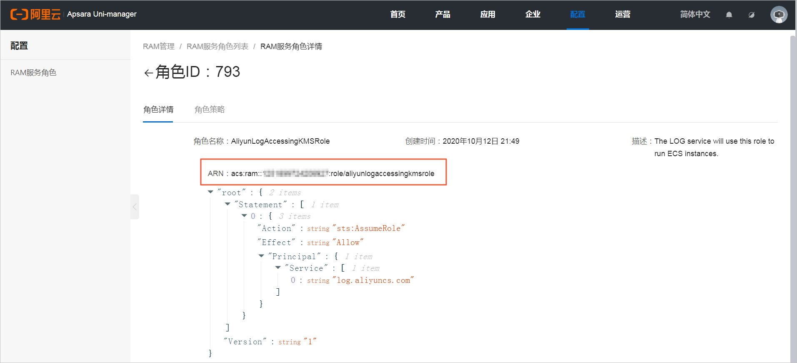

   </li>

   </ol>

4. 调用CreateProject API创建Logstore，添加如下**encrypt_conf**节点完成加密设置。

   ```text
   encrypt_conf = {
       "enable": True,             # 配置为True，启⽤加密。
       "encrypt_type": "aes_gcm",  # 加密算法，⽀持配置为sm4_gcm或aes_gcm。
       "user_cmk_info":
           {
               "cmk_key_id": "",   # BYOK的主密钥ID，即步骤1中创建的密钥ID。
               "arn": "",          # RAM⾓⾊的ARN，即步骤3中创建的服务⾓⾊的ARN。
               "region_id": "",    # 主密钥所在的地域ID。
           }
   }
   ```

<a id="section-3-3-17-2"></a>

#### 3.3.17.2. 数据模型

为方便理解整个 Log Service 服务并顺利使用，这里首先介绍其中的几个基本概念。

**项目（Project）**

项目为 Log Service 中的基本管理单元，用于资源隔离和控制。用户可以通过项目来管理某一个应用的所有日志及相关的日志源。

**日志库（Logstore）**

日志库为 Log Service 中日志数据的收集、存储和消费单元。每个日志库隶属于一个项目，每个项目可以创建多个日志库。您可以根据实际需求为某一个项目生成多个日志库，其中常见的做法是为一个应用中的每类日志创建一个独立的日志库。例如，假如用户有一个 big-game 游戏应用，服务器上有三种日志：操作日志（operation_log）、应用程序日志（application_log）以及访问日志（access_log），您可以首先创建名为 big-game 的项目，然后在该项目下面为这三种日志创建三个日志库，分别用于它们的收集、存储和消费。

**日志（Log）**

日志为 Log Service 中处理的最小数据单元。Log Service 采用半结构数据模式定义一条日志，具体数据模型如下：

- 主题（Topic）：用户自定义字段，用以标记一批日志（例如：访问日志根据不同的站点进行标记）。默认该字段为空字符串（空字符串也为一个有效的主题）。

- 时间（Time）：日志中保留字段，用以表示日志产生的时间（精度为秒，从 1970-1-1 00:00:00 UTC 计算起的秒数），一般由日志中的时间直接生成。

- 内容（Content）：用以记录日志的具体内容。内容部分由一个或多个内容项组成，每一个内容项由 Key、Value 对组成。

- 来源（Source）：日志的来源地，例如产生该日志机器的 IP 地址。默认该字段为空。

与此同时，Log Service 对日志各字段的取值有不同要求，具体如下表所示。 表 1. 日志字段

<table>
  <tr>
    <th width="88">数据域</th>
    <th>要求</th>
  </tr>
  <tr>
    <td>time</td>
    <td>整型，Unix 标准时间格式，最小单位为秒。</td>
  </tr>
  <tr>
    <td>topic</td>
    <td>任意不超过 128 个字符的UTF-8编码字符串。</td>
  </tr>
  <tr>
    <td>source</td>
    <td>任意不超过 128 个字符的UTF-8编码字符串。</td>
  </tr>
  <tr>
    <td>content</td>
    <td>一个或多个 Key-Value 对。其中，Key 为仅包含字母、下划线、数字，不以数字开头，不超过128个字符的UTF-8编码字符串。Value 为不超过1024*1024字节的任意UTF-8编码字符串。</td>
  </tr>
</table>

> 上表 content 中的 Key 不可以使用如下关键字： `__time__` 、 `__source__` 、 `__topic__` 、 `__partition_time__` 、 `_extract_others_` 。
>
> **说明**

**日志主题（Topic）**

一个日志库内的日志可以通过日志主题（Topic）来划分。用户可以在写入时指定日志主题。例如，一个平台用户可以使用用户编号作为日志主题写入日志。如果不需要划分一个日志库内的日志，让所有日志使用相同的日志主题即可。

> 空字符串是一个有效的日志主题（Topic），默认的日志主题都是空字符串。
>
> **说明**

实际使用场景中，日志的格式多样。为了帮助理解，以下以一条 Nginx 原始访问日志如何映射到 Log Service 日志数据模型为例说明。假设用户 Nginx 服务器的 IP 地址为10.10.10.1，下面为其上的一条原始日志：

```text
10.1.1.1 - - [01/Mar/2012:16:12:07 +0800] "GET /Send?AccessKeyId=<yourAccessKeyId> HTTP/1.1" 200 5 "-" "Mozilla/5.0 (X11; Linux i686 on 
x86_64; rv:10.0.2) Gecko/20100101 Firefox/10.0.2"
```

把该条原始日志映射到 Log Service 日志数据模型，如下表所示。 表 2. 日志服务日志数据模型

| 数据域 | 内容 | 说明 |
| --- | --- | --- |
| topic | “” | 沿用默认值（空字符串）。 |
| time | 1330589527 | 日志产生的精确时间（精确到秒），从原始日志中的时间戳转换而来。 |
| source | “10.10.10.1” | 使用服务器 IP 地址作为日志源。 |
| content | Key-Value 对 | 日志具体内容。 |

用户可以自己决定如何提取日志原始内容并组合成 Key-Value 对，如下表所示。 表 3. 自定义Key-Value对

| key | value |
| --- | --- |
| ip | “10.1.1.1” |
| method | “GET” |
| status | “200” |
| length | “5” |
| ref_url | “-“ |
| browser | “Mozilla/5.0 (X11; Linux i686 on x86_64; rv:10.0.2) Gecko/20100101 Firef |

**LogGroup**

一组日志的集合。

**Logs**

由多条日志产生的集合。

**LogGroupList**

一组 LogGroup 集合，用于结果返回。

**编码方式**

如下表所示，系统目前支持以下内容编码方式（将来可扩展），Restful API 层通过 Content-Type 表示。 表 4. 支持的编码方式

| 编码方式 | Content-Type | 说明 |
| --- | --- | --- |
| ProtoBuf | ProtoBuf 对数据模型进行编码 | application/x-protobuf |

以下 PB 定义了数据模型中的对象：

```text
message Log
{
    required uint32 Time = 1;// UNIX Time Format
    message Content
    {
        required string Key = 1;
        required string Value = 2;
    }  
    repeated Content Contents= 2;
}
message LogGroup
{
    repeated Log Logs= 1;
    optional string Reserved = 2; // reserved fields
    optional string Topic = 3;
    optional string Source = 4;
}
message LogGroupList
{
    repeated LogGroup logGroupList = 1;
}
```

> 在使用Protocol Buffer时要保证Key-Value对的唯一性，否则会出现行为未定义的错误。
>
> **说明**

<a id="section-3-3-17-3"></a>

#### 3.3.17.3. 数据编码方式

日志服务支持使用 Protocol Buffer 格式作为标准的日志写入格式。

Protocol Buffer 用于结构化数据交换格式，当用户需要写入日志时，需要把原始日志数据序列化成如下格式的 Protocol Buffer 数据流，然后才能通过 API 写入服务端：

```text
message Log
{
    required uint32 time = 1; // UNIX Time Format
    message Content
    {
        required string key = 1;
        required string value = 2;
    }
    repeated Content contents= 2;
}
message LogGroup
{
    repeated Log logs= 1;
    optional string reserved =2; // 内部字段，不需要填写
    optional string topic = 3;
    optional string source = 4;
}
message LogGroupList
{
    repeated LogGroup logGroupList = 1;
}
```

> **说明**
>
> - 由于 PB 对 Key-Value 对不要求唯一性，因此需要避免出现该情况，否则行为为未定义。
>
> - 关于 Protocol Buffer 格式的更多信息请参考其 Github 首页。
>
> - 关于日志服务写入日志的 API 的详细描述，请参考 PostLog。

<a id="section-3-3-17-4"></a>

#### 3.3.17.4. 日志库

数据存储单元叫做日志库（logstore），每个 Project 默认可以创建 10 个日志库（Logstore）。Logstore 名称在 Project 下具备唯一性。Logstore 是所有日志数据的入口，可以对日志库进行读写操作。

Logstore 命名规范：

- 只能包括小写字母、数字、连字符（-）和下划线（_）

- 必须以小写字母或者数字开头和结尾

- 长度必须在 2~63 字符以内

完整资源示例：

```text
{
    “logstoreName" : "access_log",
    "ttl": 1,
    "shardCount": 2,
    "createTime":1439538649,
    "lastModifyTime":1439538649
}
```

各参数含义如下表所示。 表 1. 参数含义

| 参数名称 | 类型 | 必须 | 描述 |
| --- | --- | --- | --- |
| logstoreName | string | 是 | Logstore 的名称，在该 Project 下唯一 |
| ttl | integer | 是 | 日志数据生命周期（TTL），单位为天，最小为 1 天 |
| shardCount | integer | 是 | Logstore中的分区数 |
| createTime | integer | 否 | 该资源服务端创建时间（输出可见） |
| lastModifyTime | integer | 否 | 该资源服务端更新时间（输出可见） |

<a id="section-3-3-17-5"></a>

#### 3.3.17.5. 分区

分区（shard）是每个 Logstore 下读写基本单元，每个 Logstore 会指定分区数目。

在向 Shard 读写数据过程中，读必须指定对应的 Shard，而写的过程中可以使用 Load-Balance 方式。Load-Balance 会根据后台系统负载，自动均衡，保证写入高可用性。

完整资源示例如下表所示。

表 1. 完整资源示例

| 参数名称 | 类型 | 必须 | 描述 |
| --- | --- | --- | --- |
| shardID | int | 是 | Logstore 下 Shard 的唯一 ID，由系统自动生成，类型为整型。 |

<a id="section-3-3-17-6"></a>

#### 3.3.17.6. Logtail 配置

Logtail 配置叫做 config，每个 Project 默认可以创建 100 个配置（config）。Config 名称在 Project 下具备唯一性。

您可以通过 config 指定日志收集的位置、方式和参数。

config 命名规范：

- 只能包括小写字母、数字、连字符（-）和下划线（_）

- 必须以小写字母或者数字开头和结尾

- 长度必须在 2~128 字符以内

完整资源示例：

```json
{
    "configName": "testcategory1",
    "inputType": "file",
    "inputDetail": {
        "logType": "common_reg_log",
        "logPath": "/var/log/httpd/",
        "filePattern": "access.log",
        "localStorage": true,
        "timeFormat": "%Y/%m/%d %H:%M:%S",
        "logBeginRegex": ".*",
        "regex": "(\w+)(\s+)",
        "key" :[“key1", “key2"],
        "filterKey":["key1"],
        "filterRegex":[“regex1"],
        "topicFormat": “none"
    },
    "outputType": "sls",
    "outputDetail": 
    {
        "logstoreName": "perfcounter"
    },
    "createTime": 1400123456,
    "lastModifyTime": 1400123456
}
```

配置参数及描述如下表所示。 表 1. 配置详情

| 属性名称 | 类型 | 是否必须 | 描述 |
| --- | --- | --- | --- |
| configName | string | 是 | 日志配置名称， Project 下唯一 |
| inputType | string | 是 | 输入类型，默认为 file |
| inputDetail | json | 是 | 见下表格说明 |
| outputType | string | 是 | 输出类型，目前只支持 LogService |
| outputDetail | string | 是 | 见下表格说明 |
| createTime(output-only) | integer | 否 | 配置创建时间 |
| lastModifyTime(output-only) | integer | 否 | 该资源服务端更新时间 |

inputDetail 类型及描述如下表所示。 表 2. inputDetail详情

| 属性名称 | 类型 | 必须 | 描述 |
| --- | --- | --- | --- |
| logType | string | 是 | 日志类型，现在只支持 common_reg_log。 |
| logPath | string | 是 | 日志所在的父目录，例如 <code> /var/logs/ </code>。 |
| filePattern | string | 是 | 日志文件的 Pattern，例如 <code> access*.log </code>。 |
| localStorage | boolean | 是 | 是否打开本地缓存，在服务端之间链路断开的情况下，本地可以缓存 1GB 日志。 |
| timeFormat | string | 是 | 日志时间格式，如 <code> %Y/%m/%d %H:%M:%S </code>。 |
| logBeginRegex | string | 是 | 日志首行特征（正则表达式），由于匹配多行日志组成一条 log 的情况。 |
| regex | string | 是 | 日志对提取正则表达式。 |
| key | array | 是 | 日志提取后所生成的 Key。 |
| filterKey | array | 是 | 用于过滤日志所用到的 Key，只有 Key 的值满足对应filterRegex 列中设定的正则表达式日志才是符合要求的。 |
| filterRegex | array | 是 | 每个 filterKey 对应的正正则表达式， filterRegex 的长度和 filterKey 的长度必须相同。 |
| topicFormat | string | 否 | 用于将日志文件路径的某部分作为 topic，如<code> /var/log/(.*).log </code>，默认为 none，表示 topic为空。 |
| preserve | boolean | 否 | true 代表监控目录永不超时，false 代表监控目录 30 分钟超时，默认值为 true。 |
| preserveDepth | integer | 否 | 当设置 preserve 为 false 时，指定监控不超时目录的深度，最大深度支持 3。 |

outputDetail 类型及描述如下表所示。 表 3. outputDetail详情

| 属性名称 | 类型 | 必须 | 描述 |
| --- | --- | --- | --- |
| logstoreName | string | 是 | 对应 Logstore 名称 |

<a id="section-3-3-17-7"></a>

#### 3.3.17.7. Logtail 机器组

机器：当机器安装 Logtail 并正常启动后，会根据 Logtail 配置中的用户信息自动关联到当前用户。目前 machine 有三种标示的方式，分别为：

- IP: hostname 对应 IP 地址。最容易理解，但在 VPC 等环境下可能会有重复。

- UUID (machine-uniqueid)：DMI 设备中 UUID，参见 RFC4122。

- Userdefined-id: 用户在 Logtail 目录下自定义该机器标识。

每台机器属性如下：

```json
{
    "ip" : "testip1",
    "machine-uniqueid" : "testuuid1",
    "userdefined-id" : "testuserdefinedid1",
    "lastHeartbeatTime”:1397781420
 }
```

机器属性参数说明如下表所示。 表 1. 参数说明

| 参数名称 | 类型 | 描述 |
| --- | --- | --- |
| ip | string | 机器 hostname 对应 IP 地址 |
| uuid | string | 机器标示的唯一主键，由 Logtail 上传 |
| userdefined-id | string | 用户自定义机器标示，由 Logtail 上传 |
| lastHeartbeatTime(output-only) | integer | 机器的最后心跳时间（从 epoch 时间开始的秒数） |

**machinegroup**

project 下当前用户拥有的机器分组。机器分组可以通过两种方式来标示（IP 与 userdefined）。IP 较为容易辨识，userdefined 可以解决 VPC 下 IP 相同的问题，用户可以选任意一种方式进行机器标识。

machinegroup 命名规范：

- 只能包括小写字母、数字、连字符（-）和下划线（_）

- 必须以小写字母或者数字开头和结尾

- 长度必须在 2~128 字节以内

**完整资源示例**

```json
{
    "groupName" : "testgroup",
    "groupType" : "",
    "groupAttribute" : {
        "externalName" : "testgroup",
        “groupTopic”: “testgrouptopic”
    },
    “machineIdentifyType”: "ip",
    "machineList" : [
        "ip1",
        "ip2"
        …
    ],
    “createTime”: 1431705075,
    "lastModifyTime" : 1431705075
}
```

machinegroup参数如下表所示。 表 2. machinegroup参数说明

| 属性名称 | 类型 | 必须 | 描述 |
| --- | --- | --- | --- |
| groupName | string | 是 | 机器分组名称， Project 下唯一 |
| groupType | string | 否 | 机器分组类型，默认为空 |
| machineIdentifyType | string | 是 | 机器标识类型，分为 IP 和 userdefined 两种 |
| groupAttribute | object | 是 | 机器分组的属性，默认为空 |
| machineList | array | 是 | 具体的机器标识，可以是 IP 或 userdefined-id |
| createTime(output-only) | int | 否 | 该资源创建时间 |
| lastModifyTime(output-only) | int | 否 | 该资源服务端更新时间 |

groupAttribute 类型及描述如下表所示。 表 3. groupAttribute 详情

| 属性名称 | 类型 | 是否必须 | 描述 |
| --- | --- | --- | --- |
| groupTopic | string | 否 | 机器分组的 Topic，默认为空 |
| externalName | string | 否 | 机器分组所依赖的外部管理标识，默认为空 |

<a id="section-3-3-17-8"></a>

#### 3.3.17.8. 数据加工

数据加工服务可用于数据的规整、富化、流转、脱敏和过滤。

完整资源示例：

```json
{
  "name": "etl-1732775634-859724",
  "type": "ETL",
  "apiType": "ETL",
  "status": "RUNNING",
  "description": "",
  "displayName": "etl-test",
  "state": "Enabled",
  "recyclable": false,
  "schedule": {
    "type": "Resident"
  },
  "configuration": {
    "logstore": "storeview",
    "instanceType": "Standard",
    "containerImage": "",
    "version": 1,
    "numberOfInstances": 0,
    "fromTime": 1732642433,
    "script": "",
    "accessKeyId": "",
    "accessKeySecret": "",
    "roleArn": "acs:ram::账户ID:role/aliyunlogetlrole",
    "parameters": {},
    "sinks": [
      {
        "type": "AliyunLOG",
        "name": "spl-test",
        "endpoint": "cn-beijing-intranet.log.aliyuncs.com",
        "project": "aliyun-test-project",
        "logstore": "target-store",
        "accessKeyId": "",
        "accessKeySecret": "",
        "roleArn": "acs:ram::账户ID:role/aliyunlogetlrole"
      }
    ]
  },
  "scheduleId": "10d20d7c7d5ab40b9cb49ee1a4163880",
  "createTime": 1732775713,
  "lastModifiedTime": 1732775713
}
```

配置参数及描述如下表所示。

bod描述如下表所述。

| 名称 | 类型 | 描述 | 示例值 |
| --- | --- | --- | --- |
| name | string | job name | etl-20240426 |
| description | string | job description | 加工作业 |
| displayName | string | job displayName | etljob |
| configuration | ETLConfiguration | 数据加工配置 |  |
| createTime | long | 创建时间 | 1714274900 |
| lastModifiedTime | long | 最近一次修改时间 | 1714274900 |
| status | string | 加工状态 | RUNNING |
| scheduleId | string | 调度ID | f0eb655e501a8780808d1970ef6d04c4 |

ETLConfiguration类型及描述如下表所示。

| 名称 | 类型 | 描述 | 示例值 |
| --- | --- | --- | --- |
|  | object | ETLConfiguration |  |
| script | string | 加工脚本 | e_set("key","value") |
| lang | string | 数据加工语法类型，不填写 |  |
| logstore | string | 源Logstore名称 | test-logstore |
| roleArn | string | 授权读取源Logstore 的角色ARN | acs:ram::13234:role/logtarget |
| fromTime | long | 加工时间起点时间戳（精确到秒），必填。从源Logstore中最早接收到的第一条日志开始消费时，填入0 | 0 |
| toTime | long | 加工时间结束时间戳（精确到秒），必填。持续消费至手动停止时，填入0 | 0 |
| sinks | array ETLConfigurationSink | 加工结果输出目标列表 |  |
| parameters | object | 高级参数配 | config.vpc.vpc_id.test1：vpc-uf6mskb0b\*\*\*\*n9yj |

ETLConfigurationSink类型及描述如下表所示。

<table>
  <tr>
    <td></td>
    <td></td>
    <td></td>
    <td></td>
  </tr>
  <tr>
    <td>名称</td>
    <td>类型</td>
    <td>描述</td>
    <td>示例值</td>
  </tr>
  <tr>
    <td></td>
    <td>object</td>
    <td>ETLSinkObject</td>
    <td></td>
  </tr>
  <tr>
    <td>name</td>
    <td>string</td>
    <td>输出目标名称</td>
    <td>test-etljob</td>
  </tr>
  <tr>
    <td>endpoint</td>
    <td>string</td>
    <td>目标Project所在区域的endpoint</td>
    <td></td>
  </tr>
  <tr>
    <td>project</td>
    <td>string</td>
    <td>目标Project名称</td>
    <td>test-project</td>
  </tr>
  <tr>
    <td>logstore</td>
    <td>string</td>
    <td>目标Logstore名称</td>
    <td>test-logstore</td>
  </tr>
  <tr>
    <td>datasets</td>
    <td>array</td>
    <td>写入结果集</td>
    <td></td>
  </tr>
  <tr>
    <td></td>
    <td>string</td>
    <td></td>
    <td>__UNNAMED__</td>
  </tr>
  <tr>
    <td>roleArn</td>
    <td>string</td>
    <td>授权写入目标Logstore的角色ARN</td>
    <td>acs:ram::13234:role/logtarget</td>
  </tr>
</table>

<a id="section-3-4"></a>

## 3.4. CLI参考

<a id="section-3-4-1"></a>

### 3.4.1. CLI概述

为满足越来越多的自动化日志服务配置需求，日志服务提供命令行工具CLI（Command Line Interface）。

**主要功能**

日志服务命令行工具CLI的主要功能包括：

- 支持大部分的日志服务REST接口。例如管理Project、Logstore、机器组、消费组和Logtail配置等。

- 支持多账号，便于跨地域操作日志。

- 支持基本查询和拉取日志。

- 支持Elasticsearch数据迁移。

- 支持灵活的时间配置。

- 支持高速跨域日志复制，历史数据重新索引与数仓投递。

**子命令列表**

日志服务CLI工具支持大部分日志服务API的功能，其支持的常用子命令列表如下。

**资源分类**

**子命令**

**描述**

创建Project。

create_project

删除Project。

delete_project

获取指定Project信息。

get_project

Project管理

查询所有Project信息。

list_project

复制源Project的所有Logstore、Logtail、机器组和索引配置等到目标

copy_project

Project中。

创建Logstore。

create_logstore

删除Logstore。

delete_logstore

Logstore管理

获取指定Logstore信息。

get_logstore

查询所有Logstore信息。

list_logstore

更新Logstore信息。

update_logstore

获取Shard信息。

list_shards

Shard管理

分裂Shard。

split_shard

合并Shard。

merge_shard

创建机器组。

create_machine_group

删除机器组。

delete_machine_group

更新机器组信息。

update_machine_group

Logtail机器组管理

获取指定机器组信息。

get_machine_group

查询所有机器组信息。

list_machine_group

查询指定机器组内的机器信息。

list_machines

创建Logtail配置。

create_logtail_config

更新Logtail配置。

update_logtail_config

Logtail配置管理

删除Logtail配置。

delete_logtail_config

获取指定Logtail配置信息。

get_logtail_config

查询所有Logtail配置信息。

list_logtail_config

将Logtail配置应用到机器组。

apply_config_to_machine_group

从机器组中移除Logtail配置。

remove_config_to_machine_group

机器组与Logtail配置关联

获取目标机器组上已经被应用的Logtail配置列表。

get_machine_group_applied_configs

获取已应用Logtail配置的机器组列表。

get_config_applied_machine_groups

为指定Logstore创建索引。

create_index

删除指定Logstore的索引。

delete_index

索引管理

更新指定Logstore的索引。

update_index

查询指定Logstore的索引。

get_index_config

根据时间获取对应的游标。

get_cursor

根据游标获取服务端时间。

get_cursor_time

游标管理

根据前一个游标获取服务端时间。

get_previous_cursor_time

获取BEGIN游标。

get_begin_cursor

获取END游标。

get_end_cursor

查询日志。通过JSON文件配置查询请求，适用于精确查询场景。

get_logs

查询指定数量日志。

get_log

查询大批量日志。

get_log_all

日志管理

获取日志分布情况。

get_histograms

获取日志。

pull_log

获取大量的日志。

pull_logs

并发下载大量日志到本地文件。

pull_log_dump

在指定的Logstore上创建一个消费组。

create_consumer_group

删除一个指定的消费组。

delete_consumer_group

修改指定消费组信息。

update_consumer_group

消费组管理

查询指定Logstore的所有消费组。

list_consumer_group

更新指定消费组消费数据时的Checkpoint。

update_check_point

获取指定消费组消费数据时的Checkpoint。

get_check_point

关联外部数据源。当前支持关联RDS MySQL、OSS、本地CSV文件作为外

create_external_store

部数据源。

删除外部数据源。

delete_external_store

查询指定外部数据源的详细配置。

关联外部数据源

get_external_store

查询已关联的外部数据源。

list_external_store

修改关联的外部数据源。

update_external_store

**参考信息**

更多信息，请参见日志服务CLI。

<a id="section-3-4-2"></a>

### 3.4.2. 安装CLI

日志服务命令行工具CLI支持大部分日志服务功能操作，包括Project管理、Logstore管理、日志查询、自动分页和多账户跨域复制等场景。本文介绍如何安装日志服务命令行工具CLI。

**安装之前必读**

日志服务CLI工具基于Python开发，需要安装Python。安装方法，请参见Python官网。

<table>
  <tr>
    <th width="146">说明项</th>
    <th>说明</th>
  </tr>
  <tr>
    <td>当前CLI版本</td>
    <td>0.2.5<br>说明您可以执行安装命令完成CLI工具的升级。建议您升级到最新版本。</td>
  </tr>
  <tr>
    <td>工具源码</td>
    <td>Aliyun Log CLI</td>
  </tr>
  <tr>
    <td>支持Python版本</td>
    <td>Python 2.6、2.7、3.3、3.4、3.5、3.6、3.7、3.8和3.9。</td>
  </tr>
  <tr>
    <td>支持操作系统</td>
    <td>Windows、Linux和macOS。</td>
  </tr>
  <tr>
    <td>依赖组件</td>
    <td>安装Python完成后，建议您使用<code> pip install package_name </code>命令优先安装以下依赖组件。如果安装过程出错，请执行<code> pip install package_name </code>命令重试。<br>• docopt<br>• aliyun-log-python-sdk<br>• jmespath<br>• aliyun-python-sdk-core<br>• aliyun-python-sdk-sts<br>• requests</td>
  </tr>
</table>

**在Linux系统安装CLI**

1. 登录Linux服务器。

2. 执行如下命令安装CLI。

   ```bash
   pip3 install aliyun-log-python-sdk aliyun-log-cli -U --no-cache
   ```

3. 验证安装结果。运行命令如下：

   ```text
   aliyunlog --version
   ```

   如果返回如下类似结果，表示安装完成。

   ```text
   Successfully installed aliyun-log-cli-0.2.5 aliyun-log-python-sdk-0.8.6 backports.zoneinfo-0.2.1 ...
   ```

**在Windows系统安装CLI**

1. 登录Windows服务器。

2. 打开Windows命令行。如果您已经设置Python环境变量，可以直接执行后续命令进行安装。若提示pip3命令无法识别，则说明您未配置Python环境变量，此时您可以使用**cd**进入Python安装路径后，再执行安装命令。

3. 执行如下命令安装CLI。

   ```bash
   pip3 install aliyun-log-python-sdk aliyun-log-cli -U --no-cache
   ```

4. 验证安装结果。运行命令如下：

   ```text
   aliyunlog --version
   ```

   如果返回如下类似结果，表示安装完成。

   ```text
   log-cli-v-0.2.5, log-python-sdk-v-0.8.6, sys.version_info(major=3, minor=7, micro=0, releaselevel='final', serial=0), win32
   ```

**在mac OS系统安装CLI**

推荐使用pip3安装日志服务命令工具CLI，参考命令如下：

```bash
brew install python3
pip3 install -U aliyun-log-cli --no-cache
```

其他操作和Linux系统安装相似，请参见在Linux系统安装CLI。

**如何升级CLI**

您可以执行安装命令完成CLI工具的升级。建议您升级到最新版本。

**如何卸载CLI**

如果您不需要继续使用CLI，您可以将其卸载。执行命令如下：

```bash
pip3 uninstall aliyun-log-cli
```

如果返回如下类似结果，表示卸载完成。

```text
Successfully uninstalled aliyun-log-cli
```

**后续步骤**

配置CLI

<a id="section-3-4-3"></a>

### 3.4.3. 配置CLI

配置CLI后，您无需在每次执行命令时指定所需的访问密钥、服务入口和输出格式等全局参数。本文介绍配置CLI账号和全局参数的操作方法。

**前提条件**

已安装CLI。更多信息，请参见安装CLI。

**使用阿里云CLI凭证**

日志服务CLI工具支持使用阿里云CLI凭证作为账号校验凭证。如果您已安装阿里云CLI工具，则可以无需配置账号信息。

在使用CLI过程中，日志服务CLI可以通过具体子命令、日志服务CLI配置文件、阿里云CLI配置文件和环境变量读取凭证信息，其读取优先级从上到下逐次递减。

| 凭证来源（优先级由高到低） | 描述 |
| --- | --- |
| 日志服务CLI子命令传入的AK、Region等全局参数 | 在执行具体命令时，优先使用参数传入的凭证做校验。该种方式指定凭证优先级最高。 |
| 日志服务CLI的<em>profile</em>参数 | 执行具体子命令时通过<code> --profile=</code>阿里云<code>CLI config.json</code>中具体的<code>name</code>的取值<code> </code>指定具体凭证。使用方法，请参见全局参数。 |
| 日志服务CLI ALIYUN_LOG_CLI环境变量 | 在系统中配置的环境变量ALIYUN_LOG_CLI。 |
| 日志服务CLI配置文件 | 名称为.aliyunlogcli。具体如何配置，请参见配置默认账号的服务入口和访问密钥和配置多个账号的服务入口和访问密钥。 |
| 阿里云CLI ALIBABACLOUD环境变量 | 在系统中配置的环境变量ALIBABACLOUD。 |
| 阿里云CLI ALICLOUD环境变量 | 在系统中配置的环境变量ALICLOUD。 |
| 阿里云CLI配置文件 | 由阿里云CLI定义的配置凭证文件。<br>说明该配置文件在不同系统其所在位置不同，您可以参考如下路径找到配置文件。<br>• Linux：~/.aliyun/config.json<br>• Windows：C:\\Users\\<em>UserName</em>\\.aliyun\\config.json |

**配置默认账号的服务入口和访问密钥**

日志服务CLI默认使用配置的**main**账号执行所有操作，您必须在使用CLI前配置**main**账号的AccessKey和服务入口，同时该账号必须具备操作Project的相关权限。

1. 登录安装CLI的服务器。

2. 配置默认账号的访问密钥和服务入口。

   执行命令如下：

   ```text
   aliyunlog configure "AccessKey ID" "AccessKey Secret" Endpoint
   ```

   - *AccessKey ID*和*AccessKey Secret*替换为拥有操作日志服务权限的AccessKey ID和AccessKey Secret。更多信息，请参见获取AccessKey和<strong>《统一云管平台>用户指南>企业中心>权限管理>角色授权》</strong>章节。

   - *Endpoint*为Project的访问域名。更多信息，请参见获取日志服务的Endpoint。

3. 验证配置结果。

   编辑.aliyunlogcli文件，如果配置文件中显示如下类似结果，则说明配置默认账号成功。

   ```text
   [main]
   access-id = LTAI******pLMZ
   access-key = XjAsP******eRqax
   region-endpoint = cn-hangzhou.log.aliyuncs.com
   sts-token =
   ```

   > **说明**
   >
   > 配置文件.aliyunlogcli在不同系统其所在位置不同，您可以参考如下路径找到配置文件。
   >
   > - Linux：~/.aliyunlogcli
   >
   > - Windows：C:\\Users\\*UserName*\\.aliyunlogcli

   如果配置不成功，请根据返回错误码提示进行处理。

**配置多个账号的服务入口和访问密钥**

如果您需要跨账号操作日志数据，则需要配置多个账号的AccessKey和服务入口信息。

1. 登录安装CLI的服务器。

2. 配置多个账号的访问密钥和服务入口。

   执行命令如下：

   ```text
   aliyunlog configure "AccessKey ID" "AccessKey Secret" Endpoint testName
   ```

   - *AccessKey ID*和*AccessKey Secret*替换为拥有操作日志服务权限的AccessKey ID和AccessKey Secret。更多信息，请参见获取AccessKey和<strong>《统一云管平台>用户指南>企业中心>权限管理>角色授权》</strong>章节。

   - *Endpoint*为Project的访问域名。更多信息，请参见获取日志服务的Endpoint。

   - *testName*为您配置的其他账号名称。

3. 验证配置结果。

   编辑~/.aliyunlogcli文件，如果配置文件中显示如下类似结果，则说明配置账号成功。

   ```text
   [main]
   access-id = LTAI******pLMZ
   access-key = XjAsP******eRqax
   region-endpoint = cn-hangzhou.log.aliyuncs.com
   sts-token =

   [test]
   access-id = As******sPzvb
   access-key = FtagJeR******bQqax
   region-endpoint = cn-shanghai.log.aliyuncs.com
   sts-token =
   ```

   > **说明**
   >
   > 配置文件.aliyunlogcli在不同系统其所在位置不同，您可以参考如下路径找到配置文件。
   >
   > - Linux：~/.aliyunlogcli
   >
   > - Windows：C:\\Users\\*UserName*\\.aliyunlogcli

   如果配置不成功，请根据返回错误码提示进行处理。

   在使用CLI执行命令时，您可以通过 `--client-name=testName` 方式来使用指定的账号。例如 `aliyunlog log create_project ..... --client-name=test` ，表示使用test账号创建Project。

**配置输出格式**

日志服务CLI支持对输出结果进行格式化和字符转义处理。当您需要对输出结果格式化、设置转义字符时，可参考如下配置。

- JSON格式化

  日志服务CLI返回结果默认以JSON形式输出，并且显示为一行，可读性差。为便于查看，您可以使用如下方法对输出JSON结果进行格式化。

  - 对特定命令的输出结果进行格式化。

    例如， `aliyunlog log get_log .... --format-output=json` 表示对get_log的输出结果进行JSON格式化。

  - 对所有命令的输出结果进行格式化。

    直接执行 `aliyunlog configure --format-output=json` ，则表示对所有输出结果进行JSON格式化。

- 转义字符

  日志服务CLI返回结果中，非英文字符默认都是转义字符串。如果您需要返回原始字符（例如中文字符串），可以在 `--format-output` 添加 `no_escape` 。

  直接执行 `aliyunlog configure --format-output=no_escape` ，则日志服务CLI所有命令的输出结果都不转义，按照原始字符返回。

**转义特殊字符**

通过日志服务CLI执行操作命令时，若查询语句中包含美元符号（$）、反引号（\`）、反斜线（\\）、感叹号（!）特殊字符，会导致执行报错或者查询结果不准确。

您需要使用反斜线（\\）转义或者单引号（'）强制引用。

- 通过转义字符（\\）对query中的参数进行转义，示例命令如下：

  ```text
    aliyunlog log get_log_all --project="my-project" --logstore="my-logstore" --query="event_name:\$_enter" --from_time="2021-06-24 
  15:00:00+08:00" --to_time="2021-06-24 16:00:00+08:00" 
  ```

- 通过单引号（'）对query中的参数进行引用，示例命令如下：

  ```text
    aliyunlog log get_log_all --project="my-project" --logstore="my-logstore" --query='event_name:$_enter' --from_time="2021-06-24 15:00:00+08:00" 
  --to_time="2021-06-24 16:00:00+08:00" 
  ```

更多信息，请参见Quoting。

<a id="section-3-4-4"></a>

### 3.4.4. 请求语法

日志服务CLI提供三种语法格式，用于执行子命令、配置CLI和获取帮助等。本文介绍日志服务CLI的三种语法格式。

**CLI子命令**

支持的日志服务CLI子命令，例如创建Project、Logstore等基本操作。

- 语法格式

  ```text
  aliyunlog log <subcommand> [parameters | global options]
  ```

  - subcommand：支持的子命令。更多信息，请参见子命令列表。

  - parameters：支持的参数，每个子命令支持的参数列表请参见具体子命令描述。

  - global options：支持的全局参数。更多信息，请参见全局参数。

- 示例

  例如，创建一个Project的用法示例如下：

  ```text
  aliyunlog log create_project --project_name="project-a" --project_des="project created from cli"
  ```

**configure命令**

用于配置访问密钥、服务入口和账号等基本信息。

- 语法格式

  ```text
  aliyunlog configure <access_id> <access-key> <endpoint> [<client-name>]
  ```

  在使用时，将 `<access_id>` 、 `<access-key>` 和  `<endpoint>` 替换为拥有操作日志服务权限的AccessKey ID、AccessKey Secret和Endpoint， `<client-name>` 为执行该命令的账号名称。更多信息，请参见获取AccessKey和获取日志服务的Endpoint。

- 示例

  例如，创建一个test账号的用法示例如下：

  ```text
  aliyunlog configure LTAI4G24******dYKSpLMZ XjAsPzvbK******tagJeRqax cn-hangzhou.log.aliyuncs.com test
  ```

**获取帮助和版本**

获取联机帮助和版本信息。

- 语法格式

  ```text
  aliyunlog [--help | --version]
  ```

- 示例

  例如，获取CLI版本信息示例如下：

  ```text
  aliyunlog --version
  ```

<a id="section-3-4-5"></a>

### 3.4.5. 全局参数

在使用日志服务CLI工具执行命令时，不需要每次都输入全局参数。日志服务CLI默认使用全局参数进行请求处理。本文介绍日志服务CLI的常用全局参数。

| 参数名称 | 数值类型 | 是否必选 | 示例值 | 描述 |
| --- | --- | --- | --- | --- |
| --access-id | String | 否 | LTAI4G243ui\*\*\*\*\*\*pLMZ | 阿里云访问密钥中的AccessKey ID，请根据实际情况替换。如何获取AccessKey ID，请参见获取AccessKey。 |
| --access-key | String | 否 | XjAsPzvbK\*\*\*\*\*\*QFRqax | 阿里云访问密钥中的AccessKey Secret，请根据实际情况替换。如何获取AccessKey Secret，请参见获取AccessKey。 |
| --sts-token | String | 否 | 无。 | STS Token。 |
| --region-endpoint | String | 否 | cn-hangzhou.log.aliyuncs.com | 访问日志服务的服务入口。如何获取，请参见获取日志服务的Endpoint。 |
| --client-name | String | 否 | test | 指定发送请求的客户端名称，即使用哪个账号进行操作。 |
| --format-output | String | 否 | json | 输出格式。包括：<br>• json：JSON格式化输出结果。<br>• no_escape：非英文字符不进行转义，以原始字符输出结果。例如，全局参数设置为<code> --</code><code>format-</code><code>output=json,no_escape </code>，表示不转义非英文，以原始字符输出结果，并进行JSON格式化。 |
| --jmes-filter | String | 否 | <code>--jmes-</code><br><code>filter="join('\n',</code><br><code>map(&amp;to_string(@), @))"</code> | JMES语法表达式，用于过滤返回的日志数据。更多信息，请参见JMES语法表达式。 |
| --decode-output | String | 否 | utf8 | 当存储的日志数据的是二进制数据时，指定数据的编码方式，用于解析数据。支持的编码方式包括：<br>• utf8：使用utf8解析数据，默认值。<br>• lartin1：使用lartin1解析数据。<br>• gbk：使用gbk解析数据。 |
| --profile | String | 否 | akProfile | 使用阿里云CLI配置文件.aliyun/config.json中配置的凭证进行账号校验。 |

如何配置全局参数，请参见配置CLI。

<a id="section-3-4-6"></a>

### 3.4.6. 使用CLI

<a id="section-3-4-6-1"></a>

#### 3.4.6.1. Project管理

<a id="section-3-4-6-1-1"></a>

##### 3.4.6.1.1. copy_project

调用CLI命令将源Project相关资源复制到目标Project。

该命令支持将日志服务的如下资源复制到其他Project：

- Logstore

- 索引配置

- Logtail配置

- 机器组

- 机器组和Logtail关联配置

更多操作，请参考示例。

**请求语法**

```xml
aliyunlog log copy_project --from_project=<value> --to_project=<value> [--to_client=<value>] [--copy_machine_group=<value>] [--access-id=<value
>] [--access-key=<value>] [--sts-token=<value>] [--region-endpoint=<value>] [--client-name=<value>] [--jmes-filter=<value>] [--format-output=
<value>] [--decode-output=<value>]
```

**请求参数**

该命令的必选和特有参数描述如下。

| 参数名称 | 数值类型 | 是否必选 | 示例值 | 描述 |
| --- | --- | --- | --- | --- |
| --from_project | String | 是 | project-a | 源Project名称。 |
| --to_project | String | 是 | project-b | 目标Project名称。 |
| --to_client | String | 否 | test | 具备操作Project权限的账号。如何配置该账号信息，请参见配置CLI。 |
| --copy_machine_group | Boolean | 否 | false | 是否复制机器组相关资源。取值包括：<br>• true：复制机器组资源至目标Project。<br>• false（默认值）：不复制。 |

关于该命令的全局参数，请参见全局参数。

**示例**

- 请求示例

  - （同一个地域复制Project）使用默认账号，将源project-a复制到project-b。

    ```text
    aliyunlog log copy_project --from_project="project-a" --to_project="project-b"
    ```

  - （跨地域复制Project）将默认账号下的源project-a复制到test账号的project-b。

    ```text
    aliyunlog log copy_project --from_project="project-a" --to_project="project-b" --client-name="test"
    ```

  - （跨地域复制Project所有配置）将默认账号下的源project-a复制到test账号的project-b，并复制Logtail配置和机器组相关资源。

    ```text
    aliyunlog log copy_project --from_project="project-a" --to_project="project-b" --copy_machine_group=true --client-name="test"
    ```

- 返回示例

  命令执行成功后，无响应消息。

<a id="section-3-4-6-1-2"></a>

##### 3.4.6.1.2. create_project

调用CLI命令创建Project。

**注意事项**

在使用CLI命令之前，您需要已安装日志服务CLI，并完成配置。具体操作，请参见安装CLI和配置CLI。

**命令格式**

```text
aliyunlog log create_project --project_name=<value> --project_des=<value> [--access-id=<value>] [--access-key=<value>] [--sts-token=<value>] [--region-endpoint=<value>] [--client-name=<value>] [--jmes-filter=<value>] [--format-output=<value>] [--decode-output=<value>]
```

**命令参数**

该命令的必选和特有参数描述如下。

| 参数名称 | 数值类型 | 是否必选 | 示例值 | 描述 |
| --- | --- | --- | --- | --- |
| --project_name | String | 是 | project-a | Project名称。其命名规则如下：<br>• 必须全局唯一。<br>• 只能包括小写字母、数字和短划线（-）。<br>• 必须以小写字母或者数字开头和结尾。<br>• 长度为3~63字符。 |
| --project_des | String | 是 | project created from cli | Project描述信息。 |

关于该命令的全局参数，请参见全局参数。

**命令示例**

- 使用默认账号创建一个名为project-a的Project。

  - 命令示例

    ```text
    aliyunlog log create_project --project_name="project-a" --project_des="project created from cli"
    ```

  - 返回示例

    命令执行成功后，无响应消息。您可以执行 `aliyunlog log get_project --project_name="project-a" --format-output=json` 查询Project详细信息。

- 使用指定账号的AccessKey信息，创建一个名为project-b的Project。

  - 命令示例

    ```text
    aliyunlog log create_project --project_name="project-b" --project_des="project created from cli" --access-id="your_accesskey_id" --access-key="your_accesskey_secret"
    ```

  - 返回示例

    命令执行成功后，无响应消息。您可以执行 `aliyunlog log get_project --project_name="project-b" --access-id="your_accesskey_id" --access-key="your_accesskey_secret" --format-output=json` 查询Project详细信息。

- 使用指定账号的AccessKey信息，在上海地域创建一个名为project-c的Project。

  - 命令示例

    ```text
    aliyunlog log create_project --project_name="project-c" --project_des="project created from cli" --access-id="your_accesskey_id" --access-key="your_accesskey_secret" --region-endpoint="cn-shanghai.log.aliyuncs.com"
    ```

  - 返回示例

    命令执行成功后，无响应消息。您可以执行 `aliyunlog log get_project --project_name="project-c" --access-id="your_accesskey_id" --access-key="your_accesskey_secret" --region-endpoint="cn-shanghai.log.aliyuncs.com" --format-output=json` 查询Project详细信息。

**相关文档**

- 在调用API接口过程中，若服务端返回结果中包含错误信息，则表示调用API接口失败。您可以参考API错误码对照表查找对应的解决方法。更多信息，请参见通用错误码。

- 关于该API接口的详细信息，请参见CreateProject。

<a id="section-3-4-6-1-3"></a>

##### 3.4.6.1.3. delete_project

调用CLI命令删除Project。

**请求语法**

> 删除Project后，其管理的所有日志数据及配置信息都会被释放，不可恢复。请谨慎操作。
>
> **警告**

```xml
aliyunlog log delete_project --project_name=<value> [--access-id=<value>] [--access-key=<value>] [--sts-token=<value>] [--region-endpoint=
<value>] [--client-name=<value>] [--jmes-filter=<value>] [--format-output=<value>] [--decode-output=<value>]
```

**请求参数**

该命令的必选和特有参数描述如下。

| 参数名称 | 数值类型 | 是否必选 | 示例值 | 描述 |
| --- | --- | --- | --- | --- |
| --project_name | String | 是 | project-a | Project名称。 |

关于该命令的全局参数，请参见全局参数。

**示例**

- 请求示例使用默认账号删除一个名为project-a的Project。

  ```text
  aliyunlog log delete_project --project_name="project-a"
  ```

- 返回示例

  命令执行成功后，无响应消息。

**错误码**

如果返回报错信息，请参见具体接口的错误码处理。更多信息，请参见DeleteProject。

**API参考**

DeleteProject

<a id="section-3-4-6-1-4"></a>

##### 3.4.6.1.4. get_project

调用CLI命令获取Project信息。

**请求语法**

```xml
aliyunlog log get_project --project_name=<value> [--access-id=<value>] [--access-key=<value>] [--sts-token=<value>] [--region-endpoint=
<value>] [--client-name=<value>] [--jmes-filter=<value>] [--format-output=<value>] [--decode-output=<value>]
```

**请求参数**

该命令的必选和特有参数描述如下。

| 参数名称 | 数值类型 | 是否必选 | 示例值 | 描述 |
| --- | --- | --- | --- | --- |
| --project_name | String | 是 | project-a | Project名称。 |

关于该命令的全局参数，请参见全局参数。

**示例**

- 请求示例使用默认账号获取一个名为project-a的Project信息。

  ```text
  aliyunlog log get_project --project_name="project-a"
  ```

- 返回示例

  ```json
  {
    "createTime": "2022-11-01 16:26:52",
    "description": "This is the new project description",
    "lastModifyTime": "2022-11-07 15:12:46",
    "owner": "******",
    "projectName": "ali-test-project",
    "quota": {
      "ETL": 100,
      "alert": 100,
      "chart": 200,
      "config": 200,
      "dashboard": 100,
      "export": 100,
      "ingestion": 100,
      "logstore": 200,
      "machineGroup": 200,
      "readQpsPerMin": 600000,
      "report": 100,
      "savedsearch": 100,
      "scheduledSQL": 100,
      "shard": 400,
      "writeQpsPerMin": 600000,
      "writeSizePerMin": 30000000000
    },
    "region": "cn-hangzhou",
    "status": "Normal"
  }
  ```

**错误码**

如果返回报错信息，请参见具体接口的错误码处理。更多信息，请参见GetProject。

**API参考**

GetProject

<a id="section-3-4-6-1-5"></a>

##### 3.4.6.1.5. list_project

调用CLI命令查询所有Project信息。

**请求语法**

```text
aliyunlog log list_project [--offset=<value>] [--size=<value>] [--access-id=<value>] [--access-key=<value>] [--sts-token=<value>] [--region-end
point=<value>] [--client-name=<value>] [--jmes-filter=<value>] [--format-output=<value>] [--decode-output=<value>]
```

**请求参数**

该命令无需输入特有参数。关于该命令的全局参数，请参见全局参数。

**示例**

- 请求示例查询默认账号所属地域的所有Project。

  ```text
  aliyunlog log list_project
  ```

- 返回示例

  ```json
  {
    "count": 2,
    "projects": [
      {
        "createTime": "1614075057",
        "description": "",
        "lastModifyTime": "1614075057",
        "owner": "",
        "projectName": "datalab-174649******745-cn-hangzhou",
        "region": "cn-hangzhou",
        "status": "Disable"
      },
      {
        "createTime": "1621930740",
        "description": "create project from cli",
        "lastModifyTime": "1621930740",
        "owner": "",
        "projectName": "project-ba",
        "region": "cn-hangzhou",
        "status": "Disable"
      }
    ],
    "total": 2
  }
  ```

**错误码**

如果返回报错信息，请参见具体接口的错误码处理。更多信息，请参见ListProject。

**API参考**

ListProject。

<a id="section-3-4-6-2"></a>

#### 3.4.6.2. Logstore管理

<a id="section-3-4-6-2-1"></a>

##### 3.4.6.2.1. copy_logstore

调用CLI命令将源Logstore及相关配置复制到目标Logstore。

该命令支持将日志服务的如下配置复制到其他日志库：

- 日志库

- 索引配置

- Logtail配置

**请求语法**

```text
aliyunlog log copy_logstore --from_project=<value> --from_logstore=<value> --to_logstore=<value> [--to_project=<value>] [--to_client=<value>] 
[--to_region_endpoint=<value>] [--access-id=<value>] [--access-key=<value>] [--sts-token=<value>] [--region-endpoint=<value>] [--client-name=<v
alue>] [--jmes-filter=<value>] [--format-output=<value>] [--decode-output=<value>]
```

**请求参数**

该命令的必选和特有参数描述如下。

| 参数名称 | 数值类型 | 是否必选 | 示例值 | 描述 |
| --- | --- | --- | --- | --- |
| --from_project | String | 是 | project-a | 源Project名称。 |
| --from_logstore | String | 是 | logstore-a | 源Logstore名称。 |
| --to_logstore | String | 是 | logstore-b | 目标Logstore名称。 |
| --to_project | String | 是 | project-b | 目标Project名称。 |
| --to_client | String | 否 | test | 拥有操作目标Project的账号信息。如何配置该账号信息，请参见配置CLI。 |

关于该命令的全局参数，请参见全局参数。

**示例**

- 请求示例将默认账号下的源logstore-a复制到test账号的logstore-b。

  ```text
  aliyunlog log copy_logstore --from_project="project-a" --from_logstore="logstore-a" --to_logstore="logstore-b" --to_project="project-b " --to_client="test"
  ```

- 返回示例

  命令执行成功后，无响应消息。

<a id="section-3-4-6-2-2"></a>

##### 3.4.6.2.2. create_logstore

调用CLI命令创建Logstore。

**注意事项**

在使用CLI命令之前，您需要注意以下事项：

- 已安装日志服务CLI，并完成配置。具体操作，请参见安装CLI和配置CLI。

- 已创建日志服务Project。具体操作，请参见create_project。

**命令格式**

```xml
aliyunlog log create_logstore --project_name=<value> --logstore_name=<value> [--ttl=<value>] [--shard_count=<value>] [--enable_tracking=
<value>] [--append_meta=<value>] [--auto_split=<value>] [--max_split_shard=<value>] [--preserve_storage=<value>] [--encrypt_conf=<value>] [--te
lemetry_type=<value>] [--hot_ttl=<value>] [--mode=<value>] [--access-id=<value>] [--access-key=<value>] [--sts-token=<value>] [--region-endpoin
t=<value>] [--client-name=<value>] [--jmes-filter=<value>] [--format-output=<value>] [--decode-output=<value>] [--profile=<value>]
```

**命令参数**

该命令的必选和特有参数描述如下。

| 参数名称 | 数值类型 | 是否必选 | 示例值 | 描述 |
| --- | --- | --- | --- | --- |
| --project_name | String | 是 | aliyun-test-project | Project名称。 |
| --logstore_name | String | 是 | logstore-a | Logstore名称。其命名规则如下：<br>• 同一个Project下，不可重复。<br>• 只能包含小写字母、数字、短划线（-）和下划线（_）。<br>• 必须以小写字母或者数字开头和结尾。<br>• 长度为3~63字符。 |
| --ttl | Integer | 否 | 30 | 数据的保存时间，单位为天。取值范围为1~3650。如果配置为3650，表示永久保存。 |
| --shard_count | Integer | 否 | 2 | Shard个数。取值范围为1~10。 |
| --enable_tracking | Boolean | 否 | true | 是否开启WebTracking功能。默认值为false。<br>• true：开启WebTracking。<br>• false：不开启WebTracking。 |
| --append_meta | Boolean | 否 | false | 是否开启记录外网IP地址功能。默认值为false。<br>• true：开启记录外网IP地址。<br>• false：不开启记录外网IP地址。 |
| --auto_split | Boolean | 否 | true | 是否自动分裂Shard功能。默认值为false，表示不自动分裂Shard。<br>• true：自动分裂Shard。<br>• false：不自动分裂Shard。 |
| --max_split_shard | Integer | 否 | 64 | 自动分裂Shard时的最大分裂数。取值范围为1~64。当<strong>--</strong><strong>autoSplit</strong>参数为true时必须设置。 |
| --encrypt_conf | String | 否 | 无 | 加密配置数据结构。更多信息，请参见EncryptConf。 |
| --telemetry_type | String | 否 | None | 要查询的日志类型。取值包括：<br>• None：查询所有日志类型。<br>• Metrics：查询Metrics类型。 |
| --hot_ttl | Integer | 否 | 60 | 数据在Logstore热存储层中的存储时间，最少为30天。单位：天，取值范围为30到您设置的ttl之间。当数据的存储时间超过您所配置的热存储层数据保存时间后，数据将转为冷存储。更多信息，请参见开启智能存储分层。 |
| --mode | String | 否 | standard | 日志服务提供标准型（Standard）和查询型（Query）两种类型的Logstore。<br>• standard：支持日志服务一站式数据分析功能，适用于实时监控、交互式分析以及构建完整的可观测性系统等场景。<br>• query：支持高性能查询，索引流量费用约为Standard的一半，但不支持SQL分析，适用于数据量大、存储周期长（周、月级别以上）、无日志分析的场景。 |

关于该命令的全局参数，请参见全局参数。

**命令示例**

- 使用默认账号创建logstore-a。

  - 命令示例

    ```text
    aliyunlog log create_logstore --project_name="aliyun-test-project" --logstore_name="logstore-a"
    ```

  - 返回示例命令执行成功后，无响应消息。您可以执行如下命令查询Logstore详细信息。

    ```text
    aliyunlog log get_logstore --project_name="aliyun-test-project" --logstore_name="logstore-a" --format-output=json
    ```

- 使用指定账号的AccessKey信息，创建一个名为logstore-b的Logstore。

  - 命令示例

    ```text
    aliyunlog log create_logstore --project_name="aliyun-test-project" --logstore_name="logstore-b" --access-id="your_accesskey_id" --access-key="your_accesskey_secret"
    ```

  - 返回示例命令执行成功后，无响应消息。您可以执行如下命令查询Logstore详细信息。

    ```text
    aliyunlog log get_logstore --project_name="aliyun-test-project" --logstore_name="logstore-b" --access-id="your_accesskey_id" --access-key=
    "your_accesskey_secret" --format-output=json
    ```

**相关文档**

- 在调用API接口过程中，若服务端返回结果中包含错误信息，则表示调用API接口失败。您可以参考API错误码对照表查找对应的解决方法。更多信息，请参见API错误处理对照表。

- 关于该API接口的详细信息，请参见CreateLogstore。

<a id="section-3-4-6-2-3"></a>

##### 3.4.6.2.3. delete_logstore

调用CLI命令删除指定Logstore。

**请求语法**

```xml
aliyunlog log delete_logstore --project_name=<value> --logstore_name=<value> [--access-id=<value>] [--access-key=<value>] [--sts-token=
<value>] [--region-endpoint=<value>] [--client-name=<value>] [--jmes-filter=<value>] [--format-output=<value>] [--decode-output=<value>]
```

**请求参数**

该命令的必选和特有参数描述如下。

| 参数名称 | 数值类型 | 是否必选 | 示例值 | 描述 |
| --- | --- | --- | --- | --- |
| --project_name | String | 是 | aliyun-test-project | Project名称。 |
| --logstore_name | String | 是 | logstore-a | Logstore名称。 |

关于该命令的全局参数，请参见全局参数。

**示例**

- 请求示例使用默认账号删除logstore-a。

  ```text
  aliyunlog log delete_logstore --project_name="aliyun-test-project" --logstore_name="logstore-a"
  ```

- 返回示例

  命令执行成功后，无响应消息。

**错误码**

如果返回报错信息，请参见具体接口的错误码处理。更多信息，请参见DeleteLogstore错误码处理。

**API参考**

DeleteLogstore

<a id="section-3-4-6-2-4"></a>

##### 3.4.6.2.4. get_logstore

调用CLI命令获取指定Logstore信息。

**请求语法**

```text
aliyunlog log get_logstore --project_name=<value> --logstore_name=<value> [--access-id=<value>] [--access-key=<value>] [--sts-token=<value>] 
[--region-endpoint=<value>] [--client-name=<value>] [--jmes-filter=<value>] [--format-output=<value>] [--decode-output=<value>]
```

**请求参数**

该命令的必选和特有参数描述如下。

| 参数名称 | 数值类型 | 是否必选 | 示例值 | 描述 |
| --- | --- | --- | --- | --- |
| --project_name | String | 是 | aliyun-test-project | Project名称。 |
| --logstore_name | String | 是 | moni-nginx | Logstore名称。 |

关于该命令的全局参数，请参见全局参数。

**示例**

- 请求示例查询默认账号下的名称为moni-nginx的Logstore信息。

  ```text
  aliyunlog log get_logstore --project_name="aliyun-test-project" --logstore_name="moni-nginx"
  ```

- 返回示例

  ```json
  {
    "appendMeta": true,
    "archiveSeconds": 0,
    "autoSplit": true,
    "createTime": 1619493098,
    "enable_tracking": false,
    "lastModifyTime": 1620814389,
    "logstoreName": "moni-nginx",
    "maxSplitShard": 64,
    "resourceQuota": {
      "storage": {
        "preserved": -1,
        "used": 0
      }
    },
    "shardCount": 2,
    "telemetryType": "",
    "ttl": 30
  }
  ```

**错误码**

如果返回报错信息，请参见具体接口的错误码处理。更多信息，请参见GetLogstore错误码处理。

**API参考**

GetLogstore

<a id="section-3-4-6-2-5"></a>

##### 3.4.6.2.5. list_logstore

调用CLI命令查询指定Project下所有Logstore信息。

**请求语法**

```xml
aliyunlog log list_logstore --project_name=<value> [--logstore_name_pattern=<value>] [--offset=<value>] [--size=<value>] [--access-id=<value>] 
[--access-key=<value>] [--sts-token=<value>] [--region-endpoint=<value>] [--client-name=<value>] [--jmes-filter=<value>] [--format-output=
<value>] [--decode-output=<value>]
```

**请求参数**

该命令的必选和特有参数描述如下。

| 参数名称 | 数值类型 | 是否必选 | 示例值 | 描述 |
| --- | --- | --- | --- | --- |
| --project_name | String | 是 | aliyun-test-project | Project名称。 |
| --logstore_name_pattern | String | 否 | ali-test-logstore | Logstore名称。支持模糊匹配，例如输入logstore，则返回名称包含logstore的所有Logstore列表。 |
| --offset | Integer | 否 | 0 | 指定从某一行开始读取查询结果。默认值为0。 |
| --size | Integer | 否 | 10 | 分页查询时，设置的每页行数。最大值为500。 |

关于该命令的全局参数，请参见全局参数。

**示例**

- 请求示例查询默认账号下指定Project的Logstore信息。

  ```text
  aliyunlog log list_logstore --project_name="aliyun-test-project"
  ```

- 返回示例

  ```json
  {
    "count": 8,
    "logstores": [
      "internal-alert-history",
      "internal-etl-log",
      "logstore-a",
      "metricstore-dsw",
      "metricstore-dsw2",
      "metricstore-dsw3",
      "moni-nginx",
      "python-api-logstore2"
    ],
    "total": 8
  }
  ```

**错误码**

如果返回报错信息，请参见具体接口的错误码处理。更多信息，请参见ListLogstore错误码处理。

**API参考**

ListLogstore

<a id="section-3-4-6-2-6"></a>

##### 3.4.6.2.6. update_logstore

调用CLI命令修改Logstore基本信息。

**请求语法**

```xml
aliyunlog log update_logstore --project_name=<value> --logstore_name=<value> [--ttl=<value>] [--enable_tracking=<value>] [--shard_count=
<value>] [--append_meta=<value>] [--auto_split=<value>] [--max_split_shard=<value>] [--access-id=<value>] [--access-key=<value>] [--sts-token=<
value>] [--region-endpoint=<value>] [--client-name=<value>] [--jmes-filter=<value>] [--format-output=<value>] [--decode-output=<value>]
```

**请求参数**

该命令的必选和特有参数描述如下。

| 参数名称 | 数值类型 | 是否必选 | 示例值 | 描述 |
| --- | --- | --- | --- | --- |
| --project_name | String | 是 | aliyun-test-project | Project名称。 |
| --logstore_name | String | 是 | logstore-a | Logstore名称。 |
| --ttl | Integer | 否 | 30 | 数据的保存时间，单位为天。取值范围为1~3650。如果配置为3650，表示永久保存。 |
| --shard_count | Integer | 否 | 2 | Shard分区个数。重要不支持通过update_logstore修改分区个数，只能通过SplitShard增加或MergeShards减少。 |
| --enable_tracking | Boolean | 否 | true | 是否开启WebTracking。<br>• true：开启WebTracking。<br>• false：不开启WebTracking。 |
| --append_meta | Boolean | 否 | false | 是否开启记录外网IP地址。<br>• true：开启记录外网IP地址。<br>• false：不开启记录外网IP地址。 |
| --auto_split | Boolean | 否 | true | 是否自动分裂Shard。<br>• true：自动分裂Shard。<br>• false：不自动分裂Shard。 |
| --max_split_shard | Integer | 否 | 64 | 自动分裂Shard时的最大分裂数。取值范围为1~64。当<strong>--</strong><strong>autoSplit</strong>参数为true时必须设置。 |

关于该命令的全局参数，请参见全局参数。

**示例**

- 请求示例使用默认账号修改logstore-a信息。

  ```text
  aliyunlog log update_logstore --project_name="aliyun-test-project" --logstore_name="logstore-a" --ttl=30 --enable_tracking=true 
  ```

- 返回示例

  命令执行成功后，无响应消息。

**错误码**

如果返回报错信息，请参见具体接口的错误码处理。更多信息，请参见UpdateLogstore错误码处理。

**API参考**

UpdateLogstore

<a id="section-3-4-6-3"></a>

#### 3.4.6.3. Shard管理

<a id="section-3-4-6-3-1"></a>

##### 3.4.6.3.1. list_shards

调用CLI命令查询指定Logstore的Shard信息。

**请求语法**

```text
aliyunlog log list_shards --project_name=<value> --logstore_name=<value> [--access-id=<value>] [--access-key=<value>] [--sts-token=<value>] [--region-endpoint=<value>] [--client-name=<value>] [--jmes-filter=<value>] [--format-output=<value>] [--decode-output=<value>]
```

**请求参数**

该命令的必选和特有参数描述如下。

| 参数名称 | 数值类型 | 是否必选 | 示例值 | 描述 |
| --- | --- | --- | --- | --- |
| --project_name | String | 是 | project-a | Project名称。 |
| --logstore_name | String | 是 | logstore-a | Logstore名称。 |

关于该命令的全局参数，请参见全局参数。

**示例**

- 请求示例查询默认账号下logstore-b的Shard信息。

  ```text
  aliyunlog log list_shards --project_name="project-a" --logstore_name="logstore-a"
  ```

- 返回示例

  ```json
  [
    {
      "createTime": 1619493098,
      "exclusiveEndKey": "80000000000000000000000000000000",
      "inclusiveBeginKey": "00000000000000000000000000000000",
      "shardID": 0,
      "status": "readwrite"
    },
    {
      "createTime": 1619493098,
      "exclusiveEndKey": "ffffffffffffffffffffffffffffffff",
      "inclusiveBeginKey": "80000000000000000000000000000000",
      "shardID": 1,
      "status": "readwrite"
    }
  ]
  ```

**错误码**

如果返回报错信息，请参见具体接口的错误码处理。更多信息，请参见ListShards错误码处理。

**API参考**

ListShards

<a id="section-3-4-6-3-2"></a>

##### 3.4.6.3.2. merge_shard

调用CLI命令合并两个相邻的readwrite状态的Shard。

**请求语法**

```xml
aliyunlog log merge_shard --project_name=<value> --logstore_name=<value> --shardId=<value> [--access-id=<value>] [--access-key=<value>] [--
sts-token=<value>] [--region-endpoint=<value>] [--client-name=<value>] [--jmes-filter=<value>] [--format-output=<value>] [--decode-output=
<value>]
```

**请求参数**

该命令的必选和特有参数描述如下。

| 参数名称 | 数值类型 | 是否必选 | 示例值 | 描述 |
| --- | --- | --- | --- | --- |
| --project_name | String | 是 | aliyun-test-project | Project名称。 |
| --logstore_name | String | 是 | logstore-a | Logstore名称。 |
| --shardId | Integer | 是 | 2 | Shard ID。 |

关于该命令的全局参数，请参见全局参数。

**示例**

- 请求示例将默认账号下logstore-a的Shard进行合并。

  ```text
  aliyunlog log merge_shard --project_name="aliyun-test-project" --logstore_name="logstore-a" --shardId=2
  ```

- 返回示例

  ```json
  [{
      "createTime": 1622095017,
      "exclusiveEndKey": "80000000000000000000000000000000",
      "inclusiveBeginKey": "00000000000000000000000000000000",
      "shardID": 4,
      "status": "readwrite"
  }, {
      "createTime": 1622087815,
      "exclusiveEndKey": "40000000000000000000000000000000",
      "inclusiveBeginKey": "00000000000000000000000000000000",
      "shardID": 2,
      "status": "readonly"
  }, {
      "createTime": 1622087815,
      "exclusiveEndKey": "80000000000000000000000000000000",
      "inclusiveBeginKey": "40000000000000000000000000000000",
      "shardID": 3,
      "status": "readonly"
  }]
  ```

**错误码**

如果返回报错信息，请参见具体接口的错误码处理。更多信息，请参见MergeShards错误码处理。

**API参考**

MergeShards

<a id="section-3-4-6-3-3"></a>

##### 3.4.6.3.3. split_shard

调用CLI命令分裂指定Logstore的Shard。

**请求语法**

```xml
aliyunlog log split_shard --project_name=<value> --logstore_name=<value> --shardId=<value> --split_hash=<value> [--access-id=<value>] [--
access-key=<value>] [--sts-token=<value>] [--region-endpoint=<value>] [--client-name=<value>] [--jmes-filter=<value>] [--format-output=
<value>] [--decode-output=<value>]
```

**请求参数**

该命令的必选和特有参数描述如下。

| 参数名称 | 数值类型 | 是否必选 | 示例值 | 描述 |
| --- | --- | --- | --- | --- |
| --project_name | String | 是 | aliyun-test-project | Project名称。 |
| --logstore_name | String | 是 | logstore-b | Logstore名称。 |
| --shardId | Integer | 是 | 0 | Shard ID。 |
| --split_hash | String | 是 | 400000000000000000000000 00000000 | 分裂位置。 |

关于该命令的全局参数，请参见全局参数。

**示例**

- 请求示例将默认账号下logstore-b的Shard进行分裂。

  ```text
  aliyunlog log split_shard --project_name="aliyun-test-project" --logstore_name="logstore-b" --shardId=0 --
  split_hash=40000000000000000000000000000000
  ```

- 返回示例

  ```json
  [{
      "createTime": 1614750027,
      "exclusiveEndKey": "80000000000000000000000000000000",
      "inclusiveBeginKey": "00000000000000000000000000000000",
      "shardID": 0,
      "status": "readonly"
  }, {
      "createTime": 1622087815,
      "exclusiveEndKey": "40000000000000000000000000000000",
      "inclusiveBeginKey": "00000000000000000000000000000000",
      "shardID": 2,
      "status": "readwrite"
  }, {
      "createTime": 1622087815,
      "exclusiveEndKey": "80000000000000000000000000000000",
      "inclusiveBeginKey": "40000000000000000000000000000000",
      "shardID": 3,
      "status": "readwrite"
  }]
  ```

**错误码**

如果返回报错信息，请参见具体接口的错误码处理。更多信息，请参见SplitShard错误码处理。

**API参考**

SplitShard

<a id="section-3-4-6-4"></a>

#### 3.4.6.4. Logtail机器组管理

<a id="section-3-4-6-4-1"></a>

##### 3.4.6.4.1. create_machine_group

调用CLI命令创建机器组。

**请求语法**

```xml
aliyunlog log create_machine_group --project_name=<value> --group_detail=<value> [--access-id=<value>] [--access-key=<value>] [--sts-token=
<value>] [--region-endpoint=<value>] [--client-name=<value>] [--jmes-filter=<value>] [--format-output=<value>] [--decode-output=<value>]
```

**请求参数**

该命令的必选和特有参数描述如下。

| 参数名称 | 数值类型 | 是否必选 | 示例值 | 描述 |
| --- | --- | --- | --- | --- |
| --project_name | String | 是 | aliyun-test-project | Project名称。 |
| --group_detail | JSON Object | 是 | file://./machinegroup.json | 机器组配置文件路径。 |

关于该命令的全局参数，请参见全局参数。

**示例**

1. 创建machinegroup.json文件，其中机器组名称为group_name2。其内容示例如下：

   ```json
   {
     "machine_list": [
       "machine1",
       "machine2"
     ],
     "machine_type": "userdefined",
     "group_name": "group_name2",
     "group_type": "",
     "group_attribute": {
       "groupTopic": "topic x"
     }
   }
   ```

   各参数说明如下：

   <table>
     <tr>
       <th width="151">参数名称</th>
       <th>说明</th>
     </tr>
     <tr>
       <td>machine_list</td>
       <td>机器组的标识信息。<br>• 如果<strong>machine_type</strong>配置为<strong>ip</strong>，则此处填写服务器的IP地址。<br>• 如果<strong>machine_type</strong>配置为<strong>userdefined</strong>，则此处填写自定义的标识。</td>
     </tr>
     <tr>
       <td>machine_type</td>
       <td>机器标识类型。<br>• ip：IP地址机器组。<br>• userdefined：用户自定义标识机器组。</td>
     </tr>
     <tr>
       <td>group_name</td>
       <td>机器组名称。其命名规则如下：<br>• 同一个Project下，不可重复。<br>• 只能包含小写字母、数字、短划线（-）和下划线（_）。<br>• 必须以小写字母或者数字开头和结尾。<br>• 长度为3~128字符。</td>
     </tr>
     <tr>
       <td>group_type</td>
       <td>机器组类型，取值为空字符串。</td>
     </tr>
     <tr>
       <td>group_attribute</td>
       <td>机器组的属性。详细请参考下表group_attribute参数说明。</td>
     </tr>
   </table>

   其中group_attribute参数说明如下表所示：

   | 参数名称 | 说明 |
   | --- | --- |
   | groupTopic | 机器组的日志主题。 |

2. 使用默认账号创建名称为group_name2的机器组。

   ```text
   aliyunlog log create_machine_group --project_name="aliyun-test-project" --group_detail="file://./machinegroup.json"
   ```

   命令执行成功后，无响应消息。

3. 查询已创建的机器组。命令示例如下：

   ```text
   aliyunlog log get_machine_group --project_name="aliyun-test-project" --group_name="group_name2"
   ```

   返回结果如下：

   ```json
   {
     "createTime": 1622104319,
     "groupAttribute": {
       "groupTopic": "topic x"
     },
     "groupName": "group_name2",
     "groupType": "",
     "lastModifyTime": 1622104319,
     "machineIdentifyType": "userdefined",
     "machineList": [
       "machine1",
       "machine2"
     ]
   }
   ```

**错误码**

如果返回报错信息，请参见具体接口的错误码处理。更多信息，请参见CreateMachineGroup错误码处理。

**API参考**

CreateMachineGroup

<a id="section-3-4-6-4-2"></a>

##### 3.4.6.4.2. delete_machine_group

调用CLI命令删除指定机器组。

**请求语法**

```xml
aliyunlog log delete_machine_group --project_name=<value> --group_name=<value> [--access-id=<value>] [--access-key=<value>] [--sts-token=
<value>] [--region-endpoint=<value>] [--client-name=<value>] [--jmes-filter=<value>] [--format-output=<value>] [--decode-output=<value>]
```

**请求参数**

该命令的必选和特有参数描述如下。

| 参数名称 | 数值类型 | 是否必选 | 示例值 | 描述 |
| --- | --- | --- | --- | --- |
| --project_name | String | 是 | aliyun-test-project | Project名称。 |
| --group_name | String | 是 | group_name2 | 机器组名称。 |

关于该命令的全局参数，请参见全局参数。

**示例**

- 请求示例删除默认账号下名称为group_name2的机器组。

  ```text
  aliyunlog log delete_machine_group --project_name="aliyun-test-project" --group_name="group_name2"
  ```

- 返回示例

  命令执行成功后，无响应消息。

**错误码**

如果返回报错信息，请参见具体接口的错误码处理。更多信息，请参见DeleteMachineGroup错误码处理。

**API参考**

DeleteMachineGroup

<a id="section-3-4-6-4-3"></a>

##### 3.4.6.4.3. get_machine_group

调用CLI命令获取指定机器组信息。

**请求语法**

```text
aliyunlog log get_machine_group --project_name=<value> --group_name=<value> [--access-id=<value>] [--access-key=<value>] [--sts-token=<value>] 
[--region-endpoint=<value>] [--client-name=<value>] [--jmes-filter=<value>] [--format-output=<value>] [--decode-output=<value>]
```

**请求参数**

该命令的必选和特有参数描述如下。

| 参数名称 | 数值类型 | 是否必选 | 示例值 | 描述 |
| --- | --- | --- | --- | --- |
| --project_name | String | 是 | aliyun-test-project | Project名称。 |
| --group_name | String | 是 | group_name | 机器组名称。 |

关于该命令的全局参数，请参见全局参数。

**示例**

- 请求示例使用默认账号获取名称为group_name的机器组信息。

  ```text
  aliyunlog log get_machine_group --project_name="aliyun-test-project" --group_name="group_name"
  ```

- 返回示例

  ```json
  {
    "createTime": 1622105480,
    "groupAttribute": {
      "externalName": "ex name",
      "groupTopic": "topic x"
    },
    "groupName": "group_name",
    "groupType": "",
    "lastModifyTime": 1622105480,
    "machineIdentifyType": "userdefined",
    "machineList": [
      "machine1",
      "machine2"
    ]
  }
  ```

**错误码**

如果返回报错信息，请参见具体接口的错误码处理。更多信息，请参见GetMachineGroup错误码处理。

**API参考**

GetMachineGroup

<a id="section-3-4-6-4-4"></a>

##### 3.4.6.4.4. list_machine_group

调用CLI命令查询所有机器组信息。

**请求语法**

```text
aliyunlog log list_machine_group --project_name=<value> [--offset=<value>] [--size=<value>] [--access-id=<value>] [--access-key=<value>] [--sts
-token=<value>] [--region-endpoint=<value>] [--client-name=<value>] [--jmes-filter=<value>] [--format-output=<value>] [--decode-output=<value>]
```

**请求参数**

该命令的必选和特有参数描述如下。

| 参数名称 | 数值类型 | 是否必选 | 示例值 | 描述 |
| --- | --- | --- | --- | --- |
| --project_name | String | 是 | aliyun-test-project | Project名称。 |
| --offset | Integer | 否 | 0 | 指定从某一行开始读取查询结果。默认值为0。 |
| --size | Integer | 否 | 3 | 分页查询时，设置的每页行数。最大值为500。 |

关于该命令的全局参数，请参见全局参数。

**示例**

- 请求示例查询默认账号下前3条机器组信息。

  ```text
  aliyunlog log list_machine_group --project_name="aliyun-test-project" --offset=0 --size=3
  ```

- 返回示例

  ```json
  {
    "count": 3,
    "machinegroups": [
      "2021042-doctestecs",
      "apache-log",
      "doctest"
    ],
    "total": 10
  }
  ```

**错误码**

如果返回报错信息，请参见具体接口的错误码处理。更多信息，请参见ListMachineGroup错误码处理。

**API参考**

ListMachineGroup

<a id="section-3-4-6-4-5"></a>

##### 3.4.6.4.5. list_machines

调用CLI命令查询指定机器组中的机器信息。

**请求语法**

```text
aliyunlog log list_machines --project_name=<value> --group_name=<value> [--offset=<value>] [--size=<value>] [--access-id=<value>] [--access-key
=<value>] [--sts-token=<value>] [--region-endpoint=<value>] [--client-name=<value>] [--jmes-filter=<value>] [--format-output=<value>] [--decode
-output=<value>]
```

**请求参数**

该命令的必选和特有参数描述如下。

| 参数名称 | 数值类型 | 是否必选 | 示例值 | 描述 |
| --- | --- | --- | --- | --- |
| --project_name | String | 是 | aliyun-test-project | Project名称。 |
| --group_name | String | 是 | test-group | 机器组名称。 |
| --offset | Integer | 否 | 0 | 指定从某一行开始读取查询结果。默认值为0。 |
| --size | Integer | 否 | 5 | 分页查询时，设置的每页行数。最大值为500。 |

关于该命令的全局参数，请参见全局参数。

**示例**

- 请求示例查询默认账号下机器组test-group的机器信息。

  ```text
  aliyunlog log list_machines --project_name="aliyun-test-project" --group_name="test-group" --offset=0 --size=5
  ```

- 返回示例

  ```json
  {
    "count": 1,
    "machines": [
      {
        "ip": "203.0.113.10",
        "lastHeartbeatTime": 1622106889,
        "machine-uniqueid": "26964724-6767-443c-a5fc-5d7b8e4fd06c",
        "userdefined-id": ""
      }
    ],
    "total": 1
  }
  ```

**错误码**

如果返回报错信息，请参见具体接口的错误码处理。更多信息，请参见ListMachines错误码处理。

**API参考**

ListMachines

<a id="section-3-4-6-4-6"></a>

##### 3.4.6.4.6. update_machine_group

调用CLI命令修改机器组信息。

**请求语法**

```xml
aliyunlog log update_machine_group --project_name=<value> --group_detail=<value> [--access-id=<value>] [--access-key=<value>] [--sts-token=
<value>] [--region-endpoint=<value>] [--client-name=<value>] [--jmes-filter=<value>] [--format-output=<value>] [--decode-output=<value>]
```

**请求参数**

该命令的必选和特有参数描述如下。

| 参数名称 | 数值类型 | 是否必选 | 示例值 | 描述 |
| --- | --- | --- | --- | --- |
| --project_name | String | 是 | aliyun-test-project | Project名称。 |
| --group_detail | JSON Object | 是 | file://./machinegroup.json | 修改后的机器组配置文件。 |

关于该命令的全局参数，请参见全局参数。

**示例**

1. 修改machinegroup.json文件，其中机器组名称为group_name2。其内容示例如下：

   ```json
   {
     "machine_list": [
       "machine1",
       "machine2"
     ],
     "machine_type": "userdefined",
     "group_name": "group_name2",
     "group_type": "",
     "group_attribute": {
       "groupTopic": "topic x"
     }
   }
   ```

   各参数说明如下：

   <table>
     <tr>
       <th width="151">参数名称</th>
       <th>说明</th>
     </tr>
     <tr>
       <td>machine_list</td>
       <td>机器组的标识信息。<br>• 如果<strong>machine_type</strong>配置为<strong>ip</strong>，则此处填写服务器的IP地址。<br>• 如果<strong>machine_type</strong>配置为<strong>userdefined</strong>，则此处填写自定义的标识。</td>
     </tr>
     <tr>
       <td>machine_type</td>
       <td>机器标识类型。<br>• ip：IP地址机器组。<br>• userdefined：用户自定义标识机器组。</td>
     </tr>
     <tr>
       <td>group_name</td>
       <td>机器组名称。其命名规则如下：<br>• 同一个Project下，不可重复。<br>• 只能包含小写字母、数字、短划线（-）和下划线（_）。<br>• 必须以小写字母或者数字开头和结尾。<br>• 长度为3~128字符。</td>
     </tr>
     <tr>
       <td>group_type</td>
       <td>机器组类型，取值为空字符串。</td>
     </tr>
     <tr>
       <td>group_attribute</td>
       <td>机器组的属性。详细请参考下表group_attribute参数说明。</td>
     </tr>
   </table>

   其中group_attribute参数说明如下表所示：

   | 参数名称 | 说明 |
   | --- | --- |
   | groupTopic | 机器组的日志主题。 |

2. 使用默认账号修改名称为group_name2的机器组。

   ```text
   aliyunlog log update_machine_group --project_name="aliyun-test-project" --group_detail="file://./machinegroup.json"
   ```

3. 查询已修改的机器组。命令示例如下：

   ```text
   aliyunlog log get_machine_group --project_name="aliyun-test-project" --group_name="group_name2"
   ```

   返回结果如下：

   ```json
   {
     "createTime": 1622105480,
     "groupAttribute": {
       "groupTopic": "topic x"
     },
     "groupName": "group_name2",
     "groupType": "",
     "lastModifyTime": 1622105480,
     "machineIdentifyType": "userdefined",
     "machineList": [
       "machine1",
       "machine2"
     ]
   }
   ```

**错误码**

如果返回报错信息，请参见具体接口的错误码处理。更多信息，请参见错误码。

**API参考**

UpdateMachineGroup

<a id="section-3-4-6-5"></a>

#### 3.4.6.5. Logtail配置管理

<a id="section-3-4-6-5-1"></a>

##### 3.4.6.5.1. create_logtail_config

调用CLI命令创建Logtail配置。

**请求语法**

```text
aliyunlog log create_logtail_config --project_name=<value> --config_detail=<value> [--access-id=<value>] [--access-key=<value>] [--sts-token=<value>] [--region-endpoint=<value>] [--client-name=<value>] [--jmes-filter=<value>] [--format-output=<value>] [--decode-output=<value>]
```

**请求参数**

该命令的必选和特有参数描述如下。

| 参数名称 | 数值类型 | 是否必选 | 示例值 | 描述 |
| --- | --- | --- | --- | --- |
| --project_name | String | 是 | test | Project名称。 |
| --config_detail | String | 是 | file://./logtailconfig.json | Logtail配置文件路径。更多信息，请参见Logtail 配置。 |

关于该命令的全局参数，请参见全局参数。

**示例**

1. 创建logtailconfig.json文件，其中配置名称为config_name2。其内容示例如下：

   ```json
   {
     "config_name": "config_name2",
     "logstore_name": "logstore-a",
     "file_pattern": "file_pattern",
     "time_format": "time_format",
     "log_path": "/log_path",
     "endpoint": "endpoint",
     "log_parse_regex": "xxx ([\\w\\-]+\\s[\\d\\:]+)\\s+(.*)",
     "log_begin_regex": "xxx.*",
     "reg_keys": [
       "time",
       "value"
     ],
     "topic_format": "none",
     "filter_keys": [
       "time",
       "value"
     ],
     "filter_keys_reg": [
       "time",
       "value"
     ],
     "logSample": "xxx 2017-11-11 11:11:11 hello alicloud."
   }
   ```

2. 使用默认账号创建名称为config_name2的Logtail配置。

   ```text
   aliyunlog log create_logtail_config --project_name="aliyun-test-project" --config_detail="file://./logtailconfig.json"
   ```

3. 查询已创建的Logtail配置。命令示例如下：

   ```text
   aliyunlog log get_logtail_config --project_name="aliyun-test-project" --config_name="config_name2"
   ```

   返回结果如下：

   ```json
   { "configName": "config_name2",
     "createTime": 1622118681,
     "inputDetail": {
       "adjustTimezone": false,
       "delayAlarmBytes": 0,
       "delaySkipBytes": 0,
       "discardNonUtf8": false,
       "discardUnmatch": true,
       "dockerFile": false,
       "enableRawLog": false,
       "enableTag": false,
       "fileEncoding": "utf8",
       "filePattern": "file_pattern",
       "filterKey": [
         "time",
         "value"
       ],
       "filterRegex": [
         "time",
         "value"
       ],
       "key": [
         "time",
         "value"
       ],
       "localStorage": true,
       "logBeginRegex": "xxx.*",
       "logPath": "/log_path",
       "logTimezone": "",
       "logType": "common_reg_log",
       "maxDepth": 1000,
       "maxSendRate": -1,
       "mergeType": "topic",
       "preserve": true,
       "preserveDepth": 0,
       "priority": 0,
       "regex": "xxx ([\\w\\-]+\\s[\\d\\:]+)\\s+(.*)",
       "sendRateExpire": 0,
       "sensitive_keys": [],
       "tailExisted": false,
       "timeFormat": "time_format",
       "topicFormat": "none"
     },
     "inputType": "file",
     "lastModifyTime": 1622118681,
     "logSample": "xxx 2017-11-11 11:11:11 hello alicloud.",
     "outputDetail": {
       "endpoint": "cn-hangzhou-b-intranet.log.aliyuncs.com",
       "logstoreName": "logstore-a",
       "region": "cn-hangzhou-b"
     },
     "outputType": "LogService"
   }
   ```

**错误码**

如果返回报错信息，请参见具体接口的错误码处理。更多信息，请参见CreateConfig错误码处理。

**API参考**

CreateConfig

<a id="section-3-4-6-5-2"></a>

##### 3.4.6.5.2. delete_logtail_config

调用CLI命令删除Logtail配置。

**请求语法**

```text
aliyunlog log delete_logtail_config --project_name=<value> --config_name=<value> [--access-id=<value>] [--access-key=<value>] [--sts-token=<value>] [--region-endpoint=<value>] [--client-name=<value>] [--jmes-filter=<value>] [--format-output=<value>] [--decode-output=<value>]
```

**请求参数**

该命令的必选和特有参数描述如下。

| 参数名称 | 数值类型 | 是否必选 | 示例值 | 描述 |
| --- | --- | --- | --- | --- |
| --project_name | String | 是 | aliyun-test-project | Project名称。 |
| --config_name | String | 是 | config_name2 | Logtail配置名称。 |

关于该命令的全局参数，请参见全局参数。

**示例**

- 请求示例使用默认账号删除名称为config_name2的Logtail配置。

  ```text
  aliyunlog log delete_logtail_config --project_name="aliyun-test-project" --config_name="config_name2"
  ```

- 返回示例

  命令执行成功后，无响应消息。

**错误码**

如果返回报错信息，请参见具体接口的错误码处理。更多信息，请参见DeleteConfig错误码处理。

**API参考**

DeleteConfig

<a id="section-3-4-6-5-3"></a>

##### 3.4.6.5.3. get_logtail_config

调用CLI命令获取指定Logtail配置。

**请求语法**

```xml
aliyunlog log get_logtail_config --project_name=<value> --config_name=<value> [--access-id=<value>] [--access-key=<value>] [--sts-token=
<value>] [--region-endpoint=<value>] [--client-name=<value>] [--jmes-filter=<value>] [--format-output=<value>] [--decode-output=<value>]
```

**请求参数**

该命令的必选和特有参数描述如下。

| 参数名称 | 数值类型 | 是否必选 | 示例值 | 描述 |
| --- | --- | --- | --- | --- |
| --project_name | String | 是 | aliyun-test-project | Project名称。 |
| --config_name | String | 是 | config_name2 | Logtail配置名称。 |

关于该命令的全局参数，请参见全局参数。

**示例**

- 请求示例使用默认账号获取名称为config_name2的Logtail配置。

  ```text
  aliyunlog log get_logtail_config --project_name="aliyun-test-project" --config_name="config_name2"
  ```

  如果您需要将查询到的Logtail配置保存到指定文件，可参考如下示例：

  ```text
  aliyunlog log get_logtail_config --project_name="aliyun-test-project" --config_name="config_name2" >>export_logtail_config.json
  ```

- 返回示例

  ```json
  {
    "configName": "config_name2",
    "createTime": 1622119397,
    "inputDetail": {
      "adjustTimezone": false,
      "delayAlarmBytes": 0,
      "delaySkipBytes": 0,
      "discardNonUtf8": false,
      "discardUnmatch": true,
      "dockerFile": false,
      "enableRawLog": false,
      "enableTag": false,
      "fileEncoding": "utf8",
      "filePattern": "file_pattern",
      "filterKey": [
        "time",
        "value"
      ],
      "filterRegex": [
        "time",
        "value"
      ],
      "key": [
        "time",
        "value"
      ],
      "localStorage": true,
      "logBeginRegex": "xxx.*",
      "logPath": "/log_path",
      "logTimezone": "",
      "logType": "common_reg_log",
      "maxDepth": 1000,
      "maxSendRate": -1,
      "mergeType": "topic",
      "preserve": true,
      "preserveDepth": 0,
      "priority": 0,
      "regex": "xxx ([\\w\\-]+\\s[\\d\\:]+)\\s+(.*)",
      "sendRateExpire": 0,
      "sensitive_keys": [],
      "tailExisted": false,
      "timeFormat": "time_format",
      "topicFormat": "none"
    },
    "inputType": "file",
    "lastModifyTime": 1622119416,
    "logSample": "xxx 2017-11-11 11:11:11 hello alicloud.",
    "outputDetail": {
      "endpoint": "cn-hangzhou-b-intranet.log.aliyuncs.com",
      "logstoreName": "logstore-a",
      "region": "cn-hangzhou-b"
    },
    "outputType": "LogService"
  }
  ```

**错误码**

如果返回报错信息，请参见具体接口的错误码处理。更多信息，请参见GetConfig错误码处理。

**API参考**

GetConfig

<a id="section-3-4-6-5-4"></a>

##### 3.4.6.5.4. list_logtail_config

调用CLI命令查询指定Project下所有的Logtail配置列表。

**请求语法**

```text
aliyunlog log list_logtail_config --project_name=<value> [--offset=<value>] [--size=<value>] [--logstore=<value>] [--config=<value>] [--
access-id=<value>] [--access-key=<value>] [--sts-token=<value>] [--region-endpoint=<value>] [--client-name=<value>] [--jmes-filter=<value>] [--
format-output=<value>] [--decode-output=<value>]
```

**请求参数**

该命令的必选和特有参数描述如下。

| 参数名称 | 数值类型 | 是否必选 | 示例值 | 描述 |
| --- | --- | --- | --- | --- |
| --project_name | String | 是 | aliyun-test-project | Project名称。 |
| --offset | Integer | 否 | 0 | 指定从某一行开始读取查询结果。默认值为0。 |
| --size | Integer | 否 | 10 | 分页查询时，设置的每页行数。最大值为500。 |
| --logstore | String | 否 | logstore-a | Logstore名称。 |
| --config | String | 否 | config_name | Logtail配置名称。 |

关于该命令的全局参数，请参见全局参数。

**示例**

- 请求示例使用默认账号查询logstore-a中的Logtail配置列表。

  ```text
  aliyunlog log list_logtail_config --project_name="aliyun-test-project" --logstore="logstore-a"
  ```

- 返回示例

  ```json
  {
    "configs": [
      "windows_event_log"
    ],
    "count": 1,
    "total": 1
  }
  ```

**错误码**

如果返回报错信息，请参见具体接口的错误码处理。更多信息，请参见ListConfig错误码处理。

**API参考**

ListConfig

<a id="section-3-4-6-5-5"></a>

##### 3.4.6.5.5. update_logtail_config

调用CLI命令修改Logtail配置信息。

**请求语法**

```text
aliyunlog log update_logtail_config --project_name=<value> --config_detail=<value> [--access-id=<value>] [--access-key=<value>] [--sts-token=<value>] [--region-endpoint=<value>] [--client-name=<value>] [--jmes-filter=<value>] [--format-output=<value>] [--decode-output=<value>]
```

**请求参数**

该命令的必选和特有参数描述如下。

| 参数名称 | 数值类型 | 是否必选 | 示例值 | 描述 |
| --- | --- | --- | --- | --- |
| --project_name | String | 是 | aliyun-test-project | Project名称。 |
| --config_detail | String | 是 | file://./logtailconfig.json | Logtail配置文件路径。更多信息，请参见Logtail 配置。 |

关于该命令的全局参数，请参见全局参数。

**示例**

1. 修改logtailconfig.json文件，其中配置名称为config_name2。其内容示例如下：

   ```json
   {
     "config_name": "config_name2",
     "logstore_name": "logstore-a",
     "file_pattern": "file_pattern",
     "time_format": "time_format",
     "log_path": "/log_path",
     "endpoint": "endpoint",
     "log_parse_regex": "xxx ([\\w\\-]+\\s[\\d\\:]+)\\s+(.*)",
     "log_begin_regex": "xxx.*",
     "reg_keys": [
       "time",
       "value"
     ],
     "topic_format": "none",
     "filter_keys": [
       "time",
       "value"
     ],
     "filter_keys_reg": [
       "time",
       "value"
     ],
     "logSample": "xxx 2017-11-11 11:11:11 hello alicloud."
   }
   ```

2. 使用默认账号修改名称为config_name2的Logtail配置。

   ```text
   aliyunlog log update_logtail_config --project_name="aliyun-test-project" --config_detail="file://./logtailconfig.json"
   ```

   命令执行成功后，无响应消息。

3. 查询已修改的Logtail配置。命令示例如下：

   ```text
   aliyunlog log get_logtail_config --project_name="aliyun-test-project" --config_name="config_name2"
   ```

   返回结果如下：

   ```json
   {
     "configName": "config_name2",
     "createTime": 1622119397,
     "inputDetail": {
       "adjustTimezone": false,
       "delayAlarmBytes": 0,
       "delaySkipBytes": 0,
       "discardNonUtf8": false,
       "discardUnmatch": true,
       "dockerFile": false,
       "enableRawLog": false,
       "enableTag": false,
       "fileEncoding": "utf8",
       "filePattern": "file_pattern",
       "filterKey": [
         "time",
         "value"
       ],
       "filterRegex": [
         "time",
         "value"
       ],
       "key": [
         "time",
         "value"
       ],
       "localStorage": true,
       "logBeginRegex": "xxx.*",
       "logPath": "/log_path",
       "logTimezone": "",
       "logType": "common_reg_log",
       "maxDepth": 1000,
       "maxSendRate": -1,
       "mergeType": "topic",
       "preserve": true,
       "preserveDepth": 0,
       "priority": 0,
       "regex": "xxx ([\\w\\-]+\\s[\\d\\:]+)\\s+(.*)",
       "sendRateExpire": 0,
       "sensitive_keys": [],
       "tailExisted": false,
       "timeFormat": "time_format",
       "topicFormat": "none"
     },
     "inputType": "file",
     "lastModifyTime": 1622119416,
     "logSample": "xxx 2017-11-11 11:11:11 hello alicloud.",
     "outputDetail": {
       "endpoint": "cn-hangzhou-b-intranet.log.aliyuncs.com",
       "logstoreName": "logstore-a",
       "region": "cn-hangzhou-b"
     },
     "outputType": "LogService"
   }
   ```

**错误码**

如果返回报错信息，请参见具体接口的错误码处理。更多信息，请参见UpdateConfig错误码处理。

**API参考**

UpdateConfig

<a id="section-3-4-6-6"></a>

#### 3.4.6.6. 机器组与Logtail配置关联

<a id="section-3-4-6-6-1"></a>

##### 3.4.6.6.1. apply_config_to_machine_group

调用CLI命令将Logtail配置应用到机器组。

**请求语法**

```text
aliyunlog log apply_config_to_machine_group --project_name=<value> --config_name=<value> --group_name=<value> [--access-id=<value>] [--access-key=<value>] [--sts-token=<value>] [--region-endpoint=<value>] [--client-name=<value>] [--jmes-filter=<value>] [--format-output=<value>] [--dec
ode-output=<value>]
```

**请求参数**

该命令的必选和特有参数描述如下。

| 参数名称 | 数值类型 | 是否必选 | 示例值 | 描述 |
| --- | --- | --- | --- | --- |
| --project_name | String | 是 | aliyun-test-project | Project名称。 |
| --config_name | String | 是 | config_name2 | Logtail配置名称。 |
| --group_name | String | 是 | group_name2 | 机器组名称。 |

关于该命令的全局参数，请参见全局参数。

**示例**

1. 查询已存在的Logtail配置。命令示例如下：

   ```text
   aliyunlog log list_logtail_config --project_name="aliyun-test-project"
   ```

   其返回结果如下：

   ```json
   {
     "configs": [
       "windows_event_log",
       "test-zhengze4",
       "config_name2",
       "metric_system"
     ],
     "count": 4,
     "total": 4
   }
   ```

2. 查询已存在的机器组。命令示例如下：

   ```text
   aliyunlog log list_machine_group --project_name="aliyun-test-project"
   ```

   其返回结果如下：

   ```json
   {
     "count": 3,
     "machinegroups": [
       "group_name",
       "group_name2",
       "host_metric"
     ],
     "total": 3
   }
   ```

3. 使用默认账号将Logtail配置应用到机器组。命令示例如下：

   ```text
   aliyunlog log apply_config_to_machine_group --project_name="aliyun-test-project" --config_name="config_name2" --group_name="group_name2"
   ```

4. 查询已应用Logtail配置的机器组group_name2。命令示例如下：

   ```text
   aliyunlog log get_machine_group_applied_configs --project_name="aliyun-test-project" --group_name="group_name2"
   ```

   返回结果如下：

   ```json
   {
     "configs": [
       "config_name2"
     ],
     "count": 1
   }
   ```

**错误码**

如果返回报错信息，请参见具体接口的错误码处理。更多信息，请参见ApplyConfigToMachineGroup错误码处理。

**API参考**

ApplyConfigToMachineGroup

<a id="section-3-4-6-6-2"></a>

##### 3.4.6.6.2. get_config_applied_machine_groups

调用CLI命令获取已应用指定Logtail配置的机器组列表。

**请求语法**

```text
aliyunlog log get_config_applied_machine_groups --project_name=<value> --config_name=<value> [--access-id=<value>] [--access-key=<value>] [--sts-token=<value>] [--region-endpoint=<value>] [--client-name=<value>] [--jmes-filter=<value>] [--format-output=<value>] [--decode-output=<value
>]
```

**请求参数**

该命令的必选和特有参数描述如下。

| 参数名称 | 数值类型 | 是否必选 | 示例值 | 描述 |
| --- | --- | --- | --- | --- |
| --project_name | String | 是 | aliyun-test-project | Project名称。 |
| --config_name | String | 是 | config_name2 | Logtail配置名称。 |

关于该命令的全局参数，请参见全局参数。

**示例**

- 请求示例获取已应用指定Logtail配置的机器组列表。命令示例如下：

  ```text
  aliyunlog log get_config_applied_machine_groups --project_name="aliyun-test-project" --config_name="config_name2"
  ```

- 返回示例

  ```json
  {
    "count": 1,
    "machinegroups": [
      "group_name2"
    ]
  }
  ```

**错误码**

如果返回报错信息，请参见具体接口的错误码处理。更多信息，请参见GetMachineGroup错误码处理。

**API参考**

GetMachineGroup

<a id="section-3-4-6-6-3"></a>

##### 3.4.6.6.3. get_machine_group_applied_configs

调用CLI命令获取目标机器组已绑定的Logtail配置列表。

**请求语法**

```xml
aliyunlog log get_machine_group_applied_configs --project_name=<value> --group_name=<value> [--access-id=<value>] [--access-key=<value>] [--
sts-token=<value>] [--region-endpoint=<value>] [--client-name=<value>] [--jmes-filter=<value>] [--format-output=<value>] [--decode-output=
<value>]
```

**请求参数**

该命令的必选和特有参数描述如下。

| 参数名称 | 数值类型 | 是否必选 | 示例值 | 描述 |
| --- | --- | --- | --- | --- |
| --project_name | String | 是 | aliyun-test-project | Project名称。 |
| --group_name | String | 是 | group_name2 | 机器组名称。 |

关于该命令的全局参数，请参见全局参数。

**示例**

- 请求示例获取目标机器组已绑定的Logtail配置列表。命令示例如下：

  ```text
  aliyunlog log get_machine_group_applied_configs --project_name="aliyun-test-project" --group_name="group_name2"
  ```

- 返回示例

  ```json
  {
    "configs": [
      "windows_event_log",
      "config_name2"
    ],
    "count": 2
  }
  ```

**错误码**

如果返回报错信息，请参见具体接口的错误码处理。更多信息，请参见GetAppliedConfigs错误码处理。

**API参考**

GetAppliedConfigs

<a id="section-3-4-6-6-4"></a>

##### 3.4.6.6.4. remove_config_to_machine_group

调用CLI命令将Logtail配置与机器组解除关联。

**请求语法**

```xml
aliyunlog log remove_config_to_machine_group --project_name=<value> --config_name=<value> --group_name=<value> [--access-id=<value>] [--
access-key=<value>] [--sts-token=<value>] [--region-endpoint=<value>] [--client-name=<value>] [--jmes-filter=<value>] [--format-output=
<value>] [--decode-output=<value>]
```

**请求参数**

该命令的必选和特有参数描述如下。

| 参数名称 | 数值类型 | 是否必选 | 示例值 | 描述 |
| --- | --- | --- | --- | --- |
| --project_name | String | 是 | aliyun-test-project | Project名称。 |
| --config_name | String | 是 | config_name2 | Logtail配置名称。 |
| --group_name | String | 是 | group_name2 | 机器组名称。 |

关于该命令的全局参数，请参见全局参数。

**示例**

- 请求示例使用默认账号将Logtail配置与机器组解除关联。

  ```text
  aliyunlog log remove_config_to_machine_group --project_name="aliyun-test-project" --config_name="config_name2" --group_name="group_name2"
  ```

- 返回示例

  命令执行成功后，无响应消息。

**错误码**

如果返回报错信息，请参见具体接口的错误码处理。更多信息，请参见RemoveConfigFromMachineGroup错误码处理。

**API参考**

RemoveConfigFromMachineGroup

<a id="section-3-4-6-7"></a>

#### 3.4.6.7. 索引管理

<a id="section-3-4-6-7-1"></a>

##### 3.4.6.7.1. create_index

调用CLI命令为指定Logstore创建索引。

**请求语法**

```xml
aliyunlog log create_index --project_name=<value> --logstore_name=<value> --index_detail=<value> [--access-id=<value>] [--access-key=<value>] 
[--sts-token=<value>] [--region-endpoint=<value>] [--client-name=<value>] [--jmes-filter=<value>] [--format-output=<value>] [--decode-output=
<value>]
```

**请求参数**

该命令的必选和特有参数描述如下。

| 参数名称 | 数值类型 | 是否必选 | 示例值 | 描述 |
| --- | --- | --- | --- | --- |
| --project_name | String | 是 | aliyun-test-project | Project名称。 |
| --logstore_name | String | 是 | logstroe-a | Logstore名称。 |
| --index_detail | JSON Object | 是 | file://./indexdetail.json | 索引配置文件路径。更多信息，请参见<strong>《日志服务用户指南查询与分</strong><strong>析》</strong>的<strong>《配置索引》</strong>章节和GitHub。 |

关于该命令的全局参数，请参见全局参数。

**示例**

1. 创建indexdetail.json文件。其内容示例如下：

   ```json
   {
     "keys": {
       "key1": {
         "caseSensitive": false,
         "token": [
           ",",
           " ",
           "'",
           "\"",
           ";",
           "=",
           "(",
           ")",
           "[",
           "]",
           "{",
           "}",
           "?",
           "@",
           "&",
           "<",
           ">",
           "/",
           ":",
           "\n",
           "\t"
         ],
         "type": "text",
         "doc_value": true
       },
       "key2": {
         "caseSensitive": false,
         "token": [
           ",",
           " ",
           "'",
           "\"",
           ";",
           "=",
           "(",
           ")",
           "[",
           "]",
           "{",
           "}",
           "?",
           "@",
           "&",
           "<",
           ">",
           "/",
           ":",
           "\n",
           "\t"
         ],
         "type": "text",
         "doc_value": true
       },
       "key3": {
         "caseSensitive": false,
         "token": [
           ",",
           " ",
           "'",
           "\"",
           ";",
           "=",
           "(",
           ")",
           "[",
           "]",
           "{",
           "}",
           "?",
           "@",
           "&",
           "<",
           ">",
           "/",
           ":",
           "\n",
           "\t"
         ],
         "type": "text",
         "doc_value": true
       },
       "key4": {
         "caseSensitive": false,
         "token": [
           ",",
           " ",
           "'",
           "\"",
           ";",
           "=",
           "(",
           ")",
           "[",
           "]",
           "{",
           "}",
           "?",
           "@",
           "&",
           "<",
           ">",
           "/",
           ":",
           "\n",
           "\t"
         ],
         "type": "text",
         "doc_value": true
       }
     },
     "storage": "pg",
     "ttl": 2,
     "index_mode": "v2",
     "line": {
       "caseSensitive": false,
       "token": [
         ",",
         " ",
         "'",
         "\"",
         ";",
         "=",
         "(",
         ")",
         "[",
         "]",
         "{",
         "}",
         "?",
         "@",
         "&",
         "<",
         ">",
         "/",
         ":",
         "\n",
         "\t"
       ]
     }
   }
   ```

2. 使用默认账号为logstore-a创建索引。命令示例如下：

   ```text
   aliyunlog log create_index --project_name="aliyun-test-project" --logstore_name="logstore-a" --index_detail="file://./indexdetail.json"
   ```

3. 查询已配置的索引。命令示例如下：

   ```text
   aliyunlog log get_index_config --project_name="aliyun-test-project" --logstore_name="logstore-a" --format-output=json
   ```

   返回结果如下：

   ```json
   {
     "index_mode": "v2",
     "keys": {
       "key1": {
         "caseSensitive": false,
         "doc_value": true,
         "token": [
           ",",
           " ",
           "'",
           "\"",
           ";",
           "=",
           "(",
           ")",
           "[",
           "]",
           "{",
           "}",
           "?",
           "@",
           "&",
           "<",
           ">",
           "/",
           ":",
           "\n",
           "\t"
         ],
         "type": "text"
       },
       "key2": {
         "caseSensitive": false,
         "doc_value": true,
         "token": [
           ",",
           " ",
           "'",
           "\"",
           ";",
           "=",
           "(",
           ")",
           "[",
           "]",
           "{",
           "}",
           "?",
           "@",
           "&",
           "<",
           ">",
           "/",
           ":",
           "\n",
           "\t"
         ],
         "type": "text"
       },
       "key3": {
         "caseSensitive": false,
         "doc_value": true,
         token: [
           ",",
           " ",
           "'",
           "\"",
           ";",
           "=",
           "(",
           ")",
           "[",
           "]",
           "{",
           "}",
           "?",
           "@",
           "&",
           "<",
           ">",
           "/",
           ":",
           "\n",
           "\t"
         ],
         "type": "text"
       },
       "key4": {
         "caseSensitive": false,
         "doc_value": true,
         "token": [
           ",",
           " ",
           "'",
           "\"",
           ";",
           "=",
           "(",
           ")",
           "[",
           "]",
           "{",
           "}",
           "?",
           "@",
           "&",
           "<",
           ">",
           "/",
           ":",
           "\n",
           "\t"
         ],
         "type": "text"
       }
     },
     "lastModifyTime": 0,
     "line": {
       "caseSensitive": false,
       "chn": false,
       "token": [
         ",",
         " ",
         "'",
         "\"",
         ";",
         "=",
         "(",
         ")",
         "[",
         "]",
         "{",
         "}",
         "?",
         "@",
         "&",
         "<",
         ">",
         "/",
         ":",
         "\n",
         "\t"
       ]
     },
     "storage": "pg",
     "ttl": 30
   }
   ```

**错误码**

如果返回报错信息，请参见具体接口的错误码处理。更多信息，请参见错误码。

**API参考**

CreateIndex

<a id="section-3-4-6-7-2"></a>

##### 3.4.6.7.2. delete_index

调用CLI命令删除指定Logstore的索引。

**请求语法**

```text
aliyunlog log delete_index --project_name=<value> --logstore_name=<value> [--access-id=<value>] [--access-key=<value>] [--sts-token=<value>] 
[--region-endpoint=<value>] [--client-name=<value>] [--jmes-filter=<value>] [--format-output=<value>] [--decode-output=<value>]
```

**请求参数**

该命令的必选和特有参数描述如下。

| 参数名称 | 数值类型 | 是否必选 | 示例值 | 描述 |
| --- | --- | --- | --- | --- |
| --project_name | String | 是 | aliyun-test-project | Project名称。 |
| --logstore_name | String | 是 | logstroe-a | Logstore名称。 |

关于该命令的全局参数，请参见全局参数。

**示例**

- 请求示例使用默认账号删除logstore-a的索引配置。

  ```text
  aliyunlog log delete_index --project_name="aliyun-test-project" --logstore_name="logstore-a"
  ```

- 返回示例

  命令执行成功后，无响应消息。

**错误码**

如果返回报错信息，请参见具体接口的错误码处理。更多信息，请参见错误码。

**API参考**

DeleteIndex

<a id="section-3-4-6-7-3"></a>

##### 3.4.6.7.3. get_index_config

调用CLI命令获取指定Logstore的索引。

**请求语法**

```xml
aliyunlog log get_index_config --project_name=<value> --logstore_name=<value> [--access-id=<value>] [--access-key=<value>] [--sts-token=
<value>] [--region-endpoint=<value>] [--client-name=<value>] [--jmes-filter=<value>] [--format-output=<value>] [--decode-output=<value>]
```

**请求参数**

该命令的必选和特有参数描述如下。

| 参数名称 | 数值类型 | 是否必选 | 示例值 | 描述 |
| --- | --- | --- | --- | --- |
| --project_name | String | 是 | aliyun-test-project | Project名称。 |
| --logstore_name | String | 是 | logstroe-a | Logstore名称。 |

关于该命令的全局参数，请参见全局参数。

**示例**

- 请求示例使用默认账号获取logstore-a的索引配置。

  ```text
  aliyunlog log get_index_config --project_name="aliyun-test-project" --logstore_name="logstore-a"
  ```

  如果您需要将查询到的索引配置保存到指定文件，可参考如下示例：

  ```text
  aliyunlog log get_index_config --project_name="aliyun-test-project" --logstore_name="logstore-a" >>export_index_config.json
  ```

- 返回示例

  ```json
  {
    "index_mode": "v2",
    "keys": {
      "key1": {
        "caseSensitive": false,
        "doc_value": true,
        "token": [
          ",",
          " ",
          "'",
          "\"",
          ";",
          "=",
          "(",
          ")",
          "[",
          "]",
          "{",
          "}",
          "?",
          "@",
          "&",
          "<",
          ">",
          "/",
          ":",
          "\n",
          "\t"
        ],
        "type": "text"
      },
      "key2": {
        "caseSensitive": false,
        "doc_value": true,
        "token": [
          ",",
          " ",
          "'",
          "\"",
          ";",
          "=",
          "(",
          ")",
          "[",
          "]",
          "{",
          "}",
          "?",
          "@",
          "&",
          "<",
          ">",
          "/",
          ":",
          "\n",
          "\t"
        ],
        "type": "text"
      },
      "key3": {
        "caseSensitive": false,
        "doc_value": true,
        "token": [
          ",",
          " ",
          "'",
          "\"",
          ";",
          "=",
          "(",
          ")",
          "[",
          "]",
          "{",
          "}",
          "?",
          "@",
          "&",
          "<",
          ">",
          "/",
          ":",
          "\n",
          "\t"
        ],
        "type": "text"
      },
      "key4": {
        "caseSensitive": false,
        "doc_value": true,
        "token": [
          ",",
          " ",
          "'",
          "\"",
          ";",
          "=",
          "(",
          ")",
          "[",
          "]",
          "{",
          "}",
          "?",
          "@",
          "&",
          "<",
          ">",
          "/",
          ":",
          "\n",
          "\t"
        ],
        "type": "text"
      }
    },
    "lastModifyTime": 0,
    "line": {
      "caseSensitive": false,
      "chn": false,
      "token": [
        ",",
        " ",
        "'",
        "\"",
        ";",
        "=",
        "(",
        ")",
        "[",
        "]",
        "{",
        "}",
        "?",
        "@",
        "&",
        "<",
        ">",
        "/",
        ":",
        "\n",
        "\t"
      ]
    },
    "storage": "pg",
    "ttl": 30
  }
  ```

**错误码**

如果返回报错信息，请参见具体接口的错误码处理。更多信息，请参见错误码。

**API参考**

GetIndex

<a id="section-3-4-6-7-4"></a>

##### 3.4.6.7.4. update_index

调用CLI命令修改指定Logstore的索引。

**请求语法**

```xml
aliyunlog log update_index --project_name=<value> --logstore_name=<value> --index_detail=<value> [--access-id=<value>] [--access-key=<value>] 
[--sts-token=<value>] [--region-endpoint=<value>] [--client-name=<value>] [--jmes-filter=<value>] [--format-output=<value>] [--decode-output=
<value>]
```

**请求参数**

该命令的必选和特有参数描述如下。

| 参数名称 | 数值类型 | 是否必选 | 示例值 | 描述 |
| --- | --- | --- | --- | --- |
| --project_name | String | 是 | aliyun-test-project | Project名称。 |
| --logstore_name | String | 是 | logstroe-a | Logstore名称。 |
| --index_detail | JSON Object | 是 | file://./indexdetail.json | 索引配置文件路径。更多信息，请参见<strong>《日志服务用户指南查询与分</strong><strong>析》</strong>的<strong>《配置索引》</strong>章节和GitHub。 |

关于该命令的全局参数，请参见全局参数。

**示例**

1. 修改后的indexdetail.json文件。其内容示例如下：

   ```json
   {
     "keys": {
       "key1": {
         "caseSensitive": false,
         "token": [
           ",",
           " ",
           "'",
           "\"",
           ";",
           "=",
           "(",
           ")",
           "[",
           "]",
           "{",
           "}",
           "?",
           "@",
           "&",
           "<",
           ">",
           "/",
           ":",
           "\n",
           "\t"
         ],
         "type": "text",
         "doc_value": true
       },
       "key2": {
         "caseSensitive": false,
         "token": [
           ",",
           " ",
           "'",
           "\"",
           ";",
           "=",
           "(",
           ")",
           "[",
           "]",
           "{",
           "}",
           "?",
           "@",
           "&",
           "<",
           ">",
           "/",
           ":",
           "\n",
           "\t"
         ],
         "type": "text",
         "doc_value": true
       },
       "key3": {
         "caseSensitive": false,
         "token": [
           ",",
           " ",
           "'",
           "\"",
           ";",
           "=",
           "(",
           ")",
           "[",
           "]",
           "{",
           "}",
           "?",
           "@",
           "&",
           "<",
           ">",
           "/",
           ":",
           "\n",
           "\t"
         ],
         "type": "text",
         "doc_value": true
       },
       "key4": {
         "caseSensitive": false,
         "token": [
           ",",
           " ",
           "'",
           "\"",
           ";",
           "=",
           "(",
           ")",
           "[",
           "]",
           "{",
           "}",
           "?",
           "@",
           "&",
           "<",
           ">",
           "/",
           ":",
           "\n",
           "\t"
         ],
         "type": "text",
         "doc_value": true
       }
     },
     "storage": "pg",
     "ttl": 2,
     "index_mode": "v2",
     "line": {
       "caseSensitive": false,
       "token": [
         ",",
         " ",
         "'",
         "\"",
         ";",
         "=",
         "(",
         ")",
         "[",
         "]",
         "{",
         "}",
         "?",
         "@",
         "&",
         "<",
         ">",
         "/",
         ":",
         "\n",
         "\t"
       ]
     }
   }
   ```

2. 使用默认账号修改logstore-a的索引配置。命令示例如下：

   ```text
   aliyunlog log update_index --project_name="aliyun-test-project" --logstore_name="logstore-a" --index_detail="file://./indexdetail.json"
   ```

3. 查询修改后的索引配置。命令示例如下：

   ```text
   aliyunlog log get_index_config --project_name="aliyun-test-project" --logstore_name="logstore-a"
   ```

   返回结果如下：

   ```json
   {
     "index_mode": "v2",
     "keys": {
       "key1": {
         "caseSensitive": false,
         "doc_value": true,
         "token": [
           ",",
           " ",
           "'",
           "\"",
           ";",
           "=",
           "(",
           ")",
           "[",
           "]",
           "{",
           "}",
           "?",
           "@",
           "&",
           "<",
           ">",
           "/",
           ":",
           "\n",
           "\t"
         ],
         "type": "text"
       },
       "key2": {
         "caseSensitive": false,
         "doc_value": true,
         "token": [
           ",",
           " ",
           "'",
           "\"",
           ";",
           "=",
           "(",
           ")",
           "[",
           "]",
           "{",
           "}",
           "?",
           "@",
           "&",
           "<",
           ">",
           "/",
           ":",
           "\n",
           "\t"
         ],
         "type": "text"
       },
       "key3": {
         "caseSensitive": false,
         "doc_value": true,
         "token": [
           ",",
           " ",
           "'",
           "\"",
           ";",
           "=",
           "(",
           ")",
           "[",
           "]",
           "{",
           "}",
           "?",
           "@",
           "&",
           "<",
           ">",
           "/",
           ":",
           "\n",
           "\t"
         ],
         "type": "text"
       },
       "key4": {
         "caseSensitive": false,
         "doc_value": true,
         "token": [
           ",",
           " ",
           "'",
           "\"",
           ";",
           "=",
           "(",
           ")",
           "[",
           "]",
           "{",
           "}",
           "?",
           "@",
           "&",
           "<",
           ">",
           "/",
           ":",
           "\n",
           "\t"
         ],
         "type": "text"
       }
     },
     "lastModifyTime": 0,
     "line": {
       "caseSensitive": false,
       "chn": false,
       "token": [
         ",",
         " ",
         "'",
         "\"",
         ";",
         "=",
         "(",
         ")",
         "[",
         "]",
         "{",
         "}",
         "?",
         "@",
         "&",
         "<",
         ">",
         "/",
         ":",
         "\n",
         "\t"
       ]
     },
     "storage": "pg",
     "ttl": 30
   }
   ```

**错误码**

如果返回报错信息，请参见具体接口的错误码处理。更多信息，请参见错误码。

**API参考**

UpdateIndex

<a id="section-3-4-6-8"></a>

#### 3.4.6.8. 游标管理

<a id="section-3-4-6-8-1"></a>

##### 3.4.6.8.1. get_begin_cursor

调用CLI命令获取Logstore中Shard ID的开始游标。

**请求语法**

```xml
aliyunlog log get_begin_cursor --project_name=<value> --logstore_name=<value> --shard_id=<value> [--access-id=<value>] [--access-key=<value>] 
[--sts-token=<value>] [--region-endpoint=<value>] [--client-name=<value>] [--jmes-filter=<value>] [--format-output=<value>] [--decode-output=
<value>]
```

**请求参数**

该命令的必选和特有参数描述如下。

| 参数名称 | 数值类型 | 是否必选 | 示例值 | 描述 |
| --- | --- | --- | --- | --- |
| --project_name | String | 是 | aliyun-test-project | Project名称。 |
| --logstore_name | String | 是 | logstroe-a | Logstore名称。 |
| --shard_id | String | 是 | 0 | Shard ID。 |

关于该命令的全局参数，请参见全局参数。

**示例**

- 请求示例使用默认账号查询logstore-a中Shard ID为0的开始游标。命令示例如下：

  ```text
  aliyunlog log get_begin_cursor --project_name="aliyun-test-project" --logstore_name="logstore-a" --shard_id=0
  ```

- 返回示例

  ```json
  {"cursor": "MTYxNDc1MDAyNzM3MzIwNTcxNA=="}
  ```

<a id="section-3-4-6-8-2"></a>

##### 3.4.6.8.2. get_cursor

调用CLI命令根据时间获取对应的游标（Cursor）。

**请求语法**

```xml
aliyunlog log get_cursor --project_name=<value> --logstore_name=<value> --shard_id=<value> --start_time=<value> [--access-id=<value>] [--
access-key=<value>] [--sts-token=<value>] [--region-endpoint=<value>] [--client-name=<value>] [--jmes-filter=<value>] [--format-output=
<value>] [--decode-output=<value>]
```

**请求参数**

该命令的必选和特有参数描述如下。

| 参数名称 | 数值类型 | 是否必选 | 示例值 | 描述 |
| --- | --- | --- | --- | --- |
| --project_name | String | 是 | aliyun-test-project | Project名称。 |
| --logstore_name | String | 是 | logstroe-a | Logstore名称。 |
| --shard_id | String | 是 | 0 | Shard ID。 |
| --start_time | String | 是 | begin | 开始时间点。取值：<br>• 时间点：Unix时间戳。<br>• begin：从开始位置开始。<br>• end：从结束位置开始。 |

关于该命令的全局参数，请参见全局参数。

**示例**

- 请求示例使用默认账号查询logstore-a中Shard ID为0的开始游标。命令示例如下：

  ```text
  aliyunlog log get_cursor --project_name="aliyun-test-project" --logstore_name="logstore-a" --shard_id=0 --start_time="begin"
  ```

- 返回示例

  ```json
  {"cursor": "MTYxNDc1MDAyNzM3MzIwNTcxNA=="}
  ```

**错误码**

如果返回报错信息，请参见具体接口的错误码处理。更多信息，请参见错误码。

**API参考**

GetCursor

<a id="section-3-4-6-8-3"></a>

##### 3.4.6.8.3. get_cursor_time

调用CLI命令根据游标（Cursor）获取服务端时间。

**请求语法**

```xml
aliyunlog log get_cursor_time --project_name=<value> --logstore_name=<value> --shard_id=<value> --cursor=<value> [--access-id=<value>] [--
access-key=<value>] [--sts-token=<value>] [--region-endpoint=<value>] [--client-name=<value>] [--jmes-filter=<value>] [--format-output=
<value>] [--decode-output=<value>]
```

**请求参数**

该命令的必选和特有参数描述如下。

| 参数名称 | 数值类型 | 是否必选 | 示例值 | 描述 |
| --- | --- | --- | --- | --- |
| --project_name | String | 是 | aliyun-test-project | Project名称。 |
| --logstore_name | String | 是 | logstroe-a | Logstore名称。 |
| --shard_id | String | 是 | 0 | Shard ID。 |
| --cursor | String | 是 | MTYxNDc1MDAyNzM3MzIwNTc xNA== | 获取时间戳的游标。 |

关于该命令的全局参数，请参见全局参数。

**示例**

- 请求示例根据游标查询服务端时间。命令示例如下：

  ```text
  aliyunlog log get_cursor_time --project_name="aliyun-test-project" --logstore_name="logstore-a" --shard_id=0 --
  cursor="MTYxNDc1MDAyNzM3MzIwNTcxNA=="
  ```

- 返回示例

  ```json
  {"cursor_time": 1620037252}
  ```

**错误码**

如果返回报错信息，请参见具体接口的错误码处理。更多信息，请参见错误码。

**API参考**

GetCursorTime

<a id="section-3-4-6-8-4"></a>

##### 3.4.6.8.4. get_end_cursor

调用CLI命令获取Logstore中Shard ID的结束游标。

**请求语法**

```xml
aliyunlog log get_end_cursor --project_name=<value> --logstore_name=<value> --shard_id=<value> [--access-id=<value>] [--access-key=<value>] [--sts-token=<value>] [--region-endpoint=<value>] [--client-name=<value>] [--jmes-filter=<value>] [--format-output=<value>] [--decode-output=
<value>]
```

**请求参数**

该命令的必选和特有参数描述如下。

| 参数名称 | 数值类型 | 是否必选 | 示例值 | 描述 |
| --- | --- | --- | --- | --- |
| --project_name | String | 是 | aliyun-test-project | Project名称。 |
| --logstore_name | String | 是 | logstroe-a | Logstore名称。 |
| --shard_id | String | 是 | 0 | Shard ID。 |

关于该命令的全局参数，请参见全局参数。

**示例**

- 请求示例使用默认账号查询logstore-a中Shard ID为0的结束游标。命令示例如下：

  ```text
  aliyunlog log get_end_cursor --project_name="aliyun-test-project" --logstore_name="logstore-a" --shard_id=0
  ```

- 返回示例

  ```json
  {"cursor": "MTYxNDc1MDAyNzM3MzIwNzE1Ng=="}
  ```

<a id="section-3-4-6-8-5"></a>

##### 3.4.6.8.5. get_previous_cursor_time

调用CLI命令根据游标（Cursor）获取前一个游标的服务端时间。

**请求语法**

```xml
aliyunlog log get_previous_cursor_time --project_name=<value> --logstore_name=<value> --shard_id=<value> --cursor=<value> [--normalize=
<value>] [--access-id=<value>] [--access-key=<value>] [--sts-token=<value>] [--region-endpoint=<value>] [--client-name=<value>] [--jmes-filter=
<value>] [--format-output=<value>] [--decode-output=<value>]
```

**请求参数**

该命令的必选和特有参数描述如下。

| 参数名称 | 数值类型 | 是否必选 | 示例值 | 描述 |
| --- | --- | --- | --- | --- |
| --project_name | String | 是 | aliyun-test-project | Project名称。 |
| --logstore_name | String | 是 | logstroe-a | Logstore名称。 |
| --shard_id | String | 是 | 0 | Shard ID。 |
| --cursor | String | 是 | MTYxNDc1MDAyNzM3MzIwNTc xNA== | 希望获取时间戳的游标。 |
| --normalize | Boolean | 否 | false | 游标超出范围时，是否纠正游标为最近的游标。<br>• true：纠正为最近位置的游标。<br>• false：不纠正。 |

关于该命令的全局参数，请参见全局参数。

**示例**

- 请求示例获取前一个游标的服务端时间。命令示例如下：

  ```text
  aliyunlog log get_previous_cursor_time --project_name="aliyun-test-project" --logstore_name="logstore-a" --shard_id=1 --
  cursor="MTYxNDc1MDAyNzM3MzI1ODg3MQ=="
  ```

- 返回示例

  ```json
  {"cursor_time": 1620037252}
  ```

<a id="section-3-4-6-9"></a>

#### 3.4.6.9. 日志管理

<a id="section-3-4-6-9-1"></a>

##### 3.4.6.9.1. get_histograms

调用CLI命令查询指定Logstore中满足查询语法条件的日志分布情况，返回结果显示某时间区间中的日志条数（数量）。

**命令格式**

```text
aliyunlog log get_histograms --request=<value> [--access-id=<value>] [--access-key=<value>] [--sts-token=<value>] [--region-endpoint=<value>] 
[--client-name=<value>] [--jmes-filter=<value>] [--format-output=<value>] [--decode-output=<value>]
```

**命令参数**

该命令的必选和特有参数描述如下。

| 参数名称 | 数值类型 | 是否必选 | 示例值 | 描述 |
| --- | --- | --- | --- | --- |
| --request | JSON Object | 是 | file://./gethistograms.json | 查询日志的配置文件路径。 |

关于该命令的全局参数，请参见全局参数。

**命令示例**

该示例中，先给出本次示例的原始日志样例，然后编写gethistograms.json文件，用于查询指定区间内request_method为PUT且status状态为200的日志分布情况。

1. 原始日志样例

   ```text
   body_bytes_sent:1750
   host:www.example.com
   http_referer:www.example.com
   http_user_agent:Mozilla/5.0 (Macintosh; U; Intel Mac OS X 10_6_6; it-it) AppleWebKit/533.20.25 (KHTML, like Gecko) Version/5.0.4 
   Safari/533.20.27
   http_x_forwarded_for:203.0.103.10
   remote_addr:203.0.103.10
   remote_user:p288
   request_length:13741
   request_method:GET
   request_time:71
   request_uri:/request/path-1/file-1
   status:200
   time_local:11/Aug/2021:06:52:27
   upstream_response_time:0.66
   ```

2. 创建gethistograms.json文件，用于查询15分钟内request_method为PUT且status状态为200的日志分布情况。其内容示例如下：

   ```json
   {
   "topic": "",
   "logstore": "logstore-a",
   "project": "aliyun-test-project",
   "toTime": "2023-03-03 14:30:41",
   "query": "request_method:PUT and status:200",
   "fromTime": "2023-03-03 14:15:41"
   }
   ```

   各参数说明如下：

   <table>
     <tr>
       <th width="104">参数名称</th>
       <th>描述</th>
     </tr>
     <tr>
       <td>topic</td>
       <td>日志主题。</td>
     </tr>
     <tr>
       <td>logstore</td>
       <td>Logstore名称。</td>
     </tr>
     <tr>
       <td>project</td>
       <td>Project名称。</td>
     </tr>
     <tr>
       <td>toTime</td>
       <td>查询结束时间点。例如2023-03-03 14:30:41。</td>
     </tr>
     <tr>
       <td>query</td>
       <td>查询语句。仅支持<code> </code>查询语句<code> </code>，不支持<code> </code>分析语句<code> </code>。关于查询语句的详细语法，请参见<strong>《日志服务用户指南查询与分析》</strong>的<strong>《查询简介》</strong>章节。</td>
     </tr>
     <tr>
       <td>fromTime</td>
       <td>查询开始时间点。例如2023-03-03 14:15:41。</td>
     </tr>
   </table>

3. 执行命令示例如下：

   ```text
   aliyunlog log get_histograms --request="file://./gethistograms.json" --format-output=json
   ```

   15分钟内各区间中满足条件的日志分布情况，返回结果如下：

   ```json
   [
     {
       "count": 18,
       "from": 1677824141,
       "progress": "Complete",
       "to": 1677824160
     },
     {
       "count": 37,
       "from": 1677824160,
       "progress": "Complete",
       "to": 1677824190
     },
    ......
     {
       "count": 30,
       "from": 1677825000,
       "progress": "Complete",
       "to": 1677825030
     },
     {
       "count": 0,
       "from": 1677825030,
       "progress": "Complete",
       "to": 1677825041
     }
   ]
   ```

**相关文档**

- 在调用API接口过程中，若服务端返回结果中包含错误信息，则表示调用API接口失败。您可以参考API错误码对照表查找对应的解决方法。更多信息，请参见通用错误码。

- 关于该API接口的详细信息，请参见GetHistograms。

<a id="section-3-4-6-9-2"></a>

##### 3.4.6.9.2. get_logs

调用CLI命令查询指定Project下某个Logstore中的日志。该命令适用于精确查询场景。在使用该命令时，您需要构造JSON格式的请求配置文件。

**命令格式**

```text
aliyunlog log get_logs --request=<value> [--access-id=<value>] [--access-key=<value>] [--sts-token=<value>] [--region-endpoint=<value>] [--
client-name=<value>] [--jmes-filter=<value>] [--format-output=<value>] [--decode-output=<value>]
```

**命令参数**

该命令的必选和特有参数描述如下。

| 参数名称 | 数值类型 | 是否必选 | 示例值 | 描述 |
| --- | --- | --- | --- | --- |
| --request | JSON Object | 是 | file://./getlogs.json | 查询日志的配置文件路径。您需要在执行该命令前，创建该文件，指定待查询的Project、Logstore、时间区段和查询分析语句等。 |

关于该命令的全局参数，请参见全局参数。

**命令示例**

查询logstore-a中TOP3的状态码分布情况，操作过程如下。

1. 创建getlogs.json文件，用于指定待查询的Project、Logstore、时间区段和查询分析语句等，其内容示例如下：

   ```json
   {
   "topic": "",
   "logstore": "logstore-a",
   "project": "aliyun-test-project",
   "toTime": "2021-05-28 15:33:00",
   "offset": "0",
   "query": "*|select status,COUNT(*) as pv group by status order by pv desc limit 3",
   "line": "2",
   "fromTime": "2021-05-28 15:18:00",
   "reverse": "true"
   }
   ```

   建议query参数使用控制台可正常查询的查询语句或者分析语句。更多信息，请参见<strong>《日志服务用户指南查询与分析》</strong>的<strong>《查询简介》</strong>和<strong>《分析简介》</strong>章节。

2. 使用默认账号查日志。命令示例如下：

   ```text
   aliyunlog log get_logs --request="file://./getlogs.json" --format-output=json
   ```

   返回结果如下：

   ```json
   [
     {
       "__source__": "",
       "__time__": "1622186280",
       "pv": "7928",
       "status": "200"
     },
     {
       "__source__": "",
       "__time__": "1622186280",
       "pv": "87",
       "status": "204"
     },
     {
       "__source__": "",
       "__time__": "1622186280",
       "pv": "67",
       "status": "301"
     }
   ]
   ```

**相关文档**

- 为便于查询日志，CLI提供以下命令。您可以根据场景选择合适命令。

  | 命令 | 使用场景 |
  | --- | --- |
  | get_log | 查询指定数量的日志。 |
  | get_log_all | 查询大批量日志数据。 |

- 在调用API接口过程中，若服务端返回结果中包含错误信息，则表示调用API接口失败。您可以参考API错误码对照表查找对应的解决方法。更多信息，请参见错误码。

- 关于该API接口的详细信息，请参见GetLogs。

<a id="section-3-4-6-9-3"></a>

##### 3.4.6.9.3. get_log

调用CLI命令查询指定数量日志。

**请求语法**

```text
aliyunlog log get_log --project=<value> --logstore=<value> --from_time=<value> --to_time=<value> [--topic=<value>] [--query=<value>] [--
reverse=<value>] [--offset=<value>] [--size=<value>] [--power_sql=<value>] [--access-id=<value>] [--access-key=<value>] [--sts-token=<value>] [
--region-endpoint=<value>] [--client-name=<value>] [--jmes-filter=<value>] [--format-output=<value>] [--decode-output=<value>] [--profile=<valu
e>]
```

**请求参数**

该命令的必选和特有参数描述如下。

| 参数名称 | 数值类型 | 是否必选 | 示例值 | 描述 |
| --- | --- | --- | --- | --- |
| --project | String | 是 | aliyun-test-project | Project名称。 |
| --logstore | String | 是 | logstore-a | Logstore名称。 |
| --from_time | String | 是 | 2021-05-28 15:33:00+8:00 | 开始时间，Unix时间戳格式或者<code> “%Y-%m-%d </code> <code>%H:%M:%S&lt;time_zone&gt;”  </code>格式，例如<code> “2018-01-02 </code> <code>12:12:10+8:00” </code>。 |
| --to_time | String | 是 | 2021-05-28 15:40:00+8:00 | 结束时间，Unix时间戳格式或者<code> “%Y-%m-%d </code> <code>%H:%M:%S&lt;time_zone&gt;”  </code>，例如<code> “2018-01-02 </code> <code>12:12:10+8:00” </code>。 |
| --topic | String | 否 | "" | 日志主题。默认值为双引号（""）。更多信息，请参见<strong>《日志</strong><strong>服务用户指南快速入门》</strong>的<strong>《日志</strong><strong>主题（Topic）》</strong>章节。 |
| --query | String | 否 | <code>level:Information&#124;select</code><br><code>event_id as Key1,COUNT(*)</code><br><code>as Key2 group by Key1</code> | 查询语句或者分析语句。更多信息，请参见<strong>《日志服务用户指南查</strong><strong>询与分析》</strong>的<strong>《查询简介》</strong>和<strong>《分</strong><strong>析简介》</strong>章节。在query参数的分析语句中加上<code> set session </code> <code>parallel_sql=true; </code>，表示使用SQL独享版。例如<code> * &#124; set </code> <code>session</code><br><code>parallel_sql=true; select</code> <code>count(*) as pv </code> 。<br>重要当<strong>query</strong>参数中有分析语句（SQL语句）时，<strong>size</strong>参数和<strong>offset</strong>参数需要设置为0，需通过SQL语句的LIMIT语法实现翻页。 |
| --reverse | Boolean | 否 | true | 用于指定返回结果是否按日志时间戳降序返回日志，精确到分钟级别。<br>• true：按照日志时间戳降序返回日志。<br>• false（默认值）：按照日志时间戳升序返回日志。<br>重要<br>• 当query参数为查询语句时，reverse参数有效，用于指定返回日志排序方式。<br>• 当query参数为查询和分析语句时，reverse参数无效，由SQL分析语句中order by语法指定排序方式。如果order by为asc（默认），则为升序；如果order by为desc，则为降序。 |
| --offset | Integer | 否 | 0 | 仅当query参数为查询语句时，该参数有效，表示查询开始行。默认值为0。 |
| --size | Integer | 否 | 10 | 仅当query参数为查询语句时，该参数有效，表示请求返回的最大日志条数。最小值为0，最大值为100，默认值为100。 |
| --power_sql | Boolean | 否 | false | 是否使用SQL独享版。更多信息，请参见<strong>《日志服务用户指南查询与</strong><strong>分析》</strong>的<strong>《开启SQL独享版》</strong>章节。<br>• true：使用SQL独享版。<br>• false（默认值）：使用SQL普通版。除通过powerSql参数配置SQL独享版外，您还可以使用query参数指定。 |

关于该命令的全局参数，请参见全局参数。

**示例**

- 请求示例使用默认账号查询Information级别的5条事件日志。命令示例如下：

  ```text
  aliyunlog log get_log --project="aliyun-test-project" --logstore="logstore-a" --from_time="2021-05-28 15:33:00+8:00" --to_time="2021-05-28 
  15:40:00+8:00" --query="level:Information|select event_id as Key1,COUNT(*) as Key2 group by Key1 limit 5" --reverse=true
  ```

- 返回示例

  ```json
  [
    {
      "Key1": "16394",
      "Key2": "1",
      "__source__": "",
      "__time__": "1622186400"
    },
    {
      "Key1": "44",
      "Key2": "1",
      "__source__": "",
      "__time__": "1622186400"
    },
    {
      "Key1": "7036",
      "Key2": "7",
      "__source__": "",
      "__time__": "1622186400"
    },
    {
      "Key1": "16384",
      "Key2": "1",
      "__source__": "",
      "__time__": "1622186400"
    },
    {
      "Key1": "43",
      "Key2": "1",
      "__source__": "",
      "__time__": "1622186400"
    }
  ]
  ```

**更多参考**

| 命令 | 使用场景 |
| --- | --- |
| get_logs | 使用JSON配置文件精确查询日志数据。 |
| get_log_all | 查询大批量日志数据。 |

<a id="section-3-4-6-9-4"></a>

##### 3.4.6.9.4. get_log_all

调用CLI命令获取大量日志。

**请求语法**

```text
aliyunlog log get_log_all --project=<value> --logstore=<value> --from_time=<value> --to_time=<value> [--topic=<value>] [--query=<value>] [--
reverse=<value>] [--offset=<value>] [--access-id=<value>] [--access-key=<value>] [--sts-token=<value>] [--region-endpoint=<value>] [--client-na
me=<value>] [--jmes-filter=<value>] [--format-output=<value>] [--decode-output=<value>]
```

**请求参数**

该命令的必选和特有参数描述如下。

| 参数名称 | 数值类型 | 是否必选 | 示例值 | 描述 |
| --- | --- | --- | --- | --- |
| --project | String | 是 | aliyun-test-project | Project名称。 |
| --logstore | String | 是 | logstore-a | Logstore名称。 |
| --from_time | String | 是 | 2021-05-28 15:33:00+8:00 | 开始时间，Unix时间戳格式或者<code> “%Y-%m-%d </code> <code>%H:%M:%S&lt;time_zone&gt;”  </code>格式，例如<code> “2018-01-02 </code> <code>12:12:10+8:00” </code>。 |
| --to_time | String | 是 | 2021-05-28 15:40:00+8:00 | 结束时间，Unix时间戳格式或者<code> “%Y-%m-%d </code> <code>%H:%M:%S&lt;time_zone&gt;”  </code>，例如<code> “2018-01-02 </code> <code>12:12:10+8:00” </code>。 |
| --topic | String | 否 | "" | 日志主题。更多信息，请参见<strong>《日</strong><strong>志服务用户指南快速入门》</strong>的<strong>《日</strong><strong>志主题（Topic）》</strong>章节。 |
| --query | String | 否 | <code>level:Information&#124;select</code><br><code>event_id as Key1,COUNT(*)</code><br><code>as Key2 group by Key1</code> | 查询和分析语句。更多信息，请参见<strong>《日志服务用户指南查询与分</strong><strong>析》</strong>的<strong>《查询简介》</strong>和<strong>《分析简</strong><strong>介》</strong>章节。重要当<strong>query</strong>参数中有分析语句（SQL语句）时，<strong>line</strong>参数和<strong>offset</strong>参数需要设置为0，通过LIMIT语法翻页。 |
| --reverse | Boolean | 否 | true | 是否按日志时间戳逆序返回日志，精确到分钟级别。<br>• true：按照逆序返回日志。则优先返回最新的日志<br>• false（默认值）：按照顺序返回日志。 |
| --offset | Integer | 否 | 0 | 指定从某一行开始读取查询结果。默认值为0。 |

关于该命令的全局参数，请参见全局参数。

**示例**

- 请求示例使用默认账号查询Information级别的事件数量。命令示例如下：

  ```text
  aliyunlog log get_log_all --project="aliyun-test-project" --logstore="logstore-a" --from_time="2021-05-28 15:33:00+8:00" --to_time="2021-05-28 15:40:00+8:00" --query="level:Information|select event_id as Key1,COUNT(*) as Key2 group by Key1" --reverse=true
  ```

- 返回示例

  ```json
  [
    {
      "Key1": "16394",
      "Key2": "1",
      "__source__": "",
      "__time__": "1622186400"
    },
    {
      "Key1": "44",
      "Key2": "1",
      "__source__": "",
      "__time__": "1622186400"
    },
    {
      "Key1": "7036",
      "Key2": "7",
      "__source__": "",
      "__time__": "1622186400"
    },
    {
      "Key1": "16384",
      "Key2": "1",
      "__source__": "",
      "__time__": "1622186400"
    },
    {
      "Key1": "43",
      "Key2": "1",
      "__source__": "",
      "__time__": "1622186400"
    },
    {
      "Key1": "19",
      "Key2": "1",
      "__source__": "",
      "__time__": "1622186400"
    }
  ]
  ```

- 下载示例使用get_log_all将日志下载至本地。命令示例如下：

  ```text
  aliyunlog log get_log_all --project="aliyun-test-project" --logstore="logstore-a" --from_time="2022-12-29 15:54:31" --to_time="2022-12-29 
  16:09:31" --query="status:200|select request_method as method,COUNT(*) as pv group by method order by pv" --format-output=json 
  >>download_data.txt
  ```

- 下载说明该命令执行成功后，会在执行该命令的根目录下生成一个download_data.txt文件，您可以在该文件下查看到日志信息。

  ```json
  [
    {
      "__source__": "",
      "__time__": "1672905271",
      "method": "HEAD",
      "pv": "21"
    },
    {
      "__source__": "",
      "__time__": "1672905271",
      "method": "DELETE",
      "pv": "502"
    },
    {
      "__source__": "",
      "__time__": "1672905271",
      "method": "PUT",
      "pv": "1275"
    },
    {
      "__source__": "",
      "__time__": "1672905271",
      "method": "POST",
      "pv": "1279"
    },
    {
      "__source__": "",
      "__time__": "1672905271",
      "method": "GET",
      "pv": "5226"
    }
  ]
  ```

**更多参考**

| 命令 | 使用场景 |
| --- | --- |
| get_logs | 使用JSON配置文件精确查询日志数据。 |
| get_log | 查询指定数量日志数据。 |

<a id="section-3-4-6-9-5"></a>

##### 3.4.6.9.5. pull_log

调用CLI命令获取指定时间段的日志详细信息。

**请求语法**

```xml
aliyunlog log pull_log --project_name=<value> --logstore_name=<value> --shard_id=<value> --from_time=<value> --to_time=<value> [--batch_size=<value>] [--compress=<value>] [--access-id=<value>] [--access-key=<value>] [--sts-token=<value>] [--region-endpoint=<value>] [--client-name=
<value>] [--jmes-filter=<value>] [--format-output=<value>] [--decode-output=<value>]
```

**请求参数**

该命令的必选和特有参数描述如下。

| 参数名称 | 数值类型 | 是否必选 | 示例值 | 描述 |
| --- | --- | --- | --- | --- |
| --project_name | String | 是 | aliyun-test-project | Project名称。 |
| --logstore_name | String | 是 | logstore-a | Logstore名称。 |
| --shard_id | Integer | 是 | 0 | Shard ID。 |
| --from_time | String | 是 | 2021-06-01 18:15:00+8:00 | 开始时间，Unix时间戳格式或者<code> “%Y-%m-%d </code> <code>%H:%M:%S&lt;time_zone&gt;”  </code>格式，例如<code> “2018-01-02 </code> <code>12:12:10+8:00” </code>。 |
| --to_time | String | 是 | 2021-06-01 18:18:00+8:00 | 结束时间，Unix时间戳格式或者<code> “%Y-%m-%d </code> <code>%H:%M:%S&lt;time_zone&gt;”  </code>，例如<code> “2018-01-02 </code> <code>12:12:10+8:00” </code>。 |
| --batch_size | String | 否 | 1000 | 每个查询迭代获取的日志数量。 |
| --compress | Boolean | 否 | true | 是否压缩返回日志数据。<br>• true（默认值）：压缩后返回日志数据。<br>• false：不压缩直接返回。 |

关于该命令的全局参数，请参见全局参数。

**示例**

- 请求示例使用默认账号查询指定时间段内的日志数据。命令示例如下：

  ```text
  aliyunlog log pull_log --project_name="ali-test-project" --logstore_name="nginx-moni" --shard_id=0 --from_time="2023-03-02 10:05:54" --
  to_time="2023-03-02 10:20:54" --format-output=json,no_escape
  ```

- 返回示例

  ```json
   {
    "count": 2,
    "logs": [
      {
        "__source__": "127.0.0.1",
        "__tag__:__receive_time__": "1677723529",
        "__time__": 1677723524,
        "__topic__": "nginx_access_log",
        "body_bytes_sent": "1977",
        "host": "www.example.com",
        "http_referer": "www.example.com",
        "http_user_agent": "Mozilla/4.0 (Windows NT 6.3; Win64; x64) AppleWebKit/537.36 (KHTML, like Gecko) Chrome/11.0.1245.0 Safari/537.36",
        "http_x_forwarded_for": "47.100.XX.XX",
        "remote_addr": "47.100.XX.XX",
        "remote_user": "_s0z",
        "request_length": "2275",
        "request_method": "POST",
        "request_time": "39",
        "request_uri": "/request/path-1/file-2",
        "status": "200",
        "time_local": "02/Mar/2023:02:18:44",
        "upstream_response_time": "0.08"
      },
      {
        "__source__": "127.0.0.1",
        "__tag__:__receive_time__": "1677723529",
        "__time__": 1677723524,
        "__topic__": "nginx_access_log",
        "body_bytes_sent": "1315",
        "host": "www.example.com",
        "http_referer": "www.example.com",
        "http_user_agent": "Mozilla/5.0 (Windows NT 6.1; WOW64) AppleWebKit/535.1 (KHTML, like Gecko) Chrome/14.0.814.0 Safari/535.1",
        "http_x_forwarded_for": "47.100.XX.XX",
        "remote_addr": "47.100.XX.XX",
        "remote_user": "6be",
        "request_length": "2851",
        "request_method": "POST",
        "request_time": "16",
        "request_uri": "/request/path-3/file-7",
        "status": "200",
        "time_local": "02/Mar/2023:02:18:44",
        "upstream_response_time": "0.54"
      }
    ],
    "next_cursor": "MTY3Mzg2Mzc2OTk0MDQyNDc5NA=="
  }
  {
    "count": 0,
    "logs": [],
    "next_cursor": "MTY3Mzg2Mzc2OTk0MDQyNDc5NA=="
  }
  ```

更多信息，请参见常见问题。

<a id="section-3-4-6-9-6"></a>

##### 3.4.6.9.6. pull_logs

调用CLI命令获取指定游标（Cursor）位置的日志数据。该命令迭代式获取日志数据并返回输出结果，适用于获取大量日志数据的场景。

**请求语法**

```xml
aliyunlog log pull_logs --project_name=<value> --logstore_name=<value> --shard_id=<value> --cursor=<value> [--count=<value>] [--end_cursor=
<value>] [--compress=<value>] [--access-id=<value>] [--access-key=<value>] [--sts-token=<value>] [--region-endpoint=<value>] [--client-name=<va
lue>] [--jmes-filter=<value>] [--format-output=<value>] [--decode-output=<value>]
```

**请求参数**

该命令的必选和特有参数描述如下。

| 参数名称 | 数值类型 | 是否必选 | 示例值 | 描述 |
| --- | --- | --- | --- | --- |
| --project_name | String | 是 | aliyun-test-project | Project名称。 |
| --logstore_name | String | 是 | logstore-a | Logstore名称。 |
| --shard_id | Integer | 是 | 0 | Shard ID。 |
| --cursor | String | 是 | MTYxNDc1MDAyNzM3MzIwNTc xNA== | 开始游标，表示从什么位置开始读取数据，相当于起点。 |
| --count | Integer | 否 | 2 | 获取日志数量。 |
| --end_cursor | String | 否 | MTYxNDc1MDAyNzM3MzIwNTc xNg== | 结束游标，相当于结束点。 |
| --compress | Boolean | 否 | true | 是否压缩返回日志数据。<br>• true（默认值）：压缩后返回日志数据。<br>• false：不压缩直接返回。 |

关于该命令的全局参数，请参见全局参数。

**示例**

- 请求示例使用默认账号查询游标开始的2条日志。命令示例如下：

  ```text
  aliyunlog log pull_logs --project_name="aliyun-test-project" --logstore_name="logstroe-a" --shard_id=0 --
  cursor="MTYxNDc1MDAyNzM3MzIwNTcxNA==" --count="2"
  ```

- 返回示例

  ```json
  {
    "count": 2,
    "logs": [
      {
        "__source__": "203.0.113.10",
        "__tag__:__hostname__": "iZ3s******Z",
        "__tag__:__pack_id__": "81C4812927C6B529-15DA",
        "__tag__:__receive_time__": "1619597641",
        "__time__": 1619597638,
        "__topic__": "",
        "activity_id": "",
        "computer_name": "iZ3stckpfjj7wvZ",
        "event_id": "7036",
        "kernel_time": "0",
        "keywords": "[Classic]",
        "level": "Information",
        "log_name": "System",
        "message": "The Network Setup Service service entered the stopped state.",
        "message_error": "[]",
        "opcode": "",
        "process_id": "544",
        "processor_id": "0",
        "processor_time": "0",
        "provider_guid": "{555908d1-a6d7-4695-8e1e-26931d2012f4}",
        "record_number": "8623",
        "related_activity_id": "",
        "session_id": "0",
        "source_name": "Service Control Manager",
        "task": "",
        "thread_id": "3176",
        "type": "wineventlog",
        "user_data": "{\"xml_name\":\"\"}",
        "user_time": "0",
        "version": "0"
      },
      {
        "__source__": "203.0.113.10",
        "__tag__:__hostname__": "iZ3******vZ",
        "__tag__:__pack_id__": "81C4812927C6B529-15DB",
        "__tag__:__receive_time__": "1619598347",
        "__time__": 1619598344,
        "__topic__": "",
        "activity_id": "",
        "computer_name": "iZ3stckpfjj7wvZ",
        "event_id": "7036",
        "kernel_time": "0",
        "keywords": "[Classic]",
        "level": "Information",
        "log_name": "System",
        "message": "The Windows Update service entered the running state.",
        "message_error": "[]",
        "opcode": "",
        "process_id": "544",
        "processor_id": "0",
        "processor_time": "0",
        "provider_guid": "{555908d1-a6d7-4695-8e1e-26931d2012f4}",
        "record_number": "8624",
        "related_activity_id": "",
        "session_id": "0",
        "source_name": "Service Control Manager",
        "task": "",
        "thread_id": "6868",
        "type": "wineventlog",
        "user_data": "{\"xml_name\":\"\"}",
        "user_time": "0",
        "version": "0"
      }
    ],
    "next_cursor": "MTYxNDc1MDAyNzM3MzIwNTcxNg=="
  }
  ```

**错误码**

如果返回报错信息，请参见具体接口的错误码处理。更多信息，请参见错误码。

**API参考**

PullLogs

<a id="section-3-4-6-9-7"></a>

##### 3.4.6.9.7. pull_log_dump

调用CLI命令并发下载大量日志到本地文件。

**请求语法**

```text
aliyunlog log pull_log_dump --project_name=<value> --logstore_name=<value> --from_time=<value> --to_time=<value> --file_path=<value> [--
batch_size=<value>] [--compress=<value>] [--encodings=<value>] [--shard_list=<value>] [--no_escape=<value>] [--access-id=<value>] [--access-key
=<value>] [--sts-token=<value>] [--region-endpoint=<value>] [--client-name=<value>] [--jmes-filter=<value>] [--format-output=<value>] [--decode
-output=<value>]
```

**请求参数**

该命令的必选和特有参数描述如下。

| 参数名称 | 数值类型 | 是否必选 | 示例值 | 描述 |
| --- | --- | --- | --- | --- |
| --project_name | String | 是 | aliyun-test-project | Project名称。 |
| --logstore_name | String | 是 | logstore-a | Logstore名称。 |
| --from_time | String | 是 | 2021-06-01 18:00:00+8:00 | 开始时间，Unix时间戳格式或者<code> “%Y-%m-%d </code> <code>%H:%M:%S&lt;time_zone&gt;”  </code>格式，例如<code> “2018-01-02 </code> <code>12:12:10+8:00” </code>。 |
| --to_time | String | 是 | 2021-06-01 18:25:00+8:00 | 结束时间，Unix时间戳格式或者<code> “%Y-%m-%d </code> <code>%H:%M:%S&lt;time_zone&gt;”  </code>，例如<code> “2018-01-02 </code> <code>12:12:10+8:00” </code>。 |
| --file_path | String | 是 | /home/dump_{}.json | 保存日志数据的路径。例如/home/dump_{}.json，<code> {}</code><code> </code>会被替换为Shard ID。 |
| --batch_size | String | 否 | 1000 | 每个查询迭代获取的日志数量。 |
| --compress | Boolean | 否 | true | 是否压缩返回日志。<br>• true（默认值）：压缩后返回日志数据。<br>• false：不压缩直接返回。 |

关于该命令的全局参数，请参见全局参数。

**示例**

- 请求示例使用默认账号查询指定时间段内的日志，保存至/home目录下。命令示例如下：

  ```text
  aliyunlog log pull_log_dump --project_name="aliyun-test-project" --logstore_name="logstore-a" --from_time="2021-06-01 18:00:00+8:00" --
  to_time="2021-06-01 18:25:00+8:00" --file_path="/home/dump_{}.json" --batch_size=1000 --compress=true
  ```

- 返回示例

  ```json
  {
    "files": {
      "/home/dump_1.json": 1,
      "/home/dump_4.json": 1
    },
    "total_count": 2
  }                  
  ```

<a id="section-3-4-6-10"></a>

#### 3.4.6.10. 投递管理

<a id="section-3-4-6-10-1"></a>

##### 3.4.6.10.1. create_shipper

调用CLI命令创建日志投递任务。

**请求语法**

```text
aliyunlog log create_shipper --project=<value> --logstore=<value> --detail=<value> [--access-id=<value>] [--access-key=<value>] [--sts-token=<value>] [--region-endpoint=<value>] [--client-name=<value>] [--jmes-filter=<value>] [--format-output=<value>] [--decode-output=<value>]
```

**请求参数**

该命令的必选和特有参数描述如下。

| 参数名称 | 数值类型 | 是否必选 | 示例值 | 描述 |
| --- | --- | --- | --- | --- |
| --project | String | 是 | aliyun-test-project | Project名称。 |
| --logstore | String | 是 | logstore-a | Logstore名称。 |
| --detail | String | 是 | file://./createshipper.json | 投递配置文件的路径。 |

关于该命令的全局参数，请参见全局参数。

**示例**

1. 创建createshipper.json文件，用于将日志数据投递到OSS。其内容示例如下：

   ```json
   {
     "shipperName": "sls-doc-testshippername",
     "targetConfiguration": {
       "pathFormat": "%Y/%m/%d/%H/%M",
       "compressType": "none",
       "bufferSize": 256,
       "ossBucket": "sls-doc-test",
       "roleArn": "acs:ram::17464******745:role/aliyunlogdefaultrole",
       "timeZone": "",
       "bufferInterval": 300,
       "ossPrefix": "sls-doc-test",
       "storage": {
         "detail": {
           "enableTag": true
         },
         "format": "json"
       }
     },
     "targetType": "oss"
   }
   ```

2. 使用默认账号创建投递任务。命令示例如下：

   ```text
   aliyunlog log create_shipper --project="aliyun-test-project" --logstore="logstore-a" --detail="file://./createshipper.json"
   ```

   命令执行成功后，无响应消息。

3. 查询已创建的投递任务。命令示例如下：

   ```text
   aliyunlog log list_shipper --project="aliyun-test-project" --logstore="logstore-a"
   ```

   其返回结果如下：

   ```json
   {
     "count": 1,
     "shipper": [
       "sls-doc-testshippername"
     ],
     "total": 1
   }
   ```

更多示例，请参见投递日志至OSS、MaxCompute。

<a id="section-3-4-6-10-2"></a>

##### 3.4.6.10.2. delete_shipper

调用CLI命令删除指定的日志投递任务。

**请求语法**

```text
aliyunlog log delete_shipper --project=<value> --logstore=<value> --entity=<value> [--access-id=<value>] [--access-key=<value>] [--sts-token=<value>] [--region-endpoint=<value>] [--client-name=<value>] [--jmes-filter=<value>] [--format-output=<value>] [--decode-output=<value>]
```

**请求参数**

该命令的必选和特有参数描述如下。

| 参数名称 | 数值类型 | 是否必选 | 示例值 | 描述 |
| --- | --- | --- | --- | --- |
| --project | String | 是 | aliyun-test-project | Project名称。 |
| --logstore | String | 是 | logstore-a | Logstore名称。 |
| --entity | String | 是 | sls-doc-testshippername | 投递任务名称。 |

关于该命令的全局参数，请参见全局参数。

**示例**

- 请求示例删除日志数据投递任务。命令示例如下：

  ```text
  aliyunlog log delete_shipper --project="aliyun-test-project" --logstore="logstore-a" --entity="sls-doc-testshippername"
  ```

- 返回示例

  命令执行成功后，无响应消息。

<a id="section-3-4-6-10-3"></a>

##### 3.4.6.10.3. get_shipper_tasks

调用CLI命令获取指定时间段内目标Logstore下的投递任务状态。

**请求语法**

```text
aliyunlog log get_shipper_tasks --project_name=<value> --logstore_name=<value> --shipper_name=<value> --start_time=<value> --end_time=<value> 
[--status_type=<value>] [--offset=<value>] [--size=<value>] [--access-id=<value>] [--access-key=<value>] [--sts-token=<value>] [--region-endpoi
nt=<value>] [--client-name=<value>] [--jmes-filter=<value>] [--format-output=<value>] [--decode-output=<value>]
```

**请求参数**

该命令的必选和特有参数描述如下。

| 参数名称 | 数值类型 | 是否必选 | 示例值 | 描述 |
| --- | --- | --- | --- | --- |
| --project_name | String | 是 | aliyun-test-project | Project名称。 |
| --logstore_name | String | 是 | logstore-a | Logstore名称。 |
| --shipper_name | String | 是 | sls-doc-testshippername | 投递任务名称。 |
| --start_time | Integer | 是 | 1622607139 | 开始时间，Unix时间戳格式。 |
| --end_time | Integer | 是 | 1622625139 | 结束时间，Unix时间戳格式。 |
| --status_type | String | 否 | success | 投递任务的状态。包括如下取值：<br>• success：成功<br>• fail：失败 |
| --offset | Integer | 否 | 0 | 指定从某一行开始读取查询结果。默认值为0。 |
| --size | Integer | 否 | 3 | 分页查询时，设置的每页行数。最大值为500。 |

关于该命令的全局参数，请参见全局参数。

**示例**

- 请求示例获取指定时间段内目标Logstore下的投递任务状态。命令示例如下：

  ```text
  aliyunlog log get_shipper_tasks --project_name="aliyun-test-project" --logstore_name="logstore-a" --shipper_name="sls-doc-testshippername" --start_time="1622607139" --end_time=1622625139 --status_type=true --offset=0 --size=3
  ```

- 返回示例

  ```json
  {
    "count": 3,
    "statistics": {
      "fail": 8,
      "running": 0,
      "success": 31
    },
    "tasks": [
      {
        "id": "d3342056eee7d7aaf4d1b451efca425f",
        "taskCode": "",
        "taskCreateTime": 1622618077,
        "taskDataLines": 2220,
        "taskFinishTime": 1622624458,
        "taskLastDataReceiveTime": 1622618077,
        "taskMessage": "",
        "taskStatus": "success"
      },
      {
        "id": "489c80695e119ef04e7db014492d3b17",
        "taskCode": "",
        "taskCreateTime": 1622618485,
        "taskDataLines": 1846,
        "taskFinishTime": 1622624893,
        "taskLastDataReceiveTime": 1622618485,
        "taskMessage": "",
        "taskStatus": "success"
      },
      {
        "id": "d15fe8224b5c97a8c6279e0bc90fefcb",
        "taskCode": "",
        "taskCreateTime": 1622618853,
        "taskDataLines": 2991,
        "taskFinishTime": 1622625254,
        "taskLastDataReceiveTime": 1622618853,
        "taskMessage": "",
        "taskStatus": "success"
      }
    ],
    "total": 39
  }
  ```

**错误码**

如果返回报错信息，请参见具体接口的错误码处理。更多信息，请参见通用错误码。

<a id="section-3-4-6-10-4"></a>

##### 3.4.6.10.4. list_shipper

调用CLI命令查询指定Logstore的日志投递任务。

**请求语法**

```xml
aliyunlog log list_shipper --project=<value> --logstore=<value> [--offset=<value>] [--size=<value>] [--access-id=<value>] [--access-key=
<value>] [--sts-token=<value>] [--region-endpoint=<value>] [--client-name=<value>] [--jmes-filter=<value>] [--format-output=<value>] [--decode-
output=<value>]
```

**请求参数**

该命令的必选和特有参数描述如下。

| 参数名称 | 数值类型 | 是否必选 | 示例值 | 描述 |
| --- | --- | --- | --- | --- |
| --project | String | 是 | aliyun-test-project | Project名称。 |
| --logstore | String | 是 | logstore-a | Logstore名称。 |
| --offset | Integer | 否 | 0 | 指定从某一行开始读取查询结果。默认值为0。 |
| --size | Integer | 否 | 3 | 分页查询时，设置的每页行数。最大值为500。 |

关于该命令的全局参数，请参见全局参数。

**示例**

- 请求示例查询指定Logstore的日志投递任务。命令示例如下：

  ```text
  aliyunlog log list_shipper --project="aliyun-test-project" --logstore="logstore-a" --offset=0 --size=3
  ```

- 返回示例

  ```json
  {
    "count": 1,
    "shipper": [
      "test-event2-shipper-oss"
    ],
    "total": 1
  }
  ```

<a id="section-3-4-6-10-5"></a>

##### 3.4.6.10.5. retry_shipper_tasks

调用CLI命令重试投递失败的日志投递任务。

**请求语法**

```xml
aliyunlog log retry_shipper_tasks --project_name=<value> --logstore_name=<value> --shipper_name=<value> --task_list=<value> [--access-id=
<value>] [--access-key=<value>] [--sts-token=<value>] [--region-endpoint=<value>] [--client-name=<value>] [--jmes-filter=<value>] [--format-out
put=<value>] [--decode-output=<value>]
```

**请求参数**

该命令的必选和特有参数描述如下。

| 参数名称 | 数值类型 | 是否必选 | 示例值 | 描述 |
| --- | --- | --- | --- | --- |
| --project_name | String | 是 | aliyun-test-project | Project名称。 |
| --logstore_name | String | 是 | logstore-a | Logstore名称。 |
| --shipper_name | String | 是 | sls-doc-testshippername | 投递任务名称。 |
| --task_list | String Array | 是 | <code>[‘c1411eb7291c77560ba31fc</code><br><code>65bc73c52’,</code><br><code>‘ed76e3a4faa56f48a150fa1364</code><br><code>c9fdfd’]</code> | 投递任务中失败状态的任务ID。您可以通过<code> get_shipper_tasks </code>命令获取投递任务ID。更多信息，请参见get_shipper_tasks。 |

关于该命令的全局参数，请参见全局参数。

**示例**

- 请求示例投递任务失败的任务ID为 `[‘c1411eb7291c77560ba31fc65bc73c52’, ‘ed76e3a4faa56f48a150fa1364c9fdfd’]` 。命令示例如下：

  ```text
  aliyunlog log retry_shipper_tasks --project_name="aliyun-test-project" --logstore_name="logstore-a" --shipper_name="sls-doc-testshippername" 
  --task_list="[‘c1411eb7291c77560ba31fc65bc73c52’, ‘ed76e3a4faa56f48a150fa1364c9fdfd’]"
  ```

- 返回示例

  命令执行成功后，无响应消息。

**错误码**

如果返回报错信息，请参见具体接口的错误码处理。更多信息，请参见通用错误码。

<a id="section-3-4-6-10-6"></a>

##### 3.4.6.10.6. update_shipper

调用CLI命令修改日志投递任务。

**请求语法**

```text
aliyunlog log update_shipper --project=<value> --logstore=<value> --detail=<value> [--access-id=<value>] [--access-key=<value>] [--sts-token=<value>] [--region-endpoint=<value>] [--client-name=<value>] [--jmes-filter=<value>] [--format-output=<value>] [--decode-output=<value>]
```

**请求参数**

该命令的必选和特有参数描述如下。

| 参数名称 | 数值类型 | 是否必选 | 示例值 | 描述 |
| --- | --- | --- | --- | --- |
| --project | String | 是 | aliyun-test-project | Project名称。 |
| --logstore | String | 是 | logstore-a | Logstore名称。 |
| --detail | String | 是 | file://./updateshipper.json | 用于更新投递任务的配置文件路径。 |

关于该命令的全局参数，请参见全局参数。

**示例**

1. 创建updateshipper.json文件，包含修改后的日志投递任务参数。其内容示例如下：

   ```json
   {
     "shipperName": "sls-doc-testshippername",
     "targetConfiguration": {
       "pathFormat": "%Y/%m/%d/%H/%M",
       "compressType": "none",
       "bufferSize": 256,
       "ossBucket": "sls-doc-test",
       "roleArn": "acs:ram::17464******745:role/aliyunlogdefaultrole",
       "timeZone": "",
       "bufferInterval": 300,
       "ossPrefix": "sls-doc-test",
       "storage": {
         "detail": {
           "enableTag": true
         },
         "format": "json"
       }
     },
     "targetType": "oss"
   }
   ```

2. 使用默认账号修改投递任务。命令示例如下：

   ```text
   aliyunlog log update_shipper --project="aliyun-test-project" --logstore="logstore-a" --detail="file://./updateshipper.json"
   ```

3. 查询已修改的投递任务。命令示例如下：

   ```text
   aliyunlog log list_shipper --project="aliyun-test-project" --logstore="logstore-a"
   ```

   其返回结果如下：

   ```json
   {
     "count": 1,
     "shipper": [
       "sls-doc-testshippername"
     ],
     "total": 1
   }
   ```

<a id="section-3-4-6-11"></a>

#### 3.4.6.11. 消费组管理

<a id="section-3-4-6-11-1"></a>

##### 3.4.6.11.1. create_consumer_group

调用CLI命令在指定的Logstore上创建一个消费组。

**请求语法**

```text
aliyunlog log create_consumer_group --project=<value> --logstore=<value> --consumer_group=<value> --timeout=<value> [--in_order=<value>] [--access-id=<value>] [--access-key=<value>] [--sts-token=<value>] [--region-endpoint=<value>] [--client-name=<value>] [--jmes-filter=<value>] [--fo
rmat-output=<value>] [--decode-output=<value>]
```

**请求参数**

该命令的必选和特有参数描述如下。

| 参数名称 | 数值类型 | 是否必选 | 示例值 | 描述 |
| --- | --- | --- | --- | --- |
| --project | String | 是 | aliyun-test-project | Project名称。 |
| --logstore | String | 是 | logstore-a | Logstore名称。 |
| --consumer_group | String | 是 | consumer-group-1 | 消费组名称，在Project下必须唯一。 |
| --timeout | Integer | 是 | 300 | 超时时间。单位：秒。消费者定期向日志服务的服务端发送心跳消息，用于建立联系。若服务端在超时时间段内没有收到消费者发送的心跳消息，则服务端删除该消费者占用相关资源。 |
| --in_order | Boolean | 否 | true | 在单个Shard中是否按顺序消费。<br>• true：表示在单个Shard中按顺序消费。Shard分裂后，先消费原Shard数据，然后并列消费两个新Shard的数据。<br>• false（默认值）：表示不按顺序消费。 |

关于该命令的全局参数，请参见全局参数。

**示例**

- 请求示例在日志库logstore-a中创建一个消费组。

  ```text
  aliyunlog log create_consumer_group --project="aliyun-test-project" --logstore="logstore-a" --consumer_group="consumer-group-1" --
  timeout="300" --in_order=true
  ```

- 返回示例

  命令执行成功后，无响应消息。

**错误码**

如果返回报错信息，请参见具体接口的错误码处理。更多信息，请参见错误码。

**API参考**

CreateConsumerGroup

<a id="section-3-4-6-11-2"></a>

##### 3.4.6.11.2. delete_consumer_group

调用CLI命令删除一个指定的消费组。

**请求语法**

```xml
aliyunlog log delete_consumer_group --project=<value> --logstore=<value> --consumer_group=<value> [--access-id=<value>] [--access-key=<value>] 
[--sts-token=<value>] [--region-endpoint=<value>] [--client-name=<value>] [--jmes-filter=<value>] [--format-output=<value>] [--decode-output=
<value>]
```

**请求参数**

该命令的必选和特有参数描述如下。

| 参数名称 | 数值类型 | 是否必选 | 示例值 | 描述 |
| --- | --- | --- | --- | --- |
| --project | String | 是 | aliyun-test-project | Project名称。 |
| --logstore | String | 是 | logstore-a | Logstore名称。 |
| --consumer_group | String | 是 | consumer-group-1 | 消费组名称。 |

关于该命令的全局参数，请参见全局参数。

**示例**

- 请求示例使用默认账号为logstore-a删除一个消费组。

  ```text
  aliyunlog log delete_consumer_group --project="aliyun-test-project" --logstore="logstore-a" --consumer_group="consumer-group-1"
  ```

- 返回示例

  命令执行成功后，无响应消息。

**错误码**

如果返回报错信息，请参见具体接口的错误码处理。更多信息，请参见DeleteConsumerGroup错误码处理。

**API参考**

DeleteConsumerGroup

<a id="section-3-4-6-11-3"></a>

##### 3.4.6.11.3. get_check_point

调用CLI命令获取指定消费组的Checkpoint。

**请求语法**

```text
aliyunlog log get_check_point --project=<value> --logstore=<value> --consumer_group=<value> [--shard=<value>] [--access-id=<value>] [--access-key=<value>] [--sts-token=<value>] [--region-endpoint=<value>] [--client-name=<value>] [--jmes-filter=<value>] [--format-output=<value>] [--dec
ode-output=<value>]
```

**请求参数**

该命令的必选和特有参数描述如下。

| 参数名称 | 数值类型 | 是否必选 | 示例值 | 描述 |
| --- | --- | --- | --- | --- |
| --project | String | 是 | aliyun-test-project | Project名称。 |
| --logstore | String | 是 | logstore-a | Logstore名称。 |
| --consumer_group | String | 是 | consumer-group-1 | 消费组名称。 |
| --shard | Integer | 否 | 1 | Shard ID。<br>• 如果指定的Shard不存在，则返回空列表。<br>• 如果不指定Shard，则返回所有Shard的Checkpoint。 |

关于该命令的全局参数，请参见全局参数。

**示例**

- 请求示例使用获取消费组的Checkpoint。

  ```text
  aliyunlog log get_check_point --project="aliyun-test-project" --logstore="logstore-a" --consumer_group="consumer-group-1" --shard_id=1
  ```

- 返回示例

  ```json
  [
    {
      "checkpoint": "MTUyNDE1NTM3OTM3MzkwODQ5Ng==",
      "consumer": "consumer-group-1",
      "shard": 1,
      "updateTime": 1622636965080584
    }
  ]
  ```

**错误码**

如果返回报错信息，请参见具体接口的错误码处理。更多信息，请参见错误码。

**API参考**

GetCheckPoint

<a id="section-3-4-6-11-4"></a>

##### 3.4.6.11.4. list_consumer_group

调用CLI命令查询指定Logstore的所有消费组。

**请求语法**

```text
aliyunlog log list_consumer_group --project=<value> --logstore=<value> [--access-id=<value>] [--access-key=<value>] [--sts-token=<value>] [--region-endpoint=<value>] [--client-name=<value>] [--jmes-filter=<value>] [--format-output=<value>] [--decode-output=<value>]
```

**请求参数**

该命令的必选和特有参数描述如下。

| 参数名称 | 数值类型 | 是否必选 | 示例值 | 描述 |
| --- | --- | --- | --- | --- |
| --project | String | 是 | aliyun-test-project | Project名称。 |
| --logstore | String | 是 | logstore-a | Logstore名称。 |

关于该命令的全局参数，请参见全局参数。

**示例**

- 请求示例查询logstore-a的消费组列表。

  ```text
  aliyunlog log list_consumer_group --project="aliyun-test-project" --logstore="logstore-a"
  ```

- 返回示例

  ```json
  [
    {
      "name": "consumer-group-1",
      "order": true,
      "timeout": 360
    }
  ]
  ```

**错误码**

如果返回报错信息，请参见具体接口的错误码处理。更多信息，请参见错误码。

**API参考**

ListConsumerGroup

<a id="section-3-4-6-11-5"></a>

##### 3.4.6.11.5. update_check_point

调用CLI命令修改消费组消费数据时Shard的Checkpoint。

**请求语法**

```text
aliyunlog log update_check_point --project=<value> --logstore=<value> --consumer_group=<value> --shard=<value> --check_point=<value> [--
consumer=<value>] [--force_success=<value>] [--access-id=<value>] [--access-key=<value>] [--sts-token=<value>] [--region-endpoint=<value>] [--c
lient-name=<value>] [--jmes-filter=<value>] [--format-output=<value>] [--decode-output=<value>]
```

**请求参数**

该命令的必选和特有参数描述如下。

| 参数名称 | 数值类型 | 是否必选 | 示例值 | 描述 |
| --- | --- | --- | --- | --- |
| --project | String | 是 | aliyun-test-project | Project名称。 |
| --logstore | String | 是 | logstore-a | Logstore名称。 |
| --consumer_group | String | 是 | consumer-group-1 | 消费组名称。 |
| --shard | Integer | 是 | 1 | Shard ID。 |
| --check_point | String | 是 | MTUyNDE1NTM3OTM3MzkwO DQ5Ng== | Checkpoint值。 |
| --consumer | String | 否 | consumer_1 | 消费者。 |
| --force_success | Boolean | 否 | true | 是否强制更新。<br>• true：强制更新。<br>• false：不强制更新。 |

关于该命令的全局参数，请参见全局参数。

**示例**

- 请求示例修改指定消费组消费数据时Shard的Checkpoint。

  ```text
  aliyunlog log update_check_point --project="aliyun-test-project" --logstore="logstore-a" --consumer_group="consumer-group-1" --shard=1 --
  check_point="MTUyNDE1NTM3OTM3MzkwODQ5Ng==" --consumer="consumer_1" --force_success=true
  ```

- 返回示例

  命令执行成功后，无响应消息。

**错误码**

如果返回报错信息，请参见具体接口的错误码处理。更多信息，请参见错误码。

**API参考**

UpdateCheckPoint

<a id="section-3-4-6-11-6"></a>

##### 3.4.6.11.6. update_consumer_group

调用CLI命令修改指定消费组信息。

**请求语法**

```text
aliyunlog log update_consumer_group --project=<value> --logstore=<value> --consumer_group=<value> [--timeout=<value>] [--in_order=<value>] [--access-id=<value>] [--access-key=<value>] [--sts-token=<value>] [--region-endpoint=<value>] [--client-name=<value>] [--jmes-filter=<value>] [--
format-output=<value>] [--decode-output=<value>
```

**请求参数**

该命令的必选和特有参数描述如下。

| 参数名称 | 数值类型 | 是否必选 | 示例值 | 描述 |
| --- | --- | --- | --- | --- |
| --project | String | 是 | aliyun-test-project | Project名称。 |
| --logstore | String | 是 | logstore-a | Logstore名称。 |
| --consumer_group | String | 是 | consumer-group-1 | 消费组名称。 |
| --timeout | Integer | 否 | 360 | 超时时间。单位：秒。消费者定期向日志服务的服务端发送心跳消息，用于建立联系。若服务端在超时时间段内没有收到消费者发送的心跳消息，则服务端删除该消费者占用相关资源。 |
| --in_order | Boolean | 否 | true | 在单个Shard中是否按顺序消费。<br>• true：表示在单个Shard中按顺序消费。Shard分裂后，先消费原Shard数据，然后并列消费两个新Shard的数据。<br>• false：表示不按顺序消费。 |

关于该命令的全局参数，请参见全局参数。

**示例**

- 请求示例使用默认账号修改消费组consumer-group-1的超时时间。

  ```text
  aliyunlog log update_consumer_group --project="aliyun-test-project" --logstore="logstore-a" --consumer_group="consumer-group-1" --
  timeout="360" --in_order=true
  ```

- 返回示例

  命令执行成功后，无响应消息。

**错误码**

如果返回报错信息，请参见具体接口的错误码处理。更多信息，请参见UpdateConsumerGroup。

**API参考**

UpdateConsumerGroup

<a id="section-3-4-6-12"></a>

#### 3.4.6.12. 关联外部数据源

<a id="section-3-4-6-12-1"></a>

##### 3.4.6.12.1. create_external_store

调用CLI命令关联外部数据源。当前支持关联RDS MySQL、OSS、本地CSV文件作为外部数据源。

**注意事项**

> 在进行日志数据查询分析时，日志中的部分信息需要和外部存储（ExternalStore）的信息进行关联查询，从而进一步丰富日志服务中的日志数据。更多信
>
> **说明**
>
> 息，请参见<strong>《日志服务用户指南》</strong>的<strong>《关联外部数据源》</strong>章节。

在使用CLI命令之前，您需要注意以下事项：

- 已采集日志。更多信息，请参见<strong>《日志服务用户指南》</strong>的<strong>《数据采集》</strong>章节。

- 已开启并配置索引。更多信息，请参见<strong>《日志服务用户指南查询与分析》</strong>的<strong>《配置索引》</strong>章节。

- 确定关联的外部数据源。

  - 若是关联OSS数据源，则已经上传CSV格式文件到OSS Bucket。更多信息，请参见<strong>《对象存储用户指南》</strong>的<strong>《上传文件》</strong>章节。

  - 若是关联RDS MySQL数据源，则已经存储数据到RDS MySQL数据库，并已获取RDS MySQL的实例ID、访问域名、端口、数据库账号和密码等。更多信息，请参见<strong>《云数据库RDS用户指南（RDS MySQL）》</strong>的<strong>《创建数据库》</strong>和<strong>《创建账号》</strong>章节。

  - 若是关联本地CSV数据源，则已经创建本地CSV文件。

- 已安装日志服务CLI，并完成配置。具体操作，请参见安装CLI和配置CLI。

**命令格式**

```xml
aliyunlog log create_external_store --project_name=<value> --config=<value> [--access-id=<value>] [--access-key=<value>] [--sts-token=<value>] 
[--region-endpoint=<value>] [--client-name=<value>] [--jmes-filter=<value>] [--format-output=<value>] [--decode-output=<value>] [--profile=
<value>]
```

**命令参数**

该命令的必选和特有参数描述如下。

| 参数名称 | 数值类型 | 是否必选 | 示例值 | 描述 |
| --- | --- | --- | --- | --- |
| --project_name | String | 是 | ali-test-project | Project名称。 |
| --config | String | 是 | file://./external_store_config.js on | 关联外部数据源的配置文件路径。您需要在执行该命令前，创建该文件，指定外部存储名称、表的Schema、OSS访问信息或者RDS MySQL等信息。您可以参考命令示例中说明创建该文件。 |

关于该命令的全局参数，请参见全局参数。

**命令示例**

- **通过CLI创建OSS外部数据源**

  <ol type="i">

  <li>

  创建external_store_config.json文件，用于指定关联OSS外部数据源，其内容示例如下：

  ```json
  {
      "externalStoreName": "oss-store-demo",
      "storeType": "oss",
      "parameter": {
          "endpoint": "oss-cn-hangzhou.aliyuncs.com",
          "accessid": "your_accesskey_id",
          "accesskey": "your_accesskey_secret",
          "bucket": "doc-test",
          "objects": ["external-store-test/user.csv"],
          "columns": [
              {"name": "userid", "type" : "bigint"},
              {"name": "nick", "type" : "varchar"},
              {"name": "gender", "type" : "varchar"},
              {"name": "province", "type" : "varchar"},
              {"name": "age", "type" : "bigint"}]
      }
  }
  ```

  该CSV文件的内容示例如下：

  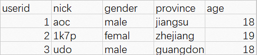

  更多信息，请参见<strong>《日志服务用户指南》</strong>的<strong>《关联外部数据源》</strong>章节。

  </li>

  <li>

  使用默认账号关联一个名为oss-store-demo的外部数据源。

  - 命令示例

    ```text
    aliyunlog log create_external_store --project_name="ali-test-project" --config="file://./external_store_config.json"
    ```

  - 返回示例命令执行成功后，无响应消息。您可以执行 `aliyunlog log get_external_store --project_name="ali-test-project" --store_name="oss-store-demo" --format-output=json` 查询OSS外部数据源详细信息。

    ```json
    {
        "externalStoreName": "oss-store-demo",
        "parameter": {
            "accessid": "your_accesskey_id",
            "accesskey": "your_accesskey_secret",
            "bucket": "doc-test",
            "columns": [{
                    "name": "userid",
                    "type": "bigint"
                },
                {
                    "name": "nick",
                    "type": "varchar"
                },
                {
                    "name": "gender",
                    "type": "varchar"
                },
                {
                    "name": "province",
                    "type": "varchar"
                },
                {
                    "name": "age",
                    "type": "bigint"
                }
            ],
            "endpoint": "oss-cn-hangzhou.aliyuncs.com",
            "objects": [
                "external-store-test/user.csv"
            ]
        },
        "storeType": "oss"
    }
    ```

    关联外部数据源后，您可以在日志服务控制台通过查询分析语句 `*|select * from oss-store-demo` 查询关联的OSS外部数据源数据。

    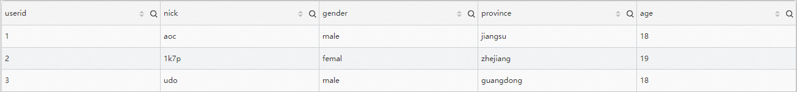

  </li>

  </ol>

- **通过CLI关联RDS MySQL外部数据源**

  <ol type="i">

  <li>

  创建rds-mysql-external-store.json文件，用于指定关联RDS MySQL外部数据源，其内容示例如下：

  ```json
  {
      "externalStoreName": "rds-vpc-mysql-store",
      "storeType": "rds-vpc",
      "parameter": {
          "region": "cn-hangzhou",
          "vpc-id": "vpc-bp1c******p6kgvv",
          "instance-id": "rm-bp1t4******rm76",
          "host": "rm-bp1******rm76.mysql.rds.aliyuncs.com",
          "port": "3306",
          "username": "testuser",
          "password": "******",
          "db": "dbtest",
          "table": "chiji_user"
      }
  }
  ```

  该table表的内容示例如下：

  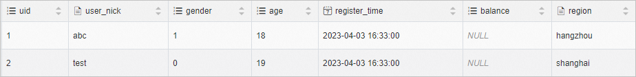

  更多信息，请参见<strong>《日志服务用户指南》</strong>的<strong>《关联外部数据源》</strong>章节。

  </li>

  <li>

  使用默认账号关联一个名为rds-vpc-mysql-store的外部数据源。

  - 命令示例

    ```text
    aliyunlog log create_external_store --project_name="ali-test-project" --config="file://./rds-mysql-external-store.json"
    ```

  - 返回示例命令执行成功后，无响应消息。您可以执行 `aliyunlog log get_external_store --project_name="ali-test-project" --store_name="rds-vpc-mysql-store" --format-output=json` 查询RDS MySQL外部数据源详细信息。

    ```json
    {
        "externalStoreName": "rds-vpc-mysql-store",
        "parameter": {
            "db": "dbtest",
            "host": "rm-bp1******rm76.mysql.rds.aliyuncs.com",
            "instance-id": "rm-bp1t4******rm76",
            "port": "3306",
            "region": "cn-hangzhou",
            "table": "chiji_user",
            "timezone": "",
            "username": "testuser",
            "vpc-id": "vpc-bp1c******p6kgvv"
        },
        "storeType": "rds-vpc"
    }
    ```

    关联外部数据源后，您可以在日志服务控制台通过查询分析语句 `*|select * from rds-vpc-mysql-store` 查询关联的RDS MySQL外部数据源数据。

    

  </li>

  </ol>

- **通过CLI关联本地CSV文件外部数据源**

  <ol type="i">

  <li>

  创建external_store_config_local.json文件，用于指定关联本地CSV外部数据源，其内容示例如下：

  ```json
  {
      "externalStoreName": "doctest-local-csvfile",
      "storeType": "csv",
      "parameter": {
          "endpoint": "cn-hangzhou.aliyuncs.com",
          "externalStoreCsvFile": "./user2.csv",
          "columns": [
              {"name": "userid", "type" : "bigint"},
              {"name": "nick", "type" : "varchar"},
              {"name": "gender", "type" : "varchar"},
              {"name": "province", "type" : "varchar"},
              {"name": "age", "type" : "bigint"}],
          "objects": "./user2.csv"
      }
  }
  ```

  该CSV文件的内容示例如下：

  

  更多信息，请参见<strong>《日志服务用户指南》</strong>的<strong>《关联外部数据源》</strong>章节。

  </li>

  <li>

  使用默认账号关联一个名为doctest-local-csvfile的外部数据源。

  - 命令示例

    ```text
    aliyunlog log create_external_store --project_name="ali-test-project" --config="file://./external_store_config_local.json"
    ```

  - 返回示例命令执行成功后，无响应消息。您可以执行 `aliyunlog log get_external_store --project_name="ali-test-project" --store_name="doctest-local-csvfile" --format-output=json` 查询本地CSV文件外部数据源详细信息。

    ```json
    {
      "externalStoreName": "doctest-local-csvfile",
      "parameter": {
        "accessid": "",
        "accesskey": "",
        "bucket": "",
        "columns": [
          {
            "name": "userid",
            "type": "bigint"
          },
          {
            "name": "nick",
            "type": "varchar"
          },
          {
            "name": "gender",
            "type": "varchar"
          },
          {
            "name": "province",
            "type": "varchar"
          },
          {
            "name": "age",
            "type": "bigint"
          }
        ],
        "endpoint": "",
        "objects": [
          "table.csv"
        ]
      },
      "storeType": "csv"
    }
    ```

    关联外部数据源后，您可以在日志服务控制台通过查询分析语句 `*|select * from doctest-local-csvfile` 查询关联的本地CSV文件外部数据源数据。

    

  </li>

  </ol>

**相关文档**

- 在调用API接口过程中，若服务端返回结果中包含错误信息，则表示调用API接口失败。您可以参考API错误码对照表查找对应的解决方法。更多信息，请参见通用错误码。

- 关于该API接口的详细信息，请参见CreateExternalStore。

- 更多信息，请参见<strong>《日志服务用户指南》</strong>的<strong>《关联外部数据源》</strong>章节。

<a id="section-3-4-6-12-2"></a>

##### 3.4.6.12.2. delete_external_store

调用CLI命令删除外部数据源。

**命令格式**

> 删除外部数据源后，您无法关联RDS MySQL、OSS、本地CSV文件数据源进行查询和日志分析。请谨慎操作。
>
> **重要**

```xml
aliyunlog log delete_external_store --project_name=<value> --store_name=<value> [--access-id=<value>] [--access-key=<value>] [--sts-token=
<value>] [--region-endpoint=<value>] [--client-name=<value>] [--jmes-filter=<value>] [--format-output=<value>] [--decode-output=<value>] [--pro
file=<value>]
```

**命令参数**

该命令的必选和特有参数描述如下。

| 参数名称 | 数值类型 | 是否必选 | 示例值 | 描述 |
| --- | --- | --- | --- | --- |
| --project_name | String | 是 | ali-test-project | Project名称。 |
| --store_name | String | 是 | oss-store-demo | 外部数据源名称，即虚拟表的名称，例如<strong>user_meta1</strong>。您可以使用<code> aliyunlog log </code> <code>list_external_store --</code><br><code>project_name="ali-test-</code><br><code>project" --format-</code><code>output=json </code>命令查询已关联的所有外部数据源名称。 |

关于该命令的全局参数，请参见全局参数。

**命令示例**

删除一个名为oss-store-demo的外部数据源，其中Project名称为ali-test-project。

- 命令示例

  ```text
  aliyunlog log delete_external_store --project_name="ali-test-project" --store_name="oss-store-demo"
  ```

- 返回示例命令执行成功后，无响应消息。您可以执行 `aliyunlog log list_external_store --project_name="ali-test-project" --format-output=json` 查询外部数据源列表。

  ```json
  {
    "count": 4,
    "externalstores": [
      "doctest",
      "oss_external",
      "rds-vpc-mysql-store",
      "user_meta1"
    ],
    "total": 4
  }
  ```

**相关文档**

- 在调用API接口过程中，若服务端返回结果中包含错误信息，则表示调用API接口失败。您可以参考API错误码对照表查找对应的解决方法。更多信息，请参见通用错误码。

- 关于该API接口的详细信息，请参见DeleteExternalStore。

- 更多信息，请参见<strong>《日志服务用户指南》</strong>的<strong>《关联外部数据源》</strong>章节。

<a id="section-3-4-6-12-3"></a>

##### 3.4.6.12.3. get_external_store

调用CLI命令查询指定外部数据源的详细配置。

**命令格式**

```xml
aliyunlog log get_external_store --project_name=<value> --store_name=<value> [--access-id=<value>] [--access-key=<value>] [--sts-token=
<value>] [--region-endpoint=<value>] [--client-name=<value>] [--jmes-filter=<value>] [--format-output=<value>] [--decode-output=<value>] [--pro
file=<value>]
```

**命令参数**

该命令的必选和特有参数描述如下。

| 参数名称 | 数值类型 | 是否必选 | 示例值 | 描述 |
| --- | --- | --- | --- | --- |
| --project_name | String | 是 | ali-test-project | Project名称。 |
| --store_name | String | 是 | oss-store-demo | 外部数据源名称，即虚拟表的名称，例如<strong>user_meta1</strong>。您可以使用<code> aliyunlog log </code> <code>list_external_store --</code><br><code>project_name="ali-test-</code><br><code>project" --format-</code><code>output=json </code>命令查询已关联的所有外部数据源名称。 |

关于该命令的全局参数，请参见全局参数。

**命令示例**

查询一个名为oss-store-demo的外部数据源详细配置，其中Project名称为ali-test-project。

- 命令示例

  ```text
  aliyunlog log get_external_store --project_name="ali-test-project" --store_name="oss-store-demo" --format-output=json
  ```

- 返回示例

  ```json
  {
    "externalStoreName": "oss-store-demo",
    "parameter": {
      "accessid": "your_accesskey_id",
      "accesskey": "your_accesskey_secret",
      "bucket": "doc-test",
      "columns": [
        {
          "name": "userid",
          "type": "bigint"
        },
        {
          "name": "nick",
          "type": "varchar"
        },
        {
          "name": "gender",
          "type": "varchar"
        },
        {
          "name": "province",
          "type": "varchar"
        },
        {
          "name": "age",
          "type": "bigint"
        }
      ],
      "endpoint": "oss-cn-hangzhou.aliyuncs.com",
      "objects": [
        "external-store-test/user.csv"
      ]
    },
    "storeType": "oss"
  }
  ```

**相关文档**

- 在调用API接口过程中，若服务端返回结果中包含错误信息，则表示调用API接口失败。您可以参考API错误码对照表查找对应的解决方法。更多信息，请参见通用错误码。

- 关于该API接口的详细信息，请参见GetExternalStore。

- 更多信息，请参见<strong>《日志服务用户指南》</strong>的<strong>《关联外部数据源》</strong>章节。

<a id="section-3-4-6-12-4"></a>

##### 3.4.6.12.4. list_external_store

调用CLI命令查询已关联的外部数据源。

**命令格式**

```text
aliyunlog log list_external_store --project_name=<value> [--external_store_name_pattern=<value>] [--offset=<value>] [--size=<value>] [--
access-id=<value>] [--access-key=<value>] [--sts-token=<value>] [--region-endpoint=<value>] [--client-name=<value>] [--jmes-filter=<value>] [--
format-output=<value>] [--decode-output=<value>] [--profile=<value>]
```

**命令参数**

该命令的必选和特有参数描述如下。

| 参数名称 | 数值类型 | 是否必选 | 示例值 | 描述 |
| --- | --- | --- | --- | --- |
| --project_name | String | 是 | ali-test-project | Project名称。 |

关于该命令的全局参数，请参见全局参数。

**命令示例**

查询Project中已关联的所有外部数据源，其中Project名称为ali-test-project。

- 命令示例

  ```text
  aliyunlog log list_external_store --project_name="ali-test-project" --format-output=json
  ```

- 返回示例

  ```json
  {
    "count": 4,
    "externalstores": [
      "doctest",
      "oss_external",
      "rds-vpc-mysql-store",
      "user_meta1"
    ],
    "total": 4
  }
  ```

**相关文档**

- 在调用API接口过程中，若服务端返回结果中包含错误信息，则表示调用API接口失败。您可以参考API错误码对照表查找对应的解决方法。更多信息，请参见通用错误码。

- 关于该API接口的详细信息，请参见ListExternalStore。

- 更多信息，请参见<strong>《日志服务用户指南》</strong>的<strong>《关联外部数据源》</strong>章节。

<a id="section-3-4-6-12-5"></a>

##### 3.4.6.12.5. update_external_store

调用CLI命令修改关联的外部数据源。

**命令格式**

```xml
aliyunlog log update_external_store --project_name=<value> --config=<value> [--access-id=<value>] [--access-key=<value>] [--sts-token=<value>] 
[--region-endpoint=<value>] [--client-name=<value>] [--jmes-filter=<value>] [--format-output=<value>] [--decode-output=<value>] [--profile=
<value>]
```

**命令参数**

该命令的必选和特有参数描述如下。

| 参数名称 | 数值类型 | 是否必选 | 示例值 | 描述 |
| --- | --- | --- | --- | --- |
| --project_name | String | 是 | ali-test-project | Project名称。 |
| --config | String | 是 | file://./external_store_config.js on | 修改后的外部数据源的配置文件路径。您需要在执行该命令前，创建该文件，指定外部存储名称、表的Schema、OSS访问信息或者RDS MySQL等信息。您可以参考create_external_store命令示例，创建该文件。 |

关于该命令的全局参数，请参见全局参数。

**命令示例**

1. 创建external_store_config_update.json文件。其内容示例如下：

   ```json
   {
       "externalStoreName": "oss-store-demo",
       "storeType": "oss",
       "parameter": {
           "endpoint": "oss-cn-hangzhou.aliyuncs.com",
           "accessid": "your_accesskey_id",
           "accesskey": "your_accesskey_secret",
           "bucket": "doc-test",
           "objects": ["external-store-test/user.csv"],
           "columns": [{"name": "userid", "type": "bigint"}, {"name": "nick", "type": "varchar"}, {"name": "gender", "type": "varchar"}, {"name"
   : "province", "type": "varchar"}]
       }
   }
   ```

   该CSV文件的内容示例如下：

   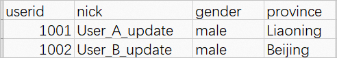

   更多信息，请参见<strong>《日志服务用户指南》</strong>的<strong>《关联外部数据源》</strong>章节。

2. 使用默认账号修改一个名为oss-store-demo的外部数据源。

   - 命令示例

     ```text
     aliyunlog log update_external_store --project_name="ali-test-project" --config="file://./external_store_config_update.json"
     ```

   - 返回示例命令执行成功后，无响应消息。您可以执行 `aliyunlog log get_external_store --project_name="ali-test-project" --store_name="oss-store-demo" --format-output=json` 查询OSS外部数据源详细信息。

     ```json
     {
         "externalStoreName": "oss-store-demo",
         "parameter": {
             "accessid": "your_accesskey_id",
             "accesskey": "your_accesskey_secret",
             "bucket": "doc-test",
             "columns": [{
                     "name": "userid",
                     "type": "bigint"
                 },
                 {
                     "name": "nick",
                     "type": "varchar"
                 },
                 {
                     "name": "gender",
                     "type": "varchar"
                 },
                 {
                     "name": "province",
                     "type": "varchar"
                 }
             ],
             "endpoint": "oss-cn-hangzhou.aliyuncs.com",
             "objects": [
                 "external-store-test/user.csv"
             ]
         },
         "storeType": "oss"
     }
     ```

     修改外部数据源后，您可以在日志服务控制台通过查询分析语句 `*|select * from oss-store-demo` 查询关联的OSS外部数据源数据。

     

**相关文档**

- 在调用API接口过程中，若服务端返回结果中包含错误信息，则表示调用API接口失败。您可以参考API错误码对照表查找对应的解决方法。更多信息，请参见通用错误码。

- 关于该API接口的详细信息，请参见UpdateExternalStore。

- 更多信息，请参见<strong>《日志服务用户指南》</strong>的<strong>《关联外部数据源》</strong>章节。

<a id="section-3-4-7"></a>

### 3.4.7. 最佳实践

本文罗列了日志服务命令行工具CLI相关的最佳实践。

- 查看日志服务基础资源使用状况

- 配置更多的Shard

- 配置多个CLI操作账号

- 创建Logtail配置

- 跨地域复制Project配置

- 拉取日志

- 查询日志

- 跨地域复制日志、重新历史数据索引与数仓投递

- 自建ELK迁移至日志服务

<a id="section-3-4-8"></a>

### 3.4.8. 常见问题

本文介绍日志服务CLI工具使用过程中的常见问题。

**安装时报TLSV1_ALERT_PROTOCOL_VERSION错误**

请执行以下命令升级pip后重试。

```bash
pip3 install pip -U
```

**如何查看CLI使用过程中的日志？**

生成的警告和错误信息默认保存在~/aliyunlogcli.log文件。您可以查看该文件浏览日志。

**找不到命令aliyunlog?**

Linux和Mac系统下, 因为某种原因创建脚本aliyunlog链接时未成功。以Linux为例，您可以按照如下步骤手工创建aliyunlog链接。

1. 执行如下命令确认Python安装路径。

   ```text
   which python
   ```

   Linux系统返回如下结果：

   ```text
   /usr/bin/python
   ```

2. 在/usr/bin目录下，创建aliyunlog文件，并写入如下信息。

   ```python
   #!/usr/bin/python
   import re
   import sys
   from pkg_resources import load_entry_point

   if __name__ == '__main__':
       sys.argv[0] = re.sub(r'(-script\.pyw?|\.exe)?$', '', sys.argv[0])
       sys.exit(
           load_entry_point('aliyun-log-cli', 'console_scripts', 'aliyunlog')()
       )
   ```

3. 执行 `aliyunlog --version` 命令。若返回类似如下信息，则表示创建aliyunlog链接成功。

   ```text
   log-cli-v-0.1.17, log-python-sdk-v-0.6.53, sys.version_info(major=3, minor=6, micro=8, releaselevel='final', serial=0), linux
   ```

**执行CLI命令后返回数据格式混乱，如何格式化？**

日志服务CLI命令提供全局参数<strong>--format-output</strong>用于对返回结果进行格式化。例如，全局参数设置为<strong>--format-output=json</strong>，表示将结果JSON格式化后返回。更多信息，请参见全局参数。

<a id="section-4"></a>

# 4.云存储网关

<a id="section-4-1"></a>

## 4.1. 准备工作

<a id="section-4-1-1"></a>

### 4.1.1. 登录开发者门户

您可以通过Apsara Uni-manager运营控制台登录开发者门户。

**前提条件**

- 登录Apsara Uni-manager运营控制台前，确认您已从部署人员处获取Apsara Uni-manager运营控制台的服务域名地址。

- 推荐使用Chrome浏览器

**操作步骤**

1. 在浏览器地址栏中，输入Apsara Uni-manager运营控制台的服务域名地址，按回车键。

2. 输入正确的用户名及密码。

   请向运营管理员获取登录控制台的用户名和密码。

   > **说明**
   >
   > 首次登录Apsara Uni-manager运营控制台时，需要修改登录用户名的密码，请按照提示完成密码修改。为提高安全性，密码长度必须为10~32位，且至少包含以下两种类型：
   >
   > - 英文大写或小写字母（A~Z、a~z）
   >
   > - 阿拉伯数字（0~9）
   >
   > - 特殊符号（感叹号（!）、at（@）、井号（#）、美元符号（$）、百分号（%）等）

3. 单击**登录**。

4. 如果账号已激活MFA多因素认证，请根据以下两种情况进行操作：

   - 管理员强制开启MFA后的首次登录：

     <ol type="a">

     <li>

     在绑定虚拟MFA设备页面中，按页面提示步骤绑定MFA设备。

     </li>

     <li>

     按照步骤2重新输入账号和密码，单击**登录**。

     </li>

     </ol>

     <ol type="i" start="100">

     <li>

     输入6位MFA码后单击**认证**。

     </li>

     </ol>

   - 您已开启并绑定MFA：

     输入6位MFA码后单击**认证**。

     > **说明**
     >
     > 绑定并开启MFA的操作请参见<strong>《Apsara Uni-manager运营控制台用户指南》</strong>中的<strong>《绑定并开启虚拟MFA设备》</strong>章节。

5. 在页面顶部的菜单栏中，选择**产品 > 应用服务 > 开发者服务**。

<a id="section-4-1-2"></a>

### 4.1.2. 获取API信息及其EndPoint

首先，您需要了解产品开放API接口的相关信息，包括产品名称（code）、开放API接口名称、API版本。

**背景信息**

Apsara Uni-manager运营控制台API目录中的API信息仅供调用参考，具体API的使用方式需要参见云产品的开发指南。如果发生不一致情况，以开发指南支持情况为准。

**操作步骤**

1. 登录Apsara Uni-manager运营控制台。

2. 在顶部菜单栏选择**产品** > **应用服务** > **开发者门户**。

3. 在**开发者门户**页面，选择**API集成** > **API调试**。

   

4. 在左侧导航栏中选择目标云产品。

5. 在**版本**下拉列表中，选择目标API版本。

6. 在下方API列表中可浏览当前版本的所有API接口。

7. 选中对应接口，在参数名下获取云产品的POP Endpoint信息。

   

<a id="section-4-1-3"></a>

### 4.1.3. 获取AccessKey

AccessKey支持RAM和STS两种授权模式，在发起调用时选择使用其中一种AccessKey即可。本文将为您描述如何获取通过RAM授权的AccessKey。

**背景信息**

AccessKey通过使用AccessKey ID和AccessKey Secret对称加密，实现验证某个请求发送者的身份。其中AccessKey ID用于标识用户，AccessKey Secret是用户用于加密签名的字符串。

AccessKey的两种授权模式如下：

- 通过RAM授权给第三方请求者的AccessKey ID和AccessKey Secret。

- 通过STS授权给第三方请求者的AccessKey ID、AccessKey Secret和Security Token。具体操作，请参见获取STS AccessKey。

Apsara Uni-manager运营控制台提供了个人AccessKey和组织AccessKey（只有运营管理员和一级组织管理员可以获取组织AccessKey），推荐使用个人账号AccessKey调用Apsara Uni-manager运营控制台及云产品相关接口。如果使用个人账号AccessKey，需要在Header中添加以下限制性参数，否则可能提示权限不足：

> **警告**
>
> 个人账号AccessKey是由Apsara Uni-manager运营控制台权限体系管控的受限AccessKey，组织AccessKey相对权限较大，需要管理员确认操作的安全性。

<table>
  <tr>
    <th width="206">参数名称</th>
    <th>描述</th>
  </tr>
  <tr>
    <td>x-acs-regionid</td>
    <td>环境Region，例如：cn-hangzhou-*。</td>
  </tr>
  <tr>
    <td>x-acs-organizationid</td>
    <td>Apsara Uni-manager运营控制台中对应的组织ID。获取方法可参见Apsara Uni-manager运营控制台开发指南中的GetOrganizationList文档。</td>
  </tr>
  <tr>
    <td>x-acs-resourcegroupid</td>
    <td>Apsara Uni-manager运营控制台中对应的资源集ID。获取方法可参见Apsara Uni-manager运营控制台开发指南中的ListResourceGroup文档。</td>
  </tr>
  <tr>
    <td>x-acs-instanceid</td>
    <td>进行操作的实例ID，例如，ECS的实例ID可以从ECS列表中查询到。</td>
  </tr>
</table>

**获取个人账号AccessKey**

获取个人账号AccessKey的方法如下：

1. 登录Apsara Uni-manager运营控制台。

2. 在系统界面右上角，单击当前登录用户头像，单击**个人信息**。

3. 在**阿里云AccessKey**区域，您可以查看个人账户的AccessKey信息。

   

   > **说明**
   >
   > Accesskey ID和AccessKey Secret是您访问云资源时的密钥，具有该账号完整的权限，请您妥善保管。

**获取组织AccessKey**

获取组织AccessKey的方法如下：

1. 管理员登录Apsara Uni-manager运营控制台。

2. 在顶部菜单栏，单击**企业**。

3. 在左侧导航栏中，选择**资源管理 > 组织管理**。

4. 在组织结构中，单击目标一级组织名称。

5. 单击**管理Accesskey**。

6. 在弹出的对话框中，查看组织AccessKey信息。

<a id="section-4-1-4"></a>

### 4.1.4. 获取STS AccessKey

本文为您介绍如何利用STS方式，调用专有云的产品API。

**背景信息**

阿里云临时安全令牌STS（Security Token Service）是阿里云提供的一种临时访问权限管理服务。您可以选择使用STS方式，调用专有云的产品API。

STS AccessKey由AccessKey ID、AccessKey Secret及SecurityToken三元组组成，使用STS方式调用云产品API时，三元组缺一不可。更多STS说明请参见什么是STS。

**操作步骤**

1. 获取用户角色的 `RAM Role` 。

   <ol type="i">

   <li>

   登录Apsara Uni-manager运营控制台。

   </li>

   <li>

   单击页面右上角的用户头像，选择**个人信息**。

   </li>

   <li>

   单击**查看当前角色策略**。

   在**当前选择角色策略**对话框中查看 `RAM Role` 。

   </li>

   </ol>

2. 获取STS Accesskey三元组。

   > **说明**
   >
   > 以下代码示例中可变参数均需替换为您实际的相关信息，尖括号（<>）在最终代码中不保留。
   >
   > 涉及替换的可变参数如下：
   >
   > - &lt;yourRegionID>，请替换为您实际的地域ID。
   >
   > - &lt;yourAccessKeyID>，请替换为您实际的AccessKey ID。
   >
   > - &lt;yourAccessKeySecret>，请替换为您实际的AccessKey Secret。
   >
   > - &lt;yourRoleSessionName>，请替换为您当前实际的会话名称。
   >
   > - &lt;yourRoleArn>，请替换为您实际的RAM Role。
   >
   > - "sts.aliyuns.com"，请替换为实际的STS Endpoint。

   ```java
   public static void main(String[] args) {
       // 创建DefaultAcsClient实例并初始化。
       // 请替换为您实际的地域ID、AccessKey ID、AccessKey Secret
       DefaultProfile profile = DefaultProfile.getProfile("<yourRegionID>", "<yourAccessKeyID>", "<yourAccessKeySecret>");
       HttpClientConfig clientConfig = HttpClientConfig.getDefault();
       clientConfig.setIgnoreSSLCerts(true);
       clientConfig.setProtocolType(ProtocolType.HTTPS);
       profile.setHttpClientConfig(clientConfig);
       IAcsClient client = new DefaultAcsClient(profile);
       String assumeRole = callAssumeRole(client);
       if (StringUtils.isEmpty(assumeRole)) return;
       JSONObject assumeRoleJson = JSONObject.parseObject(assumeRole);
       JSONObject credentials = assumeRoleJson.getJSONObject("Credentials");
       // 获取到STS三元组
       String stsAK = credentials.getString("AccessKeyId");
       String stsSK = credentials.getString("AccessKeySecret");
       String stsToken = credentials.getString("SecurityToken");
   }

   private static String callAssumeRole(IAcsClient client) {
       CommonRequest request = new CommonRequest();
       // "sts.aliyuns.com" 请替换为实际的STS Endpoint，⼀般格式为sts-vpc.${global:region}.${global:internet-domain}
       request.setSysDomain("sts.aliyuns.com");
       request.setSysProduct("Sts");
       request.setSysAction("AssumeRole");
       request.setSysVersion("2015-04-01");
       request.setSysMethod(MethodType.POST);
       request.setHttpContentType(FormatType.FORM);
       // 业务参数，设置本次调⽤Session的别名，"<yourRoleSessionName>"请您替换为实际值
       request.putQueryParameter("RoleSessionName", "<yourRoleSessionName>");
       // 扮演的Role⾓⾊ARN，"<yourRoleArn>"请替换为上⼀步获取到的实际Ram Role ARN
       request.putQueryParameter("RoleArn", "<yourRoleArn>");
       try {
           CommonResponse response = client.getCommonResponse(request);
           return response.getData();
       } catch (ServerException e) {
           System.out.println(e.getErrCode());
           System.out.println(e.getErrMsg());
       } catch (ClientException e) {
           System.out.println(e.getErrCode());
           System.out.println(e.getErrMsg());
       }
       return null;
   }
   ```

3. 通过STS AccessKey三元组调用云产品的接口，下列代码以CSG的 `DescribeGatewaysRequest` 接口为示例。

   > **说明**
   >
   > 以下代码示例中可变参数均需替换为您实际的相关信息，尖括号（<>）在最终代码中不保留。
   >
   > 涉及替换的可变参数如下：
   >
   > - &lt;yourRegionID>，请替换为您实际的地域ID。
   >
   > - &lt;yourStsAccesskeyID>,请替换为您实际的STS Accesskey ID。
   >
   > - &lt;yourStsAccessKeySecret>，请替换为您实际的STS Accesskey Secret。
   >
   > - &lt;yourStsToken>，请替换为实际STS三元组中的SecurityToken。
   >
   > - &lt;yourResourceGroupID>，请替换为您实际的资源集ID。
   >
   > - &lt;yourOrganizationID>请替换为您实际的组织ID。

   ```java
   import com.aliyuncs.profile.DefaultProfile;
    import com.aliyuncs.DefaultAcsClient;
    import com.aliyuncs.IAcsClient;
    import com.aliyuncs.exceptions.ClientException;
    import com.aliyuncs.exceptions.ServerException;
    import com.aliyuncs.sgw.model.v20180511.DescribeGatewaysRequest;
    import com.aliyuncs.sgw.model.v20180511.DescribeGatewaysResponse;
    public class Main {
        public static void main(String[] args) {
           // 创建DefaultAcsClient实例并初始化
           DefaultProfile profile = DefaultProfile.getProfile(
               "<yourRegionID>",          // 请替换为您实际的地域ID
               "<yourAccessKeyID>",      // 请替换为您实际的AccessKey ID
               "<yourAccessKeySecret>"); // 请替换为您实际的AccessKey Secret
           // 设置当前产品的Endpoint，可变参数请替换为您的实际值 
           profile.addEndpoint("<yourRegionID>", "<Product>", "<Endpoint>");
           // 设置请求配置
           HttpClientConfig clientConfig = HttpClientConfig.getDefault();
           clientConfig.setIgnoreSSLCerts(true);// 忽略证书
           clientConfig.setReadTimeoutMillis(<readTimeout>);// 读取超时时间（可选）,单位为毫秒（ms）
           clientConfig.setConnectionTimeoutMillis(<connectionTimeout>);// 连接超时时间（可选）,单位为毫秒（ms）
           clientConfig.setMaxRequestsPerHost(<maxRequestsPerHost>);// 设置每个主机的最⼤请求数（可选）
           clientConfig.setMaxRequests(<maxRequests>);// 设置最⼤请求数（可选）
           clientConfig.setProtocolType(ProtocolType.HTTP); // 设置请求协议,默认HTTP（可选）
           /* 设置代理(可选),替换为代理IP+Port
           clientConfig.setHttpProxy("http://192.168.XX:33XX");
           或
           clientConfig.setHttpsProxy("https://192.168.XX:33XX");
           */
           profile.setHttpClientConfig(clientConfig);
           IAcsClient client = new DefaultAcsClient(profile);
           // 创建API请求并设置参数
           DescribeGatewaysRequest request = new DescribeGatewaysRequest();
           // 业务参数
           request.setPageSize(10);
           request.setPageNumber(1);
           // 发起请求并处理应答或异常
           try {
               DescribeGatewaysResponse response = client.getAcsResponse(request);
               for (DescribeGatewaysResponse.Gateway gateway : response.getGateways()) {
                   System.out.println(gateway.getGatewayId());
               }
           } catch (ServerException e) {
               e.printStackTrace();
           } catch (ClientException e) {
               e.printStackTrace();
           }
        }
    }
   ```

<a id="section-4-1-5"></a>

### 4.1.5. 获取公共Header参数

调用专有云API时需要提供多个Header参数。本文为您介绍这些参数的含义及其获取方式，并对调用后的一些返回值做出解释。

**Header参数描述**

| 名称 | 描述 |
| --- | --- |
| x-acs-regionid | 环境Region，获取方式请参见获取Region ID。 |
| x-acs-organizationid | Apsara Uni-manager运营控制台上的组织ID，获取方式请参见获取组织ID。 |
| x-acs-resourcegroupid | Apsara Uni-manager运营控制台上的资源集ID，获取方式请参见获取资源集ID。 |
| x-acs-instanceid | 进行操作的实例ID，获取方式请参见获取云存储网关ID。 |

**获取Region ID**

1. 管理员登录Apsara Uni-manager运营控制台。

2. 在顶部菜单栏中，单击**企业**。

3. 在左侧导航栏中，选择**资源管理**>**地域管理**。

4. 单击目标组织名称。

5. 在右侧**Region列表**中查看Region ID。

**获取组织ID**

组织ID需要通过API进行获取，获取方式请参见*Apsara Uni-manager运营控制台开发指南*中的*GetOrganizationList章节*。

**获取资源集ID**

资源集ID需要通过API进行获取，获取方式请参见*Apsara Uni-manager运营控制台开发指南*中的*ListResourceGroup章节*。

**获取云存储网关ID**

云存储网关ID可以通过Apsara Uni-manager运营控制台中的网关列表进行获取，获取步骤如下：

1. 登录Apsara Uni-manager运营控制台。

2. 在顶部的菜单栏中，选择**产品**>**存储**>**对象存储OSS**。

3. 在左侧导航栏中，单击**云存储网关列表**。

4. 在网关列表中查看**网关ID**。

**返回参数**

对于列表类的云产品资源实例接口，调用后会默认增加如下返回值。

| 名称 | 描述 |
| --- | --- |
| ResourceGroupName | 资源集名称。 |
| ResourceGroup | 资源集ID。 |
| DepartmentName | 组织名称。 |
| Department | 组织ID。 |

<a id="section-4-1-6"></a>

### 4.1.6. 获取云存储网关的SDK包

本文介绍了如何获取云存储网关的SDK包。

您可以进入专有云文档官网，在页面底部的**其他资源**中，下载对应版本云存储网关的SDK包。

<a id="section-4-2"></a>

## 4.2. Java SDK调用示例

<a id="section-4-2-1"></a>

### 4.2.1. 快速开始

本节介绍如何获取云存储网关Java SDK并开始调用。

**环境准备**

- 使用阿里云专有云Java SDK前，您需要一个授权账号以及一对AccessKey ID和AccessKey Secret。具体操作，请参见获取AccessKey。

- 获取云存储网关的Endpoint。

- 阿里云专有云Java SDK需要1.8及以上的JDK。

**安装阿里云专有云Java SDK**

如果您使用Apache Maven来管理Java项目，只需在项目的pom.xml中导入JAR文件。

要使用云存储网关的开发工具包，必须安装SDK核心库以及产品的SDK。其中，SDK核心库推荐使用4.5.17及以上版本，产品SDK的版本为3.1.6。

**使用Java SDK**

调用阿里云专有云Java SDK的主要操作步骤如下：

1. 创建并初始化DefaultAcsClient实例。

2. 创建API请求并设置参数。

3. 发起请求并处理应答或异常。

   > **说明**
   >
   > 以下代码示例中可变参数均需替换为您实际的相关信息，尖括号（<>）在最终代码中不保留。
   >
   > 涉及替换的可变参数如下：
   >
   > - &lt;yourRegionID>，请替换为您实际的地域ID。
   >
   > - &lt;yourAccessKeyID>，请替换为您实际的AccessKey ID。
   >
   > - &lt;yourAccessKeySecret>，请替换为您实际的AccessKey Secret。
   >
   > - &lt;Product>，请替换为您实际的产品名称。
   >
   > - &lt;Endpoint>，请替换为您当前产品实际的Endpoint。
   >
   > - &lt;readTimeout>，请您根据实际情况设置读取超时时间，单位为毫秒。
   >
   > - &lt;connectionTimeout>，请您根据实际情况设置连接超时时间，单位为毫秒。
   >
   > - &lt;maxRequestsPerHost>，请您根据实际情况设置每个主机的最大请求数。
   >
   > - &lt;maxRequests>，请您根据实际情况设置最大请求数。
   >
   > - "http://192.168.XX:33XX"，请替换为您实际的代理IP+端口。

   ```java
    import com.aliyuncs.profile.DefaultProfile;
    import com.aliyuncs.DefaultAcsClient;
    import com.aliyuncs.IAcsClient;
    import com.aliyuncs.exceptions.ClientException;
    import com.aliyuncs.exceptions.ServerException;
    import com.aliyuncs.sgw.model.v20180511.DescribeGatewaysRequest;
    import com.aliyuncs.sgw.model.v20180511.DescribeGatewaysResponse;
    public class Main {
        public static void main(String[] args) {
           // 创建DefaultAcsClient实例并初始化
           DefaultProfile profile = DefaultProfile.getProfile(
               "<yourRegionID>",          // 请替换为您实际的地域ID
               "<yourAccessKeyID>",      // 请替换为您实际的AccessKey ID
               "<yourAccessKeySecret>"); // 请替换为您实际的AccessKey Secret
           // 设置当前产品的Endpoint，可变参数请替换为您的实际值 
           profile.addEndpoint("<yourRegionID>", "<Product>", "<Endpoint>");
           // 设置请求配置
           HttpClientConfig clientConfig = HttpClientConfig.getDefault();
           clientConfig.setIgnoreSSLCerts(true);// 忽略证书
           clientConfig.setReadTimeoutMillis(<readTimeout>);// 读取超时时间（可选）,单位为毫秒（ms）
           clientConfig.setConnectionTimeoutMillis(<connectionTimeout>);// 连接超时时间（可选）,单位为毫秒（ms）
           clientConfig.setMaxRequestsPerHost(<maxRequestsPerHost>);// 设置每个主机的最⼤请求数（可选）
           clientConfig.setMaxRequests(<maxRequests>);// 设置最⼤请求数（可选）
           clientConfig.setProtocolType(ProtocolType.HTTP); // 设置请求协议,默认HTTP（可选）
           /* 设置代理(可选),替换为代理IP+Port
           clientConfig.setHttpProxy("http://192.168.XX:33XX");
           或
           clientConfig.setHttpsProxy("https://192.168.XX:33XX");
           */
           profile.setHttpClientConfig(clientConfig);
           IAcsClient client = new DefaultAcsClient(profile);
           // 创建API请求并设置参数
           DescribeGatewaysRequest request = new DescribeGatewaysRequest();
           // 业务参数
           request.setPageSize(10);
           request.setPageNumber(1);
           // 发起请求并处理应答或异常
           try {
               DescribeGatewaysResponse response = client.getAcsResponse(request);
               for (DescribeGatewaysResponse.Gateway gateway : response.getGateways()) {
                   System.out.println(gateway.getGatewayId());
               }
           } catch (ServerException e) {
               e.printStackTrace();
           } catch (ClientException e) {
               e.printStackTrace();
           }
        }
    }
   ```

<a id="section-4-2-2"></a>

### 4.2.2. 使用手册

<a id="section-4-2-2-1"></a>

#### 4.2.2.1. 安装Java SDK

本文介绍如何安装及调用云存储网关Java SDK。

阿里云专有云Java SDK支持1.8及以上版本的JDK，可以通过添加Maven依赖或下载阿里云开发工具包（SDK）的方式安装专有云Java SDK。

要使用云存储网关的开发工具包，必须安装阿里云Java SDK核心库以及云存储网关的Java SDK。SDK核心库推荐使用4.5.17及以上版本，产品Java SDK的版本为3.1.6。

以使用的云存储网关Java SDK为例，您需要安装阿里云Java SDK核心库和云存储网关Java SDK，并在pom.xml文件中添加以下依赖即可。准确的SDK版本号，请参见阿里云开发工具包（SDK）。

```xml
<!-- Alibaba Cloud SDK for Java -->
<dependency>
    <groupId>com.aliyun</groupId>
    <artifactId>aliyun-java-sdk-core</artifactId>
    <version>4.5.17</version>
</dependency>
<!-- nas java sdk -->
<dependency>
    <groupId>com.aliyun</groupId>
    <artifactId>aliyun-java-sdk-sgw</artifactId>
    <version>3.1.6</version>
</dependency>
```

<a id="section-4-2-2-2"></a>

#### 4.2.2.2. 设置身份验证凭证

当使用阿里云专有云SDK访问阿里云专有云服务时，您需要提供授权的账号进行身份验证。本文介绍如何设置身份验证凭证。

目前，Java SDK支持通过AccessKey进行身份验证，获取AccessKey的具体操作，请参见获取AccessKey。

使用AccessKey作为访问凭据时，需要在初始化Client时设置凭证。

> **说明**
>
> 确保包含AccessKey的代码不会泄漏（例如提交到外部公开的GitHub项目），否则将会危害您的信息安全。

```text
DefaultProfile profile = DefaultProfile.getProfile(
    "<yourRegionID>",          // 请替换为您实际的地域ID
    "<yourAccessKeyID>",      // 请替换为您实际的AccessKey ID
    "<yourAccessKeySecret>"); // 请替换为您实际的AccessKey Secret
```

> **说明**
>
> 以上代码示例中可变参数均需替换为您实际的相关信息，尖括号（<>）在最终代码中不保留。

<a id="section-4-2-2-3"></a>

#### 4.2.2.3. 请求连接配置

本文介绍了如何配置请求连接（HttpClientConfig）。

您可通过以下代码配置HttpClientConfig，具体请根据自身服务能力自行选择配置项并做相应配置。

> **说明**
>
> 以下代码示例中可变参数均需替换为您实际的相关信息，尖括号（<>）在最终代码中不保留。
>
> 涉及替换的可变参数如下：
>
> - &lt;readTimeout>，请您根据自身服务的能力，配置读取超时时间，单位为毫秒（ms）。
>
> - &lt;connectionTimeout>，请您根据自身服务的能力，配置连接超时时间，单位为毫秒（ms）。
>
> - &lt;maxRequestsPerHost>，请您根据自身服务的能力，配置每台服务器的最大请求数，数据类型为INT。
>
> - &lt;maxRequests>，请您根据自身服务的能力，配置最大请求数，数据类型为INT。
>
> - "http://192.168.XX.XX:33XX"，请替换为您实际的代理IP+端口。

```text
// 获取HttpClientConfig对象
HttpClientConfig clientConfig = HttpClientConfig.getDefault();
// 设置是否忽略证书
clientConfig.setIgnoreSSLCerts(true);
// (可选)设置读取超时时间，单位毫秒（ms）
clientConfig.setReadTimeoutMillis(<readTimeout>);
// (可选)设置创建连接超时时间，单位毫秒（ms）
clientConfig.setConnectionTimeoutMillis(<connectionTimeout>);
// (可选)设置每个主机的最⼤请求数，数据类型为INT
clientConfig.setMaxRequestsPerHost(<maxRequestsPerHost>);
// (可选)设置最⼤请求数，数据类型为INT
clientConfig.setMaxRequests(<maxRequests>);
// (可选)设置协议类型
clientConfig.setProtocolType(ProtocolType.HTTP);
/** （可选）请根据实际情况判断是否设置代理，设置⽅法如下：
clientConfig.setHttpProxy("http://192.168.XX.XX:33XX");
或
clientConfig.setHttpsProxy("https://192.168.XX.XX:33XX");
请替换为您实际的代理IP+端⼝
*/
profile.setHttpClientConfig(clientConfig);
```

<a id="section-4-2-2-4"></a>

#### 4.2.2.4. 发起调用

本文介绍如何使用云存储网关的Java SDK发起请求。

1. 新建一个AcsClient。

   ```text
   IAcsClient client = new DefaultAcsClient(profile);
   ```

2. 创建请求。

   请求类的命名规范为 `${apiName}Request` ，其中<strong>${apiName}</strong>为API名称，例如DescribeGateways。

   在引入多个产品SDK时，有可能存在Request类同名的情况，请注意按照package区分。

   ```text
   DescribeGatewaysRequest request = new DescribeGatewaysRequest();
   //业务参数
   request.setPageSize(10);
   request.setPageNumber(1);
   ```

3. 发起调用并处理应答。

   ```java
   DescribeGatewaysResponse response;
   try {
       response = client.getAcsResponse(request);
       for (DescribeGatewaysResponse.Gateway gateway:response.getGateways()) {
           System.out.println(gateway.getGatewayId());
       }
   } catch (ServerException e) {
       e.printStackTrace();
   } catch (ClientException e) {
       e.printStackTrace();
   }
   ```

   正常情况下，应答中的所有字段，都会被反序列化到response中，您可以直接调用 `response.getXXX()` 来获得应答中的字段。

   ```text
   String name = response.getName()
   ```

   如果出现了异常，或您需要原始HTTP应答的情况下，您可以通过使用 `doAction()` 来获取原始应答。

   ```text
   HttpResponse response = client.doAction(request);
   ```

<a id="section-4-2-2-5"></a>

#### 4.2.2.5. 错误处理

本文介绍云存储网关Java SDK的错误处理。

在使用Java SDK时，当服务端或者SDK端出错时，SDK会返回相应的异常信息。这些异常信息中会包含具体的错误信息包括错误码（Error Code）和错误消息（Error Message）。

一般情况下，您不需要对Java SDK返回的错误进行处理。您只需要根据服务端的错误提示处理服务端错误即可。

- `ServerException` 是服务端错误信息。

- `ClientException` 是SDK端错误信息。

例如，当出现如下错误时，您可以根据具体的错误信息，修改AccessKey的ID即可。

```text
 com.aliyuncs.exceptions.ClientException: InvalidAccessKeyId.NotFound : Specified access key is not found. 
```

如果您需要对SDK的错误进行处理，可以参考如下示例编写代码：

```java
try {
FooResponse response = client.getAcsResponse(request);
// 处理Response
//...
}catch (ServerException e){
// 这⾥可以添加您⾃⼰的错误处理逻辑
// 例如，打印具体的错误信息
System.out.println("ErrorCode=" + e.getErrCode());
System.out.println("ErrorMessage=" + e.getErrMsg());
// 如果遇上棘⼿问题，可以提交⼯单，并将RequestId提供给我们
System.out.println("ResponseId=" + e.getRequestId());
}catch (ClientException e){
// 这⾥可以添加您⾃⼰的错误处理逻辑
// 例如，打印具体的错误信息
System.out.println("ErrorCode=" + e.getErrCode());
System.out.println("ErrorMessage=" + e.getErrMsg());
}
```

<a id="section-4-3"></a>

## 4.3. Python SDK调用示例

<a id="section-4-3-1"></a>

### 4.3.1. 快速开始

本文介绍如何获取云存储网关Python SDK并开始调用。

**环境准备**

- 使用Python SDK前，您需要一个授权账号以及一对AccessKey ID和AccessKey Secret。具体操作，请参见获取AccessKey。

- 获取云存储网关的Endpoint。

**安装Python SDK**

1. 安装SDK核心库。

   - 如果您使用的是Python 2.x，执行以下命令，安装阿里云SDK核心库。

     ```bash
     pip install aliyun-python-sdk-core
     ```

   - 如果您使用的是Python 3.x，执行以下命令，安装阿里云SDK核心库。

     ```bash
     pip3 install aliyun-python-sdk-core-v3
     ```

2. 安装云存储网关的SDK。

   首先要获取云存储网关的SDK包，具体操作，请参见获取云存储网关的SDK包。

   - 如果您使用的是Python 2.x，解压SDK包后，执行以下命令，安装SDK：

     ```text
     python setup.py install
     ```

   - 如果您使用的是Python 3.x，解压SDK包后，执行以下命令，安装SDK：

     ```text
     python3 setup.py install
     ```

**使用Python SDK**

以下示例展示调用Python SDK的3个主要步骤：

1. 创建Client实例。在创建Client实例时，您需要获取Region ID、AccessKey ID和AccessKey Secret。

2. 创建API请求并设置参数。

3. 发起请求并处理应答或异常。

   > **说明**
   >
   > 以下代码示例中可变参数均需替换为您实际的相关信息，尖括号（<>）在最终代码中不保留。
   >
   > 涉及替换的可变参数如下：
   >
   > - &lt;yourRegionID>，请替换为您实际的地域ID。
   >
   > - &lt;yourAccessKeyID>，请替换为您实际的AccessKey ID。
   >
   > - &lt;yourAccessKeySecret>，请替换为您实际的AccessKey Secret。
   >
   > - &lt;sgw.aliyuns.com>，请替换为您实际的产品访问地址。

   ```python
   #!/usr/bin/env python
   # coding=utf-8
   from aliyunsdkcore import client
   from aliyunsdkcore.profile import region_provider
   from aliyunsdksgwhybrid.request.v20180511 import DescribeGatewaysRequest

   # global config
   region_id = '<yourRegionID>'  # 请替换为您实际的地域ID
   access_key = '<yourAccessKeyID>'  # 请替换为您实际的的AccessKey ID
   acces_secret = '<yourAccessKeySecret>'  # 请替换为您实际的AccessKey Secret

   # product config
   product_name = 'sgw'  # 填写产品名称
   endpoint = '<sgw.aliyuns.com>'  # 产品访问域名,当前为示例值,请替换为您实际的产品访问地址

   # create client
   region_provider.modify_point(product_name, region_id, endpoint)
   clt = client.AcsClient(access_key, acces_secret, region_id)
   # setup request
   request = DescribeGatewaysRequest.DescribeGatewaysRequest()
   request.set_endpoint(endpoint)
   request.set_content_type("application/json")
   request.set_accept_format("JSON")
   # get response
   response = clt.do_action_with_exception(request)
   print(response)
   ```

<a id="section-4-3-2"></a>

### 4.3.2. 使用手册

<a id="section-4-3-2-1"></a>

#### 4.3.2.1. 安装Python SDK

本文档介绍如何安装及调用云存储网关Python SDK。

阿里云专有云Python SDK支持Python 2.6.x、2.7.x和3.x及以上环境，您可以通过pip安装专有云Python SDK。

> 使用云存储网关的Python SDK，您需要安装阿里云Python SDK核心库和云存储网关的Python SDK。
>
> **说明**

- 如果您使用的是Python 2.x，执行以下命令，安装阿里云SDK核心库：

  ```bash
  pip install aliyun-python-sdk-core
  ```

- 如果您使用的是Python 3.x，执行以下命令，安装阿里云SDK核心库：

  ```bash
  pip3 install aliyun-python-sdk-core-v3
  ```

安装云存储网关SDK。

首先要获取云存储网关的SDK包，具体操作，请参见获取云存储网关的SDK包。

- 如果您使用的是Python 2.x，解压SDK包后，执行以下命令，安装SDK：

  ```text
  python setup.py install
  ```

- 如果您使用的是Python 3.x，解压SDK包后，执行以下命令，安装SDK：

  ```text
  python3 setup.py install
  ```

<a id="section-4-3-2-2"></a>

#### 4.3.2.2. 设置身份验证凭证

当使用阿里云SDK访问阿里云专有云服务时，您需要提供授权的账号进行身份验证。

目前Python SDK支持通过AccessKey进行身份验证。关于获取AccessKey的方法，请参见获取AccessKey。

使用AccessKey作为访问凭据时，需要在初始化Client时设置凭证。

> **重要**
>
> 确保包含AccessKey的代码不会泄漏（例如提交到外部公开的GitHub项目），否则将会危害您的信息安全。

```text
clt = client.AcsClient(secret_id, secret_key, region_id)
```

<a id="section-4-3-2-3"></a>

#### 4.3.2.3. 设置HTTPS请求

Python SDK支持使用HTTP和HTTPS协议发起API请求。

使用Python SDK时，您可以为某个请求指定使用HTTP或HTTPS协议，您也可以设置全局默认协议。

> 产品的默认协议（HTTP/HTTPS）优先于设置的全局默认协议。
>
> **说明**

**添加OpenSSL依赖**

Python SDK的HTTPS协议依赖Python的OpenSSL支持。要使用阿里云SDK通过HTTPS协议发送请求，您需要在Python中添加OpenSSL支持。Open SSL支持TLS1.2及以上版本。

运行 `python -c "import ssl"` 检查Python环境是否支持OpenSSL。运行后，如果没有出现

`ImportError: No module named ssl` 的错误信息，说明已经支持OpenSSL。若没有OpenSSL，运行以下命令安装：

```bash
pip install pyopenssl
```

**设置单个请求的HTTP/HTTPS协议**

参考以下代码示例为一个接口设置HTTPS调用：

```text
request = DescribeGatewaysRequest.DescribeGatewaysRequest()
request.set_protocol_type("https")
# 取值："https" 或 "http"
```

**设置全局默认协议**

参考以下代码示例设置全局默认协议：

```python
import aliyunsdkcore.request
aliyunsdkcore.request.set_default_protocol_type("https")
# 创建请求并调⽤ client.do_action_with_exception() 来发送请求
```

<a id="section-4-3-2-4"></a>

#### 4.3.2.4. 发起调用

本文介绍如何使用云存储网关Python SDK发起请求。

**操作步骤**

1. 导入云存储网关的SDK。

   ```python
   from aliyunsdkcore import client
   from aliyunsdkcore.profile import region_provider
   from aliyunsdksgwhybrid.request.v20180511 import DescribeGatewaysRequest
   ```

2. 新建一个AcsClient。

   ```text
   client.region_provider.modify_point(product_name, region_id, endpoint)
   clt = client.AcsClient(access_key, access_secret, region_id)
   ```

3. 创建Request对象。

   ```text
   request = DescribeGatewaysRequest.DescribeGatewaysRequest()
   request.set_endpoint(endpoint)
   request.set_content_type("application/json")
   request.set_accept_format("JSON")
   ```

4. 发起调用并处理返回。

   ```text
   response = clt.do_action_with_exception(request)

   print response
   ```

<a id="section-4-3-2-5"></a>

#### 4.3.2.5. 错误处理

在使用Python SDK时，当服务端或者SDK端出错时，SDK会返回相应的异常信息。这些异常信息中会包含具体的错误信息，包括错误码（Error Code）和错误消息（Error Message）。

一般情况下，您不需要对Python SDK返回的错误进行处理，您只需要根据服务端的错误提示处理服务端错误即可。

- `ServerException` 是服务端错误信息。

- `ClientException` 是SDK端错误信息。

例如，当出现如下错误时，您可以根据具体的错误信息，修改AccessKey的ID即可。

```text
aliyunsdkcore.acs\_exception.exceptions.ServerException: HTTP Status: 404 Error:InvalidAccessKeyId.NotFound Specified access key is not found.
```

如果您需要对SDK的错误进行处理，可以参考如下示例编写代码：

```text
try:
    response = client.do_action_with_exception(request)
except ServerException as e:
    # 这⾥可以添加您⾃⼰的错误处理逻辑
    # 例如，打印具体的错误信息
    print e.get_http_status()
    print e.get_error_code()
    print e.get_error_msg()
```

<a id="section-4-4"></a>

## 4.4. API参考

<a id="section-4-4-1"></a>

### 4.4.1. API概览

CSG提供以下相关API接口。

表 1. 网关

| API | 描述 |
| --- | --- |
| DescribeGatewayTypes | 查询网关所有可用类型。 |
| DescribeGatewayActions | 查询网关，缓存盘，共享，SMB用户，AD配置以及LDAP配置可操作列表。 |
| DescribeGatewayClasses | 查询网关的所有可用规格。 |
| CreateGateway | 创建一个网关。 |
| DescribeGateways | 查询网关列表信息。 |
| DescribeGateway | 查询指定ID的网关的基本信息。 |
| ModifyGateway | 对指定网关的基本信息进行修改。 |
| DeleteGateway | 删除网关。 |
| UpgradeGateway | 升级网关。 |
| DescribeGatewayLocations | 查询网关所有可用部署位置。 |
| RebootGateway | 重启网关。 |
| DescribeGatewayCategories | 查询网关所有可用类别。 |
| DescribeTasks | 查询指定任务对应的信息。 |
| DescribeRegions | 查询网关所有可用地域。 |
| CheckSlrRole | 检查当前用户是否同意服务关联角色授权。 |
| DescribeVSwitches | 查询指定VPC下所有的可用虚拟交换机。 |
| DescribeVpcs | 查询所有的可用专有网络。 |
| DescribeOssBucketInfo | 查询OSS Bucket的元数据信息。 |
| DescribeOssBucketEndpoints | 查询所有OSS Bucket的Endpoint。 |
| DescribeOssBuckets | 查询指定Endpoint下的所有OSS Bucket。 |

表 2. 文件共享

| API | 描述 |
| --- | --- |
| DeployCacheDisk | 创建共享。 |
| DescribeGatewayFileShares | 获取网关上共享的配置信息。 |
| ModifyGatewayFileShare | 修改指定共享的属性。 |
| DeleteGatewayFileShares | 删除云存储网关上的文件共享。 |
| CreateGatewaySMBUser | 创建SMB用户。 |
| DescribeGatewaySMBUsers | 获取网关上SMB用户名列表。 |
| DeleteGatewaySMBUser | 删除云存储网关上一个SMB的用户。 |
| RestartFileShares | 重启文件网关共享协议。 |

表 3. 缓存盘

| API | 描述 |
| --- | --- |
| DescribeGatewayCaches | 查询缓存盘信息。 |
| ExpandCacheDisk | 扩容缓存盘。 |
| DeleteGatewayCacheDisk | 删除缓存盘。 |

<a id="section-4-4-2"></a>

### 4.4.2. 公共参数

**公共请求参数**

公共请求参数是每个接口调用都需要提供的请求参数。

表 1. 公共请求参数表

| 名称 | 类型 | 是否必须 | 描述 |
| --- | --- | --- | --- |
| Format | String | 否 | 返回值的类型，仅支持JSON。 |
| Version | String | 是 | API版本号，以日期形式YYYY-MM-DD输入，本版本为：<code> 2018-05-11 </code> |
| AccessKeyId | String | 是 | 访问服务使用的密钥ID。 |
| AccessKeySecret | String | 是 | 访问服务使用的密钥值。 |
| RegionId | String | 是 | 访问服务所使用的地域ID。 |
| Product | String | 是 | 云储存网关产品名称，固定取值为sgw。 |

**公共返回参数**

API返回结果采用统一格式，通过返回HTTP状态码来表示状态：

- 返回2xx HTTP状态码代表调用成功。

- 返回4xx或5xx HTTP状态码代表调用失败。

调用成功返回的数据格式为JSON，每次接口调用，无论成功与否，系统都会返回一个唯一识别码RequestId。

<a id="section-4-4-3"></a>

### 4.4.3. 网关

<a id="section-4-4-3-1"></a>

#### 4.4.3.1. DescribeGatewayTypes

调用DescribeGatewayTypes可查询网关所有可用类型。

**请求头**

该接口使用公共请求头，无特殊请求头。请参见公共请求参数文档。

**请求参数**

| 参数名称 | 类型 | 位置 | 是否必选 | 示例 | 说明 |
| --- | --- | --- | --- | --- | --- |
| GatewayLocation | String | Body | 否 | Cloud | 网关部署位置。目前云存储网关仅支持云上部署（Cloud）。 |
| GatewayCategory | String | Body | 否 | Standard | 网关规格。目前云存储网关仅支持标准型（Standard）。 |

**返回数据**

| 参数名称 | 类型 | 示例 | 说明 |
| --- | --- | --- | --- |
| Success | Boolean | true | 请求是否成功。 |
| RequestId | String | 4DBB36C3-F3E8-16E5-9AB5-AD71C13F\*\*\* | 请求ID。 |
| Code | String | 200 | 状态码。状态码为200表示请求成功。 |
| Message | String | successful | 请求结果描述。 |
| Types | String | File | 网关所有可用类型。目前云存储网关仅支持文件网关（File）。 |

**示例**

请求示例

```text
http(s)://[Endpoint]/?Action=DescribeGatewayTypes
&公共请求参数
```

正常返回示例

`JSON`  格式

```json
{
 "Types":"File",
 "RequestId":"4DBB36C3-F3E8-16E5-9AB5-AD71C13F***",
 "Message":"successful",
 "Code":"200",
 "Success":true
}
```

`XML`  格式

```xml
<Types>File</Types>
<RequestId>4DBB36C3-F3E8-16E5-9AB5-AD71C13F***</RequestId>
<Message>successful</Message>
<Code>200</Code>
<Success>true</Success>
```

<a id="section-4-4-3-2"></a>

#### 4.4.3.2. DescribeGatewayActions

调用DescribeGatewayActions可查询网关，缓存盘，共享，SMB用户，AD配置以及LDAP配置可操作列表。

**请求头**

该接口使用公共请求头，无特殊请求头。请参见公共请求参数文档。

**请求参数**

| 参数名称 | 类型 | 位置 | 是否必选 | 示例 | 说明 |
| --- | --- | --- | --- | --- | --- |
| GatewayId | String | Body | 否 | gw-000bml33wfnn0siv3\*\*\* | 网关ID。 |

**返回数据**

| 参数名称 | 类型 | 示例 | 说明 |
| --- | --- | --- | --- |
| Actions | Array |  |  |
| -GatewayId | String | gw-000bml33wfnn0siv3\*\*\* | 网关ID。 |
| -Self | String | {"reboot":true,"upgrade_must":fa lse,"upgrade_required":false,"upg rade":false,"update":true,"delete":true} | 网关可操作列表。 |
| -Disk | String | {"online_expand":true,"cloud_effi ciency":true,"expand":true,"read":true,"cloud_pperf":true,"cloud_ss d":true,"cloud_sperf":true,"delete ":true} | 网关缓存盘可操作列表。 |
| -Cache | String | {"#support_force_delete_share":t rue,"read":true,"restart_file_share ":true,"#path_prefix":true,"#be_f e_limit_10":true,"#ignore_delete":true,"create":true,"update":true, "#lag_period":true,"#meta_space ":true,"delete":true} | 网关共享可操作列表。 |
| -SmbUser | String | {"read":true,"create":true,"delete ":true} | 网关SMB用户可操作列表。 |
| -AdLdap | String | {"ad":true,"ldap":true,"dns":true} | 网关AD，LDAP配置可操作列表。 |
| Success | Boolean | true | 请求是否成功。 |
| RequestId | String | BEB787A4-713A-1DC8-8CE1-0FDE4163\*\*\* | 请求ID。 |
| Code | String | 200 | 状态码。状态码为200表示请求成功。 |
| Message | String | successful | 请求结果描述。 |

**示例**

请求示例

```text
http(s)://[Endpoint]/?Action=DescribeGatewayActions
&公共请求参数
```

正常返回示例

`JSON`  格式

```json
{
 "RequestId":"BEB787A4-713A-1DC8-8CE1-0FDE4163***",
 "Message":"successful",
 "Actions":{
  "SmbUser":"{\"read\":true,\"create\":true,\"delete\":true}",
  "AdLdap":"{\"ad\":true,\"ldap\":true,\"dns\":true}",
  "Self":"{\"reboot\":true,\"upgrade_must\":false,\"upgrade_required\":false,\"upgrade\":false,\"update\":true,\"delete\":true}",
  "GatewayId":"gw-000bml33wfnn0siv3***",
  "Disk":"
```

```text
{\"online_expand\":true,\"cloud_efficiency\":true,\"expand\":true,\"read\":true,\"cloud_pperf\":true,\"cloud_ssd\":true,\"cloud_sperf\":true,\"de
```

```text
\":true}",
  "Cache":"
{\"#support_force_delete_share\":true,\"read\":true,\"restart_file_share\":true,\"#path_prefix\":true,\"#be_fe_limit_10\":true,\"#ignore_delete\
e,\"create\":true,\"update\":true,\"#lag_period\":true,\"#meta_space\":true,\"delete\":true}"
 },
 "Code":"200",
 "Success":true
}
```

`XML`  格式

```xml
<RequestId>BEB787A4-713A-1DC8-8CE1-0FDE4163***</RequestId>
<Message>successful</Message>
<Actions>
 <SmbUser>{&quot;read&quot;:true,&quot;create&quot;:true,&quot;delete&quot;:true}</SmbUser>
 <AdLdap>{&quot;ad&quot;:true,&quot;ldap&quot;:true,&quot;dns&quot;:true}</AdLdap>
 <Self>
```

```text
{&quot;reboot&quot;:true,&quot;upgrade_must&quot;:false,&quot;upgrade_required&quot;:false,&quot;upgrade&quot;:false,&quot;update&quot;:true,&quo
```

```text
lete&quot;:true}</Self>
 <GatewayId>gw-000bml33wfnn0siv3***</GatewayId>
 <Disk>
```

```text
{&quot;online_expand&quot;:true,&quot;cloud_efficiency&quot;:true,&quot;expand&quot;:true,&quot;read&quot;:true,&quot;cloud_pperf&quot;:true,&quo
```

```text
oud_ssd&quot;:true,&quot;cloud_sperf&quot;:true,&quot;delete&quot;:true}</Disk>
 <Cache>
```

```text
{&quot;#support_force_delete_share&quot;:true,&quot;read&quot;:true,&quot;restart_file_share&quot;:true,&quot;#path_prefix&quot;:true,&quot;#be_f
mit_10&quot;:true,&quot;#ignore_delete&quot;:true,&quot;create&quot;:true,&quot;update&quot;:true,&quot;#lag_period&quot;:true,&quot;#meta_space&
```

```xml
;:true,&quot;delete&quot;:true}</Cache>
</Actions>
<Code>200</Code>
<Success>true</Success>
```

<a id="section-4-4-3-3"></a>

#### 4.4.3.3. DescribeGatewayClasses

调用DescribeGatewayClasses可查询网关的所有可用规格。

**请求头**

该接口使用公共请求头，无特殊请求头。请参见公共请求参数文档。

**返回数据**

| 参数名称 | 类型 | 示例 | 说明 |
| --- | --- | --- | --- |
| Success | Boolean | true | 请求是否成功。 |
| RequestId | String | 88C90B61-690C-1EE5-8A8C-66C3AD543\*\*\* | 请求ID。 |
| Code | String | 200 | 状态码。状态码为200表示请求成功。 |
| Message | String | successful | 请求结果描述。 |
| Classes | String | Standard | 网关所有可用规格。目前云存储网关仅支持标准型（Standard）。 |

**示例**

请求示例

```text
http(s)://[Endpoint]/?Action=DescribeGatewayClasses
&公共请求参数
```

正常返回示例

`JSON`  格式

```json
{
 "RequestId":"88C90B61-690C-1EE5-8A8C-66C3AD543***",
 "Message":"successful",
 "Code":"200",
 "Success":true,
 "Classes":"Standard"
}
```

`XML`  格式

```xml
<RequestId>88C90B61-690C-1EE5-8A8C-66C3AD543***</RequestId>
<Message>successful</Message>
<Code>200</Code>
<Success>true</Success>
<Classes>Standard</Classes>
```

<a id="section-4-4-3-4"></a>

#### 4.4.3.4. CreateGateway

调用CreateGateway接口可以创建一个网关。

使用该接口时，需要注意如下事项：

- 您在需要创建文件网关的地域，已有可用的专有网络VPC和虚拟交换机vSwitch。

- 您在需要创建文件网关的地域，已有可用的云服务器ECS，并将此云服务器ECS归属到已创建的专有网络VPC下。

**请求参数**

| 名称 | 类型 | 是否必选 | 示例值 | 描述 |
| --- | --- | --- | --- | --- |
| Action | String | 是 | CreateGateway | 系统规定参数。取值：CreateGateway。 |
| Name | String | 是 | alex\*\*\* | 网关名称。长度限制1~60个字符，可以包含大小写字母，中文，数字，“.”，“_”或“-”，同时必须以大小写字母或者中文开头。 |
| Description | String | 否 | 测试使用 | 网关描述。长度限制0~255个字符。 |
| VSwitchId | String | 否 | vsw-bp1krhkglx3nahkb9s\*\*\* | • 必须与您需要挂载的云服务器ECS处于同一个VPC下。<br>• 如果当前虚拟交换机所在的可用区没有可以分配的网关资源，请到其他可用区创建虚拟交换机。 |

**返回数据**

| 名称 | 类型 | 示例值 | 描述 |
| --- | --- | --- | --- |
| Code | String | 200 | 状态码。状态码为200表示请求成功。 |
| GatewayId | String | gw-0001xv7je357zm9u6\*\*\* | 网关ID。 |
| Message | String | successful | 请求结果描述。 |
| RequestId | String | 8E69E1A1-9076-4C8C-8ADF-ACD253886E22 | 请求ID。 |
| Success | Boolean | true | 请求是否成功。 |

<a id="section-4-4-3-5"></a>

#### 4.4.3.5. DescribeGateways

调用DescribeGateways接口可以查询网关列表信息。包括网关ID，网关名称等。

**请求参数**

| 名称 | 类型 | 是否必选 | 示例值 | 描述 |
| --- | --- | --- | --- | --- |
| Action | String | 是 | DescribeGateways | 系统规定参数。取值：DescribeGateways。 |
| PageNumber | Integer | 否 | 1 | 网关列表信息的页码。<br>• 起始值：1。<br>• 默认值：1。 |
| PageSize | Integer | 否 | 10 | 分页查询时设置的每页行数。<br>• 最大值：50。<br>• 默认值：10。 |

**返回数据**

| 名称 | 类型 | 示例值 | 描述 |
| --- | --- | --- | --- |
| TotalCount | Integer | 1 | 网关总数。 |
| RequestId | String | 438A1BEF-9ED5-4B39-B11F-3FEF5F49D559 | 请求ID。 |
| Message | String | successful | 请求结果描述。 |
| PageSize | Integer | 10 | 网关列表每页的行数。 |
| PageNumber | Integer | 1 | 网关列表信息的页码。 |
| Gateways | Array |  | 网关列表信息。 |
| Gateway |  |  |  |
| Status | String | Running | 网关状态。可能值：<br>• Initialized：已初始化。<br>• Deploying：部署中。<br>• Running：运行中。<br>• Starting：启动中。<br>• Rebooting：重启中。<br>• Deleting：删除中。<br>• Failed：失败。<br>• Upgrading：升级中。 |
| CreatedTime | Long | 1577179604 | 网关创建时间。时间戳为秒（s）。 |
| InnerIp | String | 172.16.0.2 | 挂载IP。 |
| GatewayId | String | gw-0001b2odzvl3b1mhi\*\*\* | 网关ID。 |
| GatewayClass | String | Standard | 网关规格。可能值：Standard：标准型。 |
| Name | String | fio-weekly\*\*\* | 网关名称。 |
| EcsInstanceId | String | gw-0001b2onkdzvl3b\*\*\* | ECS实例ID。 |
| Type | String | File | 文件网关。 |
| VpcId | String | vpc-bp1p0usrgr5z9e7lwr\*\*\* | 专有网络VPC ID。 |
| ActivatedTime | Long | 1577179769 | 激活时间。时间戳为秒（s）。 |
| GatewayVersion | String | 1.2.6 | 网关版本。 |
| LastErrorKey | String | internal.error | 上一个任务失败的Key值。 |
| Location | String | Cloud | 网关位置。可能值：Cloud：云上网关。 |
| Code | String | 200 | 状态码。状态码为200表示请求成功。 |
| Success | Boolean | true | 请求是否成功。 |

<a id="section-4-4-3-6"></a>

#### 4.4.3.6. DescribeGateway

调用DescribeGateway接口查询指定ID的网关的基本信息。包括网关状态、类型等详情。

**请求参数**

| 名称 | 类型 | 是否必选 | 示例值 | 描述 |
| --- | --- | --- | --- | --- |
| Action | String | 是 | DescribeGateway | 系统规定参数。取值：DescribeGateway。 |
| GatewayId | String | 是 | gw-000eg44nmxbsfwbvq\*\*\* | 网关ID。 |

**返回数据**

| 名称 | 类型 | 示例值 | 描述 |
| --- | --- | --- | --- |
| ActivatedTime | Long | 1578986214 | 网关激活时间。时间戳为秒（s）。 |
| Code | String | 200 | 状态码。状态码为200表示请求成功。 |
| CreatedTime | Long | 1532099461 | 网关创建时间。时间戳为秒（s）。 |
| EcsInstanceId | String | i-uf62406gy5vyao4y8\*\*\* | ECS实例ID。 |
| GatewayId | String | gw-0000ewknguw5o96vn\*\*\* | 网关ID。 |
| GatewayVersion | String | 1.0.39 | 网关版本。 |
| InnerIp | String | 172.19.55.65 | 挂载IP。 |
| Location | String | Cloud | 网关位置。可能值：Cloud：云上网关。 |
| Message | String | successful | 请求结果描述。 |
| Name | String | alex\*\*\* | 网关名称。 |
| RequestId | String | 736C7733-FCED-4AFB-8407-C325F210CE03 | 请求ID。 |
| Status | String | Initialized | 网关状态。可能值：<br>• Initialized：已初始化。<br>• Deploying：部署中。<br>• Running：运行中。<br>• Starting：启动中。<br>• Rebooting：重启中。<br>• Deleting：删除中。<br>• Failed：失败。<br>• Upgrading：升级中。 |
| Success | Boolean | true | 请求是否成功。 |
| Type | String | File | 文件网关。 |
| VpcId | String | vpc-uf6j237kxmsw08auey\*\*\* | 专有网络VPC ID。 |
| GatewayClass | String | Standard | 网关规格。Standard：标准型。 |

<a id="section-4-4-3-7"></a>

#### 4.4.3.7. ModifyGateway

调用ModifyGateway可对指定网关的基本信息进行修改。包括网关的名称和描述。

**请求参数**

| 名称 | 类型 | 是否必选 | 示例值 | 描述 |
| --- | --- | --- | --- | --- |
| Action | String | 是 | ModifyGateway | 系统规定参数。取值：ModifyGateway。 |
| GatewayId | String | 是 | gw-0001xv7je3580031y\*\*\* | 网关ID。 |
| Name | String | 是 | alex\*\*\* | 修改后的网关名称。长度限制1~60个字符，可以包含大小写字母，中文，数字，“.”，“_”或“-”，同时必须以大小写字母或者中文开头。 |
| Description | String | 否 | 测试使用 | 修改后的网关描述。长度限制0~255个字符。 |

**返回数据**

| 名称 | 类型 | 示例值 | 描述 |
| --- | --- | --- | --- |
| Code | String | 200 | 状态码。状态码为200表示请求成功。 |
| Message | String | successful | 请求结果描述。 |
| RequestId | String | 220E7407-DF77-428D-8955-B02CF8F82D07 | 请求ID。 |
| Success | Boolean | true | 请求是否成功。 |

<a id="section-4-4-3-8"></a>

#### 4.4.3.8. DeleteGateway

调用DeleteGateway接口可以删除一个网关。

调用该接口时，您需要注意：仅支持删除状态为已初始化（Initialized）、运行中（Running）、失败（Failed）的网关。

**请求参数**

| 名称 | 类型 | 是否必选 | 示例值 | 描述 |
| --- | --- | --- | --- | --- |
| Action | String | 是 | DeleteGateway | 系统规定参数。取值：DeleteGateway。 |
| GatewayId | String | 是 | gw-0001xv7je3580031y\*\*\* | 网关ID。 |

**返回数据**

| 名称 | 类型 | 示例值 | 描述 |
| --- | --- | --- | --- |
| Code | String | 200 | 状态码。状态码为200表示请求成功。 |
| Message | String | successful | 请求结果描述。 |
| RequestId | String | 151BB31D-571D-4BB9-9A02-D4210E5BF5DB | 请求ID。 |
| Success | Boolean | true | 请求是否成功。 |
| TaskId | String | t-0000iwdggbhaordhk\*\*\* | 任务ID。 |

<a id="section-4-4-3-9"></a>

#### 4.4.3.9. UpgradeGateway

调用UpgradeGateway可对指定的网关进行升级。

调用该接口时，您需要注意：

- 仅支持网关状态为运行中（Running）时调用此接口。

- 升级过程中，无法响应其他发送的请求。

**请求参数**

| 名称 | 类型 | 是否必选 | 示例值 | 描述 |
| --- | --- | --- | --- | --- |
| Action | String | 是 | UpgradeGateway | 系统规定参数。取值：UpgradeGateway。 |
| GatewayId | String | 是 | gw-0001xv7je3580031y\*\*\* | 网关ID。 |

**返回数据**

| 名称 | 类型 | 示例值 | 描述 |
| --- | --- | --- | --- |
| RequestId | String | CB300009-3850-4107-B291-59BDB4EDA183 | 请求ID。 |
| Success | Boolean | true | 请求是否成功。 |
| Code | String | 200 | 状态码。状态码为200表示请求成功。 |
| Message | String | successful | 请求结果描述。 |
| TaskId | String | t-0001xv7je3580412\*\*\* | 任务ID。 |

<a id="section-4-4-3-10"></a>

#### 4.4.3.10. DescribeGatewayLocations

调用DescribeGatewayLocations可查询网关所有可用部署位置。

**请求头**

该接口使用公共请求头，无特殊请求头。请参见公共请求参数文档。

**返回数据**

| 参数名称 | 类型 | 示例 | 说明 |
| --- | --- | --- | --- |
| Success | Boolean | true | 请求是否成功。 |
| RequestId | String | FE7E3FDD-0D9A-139B-ABC3-6F9CCF6FB\*\*\* | 请求ID。 |
| Code | String | 200 | 状态码。状态码为200表示请求成功。 |
| Message | String | successful | 请求结果描述。 |
| Locations | String | Cloud | 网关所有可用部署位置。目前仅支持云上部署（Cloud）。 |

**示例**

请求示例

```text
http(s)://[Endpoint]/?Action=DescribeGatewayLocations
&公共请求参数
```

正常返回示例

`JSON`  格式

```json
{
 "RequestId":"FE7E3FDD-0D9A-139B-ABC3-6F9CCF6FB***",
 "Message":"successful",
 "Locations":"Cloud",
 "Code":"200",
 "Success":true
}
```

`XML`  格式

```xml
<RequestId>FE7E3FDD-0D9A-139B-ABC3-6F9CCF6FB***</RequestId>
<Message>successful</Message>
<Locations>Cloud</Locations>
<Code>200</Code>
<Success>true</Success>
```

<a id="section-4-4-3-11"></a>

#### 4.4.3.11. RebootGateway

调用RebootGateway可对指定的网关进行重启。

**请求参数**

| 名称 | 类型 | 是否必选 | 示例值 | 描述 |
| --- | --- | --- | --- | --- |
| Action | String | 是 | RebootGateway | 系统规定参数。取值：RebootGateway。 |
| GatewayId | String | 是 | gw-0001xv7je3580031y\*\*\* | 网关ID。 |

**返回数据**

| 名称 | 类型 | 示例值 | 描述 |
| --- | --- | --- | --- |
| RequestId | String | CB300009-3850-4107-B291-59BDB4EDA183 | 请求ID。 |
| Success | Boolean | true | 请求是否成功。 |
| Code | String | 200 | 状态码。状态码为200表示请求成功。 |
| Message | String | successful | 请求结果描述。 |
| TaskId | String | t-0001xv7je3580412\*\*\* | 任务ID。 |

<a id="section-4-4-3-12"></a>

#### 4.4.3.12. DescribeGatewayCategories

调用DescribeGatewayCategories可查询网关所有可用类别。

**请求头**

该接口使用公共请求头，无特殊请求头。请参见公共请求参数文档。

**请求参数**

| 参数名称 | 类型 | 位置 | 是否必选 | 示例 | 说明 |
| --- | --- | --- | --- | --- | --- |
| GatewayLocation | String | Body | 否 | Cloud | 网关部署位置。目前云存储网关仅支持云上部署（Cloud）。 |

**返回数据**

| 参数名称 | 类型 | 示例 | 说明 |
| --- | --- | --- | --- |
| Success | Boolean | true | 请求是否成功。 |
| RequestId | String | FEB787A4-713A-1DC8-8CE1-0FDE41435\*\*\* | 请求ID。 |
| Code | String | 200 | 状态码。状态码为200表示请求成功。 |
| Message | String | successful | 请求结果描述。 |
| Categories | String | Aliyun | 网关所有可用类别。目前云存储网关仅支持“Aliyun”这一类别。 |

**示例**

请求示例

```text
http(s)://[Endpoint]/?Action=DescribeGatewayCategories
&公共请求参数
```

正常返回示例

`JSON`  格式

```json
{
 "RequestId":"FEB787A4-713A-1DC8-8CE1-0FDE41435***",
 "Message":"successful",
 "Categories":"Aliyun",
 "Code":"200",
 "Success":true
}
```

`XML`  格式

```xml
<RequestId>FEB787A4-713A-1DC8-8CE1-0FDE41435***</RequestId>
<Message>successful</Message>
<Categories>Aliyun</Categories>
<Code>200</Code>
<Success>true</Success>
```

<a id="section-4-4-3-13"></a>

#### 4.4.3.13. DescribeTasks

调用DescribeTasks接口查询指定任务对应的信息。包括任务的进度和任务名称等。

**请求参数**

| 名称 | 类型 | 是否必选 | 示例值 | 描述 |
| --- | --- | --- | --- | --- |
| Action | String | 是 | DescribeTasks | 系统规定参数。取值：DescribeTasks。 |
| TargetId | String | 是 | sync-0001xv757xl9sn548\*\*\* | 任务所属对象ID及网关ID。 |
| PageNumber | Integer | 否 | 1 | 任务列表信息的页码。<br>• 起始值：1。<br>• 默认值：1。 |
| PageSize | Integer | 否 | 10 | 分页查询时设置的每页行数。<br>• 最大值：50。<br>• 默认值：10。 |
| TaskId | String | 否 | t-0001xv7je357xl9n\*\*\* | 任务ID。如果为空，则枚举网关上的所有任务。 |

**返回数据**

| 名称 | 类型 | 示例值 | 描述 |
| --- | --- | --- | --- |
| Code | String | 200 | 状态码。状态码为200表示请求成功。 |
| Message | String | successful | 请求结果描述。 |
| PageNumber | Integer | 1 | 任务信息的页码。 |
| PageSize | Integer | 10 | 任务列表信息的每页行数。 |
| RequestId | String | 8E9C6D43-4603-4F05-BE76-677A05EDFB7A | 请求ID。 |
| Success | Boolean | true | 请求是否成功。 |
| Tasks | Array |  | 任务信息。 |
| SimpleTask |  |  |  |
| CreatedTime | Long | 1578367229 | 任务创建时间。时间戳为秒（s）。 |
| MessageKey | String | xxxxxxxxxx | 任务出错时候的代码。 |
| Name | String | task.name.operate_fast_sync.del ete | 任务名称。 |
| Progress | Integer | 100 | 任务完成进度。百分比。 |
| StateCode | String | task.state.completed | 任务状态码。可能值：<br>• task.state.Initialized：初始化。<br>• task.state.Running：运行中。<br>• task.state.completed：已完成。<br>• task.state.Failed：失败。 |
| TaskId | String | t-0001xv7je357xl9n\*\*\* | 任务ID。 |
| UpdatedTime | Long | 1578367230 | 任务信息最后修改时间。时间戳为秒（s）。 |
| TotalCount | Integer | 1 | 任务的总个数。 |

<a id="section-4-4-3-14"></a>

#### 4.4.3.14. DescribeRegions

调用DescribeRegions可查询网关所有可用地域。

**请求头**

该接口使用公共请求头，无特殊请求头。请参见公共请求参数文档。

**返回数据**

| 参数名称 | 类型 | 示例 | 说明 |
| --- | --- | --- | --- |
| Regions | Array |  |  |
| -RegionId | String | \*\*\* | 地域ID。 |
| Success | Boolean | true | 请求是否成功。 |
| RequestId | String | 38FCE2E2-DBBA-114B-9993-10103C0C2\*\*\* | 请求ID。 |
| Code | String | 200 | 状态码。状态码为200表示请求成功。 |
| Message | String | successful | 请求结果描述。 |

**示例**

请求示例

```text
http(s)://[Endpoint]/?Action=DescribeRegions
&公共请求参数
```

正常返回示例

`JSON`  格式

```json
{
 "RequestId":"38FCE2E2-DBBA-114B-9993-10103C0C2***",
 "Message":"successful",
 "Regions":{
  "RegionId":"***"
 },
 "Code":"200",
 "Success":true
}
```

`XML`  格式

```xml
<RequestId>38FCE2E2-DBBA-114B-9993-10103C0C2***</RequestId>
<Message>successful</Message>
<Regions>
 <RegionId>***</RegionId>
</Regions>
<Code>200</Code>
<Success>true</Success>
```

<a id="section-4-4-3-15"></a>

#### 4.4.3.15. CheckSlrRole

检查当前用户是否同意服务关联角色授权

**请求头**

该接口使用公共请求头，无特殊请求头。请参见公共请求参数文档。

**请求参数**

| 参数名称 | 类型 | 位置 | 是否必选 | 示例 | 说明 |
| --- | --- | --- | --- | --- | --- |
| RoleName | String | Body | 否 | AliyunServiceRoleForHCSSGW | 服务关联角色。取值范围：AliyunServiceRoleForHCSSGW。 |
| CreateIfNotExist | Boolean | Body | 否 | false | 如果没有服务关联角色授权，则是否同意授权。“false”表示不同意。 |

**返回数据**

| 参数名称 | 类型 | 示例 | 说明 |
| --- | --- | --- | --- |
| Success | Boolean | true | 请求是否成功。 |
| RequestId | String | DCB08402-EBAC-1A3F-A559-91C6F\*\*\* | 请求ID。 |
| Code | String | 200 | 状态码。状态码为200表示请求成功。 |
| Message | String | successful | 请求结果描述。 |
| Exist | Boolean | true | 检查当前用户是否同意服务关联角色授权。“true”表示已授权。 |

**示例**

请求示例

```text
http(s)://[Endpoint]/?Action=CheckSlrRole
&公共请求参数
```

正常返回示例

`JSON`  格式

```json
{
 "Exist":true,
 "RequestId":"DCB08402-EBAC-1A3F-A559-91C6F***",
 "Message":"successful",
 "Code":"200",
 "Success":true
}
```

`XML`  格式

```xml
<Exist>true</Exist>
<RequestId>DCB08402-EBAC-1A3F-A559-91C6F***</RequestId>
<Message>successful</Message>
<Code>200</Code>
<Success>true</Success>
```

<a id="section-4-4-3-16"></a>

#### 4.4.3.16. DescribeVSwitches

调用DescribeVSwitches可查询指定VPC下所有的可用虚拟交换机。

**请求头**

该接口使用公共请求头，无特殊请求头。请参见公共请求参数文档。

**请求参数**

| 参数名称 | 类型 | 位置 | 是否必选 | 示例 | 说明 |
| --- | --- | --- | --- | --- | --- |
| VpcId | String | Body | 否 | vpc-uf6j237kxmsw08auey\*\*\* | 专有网络VPC ID。 |
| VSwitchId | String | Body | 否 | vsw-bp13lkvjqmn67gcsi\*\*\* | 虚拟交换机VSwitch ID。 |
| Name | String | Body | 否 | test-vsw | 虚拟交换机名称。 |
| ResourceRegionId | String | Body | 否 | \*\*\* | 地域ID。 |
| PageNumber | Integer | Body | 否 | 1 | 列表信息的页码。 |
| PageSize | Integer | Body | 否 | 10 | 分页查询时设置的每页行数。 |

**返回数据**

| 参数名称 | 类型 | 示例 | 说明 |
| --- | --- | --- | --- |
| Vswitches | Array |  |  |
| -Id | String | vsw-bp1cbcv57l0zzyytle\*\*\* | 虚拟交换机ID。 |
| -Name | String | test-vsw | 虚拟交换机名称。 |
| -IsDefault | Boolean | false | 是否为系统默认虚拟交换机。 |
| -ZoneId | String | \*\*\* | 可用区ID。 |
| -AvailableSelectionInfo | String | {"Standard":true} | 虚拟交换机可适配的网关规格。目前云存储网关仅支持标准型（Standard）。 |
| Success | Boolean | true | 请求是否成功。 |
| RequestId | String | DCB08402-EBAC-1A3F-A559-91C6F\*\*\* | 请求ID。 |
| Code | String | 200 | 状态码。状态码为200表示请求成功。 |
| Message | String | successful | 请求结果描述。 |
| TotalCount | Integer | 10 | 总计条数。 |
| PageNumber | Integer | 1 | 列表信息的页码。 |
| PageSize | Integer | 10 | 分页查询时设置的每页行数。 |

**示例**

请求示例

```text
http(s)://[Endpoint]/?Action=DescribeVSwitches
&公共请求参数
```

正常返回示例

`JSON`  格式

```json
{
 "Vswitches":{
  "IsDefault":false,
  "ZoneId":"***",
  "AvailableSelectionInfo":"{\"Standard\":true}",
  "Id":"vsw-bp1cbcv57l0zzyytle***",
  "Name":"test-vsw"
 },
 "TotalCount":10,
 "RequestId":"DCB08402-EBAC-1A3F-A559-91C6F***",
 "Message":"successful",
 "PageSize":10,
 "PageNumber":1,
 "Code":"200",
 "Success":true
}
```

`XML`  格式

```xml
<Vswitches>
 <IsDefault>false</IsDefault>
 <ZoneId>***</ZoneId>
 <AvailableSelectionInfo>{&quot;Standard&quot;:true}</AvailableSelectionInfo>
 <Id>vsw-bp1cbcv57l0zzyytle***</Id>
 <Name>test-vsw</Name>
</Vswitches>
<TotalCount>10</TotalCount>
<RequestId>DCB08402-EBAC-1A3F-A559-91C6F***
</RequestId>
<Message>successful</Message>
<PageSize>10</PageSize>
<PageNumber>1</PageNumber>
<Code>200</Code>
<Success>true</Success>
```

<a id="section-4-4-3-17"></a>

#### 4.4.3.17. DescribeVpcs

调用DescribeVpcs可查询所有的可用专有网络。

```text
http(s)://[Endpoint]/?Action=DescribeVpcs
&公共请求参数
```

**请求头**

该接口使用公共请求头，无特殊请求头。请参见公共请求参数文档。

**请求参数**

| 参数名称 | 类型 | 位置 | 是否必选 | 示例 | 说明 |
| --- | --- | --- | --- | --- | --- |
| Name | String | Body | 否 | test-vpc | 专有网络VPC名称。 |
| VpcId | String | Body | 否 | vpc-uf6j237kxmsw08auey\*\*\* | 专有网络VPC ID。 |
| ResourceRegionId | String | Body | 否 | \*\*\* | 地域ID。 |
| PageNumber | Integer | Body | 否 | 1 | 列表信息的页码。 |
| PageSize | Integer | Body | 否 | 10 | 分页查询时设置的每页行数。 |

**返回数据**

| 参数名称 | 类型 | 示例 | 说明 |
| --- | --- | --- | --- |
| Vpcs | Array |  |  |
| -Id | String | vpc-uf6j237kxmsw08auey\*\*\* | 专有网络VPC ID。 |
| -Name | String | test-vpc | 专有网络VPC名称。 |
| -IsDefault | Boolean | false | 是否为系统默认专有网络。 |
| -CidrBlock | String | 10.x.x.x/8 | IP网段。 |
| Success | Boolean | true | 请求是否成功。 |
| RequestId | String | DCB08402-EBAC-1A3F-A559-91C6F\*\*\* | 请求ID。 |
| Code | String | 200 | 状态码。状态码为200表示请求成功。 |
| Message | String | successful | 请求结果描述。 |
| TotalCount | Integer | 10 | 总计条数。 |
| PageNumber | Integer | 1 | 列表信息的页码。 |
| PageSize | Integer | 10 | 分页查询时设置的每页行数。 |

**示例**

请求示例

```text
http(s)://[Endpoint]/?Action=DescribeVpcs
&公共请求参数
```

正常返回示例

`JSON`  格式

```json
{
 "Vpcs":{
  "IsDefault":false,
  "CidrBlock":"10.x.x.x/8",
  "Id":"vpc-uf6j237kxmsw08auey***",
  "Name":"test-vpc"
 },
 "TotalCount":10,
 "RequestId":"DCB08402-EBAC-1A3F-A559-91C6F***",
 "Message":"successful",
 "PageSize":10,
 "PageNumber":1,
 "Code":"200",
 "Success":true
}
```

`XML`  格式

```xml
<Vpcs>
 <IsDefault>false</IsDefault>
 <CidrBlock>10.x.x.x/8</CidrBlock>
 <Id>vpc-uf6j237kxmsw08auey***
 </Id>
 <Name>test-vpc</Name>
</Vpcs>
<TotalCount>10</TotalCount>
<RequestId>DCB08402-EBAC-1A3F-A559-91C6F***
</RequestId>
<Message>successful</Message>
<PageSize>10</PageSize>
<PageNumber>1</PageNumber>
<Code>200</Code>
<Success>true</Success>
```

<a id="section-4-4-3-18"></a>

#### 4.4.3.18. DescribeOssBucketInfo

调用DescribeOssBucketInfo可查询OSS Bucket的元数据信息。

**请求头**

该接口使用公共请求头，无特殊请求头。请参见公共请求参数文档。

**请求参数**

| 参数名称 | 类型 | 位置 | 是否必选 | 示例 | 说明 |
| --- | --- | --- | --- | --- | --- |
| BucketEndpoint | String | Body | 否 | oss.\*\*\*.com | OSS Bucket的Endpoint。 |
| BucketName | String | Body | 否 | test-bucket | OSS Bucket名称。 |
| Type | String | Body | 否 | File | 网关类型。目前云存储网关仅支持文件网关（File）。 |

**返回数据**

| 参数名称 | 类型 | 示例 | 说明 |
| --- | --- | --- | --- |
| Success | Boolean | true | 请求是否成功。 |
| RequestId | String | DCB08402-EBAC-1A3F-A559-91C6F\*\*\* | 请求ID。 |
| Code | String | 200 | 状态码。状态码为200表示请求成功。 |
| Message | String | successful | 请求结果描述。 |
| IsArchive | Boolean | false | OSS Bucket是否为归档类型。 |
| IsBackToResource | Boolean | false | OSS Bucket是否配置回源属性。 |
| PollingInterval | Integer | 0 | 建议针对此OSS Bucket配置共享时，开启反向同步的间隔时间。 |
| IsSupportServerSideEncry ption | Boolean | false | OSS Bucket是否开启服务端加密。 |
| StorageSize | Long | 0 | OSS Bucket已使用容量大小。 |
| IsVersioning | Boolean | true | OSS Bucket是否开启多版本控制。 |

**示例**

请求示例

```text
http(s)://[Endpoint]/?Action=DescribeOssBucketInfo
&公共请求参数
```

正常返回示例

`JSON`  格式

```json
{
 "RequestId":"DCB08402-EBAC-1A3F-A559-91C6F***",
 "Message":"successful",
 "IsArchive":false,
 "IsSupportServerSideEncryption":false,
 "StorageSize":0,
 "IsBackToResource":false,
 "PollingInterval":0,
 "IsVersioning":true,
 "Code":"200",
 "Success":true
}
```

`XML`  格式

```xml
<RequestId>DCB08402-EBAC-1A3F-A559-91C6F***
</RequestId>
<Message>successful</Message>
<IsArchive>false</IsArchive>
<IsSupportServerSideEncryption>false</IsSupportServerSideEncryption>
<StorageSize>0</StorageSize>
<IsBackToResource>false</IsBackToResource>
<PollingInterval>0</PollingInterval>
<IsVersioning>true</IsVersioning>
<Code>200</Code>
<Success>true</Success>
```

<a id="section-4-4-3-19"></a>

#### 4.4.3.19. DescribeOssBucketEndpoints

调用DescribeOssBucketEndpoints可查询所有OSS Bucket的Endpoint。

**请求头**

该接口使用公共请求头，无特殊请求头。请参见公共请求参数文档。

**返回数据**

| 参数名称 | 类型 | 示例 | 说明 |
| --- | --- | --- | --- |
| BucketEndpoints | Array |  |  |
| -Endpoint | String | oss.\*\*\*.com | OSS Bucket的Endpoint。 |
| Success | Boolean | true | 请求是否成功。 |
| RequestId | String | FCB08402-EBAC-1A3F-A559-91C6F\*\*\* | 请求ID。 |
| Code | String | 200 | 状态码。状态码为200表示请求成功。 |
| Message | String | successful | 请求结果描述。 |

**示例**

请求示例

```text
http(s)://[Endpoint]/?Action=DescribeOssBucketEndpoints
&公共请求参数
```

正常返回示例

`JSON`  格式

```json
{
 "RequestId":"FCB08402-EBAC-1A3F-A559-91C6F***",
 "Message":"successful",
 "Code":"200",
 "BucketEndpoints":{
  "Endpoint":"oss.***.com"
 },
 "Success":true
}
```

`XML`  格式

```xml
<RequestId>FCB08402-EBAC-1A3F-A559-91C6F***</RequestId>
<Message>successful</Message>
<Code>200</Code>
<BucketEndpoints>
 <Endpoint>oss.***.com</Endpoint>
</BucketEndpoints>
<Success>true</Success>
```

<a id="section-4-4-3-20"></a>

#### 4.4.3.20. DescribeOssBuckets

调用DescribeOssBuckets可查询指定Endpoint下的所有OSS Bucket。

**请求头**

该接口使用公共请求头，无特殊请求头。请参见公共请求参数文档。

**请求参数**

| 参数名称 | 类型 | 位置 | 是否必选 | 示例 | 说明 |
| --- | --- | --- | --- | --- | --- |
| BucketEndpoint | String | Body | 否 | oss.\*\*\*.com | OSS Bucket的Endpoint。 |

**返回数据**

| 参数名称 | 类型 | 示例 | 说明 |
| --- | --- | --- | --- |
| Buckets | Array |  |  |
| -Name | String | test-csg | OSS Bucket的名称。 |
| Success | Boolean | true | 请求是否成功。 |
| RequestId | String | 7D07C060-5C45-1ECE-86EC-A09A3E23\*\*\* | 请求ID。 |
| Code | String | 200 | 状态码。状态码为200表示请求成功。 |
| Message | String | successful | 请求结果描述。 |

**示例**

请求示例

```text
http(s)://[Endpoint]/?Action=DescribeOssBuckets
&公共请求参数
```

正常返回示例

`JSON`  格式

```json
{
 "RequestId":"7D07C060-5C45-1ECE-86EC-A09A3E23***",
 "Message":"successful",
 "Code":"200",
 "Buckets":{
  "Name":"test-csg"
 },
 "Success":true
}
```

`XML`  格式

```xml
<RequestId>7D07C060-5C45-1ECE-86EC-A09A3E23***</RequestId>
<Message>successful</Message>
<Code>200</Code>
<Buckets>
 <Name>test-csg</Name>
</Buckets>
<Success>true</Success>
```

<a id="section-4-4-4"></a>

### 4.4.4. 文件共享

<a id="section-4-4-4-1"></a>

#### 4.4.4.1. DeployCacheDisk

调用DeployCacheDisk接口可以创建一个共享。

**请求参数**

| 名称 | 类型 | 是否必选 | 示例值 | 描述 |
| --- | --- | --- | --- | --- |
| Action | String | 是 | DeployCacheDisk | 操作接口名称，固定取值为DeployCacheDisk。 |
| GatewayId | String | 是 | gw-0001xv7je3580031\*\*\*\* | 网关ID。 |
| DiskCategory | String | 是 | cloud_efficiency | 缓存盘种类。取值范围如下：<br>• cloud_efficiency<br>• cloud_ssd |
| SizeInGB | Integer | 是 | 40 | 缓存盘容量。 |
| CacheConfig | String | 是 | CacheConfig请求参数说明 | 共享配置。 |

**返回数据**

| 名称 | 类型 | 示例值 | 描述 |
| --- | --- | --- | --- |
| RequestId | String | CB300009-3850-4107-B291-59BDB4EDA183 | 请求ID。 |
| Success | Boolean | true | true表示请求成功，false表示请求失败。 |
| Code | String | 200 | 状态码。状态码为200表示请求成功。 |
| Message | String | successful | 请求结果描述。 |
| TaskId | String | t-0001xv7je358041\*\*\*\* | 任务ID。 |

<a id="section-4-4-4-2"></a>

#### 4.4.4.2. DescribeGatewayFileShares

调用DescribeGatewayFileShares可以获取网关上共享的配置信息。

**请求参数**

| 名称 | 类型 | 是否必选 | 示例值 | 描述 |
| --- | --- | --- | --- | --- |
| Action | String | 是 | DescribeGatewayFileShares | 系统规定参数。取值：DescribeGatewayFileShares。 |
| GatewayId | String | 是 | gw-000eg44nmxbsfwbvq\*\*\* | 网关ID。 |
| IndexId | String | 否 | NFSd-million | 文件共享的ID。如果该字段为空，则枚举该网关上的所有文件共享的配置信息。 |

**返回数据**

| 名称 | 类型 | 示例值 | 描述 |
| --- | --- | --- | --- |
| Code | String | 200 | 状态码。状态码为200表示请求成功。 |
| FileShares | Array |  | 共享配置信息。 |
| FileShare |  |  |  |
| Address | String | 172.16.0.44 | 共享的VPC内网地址。 |
| BeLimit | Integer | 0 | 最大上传速度。0代表无限制。单位：B/s。 |
| Browsable | Boolean | true | true表示共享可浏览，false表示共享不可浏览。 |
| CacheMode | String | Cache | 文件共享缓存模式。可能值：<br>• Cache：缓存模式。<br>• Sync：复制模式。 |
| DirectIO | Boolean | false | 是否Direct IO。 |
| DiskId | String | d-bp1cvy8o2569jij31\*\*\* | 文件共享对应缓存盘的ID。 |
| Enabled | Boolean | true | true表示共享可用，false表示共享不可用。 |
| FeLimit | Integer | 0 | 最大写入速度。0代表无限制。单位：B/s。 |
| FileNumLimit | Long | 10200202 | 文件系统支持的文件数目。 |
| FsSizeLimit | Long | 70368744177664 | 文件系统容量。单位：B。 |
| IgnoreDelete | Boolean | false | 是否忽略删除。 |
| InPlace | Boolean | false | 是否碎片优化。 |
| InRate | Long | 0 | 缓存增速。单位：B/s。 |
| IndexId | String | NFSale\*\*\* | 文件共享ID。 |
| LagPeriod | Long | 5 | 上传延时。单位：s。 |
| LocalPath | String | /dev/vdb | 缓存盘内部设备名。 |
| Name | String | alex\*\*\* | 共享名称。 |
| OssBucketName | String | bucketA | Bucket名称。 |
| OssBucketSsl | Boolean | false | 是否使用SSL连接OSS Bucket。 |
| OssEndpoint | String | oss-cn-hangzhou-internal.aliyuncs.com | 连接OSS Bucket的Endpoint。 |
| OssHealth | String | BucketHealthy | OSS Bucket的健康状态。可能值：<br>• BucketHealthy：OSS连接正常。<br>• BucketAccessDenied：OSS访问权限异常。<br>• BucketMiscFailure：OSS访问其他异常。<br>• BucketNetworkFailure： OSS访问网络异常。<br>• BucketNotExist： OSS Bucket不存在。<br>• 未返回任何值：未知。 |
| OssUsed | Long | 0 | 云端数据量。单位：B。 |
| OutRate | Long | 0 | 上传速度。单位：B/s。 |
| PathPrefix | String | testprefix | OSS Prefix。 |
| PollingInterval | Integer | 0 | 反向同步时间间隔。 |
| Protocol | String | SMB | 共享类型。可能值：<br>• SMB。<br>• NFS。 |
| RemainingMetaSpace | Long | 21308227584 | 可使用元数据空间。单位：B。 |
| RemoteSync | Boolean | false | 是否反向同步。 |
| RoClientList | String | user1 | 只读客户端列表。当Protocol为NFS时返回。 |
| RoUserList | String | user2 | 只读客户端列表。当Protocol为SMB时返回。 |
| RwClientList | String | user3 | 读写客户端列表。当Protocol为NFS时返回。 |
| RwUserList | String | user4 | 读写客户端列表。当Protocol为SMB时返回。 |
| Size | Long | 85899345920 | 缓存容量。单位：B。 |
| Squash | String | root_squash | 用户映射。 |
| State | String | clean | 文件同步状态。可能值：<br>• clean：同步完成。<br>• dirty：同步未完成。 |
| TotalDownload | Long | 0 | 从OSS Bucket到网关总下载量。单位：B。 |
| TotalUpload | Long | 0 | 从OSS Bucket到网关总上传量。单位：B。 |
| Used | Long | 0 | 已使用缓存。单位：B。 |
| Message | String | successful | 请求结果描述。 |
| RequestId | String | 9A3C3C32-3F37-4658-9D38-945D0799CA0E | 请求ID。 |
| Success | Boolean | true | 请求是否成功。 |

<a id="section-4-4-4-3"></a>

#### 4.4.4.3. ModifyGatewayFileShare

调用ModifyGatewayFileShare接口可以修改指定共享的属性。

**请求参数**

| 名称 | 类型 | 是否必选 | 示例值 | 描述 |
| --- | --- | --- | --- | --- |
| Action | String | 是 | ModifyGatewayFileShare | 操作接口名称，固定取值为ModifyGatewayFileShare。 |
| GatewayId | String | 是 | gw-0001xv7je3580031y\*\*\* | 网关ID。 |
| IndexId | String | 是 | NFStest_nfs | 文件共享在网关内部的ID。可以通过DescribeGatewayFileShares接口获得。 |
| CacheConfig | String | 是 | CacheConfig请求参数说明 | 共享配置。 |

**返回数据**

| 名称 | 类型 | 示例值 | 描述 |
| --- | --- | --- | --- |
| RequestId | String | CB300009-3850-4107-B291-59BDB4EDA183 | 请求ID。 |
| Success | Boolean | true | 请求是否成功。 |
| Code | String | 200 | 状态码。状态码为200表示请求成功。 |
| Message | String | successful | 请求结果描述。 |
| TaskId | String | t-0001xv7je3580412\*\*\* | 任务ID。 |

<a id="section-4-4-4-4"></a>

#### 4.4.4.4. DeleteGatewayFileShares

调用DeleteGatewayFileShares接口删除云存储网关上的文件共享。

**请求参数**

| 名称 | 类型 | 是否必选 | 示例值 | 描述 |
| --- | --- | --- | --- | --- |
| Action | String | 是 | DeleteGatewayFileShares | 系统规定参数。取值：DeleteGatewayFileShares。 |
| GatewayId | String | 是 | gw-000eg44nmxbsfwbvq2\*\* | 网关ID。 |
| IndexId | String | 是 | NFSalex\*\*\* | 文件共享在网关内部的ID。可以通过DescribeGatewayFileShares接口获得。 |
| Force | Boolean | 否 | false | 是否强制删除。可能值：<br>• true：强制删除同步未完成的文件共享，请谨慎操作。<br>• false：不删除同步未完成的文件共享。默认值：false。 |

**返回数据**

| 名称 | 类型 | 示例值 | 描述 |
| --- | --- | --- | --- |
| RequestId | String | t-000czaedx5koz578vk\*\* | 请求ID。 |
| Success | Boolean | true | 请求是否成功。 |
| Code | String | 200 | 状态码。状态码为200表示请求成功。 |
| Message | String | successful | 请求结果描述。 |
| TaskId | String | t-000c6hshwukkcfn3k\*\* | 任务ID。 |

<a id="section-4-4-4-5"></a>

#### 4.4.4.5. CreateGatewaySMBUser

调用CreateGatewaySMBUser可以给云存储网关添加一个SMB的用户和密码。

**请求参数**

| 名称 | 类型 | 是否必选 | 示例值 | 描述 |
| --- | --- | --- | --- | --- |
| Action | String | 是 | CreateGatewaySMBUser | 系统规定参数。取值：CreateGatewaySMBUser。 |
| GatewayId | String | 是 | gw-000eg44nmxbsfwbvq2\*\* | 网关ID。 |
| Password | String | 是 | 123\*\*\* | SMB密码。密码不能为空，可以是大写字母、小写字母、数字或符号："!","@","#","$","%","^","&amp;","\*"。 |
| Username | String | 是 | alex | SMB用户名。长度限制1~32个字符，可以是大写字母、小写字母、数字或符号短划线（-），下划线（_）。 |

**返回数据**

| 名称 | 类型 | 示例值 | 描述 |
| --- | --- | --- | --- |
| Code | String | 200 | 状态码。状态码为200表示请求成功。 |
| Message | String | successful | 请求结果描述。 |
| RequestId | String | F8B59F29-453D-49BF-8673-EEB8F9F2D5C6 | 请求ID。 |
| Success | Boolean | true | 请求是否成功。 |
| TaskId | String | t-000eg44nmxbsh3qk\*\*\* | 任务ID。 |

<a id="section-4-4-4-6"></a>

#### 4.4.4.6. DescribeGatewaySMBUsers

调用DescribeGatewaySMBUsers可以获取网关上SMB用户名列表。

**请求参数**

| 名称 | 类型 | 是否必选 | 示例值 | 描述 |
| --- | --- | --- | --- | --- |
| GatewayId | String | 是 | gw-000eg44nmxbsfwbv\*\*\* | 网关ID。 |
| PageNumber | Integer | 否 | 1 | 分页查询时设置的页码。<br>• 起始值：1。<br>• 默认值：1。 |
| PageSize | Integer | 否 | 10 | 分页查询时设置的每页行数。<br>• 最大值：50。<br>• 默认值：10。 |

**返回数据**

| 名称 | 类型 | 示例值 | 描述 |
| --- | --- | --- | --- |
| RequestId | String | 4C02F482-FC2E-45BF-88C5-8D40134D11\*\* | 请求ID。 |
| Success | Boolean | true | 请求是否成功。 |
| Code | String | 200 | 状态码。状态码为200表示请求成功。 |
| Message | String | successful | 请求结果描述。 |
| TotalCount | Integer | 1 | 返回SMB用户名的总个数。 |
| PageNumber | Integer | 1 | 页码。 |
| PageSize | Integer | 10 | 分页显示时每页行数。 |
| Users | Array |  | SMB用户名列表。 |
| Username | String | alex\*\*\* | SMB用户名。 |

<a id="section-4-4-4-7"></a>

#### 4.4.4.7. DeleteGatewaySMBUser

调用DeleteGatewaySMBUser可以删除云存储网关上一个SMB的用户。

**请求参数**

| 名称 | 类型 | 是否必选 | 示例值 | 描述 |
| --- | --- | --- | --- | --- |
| Action | String | 是 | DeleteGatewaySMBUser | 系统规定参数。取值：DeleteGatewaySMBUser。 |
| GatewayId | String | 是 | gw-000c6hshwukkbrypj\*\*\* | 网关ID。 |
| Username | String | 是 | username | SMB用户名。长度限制为1~32个字符，可以是大写字母、小写字母、数字或短划线（-）、下划线（_）。 |

**返回数据**

| 名称 | 类型 | 示例值 | 描述 |
| --- | --- | --- | --- |
| Code | String | 200 | 状态码。状态码为200表示请求成功。 |
| Message | String | successful | 请求结果描述。 |
| RequestId | String | 89398CFB-4EB6-4C7E-BB3C-EF213AC8FA50 | 请求ID。 |
| Success | Boolean | true | 请求是否成功。 |
| TaskId | String | t-000c6hshwukkcfn3k\*\* | 任务ID。 |

<a id="section-4-4-4-8"></a>

#### 4.4.4.8. RestartFileShares

调用RestartFileShares可重启文件网关共享协议。

**请求头**

该接口使用公共请求头，无特殊请求头。请参见公共请求参数文档。

**请求参数**

| 参数名称 | 类型 | 位置 | 是否必选 | 示例 | 说明 |
| --- | --- | --- | --- | --- | --- |
| GatewayId | String | Body | 否 | gw-000ez5b07z1ongf5\*\*\* | 网关ID。 |
| ShareProtocol | String | Body | 否 | NFS | 文件网关共享协议。可能值：<br>• NFS<br>• SMB |

**返回数据**

| 参数名称 | 类型 | 示例 | 说明 |
| --- | --- | --- | --- |
| Success | Boolean | true | 请求是否成功。 |
| RequestId | String | BEB787A4-713A-1DC8-8CE1-0FDE4163\*\*\* | 请求ID。 |
| Code | String | 200 | 状态码。状态码为200表示请求成功。 |
| Message | String | successful | 请求结果描述。 |
| TaskId | String | t-0006onc9rk5w6a3of\*\*\* | 任务ID。 |

**示例**

请求示例

```text
http(s)://[Endpoint]/?Action=RestartFileShares
&公共请求参数
```

正常返回示例

`JSON`  格式

```json
{
 "TaskId":"t-0006onc9rk5w6a3of***",
 "RequestId":"BEB787A4-713A-1DC8-8CE1-0FDE4163***",
 "Message":"successful",
 "Code":"200",
 "Success":true
}
```

`XML`  格式

```xml
<TaskId>t-0006onc9rk5w6a3of***</TaskId>
<RequestId>BEB787A4-713A-1DC8-8CE1-0FDE4163***</RequestId>
<Message>successful</Message>
<Code>200</Code>
<Success>true</Success>
```

<a id="section-4-4-4-9"></a>

#### 4.4.4.9. CacheConfig请求参数说明

**请求参数**

| 名称 | 类型 | 是否必选 | 示例值 | 描述 |
| --- | --- | --- | --- | --- |
| Name | String | 是 | myshare | 共享的名字。 |
| Protocol | String | 是 | NFS | 共享使用协议。可能值：<br>• NFS<br>• SMB |
| Enabled | Boolean | 是 | true | 是否启用共享。取值如下：<br>• true（默认）：是。<br>• false：否 |
| Squash | String | 否 | root_squash | 当Protocol取值为NFS时生效。可能值：<br>• none<br>• root_squash<br>• all_squash<br>• all_anonymous |
| LagPeriod | Integer | 是 | 5 | 同步延迟时间（秒）。说明<br>• 取值区间：5~120。<br>• 建议取值：5。 |
| RemoteSync | Boolean | 否 | true | 是否启用反向同步功能。取值如下：<br>• true：是。<br>• false：否。 |
| PollingInterval | Integer | 否 | 60 | 反向同步间隔时间（秒）。说明取值区间：60~3600。 |
| CacheMode | String | 是 | Cache | 缓存模式。 |
| BucketEndpoint | String | 是 | oss.aliyun.com | OSS Bucket域名。 |
| BucketName | String | 是 | mybucket | OSS Bucket名称。 |
| IgnoreDelete | Boolean | 否 | false | 是否开启忽略删除功能。取值如下：<br>• true：是。<br>• false：否。 |
| PathPrefix | String | 否 | /sub/folder | 使用OSS Bucket子目录时需要指定。 |
| LocalFilePath | String | 否 | /dev/sdb | 共享关联缓存盘路径。 |

<a id="section-4-4-5"></a>

### 4.4.5. 缓存盘

<a id="section-4-4-5-1"></a>

#### 4.4.5.1. DescribeGatewayCaches

调用DescribeGatewayCaches可以查询缓存盘信息，包括缓存盘大小、类型等。

**请求参数**

| 名称 | 类型 | 是否必选 | 示例值 | 描述 |
| --- | --- | --- | --- | --- |
| Action | String | 是 | DescribeGatewayCaches | 系统规定参数。取值：DescribeGatewayCaches。 |
| GatewayId | String | 是 | gw-000eg44nmxbsfwbvq\*\*\* | 网关ID。 |

**返回数据**

| 名称 | 类型 | 示例值 | 描述 |
| --- | --- | --- | --- |
| RequestId | String | 40797B4D-09D9-482E-B163-CCB568BADE35 | 请求ID。 |
| Success | Boolean | true | 请求是否成功。 |
| Code | String | 200 | 状态码。状态码为200表示请求成功。 |
| Message | String | successful | 请求结果描述。 |
| Caches | Array |  | 缓存盘信息。 |
| SizeInGB | Long | 101 | 缓存盘大小。单位：GiB。 |
| Iops | Long | 2605 | IOPS。 |
| CacheId | String | d-bp1dcnq8zldree6ok\*\*\* | 缓存盘ID。 |
| CacheType | String | cloud_efficiency | 缓存盘类型。可能值：<br>• cloud_efficiency：高效云盘。<br>• cloud_ssd：SSD云盘。 |
| IsUsed | Boolean | false | 缓存盘是否被使用。 |
| LocalFilePath | String | /dev/vdb | 缓存盘内部设备名。 |

<a id="section-4-4-5-2"></a>

#### 4.4.5.2. ExpandCacheDisk

调用ExpandCacheDisk接口可以扩容缓存盘。

调用该接口时，您需要注意：

- 文件网关缓存盘扩容范围：40 GiB~4 TiB。

- 云存储网关支持扩展缓存盘，但不支持缩减缓存盘。

**请求参数**

| 名称 | 类型 | 是否必选 | 示例值 | 描述 |
| --- | --- | --- | --- | --- |
| Action | String | 是 | ExpandCacheDisk | 系统规定参数。取值：ExpandCacheDisk。 |
| GatewayId | String | 是 | gw-000eg44nmxbsfwbvq\*\*\* | 网关ID。 |
| LocalFilePath | String | 是 | /dev/vdb | 缓存盘内部设备名。您可以通过DescribeGatewayCaches接口获得缓存盘内部设备名。 |
| NewSizeInGB | Integer | 是 | 101 | 扩容后的缓存容量。单位：GiB。扩容要求：<br>• 扩容后的缓存盘容量不能比原先缓存盘的容量小，即不支持缩减缓存盘。<br>• 文件网关缓存盘扩容范围：40 GiB~4 TiB。 |

**返回数据**

| 名称 | 类型 | 示例值 | 描述 |
| --- | --- | --- | --- |
| Code | String | 200 | 状态码。状态码为200表示请求成功。 |
| Message | String | successful | 请求结果描述。 |
| RequestId | String | F8B59F29-453D-49BF-8673-EEB8F9F2D5C6 | 请求ID。 |
| Success | Boolean | true | 请求是否成功。 |
| TaskId | String | t-000eg44nmxbsh3qk3\*\*\* | 任务ID。 |

<a id="section-4-4-5-3"></a>

#### 4.4.5.3. DeleteGatewayCacheDisk

调用DeleteGatewayCacheDisk可以在网关下删除一个缓存盘。

调用该接口时，您需要确保：缓存盘上已无关联的共享。

**请求参数**

| 名称 | 类型 | 是否必选 | 示例值 | 描述 |
| --- | --- | --- | --- | --- |
| Action | String | 是 | DeleteGatewayCacheDisk | 系统规定参数。取值：DeleteGatewayCacheDisk。 |
| CacheId | String | 是 | d-bp1dcnq8zldree6ok\*\*\* | 缓存盘ID。可以通过DescribeGatewayCaches接口获得。 |
| GatewayId | String | 是 | gw-0001xv7je3580031y\*\*\* | 网关ID。 |
| LocalFilePath | String | 是 | /dev/vdb | 缓存盘内部设备名。 可以通过DescribeGatewayCaches接口获得。 |

**返回数据**

| 名称 | 类型 | 示例值 | 描述 |
| --- | --- | --- | --- |
| Code | String | 200 | 状态码。状态码为200表示请求成功。 |
| Message | String | successful | 请求结果描述。 |
| RequestId | String | EEFC9927-B097-446D-8FDA-F848C8B2C9E3 | 请求ID。 |
| Success | Boolean | true | 请求是否成功。 |
| TaskId | String | t-0001xv7je357xv4s\*\*\* | 任务ID。 |

<a id="section-5"></a>

# 5.混合云容灾

<a id="section-5-1"></a>

## 5.1. 公共参数

公共参数分为公共请求参数、公共Header参数和公共返回参数。

**公共请求参数**

公共请求参数是指每个接口都需要使用到的请求参数。

表 1. 公共请求参数表

| 名称 | 类型 | 是否必须 | 描述 |
| --- | --- | --- | --- |
| Format | String | 否 | 返回值的类型，仅支持JSON。 |
| Version | String | 是 | API版本号，以日期形式YYYY-MM-DD输入。根据使用不同的功能API版本取值不同。当前API版本取值为<strong>2017-09-25</strong>。 |
| AccessKeyId | String | 是 | 访问服务使用的密钥ID。 |
| AccessKeySecret | String | 是 | 访问服务使用的密钥值。 |
| RegionId | String | 是 | 访问服务所使用的地域ID。 |
| Product | String | 是 | 接口对应的产品名称。根据使用不同的功能API版本取值不同。产品名称取值为<strong>hdr</strong>。 |

您也可以通过Apsara Uni-manager运营控制台获取接口所需要的 `Product` 和 `Version` 参数。具体操作步骤如下。

1. 登录Apsara Uni-manager运营控制台。

2. 在顶部菜单栏中选择**产品 > 其他 > API与工具**。

3. 在左侧导航栏中单击**API目录**。

4. 在**API名称**文本框中输入接口名称，即可查询接口的信息。

**公共Header参数**

| 名称 | 描述 |
| --- | --- |
| x-acs-organizationid | Apsara Uni-manager运营控制台上的组织ID。具体获取方式，请参见获取组织ID。 |
| x-acs-resourcegroupid | Apsara Uni-manager运营控制台上的资源集ID。具体获取方式，请参见获取资源集ID。 |

> **说明**
>
> 在调用各云产品接口调用时，您需要在调用代码的请求头Header中添加**x-acs-organizationid**、**x-acs-resourcegroupid**参数的实际值，用于指定当前所属的组织和资源集。若未添加相关Header参数实际值，调用时则会默认指向root组织和root资源集。

**公共返回参数**

API返回结果采用统一格式，通过返回HTTP状态码来表示状态：

- 返回2xx HTTP状态码代表调用成功。

- 返回4xx或5xx HTTP状态码代表调用失败。

调用成功返回的数据格式为JSON，每次接口调用，无论成功与否，系统都会返回一个唯一识别码RequestId。

<a id="section-5-2"></a>

## 5.2. 获取AccessKey

在发起API接口调用时，请必须提供组织AccessKey。本文将为您描述如何获取组织AccessKey。

**背景信息**

AccessKey通过使用AccessKey ID和AccessKey Secret对称加密，以验证某个请求发送者的身份。其中AccessKey ID用于标识用户，AccessKey Secret是用户用于加密签名的字符串。

AccessKey的两种授权模式如下：

- 通过RAM授权给第三方请求者的AccessKey ID和AccessKey Secret。

- 通过STS授权给第三方请求者的AccessKey ID、AccessKey Secret和Security Token。

Apsara Uni-manager运营控制台提供了个人AccessKey和组织AccessKey（只有运营管理员和一级组织管理员可以获取组织AccessKey），推荐使用个人账号AccessKey调用Apsara Uni-manager运营控制台及云产品相关接口。如果使用个人账号AccessKey，需要在Header中添加以下限制性参数，否则可能提示权限不足：

> **警告**
>
> 个人账号AccessKey是由Apsara Uni-manager运营控制台权限体系管控的受限AccessKey，组织AccessKey相对权限较大，需要管理员确认操作的安全性。

<table>
  <tr>
    <th width="206">参数名称</th>
    <th>描述</th>
  </tr>
  <tr>
    <td>x-acs-regionid</td>
    <td>地域，例如cn-hangzhou-*。</td>
  </tr>
  <tr>
    <td>x-acs-organizationid</td>
    <td>Apsara Uni-manager运营控制台中对应的组织ID。获取方式请参见<em>Apsara Uni-manager运营控制台开发指南</em>中的<em>GetOrganizationList</em>章节。</td>
  </tr>
  <tr>
    <td>x-acs-resourcegroupid</td>
    <td>Apsara Uni-manager运营控制台中对应的资源集ID。获取方式请参见<em>Apsara Uni-manager运营控制台开发指南</em>中的<em>ListResourceGroup</em>章节。</td>
  </tr>
  <tr>
    <td>x-acs-instanceid</td>
    <td>进行操作的实例ID，例如表格存储的实例ID可以从实例列表中查询到。</td>
  </tr>
</table>

**获取组织AccessKey**

获取组织AccessKey的方法如下：

1. 管理员登录Apsara Uni-manager运营控制台。

2. 在顶部菜单栏，单击**企业**。

3. 在左侧导航栏中，选择**资源管理 > 组织管理**。

4. 在组织结构中，单击目标一级组织名称。

5. 单击**管理Accesskey**。

6. 在弹出的对话框中，查看组织AccessKey信息。

<a id="section-5-3"></a>

## 5.3. 获取Endpoint

通过POP网关调用专有云API时需要使用云产品业务域的Endpoint。本文介绍如何获取混合云容灾的Endpoint。

**操作步骤**

1. 登录飞天基础运维平台。

   <ol type="i">

   <li>

   登录Apsara Uni-manager运维控制台。

   </li>

   <li>

   在顶部菜单栏，选择**平台运维**>**飞天基础运维平台** > **资源管理**。

   </li>

   </ol>

2. 在**产品集群运维**页面，输入hdr产品并展开集群，例如 `CdsHdrControllerCluster-A-20240131-8XXe` ，然后单击集群**操作**列的**集群详情**。

3. 在集群详情页面，找到cds-hdr服务，并单击该服务**操作**列的**详情**。

4. 在**服务cds-bcdr**页面的**组件列表**区域选择<strong>Hdr#</strong>后，在右侧单击**注册变量**页签。

   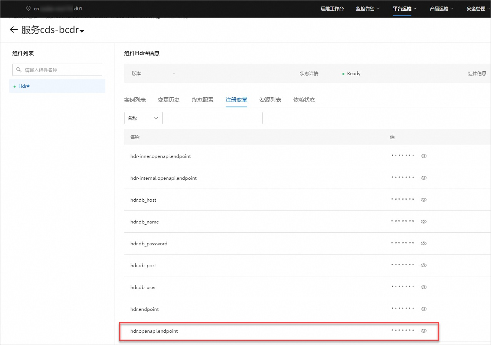

5. 在**注册变量**页签，单击**hdr.openapi.endpoint**变量对应的图标，即可查看Endpoint信息。

   | 变量 | Endpoint拼接格式 |
   | --- | --- |
   | hdr.openapi.endpoint | hdr.<em>${global:region}</em>.<em>${global:internet-domain}</em> |

<a id="section-5-4"></a>

## 5.4. ROA风格请求体&签名机制

本文基于阿里云SDK V3版本。通过公共请求头设置接口必要的参数信息，在签名机制的实现上屏蔽了接口风格的差异，更标准、更简单。本文提供了详细的指南，用于帮助您了解和实施阿里云SDK V3版的请求结构和签名过程。您会了解到如何构造标准的HTTP请求，以及如何使用正确的签名算法来验证请求的身份，确保传输的数据的完整性和安全性。如果您想要自研阿里云的 OpenAPI SDK，您可以参看本文。

**HTTP 请求结构**

一个完整的阿里云 OpenAPI 请求，包含以下部分。

| 名称 | 是否必选 | 描述 | 示例值 |
| --- | --- | --- | --- |
| 协议 | 是 | 您可以查阅不同云产品的 API 参考文档进行配置。支持通过<code> HTTP </code>或<code> HTTPS </code>协议进行请求通信。为了获得更高的安全性，推荐您使用HTTPS协议发送请求。取值范围为<code> https:// </code>或者 <code> http:// </code>。 | https:// |
| 服务地址 | 是 | 即 混合云容灾服务的Endpoint。您可以查阅不同云产品的服务接入地址文档，查阅不同服务区域下的服务地址。具体操作，请参见获取Endpoint。 | hdr.\*\*\*\*.com |
| resource_URI_parameters | 是 | 接口URL，包括接口路径和位置在 path、 query的接口请求参数。您可以从具体API接口文档的请求语法中获取URI取值。例如<code> POST </code><code>/api/v2/task/action/list_dr_tasks HTTP/1.1 </code>，则URI为<code> /api/v2/task/action/list_dr_tasks </code>。 | /api/v2/task/action/list_dr_tasks |
| RequestHeader | 是 | 请求头信息，通常包含API的版本、Host、Authorization等信息。后文将详细说明。 | x-acs-action |
| RequestBody | 是 | 定义在 body 中的业务请求参数。 | cluster_id |
| HTTPMethod | 是 | 请求使用的方法，ROA接口请求方法包括PUT、POST、GET、DELETE。 | POST |

**RequestHeader（公共请求头）**

一个完整的阿里云 OpenAPI 请求，包含以下部分。

| 名称 | 类型 | 是否必选 | 描述 | 示例值 |
| --- | --- | --- | --- | --- |
| x-acs-action | String | 是 | API的名称。 | DescribeDrSitePairs |
| x-acs-version | String | 是 | API 版本。HDR目前固定为2017-09-25。 | 2017-09-25 |
| Authorization | String | 非匿名请求必须 | 用于验证请求合法性的认证信息，格式为Authorization: SignatureAlgorithm Credential=<strong>AccessKeyId</strong>,SignedH eaders=<strong>SignedHeaders</strong>,Signatur e=<strong>Signature</strong>。其中<strong>SignatureAlgorithm</strong>为签名加密方式，为ACS3-HMAC-SHA256。<strong>Credential</strong> 为用户的访问密钥ID。如需创建 AccessKey，请参见获取AccessKey。<strong>SignedHeaders</strong>为请求头中包含的参与签名字段键名，【说明】：除Authorization外的所有公共请求头，只要存在必须被加入签名。<strong>Signature</strong>为请求签名，取值参见签名机制。 | ACS3-HMAC-SHA256 Credential=YourAccessKeyId,Signe dHeaders=content-type;host;x-acs-timestamp,Signature=6b595d672d 79c15b18edb4ccfba6789a24a6f2b 82c400e03162d9279b08555d7 |
| x-acs-signature-nonce | String | 否 | 签名唯一随机数。用于防止网络重放攻击，建议您每一次请求都使用不同的随机数。 | 15215528852396 |
| x-acs-date | String | 是 | 按照ISO 8601标准表示的UTC时间，格式为yyyy-MM-ddTHH:mm:ssZ，例如2018-01-01T12:00:00Z。值为请求发出前15分钟内的时间。 | 2018-01-01T12:00:00Z |
| host | String | 是 | 即服务地址Endpoint。具体操作，请参见获取Endpoint。 | hdr.\*\*\*\*.com |
| x-acs-content-sha256 | String | 是 | 请求正文Hash摘要后再base-16编码的结果，与HashedRequestPayload一致。 |  |
| x-acs-security-token | String | STS认证必传 | 为调用Assumerole接口返回值中SecurityToken的值。 |  |

**接口请求构造**

一个完整的接口请求构造如下：

```text
HTTPMethod /resource_URI_parameters
RequestHeader
RequestBody
```

请求参数由公共请求头和API自定义参数组成。公共请求头中包含API版本号、身份验证等信息。

- HTTPMethod ：请求使用的方法，包括PUT、POST、GET、DELETE。详情请参看HTTP 请求结构。

- resource_URI_parameters：请求要调用的资源标识符，如 `/cluster` 。详情请参看HTTP 请求结构。

- RequestHeader：请求头信息，通常包含API的版本、Host、Authorization等信息。详情请参看HTTP 请求结构。

- RequestBody：在 body 中的业务请求参数。详情请参看HTTP 请求结构。

请求RunInstances接口示例：

```http
POST /?ImageId=win2019_1809_x64_dtc_zh-cn_40G_alibase_20230811.vhd&RegionId=cn-shanghai HTTP/1.1
Authorization: ACS3-HMAC-SHA256 Credential=YourAccessKeyId,SignedHeaders=host;x-acs-action;x-acs-content-sha256;x-acs-date;x-acs-signature-nonce;x-acs-version,Signature=e521358f7776c97df52e6b2891a8bc73026794a071b50c3323388c4e0df64804
x-acs-action: DescribeDrSitePairs
host: hdr.***.com
x-acs-date: 2023-10-26T09:01:01Z
x-acs-version: 2014-05-26
x-acs-content-sha256: e3b0c44298fc1c149afbf4c8996fb92427ae41e4649b934ca495991b7852b855
x-acs-signature-nonce: d410180a5abf7fe235dd9b74aca91fc0
user-agent: AlibabaCloud (Mac OS X; x86_64) Java/1.8.0_352-b08 tea-util/0.2.6 TeaDSL/1
accept: application/json
```

**请求编码**

请求及返回结果都使用UTF-8字符集进行编码。

**接口返回结果**

每次接口调用请求，无论成功与否，系统都会返回一个唯一识别码RequestId。调用API服务后返回数据采用统一格式。接口调用成功后，会返回接口的返回参数请求ID，HTTP 状态码为 2xx（不显示在响应正文中）。响应正文示例如下：

```json
{
    "RequestId": "4C467B38-3910-447D-87BC-AC049166F216"/* 返回结果数据 */
}
```

接口调用出错后，会返回请求ID、服务节点、错误码和错误信息，HTTP 状态码为 4xx 或者 5xx。示例如下：

```json
{
    "code": "400", /* 错误码 */
    "message": "Cluster permission denied", /* 错误信息 */
    "requestId": "A026BC61-0523-5A6D-A5F3-314A3D92FD50", /* 请求 ID */
    "status": 400 /* 业务字段 */
}
```

当您无法排查错误时，可以提交工单，并在工单中注明Host（服务地址，参见HTTP 请求结构）和RequestId。

**签名机制**

为保证API的安全调用，在调用API时阿里云会对每个API请求通过签名（Signature）进行身份验证。无论使用HTTP还是HTTPS协议提交请求，都需要在请求中包含签名信息。本文指导您如何进行签名处理。

对于每一次HTTP或者HTTPS协议请求，阿里云会根据访问中的签名信息验证访问请求者身份。您在访问时签名信息时，请按照以下方法对请求进行签名处理：

**步骤一：构造规范化请求**

使用AK/SK方式进行签名与认证，首先需要规范请求内容，然后再进行签名。客户端与云服务API网关使用相同的请求规范，可以确保同一个HTTP请求的前后端得到相同的签名结果，从而完成身份校验。

构造规范化请求（CanonicalRequest）的伪代码如下：

```text
CanonicalRequest =
  HTTPRequestMethod + '\n' +    //http⽅法名，全⼤写
  CanonicalURI + '\n' +         //规范化URI
  CanonicalQueryString + '\n' + //规范化查询字符串
  CanonicalHeaders + '\n' +     //规范化消息头
  SignedHeaders + '\n' +        //已签名消息头
  HashedRequestPayload   
```

- 请求方法（HTTPRequestMethod）即大写的http方法名，如GET、POST。

- 规范化URI（CanonicalURI）

  即URL的资源路径部分经过编码得到，资源路径部分指URL中host与查询字符串之间的部分，包含host之后的 `/` 但不包含查询字符串前的 `?` 。用户发起请求时的URI应使用规范化URI，编码方式使用UTF-8字符集按照RFC3986的规则对URI中的每一部分（即被 `/` 分割开的字符串）进行编码：

  - 字符A~Z、a~z、0~9以及字符 `-` 、 `_` 、 `.` 、 `~` 不编码。

  - 其他字符编码成 `%XY` 的格式，其中 `XY` 是字符对应ASCII码的16进制。示例：半角双引号（ `"` ）对应 `%22` 。

  - 扩展的UTF-8字符，编码成 `%XY%ZA…` 的格式。

  - 空格（ ）编码成 `%20` ，而不是加号（ `+` ）。该编码方式与 `application/x-www-form-urlencoded` MIME格式编码算法相似，但又有所不同。

    如果您使用的是Java标准库中的 `java.net.URLEncoder` ，可以先用标准库中 `percentEncode` 编码，随后将编码后的字符中加号（ `+` ）替换为 `%20` 、星号（ `*` ）替换为 `%2A` 、 `%7E` 替换为波浪号（ `~` ），即可得到上述规则描述的编码字符串

  【注意】：当资源路径为空时，使用正斜杠( `/` )作为CanonicalURI。

- 规范化查询字符串（CanonicalQueryString）构造方法如下：

  - 将查询字符串中的参数按照参数名的字符代码升序排列，具有重复名称的参数应按值进行排序。

  - 使用UTF-8字符集按照RFC3986的规则对每个参数的参数名和参数值分别进行URI编码，具体规则与上一节中CanonicalURI的编码规则相同。

  - 使用等号（ `=` ）连接编码后的请求参数名和参数值，对于没有值的参数使用空字符串。

  - 将请求参数按编码后的参数名的字符代码顺序以升序排列，具有相同名称的参数按编码后的参数值进行排序。

  - 按照步骤4中的顺序使用与号（ `&` ）连接编码后的请求参数。

  【注意】：当请求的查询字符串为空时，使用空字符串作为规范化查询字符串，实际上就是空白行

- 规范化请求头（CanonicalizedHeaders）是非标准HTTP头部信息。是指请求中出现的以 `x-acs-` 为前缀的参数信息，构造方法如下：

  - 将所有需要签名的消息头的名称转换为小写。

  - 将消息头的值除去首尾空格。对于有多个值的消息头，将多个值分别除去首尾空格后按值升序排列，然后用逗号（ `,` ）连接。

  - 将步骤1、2的结果以英文冒号（ `:` ）连接，并在尾部添加换行符，组成一个规范化消息头(CanonicalHeaderEntry)。

  - 多个规范化消息头，按照消息头名称（小写）的字符代码顺序以升序排列后拼接在一起。

  - 如果没有需要签名的消息头，使用空字符串作为规范化消息头列表。

【说明】：**除Authorization外的所有公共请求头，只要存在必须被加入签名。**

- 已签名消息头列表（SignedHeaders）用于说明此次请求有哪些消息头参与了签名，与CanonicalHeaders中包含的消息头是一一对应的，构造方法如下：

  - 将CanonicalHeaders中包含的请求头的名称转为小写

  - 多个请求头名称（小写）按首字母升序排列并以英文分号（ `;` ）分隔，例如  `content-type;host;x-acs-date`

  - 伪代码如下：

    ```text
    CanonicalHeaderEntry = Lowercase(HeaderName) + ':' + Trim(HeaderValue) + '\n'

    CanonicalHeaders = 
        CanonicalHeaderEntry0 + CanonicalHeaderEntry1 + ... + CanonicalHeaderEntryN
    ```

- 使用哈希函数对请求正文（RequestPayload）转换的值（HashedRequestPayload），转换规则用伪代码可表示为  `HashedRequestPayload = HexEncode(Hash(RequestPayload))` 。

  - Hash表示消息摘要函数，目前支持SHA256算法，例如，当签名协议使用ACS3-HMAC-SHA256时，应使用SHA256作为Hash函数。

  - HexEncode表示以小写的十六进制的形式返回摘要的编码函数（即Base16编码）

  - 【注意】当请求正文为空时，比如GET请求，RequestPayload固定为空字符串

  表1：签名协议与签名算法、摘要函数的对应关系

  | 签名协议（SignatureAlgorithm） | 处理RequestPayload以及CanonicalRequest时使用的摘要函数（Hash） | 计算签名时实际使用的签名算法（SignatureMethod） |
  | --- | --- | --- |
  | ACS3-HMAC-SHA256 | SHA256 | HMAC-SHA256 |

**步骤二：构造待签名字符串**

按照以下伪代码构造待签名字符串（stringToSign）：

```text
StringToSign =
    SignatureAlgorithm + '\n' +
    HashedCanonicalRequest
```

- SignatureAlgorithm

  签名协议，目前支持ACS3-HMAC-SHA256，不再支持基于MD5或SHA1的算法。

- HashedCanonicalRequest

  规范化请求摘要串，计算方法伪代码如下：

  ```text
  HashedCanonicalRequest = HexEncode(Hash(CanonicalRequest))
  ```

1. 使用哈希函数（Hash）对步骤一中得到的规范化请求（CanonicalRequest）进行摘要处理，具体使用的Hash函数取决于签名协议（SignatureAlgorithm），参见表1，例如，当签名协议为ACS3-HMAC-SHA256时，应使用SHA256作为Hash函数。

2. 将上一步得到的摘要结果以小写的十六进制形式编码。

**步骤三：计算签名**

按照以下伪代码计算签名值（Signature）。

```text
Signature = HexEncode(SignatureMethod(Secret, StringToSign))
```

- StringToSign：步骤二中构造的待签名字符串，UTF-8编码。

- SignatureMethod：签名算法，具体使用的算法取决于签名协议（SignatureAlgorithm），其对应关系如表1。

- Secret：用户的签名密钥，为二进制数据。

- HexEncode：以小写的十六进制的形式返回摘要的编码函数（即Base16编码）。

**步骤四：将签名添加到请求中**

计算完签名后，构造Authorization请求头，格式为： `Authorization:<SignatureAlgorithm> Credential=<AccessKeyId>,SignedHeaders= <SignedHeaders>,Signature=<Signature>` <strong>，</strong>示例如下：

```text
Authorization:ACS3-HMAC-SHA256 Credential=YourAccessKeyId,SignedHeaders=content-type;host;x-acs-
timestamp,Signature=6b595d672d79c15b18edb4ccfba6789a24a6f2b82c400e03162d9279b08555d7
```

**签名示例**

本示例以调用混合云容灾服务为DescribeDrSitePairs例。假设您获得了AccessKeyID 为 YourAccessKeyId

， AccessKeySecret 为 YourAccessKeySecret，x-acs-signature-nonce 为 3156853299f313e23d1673dc12e1703d，接口请求时间为 2023-10-26T10:22:32Z。签名流程如下：

1. 构造规范化请求。

```text
POST
/
ImageId=win2019_1809_x64_dtc_zh-cn_40G_alibase_20230811.vhd&RegionId=cn-shanghai
host:hdr.***.com
x-acs-action:DescribeDrSitePairs
x-acs-content-sha256:e3b0c44298fc1c149afbf4c8996fb92427ae41e4649b934ca495991b7852b855
x-acs-date:2023-10-26T10:22:32Z
x-acs-signature-nonce:3156853299f313e23d1673dc12e1703d
x-acs-version:2014-05-26

host;x-acs-action;x-acs-content-sha256;x-acs-date;x-acs-signature-nonce;x-acs-version
e3b0c44298fc1c149afbf4c8996fb92427ae41e4649b934ca495991b7852b855
```

2. 构造待签名字符串。

```text
ACS3-HMAC-SHA256
7ea06492da5221eba5297e897ce16e55f964061054b7695beedaac1145b1e259
```

4. 计算签名。

```text
06563a9e1b43f5dfe96b81484da74bceab24a1d853912eee15083a6f0f3283c0
```

5. 将签名添加到请求中。

```http
POST /?ImageId=win2019_1809_x64_dtc_zh-cn_40G_alibase_20230811.vhd&RegionId=**** HTTP/1.1
Authorization: ACS3-HMAC-SHA256 Credential=YourAccessKeyId,SignedHeaders=host;x-acs-action;x-acs-content-sha256;x-acs-date;x-acs-signature-nonce;x-acs-version,Signature=e521358f7776c97df52e6b2891a8bc73026794a071b50c3323388c4e0df64804
x-acs-action: DescribeDrSitePairs
host: hdr.***.com
x-acs-date: 2023-10-26T09:01:01Z
x-acs-version: 2014-05-26
x-acs-content-sha256: e3b0c44298fc1c149afbf4c8996fb92427ae41e4649b934ca495991b7852b855
x-acs-signature-nonce: d410180a5abf7fe235dd9b74aca91fc0
user-agent: AlibabaCloud (Mac OS X; x86_64) Java/1.8.0_352-b08 tea-util/0.2.6 TeaDSL/1
accept: application/json
```

<a id="section-5-5"></a>

## 5.5. API参考

这是 API 参考内容

<a id="section-5-5-1"></a>

### 5.5.1. DeleteSitePairDrillSetting

删除容灾演练设置。

**请求头**

该接口使用公共请求头，无特殊请求头。请参见公共请求参数文档。

**请求语法**

```http
POST /api/v2/drill/action/delete_setting HTTP/1.1
```

**请求参数**

| 参数名称 | 类型 | 位置 | 是否必选 | 示例 | 说明 |
| --- | --- | --- | --- | --- | --- |
| SitePairId | String | Body | 否 | s-0000000000001 | 站点对ID。 |
| DrillConfigId | String | Body | 否 | dcf-00000123456abcd | 演练设置ID。 |

**返回数据**

| 参数名称 | 类型 | 示例 | 说明 |
| --- | --- | --- | --- |
| Success | Boolean | true | API调用结果标记。true为成功。 |
| RequestId | String | 444B5CC0-AE5D-11E6-8D22-28924A431726 | 请求ID。 |
| Code | String | SUCCESS | 错误码。当调用成功时为SUCCESS。 |
| Message | String | success | 错误信息。 |

**示例**

请求示例

```http
POST /api/v2/drill/action/delete_setting HTTP/1.1
{
"SitePairId":"s-0000000000001".
"DrillConfigId":"dcf-00000123456abcd"
}
```

正常返回示例

`JSON`  格式

```json
{
 "RequestId":"444B5CC0-AE5D-11E6-8D22-28924A431726",
 "Message":"success",
 "Code":"SUCCESS",
 "Success":true
}
```

<a id="section-5-5-2"></a>

### 5.5.2. DescribeNetworkMappings

查询交换机映射列表。

**请求头**

该接口使用公共请求头，无特殊请求头。请参见公共请求参数文档。

**请求语法**

```http
POST /api/v2/site_pair/network_mapping/action/list HTTP/1.1
```

**请求参数**

| 参数名称 | 类型 | 位置 | 是否必选 | 示例 | 说明 |
| --- | --- | --- | --- | --- | --- |
| SitePairId | String | Body | 是 | s-0000000000001 | 站点对ID。 |
| SiteScopeType | String | Body | 是 | DR | 资源映射类型。<br>• DR：生产到容灾<br>• DRILL：生产到演练 |
| ZoneMappingId | String | Body | 是 | zm-0000000001 | 可用区映射ID。 |

**返回数据**

| 参数名称 | 类型 | 示例 | 说明 |
| --- | --- | --- | --- |
| Success | Boolean | true | API调用结果标记。true为成功。 |
| RequestId | String | 444B5CC0-AE5D-11E6-8D22-28924A431726 | 请求ID。 |
| Code | String | SUCCESS | 错误码。当调用成功时为SUCCESS。 |
| Message | String | success | 错误信息。 |
| NetworkMappings | Struct |  | 交换机映射。 |
| -NetworkMapping | Array |  | 交换机映射列表。 |
| --SitePairId | String | s-0000000000001 | 站点对ID。 |
| --NetworkMappingId | String | nm-0000000000001 | 交换机映射ID。 |
| --PrimaryInfrastructureId | String | a | 生产站点基础设施ID。非云容灾使用。 |
| --PrimaryNetworkId | String | vsw-0000000001 | 生产站点交换机ID。 |
| --PrimaryNetworkName | String | vsw-A | 生产站点交换机名称。 |
| --PrimaryNetworkDetail | String | {"name":"abc"} | 生产站点交换机详情。 |
| --SecondaryInfrastructureId | String | b | 容灾站点基础设施ID。非云容灾使用。 |
| --SecondaryNetworkId | String | vsw-0000000002 | 容灾站点交换机ID。 |
| --SecondaryNetworkName | String | vsw-B | 容灾站点交换机名称。 |
| --SecondaryNetworkDetail | String | {"name":"abc"} | 容灾站点交换机详情。 |
| --Status | String | compliant | 状态。notcompliant: 不一致；compliant：一致；creating：创建中。 |
| --ErrorCode | String | hdr.code.xxx | 错误代码。 |
| --ErrorParams | String | {"name":"abc"} | 错误详情。 |

**示例**

请求示例

```http
POST /api/v2/site_pair/network_mapping/action/list HTTP/1.1
{
"SitePairId":"s-0000000000001",
"SiteScopeType":"DR",
"ZoneMappingId":"zm-0000000001"
}
```

正常返回示例

`JSON`  格式

```json
{
 "RequestId":"444B5CC0-AE5D-11E6-8D22-28924A431726",
 "Message":"success",
 "NetworkMappings":{
  "-NetworkMapping":{
   "Status":"compliant",
   "ErrorParams":"{\"name\":\"abc\"}",
   "PrimaryNetworkName":"vsw-A",
   "PrimaryNetworkId":"vsw-0000000001",
   "SecondaryInfrastructureId":"b",
   "NetworkMappingId":"nm-0000000000001",
   "SecondaryNetworkId":"vsw-0000000002",
   "SecondaryNetworkDetail":"{\"name\":\"abc\"}",
   "PrimaryInfrastructureId":"a",
   "PrimaryNetworkDetail":"{\"name\":\"abc\"}",
   "SitePairId":"s-0000000000001",
   "ErrorCode":"hdr.code.xxx",
   "SecondaryNetworkName":"vsw-B"
  }
 },
 "Code":"SUCCESS",
 "Success":true
}
```

<a id="section-5-5-3"></a>

### 5.5.3. DescribeProtectionInstances

查询保护实例。

**请求头**

该接口使用公共请求头，无特殊请求头。请参见公共请求参数文档。

**请求语法**

```http
POST /api/v2/protection_instance/action/list_instances HTTP/1.1
```

**请求参数**

| 参数名称 | 类型 | 位置 | 是否必选 | 示例 | 说明 |
| --- | --- | --- | --- | --- | --- |
| PageNumber | Integer | Body | 否 | 1 | 页码。 |
| PageSize | Integer | Body | 否 | 10 | 每页数据条数。 |
| GroupId | String | Body | 否 | pg-000000001 | 保护组ID。 |
| InstanceId | String | Body | 否 | i-000000001 | 生产端实例ID。 |
| InstanceName | String | Body | 否 | iz001 | 生产端实例名称。 |
| ProtectionInstanceI d | String | Body | 否 | pi-000000001 | 保护实例ID。 |
| Statuses | String | Body | 否 | replicating | 保护实例状态，参考输出。 |

**返回数据**

| 参数名称 | 类型 | 示例 | 说明 |
| --- | --- | --- | --- |
| Success | Boolean | true | API调用结果标记。true为成功。 |
| RequestId | String | 444B5CC0-AE5D-11E6-8D22-28924A431726 | 请求ID。 |
| Code | String | SUCCESS | 错误码。当调用成功时为SUCCESS。 |
| Message | String | success | 错误信息。 |
| TotalCount | Long | 21 | 数据总条数。 |
| PageNumber | Integer | 1 | 当前页码。 |
| PageSize | Integer | 1 | 每页数据数。 |
| ProtectionInstances | Struct |  | 保护实例。 |
| -ProtectionInstance | Array |  | 保护实例列表。 |
| --AllowActions | String | \["UpdateProtectionInstance"\] | 保护实例可用操作列表。 |
| --Events | Array | \[\] | 保护实例事件。 |
| ---EventType | String | ALARM | 事件类型。 |
| ---Level | String | CRITICAL | 事件等级。 |
| ---RelationId | String | pg-0000000000001 | 关联的资源ID。 |
| ---Code | String | hdr.event.code.alarm | 事件代码。 |
| ---Param | String | {} | 事件信息。 |
| --SitePairId | String | s-0000000000001 | 站点对ID。 |
| --GroupId | String | pg-000000001 | 保护组ID。 |
| --EntityId | String | pi-000000001 | Deprecated。使用protectionInstanceId。 |
| --ProtectionInstanceId | String | pi-000000001 | 保护实例ID。 |
| --SourceInstanceId | String | i-000000001 | Deprecated。使用productInstanceId。 |
| --ProductInstanceId | String | i-000000001 | 生产站点实例ID。 |
| --SourceInstanceName | String | iZ01 | Deprecated。productInstanceName。 |
| --ProductInstanceName | String | iZ001 | 生产站点实例名称。 |
| --TargetInstanceId | String | i-000000000y | 容灾站点恢复实例ID，仅持续复制型。 |
| --TargetInstanceName | String | iZ00y | 容灾站点恢复实例名称，仅持续复制型。 |
| --ReplicationInstanceId | String | i-0000000x | 容灾站点复制实例Id，仅持续复制型。 |
| --ReplicationInstanceName | String | iZ00x | 容灾站点复制实例名称，仅持续复制型。 |
| --ReplicationHealth | String | healthy | healthy 表示正常。 |
| --TestRecoveredInstanceId | String | i-000000001 | Deprecated。使用 drillInstanceId。 |
| --TestRecoveredInstanceNa me | String | i-000000001 | Deprecated。使用 drillInstanceName。 |
| --DrillInstanceId | String | i-0000000003 | 容灾站点演练实例ID。 |
| --DrillInstanceName | String | iZ003 | 容灾站点演练实例名称。 |
| --DrillStatus | String | drill | 容灾站点演练状态。initial：初始化； drilling,：演练创建中； drillError：演练错误；, drilled：演练创建完成, cleaning：清理中； cleanError：清理错误。 |
| --RecoveredInstanceId | String | i-000000001 | Deprecated。使用 drInstanceId。 |
| --RecoveredInstanceName | String | i-000000001 | Deprecated。使用 drInstanceName。 |
| --DrInstanceId | String | i-0000000002 | 容灾站点实例ID。 |
| --DrInstanceName | String | iZ002 | 容灾站点实例名称。 |
| --ExpectRpo | Integer | 900 | 期望RPO，单位秒。 |
| --ActualRpo | Integer | 900 | 实际RPO，单位秒。 |
| --DiskCount | Integer | 1 | 磁盘数。 |
| --DiskSize | Integer | 20 | 磁盘容量，单位GB。 |
| --Direction | String | FORWARD | FORWARD 正向复制。REVERSED 反向复制 |
| --Type | String | type | 实例保护类型，暂未使用。 |
| --Status | String | initial | 状态。<br>• preparing：准备中；<br>• agentInstalling：安装Agent中；<br>• agentInstalled：Agent安装完成；<br>• agentInstallError：Agent安装失败；<br>• registering：注册中；<br>• registered：注册成功；<br>• registerError：注册失败；<br>• initialized：已初始化；<br>• enableReplicating：启动复制中；<br>• enableReplicatingError：启动复制失败；<br>• initialFullSync：初始化全量复制；<br>• disableReplicating：停止复制中；<br>• disableReplicatingError：停止复制失败；<br>• replicating：增量复制中；<br>• replicatingError：复制错误；<br>• failovering：故障切换中；<br>• failoverError：故障切换错误；<br>• failovered：故障切换完成；<br>• committing：故障切换确认中；<br>• commitError：故障切换错误；<br>• committed：故障切换确认完成；<br>• reversedRegistering：反向注册中，仅持续复制型；<br>• reversedRegistered：反向注册完成，仅持续复制型；<br>• reversedRegisterError：反向注册错误，仅持续复制型；<br>• reversedEnableReplicating：启动反向复制中；<br>• reversedEnableReplicatingError：启动反向复制失败；<br>• reversedReplicatingError：反向复制错误；<br>• reversedReplicating：反向增量复制中；<br>• reversedDisableReplicating：停止反向复制中；<br>• reversedDisableReplicatingError：停止反向复制失败；<br>• failbacking：故障恢复中；<br>• failbacked：故障恢复完成；<br>• failbackError：故障恢复失败；<br>• failbackCommitting：故障恢复确认中；<br>• failbackCommitError：故障恢复确认错误；<br>• reversedInitialized：反向初始化完成；<br>• reversedInitialFullSync：反向全量复制初始化；<br>• unregistering：注销中；<br>• unregisterError：注销失败；<br>• repairReplicating：修复复制中；<br>• repairReplicatingError：修复复制失败。 |
| --DeletionProtection | Boolean | true | 生产实例释放保护标志。 |
| --StartProtectTimestamp | String | 1680016800 | 保护开启时间。 |
| --FullSyncProgress | Integer | 90 | 全量复制进度，0-100，仅处于全量复制状态时输出。 |
| --FullSyncTotalSize | Long | 10244444 | 全量复制总大小，单位Byte。 |
| --FullSyncCurrentSize | Long | 900000 | 已复制大小，单位Byte。 |
| --FullSyncStartTime | Long | 1680016800 | 全量开始时间戳，单位秒。仅处于全量复制状态时输出。 |
| --TaskId | String | t-00000000001 | 如保护实例目前有任务，输出任务ID。 |
| --Errno | String | hdr.code.xx | 错误代码。 |
| --ProductChargeType | String | PostPaid | 生产站点收费类型。 |
| --DrChargeType | String | PostPaid | 容灾站点收费类型。 |
| --ReplicationStrategy | Struct |  | 复制策略，仅持续复制型。 |
| ---ConsistentType | String | crash | 一致性类型。 |
| ---CrashConsistencyPolicy | String | crash | 崩溃一致性策略。 |
| ---AppConsistencyPolicy | String | app | app一致性策略。 |
| --FailoverStrategy | Struct |  | 恢复策略，仅持续复制型。 |
| ---UserData | String | data | 用户脚本，用于切换时执行。 |
| --CdrExtendDTO | Struct | PostPaid | 扩展信息，仅持续复制型。 |
| ---ProtectionInstanceId | String | pi-000001 | 保护实例ID。 |
| ---RecoveryInstanceType | String | ecs.c6.large | 容灾站点ECS实例规格。 |
| ---RecoveryPostScriptType | String | SHELL | 故障切换后执行脚本类型。SHELL,POWERSHELL,BAT和NONE。 |
| ---RecoveryPostScriptConten t | String | /bin/sh | 脚本内容。 |
| ---RecoveryInstanceName | String | izzz | 容灾站点ECS名称。 |
| ---RecoveryPointId | String | rp-00000001 | 恢复点ID。 |
| ---RecoveryPointTime | Long | 1680016800 | 恢复点时间戳。 |
| ---RecoveryEipAddressId | String | eip | 指定的EIP |
| ---RecoveryDiskCategory | String | cloud_ssd | 指定的磁盘类型，参考ECS 文档。 |
| ---RecoveryMemory | Long | 2048 | 内存大小 |
| ---RecoveryCpu | Integer | 2 | Cpu |
| ---ReplicationUseOriginalInst ance | Boolean | true | 是否使用已有ECS实例 |
| ---RecoveryStorageSetId | String | ss-0000001 | 存储集ID。 |
| ---RecoveryStorageSetPartiti onNumber | Integer | 1 | 存储集分区。 |

**示例**

请求示例

```http
POST /api/v2/protection_instance/action/list_instances HTTP/1.1
{
"GroupId":"pg-000000001"
}
```

正常返回示例

`JSON`  格式

```json
{
 "TotalCount":21,
 "RequestId":"444B5CC0-AE5D-11E6-8D22-28924A431726",
 "Message":"success",
 "PageSize":1,
 "PageNumber":1,
 "ProtectionInstances":{
  "-ProtectionInstance":{
   "--CdrExtendDTO":{
    "RecoveryDiskCategory":"cloud_ssd",
    "RecoveryMemory":2048,
    "RecoveryInstanceName":"izzz",
    "RecoveryPointId":"rp-00000001",
    "RecoveryStorageSetId":"ss-0000001",
    "RecoveryInstanceType":"ecs.c6.large",
    "RecoveryCpu":2,
    "ProtectionInstanceId":"pi-000001",
    "RecoveryPostScriptType":"SHELL",
    "RecoveryPostScriptContent":"/bin/sh",
    "RecoveryEipAddressId":"eip",
    "RecoveryStorageSetPartitionNumber":1,
    "RecoveryPointTime":1680016800,
    "ReplicationUseOriginalInstance":true
   },
   "SourceInstanceName":"iZ01",
   "DrInstanceId":"i-0000000002",
   "ExpectRpo":900,
   "TaskId":"t-00000000001",
   "TestRecoveredInstanceId":"i-000000001",
   "Errno":"hdr.code.xx",
   "ReplicationHealth":"healthy",
   "RecoveredInstanceName":"i-000000001",
   "SourceInstanceId":"i-000000001",
   "Direction":"FORWARD",
   "FullSyncProgress":90,
   "ActualRpo":900,
   "DrillStatus":"drill",
   "SitePairId":"s-0000000000001",
   "--FailoverStrategy":{
    "UserData":"data"
   },
   "ReplicationInstanceId":"i-0000000x",
   "DiskSize":20,
   "ProtectionInstanceId":"pi-000000001",
   "RecoveredInstanceId":"i-000000001",
   "DrInstanceName":"iZ002",
   "Status":"initial",
   "DrillInstanceName":"iZ003",
   "StartProtectTimestamp":"1680016800",
   "FullSyncStartTime":1680016800,
   "DiskCount":1,
   "--Events":{
    "EventType":"ALARM",
    "RelationId":"pg-0000000000001",
    "Param":"{}",
    "Level":"CRITICAL",
    "Code":"hdr.event.code.alarm"
   },
   "ProductChargeType":"PostPaid",
   "ProductInstanceId":"i-000000001",
   "DrillInstanceId":"i-0000000003",
   "TargetInstanceId":"i-000000000y",
   "DeletionProtection":true,
   "ReplicationInstanceName":"iZ00x",
   "--ReplicationStrategy":{
    "AppConsistencyPolicy":"app",
    "CrashConsistencyPolicy":"crash",
    "ConsistentType":"crash"
   },
   "GroupId":"pg-000000001",
   "EntityId":"pi-000000001",
   "TestRecoveredInstanceName":"i-000000001",
   "Type":"type",
   "AllowActions":"[\"UpdateProtectionInstance\"]",
   "TargetInstanceName":"iZ00y",
   "ProductInstanceName":"iZ001",
   "DrChargeType":"PostPaid",
   "FullSyncCurrentSize":900000,
   "FullSyncTotalSize":10244444
  }
 },
 "Code":"SUCCESS",
 "Success":true
}
```

<a id="section-5-5-4"></a>

### 5.5.4. DescribeDrillGroupInstances

查询演练实例列表。

**请求头**

该接口使用公共请求头，无特殊请求头。请参见公共请求参数文档。

**请求语法**

```http
POST /api/v2/drill/action/list_instances HTTP/1.1
```

**请求参数**

| 参数名称 | 类型 | 位置 | 是否必选 | 示例 | 说明 |
| --- | --- | --- | --- | --- | --- |
| PageNumber | Integer | Body | 否 | 1 | 页码。 |
| PageSize | Integer | Body | 否 | 10 | 每页数据条数。 |
| SitePairId | String | Body | 是 | s-0000000000001 | 站点对ID。 |
| DrillGroupId | String | Body | 是 | dpg-0000000000001 | 演练组ID。 |

**返回数据**

| 参数名称 | 类型 | 示例 | 说明 |
| --- | --- | --- | --- |
| Success | Boolean | true | API调用结果标记。true为成功。 |
| RequestId | String | 444B5CC0-AE5D-11E6-8D22-28924A431726 | 请求ID。 |
| Code | String | SUCCESS | 错误码。当调用成功时为SUCCESS。 |
| Message | String | success | 错误信息。 |
| TotalCount | Long | 21 | 数据总条数。 |
| PageNumber | Integer | 1 | 当前页码。 |
| PageSize | Integer | 1 | 每页数据数。 |
| DrillInstances | Struct |  | 演练实例。 |
| -DrillInstance | Array |  | 演练实例列表。 |
| --AllowActions | String | \[\\"Delete\\"\] | 演练实例可用的操作列表。 |
| --Events | Array |  | 演练组当前事件列表。 |
| ---EventType | String | ALARM | 事件类型。 |
| ---Level | String | CRITICAL | 事件等级。 |
| ---RelationId | String | pg-0000000000001 | 关联的资源ID。 |
| ---Code | String | hdr.event.code.alarm | 事件代码。 |
| ---Param | String | {} | 事件信息。 |
| --SitePairId | String | s-0000000000001 | 站点对ID。 |
| --GroupId | String | pg-0000000000001 | 保护组ID。 |
| --ProtectionInstanceId | String | pi-0000000000001 | 保护实例ID。 |
| --DrillProtectionInstanceId | String | dpi-0000000000001 | 演练实例ID。 |
| --ProductInstanceId | String | i-0000000000001 | 生产ECS实例ID。 |
| --ProductInstanceName | String | iZ0000000000001Z | 生产ECS实例名称。 |
| --DrillInstanceId | String | i-0000000000001 | 演练ECS实例ID。 |
| --DrillInstanceName | String | iZ0000000000001Z | 演练ECS实例名称。 |
| --DrillStatus | String | initial | 演练ECS实例状态。 |
| --DiskCount | Integer | 10 | 演练实例包含的云盘数。 |
| --DiskSize | Integer | 10 | 演练实例包含的云盘容量总计。 |
| --ErrorCode | String | hdr.drill.error.internalError | 错误码，对应错误说明。 |
| --ErrorParams | String | {} | 错误相关信息，和 errorCode 结合。 |
| --Progress | Integer | 80 | 演练创建进度。100表示创建完成。 |
| --TaskId | String | t-0000000000001 | 任务ID。可以在任务列表里查看详细信息。 |

**示例**

请求示例

```http
POST /api/v2/drill/action/list_instances HTTP/1.1
{
"SitePairId":"s-0000000000001",
"DrillGroupId":"dpg-0000000000001"
}
```

正常返回示例

`JSON`  格式

```json
{
 "TotalCount":21,
 "RequestId":"444B5CC0-AE5D-11E6-8D22-28924A431726",
 "Message":"success",
 "PageSize":1,
 "PageNumber":1,
 "DrillInstances":{
  "-DrillInstance":{
   "DrillInstanceName":"iZ0000000000001Z",
   "DiskCount":10,
   "Progress":80,
   "--Events":{
    "EventType":"ALARM",
    "RelationId":"pg-0000000000001",
    "Param":"{}",
    "Level":"CRITICAL",
    "Code":"hdr.event.code.alarm"
   },
   "TaskId":"t-0000000000001",
   "ProductInstanceId":"i-0000000000001",
   "ErrorParams":"{}",
   "DrillProtectionInstanceId":"dpi-0000000000001",
   "DrillInstanceId":"i-0000000000001",
   "GroupId":"pg-0000000000001",
   "DrillStatus":"initial",
   "AllowActions":"[\\\"Delete\\\"]",
   "SitePairId":"s-0000000000001",
   "DiskSize":10,
   "ProtectionInstanceId":"pi-0000000000001",
   "ErrorCode":"hdr.drill.error.internalError",
   "ProductInstanceName":"iZ0000000000001Z"
  }
 },
 "Code":"SUCCESS",
 "Success":true
}
```

<a id="section-5-5-5"></a>

### 5.5.5. DescribeClouds

查询云站点。

**请求头**

该接口使用公共请求头，无特殊请求头。请参见公共请求参数文档。

**请求语法**

```http
POST /api/v2/cloud/action/list_clouds HTTP/1.1
```

**返回数据**

| 参数名称 | 类型 | 示例 | 说明 |
| --- | --- | --- | --- |
| Success | Boolean | true | API调用结果标记。true为成功。 |
| RequestId | String | 444B5CC0-AE5D-11E6-8D22-28924A431726 | 请求ID。 |
| Code | String | SUCCESS | 错误码。当调用成功时为SUCCESS。 |
| Message | String | success | 错误信息。 |
| Clouds | Struct |  | 云站点。 |
| -Cloud | Array |  | 云站点列表。 |
| --Events | Array |  | 云站点当前事件列表。 |
| ---EventType | String | ALARM | 事件类型。 |
| ---Level | String | CRITICAL | 事件等级。 |
| ---RelationId | String | pg-0000000000001 | 关联的资源ID。 |
| ---Code | String | hdr.event.code.alarm | 事件代码。 |
| ---Param | String | {} | 事件信息。 |
| --IsLocal | Boolean | true | 是否当前站点。true 为当前云站点。 |
| --HeartbeatTime | Long | 1680016800 | 最近一次心跳时间戳，单位秒。 |
| --CreatedTime | Long | 1680000800 | 创建时间戳，单位秒。 |
| --CloudId | String | uniq | 云站点ID。 |
| --CloudName | String | 内部云-测试环境 | 云站点名称。 |
| --HdrEndpoint | String | hdr.aliyun-test-example.com | 云站点HDR服务域名。 |
| --HdrAccessKeyId | String | LTX123xxxxx | Hdr使用的access Key Id。 |
| --HdrAccessKeySecret | String | SecretXXXXX | Hdr使用的access Key Secret。 |
| --Regions | String | \[\\"cn-shanghai\\"\] | Hdr支持的地域。 |
| --IsPrimary | Boolean | true | 云站点相对本地站点的主从角色。当isLocal=true时，此值无效。 |
| --Status | String | CONNECTED | 云站点状态。<br>• WAIT_VERIFY：待验证；<br>• VERIFY_FAILED：验证失败；<br>• CONNECTED： 已链接，状态正常；<br>• DISCONNECTED：链接断开；<br>• WAIT_DELETE：等待删除；<br>• DELETED：已删除。 |
| --PrimaryTime | Long | 1680002800 | 云站点成为主角色的时间。 |
| --EncryptKeyVersion | Integer | 1 | 加密Key的版本。 |

**示例**

请求示例

```http
POST /api/v2/cloud/action/list_clouds HTTP/1.1
{

}
```

正常返回示例

`JSON`  格式

```json
{
 "RequestId":"444B5CC0-AE5D-11E6-8D22-28924A431726",
 "Message":"success",
 "Clouds":{
  "-Cloud":{
   "Status":"CONNECTED",
   "--Events":{
    "EventType":"ALARM",
    "RelationId":"pg-0000000000001",
    "Param":"{}",
    "Level":"CRITICAL",
    "Code":"hdr.event.code.alarm"
   },
   "CreatedTime":1680000800,
   "EncryptKeyVersion":1,
   "IsLocal":true,
   "CloudName":"内部云-测试环境",
   "Regions":"[\\\"cn-shanghai\\\"]",
   "HdrAccessKeyId":"LTX123xxxxx",
   "HeartbeatTime":1680016800,
   "CloudId":"uniq",
   "HdrEndpoint":"hdr.aliyun-test-example.com",
   "HdrAccessKeySecret":"SecretXXXXX",
   "IsPrimary":true,
   "PrimaryTime":1680002800
  }
 },
 "Code":"SUCCESS",
 "Success":true
}
```

<a id="section-5-5-6"></a>

### 5.5.6. DescribeOpsOrders

查询运维工单。

**请求头**

该接口使用公共请求头，无特殊请求头。请参见公共请求参数文档。

**请求语法**

```http
POST /api/v2/ops_order/action/list HTTP/1.1
```

**请求参数**

| 参数名称 | 类型 | 位置 | 是否必选 | 示例 | 说明 |
| --- | --- | --- | --- | --- | --- |
| OpsType | String | Body | 否 | ProtectionGroupDelete | 运维工单类型。 |
| ResourceId | String | Body | 否 | pg-0000000000001 | 资源ID。 |
| SitePairId | String | Body | 否 | s-0000000000001 | 站点对ID。 |
| OrderStatus | String | Body | 否 | 工单状态 | 工单状态。<br>• init：初始化；<br>• processing：处理中；<br>• retry：重试中；<br>• success：成功；<br>• disabled：关闭；<br>• failed：失败。 |
| StartTs | Long | Body | 否 | 1700000000 | 开始时间。时间戳，单位秒。 |
| EndTs | Long | Body | 否 | 1710000000 | 结束时间。时间戳，单位秒。 |
| PageNumber | Integer | Body | 否 | 1 | 页码。 |
| PageSize | Integer | Body | 否 | 10 | 每页数据条数。 |

**返回数据**

| 参数名称 | 类型 | 示例 | 说明 |
| --- | --- | --- | --- |
| OpsOrders | Array |  | 运维工单列表。 |
| -AccountId | Long | 10000000100000 | 账号ID。 |
| -SitePairId | String | s-0000000000001 | 站点对ID。 |
| -OrderId | String | ops-0000000000001 | 工单ID。 |
| -ExpireTime | Integer | 1720042000 | 过期时间戳。 |
| -RetryCount | Integer | 0 | 重试次数。 |
| -ResourceId | String | pg-0000000000001 | 资源ID。 |
| -OpsType | String | ProtectionGroupDelete | 运维工单类型。 |
| -OpsOptionContent | String | {} | 运维工单详细信息。 |
| -BackupContent | String | {} | 备份信息。 |
| -OrderStatus | String | 工单状态 | 工单状态。<br>• init：初始化；<br>• processing：处理中；<br>• retry：重试中；<br>• success：成功；<br>• disabled：关闭；<br>• failed：失败。 |
| -Description | String | needs to clean group A | 工单描述。 |
| -CreatedTime | Long | 1720012000 | 创建时间戳。 |
| -UpdatedTime | Long | 1720012000 | 更新时间戳。 |
| -HandleTime | Long | 1720022000 | 处理时间戳。 |
| Success | Boolean | true | API调用结果标记。true为成功。 |
| RequestId | String | 444B5CC0-AE5D-11E6-8D22-28924A431726 | 请求ID。 |
| Code | String | SUCCESS | 错误码。当调用成功时为SUCCESS。 |
| Message | String | success | 错误信息。 |
| TotalCount | Long | 21 | 数据总条数。 |
| PageNumber | Integer | 1 | 当前页码。 |
| PageSize | Integer | 1 | 每页数据数。 |

**示例**

请求示例

```http
POST /api/v2/ops_order/action/list HTTP/1.1
{

}
```

正常返回示例

`JSON`  格式

```json
{
 "TotalCount":21,
 "RequestId":"444B5CC0-AE5D-11E6-8D22-28924A431726",
 "Message":"success",
 "PageSize":1,
 "OpsOrders":{
  "AccountId":10000000100000,
  "BackupContent":"{}",
  "Description":"needs to clean group A",
  "CreatedTime":1720012000,
  "OpsType":"ProtectionGroupDelete",
  "OrderId":"ops-0000000000001",
  "OrderStatus":"⼯单状态",
  "RetryCount":0,
  "ResourceId":"pg-0000000000001",
  "SitePairId":"s-0000000000001",
  "OpsOptionContent":"{}",
  "UpdatedTime":1720012000,
  "ExpireTime":1720042000,
  "HandleTime":1720022000
 },
 "PageNumber":1,
 "Code":"SUCCESS",
 "Success":true
}
```

<a id="section-5-5-7"></a>

### 5.5.7. EnableReplicationForGroup

保护组启动复制。

**请求头**

该接口使用公共请求头，无特殊请求头。请参见公共请求参数文档。

**请求语法**

```http
POST /api/v2/protect/action/group_enable_replication HTTP/1.1
```

**请求参数**

| 参数名称 | 类型 | 位置 | 是否必选 | 示例 | 说明 |
| --- | --- | --- | --- | --- | --- |
| ResourceGroupId | String | Body | 否 | rg-00000000001 | 资源组ID。 |
| GroupId | String | Body | 否 | pg-0000000000001 | 保护组ID。 |
| UseOriginalInstanc e | Boolean | Body | 否 | true | true复用已有实例。 |
| InstanceKeepMode | String | Body | 否 | KeepCharging | 实例收费类型。 |
| StorageSetId | String | Body | 否 | ss-0000000001 | 存储集ID。 |
| StorageSetPartition Number | Integer | Body | 否 | 1 | 存储集分区。 |
| KmsKeyId | String | Body | 否 | kms-xxxx | KMS ID。 |
| SyncInstanceTag | Boolean | Body | 否 | true | true同步实例Tag。 |
| ProtectionInstanceI ds | String | Body | 否 | pi-0000000000001 | 保护实例ID，以半角逗号隔离，或JSON数组字符串。仅持续复制型有效。 |
| ReplicationDiskCat egory | String | Body | 否 | cloud_essd | 指定云盘类型。仅持续复制型有效。 |
| ReplicationNetwork | String | Body | 否 | vsw-0000000001 | 指定复制网络。仅持续复制型有效。 |
| RecoveryNetwork | String | Body | 否 | vsw-0000000002 | 指定恢复网络。仅持续复制型有效。 |
| CrashConsistentPoi ntPolicy | String | Body | 否 | policy | 指定崩溃一致性策略。仅持续复制型有效。 |
| AppConsistentPoint Policy | String | Body | 否 | policy | 指定app一致性策略。仅持续复制型有效。 |
| AutoResynchronize | Boolean | Body | 否 | true | 自动同步。仅持续复制型有效。 |

**返回数据**

| 参数名称 | 类型 | 示例 | 说明 |
| --- | --- | --- | --- |
| Success | Boolean | true | API调用结果标记。true为成功。 |
| RequestId | String | 444B5CC0-AE5D-11E6-8D22-28924A431726 | 请求ID。 |
| Code | String | SUCCESS | 错误码。当调用成功时为SUCCESS。 |
| Message | String | success | 错误信息。 |
| TaskId | String | t-000000000001 | 任务ID。 |
| TaskType | String | AddInstancesIntoGroup | 任务类型。 |

**示例**

请求示例

```http
POST /api/v2/protect/action/group_enable_replication HTTP/1.1
{
"GroupId":"pg-0000000000001"
}
```

正常返回示例

`JSON`  格式

```json
{
 "TaskId":"t-000000000001",
 "RequestId":"444B5CC0-AE5D-11E6-8D22-28924A431726",
 "Message":"success",
 "TaskType":"AddInstancesIntoGroup",
 "Code":"SUCCESS",
 "Success":true
}
```

<a id="section-5-5-8"></a>

### 5.5.8. DescribeDrTasks

查询容灾任务列表。

**请求头**

该接口使用公共请求头，无特殊请求头。请参见公共请求参数文档。

**请求语法**

```http
POST /api/v2/task/action/list_dr_tasks HTTP/1.1
```

**请求参数**

| 参数名称 | 类型 | 位置 | 是否必选 | 示例 | 说明 |
| --- | --- | --- | --- | --- | --- |
| PageNumber | Integer | Body | 否 | 1 | 页码。 |
| PageSize | Integer | Body | 否 | 10 | 每页数据条数。 |
| TaskId | String | Body | 否 | t-0000000000001 | 任务ID。 |
| TargetName | String | Body | 否 | Failover | 任务名称，支持模糊匹配。 |
| ParentTaskId | String | Body | 否 | t-0000000000001 | 父任务ID。 |
| Filter | String | Body | 否 | \[{"type":"sitePair","value":"sitePairId"}\] | 过滤条件。以 type 和 value 组成的数组。 |
| Status | String | Body | 否 | completed | 任务状态。 |

**返回数据**

| 参数名称 | 类型 | 示例 | 说明 |
| --- | --- | --- | --- |
| Success | Boolean | true | API调用结果标记。true为成功。 |
| RequestId | String | 444B5CC0-AE5D-11E6-8D22-28924A431726 | 请求ID。 |
| Code | String | SUCCESS | 错误码。当调用成功时为SUCCESS。 |
| Message | String | success | 错误信息。 |
| TotalCount | Long | 21 | 数据总条数。 |
| PageNumber | Integer | 1 | 当前页码。 |
| PageSize | Integer | 1 | 每页数据数。 |
| Tasks | Struct |  | 任务列表。 |
| -Task | Array |  | 任务列表。 |
| --TaskId | String | t-0000000000001 | 任务ID。 |
| --TargetName | String | pg-0000000000001 | 任务关联名称。 |
| --Name | String | Failover | 任务名称。 |
| --Progress | Integer | 100 | 任务进度。取值范围为0-100。 |
| --Status | String | completed | 任务状态。<br>• INITIAL：初始化；<br>• PROCESSING：运行中；<br>• COMPLETED：完成；<br>• FAILED：失败；<br>• CLEANING：清理中；<br>• CLEANED：清理完成；<br>• CLEANUP_FAILED：清理失败；<br>• CANCELLED：已取消；<br>• FAILED_BY_REACH_MAX_RETRY：重试失败；<br>• FAILED_BY_TIMEOUT：超时。 |
| --StatusCode | String | completed | 任务状态代码。 |
| --StatusParams | String | {} | 任务状态详细信息。 |
| --StepGroupName | String | skipStopEcs | 任务步骤组名称。跳过执行时，同一组内步骤全部跳过。 |
| --UpdatedTime | Long | 1680016800 | 更新时间戳，单位为秒。 |
| --CreatedTime | Long | 1680016800 | 创建时间戳，单位为秒。 |
| --SubTasks | Integer | 2 | 子任务数量。 |

**示例**

请求示例

```http
POST /api/v2/task/action/list_dr_tasks HTTP/1.1
{

}
```

正常返回示例 `JSON`  格式

```json
{
 "TotalCount":21,
 "Tasks":{
  "-Task":{
   "Status":"completed",
   "Progress":100,
   "TaskId":"t-0000000000001",
   "CreatedTime":1680016800,
   "UpdatedTime":1680016800,
   "TargetName":"pg-0000000000001",
   "StatusCode":"completed",
   "StatusParams":"{}",
   "SubTasks":2,
   "StepGroupName":"skipStopEcs",
   "Name":"Failover"
  }
 },
 "RequestId":"444B5CC0-AE5D-11E6-8D22-28924A431726",
 "Message":"success",
 "PageSize":1,
 "PageNumber":1,
 "Code":"SUCCESS",
 "Success":true
}
```

<a id="section-5-5-9"></a>

### 5.5.9. CreateGroupDrill

创建容灾演练保护组并启动演练。

**请求头**

该接口使用公共请求头，无特殊请求头。请参见公共请求参数文档。

**请求语法**

```http
POST /api/v2/drill/action/create HTTP/1.1
```

**请求参数**

| 参数名称 | 类型 | 位置 | 是否必选 | 示例 | 说明 |
| --- | --- | --- | --- | --- | --- |
| ResourceGroupId | String | Body | 否 | r-0000000000001 | 资源组ID，创建的演练ECS实例归属的资源组。 |
| SitePairId | String | Body | 是 | s-0000000000001 | 容灾站点对ID。 |
| GroupIds | String | Body | 是 | g-0000000000001 | 保护组ID。 |
| ProtectionInstanceI ds | String | Body | 否 | p-0000000000001 | 保护实例ID。 |
| StorageSetId | String | Body | 否 | ss-0000000000001 | 存储集ID，指定演练云盘使用存储集。 |
| StorageSetPartition Number | Integer | Body | 否 | 1 | 存储集分区。 |
| SyncInstanceTag | Boolean | Body | 否 | true | 是否同步实例标签。true表示同步。 |

**返回数据**

| 参数名称 | 类型 | 示例 | 说明 |
| --- | --- | --- | --- |
| Success | Boolean | true | API调用结果标记。success为成功。 |
| RequestId | String | 444B5CC0-AE5D-11E6-8D22-28924A431726 | 请求ID。 |
| Code | String | SUCCESS | 错误码。当调用成功时为SUCCESS。 |
| Message | String |  | 错误信息。 |
| TaskId | String | t-0000000000001 | 任务ID。 |

**示例**

请求示例

```http
POST /api/v2/drill/action/create HTTP/1.1
{
"SitePairId":"s-0000000000001",
"GroupIds":"g-0000000000001"
}
```

正常返回示例

`JSON`  格式

```json
{
 "TaskId":"t-0000000000001",
 "RequestId":"444B5CC0-AE5D-11E6-8D22-28924A431726",
 "Message":"",
 "Code":"SUCCESS",
 "Success":true
}
```

<a id="section-5-5-10"></a>

### 5.5.10. DescribeCloudSecurityGroups

查询安全组列表。

**请求头**

该接口使用公共请求头，无特殊请求头。请参见公共请求参数文档。

**请求语法**

```http
POST /api/v2/site_pair/action/list_available_security_groups HTTP/1.1
```

**请求参数**

| 参数名称 | 类型 | 位置 | 是否必选 | 示例 | 说明 |
| --- | --- | --- | --- | --- | --- |
| PageNumber | Integer | Body | 否 | 1 | 页码。 |
| PageSize | Integer | Body | 否 | 10 | 每页数据条数。 |
| CloudId | String | Body | 否 | uniq | 云实例ID。 |
| SiteRegionId | String | Body | 是 | cn-hangzhou | 地域ID。 |
| VpcId | String | Body | 是 | vpc-0000000000001 | VPC ID。 |

**返回数据**

| 参数名称 | 类型 | 示例 | 说明 |
| --- | --- | --- | --- |
| Success | Boolean | true | API调用结果标记。true为成功。 |
| RequestId | String | 444B5CC0-AE5D-11E6-8D22-28924A431726 | 请求ID。 |
| Code | String | SUCCESS | 错误码。当调用成功时为SUCCESS。 |
| Message | String |  | 错误信息。 |
| TotalCount | Long | 21 | 数据总条数。 |
| PageNumber | Integer | 1 | 当前页码。 |
| PageSize | Integer | 1 | 每页数据数。 |
| SecurityGroups | Struct |  | 安全组列表。 |
| -SecurityGroup | Array |  | 安全组列表。 |
| --SecurityGroupId | String | sg-0000000001 | 安全组ID。 |
| --SecurityGroupName | String | Web安全组 | 安全组名称。 |
| --SecurityGroupType | String | default | 安全组类型，参考ECS文档。 |
| --VpcId | String | vpc-0000000001 | VPC ID。 |
| --Description | String | 只允许80 443 | 安全组描述。 |

**示例**

请求示例

```http
POST /api/v2/site_pair/action/list_available_security_groups HTTP/1.1
{
"SiteRegionId":"cn-hangzhou",
"VpcId":"vpc-0000000000001"
}
```

正常返回示例

`JSON`  格式

```json
{
 "SecurityGroups":{
  "-SecurityGroup":{
   "Description":"只允许80 443",
   "SecurityGroupName":"Web安全组",
   "VpcId":"vpc-0000000001",
   "SecurityGroupId":"sg-0000000001",
   "SecurityGroupType":"default"
  }
 },
 "TotalCount":21,
 "RequestId":"444B5CC0-AE5D-11E6-8D22-28924A431726",
 "Message":"",
 "PageSize":1,
 "PageNumber":1,
 "Code":"SUCCESS",
 "Success":true
}
```

<a id="section-5-5-11"></a>

### 5.5.11. ReversedEnableReplicationForGroupPreview

启动反向复制预览。

**请求头**

该接口使用公共请求头，无特殊请求头。请参见公共请求参数文档。

**请求语法**

```http
POST /api/v2/protect/action/group_reversed_enable_replication_preview HTTP/1.1
```

**请求参数**

| 参数名称 | 类型 | 位置 | 是否必选 | 示例 | 说明 |
| --- | --- | --- | --- | --- | --- |
| ResourceGroupId | String | Body | 否 | rg-00000000001 | 资源组ID。 |
| GroupId | String | Body | 否 | pg-0000000000001 | 保护组ID。 |
| UseOriginalInstanc e | Boolean | Body | 否 | true | true复用已有实例。 |
| InstanceKeepMode | String | Body | 否 | KeepCharging | 实例收费类型。 |
| StorageSetId | String | Body | 否 | ss-0000000001 | 存储集ID。 |
| StorageSetPartition Number | Integer | Body | 否 | 1 | 存储集分区。 |
| KmsKeyId | String | Body | 否 | kms-xxxx | KMS ID。 |
| SyncInstanceTag | Boolean | Body | 否 | true | true同步实例Tag。 |
| ProtectionInstanceI ds | String | Body | 否 | pi-0000000000001 | 保护实例ID，以半角逗号隔离，或JSON数组字符串。仅持续复制型有效。 |
| ReplicationDiskCat egory | String | Body | 否 | cloud_essd | 指定云盘类型。仅持续复制型有效。 |
| ReplicationNetwork | String | Body | 否 | vsw-0000000001 | 指定复制网络。仅持续复制型有效。 |
| RecoveryNetwork | String | Body | 否 | vsw-0000000002 | 指定恢复网络。仅持续复制型有效。 |
| CrashConsistentPoi ntPolicy | String | Body | 否 | policy | 指定崩溃一致性策略。仅持续复制型有效。 |
| AppConsistentPoint Policy | String | Body | 否 | policy | 指定app一致性策略。仅持续复制型有效。 |
| AutoResynchronize | Boolean | Body | 否 | true | 自动同步。仅持续复制型有效。 |

**返回数据**

| 参数名称 | 类型 | 示例 | 说明 |
| --- | --- | --- | --- |
| Instances | Array |  | 实例预览。 |
| -Disks | Array |  | 云盘预览。 |
| --SourceDiskId | String | d-00000000001 | 生产站点云盘ID。 |
| --Category | String | cloud_essd | 云盘类型。 |
| --SourceDiskName | String | disk1 | 生产站点云盘名称。 |
| --TargetDiskId | String | d-00000000002 | 容灾站点磁盘ID，未分配不输出。 |
| --Size | Integer | 20 | 云盘容量，单位GB。 |
| --PerformanceLevel | String | PL0 | 云盘性能等级。参考ECS文档。 |
| --IsSystemDisk | Boolean | true | true 为系统盘。否则为数据盘。 |
| --Device | String | /dev/sda | 设备名。参考ECS文档。 |
| --DiskChargeType | String | PostPaid | 云盘收费类型。 |
| --AutoSnapshot | Boolean | true | 为true表示自动快照。 |
| --DeleteAutoSnapshot | Boolean | true | 为true表示自动清理快照。 |
| --Encrypted | Boolean | true | 为true表示加密磁盘。 |
| --DeleteWithInstance | Boolean | true | 为true表示随实例释放。 |
| --AllocateResource | Boolean | true | 为true表示需要创建云盘。 |
| -ProtectionGroupId | String | pg-000000000001 | 保护组ID |
| -ProtectionInstanceId | String | pi-000000000001 | 保护实例ID，未分配不输出。 |
| -SourceInstanceId | String | i-000000000001 | 生产端ECS实例ID。 |
| -TargetInstanceId | String | i-00000000002 | 容灾端ECS实例ID， 未分配不输出 |
| -InstanceTypeFamily | String | ecs.e | 实例规格族。 |
| -ChargeType | String | PostPaid | 实例收费类型。 |
| -InstanceType | String | ecs.e-c1m1.large | 实例规格。 |
| -TotalDisks | Integer | 1 | 云盘数量。 |
| -TotalDiskSize | Long | 20 | 云盘容量。单位GB。 |
| -AllocateResource | Boolean | true | 为true，需要创建容灾端ECS。 |
| -Arch | String | x86_64 | 架构，暂未使用。 |
| -Platform | String | Aliyun | 平台，暂未使用。 |
| -Cpu | Integer | 2 | CPU，暂未使用。 |
| -Memory | Integer | 2048 | 内存，暂未使用。 |
| -OsType | String | AliyunOS | 操作系统类型，暂未使用。 |
| -OsName | String | v3 | 操作系统名称，暂未使用。 |
| -InstanceTypeAvailable | Boolean | true | 为false表示当前实例规格在容灾站点不可用，需修改实例规格。 |
| -ImageAvailable | Boolean | true | 为false表示当前镜像在容灾站点不可用，需修改实例规格 |
| -AssistantNetworkInterface | Boolean | true | 为true表示有辅助网卡。 |
| -IpAvailable | Boolean | true | 为false表示IP在容灾站点不可用，需修改IP。 |
| InstanceSummary | Array |  | 实例统计信息。 |
| -InstanceType | String | ecs.c6.large | 实例规格。 |
| -Count | Integer | 10 | 实例数量。 |
| -ChargeType | String | PostPaid | 计费类型。 |
| -UnitPrice | String | 0.00 | 单价。 |
| -Summary | String | summary | 简要说明。 |
| DiskSummary | Array |  | 云盘统计信息。 |
| -Category | String | cloud_essd | 磁盘类型 |
| -Count | Integer | 10 | 云盘数量 |
| -Size | Long | 1024 | 云盘容量，单位GB。 |
| -ChargeType | String | PostPaid | 计费类型。 |
| -UnitPrice | String | 0.00 | 单价。 |
| -Summary | String | summary | 简要说明。 |
| Success | Boolean | true | API调用结果标记。true为成功。 |
| RequestId | String | 444B5CC0-AE5D-11E6-8D22-28924A431726 | 请求ID。 |
| Code | String | SUCCESS | 错误码。当调用成功时为SUCCESS。 |
| Message | String | success | 错误信息。 |
| CheckPassed | Boolean | true | true 满足条件。 |
| GroupId | String | pg-00000000001 | 保护组ID。 |
| Name | String | pg | 保护组名称。 |
| ChargeSummary | Long | 0 | 未使用。 |
| TargetRegionId | String | cn-shanghai | 容灾端地域ID。 |
| TargetZoneId | String | cn-shanghai-a | 容灾端可用区ID。 |
| TotalInstances | Integer | 1 | 实例数。 |
| TotalDisks | Integer | 10 | 云盘数。 |
| TotalSize | Long | 1024 | 云盘总计容量，单位GB。 |
| InstanceChargeType | String | PostPaid | 实例收费类型，仅按量付费。 |
| StorageSetId | String | ss-000000001 | 使用的存储集ID。 |
| StorageSetName | String | ssCluster1 | 使用的存储集名称。 |
| StorageSetPartitionNumb er | Integer | 1 | 使用的存储集分区。 |
| AssistantNetworkInterface | Boolean | false | 如果有辅助网卡，值为true。 |
| NeedAssignKmsKey | Boolean | true | 生产端有加密云盘，需要指定容灾端KmsKey。 |

**示例**

请求示例

```http
POST /api/v2/protect/action/group_reversed_enable_replication_preview HTTP/1.1
{

}
```

正常返回示例

`JSON`  格式

```json
{
 "ChargeSummary":0,
 "RequestId":"444B5CC0-AE5D-11E6-8D22-28924A431726",
 "Message":"success",
 "TargetZoneId":"cn-shanghai-a",
 "InstanceChargeType":"PostPaid",
 "CheckPassed":true,
 "StorageSetPartitionNumber":1,
 "TotalSize":1024,
 "InstanceSummary":{
  "UnitPrice":"0.00",
  "ChargeType":"PostPaid",
  "Summary":"summary",
  "Count":10,
  "InstanceType":"ecs.c6.large"
 },
 "Code":"SUCCESS",
 "StorageSetName":"ssCluster1",
 "Success":true,
 "GroupId":"pg-00000000001",
 "Name":"pg",
 "Instances":{
  "Platform":"Aliyun",
  "InstanceTypeFamily":"ecs.e",
  "Memory":2048,
  "OsName":"v3",
  "ImageAvailable":true,
  "TargetInstanceId":"i-00000000002",
  "AllocateResource":true,
  "Arch":"x86_64",
  "Cpu":2,
  "SourceInstanceId":"i-000000000001",
  "IpAvailable":true,
  "-Disks":{
   "Category":"cloud_essd",
   "Size":20,
   "PerformanceLevel":"PL0",
   "Device":"/dev/sda",
   "Encrypted":true,
   "DeleteAutoSnapshot":true,
   "DeleteWithInstance":true,
   "SourceDiskName":"disk1",
   "DiskChargeType":"PostPaid",
   "AllocateResource":true,
   "SourceDiskId":"d-00000000001",
   "TargetDiskId":"d-00000000002",
   "IsSystemDisk":true,
   "AutoSnapshot":true
  },
  "ProtectionGroupId":"pg-000000000001",
  "OsType":"AliyunOS",
  "AssistantNetworkInterface":true,
  "ChargeType":"PostPaid",
  "TotalDisks":1,
  "InstanceTypeAvailable":true,
  "ProtectionInstanceId":"pi-000000000001",
  "InstanceType":"ecs.e-c1m1.large",
  "TotalDiskSize":20
 },
 "DiskSummary":{
  "UnitPrice":"0.00",
  "Category":"cloud_essd",
  "Size":1024,
  "ChargeType":"PostPaid",
  "Summary":"summary",
  "Count":10
 },
 "Errors":{
  "ErrorParams":"",
  "ErrorCode":""
 },
 "AssistantNetworkInterface":false,
 "TotalDisks":10,
 "TargetRegionId":"cn-shanghai",
 "StorageSetId":"ss-000000001",
 "TotalInstances":1,
 "NeedAssignKmsKey":true
}
```

<a id="section-5-5-12"></a>

### 5.5.12. DescribeProtectionGroupStatistics

查询站点对下保护组状态统计。

**请求头**

该接口使用公共请求头，无特殊请求头。请参见公共请求参数文档。

**请求语法**

```http
POST /api/v2/site_pair/action/statistics HTTP/1.1
```

**请求参数**

| 参数名称 | 类型 | 位置 | 是否必选 | 示例 | 说明 |
| --- | --- | --- | --- | --- | --- |
| SitePairId | String | Body | 是 | s-0000000000001 | 站点对ID。 |

**返回数据**

| 参数名称 | 类型 | 示例 | 说明 |
| --- | --- | --- | --- |
| Success | Boolean | true | API调用结果标记。true为成功。 |
| RequestId | String | 444B5CC0-AE5D-11E6-8D22-28924A431726 | 请求ID。 |
| Code | String | SUCCESS | 错误码。当调用成功时为SUCCESS。 |
| Message | String |  | 错误信息。 |
| Normal | Integer | 10 | 正常状态数量。 |
| RpoHigh | Integer | 1 | RPO超过期望值状态数量。 |
| Error | Integer | 1 | 错误状态数量。 |
| Paused | Integer | 10 | 未复制状态数量。 |

**示例**

请求示例

```http
POST /api/v2/site_pair/action/statistics HTTP/1.1
{
"SitePairId":"s-0000000000001"
}
```

正常返回示例

`JSON`  格式

```json
{
 "RequestId":"444B5CC0-AE5D-11E6-8D22-28924A431726",
 "Message":"",
 "Error":1,
 "Normal":10,
 "Code":"SUCCESS",
 "Success":true,
 "RpoHigh":1,
 "Paused":10
}
```

<a id="section-5-5-13"></a>

### 5.5.13. DescribeInspectionTaskDetail

巡检任务详情。

**请求头**

该接口使用公共请求头，无特殊请求头。请参见公共请求参数文档。

**请求语法**

```http
POST /api/v2/inspection_task/action/detail HTTP/1.1
```

**请求参数**

| 参数名称 | 类型 | 位置 | 是否必选 | 示例 | 说明 |
| --- | --- | --- | --- | --- | --- |
| InspectionTaskId | String | Body | 是 | t-0000000000001 | 巡检任务ID。 |
| SitePairId | String | Body | 否 | s-0000000000001 | 站点对ID。 |

**返回数据**

| 参数名称 | 类型 | 示例 | 说明 |
| --- | --- | --- | --- |
| InspectionSubTaskDetails | Array | \[\] | 子任务详细信息。 |
| -InspectionSubTaskResultD etails | Array | \[\] | 子任务巡检结果。 |
| --TaskItemType | String | vSwitch | 任务类型。 |
| --ResourceId | String | vsw-0000000000001 | 巡检任务ID。 |
| --SitePairId | String | s-0000000000001 | 站点对ID。 |
| --Status | String | success | 任务状态。 |
| --Result | String | Name is invalidate | 结果描述。 |
| --Solution | String | Change Name | 解决方案。 |
| --ResourceType | String | vSwitch | 资源类型。 |
| -InspectionSubtaskId | String | t-0000000000001 | 巡检子任务ID。 |
| -InspectionTaskId | String | t-0000000000001 | 巡检任务ID。 |
| -SubtaskType | String | vSwitch | 子任务类型。 |
| -Status | String | success | 子任务状态。 |
| Success | Boolean | true | API调用结果标记。true为成功。 |
| RequestId | String | 444B5CC0-AE5D-11E6-8D22-28924A431726 | 请求ID。 |
| Code | String | SUCCESS | 错误码。当调用成功时为SUCCESS。 |
| Message | String | success | 错误信息。 |
| SitePairId | String | s-0000000000001 | 站点对ID。 |
| InspectionTaskName | String | InpectionTask1 | 巡检任务名称。 |
| InspectionTaskId | String | t-0000000000001 | 巡检任务ID。 |
| InspectionType | String | auto | 巡检触发类型。<br>• manual：手动触发。<br>• auto：自动触发。 |
| InspectionDescription | String | Check Vpc | 任务描述。 |
| Status | String | success | 任务状态。<br>• init：初始化；<br>• skip：跳过；<br>• processing：进行中；<br>• success：巡检任务完成；<br>• failed：巡检失败。 |
| Subtask | String | checkVpc | 巡检子任务信息。 |
| Summary | String | vpc:passed | 巡检任务摘要。 |
| CreatedTime | Long | 1720012000 | 告警发生时间戳。 |

**示例**

请求示例

```http
POST /api/v2/inspection_task/action/detail HTTP/1.1
{
"InspectionTaskId":"t-0000000000001"
}
```

正常返回示例

`JSON`  格式

```json
{
 "InspectionType":"auto",
 "Status":"success",
 "Subtask":"checkVpc",
 "CreatedTime":1720012000,
 "RequestId":"444B5CC0-AE5D-11E6-8D22-28924A431726",
 "Message":"success",
 "Code":"SUCCESS",
 "Success":true,
 "InspectionSubTaskDetails":{
  "-InspectionSubTaskResultDetails":{
   "Status":"success",
   "ResourceId":"vsw-0000000000001",
   "TaskItemType":"vSwitch",
   "SitePairId":"s-0000000000001",
   "ResourceType":"vSwitch",
   "Solution":"Change Name",
   "Result":"Name is invalidate"
  },
  "Status":"success",
  "InspectionSubtaskId":"t-0000000000001",
  "SubtaskType":"vSwitch",
  "InspectionTaskId":"t-0000000000001"
 },
 "InspectionDescription":"Check Vpc",
 "SitePairId":"s-0000000000001",
 "Summary":"vpc:passed",
 "InspectionTaskId":"t-0000000000001",
 "InspectionTaskName":"InpectionTask1"
}
```

<a id="section-5-5-14"></a>

### 5.5.14. ResumeTask

恢复任务。

**请求头**

该接口使用公共请求头，无特殊请求头。请参见公共请求参数文档。

**请求语法**

```http
POST /api/v2/task/action/resume_task HTTP/1.1
```

**请求参数**

| 参数名称 | 类型 | 位置 | 是否必选 | 示例 | 说明 |
| --- | --- | --- | --- | --- | --- |
| TaskId | String | Body | 否 | t-0000000000001 | 任务ID。 |

**返回数据**

| 参数名称 | 类型 | 示例 | 说明 |
| --- | --- | --- | --- |
| Success | Boolean | true | API调用结果标记。success为成功。 |
| RequestId | String | 444B5CC0-AE5D-11E6-8D22-28924A431726 | 请求ID。 |
| Code | String | 200 | 错误码。当调用成功时为SUCCESS。 |
| Message | String | SUCCESS | 错误信息。 |

**示例**

请求示例

```http
POST /api/v2/task/action/resume_task HTTP/1.1
{

}
```

正常返回示例 `JSON`  格式

```json
{
 "RequestId":"444B5CC0-AE5D-11E6-8D22-28924A431726",
 "Message":"SUCCESS",
 "Code":"200",
 "Success":true
}
```

<a id="section-5-5-15"></a>

### 5.5.15. DescribeSitePairDrillSettings

查看站点对容灾演练设置。

**请求头**

该接口使用公共请求头，无特殊请求头。请参见公共请求参数文档。

**请求语法**

```http
POST /api/v2/drill/action/list_settings HTTP/1.1
```

**请求参数**

| 参数名称 | 类型 | 位置 | 是否必选 | 示例 | 说明 |
| --- | --- | --- | --- | --- | --- |
| SitePairId | String | Body | 是 | s-0000000000001 | 站点对ID。 |

**返回数据**

| 参数名称 | 类型 | 示例 | 说明 |
| --- | --- | --- | --- |
| Success | Boolean | true | API调用结果标记。true为成功。 |
| RequestId | String | 444B5CC0-AE5D-11E6-8D22-28924A431726 | 请求ID。 |
| Code | String | SUCCESS | 错误码。当调用成功时为SUCCESS。 |
| Message | String |  | 错误信息。 |
| SitePairDrillSettings | Struct |  | 站点对演练设置。 |
| -SitePairDrillSetting | Array |  | 站点对演练设置列表。 |
| --VpcId | String | vpc-0000000000001 | VPC ID。 |
| --CreatedBy | String | HDR | 创建来源。 HDR: 自动创建; USER: 用户创建。 |
| --AutoRecycling | Boolean | true | 自动回收开关。如果设置为True，当容灾演练组清理完毕时，会自动清理自动创建的交换机/安全组/VPC等资源。 |
| --EcsPrefix | String | drill | 演练创建的ECS示例名称前缀。 |
| --DrillConfigId | String | dcf-00000123456abcd | 演练设置ID。 |
| --TaskId | String | t-00000223456abcd | 演练设置上的任务ID。 |

**示例**

请求示例

```http
POST /api/v2/drill/action/list_settings HTTP/1.1
{
"SitePairId":"s-0000000000001"
}
```

正常返回示例

`JSON`  格式

```json
{
 "RequestId":"444B5CC0-AE5D-11E6-8D22-28924A431726",
 "Message":"",
 "SitePairDrillSettings":{
  "-SitePairDrillSetting":{
   "CreatedBy":"HDR",
   "TaskId":"t-00000223456abcd",
   "VpcId":"vpc-0000000000001",
   "AutoRecycling":true,
   "EcsPrefix":"drill",
   "DrillConfigId":"dcf-00000123456abcd"
  }
 },
 "Code":"SUCCESS",
 "Success":true
}
```

<a id="section-5-5-16"></a>

### 5.5.16. DescribeDependencyServiceStatus

查询依赖服务开通状态。

**请求头**

该接口使用公共请求头，无特殊请求头。请参见公共请求参数文档。

**请求语法**

```http
POST /api/v2/user_biz/action/query_dependency_service_status HTTP/1.1
```

**请求参数**

| 参数名称 | 类型 | 位置 | 是否必选 | 示例 | 说明 |
| --- | --- | --- | --- | --- | --- |
| MfaPresent | Boolean | Body | 否 | true | 是否启用了多因素认证MFA（Multi-factor authentication）。 取值包括：<br>• true：已启用多因素认证。<br>• false：未启用多因素认证。 |
| Services | String | Body | 否 | snapshot | 服务代码。 |

**返回数据**

| 参数名称 | 类型 | 示例 | 说明 |
| --- | --- | --- | --- |
| Success | Boolean | true | API调用结果标记。true为成功。 |
| RequestId | String | 444B5CC0-AE5D-11E6-8D22-28924A431726 | 请求ID。 |
| Code | String | SUCCESS | 错误码。当调用成功时为SUCCESS。 |
| Message | String | success | 错误信息。 |
| ServiceStatuses | Struct |  | 服务开通状态。 |
| -ServiceStatus | Array |  | 服务开通状态列表。 |
| --Service | String | snapshot | 服务代码。 |
| --ServiceEnabled | Boolean | true | 是否已开通。true表示已开通。 |
| --Description | String | enabled | 通用描述信息。 |

**示例**

请求示例

```http
POST /api/v2/user_biz/action/query_dependency_service_status HTTP/1.1
{
"Services":"snapshot"
}
```

正常返回示例

`JSON`  格式

```json
{
 "ServiceStatuses":{
  "-ServiceStatus":{
   "Description":"enabled",
   "Service":"snapshot",
   "ServiceEnabled":true
  }
 },
 "RequestId":"444B5CC0-AE5D-11E6-8D22-28924A431726",
 "Message":"success",
 "Code":"SUCCESS",
 "Success":true
}
```

<a id="section-5-5-17"></a>

### 5.5.17. DrillCleanupGroup

清理演练，仅持续复制型。

**请求头**

该接口使用公共请求头，无特殊请求头。请参见公共请求参数文档。

**请求语法**

```http
POST /api/v2/protect/action/drillCleanup HTTP/1.1
```

**请求参数**

| 参数名称 | 类型 | 位置 | 是否必选 | 示例 | 说明 |
| --- | --- | --- | --- | --- | --- |
| GroupId | String | Body | 是 | pg-0000000000001 | 保护组ID。 |
| ProtectionInstanceI ds | String | Body | 否 | pi-0000000000001 | 保护实例ID。多个使用半角逗号分隔。最大10个。 |

**返回数据**

| 参数名称 | 类型 | 示例 | 说明 |
| --- | --- | --- | --- |
| Success | Boolean | true | API调用结果标记。true为成功。 |
| RequestId | String | 444B5CC0-AE5D-11E6-8D22-28924A431726 | 请求ID。 |
| Code | String | SUCCESS | 错误码。当调用成功时为SUCCESS。 |
| Message | String | success | 错误信息。 |
| TaskId | String | t-000000000001 | 任务ID。 |
| TaskType | String | AddInstancesIntoGroup | 任务类型。 |

**示例**

请求示例

```http
POST /api/v2/protect/action/drillCleanup HTTP/1.1
{
"GroupId":"pg-0000000000001"
}
```

正常返回示例

`JSON`  格式

```json
{
 "TaskId":"t-000000000001",
 "RequestId":"444B5CC0-AE5D-11E6-8D22-28924A431726",
 "Message":"success",
 "TaskType":"AddInstancesIntoGroup",
 "Code":"SUCCESS",
 "Success":true
}
```

<a id="section-5-5-18"></a>

### 5.5.18. DeleteNetworkMapping

删除交换机映射。

**请求头**

该接口使用公共请求头，无特殊请求头。请参见公共请求参数文档。

**请求语法**

```http
POST /api/v2/site_pair/network_mapping/action/delete HTTP/1.1
```

**请求参数**

| 参数名称 | 类型 | 位置 | 是否必选 | 示例 | 说明 |
| --- | --- | --- | --- | --- | --- |
| SitePairId | String | Body | 是 | s-0000000000001 | 站点对ID。 |
| SiteScopeType | String | Body | 是 | DR | 资源映射类型。 DR 生产到容灾； DRILL 生产到演练。 |
| NetworkMappingId | String | Body | 否 | nm-000000000001 | 交换机映射ID。 |

**返回数据**

| 参数名称 | 类型 | 示例 | 说明 |
| --- | --- | --- | --- |
| Success | Boolean | true | API调用结果标记。true为成功。 |
| RequestId | String | 444B5CC0-AE5D-11E6-8D22-28924A431726 | 请求ID。 |
| Code | String | SUCCESS | 错误码。当调用成功时为SUCCESS。 |
| Message | String |  | 错误信息。 |

**示例**

请求示例

```http
POST /api/v2/site_pair/network_mapping/action/delete HTTP/1.1
{
"SitePairId":"s-0000000000001",
"SiteScopeType":"DR"
}
```

正常返回示例

`JSON`  格式

```json
{
 "RequestId":"444B5CC0-AE5D-11E6-8D22-28924A431726",
 "Message":"",
 "Code":"SUCCESS",
 "Success":true
}
```

<a id="section-5-5-19"></a>

### 5.5.19. SyncCloudOrganizations

同步云站点组织信息。

**请求头**

该接口使用公共请求头，无特殊请求头。请参见公共请求参数文档。

**请求语法**

```http
POST /api/v2/cloud/action/sync_cloud_organizations HTTP/1.1
```

**请求参数**

| 参数名称 | 类型 | 位置 | 是否必选 | 示例 | 说明 |
| --- | --- | --- | --- | --- | --- |
| Organizations | String | Body | 否 | {} | 云站点组织信息。 |

**返回数据**

| 参数名称 | 类型 | 示例 | 说明 |
| --- | --- | --- | --- |
| Success | Boolean | true | API调用结果标记。true为成功。 |
| RequestId | String | 444B5CC0-AE5D-11E6-8D22-28924A431726 | 请求ID。 |
| Code | String | SUCCESS | 错误码。当调用成功时为SUCCESS。 |
| Message | String | success | 错误信息。 |

**示例**

请求示例

```http
POST /api/v2/cloud/action/sync_cloud_organizations HTTP/1.1
{
"Organizations":""
}
```

正常返回示例

`JSON`  格式

```json
{
 "RequestId":"444B5CC0-AE5D-11E6-8D22-28924A431726",
 "Message":"success",
 "Code":"SUCCESS",
 "Success":true
}
```

<a id="section-5-5-20"></a>

### 5.5.20. SyncCrossCloudData

跨云同步容灾元数据。

**请求头**

该接口使用公共请求头，无特殊请求头。请参见公共请求参数文档。

**请求语法**

```http
POST /api/v2/cloud/action/sync_cross_cloud_data HTTP/1.1
```

**请求参数**

| 参数名称 | 类型 | 位置 | 是否必选 | 示例 | 说明 |
| --- | --- | --- | --- | --- | --- |
| SourceCloudId | String | Body | 否 | uniq | 源云实例ID。 |
| Type | String | Body | 否 | Group | 数据类型。 |
| EntityName | String | Body | 否 | Group_A | 实体名称。 |
| Data | String | Body | 否 | {} | 结构化的实体数据。 |

**返回数据**

| 参数名称 | 类型 | 示例 | 说明 |
| --- | --- | --- | --- |
| Success | Boolean | true | API调用结果标记。true为成功。 |
| RequestId | String | 444B5CC0-AE5D-11E6-8D22-28924A431726 | 请求ID。 |
| Code | String | SUCCESS | 错误码。当调用成功时为SUCCESS。 |
| Message | String | success | 错误信息。 |

**示例**

请求示例

```http
POST /api/v2/cloud/action/sync_cross_cloud_data HTTP/1.1
{
"SourceCloudId":"uniq"
"Type":"Group"
"EntityName":"Group_A"
}
```

正常返回示例

`JSON`  格式

```json
{
 "RequestId":"444B5CC0-AE5D-11E6-8D22-28924A431726",
 "Message":"success",
 "Code":"SUCCESS",
 "Success":true
}
```

<a id="section-5-5-21"></a>

### 5.5.21. DisableReplicationForGroup

保护组停止复制。

**请求头**

该接口使用公共请求头，无特殊请求头。请参见公共请求参数文档。

**请求语法**

```http
POST /api/v2/protect/action/disable_group_replication HTTP/1.1
```

**请求参数**

| 参数名称 | 类型 | 位置 | 是否必选 | 示例 | 说明 |
| --- | --- | --- | --- | --- | --- |
| GroupId | String | Body | 是 | pg-0000000000001 | 保护组ID。 |
| ProtectionInstanceI ds | String | Body | 否 | pi-0000000000001 | 保护实例ID，以半角逗号隔离，或JSON数组字符串。仅持续复制型有效。 |

**返回数据**

| 参数名称 | 类型 | 示例 | 说明 |
| --- | --- | --- | --- |
| Success | Boolean | true | API调用结果标记。true为成功。 |
| RequestId | String | 444B5CC0-AE5D-11E6-8D22-28924A431726 | 请求ID。 |
| Code | String | SUCCESS | 错误码。当调用成功时为SUCCESS。 |
| Message | String | success | 错误信息。 |
| TaskId | String | t-000000000001 | 任务ID。 |
| TaskType | String | AddInstancesIntoGroup | 任务类型。 |

**示例**

请求示例

```http
POST /api/v2/protect/action/disable_group_replication HTTP/1.1
{
"GroupId":"pg-0000000000001"
}
```

正常返回示例

`JSON`  格式

```json
{
 "TaskId":"t-000000000001",
 "RequestId":"444B5CC0-AE5D-11E6-8D22-28924A431726",
 "Message":"",
 "TaskType":"AddInstancesIntoGroup",
 "Code":"",
 "Success":true
}
```

<a id="section-5-5-22"></a>

### 5.5.22. DeleteDrSitePair

删除站点对。站点对下全部资源移除后可删除。

**请求头**

该接口使用公共请求头，无特殊请求头。请参见公共请求参数文档。

**请求语法**

```http
POST /api/v2/site_pair/action/delete HTTP/1.1
```

**请求参数**

| 参数名称 | 类型 | 位置 | 是否必选 | 示例 | 说明 |
| --- | --- | --- | --- | --- | --- |
| SitePairId | String | Body | 是 | s-0000000000001 | 站点对ID。 |

**返回数据**

| 参数名称 | 类型 | 示例 | 说明 |
| --- | --- | --- | --- |
| Success | Boolean | true | API调用结果标记。true为成功。 |
| RequestId | String | 444B5CC0-AE5D-11E6-8D22-28924A431726 | 请求ID。 |
| Code | String | SUCCESS | 错误码。当调用成功时为SUCCESS。 |
| Message | String |  | 错误信息。 |

**示例**

请求示例

```http
POST /api/v2/site_pair/action/delete HTTP/1.1
{
"SitePairId":"s-0000000000001"
}
```

正常返回示例

`JSON`  格式

```json
{
 "RequestId":"444B5CC0-AE5D-11E6-8D22-28924A431726",
 "Message":"",
 "Code":"SUCCESS",
 "Success":true
}
```

<a id="section-5-5-23"></a>

### 5.5.23. UpdateProtectionGroup

修改保护组。

**请求头**

该接口使用公共请求头，无特殊请求头。请参见公共请求参数文档。

**请求语法**

```http
POST /api/v2/protection_group/action/update HTTP/1.1
```

**请求参数**

| 参数名称 | 类型 | 位置 | 是否必选 | 示例 | 说明 |
| --- | --- | --- | --- | --- | --- |
| GroupId | String | Body | 是 | pg-0000000000001 | 保护组ID。 |
| Name | String | Body | 是 | pg0 | 保护组名称。 |
| Rpo | Long | Body | 否 | 120 | 期望RPO，单位秒。120s-7days。 |
| ProductStorageSetI d | String | Body | 否 | ss-00000000001 | 生产站点存储集ID。指定后HDR会将云盘创建在存储集内。 |
| DrStorageSetId | String | Body | 否 | ss-00000000002 | 容灾站点存储集ID。指定后HDR会将云盘创建在存储集内。 |
| ReplicaBandwidth | Long | Body | 否 | 640 | 复制带宽。80-640Mbps。 |

**返回数据**

| 参数名称 | 类型 | 示例 | 说明 |
| --- | --- | --- | --- |
| Success | Boolean | true | API调用结果标记。true为成功。 |
| RequestId | String | 444B5CC0-AE5D-11E6-8D22-28924A431726 | 请求ID。 |
| Code | String | SUCCESS | 错误码。当调用成功时为SUCCESS。 |
| Message | String | success | 错误信息。 |

**示例**

请求示例

```http
POST /api/v2/protection_group/action/update HTTP/1.1
{
"GroupId":"pg-0000000000001",
"Name":"pg0"
}
```

正常返回示例

`JSON`  格式

```json
{
 "RequestId":"444B5CC0-AE5D-11E6-8D22-28924A431726",
 "Message":"success",
 "Code":"SUCCESS",
 "Success":true
}
```

<a id="section-5-5-24"></a>

### 5.5.24. DescribeCloudVSwitches

查询可用交换机列表。

**请求头**

该接口使用公共请求头，无特殊请求头。请参见公共请求参数文档。

**请求语法**

```http
POST /api/v2/site_pair/action/list_available_vswitches HTTP/1.1
```

**请求参数**

| 参数名称 | 类型 | 位置 | 是否必选 | 示例 | 说明 |
| --- | --- | --- | --- | --- | --- |
| PageNumber | Integer | Body | 否 | 1 | 页码。 |
| PageSize | Integer | Body | 否 | 10 | 每页数据条数。 |
| CloudId | String | Body | 否 | uniq | 云实例ID。 |
| SiteRegionId | String | Body | 是 | cn-hangzhou | 地域ID。 |
| VpcId | String | Body | 是 | vpc-0000000000001 | VPC ID。 |
| ZoneId | String | Body | 是 | cn-hangzhou-a | 可用区ID。 |

**返回数据**

| 参数名称 | 类型 | 示例 | 说明 |
| --- | --- | --- | --- |
| Success | Boolean | true | API调用结果标记。true为成功。 |
| RequestId | String | 444B5CC0-AE5D-11E6-8D22-28924A431726 | 请求ID。 |
| Code | String | SUCCESS | 错误码。当调用成功时为SUCCESS。 |
| Message | String |  | 错误信息。 |
| TotalCount | Long | 21 | 数据总条数。 |
| PageNumber | Integer | 1 | 当前页码。 |
| PageSize | Integer | 1 | 每页数据数。 |
| VSwitches | Struct |  | 交换机列表。 |
| -VSwitch | Array |  | 交换机列表。 |
| --Id | String | vsw-0000000000001 | 交换机ID。 |
| --Name | String | name | 名称。 |
| --Default | Boolean | true | 是否默认交换机。 |
| --AvailableSelectionInfo | String | {} | 简要描述。 |
| --Status | String | Available | 交换机状态。参考VPC文档。 |
| --VSwitchName | String | 交换机11 | 交换机名称。 |
| --VpcId | String | vpc-0000000000001 | VPC ID。 |
| --ZoneId | String | cn-hangzhou-a | 可用区ID。 |
| --CidrBlock | String | 192.168.11.0/24 | 交换机网段。 |

**示例**

请求示例

```http
POST /api/v2/site_pair/action/list_available_vswitches HTTP/1.1
{
"SiteRegionId":"cn-hangzhou",
"VpcId":"vpc-0000000000001",
"ZoneId":"cn-hangzhou-a"
}
```

正常返回示例

`JSON`  格式

```json
{
 "TotalCount":21,
 "RequestId":"444B5CC0-AE5D-11E6-8D22-28924A431726",
 "Message":"",
 "PageSize":1,
 "PageNumber":1,
 "VSwitches":{
  "-VSwitch":{
   "Status":"Available",
   "VpcId":"vpc-0000000000001",
   "ZoneId":"cn-hangzhou-a",
   "AvailableSelectionInfo":"{}",
   "CidrBlock":"192.168.11.0/24",
   "VSwitchName":"交换机11",
   "Id":"vsw-0000000000001",
   "Default":true,
   "Name":"name"
  }
 },
 "Code":"SUCCESS",
 "Success":true
}
```

<a id="section-5-5-25"></a>

### 5.5.25. CreateNetworkMapping

创建交换机映射。

**请求头**

该接口使用公共请求头，无特殊请求头。请参见公共请求参数文档。

**请求语法**

```http
POST /api/v2/site_pair/network_mapping/action/create HTTP/1.1
```

**请求参数**

| 参数名称 | 类型 | 位置 | 是否必选 | 示例 | 说明 |
| --- | --- | --- | --- | --- | --- |
| SitePairId | String | Body | 是 | s-0000000000001 | 站点对ID。 |
| SiteScopeType | String | Body | 是 | DR | 资源映射类型。 DR 生产到容灾； DRILL 生产到演练。 |
| PrimaryInfrastructu reId | String | Body | 否 | a | 生产站点基础设施ID。非云容灾使用。 |
| SecondaryInfrastru ctureId | String | Body | 否 | b | 容灾站点基础设施ID。非云容灾使用。 |
| ZoneMappingId | String | Body | 是 | zm-0000000001 | 可用区映射ID。 |
| PrimaryNetworkId | String | Body | 是 | vsw-0000000001 | 生产站点交换机ID。 |
| SecondaryNetworkI d | String | Body | 是 | vsw-0000000002 | 容灾站点交换机ID。 |

**返回数据**

| 参数名称 | 类型 | 示例 | 说明 |
| --- | --- | --- | --- |
| Success | Boolean | true | API调用结果标记。success为成功。 |
| RequestId | String | 444B5CC0-AE5D-11E6-8D22-28924A431726 | 请求ID。 |
| Code | String | InvalidateParameter | 错误码。当调用成功时为SUCCESS。 |
| Message | String | Param must not be null. | 错误信息。 |
| NetworkMappingId | String | nm-000000000001 | 交换机映射ID。 |

**示例**

请求示例

```http
POST /api/v2/site_pair/network_mapping/action/create HTTP/1.1
```

正常返回示例

`JSON`  格式

```json
{}
```

<a id="section-5-5-26"></a>

### 5.5.26. DescribeAlarmStatistics

告警统计。

**请求头**

该接口使用公共请求头，无特殊请求头。请参见公共请求参数文档。

**请求语法**

```http
POST /api/v2/alarm_event/action/statistics HTTP/1.1
```

**请求参数**

| 参数名称 | 类型 | 位置 | 是否必选 | 示例 | 说明 |
| --- | --- | --- | --- | --- | --- |
| EventType | String | Body | 否 | hdr.metric.type.ProductSiteComputationIn consistencyStatus | 告警类型。 |
| SitePairId | String | Body | 否 | s-0000000000001 | 站点对ID。 |

**返回数据**

| 参数名称 | 类型 | 示例 | 说明 |
| --- | --- | --- | --- |
| AlarmEventsStatistics | Array |  | 告警统计列表 |
| -SitePairId | String | s-000000001 | 容灾站点对ID。 |
| -EventType | String | hdr.metric.type.ProductSiteComp utationInconsistencyStatus | 告警类型。 |
| -Count | Long | 1 | 数量。 |
| Success | Boolean | true | API调用结果标记。true为成功。 |
| RequestId | String | 444B5CC0-AE5D-11E6-8D22-28924A431726 | 请求ID。 |
| Code | String | SUCCESS | 错误码。当调用成功时为SUCCESS。 |
| Message | String |  | 错误信息。 |

**示例**

请求示例

```http
POST /api/v2/alarm_event/action/statistics HTTP/1.1
{

}
```

正常返回示例

`JSON`  格式

```json
{
 "RequestId":"444B5CC0-AE5D-11E6-8D22-28924A431726",
 "Message":"",
 "AlarmEventsStatistics":{
  "EventType":"hdr.metric.type.ProductSiteComputationInconsistencyStatus",
  "SitePairId":"s-000000001",
  "Count":1
 },
 "Code":"SUCCESS",
 "Success":true
}
```

<a id="section-5-5-27"></a>

### 5.5.27. RestartGroup

重启复制，仅持续复制型。

**请求头**

该接口使用公共请求头，无特殊请求头。请参见公共请求参数文档。

**请求语法**

```http
POST /api/v2/protect/action/restart_group HTTP/1.1
```

**请求参数**

| 参数名称 | 类型 | 位置 | 是否必选 | 示例 | 说明 |
| --- | --- | --- | --- | --- | --- |
| GroupId | String | Body | 是 | pg-0000000000001 | 保护组ID。 |
| ProtectionInstanceI ds | String | Body | 否 | pi-000000000001 | 保护实例ID，多个之间用半角逗号分隔。最大10个。 |

**返回数据**

| 参数名称 | 类型 | 示例 | 说明 |
| --- | --- | --- | --- |
| Success | Boolean | true | API调用结果标记。true为成功。 |
| RequestId | String | 444B5CC0-AE5D-11E6-8D22-28924A431726 | 请求ID。 |
| Code | String | SUCCESS | 错误码。当调用成功时为SUCCESS。 |
| Message | String | success | 错误信息。 |
| TaskId | String | t-000000000001 | 任务ID。 |
| TaskType | String | AddInstancesIntoGroup | 任务类型。 |

**示例**

请求示例

```http
POST /api/v2/protect/action/restart_group HTTP/1.1
{
"GroupId":"pg-0000000000001"
}
```

正常返回示例

`JSON`  格式

```json
{
 "TaskId":"t-000000000001",
 "RequestId":"444B5CC0-AE5D-11E6-8D22-28924A431726",
 "Message":"success",
 "TaskType":"AddInstancesIntoGroup",
 "Code":"SUCCESS",
 "Success":true
}
```

<a id="section-5-5-28"></a>

### 5.5.28. DescribeProtectionCandidates

查询候选保护实例。

**请求头**

该接口使用公共请求头，无特殊请求头。请参见公共请求参数文档。

**请求语法**

```http
POST /api/v2/protection_group/action/v2_list_candidates HTTP/1.1
```

**请求参数**

| 参数名称 | 类型 | 位置 | 是否必选 | 示例 | 说明 |
| --- | --- | --- | --- | --- | --- |
| PageNumber | Integer | Body | 否 | 1 | 页码。 |
| PageSize | Integer | Body | 否 | 10 | 每页数据条数。 |
| GroupId | String | Body | 是 | pg-0000000000001 | 保护组ID。 |
| InstanceIds | String | Body | 否 | i-0000000000001 | ECS实例ID。多个以半角逗号分隔。最大10个。 |
| InstanceName | String | Body | 否 | web | ECS实例名称搜索。 |
| PrivateIps | String | Body | 否 | 172.16.XX.XX | ECS实例IP，仅IPv4。最大10个。 |

**返回数据**

| 参数名称 | 类型 | 示例 | 说明 |
| --- | --- | --- | --- |
| Success | Boolean | true | API调用结果标记。success为成功。 |
| RequestId | String | 444B5CC0-AE5D-11E6-8D22-28924A431726 | 请求ID。 |
| Code | String | SUCCESS | 错误码。当调用成功时为SUCCESS。 |
| Message | String | success | 错误信息。 |
| TotalCount | Long | 21 | 数据总条数。 |
| PageNumber | Integer | 1 | 当前页码。 |
| PageSize | Integer | 1 | 每页数据数。 |
| ProtectionInstanceCandid ates | Struct |  | 候选实例。 |
| -ProtectionInstanceCandid ate | Array |  | 候选实例列表。 |
| --InstanceId | String | i-0000000000001 | ECS实例ID。 |
| --InstanceName | String | launch-advisor-2020 | ECS实例名称。 |
| --OsType | String | linux | 操作系统类型。参考ECS文档 |
| --Status | String | Running | ECS实例状态。参考ECS文档。 |
| --RegionId | String | cn-shanghai | 地域ID。 |
| --ZoneId | String | cn-shanghai-b | 可用区ID。 |
| --PrivateIpAddress | String | 192.168.XX.XX | 主IP地址。 |
| --PublicIpAddress | String |  | I。 |
| --InstanceChargeType | String | PostPaid | ECS付费类型。参考ECS文档。 |
| --OsName | String | Alibaba Cloud Linux 3.2104 LTS | 操作系统名称。 |
| --Cpu | Integer | 2 | CPU数。 |
| --Memory | Long | 2147483648 | 内存大小。 |
| --CanBeProtected | Boolean | true | 为true表示可以添加进HDR保护组。 |
| --AlreadyProtected | Boolean | false | 为true表示已被HDR保护。 |
| --AssistantNetworkInterface | Boolean | false | 为true表示有辅助网卡。 |
| --Reason | String | hdr.code.canNotBeProtected | 如果canBeProtected为false，此字段给出不能被保护的原因代码。 |
| --ReasonParams | String | {"reason":"Not support the system disk."} | 不能被保护的具体原因。 |
| --CreationTime | String | 2024-01-05T01:57Z | ECS创建时间。 |

**示例**

请求示例

```http
POST /api/v2/protection_group/action/v2_list_candidates HTTP/1.1
{
"GroupId":"pg-0000000000001"
}
```

正常返回示例

`JSON`  格式

```json
{
 "TotalCount":21,
 "ProtectionInstanceCandidates":{
  "-ProtectionInstanceCandidate":{
   "Status":"Running",
   "PrivateIpAddress":"192.168.XX.XX",
   "ZoneId":"cn-shanghai-b",
   "InstanceId":"i-0000000000001",
   "InstanceChargeType":"PostPaid",
   "Memory":2147483648,
   "OsName":"Alibaba Cloud Linux  3.2104 LTS",
   "Cpu":2,
   "AlreadyProtected":false,
   "Reason":"hdr.code.canNotBeProtected",
   "InstanceName":"launch-advisor-2020",
   "PublicIpAddress":"",
   "OsType":"linux",
   "AssistantNetworkInterface":false,
   "CreationTime":"2024-01-05T01:57Z",
   "CanBeProtected":true,
   "ReasonParams":"{\"reason\":\"Not support the system disk.\"}",
   "RegionId":"cn-shanghai"
  }
 },
 "RequestId":"444B5CC0-AE5D-11E6-8D22-28924A431726",
 "Message":"success",
 "PageSize":1,
 "PageNumber":1,
 "Code":"SUCCESS",
 "Success":true
}
```

<a id="section-5-5-29"></a>

### 5.5.29. DeleteOpsOrder

删除运维工单。

**请求头**

该接口使用公共请求头，无特殊请求头。请参见公共请求参数文档。

**请求语法**

```http
POST /api/v2/ops_order/action/delete HTTP/1.1
```

**请求参数**

| 参数名称 | 类型 | 位置 | 是否必选 | 示例 | 说明 |
| --- | --- | --- | --- | --- | --- |
| OrderId | String | Body | 否 | ops-0000000000001 | 工单ID。 |

**返回数据**

| 参数名称 | 类型 | 示例 | 说明 |
| --- | --- | --- | --- |
| Success | Boolean | true | API调用结果标记。true为成功。 |
| RequestId | String | 444B5CC0-AE5D-11E6-8D22-28924A431726 | 请求ID。 |
| Code | String | SUCCESS | 错误码。当调用成功时为SUCCESS。 |
| Message | String |  | 错误信息。 |
| OrderId | String | ops-0000000000001 | 工单ID。 |

**示例**

请求示例

```http
POST /api/v2/ops_order/action/delete HTTP/1.1
{
“OrderId”：“ops-0000000000001”
}
```

正常返回示例

`JSON`  格式

```json
{
 "RequestId":"444B5CC0-AE5D-11E6-8D22-28924A431726",
 "Message":"",
 "OrderId":"ops-0000000000001",
 "Code":"SUCCESS",
 "Success":true
}
```

<a id="section-5-5-30"></a>

### 5.5.30. DescribeAvailableImages

查询可用镜像。

**请求头**

该接口使用公共请求头，无特殊请求头。请参见公共请求参数文档。

**请求语法**

```http
POST /api/v2/env/action/list_images HTTP/1.1
```

**请求参数**

| 参数名称 | 类型 | 位置 | 是否必选 | 示例 | 说明 |
| --- | --- | --- | --- | --- | --- |
| CloudId | String | Body | 否 | uniq | 云实例ID。 |
| Region | String | Body | 是 | cn-hangzhou | 地域ID。 |

**返回数据**

| 参数名称 | 类型 | 示例 | 说明 |
| --- | --- | --- | --- |
| Success | Boolean | true | API调用结果标记。true为成功。 |
| RequestId | String | 444B5CC0-AE5D-11E6-8D22-28924A431726 | 请求ID。 |
| Code | String | SUCCESS | 错误码。当调用成功时为SUCCESS。 |
| Message | String | success | 错误信息。 |
| Images | Struct |  | 镜像列表。 |
| -Image | Array |  | 镜像列表。 |
| --Architecture | String | x86_64 | 架构。 |
| --BootMode | String | BIOS | 引导类型。 |
| --Description | String | Linux | 说明。 |
| --ImageFamily | String | Linux | 镜像族。 |
| --ImageId | String | alios | 镜像ID。 |
| --ImageName | String | Aliosv3.2 | 镜像名称。 |
| --ImageOwnerAlias | String | public | 镜像来源。 |
| --OSName | String | Linux | 操作系统名称。 |
| --OSNameEn | String | Linux | 操作系统名称。 |
| --OSType | String | Linux | 操作系统类型。 |
| --Platform | String | alios | 操作系统平台。 |
| --Size | Integer | 10010 | 镜像大小。 |
| --Status | String | available | 镜像状态。available表示状态可用。 |
| --OSName | String | osname | OS名称。 |
| --OSNameEn | String | osnameen | OS英文名称。 |
| --OSType | String | linux | OS类型。 |

**示例**

请求示例

```http
POST /api/v2/env/action/list_images HTTP/1.1
{
"Region":"cn-hangzhou"
}
```

正常返回示例

`JSON`  格式

```json
{
 "RequestId":"444B5CC0-AE5D-11E6-8D22-28924A431726",
 "Message":"success",
 "Images":{
  "-Image":{
   "ImageOwnerAlias":"public",
   "Status":"available",
   "Description":"Linux",
   "Architecture":"x86_64",
   "Platform":"alios",
   "Size":10010,
   "BootMode":"BIOS",
   "ImageFamily":"Linux",
   "OSName":"osname",
   "ImageName":"Aliosv3.2",
   "OSType":"linux",
   "ImageId":"alios",
   "OSNameEn":"osnameen"
  }
 },
 "Code":"SUCCESS",
 "Success":true
}
```

<a id="section-5-5-31"></a>

### 5.5.31. AddProtectionInstancesIntoGroupPreview

添加ECS实例到保护组预览。

**请求头**

该接口使用公共请求头，无特殊请求头。请参见公共请求参数文档。

**请求语法**

```http
POST /api/v2/protection_group/action/add_instances_preview HTTP/1.1
```

**请求参数**

| 参数名称 | 类型 | 位置 | 是否必选 | 示例 | 说明 |
| --- | --- | --- | --- | --- | --- |
| GroupId | String | Body | 是 | pg-0000000000001 | 保护组ID。 |
| InstanceIds | String | Body | 是 | i-0000000000001 | ECS实例ID。多个ECS实例ID时以半角逗号分隔，最多10个。 |
| DeletionProtection | Boolean | Body | 否 | false | ECS实例释放保护标记。当设置为true时，会尝试开启生产实例实例释放保护。 |
| StorageSetId | String | Body | 否 | ss-000000000001 | 创建云盘使用存储集。 |
| StorageSetPartition Number | Integer | Body | 否 | 1 | 创建云盘使用存储集分区。同时指定storageSetId有效。 |
| AgentPort | Integer | Body | 否 | 9080 | 持续复制型容灾Agent端口，仅持续复制型容灾有效。 |

**返回数据**

| 参数名称 | 类型 | 示例 | 说明 |
| --- | --- | --- | --- |
| Errors | Array |  | 错误信息。 |
| -ErrorCode | String | code | 错误码。 |
| -ErrorParams | String | paras | 错误信息。 |
| Instances | Array |  | 实例预览。 |
| -Disks | Array |  | 云盘预览。 |
| --SourceDiskId | String | d-00000000001 | 生产站点云盘ID。 |
| --Category | String | cloud_essd | 云盘类型。 |
| --SourceDiskName | String | disk1 | 生产站点云盘名称。 |
| --TargetDiskId | String | d-00000000002 | 容灾站点磁盘ID，未分配不输出。 |
| --Size | Integer | 20 | 云盘容量，单位为GB。 |
| --PerformanceLevel | String | PL0 | 云盘性能等级。参考ECS文档。 |
| --IsSystemDisk | Boolean | true | true为系统盘。否则为数据盘。 |
| --Device | String | /dev/sda | 设备名。参考ECS文档。 |
| --DiskChargeType | String | PostPaid | 云盘收费类型。 |
| --AutoSnapshot | Boolean | true | 为true表示自动快照。 |
| --DeleteAutoSnapshot | Boolean | true | 为true表示自动清理快照。 |
| --Encrypted | Boolean | true | 为true表示加密磁盘。 |
| --DeleteWithInstance | Boolean | true | 为true表示随实例释放。 |
| --AllocateResource | Boolean | true | 为true表示需要创建云盘。 |
| -ProtectionGroupId | String | pg-000000000001 | 保护组ID。 |
| -ProtectionInstanceId | String | pi-000000000001 | 保护实例ID，未分配不输出。 |
| -SourceInstanceId | String | i-000000000001 | 生产端ECS实例ID。 |
| -TargetInstanceId | String | i-00000000002 | 容灾端ECS实例ID， 未分配不输出。 |
| -InstanceTypeFamily | String | ecs.e | 实例规格族。 |
| -ChargeType | String | PostPaid | 计费类型。 |
| -InstanceType | String | ecs.c6.large | 实例规格。 |
| -TotalDisks | Integer | 1 | 云盘数量。 |
| -TotalDiskSize | Long | 20 | 云盘容量。单位为GB。 |
| -AllocateResource | Boolean | true | 为true，需要创建容灾端ECS。 |
| -Arch | String | x86_64 | 架构，暂未使用。 |
| -Platform | String | Aliyun | 平台，暂未使用。 |
| -Cpu | Integer | 2 | CPU，暂未使用。 |
| -Memory | Integer | 2048 | 内存，暂未使用。 |
| -OsType | String | AliyunOS | 操作系统类型，暂未使用。 |
| -OsName | String | v3 | 操作系统名称，暂未使用。 |
| -InstanceTypeAvailable | Boolean | true | 为false表示当前实例规格在容灾站点不可用，需修改实例规格。 |
| -ImageAvailable | Boolean | true | 为false表示当前镜像在容灾站点不可用，需修改实例规格 |
| -AssistantNetworkInterface | Boolean | true | 为true表示有辅助网卡。 |
| -IpAvailable | Boolean | true | 为false表示IP在容灾站点不可用，需修改IP。 |
| InstanceSummary | Array |  | 实例统计信息。 |
| -InstanceType | String | ecs.c6.large | 实例规格。 |
| -Count | Integer | 10 | 云盘数量 |
| -ChargeType | String | PostPaid | 计费类型。 |
| -UnitPrice | String | 0.00 | 单价。 |
| -Summary | String | summary | 简要说明。 |
| DiskSummary | Array |  | 云盘统计信息。 |
| -Category | String | cloud_essd | 磁盘类型。 |
| -Count | Integer | 10 | 云盘数量。 |
| -Size | Long | 1024 | 云盘容量，单位为GB。 |
| -ChargeType | String | PostPaid | 计费类型。 |
| -UnitPrice | String | 0.00 | 单价。 |
| -Summary | String | summary | 简要说明。 |
| Success | Boolean | true | API调用结果标记。true为成功。 |
| RequestId | String | 444B5CC0-AE5D-11E6-8D22-28924A431726 | 请求ID。 |
| Code | String | SUCCESS | 错误码。当调用成功时为SUCCESS。 |
| Message | String | success | 错误信息。 |
| CheckPassed | Boolean | true | true表示满足条件。 |
| GroupId | String | pg-00000000001 | 保护组ID。 |
| Name | String | pg | 保护组名称。 |
| ChargeSummary | Long | 0 | 收费预览。 |
| TargetRegionId | String | cn-shanghai | 容灾端地域ID。 |
| TargetZoneId | String | cn-shanghai-a | 容灾端可用区ID。 |
| TotalDisks | Integer | 10 | 云盘数。 |
| TotalSize | Long | 1024 | 云盘总计容量，单位为GB。 |
| InstanceChargeType | String | PostPaid | 实例收费类型，仅按量付费。 |
| DiskChargeType | String | PostPaid | 云盘收费类型，仅按量付费。 |
| ReplicatingChargeType | String | PostPaid | 复制流量收费类型，仅按量付费。 |
| StorageSetId | String | ss-000000001 | 使用的存储集ID。 |
| StorageSetName | String | ssCluster1 | 使用的存储集名称。 |
| StorageSetPartitionNumb er | Integer | 1 | 使用的存储集分区。 |
| NeedAssignKmsKey | Boolean | true | 生产端有加密云盘，需要指定容灾端KmsKey。 |
| AssistantNetworkInterface | Boolean | false | 如果有辅助网卡，值为true。 |

**示例**

请求示例

```http
POST /api/v2/protection_group/action/add_instances HTTP/1.1
{
"GroupId":"pg-0000000000001",
"InstanceIds":"i-0000000000001"
}
```

正常返回示例

`JSON`  格式

```json
{
 "ReplicatingChargeType":"PostPaid",
 "ChargeSummary":0,
 "RequestId":"444B5CC0-AE5D-11E6-8D22-28924A431726",
 "Message":"success",
 "TargetZoneId":"cn-shanghai-a",
 "InstanceChargeType":"PostPaid",
 "CheckPassed":true,
 "DiskChargeType":"PostPaid",
 "StorageSetPartitionNumber":1,
 "TotalSize":1024,
 "InstanceSummary":{
  "UnitPrice":"0.00",
  "ChargeType":"PostPaid",
  "Summary":"summary",
  "Count":10,
  "InstanceType":"ecs.c6.large"
 },
 "Code":"SUCCESS",
 "StorageSetName":"ssCluster1",
 "Success":true,
 "GroupId":"pg-00000000001",
 "Name":"pg",
 "Instances":{
  "Platform":"Aliyun",
  "InstanceTypeFamily":"ecs.e",
  "Memory":2048,
  "OsName":"v3",
  "ImageAvailable":true,
  "TargetInstanceId":"i-00000000002",
  "AllocateResource":true,
  "Arch":"x86_64",
  "Cpu":2,
  "SourceInstanceId":"i-000000000001",
  "IpAvailable":true,
  "-Disks":{
   "Category":"cloud_essd",
   "Size":20,
   "PerformanceLevel":"PL0",
   "Device":"/dev/sda",
   "Encrypted":true,
   "DeleteAutoSnapshot":true,
   "DeleteWithInstance":true,
   "SourceDiskName":"disk1",
   "DiskChargeType":"PostPaid",
   "AllocateResource":true,
   "SourceDiskId":"d-00000000001",
   "TargetDiskId":"d-00000000002",
   "IsSystemDisk":true,
   "AutoSnapshot":true
  },
  "ProtectionGroupId":"pg-000000000001",
  "OsType":"AliyunOS",
  "AssistantNetworkInterface":true,
  "ChargeType":"PostPaid",
  "TotalDisks":1,
  "InstanceTypeAvailable":true,
  "ProtectionInstanceId":"pi-000000000001",
  "InstanceType":"ecs.c6.large",
  "TotalDiskSize":20
 },
 "DiskSummary":{
  "UnitPrice":"0.00",
  "Category":"cloud_essd",
  "Size":1024,
  "ChargeType":"PostPaid",
  "Summary":"summary",
  "Count":10
 },
 "Errors":{
  "ErrorParams":"paras",
  "ErrorCode":"code"
 },
 "AssistantNetworkInterface":false,
 "TotalDisks":10,
 "TargetRegionId":"cn-shanghai",
 "StorageSetId":"ss-000000001",
 "NeedAssignKmsKey":true
}
```

<a id="section-5-5-32"></a>

### 5.5.32. DescribeCloudVpcs

查询可用VPC列表。

**请求头**

该接口使用公共请求头，无特殊请求头。请参见公共请求参数文档。

**请求语法**

```http
POST /api/v2/site_pair/action/list_cloud_vpcs HTTP/1.1
```

**请求参数**

| 参数名称 | 类型 | 位置 | 是否必选 | 示例 | 说明 |
| --- | --- | --- | --- | --- | --- |
| PageNumber | Integer | Body | 否 | 1 | 页码。 |
| PageSize | Integer | Body | 否 | 10 | 每页数据条数。 |
| CloudId | String | Body | 否 | uniq | 云实例ID。 |
| SiteRegionId | String | Body | 是 | cn-hangzhou | 地域ID。 |
| VpcIds | String | Body | 否 | vpc-0000000000001 | VPC ID。多个使用半角逗号分隔。 |

**返回数据**

| 参数名称 | 类型 | 示例 | 说明 |
| --- | --- | --- | --- |
| Success | Boolean | true | API调用结果标记。true为成功。 |
| RequestId | String | 444B5CC0-AE5D-11E6-8D22-28924A431726 | 请求ID。 |
| Code | String | SUCCESS | 错误码。当调用成功时为SUCCESS。 |
| Message | String |  | 错误信息。 |
| TotalCount | Long | 21 | 数据总条数。 |
| PageNumber | Integer | 1 | 当前页码。 |
| PageSize | Integer | 1 | 每页数据数。 |
| Vpcs | Struct |  | VPC列表。 |
| -Vpc | Array |  | VPC列表。 |
| --VpcId | String | vpc-000000000001 | VPC ID。 |
| --VpcName | String | vpcName | VPC 名称。 |
| --RegionId | String | cn-hangzhou | 地域ID。 |
| --CidrBlock | String | 192.168.0.0/16 | VPC网段。 |
| --CreationTime | String | 2020-10-10 10:10:10 | 创建时间。 |
| --Status | String | Available | VPC状态。参考VPC文档。 |
| --VSwitchIds | Struct |  | 交换机ID列表。 |
| ---VSwitchId | String | \[vsw-000000001\] | 交换机ID列表。 |

**示例**

请求示例

```http
POST /api/v2/site_pair/action/list_cloud_vpcs HTTP/1.1
{
"SiteRegionId":"cn-hangzhou"
}
```

正常返回示例 `JSON`  格式

```json
{
 "TotalCount":21,
 "Vpcs":{
  "-Vpc":{
   "Status":"Available",
   "VpcId":"vpc-000000000001",
   "--VSwitchIds":{
    "VSwitchId":"[vsw-000000001]"
   },
   "CreationTime":"2020-10-10 10:10:10",
   "CidrBlock":"192.168.0.0/16",
   "VpcName":"vpcName",
   "RegionId":"cn-hangzhou"
  }
 },
 "RequestId":"444B5CC0-AE5D-11E6-8D22-28924A431726",
 "Message":"",
 "PageSize":1,
 "PageNumber":1,
 "Code":"SUCCESS",
 "Success":true
}
```

<a id="section-5-5-33"></a>

### 5.5.33. ReversedChangeRecoveryPointGroup

切换反向复制恢复点。

**请求头**

该接口使用公共请求头，无特殊请求头。请参见公共请求参数文档。

**请求语法**

```http
POST /api/v2/protect/action/reversed_change_recovery_point HTTP/1.1
```

**请求参数**

| 参数名称 | 类型 | 位置 | 是否必选 | 示例 | 说明 |
| --- | --- | --- | --- | --- | --- |
| GroupId | String | Body | 是 | pg-0000000000001 | 保护组ID。 |
| Planned | Boolean | Body | 否 | false | true 计划内切换。 |
| CdrExtendDTO | String | Body | 否 | {"replicationUseOriginalInstance":true} | 参考保护实例列表输出。 |

**返回数据**

| 参数名称 | 类型 | 示例 | 说明 |
| --- | --- | --- | --- |
| Success | Boolean | true | API调用结果标记。true为成功。 |
| RequestId | String | 444B5CC0-AE5D-11E6-8D22-28924A431726 | 请求ID。 |
| Code | String | SUCCESS | 错误码。当调用成功时为SUCCESS。 |
| Message | String | success | 错误信息。 |
| TaskId | String | t-000000000001 | 任务ID。 |
| TaskType | String | AddInstancesIntoGroup | 任务类型。 |

**示例**

请求示例

```http
POST /api/v2/protect/action/reversed_change_recovery_point HTTP/1.1
{
"GroupId":"pg-0000000000001"
}
```

正常返回示例

`JSON`  格式

```json
{
 "TaskId":"t-000000000001",
 "RequestId":"444B5CC0-AE5D-11E6-8D22-28924A431726",
 "Message":"success",
 "TaskType":"AddInstancesIntoGroup",
 "Code":"SUCCESS",
 "Success":true
}
```

<a id="section-5-5-34"></a>

### 5.5.34. RepairReplicationForInstances

修复复制。

**请求头**

该接口使用公共请求头，无特殊请求头。请参见公共请求参数文档。

**请求语法**

```http
POST /api/v2/protect/action/repair_replication HTTP/1.1
```

**请求参数**

| 参数名称 | 类型 | 位置 | 是否必选 | 示例 | 说明 |
| --- | --- | --- | --- | --- | --- |
| GroupId | String | Body | 是 | pg-0000000000001 | 保护组ID。 |
| ProtectionInstanceI ds | String | Body | 否 | pi-0000000000001 | 保护实例ID，以半角逗号隔离，或JSON数组字符串。仅持续复制型有效。 |

**返回数据**

| 参数名称 | 类型 | 示例 | 说明 |
| --- | --- | --- | --- |
| Success | Boolean | true | API调用结果标记。true为成功。 |
| RequestId | String | 444B5CC0-AE5D-11E6-8D22-28924A431726 | 请求ID。 |
| Code | String | SUCCESS | 错误码。当调用成功时为SUCCESS。 |
| Message | String | success | 错误信息。 |
| TaskId | String | t-000000000001 | 任务ID。 |
| TaskType | String | AddInstancesIntoGroup | 任务类型。 |

**示例**

请求示例

```http
POST /api/v2/protect/action/repair_replication HTTP/1.1
{
"GroupId":"pg-0000000000001"
}
```

正常返回示例

`JSON`  格式

```json
{
 "TaskId":"t-000000000001",
 "RequestId":"444B5CC0-AE5D-11E6-8D22-28924A431726",
 "Message":"success",
 "TaskType":"AddInstancesIntoGroup",
 "Code":"SUCCESS",
 "Success":true
}
```

<a id="section-5-5-35"></a>

### 5.5.35. DescribeCloudAccountMappings

查询账号映射。

**请求头**

该接口使用公共请求头，无特殊请求头。请参见公共请求参数文档。

**请求语法**

```http
POST /api/v2/cloud/action/list_cloud_account_mapping HTTP/1.1
```

**请求参数**

| 参数名称 | 类型 | 位置 | 是否必选 | 示例 | 说明 |
| --- | --- | --- | --- | --- | --- |
| CloudId | String | Body | 否 | uniq | 云站点ID。 |
| LoginUserMapping | Boolean | Body | 否 | true | 为true时仅查询当前账号的映射关系。 |

**返回数据**

| 参数名称 | 类型 | 示例 | 说明 |
| --- | --- | --- | --- |
| Success | Boolean | true | API调用结果标记。success为成功。 |
| RequestId | String | 444B5CC0-AE5D-11E6-8D22-28924A431726 | 请求ID。 |
| Code | String | SUCCESS | 错误码。当调用成功时为SUCCESS。 |
| Message | String | success | 错误信息。 |
| AccountMappings | Struct |  | 账号映射关系。 |
| -AccountMapping | Array |  | 账号映射列表。 |
| --ResourceGroupMappings | Array | {} | 资源组映射关系，JSON结构描述。 |
| ---LocalResourceGroupId | String | lg-0000000001 | 本地资源组ID。 |
| ---LocalResourceGroupName | String | localresourcegroupname | 本地资源组名称。 |
| ---RemoteResourceGroupId | String | rg-0000001 | 对端资源组ID。 |
| ---RemoteResourceGroupNa me | String | remoteresourcegroupname | 对端资源组名称。 |
| --AccountMappingId | String | am-0000000000001 | 本地云组织ID。 |
| --LocalAccountId | String | 100000010000 | 本地云主账号ID。 |
| --LocalOrganizationId | String | 11 | 本地云组织ID。 |
| --LocalOrganizationName | String | dev | 本地云组织名称。 |
| --LocalAccessKeyId | String | LTXxxxxxx | 本地云组织AccessKey ID。 |
| --LocalAccessKeySecret | String | Secretxxxxxx | 本地云组织AccessKey Secret。 |
| --RemoteCloudId | String | uniq | 对端云站点ID。 |
| --RemoteCloudName | String | cloud-dev | 对端云站点名称。 |
| --RemoteAccountId | String | 200000010000 | 对端云主账号ID。 |
| --RemoteOrganizationId | String | 21 | 对端云组织ID。 |
| --RemoteOrganizationName | String | dev2 | 对端云组织名称。 |
| --RemoteAccessKeyId | String | LTXxxxxxx | 对端云组织AccessKey ID。 |
| --RemoteAccessKeySecret | String | xxxxxx | 对端云组织AccessKey Secret。 |
| --Status | String | normal | 账号状态。<br>• WAIT_VERIFY：待验证；<br>• WAIT_DELETE： 待删除；<br>• DELETED：已删除；<br>• NORMAL：正常；<br>• ABNORMAL：异常。 |
| --CreatedTime | Long | 1680016800 | 创建时间戳，单位为秒。 |
| --UpdatedTime | Long | 1680026800 | 更新时间戳，单位为秒。 |
| --CheckTime | Long | 1690026800 | 最近检查时间戳，单位为秒。 |
| --Source | String |  | 未使用，保留字段。 |
| --Children | String | {} | 子组织映射关系，JSON结构描述。 |

**示例**

请求示例

```http
POST /api/v2/cloud/action/list_cloud_account_mapping HTTP/1.1
{

}
```

正常返回示例

`JSON`  格式

```json
{
 "RequestId":"444B5CC0-AE5D-11E6-8D22-28924A431726",
 "Message":"Param must not be null.",
 "AccountMappings":{
  "-AccountMapping":{
   "Status":"{}",
   "CheckTime":1690026800,
   "CreatedTime":1680016800,
   "LocalAccessKeyId":"LTXxxxxxx",
   "RemoteCloudName":"cloud-dev",
   "LocalAccessKeySecret":"Secretxxxxxx",
   "--ResourceGroupMappings":{
    "RemoteResourceGroupId":"",
    "LocalResourceGroupId":"",
    "LocalResourceGroupName":"",
    "RemoteResourceGroupName":""
   },
   "AccountMappingId":"am-0000000000001",
   "LocalOrganizationName":"dev",
   "Source":"",
   "RemoteOrganizationName":"dev2",
   "RemoteAccessKeyId":"LTXxxxxxx",
   "RemoteAccessKeySecret":"xxxxxx",
   "LocalAccountId":"100000010000",
   "RemoteCloudId":"uniq",
   "RemoteOrganizationId":"21",
   "LocalOrganizationId":"11",
   "UpdatedTime":1680026800,
   "Children":"",
   "RemoteAccountId":"200000010000"
  }
 },
 "Code":"InvalidateParameter",
 "Success":true
}
```

<a id="section-5-5-36"></a>

### 5.5.36. CreateOrder

创建运维工单。

**请求头**

该接口使用公共请求头，无特殊请求头。请参见公共请求参数文档。

**请求语法**

```http
POST /api/v2/ops_order/action/create HTTP/1.1
```

**请求参数**

| 参数名称 | 类型 | 位置 | 是否必选 | 示例 | 说明 |
| --- | --- | --- | --- | --- | --- |
| ExpireTime | Long | Body | 否 | 1720042000 | 过期时间戳。 |
| RetryCount | Integer | Body | 否 | 0 | 重试次数。 |
| ResourceId | String | Body | 否 | pg-0000000000001 | 资源ID。 |
| OpsType | String | Body | 否 | ProtectionGroupDelete | 运维工单类型。 |
| SitePairId | String | Body | 否 | s-0000000000001 | 站点对ID。 |
| OpsOptionContent | String | Body | 否 | {} | 运维工单详细信息。 |
| Description | String | Body | 否 | needs to clean group A | 工单描述。 |

**返回数据**

| 参数名称 | 类型 | 示例 | 说明 |
| --- | --- | --- | --- |
| Success | Boolean | true | API调用结果标记。success为成功。 |
| RequestId | String | 444B5CC0-AE5D-11E6-8D22-28924A431726 | 请求ID。 |
| Code | String | SUCCESS | 错误码。当调用成功时为SUCCESS。 |
| Message | String |  | 错误信息。 |
| OpsOrderId | String | ops-0000000000001 | 工单ID。 |
| IsCreated | Integer | 1 | 创建成功。 |

**示例**

请求示例

```http
POST /api/v2/ops_order/action/create HTTP/1.1
{

}
```

正常返回示例

`JSON`  格式

```json
{
 "OpsOrderId":"ops-0000000000001",
 "RequestId":"444B5CC0-AE5D-11E6-8D22-28924A431726",
 "Message":"",
 "Code":"SUCCESS",
 "Success":true,
 "IsCreated":1
}
```

<a id="section-5-5-37"></a>

### 5.5.37. ChangeRecoveryPointGroup

切换恢复点，仅持续复制型。

**请求头**

该接口使用公共请求头，无特殊请求头。请参见公共请求参数文档。

**请求语法**

```http
POST /api/v2/protect/action/change_recovery_point HTTP/1.1
```

**请求参数**

| 参数名称 | 类型 | 位置 | 是否必选 | 示例 | 说明 |
| --- | --- | --- | --- | --- | --- |
| GroupId | String | Body | 是 | pg-0000000000001 | 保护组ID。 |
| Planned | Boolean | Body | 否 | false | true表示计划内切换。 |
| CdrExtendDTO | String | Body | 否 | {"replicationUseOriginalInstance":true} | 参考保护实例列表输出。 |

**返回数据**

| 参数名称 | 类型 | 示例 | 说明 |
| --- | --- | --- | --- |
| Success | Boolean | true | API调用结果标记。success为成功。 |
| RequestId | String | 444B5CC0-AE5D-11E6-8D22-28924A431726 | 请求ID。 |
| Code | String | SUCCESS | 错误码。当调用成功时为SUCCESS。 |
| Message | String |  | 错误信息。 |
| TaskId | String | t-000000000001 | 任务ID。 |
| TaskType | String | AddInstancesIntoGroup | 任务类型。 |

**示例**

请求示例

```http
POST /api/v2/protect/action/change_recovery_point HTTP/1.1
{
"GroupId":"pg-0000000000001"
}
```

正常返回示例

`JSON`  格式

```json
{
 "TaskId":"t-000000000001",
 "RequestId":"444B5CC0-AE5D-11E6-8D22-28924A431726",
 "Message":"",
 "TaskType":"AddInstancesIntoGroup",
 "Code":"SUCCESS",
 "Success":true
}
```

<a id="section-5-5-38"></a>

### 5.5.38. UpdateDiskReplicationPair

更新磁盘复制对带宽。

**请求头**

该接口使用公共请求头，无特殊请求头。请参见公共请求参数文档。

**请求语法**

```http
POST /api/v2/protection_instance/action/update_disk_replication_pair HTTP/1.1
```

**请求参数**

| 参数名称 | 类型 | 位置 | 是否必选 | 示例 | 说明 |
| --- | --- | --- | --- | --- | --- |
| ProtectionInstanceI d | String | Body | 否 | pi-0000000001 | 保护实例ID。 |
| PairId | String | Body | 否 | pair-0000000001 | 复制对ID。 |
| Bandwidth | Long | Body | 否 | 640 | 复制对带宽。80-640Mbps |

**返回数据**

| 参数名称 | 类型 | 示例 | 说明 |
| --- | --- | --- | --- |
| Success | Boolean | true | API调用结果标记。true为成功。 |
| RequestId | String | 444B5CC0-AE5D-11E6-8D22-28924A431726 | 请求ID。 |
| Code | String | SUCCESS | 错误码。当调用成功时为SUCCESS。 |
| Message | String | success | 错误信息。 |

**示例**

请求示例

```http
POST /api/v2/protection_instance/action/update_disk_replication_pair HTTP/1.1
{
"ProtectionInstanceId":"pi-0000000001"
"PairId":"pair-0000000001"
"Bandwidth":"640"
}
```

正常返回示例

`JSON`  格式

```json
{
 "RequestId":"444B5CC0-AE5D-11E6-8D22-28924A431726",
 "Message":"success",
 "Code":"SUCCESS",
 "Success":true
}
```

<a id="section-5-5-39"></a>

### 5.5.39. FailoverGroup

故障切换。

**请求头**

该接口使用公共请求头，无特殊请求头。请参见公共请求参数文档。

**请求语法**

```http
POST /api/v2/protect/action/failover_group HTTP/1.1
```

**请求参数**

| 参数名称 | 类型 | 位置 | 是否必选 | 示例 | 说明 |
| --- | --- | --- | --- | --- | --- |
| GroupId | String | Body | 是 | pg-0000000000001 | 保护组ID。 |
| Planned | Boolean | Body | 否 | true | true为同步数据后再切换。fasle为使用最近一次恢复点数据直接切换。 |
| InstanceKeepMode | String | Body | 否 | KeepCharging | KeepCharging保留资源。 |
| InstanceTypeSpec Mode | String | Body | 否 | Manual | 如容灾站点实例规格库存不足时策略。Manual：手动指定。ScaleInFamily：规格族内扩容至最多3倍。 |
| AutoFillGap | Boolean | Body | 否 | false | 暂未使用。 |
| CdrExtendDTO | String | Body | 否 | {"policy":"policy"} | 仅持续复制型。 |

**返回数据**

| 参数名称 | 类型 | 示例 | 说明 |
| --- | --- | --- | --- |
| Success | Boolean | true | API调用结果标记。success为成功。 |
| RequestId | String | 444B5CC0-AE5D-11E6-8D22-28924A431726 | 请求ID。 |
| Code | String | InvalidateParameter | 错误码。当调用成功时为SUCCESS。 |
| Message | String | Param must not be null. | 错误信息。 |
| TaskId | String | t-000000000001 | 任务ID。 |
| TaskType | String | AddInstancesIntoGroup | 任务类型。 |

**示例**

请求示例

```http
POST /api/v2/protect/action/failover_group HTTP/1.1
{
"GroupId":"pg-0000000000001"
}
```

正常返回示例

`JSON`  格式

```json
{
 "TaskId":"t-000000000001",
 "RequestId":"444B5CC0-AE5D-11E6-8D22-28924A431726",
 "Message":"Param must not be null.",
 "TaskType":"AddInstancesIntoGroup",
 "Code":"InvalidateParameter",
 "Success":true
}
```

<a id="section-5-5-40"></a>

### 5.5.40. AddProtectionEntitiesIntoGroup

添加ECS实例到保护组。

**请求头**

该接口使用公共请求头，无特殊请求头。请参见公共请求参数文档。

**请求语法**

```http
POST /api/v2/protection_group/action/add_instances HTTP/1.1
```

**请求参数**

| 参数名称 | 类型 | 位置 | 是否必选 | 示例 | 说明 |
| --- | --- | --- | --- | --- | --- |
| GroupId | String | Body | 是 | pg-0000000000001 | 保护组ID。 |
| InstanceIds | String | Body | 是 | i-0000000000001 | ECS实例ID。多个实例ID时以半角逗号分隔，最多10个。 |
| DeletionProtection | Boolean | Body | 否 | false | ECS实例释放保护标记。当设置为true时，会尝试开启生产实例实例释放保护。 |
| StorageSetId | String | Body | 否 | ss-000000000001 | 创建云盘使用存储集。 |
| StorageSetPartition Number | Integer | Body | 否 | 1 | 创建云盘使用存储集分区。同时指定storageSetId有效。 |
| AgentPort | Integer | Body | 否 | 9080 | 持续复制型容灾Agent端口，仅持续复制型容灾有效。 |

**返回数据**

| 参数名称 | 类型 | 示例 | 说明 |
| --- | --- | --- | --- |
| Success | Boolean | true | API调用结果标记。true为成功。 |
| RequestId | String | 444B5CC0-AE5D-11E6-8D22-28924A431726 | 请求ID。 |
| Code | String | SUCCESS | 错误码。当调用成功时为SUCCESS。 |
| Message | String | success | 错误信息。 |
| TaskId | String | t-000000000001 | 任务ID。 |
| TaskType | String | AddInstancesIntoGroup | 任务类型。 |

**示例**

请求示例

```http
POST /api/v2/protection_group/action/add_instances HTTP/1.1
{
"GroupId":"pg-0000000000001",
"InstanceIds":"i-0000000000001"
}
```

正常返回示例 `JSON`  格式

```json
{
 "TaskId":"t-000000000001",
 "RequestId":"444B5CC0-AE5D-11E6-8D22-28924A431726",
 "Message":"success",
 "TaskType":"AddInstancesIntoGroup",
 "Code":"SUCCESS",
 "Success":true
}
```

<a id="section-5-5-41"></a>

### 5.5.41. UpdateNetworkMapping

更新交换机映射。

**请求头**

该接口使用公共请求头，无特殊请求头。请参见公共请求参数文档。

**请求语法**

```http
POST /api/v2/site_pair/network_mapping/action/update HTTP/1.1
```

**请求参数**

| 参数名称 | 类型 | 位置 | 是否必选 | 示例 | 说明 |
| --- | --- | --- | --- | --- | --- |
| SitePairId | String | Body | 否 | s-0000000000001 | 站点对ID。 |
| SiteScopeType | String | Body | 否 | DR | 资源映射类型。 DR 生产到容灾； DRILL 生产到演练。 |
| ProductInfrastructu reId | String | Body | 否 | a | 生产站点基础设施ID。非云容灾使用。 |
| DrInfrastructureId | String | Body | 否 | b | 容灾站点基础设施ID。非云容灾使用。 |
| NetworkMappingId | String | Body | 否 | nm-00000000001 | 映射ID。 |
| PrimaryNetworkId | String | Body | 否 | vsw-00000000001 | 生产站点交换机ID。 |
| SecondaryNetworkI d | String | Body | 否 | vsw-00000000003 | 容灾站点交换机ID。 |

**返回数据**

| 参数名称 | 类型 | 示例 | 说明 |
| --- | --- | --- | --- |
| Success | Boolean | true | API调用结果标记。true为成功。 |
| RequestId | String | 444B5CC0-AE5D-11E6-8D22-28924A431726 | 请求ID。 |
| Code | String | SUCCESS | 错误码。当调用成功时为SUCCESS。 |
| Message | String | success | 错误信息。 |

**示例**

请求示例

```http
POST /api/v2/site_pair/network_mapping/action/update HTTP/1.1
{
"SitePairId":"s-0000000000001"
}
```

正常返回示例

`JSON`  格式

```json
{
 "RequestId":"444B5CC0-AE5D-11E6-8D22-28924A431726",
 "Message":"success",
 "Code":"SUCCESS",
 "Success":true
}
```

<a id="section-5-5-42"></a>

### 5.5.42. SyncCloudAccountMapping

云间同步账号映射。

**请求头**

该接口使用公共请求头，无特殊请求头。请参见公共请求参数文档。

**请求语法**

```http
POST /api/v2/cloud/action/sync_cloud_account_mapping HTTP/1.1
```

**请求参数**

| 参数名称 | 类型 | 位置 | 是否必选 | 示例 | 说明 |
| --- | --- | --- | --- | --- | --- |
| AccountMappingId | String | Body | 否 | am-0000000000001 | 本地云组织ID。 |
| LocalAccountId | Long | Body | 否 | 100000010000 | 本地云主账号ID。 |
| LocalOrganizationI d | String | Body | 否 | 11 | 本地云组织ID。 |
| LocalOrganizationN ame | String | Body | 否 | dev | 本地云组织名称。 |
| LocalAccessKeyId | String | Body | 否 | LTXxxxxxx | 本地云组织Access Key Id。 |
| LocalAccessKeySec ret | String | Body | 否 | Secretxxxxxx | 本地云组织Access Key Secret。 |
| RemoteCloudId | String | Body | 否 | uniq | 对端云站点ID。 |
| RemoteOrganizatio nId | String | Body | 否 | 21 | 对端云组织ID。 |
| RemoteOrganizatio nName | String | Body | 否 | dev2 | 对端云组织名称。 |
| RemoteAccessKeyI d | String | Body | 否 | LTXxxxxxx | 对端云组织Access Key ID。 |
| RemoteAccessKey Secret | String | Body | 否 | xxxxxx | 对端云组织Access Key Secret。 |
| RemoteAccountId | Long | Body | 否 | 200000010000 | 对端云主账号ID。 |
| ResourceGroupMa pping | String | Body | 否 | {} | 资源组映射关系，JSON结构描述。 |
| CheckTime | Long | Body | 否 | 1690026800 | 最近检查时间戳，单位秒。 |
| Status | String | Body | 否 | {} | 账号状态。<br>• WAIT_VERIFY：待验证；<br>• WAIT_DELETE： 待删除；<br>• DELETED：已删除；<br>• NORMAL：正常；<br>• ABNORMAL：异常。 |

**返回数据**

| 参数名称 | 类型 | 示例 | 说明 |
| --- | --- | --- | --- |
| Success | Boolean | true | API调用结果标记。true为成功。 |
| RequestId | String | 444B5CC0-AE5D-11E6-8D22-28924A431726 | 请求ID。 |
| Code | String | SUCCESS | 错误码。当调用成功时为SUCCESS。 |
| Message | String | success | 错误信息。 |
| Mapping | Struct |  | 账号映射关系。 |
| -AccountMappingId | String | am-0000000000001 | 本地云组织ID。 |
| -RemoteCloudId | String | uniq | 对端云站点ID。 |
| -LocalAccountId | Long | 100000010000 | 本地云主账号ID。 |
| -RemoteAccountId | Long | 200000010000 | 对端云主账号ID。 |
| -LocalOrganizationId | String | 11 | 本地云组织ID。 |
| -LocalOrganizationName | String | dev | 本地云组织名称。 |
| -LocalAccessKeyId | String | LTXxxxxxx | 本地云组织Access Key ID。 |
| -LocalAccessKeySecret | String | Secretxxxxxx | 本地云组织Access Key Secret。 |
| -RemoteOrganizationId | String | 21 | 对端云组织ID。 |
| -RemoteOrganizationName | String | dev2 | 对端云组织名称。 |
| -RemoteAccessKeyId | String | LTXxxxxxx | 对端云组织Access Key ID。 |
| -RemoteAccessKeySecret | String | xxxxxx | 对端云组织Access Key Secret。 |
| -CheckTime | Long | 1690026800 | 最近检查时间戳，单位秒。 |
| -Status | String | {} | 账号状态。<br>• WAIT_VERIFY：待验证；<br>• WAIT_DELETE： 待删除；<br>• DELETED：已删除；<br>• NORMAL：正常；<br>• ABNORMAL：异常。 |

**示例**

请求示例

```http
POST /api/v2/cloud/action/sync_cloud_account_mapping HTTP/1.1
{

}
```

正常返回示例

`JSON`  格式

```json
{
 "RequestId":"444B5CC0-AE5D-11E6-8D22-28924A431726",
 "Message":"success",
 "Mapping":{
  "Status":"{}",
  "CheckTime":1690026800,
  "LocalAccessKeyId":"LTXxxxxxx",
  "LocalAccessKeySecret":"Secretxxxxxx",
  "AccountMappingId":"am-0000000000001",
  "LocalOrganizationName":"dev",
  "RemoteOrganizationName":"dev2",
  "RemoteAccessKeyId":"LTXxxxxxx",
  "RemoteAccessKeySecret":"xxxxxx",
  "LocalAccountId":100000010000,
  "RemoteCloudId":"uniq",
  "RemoteOrganizationId":"21",
  "LocalOrganizationId":"11",
  "RemoteAccountId":200000010000
 },
 "Code":"SUCCESS",
 "Success":true
}
```

<a id="section-5-5-43"></a>

### 5.5.43. UpdateSecurityGroupMapping

更新安全组映射。

**请求头**

该接口使用公共请求头，无特殊请求头。请参见公共请求参数文档。

**请求语法**

```http
POST /api/v2/site_pair/security_group_mapping/action/update HTTP/1.1
```

**请求参数**

| 参数名称 | 类型 | 位置 | 是否必选 | 示例 | 说明 |
| --- | --- | --- | --- | --- | --- |
| SitePairId | String | Body | 否 | s-0000000000001 | 站点对ID。 |
| SiteScopeType | String | Body | 否 | DR | 资源映射类型。 DR 生产到容灾； DRILL 生产到演练。 |
| ProductInfrastructu reId | String | Body | 否 | a | 生产站点基础设施ID。非云容灾使用。 |
| DrInfrastructureId | String | Body | 否 | b | 容灾站点基础设施ID。非云容灾使用。 |
| SecurityGroupMap pingId | String | Body | 否 | nm-000000000001 | 安全组映射ID。 |
| PrimarySecurityGro upId | String | Body | 否 | sg-0000000001 | 生产站点安全组ID。 |
| SecondarySecurity GroupId | String | Body | 否 | sg-0000000002 | 容灾站点安全组ID。 |
| AutoCreateSecurity Group | Boolean | Body | 否 | true | 从生产站点安全组拷贝创建容灾站点安全组。 |
| CreateSecurityGro upName | String | Body | 否 | newSG | 当autoCreateSecurityGroup=true时，指定名称。 |

**返回数据**

| 参数名称 | 类型 | 示例 | 说明 |
| --- | --- | --- | --- |
| Success | Boolean | true | API调用结果标记。true为成功。 |
| RequestId | String | 444B5CC0-AE5D-11E6-8D22-28924A431726 | 请求ID。 |
| Code | String | SUCCESS | 错误码。当调用成功时为SUCCESS。 |
| Message | String | success | 错误信息。 |

**示例**

请求示例

```http
POST /api/v2/site_pair/security_group_mapping/action/update HTTP/1.1
{
"SitePairId":"s-0000000000001"
"SiteScopeType":"DR"
"ProductInfrastructureId":"a"
"DrInfrastructureId":"b"
"SecurityGroupMappingId":"nm-000000000001"
}
```

正常返回示例

`JSON`  格式

```json
{
 "RequestId":"444B5CC0-AE5D-11E6-8D22-28924A431726",
 "Message":"success",
 "Code":"SUCCESS",
 "Success":true
}
```

<a id="section-5-5-44"></a>

### 5.5.44. SetProtectionInstanceMeta

设置容灾端实例的计算、网络信息。

**请求头**

该接口使用公共请求头，无特殊请求头。请参见公共请求参数文档。

**请求语法**

```http
POST /api/v2/protection_instance/action/set_protection_instance_meta HTTP/1.1
```

**请求参数**

| 参数名称 | 类型 | 位置 | 是否必选 | 示例 | 说明 |
| --- | --- | --- | --- | --- | --- |
| SiteType | String | Body | 否 | DR | DR 设置容灾端；DRILL，设置演练端。 |
| SitePairId | String | Body | 是 | s-0000000000001 | 站点对ID。 |
| ProtectionInstanceI ds | String | Body | 是 | pi-0000000001 | 保护实例ID， 多个使用半角逗号分隔。最大10个。 |
| ImageId | String | Body | 否 | aliyunos.vhd | 镜像ID。 |
| InstanceType | String | Body | 是 | ecs.c6.large | 实例规格。 |
| InstanceTypeFamil y | String | Body | 否 | ecs.c6 | 实例规格族。 |
| NetworkInterfaceM etas | String | Body | 否 | \[{"productNetworkInterfaceId":"eni-00001","primaryIp":"192.168.11.12"}\] | 网络信息设置。 |

**返回数据**

| 参数名称 | 类型 | 示例 | 说明 |
| --- | --- | --- | --- |
| Success | Boolean | true | API调用结果标记。success为成功。 |
| RequestId | String | 444B5CC0-AE5D-11E6-8D22-28924A431726 | 请求ID。 |
| Code | String | SUCCESS | 错误码。当调用成功时为SUCCESS。 |
| Message | String |  | 错误信息。 |

**示例**

请求示例

```http
POST /api/v2/protection_instance/action/set_protection_instance_meta HTTP/1.1
{
"SitePairId":"s-0000000000001",
"ProtectionInstanceIds":"pi-0000000001",
"InstanceType":"ecs.c6.large"
}
```

正常返回示例

`JSON`  格式

```json
{
 "RequestId":"444B5CC0-AE5D-11E6-8D22-28924A431726",
 "Message":"",
 "Code":"SUCCESS",
 "Success":true
}
```

<a id="section-5-5-45"></a>

### 5.5.45. DefineCloudAccountMapping

定义账户映射关系。

**请求头**

该接口使用公共请求头，无特殊请求头。请参见公共请求参数文档。

**请求语法**

```http
POST /api/v2/protection_group/action/create HTTP/1.1
```

**请求参数**

| 参数名称 | 类型 | 位置 | 是否必选 | 示例 | 说明 |
| --- | --- | --- | --- | --- | --- |
| RemoteCloudId | String | Body | 否 | uniq | 对端云站点ID。 |
| LocalOrganizationI d | String | Body | 否 | 11 | 本地云组织ID。 |
| RemoteOrganizatio nId | String | Body | 否 | 21 | 对端云组织ID。 |
| LocalAccessKeyId | String | Body | 否 | LTXxxxxxx | 本地云组织AccessKey ID。 |
| LocalAccessKeySec ret | String | Body | 否 | LTXxxxxxx | 本地云组织AccessKey Secret。 |
| RemoteAccessKeyI d | String | Body | 否 | LTXxxxxxx | 对端云组织AccessKey ID。 |
| RemoteAccessKey Secret | String | Body | 否 | LTXxxxxxx | 对端云组织AccessKey Secret。 |
| ResourceGroupMa pping | String | Body | 否 | {} | 资源组映射关系，JSON结构描述。 |
| Source | String | Body | 否 |  | 未使用，保留字段。 |
| Children | String | Body | 否 | {} | 子组织映射关系，JSON结构描述。 |

**返回数据**

| 参数名称 | 类型 | 示例 | 说明 |
| --- | --- | --- | --- |
| Success | Boolean | true | API调用结果标记。success为成功。 |
| RequestId | String | 444B5CC0-AE5D-11E6-8D22-28924A431726 | 请求ID。 |
| Code | String | InvalidateParameter | 错误码。当调用成功时为SUCCESS。 |
| Message | String | Param must not be null. | 错误信息。 |

**示例**

请求示例

```http
POST /api/v2/protection_group/action/create HTTP/1.1
{

}
```

正常返回示例

`JSON`  格式

```json
{
 "RequestId":"444B5CC0-AE5D-11E6-8D22-28924A431726",
 "Message":"Param must not be null.",
 "Code":"InvalidateParameter",
 "Success":true
}
```

<a id="section-5-5-46"></a>

### 5.5.46. CreateSecurityGroupMapping

创建安全组映射。

**请求头**

该接口使用公共请求头，无特殊请求头。请参见公共请求参数文档。

**请求语法**

```http
POST /api/v2/site_pair/security_group_mapping/action/create HTTP/1.1
```

**请求参数**

| 参数名称 | 类型 | 位置 | 是否必选 | 示例 | 说明 |
| --- | --- | --- | --- | --- | --- |
| SitePairId | String | Body | 是 | s-0000000000001 | 站点对ID。 |
| SiteScopeType | String | Body | 是 | DR | 资源映射类型。 DR 生产到容灾； DRILL 生产到演练。 |
| PrimaryInfrastructu reId | String | Body | 否 | a | 生产站点基础设施ID。非云容灾使用。 |
| SecondaryInfrastru ctureId | String | Body | 否 | b | 容灾站点基础设施ID。非云容灾使用。 |
| ZoneMappingId | String | Body | 是 | zm-0000000001 | 可用区映射ID。 |
| PrimarySecurityGro upId | String | Body | 是 | sg-0000000001 | 生产站点安全组ID。 |
| SecondarySecurity GroupId | String | Body | 是 | sg-0000000002 | 容灾站点安全组ID。 |
| AutoCreateSecurity Group | Boolean | Body | 否 | true | 从生产站点安全组拷贝创建容灾站点安全组。 |
| CreateSecurityGro upName | String | Body | 否 | newSG | 当autoCreateSecurityGroup=true时，指定名称。 |

**返回数据**

| 参数名称 | 类型 | 示例 | 说明 |
| --- | --- | --- | --- |
| Success | Boolean | true | API调用结果标记。success为成功。 |
| RequestId | String | 444B5CC0-AE5D-11E6-8D22-28924A431726 | 请求ID。 |
| Code | String | SUCCESS | 错误码。当调用成功时为SUCCESS。 |
| Message | String |  | 错误信息。 |
| SecurityGroupMappingId | String | nm-000000000001 | 安全组映射ID。 |

**示例**

请求示例

```http
POST /api/v2/site_pair/security_group_mapping/action/create HTTP/1.1
{
"SitePairId":"s-0000000000001",
"SiteScopeType":"DR",
"ZoneMappingId":"zm-0000000001",
"PrimarySecurityGroupId":"sg-0000000001",
"SecondarySecurityGroupId":"sg-0000000002"
}
```

正常返回示例

`JSON`  格式

```json
{
 "RequestId":"444B5CC0-AE5D-11E6-8D22-28924A431726",
 "Message":"",
 "SecurityGroupMappingId":"nm-000000000001",
 "Code":"SUCCESS",
 "Success":true
}
```

<a id="section-5-5-47"></a>

### 5.5.47. SkipDrTaskStepGroup

跳过任务。仅当任务有可供跳过的组名时方可调用。

**请求头**

该接口使用公共请求头，无特殊请求头。请参见公共请求参数文档。

**请求语法**

```http
POST /api/v2/task/action/skip_step_group HTTP/1.1
```

**请求参数**

| 参数名称 | 类型 | 位置 | 是否必选 | 示例 | 说明 |
| --- | --- | --- | --- | --- | --- |
| TaskId | String | Body | 否 | t-0000000000001 | 任务ID。 |
| StepGroupName | String | Body | 否 | skipStopEcs | 任务步骤组名称。跳过执行时，同一组内步骤全部跳过。 |

**返回数据**

| 参数名称 | 类型 | 示例 | 说明 |
| --- | --- | --- | --- |
| Success | Boolean | true | API调用结果标记。true为成功。 |
| RequestId | String | 444B5CC0-AE5D-11E6-8D22-28924A431726 | 请求ID。 |
| Code | String | SUCCESS | 错误码。当调用成功时为SUCCESS。 |
| Message | String | success | 错误信息。 |

**示例**

请求示例

```http
POST /api/v2/task/action/skip_step_group HTTP/1.1
{
"TaskId":"t-0000000000001"
"StepGroupName":"skipStopEcs"
}
```

正常返回示例

`JSON`  格式

```json
{
 "RequestId":"444B5CC0-AE5D-11E6-8D22-28924A431726",
 "Message":"success",
 "Code":"SUCCESS",
 "Success":true
}
```

<a id="section-5-5-48"></a>

### 5.5.48. RemoveProtectionEntitiesFromGroup

将保护实例从保护组中移除。

**请求头**

该接口使用公共请求头，无特殊请求头。请参见公共请求参数文档。

**请求语法**

```http
POST /api/v2/protection_group/action/remove_instances HTTP/1.1
```

**请求参数**

| 参数名称 | 类型 | 位置 | 是否必选 | 示例 | 说明 |
| --- | --- | --- | --- | --- | --- |
| GroupId | String | Body | 是 | pg-0000000000001 | 保护组ID。 |
| EntityIds | String | Body | 是 | pi-0000000000001 | 保护实例ID。多个以半角逗号分隔。最大10个。 |
| DeletionProtection | Boolean | Body | 否 | false | ECS实例释放保护标记。当设置为false时，会尝试关闭生产实例实例释放保护。 |

**返回数据**

| 参数名称 | 类型 | 示例 | 说明 |
| --- | --- | --- | --- |
| Success | Boolean | true | API调用结果标记。true为成功。 |
| RequestId | String | 444B5CC0-AE5D-11E6-8D22-28924A431726 | 请求ID。 |
| Code | String | SUCCESS | 错误码。当调用成功时为SUCCESS。 |
| Message | String | success | 错误信息。 |
| TaskId | String | t-000000000001 | 任务ID。 |
| TaskType | String | AddInstancesIntoGroup | 任务类型。 |

**示例**

请求示例

```http
POST /api/v2/protection_group/action/remove_instances HTTP/1.1
{
"GroupId":"pg-0000000000001",
"EntityIds":"pi-0000000000001"
}
```

正常返回示例

`JSON`  格式

```json
{
 "TaskId":"t-000000000001",
 "RequestId":"444B5CC0-AE5D-11E6-8D22-28924A431726",
 "Message":"success",
 "TaskType":"AddInstancesIntoGroup",
 "Code":"SUCCESS",
 "Success":true
}
```

<a id="section-5-5-49"></a>

### 5.5.49. DescribeUserHdrStatus

查询用户状态。

**请求头**

该接口使用公共请求头，无特殊请求头。请参见公共请求参数文档。

**请求语法**

```http
POST /api/v2/user_biz/action/get_user_status HTTP/1.1
```

**请求参数**

| 参数名称 | 类型 | 位置 | 是否必选 | 示例 | 说明 |
| --- | --- | --- | --- | --- | --- |
| RoleName | String | Body | 否 | AliyunServiceRoleForHdr | 角色名称，授权使用HDR为AliyunServiceRoleForHdr。 |

**返回数据**

| 参数名称 | 类型 | 示例 | 说明 |
| --- | --- | --- | --- |
| Success | Boolean | true | API调用结果标记。true为成功。 |
| RequestId | String | 444B5CC0-AE5D-11E6-8D22-28924A431726 | 请求ID。 |
| Code | String | SUCCESS | 错误码。当调用成功时为SUCCESS。 |
| Message | String |  | 错误信息。 |
| UserStatus | Struct |  | 用户状态。 |
| -ServiceEnabled | Boolean | true | 服务开通状态。true 已开通。 |
| -SlrRoleExist | Boolean | true | HDR授权开通状态。true 已开通。 |
| -InDebt | Boolean | false | 是否欠费。true 已欠费。 |
| -InDebtOverdue | Boolean | false | 是否欠费超期。true 已欠费超期。 |
| -ProhibitedByRiskControl | Boolean | false | 是否处于风险控制拦截中。true 被拦截。 |

**示例**

请求示例

```http
POST /api/v2/user_biz/action/get_user_status HTTP/1.1
{

}
```

正常返回示例

`JSON`  格式

```json
{
 "RequestId":"444B5CC0-AE5D-11E6-8D22-28924A431726",
 "Message":"",
 "Code":"SUCCESS",
 "UserStatus":{
  "ProhibitedByRiskControl":false,
  "InDebt":false,
  "ServiceEnabled":true,
  "InDebtOverdue":false,
  "SlrRoleExist":true
 },
 "Success":true
}
```

<a id="section-5-5-50"></a>

### 5.5.50. CreateProtectionGroup

创建保护组。

**请求头**

该接口使用公共请求头，无特殊请求头。请参见公共请求参数文档。

**请求语法**

```http
POST /api/v2/protection_group/action/create HTTP/1.1
```

**请求参数**

| 参数名称 | 类型 | 位置 | 是否必选 | 示例 | 说明 |
| --- | --- | --- | --- | --- | --- |
| SitePairId | String | Body | 是 | s-0000000000001 | 站点对ID。 |
| Name | String | Body | 是 | pg0 | 保护组名称。 |
| PrimaryZoneId | String | Body | 否 | cn-hangzhou-a | 生产站点可用区。 |
| SecondaryZoneId | String | Body | 否 | cn-hangzhou-b | 容灾站点可用区。 |
| Rpo | Long | Body | 否 | 120 | 期望RPO，单位为秒。取值范围为120秒~7天。 |
| PrimaryInfrastructu reId | String | Body | 否 | a | 生产站点基础设施ID。非云容灾使用。 |
| SecondaryInfrastru ctureId | String | Body | 否 | b | 容灾站点基础设施ID。非云容灾使用。 |
| ProductStorageSetI d | String | Body | 否 | ss-00000000001 | 生产站点存储集ID。指定后HDR会将云盘创建在存储集内。 |
| DrStorageSetId | String | Body | 否 | ss-00000000002 | 容灾站点存储集ID。指定后HDR会将云盘创建在存储集内。 |
| ReplicaBandwidth | Long | Body | 否 | 640 | 复制带宽。取值范围为80~640Mbps。 |

**返回数据**

| 参数名称 | 类型 | 示例 | 说明 |
| --- | --- | --- | --- |
| Success | Boolean | true | API调用结果标记。true为成功。 |
| RequestId | String | 444B5CC0-AE5D-11E6-8D22-28924A431726 | 请求ID。 |
| Code | String | SUCCESS | 错误码。当调用成功时为SUCCESS。 |
| Message | String | success | 错误信息。 |
| ProtectionGroupId | String | pg-0000000000001 | 保护组ID。 |

**示例**

请求示例

```http
POST /api/v2/drill/action/create HTTP/1.1
{
"SitePairId":"s-0000000000001",
"Name":"pg0"
}
```

正常返回示例

`JSON`  格式

```json
{
 "RequestId":"444B5CC0-AE5D-11E6-8D22-28924A431726",
 "Message":"success",
 "ProtectionGroupId":"pg-0000000000001",
 "Code":"SUCCESS",
 "Success":true
}
```

<a id="section-5-5-51"></a>

### 5.5.51. CreateGroupDrillPreview

创建容灾演练保护组预览。

**请求头**

该接口使用公共请求头，无特殊请求头。请参见公共请求参数文档。

**请求语法**

```http
POST /api/v2/drill/action/preview HTTP/1.1
```

**请求参数**

| 参数名称 | 类型 | 位置 | 是否必选 | 示例 | 说明 |
| --- | --- | --- | --- | --- | --- |
| ResourceGroupId | String | Body | 否 | r-0000000000001 | 资源组ID，创建的演练ECS实例归属的资源组。 |
| SitePairId | String | Body | 否 | s-0000000000001 | 站点对ID。 |
| GroupIds | String | Body | 否 | pg-0000000000001,pg-0000000000002 | 保护组ID，以半角逗号隔离，或JSON数组字符串。 |
| ProtectionInstanceI ds | String | Body | 否 | pi-0000000000001 | 保护示例ID，以半角逗号隔离，或JSON数组字符串。暂未使用。 |
| StorageSetId | String | Body | 否 | ss-0000000000001 | 存储集ID，指定演练云盘使用存储集。 |
| StorageSetPartition Number | Integer | Body | 否 | 1 | 存储集分区。 |
| SyncInstanceTag | Boolean | Body | 否 | true | 为true自动同步实例标签，如和HDR的标签一起超过限制时，会被截断。 |

**返回数据**

| 参数名称 | 类型 | 示例 | 说明 |
| --- | --- | --- | --- |
| Instances | Array |  |  |
| -Disks | Array |  | 云盘预览。 |
| --SourceDiskId | String | d-00000000001 | 生产站点云盘ID。 |
| --Category | String | cloud_essd | 云盘类型。 |
| --SourceDiskName | String | disk1 | 生产站点云盘名称。 |
| --TargetDiskId | String | d-00000000002 | 容灾站点磁盘ID，未分配不输出。 |
| --Size | Integer | 20 | 云盘容量，单位GB。 |
| --PerformanceLevel | String | PL0 | 云盘性能等级。参考ECS文档。 |
| --IsSystemDisk | Boolean | true | true 为系统盘。否则为数据盘。 |
| --Device | String | /dev/sda | 设备名。参考ECS文档。 |
| --DiskChargeType | String | PostPaid | 云盘收费类型。 |
| --AutoSnapshot | Boolean | true | 为true表示自动快照。 |
| --DeleteAutoSnapshot | Boolean | true | 为true表示自动清理快照。 |
| --Encrypted | Boolean | true | 为true表示加密磁盘。 |
| --DeleteWithInstance | Boolean | true | 为true表示随实例释放。 |
| --AllocateResource | Boolean | true | 为true表示需要创建云盘。 |
| -ProtectionGroupId | String | pg-000000000001 | 保护组ID |
| -ProtectionInstanceId | String | pi-000000000001 | 保护实例ID，未分配不输出。 |
| -SourceInstanceId | String | i-000000000001 | 生产端ECS实例ID。 |
| -TargetInstanceId | String | i-00000000002 | 容灾端ECS实例ID， 未分配不输出 |
| -InstanceTypeFamily | String | ecs.e | 实例规格族。 |
| -ChargeType | String | PostPaid | 实例收费类型。 |
| -InstanceType | String | ecs.e-c1m1.large | 实例规格。 |
| -TotalDisks | Integer | 1 | 云盘数量。 |
| -TotalDiskSize | Long | 20 | 云盘容量。单位GB。 |
| -AllocateResource | Boolean | true | 为true，需要创建容灾端ECS。 |
| -Arch | String | x86_64 | 架构，暂未使用。 |
| -Platform | String | Aliyun | 平台，暂未使用。 |
| -Cpu | Integer | 2 | CPU，暂未使用。 |
| -Memory | Integer | 2048 | 内存，暂未使用。 |
| -OsType | String | AliyunOS | 操作系统类型，暂未使用。 |
| -OsName | String | v3 | 操作系统名称，暂未使用。 |
| -InstanceTypeAvailable | Boolean | true | 为false表示当前实例规格在容灾站点不可用，需修改实例规格。 |
| -ImageAvailable | Boolean | true | 为false表示当前镜像在容灾站点不可用，需修改实例规格 |
| -AssistantNetworkInterface | Boolean | true | 为true表示有辅助网卡。 |
| -IpAvailable | Boolean | true | 为false表示IP在容灾站点不可用，需修改IP。 |
| InstanceSummary | Array |  |  |
| -InstanceType | String | ecs.c6.large | 实例规格。 |
| -Count | Integer | 10 | 实例数量。 |
| -ChargeType | String | PostPaid | 计费类型。 |
| -UnitPrice | String | 0.00 | 单价。 |
| -Summary | String | summary | 简要说明。 |
| DiskSummary | Array |  |  |
| -Category | String | cloud_essd | 磁盘类型 |
| -Count | Integer | 10 | 云盘数量 |
| -Size | Long | 1024 | 云盘容量，单位GB。 |
| -ChargeType | String | PostPaid | 计费类型。 |
| -UnitPrice | String | 0.00 | 单价。 |
| -Summary | String | summary | 简要说明。 |
| Success | Boolean | true | API调用结果标记。true为成功。 |
| RequestId | String | 444B5CC0-AE5D-11E6-8D22-28924A431726 | 请求ID。 |
| Code | String | SUCCESS | 错误码。当调用成功时为SUCCESS。 |
| Message | String | success | 错误信息。 |
| CheckPassed | Boolean | true | true 满足条件。 |
| GroupId | String | pg-00000000001 | 保护组ID。 |
| Name | String | pg | 保护组名称。 |
| ChargeSummary | Long | 0 | 未使用。 |
| TargetRegionId | String | cn-shanghai | 容灾端地域ID。 |
| TargetZoneId | String | cn-shanghai-a | 容灾端可用区ID。 |
| TotalInstances | Integer | 1 | 总实例个数。 |
| TotalDisks | Integer | 1 | 总磁盘个数。 |
| TotalDiskSize | Long | 1024 | 总磁盘大小。 |
| InstanceChargeType | String | pay-as-you-go | 实例付费类型。 |
| StorageSetId | String | 10001 | 存储集ID。 |
| StorageSetName | String | s-name | 存储集名称。 |
| StorageSetPartitionNumb er | Integer | 2 | 存储集分区号。 |
| AssistantNetworkInterface | Boolean | fasle | 辅助网络接口。 |
| NeedAssignKmsKey | Boolean | false | 是否需要分配KMS密钥。 |

**示例**

请求示例

```http
POST /api/v2/drill/action/preview HTTP/1.1
{

}
```

正常返回示例

`JSON`  格式

```json
{
 "ChargeSummary":0,
 "RequestId":"444B5CC0-AE5D-11E6-8D22-28924A431726",
 "Message":"success",
 "TargetZoneId":"cn-shanghai-a",
 "InstanceChargeType":"pay-as-you-go",
 "CheckPassed":true,
 "StorageSetPartitionNumber":2,
 "InstanceSummary":{
  "UnitPrice":"0.00",
  "ChargeType":"PostPaid",
  "Summary":"summary",
  "Count":10,
  "InstanceType":"ecs.c6.large"
 },
 "Code":"SUCCESS",
 "StorageSetName":"s-name",
 "Success":true,
 "GroupId":"pg-00000000001",
 "Name":"pg",
 "Instances":{
  "Platform":"Aliyun",
  "InstanceTypeFamily":"ecs.e",
  "Memory":2048,
  "OsName":"v3",
  "ImageAvailable":true,
  "TargetInstanceId":"i-00000000002",
  "AllocateResource":true,
  "Arch":"x86_64",
  "Cpu":2,
  "SourceInstanceId":"i-000000000001",
  "IpAvailable":true,
  "-Disks":{
   "Category":"cloud_essd",
   "Size":20,
   "PerformanceLevel":"PL0",
   "Device":"/dev/sda",
   "Encrypted":true,
   "DeleteAutoSnapshot":true,
   "DeleteWithInstance":true,
   "SourceDiskName":"disk1",
   "DiskChargeType":"PostPaid",
   "AllocateResource":true,
   "SourceDiskId":"d-00000000001",
   "TargetDiskId":"d-00000000002",
   "IsSystemDisk":true,
   "AutoSnapshot":true
  },
  "ProtectionGroupId":"pg-000000000001",
  "OsType":"AliyunOS",
  "AssistantNetworkInterface":true,
  "ChargeType":"PostPaid",
  "TotalDisks":1,
  "InstanceTypeAvailable":true,
  "ProtectionInstanceId":"pi-000000000001",
  "InstanceType":"ecs.e-c1m1.large",
  "TotalDiskSize":20
 },
 "DiskSummary":{
  "UnitPrice":"0.00",
  "Category":"cloud_essd",
  "Size":1024,
  "ChargeType":"PostPaid",
  "Summary":"summary",
  "Count":10
 },
 "Errors":{
  "ErrorParams":"",
  "ErrorCode":""
 },
 "AssistantNetworkInterface":false,
 "TotalDisks":1,
 "TargetRegionId":"cn-shanghai",
 "StorageSetId":"10001",
 "TotalInstances":1,
 "NeedAssignKmsKey":false,
 "TotalDiskSize":1024
}
```

<a id="section-5-5-52"></a>

### 5.5.52. CreateInspectionTask

创建巡检任务。

**请求头**

该接口使用公共请求头，无特殊请求头。请参见公共请求参数文档。

**请求语法**

```http
POST /api/v2/inspection_task/action/create HTTP/1.1
```

**请求参数**

| 参数名称 | 类型 | 位置 | 是否必选 | 示例 | 说明 |
| --- | --- | --- | --- | --- | --- |
| SitePairId | String | Body | 是 | s-0000000000001 | 站点对ID。 |
| SubTaskList | String | Body | 否 | vpc | 巡检项。 |
| InspectionTaskNam e | String | Body | 否 | InspectionTask1 | 巡检任务名称。 |
| InspectionDescripti on | String | Body | 否 | CheckVSwitchStatus | 巡检任务描述。 |

**返回数据**

| 参数名称 | 类型 | 示例 | 说明 |
| --- | --- | --- | --- |
| Success | Boolean | true | API调用结果标记。success为成功。 |
| RequestId | String | 444B5CC0-AE5D-11E6-8D22-28924A431726 | 请求ID。 |
| Code | String | SUCCESS | 错误码。当调用成功时为SUCCESS。 |
| Message | String |  | 错误信息。 |
| InspectionTaskId | String | t-0000000000001 | 巡检任务ID。 |

**示例**

请求示例

```http
POST /api/v2/inspection_task/action/create HTTP/1.1
{
"SitePairId":"s-0000000000001"
}
```

正常返回示例

`JSON`  格式

```json
{
 "RequestId":"444B5CC0-AE5D-11E6-8D22-28924A431726",
 "Message":"",
 "InspectionTaskId":"t-0000000000001",
 "Code":"SUCCESS",
 "Success":true
}
```

<a id="section-5-5-53"></a>

### 5.5.53. DefineSitePairDrillSetting

定义容灾演练设置。

**请求头**

该接口使用公共请求头，无特殊请求头。请参见公共请求参数文档。

**请求语法**

```http
POST /api/v2/drill/action/define_setting HTTP/1.1
```

**请求参数**

| 参数名称 | 类型 | 位置 | 是否必选 | 示例 | 说明 |
| --- | --- | --- | --- | --- | --- |
| SitePairId | String | Body | 是 | s-0000000000001 | 站点对ID。 |
| VpcId | String | Body | 是 | vpc-0000000000001 | VPC ID。 |
| EcsPrefix | String | Body | 是 | drill | 演练创建的ECS示例名称前缀。 |

**返回数据**

| 参数名称 | 类型 | 示例 | 说明 |
| --- | --- | --- | --- |
| Success | Boolean | true | API调用结果标记。true为成功。 |
| RequestId | String | 444B5CC0-AE5D-11E6-8D22-28924A431726 | 请求ID。 |
| Code | String | SUCCESS | 错误码。当调用成功时为SUCCESS。 |
| Message | String | success | 错误信息。 |

**示例**

请求示例

```http
POST /api/v2/drill/action/define_setting HTTP/1.1
{
"SitePairId":"s-0000000000001",
"VpcId":"vpc-0000000000001",
"EcsPrefix":"drill"
}
```

正常返回示例

`JSON`  格式

```json
{
 "RequestId":"444B5CC0-AE5D-11E6-8D22-28924A431726",
 "Message":"success",
 "Code":"SUCCESS",
 "Success":true
}
```

<a id="section-5-5-54"></a>

### 5.5.54. DescribeDrillGroups

查询站点对下的演练组列表。

**请求头**

该接口使用公共请求头，无特殊请求头。请参见公共请求参数文档。

**请求语法**

```http
POST /api/v2/drill/action/list_groups HTTP/1.1
```

**请求参数**

| 参数名称 | 类型 | 位置 | 是否必选 | 示例 | 说明 |
| --- | --- | --- | --- | --- | --- |
| PageNumber | Integer | Body | 否 | 1 | 页码。 |
| PageSize | Integer | Body | 否 | 10 | 每页数据条数。 |
| SitePairId | String | Body | 是 | s-0000000000001 | 站点对ID。 |
| DrillGroupId | String | Body | 是 | dr-00000001 | 演练组ID。 |

**返回数据**

| 参数名称 | 类型 | 示例 | 说明 |
| --- | --- | --- | --- |
| Success | Boolean | true | API调用结果标记。true为成功。 |
| RequestId | String | 444B5CC0-AE5D-11E6-8D22-28924A431726 | 请求ID。 |
| Code | String | SUCCESS | 错误码。当调用成功时为SUCCESS。 |
| Message | String | success | 错误信息。 |
| TotalCount | Long | 21 | 数据总条数。 |
| PageNumber | Integer | 1 | 当前页码。 |
| PageSize | Integer | 1 | 每页数据数。 |
| DrillInstances | Struct |  | 演练组中的实例信息。 |
| -DrillInstance | Array |  |  |
| --AllowActions | String | \[\\"Delete\\"\] | 演练组可用的操作列表。 |
| --Events | Array |  | 演练组当前事件列表。 |
| ---EventType | String | ALARM | 事件类型。 |
| ---Level | String | CRITICAL | 事件等级。 |
| ---RelationId | String | pg-0000000000001 | 关联的资源ID。 |
| ---Code | String | hdr.event.code.alarm | 事件代码。 |
| ---Param | String | {} | 事件信息。 |
| --SitePairId | String | s-0000000000001 | 站点对ID。 |
| --GroupId | String | pg-0000000000001 | 保护组ID。 |
| --ProtectionInstanceId | String | i-bp67acfmxazb4p\*\*\*\* | 保护实例ID。 |
| --DrillProtectionInstanceId | String | i-bp67acfmxaer4p\*\*\*\* | 演练实例ID。 |
| --ProductInstanceId | String | i-bp67acfmxaer5p\*\*\*\* | 产品实例ID。 |
| --ProductInstanceName | String | name | 产品实例名称。 |
| --DrillInstanceId | String | i-bp67acfmxaer3p\*\*\*\* | 演练实例ID。 |
| --DrillInstanceName | String | name | 演练实例名称。 |
| --DrillStatus | String | initial | 演练状态。包括初始化、演练中、演练组创建成功等。 |
| --DiskCount | Integer | 1 | 磁盘数量。 |
| --DiskSize | Integer | 1024 | 磁盘大小。 |
| --ErrorCode | String | hdr.drill.error.internalError | 错误码，对应错误说明。 |
| --ErrorParams | String | {} | 错误相关信息，和 errorCode 结合。 |
| --Progress | Integer | 80 | 演练创建进度。100表示创建完成。 |
| --TaskId | String | t-0000000000001 | 任务ID。可以在任务列表里查看详细信息。 |

**示例**

请求示例

```http
POST /api/v2/drill/action/list_groups HTTP/1.1
{
"SitePairId":"s-0000000000001",
"DrillGroupId":"dr-00000001"
}
```

正常返回示例

`JSON`  格式

```json
{
 "TotalCount":21,
 "RequestId":"444B5CC0-AE5D-11E6-8D22-28924A431726",
 "Message":"success",
 "PageSize":1,
 "PageNumber":1,
 "DrillInstances":{
  "-DrillInstance":{
   "DrillInstanceName":"name",
   "DiskCount":1,
   "Progress":80,
   "--Events":{
    "EventType":"ALARM",
    "RelationId":"pg-0000000000001",
    "Param":"{}",
    "Level":"CRITICAL",
    "Code":"hdr.event.code.alarm"
   },
   "TaskId":"t-0000000000001",
   "ProductInstanceId":"i-bp67acfmxaer5p****",
   "ErrorParams":"{}",
   "DrillProtectionInstanceId":"i-bp67acfmxaer4p****",
   "DrillInstanceId":"i-bp67acfmxaer3p****",
   "GroupId":"pg-0000000000001",
   "DrillStatus":"initial",
   "AllowActions":"[\\\"Delete\\\"]",
   "SitePairId":"s-0000000000001",
   "DiskSize":1024,
   "ProtectionInstanceId":"i-bp67acfmxazb4p****",
   "ErrorCode":"hdr.drill.error.internalError",
   "ProductInstanceName":"name"
  }
 },
 "Code":"SUCCESS",
 "Success":true
}
```

<a id="section-5-5-55"></a>

### 5.5.55. DescribeCloudRegions

查询地域列表。

**请求头**

该接口使用公共请求头，无特殊请求头。请参见公共请求参数文档。

**请求语法**

```http
POST /api/v2/cloud/action/describe_cloud_organizations HTTP/1.1
```

**返回数据**

| 参数名称 | 类型 | 示例 | 说明 |
| --- | --- | --- | --- |
| Success | Boolean | true | API调用结果标记。true为成功。 |
| RequestId | String | 444B5CC0-AE5D-11E6-8D22-28924A431726 | 请求ID。 |
| Code | String | SUCCESS | 错误码。当调用成功时为SUCCESS。 |
| Message | String |  | 错误信息。 |
| Regions | Struct |  | 地域列表。 |
| -Region | Array |  | 地域列表。 |
| --RegionId | String | cn-hangzhou | 地域ID。 |
| --CnName | String | 杭州 | 地域中文名称。 |
| --EnName | String | Hangzhou | 地域英文名称。 |

**示例**

请求示例

```http
POST /api/v2/cloud/action/describe_cloud_organizations HTTP/1.1
```

正常返回示例 `JSON`  格式

```json
{
 "RequestId":"444B5CC0-AE5D-11E6-8D22-28924A431726",
 "Message":"",
 "Regions":{
  "-Region":{
   "CnName":"杭州",
   "EnName":"Hangzhou",
   "RegionId":"cn-hangzhou"
  }
 },
 "Code":"SUCCESS",
 "Success":true
}
```

<a id="section-5-5-56"></a>

### 5.5.56. ReversedEnableReplicationForGroup

启动反向复制。

**请求头**

该接口使用公共请求头，无特殊请求头。请参见公共请求参数文档。

**请求语法**

```http
POST /api/v2/protect/action/reversed_enable_replication_for_group HTTP/1.1
```

**请求参数**

| 参数名称 | 类型 | 位置 | 是否必选 | 示例 | 说明 |
| --- | --- | --- | --- | --- | --- |
| ResourceGroupId | String | Body | 否 | rg-00000000001 | 资源组ID。 |
| GroupId | String | Body | 是 | pg-0000000000001 | 保护组ID。 |
| UseOriginalInstanc e | Boolean | Body | 否 | true | true复用已有实例。 |
| InstanceKeepMode | String | Body | 否 | KeepCharging | 实例收费类型。 |
| StorageSetId | String | Body | 否 | ss-0000000001 | 存储集ID。 |
| StorageSetPartition Number | Integer | Body | 否 | 1 | 存储集分区。 |
| KmsKeyId | String | Body | 否 | kms-xxxx | KMS ID。 |
| SyncInstanceTag | Boolean | Body | 否 | true | true同步实例Tag。 |
| ProtectionInstanceI ds | String | Body | 否 | pi-0000000000001 | 保护实例ID，以半角逗号隔离，或JSON数组字符串。仅持续复制型有效。 |
| ReplicationDiskCat egory | String | Body | 否 | cloud_essd | 指定云盘类型。仅持续复制型有效。 |
| ReplicationNetwork | String | Body | 否 | vsw-0000000001 | 指定复制网络。仅持续复制型有效。 |
| RecoveryNetwork | String | Body | 否 | vsw-0000000002 | 指定恢复网络。仅持续复制型有效。 |
| CrashConsistentPoi ntPolicy | String | Body | 否 | policy | 指定崩溃一致性策略。仅持续复制型有效。 |
| AppConsistentPoint Policy | String | Body | 否 | policy | 指定app一致性策略。仅持续复制型有效。 |
| AutoResynchronize | Boolean | Body | 否 | true | 自动同步。仅持续复制型有效。 |

**返回数据**

| 参数名称 | 类型 | 示例 | 说明 |
| --- | --- | --- | --- |
| Success | Boolean | true | API调用结果标记。success为成功。 |
| RequestId | String | 444B5CC0-AE5D-11E6-8D22-28924A431726 | 请求ID。 |
| Code | String | SUCCESS | 错误码。当调用成功时为SUCCESS。 |
| Message | String |  | 错误信息。 |
| TaskId | String | t-000000000001 | 任务ID。 |
| TaskType | String | AddInstancesIntoGroup | 任务类型。 |

**示例**

请求示例

```http
POST /api/v2/protect/action/reversed_enable_replication_for_group HTTP/1.1
{
"GroupId":"pg-0000000000001"
}
```

正常返回示例

`JSON`  格式

```json
{
 "TaskId":"t-000000000001",
 "RequestId":"444B5CC0-AE5D-11E6-8D22-28924A431726",
 "Message":"",
 "TaskType":"AddInstancesIntoGroup",
 "Code":"SUCCESS",
 "Success":true
}
```

<a id="section-5-5-57"></a>

### 5.5.57. ResumeIdemTask

恢复任务。请使用ResumeTask 。

**请求头**

该接口使用公共请求头，无特殊请求头。请参见公共请求参数文档。

**请求语法**

```http
POST /api/v2/task/action/resume_idem HTTP/1.1
```

**请求参数**

| 参数名称 | 类型 | 位置 | 是否必选 | 示例 | 说明 |
| --- | --- | --- | --- | --- | --- |
| TaskId | String | Body | 否 | t-0000000000001 | 任务ID。 |

**返回数据**

| 参数名称 | 类型 | 示例 | 说明 |
| --- | --- | --- | --- |
| Success | Boolean | true | API调用结果标记。true为成功。 |
| RequestId | String | 444B5CC0-AE5D-11E6-8D22-28924A431726 | 请求ID。 |
| Code | String | SUCCESS | 错误码。当调用成功时为SUCCESS。 |
| Message | String | success | 错误信息。 |

**示例**

请求示例

```http
POST /api/v2/task/action/resume_idem HTTP/1.1
{
"TaskId":"t-0000000000001"
}
```

正常返回示例

`JSON`  格式

```json
{
 "RequestId":"444B5CC0-AE5D-11E6-8D22-28924A431726",
 "Message":"success",
 "Code":"SUCCESS",
 "Success":true
}
```

<a id="section-5-5-58"></a>

### 5.5.58. DescribeProtectionEntityCandidates

查询候选保护实例，请使用DescribeProtectionCandidates替代。

**请求头**

该接口使用公共请求头，无特殊请求头。请参见公共请求参数文档。

**请求参数**

| 参数名称 | 类型 | 位置 | 是否必选 | 示例 | 说明 |
| --- | --- | --- | --- | --- | --- |
| PageNumber | Integer | Body | 否 | 1 | 页码。 |
| PageSize | Integer | Body | 否 | 10 | 每页数据条数。 |
| GroupId | String | Body | 是 | pg-0000000000001 | 保护组ID。 |
| InstanceIds | String | Body | 否 | i-0000000000001 | ECS实例ID。多个以半角逗号分隔。最大10个。 |
| InstanceName | String | Body | 否 | web | ECS实例名称搜索。 |
| PrivateIps | String | Body | 否 | 172.16.XX.XX | ECS实例IP，仅IPv4。最大10个。 |

**返回数据**

| 参数名称 | 类型 | 示例 | 说明 |
| --- | --- | --- | --- |
| Success | Boolean | true | API调用结果标记。true为成功。 |
| RequestId | String | 444B5CC0-AE5D-11E6-8D22-28924A431726 | 请求ID。 |
| Code | String | SUCCESS | 错误码。当调用成功时为SUCCESS。 |
| Message | String | success | 错误信息。 |
| TotalCount | Long | 21 | 数据总条数。 |
| PageNumber | Integer | 1 | 当前页码。 |
| PageSize | Integer | 1 | 每页数据数。 |
| ProtectionInstanceCandid ates | Struct |  | 候选实例。 |
| -ProtectionInstanceCandid ate | Array |  | 候选实例列表。 |
| --InstanceId | String | i-0000000000001 | ECS实例ID。 |
| --InstanceName | String | launch-advisor-2020 | ECS实例名称。 |
| --OsType | String | linux | 操作系统类型。参考ECS文档。 |
| --Status | String | Running | ECS实例状态。参考ECS文档。 |
| --RegionId | String | cn-shanghai | 地域ID。 |
| --ZoneId | String | cn-shanghai-b | 可用区ID。 |
| --PrivateIpAddress | String | 192.168.XX.XX | 私有IP地址。 |
| --PublicIpAddress | String | 192.168.XX.XX | 公网IP地址。 |
| --InstanceChargeType | String | PostPaid | ECS付费类型。参考ECS文档。 |
| --OsName | String | Alibaba Cloud Linux 3.2104 LTS | 操作系统名称。 |
| --Cpu | Integer | 2 | CPU数。 |
| --Memory | Long | 2147483648 | 内存大小。 |
| --CanBeProtected | Boolean | true | 为true表示可以添加进HDR保护组。 |
| --AlreadyProtected | Boolean | false | 为true表示已被HDR保护。 |
| --AssistantNetworkInterface | Boolean | false | 为true表示有辅助网卡。 |
| --Reason | String | hdr.code.canNotBeProtected | 如canBeProtected为false，此字段给出不能被保护的原因代码。 |
| --ReasonParams | String | {"reason":"Not support the system disk."} | 不能被保护的具体原因。 |
| --CreationTime | String | 2024-01-05T01:57Z | ECS创建时间。 |

**示例**

请求示例

```http
POST /api/v2/protection_group/action/list_candidates HTTP/1.1
{
"GroupId":"pg-0000000000001"
}
```

正常返回示例

`JSON`  格式

```json
{
 "TotalCount":21,
 "ProtectionInstanceCandidates":{
  "-ProtectionInstanceCandidate":{
   "Status":"Running",
   "PrivateIpAddress":"192.168.XX.XX",
   "ZoneId":"cn-shanghai-b",
   "InstanceId":"i-0000000000001",
   "InstanceChargeType":"PostPaid",
   "Memory":2147483648,
   "OsName":"Alibaba Cloud Linux  3.2104 LTS",
   "Cpu":2,
   "AlreadyProtected":false,
   "Reason":"hdr.code.canNotBeProtected",
   "InstanceName":"launch-advisor-2020",
   "PublicIpAddress":"192.168.XX.XX",
   "OsType":"linux",
   "AssistantNetworkInterface":false,
   "CreationTime":"2024-01-05T01:57Z",
   "CanBeProtected":true,
   "ReasonParams":"{\"reason\":\"Not support the system disk.\"}",
   "RegionId":"cn-shanghai"
  }
 },
 "RequestId":"444B5CC0-AE5D-11E6-8D22-28924A431726",
 "Message":"success",
 "PageSize":1,
 "PageNumber":1,
 "Code":"SUCCESS",
 "Success":true
}
```

<a id="section-5-5-59"></a>

### 5.5.59. SyncMetaDataToCloud

同步保护实例信息。

**请求头**

该接口使用公共请求头，无特殊请求头。请参见公共请求参数文档。

**请求语法**

```http
POST /api/v2/cloud/action/sync_meta_to_cloud HTTP/1.1
```

**请求参数**

| 参数名称 | 类型 | 位置 | 是否必选 | 示例 | 说明 |
| --- | --- | --- | --- | --- | --- |
| CloudId | String | Body | 否 | uniq | 云站点ID。 |
| Force | Boolean | Body | 否 | false | 是否强制同步。<em>谨慎使用，可能导致数据错误。</em> |

**返回数据**

| 参数名称 | 类型 | 示例 | 说明 |
| --- | --- | --- | --- |
| Success | Boolean | true | API调用结果标记。true为成功。 |
| RequestId | String | 444B5CC0-AE5D-11E6-8D22-28924A431726 | 请求ID。 |
| Code | String | SUCCESS | 错误码。当调用成功时为SUCCESS。 |
| Message | String | success | 错误信息。 |

**示例**

请求示例

```http
POST /api/v2/cloud/action/sync_meta_to_cloud HTTP/1.1
{
"CloudId":"uniq"
}
```

正常返回示例

`JSON`  格式

```json
{
 "RequestId":"444B5CC0-AE5D-11E6-8D22-28924A431726",
 "Message":"success",
 "Code":"SUCCESS",
 "Success":true
}
```

<a id="section-5-5-60"></a>

### 5.5.60. DescribeDashboard

查询容灾大盘。

**请求头**

该接口使用公共请求头，无特殊请求头。请参见公共请求参数文档。

**请求语法**

```http
POST /api/v2/dashboard/action/dashboard HTTP/1.1
```

**请求参数**

| 参数名称 | 类型 | 位置 | 是否必选 | 示例 | 说明 |
| --- | --- | --- | --- | --- | --- |
| SitePairId | String | Body | 否 | s-0000000000001 | 站点对ID。有指定值时，仅返回指定站点对下统计信息。 |

**返回数据**

| 参数名称 | 类型 | 示例 | 说明 |
| --- | --- | --- | --- |
| Success | Boolean | true | API调用结果标记。success为成功。 |
| RequestId | String | 444B5CC0-AE5D-11E6-8D22-28924A431726 | 请求ID。 |
| Code | String | InvalidateParameter | 错误码。当调用成功时为SUCCESS。 |
| Message | String | Param must not be null. | 错误信息。 |
| Dashboard | Struct |  | 容灾大盘。 |
| -AlarmTypeCount | Array |  | 告警类型统计。 |
| --Type | String | Alarm | 类型名称。 |
| --Count | Long | 10 | 计数。 |
| -ProtectedDiskCount | Long | 10 | 保护磁盘数。 |
| -ProtectedDiskSize | Long | 100 | 保护磁盘容量总计，单位GB。 |
| -ReplicationTypeCount | Struct |  | 按复制类型统计。 |
| --Agent | Long | 10 | 持续复制型容灾站点对计数。 |
| --AgentLess | Long | 10 | 云盘异步复制型容灾站点对计数。 |
| -ProtectionGroupStatus | Struct |  | 保护组按状态统计。 |
| --Normal | Long | 7 | 正常状态计数。 |
| --Abnormal | Long | 1 | 异常状态计数。 |
| -ProtectionInstanceStatus | Struct |  | 保护实例按状态统计。 |
| --Normal | Long | 7 | 正常状态计数。 |
| --Abnormal | Long | 1 | 异常状态计数。 |
| -AlarmLevelCount | Struct |  | 告警等级统计。 |
| --Critical | Long | 1 | 严重等级计数。 |
| --Warning | Long | 1 | 警告等级计数。 |
| --Info | Long | 1 | 提醒等级计数。 |
| -InspectionCount | Struct |  | 巡检统计。 |
| --Critical | Long | 0 | 严重错误计数。 |
| --Warning | Long | 0 | 严重错误计数。 |
| --Skip | Long | 0 | 跳过计数。 |
| --Normal | Long | 7 | 正常计数。 |

**示例**

请求示例

```http
POST /api/v2/dashboard/action/dashboard HTTP/1.1
{

}
```

正常返回示例

`JSON`  格式

```json
{
 "RequestId":"444B5CC0-AE5D-11E6-8D22-28924A431726",
 "Message":"Param must not be null.",
 "Dashboard":{
  "ProtectedDiskSize":100,
  "-ReplicationTypeCount":{
   "Agent":10,
   "AgentLess":10
  },
  "-AlarmLevelCount":{
   "Warning":1,
   "Critical":1,
   "Info":1
  },
  "ProtectedDiskCount":10,
  "-ProtectionInstanceStatus":{
   "Normal":7,
   "Abnormal":1
  },
  "-InspectionCount":{
   "Warning":0,
   "Skip":0,
   "Critical":0,
   "Normal":7
  },
  "-AlarmTypeCount":{
   "Type":"Alarm",
   "Count":10
  },
  "-ProtectionGroupStatus":{
   "Normal":7,
   "Abnormal":1
  }
 },
 "Code":"InvalidateParameter",
 "Success":true
}
```

<a id="section-5-5-61"></a>

### 5.5.61. FailbackGroup

故障恢复。

**请求头**

该接口使用公共请求头，无特殊请求头。请参见公共请求参数文档。

**请求语法**

```http
POST /api/v2/protect/action/failback_group HTTP/1.1
```

**请求参数**

| 参数名称 | 类型 | 位置 | 是否必选 | 示例 | 说明 |
| --- | --- | --- | --- | --- | --- |
| GroupId | String | Body | 是 | pg-0000000000001 | 保护组ID。 |
| Planned | Boolean | Body | 否 | true | true为同步数据后再切换。fasle为使用最近一次恢复点数据直接切换。 |
| InstanceKeepMode | String | Body | 否 | KeepCharging | KeepCharging保留资源。 |
| InstanceTypeSpec Mode | String | Body | 否 | Manual | 如容灾站点实例规格库存不足时策略。Manual：手动指定。ScaleInFamily：规格族内扩容至最多3倍。 |
| AutoFillGap | Boolean | Body | 否 | false | 暂未使用。 |
| CdrExtendDTO | String | Body | 否 | {"policy":"policy"} | 仅持续复制型。 |

**返回数据**

| 参数名称 | 类型 | 示例 | 说明 |
| --- | --- | --- | --- |
| Success | Boolean | true | API调用结果标记。success为成功。 |
| RequestId | String | 444B5CC0-AE5D-11E6-8D22-28924A431726 | 请求ID。 |
| Code | String | InvalidateParameter | 错误码。当调用成功时为SUCCESS。 |
| Message | String | Param must not be null. | 错误信息。 |
| TaskId | String | t-000000000001 | 任务ID。 |
| TaskType | String | AddInstancesIntoGroup | 任务类型。 |

**示例**

请求示例

```http
POST /api/v2/protect/action/failback_group HTTP/1.1
{
"GroupId":"pg-0000000000001"
}
```

正常返回示例

`JSON`  格式

```json
{
 "TaskId":"t-000000000001",
 "RequestId":"444B5CC0-AE5D-11E6-8D22-28924A431726",
 "Message":"Param must not be null.",
 "TaskType":"AddInstancesIntoGroup",
 "Code":"InvalidateParameter",
 "Success":true
}
```

<a id="section-5-5-62"></a>

### 5.5.62. DescribeAvailableTypes

查询支持的复制技术类型。

**请求头**

该接口使用公共请求头，无特殊请求头。请参见公共请求参数文档。

**请求语法**

```http
POST /api/v2/site_pair/action/get_available_types HTTP/1.1
```

**返回数据**

| 参数名称 | 类型 | 示例 | 说明 |
| --- | --- | --- | --- |
| SitePairTypes | Array |  | 容灾类型列表。 |
| -SupportReplicationTypes | String | \[ebs\] | 可支持的复制技术。 |
| -Code | String | hdr_ebs | 复制技术类型。hdr_ebs: 云盘异步复制型容灾；hdr_cdp: 持续复制型容灾。 |
| -Name | String | hdr.code.xx | code对应的名称。 |
| ReplicationTypes | Array |  | 复制技术类型列表。 |
| -SupportSitePairTypes | String | \[ebs\] | 可支持的容灾类型。 |
| -Code | String | hdr_ebs | 复制技术类型。hdr_ebs: 云盘异步复制型容灾；hdr_cdp: 持续复制型容灾。 |
| -Name | String | hdr.code.xx | code对应的名称。 |
| -Description | String | hdr.code.ebs | 复制技术简要说明。 |
| Success | Boolean | true | API调用结果标记。true为成功。 |
| RequestId | String | 444B5CC0-AE5D-11E6-8D22-28924A431726 | 请求ID。 |
| Code | String | SUCCESS | 错误码。当调用成功时为SUCCESS。 |
| Message | String |  | 错误信息。 |

**示例**

请求示例

```http
POST /api/v2/site_pair/action/get_available_types HTTP/1.1
{

}
```

正常返回示例

`JSON`  格式

```json
{
 "ReplicationTypes":{
  "Description":"hdr.code.ebs",
  "SupportSitePairTypes":"[ebs]",
  "Code":"hdr_ebs",
  "Name":"hdr.code.xx"
 },
 "RequestId":"444B5CC0-AE5D-11E6-8D22-28924A431726",
 "Message":"",
 "Code":"SUCCESS",
 "SitePairTypes":{
  "SupportReplicationTypes":"[ebs]",
  "Code":"hdr_ebs",
  "Name":"hdr.code.xx"
 },
 "Success":true
}
```

<a id="section-5-5-63"></a>

### 5.5.63. SetProtectionEntityInstanceType

设置容灾实例规格，请使用SetProtectionInstanceMeta替代。

**请求头**

该接口使用公共请求头，无特殊请求头。请参见公共请求参数文档。

**请求语法**

```http
POST /api/v2/protection_instance/action/set_protection_instance_type HTTP/1.1
```

**请求参数**

| 参数名称 | 类型 | 位置 | 是否必选 | 示例 | 说明 |
| --- | --- | --- | --- | --- | --- |
| GroupId | String | Body | 否 | pg-0000000000001 | 保护组ID。 |
| SiteType | String | Body | 否 | DR | DR 设置容灾端；DRILL，设置演练端。 |
| ProtectionInstanceI ds | String | Body | 否 | pi-0000000001 | 保护实例ID， 多个使用半角逗号分隔。最大10个。 |
| InstanceType | String | Body | 否 | ecs.c6.large | 实例规格。 |
| InstanceTypeFamil y | String | Body | 否 | ecs.c6 | 实例规格族。 |
| CdrExtendDTO | String | Body | 否 | {"policy":"anc"} | 扩展信息设置，仅持续复制型。参考保护实例列表输出。 |

**返回数据**

| 参数名称 | 类型 | 示例 | 说明 |
| --- | --- | --- | --- |
| Success | Boolean | true | API调用结果标记。true为成功。 |
| RequestId | String | 444B5CC0-AE5D-11E6-8D22-28924A431726 | 请求ID。 |
| Code | String | SUCCESS | 错误码。当调用成功时为SUCCESS。 |
| Message | String | success | 错误信息。 |

**示例**

请求示例

```http
POST /api/v2/protection_instance/action/set_protection_instance_type HTTP/1.1
{

}
```

正常返回示例

`JSON`  格式

```json
{
 "RequestId":"444B5CC0-AE5D-11E6-8D22-28924A431726",
 "Message":"success",
 "Code":"SUCCESS",
 "Success":true
}
```

<a id="section-5-5-64"></a>

### 5.5.64. DescribeZoneMappings

查询可用区映射。

**请求头**

该接口使用公共请求头，无特殊请求头。请参见公共请求参数文档。

**请求语法**

```http
POST /api/v2/site_pair/zone_mapping/action/list HTTP/1.1
```

**请求参数**

| 参数名称 | 类型 | 位置 | 是否必选 | 示例 | 说明 |
| --- | --- | --- | --- | --- | --- |
| SitePairId | String | Body | 是 | s-0000000000001 | 站点对ID。 |
| SiteScopeType | String | Body | 是 | DR | 资源映射类型。 DR表示生产到容灾； DRILL表示生产到演练。 |
| ZoneMappingId | String | Body | 否 | zm-00000000001 | 可用区映射ID。 |

**返回数据**

| 参数名称 | 类型 | 示例 | 说明 |
| --- | --- | --- | --- |
| Success | Boolean | true | API调用结果标记。true为成功。 |
| RequestId | String | 444B5CC0-AE5D-11E6-8D22-28924A431726 | 请求ID。 |
| Code | String | SUCCESS | 错误码。当调用成功时为SUCCESS。 |
| Message | String | SUCCESS | 错误信息。 |
| ZoneMappings | Struct |  | 可用区映射。 |
| -ZoneMapping | Array |  | 可用区映射列表。 |
| --SitePairId | String | s-000000000001 | 站点对ID。 |
| --ZoneMappingId | String | zm-000000000001 | 映射ID。 |
| --PrimaryInfrastructureId | String | product-1 | 生产站点基础设施ID。 |
| --WillCreate | Boolean | false | 未使用。 |
| --SecondaryInfrastructureId | String | dr-1 | 容灾站点基础设施ID。 |
| --PrimaryRegionId | String | cn-hangzhou | 生产站点地域ID。 |
| --PrimaryZoneId | String | cn-hangzhou-a | 生产站点可用区ID。 |
| --PrimaryZoneName | String | hangzhou A | 生产站点可用区名称。 |
| --SecondaryRegionId | String | cn-hangzhou | 容灾站点地域ID。 |
| --SecondaryZoneId | String | cn-hangzhou-b | 容灾站点可用区ID。 |
| --SecondaryZoneName | String | hangzhou B | 容灾站点可用区名称。 |

**示例**

请求示例

```http
POST /api/v2/site_pair/zone_mapping/action/list HTTP/1.1
{
"SitePairId":"s-0000000000001",
"SiteScopeType":"DR"
}
```

正常返回示例

`JSON`  格式

```json
{
 "RequestId":"444B5CC0-AE5D-11E6-8D22-28924A431726",
 "Message":"SUCCESS",
 "ZoneMappings":{
  "-ZoneMapping":{
   "PrimaryInfrastructureId":"product-1",
   "PrimaryZoneId":"cn-hangzhou-a",
   "SitePairId":"s-000000000001",
   "PrimaryZoneName":"hangzhou A",
   "SecondaryZoneName":"hangzhou B",
   "ZoneMappingId":"zm-000000000001",
   "SecondaryInfrastructureId":"dr-1",
   "SecondaryRegionId":"cn-hangzhou",
   "PrimaryRegionId":"cn-hangzhou",
   "SecondaryZoneId":"cn-hangzhou-b",
   "WillCreate":false
  }
 },
 "Code":"SUCCESS",
 "Success":true
}
```

<a id="section-5-5-65"></a>

### 5.5.65. CleanGroupDrill

清理演练保护组。

**请求头**

该接口使用公共请求头，无特殊请求头。请参见公共请求参数文档。

**请求语法**

```http
POST /api/v2/protection_group/action/add_instances_preview HTTP/1.1
```

**请求参数**

| 参数名称 | 类型 | 位置 | 是否必选 | 示例 | 说明 |
| --- | --- | --- | --- | --- | --- |
| SitePairId | String | Body | 是 | s-0000000000001 | 站点对ID。 |
| Force | Boolean | Body | 否 | true | 是否强制清理HDR相关数据。取值为true时，表示强制清理HDR相关数据，其他资源如ECS和云盘可能会清理失败。 |
| GroupIds | String | Body | 否 | pg-0000000000001,pg-0000000000002 | 保护组ID。多个保护组ID时以半角逗号隔离，或JSON数组字符串表示。 |
| DrillGroupIds | String | Body | 否 | dpg-0000000000001 | 演练组ID。多个演练组组ID时以半角逗号隔离，或JSON数组字符串表示。 |
| ProtectionInstanceI ds | String | Body | 否 | pi-0000000000001 | 保护实例ID，多个实例ID时以半角逗号隔离，或JSON数组字符串表示。 |

**返回数据**

| 参数名称 | 类型 | 示例 | 说明 |
| --- | --- | --- | --- |
| Success | Boolean | true | API调用结果标记。true为成功。 |
| RequestId | String | 444B5CC0-AE5D-11E6-8D22-28924A431726 | 请求ID。 |
| Code | String | SUCCESS | 错误码。当调用成功时为SUCCESS。 |
| Message | String | success | 错误信息。 |
| TaskId | String | t-0000000000001 | 任务ID。 |

**示例**

请求示例

```http
POST /api/v2/protection_group/action/add_instances_preview HTTP/1.1
{
"SitePairId":"s-0000000000001"
}
```

正常返回示例

`JSON`  格式

```json
{
 "TaskId":"t-0000000000001",
 "RequestId":"444B5CC0-AE5D-11E6-8D22-28924A431726",
 "Message":"success",
 "Code":"SUCCESS",
 "Success":true
}
```

<a id="section-5-5-66"></a>

### 5.5.66. CheckRole

查询是否已授权使用HDR。如未授权，返回错误。

**请求头**

该接口使用公共请求头，无特殊请求头。请参见公共请求参数文档。

**请求语法**

```http
POST /api/v2/env/action/check_role HTTP/1.1
```

**请求参数**

| 参数名称 | 类型 | 位置 | 是否必选 | 示例 | 说明 |
| --- | --- | --- | --- | --- | --- |
| OrganizationId | String | Body | 否 | 123 | 组织ID。 |
| ResourceGroupId | String | Body | 否 | r-0001 | 资源组ID。 |

**返回数据**

| 参数名称 | 类型 | 示例 | 说明 |
| --- | --- | --- | --- |
| Success | Boolean | true | API调用结果标记。true为成功。 |
| RequestId | String | 444B5CC0-AE5D-11E6-8D22-28924A431726 | 请求ID。 |
| Code | String | SUCCESS | 错误码。当调用成功时为SUCCESS。 |
| Message | String | success | 错误信息。 |

**示例**

请求示例

```http
POST /api/v2/env/action/check_role HTTP/1.1
{

}
```

正常返回示例

`JSON`  格式

```json
{
 "RequestId":"444B5CC0-AE5D-11E6-8D22-28924A431726",
 "Message":"success",
 "Code":"SUCCESS",
 "Success":true
}
```

<a id="section-5-5-67"></a>

### 5.5.67. SyncCloudDefinition

同步云站点定义。

**请求头**

该接口使用公共请求头，无特殊请求头。请参见公共请求参数文档。

**请求语法**

```http
POST /api/v2/cloud/action/sync_cloud_definition HTTP/1.1
```

**请求参数**

| 参数名称 | 类型 | 位置 | 是否必选 | 示例 | 说明 |
| --- | --- | --- | --- | --- | --- |
| CloudId | String | Body | 否 | uniq | 云站点ID。 |
| CloudName | String | Body | 否 | 内部云-测试环境 | 云站点名称。 |
| HdrEndpoint | String | Body | 否 | hdr.aliyun-test-example.com | 云站点HDR服务域名。 |
| HdrAccessKeyId | String | Body | 否 | LTX123xxxxx | Hdr使用的AccessKey ID。 |
| HdrAccessKeySecr et | String | Body | 否 | SecretXXXXX | Hdr使用的AccessKey Secret。 |
| EbsOpsAccessKeyI d | String | Body | 否 | LTX123xxxxx | EbsOps使用的AccessKey ID。 |
| EbsOpsAccessKeyS ecret | String | Body | 否 | SecretXXXXX | EbsOps使用的AccessKey Secret。 |
| Status | String | Body | 否 | CONNECTED | 云站点状态。<br>• WAIT_VERIFY：待验证；<br>• VERIFY_FAILED：验证失败；<br>• CONNECTED： 已链接，状态正常；<br>• DISCONNECTED：链接断开；<br>• WAIT_DELETE：等待删除；<br>• DELETED：已删除。 |
| Regions | String | Body | 否 | \["cn-shanghai"\] | Hdr支持的地域。 |
| ServiceEndpoints | String | Body | 否 | {} | 云站点服务的服务信息。 |
| IsPrimary | Boolean | Body | 否 | true | 云站点的主从角色。 |
| Organizations | String | Body | 否 | {} | 云站点组织信息。 |
| PrimaryTime | Long | Body | 否 | 1680002800 | 云站点成为主角色的时间。 |
| EncryptKeyVersion | Integer | Body | 否 | 1 | 加密Key的版本。 |

**返回数据**

| 参数名称 | 类型 | 示例 | 说明 |
| --- | --- | --- | --- |
| Success | Boolean | true | API调用结果标记。true为成功。 |
| RequestId | String | 444B5CC0-AE5D-11E6-8D22-28924A431726 | 请求ID。 |
| Code | String | SUCCESS | 错误码。当调用成功时为SUCCESS。 |
| Message | String | success | 错误信息。 |
| Cloud | Struct |  | 云站点信息。 |
| -CloudId | String | uniq | 云站点ID。 |
| -CloudName | String | 内部云-测试环境 | 云站点名称。 |
| -HdrEndpoint | String | hdr.aliyun-test-example.com | 云站点HDR服务域名。 |
| -HdrAccessKeyId | String | LTX123xxxxx | Hdr使用的AccessKey ID。 |
| -HdrAccessKeySecret | String | SecretXXXXX | Hdr使用的AccessKey Secret。 |
| -EbsOpsAccessKeyId | String | LTX123xxxxx | EbsOps使用的AccessKey ID。 |
| -EbsOpsAccessKeySecret | String | SecretXXXXX | EbsOps使用的AccessKey Secret。 |
| -Regions | String | \["cn-shanghai"\] | Hdr支持的地域。 |
| -ServiceEndpoints | String | {} | 云站点服务的服务信息。 |
| -IsPrimary | Boolean | true | 云站点的主从角色。 |
| -Status | String | CONNECTED | 云站点状态。<br>• WAIT_VERIFY：待验证；<br>• VERIFY_FAILED：验证失败；<br>• CONNECTED： 已链接，状态正常；<br>• DISCONNECTED：链接断开；<br>• WAIT_DELETE：等待删除；<br>• DELETED：已删除。 |
| -PrimaryTime | Long | 1068234234 | 时间。 |
| -Organizations | String | newtest | 所属组织。 |
| -EncryptKeyVersion | Integer | 2 | 加密版本。 |

**示例**

请求示例

```http
POST /api/v2/cloud/action/sync_cloud_definition HTTP/1.1
{
......
}
```

正常返回示例

`JSON`  格式

```json
{
 "RequestId":"444B5CC0-AE5D-11E6-8D22-28924A431726",
 "Message":"success",
 "Cloud":{
  "Status":"CONNECTED",
  "EncryptKeyVersion":2,
  "CloudName":"内部云-测试环境",
  "Regions":"[\"cn-shanghai\"]",
  "HdrAccessKeyId":"LTX123xxxxx",
  "EbsOpsAccessKeySecret":"SecretXXXXX",
  "CloudId":"uniq",
  "ServiceEndpoints":"{}",
  "HdrEndpoint":"hdr.aliyun-test-example.com",
  "HdrAccessKeySecret":"SecretXXXXX",
  "Organizations":"newtest",
  "EbsOpsAccessKeyId":"LTX123xxxxx",
  "IsPrimary":true,
  "PrimaryTime":1068234234
 },
 "Code":"SUCCESS",
 "Success":true
}
```

<a id="section-5-5-68"></a>

### 5.5.68. EnableReplicationForGroupPreview

启动复制预览。

**请求头**

该接口使用公共请求头，无特殊请求头。请参见公共请求参数文档。

**请求语法**

```http
POST /api/v2/protect/action/group_enable_replication HTTP/1.1
```

**请求参数**

| 参数名称 | 类型 | 位置 | 是否必选 | 示例 | 说明 |
| --- | --- | --- | --- | --- | --- |
| ResourceGroupId | String | Body | 否 | rg-00000000001 | 资源组ID。 |
| GroupId | String | Body | 是 | pg-0000000000001 | 保护组ID。 |
| UseOriginalInstanc e | Boolean | Body | 否 | true | true复用已有实例。 |
| InstanceKeepMode | String | Body | 否 | KeepCharging | 实例收费类型。 |
| StorageSetId | String | Body | 否 | ss-0000000001 | 存储集ID。 |
| StorageSetPartition Number | Integer | Body | 否 | 1 | 存储集分区。 |
| KmsKeyId | String | Body | 否 | kms-xxxx | KMS ID。 |
| SyncInstanceTag | Boolean | Body | 否 | true | true同步实例Tag。 |
| ProtectionInstanceI ds | String | Body | 否 | pi-0000000000001 | 保护实例ID，以半角逗号隔离，或JSON数组字符串。仅持续复制型有效。 |
| ReplicationDiskCat egory | String | Body | 否 | cloud_essd | 指定云盘类型。仅持续复制型有效。 |
| ReplicationNetwork | String | Body | 否 | vsw-0000000001 | 指定复制网络。仅持续复制型有效。 |
| RecoveryNetwork | String | Body | 否 | vsw-0000000002 | 指定恢复网络。仅持续复制型有效。 |
| CrashConsistentPoi ntPolicy | String | Body | 否 | policy | 指定崩溃一致性策略。仅持续复制型有效。 |
| AppConsistentPoint Policy | String | Body | 否 | policy | 指定app一致性策略。仅持续复制型有效。 |
| AutoResynchronize | Boolean | Body | 否 | true | 自动同步。仅持续复制型有效。 |

**返回数据**

| 参数名称 | 类型 | 示例 | 说明 |
| --- | --- | --- | --- |
| Errors | Array |  | 错误信息。 |
| -ErrorCode | String | true | 错误码。true为成功。 |
| -ErrorParams | String | success | 错误参数。 |
| Instances | Array |  | 实例预览。 |
| -Disks | Array |  | 云盘预览。 |
| --SourceDiskId | String | d-00000000001 | 生产站点云盘ID。 |
| --Category | String | cloud_essd | 云盘类型。 |
| --SourceDiskName | String | disk1 | 生产站点云盘名称。 |
| --TargetDiskId | String | d-00000000002 | 容灾站点磁盘ID，未分配不输出。 |
| --Size | Integer | 20 | 云盘容量，单位GB。 |
| --PerformanceLevel | String | PL0 | 云盘性能等级。参考ECS文档。 |
| --IsSystemDisk | Boolean | true | true 为系统盘。否则为数据盘。 |
| --Device | String | /dev/sda | 设备名。参考ECS文档。 |
| --DiskChargeType | String | PostPaid | 云盘收费类型。 |
| --AutoSnapshot | Boolean | true | 为true表示自动快照。 |
| --DeleteAutoSnapshot | Boolean | true | 为true表示自动清理快照。 |
| --Encrypted | Boolean | true | 为true表示加密磁盘。 |
| --DeleteWithInstance | Boolean | true | 为true表示随实例释放。 |
| --AllocateResource | Boolean | true | 为true表示需要创建云盘。 |
| -ProtectionGroupId | String | pg-000000000001 | 保护组ID |
| -ProtectionInstanceId | String | pi-000000000001 | 保护实例ID，未分配不输出。 |
| -SourceInstanceId | String | i-000000000001 | 生产端ECS实例ID。 |
| -TargetInstanceId | String | i-00000000002 | 容灾端ECS实例ID， 未分配不输出 |
| -InstanceTypeFamily | String | ecs.e | 实例规格族。 |
| -ChargeType | String | PostPaid | 实例收费类型。 |
| -InstanceType | String | ecs.e-c1m1.large | 实例规格。 |
| -TotalDisks | Integer | 1 | 云盘数量。 |
| -TotalDiskSize | Long | 20 | 云盘容量。单位GB。 |
| -AllocateResource | Boolean | true | 为true，需要创建容灾端ECS。 |
| -Arch | String | x86_64 | 架构，暂未使用。 |
| -Platform | String | Aliyun | 平台，暂未使用。 |
| -Cpu | Integer | 2 | CPU，暂未使用。 |
| -Memory | Integer | 2048 | 内存，暂未使用。 |
| -OsType | String | AliyunOS | 操作系统类型，暂未使用。 |
| -OsName | String | v3 | 操作系统名称，暂未使用。 |
| -InstanceTypeAvailable | Boolean | true | 为false表示当前实例规格在容灾站点不可用，需修改实例规格。 |
| -ImageAvailable | Boolean | true | 为false表示当前镜像在容灾站点不可用，需修改实例规格 |
| -AssistantNetworkInterface | Boolean | true | 为true表示有辅助网卡。 |
| -IpAvailable | Boolean | true | 为false表示IP在容灾站点不可用，需修改IP。 |
| InstanceSummary | Array |  | 实例统计信息。 |
| -InstanceType | String | ecs.c6.large | 实例规格。 |
| -Count | Integer | 10 | 实例数量。 |
| -ChargeType | String | PostPaid | 计费类型。 |
| -UnitPrice | String | 0.00 | 单价。 |
| -Summary | String | summary | 简要说明。 |
| DiskSummary | Array |  | 云盘统计信息。 |
| -Category | String | cloud_essd | 磁盘类型 |
| -Count | Integer | 10 | 云盘数量 |
| -Size | Long | 1024 | 云盘容量，单位GB。 |
| -ChargeType | String | PostPaid | 计费类型。 |
| -UnitPrice | String | 0.00 | 单价。 |
| -Summary | String | summary | 简要说明。 |
| Success | Boolean | true | API调用结果标记。success为成功。 |
| RequestId | String | 444B5CC0-AE5D-11E6-8D22-28924A431726 | 请求ID。 |
| Code | String | SUCCESS | 错误码。当调用成功时为SUCCESS。 |
| Message | String | success | 错误信息。 |
| CheckPassed | Boolean | true | true 满足条件。 |
| GroupId | String | pg-00000000001 | 保护组ID。 |
| Name | String | pg | 保护组名称。 |
| ChargeSummary | Long | 0 | 未使用。 |
| TargetRegionId | String | cn-shanghai | 容灾端地域ID。 |
| TargetZoneId | String | cn-shanghai-a | 容灾端可用区ID。 |
| TotalInstances | Integer | 1 | 实例数。 |
| TotalDisks | Integer | 10 | 云盘数。 |
| TotalSize | Long | 1024 | 云盘总计容量，单位为GB。 |
| InstanceChargeType | String | PostPaid | 实例收费类型，仅按量付费。 |
| StorageSetId | String | ss-000000001 | 使用的存储集ID。 |
| StorageSetName | String | ssCluster1 | 使用的存储集名称。 |
| StorageSetPartitionNumb er | Integer | 1 | 使用的存储集分区。 |
| AssistantNetworkInterface | Boolean | false | 如果有辅助网卡，值为true。 |
| NeedAssignKmsKey | Boolean | true | 生产端有加密云盘，需要指定容灾端KmsKey。 |

**示例**

请求示例

```http
POST /api/v2/protect/action/group_enable_replication HTTP/1.1
{
"GroupId":"pg-0000000000001"
}
```

正常返回示例

`JSON`  格式

```json
{
 "ChargeSummary":0,
 "RequestId":"444B5CC0-AE5D-11E6-8D22-28924A431726",
 "Message":"success",
 "TargetZoneId":"cn-shanghai-a",
 "InstanceChargeType":"PostPaid",
 "CheckPassed":true,
 "StorageSetPartitionNumber":1,
 "TotalSize":1024,
 "InstanceSummary":{
  "UnitPrice":"0.00",
  "ChargeType":"PostPaid",
  "Summary":"summary",
  "Count":10,
  "InstanceType":"ecs.c6.large"
 },
 "Code":"SUCCESS",
 "StorageSetName":"ssCluster1",
 "Success":true,
 "GroupId":"pg-00000000001",
 "Name":"pg",
 "Instances":{
  "Platform":"Aliyun",
  "InstanceTypeFamily":"ecs.e",
  "Memory":2048,
  "OsName":"v3",
  "ImageAvailable":true,
  "TargetInstanceId":"i-00000000002",
  "AllocateResource":true,
  "Arch":"x86_64",
  "Cpu":2,
  "SourceInstanceId":"i-000000000001",
  "IpAvailable":true,
  "-Disks":{
   "Category":"cloud_essd",
   "Size":20,
   "PerformanceLevel":"PL0",
   "Device":"/dev/sda",
   "Encrypted":true,
   "DeleteAutoSnapshot":true,
   "DeleteWithInstance":true,
   "SourceDiskName":"disk1",
   "DiskChargeType":"PostPaid",
   "AllocateResource":true,
   "SourceDiskId":"d-00000000001",
   "TargetDiskId":"d-00000000002",
   "IsSystemDisk":true,
   "AutoSnapshot":true
  },
  "ProtectionGroupId":"pg-000000000001",
  "OsType":"AliyunOS",
  "AssistantNetworkInterface":true,
  "ChargeType":"PostPaid",
  "TotalDisks":1,
  "InstanceTypeAvailable":true,
  "ProtectionInstanceId":"pi-000000000001",
  "InstanceType":"ecs.e-c1m1.large",
  "TotalDiskSize":20
 },
 "DiskSummary":{
  "UnitPrice":"0.00",
  "Category":"cloud_essd",
  "Size":1024,
  "ChargeType":"PostPaid",
  "Summary":"summary",
  "Count":10
 },
 "Errors":{
  "ErrorParams":"success",
  "ErrorCode":"true"
 },
 "AssistantNetworkInterface":false,
 "TotalDisks":10,
 "TargetRegionId":"cn-shanghai",
 "StorageSetId":"ss-000000001",
 "TotalInstances":1,
 "NeedAssignKmsKey":true
}
```

<a id="section-5-5-69"></a>

### 5.5.69. DescribeProtectionEntities

查询保护实例。请使用DescribeProtectionInstances替代。

**请求头**

该接口使用公共请求头，无特殊请求头。请参见公共请求参数文档。

**请求语法**

```http
POST /api/v2/protection_group/action/v2_list_candidates HTTP/1.1
```

**请求参数**

| 参数名称 | 类型 | 位置 | 是否必选 | 示例 | 说明 |
| --- | --- | --- | --- | --- | --- |
| PageNumber | Integer | Body | 否 | 1 | 页码。 |
| PageSize | Integer | Body | 否 | 10 | 每页数据条数。 |
| GroupId | String | Body | 是 | pg-000000001 | 保护组ID。 |
| InstanceIds | String | Body | 否 | iZbp13znx0m0me8cquu\*\*\*\* | 实例ID。 |
| InstanceName | String | Body | 否 | iz001 | 生产端实例名称。 |
| PrivateIps | String | Body | 否 | 192.168.XX.XX | 私有IP地址。 |

**返回数据**

| 参数名称 | 类型 | 示例 | 说明 |
| --- | --- | --- | --- |
| Success | Boolean | true | API调用结果标记。true为成功。 |
| RequestId | String | 444B5CC0-AE5D-11E6-8D22-28924A431726 | 请求ID。 |
| Code | String | SUCCESS | 错误码。当调用成功时为SUCCESS。 |
| Message | String | success | 错误信息。 |
| TotalCount | Long | 21 | 数据总条数。 |
| PageNumber | Integer | 1 | 当前页码。 |
| PageSize | Integer | 1 | 每页数据数。 |
| ProtectionInstanceCandid ates | Struct |  | 保护实例详情。 |
| -ProtectionInstanceCandid ate | Array |  | 保护实例详情。 |
| --InstanceId | String | iZbp13znx0m0me8cquu\*\*\*\* | 实例ID。 |
| --InstanceName | String | instancename | 实例名称。 |
| --OsType | String | linux | 实例的操作系统类型。<br>• windows：操作系统类型为 Windows。<br>• linux：操作系统类型为 Linux。 |
| --Status | String | initial | 状态。<br>• preparing：准备中；<br>• agentInstalling：安装Agent中；<br>• agentInstalled：Agent安装完成；<br>• agentInstallError：Agent安装失败；<br>• registering：注册中；<br>• registered：注册成功；<br>• registerError：注册失败；<br>• initialized：已初始化；<br>• enableReplicating：启动复制中；<br>• enableReplicatingError：启动复制失败；<br>• initialFullSync：初始化全量复制；<br>• disableReplicating：停止复制中；<br>• disableReplicatingError：停止复制失败；<br>• replicating：增量复制中；<br>• replicatingError：复制错误；<br>• failovering：故障切换中；<br>• failoverError：故障切换错误；<br>• failovered：故障切换完成；<br>• committing：故障切换确认中；<br>• commitError：故障切换错误；<br>• committed：故障切换确认完成；<br>• reversedRegistering：反向注册中，仅持续复制型；<br>• reversedRegistered：反向注册完成，仅持续复制型；<br>• reversedRegisterError：反向注册错误，仅持续复制型；<br>• reversedEnableReplicating：启动反向复制中；<br>• reversedEnableReplicatingError：启动反向复制失败；<br>• reversedReplicatingError：反向复制错误；<br>• reversedReplicating：反向增量复制中；<br>• reversedDisableReplicating：停止反向复制中；<br>• reversedDisableReplicatingError：停止反向复制失败；<br>• failbacking：故障恢复中；<br>• failbacked：故障恢复完成；<br>• failbackError：故障恢复失败；<br>• failbackCommitting：故障恢复确认中；<br>• failbackCommitError：故障恢复确认错误；<br>• reversedInitialized：反向初始化完成；<br>• reversedInitialFullSync：反向全量复制初始化；<br>• unregistering：注销中；<br>• unregisterError：注销失败；<br>• repairReplicating：修复复制中；<br>• repairReplicatingError：修复复制失败。 |
| --RegionId | String | cn-hangzhou | 实例所属地域的 ID。 |
| --ZoneId | String | cn-hangzhou-g | 实例所属可用区。 |
| --PrivateIpAddress | String | 172.17.\*\*.\*\* | 从弹性网卡所属交换机的 CIDR 地址段内的空闲地址中选择一个或多个辅助私有IP 地址。 |
| --PublicIpAddress | String | 116.62.\*\*.\*\* | 弹性公网 IP 地址。 |
| --InstanceChargeType | String | PostPaid | 实例的计费方式。更多详情，请参见计费概览。取值范围：<br>• PrePaid：包年包月。<br>• PostPaid：按量付费。 |
| --OsName | String | Alibaba Cloud Linux 2.1903 | 操作系统的中文显示名称。 |
| --Cpu | Integer | 2 | vCPU 数。 |
| --Memory | Long | 16384 | 内存大小，单位为 MiB。 |
| --CanBeProtected | Boolean | true | 是否可被保护。 |
| --AlreadyProtected | Boolean | true | 是否已被保护。 |
| --AssistantNetworkInterface | Boolean | true | 实例是否配置辅助弹性网卡。 |
| --Reason | String | reason | 原因。 |
| --ReasonParams | String | params | 原因详情。 |
| --CreationTime | String | 2017-12-10T04:04Z | 实例创建时间。 |

**示例**

请求示例

```http
POST /api/v2/protection_group/action/v2_list_candidates HTTP/1.1
{
"GroupId":"pg-000000001"
}
```

正常返回示例

`JSON`  格式

```json
{
 "TotalCount":21,
 "ProtectionInstanceCandidates":{
  "-ProtectionInstanceCandidate":{
   "Status":"initial",
   "PrivateIpAddress":"172.17.**.**",
   "ZoneId":"cn-hangzhou-g",
   "InstanceId":"iZbp13znx0m0me8cquu****",
   "InstanceChargeType":"PostPaid",
   "Memory":16384,
   "OsName":"Alibaba Cloud Linux 2.1903",
   "Cpu":2,
   "AlreadyProtected":true,
   "Reason":"reason",
   "InstanceName":"instancename",
   "PublicIpAddress":"116.62.**.**",
   "OsType":"linux",
   "AssistantNetworkInterface":true,
   "CreationTime":"2017-12-10T04:04Z",
   "CanBeProtected":true,
   "ReasonParams":"params",
   "RegionId":"cn-hangzhou"
  }
 },
 "RequestId":"444B5CC0-AE5D-11E6-8D22-28924A431726",
 "Message":"success",
 "PageSize":1,
 "PageNumber":1,
 "Code":"SUCCESS",
 "Success":true
}
```

<a id="section-5-5-70"></a>

### 5.5.70. CreateSlrRole

创建用户授权。

**请求头**

该接口使用公共请求头，无特殊请求头。请参见公共请求参数文档。

**请求语法**

```http
POST /api/v2/user_biz/action/create_slr_role HTTP/1.1
```

**请求参数**

| 参数名称 | 类型 | 位置 | 是否必选 | 示例 | 说明 |
| --- | --- | --- | --- | --- | --- |
| RoleName | String | Body | 否 | AliyunServiceRoleForHdr | 角色名称，授权使用HDR为AliyunServiceRoleForHdr |

**返回数据**

| 参数名称 | 类型 | 示例 | 说明 |
| --- | --- | --- | --- |
| Success | Boolean | true | API调用结果标记。success为成功。 |
| RequestId | String | 444B5CC0-AE5D-11E6-8D22-28924A431726 | 请求ID。 |
| Code | String | SUCCESS | 错误码。当调用成功时为SUCCESS。 |
| Message | String |  | 错误信息。 |

**示例**

请求示例

```http
POST /api/v2/user_biz/action/create_slr_role HTTP/1.1
{

}
```

正常返回示例

`JSON`  格式

```json
{
 "RequestId":"444B5CC0-AE5D-11E6-8D22-28924A431726",
 "Message":"",
 "Code":"SUCCESS",
 "Success":true
}
```

**文档补充说明**

用户授权。

<a id="section-5-5-71"></a>

### 5.5.71. EnableService

开通HDR服务。

**请求头**

该接口使用公共请求头，无特殊请求头。请参见公共请求参数文档。

**请求语法**

```http
POST /api/v2/user_biz/action/enable_service HTTP/1.1
```

**返回数据**

| 参数名称 | 类型 | 示例 | 说明 |
| --- | --- | --- | --- |
| Success | Boolean | true | API调用结果标记。true为成功。 |
| RequestId | String | 444B5CC0-AE5D-11E6-8D22-28924A431726 | 请求ID。 |
| Code | String | SUCCESS | 错误码。当调用成功时为SUCCESS。 |
| Message | String | success | 错误信息。 |

**示例**

请求示例

```http
POST /api/v2/user_biz/action/enable_service HTTP/1.1
{

}
```

正常返回示例

`JSON`  格式

```json
{
 "RequestId":"444B5CC0-AE5D-11E6-8D22-28924A431726",
 "Message":"success",
 "Code":"SUCCESS",
 "Success":true
}
```

<a id="section-5-5-72"></a>

### 5.5.72. DescribeInstanceTypes

查询可用实例规格。

**请求头**

该接口使用公共请求头，无特殊请求头。请参见公共请求参数文档。

**请求语法**

```http
POST /api/v2/env/action/list_instance_types HTTP/1.1
```

**请求参数**

| 参数名称 | 类型 | 位置 | 是否必选 | 示例 | 说明 |
| --- | --- | --- | --- | --- | --- |
| Arch | String | Body | 否 | x86_64 | 架构。支持x86_64和aarch64。 |
| Family | String | Body | 否 | ecs.c6 | 实例规格族。 |
| CloudId | String | Body | 否 | uniq | 云实例ID。 |
| Region | String | Body | 是 | cn-hangzhou | 地域ID。 |
| ZoneId | String | Body | 否 | cn-hangzhou-a | 可用区ID。 |
| DiskType | String | Body | 否 | ssd | 云盘类型。 |
| ChargeType | String | Body | 否 | PostPaid | 收费类型。默认PostPaid。 |
| Network | String | Body | 否 | vpc | 网络类型。仅支持vpc。 |
| IoOptimized | Boolean | Body | 否 | true | Io实例优化。仅true。 |
| Filter | String | Body | 否 | vcpu&gt;=2 | 过滤条件。仅vcpu和memory。 |
| SortBy | String | Body | 否 | alphabet | 排序方式。alphabet按字母排序。 |
| Order | String | Body | 否 | ASC | ASC增序，DESC逆序。 |

**返回数据**

| 参数名称 | 类型 | 示例 | 说明 |
| --- | --- | --- | --- |
| Success | Boolean | true | API调用结果标记。true为成功。 |
| RequestId | String | 444B5CC0-AE5D-11E6-8D22-28924A431726 | 请求ID。 |
| Code | String | SUCCESS | 错误码。当调用成功时为SUCCESS。 |
| Message | String | success | 错误信息。 |
| InstanceTypes | Struct |  | 实例类型。 |
| -InstanceType | Array |  | 实例类型列表。 |
| --CpuArchitecture | String | x86_64 | 架构。 |
| --CpuCoreCount | Integer | 2 | CPU数量。 |
| --DiskQuantity | Integer | 17 | 磁盘数。 |
| --EniQuantity | Integer | 2 | 网卡数。 |
| --EniTotalQuantity | Integer | 2 | 最大允许网卡数。 |
| --InstanceBandwidthRx | Integer | 100 | 网络接收带宽。 |
| --InstanceBandwidthTx | Integer | 100 | 网络发送带宽。 |
| --InstanceCategory | String |  | 实例分类。 |
| --InstanceFamilyLevel | String | enterprise | 实例规格等级。 |
| --InstanceTypeFamily | String | ecs.c6 | 实例规格族。 |
| --InstanceTypeId | String | ecs.c6.large | 实例规格ID。 |
| --MemorySize | Float | 4 | 内存大小，单位GB。 |
| --NetworkEncryptionSuppor t | Boolean | true | 是否支持网络加密。 |
| --TotalEniQueueQuantity | Integer | 1 | 最大网卡队列。 |

**示例**

请求示例

```http
POST /api/v2/env/action/list_instance_types HTTP/1.1
{
"Region":"cn-hangzhou"
}
```

正常返回示例

`JSON`  格式

```json
{
 "RequestId":"444B5CC0-AE5D-11E6-8D22-28924A431726",
 "Message":"success",
 "InstanceTypes":{
  "-InstanceType":{
   "MemorySize":4.0,
   "CpuCoreCount":2,
   "EniTotalQuantity":2,
   "TotalEniQueueQuantity":1,
   "InstanceTypeFamily":"ecs.c6",
   "NetworkEncryptionSupport":true,
   "InstanceCategory":"",
   "EniQuantity":2,
   "InstanceBandwidthRx":100,
   "InstanceBandwidthTx":100,
   "DiskQuantity":17,
   "CpuArchitecture":"x86_64",
   "InstanceFamilyLevel":"enterprise",
   "InstanceTypeId":"ecs.c6.large"
  }
 },
 "Code":"SUCCESS",
 "Success":true
}
```

<a id="section-5-5-73"></a>

### 5.5.73. HandleAlarmEvent

已知晓并处理告警，告警处理后不会在当前告警里继续显示。

**请求头**

该接口使用公共请求头，无特殊请求头。请参见公共请求参数文档。

**请求语法**

```http
POST /api/v2/alarm_event/action/handle HTTP/1.1
```

**请求参数**

| 参数名称 | 类型 | 位置 | 是否必选 | 示例 | 说明 |
| --- | --- | --- | --- | --- | --- |
| AlarmEventId | String | Body | 否 | ee-000024680acdefg | 告警ID。 |

**返回数据**

| 参数名称 | 类型 | 示例 | 说明 |
| --- | --- | --- | --- |
| Success | Boolean | true | API调用结果标记。true为成功。 |
| RequestId | String | 444B5CC0-AE5D-11E6-8D22-28924A431726 | 请求ID。 |
| Code | String | SUCCESS | 错误码。当调用成功时为SUCCESS。 |
| Message | String | success | 错误信息。 |
| AlarmEventId | String |  |  |

**示例**

请求示例

```http
POST /api/v2/alarm_event/action/handle HTTP/1.1
{
"AlarmEventId":"ee-000024680acdefg"
}
```

正常返回示例

`JSON`  格式

```json
{
 "RequestId":"444B5CC0-AE5D-11E6-8D22-28924A431726",
 "Message":"success",
 "AlarmEventId":"",
 "Code":"SUCCESS",
 "Success":true
}
```

<a id="section-5-5-74"></a>

### 5.5.74. DescribeCloudOrganizations

查询云站点组织映射关系。

**请求头**

该接口使用公共请求头，无特殊请求头。请参见公共请求参数文档。

**请求语法**

```http
POST /api/v2/cloud/action/describe_cloud_organizations HTTP/1.1
```

**请求参数**

| 参数名称 | 类型 | 位置 | 是否必选 | 示例 | 说明 |
| --- | --- | --- | --- | --- | --- |
| RemoteCloudId | String | Body | 否 | uniq | 已链接的云站点ID。 |

**返回数据**

| 参数名称 | 类型 | 示例 | 说明 |
| --- | --- | --- | --- |
| LocalCloudOrganizations | Array |  | 本地云组织列表。 |
| -ResourceGroupList | Array |  | 资源组映射列表。 |
| --Id | String | 11 | 资源组ID。 |
| --ResourceGroupName | String | default | 资源组名称。 |
| --IsMapped | Boolean | dev | 是否已被映射，true为已有映射。 |
| --MappedResourceGroupId | String | 21 | 映射的资源组ID。 |
| -Id | String | 11 | 组织ID。 |
| -Name | String | dev | 组织名称。 |
| -IsGranted | Boolean | true | 是否授权过使用HDR，true已授权。 |
| -IsMapped | Boolean | dev | 是否已被映射，true为已有映射。 |
| -MappedOrganizationId | String | 21 | 映射的组织ID。 |
| -Children | String | {} | 子组织信息。 |
| RemoteCloudOrganization s | Array |  | 已链接的云组织列表。 |
| -ResourceGroupList | Array |  | 资源组映射列表。 |
| --Id | String | 11 | 资源组ID。 |
| --ResourceGroupName | String | default | 资源组名称。 |
| --IsMapped | Boolean | dev | 是否已被映射，true为已有映射。 |
| --MappedResourceGroupId | String | 21 | 映射的资源组ID。 |
| -Id | String | 11 | 组织ID。 |
| -Name | String | dev | 组织名称。 |
| -IsGranted | Boolean | true | 是否授权过使用HDR，true已授权。 |
| -IsMapped | Boolean | dev | 是否已被映射，true为已有映射。 |
| -MappedOrganizationId | String | 21 | 映射的组织ID。 |
| -Children | String | {} | 子组织信息。 |
| Success | Boolean | true | API调用结果标记。true为成功。 |
| RequestId | String | 444B5CC0-AE5D-11E6-8D22-28924A431726 | 请求ID。 |
| Code | String | SUCCESS | 错误码。当调用成功时为SUCCESS。 |
| Message | String |  | 错误信息。 |

**示例**

请求示例

```http
POST /api/v2/cloud/action/describe_cloud_organizations HTTP/1.1
{
"RemoteCloudId":"RemoteCloudId"
}
```

正常返回示例

`JSON`  格式

```json
{
 "RequestId":"444B5CC0-AE5D-11E6-8D22-28924A431726",
 "Message":"",
 "RemoteCloudOrganizations":{
  "-ResourceGroupList":{
   "MappedResourceGroupId":"21",
   "Id":"11",
   "IsMapped":false,
   "ResourceGroupName":"default"
  },
  "MappedOrganizationId":"21",
  "IsGranted":true,
  "Id":"11",
  "Children":"{}",
  "IsMapped":false,
  "Name":"dev"
 },
 "Code":"SUCCESS",
 "Success":true,
 "LocalCloudOrganizations":{
  "-ResourceGroupList":{
   "MappedResourceGroupId":"21",
   "Id":"11",
   "IsMapped":false,
   "ResourceGroupName":"default"
  },
  "MappedOrganizationId":"21",
  "IsGranted":true,
  "Id":"11",
  "Children":"{}",
  "IsMapped":false,
  "Name":"dev"
 }
}
```

<a id="section-5-5-75"></a>

### 5.5.75. DisableReplicationForInstances

停止复制。

**请求头**

该接口使用公共请求头，无特殊请求头。请参见公共请求参数文档。

**请求语法**

```http
POST /api/v2/protect/action/disable_replication HTTP/1.1
```

**请求参数**

| 参数名称 | 类型 | 位置 | 是否必选 | 示例 | 说明 |
| --- | --- | --- | --- | --- | --- |
| GroupId | String | Body | 是 | pg-0000000000001 | 保护组ID。 |
| ProtectionInstanceI ds | String | Body | 否 | pi-0000000000001 | 保护实例ID，以半角逗号隔离，或JSON数组字符串。仅持续复制型有效。 |

**返回数据**

| 参数名称 | 类型 | 示例 | 说明 |
| --- | --- | --- | --- |
| Success | Boolean | true | API调用结果标记。true为成功。 |
| RequestId | String | 444B5CC0-AE5D-11E6-8D22-28924A431726 | 请求ID。 |
| Code | String | SUCCESS | 错误码。当调用成功时为SUCCESS。 |
| Message | String | success | 错误信息。 |
| TaskId | String | t-000000000001 | 任务ID。 |
| TaskType | String | AddInstancesIntoGroup | 任务类型。 |

**示例**

请求示例

```http
POST /api/v2/protect/action/disable_replication HTTP/1.1
{
"GroupId":"pg-0000000000001"
}
```

正常返回示例

`JSON`  格式

```json
{
 "TaskId":"t-000000000001",
 "RequestId":"444B5CC0-AE5D-11E6-8D22-28924A431726",
 "Message":"success",
 "TaskType":"AddInstancesIntoGroup",
 "Code":"SUCCESS",
 "Success":true
}
```

<a id="section-5-5-76"></a>

### 5.5.76. DescribeGroupGateways

查询持续保护型站点对网关。

**请求头**

该接口使用公共请求头，无特殊请求头。请参见公共请求参数文档。

**请求语法**

```http
POST /api/v2/protection_group/action/list_group_gateways HTTP/1.1
```

**请求参数**

| 参数名称 | 类型 | 位置 | 是否必选 | 示例 | 说明 |
| --- | --- | --- | --- | --- | --- |
| PageNumber | Integer | Body | 否 | 1 | 页码。 |
| PageSize | Integer | Body | 否 | 10 | 每页数据条数。 |
| SitePairId | String | Body | 是 | s-0000000000001 | 站点对ID。 |
| GroupId | String | Body | 否 | pg-0000000000001 | 保护组ID。仅有多个保住组时需要指定。 |

**返回数据**

| 参数名称 | 类型 | 示例 | 说明 |
| --- | --- | --- | --- |
| Success | Boolean | true | API调用结果标记。true为成功。 |
| RequestId | String | 444B5CC0-AE5D-11E6-8D22-28924A431726 | 请求ID。 |
| Code | String | SUCCESS | 错误码。当调用成功时为SUCCESS。 |
| Message | String | success | 错误信息。 |
| TotalCount | Long | 21 | 数据总条数。 |
| PageNumber | Integer | 1 | 当前页码。 |
| PageSize | Integer | 1 | 每页数据数。 |
| Gateways | Struct |  | 网关。 |
| -Gateway | Array |  | 网关列表。 |
| --GatewayId | String | gw-00000000001 | 网关ID。 |
| --SitePairId | String | s-00000000001 | 所属保护组站点对ID。 |
| --GroupId | String | pg-00000000001 | 所属保护组ID。 |
| --Name | String | gw-00000000001 | 网关名称。 |
| --Description | String | For sitepair s-000001 | 描述信息。 |
| --Version | String | 3.9.0 | 网关版本。 |
| --IpAddress | String | 192.168.1.9 | 网关IP。 |
| --GatewayClass | String | large | 网关等级。 |
| --Status | String | active | 网关状态。 |
| --ImageType | String | aliyunLinux3 | 网关镜像。 |
| --UpstreamSpeed | Long | 21000 | 网关上行速率。单位为bps。 |
| --DownstreamSpeed | Long | 21000 | 网关下行速率。单位为bps。 |
| --Operations | String | Stop | 可用操作列表。 |
| --CreatedTime | Long | 1680016800 | 创建时间戳。 |

**示例**

请求示例

```http
POST /api/v2/protection_group/action/list_group_gateways HTTP/1.1
{
"SitePairId":"s-0000000000001"
}
```

正常返回示例

`JSON`  格式

```json
{
 "TotalCount":21,
 "RequestId":"444B5CC0-AE5D-11E6-8D22-28924A431726",
 "Message":"success",
 "PageSize":1,
 "PageNumber":1,
 "Gateways":{
  "-Gateway":{
   "Status":"active",
   "Description":"For sitepair s-000001",
   "UpstreamSpeed":21000,
   "DownstreamSpeed":21000,
   "CreatedTime":1680016800,
   "GatewayId":"gw-00000000001",
   "GatewayClass":"large",
   "GroupId":"pg-00000000001",
   "Name":"gw-00000000001",
   "ImageType":"aliyunLinux3",
   "Version":"3.9.0",
   "SitePairId":"s-00000000001",
   "IpAddress":"192.168.1.9",
   "Operations":"Stop"
  }
 },
 "Code":"SUCCESS",
 "Success":true
}
```

<a id="section-5-5-77"></a>

### 5.5.77. DescribeFeature

查询容灾环境支持的特性配置清单。

**请求头**

该接口使用公共请求头，无特殊请求头。请参见公共请求参数文档。

**请求语法**

```http
POST /api/v2/env/action/feature HTTP/1.1
```

**返回数据**

| 参数名称 | 类型 | 示例 | 说明 |
| --- | --- | --- | --- |
| Success | Boolean | true | API调用结果标记。true为成功。 |
| RequestId | String | 444B5CC0-AE5D-11E6-8D22-28924A431726 | 请求ID。 |
| Code | String | SUCCESS | 错误码。当调用成功时为SUCCESS。 |
| Message | String | success | 错误信息。 |
| Feature | Struct |  | 特性开关。 |
| -UniformPlatform | Boolean | true | 使用统一架构。 |
| -LegacyPlatform | Boolean | false | 兼容持续复制旧版本架构。 |
| -AllowCreateSitePairInSam eAzone | Boolean | false | 允许同一可用区容灾。 |
| -LocalCloudId | String | uuid | 本地云实例ID。 |
| -MultiCloudDrConfig | Boolean | true | 开启跨云配置。 |
| -RecoveryPlan | Boolean | true | 恢复计划，暂未开放。 |
| -EbsReplicationDiskCatego ries | String | cloud_ess | 支持异步复制的云盘类型。 |
| -DrillGroup | Boolean | true | 容灾演练。 |

**示例**

请求示例

```http
POST /api/v2/env/action/feature HTTP/1.1
{

}
```

正常返回示例

`JSON`  格式

```json
{
 "RequestId":"444B5CC0-AE5D-11E6-8D22-28924A431726",
 "Message":"success",
 "Code":"SUCCESS",
 "Feature":{
  "MultiCloudDrConfig":true,
  "UniformPlatform":true,
  "RecoveryPlan":true,
  "DrillGroup":true,
  "AllowCreateSitePairInSameAzone":false,
  "EbsReplicationDiskCategories":"cloud_ess",
  "LegacyPlatform":false,
  "LocalCloudId":"uuid"
 },
 "Success":true
}
```

<a id="section-5-5-78"></a>

### 5.5.78. DescribeDrSitePairs

查询站点对。

**请求头**

该接口使用公共请求头，无特殊请求头。请参见公共请求参数文档。

**请求语法**

```http
POST /api/v2/site_pair/action/list_site_pairs HTTP/1.1
```

**请求参数**

| 参数名称 | 类型 | 位置 | 是否必选 | 示例 | 说明 |
| --- | --- | --- | --- | --- | --- |
| PageNumber | Integer | Body | 否 | 1 | 页码。 |
| PageSize | Integer | Body | 否 | 10 | 每页数据条数。 |
| SitePairIds | String | Body | 否 | s-0000000000001 | 站点对ID。多个用半角逗号分隔，最大10个。 |
| SitePairType | String | Body | 否 | zone2zone | 容灾类型。 |
| Statistics | Boolean | Body | 否 | false | 返回简要统计信息。 |

**返回数据**

| 参数名称 | 类型 | 示例 | 说明 |
| --- | --- | --- | --- |
| Success | Boolean | true | API调用结果标记。true为成功。 |
| RequestId | String | 444B5CC0-AE5D-11E6-8D22-28924A431726 | 请求ID。 |
| Code | String | SUCCESS | 错误码。当调用成功时为SUCCESS。 |
| Message | String | success | 错误信息。 |
| TotalCount | Long | 21 | 数据总条数。 |
| PageNumber | Integer | 1 | 当前页码。 |
| PageSize | Integer | 1 | 每页数据数。 |
| SitePairs | Struct |  | 站点对列表。 |
| -SitePair | Array |  | 站点对列表。 |
| --AllowActions | String | \["DELETE"\] | 站点对可用操作。 |
| --SitePairId | String | s-0000000000001 | 站点对ID。 |
| --SitePairType | String | zone2zone | 容灾类型。<br>• zone2zone：跨可用区容灾。<br>• cloud2cloud：跨地域容灾;<br>• cross2cloud：跨云容灾。 |
| --ReplicationType | String | hdr_ebs | 复制技术类型。hdr_ebs: 云盘异步复制型容灾；hdr_cdp: 持续复制型容灾。 |
| --PrimaryCloudId | String | uniq | 生产云ID。 |
| --PrimarySiteName | String | Product | 生产站点名称。 |
| --PrimaryRegionId | String | cn-shanghai | 生产站点地域。 |
| --PrimaryVpcId | String | vpc-00000000000001 | 生产站点VPC ID。 |
| --PrimarySiteType | String | cloud | 生产站点类型。 |
| --SecondarySiteName | String | DR | 容灾站点名称。 |
| --SecondaryCloudId | String | uniq | 容灾云ID。 |
| --SecondaryRegionId | String | cn-hangzhou | 容灾站点地域。 |
| --SecondaryVpcId | String | vpc-00000000000002 | 容灾站点VPC ID。 |
| --SecondarySiteType | String | cloud | 容灾站点类型。 |
| --CreatedTime | Long | 1680016800 | 创建时间戳，单位秒。 |
| --UpgradeStatus | String | NonUpgradeable | 升级状态。一般为NonUpgradeable 不可升级。 |
| --Version | String | 34 | 站点对版本，版本会随着站点对修改增加。 |
| --OrganizationId | String | 11 | 组织ID。 |
| --ResourceGroupId | String | 21 | 资源组ID。 |
| --ServerCount | Integer | 1 | 服务数量。 |
| --PrimarySiteInfo | Struct | {} | 生产站点简要信息。 |
| ---NumberOfProtectedServer s | Integer | 1 | 保护实例数。 |
| ---NumberOfUnProtectedSer vers | Integer | 1 | 未保护实例数(只包含已加入站点对的ECS实例)。 |
| ---DiskSizeOfProtectedServe rs | Long | 1024 | 保护实例磁盘容量。 |
| ---NumberOfShadowServers | Integer | 1 | 保护实例复印ECS数量。 |
| ---DiskSizeOfShadowServers | Long | 1024 | 复印磁盘容量。 |
| ---NumberOfRecoveryPoints | Integer | 10 | 恢复点数量。 |
| ---UserSecurityGroupId | String | sg-000000000001 | 安全组ID。 |
| ---ZoneId | String | cn-shanghai1 | 可用区ID。 |
| --SecondarySiteInfo | Struct | {} | 容灾站点简要信息。 |
| ---NumberOfProtectedServer s | Integer | 1 | 保护实例数。 |
| ---NumberOfUnProtectedSer vers | Integer | 1 | 未保护实例数(只包含已加入站点对的ECS实例)。 |
| ---DiskSizeOfProtectedServe rs | Long | 1024 | 保护实例磁盘容量。 |
| ---NumberOfShadowServers | Integer | 1 | 保护实例复印ECS数量。 |
| ---DiskSizeOfShadowServers | Long | 1024 | 复印磁盘容量。 |
| ---NumberOfRecoveryPoints | Integer | 10 | 恢复点数量。 |
| ---UserSecurityGroupId | String | sg-000000000001 | 安全组ID。 |
| ---ZoneId | String | cn-shanghai1 | 可用区ID。 |
| --Statistics | Struct | {} | 站点对简要信息。 |
| ---NumberOfProtectedServer s | Integer | 1 | 保护服务器数量。 |
| ---NumberOfUnProtectedSer vers | Integer | 1 | 未保护的服务器数量。 |
| ---DiskSizeOfProtectedServe rs | Long | 100 | 保护服务器的磁盘大小。 |
| ---DiskSizeOfUnprotectedSer vers | Long | 100 | 未保护服务器的磁盘大小。 |
| ---DiskCountOfProtectedSer vers | Integer | 1 | 保护服务器的磁盘数量。 |
| ---DiskCountOfUnprotectedS ervers | Integer | 1 | 未保护服务器的磁盘数量。 |
| ---NumberOfShadowServers | Integer | 1 | 复影实例个数。 |
| ---DiskSizeOfShadowServers | Long | 100 | 复影实例的磁盘大小。 |
| ---NumberOfRecoveryPoints | Integer | 1 | 恢复点数量。 |
| ---NumberOfProtectionGroup s | Integer | 1 | 保护组的数量。 |

**示例**

请求示例

```http
POST /api/v2/site_pair/action/list_site_pairs HTTP/1.1
{
"SitePairIds":"s-0000000000001"
}
```

正常返回示例

`JSON`  格式

```json
{
 "TotalCount":21,
 "RequestId":"444B5CC0-AE5D-11E6-8D22-28924A431726",
 "Message":"success",
 "PageSize":1,
 "PageNumber":1,
 "Code":"SUCCESS",
 "Success":true,
 "SitePairs":{
  "-SitePair":{
   "PrimarySiteType":"cloud",
   "ReplicationType":"hdr_ebs",
   "PrimaryVpcId":"vpc-00000000000001",
   "CreatedTime":1680016800,
   "ResourceGroupId":"21",
   "SecondarySiteName":"DR",
   "ServerCount":1,
   "--PrimarySiteInfo":{
    "DiskSizeOfShadowServers":1024,
    "NumberOfProtectedServers":1,
    "ZoneId":"cn-shanghai1",
    "NumberOfShadowServers":1,
    "DiskSizeOfProtectedServers":1024,
    "NumberOfUnProtectedServers":1,
    "UserSecurityGroupId":"sg-000000000001",
    "NumberOfRecoveryPoints":10
   },
   "SecondaryCloudId":"uniq",
   "OrganizationId":"11",
   "PrimaryCloudId":"uniq",
   "PrimaryRegionId":"cn-shanghai",
   "SecondaryVpcId":"vpc-00000000000002",
   "UpgradeStatus":"NonUpgradeable",
   "PrimarySiteName":"Product",
   "Version":"34",
   "AllowActions":"[\"DELETE\"]",
   "SitePairId":"s-0000000000001",
   "SecondarySiteType":"cloud",
   "SitePairType":"zone2zone",
   "SecondaryRegionId":"cn-hangzhou",
   "--SecondarySiteInfo":{
    "DiskSizeOfShadowServers":1024,
    "NumberOfProtectedServers":1,
    "ZoneId":"cn-shanghai1",
    "NumberOfShadowServers":1,
    "DiskSizeOfProtectedServers":1024,
    "NumberOfUnProtectedServers":1,
    "UserSecurityGroupId":"sg-000000000001",
    "NumberOfRecoveryPoints":10
   },
   "--Statistics":{
    "DiskSizeOfShadowServers":100,
    "NumberOfProtectedServers":1,
    "DiskCountOfProtectedServers":1,
    "DiskSizeOfUnprotectedServers":100,
    "NumberOfShadowServers":1,
    "DiskSizeOfProtectedServers":100,
    "NumberOfProtectionGroups":1,
    "DiskCountOfUnprotectedServers":1,
    "NumberOfUnProtectedServers":1,
    "NumberOfRecoveryPoints":1
   }
  }
 }
}
```

<a id="section-5-5-79"></a>

### 5.5.79. DescribeAlarmEvents

查询当前告警。

**请求头**

该接口使用公共请求头，无特殊请求头。请参见公共请求参数文档。

**请求语法**

```http
POST /api/v2/alarm_event/action/list HTTP/1.1
```

**请求参数**

| 参数名称 | 类型 | 位置 | 是否必选 | 示例 | 说明 |
| --- | --- | --- | --- | --- | --- |
| EventType | String | Body | 否 | hdr.metric.type.ProductSiteComputationIn consistencyStatus | 告警类型。 |
| ResourceId | String | Body | 否 | s-0000000000001 | 资源ID。如站点对ID，保护组ID，保护实例ID等。 |
| SitePairId | String | Body | 否 | s-0000000000001 | 站点对ID。 |
| PageNumber | Integer | Body | 否 | 1 | 页码。 |
| PageSize | Integer | Body | 否 | 10 | 每页条数。 |

**返回数据**

| 参数名称 | 类型 | 示例 | 说明 |
| --- | --- | --- | --- |
| AlarmEvents | Array |  | 告警列表。 |
| -AccountId | Long | 10000000100000 | 账号ID。 |
| -SitePairId | String | s-0000000000001 | 站点对ID。 |
| -AlarmEventId | String | ee-0000000000001 | 告警ID。 |
| -Level | String | CRITICAL | 告警等级。<br>• CRITICAL: 严重;<br>• WARN: 警告;<br>• INFO: 提醒。 |
| -RegionId | String | cn-hangzhou | 告警资源所在地域。 |
| -ResourceId | String | cn-hangzhou | 告警资源ID。 |
| -AutoRecovery | Boolean | true | 是否可自动恢复。 |
| -ResourceType | String | protection_group | 资源类型。<br>• site_pair: 站点对；<br>• protection_group: 保护组；<br>• protection_entity: 保护实例；<br>• vpc: VPC;<br>• security_group_mapping: 安全组映射；<br>• network_mapping: 交换机映射。 |
| -EventType | String | hdr.metric.type.ProductSiteComp utationInconsistencyStatus | 事件类型。 |
| -Status | String | ACTIVE | 事件类型。ACTIVE： 告警持续。 |
| -AlarmCode | String | hdr.alarm.ProductSiteComputatio n.Inconsistency.InstanceDeleted | 告警代码。 |
| -AlarmParams | String | {"deleted_instanceId":"i-g4x05fuj3v\*\*\*\*\*\*r2"} | 告警详情。 |
| -EventContext | String | {} | 事件上下文信息。 |
| -CreatedTime | Long | 1720012000 | 告警发生时间戳。 |
| Success | Boolean | true | API调用结果标记。true为成功。 |
| RequestId | String | 444B5CC0-AE5D-11E6-8D22-28924A431726 | 请求ID。 |
| Code | String | SUCCESS | 错误码。当调用成功时为SUCCESS。 |
| Message | String | success | 错误信息。 |
| TotalCount | Long | 21 | 数据总条数。 |
| PageNumber | Integer | 1 | 当前页码。 |
| PageSize | Integer | 1 | 每页数据数。 |

**示例**

请求示例

```http
POST /api/v2/alarm_event/action/list HTTP/1.1
{

}
```

正常返回示例

`JSON`  格式

```json
{
 "TotalCount":21,
 "RequestId":"444B5CC0-AE5D-11E6-8D22-28924A431726",
 "Message":"success",
 "PageSize":1,
 "PageNumber":1,
 "Code":"SUCCESS",
 "Success":true,
 "AlarmEvents":{
  "Status":"ACTIVE",
  "AccountId":10000000100000,
  "CreatedTime":1720012000,
  "EventType":"hdr.metric.type.ProductSiteComputationInconsistencyStatus",
  "AutoRecovery":true,
  "ResourceType":"protection_group",
  "AlarmParams":"{\"deleted_instanceId\":\"i-g4x05fuj3v******r2\"}",
  "EventContext":"{}",
  "AlarmEventId":"ee-0000000000001",
  "ResourceId":"cn-hangzhou",
  "SitePairId":"s-0000000000001",
  "Level":"CRITICAL",
  "AlarmCode":"hdr.alarm.ProductSiteComputation.Inconsistency.InstanceDeleted",
  "RegionId":"cn-hangzhou"
 }
}
```

<a id="section-5-5-80"></a>

### 5.5.80. CreateDrSitePair

创建容灾站点对。

**请求头**

该接口使用公共请求头，无特殊请求头。请参见公共请求参数文档。

**请求语法**

```http
POST /api/v2/site_pair/action/create HTTP/1.1
```

**请求参数**

| 参数名称 | 类型 | 位置 | 是否必选 | 示例 | 说明 |
| --- | --- | --- | --- | --- | --- |
| SitePairType | String | Body | 否 | zone2zone | 容灾类型。<br>• zone2zone：跨可用区容灾，将主地域可用区数据异步复制到主地域的另一个可用区。<br>• cloud2cloud：跨地域容灾，将主地域数据异步复制到另一个容灾地域。<br>• cross2cloud：跨云容灾，将生产站点云数据异步复制到另一个容灾站点。 |
| ReplicationType | String | Body | 否 | hdr_ebs | 容灾复制数据的技术类型。<br>• hdr_ebs: 云盘异步复制型容灾。即无代理复制技术，是在虚拟化层实现，无需在受保护的实例上安装代理。适用虚机组一致性容灾。适用于可接受分钟级别RPO，不希望有系统侵入的客户。<br>• hdr_cdp: 持续复制型容灾。 |
| PrimarySiteName | String | Body | 否 | Product | 生产站点名称。 |
| PrimarySiteType | String | Body | 否 | cloud | 生产站点类型。目前的类型主要就是阿里云ECS。 |
| PrimarySiteCloudId | String | Body | 否 | uniq | 生产云ID。 |
| PrimarySiteRegionI d | String | Body | 否 | cn-shanghai | 生产站点地域。 |
| PrimarySiteVpcId | String | Body | 否 | vpc-00000000000001 | 生产站点VPC ID。 |
| PrimarySiteZoneId | String | Body | 否 | cn-shanghai1 | 生产可用区ID。 |
| SecondarySiteNam e | String | Body | 否 | Product | 容灾站点名称。 |
| SecondarySiteType | String | Body | 否 | cloud | 容灾站点类型。 |
| SecondarySiteClou dId | String | Body | 否 | uniq | 容灾云ID。 |
| SecondarySiteRegi onId | String | Body | 否 | cn-shanghai | 容灾站点地域。 |
| AutoCreateDrVpc | Boolean | Body | 否 | true | 自动创建VPC，暂未开放。 |
| SecondarySiteVpcI d | String | Body | 否 | vpc-00000000000001 | 容灾站点VPC ID。 |
| SecondarySiteZone Id | String | Body | 否 | cn-shanghai1 | 容灾可用区ID。 |

**返回数据**

| 参数名称 | 类型 | 示例 | 说明 |
| --- | --- | --- | --- |
| Success | Boolean | true | API调用结果标记。true为成功。 |
| RequestId | String | 444B5CC0-AE5D-11E6-8D22-28924A431726 | 请求ID。 |
| Code | String | SUCCESS | 错误码。当调用成功时为SUCCESS。 |
| Message | String | success | 错误信息。 |
| SitePairId | String | s-0000000000001 | 站点对ID。 |

**示例**

请求示例

```http
POST /api/v2/site_pair/action/create HTTP/1.1
{
"SitePairType":"zone2zone",
"ReplicationType":"hdr_ebs",
"PrimarySiteName":"test-master"
......
}
```

正常返回示例

`JSON`  格式

```json
{
 "RequestId":"444B5CC0-AE5D-11E6-8D22-28924A431726",
 "Message":"success",
 "SitePairId":"s-0000000000001",
 "Code":"SUCCESS",
 "Success":true
}
```

<a id="section-5-5-81"></a>

### 5.5.81. DescribeDrRecoveryPoints

查询实例可恢复点。

**请求头**

该接口使用公共请求头，无特殊请求头。请参见公共请求参数文档。

**请求语法**

```http
POST /api/v2/protection_instance/action/list_dr_recovery_points HTTP/1.1
```

**请求参数**

| 参数名称 | 类型 | 位置 | 是否必选 | 示例 | 说明 |
| --- | --- | --- | --- | --- | --- |
| GroupId | String | Body | 是 | pg-0000000000001 | 保护组ID。 |
| ProtectionInstanceI d | String | Body | 是 | pi-0000000001 | 保护实例ID。 |
| StartTime | Long | Body | 否 | 1680016800 | 开始时间戳。 |

**返回数据**

| 参数名称 | 类型 | 示例 | 说明 |
| --- | --- | --- | --- |
| Success | Boolean | true | API调用结果标记。true为成功。 |
| RequestId | String | 444B5CC0-AE5D-11E6-8D22-28924A431726 | 请求ID。 |
| Code | String | SUCCESS | 错误码。当调用成功时为SUCCESS。 |
| Message | String |  | 错误信息。 |
| TotalCount | Long | 21 | 数据总条数。 |
| PageNumber | Integer | 1 | 当前页码。 |
| PageSize | Integer | 1 | 每页数据数。 |
| RecoveryPoints | Struct |  | 恢复点。 |
| -RecoveryPoint | Array |  | 恢复点列表。 |
| --ProtectionInstanceId | String | pi-0000000000001 | 保护实例ID。 |
| --RecoveryPointTime | Long | 1680016800 | 恢复点时间戳。 |
| --RecoveryPointId | String | rp-0000000000001 | 恢复点ID。 |
| --ApplicationConsistent | Boolean | false | app一致性标记。 |
| --Used | Boolean | false | true为已使用。 |
| --Disabled | Boolean | true | true为禁止使用。 |
| --DisableReason | String | blocked | 禁止使用原因。 |

**示例**

请求示例

```http
POST /api/v2/protection_instance/action/list_dr_recovery_points HTTP/1.1
{
"GroupId":"pg-0000000000001",
"ProtectionInstanceId":"pi-0000000001"
}
```

正常返回示例

`JSON`  格式

```json
{
 "TotalCount":21,
 "RecoveryPoints":{
  "-RecoveryPoint":{
   "DisableReason":"blocked",
   "Used":false,
   "ApplicationConsistent":false,
   "RecoveryPointId":"rp-0000000000001",
   "ProtectionInstanceId":"pi-0000000000001",
   "Disabled":true,
   "RecoveryPointTime":1680016800
  }
 },
 "RequestId":"444B5CC0-AE5D-11E6-8D22-28924A431726",
 "Message":"",
 "PageSize":1,
 "PageNumber":1,
 "Code":"SUCCESS",
 "Success":true
}
```

<a id="section-5-5-82"></a>

### 5.5.82. DeleteGroupDrill

停止并删除演练保护组。

**请求头**

该接口使用公共请求头，无特殊请求头。请参见公共请求参数文档。

**请求语法**

```http
POST /api/v2/drill/action/delete HTTP/1.1
```

**请求参数**

| 参数名称 | 类型 | 位置 | 是否必选 | 示例 | 说明 |
| --- | --- | --- | --- | --- | --- |
| SitePairId | String | Body | 是 | s-0000000000001 | 站点对ID。 |
| GroupIds | String | Body | 否 | pg-0000000000001,pg-0000000000002 | 保护组ID。多个演保护组ID之间以半角分隔或者以JSON数组字符串表示。 |
| DrillGroupIds | String | Body | 否 | dpg-0000000000001 | 演练组ID。多个演练组ID之间以半角分隔或者以JSON数组字符串表示。 |
| ProtectionInstanceI ds | String | Body | 否 | pi-0000000000001 | 保护实例ID。多个实例ID之间以半角分隔或者以JSON数组字符串表示。 |

**返回数据**

| 参数名称 | 类型 | 示例 | 说明 |
| --- | --- | --- | --- |
| Success | Boolean | true | API调用结果标记。success为成功。 |
| RequestId | String | 444B5CC0-AE5D-11E6-8D22-28924A431726 | 请求ID。 |
| Code | String | SUCCESS | 错误码。当调用成功时为SUCCESS。 |
| Message | String | success | 错误信息。 |
| TaskId | String | t-000000001 | 任务ID。 |

**示例**

请求示例

```http
POST /api/v2/drill/action/delete HTTP/1.1
{
"SitePairId":"s-0000000000001"
}
```

正常返回示例

<a id="section-5-5-83"></a>

### 5.5.83. UpdateDrSitePair

修改站点对名称。

**请求头**

该接口使用公共请求头，无特殊请求头。请参见公共请求参数文档。

**请求语法**

```http
POST /api/v2/site_pair/action/update_dr_sitepair HTTP/1.1
```

**请求参数**

| 参数名称 | 类型 | 位置 | 是否必选 | 示例 | 说明 |
| --- | --- | --- | --- | --- | --- |
| SitePairId | String | Body | 否 | s-0000000000001 | 站点对ID。 |
| PrimarySiteName | String | Body | 否 | Product | 生产站点名称。 |
| SecondarySiteNam e | String | Body | 否 | DR | 容灾站点名称。 |

**返回数据**

| 参数名称 | 类型 | 示例 | 说明 |
| --- | --- | --- | --- |
| Success | Boolean | true | API调用结果标记。true为成功。 |
| RequestId | String | 444B5CC0-AE5D-11E6-8D22-28924A431726 | 请求ID。 |
| Code | String | SUCCESS | 错误码。当调用成功时为SUCCESS。 |
| Message | String | success | 错误信息。 |

**示例**

请求示例

```http
POST /api/v2/site_pair/action/update_dr_sitepair HTTP/1.1
{
"SitePairId":"s-0000000000001"
"PrimarySiteName":"Product"
"SecondarySiteName":"DR"
}
```

正常返回示例

`JSON`  格式

```json
{
 "RequestId":"444B5CC0-AE5D-11E6-8D22-28924A431726",
 "Message":"success",
 "Code":"SUCCESS",
 "Success":true
}
```

<a id="section-5-5-84"></a>

### 5.5.84. SetRemoteCloudPrimaryStatus

设置已连接云的主从角色。

**请求头**

该接口使用公共请求头，无特殊请求头。请参见公共请求参数文档。

**请求语法**

```http
POST /api/v2/cloud/action/set_remote_cloud_primary_status HTTP/1.1
```

**请求参数**

| 参数名称 | 类型 | 位置 | 是否必选 | 示例 | 说明 |
| --- | --- | --- | --- | --- | --- |
| CloudId | String | Body | 否 | uniq | 云站点ID。 |
| Status | Boolean | Body | 否 | true | 主从角色，true为主角色，false为从角色 |
| Force | Boolean | Body | 否 | false | 是否强制设置。 |

**返回数据**

| 参数名称 | 类型 | 示例 | 说明 |
| --- | --- | --- | --- |
| Success | Boolean | true | API调用结果标记。true为成功。 |
| RequestId | String | 444B5CC0-AE5D-11E6-8D22-28924A431726 | 请求ID。 |
| Code | String | SUCCESS | 错误码。当调用成功时为SUCCESS。 |
| Message | String | success | 错误信息。 |

**示例**

请求示例

```http
POST /api/v2/cloud/action/set_remote_cloud_primary_status HTTP/1.1
{

}
```

正常返回示例

`JSON`  格式

```json
{
 "RequestId":"444B5CC0-AE5D-11E6-8D22-28924A431726",
 "Message":"success",
 "Code":"SUCCESS",
 "Success":true
}
```

<a id="section-5-5-85"></a>

### 5.5.85. DrillGroup

启动演练，仅持续复制型。

**请求头**

该接口使用公共请求头，无特殊请求头。请参见公共请求参数文档。

**请求语法**

```http
POST /api/v2/protect/action/drill HTTP/1.1
```

**请求参数**

| 参数名称 | 类型 | 位置 | 是否必选 | 示例 | 说明 |
| --- | --- | --- | --- | --- | --- |
| GroupId | String | Body | 是 | pg-0000000000001 | 保护组ID。 |
| CdrExtendDTO | String | Body | 否 | {"replicationUseOriginalInstance":true} | 参考保护实例列表输出。 |
| DrillVpcId | String | Body | 否 | vpc-0000000001 | 演练VPC ID。 |
| DrillVSwitchId | String | Body | 否 | vsw-0000000001 | 演练交换机 ID。 |

**返回数据**

| 参数名称 | 类型 | 示例 | 说明 |
| --- | --- | --- | --- |
| Success | Boolean | true | API调用结果标记。true为成功。 |
| RequestId | String | 444B5CC0-AE5D-11E6-8D22-28924A431726 | 请求ID。 |
| Code | String | SUCCESS | 错误码。当调用成功时为SUCCESS。 |
| Message | String | success | 错误信息。 |
| TaskId | String | t-000000000001 | 任务ID。 |
| TaskType | String | AddInstancesIntoGroup | 任务类型。 |

**示例**

请求示例

```http
POST /api/v2/protect/action/drill HTTP/1.1
{
"GroupId":"pg-0000000000001"
}
```

正常返回示例

`JSON`  格式

```json
{
 "TaskId":"t-000000000001",
 "RequestId":"444B5CC0-AE5D-11E6-8D22-28924A431726",
 "Message":"success",
 "TaskType":"AddInstancesIntoGroup",
 "Code":"SUCCESS",
 "Success":true
}
```

<a id="section-5-5-86"></a>

### 5.5.86. ResynchronizeForInstances

重同步。

**请求头**

该接口使用公共请求头，无特殊请求头。请参见公共请求参数文档。

**请求语法**

```http
POST /api/v2/protect/action/resynchronize HTTP/1.1
```

**请求参数**

| 参数名称 | 类型 | 位置 | 是否必选 | 示例 | 说明 |
| --- | --- | --- | --- | --- | --- |
| GroupId | String | Body | 否 | pg-0000000000001 | 保护组ID。 |
| ProtectionInstanceI ds | String | Body | 否 | pi-0000000000001 | 保护实例ID，以半角逗号隔离，或JSON数组字符串。仅持续复制型有效。 |

**返回数据**

| 参数名称 | 类型 | 示例 | 说明 |
| --- | --- | --- | --- |
| Success | Boolean | true | API调用结果标记。true为成功。 |
| RequestId | String | 444B5CC0-AE5D-11E6-8D22-28924A431726 | 请求ID。 |
| Code | String | SUCCESS | 错误码。当调用成功时为SUCCESS。 |
| Message | String | success | 错误信息。 |
| TaskId | String | t-000000000001 | 任务ID。 |
| TaskType | String | AddInstancesIntoGroup | 任务类型。 |

**示例**

请求示例

```http
POST /api/v2/protect/action/resynchronize HTTP/1.1
{
"GroupId":"pg-0000000000001"
"ProtectionInstanceIds":"pi-0000000000001"
}
```

正常返回示例

`JSON`  格式

```json
{
 "TaskId":"t-000000000001",
 "RequestId":"444B5CC0-AE5D-11E6-8D22-28924A431726",
 "Message":"success",
 "TaskType":"AddInstancesIntoGroup",
 "Code":"SUCCESS",
 "Success":true
}
```

<a id="section-5-5-87"></a>

### 5.5.87. DescribeProtectionEntityMetadata

查询保护实例元数据。已废弃，请使用DescribeProtectionInstanceMeta替代。

**请求头**

该接口使用公共请求头，无特殊请求头。请参见公共请求参数文档。

**请求参数**

| 参数名称 | 类型 | 位置 | 是否必选 | 示例 | 说明 |
| --- | --- | --- | --- | --- | --- |
| EntityId | String | Body | 否 | e-0000001 | 实体ID。 |

**返回数据**

| 参数名称 | 类型 | 示例 | 说明 |
| --- | --- | --- | --- |
| Success | Boolean | true | API调用结果标记。true为成功。 |
| RequestId | String | 444B5CC0-AE5D-11E6-8D22-28924A431726 | 请求ID。 |
| Code | String | SUCCESS | 错误码。当调用成功时为SUCCESS。 |
| Message | String |  | 错误信息。 |
| Metadata | String | {"computation":{}} | JSON字符串描述的保护实例元信息。 |

**示例**

请求示例

```http
POST /api/v2/protection_instance/action/list_metadata HTTP/1.1
{
"EntityId":"e-0000001"
}
```

正常返回示例

`JSON`  格式

```json
{
 "RequestId":"444B5CC0-AE5D-11E6-8D22-28924A431726",
 "Message":"",
 "Metadata":"{\"computation\":{}}",
 "Code":"SUCCESS",
 "Success":true
}
```

<a id="section-5-5-88"></a>

### 5.5.88. EnableReplicationForInstances

保护实例启动复制，仅持续复制型。

**请求头**

该接口使用公共请求头，无特殊请求头。请参见公共请求参数文档。

**请求语法**

```http
POST /api/v2/protect/action/enable_replication HTTP/1.1
```

**请求参数**

| 参数名称 | 类型 | 位置 | 是否必选 | 示例 | 说明 |
| --- | --- | --- | --- | --- | --- |
| ResourceGroupId | String | Body | 否 | rg-00000000001 | 资源组ID。 |
| GroupId | String | Body | 是 | pg-0000000000001 | 保护组ID。 |
| UseOriginalInstanc e | Boolean | Body | 否 | true | true复用已有实例。 |
| InstanceKeepMode | String | Body | 否 | KeepCharging | 实例收费类型。 |
| StorageSetId | String | Body | 否 | ss-0000000001 | 存储集ID。 |
| StorageSetPartition Number | Integer | Body | 否 | 1 | 存储集分区。 |
| KmsKeyId | String | Body | 否 | kms-xxxx | KMS ID。 |
| SyncInstanceTag | Boolean | Body | 否 | true | true同步实例Tag。 |
| ProtectionInstanceI ds | String | Body | 否 | pi-0000000000001 | 保护实例ID，以半角逗号隔离，或JSON数组字符串。仅持续复制型有效。 |
| ReplicationDiskCat egory | String | Body | 否 | cloud_essd | 指定云盘类型。仅持续复制型有效。 |
| ReplicationNetwork | String | Body | 否 | vsw-0000000001 | 指定复制网络。仅持续复制型有效。 |
| RecoveryNetwork | String | Body | 否 | vsw-0000000002 | 指定恢复网络。仅持续复制型有效。 |
| CrashConsistentPoi ntPolicy | String | Body | 否 | policy | 指定崩溃一致性策略。仅持续复制型有效。 |
| AppConsistentPoint Policy | String | Body | 否 | policy | 指定app一致性策略。仅持续复制型有效。 |
| AutoResynchronize | Boolean | Body | 否 | true | 自动同步。仅持续复制型有效。 |

**返回数据**

| 参数名称 | 类型 | 示例 | 说明 |
| --- | --- | --- | --- |
| Success | Boolean | true | API调用结果标记。true为成功。 |
| RequestId | String | 444B5CC0-AE5D-11E6-8D22-28924A431726 | 请求ID。 |
| Code | String | SUCCESS | 错误码。当调用成功时为SUCCESS。 |
| Message | String | success | 错误信息。 |
| TaskId | String | t-000000000001 | 任务ID。 |
| TaskType | String | AddInstancesIntoGroup | 任务类型。 |

**示例**

请求示例

```http
POST /api/v2/protect/action/enable_replication HTTP/1.1
{
"GroupId":"pg-0000000000001"
}
```

正常返回示例

`JSON`  格式

```json
{
 "TaskId":"t-000000000001",
 "RequestId":"444B5CC0-AE5D-11E6-8D22-28924A431726",
 "Message":"success",
 "TaskType":"AddInstancesIntoGroup",
 "Code":"SUCCESS",
 "Success":true
}
```

<a id="section-5-5-89"></a>

### 5.5.89. GenerateInstallAgentScript

生成安装脚本。在自动安装agent失败后使用。

**请求头**

该接口使用公共请求头，无特殊请求头。请参见公共请求参数文档。

**请求语法**

```http
POST /api/v2/protection_instance/action/generate_install_script HTTP/1.1
```

**请求参数**

| 参数名称 | 类型 | 位置 | 是否必选 | 示例 | 说明 |
| --- | --- | --- | --- | --- | --- |
| SitePairId | String | Body | 是 | s-0000000001 | 站点对ID。 |
| OsType | String | Body | 是 | linux | Linux和Windows。 |

**返回数据**

| 参数名称 | 类型 | 示例 | 说明 |
| --- | --- | --- | --- |
| Success | Boolean | true | API调用结果标记。true为成功。 |
| RequestId | String | 444B5CC0-AE5D-11E6-8D22-28924A431726 | 请求ID。 |
| Code | String | SUCCESS | 错误码。当调用成功时为SUCCESS。 |
| Message | String | success | 错误信息。 |
| InstallScript | String | /bin/sh | 生产的脚本内容。 |

**示例**

请求示例

```http
POST /api/v2/protection_instance/action/generate_install_script HTTP/1.1
{
"SitePairId":"s-0000000001",
"OsType":"linux"
}
```

正常返回示例

`JSON`  格式

```json
{
 "RequestId":"444B5CC0-AE5D-11E6-8D22-28924A431726",
 "Message":"success",
 "InstallScript":"/bin/sh",
 "Code":"SUCCESS",
 "Success":true
}
```

<a id="section-5-5-90"></a>

### 5.5.90. DescribeAlarmHistory

查询告警历史。

**请求头**

该接口使用公共请求头，无特殊请求头。请参见公共请求参数文档。

**请求语法**

```http
POST /api/v2/alarm_event_history/action/list HTTP/1.1
```

**请求参数**

| 参数名称 | 类型 | 位置 | 是否必选 | 示例 | 说明 |
| --- | --- | --- | --- | --- | --- |
| EventType | String | Body | 否 | hdr.metric.type.ProductSiteComputationIn consistencyStatus | 告警类型。 |
| QueryTimeType | String | Body | 是 | RecoveryTime | 时间类型。 RecoveryTime: 恢复时间；TriggeredTime: 发生时间。 |
| StartTs | Long | Body | 否 | 1700000000 | 开始时间。时间戳，单位秒。 |
| EndTs | Long | Body | 否 | 1710000000 | 结束时间。时间戳，单位秒。 |
| ResourceId | String | Body | 否 | cn-hangzhou | 告警资源ID。 |
| SitePairId | String | Body | 否 | s-0000000000001 | 站点对ID。 |
| PageNumber | Integer | Body | 否 | 1 | 页码。 |
| PageSize | Integer | Body | 否 | 10 | 每页条数。 |

**返回数据**

| 参数名称 | 类型 | 示例 | 说明 |
| --- | --- | --- | --- |
| AlarmEventHistory | Array |  | 告警历史列表。 |
| -AccountId | Long | 10000000100000 | 账号ID。 |
| -SitePairId | String | s-0000000000001 | 站点对ID。 |
| -AlarmEventId | String | ee-0000000000001 | 告警ID。 |
| -Level | String | CRITICAL | 告警等级。 CRITICAL: 严重; WARN: 警告; INFO: 提醒。 |
| -RegionId | String | cn-hangzhou | 告警资源所在地域。 |
| -ResourceId | String | cn-hangzhou | 告警资源ID。 |
| -AutoRecovery | Boolean | true | 是否可自动恢复。 |
| -ResourceType | String | protection_group | 资源类型。site_pair: 站点对； protection_group: 保护组；protection_entity: 保护实例； vpc: VPC; security_group_mapping: 安全组映射； network_mapping: 交换机映射。 |
| -EventType | String | hdr.metric.type.ProductSiteComp utationInconsistencyStatus | 事件类型。 |
| -Status | String | ACTIVE | 事件类型。ACTIVE： 告警持续。 |
| -AlarmCode | String | hdr.alarm.ProductSiteComputatio n.Inconsistency.InstanceDeleted | 告警代码。 |
| -AlarmParams | String | {\\"deleted_instanceId\\":\\"i-g4x05fuj3vfcepbnfpr2\\"} | 告警详情。 |
| -EventContext | String | {} | 事件上下文信息。 |
| -CreatedTime | Long | 1700000000 | 告警确认或恢复时间戳，单位秒。 |
| -TriggeredTime | Long | 1700000000 | 告警发生时间戳，单位秒。 |
| Success | Boolean | true | API调用结果标记。true为成功。 |
| RequestId | String | 444B5CC0-AE5D-11E6-8D22-28924A431726 | 请求ID。 |
| Code | String | SUCCESS | 错误码。当调用成功时为SUCCESS。 |
| Message | String |  | 错误信息。 |
| TotalCount | Long | 21 | 数据总条数。 |
| PageNumber | Integer | 1 | 当前页码。 |
| PageSize | Integer | 1 | 每页数据数。 |

**示例**

请求示例

```http
POST /api/v2/alarm_event_history/action/list HTTP/1.1
{
"QueryTimeType":"RecoveryTime"
}
```

正常返回示例 `JSON`  格式

```json
{
 "AlarmEventHistory":{
  "Status":"ACTIVE",
  "AccountId":10000000100000,
  "CreatedTime":1700000000,
  "EventType":"hdr.metric.type.ProductSiteComputationInconsistencyStatus",
  "AutoRecovery":true,
  "ResourceType":"protection_group",
  "AlarmParams":"{\\\"deleted_instanceId\\\":\\\"i-g4x05fuj3vfcepbnfpr2\\\"}",
  "EventContext":"{}",
  "AlarmEventId":"ee-0000000000001",
  "ResourceId":"cn-hangzhou",
  "SitePairId":"s-0000000000001",
  "Level":"CRITICAL",
  "AlarmCode":"hdr.alarm.ProductSiteComputation.Inconsistency.InstanceDeleted",
  "RegionId":"cn-hangzhou",
  "TriggeredTime":1700000000
 },
 "TotalCount":21,
 "RequestId":"444B5CC0-AE5D-11E6-8D22-28924A431726",
 "Message":"",
 "PageSize":1,
 "PageNumber":1,
 "Code":"SUCCESS",
 "Success":true
}
```

<a id="section-5-5-91"></a>

### 5.5.91. DescribeSitePairSecurityGroupMappings

查询安全组映射列表。

**请求头**

该接口使用公共请求头，无特殊请求头。请参见公共请求参数文档。

**请求语法**

```http
POST /api/v2/site_pair/security_group_mapping/action/list_drill_mapping HTTP/1.1
```

**请求参数**

| 参数名称 | 类型 | 位置 | 是否必选 | 示例 | 说明 |
| --- | --- | --- | --- | --- | --- |
| SitePairId | String | Body | 是 | s-0000000000001 | 站点对ID。 |
| SiteScopeType | String | Body | 是 | DR | 资源映射类型。 DR生产到容灾； DRILL生产到演练。 |

**返回数据**

| 参数名称 | 类型 | 示例 | 说明 |
| --- | --- | --- | --- |
| Success | Boolean | true | API调用结果标记。true为成功。 |
| RequestId | String | 444B5CC0-AE5D-11E6-8D22-28924A431726 | 请求ID。 |
| Code | String | SUCCESS | 错误码。当调用成功时为SUCCESS。 |
| Message | String |  | 错误信息。 |
| SecurityGroupMappings | Struct |  | 安全组映射。 |
| -SecurityGroupMapping | Array |  | 安全组映射列表。 |
| --SitePairId | String | s-0000000000001 | 站点对ID。 |
| --SecurityGroupMappingId | String | nm-0000000000001 | 安全组映射ID。 |
| --PrimaryInfrastructureId | String | a | 生产站点基础设施ID。非云容灾使用。 |
| --PrimarySecurityGroupId | String | sg-0000000001 | 生产站点安全组ID。 |
| --PrimarySecurityGroupNa me | String | sg-A | 生产站点安全组名称。 |
| --PrimarySecurityGroupDet ail | String | {"name":"abc"} | 生产站点安全组详情。 |
| --SecondaryInfrastructureId | String | b | 容灾站点基础设施ID。非云容灾使用。 |
| --SecondarySecurityGroupI d | String | sg-0000000002 | 容灾站点安全组ID。 |
| --SecondarySecurityGroupN ame | String | sg-B | 容灾站点安全组名称。 |
| --SecondarySecurityGroupD etail | String | {"name":"abc"} | 容灾站点安全组详情。 |
| --Status | String | compliant | 状态。notcompliant: 不一致；compliant：一致；creating：创建中。 |
| --ErrorCode | String | hdr.code.xxx | 错误代码。 |
| --ErrorParams | String | {"name":"abc"} | 错误详情。 |

**示例**

请求示例

```http
POST /api/v2/site_pair/security_group_mapping/action/list_drill_mapping HTTP/1.1
{
"SitePairId":"s-0000000000001",
"SiteScopeType":"DR"
}
```

正常返回示例

`JSON`  格式

```json
{
 "RequestId":"444B5CC0-AE5D-11E6-8D22-28924A431726",
 "Message":"",
 "Code":"SUCCESS",
 "SecurityGroupMappings":{
  "-SecurityGroupMapping":{
   "Status":"compliant",
   "ErrorParams":"{\"name\":\"abc\"}",
   "SecondarySecurityGroupDetail":"{\"name\":\"abc\"}",
   "PrimarySecurityGroupName":"sg-A",
   "SecondarySecurityGroupId":"sg-0000000002",
   "SecondaryInfrastructureId":"b",
   "PrimarySecurityGroupDetail":"{\"name\":\"abc\"}",
   "PrimaryInfrastructureId":"a",
   "SecurityGroupMappingId":"nm-0000000000001",
   "SitePairId":"s-0000000000001",
   "PrimarySecurityGroupId":"sg-0000000001",
   "ErrorCode":"hdr.code.xxx",
   "SecondarySecurityGroupName":"sg-B"
  }
 },
 "Success":true
}
```

<a id="section-5-5-92"></a>

### 5.5.92. ReversedDisableReplicationForGroup

停止反向复制。

**请求头**

该接口使用公共请求头，无特殊请求头。请参见公共请求参数文档。

**请求语法**

```http
POST /api/v2/protect/action/group_reversed_disable_replication HTTP/1.1
```

**请求参数**

| 参数名称 | 类型 | 位置 | 是否必选 | 示例 | 说明 |
| --- | --- | --- | --- | --- | --- |
| GroupId | String | Body | 是 | pg-0000000000001 | 保护组ID。 |
| ProtectionInstanceI ds | String | Body | 否 | pi-0000000000001 | 保护实例ID，以半角逗号隔离，或JSON数组字符串。仅持续复制型有效。 |

**返回数据**

| 参数名称 | 类型 | 示例 | 说明 |
| --- | --- | --- | --- |
| Success | Boolean | true | API调用结果标记。true为成功。 |
| RequestId | String | 444B5CC0-AE5D-11E6-8D22-28924A431726 | 请求ID。 |
| Code | String | SUCCESS | 错误码。当调用成功时为SUCCESS。 |
| Message | String | success | 错误信息。 |
| TaskId | String | t-000000000001 | 任务ID。 |
| TaskType | String | AddInstancesIntoGroup | 任务类型。 |

**示例**

请求示例

```http
POST /api/v2/protect/action/group_reversed_disable_replication HTTP/1.1
{
"GroupId":"pg-0000000000001"
}
```

正常返回示例

`JSON`  格式

```json
{
 "TaskId":"t-000000000001",
 "RequestId":"444B5CC0-AE5D-11E6-8D22-28924A431726",
 "Message":"success",
 "TaskType":"AddInstancesIntoGroup",
 "Code":"SUCCESS",
 "Success":true
}
```

<a id="section-5-5-93"></a>

### 5.5.93. CheckSlrRole

查询和授权使用HDR。

**请求头**

该接口使用公共请求头，无特殊请求头。请参见公共请求参数文档。

**请求语法**

```http
POST /api/v2/env/action/check_slr_role HTTP/1.1
```

**请求参数**

| 参数名称 | 类型 | 位置 | 是否必选 | 示例 | 说明 |
| --- | --- | --- | --- | --- | --- |
| RoleName | String | Body | 否 | AliyunServiceRoleForHdr | 角色名称，授权使用HDR为AliyunServiceRoleForHdr。 |
| CreateIfNotExist | Boolean | Body | 否 | true | 为true时，角色不存在则自动创建 |

**返回数据**

| 参数名称 | 类型 | 示例 | 说明 |
| --- | --- | --- | --- |
| Success | Boolean | true | API调用结果标记。success为成功。 |
| RequestId | String | 444B5CC0-AE5D-11E6-8D22-28924A431726 | 请求ID。 |
| Code | String | SUCCESS | 错误码。当调用成功时为SUCCESS。 |
| Message | String |  | 错误信息。 |
| Exist | Boolean | true | 是否已授权HDR角色。 |

**示例**

请求示例

```http
POST /api/v2/env/action/check_slr_role HTTP/1.1
{

}
```

正常返回示例

`JSON`  格式

```json
{
 "Exist":true,
 "RequestId":"444B5CC0-AE5D-11E6-8D22-28924A431726",
 "Message":"",
 "Code":"SUCCESS",
 "Success":true
}
```

<a id="section-5-5-94"></a>

### 5.5.94. DescribeProtectionGroups

查询保护组。

**请求头**

该接口使用公共请求头，无特殊请求头。请参见公共请求参数文档。

**请求语法**

```http
POST /api/v2/protection_group/action/list_groups HTTP/1.1
```

**请求参数**

| 参数名称 | 类型 | 位置 | 是否必选 | 示例 | 说明 |
| --- | --- | --- | --- | --- | --- |
| PageNumber | Integer | Body | 否 | 1 | 页码。 |
| PageSize | Integer | Body | 否 | 10 | 每页数据条数。 |
| SitePairId | String | Body | 否 | s-0000001 | 站点对ID。 |
| SitePairTypes | String | Body | 否 | zone2zone | 站点对类型。 |
| ReplicationTypes | String | Body | 否 | ebs | 容灾复制技术。 |
| RemoteCloudId | String | Body | 否 | r-00001 | 远端云ID。 |
| Name | String | Body | 否 | name1 | 名称。 |
| Directions | String | Body | 否 | FORWARD | FORWARD正向复制。REVERSED反向复制。 |
| Statuses | String | Body | 否 | replicating | 保护组状态。参考输出。 |
| GroupId | String | Body | 否 | pg-000000001 | 保护组ID。 |

**返回数据**

| 参数名称 | 类型 | 示例 | 说明 |
| --- | --- | --- | --- |
| Success | Boolean | true | API调用结果标记。true为成功。 |
| RequestId | String | 444B5CC0-AE5D-11E6-8D22-28924A431726 | 请求ID。 |
| Code | String | SUCCESS | 错误码。当调用成功时为SUCCESS。 |
| Message | String |  | 错误信息。 |
| TotalCount | Long | 21 | 数据总条数。 |
| PageNumber | Integer | 1 | 当前页码。 |
| PageSize | Integer | 1 | 每页数据数。 |
| ProtectionGroups | Struct |  |  |
| -ProtectionGroup | Array |  |  |
| --AllowActions | String | \["UpdateProtectionGroup"\] | 保护组可用操作列表。 |
| --Events | Array | \[\] | 保护组事件。 |
| ---EventType | String | ALARM | 事件类型。 |
| ---Level | String | CRITICAL | 事件等级。 |
| ---RelationId | String | pg-0000000000001 | 关联的资源ID。 |
| ---Code | String | hdr.event.code.alarm | 事件代码。 |
| ---Param | String | {} | 事件信息。 |
| --SitePairId | String | s-0000000000001 | 站点对ID。 |
| --GroupId | String | pg-000000001 | 保护组ID。 |
| --Name | String |  |  |
| --Status | String | initial | 状态。initial：初始化；addingEntities：添加实例中；addingEntitiesError：添加实例失败；removingEntities：移除实例中；removingEntitiesError：移除实例失败；enableReplicating：启动复制中；enableReplicatingError：启动复制失败；disableReplicating：停止复制中；disableReplicatingError：停止复制失败；fullReplicating：全量复制中；replicating：增量复制中；replicatingError：复制错误；failovering：故障切换中；failoverError：故障切换错误；failovered：故障切换完成；committing：故障切换确认中；commitError：故障切换错误；committed：故障切换确认完成；reversedRegistering：反向注册中，仅持续复制型；reversedRegistered：反向注册完成，仅持续复制型；reversedRegisterError：反向注册错误，仅持续复制型；reversedFullReplicating：反向全量复制中;reversedReplicatingError：反向复制错误；reversedReplicating：反向增量复制中；reversedEnableReplicating：启动反向复制中；reversedEnableReplicatingError：启动反向复制失败；reversedDisableReplicating：停止反向复制中；reversedDisableReplicatingError：停止反向复制失败；failbacking：故障恢复中；failbacked：故障恢复完成；failbackError：故障恢复失败。 |
| --Direction | String | FORWARD | FORWARD正向复制。REVERSED反向复制。 |
| --FullSyncProgress | Integer | 90 | 全量复制进度，0-100，仅处于全量复制状态时输出。 |
| --FullSyncStartTime | Long | 1680016800 | 全量开始时间戳，单位秒。仅处于全量复制状态时输出。 |
| --TaskId | String | t-00000000001 | 如保护组目前有任务，输出任务ID。 |

**示例**

请求示例

```http
POST /api/v2/protection_group/action/list_groups HTTP/1.1
{

}
```

正常返回示例

`JSON`  格式

```json
{
 "TotalCount":21,
 "RequestId":"444B5CC0-AE5D-11E6-8D22-28924A431726",
 "Message":"",
 "PageSize":1,
 "PageNumber":1,
 "ProtectionGroups":{
  "-ProtectionGroup":{
   "Status":"initial",
   "FullSyncStartTime":1680016800,
   "--Events":{
    "EventType":"ALARM",
    "RelationId":"pg-0000000000001",
    "Param":"{}",
    "Level":"CRITICAL",
    "Code":"hdr.event.code.alarm"
   },
   "TaskId":"t-00000000001",
   "DrillGroupId":"",
   "FullSyncRemainingTime":"",
   "DrStorageSetId":"",
   "Direction":"FORWARD",
   "ProductStorageSetId":"",
   "GroupId":"pg-000000001",
   "Name":"",
   "FullSyncProgress":90,
   "ProductStorageSetName":"",
   "Rpo":"",
   "RealRpo":"",
   "LatestRecoveryPoint":"",
   "DrStorageSetName":"",
   "AllowActions":"[\"UpdateProtectionGroup\"]",
   "SitePairId":"s-0000000000001",
   "ReplicaBandwidth":"",
   "LastRto":""
  }
 },
 "Code":"SUCCESS",
 "Success":true
}
```

<a id="section-5-5-95"></a>

### 5.5.95. DeleteZoneMapping

删除可用区映射列表。

**请求头**

该接口使用公共请求头，无特殊请求头。请参见公共请求参数文档。

**请求语法**

```http
POST /api/v2/site_pair/zone_mapping/action/delete HTTP/1.1
```

**请求参数**

| 参数名称 | 类型 | 位置 | 是否必选 | 示例 | 说明 |
| --- | --- | --- | --- | --- | --- |
| SitePairId | String | Body | 是 | s-0000000000001 | 站点对ID。 |
| SiteScopeType | String | Body | 是 | DR | 资源映射类型。 DR生产到容灾； DRILL生产到演练。 |
| ZoneMappingId | String | Body | 是 | zm-0000000001 | 可用区映射ID。 |

**返回数据**

| 参数名称 | 类型 | 示例 | 说明 |
| --- | --- | --- | --- |
| Success | Boolean | true | API调用结果标记。true为成功。 |
| RequestId | String | 444B5CC0-AE5D-11E6-8D22-28924A431726 | 请求ID。 |
| Code | String | SUCCESS | 错误码。当调用成功时为SUCCESS。 |
| Message | String | success | 错误信息。 |

**示例**

请求示例

```http
POST /api/v2/site_pair/zone_mapping/action/delete HTTP/1.1
{
"SitePairId":"s-0000000000001",
"SiteScopeType":"DR",
"ZoneMappingId":"zm-0000000001"
}
```

正常返回示例

`JSON`  格式

```json
{
 "RequestId":"444B5CC0-AE5D-11E6-8D22-28924A431726",
 "Message":"success",
 "Code":"SUCCESS",
 "Success":true
}
```

<a id="section-5-5-96"></a>

### 5.5.96. SetProtectionInstanceImage

设置容灾实例镜像，请使用SetProtectionInstanceMeta替代。

**请求头**

该接口使用公共请求头，无特殊请求头。请参见公共请求参数文档。

**请求语法**

```http
POST /api/v2/protection_instance/action/set_protection_instance_image HTTP/1.1
```

**请求参数**

| 参数名称 | 类型 | 位置 | 是否必选 | 示例 | 说明 |
| --- | --- | --- | --- | --- | --- |
| SiteType | String | Body | 否 | DR | DR：设置容灾端；DRILL：设置演练端。 |
| SitePairId | String | Body | 否 | s-0000000000001 | 站点对ID。 |
| ProtectionInstanceI ds | String | Body | 否 | pi-0000000001 | 保护实例ID， 多个使用半角逗号分隔。最大10个。 |
| ImageId | String | Body | 否 | aliyunos.vhd | 镜像ID。 |

**返回数据**

| 参数名称 | 类型 | 示例 | 说明 |
| --- | --- | --- | --- |
| Success | Boolean | true | API调用结果标记。true为成功。 |
| RequestId | String | 444B5CC0-AE5D-11E6-8D22-28924A431726 | 请求ID。 |
| Code | String | SUCCESS | 错误码。当调用成功时为SUCCESS。 |
| Message | String | success | 错误信息。 |

**示例**

请求示例

```http
POST /api/v2/protection_instance/action/set_protection_instance_image HTTP/1.1
{

}
```

正常返回示例

`JSON`  格式

```json
{
 "RequestId":"444B5CC0-AE5D-11E6-8D22-28924A431726",
 "Message":"success",
 "Code":"SUCCESS",
 "Success":true
}
```

<a id="section-5-5-97"></a>

### 5.5.97. CheckRemoteAccountWithSlr

检查远端云账号授权状态

**请求头**

该接口使用公共请求头，无特殊请求头。请参见公共请求参数文档。

**请求语法**

```http
POST /api/v2/cloud/action/check_remote_account_with_slr HTTP/1.1
```

**请求参数**

| 参数名称 | 类型 | 位置 | 是否必选 | 示例 | 说明 |
| --- | --- | --- | --- | --- | --- |
| RemoteAccountId | Long | Body | 否 | 200000100000 | 远端云主账号ID。 |

**返回数据**

| 参数名称 | 类型 | 示例 | 说明 |
| --- | --- | --- | --- |
| Success | Boolean | true | API调用结果标记。success为成功。 |
| RequestId | String | 444B5CC0-AE5D-11E6-8D22-28924A431726 | 请求ID。 |
| Code | String | SUCCESS | 错误码。当调用成功时为SUCCESS。 |
| Message | String |  | 错误信息。 |
| CallSuccess | Boolean | true | 为true表示检查远端云账号是否成功。 |
| HasHdrSlr | Boolean | true | 为true表示远端云账号已授权使用HDR。 |

**示例**

请求示例

```http
POST /api/v2/cloud/action/check_remote_account_with_slr HTTP/1.1
{

}
```

正常返回示例

`JSON`  格式

```json
{
 "RequestId":"444B5CC0-AE5D-11E6-8D22-28924A431726",
 "Message":"",
 "HasHdrSlr":true,
 "Code":"SUCCESS",
 "Success":true,
 "CallSuccess":true
}
```

<a id="section-5-5-98"></a>

### 5.5.98. CancelDrTask

取消任务。

**请求头**

该接口使用公共请求头，无特殊请求头。请参见公共请求参数文档。

**请求语法**

```http
POST /api/v2/task/action/cancel HTTP/1.1
```

**请求参数**

| 参数名称 | 类型 | 位置 | 是否必选 | 示例 | 说明 |
| --- | --- | --- | --- | --- | --- |
| TaskId | String | Body | 否 | t-0000000000001 | 任务ID。 |

**返回数据**

| 参数名称 | 类型 | 示例 | 说明 |
| --- | --- | --- | --- |
| Success | Boolean | true | API调用结果标记。success为成功。 |
| RequestId | String | 444B5CC0-AE5D-11E6-8D22-28924A431726 | 请求ID。 |
| Code | String | SUCCESS | 错误码。当调用成功时为SUCCESS。 |
| Message | String | success | 错误信息。 |

**示例**

请求示例

```http
POST /api/v2/task/action/cancel HTTP/1.1
{

}
```

正常返回示例

`JSON`  格式

```json
{
 "RequestId":"444B5CC0-AE5D-11E6-8D22-28924A431726",
 "Message":"",
 "Code":"SUCCESS",
 "Success":true
}
```

<a id="section-5-5-99"></a>

### 5.5.99. DeleteCloudAccountMapping

删除账户映射关系。

**请求头**

该接口使用公共请求头，无特殊请求头。请参见公共请求参数文档。

**请求语法**

```http
POST /api/v2/cloud/action/delete_cloud_account_mapping HTTP/1.1
```

**请求参数**

| 参数名称 | 类型 | 位置 | 是否必选 | 示例 | 说明 |
| --- | --- | --- | --- | --- | --- |
| RemoteCloudId | String | Body | 否 | uniq | 对端云站点ID。 |
| LocalOrganizationI d | String | Body | 否 | 11 | 本地云组织ID。 |
| RemoteOrganizatio nId | String | Body | 否 | 21 | 对端云组织ID。 |

**返回数据**

| 参数名称 | 类型 | 示例 | 说明 |
| --- | --- | --- | --- |
| Success | Boolean | true | API调用结果标记。true为成功。 |
| RequestId | String | 444B5CC0-AE5D-11E6-8D22-28924A431726 | 请求ID。 |
| Code | String | SUCCESS | 错误码。当调用成功时为SUCCESS。 |
| Message | String | success | 错误信息。 |

**示例**

请求示例

```http
POST /api/v2/cloud/action/delete_cloud_account_mapping HTTP/1.1
{
"RemoteCloudId":"uniq"
"LocalOrganizationId":"11"
"RemoteOrganizationId":"21"
}
```

正常返回示例

`JSON`  格式

```json
{
 "RequestId":"444B5CC0-AE5D-11E6-8D22-28924A431726",
 "Message":"success",
 "Code":"SUCCESS",
 "Success":true
}
```

<a id="section-5-5-100"></a>

### 5.5.100. DescribeCloudZones

查询可用区。

**请求头**

该接口使用公共请求头，无特殊请求头。请参见公共请求参数文档。

**请求语法**

```http
POST /api/v2/site_pair/action/list_cloud_zones HTTP/1.1
```

**请求参数**

| 参数名称 | 类型 | 位置 | 是否必选 | 示例 | 说明 |
| --- | --- | --- | --- | --- | --- |
| CloudId | String | Body | 否 | uniq | 云实例ID。 |
| SiteRegionId | String | Body | 是 | cn-hangzhou | 地域ID。 |
| ReplicationType | String | Body | 否 | hdr_ebs | 支持的复制技术。 |

**返回数据**

| 参数名称 | 类型 | 示例 | 说明 |
| --- | --- | --- | --- |
| Success | Boolean | true | API调用结果标记。true为成功。 |
| RequestId | String | 444B5CC0-AE5D-11E6-8D22-28924A431726 | 请求ID。 |
| Code | String | SUCCESS | 错误码。当调用成功时为SUCCESS。 |
| Message | String |  | 错误信息。 |
| Zones | Struct |  | 可用区列表。 |
| -Zone | Array |  | 可用区列表。 |
| --Features | String | BlockStorageAsyncReplication | 可用区支持的特性列表。 |
| --ZoneId | String | cn-hangzhou-a | 可用区ID。 |
| --LocalName | String | hangzhou-a | 可用区名称。 |
| --ZoneType | String | type | 可用区类型。参考ECS或VPC文档。 |

**示例**

请求示例

```http
POST /api/v2/site_pair/action/list_cloud_zones HTTP/1.1
{
"SiteRegionId":"cn-hangzhou"
}
```

正常返回示例 `JSON`  格式

```json
{
 "RequestId":"444B5CC0-AE5D-11E6-8D22-28924A431726",
 "Message":"",
 "Code":"SUCCESS",
 "Success":true,
 "Zones":{
  "-Zone":{
   "ZoneId":"cn-hangzhou-a",
   "Features":"BlockStorageAsyncReplication",
   "LocalName":"hangzhou-a",
   "ZoneType":"type"
  }
 }
}
```

<a id="section-5-5-101"></a>

### 5.5.101. DeleteProtectionGroup

删除保护组。

**请求头**

该接口使用公共请求头，无特殊请求头。请参见公共请求参数文档。

**请求语法**

```http
POST /api/v2/protection_group/action/delete HTTP/1.1
```

**请求参数**

| 参数名称 | 类型 | 位置 | 是否必选 | 示例 | 说明 |
| --- | --- | --- | --- | --- | --- |
| GroupId | String | Body | 是 | pg-0000000000001 | 保护组ID。 |

**返回数据**

| 参数名称 | 类型 | 示例 | 说明 |
| --- | --- | --- | --- |
| Success | Boolean | true | API调用结果标记。success为成功。 |
| RequestId | String | 444B5CC0-AE5D-11E6-8D22-28924A431726 | 请求ID。 |
| Code | String | SUCCESS | 错误码。当调用成功时为SUCCESS。 |
| Message | String | success | 错误信息。 |

**示例**

请求示例

```http
POST /api/v2/protection_group/action/delete HTTP/1.1
{
"GroupId":"pg-0000000000001"
}
```

正常返回示例

`JSON`  格式

```json
{
 "RequestId":"444B5CC0-AE5D-11E6-8D22-28924A431726",
 "Message":"success",
 "Code":"SUCCESS",
 "Success":true
}
```

<a id="section-5-5-102"></a>

### 5.5.102. SetupAgentGroup

安装Agent，仅持续复制型。

**请求头**

该接口使用公共请求头，无特殊请求头。请参见公共请求参数文档。

**请求语法**

```http
POST /api/v2/protect/action/setup_agent HTTP/1.1
```

**请求参数**

| 参数名称 | 类型 | 位置 | 是否必选 | 示例 | 说明 |
| --- | --- | --- | --- | --- | --- |
| GroupId | String | Body | 否 | pg-0000000000001 | 保护组ID。 |
| ProtectionInstanceI ds | String | Body | 否 | pi-000000000001 | 保护实例ID，多个之间用半角逗号分隔。最大10个。 |
| AgentPort | Integer | Body | 否 | 9080 | Agent端口。 |

**返回数据**

| 参数名称 | 类型 | 示例 | 说明 |
| --- | --- | --- | --- |
| Success | Boolean | true | API调用结果标记。true为成功。 |
| RequestId | String | 444B5CC0-AE5D-11E6-8D22-28924A431726 | 请求ID。 |
| Code | String | SUCCESS | 错误码。当调用成功时为SUCCESS。 |
| Message | String | success | 错误信息。 |
| TaskId | String | t-000000000001 | 任务ID。 |
| TaskType | String | AddInstancesIntoGroup | 任务类型。 |

**示例**

请求示例

```http
POST /api/v2/protect/action/setup_agent HTTP/1.1
{
"GroupId":"pg-0000000000001"
"ProtectionInstanceIds":"pi-000000000001"
"AgentPort":"9080"
}
```

正常返回示例

`JSON`  格式

```json
{
 "TaskId":"t-000000000001",
 "RequestId":"444B5CC0-AE5D-11E6-8D22-28924A431726",
 "Message":"success",
 "TaskType":"AddInstancesIntoGroup",
 "Code":"SUCCESS",
 "Success":true
}
```

<a id="section-5-5-103"></a>

### 5.5.103. CreateZoneMapping

创建可用区映射列表。

**请求头**

该接口使用公共请求头，无特殊请求头。请参见公共请求参数文档。

**请求语法**

```http
POST /api/v2/site_pair/zone_mapping/action/create HTTP/1.1
```

**请求参数**

| 参数名称 | 类型 | 位置 | 是否必选 | 示例 | 说明 |
| --- | --- | --- | --- | --- | --- |
| SitePairId | String | Body | 是 | s-0000000000001 | 站点对ID。 |
| SiteScopeType | String | Body | 是 | DR | 资源映射类型。 DR生产到容灾； DRILL生产到演练。 |
| PrimaryZoneId | String | Body | 否 | zm-000000000001 | 生产站点可用区ID。 |
| SecondaryZoneId | String | Body | 否 | cn-shanghai-a | 容灾站点可用区ID。 |

**返回数据**

| 参数名称 | 类型 | 示例 | 说明 |
| --- | --- | --- | --- |
| Success | Boolean | true | API调用结果标记。true为成功。 |
| RequestId | String | 444B5CC0-AE5D-11E6-8D22-28924A431726 | 请求ID。 |
| Code | String | SUCCESS | 错误码。当调用成功时为SUCCESS。 |
| Message | String | success | 错误信息。 |
| ZoneMappingId | String | zm-000000000001 | 可用区映射ID。 |

**示例**

请求示例

```http
POST /api/v2/site_pair/zone_mapping/action/create HTTP/1.1
{
"SitePairId":"s-0000000000001",
"SiteScopeType":"DR"
}
```

正常返回示例

`JSON`  格式

```json
{
 "RequestId":"444B5CC0-AE5D-11E6-8D22-28924A431726",
 "Message":"success",
 "Code":"SUCCESS",
 "ZoneMappingId":"zm-000000000001",
 "Success":true
}
```

<a id="section-5-5-104"></a>

### 5.5.104. CommitGroup

确认故障切换和故障恢复。

**请求头**

该接口使用公共请求头，无特殊请求头。请参见公共请求参数文档。

**请求语法**

```http
POST /api/v2/drill/action/clean HTTP/1.1
```

**请求参数**

| 参数名称 | 类型 | 位置 | 是否必选 | 示例 | 说明 |
| --- | --- | --- | --- | --- | --- |
| GroupId | String | Body | 是 | pg-0000000000001 | 保护组ID。 |
| ProtectionInstanceI ds | String | Body | 否 | pi-0000000000001 | 保护实例ID。多个保护实例ID之间以半角逗号分隔或者以JSON数组字符串表示。仅持续复制型有效。 |

**返回数据**

| 参数名称 | 类型 | 示例 | 说明 |
| --- | --- | --- | --- |
| Success | Boolean | true | API调用结果标记。true为成功。 |
| RequestId | String | 444B5CC0-AE5D-11E6-8D22-28924A431726 | 请求ID。 |
| Code | String | SUCCESS | 错误码。当调用成功时为SUCCESS。 |
| Message | String | success | 错误信息。 |
| TaskId | String | t-000000000001 | 任务ID。 |
| TaskType | String | AddInstancesIntoGroup | 任务类型。 |

**示例**

请求示例

```http
POST /api/v2/drill/action/clean HTTP/1.1
{
"GroupId":"pg-0000000000001"
}
```

正常返回示例

`JSON`  格式

```json
{
 "TaskId":"t-000000000001",
 "RequestId":"444B5CC0-AE5D-11E6-8D22-28924A431726",
 "Message":"success",
 "TaskType":"AddInstancesIntoGroup",
 "Code":"SUCCESS",
 "Success":true
}
```

<a id="section-5-5-105"></a>

### 5.5.105. DescribeProtectionInstanceMeta

查询保护实例元数据。

**请求头**

该接口使用公共请求头，无特殊请求头。请参见公共请求参数文档。

**请求语法**

```http
POST /api/v2/protection_group/action/list_groups HTTP/1.1
```

**请求参数**

| 参数名称 | 类型 | 位置 | 是否必选 | 示例 | 说明 |
| --- | --- | --- | --- | --- | --- |
| ProtectionInstanceI d | String | Body | 是 | pi-0000000001 | 保护实例ID。 |
| SiteType | String | Body | 否 | DR | DR 容灾端；DRILL，演练端。 |
| DrillProtectionInsta nceId | String | Body | 否 | dpi-00000000001 | siteType=DRILL时，可以指定演练实例ID。 |

**返回数据**

| 参数名称 | 类型 | 示例 | 说明 |
| --- | --- | --- | --- |
| Success | Boolean | true | API调用结果标记。success为成功。 |
| RequestId | String | 444B5CC0-AE5D-11E6-8D22-28924A431726 | 请求ID。 |
| Code | String | InvalidateParameter | 错误码。当调用成功时为SUCCESS。 |
| Message | String | Param must not be null. | 错误信息。 |
| ProtectionInstanceMeta | Struct |  | 保护实例元信息。 |
| -Networks | Array |  | 网络相关信息。 |
| --SecurityGroupMappingIds | String | \["nm-00000000002"\] | 安全组映射ID列表。 |
| --ProductSecurityGroupIds | String | \["sg-00000000002"\] | 生产站点安全组ID列表。 |
| --DrSecurityGroupIds | String | \["sg-00000000012"\] | 容灾站点安全组ID列表。 |
| --ProductPrivateIps | String | \["192.168.11.211"\] | 生产站点IP列表。 |
| --DrPrivateIps | String | \["192.168.11.211"\] | 容灾站点IP列表。 |
| --PrimaryEni | Boolean | true | true为主网卡。 |
| --NetworkMappingId | String | nm-000000000001 | 网络映射ID。 |
| --ProductNetworkInterfaceI d | String | eni-000000001 | 生产站点网卡ID。 |
| --ProductNetworkInterfaceN ame | String | eni-000000001 | 生产站点网卡名称。 |
| --DrNetworkInterfaceId | String | eni-000000002 | 容灾站点网卡ID。 |
| --DrNetworkInterfaceName | String | eni-000000002 | 容灾站点网卡名称。 |
| --ProductVSwitchId | String | vsw-0000000001 | 生产站点交换机ID。 |
| --DrVSwitchId | String | vsw-0000000002 | 容灾站点交换机ID。 |
| --ProductPrimaryIp | String | 192.168.11.210 | 生产站点主IP。 |
| --DrPrimaryIp | String | 192.168.11.210 | 容灾站点主IP。 |
| -Storages | Array |  | 存储相关信息。 |
| --SystemDisk | Boolean | true | true为系统盘。 |
| --ProductDiskId | String | d-00000000001 | 生产站点云盘ID。 |
| --ProductDiskCategory | String | cloud_essd | 生产站点云盘类型。 |
| --ProductDevice | String | /dev/sda | 生产站点设备。 |
| --ProductDiskName | String | disk1 | 生产站点云盘名称。 |
| --ProductDiskSize | Integer | 20 | 生产站点云盘大小，单位GB。 |
| --ProductPerformanceLevel | String | PL0 | 性能指标，部分云盘类型有效。参见ECS文档。 |
| --ReplicaPairId | String | pair-0000000001 | 复制关系ID。 |
| --SnapshotId | String | snapshot-00000001 | 快照ID。 |
| --Status | String | replicating | 复制中有效。 |
| --DiskProtected | Boolean | true | true为保护中。 |
| --DrDiskId | String | d-00000000002 | 容灾站点云盘ID。 |
| --DrDiskCategory | String | cloud_essd | 容灾站点云盘类型。 |
| --DrDevice | String | /dev/sda | 容灾站点设备。 |
| --DrDiskName | String | disk2 | 容灾站点云盘名称。 |
| --DrDiskSize | Integer | 20 | 容灾站点云盘大小，单位GB。 |
| --DrPerformanceLevel | String | PL0 | 性能指标，部分云盘类型有效。参见ECS文档。 |
| -DrillInstance | Boolean | false | true表示是演练实例。 |
| -Computation | Struct |  | 计算相关信息。 |
| --Arch | String | x86_64 | 架构。 |
| --ProductInstanceId | String | i-00000000001 | 生产站点ECS实例ID。 |
| --ProductInstanceName | String | iZ001 | 生产站点ECS实例名称/ |
| --ProductInstanceChargeTy pe | String | PostPaid | 生产站点ECS实例计费类型。 |
| --ProductImageId | String | m-00000001 | 生产站点ECS实例镜像ID。 |
| --ProductOsName | String | Alinux OS | 生产站点ECS实例操作系统名称。 |
| --ProductOsType | String | AliyunOS | 生产站点ECS实例操作系统类型。 |
| --ProductPlatform | String | Aliyun | 生产站点ECS实例平台。 |
| --ProductCpu | Integer | 2 | 生产站点ECS实例CPU |
| --ProductInstanceType | String | ecs.c6.large | 生产站点ECS实例规格。 |
| --ProductMemory | Integer | 2048 | 生产站点ECS实例内存，单位MB。 |
| --ProductHostname | String | iZ.com | 生产站点ECS实例主机名。 |
| --DrInstanceId | String | i-00000000002 | 容灾站点ECS实例ID。 |
| --DrInstanceName | String | iZ002 | 容灾站点ECS实例名称/ |
| --DrInstanceChargeType | String | PostPaid | 容灾站点ECS实例计费类型。 |
| --DrImageId | String | m-00000002 | 容灾站点ECS实例镜像ID。 |
| --DrOsName | String | Alinux OS | 容灾站点ECS实例操作系统名称。 |
| --DrOsType | String | AliyunOS | 容灾站点ECS实例操作系统类型。 |
| --DrPlatform | String | Aliyun | 容灾站点ECS实例平台。 |
| --DrCpu | Integer | 2 | 容灾产站点ECS实例CPU |
| --DrInstanceType | String | ecs.c6.large | 容灾站点ECS实例规格。 |
| --DrMemory | Integer | 2048 | 容灾站点ECS实例内存，单位MB。 |

**示例**

请求示例

```http
POST /api/v2/protection_group/action/list_groups HTTP/1.1
{
"ProtectionInstanceId":"pi-0000000001"
}
```

正常返回示例

`JSON`  格式

```json
{
 "RequestId":"444B5CC0-AE5D-11E6-8D22-28924A431726",
 "Message":"Param must not be null.",
 "ProtectionInstanceMeta":{
  "DrillInstance":false,
  "-Computation":{
   "ProductOsName":"Alinux OS",
   "DrInstanceId":"i-00000000002",
   "DrOsName":"Alinux OS",
   "ProductInstanceId":"i-00000000001",
   "ProductImageId":"m-00000001",
   "ProductInstanceType":"ecs.c6.large",
   "Arch":"x86_64",
   "DrImageId":"m-00000002",
   "DrCpu":2,
   "DrInstanceType":"ecs.c6.large",
   "ProductMemory":2048,
   "ProductOsType":"AliyunOS",
   "ProductPlatform":"Aliyun",
   "DrOsType":"AliyunOS",
   "ProductHostname":"iZ.com",
   "ProductInstanceChargeType":"PostPaid",
   "DrPlatform":"Aliyun",
   "DrMemory":2048,
   "DrInstanceChargeType":"PostPaid",
   "ProductCpu":2,
   "ProductInstanceName":"iZ001",
   "DrInstanceName":"iZ002"
  },
  "-Networks":{
   "DrVSwitchId":"vsw-0000000002",
   "ProductSecurityGroupIds":"[\"sg-00000000002\"]",
   "DrNetworkInterfaceName":"eni-000000002",
   "SecurityGroupMappingIds":"[\"nm-00000000002\"]",
   "PrimaryEni":true,
   "ProductPrimaryIp":"192.168.11.210",
   "DrPrimaryIp":"192.168.11.210",
   "NetworkMappingId":"nm-000000000001",
   "DrPrivateIps":"[\"192.168.11.211\"]",
   "ProductNetworkInterfaceId":"eni-000000001",
   "DrNetworkInterfaceId":"eni-000000002",
   "ProductVSwitchId":"vsw-0000000001",
   "ProductNetworkInterfaceName":"eni-000000001",
   "ProductPrivateIps":"[\"192.168.11.211\"]",
   "DrSecurityGroupIds":"[\"sg-00000000012\"]"
  },
  "-Storages":{
   "ProductDevice":"/dev/sda",
   "Status":"replicating",
   "DrDevice":"/dev/sda",
   "ProductPerformanceLevel":"PL0",
   "DrDiskName":"disk2",
   "ProductDiskName":"disk1",
   "ReplicaPairId":"pair-0000000001",
   "DrDiskSize":20,
   "SystemDisk":true,
   "SnapshotId":"snapshot-00000001",
   "ProductDiskSize":20,
   "DiskProtected":true,
   "DrPerformanceLevel":"PL0",
   "ProductDiskId":"d-00000000001",
   "DrDiskId":"d-00000000002",
   "DrDiskCategory":"cloud_essd",
   "ProductDiskCategory":"cloud_essd"
  }
 },
 "Code":"InvalidateParameter",
 "Success":true
}
```

<a id="section-5-5-106"></a>

### 5.5.106. DescribeSecurityGroupMappings

查询安全组映射列表。请使用DescribeSitePairSecurityGroupMappings代替。

**请求头**

该接口使用公共请求头，无特殊请求头。请参见公共请求参数文档。

**请求语法**

```http
POST /api/v2/site_pair/security_group_mapping/action/list HTTP/1.1
```

**请求参数**

| 参数名称 | 类型 | 位置 | 是否必选 | 示例 | 说明 |
| --- | --- | --- | --- | --- | --- |
| SitePairId | String | Body | 是 | s-0000000000001 | 站点对ID。 |

**返回数据**

| 参数名称 | 类型 | 示例 | 说明 |
| --- | --- | --- | --- |
| Success | Boolean | true | API调用结果标记。true为成功。 |
| RequestId | String | 444B5CC0-AE5D-11E6-8D22-28924A431726 | 请求ID。 |
| Code | String | SUCCESS | 错误码。当调用成功时为SUCCESS。 |
| Message | String |  | 错误信息。 |
| SecurityGroupMappings | Struct |  | 安全组映射。 |
| -SecurityGroupMapping | Array |  | 安全组映射列表。 |
| --SitePairId | String | s-0000000000001 | 站点对ID。 |
| --SecurityGroupMappingId | String | nm-0000000000001 | 安全组映射ID。 |
| --PrimaryInfrastructureId | String | a | 生产站点基础设施ID。非云容灾使用。 |
| --PrimarySecurityGroupId | String | sg-0000000001 | 生产站点安全组ID。 |
| --PrimarySecurityGroupNa me | String | sg-A | 生产站点安全组名称。 |
| --PrimarySecurityGroupDet ail | String | {"name":"abc"} | 生产站点安全组详情。 |
| --SecondaryInfrastructureId | String | b | 容灾站点基础设施ID。非云容灾使用。 |
| --SecondarySecurityGroupI d | String | sg-0000000002 | 容灾站点安全组ID。 |
| --SecondarySecurityGroupN ame | String | sg-B | 容灾站点安全组名称。 |
| --SecondarySecurityGroupD etail | String | {"name":"abc"} | 容灾站点安全组详情。 |
| --Status | String | compliant | 状态。notcompliant: 不一致；compliant：一致；creating：创建中。 |
| --ErrorCode | String | hdr.code.xxx | 错误代码。 |
| --ErrorParams | String | {"name":"abc"} | 错误详情。 |

**示例**

请求示例

```http
POST /api/v2/site_pair/security_group_mapping/action/list HTTP/1.1
{
"SitePairId":"s-0000000000001"
}
```

正常返回示例

`JSON`  格式

```json
{
 "RequestId":"444B5CC0-AE5D-11E6-8D22-28924A431726",
 "Message":"",
 "Code":"SUCCESS",
 "SecurityGroupMappings":{
  "-SecurityGroupMapping":{
   "Status":"compliant",
   "ErrorParams":"{\"name\":\"abc\"}",
   "SecondarySecurityGroupDetail":"{\"name\":\"abc\"}",
   "PrimarySecurityGroupName":"sg-A",
   "SecondarySecurityGroupId":"sg-0000000002",
   "SecondaryInfrastructureId":"b",
   "PrimarySecurityGroupDetail":"{\"name\":\"abc\"}",
   "PrimaryInfrastructureId":"a",
   "SecurityGroupMappingId":"nm-0000000000001",
   "SitePairId":"s-0000000000001",
   "PrimarySecurityGroupId":"sg-0000000001",
   "ErrorCode":"hdr.code.xxx",
   "SecondarySecurityGroupName":"sg-B"
  }
 },
 "Success":true
}
```

<a id="section-5-5-107"></a>

### 5.5.107. SetDeletionProtection

开启或关闭生产端实例释放保护。

**请求头**

该接口使用公共请求头，无特殊请求头。请参见公共请求参数文档。

**请求语法**

```http
POST /api/v2/protection_instance/action/set_deletion_protection HTTP/1.1
```

**请求参数**

| 参数名称 | 类型 | 位置 | 是否必选 | 示例 | 说明 |
| --- | --- | --- | --- | --- | --- |
| GroupId | String | Body | 是 | pg-0000000000001 | 保护组ID。 |
| ProtectionInstanceI ds | String | Body | 是 | pi-0000000001 | 保护实例ID， 多个使用半角逗号分隔。最大10个。 |
| DeletionProtection | Boolean | Body | 是 | true | true开启；false关闭。 |

**返回数据**

| 参数名称 | 类型 | 示例 | 说明 |
| --- | --- | --- | --- |
| Success | Boolean | true | API调用结果标记。true为成功。 |
| RequestId | String | 444B5CC0-AE5D-11E6-8D22-28924A431726 | 请求ID。 |
| Code | String | SUCCESS | 错误码。当调用成功时为SUCCESS。 |
| Message | String | success | 错误信息。 |

**示例**

请求示例

```http
POST /api/v2/protection_instance/action/set_deletion_protection HTTP/1.1
{
"GroupId":"pg-0000000000001",
"ProtectionInstanceIds":"pi-0000000001",
"DeletionProtection":"true"
}
```

正常返回示例

`JSON`  格式

```json
{
 "RequestId":"444B5CC0-AE5D-11E6-8D22-28924A431726",
 "Message":"success",
 "Code":"SUCCESS",
 "Success":true
}
```

<a id="section-5-5-108"></a>

### 5.5.108. DescribeAvailableDiskCategories

查询可用磁盘类型。

**请求头**

该接口使用公共请求头，无特殊请求头。请参见公共请求参数文档。

**请求语法**

```http
POST /api/v2/env/action/list_available_disk_categories HTTP/1.1
```

**请求参数**

| 参数名称 | 类型 | 位置 | 是否必选 | 示例 | 说明 |
| --- | --- | --- | --- | --- | --- |
| PageNumber | Integer | Body | 否 | 1 | 页码。 |
| PageSize | Integer | Body | 否 | 10 | 每页数据条数。 |
| Region | String | Body | 是 | cn-hangzhou | 地域ID。 |
| ZoneId | String | Body | 否 | cn-hangzhou-a | 可用区ID。 |

**返回数据**

| 参数名称 | 类型 | 示例 | 说明 |
| --- | --- | --- | --- |
| Success | Boolean | true | API调用结果标记。true为成功。 |
| RequestId | String | 444B5CC0-AE5D-11E6-8D22-28924A431726 | 请求ID。 |
| Code | String | SUCCESS | 错误码。当调用成功时为SUCCESS。 |
| Message | String |  | 错误信息。 |
| TotalCount | Long | 21 | 数据总条数。 |
| PageNumber | Integer | 1 | 当前页码。 |
| PageSize | Integer | 1 | 每页数据数。 |
| DiskCategories | Struct |  | 磁盘类型。 |
| -DiskCategory | String |  | 磁盘类型列表。 |

**示例**

请求示例

```http
POST /api/v2/env/action/list_available_disk_categories HTTP/1.1
{
"Region":"cn-hangzhou"
}
```

正常返回示例

`JSON`  格式

```json
{
 "TotalCount":21,
 "RequestId":"444B5CC0-AE5D-11E6-8D22-28924A431726",
 "Message":"",
 "PageSize":1,
 "PageNumber":1,
 "Code":"SUCCESS",
 "DiskCategories":{
  "DiskCategory":""
 },
 "Success":true
}
```

<a id="section-5-5-109"></a>

### 5.5.109. DescribeInspectionTasks

查询巡检任务。

**请求头**

该接口使用公共请求头，无特殊请求头。请参见公共请求参数文档。

**请求语法**

```http
POST /api/v2/inspection_task/action/list HTTP/1.1
```

**请求参数**

| 参数名称 | 类型 | 位置 | 是否必选 | 示例 | 说明 |
| --- | --- | --- | --- | --- | --- |
| SitePairId | String | Body | 否 | s-0000000000001 | 站点对ID。 |
| StartTs | Long | Body | 否 | 1700000000 | 开始时间。时间戳，单位秒。 |
| EndTs | Long | Body | 否 | 1710000000 | 结束时间。时间戳，单位秒。 |
| PageNumber | Integer | Body | 否 | 1 | 页码。 |
| PageSize | Integer | Body | 否 | 10 | 每页数据条数。 |

**返回数据**

| 参数名称 | 类型 | 示例 | 说明 |
| --- | --- | --- | --- |
| InspectionTasks | Array |  | 巡检任务列表。 |
| -AccountId | Long | 10000000100000 | 账号ID。 |
| -SitePairId | String | s-0000000000001 | 站点对ID。 |
| -InspectionTaskName | String | InpectionTask1 | 巡检任务名称。 |
| -InspectionTaskId | String | t-0000000000001 | 巡检任务ID。 |
| -InspectionType | String | auto | 巡检触发类型。<br>• manual：手动触发；<br>• auto：自动触发。 |
| -InspectionDescription | String | Check Vpc | 任务描述。 |
| -Status | String | success | 任务状态。<br>• init：初始化；<br>• skip：跳过;<br>• processing：进行中；<br>• success：巡检任务完成；<br>• failed：巡检失败。 |
| -Subtask | String | checkVpc | 巡检子任务信息。 |
| -RetryCount | Integer | 0 | 重试次数。 |
| -Summary | String |  | 任务详情。 |
| -CreatedTime | Long | 1720012000 | 创建时间戳。 |
| Success | Boolean | true | API调用结果标记。true为成功。 |
| RequestId | String | 444B5CC0-AE5D-11E6-8D22-28924A431726 | 请求ID。 |
| Code | String | SUCCESS | 错误码。当调用成功时为SUCCESS。 |
| Message | String | success | 错误信息。 |
| TotalCount | Long | 21 | 数据总条数。 |
| PageNumber | Integer | 1 | 当前页码。 |
| PageSize | Integer | 1 | 每页数据数。 |

**示例**

请求示例

```http
POST /api/v2/inspection_task/action/list HTTP/1.1
{
"SitePairId":"s-0000000000001"
}
```

正常返回示例

`JSON`  格式

```json
{
 "TotalCount":21,
 "RequestId":"444B5CC0-AE5D-11E6-8D22-28924A431726",
 "Message":"success",
 "PageSize":1,
 "PageNumber":1,
 "InspectionTasks":{
  "InspectionType":"auto",
  "Status":"success",
  "InspectionDescription":"Check Vpc",
  "Subtask":"checkVpc",
  "AccountId":10000000100000,
  "CreatedTime":1720012000,
  "RetryCount":0,
  "SitePairId":"s-0000000000001",
  "Summary":"",
  "InspectionTaskId":"t-0000000000001",
  "InspectionTaskName":"InpectionTask1"
 },
 "Code":"SUCCESS",
 "Success":true
}
```

<a id="section-5-5-110"></a>

### 5.5.110. DeleteSecurityGroupMapping

删除安全组映射。

**请求头**

该接口使用公共请求头，无特殊请求头。请参见公共请求参数文档。

**请求语法**

```http
POST /api/v2/site_pair/security_group_mapping/action/delete HTTP/1.1
```

**请求参数**

| 参数名称 | 类型 | 位置 | 是否必选 | 示例 | 说明 |
| --- | --- | --- | --- | --- | --- |
| SitePairId | String | Body | 是 | s-0000000000001 | 站点对ID。 |
| SiteScopeType | String | Body | 是 | DR | 资源映射类型。 DR 生产到容灾； DRILL 生产到演练。 |
| SecurityGroupMap pingId | String | Body | 否 | nm-000000000001 | 安全组映射ID。 |

**返回数据**

| 参数名称 | 类型 | 示例 | 说明 |
| --- | --- | --- | --- |
| Success | Boolean | true | API调用结果标记。true为成功。 |
| RequestId | String | 444B5CC0-AE5D-11E6-8D22-28924A431726 | 请求ID。 |
| Code | String | SUCCESS | 错误码。当调用成功时为SUCCESS。 |
| Message | String |  | 错误信息。 |

**示例**

请求示例

```http
POST /api/v2/site_pair/security_group_mapping/action/delete HTTP/1.1
{
"SitePairId":"s-0000000000001",
"SiteScopeType":"DR"
}
```

正常返回示例

`JSON`  格式

```json
{
 "RequestId":"444B5CC0-AE5D-11E6-8D22-28924A431726",
 "Message":"",
 "Code":"SUCCESS",
 "Success":true
}
```

<a id="section-5-5-111"></a>

### 5.5.111. DescribeStorageSets

查询可用存储集

**请求头**

该接口使用公共请求头，无特殊请求头。请参见公共请求参数文档。

**请求语法**

```http
POST /api/v2/env/action/list_storage_sets HTTP/1.1
```

**请求参数**

| 参数名称 | 类型 | 位置 | 是否必选 | 示例 | 说明 |
| --- | --- | --- | --- | --- | --- |
| CloudId | String | Body | 否 | uniq | 云实例ID。 |
| Region | String | Body | 是 | cn-hangzhou | 地域ID。 |
| ZoneId | String | Body | 是 | cn-hangzhou-a | 可用区ID。 |

**返回数据**

| 参数名称 | 类型 | 示例 | 说明 |
| --- | --- | --- | --- |
| Success | Boolean | true | API调用结果标记。true为成功。 |
| RequestId | String | 444B5CC0-AE5D-11E6-8D22-28924A431726 | 请求ID。 |
| Code | String | SUCCESS | 错误码。当调用成功时为SUCCESS。 |
| Message | String |  | 错误信息。 |
| StorageSets | Struct |  | 存储集列表。 |
| -StorageSet | Array |  | 存储集列表。 |
| --CreationTime | String | 1680016800 | 创建时间。 |
| --StorageSetId | String | ss-0000000000001 | 存储集ID。 |
| --StorageSetName | String | ssCluster1 | 存储集名称。 |
| --StorageSetPartitionNumb er | Integer | 5 | 存储集分区。 |

**示例**

请求示例

```http
POST /api/v2/env/action/list_storage_sets HTTP/1.1
{
"Region":"cn-hangzhou",
"ZoneId":"cn-hangzhou-a"
}
```

正常返回示例

`JSON`  格式

```json
{
 "RequestId":"444B5CC0-AE5D-11E6-8D22-28924A431726",
 "Message":"",
 "StorageSets":{
  "-StorageSet":{
   "CreationTime":"1680016800",
   "StorageSetPartitionNumber":5,
   "StorageSetId":"ss-0000000000001",
   "StorageSetName":"ssCluster1"
  }
 },
 "Code":"SUCCESS",
 "Success":true
}
```
