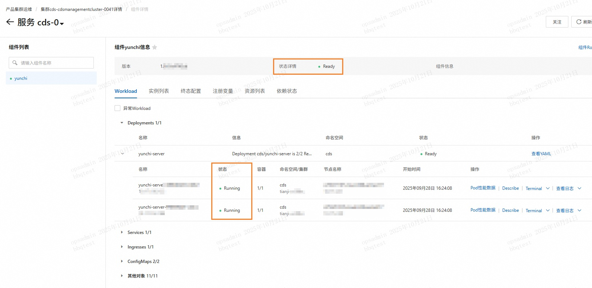

阿里云  
专有云  
云服务定义存储  
运维指南  
产品版本：V3.18.6  
文档版本：20251205

**目录**

- [1.登录Apsara Uni-manager运维控制台](#section-1)
- [2.功能总览](#section-2)
- [3.权限配置](#section-3)
    - [3.1. CDS Ops授权管理](#section-3-1)
    - [3.2. HDR-OPS授权管理](#section-3-2)
- [4.产品概览](#section-4)
- [5.存储管理](#section-5)
    - [5.1. 使用前须知](#section-5-1)
    - [5.2. 管理块存储集群（EBS-2.0&CDS-EBS）](#section-5-2)
        - [5.2.1. 块存储集群总览](#section-5-2-1)
        - [5.2.2. 管理集群详情](#section-5-2-2)
            - [5.2.2.1. 集群概览](#section-5-2-2-1)
            - [5.2.2.2. 查看容量信息](#section-5-2-2-2)
            - [5.2.2.3. 监控集群](#section-5-2-2-3)
                - [5.2.2.3.1. 查看集群监控信息](#section-5-2-2-3-1)
                - [5.2.2.3.2. 查看BlockServer监控信息](#section-5-2-2-3-2)
            - [5.2.2.4. 配置集群信息](#section-5-2-2-4)
                - [5.2.2.4.1. 配置EC模式](#section-5-2-2-4-1)
                - [5.2.2.4.2. 配置Block Rebalance](#section-5-2-2-4-2)
                - [5.2.2.4.3. 配置盘古服务信息](#section-5-2-2-4-3)
            - [5.2.2.5. 管理服务](#section-5-2-2-5)
                - [5.2.2.5.1. 管理BlockMaster](#section-5-2-2-5-1)
                - [5.2.2.5.2. 管理BlockServer](#section-5-2-2-5-2)
                - [5.2.2.5.3. 管理快照服务器](#section-5-2-2-5-3)
                - [5.2.2.5.4. 管理盘古服务](#section-5-2-2-5-4)
            - [5.2.2.6. 管理主机](#section-5-2-2-6)
        - [5.2.3. 查看计算节点](#section-5-2-3)
        - [5.2.4. 管理存储集](#section-5-2-4)
        - [5.2.5. 管理云盘](#section-5-2-5)
        - [5.2.6. 云盘热迁移](#section-5-2-6)
        - [5.2.7. 灰度运维](#section-5-2-7)
    - [5.3. 管理块存储集群（EBS-1.0）](#section-5-3)
        - [5.3.1. 块存储集群总览](#section-5-3-1)
        - [5.3.2. 管理集群详情](#section-5-3-2)
            - [5.3.2.1. 集群概览](#section-5-3-2-1)
            - [5.3.2.2. 查看容量信息](#section-5-3-2-2)
            - [5.3.2.3. 监控集群](#section-5-3-2-3)
                - [5.3.2.3.1. 查看集群监控信息](#section-5-3-2-3-1)
                - [5.3.2.3.2. 查看RiverServer监控信息](#section-5-3-2-3-2)
            - [5.3.2.4. 管理服务](#section-5-3-2-4)
                - [5.3.2.4.1. 查看RiverCluster信息](#section-5-3-2-4-1)
                - [5.3.2.4.2. 查看RiverServer信息](#section-5-3-2-4-2)
                - [5.3.2.4.3. 管理盘古服务](#section-5-3-2-4-3)
            - [5.3.2.5. 管理主机](#section-5-3-2-5)
    - [5.4. 管理对象存储集群](#section-5-4)
        - [5.4.1. 对象存储集群总览](#section-5-4-1)
        - [5.4.2. 管理集群详情](#section-5-4-2)
            - [5.4.2.1. 集群概览](#section-5-4-2-1)
            - [5.4.2.2. 查看容量信息](#section-5-4-2-2)
            - [5.4.2.3. 监控集群](#section-5-4-2-3)
                - [5.4.2.3.1. 查看集群监控信息](#section-5-4-2-3-1)
                - [5.4.2.3.2. 检查集群健康状态](#section-5-4-2-3-2)
                - [5.4.2.3.3. 运行后台任务](#section-5-4-2-3-3)
            - [5.4.2.4. 配置集群信息](#section-5-4-2-4)
                - [5.4.2.4.1. 配置KV信息](#section-5-4-2-4-1)
                - [5.4.2.4.2. 配置EC模式](#section-5-4-2-4-2)
                - [5.4.2.4.3. 配置后台任务运行时间](#section-5-4-2-4-3)
                - [5.4.2.4.4. 配置GlobalFlag](#section-5-4-2-4-4)
                - [5.4.2.4.5. 配置盘古服务信息](#section-5-4-2-4-5)
                - [5.4.2.4.6. 配置Qos信息](#section-5-4-2-4-6)
            - [5.4.2.5. 管理服务](#section-5-4-2-5)
                - [5.4.2.5.1. 管理KV服务](#section-5-4-2-5-1)
                - [5.4.2.5.2. 管理接入层服务](#section-5-4-2-5-2)
                - [5.4.2.5.3. 管理盘古服务](#section-5-4-2-5-3)
            - [5.4.2.6. 管理主机](#section-5-4-2-6)
        - [5.4.3. 管理Bucket](#section-5-4-3)
            - [5.4.3.1. 管理Bucket信息](#section-5-4-3-1)
            - [5.4.3.2. 查询Bucket信息](#section-5-4-3-2)
            - [5.4.3.3. 配置QoS信息](#section-5-4-3-3)
        - [5.4.4. 管理同步配置](#section-5-4-4)
            - [5.4.4.1. 管理同步边](#section-5-4-4-1)
            - [5.4.4.2. 配置跨区域同步边](#section-5-4-4-2)
            - [5.4.4.3. 配置跨云同步边](#section-5-4-4-3)
            - [5.4.4.4. 查看集群同步监控信息](#section-5-4-4-4)
        - [5.4.5. 运维机器人](#section-5-4-5)
            - [5.4.5.1. 管理运维机器人](#section-5-4-5-1)
            - [5.4.5.2. 查看运维历史](#section-5-4-5-2)
    - [5.5. 管理日志存储集群](#section-5-5)
        - [5.5.1. 日志存储集群总览](#section-5-5-1)
        - [5.5.2. 管理集群详情](#section-5-5-2)
            - [5.5.2.1. 集群概览](#section-5-5-2-1)
            - [5.5.2.2. 查看容量信息](#section-5-5-2-2)
            - [5.5.2.3. 配置集群信息](#section-5-5-2-3)
                - [5.5.2.3.1. 配置EC模式](#section-5-5-2-3-1)
                - [5.5.2.3.2. 配置盘古服务信息](#section-5-5-2-3-2)
            - [5.5.2.4. 管理盘古服务](#section-5-5-2-4)
            - [5.5.2.5. 管理主机](#section-5-5-2-5)
- [6.监控中心](#section-6)
    - [6.1. 查看自定义看板](#section-6-1)
    - [6.2. 查看资源监控信息](#section-6-2)
    - [6.3. 查看存储指标监控信息](#section-6-3)
    - [6.4. 查询服务监控信息](#section-6-4)
- [7.事件告警](#section-7)
    - [7.1. 告警概览](#section-7-1)
    - [7.2. 处理当前告警](#section-7-2)
    - [7.3. 查看历史告警](#section-7-3)
- [8.日常巡检](#section-8)
    - [8.1. 巡检中心](#section-8-1)
    - [8.2. SLA监测](#section-8-2)
- [9.智能运维](#section-9)
    - [9.1. 主机运维](#section-9-1)
        - [9.1.1. 查看全部工作流](#section-9-1-1)
        - [9.1.2. 发起集群扩容工作流](#section-9-1-2)
        - [9.1.3. 发起集群缩容工作流](#section-9-1-3)
        - [9.1.4. 发起集群节点维修工作流](#section-9-1-4)
        - [9.1.5. 发起集群从单机房扩容到三机房工作流](#section-9-1-5)
        - [9.1.6. 发起CDS集群部署模式切换工作流](#section-9-1-6)
    - [9.2. 维护硬盘](#section-9-2)
        - [9.2.1. 维护故障硬盘](#section-9-2-1)
        - [9.2.2. 主动更换硬盘](#section-9-2-2)
        - [9.2.3. 查看硬盘维护历史](#section-9-2-3)
    - [9.3. 日志管理](#section-9-3)
        - [9.3.1. 采集日志数据](#section-9-3-1)
        - [9.3.2. 查询日志信息](#section-9-3-2)
- [10.系统管理](#section-10)
    - [10.1. 查看插件信息](#section-10-1)
    - [10.2. 查看任务列表](#section-10-2)
    - [10.3. 查询审计日志](#section-10-3)
    - [10.4. 系统清理](#section-10-4)
        - [10.4.1. 管理清理配置](#section-10-4-1)
        - [10.4.2. 清理任务](#section-10-4-2)
- [11.数据服务](#section-11)
    - [11.1. 管理存储网关服务](#section-11-1)
    - [11.2. 使用HDR-OPS](#section-11-2)
        - [11.2.1. 使用前须知](#section-11-2-1)
        - [11.2.2. 查看站点对信息](#section-11-2-2)
        - [11.2.3. 查看告警信息](#section-11-2-3)
        - [11.2.4. 查看巡检任务](#section-11-2-4)
        - [11.2.5. 管理运维任务](#section-11-2-5)
        - [11.2.6. 管理运维配置](#section-11-2-6)
        - [11.2.7. 管理云站点](#section-11-2-7)

<a id="section-1"></a>

# 1.登录Apsara Uni-manager运维控制台

本文介绍运维工程师等相关用户如何登录到Apsara Uni-manager运维控制台。

**前提条件**

- 已从部署人员或管理员处获取Apsara Uni-manager运维控制台的访问地址、用户名和密码。

  Apsara Uni-manager运维控制台访问地址格式为*region-id*.ops.console.*intranet-domain-id*。

- 推荐使用Chrome浏览器。

**操作步骤**

1. 打开浏览器。

2. 在地址栏中，输入Apsara Uni-manager运维控制台的访问地址，按回车键。

   

   > **说明**
   >
   > 您可以单击右上角的当前语言切换其它语言。当前支持简体中文、英文、繁体中文三种语言切换。

3. 输入正确的账户名及密码。

   > **说明**
   >
   > - 登录Apsara Uni-manager运维控制台的用户名和密码请从部署人员或管理员处获取。
   >
   > - 若连续输入密码错误三次，系统将启动图片验证码登录功能；若连续输入错误五次，账户将被锁定，请联系管理员进行激活。
   >
   > - 首次登录Apsara Uni-manager运维控制台时，需要修改登录用户名的密码，请按照提示完成密码修改。
   >
   >   为提高安全性，密码必须满足以下要求：
   >
   >   - 必须包含英文大小写字母。
   >
   >   - 必须包含阿拉伯数字（0~9）。
   >
   >   - 必须包含特殊符号，包括感叹号（!）、at（@）、井号（#）、美元符号（$）、百分号（%）等。
   >
   >   - 密码长度为10~20个字符。

4. 单击**同意协议并登录**。

<a id="section-2"></a>

# 2.功能总览

CDS Ops是CDS产品的统一运维平台，支持对存储集群以及运行在存储集群上的对象存储服务、日志存储服务、块存储服务等进行日常运维管理。本文介绍了CDS Ops支持的功能特性，请根据实际需要使用。

> **说明**
>
> 如果使用过程中遇到问题，请联系阿里云技术支持。

**产品概览**

通过概览页面，运维人员可以查看CDS产品的容量水位、当前告警、已使用容量服务分布、硬件资源、存储资源和集群状态信息，便于整体了解CDS产品信息并及时处理异常情况。更多信息，请参见产品概览。

**存储管理**

运维人员可以管理块存储、对象存储、日志存储等服务的容量水位、集群等信息，具体说明请参见下表。

> **说明**
>
> 不同集群部署的产品以及支持的功能可能不同，请以实际情况为准。

**块存储集群（CDS-EBS&EBS2.0）**

CDS Ops支持管理CDS-EBS集群以及纳管的EBS-1.0集群或者EBS-2.0集群。对于CDS-EBS集群和纳管的EBS-2.0集群，CDS Ops提供了相同的功能体验。

<table>
  <tr>
    <th width="138">功能特性</th>
    <th>描述</th>
  </tr>
  <tr>
    <td>块存储集群总览</td>
    <td>通过概览页面，运维人员可以查看块存储集群的容量、IOHANG、资源概览、当前告警和集群列表信息，便于整体了解集群信息和及时处理异常情况。</td>
  </tr>
  <tr>
    <td>管理集群详情</td>
    <td>在集群详情页面，运维人员可以按需执行如下操作：<br>• 集群概览<br>• 查看容量信息<br>• 监控集群：查看集群监控信息、查看BlockServer监控信息<br>• 配置集群信息:配置Block Rebalance、配置EC模式、配置盘古服务信息<br>• 管理服务：管理BlockMaster、管理BlockServer、管理快照服务器、管理盘古服务<br>• 管理主机</td>
  </tr>
  <tr>
    <td>查看计算节点</td>
    <td>计算节点是集群中用于执行计算任务的节点。通过查看集群中的计算节点信息、计算节点上的ECS实例以及ECS实例关联的磁盘设备，运维人员可以了解计算节点、ECS实例和云盘之间的关联关系以及快速定位TDC状态异常的计算节点。</td>
  </tr>
  <tr>
    <td>管理存储集</td>
    <td>根据集群或者存储集ID搜索到EBS的存储集后，运维人员可以查看存储集信息、存储集中包含的云盘信息和存储集中不同分区的容量使用情况，以及编辑存储集的不同分区包含的集群。</td>
  </tr>
  <tr>
    <td>管理云盘</td>
    <td>通过云盘列表查看所有集群包含的云盘信息以及查看云盘的属性和监控信息。对于EBS-2.0集群和CDS-EBS集群，运维人员还可以对集群中的云盘进行修改IOPS和吞吐上限的操作。</td>
  </tr>
  <tr>
    <td>云盘热迁移</td>
    <td>通过创建云盘热迁移任务，运维人员可以快速完成块存储集群之间的云盘迁移，迁移期间不影响云盘的使用，提升云盘的维护效率。</td>
  </tr>
  <tr>
    <td>灰度运维</td>
    <td>通过执行灰度运维任务，运维人员可以快速批量执行常见的运维命令，降低运维的复杂度，减少故障时的影响范围，发现问题时及时停止（命令结果的exit code不为0时），并且可以指定灰度节奏和观察期时长，为运维命令在机器上的批量运行提供合理的灰度节奏，同时在灰度执行过程中，还可以实时查看当前的执行进度和结果。</td>
  </tr>
</table>

**块存储集群（EBS1.0）**

CDS Ops支持管理CDS-EBS集群以及纳管的EBS-1.0集群或者EBS-2.0集群。对于纳管的EBS-1.0集群，CDS Ops提供了基础的查看功能以及简单的运维功能。

<table>
  <tr>
    <th width="138">操作任务</th>
    <th>描述</th>
  </tr>
  <tr>
    <td>块存储集群总览</td>
    <td>通过概览页面，运维人员可以查看块存储集群的容量、IOHANG、资源概览、当前告警和集群列表信息，便于整体了解集群信息和及时处理异常情况。</td>
  </tr>
  <tr>
    <td>管理集群详情</td>
    <td>在集群详情页面，运维人员可以按需执行如下操作：<br>• 集群概览<br>• 查看容量信息<br>• 监控集群：查看集群监控信息、查看RiverServer监控信息<br>• 管理服务：查看RiverCluster信息、查看RiverServer信息、管理盘古服务</td>
  </tr>
</table>

**对象存储集群**

CDS Ops支持管理CDS-OSS集群和纳管的OSS集群，并提供相同的功能体验。

<table>
  <tr>
    <th width="154">功能特性</th>
    <th>描述</th>
  </tr>
  <tr>
    <td>对象存储集群总览</td>
    <td>通过概览页面，运维人员可以查看对象存储集群的容量、资源概览、当前告警和集群列表信息，便于整体了解集群信息和及时处理异常情况。</td>
  </tr>
  <tr>
    <td>管理集群详情</td>
    <td>在集群详情页面，运维人员可以按需执行如下操作：<br>• 集群概览<br>• 查看容量信息<br>• 监控集群：查看集群监控信息、检查集群健康状态、运行后台任务<br>• 配置集群信息：配置KV信息、配置EC模式、配置后台任务运行时间、配置GlobalFlag、配置盘古服务信息<br>• 管理服务：管理KV服务、管理接入层服务、管理盘古服务<br>• 管理主机</td>
  </tr>
  <tr>
    <td>管理Bucket</td>
    <td>创建Bucket后，运维人员可以管理Bucket信息、查询Bucket信息以及为用户或Bucket配置QoS信息。</td>
  </tr>
  <tr>
    <td>管理同步配置</td>
    <td>根据要实现的数据同步场景管理集群的同步配置。<br>• 使用跨区域复制前，运维人员需要为集群配置跨区域同步边。<br>• 使用跨云复制前，运维人员需要为集群配置跨云同步边。为集群创建同步边后，运维人员可以按需管理同步边和查看集群同步监控信息。</td>
  </tr>
  <tr>
    <td>运维机器人</td>
    <td>系统提供故障机器智能分析与诊断、热点问题智能分析与诊断、KV Checkready失败自动修复、文件损坏紧急处理方案、KV回收站自动调整、OSS自动禁写和恢复等运维机器人用于自动运维任务，简化人工操作，提升运维效率。通过查看运维历史，运维人员可以及时了解运维机器人中运维任务的运行情况。</td>
  </tr>
</table>

**日志存储集群**

CDS Ops支持管理CDS-SLS集群。

<table>
  <tr>
    <th width="154">功能特性</th>
    <th>描述</th>
  </tr>
  <tr>
    <td>日志存储集群总览</td>
    <td>通过概览页面，运维人员可以查看日志存储集群的总容量水位、当前告警和部署集群信息，便于整体了解集群信息和及时处理异常情况。</td>
  </tr>
  <tr>
    <td>管理集群详情</td>
    <td>在集群详情页面，运维人员可以按需执行如下操作：<br>• 集群概览<br>• 查看容量信息<br>• 配置集群信息：配置EC模式、配置盘古服务信息<br>• 管理盘古服务<br>• 管理主机</td>
  </tr>
</table>

**监控中心**

通过监控中心，运维人员可以在自定义看板中查看所添加资源的监控详情、查看资源监控信息、查看存储指标监控信息和查询服务监控信息。

**事件告警**

通过告警管理，运维人员可以例行维护集群的告警。详细功能说明请参见下表。

<table>
  <tr>
    <th width="122">功能特性</th>
    <th>描述</th>
  </tr>
  <tr>
    <td>告警概览</td>
    <td>运维人员可以在告警概览页面，查看当前告警、告警统计、告警历史等信息。</td>
  </tr>
  <tr>
    <td>处理当前告警</td>
    <td>CDS Ops管理的告警信息来源于CDS集群和纳管集群。当系统发生告警时，运维人员可以查看当前告警信息的列表以及告警项、归属模块、集群名称、描述、资源名称、告警时间等详细信息。收到告警信息后，请及时处理告警，并根据实际情况确认告警和手动清除告警。</td>
  </tr>
  <tr>
    <td>查看历史告警</td>
    <td>自动恢复和手动清除后的告警会显示在历史告警列表中。运维人员可以查看在指定时间范围内的告警信息列表以及查看告警项、归属模块、集群名称、描述、资源名称、告警时间、是否自动恢复、是否已确认等详细信息。</td>
  </tr>
</table>

**日常巡检**

通过日常巡检，运维人员可以定期对集群进行巡检。

<table>
  <tr>
    <th width="90">功能特性</th>
    <th>描述</th>
  </tr>
  <tr>
    <td>巡检中心</td>
    <td>系统默认已内置了不同的巡检项并会定时对集群进行巡检。通过巡检中心，运维人员可以查看不同巡检项的最近一次执行情况等信息以及手动执行巡检项。</td>
  </tr>
  <tr>
    <td>SLA监测</td>
    <td>通过实时监测块存储服务系统的关键SLA（Service Level Agreement）指标，为软件升级、配置变更、服务运维等操作场景提供可用性监测保障，及时发现系统异常，减小异常发生时的影响范围。</td>
  </tr>
</table>

**智能运维**

通过智能运维，运维人员可以对集群的主机、硬盘或日志进行智能化管理。详细功能说明请参见下表。

<table>
  <tr>
    <th width="90">功能特性</th>
    <th>描述</th>
  </tr>
  <tr>
    <td>主机运维</td>
    <td>通过主机运维，运维人员可以根据运维场景对集群发起相应的智能运维工作流。通过工作流持续跟踪集群扩容进展，有效地降低运维难度并提高运维效率。<br>• 当为了合理分配计算存储资源需要在集群中增加物理主机时，运维人员可以发起集群扩容工作流。<br>• 当为了合理分配计算存储资源需要在集群中减少物理主机时，运维人员可以发起集群缩容工作流。<br>• 当集群中物理主机故障需要维修时，运维人员可以发起集群节点维修工作流。<br>• 对于全新部署的CDS-OSS集群，如需提高集群的可用性和容错能力，运维人员可以发起集群从单机房扩容到三机房工作流，将单机房集群扩展为三机房集群。<br>• 对于4或5节点的Lite集群，如需扩容至6节点及以上的标准集群时，在节点扩容后，需要发起部署模式切换流程。具体操作，请参见发起CDS集群部署模式切换工作流。为集群发起运维工作流后，运维人员可以通过查看全部工作流了解运维进展以及按需管理工作流。</td>
  </tr>
  <tr>
    <td>维护硬盘</td>
    <td>通过硬盘运维，运维人员可以根据运维场景选择硬盘热维护操作。<br>• 当Chunk服务器的HDD类型的数据盘以及NVMe SSD类型的数据盘出现故障时，运维人员可以在故障硬盘的数据完成备份后维护故障硬盘。<br>• 当由于硬盘容量升级、硬盘性能升级、硬盘定期维护等情况需要更换正常运行的硬盘时，运维人员可以发起主动更换硬盘流程进行操作。硬盘热维护完成后，运维人员可以查看硬盘维护历史。</td>
  </tr>
  <tr>
    <td>日志管理</td>
    <td>运维人员根据问题现象判断异常服务或者模块后，手动采集日志数据，用于快速定位和处理问题。系统对关键性服务的日志进行了统一存储和索引，运维人员可以根据服务类型、项目、存储服务等维度查询日志信息。</td>
  </tr>
</table>

**系统管理**

对系统插件、服务日志进行管理。详细功能说明请参见下表。

<table>
  <tr>
    <th width="122">功能特性</th>
    <th>描述</th>
  </tr>
  <tr>
    <td>查看插件信息</td>
    <td>系统默认会完成已部署数据服务（例如云存储网关服务）和阿里云存储产品（日志存储服务）的注册，运维人员可以通过插件管理功能查看已注册的服务信息。</td>
  </tr>
  <tr>
    <td>查看任务列表</td>
    <td>系统中执行时间较长的一些任务以异步方式执行，运维人员可以在任务列表中查看异步任务的执行结果。</td>
  </tr>
  <tr>
    <td>查询审计日志</td>
    <td>系统会将用户对系统有修改影响的访问记录在日志中。在进行安全维护时，运维人员可以根据关键字快速检索不同维度的审计日志，便于快速定位和及时处理故障问题，保证系统安全。</td>
  </tr>
  <tr>
    <td>系统清理</td>
    <td>任务的日志存储在系统盘中。自动触发压缩任务和清理任务的功能默认已关闭。为了防止系统盘被服务日志写满，运维人员可以通过以下方式清理日志。<br>• 自动清理日志：通过管理清理配置手动开启自动触发功能，并按需设置自动触发的阈值以及删除服务。开启自动触发功能后，当服务日志空间占用达到指定阈值时，系统会自动执行服务日志的压缩任务或者清理任务。<br>• 手动清理日志：通过清理任务手动压缩或者删除日志。</td>
  </tr>
</table>

**数据服务**

<table>
  <tr>
    <th width="154">功能特性</th>
    <th>描述</th>
  </tr>
  <tr>
    <td>管理存储网关服务</td>
    <td>创建和配置云存储网关后，运维人员可以查看网关的信息，以及收集并下载网关内部的文件共享（NFS或者SMB）访问OSS的日志信息和共享相关操作的日志信息。</td>
  </tr>
  <tr>
    <td>HDR-OPS</td>
    <td>HDR-OPS是针对混合云容灾HDR提供的统一运维管理工具。在数据容灾场景中，运维人员可以对HDR站点进行查看站点对信息、查看告警信息、查看巡检任务、管理运维任务和管理云站点的运维操作。</td>
  </tr>
</table>

<a id="section-3"></a>

# 3.权限配置

<a id="section-3-1"></a>

## 3.1. CDS Ops授权管理

系统管理员默认具有CDS Ops工具所有功能的操作权限。为了满足不同用户对系统的访问控制需求，系统支持通过使用CDS Ops相关的三种角色CDS administrator、CDS support和CDS developer来控制用户操作CDS Ops的权限。

**CDS角色说明**

角色是一组访问权限的集合，在创建用户时，需要为用户赋予不同的角色，以满足不同用户对系统的访问控制需求。

CDS Ops相关的三个角色的权限说明请参见下表。

| 角色名称 | 中文名称 | 权限说明 |
| --- | --- | --- |
| CDS administrator | CDS存储管理员 | 具有大部分的读操作以及极少的修改操作权限。一般授予日常运维人员用于监控系统运行情况。 |
| CDS support | CDS技术支持经理 | 除了包括CDS administrator的所有权限外，还具有一些正常读写操作的权限。 |
| CDS developer | CDS开发人员 | 除了包括CDS support的所有权限外，还具有一些高危运维操作的权限，请谨慎添加。 |

**新增用户**

通过新增用户并为用户赋予CDS Ops相关角色，用来控制用户访问CDS Ops的权限。

1. 登录Apsara Uni-manager运维控制台。

2. 在顶部菜单栏上，单击**用户权限**。

3. 在左侧导航栏中，单击**用户管理**页签。

4. 在**用户管理**页面的**用户列表**页签，单击**添加**。

5. 在**新增用户**对话框，配置用户信息后，单击**确定**。

   <table>
     <tr>
       <th width="122">参数</th>
       <th>说明</th>
     </tr>
     <tr>
       <td>用户名</td>
       <td>用户名称。最长支持48个字符，可包含数字、字母、下划线（_）、短划线（-）、半角句号（.），支持邮箱格式。其中下划线不支持连续使用。</td>
     </tr>
     <tr>
       <td>密码</td>
       <td>用户密码。长度为10~20个字符，必须包含小写字母、大写字母、数字、特殊字符。</td>
     </tr>
     <tr>
       <td>再次确认密码</td>
       <td>输入确认密码，与密码保持一致。</td>
     </tr>
     <tr>
       <td>显示名</td>
       <td>用户的显示名称。</td>
     </tr>
     <tr>
       <td>登录策略</td>
       <td>登录策略信息。</td>
     </tr>
     <tr>
       <td>角色</td>
       <td>用户角色，例如产品运维员。</td>
     </tr>
     <tr>
       <td>部门</td>
       <td>用户所属部门信息。</td>
     </tr>
     <tr>
       <td>手机</td>
       <td>用户手机号码。</td>
     </tr>
     <tr>
       <td>邮箱</td>
       <td>用户邮箱信息。</td>
     </tr>
     <tr>
       <td>允许创建AK</td>
       <td>是否允许用户创建AccessKey。默认不允许用户创建AccessKey。</td>
     </tr>
   </table>

<a id="section-3-2"></a>

## 3.2. HDR-OPS授权管理

HDR-OPS是针对混合云容灾HDR提供的统一运维管理工具。使用HDR-OPS功能前，请新增授权角色并授予用户相应角色，以实现对HDR-OPS功能的操作。

**新增授权角色**

创建授权角色，用于授予用户操作HDR-OPS的权限。

1. 登录Apsara Uni-manager运维控制台。

2. 在顶部菜单栏，单击**用户权限**。

3. 在左侧导航栏，单击**角色管理**页签。

4. 在**角色管理**页面，单击**创建角色**。

5. 在**新增角色**页面，配置用户信息。

   <ol type="i">

   <li>

   在**基础配置**步骤，设置角色名称和角色描述，然后单击**下一步: ASO控制台权限**。

   </li>

   <li>

   在**ASO控制台权限**步骤，按需选择所需ASO控制台操作权限，然后单击**下一步: 产品控制台权限** 。

   </li>

   <li>

   在**产品控制台权限**步骤，找到**存储运维**区域，并选择**混合云容灾运维**为**只读**或者**读写**，然后单击**下一步: 菜单权限**。

   </li>

   <li>

   在**菜单权限**步骤，选择**ASO菜单 > 产品运维 > 存储运维**节点下的**CDS 运维·CDS-OPS**菜单，然后单击**创建**。

   </li>

   <li>

   在**创建角色成功**对话框，单击**确定**。

   </li>

   </ol>

**新增用户**

新增用户后，通过该用户登录Apsara Uni-manager运维控制台进行HDR-OPS操作。

1. 登录Apsara Uni-manager运维控制台。

2. 在顶部菜单栏，单击**用户权限**。

3. 在左侧导航栏，单击**用户管理**页签。

4. 在**用户管理**页面的**用户列表**页签，单击**添加**。

5. 在**新增用户**对话框，配置用户信息后，单击**确定**。

   <ol type="i">

   <li>

   设置用户名、密码、再次确认密码、登录策略和部门。

   为了便于识别用户，您也可以根据需要设置显示名、手机或者邮箱信息。

   </li>

   <li>

   选择角色为创建的授权角色。

   </li>

   </ol>

<a id="section-4"></a>

# 4.产品概览

通过概览页面，您可以查看CDS产品的容量水位、当前告警、已使用容量服务分布、硬件资源、存储资源和集群状态信息，便于整体了解CDS产品信息并及时处理异常情况。

1. 登录CDS运维平台控制台。

   <ol type="i">

   <li>

   登录Apsara Uni-manager运维控制台。

   </li>

   <li>

   在顶部菜单栏，选择**产品运维 > 存储运维 > CDS运维·CDS-OPS**。

   </li>

   </ol>

2. 在左侧导航栏中，单击**CDS-概览**。

3. 在**CDS-概览**页面，查看产品概览信息。

   - CDS产品整体信息

     查看CDS产品的当前告警、物理容量水位、硬件资源和存储资源。各监控指标说明请参见下表。

     <table>
       <tr>
         <th width="122">监控项</th>
         <th>说明</th>
       </tr>
       <tr>
         <td>当前告警</td>
         <td>所有集群中不同等级的告警数量以及最近5条告警记录。单击<strong>更多</strong>或者不同等级的告警信息，您可以在<strong>当前告警</strong>页面查看和处理当前告警信息。具体操作，请参见处理当前告警。</td>
       </tr>
       <tr>
         <td>物理容量水位</td>
         <td>集群中各产品的物理总容量、已使用容量和容量占比。</td>
       </tr>
       <tr>
         <td>硬件资源</td>
         <td>所有集群中的服务器总数、服务器的正常个数和异常个数、硬盘总数以及硬盘的正常个数和异常个数。</td>
       </tr>
       <tr>
         <td>存储资源</td>
         <td>所有集群中的存储集群数、云盘数、Bucket数等。<br>说明集群中部署不同产品时显示的存储资源不同，请以实际界面为准。当集群中部署EBS产品时会存在云盘数，当集群中部署OSS产品时会存在Bucket数。</td>
       </tr>
     </table>

   - 集群状态信息

     查看CDS Ops平台管理的所有集群信息，集群信息包括集群名称、集群更新时间、集群类型（例如CDS-EBS、CDS-EBS&CDS-OSS、OSS、CDS-OSS、EBS-1.0等）、集群已使用物理容量占比、集群总物理容量和已使用物理容量。

     集群支持按照名称、总容量或者已使用容量维度进行升序或者降序排列。系统默认按照已使用容量降序排列集群，请根据实际需要选择合适的排列方式。

     通过执行以下操作，您可以在对应存储集群页面管理和配置存储集群。

     - 对于EBS-1.0集群、OSS1.0集群、CDS-EBS集群、CDS-OSS集群和CDS -SLS集群，直接单击**运维**。

     - 对于CDS-EBS集群、CDS-OSS集群融合部署情况，移动鼠标到**运维**上，选择**块存储**或者**对象存储**。

<a id="section-5"></a>

# 5.存储管理

<a id="section-5-1"></a>

## 5.1. 使用前须知

通过集群管理，您可以对各存储服务的集群进行查看、监控、配置、管理或者维护。不同集群支持的功能不同，请以实际情况为准。

**支持的集群类型**

CDS Ops支持管理的集群类型请参见下表。

> **说明**
>
> 不同集群部署的服务可能不同，单个集群中包括的集群类型请以实际为准。

<table>
  <tr>
    <th width="122">集群类型</th>
    <th>说明</th>
  </tr>
  <tr>
    <td>对象存储集群</td>
    <td>对象存储OSS（Object Storage Service ）是阿里云提供的安全、低成本、高可靠的云存储服务。使用OSS，您可以通过网络随时存储和调用包括文本、图片、音频和视频等在内的各种非结构化数据文件。CDS Ops支持管理CDS-OSS集群和纳管的OSS集群，并提供相同的功能体验。您可以访问<strong>CDS-对象存储</strong>，对对象存储集群和盘古集群进行管理。更多信息，请参见对象存储集群总览。<br>• 对于CDS-OSS集群，盘古集群的底座为盘古2.0。您可以通过CDS Ops管理盘古2.0集群。<br>• 对于纳管的OSS集群，盘古集群的底座为盘古1.0。不支持通过CDS Ops对盘古1.0集群进行管理。</td>
  </tr>
  <tr>
    <td>日志存储集群</td>
    <td>日志服务SLS（Log Service）是针对日志类数据的一站式服务。您无需开发就能快捷完成日志数据采集、消费以及查询分析等功能，提升运维和运营效率，建立DT时代海量日志处理能力。CDS Ops支持管理CDS-SLS集群。您可以访问<strong>CDS-日志存储</strong>，对日志存储集群和盘古集群进行管理。更多信息，请参见日志存储集群总览。</td>
  </tr>
  <tr>
    <td>块存储集群</td>
    <td>块存储EBS（Elastic Block Storage）具有丰富的产品类型，包括基于分布式存储架构的弹性块存储产品，以及基于物理机本地硬盘的本地存储产品。CDS Ops支持管理CDS-EBS集群以及纳管的EBS-1.0集群或者EBS-2.0集群。<br>• 对于CDS-EBS集群和纳管的EBS-2.0集群，CDS Ops提供了相同的功能体验。<br>• 对于纳管的EBS-1.0集群，CDS Ops提供了基础的查看功能以及简单的运维功能。您可以访问<strong>CDS-块存储</strong>，对块存储集群和盘古集群进行查看或管理。更多信息，请参见块存储集群总览（CDS-EBS&amp;EBS2.0）和块存储集群总览（EBS1.0）。</td>
  </tr>
</table>

**注意事项**

- 当前只有CDS集群支持融合部署CDS-OSS和CDS-EBS服务，其他服务不支持融合部署。

- 对于纳管的OSS集群，不支持通过CDS Ops对其盘古集群进行管理。

- 修改集群配置信息、服务器重启、服务重启、删除文件等均属于高危操作，请谨慎操作。如需进行相应操作，请联系阿里云技术支持。

<a id="section-5-2"></a>

## 5.2. 管理块存储集群（EBS-2.0&CDS-EBS）

<a id="section-5-2-1"></a>

### 5.2.1. 块存储集群总览

通过概览页面，您可以查看块存储集群的容量、IOHANG、资源概览、当前告警和集群列表信息，便于整体了解集群信息和及时处理异常情况。

**操作步骤**

1. 登录CDS运维平台控制台。

   <ol type="i">

   <li>

   登录Apsara Uni-manager运维控制台。

   </li>

   <li>

   在顶部菜单栏，选择**产品运维 > 存储运维 > CDS运维·CDS-OPS**。

   </li>

   </ol>

2. 在左侧导航栏中，选择**CDS-块存储 > 集群运维**。

3. 在**集群运维**页面，查看和管理块存储集群列表信息。

   - 块存储集群整体信息

     查看所有块存储集群的容量、IOHANG、资源概览和当前告警。各监控指标说明请参见下表。

     <table>
       <tr>
         <th width="91">监控项</th>
         <th>说明</th>
       </tr>
       <tr>
         <td>容量</td>
         <td>所有块存储集群的总物理容量使用情况，包括已使用容量、总容量和已使用容量占比。</td>
       </tr>
       <tr>
         <td>IOHANG</td>
         <td>计算节点、ECS、云盘和计算集群中出现的IOHANG数量。</td>
       </tr>
       <tr>
         <td>资源概览</td>
         <td>所有块存储集群的主机数、硬盘数、已创建的云盘数和已为云盘创建的快照数。</td>
       </tr>
       <tr>
         <td>当前告警</td>
         <td>所有块存储集群中不同等级的告警数量以及最近5条告警记录。单击<strong>更多</strong>或者不同等级的告警信息，您可以在<strong>当前告警</strong>页面查看和处理当前告警信息。具体操作，请参见处理当前告警。</td>
       </tr>
     </table>

   - 集群列表

     在**集群列表**区域，您可以查看CDS Ops平台管理的所有部署了块存储服务的集群列表信息以及根据需要执行相应操作。

     <table>
       <tr>
         <th width="122">操作</th>
         <th>说明</th>
       </tr>
       <tr>
         <td>查看集群信息</td>
         <td>在集群列表中查看集群的名称、存储介质、存储架构、已用容量/总容量、可用区、异常/总物理主机数等信息。</td>
       </tr>
       <tr>
         <td>搜索集群</td>
         <td>根据集群名称或者存储介质搜索所需集群。</td>
       </tr>
       <tr>
         <td>扩容集群</td>
         <td>当为了合理分配计算存储资源需要在集群中增加物理主机时，您可以发起集群扩容流程。<br>重要不支持对EBS-1.0集群进行扩缩容操作。<br>单击目标集群<strong>操作</strong>列的<strong>集群扩容</strong>，发起集群扩容工作流。</td>
       </tr>
       <tr>
         <td>缩容集群</td>
         <td>当为了合理分配计算存储资源需要在集群中减少物理主机时，您可以发起集群缩容流程。<br>重要不支持对EBS-1.0集群进行扩缩容操作。<br>单击目标集群<strong>操作</strong>列的<strong>集群缩容</strong>，发起集群缩容工作流。</td>
       </tr>
       <tr>
         <td>编辑集群名称</td>
         <td>根据实际业务需要修改集群名称。具体步骤如下：<br>a. 单击目标集群<strong>操作</strong>列的<strong>编辑名称</strong>。<br>b. 在<strong>编辑名称</strong>对话框，修改集群名称。<br>c. 单击<strong>确定</strong>。</td>
       </tr>
     </table>

     <table>
       <tr>
         <td>管理集群详情</td>
         <td>单击集群名称，在<strong>集群详情</strong>页面，您可以查看集群的属性、概览信息、容量、监控、主机等以及按需配置集群信息和管理集群服务。<br>• 查看集群属性查看集群名称、存储介质、存储架构、灾备信息、可用区、总物理主机、总Chunk服务器等信息。<br>• 查看集群概览查看集群的物理容量水位、主服务器BlockMaster、存储服务器BlockServer、云盘数、快照数、最近的巡检项、集群监控数据等信息。更多信息，请参见集群概览。<br>• 查看集群容量查看块存储集群的物理容量水位、已用物理容量分布、物理容量使用趋势、库存容量使用趋势以及按需进行物理容量预测。更多信息，请参见查看容量信息。<br>• 查看集群监控查看集群和BlockServer的实时监控数据以及指定时间范围内的平均延迟、IOPS、吞吐量等历史监控数据。更多信息，请参见查看集群监控信息和查看BlockServer监控信息。<br>• 配置集群信息配置集群的EC模式、Block Rebalance以及盘古服务。更多信息，请参见配置EC模式、配置Block Rebalance和配置盘古服务信息。<br>• 管理集群服务管理集群的主服务器BlockMaster、存储服务器BlockServer、快照服务器以及盘古服务。更多信息，请参见管理BlockMaster、管理BlockServer、管理快照服务器和管理盘古服务。<br>• 管理集群主机在<strong>主机</strong>页签，查看集群中的所有主机信息以及按需执行相应操作。更多信息，请参见管理主机。</td>
       </tr>
     </table>

<a id="section-5-2-2"></a>

### 5.2.2. 管理集群详情

<a id="section-5-2-2-1"></a>

#### 5.2.2.1. 集群概览

通过查看集群的物理容量水位、云盘数、快照数、巡检项等信息，您可以整体了解集群信息并及时处理异常情况。

**操作步骤**

1. 登录CDS运维平台控制台。

   <ol type="i">

   <li>

   登录Apsara Uni-manager运维控制台。

   </li>

   <li>

   在顶部菜单栏，选择**产品运维 > 存储运维 > CDS运维·CDS-OPS**。

   </li>

   </ol>

2. 在左侧导航栏中，选择**CDS-块存储 > 集群运维**。

3. 在**集群运维**页面的**集群列表**区域，单击目标集群名称。

   > **说明**
   >
   > 您也可以直接在界面右上方选择目标集群进行集群的查看和管理。

4. 在**概览**页签，查看集群概览信息。

   - **集群整体信息**

     查看集群的物理容量水位、主服务器个数和状态、存储服务器个数和状态、云盘数以及快照数。各监控指标说明请参见下表。

     <table>
       <tr>
         <th width="202">监控项</th>
         <th>说明</th>
       </tr>
       <tr>
         <td>物理容量水位</td>
         <td>集群的物理容量的使用情况，包括已使用物理容量占比、已用物理容量和总物理容量。<br>• 总物理容量：盘古层分配给块存储能够使用的物理容量总量。<br>• 已用物理容量：块存储层已使用的物理容量总量，包括内部数据占用和用户数据占用。</td>
       </tr>
       <tr>
         <td>主服务器BlockMaster</td>
         <td>主服务器的个数以及正常或异常状态的个数。</td>
       </tr>
       <tr>
         <td>存储服务器BlockServer</td>
         <td>存储服务器的个数以及正常或异常状态的个数。</td>
       </tr>
       <tr>
         <td>云盘数</td>
         <td>集群中的云盘总个数。</td>
       </tr>
       <tr>
         <td>快照数</td>
         <td>集群中已为云盘创建的快照总个数。</td>
       </tr>
     </table>

   - **巡检项**

     查看巡检项的名称、统计详情、最近一次执行时间和备注信息。

     单击巡检项**统计**列的对应数字，您可以在**巡检结果**页面查看最近一次执行详情；单击巡检项**最近执行**列的时间，您可以在**巡检历史**页面查看最近一次巡检执行时间。

   - **监控数据**

     设置时间范围或者直接单击指定时间查看集群一段时间内块存储集群的云盘和快照趋势图、集群读写延迟、集群总IOPS和集群总吞吐量的监控数据。

     不同监控项的具体监控数据说明请参见下表。

     <table>
       <tr>
         <th width="154">监控项</th>
         <th>说明</th>
       </tr>
       <tr>
         <td>云盘和快照趋势图</td>
         <td>集群的云盘和快照使用情况。当前监控项只支持天级粒度查询，且当天数据隔天产出。包括如下监控数据：<br>• 云盘数量：云盘总个数。<br>• 快照数量：快照总个数。</td>
       </tr>
       <tr>
         <td>集群读写延迟</td>
         <td>集群的平均读写延迟。包括如下监控数据：<br>• 读延迟：平均读延迟。<br>• 写延迟：平均写延迟。</td>
       </tr>
       <tr>
         <td>集群总IOPS</td>
         <td>集群每秒I/O读写操作的总次数。包括如下监控数据：<br>• 读IOPS：集群每秒I/O读取操作的总次数。<br>• 写IOPS：集群每秒I/O写入操作的总次数。</td>
       </tr>
       <tr>
         <td>集群总吞吐量</td>
         <td>集群读写数据的总吞吐量。包括如下监控数据：<br>• 读：集群读取数据的总吞吐量。<br>• 写：集群写入数据的总吞吐量。</td>
       </tr>
     </table>

     通过单击监控项中的某一监控数据来显示或者取消显示该监控数据，例如单击云盘和快照趋势图的云盘数量监控项，可以取消显示该监控数据。

     将鼠标移动到数据趋势线上，界面中会显示该时间节点上具体的数值。

     单击不同监控项区域的**操作**，您可以选择**数据下载**，下载对应监控数据信息到本地；选择**保存为图片**，保存对应监控数据信息为图片。

<a id="section-5-2-2-2"></a>

#### 5.2.2.2. 查看容量信息

您可以按需查看块存储集群的物理容量水位、容量分布、物理容量使用趋势、库存容量趋势图等信息。

**操作步骤**

1. 登录CDS运维平台控制台。

   <ol type="i">

   <li>

   登录Apsara Uni-manager运维控制台。

   </li>

   <li>

   在顶部菜单栏，选择**产品运维 > 存储运维 > CDS运维·CDS-OPS**。

   </li>

   </ol>

2. 在左侧导航栏中，选择**CDS-块存储 > 集群运维**。

3. 在**集群运维**页面的**集群列表**区域，单击目标集群名称。

   > **说明**
   >
   > 您也可以直接在界面右上方选择目标集群进行集群的查看和管理。

4. 在**容量**页签，查看集群容量信息。

   | 容量信息 | 说明 |
   | --- | --- |

   <table>
     <tr>
       <td>物理容量水位</td>
       <td>查看已用物理容量、总物理容量、已用物理容量占比。<br>• 总物理容量：该集群可写入的最大空间。<br>• 已用物理容量：盘古上报的已用物理容量。单击<strong>物理容量水位</strong>区块右上角的<strong>更多</strong>，您可以查看裸盘容量、总物理容量、系统预留容量、系统安全容量、已用物理容量和可用物理容量的详细信息。<br>说明<br>• 库存容量充足的情况下，已用物理水位达到80%时，禁止创建新云盘；若未使用库存容量小于新创建云盘容量，本次创建云盘也会失败。<br>• 已用物理水位达到95%时，禁止用户写入数据。<br>• 将鼠标放置到容量后的图标上，系统会在悬浮框中提示各个容量代表的含<br><br>义或计算公式。</td>
     </tr>
     <tr>
       <td>已用物理容量分布</td>
       <td>查看云盘写入容量、可回收&amp;系统占用容量、已使用容量、库存容量、超卖系数等信息。</td>
     </tr>
     <tr>
       <td>容量趋势</td>
       <td>在<strong>容量趋势</strong>页签，选择时间范围，查看物理容量使用趋势和库存容量趋势图。<br>• 物理容量使用趋势：查看指定时间范围内的总物理容量和已使用物理容量。<br>• 库存容量趋势图：查看指定时间范围内已用库存容量趋势图。<br>说明单击监控项区域右上角的<strong>操作</strong>，您可以选择<strong>数据下载</strong>，将对应监控数据信息下载到本地；选择<strong>保存为图片</strong>，将对应监控数据信息保存为图片。</td>
     </tr>
     <tr>
       <td>容量预测</td>
       <td>当采集了CDS集群中存储服务指定天数内每天产生的容量数据后，系统会每天预测一次CDS集群未来一周的容量趋势。运维人员可以根据预测的容量趋势进行集群扩缩容规划等，提前预防可能由于存储容量耗尽而引起的集群故障，确保集群安全稳定运行。<br>说明<br>• 预测的容量趋势仅供参考，具体请以实际容量为准。<br>• 容量预测能力依赖足够的样本数积累，如果集群中的容量数据不足所需天数，则系统将无法进行容量预测。新部署集群暂时没有预测数据。<br>在<strong>容量预测</strong>页签，查看物理容量的预测信息。</td>
     </tr>
   </table>

<a id="section-5-2-2-3"></a>

#### 5.2.2.3. 监控集群

<a id="section-5-2-2-3-1"></a>

##### 5.2.2.3.1. 查看集群监控信息

通过查看集群的实时监控数据以及指定时间范围内集群的读写延迟、集群总IOPS等历史监控数据，您可以及时了解集群的资源使用水平。

**操作步骤**

1. 登录CDS运维平台控制台。

   <ol type="i">

   <li>

   登录Apsara Uni-manager运维控制台。

   </li>

   <li>

   在顶部菜单栏，选择**产品运维 > 存储运维 > CDS运维·CDS-OPS**。

   </li>

   </ol>

2. 在左侧导航栏中，选择**CDS-块存储 > 集群运维**。

3. 在**集群运维**页面的**集群列表**区域，单击目标集群名称。

   > **说明**
   >
   > 您也可以直接在界面右上方选择目标集群进行集群的查看和管理。

4. 在**监控**页签，单击**集群**。

5. 在**集群**页签，查看集群的实时监控数据，以及选择时间范围并查看集群的历史监控数据。

   实时监控数据包括平均读延迟、平均写延迟、平均读吞吐、平均写吞吐、平均读io size、平均写io size、平均读IOPS、平均写IOPS、总读吞吐、总写吞吐、实时监控数据的数据时间以及近10分钟历史平均写延迟的趋势图。

   > **说明**
   >
   > - 实时监控数据单位以控制台显示为准。
   >
   > - 在近10分钟历史监控图上，红色区域表示超过了一定的预警值。如果出现了红色区域，请重点关注。

   历史监控数据包括集群读写延迟、集群总IOPS和集群总吞吐量，不同监控项的具体监控数据说明请参见下表。

   <table>
     <tr>
       <th width="122">监控项</th>
       <th>说明</th>
     </tr>
     <tr>
       <td>集群读写延迟</td>
       <td>集群的平均读写延迟。包括如下监控数据：<br>• 读延迟：平均读延迟。<br>• 写延迟：平均写延迟。</td>
     </tr>
     <tr>
       <td>集群总IOPS</td>
       <td>集群每秒I/O读写操作的总次数。包括如下监控数据：<br>• 读IOPS：集群每秒I/O读取操作的总次数。<br>• 写IOPS：集群每秒I/O写入操作的总次数。</td>
     </tr>
     <tr>
       <td>集群总吞吐量</td>
       <td>集群读写数据的总吞吐量。包括如下监控数据：<br>• 读：集群读取数据的总吞吐量。<br>• 写：集群写入数据的总吞吐量。</td>
     </tr>
   </table>

   将鼠标移动到数据趋势线上，界面中会显示该时间节点上具体的数值。

   单击不同监控项区域的**操作**，您可以选择**数据下载**，下载对应监控数据信息到本地；选择**保存为图片**，保存对应监控数据信息为图片。

<a id="section-5-2-2-3-2"></a>

##### 5.2.2.3.2. 查看BlockServer监控信息

通过查看BlockServer的实时监控数据以及指定时间范围内BlockServer的平均延迟、读写IOPS等历史监控数据，您可以及时了解BlockServer的资源使用水平。

**操作步骤**

1. 登录CDS运维平台控制台。

   <ol type="i">

   <li>

   登录Apsara Uni-manager运维控制台。

   </li>

   <li>

   在顶部菜单栏，选择**产品运维 > 存储运维 > CDS运维·CDS-OPS**。

   </li>

   </ol>

2. 在左侧导航栏中，选择**CDS-块存储 > 集群运维**。

3. 在**集群运维**页面的**集群列表**区域，单击目标集群名称。

   > **说明**
   >
   > 您也可以直接在界面右上方选择目标集群进行集群的查看和管理。

4. 在**监控**页签，单击**BlockServer**。

5. 在**BlockServer**页签，查看实时监控数据，以及选择NC和时间范围并查看BlockServer的历史监控数据。

   实时监控数据包括平均读延迟、平均写延迟、平均读吞吐、平均写吞吐、平均读io size、平均写io size、平均读IOPS、平均写IOPS、总读吞吐、总写吞吐、实时监控数据的数据时间以及近10分钟历史平均写延迟的趋势图。

   > **说明**
   >
   > - 实时监控数据单位以控制台显示为准。
   >
   > - 在近10分钟历史监控图上，红色区域表示超过了一定的预警值。如果出现了红色区域，请重点关注。

   历史监控数据包括平均延迟、读写IOPS和吞吐量，不同监控项的具体监控数据说明请参见下表。

   <table>
     <tr>
       <th width="95">监控项</th>
       <th>说明</th>
     </tr>
     <tr>
       <td>平均延迟</td>
       <td>BlockServer的平均读写延迟。包括如下监控数据：<br>• 读延迟：平均读延迟。<br>• 写延迟：平均写延迟。</td>
     </tr>
     <tr>
       <td>读写IOPS</td>
       <td>BlockServer每秒I/O读写操作的次数。包括如下监控数据：<br>• 读IOPS：每秒I/O读取操作的次数。<br>• 写IOPS：每秒I/O写入操作的次数。</td>
     </tr>
     <tr>
       <td>吞吐量</td>
       <td>BlockServer读写数据的总吞吐量。包括如下监控数据：<br>• 读：读取数据的吞吐量。<br>• 写：写入数据的吞吐量。</td>
     </tr>
   </table>

   将鼠标移动到数据趋势线上，界面中会显示该时间节点上具体的数值。

   单击不同监控项区域的**操作**，您可以选择**数据下载**，下载对应监控数据信息到本地；选择**保存为图片**，保存对应监控数据信息为图片。

<a id="section-5-2-2-4"></a>

#### 5.2.2.4. 配置集群信息

<a id="section-5-2-2-4-1"></a>

##### 5.2.2.4.1. 配置EC模式

集群默认采用纠删码EC（Erasure Coding）来保障用户数据的可靠性和一致性，EC能提高存储可靠性。相比三副本技术而言，EC能够以更小的数据冗余度获得高数据可靠性。

**背景信息**

在非折叠场景下，对应EC N+M，数据在存储时，会将一个文件按特定大小分片，每N片数据作为一组并产生M个校验块。对于普通EC，这N+M个数据块会存放在不同的服务器上，因此至少需要N+M台服务器才能完成数据存储。EC算法能够保障在有M个数据块损坏或丢失时恢复文件，因此普通EC可以保障M台服务器故障时不丢失数据。

**注意事项**

- 集群的EC配置修改后，存量云盘会自动转换到新的EC模式，新建云盘默认会采用集群的EC模式。

- 当集群正在进行主机运维操作时无法修改EC，请在主机运维工作流执行结束后重试。

- 为集群开启EC模式后不支持关闭（即不能修改回三副本模式），请谨慎操作。

- 修改EC配置时，只支持修改为能获得更低冗余度的EC配置，系统会自动计算出符合更低冗余度的EC配置供选择。

**配置集群EC类型**

1. 登录CDS运维平台控制台。

   <ol type="i">

   <li>

   登录Apsara Uni-manager运维控制台。

   </li>

   <li>

   在顶部菜单栏，选择**产品运维 > 存储运维 > CDS运维·CDS-OPS**。

   </li>

   </ol>

2. 在左侧导航栏中，选择**CDS-块存储 > 集群运维**。

3. 在**集群运维**页面的**集群列表**区域，单击目标集群名称。

   > **说明**
   >
   > 您也可以直接在界面右上方选择目标集群进行集群的查看和管理。

4. 在**配置**页签，单击**EC配置**。

5. 在**EC配置**页签，按需修改EC的**配置类型**。

   配置类型会显示该集群目前支持的所有EC配置，选择EC配置后，副本数将显示为该配置下计算得出的副本数。

   > **说明**
   >
   > 部分集群不支持选择配置类型，请以实际为准。

6. 单击**保存**。

**查看集群云盘EC配置分布**

集群中云盘的EC配置会与集群的EC配置一致，您可以在**EC配置**页签的**集群云盘EC配置分布**区域查看集群中云盘的EC配置分布情况。

修改集群的EC配置后，存量云盘会自动转换到新的EC模式，请通过查看集群云盘的EC配置分布确认存量云盘是否已全部转换到新的EC模式。

**查看折叠Chunk数量**

正常情况下，集群的折叠Chunk数量为0。当由于服务器故障或短暂处于亚健康状态导致服务器数量不能满足EC的N+M要求时，集群会有部分数据被折叠。通过查看一段时间内的折叠Chunk数量变化，您可以了解当前发生折叠的数据量。

> **重要**
>
> - 仅Lite集群支持数据折叠。
>
> - 集群数据出现折叠时，可能是服务器相关的硬件错误导致的，请查看集群的硬件相关告警并尽快处理相应告警。具体操作，请参见处理当前告警。

1. 在**配置**页签，单击**EC配置**。

2. 在**EC配置**页签的**折叠Chunk数量**区域，选择时间范围，即可查看指定时间范围内的折叠Chunk数量。

<a id="section-5-2-2-4-2"></a>

##### 5.2.2.4.2. 配置Block Rebalance

系统默认已开启Block Rebalance功能，当数据由于增加BlockServer或者下线故障的BlockServer分配不均衡时，集群会自动对BlockServer上的分片（Segment）数量进行平衡，保证合理利用整个集群中的资源。

**背景信息**

通过查看平均每台BlockServer上的Segment数量以及所有BlockServer上所有Segment数量的方差，运维人员可以判断Segment分布是否均衡。

**操作步骤**

1. 登录CDS运维平台控制台。

   <ol type="i">

   <li>

   登录Apsara Uni-manager运维控制台。

   </li>

   <li>

   在顶部菜单栏，选择**产品运维 > 存储运维 > CDS运维·CDS-OPS**。

   </li>

   </ol>

2. 在左侧导航栏中，选择**CDS-块存储 > 集群运维**。

3. 在**集群运维**页面的**集群列表**区域，单击目标集群名称。

   > **说明**
   >
   > 您也可以直接在界面右上方选择目标集群进行集群的查看和管理。

4. 在**配置**页签，单击**Rebalance**。

5. 在**Rebalance**页签，查看基础信息和Rebalance的配置。

   - 基础信息：包括平均每台BlockServer上的Segment数和所有BlockServer上所有Segment数量的方差信息。

   - Rebalance的配置：包括Block Rebalance开关配置项，系统默认已开启了Block Rebalance功能。

<a id="section-5-2-2-4-3"></a>

##### 5.2.2.4.3. 配置盘古服务信息

您可以查看并按需配置Replica流控、集群回收站配置、全集群离线巡检状态、配额和Qos等信息。

> **重要**
>
> 修改集群信息可能导致系统异常，请谨慎操作。

配置Replica流控

根据实际情况配置Replica流控上下限实现数据复制流控。当需要快速完成数据复制时，您可以增加Replica流控上下限；当需要Replica占用较少资源时，可以降低Replica流控上下限。

1. 登录CDS运维平台控制台。

   <ol type="i">

   <li>

   登录Apsara Uni-manager运维控制台。

   </li>

   <li>

   在顶部菜单栏，选择**产品运维 > 存储运维 > CDS运维·CDS-OPS**。

   </li>

   </ol>

2. 在左侧导航栏中，选择**CDS-块存储 > 集群运维**。

3. 在**集群运维**页面的**集群列表**区域，单击目标集群名称。

   > **说明**
   >
   > 您也可以直接在界面右上方选择目标集群进行集群的查看和管理。

4. 在**配置**页签，单击**盘古配置**。

5. 在**盘古配置**页签下的**Replica流控**页签，查看流控信息并按需修改复制操作速度。

6. 按需修改复制操作速度。

   <ol type="i">

   <li>

   单击对应复制操作速度**操作**列的**编辑**。

   </li>

   <li>

   在**修改配置**对话框，修改速度上限或者下限，来限制从源服务器读取数据和写入数据到目的服务器的速度上下限。

   速度上限和下限的取值范围均为1~100000 MB/s，单位为MB/s。

   > **重要**
   >
   > - 读取速度和写入速度的限制范围应当相同，否则只能以两者中较小的值来进行数据复制。
   >
   > - 读写速率设置会影响性能，请谨慎操作。

   </li>

   <li>

   单击**确定**。

   </li>

   </ol>

**配置集群回收站**

开启回收站后，集群各项服务进行过程中删除的文件会保存到回收站。回收站关闭时，文件会直接删除，不会保存到回收站。

1. 在**配置**页签，单击**盘古配置**。

2. 在**盘古配置**页签下的**集群回收站设置**页签，查看回收站配置并按需选择需要修改相应配置。

   功能具体说明请参见下表。

   <table>
     <tr>
       <th width="138">功能</th>
       <th>说明</th>
     </tr>
     <tr>
       <td>回收站功能</td>
       <td>是否开启回收站。取值范围如下：<br>• TRUE（默认值）：开启回收站。开启回收站后，在集群中删除的文件会暂存到回收站。<br>• FALSE：关闭回收站。关闭回收站后，文件会直接删除不会保存到回收站。</td>
     </tr>
     <tr>
       <td>一般回收百分比</td>
       <td>当磁盘的剩余可用空间小于指定的百分比时，开始以普通速度清理系统中垃圾数据。</td>
     </tr>
     <tr>
       <td>紧急回收百分比</td>
       <td>当磁盘的剩余可用空间小于指定的百分比时，开始以紧急回收速度清理系统中垃圾数据。<br>说明紧急回收速度高于一般回收速度。</td>
     </tr>
     <tr>
       <td>回收站保存期限</td>
       <td>一般情况下配置此参数为86400。取值范围为3600~8640000000，单位为秒。</td>
     </tr>
   </table>

3. 按需修改集群回收站配置。

   <ol type="i">

   <li>

   单击目标功能**操作**列的**编辑**。

   </li>

   <li>

   在**修改配置**对话框，按需修改功能的配置。

   您可以同时配置多个功能，达成特定任务。

   <table>
     <tr>
       <th width="170">任务项</th>
       <th>说明</th>
     </tr>
     <tr>
       <td>关闭回收站自动回收</td>
       <td>开启回收站功能，同时设置<strong>一般回收百分比</strong>和<strong>紧急回收百分比</strong>为0。</td>
     </tr>
     <tr>
       <td>冻结回收站</td>
       <td>开启回收站功能，同时设置<strong>一般回收百分比</strong>和<strong>紧急回收百分比</strong>为0，并设置<strong>回收站保</strong><strong>存期限</strong>为8640000000秒。<br>说明冻结回收站后，回收站中的文件不会删除，确保数据安全。</td>
     </tr>
     <tr>
       <td>清空回收站</td>
       <td>开启回收站功能，同时设置<strong>一般回收百分比</strong>和<strong>紧急回收百分比</strong>为100。</td>
     </tr>
     <tr>
       <td>关闭回收站</td>
       <td>开启回收站功能，同时设置<strong>一般回收百分比</strong>和<strong>紧急回收百分比</strong>为100，待回收站清空后，关闭回收站功能。</td>
     </tr>
   </table>

   </li>

   <li>

   单击**确定**。

   </li>

   </ol>

**配置全集群离线巡检开关**

开启全集群离线自动巡检功能后，系统会定时自动分析集群的运行状态。

1. 在**配置**页签，单击**盘古配置**。

2. 在**盘古配置**页签下的**全集群离线巡检开关**页签，查看全集群离线巡检的配置并按需修改全集群离线巡检开关配置。

3. 按需修改全集群离线巡检开关状态。

   <ol type="i">

   <li>

   单击全集群离线巡检状态**操作**列的**编辑**。

   </li>

   <li>

   在**修改配置**对话框，修改全集群离线巡检状态。

   状态取值包括enable和disable。其中enable表示开启全集群离线自动巡检，disable表示关闭全集群离线自动巡检。

   </li>

   <li>

   单击**确定**。

   </li>

   </ol>

**查看配额和Qos**

1. 在**配置**页签，单击**盘古配置**。

2. 在**盘古配置**页签下的**配额和Qos**页签，查看集群基本信息、配额或Qos信息。

   > **说明**
   >
   > 只有CDS-OSS&CDS-EBS混部集群中才会显示基本信息和Qos信息。如果是CDS-EBS集群，则只显示块存储服务的配额信息。

   - 基本信息：集群类型、Qos功能、机械盘VIOPS、闪存盘VIOPS、总存储用量、SSD缓存盘的总容量。

   - 配额：不同服务的当前已使用容量、集群存储服务容量配额和当前状态。

   - Qos：HDD和SSD中不同服务的VIOPS占比信息。

<a id="section-5-2-2-5"></a>

#### 5.2.2.5. 管理服务

<a id="section-5-2-2-5-1"></a>

##### 5.2.2.5.1. 管理BlockMaster

BlockMaster是Block管控节点，主要负责管理云盘的元数据并在创建虚拟块设备时生成块设备的ID等信息，分配Segment到不同的BlockServer以及根据BlockServer上报的无效数据和碎片数据进行GC Worker调度。通过该功能，您可以查看BlockMaster的IP地址、服务位置等信息，检查服务器状态以及获取版本信息。

**操作步骤**

1. 登录CDS运维平台控制台。

   <ol type="i">

   <li>

   登录Apsara Uni-manager运维控制台。

   </li>

   <li>

   在顶部菜单栏，选择**产品运维 > 存储运维 > CDS运维·CDS-OPS**。

   </li>

   </ol>

2. 在左侧导航栏中，选择**CDS-块存储 > 集群运维**。

3. 在**集群运维**页面的**集群列表**区域，单击目标集群名称。

   > **说明**
   >
   > 您也可以直接在界面右上方选择目标集群进行集群的查看和管理。

4. 在**服务**页签，单击**主服务器BlockMaster**。

5. 在**主服务器BlockMaster**页签，查看Block Master服务器的详细信息，以及根据需要执行相应操作。

   <table>
     <tr>
       <th width="138">操作</th>
       <th>说明</th>
     </tr>
     <tr>
       <td>获取版本信息</td>
       <td>通过以下方式获取服务器的版本信息。<br>• 方式一：单击服务器<strong>操作</strong>列的<strong>获取版本信息</strong>，然后在<strong>获取版本信息</strong>对话框查看服务器的版本信息。<br>• 方式二：单击<strong>获取版本信息</strong>，然后在<strong>获取版本信息</strong>对话框，查看服务器的版本信息。</td>
     </tr>
     <tr>
       <td>检查服务器状态</td>
       <td>检查服务器的状态。单击服务器<strong>操作</strong>列的<strong>检查状态</strong>，检查服务器的状态。</td>
     </tr>
   </table>

<a id="section-5-2-2-5-2"></a>

##### 5.2.2.5.2. 管理BlockServer

BlockServer主要负责通过FlatLogFile API管理分片（Segments）存储在盘古分布式文件系统上的数据文件。通过该功能，您可以查看BlockServer的IP地址、服务位置、硬盘分区等信息以及获取版本信息。

**背景信息**

BlockServer通过Index Map维护了Segments中的数据逻辑区块地址LBA（Logical Block Address）与实际存储文件中的偏移地址的关系，使读请求可以快速定位到在盘古文件中的实际数据。另外BlockServer通过预读缓存来减少实际的文件I/O，以优化读取速度。

BlockServer会搜集Segments内垃圾数据占比和碎片程度并上报给BlockMaster，然后由BlockMaster调度GC Worker来进行垃圾回收或碎片整理。GC（垃圾回收）任务结束后，系统会根据GC任务产生的Compaction文件更新Index Map（Import Compaction）并删除无效的数据文件来完成GC任务。

**操作步骤**

1. 登录CDS运维平台控制台。

   <ol type="i">

   <li>

   登录Apsara Uni-manager运维控制台。

   </li>

   <li>

   在顶部菜单栏，选择**产品运维 > 存储运维 > CDS运维·CDS-OPS**。

   </li>

   </ol>

2. 在左侧导航栏中，选择**CDS-块存储 > 集群运维**。

3. 在**集群运维**页面的**集群列表**区域，单击目标集群名称。

   > **说明**
   >
   > 您也可以直接在界面右上方选择目标集群进行集群的查看和管理。

4. 在**服务**页签，单击**存储服务器BlockServer**。

5. 在**存储服务器BlockServer**页签，查看BlockServer信息，以及根据需要获取服务器的版本信息。

   您可以通过以下方式获取服务器的版本信息。

   - 方式一：单击服务器**操作**列的**获取版本信息**，然后在**获取版本信息**对话框查看服务器的版本信息。

   - 方式二：单击**获取版本信息**，然后在**获取版本信息**对话框，查看服务器的版本信息。

<a id="section-5-2-2-5-3"></a>

##### 5.2.2.5.3. 管理快照服务器

通过此功能，您可以查看快照服务器的服务地址、任务负载、上传任务数、复制任务数、下载任务数、延迟加载等信息以及获取版本信息。

**操作步骤**

1. 登录CDS运维平台控制台。

   <ol type="i">

   <li>

   登录Apsara Uni-manager运维控制台。

   </li>

   <li>

   在顶部菜单栏，选择**产品运维 > 存储运维 > CDS运维·CDS-OPS**。

   </li>

   </ol>

2. 在左侧导航栏中，选择**CDS-块存储 > 集群运维**。

3. 在**集群运维**页面的**集群列表**区域，单击目标集群名称。

   > **说明**
   >
   > 您也可以直接在界面右上方选择目标集群进行集群的查看和管理。

4. 在**服务**页签，单击**快照服务器**。

5. 在**快照服务器**页签，查看快照服务器的服务位置（服务地址）、状态、加载（快照任务负载）、上传（快照数据上传的任务数量）、复制（快照数据复制的任务数）、延迟加载（快照数据下载的任务数量）信息。

6. 单击页面左上角**获取版本信息**，然后在**获取版本信息**对话框，查看服务器的版本信息。

<a id="section-5-2-2-5-4"></a>

##### 5.2.2.5.4. 管理盘古服务

您可以按需管理Meta服务器、Chunk服务器、文件信息。

管理Meta服务器

Meta服务器用于维护集群元数据，指示上层服务如何进行数据读写。您可以查看Meta服务器信息，切换从Meta服务器为主Meta服务器，为Meta服务器生成CPT以及获取Meta服务器的构建信息。

1. 登录CDS运维平台控制台。

   <ol type="i">

   <li>

   登录Apsara Uni-manager运维控制台。

   </li>

   <li>

   在顶部菜单栏，选择**产品运维 > 存储运维 > CDS运维·CDS-OPS**。

   </li>

   </ol>

2. 在左侧导航栏中，选择**CDS-块存储 > 集群运维**。

3. 在**集群运维**页面的**集群列表**区域，单击目标集群名称。

   > **说明**
   >
   > 您也可以直接在界面右上方选择目标集群进行集群的查看和管理。

4. 在**服务**页签，单击**盘古服务**。

5. 在**盘古服务**页签下的**Meta服务器**页签，查看Meta服务器信息，并按需单击Meta服务器的不同功能执行相应操作。

   <table>
     <tr>
       <th width="178">操作</th>
       <th>说明</th>
     </tr>
     <tr>
       <td>切换为主Meta服务器</td>
       <td>一般情况下无需手动切换主Meta服务器。只有当前主Meta服务器发生故障时，才需要手动切换。切换操作一般在数秒内完成。单击从Meta服务器<strong>操作</strong>列的<strong>切换为主Meta服务器</strong>，将从Meta服务器切换为主Meta服务器。</td>
     </tr>
     <tr>
       <td>生成CPT</td>
       <td>生成CheckPoint（CPT）信息，用于记录服务器的运行数据。生成的信息一般保存在Meta服务器的系统盘中。单击Meta服务器<strong>操作</strong>列的<strong>生成CPT</strong>，生成Meta服务器的CheckPoint信息。</td>
     </tr>
     <tr>
       <td>获取构建信息</td>
       <td>获取构建信息，用于问题定位时提供详细的版本信息。单击Meta服务器<strong>操作</strong>列的<strong>构建信息</strong>，获取Meta服务器的详细构建信息。</td>
     </tr>
   </table>

管理Chunk服务器

Chunk服务器在集群中负责实际的数据读写。您可以查看Chunk服务器的信息，配置Chunk服务器的状态，将Chunk服务器加入或者移除黑名单、获取Chunk服务器的构建信息以及查看和管理Chunk服务器上的硬盘。

1. 在**服务**页签，单击**盘古服务**。

2. 在**盘古服务**页签下的**Chunk服务器**页签，查看Chunk服务器信息，并按需单击Chunk服务器的不同功能执行相应操作。

   <table>
     <tr>
       <th width="189">操作</th>
       <th>说明</th>
     </tr>
     <tr>
       <td>配置Chunk服务器状态</td>
       <td>单击Chunk服务器的<strong>设置状态</strong>，配置Chunk服务器的状态，服务器状态包括只读、正常和下线三种。<br>警告下线服务器的风险较大，请谨慎操作。</td>
     </tr>
     <tr>
       <td>加入或者移除黑名单</td>
       <td>对应上层服务来说，当Chunk服务器临时不需要写入数据时，可以将Chunk服务器加入黑名单。Chunk服务器加入黑名单后，不再分配新的Chunk，新的数据不会再写入，也不能拷贝数据到该Chunk服务器。<br>警告将服务器加入黑名单后，该服务器不可用，请谨慎操作。<br>将鼠标移动到Chunk服务器<strong>操作</strong>列的图标，单击<strong>加入黑名单</strong>，将Chunk服务器加<br>入黑名单。<br>当Chunk服务器加入黑名单后，将鼠标移动到Chunk服务器<strong>操作</strong>列的图标，单<br>击<strong>移除黑名单</strong>，将Chunk服务器从黑名单中移除。</td>
     </tr>
     <tr>
       <td>重启服务</td>
       <td>重启当前机器的Chunk Server服务。<br>警告重启服务的风险较大，请谨慎操作。<br>单击Chunk服务器<strong>操作</strong>列的<strong>重启服务</strong>，重启Chunk服务器上的服务。</td>
     </tr>
   </table>

   <table>
     <tr>
       <td>获取构建信息</td>
       <td>获取构建信息，用于问题定位时提供详细的版本信息。<br>将鼠标移动到Chunk服务器<strong>操作</strong>列的图标上，单击<strong>构建信息</strong>，获取Chunk服务器<br>的详细构建信息。</td>
     </tr>
     <tr>
       <td>查看和管理硬盘</td>
       <td>单击主机前的加号图标，您可以查看硬盘的信息，例如Chunk Disk ID、介质、非临时Chunk数量、临时Chunk数量、状态等信息。一般情况下硬盘状态为正常。如果由于硬盘出错、释放空闲硬盘等情况需要下线硬盘，您可以设置硬盘状态为下线，此时系统会发起数据复制，待备份状态变为完成后，即可安全下线硬盘。如果由于硬盘没有出现异常但仍然需要更换，您可以设置硬盘状态为错误，此时系统会发起数据复制，待备份状态变为完成后，即可进行硬盘热维护。<br>i. 单击目标硬盘<strong>操作</strong>列的<strong>设置状态</strong>。ii. 在<strong>硬盘状态</strong>对话框，选择硬盘状态。<strong>正常</strong>表示硬盘运行正常，<strong>下线</strong>表示硬盘已下线，<strong>错误</strong>表示硬盘需要进行维护。iii. 单击<strong>确定</strong>。</td>
     </tr>
   </table>

**管理文件**

管理盘古集群系统的文件，您可以管理集群中的目录和文件以及清空回收站。

1. 在**服务**页签，单击**盘古服务**。

2. 在**盘古服务**页签下的**文件管理**页签，查看系统根目录的信息，并按需执行相应操作。

   | 操作 | 说明 |
   | --- | --- |
   | 查看根目录配额 | 单击<strong>查看根目录配额</strong>，查看根目录的EntryNumber、FileNumber、FileLogicalLength和FilePhysicalLength的限制信息。其中FileLogicalLength和FilePhysicalLength的单位均为字节。各限制项说明如下：<br>• EntryNumber：根目录能保存的文件和目录总数。<br>• FileNumber ：根目录下能保存的文件总数。<br>• FileLogicalLength：根目录下文件的逻辑长度最大值。<br>• FilePhysicalLength ：根目录下文件的物理长度最大值。 |
   | 搜索文件 | 在搜索框中输入File ID，搜索所需文件。 |
   | 操作目录<br>警告对目录和文件的修改操作可能导致系统异常，请谨慎操作。 | 您可以对目录执行如下操作：<br>• 查看目录配额单击目录<strong>操作</strong>列的<strong>查看配额</strong>，查看目录的EntryNumber、FileNumber、FileLogicalLength和FilePhysicalLength的限制信息。<br>• 固定或者解除固定目录单击目录的<strong>操作</strong>列的<strong>固定</strong>，固定目录。目录固定后，不能移动和删除目录。目录固定后，您可以单击目录<strong>操作</strong>列的<strong>解除固定</strong>，解除固定目录。 |
   | 操作文件<br>警告对目录和文件的修改操作可能导致系统异常，请谨慎操作。 | 您可以对文件执行如下操作：<br>• 查看Chunk信息单击文件<strong>操作</strong>列的<strong>查看Chunk信息</strong>，查看文件的Chunk基础信息（例如文件ID、文件类型、Chunk数、APP名称等）以及所有Chunk信息（例如Chunk ID、状态、服务器等）。<br>• 修改Replica为了提高文件的可靠性，盘古的文件会保存多个副本，您可以配置文件的副本数，更高的副本数可以提高数据的安全性，但会占用更多的空间，一般建议副本最小值和副本最大值均配置为3。单击文件<strong>操作</strong>列的<strong>副本配置</strong>，修改文件的副本最小值和副本最大值来配置文件保存在盘古的副本数。当数据发生丢失、复制或迁移后，系统会按此设置进行文件复制或删除。 |
   | 清空回收站<br>警告对目录和文件的修改操作可能导致系统异常，请谨慎操作。 | 单击deleted目录<strong>操作</strong>列的<strong>清空回收站</strong>，清空回收站中的文件。<br>说明deleted目录中的文件回收策略和集群回收站的设置一致。 |

<a id="section-5-2-2-6"></a>

#### 5.2.2.6. 管理主机

在集群的主机页签，查看集群包含的主机信息以及主机详情（例如容量、硬盘、服务角色、归属集群、监控等）。

**查看主机列表**

1. 登录CDS运维平台控制台。

   <ol type="i">

   <li>

   登录Apsara Uni-manager运维控制台。

   </li>

   <li>

   在顶部菜单栏，选择**产品运维 > 存储运维 > CDS运维·CDS-OPS**。

   </li>

   </ol>

2. 在左侧导航栏中，选择**CDS-块存储 > 集群运维**。

3. 在**集群运维**页面的**集群列表**区域，单击目标集群名称。

   > **说明**
   >
   > 您也可以直接在界面右上方选择目标集群进行集群的查看和管理。

4. 在**主机**页签，查看主机列表的信息以及按需执行相应操作。

   <table>
     <tr>
       <th width="189">操作</th>
       <th>说明</th>
     </tr>
     <tr>
       <td>查看主机信息</td>
       <td>在主机列表中查看主机名称、IP地址、CPU核数、内存、状态、机器类型等信息。</td>
     </tr>
     <tr>
       <td>搜索主机</td>
       <td>根据主机名称、状态或者CPU核数搜索所需主机。</td>
     </tr>
     <tr>
       <td>查看Meta服务器信息</td>
       <td>在右上方单击<strong>Meta服务器</strong>，查看Meta服务器的主机IP、角色和CPT生成时间。</td>
     </tr>
     <tr>
       <td>查看Chunk服务器信息</td>
       <td>在右上方单击<strong>Chunk服务器</strong>，查看Chunk服务器的主机名、IP地址、HDD坏盘数/HDD总盘数、状态等信息。</td>
     </tr>
     <tr>
       <td>查看主机详情</td>
       <td>单击主机名称，在<strong>主机详情</strong>页面，查看主机的属性、容量、硬盘、服务角色、归属集群、监控和逻辑资源信息。更多信息，请参见管理主机详情。</td>
     </tr>
   </table>

**管理主机详情**

1. 在**主机**页签，单击目标主机名称。

2. 在**主机详情**页面，查看主机的属性、容量、硬盘、服务角色、归属集群、监控和逻辑资源信息。

   <table>
     <tr>
       <th width="154">操作</th>
       <th>说明</th>
     </tr>
     <tr>
       <td>查看主机属性</td>
       <td>查看主机名称、所属集群、IP地址、CPU核数、内存等信息。</td>
     </tr>
     <tr>
       <td>查看主机容量信息</td>
       <td>在<strong>容量</strong>页签，查看主机的容量水位和主机中各硬盘的容量信息。<br>• 容量水位：包括主机中所有硬盘的总物理容量、已用物理容量和已使用容量占比。<br>• 硬盘容量：包括主机中各HDD硬盘的健康状态、挂载路径、已用容量占比、硬盘SN和diskID信息以及各SSD硬盘的健康状态、已用容量占比、硬盘SN和diskID信息。</td>
     </tr>
   </table>

   <table>
     <tr>
       <td>查看和管理硬盘信息</td>
       <td>在<strong>硬盘</strong>页签，查看主机中的所有硬盘信息，并按需执行相应操作。<br>• 查看硬盘信息在硬盘列表中查看设备名、所属集群、所属主机、用途、类型、型号、SN、挂载点等信息。<br>• 搜索硬盘根据设备名、用途或者状态搜索所需硬盘。<br>• 查看硬盘详情单击设备名，在<strong>硬盘详情</strong>页面，查看硬盘的属性、归属主机、监控和SMART信息。更多信息，请参见查看硬盘详情。<br>• 设置硬盘状态<br>重要只有数据盘和缓存盘才支持此操作，系统盘和日志盘不支持。<br>一般情况下硬盘状态为正常。如果由于硬盘出错、释放空闲硬盘等情况需要下线硬盘，您可以设置硬盘状态为下线，此时系统会发起数据复制，待备份状态变为完成后，即可安全下线硬盘。如果由于硬盘没有出现异常但仍然需要更换，您可以设置硬盘状态为错误，此时系统会发起数据复制，待备份状态变为完成后，即可进行硬盘热维护。<br>a. 单击目标硬盘<strong>操作</strong>列的<strong>设置状态</strong>。<br>b. 在<strong>硬盘状态</strong>对话框，选择硬盘状态。<strong>正常</strong>表示硬盘运行正常，<strong>下线</strong>表示硬盘已下线，<strong>错误</strong>表示硬盘需要进行维护。<br>c. 单击<strong>确定</strong>。<br>• 更换硬盘<br>重要只有数据盘和缓存盘才支持此操作，系统盘和日志盘不支持。<br>当硬盘状态为错误时，如需更换硬盘，请单击硬盘<strong>操作</strong>列的<strong>更换硬盘</strong>进行操作。具体操作，请参见维护故障硬盘。</td>
     </tr>
     <tr>
       <td>查看服务角色</td>
       <td>在<strong>服务角色</strong>页签，查看主机包括的角色信息，例如服务角色、服务名称和状态。您可以根据角色、服务或者状态搜索所需服务角色。</td>
     </tr>
     <tr>
       <td>查看归属集群信息</td>
       <td>在<strong>归属集群</strong>页签，查看集群的名称、存储介质、存储架构等信息。单击集群名称，在<strong>集群详情</strong>页面，查看集群的属性、容量和监控以及按需配置集群、管理服务和主机信息。</td>
     </tr>
     <tr>
       <td>查看主机监控信息</td>
       <td>在<strong>监控</strong>页签，选择时间范围，查看一段时间内主机的CPU、内存、负载、IOPS（每秒读写次数）、NTP和流量的监控信息。单击不同监控项区域的<strong>操作</strong>，您可以选择<strong>数据下载</strong>，下载对应监控数据信息到本地；选择<strong>保存为图片</strong>，保存对应监控数据信息为图片。</td>
     </tr>
     <tr>
       <td>查看资源角色</td>
       <td>在<strong>逻辑资源</strong>页签，查看主机的资源角色信息。</td>
     </tr>
   </table>

**查看硬盘详情**

1. 在**主机**页签，单击目标主机名称。

2. 在**硬盘**页签，单击目标设备名。

3. 在**硬盘详情**页面，查看硬盘的属性、归属主机、监控和SMART信息。

   - 查看硬盘属性

     查看硬盘的设备名、用途、介质、类型、型号、SN、挂载点等信息。

   - 查看归属主机信息

     在**归属主机**页签，查看主机名称、归属集群、IP地址、CPU核数、内存、状态、机器类型等信息。

     当集群中物理主机故障需要维修时，您可以单击主机**操作**列的**维修**，发起节点维修流程。具体操作，请参见发起集群节点维修工作流。

     单击主机名称，在**主机详情**页面，查看主机的属性、容量、监控、硬盘、服务角色、归属集群和逻辑资源信息。

   - 查看硬盘监控信息

     在**监控**页签，选择时间范围，查看一段时间内硬盘的IOPS（每秒读写次数）监控信息。

     单击不同监控项区域的**操作**，您可以选择**数据下载**，下载对应监控数据信息到本地；选择**保存为图片**，保存对应监控数据信息为图片。

   - 查看SMART信息

     SMART信息可用于评估硬盘的健康状态和预测潜在故障。在**SMART信息**页签，您可以查看硬盘的SMART详细信息。SMART信息包括START OF INFORMATION SECTION和START OF READ SMART DATA SECTION两部分。具体说明如下：

     - 查看硬盘基础信息

       在**START OF INFORMATION SECTION**区域，查看硬盘的基础信息，例如硬盘序列号、硬盘是否支持SMART功能、SMART功能的状态等。

     - 查看SMART具体信息

       在START OF READ SMART DATA SECTION区域下的Vendor Specific SMART Attributes with Thresholds部分，查看SMART的详细信息。常用的SMART信息说明请参见下表。

       <table>
         <tr>
           <th colspan="2">属性名称（ATTRIBUTE_NAME）</th>
           <th>说明</th>
         </tr>
         <tr>
           <td>Spin_Up_Time</td>
           <td>启动时间</td>
           <td>硬盘通电后磁盘达到额定转速所需的时间。该参数是HDD健康状态的重要指标，反映主轴电机和机械部件的可靠性。长启动时间可能预示机械部件老化或故障（例如电机磨损、润滑不足）。</td>
         </tr>
         <tr>
           <td>Reallocated_S ector_Ct</td>
           <td>重映射扇区数</td>
           <td>硬盘因检测到坏扇区而自动将数据转移到备用区域的次数。该参数是硬盘健康的核心指标，直接反映介质或NAND单元的物理损伤程度。</td>
         </tr>
         <tr>
           <td>Seek_Error_R ate</td>
           <td>寻道错误率</td>
           <td>磁头在移动到目标磁道时发生的错误频率。该参数是HDD机械部件健康的关键指标，反映磁头定位的可靠性。频繁寻道错误可能预示磁头、电机或盘片故障。</td>
         </tr>
         <tr>
           <td>Power_On_Ho urs</td>
           <td>通电时间</td>
           <td>硬盘累计通电时间，单位为小时。过长的通电时间可能增加老化风险。对于长期使用的硬盘，建议定期备份数据并关注其他关键参数。</td>
         </tr>
         <tr>
           <td>Power_Cycle_Count</td>
           <td>通电周期计数</td>
           <td>硬盘自出厂以来累计的通电（启动）和断电（停止）次数，即开关机或拔插电源的总次数。高启动次数可能加速机械部件老化（对HDD影响显著）。对于频繁开关机的设备，建议定期备份数据并监控其他健康参数。</td>
         </tr>
         <tr>
           <td>End-to-End_Error</td>
           <td>端到端错误计数</td>
           <td>数据传输过程中检测到的错误。</td>
         </tr>
         <tr>
           <td>Reported_Unc orrect</td>
           <td>报告的不可纠正错误数</td>
           <td>硬盘在读写操作中检测到的、无法通过纠错机制修复的数据错误次数。</td>
         </tr>
         <tr>
           <td>Power-Off_Retract_C ount</td>
           <td>意外断电回位次数</td>
           <td>硬盘因意外断电或异常掉电导致磁头强制回位的次数。频繁的意外断电可能严重损害机械硬盘（HDD）。建议使用UPS（不间断电源） 或稳定电源以减少此类风险，避免数据丢失。</td>
         </tr>
         <tr>
           <td>Load_Cycle_C ount</td>
           <td>磁头加载/卸载计数</td>
           <td>硬盘磁头从“停泊区”移动到“数据区”或从“数据区”返回“停泊区”的次数。该参数用于评估机械硬盘的机械部件（如磁头、臂架）的磨损程度。频繁的加载/卸载操作会导致机械部件摩擦增加，长期可能降低硬盘寿命。</td>
         </tr>
         <tr>
           <td>Temperature_Celsius</td>
           <td>温度</td>
           <td>硬盘当前的工作温度。单位为摄氏度℃。</td>
         </tr>
         <tr>
           <td>Reallocated_E vent_Count</td>
           <td>重映射事件计数</td>
           <td>硬盘因检测到不可修复的坏扇区而触发的数据重映射操作的总次数。</td>
         </tr>
         <tr>
           <td>Offline_Uncorr ectable</td>
           <td>离线不可修复错误数</td>
           <td>硬盘在离线自检（Offline Scan）过程中检测到的无法通过纠错机制修复的坏扇区或坏块数量。</td>
         </tr>
         <tr>
           <td>UDMA_CRC_Er ror_Count</td>
           <td>UDMA循环冗余校验错误计数</td>
           <td>硬盘通过UDMA（Ultra Direct Memory Access）接口与主机传输数据时检测到的数据校验错误的总次数。</td>
         </tr>
         <tr>
           <td>Total_LBAs_W ritten</td>
           <td>总逻辑块地址写入量</td>
           <td>自硬盘启动以来通过逻辑块地址（LBA）写入的总扇区数。该参数用于估算硬盘的使用寿命。</td>
         </tr>
         <tr>
           <td>Total_LBAs_R ead</td>
           <td>总逻辑块地址读取量</td>
           <td>自硬盘启动以来通过逻辑块地址（LBA）读取的总扇区数。该参数用于分析设备的使用负载模式和读取性能趋势。</td>
         </tr>
       </table>

<a id="section-5-2-3"></a>

### 5.2.3. 查看计算节点

计算节点是集群中用于执行计算任务的节点。通过查看集群中的计算节点信息、计算节点上的ECS实例以及ECS实例关联的磁盘设备，您可以了解计算节点、ECS实例和云盘之间的关联关系以及快速定位TDC状态异常的计算节点。

**背景信息**

云服务器ECS（以下简称ECS实例）是一个虚拟的计算环境，包含CPU、内存等最基础的计算组件，是云服务器呈献给每个用户的实际操作实体。云盘是为云服务器ECS提供的数据块级别的块存储产品。ECS实例依托于集群中计算节点的资源对外提供服务。在使用ECS实例时，您需要创建云盘用作ECS实例的系统盘和数据盘。

为了帮助运维人员了解集群中的计算节点、ECS实例和云盘的关联关系，CDS Ops提供了计算节点功能。

**操作步骤**

1. 登录CDS运维平台控制台。

   <ol type="i">

   <li>

   登录Apsara Uni-manager运维控制台。

   </li>

   <li>

   在顶部菜单栏，选择**产品运维 > 存储运维 > CDS运维·CDS-OPS**。

   </li>

   </ol>

2. 在左侧导航栏中，选择**CDS-块存储 > 计算节点**。

   系统默认会显示已接入ECS集群的计算节点。

3. 在**计算节点**页面，查看计算节点列表信息。

   计算节点信息包括计算节点名称、所属计算集群名称、IP地址、可用区和TDC状态信息。

   > **说明**
   >
   > TDC负责将后端存储和前端组件（例如虚拟块设备驱动VRBD）桥接起来，承载块存储IO，同时提供形态丰富的CLI接口，例如磁盘的创建与销毁，快照的创建与回滚等。如果计算节点的TDC状态异常，则可能会影响磁盘和快照的使用，请联系阿里云技术支持协助处理。

4. 按需查看计算节点的ECS实例信息。

   <ol type="i">

   <li>

   单击目标计算节点**操作**列的**查看ECS**。

   </li>

   <li>

   在**ECS列表**页面，查看计算节点包含的ECS列表信息和ECS实例的云盘信息。

   | 操作 | 说明 |
   | --- | --- |
   | 查看计算节点的ECS实例信息 | 查看ECS实例、所属计算集群名称、主机名和IP地址信息。 |
   | 查看与ECS实例关联的云盘信息 | 查看计算节点对应的ECS列表信息。<br>a. 在<strong>ECS列表</strong>页面，单击ECS实例<strong>操作</strong>列的<strong>详情</strong>。<br>b. 在<strong>云盘列表</strong>面板，查看ECS实例用到的云盘列表信息。在<strong>云盘列表</strong>面板，您可以单击磁盘设备(deviceKey)进行云盘查看和管理。 |

   </li>

   </ol>

<a id="section-5-2-4"></a>

### 5.2.4. 管理存储集

根据集群或者存储集ID搜索到EBS的存储集后，您可以查看存储集信息、存储集中包含的云盘信息和存储集中不同分区的容量使用情况，以及编辑存储集的不同分区包含的集群。

**前提条件**

已创建存储集。具体操作，请参见<strong>《CDS用户指南》</strong>中“块存储”文档的“创建存储集”章节。

**操作步骤**

1. 登录CDS运维平台控制台。

   <ol type="i">

   <li>

   登录Apsara Uni-manager运维控制台。

   </li>

   <li>

   在顶部菜单栏，选择**产品运维 > 存储运维 > CDS运维·CDS-OPS**。

   </li>

   </ol>

2. 在左侧导航栏，选择**CDS-块存储 > 存储集**。

3. 在**存储集**页面，选择集群或者填写存储集ID后，查看存储集列表的信息，并根据需要执行相应操作。

   | 操作 | 说明 |
   | --- | --- |
   | 查看存储集信息 | 在存储集列表中查看存储集的ID、告警状态、所属地域、分区、包含的集群等信息。在存储集列表中，当存储集的<strong>告警状态</strong>列显示为<strong>异常</strong>时，表示该存储集中存在告警，请重点关注并根据以下说明及时排查处理异常。<br>说明目前只支持存储集的容量水位告警。<br>• 如果存储集中存在未绑定集群的分区，请在存储集的<strong>操作</strong>列单击<strong>集群编辑</strong>，为存储集的分区绑定集群。为分区绑定集群后，等待一段时间，如果分区绑定成功，则存储集的<strong>告警状态</strong>会变更为<strong>正常</strong>；如果分区绑定失败或者被绑的集群云盘容量不足，则存储集的<strong>告警状态</strong>不会变更为<strong>正常</strong>。<br>• 如果存储集的所有分区均已绑定集群，但至少存在一个分区中所有集群的已用容量占比达到告警阈值，请根据实际需要扩容集群。 |
   | 编辑分区集群 | 存储集的分区默认未绑定集群，您可以编辑分区集群以绑定分区集群。<br>重要一个集群允许绑定到不同存储集的分区中，但在同一个存储集内，一个集群只能绑定到其中一个分区。<br>i. 单击目标存储集<strong>操作</strong>列的<strong>集群编辑</strong>。ii. 在<strong>编辑分区集群</strong>对话框，对分区进行添加或删除集群的操作并单击<strong>确定</strong>。iii. 在<strong>提示</strong>对话框，单击<strong>确定</strong>。 |
   | 查看分区容量监控信息 | 查看存储集中所有分区的状态、已用物理容量、总物理容量、已用物理容量占比以及容量不足的告警阈值信息。<br>说明当存储集的分区中所有集群的已用容量占比达到告警阈值时，分区的<strong>状态</strong>会由<strong>容量</strong><strong>充足</strong>变更为<strong>容量不足</strong>。<br>i. 单击目标存储集<strong>操作</strong>列的<strong>容量监控</strong>。ii. 在<strong>分区容量监控</strong>对话框，查看分区容量监控信息。 |
   | 查看存储集中的云盘信息 | 创建云盘或者ECS实例时，如果指定了存储集，则您可以在该页面查看云盘及其所属存储集的关系。单击目标存储集<strong>操作</strong>列的<strong>云盘</strong>，您可以在<strong>云盘</strong>页面查看存储集中包含的云盘列表并管理云盘。具体操作，请参见管理云盘。 |

<a id="section-5-2-5"></a>

### 5.2.5. 管理云盘

通过云盘列表查看所有集群包含的云盘信息以及查看云盘的属性和监控信息。

**前提条件**

已创建云盘。具体操作，请参见<strong>《CDS用户指南》</strong>中“块存储”文档的“创建云盘”章节。

**管理云盘列表**

1. 登录CDS运维平台控制台。

   <ol type="i">

   <li>

   登录Apsara Uni-manager运维控制台。

   </li>

   <li>

   在顶部菜单栏，选择**产品运维 > 存储运维 > CDS运维·CDS-OPS**。

   </li>

   </ol>

2. 在左侧导航栏，选择**CDS-块存储 > 云盘**。

3. 在**云盘**页面，搜索所需云盘。

   - 根据集群和存储集搜索：设置**搜索类型**为**集群+存储集**，并选择集群、存储集或存储集分区。

   - 根据磁盘信息搜索：设置**搜索类型**为**磁盘**，并输入磁盘设备、磁盘前端ID、云盘ID或云盘名称并选择条件。

     系统支持一次输入多个，按半角逗号（,）分隔，也可以输入一个单击确定后再继续输入。单次最多支持查询20个云盘。

   搜索到云盘后，您可以查看云盘列表的信息，并根据需要执行相应操作。

   > **重要**
   >
   > 多数运维操作只对具有CDS support或者CDS developer权限的用户可见。

   <table>
     <tr>
       <th width="175">操作</th>
       <th>说明</th>
     </tr>
     <tr>
       <td>查看云盘信息</td>
       <td>在云盘列表中查看磁盘设备、云盘ID、卷ID、设备大小、盘类型、副本、EC配置等信息。</td>
     </tr>
     <tr>
       <td>查看云盘详情</td>
       <td>单击磁盘设备名称，在<strong>云盘详情</strong>页面，查看云盘的属性和监控信息。</td>
     </tr>
     <tr>
       <td>修改IOPS和吞吐上限</td>
       <td>警告此功能仅用于运维场景，请谨慎操作。<br>修改设备的IOPS和吞吐上限。具体操作如下：<br>重要在云盘扩容、云盘热变配、更换操作系统的场景下，云盘QOS数值将恢复为ECS自动计算值，之前的所有修改均会被覆盖。<br>i. 单击设备对应的<strong>修改IOPS和吞吐上限</strong>。ii. 在<strong>修改IOPS和吞吐上限</strong>对话框，根据设备支持的吞吐上限和IOPS上限设置吞吐上限和IOPS上限。其中吞吐量的单位为MB/s。如需将云盘的IOPS和吞吐量上限恢复到初始值，请打开<strong>重置</strong>开关。iii. 单击<strong>确定</strong>。</td>
     </tr>
   </table>

**查看云盘详情**

1. 在**云盘**页面，单击目标磁盘设备名称。

2. 在**云盘详情**页面，查看硬盘的属性和监控信息。

   - 查看云盘属性

     在**属性**区域，查看云盘的磁盘设备（deviceKey）、设备ID、磁盘前端ID、云盘ID等信息。

   - 查看秒级监控信息

     > **重要**
     >
     > 最多只支持查询1小时内的秒级监控信息。

     在**秒级监控**页签，选择时间范围，即可查询云盘的秒级读写延迟、吞吐量、读写IOPS、IO队列深度（Qsize）和IO块大小（Bsize）的监控信息。

     将鼠标移动到数据趋势线上，界面中会显示该时间节点上具体的数值。

     单击不同监控项区域的**操作**，您可以选择**数据下载**，下载对应监控数据信息到本地；选择**保存为图片**，保存对应监控数据信息为图片。

   - 查看分钟级监控信息

     > **重要**
     >
     > 最多只支持查询1小时内的分钟级监控信息。

     在**分钟级监控**页签，选择时间范围，即可查看云盘的分钟级读写延迟、吞吐量和读写IOPS的监控信息。

     将鼠标移动到数据趋势线上，界面中会显示该时间节点上具体的数值。

     单击不同监控项区域的**操作**，您可以选择**数据下载**，下载对应监控数据信息到本地；选择**保存为图片**，保存对应监控数据信息为图片。

   - 查看分段延迟信息

     > **重要**
     >
     > 最多只支持查询1小时内的延迟数据。

     当云盘发生异常时，您可以通过分段延迟查看指定时间范围内云盘的不同IO操作经过各模块的延时信息，可用于判断产生异常的模块。

     在**分段延迟**页签，设置时间范围、请求类型、延迟以及异常IO的数据源，即可查看云盘在指定范围内满足所选条件的IO延迟信息列表。

     > **重要**
     >
     > 当前只支持对延迟大于1000毫秒的异常IO进行分析。

     单击时长前的加号图标，您可以查看此次IO经过各模块的延时信息。将鼠标移动到相应模块名称上，系统会显示模块更详细的信息。

<a id="section-5-2-6"></a>

### 5.2.6. 云盘热迁移

通过创建云盘热迁移任务，您可以快速完成块存储集群之间的云盘迁移，迁移期间不影响云盘的使用，提升云盘的维护效率。云盘热迁移功能支持在 EBS1.0 集群之间、CDS-EBS 集群之间以及 EBS1.0 与 CDS-EBS 集群之间，对单个或多个云盘进行在线迁移。

**注意事项**

- 只支持可用区内的迁移，迁移前后的云盘类型和云盘ID不变。

  > **重要**
  >
  > 迁移前后云盘格式和容量必须保持不变，且源集群与目标集群不可相同，否则迁移将失败。

- 不支持迁移具有IA快照或已加入复制对的云盘。

- 迁移源集群与目标集群的OSS domain必须相同。

- 迁移过程中会有1秒内的IO延迟，属于正常现象，建议在业务低谷时间段进行迁移。

- 迁移会占用网络带宽，请注意观察并控制并发数量。每个集群最多支持16个并发。

- 迁移任务在完成前可以取消。迁移任务成功后，如果云盘要迁回源集群，请再次发起一次迁移任务。

- 迁移完成后，数据将由源集群全量复制到目的集群。为了保证数据正确性，云盘在源集群中的数据会保留一段时间（7天）后自动释放。如果源集群使用率较高（80%以上），则数据保留时间可能会缩短。

**创建云盘迁移任务**

1. 登录CDS运维平台控制台。

   <ol type="i">

   <li>

   登录Apsara Uni-manager运维控制台。

   </li>

   <li>

   在顶部菜单栏，选择**产品运维 > 存储运维 > CDS运维·CDS-OPS**。

   </li>

   </ol>

2. 在左侧导航栏中，选择**CDS-块存储 > 云盘热迁移**。

3. 在**云盘热迁移**页面，单击**创建迁移**。

4. 在**创建云盘迁移任务**面板，任选一种方式配置要迁移的云盘以及选择目标集群。

   > **重要**
   >
   > 选定云盘后，目标集群必须支持该IO类型的云盘。

   - 选择**搜索类型**为**集群**并设置源集群后，在磁盘设备列表中选择单个或多个同一IO类型的云盘。

   - 选择**搜索类型**为**硬盘**后，在磁盘设备列表中选择单个或多个同一IO类型的云盘。

     系统支持根据磁盘设备（deviceKey）、磁盘前端ID、云盘ID或云盘名称搜索云盘，可同时查询多个（依次输入选中或同时输入多个并用半角逗号隔开），单次最多查询20个。

5. 单击**创建**。

   系统开始进行云盘热迁移。云盘热迁移需要花费一段时间，请耐心等待。

**相关操作**

创建云盘热迁移任务后，您可以查看各个云盘的迁移任务运行情况以及按需执行如下操作：

- 查询热迁移任务

  设置源集群、目标集群、DeviceKey、任务类型、状态中的一个或者多个参数来筛选热迁移任务。其中状态包括失败、成功、初始化、无效、已准备、已创建、运行中、已停止、验证、验证中、已验证和已销毁选项。

- 查看云盘热迁移任务的运行详情

  单击目标迁移任务**操作**列的**查看详情**后，在**任务详情**面板，查看任务的基础信息和日志详情。

- 恢复迁移任务

  当迁移任务执行失败或者已停止时，单击目标迁移任务**操作**列的**恢复**，然后在**恢复**对话框单击**确定**，重新执行该迁移任务。

- 关闭无效的迁移任务

  当迁移任务无效时，单击目标迁移任务**操作**列的**关闭**，然后在**关闭**对话框单击**确定**，关闭无效的迁移任务。

- 停止迁移任务

  当迁移任务处于已准备、已创建、运行中、验证、验证中或者已验证状态时，单击目标迁移任务**操作**列的**停止**，然后在**停止**对话框单击**确定**，停止该迁移任务。

<a id="section-5-2-7"></a>

### 5.2.7. 灰度运维

通过执行灰度运维任务，您可以快速批量执行常见的运维命令，降低运维的复杂度，减少出故障时的影响范围，发现问题时及时停止（命令结果的exit code不为0时），并且可以指定灰度节奏和观察期时长，为运维命令在机器上的批量运行提供合理的灰度节奏，同时在灰度执行过程中，还可以实时查看当前的执行进度和结果。

**背景信息**

通过执行灰度运维任务，您可以快速批量执行常见的运维命令（例如hostname、/apsara/deploy/pangu_blockadmin等）。灰度运维支持以下特性：

- 设置灰度策略，支持灰度速度、批次之间的间隔时间等策略设置。

- 命令白名单机制，集群只支持执行命令白名单中的命令。

- 基于集群和命令状态过滤运维任务。

**操作步骤**

1. 登录CDS运维平台控制台。

   <ol type="i">

   <li>

   登录Apsara Uni-manager运维控制台。

   </li>

   <li>

   在顶部菜单栏，选择**产品运维 > 存储运维 > CDS运维·CDS-OPS**。

   </li>

   </ol>

2. 在左侧导航栏中，选择**CDS-块存储 > 灰度运维**。

3. 在**灰度运维**页面，单击**发起执行**。

4. 在**发起执行**对话框，根据下表说明配置参数。

   <table>
     <tr>
       <th width="90">参数</th>
       <th>说明</th>
     </tr>
     <tr>
       <td>存储类型</td>
       <td>固定取值为<strong>EBS块存储</strong>，无法修改。</td>
     </tr>
     <tr>
       <td>集群</td>
       <td>执行命令的集群。系统支持选择全部类型的集群，包括rivermaster集群、计算集群和存储集群。</td>
     </tr>
     <tr>
       <td>目标机器</td>
       <td>执行命令的目标机器，支持选择多个。</td>
     </tr>
     <tr>
       <td>命令</td>
       <td>要执行的命令。只有命令校验成功后才能执行命令。输入命令后，单击<strong>校验</strong>，校验命令是否正确。<br>说明选择集群后，将鼠标移到命令后的图标，您可以查询当前集群支持的命令白名单。</td>
     </tr>
     <tr>
       <td>执行原因</td>
       <td>执行命令的原因。</td>
     </tr>
     <tr>
       <td>执行超时</td>
       <td>命令的超时时间，可选配置。单位为秒。默认值为259200（即3天）。如果命令执行时间超过该值，则命令执行失败。</td>
     </tr>
     <tr>
       <td>灰度速度</td>
       <td>在批量执行运维命令时，根据选定的目标机器数量，将运维任务划分为不同的批次和执行顺序。取值范围如下：<br>• 单机器：批次数等于选定的目标机器总数，每批含有一台机器。<br>• 默认：根据目标机器选定的顺序，划分为不同的批次，并且逐批增加并发度，最多为16台机器并发执行。如果剩余目标机器数不足对应批次的机器数量时，则全部并发执行。<br>• 最快：根据目标机器选定的顺序，划分为不同的批次，每16台机器为一个批次，剩余目标机器数少于16台机器则划分到同一个批次。每批次内机器的运维任务并发执行。</td>
     </tr>
     <tr>
       <td>观察期</td>
       <td>根据选定的灰度速度，批次之间间隔执行的时间。即上一个批次执行完成后需要等待指定的时间后才可继续执行下一个批次。<br>重要观察期批次数不能大于目标机器数。</td>
     </tr>
   </table>

5. 单击**确定**后，在**确定**对话框，单击**确定**。

   命令执行成功后，您可以执行如下操作：

   - 查看命令执行详情

     单击任务**操作**列的**详情**，您可以在**执行详情**面板查看任务的执行详情、命令详情和进度详情。

     在**进度详情**区域，单击**执行结果详情**列的**查看**，您可以查看执行结果详情。

   - 再次执行命令

     单击**操作**列的**再次执行**后，在**再次执行**对话框，根据需要修改目标机器、执行原因等参数并单击**确定**，再次执行该命令。

   - 搜索指定集群的运维任务

     选择集群或执行状态后，系统会显示该集群对应执行状态的运维任务列表。

<a id="section-5-3"></a>

## 5.3. 管理块存储集群（EBS-1.0）

<a id="section-5-3-1"></a>

### 5.3.1. 块存储集群总览

通过概览页面，您可以查看块存储集群的容量、IOHANG、资源概览、当前告警和集群列表信息，便于整体了解集群信息和及时处理异常情况。

**操作步骤**

1. 登录CDS运维平台控制台。

   <ol type="i">

   <li>

   登录Apsara Uni-manager运维控制台。

   </li>

   <li>

   在顶部菜单栏，选择**产品运维 > 存储运维 > CDS运维·CDS-OPS**。

   </li>

   </ol>

2. 在左侧导航栏中，选择**CDS-块存储 > 集群运维**。

3. 在**集群运维**页面，查看和管理块存储集群列表信息。

   - 块存储集群整体信息

     查看所有块存储集群的容量、IOHANG、资源概览和当前告警。各监控指标说明请参见下表。

     <table>
       <tr>
         <th width="91">监控项</th>
         <th>说明</th>
       </tr>
       <tr>
         <td>容量</td>
         <td>所有块存储集群的总物理容量使用情况，包括已使用容量、总容量和已使用容量占比。</td>
       </tr>
       <tr>
         <td>IOHANG</td>
         <td>计算节点、ECS、云盘和计算集群中存在的IOHANG数量。</td>
       </tr>
       <tr>
         <td>资源概览</td>
         <td>所有块存储集群的主机数、硬盘数、已创建的云盘数和已为云盘创建的快照数。</td>
       </tr>
       <tr>
         <td>当前告警</td>
         <td>所有块存储集群中不同等级的告警数量以及最近5条告警记录。单击<strong>更多</strong>或者不同等级的告警信息，您可以在<strong>当前告警</strong>页面查看和处理当前告警信息。具体操作，请参见处理当前告警。</td>
       </tr>
     </table>

   - 集群列表

     在**集群列表**区域，您可以查看CDS Ops平台管理的所有部署了块存储服务的集群列表信息以及根据需要执行相应操作。

     <table>
       <tr>
         <th width="122">操作</th>
         <th>说明</th>
       </tr>
       <tr>
         <td>查看集群信息</td>
         <td>在集群列表中查看集群的名称、存储介质、存储架构、已用容量/总容量、可用区、异常/总物理主机数等信息。</td>
       </tr>
       <tr>
         <td>搜索集群</td>
         <td>根据集群名称或者存储介质搜索所需集群。</td>
       </tr>
       <tr>
         <td>编辑集群名称</td>
         <td>根据实际业务需要修改集群名称。具体步骤如下：<br>a. 单击目标集群<strong>操作</strong>列的<strong>编辑名称</strong>。<br>b. 在<strong>编辑名称</strong>对话框，修改集群名称。<br>c. 单击<strong>确定</strong>。</td>
       </tr>
       <tr>
         <td>管理集群详情</td>
         <td>单击存储架构为EBS-1.0的集群名称，在<strong>集群详情</strong>页面，您可以查看集群的属性、概览信息、容量、监控等以及按需管理集群服务和管理主机。<br>• 查看集群属性查看集群名称、存储介质、存储架构、容量信息、可用区、总物理主机、总Chunk服务器等信息。<br>• 查看集群概览查看集群的物理容量水位、主服务器RiverCluster、存储服务器RiverServer、云盘数、快照数、最近的巡检项、集群监控数据等信息。更多信息，请参见集群概览。<br>• 查看集群容量查看块存储集群的库存容量水位和物理容量水位。更多信息，请参见查看容量信息。<br>• 查看集群监控查看集群和RiverServer的实时监控数据以及指定时间范围内的平均延迟、IOPS、吞吐量等历史监控数据。更多信息，请参见查看集群监控信息和查看RiverServer监控信息。<br>• 管理集群服务管理集群的主服务器RiverCluster、存储服务器RiverServer以及盘古服务。更多信息，请参见查看RiverCluster信息、查看RiverServer信息和管理盘古服务。<br>• 管理集群主机在<strong>主机</strong>页签，查看集群中的所有主机信息以及按需执行相应操作。更多信息，请参见管理主机。</td>
       </tr>
     </table>

<a id="section-5-3-2"></a>

### 5.3.2. 管理集群详情

<a id="section-5-3-2-1"></a>

#### 5.3.2.1. 集群概览

通过查看集群的物理容量水位、云盘数、快照数、巡检项等信息，您可以整体了解集群信息并及时处理异常情况。

**背景信息**

为了便于存量集群管控，CDS Ops支持对基于盘古1.0的EBS集群和盘古集群进行显示，您可以通过CDS Ops查看集群概览信息以及进行盘古集群管理，但通过CDS Ops不能对基于盘古1.0的EBS集群进行运维，支持对盘古集群进行运维。

**操作步骤**

1. 登录CDS运维平台控制台。

   <ol type="i">

   <li>

   登录Apsara Uni-manager运维控制台。

   </li>

   <li>

   在顶部菜单栏，选择**产品运维 > 存储运维 > CDS运维·CDS-OPS**。

   </li>

   </ol>

2. 在左侧导航栏中，选择**CDS-块存储 > 集群运维**。

3. 在**集群运维**页面的**集群列表**区域，单击目标集群名称。

   > **说明**
   >
   > 您也可以直接在界面右上方选择目标集群进行集群的查看和管理。

4. 在**概览**页签，查看集群概览信息。

   - **集群整体信息**

     查看集群的容量水位图、已用物理容量、总物理容量、主服务器个数和状态、存储服务器个数和状态、云盘数以及快照数。各监控指标说明请参见下表。

     | 监控项 | 描述 |
     | --- | --- |
     | 总物理容量 | 盘古层分配给块存储能够使用的物理容量总量。 |
     | 已用物理容量 | 块存储层已使用的物理容量总量，包括内部数据占用和用户数据占用。 |
     | 主服务器RiverCluster | 主服务器的个数以及正常或异常状态的个数。 |
     | 存储服务器RiverServer | 存储服务器的个数以及正常或异常状态的个数。 |
     | 云盘数 | 集群中的云盘总个数。 |
     | 快照数 | 集群中已为云盘创建的快照总个数 |

   - **巡检项**

     查看巡检项的名称、统计详情、最近一次执行时间和备注信息。

     单击巡检项**统计**列的对应数字，您可以在**巡检结果**页面查看最近一次执行详情；单击巡检项**最近执行**列的时间，您可以在**巡检历史**页面查看最近一次巡检执行时间。

   - **监控数据**

     设置时间范围或者直接单击指定时间查看一段时间内块存储集群的云盘和快照趋势图的监控数据。

     当前监控项只支持天级粒度查询，且当天数据隔天产出。

     通过单击监控项中的某一监控数据来显示或者取消显示该监控数据，例如单击云盘和快照趋势图的云盘数量监控数据，可以取消显示该监控数据。

     将鼠标移动到数据趋势线上，界面中会显示该时间节点上具体的数值。

     单击不同监控项区域的**操作**，您可以选择**数据下载**，下载对应监控数据信息到本地；选择**保存为图片**，保存对应监控数据信息为图片。

<a id="section-5-3-2-2"></a>

#### 5.3.2.2. 查看容量信息

通过查看集群的库存容量水位和物理容量水位信息，运维人员可以了解集群的容量使用情况，便于根据实际业务情况进行扩缩容规划。

**操作步骤**

1. 登录CDS运维平台控制台。

   <ol type="i">

   <li>

   登录Apsara Uni-manager运维控制台。

   </li>

   <li>

   在顶部菜单栏，选择**产品运维 > 存储运维 > CDS运维·CDS-OPS**。

   </li>

   </ol>

2. 在左侧导航栏中，选择**CDS-块存储 > 集群运维**。

3. 在**集群运维**页面的**集群列表**区域，单击目标集群名称。

   > **说明**
   >
   > 您也可以直接在界面右上方选择目标集群进行集群的查看和管理。

4. 在**容量**页签，查看集群的库存容量水位和物理容量水位。

   <table>
     <tr>
       <th width="122">容量信息</th>
       <th>说明</th>
     </tr>
     <tr>
       <td>库存容量水位</td>
       <td>查看已用库存容量、总库存容量、已用库存容量占比。<br>• 总库存容量：用户可以创建的云盘容量总和，并不代表用户可以实际写入的数据量总和。<br>• 已用库存容量：用户已创建的云盘容量总和。</td>
     </tr>
     <tr>
       <td>物理容量水位</td>
       <td>查看已用物理容量、总物理容量、已用物理容量占比。<br>• 总物理容量：该集群可写入的最大空间。<br>• 已用物理容量：盘古上报的已用物理容量。<br>说明<br>• 库存容量充足的情况下，已用物理水位达到80%时，禁止创建新云盘；若未使用库存容量小于新创建云盘容量，本次创建云盘也会失败。<br>• 已用物理水位达到95%时，禁止用户写入数据。<br>• 将鼠标放置到容量后的图标上，系统会在悬浮框中提示各个容量代表的含<br><br>义或计算公式。</td>
     </tr>
   </table>

<a id="section-5-3-2-3"></a>

#### 5.3.2.3. 监控集群

<a id="section-5-3-2-3-1"></a>

##### 5.3.2.3.1. 查看集群监控信息

通过查看指定时间范围内集群的读写延迟、集群总IOPS等历史监控数据，您可以了解集群的资源使用水平。

**操作步骤**

1. 登录CDS运维平台控制台。

   <ol type="i">

   <li>

   登录Apsara Uni-manager运维控制台。

   </li>

   <li>

   在顶部菜单栏，选择**产品运维 > 存储运维 > CDS运维·CDS-OPS**。

   </li>

   </ol>

2. 在左侧导航栏中，选择**CDS-块存储 > 集群运维**。

3. 在**集群运维**页面的**集群列表**区域，单击目标集群名称。

   > **说明**
   >
   > 您也可以直接在界面右上方选择目标集群进行集群的查看和管理。

4. 在**监控**页签，单击**集群**。

5. 在**集群**页签，选择时间范围并查看集群的历史监控数据。

   历史监控数据包括集群读写延迟、集群总IOPS和集群总吞吐量，不同监控项的具体监控数据说明请参见下表。

   <table>
     <tr>
       <th width="122">监控项</th>
       <th>说明</th>
     </tr>
     <tr>
       <td>集群读写延迟</td>
       <td>集群的平均读写延迟。包括如下监控数据：<br>• 读延迟：平均读延迟。<br>• 写延迟：平均写延迟。</td>
     </tr>
     <tr>
       <td>集群总IOPS</td>
       <td>集群每秒I/O读写操作的总次数。包括如下监控数据：<br>• 读IOPS：集群每秒I/O读取操作的总次数。<br>• 写IOPS：集群每秒I/O写入操作的总次数。</td>
     </tr>
     <tr>
       <td>集群总吞吐量</td>
       <td>集群读写数据的总吞吐量。包括如下监控数据：<br>• 读：集群读取数据的总吞吐量。<br>• 写：集群写入数据的总吞吐量。</td>
     </tr>
   </table>

   将鼠标移动到数据趋势线上，界面中会显示该时间节点上具体的数值。

   单击不同监控项区域的**操作**，您可以选择**数据下载**，下载对应监控数据信息到本地；选择**保存为图片**，保存对应监控数据信息为图片。

<a id="section-5-3-2-3-2"></a>

##### 5.3.2.3.2. 查看RiverServer监控信息

通过查看指定时间范围内RiverServer的平均延迟、读写IOPS等历史监控数据，您可以了解RiverServer的资源使用水平。

**操作步骤**

1. 登录CDS运维平台控制台。

   <ol type="i">

   <li>

   登录Apsara Uni-manager运维控制台。

   </li>

   <li>

   在顶部菜单栏，选择**产品运维 > 存储运维 > CDS运维·CDS-OPS**。

   </li>

   </ol>

2. 在左侧导航栏中，选择**CDS-块存储 > 集群运维**。

3. 在**集群运维**页面的**集群列表**区域，单击目标集群名称。

   > **说明**
   >
   > 您也可以直接在界面右上方选择目标集群进行集群的查看和管理。

4. 在**监控**页签，单击**RiverServer**。

5. 在**RiverServer**页签，选择NC和时间范围并查看RiverServer的历史监控数据。

   历史监控数据包括平均延迟、读写IOPS和吞吐量，不同监控项的具体监控数据说明请参见下表。

   <table>
     <tr>
       <th width="95">监控项</th>
       <th>说明</th>
     </tr>
     <tr>
       <td>平均延迟</td>
       <td>RiverServer的平均读写延迟。包括如下监控数据：<br>• 读延迟：平均读延迟。<br>• 写延迟：平均写延迟。</td>
     </tr>
     <tr>
       <td>读写IOPS</td>
       <td>RiverServer每秒I/O读写操作的次数。包括如下监控数据：<br>• 读IOPS：每秒I/O读取操作的次数。<br>• 写IOPS：每秒I/O写入操作的次数。</td>
     </tr>
     <tr>
       <td>吞吐量</td>
       <td>RiverServer读写数据的总吞吐量。包括如下监控数据：<br>• 读：读取数据的吞吐量。<br>• 写：写入数据的吞吐量。</td>
     </tr>
   </table>

   将鼠标移动到数据趋势线上，界面中会显示该时间节点上具体的数值。

   单击不同监控项区域的**操作**，您可以选择**数据下载**，下载对应监控数据信息到本地；选择**保存为图片**，保存对应监控数据信息为图片。

<a id="section-5-3-2-4"></a>

#### 5.3.2.4. 管理服务

<a id="section-5-3-2-4-1"></a>

##### 5.3.2.4.1. 查看RiverCluster信息

RiverCluster是存储服务的管控节点，主要负责管理云盘的元数据等信息，分配不同的RiverServer对云盘进行服务，实现云盘服务的高可用。通过该功能，您可以查看RiverCluster的IP地址、服务位置等信息。

**操作步骤**

1. 登录CDS运维平台控制台。

   <ol type="i">

   <li>

   登录Apsara Uni-manager运维控制台。

   </li>

   <li>

   在顶部菜单栏，选择**产品运维 > 存储运维 > CDS运维·CDS-OPS**。

   </li>

   </ol>

2. 在左侧导航栏中，选择**CDS-块存储 > 集群运维**。

3. 在**集群运维**页面的**集群列表**区域，单击目标集群名称。

   > **说明**
   >
   > 您也可以直接在界面右上方选择目标集群进行集群的查看和管理。

4. 在**服务**页签，单击**主服务器RiverCluster**。

5. 在**主服务器RiverCluster**页签，查看RiverCluster服务器的详细信息。

<a id="section-5-3-2-4-2"></a>

##### 5.3.2.4.2. 查看RiverServer信息

通过该功能，您可以查看RiverServer的IP地址、服务位置等信息。

**操作步骤**

1. 登录CDS运维平台控制台。

   <ol type="i">

   <li>

   登录Apsara Uni-manager运维控制台。

   </li>

   <li>

   在顶部菜单栏，选择**产品运维 > 存储运维 > CDS运维·CDS-OPS**。

   </li>

   </ol>

2. 在左侧导航栏中，选择**CDS-块存储 > 集群运维**。

3. 在**集群运维**页面的**集群列表**区域，单击目标集群名称。

   > **说明**
   >
   > 您也可以直接在界面右上方选择目标集群进行集群的查看和管理。

4. 在**服务**页签，单击**存储服务器RiverServer**。

5. 在**存储服务器RiverServer**页签，查看RiverServer信息。

<a id="section-5-3-2-4-3"></a>

##### 5.3.2.4.3. 管理盘古服务

CDS Ops支持对EBS1.0产品的盘古集群进行运维操作，主要包括管理Meta服务器、管理Chunk服务器以及管理文件。

管理Meta服务器

Meta服务器用于维护集群元数据，指示上层服务如何进行数据读写。您可以查看Meta服务器信息，切换从Meta服务器为主Meta服务器，为Meta服务器生成CPT以及获取Meta服务器的构建信息。

1. 登录CDS运维平台控制台。

   <ol type="i">

   <li>

   登录Apsara Uni-manager运维控制台。

   </li>

   <li>

   在顶部菜单栏，选择**产品运维 > 存储运维 > CDS运维·CDS-OPS**。

   </li>

   </ol>

2. 在左侧导航栏中，选择**CDS-块存储 > 集群运维**。

3. 在**集群运维**页面的**集群列表**区域，单击目标集群名称。

   > **说明**
   >
   > 您也可以直接在界面右上方选择目标集群进行集群的查看和管理。

4. 在**服务**页签，单击**盘古服务**。

5. 在**盘古服务**页签下的**Meta服务器**页签，查看Meta服务器信息，并按需单击Meta服务器的不同功能执行相应操作。

   <table>
     <tr>
       <th width="178">操作</th>
       <th>说明</th>
     </tr>
     <tr>
       <td>切换为主Meta服务器</td>
       <td>一般情况下无需手动切换主Meta服务器。只有当前主Meta服务器发生故障时，才需要手动切换。切换操作一般在数秒内完成。单击从Meta服务器<strong>操作</strong>列的<strong>切换为主Meta服务器</strong>，切换从Meta服务器为主Meta服务器。</td>
     </tr>
     <tr>
       <td>生成CPT</td>
       <td>生成CheckPoint（CPT）信息，用于记录服务器的运行数据。生成的信息一般保存在Meta服务器的系统盘中。单击Meta服务器<strong>操作</strong>列的<strong>生成CPT</strong>，生成Meta服务器的CheckPoint信息。</td>
     </tr>
     <tr>
       <td>获取构建信息</td>
       <td>获取构建信息，用于问题定位时提供详细的版本信息。单击Meta服务器<strong>操作</strong>列的<strong>构建信息</strong>，获取Meta服务器的详细构建信息。</td>
     </tr>
   </table>

管理Chunk服务器

Chunk服务器在集群中负责实际的数据读写。您可以查看Chunk服务器的信息，配置Chunk服务器的状态，将Chunk服务器加入或者移除黑名单、获取Chunk服务器的构建信息以及查看和管理Chunk服务器上的硬盘。

1. 在**服务**页签，单击**盘古服务**。

2. 在**盘古服务**页签下的**Chunk服务器**页签，查看Chunk服务器信息，并按需单击Chunk服务器的不同功能执行相应操作。

   <table>
     <tr>
       <th width="189">操作</th>
       <th>说明</th>
     </tr>
     <tr>
       <td>配置Chunk服务器状态</td>
       <td>单击Chunk服务器的<strong>设置状态</strong>，配置Chunk服务器的状态，服务器状态包括只读、正常和下线三种。<br>警告下线服务器的风险较大，请谨慎操作。</td>
     </tr>
     <tr>
       <td>加入或者移除黑名单</td>
       <td>对应上层服务来说，当Chunk服务器临时不需要写入数据时，可以将Chunk服务器加入黑名单。Chunk服务器加入黑名单后，不再分配新的Chunk，新的数据不会再写入，也不能拷贝数据到该Chunk服务器。<br>警告将服务器加入黑名单后，该服务器不可用，请谨慎操作。<br>将鼠标移动到Chunk服务器<strong>操作</strong>列的图标，单击<strong>加入黑名单</strong>，将Chunk服务器加<br>入黑名单。<br>当Chunk服务器加入黑名单后，将鼠标移动到Chunk服务器<strong>操作</strong>列的图标，单<br>击<strong>移除黑名单</strong>，将Chunk服务器从黑名单中移除。</td>
     </tr>
     <tr>
       <td>重启服务</td>
       <td>重启当前机器的Chunk Server服务。<br>警告重启服务的风险较大，请谨慎操作。<br>单击Chunk服务器<strong>操作</strong>列的<strong>重启服务</strong>，重启Chunk服务器上的服务。</td>
     </tr>
     <tr>
       <td>获取构建信息</td>
       <td>获取构建信息，用于问题定位时提供详细的版本信息。<br>将鼠标移动到Chunk服务器<strong>操作</strong>列的图标上，单击<strong>构建信息</strong>，获取Chunk服务器<br>的详细构建信息。</td>
     </tr>
   </table>

**管理文件**

管理盘古集群系统的文件，您可以管理集群中的目录和文件以及清空回收站。

1. 在**服务**页签，单击**盘古服务**。

2. 在**盘古服务**页签下的**文件管理**页签，查看系统根目录的信息，并按需执行相应操作。

   | 操作 | 说明 |
   | --- | --- |
   | 查看根目录配额 | 单击<strong>查看根目录配额</strong>，查看根目录的EntryNumber、FileNumber、FileLogicalLength和FilePhysicalLength的限制信息。其中FileLogicalLength和FilePhysicalLength的单位均为字节。各限制性说明如下：<br>• EntryNumber：根目录能保存的文件和目录总数。<br>• FileNumber ：根目录下能保存的文件总数。<br>• FileLogicalLength：根目录下文件的逻辑长度最大值。<br>• FilePhysicalLength ：根目录下文件的物理长度最大值。 |
   | 搜索文件 | 在搜索框中输入File ID，搜索所需文件。 |
   | 操作目录<br>警告对目录和文件的修改操作可能导致系统异常，请谨慎操作。 | 您可以对目录执行如下操作：<br>• 查看目录配额单击目录<strong>操作</strong>列的<strong>查看配额</strong>，查看目录的EntryNumber、FileNumber、FileLogicalLength和FilePhysicalLength的限制信息。<br>• 固定或者解除固定目录单击目录的<strong>操作</strong>列的<strong>固定</strong>，固定目录。目录固定后，不能移动和删除目录。目录固定后，您可以单击目录<strong>操作</strong>列的<strong>解除固定</strong>，解除固定目录。 |
   | 操作文件<br>警告对目录和文件的修改操作可能导致系统异常，请谨慎操作。 | 您可以对文件执行如下操作：<br>• 查看Chunk信息单击文件<strong>操作</strong>列的<strong>查看Chunk信息</strong>，查看文件的Chunk基础信息（例如文件ID、文件类型、Chunk数、APP名称等）以及所有Chunk信息（例如Chunk ID、状态、服务器等）。<br>• 修改Replica为了提高文件的可靠性，盘古的文件会保存多个副本，您可以配置文件的副本数，更高的副本数可以提高数据的安全性，但会占用更多的空间，一般建议副本最小值和副本最大值均配置为3。单击文件<strong>操作</strong>列的<strong>副本配置</strong>，修改文件的副本最小值和副本最大值来配置文件保存在盘古的副本数。当数据发生丢失、复制或迁移后，系统会按此设置进行文件复制或删除。 |
   | 清空回收站<br>警告对目录和文件的修改操作可能导致系统异常，请谨慎操作。 | 单击deleted目录<strong>操作</strong>列的<strong>清空回收站</strong>，清空回收站中的文件。<br>说明deleted目录中的文件回收策略和集群回收站的设置一致。 |

<a id="section-5-3-2-5"></a>

#### 5.3.2.5. 管理主机

在集群的主机页签，查看集群包含的主机信息以及主机详情（例如容量、硬盘、服务角色、归属集群、监控等）。

**查看主机列表**

1. 登录CDS运维平台控制台。

   <ol type="i">

   <li>

   登录Apsara Uni-manager运维控制台。

   </li>

   <li>

   在顶部菜单栏，选择**产品运维 > 存储运维 > CDS运维·CDS-OPS**。

   </li>

   </ol>

2. 在左侧导航栏中，选择**CDS-块存储 > 集群运维**。

3. 在**集群运维**页面的**集群列表**区域，单击目标集群名称。

   > **说明**
   >
   > 您也可以直接在界面右上方选择目标集群进行集群的查看和管理。

4. 在**主机**页签，查看主机列表的信息以及按需执行相应操作。

   <table>
     <tr>
       <th width="189">操作</th>
       <th>说明</th>
     </tr>
     <tr>
       <td>查看主机信息</td>
       <td>在主机列表中查看主机名称、IP地址、CPU核数、内存、状态、机器类型等信息。</td>
     </tr>
     <tr>
       <td>搜索主机</td>
       <td>根据主机名称、状态或者CPU核数搜索所需主机。</td>
     </tr>
     <tr>
       <td>查看Chunk服务器信息</td>
       <td>在右上方单击<strong>Chunk服务器</strong>，查看Chunk服务器的主机名、IP地址、HDD坏盘数/HDD总盘数、状态等信息。</td>
     </tr>
     <tr>
       <td>查看主机详情</td>
       <td>单击主机名称，在<strong>主机详情</strong>页面，查看主机的属性、容量、服务角色、归属集群、监控和逻辑资源信息。更多信息，请参见管理主机详情。</td>
     </tr>
   </table>

**管理主机详情**

1. 在**主机**页签，单击目标主机名称。

2. 在**主机详情**页面，查看主机的属性、容量、服务角色、归属集群、监控和逻辑资源信息。

   <table>
     <tr>
       <th width="154">操作</th>
       <th>说明</th>
     </tr>
     <tr>
       <td>查看主机属性</td>
       <td>查看主机名称、所属集群、IP地址、CPU核数、内存等信息。</td>
     </tr>
     <tr>
       <td>查看主机容量信息</td>
       <td>在<strong>容量</strong>页签，查看主机的容量水位。容量水位包括主机的总物理容量、已用物理容量和已使用容量占比。</td>
     </tr>
     <tr>
       <td>查看服务角色</td>
       <td>在<strong>服务角色</strong>页签，查看主机包括的角色信息，例如服务角色、服务名称和状态。您可以根据角色、服务或者状态搜索所需服务角色。</td>
     </tr>
     <tr>
       <td>查看归属集群信息</td>
       <td>在<strong>归属集群</strong>页签，查看集群的名称、存储介质、存储架构等信息。单击集群名称，在<strong>集群详情</strong>页面，查看集群的属性、容量和监控以及按需管理服务和主机信息。</td>
     </tr>
     <tr>
       <td>查看主机监控信息</td>
       <td>在<strong>监控</strong>页签，选择时间范围，查看一段时间内主机的CPU、内存、负载、IOPS（每秒读写次数）、NTP和流量的监控信息。单击不同监控项区域的<strong>操作</strong>，您可以选择<strong>数据下载</strong>，下载对应监控数据信息到本地；选择<strong>保存为图片</strong>，保存对应监控数据信息为图片。</td>
     </tr>
     <tr>
       <td>查看资源角色</td>
       <td>在<strong>逻辑资源</strong>页签，查看主机的资源角色信息。</td>
     </tr>
   </table>

<a id="section-5-4"></a>

## 5.4. 管理对象存储集群

<a id="section-5-4-1"></a>

### 5.4.1. 对象存储集群总览

通过概览页面，您可以查看对象存储集群的容量、资源概览、当前告警和集群列表信息，便于整体了解集群信息和及时处理异常情况。

**操作步骤**

1. 登录CDS运维平台控制台。

   <ol type="i">

   <li>

   登录Apsara Uni-manager运维控制台。

   </li>

   <li>

   在顶部菜单栏，选择**产品运维 > 存储运维 > CDS运维·CDS-OPS**。

   </li>

   </ol>

2. 在左侧导航栏中，选择**CDS-对象存储 > 集群运维**。

3. 在**集群运维**页面，查看对象存储集群总览信息和管理集群列表。

   - **对象存储集群整体信息**

     查看所有对象存储集群的容量、资源概览和当前告警。各监控指标说明请参见下表。

     <table>
       <tr>
         <th width="90">监控项</th>
         <th>说明</th>
       </tr>
       <tr>
         <td>容量</td>
         <td>所有对象存储集群的物理容量水位情况以及2.0集群的逻辑容量水位情况，包括总容量、已使用容量和已使用容量占比。</td>
       </tr>
       <tr>
         <td>资源概览</td>
         <td>所有对象存储集群的主机数、硬盘数、存储空间（Bucket）数和对象（Object）数。</td>
       </tr>
       <tr>
         <td>当前告警</td>
         <td>所有对象存储集群中不同等级的告警数量以及最近5条告警记录。单击<strong>更多</strong>或者不同等级的告警信息，您可以在<strong>当前告警</strong>页面查看和处理当前告警信息。具体操作，请参见处理当前告警。</td>
       </tr>
     </table>

   - **管理集群列表**

     在**集群列表**区域，您可以查看CDS Ops平台管理的所有部署了对象存储服务的集群列表信息以及按需执行相应操作。

     <table>
       <tr>
         <th width="122">操作</th>
         <th>说明</th>
       </tr>
       <tr>
         <td>查看集群信息</td>
         <td>在集群列表中查看集群的名称、存储介质、存储架构、已用容量/总容量、可用区、异常/总物理主机数等信息。其中CDS-OSS集群的存储架构为CDS-OSS，CDS-OSS 3AZ集群的存储架构为CDS-OSS_ZRS，OSS1.0集群的存储架构为OSS。</td>
       </tr>
       <tr>
         <td>搜索集群</td>
         <td>根据集群名称或者存储介质搜索所需集群。</td>
       </tr>
       <tr>
         <td>扩容集群</td>
         <td>当为了合理分配计算存储资源需要在集群中增加物理主机时，您可以发起集群扩容流程。<br>重要只有CDS-OSS集群和CDS-OSS 3AZ集群支持扩缩容的运维操作。<br>单击目标集群<strong>操作</strong>列的<strong>集群扩容</strong>，发起集群扩容工作流。</td>
       </tr>
       <tr>
         <td>缩容集群</td>
         <td>当为了合理分配计算存储资源需要在集群中减少物理主机时，您可以发起集群缩容流程。<br>重要只有CDS-OSS集群和CDS-OSS 3AZ集群支持扩缩容的运维操作。<br>单击目标集群<strong>操作</strong>列的<strong>集群缩容</strong>，发起集群缩容工作流。</td>
       </tr>
       <tr>
         <td>编辑集群名称</td>
         <td>根据实际业务需要修改集群名称。具体步骤如下：<br>a. 单击目标集群<strong>操作</strong>列的<strong>编辑名称</strong>。<br>b. 在<strong>编辑名称</strong>对话框，修改集群名称。<br>c. 单击<strong>确定</strong>。</td>
       </tr>
       <tr>
         <td>管理集群详情</td>
         <td>单击集群名称，在<strong>集群详情</strong>页面，您可以查看集群的属性、概览信息、容量、监控等以及按需配置集群信息、管理集群服务和管理主机。<br>• 查看集群属性查看集群名称、存储介质、存储架构、灾备信息、可用区、总物理主机、总Chunk服务器、总Meta服务器等信息。<br>• 查看集群概览查看集群的概览信息和不同维度的Top10 Bucket排行榜。更多信息，请参见集群概览。<br>• 查看集群容量查看对象存储集群的逻辑容量水位、物理容量水位、已用物理容量分布、物理容量使用趋势等信息。更多信息，请参见查看容量信息。<br>• 查看集群监控查看集群和第三方监控信息以及按需检查集群健康状态和运行后台任务。更多信息，请参见查看集群监控信息、检查集群健康状态和运行后台任务。<br>• 配置集群信息配置集群的KV信息、EC模式、后台任务、GlobalFlag、QoS以及盘古服务。更多信息，请参见配置KV信息、配置EC模式、配置后台任务运行时间、配置GlobalFlag、配置盘古服务信息和配置Qos信息。<br>• 管理集群服务管理集群的KV服务、前端服务以及盘古服务。更多信息，请参见管理KV服务、管理接入层服务和管理盘古服务。<br>• 管理集群主机在<strong>主机</strong>页签，查看集群中的所有主机信息以及按需执行相应操作。更多信息，请参见管理主机。</td>
       </tr>
     </table>

<a id="section-5-4-2"></a>

### 5.4.2. 管理集群详情

<a id="section-5-4-2-1"></a>

#### 5.4.2.1. 集群概览

通过集群概览，您可以查看集群的概览信息和不同维度的Top10 Bucket排行榜。

**查看集群概览信息**

集群的概览信息包括物理容量水位、Bucket数量、对象数、今日集群监控信息，以及存储量、QPS（每秒读写次数）、带宽统计和Latency（时延）的数据监控信息。

1. 登录CDS运维平台控制台。

   <ol type="i">

   <li>

   登录Apsara Uni-manager运维控制台。

   </li>

   <li>

   在顶部菜单栏，选择**产品运维 > 存储运维 > CDS运维·CDS-OPS**。

   </li>

   </ol>

2. 在左侧导航栏中，选择**CDS-对象存储 > 集群运维**。

3. 在**集群运维**页面的**集群列表**区域，单击目标集群名称。

   > **说明**
   >
   > 您也可以直接在界面右上方选择目标集群进行集群的查看和管理。

4. 在**概览**页签，查看集群概览信息。

   > **说明**
   >
   > 您也可以单击页面右上角的**更多运维能力** > **对象存储产品运维平台**，跳转到数据魔方控制台管理集群。

   - 集群整体信息

     查看集群的物理容量水位、Bucket数量、对象数和今日集群监控信息。各监控指标的说明请参见下表。

     | 监控项 | 说明 |
     | --- | --- |
     | 物理容量水位 | 集群的已用物理容量占比、已用物理容量和总物理容量。 |
     | Bucket数量 | 集群中Bucket的个数以及今日新增数量。 |
     | 对象数 | 集群中对象的个数以及今日新增数量。 |
     | 今日集群监控信息 | 集群当天的入流量、出流量、总请求数、读请求数和写请求数。 |

   - 基础监控数据

     设置时间范围或者直接单击指定时间查看一段时间内对象存储集群中Bucket存储量、QPS（每秒请求数）、带宽统计和Latency（时延）的监控数据。

     - 存储量：统计集群中Bucket的存储量大小。

     - QPS：统计各类API请求次数。

     - 带宽统计：统计集群中Bucket产生的流量大小。

     - Latency：统计各类API请求的Latency及其最大值。

     将鼠标移动到数据趋势线上，界面中会显示该时间节点上具体的数值。

     单击不同监控项区域的**操作**，您可以选择**数据下载**，下载对应监控数据信息到本地；选择**保存为图片**，保存对应监控数据信息为图片。

**查看Bucket排行榜**

您可以查看集群中指定时间范围内的内部出错数、请求数、内网流入流量、内网流出流量等维度的Top10 Bucket排行信息。

1. 登录CDS运维平台控制台。

   <ol type="i">

   <li>

   登录Apsara Uni-manager运维控制台。

   </li>

   <li>

   在顶部菜单栏，选择**产品运维 > 存储运维 > 云定义存储运维·CDS**。

   </li>

   </ol>

2. 在左侧导航栏中，选择**CDS-对象存储 > 集群运维**。

3. 在**集群运维**页面的**集群列表**区域，单击目标集群名称。

   > **说明**
   >
   > 您也可以直接在界面右上方选择目标集群进行集群的查看和管理。

4. 单击**bucket排行榜**页签，然后选择指定时间段，查看集群中的Bucket排行榜。

   单击排行榜中的Bucket名称，您可以查看对应Bucket信息，例如Bucket属性、Bucket监控信息。

<a id="section-5-4-2-2"></a>

#### 5.4.2.2. 查看容量信息

您可以按需查看对象存储集群的逻辑容量水位、物理容量水位、已用物理容量分布、物理容量使用趋势等信息。

**操作步骤**

1. 登录CDS运维平台控制台。

   <ol type="i">

   <li>

   登录Apsara Uni-manager运维控制台。

   </li>

   <li>

   在顶部菜单栏，选择**产品运维 > 存储运维 > CDS运维·CDS-OPS**。

   </li>

   </ol>

2. 在左侧导航栏中，选择**CDS-对象存储 > 集群运维**。

3. 在**集群运维**页面的**集群列表**区域，单击目标集群名称。

   > **说明**
   >
   > 您也可以直接在界面右上方选择目标集群进行集群的查看和管理。

4. 单击**容量**页签，查看集群容量信息。

   <table>
     <tr>
       <th width="154">容量信息</th>
       <th>说明</th>
     </tr>
     <tr>
       <td>逻辑容量水位</td>
       <td>查看已用逻辑容量、总逻辑容量和已用逻辑容量占比。<br>• 总逻辑容量：用户实际可以写入的最大数据量（含元数据信息、GC、回收站等内部逻辑模块占用空间）。<br>• 已用逻辑容量：用户实际已写入的数据量以及系统服务占用的容量。单击<strong>逻辑容量水位</strong>区块右上角的<strong>更多</strong>，您可以查看集群的副本数。</td>
     </tr>
     <tr>
       <td>物理容量水位</td>
       <td>查看已用物理容量、总物理容量和已用物理容量占比。<br>• 总物理容量：该集群可写入的最大空间。<br>• 已用物理容量：盘古上报的已用物理容量。单击<strong>物理容量水位</strong>区块右上角的<strong>更多</strong>，您可以查看裸盘容量、总物理容量、系统预留容量、系统安全容量、已用物理容量和可用物理容量的详细信息。</td>
     </tr>
     <tr>
       <td>已用物理容量分布</td>
       <td>查看已用物理容量、用户Bucket容量、其他服务Bucket容量、可回收&amp;系统占用容量等信息。</td>
     </tr>
     <tr>
       <td>物理容量使用趋势</td>
       <td>单击<strong>容量趋势</strong>页签，筛选时间范围，查看总物理容量和已使用物理容量的使用趋势。<br>说明单击监控项区域右上角的<strong>操作</strong>，您可以选择<strong>数据下载</strong>，将对应监控数据信息下载到本地；选择<strong>保存为图片</strong>，将对应监控数据信息保存为图片。</td>
     </tr>
     <tr>
       <td>物理容量预测</td>
       <td>当采集了CDS集群中存储服务指定天数内每天产生的容量数据后，系统会每天预测一次CDS集群未来一周的容量趋势。运维人员可以根据预测的容量趋势进行集群扩缩容规划等，提前预防可能由于存储容量耗尽而引起的集群故障，确保集群安全稳定运行。<br>说明<br>• 预测的容量趋势仅供参考，具体请以实际容量为准。<br>• 容量预测能力依赖足够的样本数积累，如果集群中的容量数据不足所需天数，则系统将无法进行容量预测。新部署集群暂时没有预测数据。<br>在<strong>容量预测</strong>页签，查看物理容量的预测信息。</td>
     </tr>
   </table>

<a id="section-5-4-2-3"></a>

#### 5.4.2.3. 监控集群

<a id="section-5-4-2-3-1"></a>

##### 5.4.2.3.1. 查看集群监控信息

通过查看指定时间范围内集群的SLA、Http Status、存储量、QPS、带宽统计和Latency数据监控信息，您可以了解集群的运行状态。

**操作步骤**

1. 登录CDS运维平台控制台。

   <ol type="i">

   <li>

   登录Apsara Uni-manager运维控制台。

   </li>

   <li>

   在顶部菜单栏，选择**产品运维 > 存储运维 > CDS运维·CDS-OPS**。

   </li>

   </ol>

2. 在左侧导航栏中，选择**CDS-对象存储 > 集群运维**。

3. 在**集群运维**页面的**集群列表**区域，单击目标集群名称。

   > **说明**
   >
   > 您也可以直接在界面右上方选择目标集群进行集群的查看和管理。

4. 在**监控**页签，单击**监控**。

5. 在**监控**页签，选择时间范围或者指定时间，查看集群的数据监控信息。

   具体监控数据说明如下：

   

   - SLA（服务可用性）：OSS服务的SLA可用性监控。计算公式为 每`10`秒或每小时非`5XX`请求数`÷`总有效请求数`×100%` 。

     > **重要**
     >
     > 503错误不计入SLA，一般来说，503错误是由用户配置问题导致的错误。

   - Http Status（HTTP状态）：分别统计5XX、403、404、499、4XX_other、2XX、3XX返回状态码个数和请求占比。

   - 存储量：统计集群中Bucket的存储量。

   - QPS（每秒请求数）：统计各类API请求次数。

   - 带宽统计：统计集群中Bucket产生的流量大小。

   - Latency（时延）：统计各类API请求的Latency及其最大值。

   将鼠标移动到数据趋势线上，界面中会显示该时间节点上具体的数值。

   单击不同监控项区域的**操作**，您可以选择**数据下载**，下载对应监控数据信息到本地；选择**保存为图片**，保存对应监控数据信息为图片。

<a id="section-5-4-2-3-2"></a>

##### 5.4.2.3.2. 检查集群健康状态

KV Engine属于对象存储系统的索引层，是一个Key-Value存储系统，用于管理海量数据的索引信息。通过检查集群健康状态，您可以了解集群中KV Engine的运行状态。

**操作步骤**

1. 登录CDS运维平台控制台。

   <ol type="i">

   <li>

   登录Apsara Uni-manager运维控制台。

   </li>

   <li>

   在顶部菜单栏，选择**产品运维 > 存储运维 > CDS运维·CDS-OPS**。

   </li>

   </ol>

2. 在左侧导航栏中，选择**CDS-对象存储 > 集群运维**。

3. 在**集群运维**页面的**集群列表**区域，单击目标集群名称。

   > **说明**
   >
   > 您也可以直接在界面右上方选择目标集群进行集群的查看和管理。

4. 在**监控**页签，单击**健康检查**。

5. 在**健康检查**页签，单击**分析**。

   集群的健康状态检查完成后，您可以查看检测项目、检查组件名称、检测结果、失败原因等信息。

<a id="section-5-4-2-3-3"></a>

##### 5.4.2.3.3. 运行后台任务

您可以根据需要手动执行集群的OSS生命周期、垃圾回收等后台任务。

**背景信息**

后台任务支持手动执行或者自动运行。系统默认会每天自动运行后台任务，且不支持关闭自动运行后台任务操作。

- 手动执行：手动单次执行后台任务。

- 自动运行：通过指定后台任务运行时间，系统会每天定时自动运行集群的后台任务。具体操作，请参见配置后台任务运行时间。

**操作步骤**

1. 登录CDS运维平台控制台。

   <ol type="i">

   <li>

   登录Apsara Uni-manager运维控制台。

   </li>

   <li>

   在顶部菜单栏，选择**产品运维 > 存储运维 > CDS运维·CDS-OPS**。

   </li>

   </ol>

2. 在左侧导航栏中，选择**CDS-对象存储 > 集群运维**。

3. 在**集群运维**页面的**集群列表**区域，单击目标集群名称。

   > **说明**
   >
   > 您也可以直接在界面右上方选择目标集群进行集群的查看和管理。

4. 在**监控**页签，单击**后台任务**。

5. 在**后台任务**页签，选择日期。

   系统会显示指定时间的后台任务情况。单击任务**操作**列的**查看详情**，您可以查看任务运行的详细信息。

6. 按需运行相应任务。

   - 运行生命周期任务

     在**生命周期**区域，单击**立即运行**，然后在**提示**对话框单击**确定**。

   - 运行垃圾回收任务

     在**垃圾回收**区域，单击**立即运行**，然后在**提示**对话框单击**确定**。

   任务运行完成后，您可以查看任务运行状态、运行时间等信息。

<a id="section-5-4-2-4"></a>

#### 5.4.2.4. 配置集群信息

<a id="section-5-4-2-4-1"></a>

##### 5.4.2.4.1. 配置KV信息

根据需要配置KV监控数据容量等KV Server信息以及为KM Master开启或者关闭分区自动分裂。一般情况下，KV配置保持默认即可，如果需要配置请在专业人员指导下进行配置。

**操作步骤**

1. 登录CDS运维平台控制台。

   <ol type="i">

   <li>

   登录Apsara Uni-manager运维控制台。

   </li>

   <li>

   在顶部菜单栏，选择**产品运维 > 存储运维 > CDS运维·CDS-OPS**。

   </li>

   </ol>

2. 在左侧导航栏中，选择**CDS-对象存储 > 集群运维**。

3. 在**集群运维**页面的**集群列表**区域，单击目标集群名称。

   > **说明**
   >
   > 您也可以直接在界面右上方选择目标集群进行集群的查看和管理。

4. 在**配置**页签，单击**KV配置**。

5. 在**KV配置**页签，单击不同KV页签，配置KV信息。

   KV配置为异步操作，配置完成后会有一定的延迟，请在任务列表中查看配置的完成状态。

   - 配置KV Server信息

     在**KV Server**页签，单击KV监控数据容量、Memfile Cell数dump阈值、KV回收带宽、每轮回收LogData最大容量等功能**操作**列的**编辑**，修改对应配置。

   - 为KM Master开启或者关闭分区自动分裂

     在**KM Master**页签，单击分区自动分裂**操作**列的**编辑**，开启或者关闭分区自动分裂。分区自动分裂默认已开启，建议保持默认配置。

<a id="section-5-4-2-4-2"></a>

##### 5.4.2.4.2. 配置EC模式

集群默认采用纠删码EC（Erasure Coding）来保障用户数据的可靠性和一致性，EC能提高存储可靠性。相比三副本技术而言，EC能够以更小的数据冗余度获得高数据可靠性。当出现ECFoldChunks告警时，您可以通过查看折叠Chunk数量信息来了解当前发生折叠的数据量。

**背景信息**

在非折叠场景下的EC N+M，系统在存储数据时会将一个文件按特定大小分片，每N片数据作为一组并产生M个校验块。EC算法能够保证在有M个数据块损坏或丢失时恢复文件，因此普通EC可以保障M台服务器故障时不丢失数据。对于EC N+M，根据容灾情况不同集群的起建规模有差异，具体说明如下：

- 在非容灾或同城2AZ容灾场景下，单集群的起建规模是N+2M台服务器。

- 在同城3AZ容灾场景下，3AZ集群的起建规模请参见下表说明。

  | EC配置 | 3AZ集群起建规模 | 单AZ中最少节点数 |
  | --- | --- | --- |
  | 6+6 | 21台服务器 | 7 |
  | 12+12 | 39台服务器 | 13 |
  | 24+18 | 66台服务器 | 22 |

折叠EC允许一台服务器上有超过一个数据块。相对于普通EC，折叠EC支持使用更少服务器完成数据存储，但是带来的问题是数据安全性降低。折叠EC最多会允许一台服务器存储M个数据块，当有一台服务器故障时可能丢失M个数据块，因此折叠EC只能保障一台服务器故障时不丢失数据。对于非容灾或同城2AZ容灾场景下EC N+M的情况，折叠EC时集群的最低起建规模是N+M台服务器，从数据安全角度考虑（折叠EC只能容忍一台服务器故障），推荐使用N+2M台服务器。

> **重要**
>
> 目前3AZ集群不支持折叠EC功能。

**注意事项**

- 当集群正在进行主机运维操作时无法修改EC，请在主机运维工作流执行结束后重试。

- 为集群开启EC模式后不支持关闭（即不能修改回三副本模式），请谨慎操作。

- 修改EC配置时，只支持修改为能获得更低冗余度的EC配置，系统会自动计算出符合更低冗余度的EC配置供选择。

**配置EC类型**

1. 登录CDS运维平台控制台。

   <ol type="i">

   <li>

   登录Apsara Uni-manager运维控制台。

   </li>

   <li>

   在顶部菜单栏，选择**产品运维 > 存储运维 > CDS运维·CDS-OPS**。

   </li>

   </ol>

2. 在左侧导航栏中，选择**CDS-对象存储 > 集群运维**。

3. 在**集群运维**页面的**集群列表**区域，单击目标集群名称。

   > **说明**
   >
   > 您也可以直接在界面右上方选择目标集群进行集群的查看和管理。

4. 在**配置**页签，单击**EC配置**。

5. 在**EC配置**页签，根据服务器数量选择EC类型。

   配置类型会显示该集群目前支持的所有EC配置，选择EC配置后，副本数将显示为该配置下计算得出的副本数。

6. 单击**保存**。

**查看折叠Chunk数量**

正常情况下，集群的折叠Chunk数量为0。当由于服务器故障或短暂处于亚健康状态导致服务器数量不能满足EC的N+M要求时，集群会有部分数据被折叠。通过查看一段时间内的折叠Chunk数量变化，您可以了解当前发生折叠的数据量。

> **重要**
>
> 集群数据出现折叠时，可能是服务器相关的硬件错误导致的，请查看集群的硬件相关告警并尽快处理相应告警。具体操作，请参见处理当前告警。

1. 在**配置**页签，单击**EC配置**。

2. 在**EC配置**页签的**折叠Chunk数量**区域，选择时间范围，即可查看指定时间范围内的折叠Chunk数量。

<a id="section-5-4-2-4-3"></a>

##### 5.4.2.4.3. 配置后台任务运行时间

如果您希望生命周期、垃圾回收等后台任务能在指定时间自动运行，请配置后台任务的运行时间。

**操作步骤**

1. 登录CDS运维平台控制台。

   <ol type="i">

   <li>

   登录Apsara Uni-manager运维控制台。

   </li>

   <li>

   在顶部菜单栏，选择**产品运维 > 存储运维 > CDS运维·CDS-OPS**。

   </li>

   </ol>

2. 在左侧导航栏中，选择**CDS-对象存储 > 集群运维**。

3. 在**集群运维**页面的**集群列表**区域，单击目标集群名称。

   > **说明**
   >
   > 您也可以直接在界面右上方选择目标集群进行集群的查看和管理。

4. 在**配置**页签，单击**后台任务配置**。

5. 在**后台任务配置**页签，单击不同页签，配置不同后台任务的运行时间。

   为后台任务配置运行时间后，系统会在指定时间自动运行后台任务。后台任务配置为异步操作，配置完成后会有一定的延迟，请在任务列表中查看配置的完成状态。

   - 配置生命周期（LifeCycle）运行时间

     在**LifeCycle**页签，单击LifeCycle**操作**列的**编辑**，配置任务每日运行时间。

     > **重要**
     >
     > LifeCycle的每日运行时间为UTC时间，配置时请注意UTC时间与本地时间的时差。

   - 配置垃圾回收（GC）运行时间

     在**GC**页签，单击GC**操作**列的**编辑**，配置任务每日运行时间。

     > **重要**
     >
     > GC的每日运行时间为本地时间。

<a id="section-5-4-2-4-4"></a>

##### 5.4.2.4.4. 配置GlobalFlag

您可以按需配置集群中各服务的配置项。一般情况下，GobalFlag配置保持默认即可，如果需要配置请在专业人员指导下进行配置。

**操作步骤**

1. 登录CDS运维平台控制台。

   <ol type="i">

   <li>

   登录Apsara Uni-manager运维控制台。

   </li>

   <li>

   在顶部菜单栏，选择**产品运维 > 存储运维 > CDS运维·CDS-OPS**。

   </li>

   </ol>

2. 在左侧导航栏中，选择**CDS-对象存储 > 集群运维**。

3. 在**集群运维**页面的**集群列表**区域，单击目标集群名称。

   > **说明**
   >
   > 您也可以直接在界面右上方选择目标集群进行集群的查看和管理。

4. 在**配置**页签，单击**GlobalFlag管理**。

5. 在**GlobalFlag管理**页签，选择不同方式查询或者配置Flag信息。

   - 在**精简版**页签，根据Flag名称查询或者配置Flag信息。

     - 根据Flag名称查询Flag信息

       选择Flag名称，在右侧列表中会显示不同服务器的Flag配置详细信息，例如服务类型、Flag值、服务器IP地址等。

     - 配置Flag信息

       选择Flag名称并设置Flag值，单击**提交**，修改所选Flag名称的值。

   - 在**专业版**页签，根据下表说明设置参数，然后单击**提交**。

     <table>
       <tr>
         <th width="92">参数</th>
         <th>描述</th>
       </tr>
       <tr>
         <td>服务类型</td>
         <td>后台服务模块类型，取值范围为<strong>oss_service</strong>、<strong>oss</strong>和<strong>img</strong>。</td>
       </tr>
       <tr>
         <td>角色</td>
         <td>服务中不同角色。取值范围为all、master和worker。只有当设置<strong>服务类</strong><strong>型</strong>为<strong>oss_service</strong>时，才能设置此参数。</td>
       </tr>
       <tr>
         <td>操作</td>
         <td>要执行的操作。取值范围如下：<br>• set：配置Flag信息。<br>• get：查询Flag信息。</td>
       </tr>
       <tr>
         <td>Flag名称</td>
         <td>Flag名称。</td>
       </tr>
       <tr>
         <td>Flag值</td>
         <td>Flag的值。只有当设置<strong>操作</strong>为<strong>set</strong>时，才能设置此参数。</td>
       </tr>
       <tr>
         <td>备注</td>
         <td>Flag的备注信息。只有当设置<strong>操作</strong>为<strong>set</strong>时，才能设置此参数。</td>
       </tr>
     </table>

<a id="section-5-4-2-4-5"></a>

##### 5.4.2.4.5. 配置盘古服务信息

您可以查看并按需配置Replica流控、集群回收站配置、全集群离线巡检状态、配额等信息。

配置Replica流控

根据实际情况配置Replica流控上下限实现数据复制流控。当需要快速完成数据复制时，您可以增加Replica流控上下限；当需要Replica占用较少资源时，您可以降低Replica流控上下限。

1. 登录CDS运维平台控制台。

   <ol type="i">

   <li>

   登录Apsara Uni-manager运维控制台。

   </li>

   <li>

   在顶部菜单栏，选择**产品运维 > 存储运维 > CDS运维·CDS-OPS**。

   </li>

   </ol>

2. 在左侧导航栏中，选择**CDS-对象存储 > 集群运维**。

3. 在**集群运维**页面的**集群列表**区域，单击目标集群名称。

   > **说明**
   >
   > 您也可以直接在界面右上方选择目标集群进行集群的查看和管理。

4. 在**配置**页签，单击**盘古配置**。

5. 在**盘古配置**页签下的**Replica流控**页签，查看流控名称和取值并按需修改复制操作速度。

6. 按需修改复制操作速度。

   <ol type="i">

   <li>

   单击对应复制操作速度**操作**列的**编辑**。

   </li>

   <li>

   在**修改配置**对话框，修改速度上限或者下限，来限制从源服务器读取数据和写入数据到目的服务器的速度上下限。

   速度上限和下限的取值范围均为1~100000 MB/s，单位为MB/s。

   > **重要**
   >
   > - 读取速度和写入速度的限制范围应当相同，否则只能以两者中较小的值来进行数据复制。
   >
   > - 读写速率设置会影响性能，请谨慎操作。

   </li>

   <li>

   单击**确定**。

   </li>

   </ol>

**配置集群回收站**

1. 在**配置**页签，单击**盘古配置**。

2. 在**盘古配置**页签下的**集群回收站设置**页签，查看回收站配置并按需选择需要修改相应配置。

   功能具体说明请参见下表。

   <table>
     <tr>
       <th width="138">功能</th>
       <th>说明</th>
     </tr>
     <tr>
       <td>回收站功能</td>
       <td>是否开启回收站。取值范围如下：<br>• TRUE（默认值）：开启回收站。开启回收站后，在集群中删除的文件会暂存到回收站。<br>• FALSE：关闭回收站。关闭回收站后，文件会直接删除不会保存到回收站。</td>
     </tr>
     <tr>
       <td>一般回收百分比</td>
       <td>当磁盘的剩余可用空间小于指定的百分比时，开始以普通速度清理系统中垃圾数据。</td>
     </tr>
     <tr>
       <td>紧急回收百分比</td>
       <td>当磁盘的剩余可用空间小于指定的百分比时，开始以紧急回收速度清理系统中垃圾数据。<br>说明紧急回收速度高于一般回收速度。</td>
     </tr>
     <tr>
       <td>回收站保存期限</td>
       <td>一般情况下配置此参数为86400。取值范围为3600~8640000000，单位为秒。</td>
     </tr>
   </table>

3. 按需修改集群回收站配置。

   <ol type="i">

   <li>

   单击目标功能**操作**列的**编辑**。

   </li>

   <li>

   在**修改配置**对话框，按需修改功能的配置。

   您可以同时配置多个功能，达成特定任务。

   <table>
     <tr>
       <th width="170">任务项</th>
       <th>说明</th>
     </tr>
     <tr>
       <td>关闭回收站自动回收</td>
       <td>开启回收站功能，同时设置<strong>一般回收百分比</strong>和<strong>紧急回收百分比</strong>为0。</td>
     </tr>
     <tr>
       <td>冻结回收站</td>
       <td>开启回收站功能，同时设置<strong>一般回收百分比</strong>和<strong>紧急回收百分比</strong>为0，并设置<strong>回收站保</strong><strong>存期限</strong>为8640000000秒。<br>说明冻结回收站后，回收站中的文件不会删除，确保数据安全。</td>
     </tr>
     <tr>
       <td>清空回收站</td>
       <td>开启回收站功能，同时设置<strong>一般回收百分比</strong>和<strong>紧急回收百分比</strong>为100。</td>
     </tr>
     <tr>
       <td>关闭回收站</td>
       <td>开启回收站功能，同时设置<strong>一般回收百分比</strong>和<strong>紧急回收百分比</strong>为100，待回收站清空后，关闭回收站功能。</td>
     </tr>
   </table>

   </li>

   <li>

   单击**确定**。

   </li>

   </ol>

**配置全集群离线巡检开关**

开启全集群离线自动巡检功能后，系统会定时自动分析集群的运行状态。

1. 在**配置**页签，单击**盘古配置**。

2. 在**盘古配置**页签下的**全集群离线巡检开关**页签，查看全集群离线巡检的配置并按需修改全集群离线巡检开关配置。

3. 按需修改全集群离线巡检开关状态。

   <ol type="i">

   <li>

   单击全集群离线巡检状态**操作**列的**编辑**。

   </li>

   <li>

   在**修改配置**对话框，修改全集群离线巡检状态。

   状态取值包括enable和disable。其中enable表示开启全集群离线自动巡检，disable表示关闭全集群离线自动巡检。

   </li>

   <li>

   单击**确定**。

   </li>

   </ol>

**查看配额和Qos**

1. 在**配置**页签，单击**盘古配置**。

2. 在**盘古配置**页签下的**配额和Qos**页签，查看集群基本信息、配额或Qos信息。

   > **说明**
   >
   > 只有CDS-OSS&CDS-EBS融合部署的集群中才会显示基本信息和Qos信息。如果是CDS-OSS集群，则只显示对象存储服务的配额信息。

   - 基本信息：集群类型、Qos功能、机械盘VIOPS、闪存盘VIOPS、总存储用量、SSD缓存盘的总容量。

   - 配额：不同服务的当前已使用容量、集群存储服务容量配额和当前状态。

   - Qos：HDD和SSD中不同服务的VIOPS占比信息。

<a id="section-5-4-2-4-6"></a>

##### 5.4.2.4.6. 配置Qos信息

默认情况下，对象存储OSS集群的读写带宽和QPS无限制。当由于系统过载或业务优先级调整需控制资源使用时，您可以通过QoS配置功能修改集群的读写带宽和QPS上限，确保关键业务的稳定运行。

**注意事项**

- 不支持对CDS-OSS和CDS-EBS混部集群进行QoS配置。

- 调整OSS集群的Qos配置项可能导致业务异常，请谨慎操作。

- QoS配置为异步操作，配置完成后会有一定的延迟，请在任务列表中查看任务执行状态。

**准备工作**

在集群的**GlobalFlag管理**页签下的**专业版**页签，按照以下步骤执行相应操作。具体操作，请参见配置GlobalFlag。

1. 根据oss_service的oss_QosGlobalEnable的取值确认是否已为OSS集群打开QoS配置开关。

   <ol type="i">

   <li>

   如果取值为true，则OSS集群的QoS配置开关已打开，您可以按需查看和修改QoS信息。

   </li>

   <li>

   如果取值为false，则OSS集群的QoS配置开关未打开，请继续执行下一步。

   </li>

   </ol>

2. 为机器配置预设值并启用QoS配置。

   <ol type="i">

   <li>

   分别设置oss_service的oss_QosGlobalMaxSendFlowTotal（写带宽）、oss_QosGlobalMaxRecvFlowTotal（读带宽）和oss_QosGlobalMaxTotalQpsTotal（读写QPS）的Flag值。

   > **重要**
   >
   > 不同型号机器的QoS预设值不同，请联系阿里云技术支持获取。

   </li>

   <li>

   设置oss_service的oss_QosGlobalEnable值为true。

   </li>

   </ol>

**操作步骤**

1. 登录CDS运维平台控制台。

   <ol type="i">

   <li>

   登录Apsara Uni-manager运维控制台。

   </li>

   <li>

   在顶部菜单栏，选择**产品运维 > 存储运维 > CDS运维·CDS-OPS**。

   </li>

   </ol>

2. 在左侧导航栏中，选择**CDS-对象存储 > 集群运维**。

3. 在**集群运维**页面的**集群列表**区域，单击目标集群名称。

   > **说明**
   >
   > 您也可以直接在界面右上方选择目标集群进行集群的查看和管理。

4. 在**配置**页签，单击**Qos配置**。

5. 在**Qos配置**页签，查看Qos配置，例如写带宽、读带宽等。

   <table>
     <tr>
       <th width="87">配置项</th>
       <th>说明</th>
     </tr>
     <tr>
       <td>读带宽</td>
       <td>系统从存储介质（例如硬盘、SSD）中读取数据的最大速度。单位为MB/s。</td>
     </tr>
     <tr>
       <td>写带宽</td>
       <td>系统将数据写入存储介质的最大速度。单位为MB/s。</td>
     </tr>
     <tr>
       <td>读写qps</td>
       <td>系统在单位时间内能够处理的读写操作次数。单位为次/s。</td>
     </tr>
   </table>

6. 按需修改Qos配置。

   <ol type="i">

   <li>

   单击配置项**操作**列的**编辑**。

   </li>

   <li>

   在弹出的对话框，设置目标值。

   其中读写带宽的目标值与初始值之间不能超过50 MB/s，读写qps的目标值与初始值之间不能超过500次/s。当取值为-1时表示不限制。

   > **重要**
   >
   > 当目标值大于与初始值之间的步长限制时，您可以通过选中**是否强制执行**复选框，使配置任务下发执行。

   </li>

   <li>

   单击**确定**。

   </li>

   </ol>

<a id="section-5-4-2-5"></a>

#### 5.4.2.5. 管理服务

<a id="section-5-4-2-5-1"></a>

##### 5.4.2.5.1. 管理KV服务

索引系统中KV Master主要负责管理和调度分区，KV Server负责分区的索引及数据存储，KM Master负责调度和分配负载并将负载进行平衡，KM Server负责执行任务。运维人员在分析问题时，可以通过获取KV Master、KV Server等不同KV服务的构建信息、重启相应服务等操作来定位和排查问题。

**操作步骤**

1. 登录CDS运维平台控制台。

   <ol type="i">

   <li>

   登录Apsara Uni-manager运维控制台。

   </li>

   <li>

   在顶部菜单栏，选择**产品运维 > 存储运维 > CDS运维·CDS-OPS**。

   </li>

   </ol>

2. 在左侧导航栏中，选择**CDS-对象存储 > 集群运维**。

3. 在**集群运维**页面的**集群列表**区域，单击目标集群名称。

   > **说明**
   >
   > 您也可以直接在界面右上方选择目标集群进行集群的查看和管理。

4. 在**服务**页签，单击**KV服务**。

5. 在**KV服务**页签，单击不同KV页签，配置KV服务。

   - 配置KV Master

     在**KVMaster**页签，查看KV Master的服务器信息，以及根据需要执行相应操作。

     <table>
       <tr>
         <th width="122">操作</th>
         <th>说明</th>
       </tr>
       <tr>
         <td>获取构建信息</td>
         <td>获取构建信息，用于问题定位时提供详细的版本信息。单击服务器<strong>操作</strong>列的<strong>构建信息</strong>，获取KV Master的详细构建信息。</td>
       </tr>
       <tr>
         <td>重启服务</td>
         <td>单击服务器<strong>操作</strong>列的<strong>重启</strong>，重启KV Master上的服务。<br>警告重启服务的风险较大，请慎重操作。</td>
       </tr>
     </table>

   - 配置KV Server

     在**KVServer**页签，查看KV Server的服务器信息，以及根据需要执行相应操作。

     <table>
       <tr>
         <th width="170">操作</th>
         <th>说明</th>
       </tr>
       <tr>
         <td>获取构建信息</td>
         <td>获取构建信息，用于问题定位时提供详细的版本信息。单击服务器<strong>操作</strong>列的<strong>构建信息</strong>，获取KV Server的详细构建信息。</td>
       </tr>
       <tr>
         <td>重启服务</td>
         <td>单击服务器<strong>操作</strong>列的<strong>重启</strong>，重启KV Server上的服务。<br>警告重启服务的风险较大，请慎重操作。</td>
       </tr>
       <tr>
         <td>加入或者移除黑名单</td>
         <td>单击服务器<strong>操作</strong>列的<strong>加入黑名单</strong>，将KV Server加入黑名单。<br>警告将服务器加入黑名单后，该服务器不可用，请慎重操作。<br>当服务器加入黑名单后，单击服务器对应的<strong>移除黑名单</strong>，将KV Server从黑名单中移除。</td>
       </tr>
     </table>

   - 配置KM Master

     在**KMMaster**页签，查看KM Master的服务器信息和调度信息，以及根据需要执行相应操作。

     <table>
       <tr>
         <th width="122">操作</th>
         <th>说明</th>
       </tr>
       <tr>
         <td>查看KM配置</td>
         <td>在<strong>主机管理</strong>区域，单击<strong>查看KM配置</strong>，查看KM Master的详细配置信息。</td>
       </tr>
       <tr>
         <td>重启服务</td>
         <td>在<strong>主机管理</strong>区域，单击服务器<strong>操作</strong>列的<strong>重启</strong>，重启KM Master上的服务。<br>警告重启服务的风险较大，请慎重操作。</td>
       </tr>
       <tr>
         <td>查看调度信息</td>
         <td>在<strong>调度信息</strong>区域，选择时间范围，查看指定时间范围内的调度信息。</td>
       </tr>
     </table>

   - 配置KM Server

     在**KMServer**页签，查看KM Server的服务器信息，以及根据需要重启服务。

     > **警告**
     >
     > 重启服务的风险较大，请慎重操作。

     单击服务器**操作**列的**重启**，重启KM Server上的服务。

<a id="section-5-4-2-5-2"></a>

##### 5.4.2.5.2. 管理接入层服务

运维人员分析并诊断故障后，如果是由于接入层服务异常导致的故障，则可以通过重启TEngine、OssServer、OssImageServer等对应接入层服务来恢复故障。

> **警告**
>
> 禁止擅自重启前端机上的服务，如果有需要请联系技术支持。

**操作步骤**

1. 登录CDS运维平台控制台。

   <ol type="i">

   <li>

   登录Apsara Uni-manager运维控制台。

   </li>

   <li>

   在顶部菜单栏，选择**产品运维 > 存储运维 > CDS运维·CDS-OPS**。

   </li>

   </ol>

2. 在左侧导航栏中，选择**CDS-对象存储 > 集群运维**。

3. 在**集群运维**页面的**集群列表**区域，单击目标集群名称。

   > **说明**
   >
   > 您也可以直接在界面右上方选择目标集群进行集群的查看和管理。

4. 在**服务**页签，单击**前端服务**。

5. 在**前端服**页签，单击不同接入层服务页签，管理相应接入层服务。

   - 管理TEngine

     在**TEngine**页签，查看TEngine的服务器信息，以及按需重启服务。

     单击服务器**操作**列的**重启**，重启TEngine上的服务。

   - 管理OssServer

     在**OssServer**页签，查看OssServer的服务器信息，以及按需执行相应操作。

     <table>
       <tr>
         <th width="122">操作</th>
         <th>说明</th>
       </tr>
       <tr>
         <td>获取构建信息</td>
         <td>获取构建信息，用于问题定位时提供详细的版本信息。单击服务器<strong>操作</strong>列的<strong>构建信息</strong>，获取OssServer的详细构建信息。</td>
       </tr>
       <tr>
         <td>重启服务</td>
         <td>单击服务器<strong>操作</strong>列的<strong>重启</strong>，重启OssServer上的服务。</td>
       </tr>
     </table>

   - 管理OssImageServer

     在**OssImageServer**页签，查看OssImageServer的服务器信息，以及按需重启服务。

     单击服务器**操作**列的**重启**，重启OssImageServer上的服务。

<a id="section-5-4-2-5-3"></a>

##### 5.4.2.5.3. 管理盘古服务

您可以按需管理Meta服务器、Chunk服务器、文件信息。

管理Meta服务器

Meta服务器用于维护集群元数据，指示上层服务如何进行数据读写。您可以查看Meta服务器信息，切换从Meta服务器为主Meta服务器，为Meta服务器生成CPT以及获取Meta服务器的构建信息。

1. 登录CDS运维平台控制台。

   <ol type="i">

   <li>

   登录Apsara Uni-manager运维控制台。

   </li>

   <li>

   在顶部菜单栏，选择**产品运维 > 存储运维 > CDS运维·CDS-OPS**。

   </li>

   </ol>

2. 在左侧导航栏中，选择**CDS-对象存储 > 集群运维**。

3. 在**集群运维**页面的**集群列表**区域，单击目标集群名称。

   > **说明**
   >
   > 您也可以直接在界面右上方选择目标集群进行集群的查看和管理。

4. 在**服务**页签，单击**盘古服务**。

5. 在**盘古服务**页签下的**Meta服务器**页签，查看Meta服务器信息，并按需单击Meta服务器的不同功能执行相应操作。

   <table>
     <tr>
       <th width="178">操作</th>
       <th>说明</th>
     </tr>
     <tr>
       <td>切换为主Meta服务器</td>
       <td>一般情况下无需手动切换主Meta服务器。只有当前主Meta服务器发生故障时，才需要手动切换。切换操作一般在数秒内完成。单击从Meta服务器<strong>操作</strong>列的<strong>切换为主Meta服务器</strong>，将从Meta服务器切换为主Meta服务器。</td>
     </tr>
     <tr>
       <td>生成CPT</td>
       <td>生成CheckPoint（CPT）信息，用于记录服务器的运行数据。生成的信息一般保存在Meta服务器的系统盘中。单击Meta服务器<strong>操作</strong>列的<strong>生成CPT</strong>，生成Meta服务器的CheckPoint信息。</td>
     </tr>
     <tr>
       <td>获取构建信息</td>
       <td>获取构建信息，用于问题定位时提供详细的版本信息。单击Meta服务器<strong>操作</strong>列的<strong>构建信息</strong>，获取Meta服务器的详细构建信息。</td>
     </tr>
   </table>

管理Chunk服务器

Chunk服务器在集群中负责实际的数据读写。您可以查看Chunk服务器的信息，配置Chunk服务器的状态，将Chunk服务器加入或者移除黑名单、获取Chunk服务器的构建信息以及查看和管理Chunk服务器上的硬盘。

1. 在**服务**页签，单击**盘古服务**。

2. 在**盘古服务**页签下的**Chunk服务器**页签，查看Chunk服务器信息，并按需单击Chunk服务器的不同功能执行相应操作。

   <table>
     <tr>
       <th width="189">操作</th>
       <th>说明</th>
     </tr>
     <tr>
       <td>配置Chunk服务器状态</td>
       <td>单击Chunk服务器的<strong>设置状态</strong>，配置Chunk服务器的状态，服务器状态包括只读、正常和下线三种。<br>警告下线服务器的风险较大，请慎重操作。</td>
     </tr>
     <tr>
       <td>加入或者移除黑名单</td>
       <td>对应上层服务来说，当Chunk服务器临时不需要写入数据时，可以将Chunk服务器加入黑名单。Chunk服务器加入黑名单后，不再分配新的Chunk，新的数据不会再写入，也不能拷贝数据到该Chunk服务器。<br>警告将服务器加入黑名单后，该服务器不可用，请慎重操作。<br>将鼠标移动到Chunk服务器<strong>操作</strong>列的图标，单击<strong>加入黑名单</strong>，将Chunk服务器加<br>入黑名单。<br>当Chunk服务器加入黑名单后，将鼠标移动到Chunk服务器<strong>操作</strong>列的图标，单<br>击<strong>移除黑名单</strong>，将Chunk服务器从黑名单中移除。</td>
     </tr>
     <tr>
       <td>重启服务</td>
       <td>重启当前机器的Chunk Server服务。<br>警告重启服务的风险较大，请慎重操作。<br>单击Chunk服务器<strong>操作</strong>列的<strong>重启服务</strong>，重启Chunk服务器上的服务。</td>
     </tr>
     <tr>
       <td>获取构建信息</td>
       <td>获取构建信息，用于问题定位时提供详细的版本信息。<br>将鼠标移动到Chunk服务器<strong>操作</strong>列的图标上，单击<strong>构建信息</strong>，获取Chunk服务器<br>的详细构建信息。</td>
     </tr>
     <tr>
       <td>查看和管理硬盘</td>
       <td>重要只有CDS-OSS集群支持此操作，OSS1.0集群不支持。<br>单击主机前的加号图标，您可以查看硬盘的信息，例如Chunk Disk ID、介质、非临时Chunk数量、临时Chunk数量、状态等信息。一般情况下硬盘状态为正常。如果由于硬盘出错、释放空闲硬盘等情况需要下线硬盘，您可以设置硬盘状态为下线，此时系统会发起数据复制，待备份状态变为完成后，即可安全下线硬盘。如果由于硬盘没有出现异常但仍然需要更换，您可以设置硬盘状态为错误，此时系统会发起数据复制，待备份状态变为完成后，即可进行硬盘热维护。<br>i. 单击目标硬盘<strong>操作</strong>列的<strong>设置状态</strong>。ii. 在<strong>硬盘状态</strong>对话框，选择硬盘状态。<strong>正常</strong>表示硬盘运行正常，<strong>下线</strong>表示硬盘已下线，<strong>错误</strong>表示硬盘需要进行维护。iii. 单击<strong>确定</strong>。</td>
     </tr>
   </table>

**管理文件**

管理盘古集群系统的文件，您可以管理集群中的目录和文件以及清空回收站。

1. 在**服务**页签，单击**盘古服务**。

2. 在**盘古服务**页签下的**文件管理**页签，查看系统根目录的信息，并按需执行相应操作。

   | 操作 | 说明 |
   | --- | --- |
   | 查看根目录配额 | 单击<strong>查看根目录配额</strong>，查看根目录的EntryNumber、FileNumber、FileLogicalLength和FilePhysicalLength的限制信息。其中FileLogicalLength和FilePhysicalLength的单位均为字节。各限制项说明如下：<br>• EntryNumber：根目录能保存的文件和目录总数。<br>• FileNumber ：根目录下能保存的文件总数。<br>• FileLogicalLength：根目录下文件的逻辑长度最大值。<br>• FilePhysicalLength ：根目录下文件的物理长度最大值。 |
   | 搜索文件 | 在搜索框中输入File ID，搜索所需文件。 |
   | 操作目录<br>警告对目录和文件的修改操作可能导致系统异常，请谨慎操作。 | 您可以对目录执行如下操作：<br>• 查看目录配额单击目录<strong>操作</strong>列的<strong>查看配额</strong>，查看目录的EntryNumber、FileNumber、FileLogicalLength和FilePhysicalLength的限制信息。<br>• 固定或者解除固定目录单击目录的<strong>操作</strong>列的<strong>固定</strong>，固定目录。目录固定后，不能移动和删除目录。目录固定后，您可以单击目录<strong>操作</strong>列的<strong>解除固定</strong>，解除固定目录。 |
   | 操作文件<br>警告对目录和文件的修改操作可能导致系统异常，请谨慎操作。 | 您可以对文件执行如下操作：<br>• 查看Chunk信息单击文件<strong>操作</strong>列的<strong>查看Chunk信息</strong>，查看文件的Chunk基础信息（例如文件ID、文件类型、Chunk数、APP名称等）以及所有Chunk信息（例如Chunk ID、状态、服务器等）。<br>• 修改Replica为了提高文件的可靠性，盘古的文件会保存多个副本，您可以配置文件的副本数，更高的副本数可以提高数据的安全性，但会占用更多的空间，一般建议副本最小值和副本最大值均配置为3。单击文件<strong>操作</strong>列的<strong>副本配置</strong>，修改文件的副本最小值和副本最大值来配置文件保存在盘古的副本数。当数据发生丢失、复制或迁移后，系统会按此设置进行文件复制或删除。 |
   | 清空回收站<br>警告对目录和文件的修改操作可能导致系统异常，请谨慎操作。 | 单击deleted目录<strong>操作</strong>列的<strong>清空回收站</strong>，清空回收站中的文件。<br>说明deleted目录中的文件回收策略和集群回收站的设置一致。 |

<a id="section-5-4-2-6"></a>

#### 5.4.2.6. 管理主机

在集群的主机页签，查看集群包含的主机信息以及主机详情（例如容量、硬盘、服务角色、归属集群、监控等）。

**查看主机列表**

1. 登录CDS运维平台控制台。

   <ol type="i">

   <li>

   登录Apsara Uni-manager运维控制台。

   </li>

   <li>

   在顶部菜单栏，选择**产品运维 > 存储运维 > CDS运维·CDS-OPS**。

   </li>

   </ol>

2. 在左侧导航栏中，选择**CDS-对象存储 > 集群运维**。

3. 在**集群运维**页面的**集群列表**区域，单击目标集群名称。

   > **说明**
   >
   > 您也可以直接在界面右上方选择目标集群进行集群的查看和管理。

4. 在**主机**页签，查看主机列表的信息以及根据需要执行相应操作。

   <table>
     <tr>
       <th width="189">操作</th>
       <th>说明</th>
     </tr>
     <tr>
       <td>查看主机信息</td>
       <td>在主机列表中查看主机名称、IP地址、CPU核数、内存、状态、机器类型等信息。</td>
     </tr>
     <tr>
       <td>搜索主机</td>
       <td>根据主机名称、状态或者CPU核数搜索所需主机。</td>
     </tr>
     <tr>
       <td>查看Meta服务器信息</td>
       <td>在右上方单击<strong>Meta服务器</strong>，查看Meta服务器的主机IP、角色和CPT生成时间。</td>
     </tr>
     <tr>
       <td>查看Chunk服务器信息</td>
       <td>在右上方单击<strong>Chunk服务器</strong>，查看Chunk服务器的主机名、IP地址、HDD坏盘数/HDD总盘数、状态等信息。</td>
     </tr>
     <tr>
       <td>查看主机详情</td>
       <td>单击主机名称，在<strong>主机详情</strong>页面，查看主机的属性、容量、硬盘、服务角色、归属集群、监控和逻辑资源信息。更多信息，请参见管理主机详情。</td>
     </tr>
   </table>

**管理主机详情**

1. 在**主机**页签，单击目标主机名称。

2. 在**主机详情**页面，查看主机的属性、容量、硬盘、服务角色、归属集群、监控和逻辑资源信息。

   <table>
     <tr>
       <th width="154">操作</th>
       <th>说明</th>
     </tr>
     <tr>
       <td>查看主机属性</td>
       <td>查看主机名称、所属集群、IP地址、CPU核数、内存等信息。</td>
     </tr>
     <tr>
       <td>查看主机容量信息</td>
       <td>在<strong>容量</strong>页签，查看主机的容量水位和主机中各硬盘的容量信息。<br>• 容量水位：包括主机中所有硬盘的总物理容量、已用物理容量和已使用容量占比。<br>• 硬盘容量：包括主机中各HDD硬盘的健康状态、挂载路径、已使用容量占比、硬盘SN和diskID信息以及各SSD硬盘的健康状态、已使用容量占比、硬盘SN和diskID信息。</td>
     </tr>
   </table>

   <table>
     <tr>
       <td>查看硬盘信息</td>
       <td>在<strong>硬盘</strong>页签，查看主机中的所有硬盘信息，并根据需要执行相应操作。<br>• 查看硬盘信息在硬盘列表中查看设备名、所属集群、所属主机、用途、类型、型号、SN、挂载点等信息。<br>• 搜索硬盘根据设备名、用途或者状态搜索所需硬盘。<br>• 查看硬盘详情单击设备名，在<strong>硬盘详情</strong>页面，查看硬盘的属性、归属主机、监控和SMART信息。更多信息，请参见查看硬盘详情。<br>• 设置硬盘状态<br>重要只有数据盘和缓存盘才支持此操作，系统盘和日志盘不支持。<br>一般情况下硬盘状态为正常。如果由于硬盘出错、释放空闲硬盘等情况需要下线硬盘，您可以设置硬盘状态为下线，此时系统会发起数据复制，待备份状态变为完成后，即可安全下线硬盘。如果由于硬盘没有出现异常但仍然需要更换，您可以设置硬盘状态为错误，此时系统会发起数据复制，待备份状态变为完成后，即可进行硬盘热维护。<br>a. 单击目标硬盘<strong>操作</strong>列的<strong>设置状态</strong>。<br>b. 在<strong>硬盘状态</strong>对话框，选择硬盘状态。<strong>正常</strong>表示硬盘运行正常，<strong>下线</strong>表示硬盘已下线，<strong>错误</strong>表示硬盘需要进行维护。<br>c. 单击<strong>确定</strong>。<br>• 更换硬盘<br>重要只有数据盘和缓存盘才支持此操作，系统盘和日志盘不支持。<br>当硬盘状态为错误时，如需更换硬盘，请单击硬盘<strong>操作</strong>列的<strong>更换硬盘</strong>进行操作。具体操作，请参见维护故障硬盘。</td>
     </tr>
     <tr>
       <td>查看服务角色</td>
       <td>在<strong>服务角色</strong>页签，查看主机包括的角色信息，例如服务角色、服务名称和状态。您可以根据角色、服务或者状态搜索所需服务角色。</td>
     </tr>
     <tr>
       <td>查看归属集群信息</td>
       <td>在<strong>归属集群</strong>页签，查看集群的名称、存储介质、存储架构等信息。单击集群名称，在<strong>集群详情</strong>页面，查看集群的属性、容量和监控以及按需配置集群、管理服务和主机信息。</td>
     </tr>
     <tr>
       <td>查看主机监控信息</td>
       <td>在<strong>监控</strong>页签，选择时间范围，查看一段时间内主机的CPU、内存、负载、IOPS（每秒读写次数）、NTP和流量的监控信息。单击不同监控项区域的<strong>操作</strong>，您可以选择<strong>数据下载</strong>，下载对应监控数据信息到本地；选择<strong>保存为图片</strong>，保存对应监控数据信息为图片。</td>
     </tr>
     <tr>
       <td>查看资源角色</td>
       <td>在<strong>逻辑资源</strong>页签，查看主机的资源角色信息。</td>
     </tr>
   </table>

**查看硬盘详情**

1. 在**主机**页签，单击目标主机名称。

2. 在**硬盘页签**，单击目标设备名。

3. 在**硬盘详情**页面，查看硬盘的属性、归属主机、监控和SMART信息。

   - 查看硬盘属性

     查看硬盘的设备名、用途、介质、类型、型号、SN、挂载点等信息。

   - 查看归属主机信息

     在**归属主机**页签，查看主机名称、归属集群、IP地址、CPU核数、内存、状态、机器类型等信息。

     当集群中物理主机故障需要维修时，您可以单击主机**操作**列的**维修**，发起节点维修流程。具体操作，请参见发起集群节点维修工作流。

     单击主机名称，在**主机详情**页面，查看主机的属性、容量、监控、硬盘、服务角色、归属集群和逻辑资源信息。

   - 查看硬盘监控信息

     在**监控**页签，选择时间范围，查看一段时间内硬盘的IOPS（每秒读写次数）监控信息。

     单击不同监控项区域的**操作**，您可以选择**数据下载**，下载对应监控数据信息到本地；选择**保存为图片**，保存对应监控数据信息为图片。

   - 查看SMART信息

     SMART信息可用于评估硬盘的健康状态和预测潜在故障。在**SMART信息**页签，您可以查看硬盘的SMART详细信息。SMART信息包括START OF INFORMATION SECTION和START OF READ SMART DATA SECTION两部分。具体说明如下：

     - 查看硬盘基础信息

       在**START OF INFORMATION SECTION**区域，查看硬盘的基础信息，例如硬盘序列号、硬盘是否支持SMART功能、SMART功能的状态等。

     - 查看SMART具体信息

       在START OF READ SMART DATA SECTION区域下的Vendor Specific SMART Attributes with Thresholds部分，查看SMART的详细信息。常用的SMART信息说明请参见下表。

       <table>
         <tr>
           <th colspan="2">属性名称（ATTRIBUTE_NAME）</th>
           <th>说明</th>
         </tr>
         <tr>
           <td>Spin_Up_Time</td>
           <td>启动时间</td>
           <td>硬盘通电后磁盘达到额定转速所需的时间。该参数是HDD健康状态的重要指标，反映主轴电机和机械部件的可靠性。长启动时间可能预示机械部件老化或故障（例如电机磨损、润滑不足）。</td>
         </tr>
         <tr>
           <td>Reallocated_S ector_Ct</td>
           <td>重映射扇区数</td>
           <td>硬盘因检测到坏扇区而自动将数据转移到备用区域的次数。该参数是硬盘健康的核心指标，直接反映介质或NAND单元的物理损伤程度。</td>
         </tr>
         <tr>
           <td>Seek_Error_R ate</td>
           <td>寻道错误率</td>
           <td>磁头在移动到目标磁道时发生的错误频率。该参数是HDD机械部件健康的关键指标，反映磁头定位的可靠性。频繁寻道错误可能预示磁头、电机或盘片故障。</td>
         </tr>
         <tr>
           <td>Power_On_Ho urs</td>
           <td>通电时间</td>
           <td>硬盘累计通电时间，单位为小时。过长的通电时间可能增加老化风险。对于长期使用的硬盘，建议定期备份数据并关注其他关键参数。</td>
         </tr>
         <tr>
           <td>Power_Cycle_Count</td>
           <td>通电周期计数</td>
           <td>硬盘自出厂以来累计的通电（启动）和断电（停止）次数，即开关机或拔插电源的总次数。高启动次数可能加速机械部件老化（对HDD影响显著）。对于频繁开关机的设备，建议定期备份数据并监控其他健康参数。</td>
         </tr>
         <tr>
           <td>End-to-End_Error</td>
           <td>端到端错误计数</td>
           <td>数据传输过程中检测到的错误。</td>
         </tr>
         <tr>
           <td>Reported_Unc orrect</td>
           <td>报告的不可纠正错误数</td>
           <td>硬盘在读写操作中检测到的、无法通过纠错机制修复的数据错误次数。</td>
         </tr>
         <tr>
           <td>Power-Off_Retract_C ount</td>
           <td>意外断电回位次数</td>
           <td>硬盘因意外断电或异常掉电导致磁头强制回位的次数。频繁的意外断电可能严重损害机械硬盘（HDD）。建议使用UPS（不间断电源） 或稳定电源以减少此类风险，避免数据丢失。</td>
         </tr>
         <tr>
           <td>Load_Cycle_C ount</td>
           <td>磁头加载/卸载计数</td>
           <td>硬盘磁头从“停泊区”移动到“数据区”或从“数据区”返回“停泊区”的次数。该参数用于评估机械硬盘的机械部件（如磁头、臂架）的磨损程度。频繁的加载/卸载操作会导致机械部件摩擦增加，长期可能降低硬盘寿命。</td>
         </tr>
         <tr>
           <td>Temperature_Celsius</td>
           <td>温度</td>
           <td>硬盘当前的工作温度。单位为摄氏度℃。</td>
         </tr>
         <tr>
           <td>Reallocated_E vent_Count</td>
           <td>重映射事件计数</td>
           <td>硬盘因检测到不可修复的坏扇区而触发的数据重映射操作的总次数。</td>
         </tr>
         <tr>
           <td>Offline_Uncorr ectable</td>
           <td>离线不可修复错误数</td>
           <td>硬盘在离线自检（Offline Scan）过程中检测到的无法通过纠错机制修复的坏扇区或坏块数量。</td>
         </tr>
         <tr>
           <td>UDMA_CRC_Er ror_Count</td>
           <td>UDMA循环冗余校验错误计数</td>
           <td>硬盘通过UDMA（Ultra Direct Memory Access）接口与主机传输数据时检测到的数据校验错误的总次数。</td>
         </tr>
         <tr>
           <td>Total_LBAs_W ritten</td>
           <td>总逻辑块地址写入量</td>
           <td>自硬盘启动以来通过逻辑块地址（LBA）写入的总扇区数。该参数用于估算硬盘的使用寿命。</td>
         </tr>
         <tr>
           <td>Total_LBAs_R ead</td>
           <td>总逻辑块地址读取量</td>
           <td>自硬盘启动以来通过逻辑块地址（LBA）读取的总扇区数。该参数用于分析设备的使用负载模式和读取性能趋势。</td>
         </tr>
       </table>

<a id="section-5-4-3"></a>

### 5.4.3. 管理Bucket

<a id="section-5-4-3-1"></a>

#### 5.4.3.1. 管理Bucket信息

通过Bucket列表查看所选集群或Location包含的Bucket信息以及管理Bucket属性和查看Bucket监控信息。

**前提条件**

已创建Bucket。具体操作，请参见<strong>《CDS用户指南》</strong>中“对象存储”文档的“创建存储空间”章节。

**查看Bucket列表**

1. 登录CDS运维平台控制台。

   <ol type="i">

   <li>

   登录Apsara Uni-manager运维控制台。

   </li>

   <li>

   在顶部菜单栏，选择**产品运维 > 存储运维 > CDS运维·CDS-OPS**。

   </li>

   </ol>

2. 在左侧导航栏中，选择**CDS-对象存储 > Bucket > Bucket列表**。

3. 在**Bucket列表**页面，选择集群或者Location。

   搜索到Bucket后，您可以查看Bucket列表，并按需执行相应操作。

   <table>
     <tr>
       <th width="146">操作</th>
       <th>说明</th>
     </tr>
     <tr>
       <td>查看Bucket信息</td>
       <td>在Bucket列表中查看Bucket名称、UID、BID、存储类型、权限等信息。</td>
     </tr>
     <tr>
       <td>管理Bucket详情</td>
       <td>单击Bucket名称，在<strong>Bucket详情</strong>页面，管理Bucket属性和查看Bucket监控信息。具体操作，请参见管理Bucket详情。</td>
     </tr>
   </table>

**管理Bucket详情**

1. 在左侧导航栏中，选择**CDS-对象存储 > Bucket > Bucket列表**。

2. 在**Bucket列表**页面，单击目标Bucket名称。

3. 在**Bucket详情**页面，管理Bucket属性和查看Bucket监控信息。

   - 管理Bucket属性

     在**属性**区域，查看Bucket名称、Bucket状态、创建时间、存储类型等信息，并按需执行相应操作。

     <table>
       <tr>
         <th width="146">操作</th>
         <th>说明</th>
       </tr>
       <tr>
         <td>配置Bucket状态</td>
         <td>a. 单击<strong>Bucket状态</strong>后的<strong>设置</strong>。<br>b. 在<strong>设置Bucket状态</strong>对话框，选择状态。状态包括正常、禁用、空间已满和流动性已满四种，请根据实际情况选择。<br>c. 单击<strong>确定</strong>。</td>
       </tr>
       <tr>
         <td>管理用户信息</td>
         <td>管理Bucket拥有者的信息，包括查看用户详情、设置用户的对象存储使用状态、查看对象存储使用状态的变更历史、查看用户的Bucket名称列表以及设置Bucket数量限制。具体操作如下：<br>a. 单击<strong>UID</strong>后的<strong>详情</strong>。<br>b. 在<strong>用户详情</strong>面板，查看用户名、UID、对象存储使用状态、变更历史、Bucket数和Bucket数限制信息。您还可以按需执行如下操作：<br>• 设置用户的对象存储使用状态单击<strong>对象存储使用状态</strong>后的<strong>设置</strong>，选择状态并填写状态变更原因，然后单击<strong>确定</strong>。对象存储使用状态包括正常、禁用、空间已满和流动性已满四种，请根据实际情况选择。<br>• 查看用户的对象存储使用状态变更历史当对象存储使用状态变更过后，您可以查看变更历史的详细信息，包括变更到的状态、原因和更改时间。单击<strong>变更历史</strong>后的<strong>查看</strong>，查看对象存储使用状态的变更历史记录信息，然后单击<strong>关闭</strong>。<br>• 查看用户的Bucket名称列表单击<strong>Bucket数</strong>后的<strong>查看</strong>，查看用户所拥有的Bucket名称列表，然后单击<strong>关闭</strong>。<br>• 设置Bucket数限制单击<strong>Bucket数限制</strong>后的<strong>设置</strong>，设置该用户最大能创建的Bucket个数，然后单击<strong>确定</strong>。当设置<strong>Bucket个数限制</strong>为<strong>-1</strong>时，表示不限制用户最大能创建的Bucket个数。<br>c. 单击<strong>确定</strong>。</td>
       </tr>
     </table>

   - 查看Bucket监控信息

     在**监控**页签，选择时间范围，查看一段时间内Bucket的SLA、Http Status、流量、QPS、Latency和存储量的数据监控信息。

     鼠标移动到数据趋势线上将显示该时间节点上具体的数值。具体监控数据说明如下：

     

     - SLA（服务可用性）：OSS服务的SLA可用性监控。计算公式为 每`10`秒或每小时非`5XX`请求数`÷`总有效请求数`×100%` 。

     - Http Status（HTTP状态）：分别统计5XX、403、404、499、4XX_other、2XX、3XX返回状态码个数和请求占比。

     - 流量：统计目标Bucket产生的流量大小。

     - QPS（每秒请求数）：统计各类API请求次数。

     - Latency（时延）：统计各类API请求的Latency及其最大值。

     - 存储量：统计目标Bucket的存储量。

     单击不同监控项区域的**操作**，您可以选择**数据下载**，下载对应监控数据信息到本地；选择**保存为图片**，保存对应监控数据信息为图片。

   - 查看资源属性源数据

     单击页面右上角  图标，查看资源属性源数据，例如name、owner、bucketStatus等。

<a id="section-5-4-3-2"></a>

#### 5.4.3.2. 查询Bucket信息

根据阿里云账号、UID或者Bucket名称查询所需Bucket。查询到Bucket后您可以查看Bucket详情、管理Bucket以及删除Bucket。

**操作步骤**

1. 登录CDS运维平台控制台。

   <ol type="i">

   <li>

   登录Apsara Uni-manager运维控制台。

   </li>

   <li>

   在顶部菜单栏，选择**产品运维 > 存储运维 > CDS运维·CDS-OPS**。

   </li>

   </ol>

2. 在左侧导航栏中，选择**CDS-对象存储 > Bucket > Bucket查询**。

3. 在**Bucket查询**页面，选择筛选选项并设置相应值。

   系统支持的筛选选项说明请参见下表。

   | 筛选选项 | 说明 |
   | --- | --- |
   | 阿里云账号 | 输入阿里云账号名称，查询指定阿里云账号下已有的Bucket。 |
   | UID | 输入用户UID，查询指定用户拥有的Bucket。 |
   | Bucket名称 | 输入Bucket名称，查询指定Bucket信息。 |

4. 单击**查看**。

   系统会显示用户基础信息和Bucket列表信息。您可以根据需要执行相应操作。

   - 管理用户基础信息

     在**用户基础信息**区域，您可以查看用户的信息，对用户状态、可创建Bucket个数进行修改以及查看用户状态变更历史。

     | 操作 | 说明 |
     | --- | --- |
     | 修改用户状态 | 重要修改用户状态是高风险操作，非必要情况，不建议修改。<br>用户状态包括正常状态、关闭状态、存储空间满和达到最大流量四个状态，您可以根据需要修改用户状态。<br>a. 单击用户<strong>操作</strong>列的<strong>修改用户状态</strong>。<br>b. 在<strong>修改用户状态</strong>对话框，根据界面说明选择用户状态并填写修改原因。<br>c. 单击<strong>确认</strong>。 |
     | 修改可创建Bucket个数 | 重要修改可创建Bucket个数是高风险操作，可创建Bucket个数会被更改，请谨慎操作。<br>用户默认支持最多创建100个Bucket，您可以按需调整用户可创建Bucket个数。<br>a. 单击用户<strong>操作</strong>列的<strong>修改可创建Bucket个数</strong>。<br>b. 在<strong>修改可创建Bucket个数</strong>对话框，设置可创建Bucket个数。可创建Bucket个数的取值范围为100~10000，请根据实际情况设置。<br>c. 单击<strong>确认</strong>。 |
     | 查看用户状态变更历史 | 查看修改用户状态的操作人、修改后的状态、原因等历史信息。直接单击用户<strong>操作</strong>列的<strong>查看用户状态变更历史</strong>即可查看。 |

   - 管理Bucket列表信息

     Bucket列表中会显示满足查询条件的Bucket信息。您可以查看Bucket信息，并根据需要对Bucket进行管理。

     <table>
       <tr>
         <th width="146">操作</th>
         <th>说明</th>
       </tr>
       <tr>
         <td>查看Bucket详情</td>
         <td>单击Bucket<strong>操作</strong>列的<strong>查看详情</strong>后，在<strong>Bucket查询</strong>页面，查看该Bucket的基础信息和数据监控信息。<br>• 查看Bucket基础信息在<strong>Bucket基础信息</strong>页签，查看Bucket的用量概览、基本信息和功能配置信息以及执行所需操作。<br>• 用量概览操作在<strong>用量概览</strong>区域，单击<strong>表格</strong>或<strong>图形</strong>，可切换用量信息的展现形式；单击<strong>查看</strong><strong>更多容量细则</strong>，可查看容量的使用详情。<br>• Bucket操作在<strong>基本信息</strong>区域的<strong>查看Bucket</strong>处，单击<strong>查看XML详情</strong>，可查看XML格式的Bucket详情；单击<strong>Bucket管理</strong>，可跳转到OSS赤骥平台进行Bucket管理；单击<strong>查看bucket修改历史</strong>，可查看Bucket的修改历史列表，如果要查看某条修改历史的详情，您可以单击某条修改记录<strong>操作</strong>列的<strong>查看</strong>进行查看。<br>• 查看数据监控信息在<strong>数据监控</strong>页签，选择时间范围和采样数据后，单击<strong>查看</strong>，即可查看指定时间段内按指定时间间隔采集的监控数据信息。数据监控信息包括SLA、流量、QPS、Latency、Http Status和存储量。</td>
       </tr>
     </table>

     <table>
       <tr>
         <td>管理Bucket</td>
         <td>单击Bucket<strong>操作</strong>列的<strong>管理</strong>后，按需设置Bucket的状态或读写权限。<br>• 修改Bucket状态在<strong>修改状态</strong>页签，选择Bucket状态后，单击<strong>设置</strong>。Bucket状态包括正常状态、关闭状态、存储空间满和达到最大流量四种状态，默认为正常状态。<br>• 如果不限制对Bucket的所有合法操作，则保持默认配置即可。<br>• 如果要限制对Bucket不能进行任何操作，则可以将状态设置为关闭状态或达到最大流量。<br>• 如果要限制对Bucket只能进行Get、List、Delete操作，不能进行Put/Post操作，则可以设置状态为存储空间满。<br>• 设置读写权限在<strong>读写权限(ACL)设置</strong>页签，选择读写权限后，单击<strong>设置</strong>。Bucket的读写权限包括公共读、公共读写和私有。<br>• 如果要使任何用户均能对该Bucket内文件进行读写操作，则可以设置读写权限为公共读写。<br>• 如果要限制只有Bucket的拥有者可以对该Bucket内的文件进行写操作，其他用户只能读取Bucket中数据，则可以设置读写权限为公共读。<br>• 如果要限制只有Bucket的拥有者可以对该Bucket内的文件进行读写操作，其他用户无法访问该Bucket内的文件，则可以设置读写权限为私有。</td>
       </tr>
       <tr>
         <td>删除Bucket</td>
         <td>重要删除Bucket会直接删除Bucket及Bucket内所有文件。Bucket和文件删除后均不可恢复，请谨慎操作。<br>当不再使用某个Bucket时，您可以删除相应Bucket。单击Bucket<strong>操作</strong>列的<strong>删除</strong>后，在<strong>警告</strong>对话框单击<strong>执行</strong>即可。</td>
       </tr>
     </table>

<a id="section-5-4-3-3"></a>

#### 5.4.3.3. 配置QoS信息

配置用户或Bucket的QoS，限制用户或Bucket的总上行流量、总下行流量、总QPS等，防止出现单个用户或者Bucket占用过多网络资源和系统资源的情况。

**管理用户QoS**

通过为用户配置QoS，限制用户可用的总上行流量、总下行流量、总QPS等。

1. 登录CDS运维平台控制台。

   <ol type="i">

   <li>

   登录Apsara Uni-manager运维控制台。

   </li>

   <li>

   在顶部菜单栏，选择**产品运维 > 存储运维 > CDS运维·CDS-OPS**。

   </li>

   </ol>

2. 在左侧导航栏中，选择**CDS-对象存储 > Bucket > QoS配置**。

3. 在**用户QoS**页签，输入UID并选择集群，单击**查看**。

   系统会显示指定用户的QoS配置信息。

4. 当未为用户配置QoS规则时，您可以按需为用户添加QoS配置。

   <ol type="i">

   <li>

   单击**添加配置**。

   </li>

   <li>

   在**添加配置**对话框，配置UID、前端机集群、总上行流量、总下行流量和总QPS。

   如果要配置公网上行流量、内网下行流量等更多指标的QoS，您可以单击**更多配置**进行操作。

   如果要针对CPU、具体操作等进行更细粒度的QoS配置，您可以单击**扩展配置**后的加号图标，然后进行最大QPS等配置。

   </li>

   <li>

   单击**确定**。

   </li>

   </ol>

**管理Bucket QoS**

通过为Bucket配置QoS信息，限制Bucket的总上行流量、总下行流量、总QPS等。

1. 在**QoS配置**页面，单击**Bucket QoS**页签。

2. 在**Bucket QoS**页签，输入要搜索的Bucket名称，单击**查看**。

   系统会显示配置了QoS规则的Bucket信息。

3. 当未为Bucket配置QoS规则时，您可以按需为Bucket添加QoS配置。

   <ol type="i">

   <li>

   单击**添加配置**。

   </li>

   <li>

   在**添加配置**对话框，配置Bucket名称、总上行流量、总下行流量和总QPS。

   如果要配置公网上行流量、内网下行流量等更多指标的QoS，您可以单击**更多配置**进行操作。

   如果要使Bucket的QoS配置不受user流控的影响，您可以打开**是否独立于user流控**开关。

   如果要针对CPU、具体操作等进行更细粒度的QoS配置，您可以单击**扩展配置**后的加号图标，然后进行最大QPS等配置。

   </li>

   <li>

   单击**确定**。

   如果未对总上行流量和总下行流行进行限制，系统会弹出确认不进行限制的对话框，请单击**确定**。

   </li>

   <li>

   在**更改Bucket QoS规则**对话框，确认流控阈值信息正确后，单击**确定**。

   </li>

   </ol>

**相关操作**

QoS规则配置后，您可以按需对QoS规则进行管理。

<table>
  <tr>
    <th width="171">操作</th>
    <th>说明</th>
  </tr>
  <tr>
    <td>查看QoS规则的详情</td>
    <td>单击QoS规则<strong>操作</strong>列的<strong>详情</strong>，即可查看QoS规则的详细信息，例如扩展配置等。</td>
  </tr>
  <tr>
    <td>修改QoS规则</td>
    <td>如果QoS规则不满足使用需求，您可以单击QoS规则<strong>操作</strong>列的<strong>修改</strong>，按需修改QoS规则。调整QoS规则时支持通过增减数值快速进行调整。</td>
  </tr>
  <tr>
    <td>启动或取消QoS规则</td>
    <td>如果不再使用该QoS规则，您可以单击QoS规则操作列的<strong>取消</strong>，关闭QoS规则。关闭Qos规则后，如需使QoS规则生效，您可以单击QoS规则<strong>操作</strong>列的<strong>启动</strong>进行启动。</td>
  </tr>
  <tr>
    <td>快速创建QoS规则</td>
    <td>单击QoS规则<strong>操作</strong>列的<strong>复制</strong>，您可以复制该QoS规则的配置信息用于快速配置其他资源的QoS信息。</td>
  </tr>
</table>

<a id="section-5-4-4"></a>

### 5.4.4. 管理同步配置

<a id="section-5-4-4-1"></a>

#### 5.4.4.1. 管理同步边

通过此功能，您可以集中管理指定源集群中的跨区域同步边或跨云同步边，例如查看同步状态、设置QoS、设置Subqueue个数等。

**前提条件**

- 已配置跨区域同步边或者已配置跨云同步边。具体操作，请分别参见配置跨区域同步边和配置跨云同步边。

- 已在Apsara Uni-manager运营控制台中进入对象存储控制台为Bucket配置了跨区域复制或跨云复制。具体操作，请参见《CDS用户指南》中“对象存储>存储空间”节点下的“设置跨区域复制”或“设置跨云复制”文档。

**操作步骤**

1. 登录CDS运维平台控制台。

   <ol type="i">

   <li>

   登录Apsara Uni-manager运维控制台。

   </li>

   <li>

   在顶部菜单栏，选择**产品运维 > 存储运维 > CDS运维·CDS-OPS**。

   </li>

   </ol>

2. 在左侧导航栏中，选择**CDS-对象存储 > 同步管理 > 同步边管理**。

3. 在**同步边管理**页面，选择源集群后，单击**查询**。

   系统会显示集群中相关的同步边信息。查询到同步边信息后，您可以按需对同步边信息进行管理。

   <table>
     <tr>
       <th width="187">操作</th>
       <th>说明</th>
     </tr>
     <tr>
       <td>查看同步详情</td>
       <td>单击同步边<strong>操作</strong>列的<strong>详情</strong>，您可以查看同步边的源Bucket、源Location、目的Bucket、同步边类型、同步状态等信息。</td>
     </tr>
     <tr>
       <td>查看同步边状态信息</td>
       <td>单击同步边<strong>操作</strong>列的<strong>状态</strong>，您可以查看同步边详细状态信息。</td>
     </tr>
     <tr>
       <td>查看同步边的QoS配置</td>
       <td>单击同步边<strong>操作</strong>列的<strong>查看QOS</strong>，您可以查看同步边的增量同步带宽、增量同步QPS等配置。</td>
     </tr>
     <tr>
       <td>设置同步边的QoS</td>
       <td>单击同步边<strong>操作</strong>列的<strong>配置QOS</strong>，您可以配置同步的执行类型以及按需配置是否定期执行等。</td>
     </tr>
     <tr>
       <td>设置Subqueue个数</td>
       <td>如果要控制执行同步的子队列个数，您可以单击同步边<strong>操作</strong>列的<strong>设置</strong><strong>Subqueue个数</strong>进行配置。</td>
     </tr>
   </table>

<a id="section-5-4-4-2"></a>

#### 5.4.4.2. 配置跨区域同步边

当要开启Bucket间跨地域的数据复制时，您需要先开启对应地域间的跨地域同步边，然后在Apsara Uni-manager运营控制台中进入对象存储控制台为Bucket配置跨区域复制。

**前提条件**

已获取目标地域的Region ID信息。

**注意事项**

源Region和目标Region必须处于同一朵云中，且两个Region之前的网络互通。

**操作步骤**

1. 登录CDS运维平台控制台。

   <ol type="i">

   <li>

   登录Apsara Uni-manager运维控制台。

   </li>

   <li>

   在顶部菜单栏，选择**产品运维 > 存储运维 > CDS运维·CDS-OPS**。

   </li>

   </ol>

2. 在左侧导航栏中，选择**CDS-对象存储 > 同步管理 > 跨区域同步边配置**。

3. 在**跨区域同步边配置**页面，单击**添加**。

4. 选择源Region和目标Region后，单击**确定**。

   配置跨区域同步边后，您可以查看同步边信息，例如源Region、创建时间等。

   如果需要修改同步到的区域，您可以单击同步边**操作**列的**修改**来修改目标Region。

**后续操作**

在Apsara Uni-manager运营控制台中进入对象存储控制台进行跨区域复制配置。具体操作，请参见《CDS用户指南》中“对象存储>存储空间”节点下的“设置跨区域复制”文档。

**相关操作**

如需管理同步边，例如查看同步边的同步状态、为同步边设置QoS等，您可以在**同步边管理**页面进行操作。具体操作，请参见管理同步边。

<a id="section-5-4-4-3"></a>

#### 5.4.4.3. 配置跨云同步边

当要开启Bucket间跨云的数据复制时，您需要先在目标云完成代理用户和目标Bucket的配置，然后再开启对应云间的跨云同步边，最后在Apsara Uni-manager运营控制台为源云的Bucket配置跨云复制任务。

**注意事项**

请确保两朵云间的网络互通。

**前置配置**

配置跨云同步边前，您需要在目标云完成代理用户与目标Bucket的创建以及在源云完成Bucket授权。

**在目标云创建代理用户并授权**

在目标云的Apsara Uni-manager运营控制台中创建一个代理用户并为代理用户授权访问OSS的权限。

1. 登录目标云的Apsara Uni-Manager运营控制台。

2. 创建RAM角色并授权。

   <ol type="i">

   <li>

   单击页面上方的**企业**，选择**权限管理** > **角色授权**。

   </li>

   <li>

   在**角色授权**页面，单击**创建自定义角色**。

   </li>

   <li>

   在**基础配置**步骤的**高级创建**区域，单击**创建RAM授权**。

   </li>

   <li>

   在**基础信息**步骤，输入角色名称和描述，然后单击**创建RAM授权并配置**。

   </li>

   <li>

   在**角色授权**步骤的**权限管理**页签，单击**添加权限策略**。

   </li>

   <li>

   在**添加授权策略**对话框，单击**创建权限策略**。

   </li>

   <li>

   在**创建权限策略**对话框，设置策略名称和以下策略内容，然后单击**确定**。

   ```json
   {
     "Version": "1",
     "Statement": [
       {
         "Effect": "Allow",
         "Action": "oss:*",
         "Resource": [
           "acs:oss:*:*:*"
         ]
       }
     ]
   }
   ```

   </li>

   <li>

   在**添加权限策略**对话框，选择已创建的权限策略，单击**确定**。

   在弹出的对话框中单击**确定**。

   </li>

   <li>

   单击**确定**。

   在**创建RAM角色**对话框中单击**完成**。

   </li>

   </ol>

3. 创建用户组和用户。

   <ol type="i">

   <li>

   选择**人员管理** > **用户组管理**。

   </li>

   <li>

   单击**创建用户组**，输入用户组名、组织和角色授权，然后单击**确定**。

   > **说明**
   >
   > 角色为步骤2中新建的角色。

   </li>

   <li>

   选择**人员管理** > **用户管理**。

   </li>

   <li>

   单击**创建用户**，输入用户名、显示名、角色、组织、登录策略、手机、Email等信息，然后单击**确定**。

   > **说明**
   >
   > 角色不能选择步骤2中新建的角色。

   </li>

   <li>

   在**AccessKey信息**对话框，记录AK信息，然后单击**关闭**。

   > **重要**
   >
   > 请及时保存或发送AccessKey信息给对应用户，弹窗关闭后将无法再次获取该信息。

   </li>

   </ol>

4. 记录用户UID。

   <ol type="i">

   <li>

   选择**资源管理** > **组织管理**。

   </li>

   <li>

   在相应组织的用户列表页签，单击已创建的用户名称，记录UID信息。

   </li>

   </ol>

**在目标云将代理用户添加到OCM名单**

> **重要**
>
> OCM名单的所有修改操作30分钟后生效。

在目标云的Apsara Uni-manager运维控制台中进入OSS赤骥平台将代理用户添加到OCM名单中。

1. 登录OSS赤骥平台控制台。

   <ol type="i">

   <li>

   登录Apsara Uni-manager运维控制台。

   </li>

   <li>

   在顶部菜单栏，选择**产品运维 > 存储运维 > CDS运维·CDS-OPS**。

   </li>

   <li>

   在左侧导航栏中，选择**CDS-对象存储 > 集群运维**。

   </li>

   <li>

   在**集群运维**页面的**集群列表**区域，单击目标集群名称。

   > **说明**
   >
   > 您也可以直接在界面右上方选择目标集群进行集群的查看和管理。

   </li>

   <li>

   在**集群详情**页面的右侧选择**更多运维能力 > 对象存储产品运维平台**。

   </li>

   </ol>

2. 在数据魔方左侧导航栏选择**服务运维-OSS > OCM名单管理**。

3. 在**OCM名单管理**页面的**特殊名单**页签，单击**添加**。

4. 在**添加名单**对话框，配置UID为代理用户的UID，并选择type为**as_sync_admin**。

5. 单击**添加**。

**在目标云创建目标Bucket**

在目标云的Apsara Uni-manager运营控制台中进入对象存储控制台创建一个Bucket。具体操作，请参见《CDS用户指南》中“对象存储>快速入门”节点下的“创建存储空间”文档。

**在源云通过Bucket Policy为源Bucket授权**

在源云的Apsara Uni-manager运营控制台中进入对象存储控制台通过Bucket Policy为源Bucket授予写入目标Bucket的权限。

1. 登录对象存储控制台。

   <ol type="i">

   <li>

   登录Apsara Uni-manager运营控制台。

   </li>

   <li>

   在顶部菜单栏，选择**产品 > 对象存储OSS**。

   </li>

   </ol>

2. 单击**Bucket列表**，之后单击目标Bucket名称。

3. 单击**基础设置**页签，找到**Bucket授权策略**区域。

4. 单击**设置**。

5. 在**策略语法**页签，单击**编辑**后，输入授权策略。

   授权策略的配置示例如下：

   > **说明**
   >
   > 其中Principal中的信息请配置为代理用户的UID， `bucket-name` 请替换为实际的目标Bucket名称。

   ```json
   {
     "Version": "1",
     "Statement": [
       {
         "Effect": "Allow",
         "Action": "oss:*",
         "Principal": [
           "266808895180*****"
         ],
         "Resource": [
           "acs:oss:*:*:bucket-name",
           "acs:oss:*:*:bucket-name/*"
         ]
       },
       {
         "Effect": "Deny",
         "Action": [
           "oss:PutBucket*",
           "oss:DeleteBucket*"
         ],
         "Principal": [
           "266808895180*****"
         ],
         "Resource": [
           "acs:oss:*:*:bucket-name",
           "acs:oss:*:*:bucket-name/*"
         ]
       }
     ]
   }
   ```

6. 单击**保存**。

**配置跨云同步边**

在源云的Apsara Uni-manager运维控制台中进入CDS运维平台控制台配置跨云同步边。

1. 登录CDS运维平台控制台。

   <ol type="i">

   <li>

   登录Apsara Uni-manager运维控制台。

   </li>

   <li>

   在顶部菜单栏，选择**产品运维 > 存储运维 > CDS运维·CDS-OPS**。

   </li>

   </ol>

2. 在左侧导航栏中，选择**CDS-对象存储 > 同步管理 > 跨云同步边配置**。

3. 在**跨云同步边配置**页面，单击**新增**。

4. 在**新建跨云同步**对话框，设置目标云名称、目标云Region/Location、目标云域名、代理账号AccessID和代理账号AccessKey。

   > **说明**
   >
   > 您可以在目标云的**跨云同步边配置**页面单击**查看本朵云参数**来获取对应云的参数信息。

5. 单击**提交**。

   配置跨云同步边后，您可以查看同步边信息，例如目标云名称、目标云Region/Location等以及按需管理跨云同步边。

   <table>
     <tr>
       <th width="138">操作</th>
       <th>说明</th>
     </tr>
     <tr>
       <td>查看本朵云参数</td>
       <td>如果要将本朵云作为其他云的目标云，您可以选择集群后单击查看<strong>本朵云参数</strong>，即可在<strong>本朵云参数</strong>对话框中查看和复制所需信息。</td>
     </tr>
     <tr>
       <td>更新目标云信息</td>
       <td>如果要变更同步到的目标云或者目标云的信息发生变化，您可以单击目标云<strong>操作</strong>列的<strong>更新</strong>，修改跨云同步参数。</td>
     </tr>
     <tr>
       <td>删除目标云信息</td>
       <td>如果不再需要同步到某朵目标云，您可以单击目标云<strong>操作</strong>列的<strong>删除</strong>，删除目标云。</td>
     </tr>
   </table>

**后续操作**

在Apsara Uni-manager运营控制台中进入对象存储控制台进行跨云复制配置。具体操作，请参见《CDS用户指南》中“对象存储>存储空间”节点下的“设置跨云复制”文档。

**相关操作**

如需管理同步边，例如查看同步边的同步状态、为同步边设置QoS等，您可以在**同步边管理**页面进行操作。具体操作，请参见管理同步边。

<a id="section-5-4-4-4"></a>

#### 5.4.4.4. 查看集群同步监控信息

通过查看集群的同步监控信息，您可以了解集群的同步状态，便于及时发现和处理同步异常问题。

**背景信息**

系统默认会显示地域下所有集群的同步监控信息。只有当集群配置了同步边且配置了数据复制任务时，同步的文件数量、碎片数量等监控信息才会有具体数值。您可以在**同步边管理**页面查看某个集群是否配置了数据复制任务。具体操作，请参见管理同步边。

如果某个集群未配置同步边或者配置了同步边但未配置数据复制任务，则对应集群的监控数据均显示为0。

**操作步骤**

1. 登录CDS运维平台控制台。

   <ol type="i">

   <li>

   登录Apsara Uni-manager运维控制台。

   </li>

   <li>

   在顶部菜单栏，选择**产品运维 > 存储运维 > CDS运维·CDS-OPS**。

   </li>

   </ol>

2. 在左侧导航栏中，选择**CDS-对象存储 > 同步管理 > 集群同步监控**。

3. 在**集群同步监控**页面，选择时间范围，单击**查看**。

   系统会显示指定时间范围内本朵云中各地域下集群的同步任务运行中出现的各类错误次数、同步的文件数量、碎片数量等信息。

<a id="section-5-4-5"></a>

### 5.4.5. 运维机器人

<a id="section-5-4-5-1"></a>

#### 5.4.5.1. 管理运维机器人

系统提供故障机器智能分析与诊断、热点问题智能分析与诊断、KV Checkready失败自动修复、文件损坏紧急处理方案、KV回收站自动调整、OSS自动禁写和恢复等自动运维任务，简化人工操作，提升运维效率。

**操作步骤**

1. 登录CDS运维平台控制台。

   <ol type="i">

   <li>

   登录Apsara Uni-manager运维控制台。

   </li>

   <li>

   在顶部菜单栏，选择**产品运维 > 存储运维 > CDS运维·CDS-OPS**。

   </li>

   </ol>

2. 在左侧导航栏中，选择**CDS-对象存储 > 运维机器人**。

3. 在**运维机器人**页签，按需对功能执行相应操作。

   运维任务默认均已开启，您可以按需单击运维任务**操作**列的**关闭**，关闭相应运维任务。关闭运维任务后，您可以单击运维任务**操作**列的**启用**，开启运维任务。

   <table>
     <tr>
       <th>功能</th>
       <th>说明</th>
     </tr>
     <tr>
       <td>故障机器智能分析与诊断</td>
       <td>运维任务开启后，当系统通过定期巡检检查到机器故障时，系统会触发该运维任务，分析和诊断故障机器的问题，并为故障机器修复提供运维建议。</td>
     </tr>
     <tr>
       <td>热点问题智能分析与诊断</td>
       <td>运维任务开启后，当系统通过定期巡检检查到KV热点时，系统会触发该运维任务，分析和诊断出现KV热点的原因，并为KV热点问题解决提供运维建议。</td>
     </tr>
     <tr>
       <td>kvbakroot自动下调</td>
       <td rowspan="2">kvbakroot目录用于存放redolog和meta-info文件，在水位高的场景动态调整它的保留周期。您可以单击运维任务<strong>操作</strong>列的<strong>编辑</strong>，修改下调或回调阈值。</td>
     </tr>
     <tr>
       <td>kvbakroot自动回调</td>
     </tr>
     <tr>
       <td>KV Checkready失败自动修复</td>
       <td>运维任务开启后，当系统通过定期巡检检查到KV Checkready失败时，系统会触发该运维任务，自动修复导致KV Checkready失败的问题。</td>
     </tr>
     <tr>
       <td>文件损坏紧急处理方案</td>
       <td>运维任务开启后，当系统通过定期巡检检查到文件损坏时，系统会触发该运维任务，紧急修复损坏文件。</td>
     </tr>
     <tr>
       <td>KV回收站自动调整</td>
       <td>运维任务开启后，当系统水位达到设置的自动下调触发阈值或者自动回调触发阈值时，系统会触发该运维任务，根据阈值自动调整KV回收站。您可以单击运维任务<strong>操作</strong>列的<strong>编辑</strong>，修改自动下调触发阈值或者自动回调触发阈值。</td>
     </tr>
     <tr>
       <td>OSS自动禁写和恢复</td>
       <td>运维任务开启后，当系统水位达到设置的禁写阈值或者禁写恢复阈值时，系统会触发该运维任务，根据阈值自动实现OSS禁止写入或者恢复写入。您可以单击运维任务<strong>操作</strong>列的<strong>编辑</strong>，修改禁写阈值或者禁写恢复阈值。</td>
     </tr>
     <tr>
       <td>GC partition数量自动调整</td>
       <td>根据集群规模自动调整OSS GC partition数量。</td>
     </tr>
   </table>

<a id="section-5-4-5-2"></a>

#### 5.4.5.2. 查看运维历史

通过运维历史，您可以查看运维机器人自动执行的不同类型运维任务的历史记录，及时了解运维机器人中运维任务的运行情况。

**操作步骤**

1. 登录CDS运维平台控制台。

   <ol type="i">

   <li>

   登录Apsara Uni-manager运维控制台。

   </li>

   <li>

   在顶部菜单栏，选择**产品运维 > 存储运维 > CDS运维·CDS-OPS**。

   </li>

   </ol>

2. 在左侧导航栏中，选择**CDS-对象存储 > 运维机器人**。

3. 单击**运维历史**页签，选择运维任务类型，并设置时间范围。查询到运维历史后，您可以查看运维任务的名称、批处理序号、状态、开始时间和结束时间。

   > 运维任务的**状态**列的值表示不同运维任务的运行状态，包括SCHEDULABLE（未运
   >
   > **说明**
   >
   > 行）、RUNNING（运行中）、PAUSED（已暂停）、HUMAN_PROCESSING（已暂停等待人工处理）、COMPLETED（已完成）、FAILED（已失败）、TIMEOUT（已超时）和TERMINATED（已终止）八种状态。

   您可以单击运维任务前的加号图标，查看运维任务的运行信息，例如工作流ID、运维结果、触发器类型等。

<a id="section-5-5"></a>

## 5.5. 管理日志存储集群

<a id="section-5-5-1"></a>

### 5.5.1. 日志存储集群总览

通过概览页面，您可以查看日志存储集群的容量、资源概览、当前告警和集群列表信息，便于整体了解集群信息和及时处理异常情况。

**操作步骤**

1. 登录CDS运维平台控制台。

   <ol type="i">

   <li>

   登录Apsara Uni-manager运维控制台。

   </li>

   <li>

   在顶部菜单栏，选择**产品运维 > 存储运维 > CDS运维·CDS-OPS**。

   </li>

   </ol>

2. 在左侧导航栏中，选择**CDS-日志存储 > 集群运维**。

3. 在**集群运维**页面，查看日志存储集群总览信息和管理集群列表。

   - 日志存储集群整体信息

     查看所有日志存储集群的容量、资源概览和当前告警。各监控指标说明请参见下表。

     <table>
       <tr>
         <th width="90">监控项</th>
         <th>说明</th>
       </tr>
       <tr>
         <td>容量</td>
         <td>所有日志存储集群的物理容量水位情况以及2.0集群的逻辑容量水位情况，包括总容量、已使用容量和已使用容量占比。</td>
       </tr>
       <tr>
         <td>资源概览</td>
         <td>所有日志存储集群的主机数和硬盘数。</td>
       </tr>
       <tr>
         <td>当前告警</td>
         <td>所有日志存储集群中不同等级的告警数量以及最近5条告警记录。单击<strong>更多</strong>或者不同等级的告警信息，您可以在<strong>当前告警</strong>页面查看和处理当前告警信息。具体操作，请参见处理当前告警。</td>
       </tr>
     </table>

   - 集群列表

     在**集群列表**区域，您可以查看CDS Ops平台管理的所有部署了日志存储服务的集群列表信息以及根据需要执行相应操作。

     <table>
       <tr>
         <th width="122">操作</th>
         <th>说明</th>
       </tr>
       <tr>
         <td>查看集群信息</td>
         <td>在集群列表中查看集群的名称、存储介质、存储架构、已用容量/总容量、可用区、异常/总物理主机数等信息。</td>
       </tr>
       <tr>
         <td>搜索集群</td>
         <td>根据集群名称或者存储介质搜索所需集群。</td>
       </tr>
       <tr>
         <td>扩容集群</td>
         <td>当为了合理分配计算存储资源需要在集群中增加物理主机时，您可以发起集群扩容流程。单击目标集群<strong>操作</strong>列的<strong>集群扩容</strong>，发起集群扩容工作流。</td>
       </tr>
       <tr>
         <td>缩容集群</td>
         <td>当为了合理分配计算存储资源需要在集群中减少物理主机时，您可以发起集群缩容流程。单击目标集群<strong>操作</strong>列的<strong>集群缩容</strong>，发起集群缩容工作流。</td>
       </tr>
       <tr>
         <td>编辑集群名称</td>
         <td>根据实际业务需要修改集群名称。具体步骤如下：<br>a. 单击目标集群<strong>操作</strong>列的<strong>编辑名称</strong>。<br>b. 在<strong>编辑名称</strong>对话框，修改集群名称。<br>c. 单击<strong>确定</strong>。</td>
       </tr>
       <tr>
         <td>管理集群详情</td>
         <td>单击集群名称，在<strong>集群详情</strong>页面，您可以查看集群的属性、概览信息、容量、主机等以及按需配置集群信息和管理集群服务。<br>• 查看集群属性查看集群名称、存储介质、存储架构、灾备信息、可用区、总物理主机、总Chunk服务器、总Meta服务器等信息。<br>• 查看集群概览查看集群的流量Top10 Logstore排行榜。更多信息，请参见集群概览。<br>• 查看集群容量查看日志存储集群的逻辑容量水位、物理容量水位、物理容量使用趋势等信息。更多信息，请参见查看容量信息。<br>• 配置集群信息配置集群的EC模式和盘古服务。更多信息，请参见配置EC模式和配置盘古服务信息。<br>• 管理集群服务管理集群的盘古服务。更多信息，请参见管理盘古服务。<br>• 管理集群主机在<strong>主机</strong>页签，查看集群中的所有主机信息以及按需执行相应操作。更多信息，请参见管理主机。</td>
       </tr>
     </table>

<a id="section-5-5-2"></a>

### 5.5.2. 管理集群详情

<a id="section-5-5-2-1"></a>

#### 5.5.2.1. 集群概览

通过集群概览，您可以查看集群中流量Top10的Logstore信息。

**操作步骤**

1. 登录CDS运维平台控制台。

   <ol type="i">

   <li>

   登录Apsara Uni-manager运维控制台。

   </li>

   <li>

   在顶部菜单栏，选择**产品运维 > 存储运维 > CDS运维·CDS-OPS**。

   </li>

   </ol>

2. 在左侧导航栏中，选择**CDS-日志存储 > 集群运维**。

3. 在**集群运维**页面的**集群列表**区域，单击目标集群名称。

   > **说明**
   >
   > 您也可以直接在界面右上方选择目标集群进行集群的查看和管理。

4. 在**概览**页面，查看集群中流量Top10的Logstore。

<a id="section-5-5-2-2"></a>

#### 5.5.2.2. 查看容量信息

您可以按需查看日志存储集群的逻辑容量水位、物理容量水位、物理容量使用趋势等信息。

**操作步骤**

1. 登录CDS运维平台控制台。

   <ol type="i">

   <li>

   登录Apsara Uni-manager运维控制台。

   </li>

   <li>

   在顶部菜单栏，选择**产品运维 > 存储运维 > CDS运维·CDS-OPS**。

   </li>

   </ol>

2. 在左侧导航栏中，选择**CDS-日志存储 > 集群运维**。

3. 在**集群运维**页面的**集群列表**区域，单击目标集群名称。

   > **说明**
   >
   > 您也可以直接在界面右上方选择目标集群进行集群的查看和管理。

4. 单击**容量**页签，查看集群容量信息。

   <table>
     <tr>
       <th width="122">容量信息</th>
       <th>说明</th>
     </tr>
     <tr>
       <td>逻辑容量水位</td>
       <td>查看已用逻辑容量、总逻辑容量、已用逻辑容量占比。<br>• 总逻辑容量：用户实际可以写入的最大数据量（含元数据信息、GC、回收站等内部逻辑模块占用空间）。<br>• 已用逻辑容量：用户实际已写入的数据量。单击<strong>逻辑容量水位</strong>区块右上角的<strong>更多</strong>，您可以查看集群的副本数。</td>
     </tr>
     <tr>
       <td>物理容量水位</td>
       <td>查看已用物理容量、总物理容量、已用物理容量占比。<br>• 总物理容量：该集群可写入的最大空间。<br>• 已用物理容量：盘古上报的已用物理容量。单击<strong>物理容量水位</strong>区块右上角的<strong>更多</strong>，您可以查看裸盘容量、总物理容量、系统预留容量、系统安全容量、已用物理容量和可用物理容量的详细信息。<br>说明将鼠标放置到容量后的图标上，系统会在悬浮框中提示各个容量代表的含义或计<br><br>算公式。</td>
     </tr>
     <tr>
       <td>容量趋势</td>
       <td>在<strong>容量趋势</strong>页签，选择时间范围，查看总物理容量和已使用物理容量的使用趋势。<br>说明单击监控项区域右上角的<strong>操作</strong>，您可以选择<strong>数据下载</strong>，将对应监控数据信息下载到本地；选择<strong>保存为图片</strong>，将对应监控数据信息保存为图片。</td>
     </tr>
     <tr>
       <td>容量预测</td>
       <td>当采集了CDS集群中存储服务指定天数内每天产生的容量数据后，系统会每天预测一次CDS集群未来一周的容量趋势。运维人员可以根据预测的容量趋势进行集群扩缩容规划等，提前预防可能由于存储容量耗尽而引起的集群故障，确保集群安全稳定运行。<br>说明<br>• 预测的容量趋势仅供参考，具体请以实际容量为准。<br>• 容量预测能力依赖足够的样本数积累，如果集群中的容量数据不足所需天数，则系统将无法进行容量预测。新部署集群暂时没有预测数据。<br>在<strong>容量预测</strong>页签，查看物理容量的预测信息。</td>
     </tr>
   </table>

<a id="section-5-5-2-3"></a>

#### 5.5.2.3. 配置集群信息

<a id="section-5-5-2-3-1"></a>

##### 5.5.2.3.1. 配置EC模式

集群默认采用纠删码EC（Erasure Coding）来保障用户数据的可靠性和一致性，EC能提高存储可靠性。相比三副本技术而言，EC能够以更小的数据冗余度获得高数据可靠性。

**背景信息**

在非折叠场景下，对于EC N+M，数据在存储时，会将一个文件按特定大小分片，每N片数据作为一组并产生M个校验块。这N+M个数据块会存放在不同的服务器上，因此至少需要N+M台服务器才能完成数据存储。EC算法能够保障在有M个数据块损坏或丢失时恢复文件，因此EC可以保障M台服务器故障时不丢失数据。

**注意事项**

- 当集群正在进行主机运维操作时无法修改EC，请在主机运维工作流执行结束后重试。

- 为集群开启EC模式后不支持关闭（即不能修改回三副本模式），请谨慎操作。

- 修改EC配置时，只支持修改为能获得更低冗余度的EC配置，系统会自动计算出符合更低冗余度的EC配置供选择。

**操作步骤**

1. 登录CDS运维平台控制台。

   <ol type="i">

   <li>

   登录Apsara Uni-manager运维控制台。

   </li>

   <li>

   在顶部菜单栏，选择**产品运维 > 存储运维 > CDS运维·CDS-OPS**。

   </li>

   </ol>

2. 在左侧导航栏中，选择**CDS-日志存储 > 集群运维**。

3. 在**集群运维**页面的**集群列表**区域，单击目标集群名称。

   > **说明**
   >
   > 您也可以直接在界面右上方选择目标集群进行集群的查看和管理。

4. 在**配置**页签，单击**EC配置**。

5. 在**EC配置**页签，按需修改EC的**配置类型**。

   配置类型会显示该集群目前支持的所有EC配置，选择EC配置后，副本数将显示为该配置下计算得出的副本数。

   > **说明**
   >
   > 部分集群不支持选择配置类型，请以实际为准。

6. 单击**保存**。

<a id="section-5-5-2-3-2"></a>

##### 5.5.2.3.2. 配置盘古服务信息

您可以查看并按需配置Replica流控、集群回收站配置、全集群离线巡检状态、配额等信息。

> **重要**
>
> 修改集群信息可能导致系统异常，请谨慎操作。

查看Replica流控

根据实际情况配置Replica流控上下限实现数据复制流控。当需要快速完成数据复制时，您可以增加Replica流控上下限；当需要Replica占用较少资源时，可以降低Replica流控上下限。

1. 登录CDS运维平台控制台。

   <ol type="i">

   <li>

   登录Apsara Uni-manager运维控制台。

   </li>

   <li>

   在顶部菜单栏，选择**产品运维 > 存储运维 > CDS运维·CDS-OPS**。

   </li>

   </ol>

2. 在左侧导航栏中，选择**CDS-日志存储 > 集群运维**。

3. 在**集群运维**页面的**集群列表**区域，单击目标集群名称。

   > **说明**
   >
   > 您也可以直接在界面右上方选择目标集群进行集群的查看和管理。

4. 在**配置**页签，单击**盘古配置**。

5. 在**盘古配置**页签下的**Replica流控**页签，查看流控名称和取值并按需修改复制操作速度。

6. 按需修改复制操作速度。

   <ol type="i">

   <li>

   单击对应复制操作速度**操作**列的**编辑**。

   </li>

   <li>

   在**修改配置**对话框，修改速度上限或者下限，来限制从源服务器读取数据和写入数据到目的服务器的速度上下限。

   速度上限和下限的取值范围均为1~100000 MB/s，单位为MB/s。

   > **重要**
   >
   > - 读取速度和写入速度的限制范围应当相同，否则只能以两者中较小的值来进行数据复制。
   >
   > - 读写速率设置会影响性能，请谨慎操作。

   </li>

   <li>

   单击**确定**。

   </li>

   </ol>

**查看集群回收站配置**

开启回收站后，集群各项服务进行过程中删除的文件会保存到回收站。回收站关闭时，文件会直接删除，不会保存到回收站。

1. 在**配置**页签，单击**盘古配置**。

2. 单击**集群回收站设置**页签，查看回收站配置并按需选择需要修改相应配置。

   功能具体说明请参见下表。

   <table>
     <tr>
       <th width="138">功能</th>
       <th>说明</th>
     </tr>
     <tr>
       <td>回收站功能</td>
       <td>是否开启回收站。取值范围如下：<br>• TRUE（默认值）：开启回收站。开启回收站后，在集群中删除的文件会暂存到回收站。<br>• FALSE：关闭回收站。关闭回收站后，文件会直接删除不会保存到回收站。</td>
     </tr>
     <tr>
       <td>一般回收百分比</td>
       <td>当磁盘的剩余可用空间小于指定的百分比时，开始以普通速度清理系统中垃圾数据。</td>
     </tr>
     <tr>
       <td>紧急回收百分比</td>
       <td>当磁盘的剩余可用空间小于指定的百分比时，开始以紧急回收速度清理系统中垃圾数据。<br>说明紧急回收速度高于一般回收速度。</td>
     </tr>
     <tr>
       <td>回收站保存期限</td>
       <td>一般情况下配置此参数为86400。取值范围为3600~8640000000，单位为秒。</td>
     </tr>
   </table>

3. 按需修改集群回收站配置。

   <ol type="i">

   <li>

   单击目标功能**操作**列的**编辑**。

   </li>

   <li>

   在**修改配置**对话框，按需修改功能的配置。

   您可以同时配置多个功能，达成特定任务。

   <table>
     <tr>
       <th width="170">任务项</th>
       <th>说明</th>
     </tr>
     <tr>
       <td>关闭回收站自动回收</td>
       <td>开启回收站功能，同时设置<strong>一般回收百分比</strong>和<strong>紧急回收百分比</strong>为0。</td>
     </tr>
     <tr>
       <td>冻结回收站</td>
       <td>开启回收站功能，同时设置<strong>一般回收百分比</strong>和<strong>紧急回收百分比</strong>为0，并设置<strong>回收站保</strong><strong>存期限</strong>为8640000000秒。<br>说明冻结回收站后，回收站中的文件不会删除，确保数据安全。</td>
     </tr>
     <tr>
       <td>清空回收站</td>
       <td>开启回收站功能，同时设置<strong>一般回收百分比</strong>和<strong>紧急回收百分比</strong>为100。</td>
     </tr>
     <tr>
       <td>关闭回收站</td>
       <td>开启回收站功能，同时设置<strong>一般回收百分比</strong>和<strong>紧急回收百分比</strong>为100，待回收站清空后，关闭回收站功能。</td>
     </tr>
   </table>

   </li>

   <li>

   单击**确定**。

   </li>

   </ol>

**查看全集群离线巡检状态**

开启全集群离线自动巡检功能后，系统会定时自动分析集群的运行状态。

1. 在**配置**页签，单击**盘古配置**。

2. 在**盘古配置**页签下的**全集群离线巡检开关**页签，查看全集群离线巡检的配置并按需修改全集群离线巡检开关配置。

3. 按需修改全集群离线巡检开关状态。

   <ol type="i">

   <li>

   单击全集群离线巡检状态**操作**列的**编辑**。

   </li>

   <li>

   在**修改配置**对话框，修改全集群离线巡检状态。

   状态取值包括enable和disable。其中enable表示开启全集群离线自动巡检，disable表示关闭全集群离线自动巡检。

   </li>

   <li>

   单击**确定**。

   </li>

   </ol>

**查看配额**

1. 在**配置**页签，单击**盘古配置**。

2. 单击**配额和Qos**页签，查看集群的配额信息。

   配额信息包括日志存储服务的当前已使用容量、集群存储服务容量配额和当前状态。

<a id="section-5-5-2-4"></a>

#### 5.5.2.4. 管理盘古服务

您可以按需管理Meta服务器、Chunk服务器、文件信息。

管理Meta服务器

Meta服务器用于维护集群元数据，指示上层服务如何进行数据读写。您可以查看Meta服务器信息，切换从Meta服务器为主Meta服务器，生成Meta服务器的CPT以及获取Meta服务器的构建信息。

1. 登录CDS运维平台控制台。

   <ol type="i">

   <li>

   登录Apsara Uni-manager运维控制台。

   </li>

   <li>

   在顶部菜单栏，选择**产品运维 > 存储运维 > CDS运维·CDS-OPS**。

   </li>

   </ol>

2. 在左侧导航栏中，选择**CDS-日志存储 > 集群运维**。

3. 在**集群运维**页面的**集群列表**区域，单击目标集群名称。

   > **说明**
   >
   > 您也可以直接在界面右上方选择目标集群进行集群的查看和管理。

4. 在**服务**页签，单击**盘古服务**。

5. 在**盘古服务**页签下的**Meta服务器**页签，查看Meta服务器信息，并按需单击Meta服务器的不同功能执行相应操作。

   <table>
     <tr>
       <th width="178">操作</th>
       <th>说明</th>
     </tr>
     <tr>
       <td>切换为主Meta服务器</td>
       <td>一般情况下无需手动切换主Meta服务器。只有当前主Meta服务器发生故障时，才需要手动切换。切换操作一般在数秒内完成。单击从Meta服务器<strong>操作</strong>列的<strong>切换为主Meta服务器</strong>，切换从Meta服务器为主Meta服务器。</td>
     </tr>
     <tr>
       <td>生成CPT</td>
       <td>生成CheckPoint（CPT）信息，用于记录服务器的运行数据。生成的信息一般保存在Meta服务器的系统盘中。单击Meta服务器<strong>操作</strong>列的<strong>生成CPT</strong>，生成Meta服务器的CheckPoint信息。</td>
     </tr>
     <tr>
       <td>获取构建信息</td>
       <td>获取构建信息，用于问题定位时提供详细的版本信息。单击Meta服务器<strong>操作</strong>列的<strong>构建信息</strong>，获取Meta服务器的详细构建信息。</td>
     </tr>
   </table>

管理Chunk服务器

Chunk服务器在集群中负责实际的数据读写。您可以查看Chunk服务器的信息，配置Chunk服务器的状态，将Chunk服务器加入或者移除黑名单、获取Chunk服务器的构建信息以及查看和管理Chunk服务器上的硬盘。

1. 在**服务**页签，单击**盘古服务**。

2. 在**盘古服务**页签下的**Chunk服务器**页签，查看Chunk服务器信息，并按需单击Chunk服务器的不同功能执行相应操作。

   <table>
     <tr>
       <th width="189">操作</th>
       <th>说明</th>
     </tr>
     <tr>
       <td>配置Chunk服务器状态</td>
       <td>单击Chunk服务器的<strong>设置状态</strong>，配置Chunk服务器的状态，服务器状态包括只读、正常和下线三种。<br>警告下线服务器的风险较大，请慎重操作。</td>
     </tr>
     <tr>
       <td>加入或者移除黑名单</td>
       <td>对应上层服务来说，当Chunk服务器临时不需要写入数据时，可以将Chunk服务器加入黑名单。Chunk服务器加入黑名单后，不再分配新的Chunk，新的数据不会再写入，也不能拷贝数据到该Chunk服务器。<br>警告将服务器加入黑名单后，该服务器不可用，请慎重操作。<br>将鼠标移动到Chunk服务器<strong>操作</strong>列的图标，单击<strong>加入黑名单</strong>，将Chunk服务器加<br>入黑名单。<br>当Chunk服务器加入黑名单后，将鼠标移动到Chunk服务器<strong>操作</strong>列的图标，单<br>击<strong>移除黑名单</strong>，将Chunk服务器从黑名单中移除。</td>
     </tr>
     <tr>
       <td>重启服务</td>
       <td>重启当前机器的Chunk Server服务。<br>警告重启服务的风险较大，请慎重操作。<br>单击Chunk服务器<strong>操作</strong>列的<strong>重启服务</strong>，重启Chunk服务器上的服务。</td>
     </tr>
     <tr>
       <td>获取构建信息</td>
       <td>获取构建信息，用于问题定位时提供详细的版本信息。<br>将鼠标移动到Chunk服务器<strong>操作</strong>列的图标上，单击<strong>构建信息</strong>，获取Chunk服务器<br>的详细构建信息。</td>
     </tr>
     <tr>
       <td>查看和管理硬盘</td>
       <td>单击主机前的加号图标，您可以查看硬盘的信息，例如Chunk Disk ID、介质、非临时Chunk数量、临时Chunk数量、状态等信息。一般情况下硬盘状态为正常。如果由于硬盘出错、释放空闲硬盘等情况需要下线硬盘，您可以设置硬盘状态为下线，此时系统会发起数据复制，待备份状态变为完成后，即可安全下线硬盘。如果由于硬盘没有出现异常但仍然需要更换，您可以设置硬盘状态为错误，此时系统会发起数据复制，待备份状态变为完成后，即可进行硬盘热维护。<br>i. 单击目标硬盘<strong>操作</strong>列的<strong>设置状态</strong>。ii. 在<strong>硬盘状态</strong>对话框，选择硬盘状态。<strong>正常</strong>表示硬盘运行正常，<strong>下线</strong>表示硬盘已下线，<strong>错误</strong>表示硬盘需要进行维护。iii. 单击<strong>确定</strong>。</td>
     </tr>
   </table>

**管理文件**

管理盘古集群系统的文件，您可以管理集群中的目录和文件以及清空回收站。

1. 在**服务**页签，单击**盘古服务**。

2. 在**盘古服务**页签下的**文件管理**页签，查看系统根目录的信息，并按需执行相应操作。

   | 操作 | 说明 |
   | --- | --- |
   | 查看根目录配额 | 单击<strong>查看根目录配额</strong>，查看根目录的EntryNumber、FileNumber、FileLogicalLength和FilePhysicalLength的限制信息。其中FileLogicalLength和FilePhysicalLength的单位均为字节。各限制性说明如下：<br>• EntryNumber：根目录能保存的文件和目录总数。<br>• FileNumber ：根目录下能保存的文件总数。<br>• FileLogicalLength：根目录下文件的逻辑长度最大值。<br>• FilePhysicalLength ：根目录下文件的物理长度最大值。 |
   | 搜索文件 | 在搜索框中输入File ID，搜索所需文件。 |
   | 操作目录<br>警告对目录和文件的修改操作可能导致系统异常，请谨慎操作。 | 您可以对目录执行如下操作：<br>• 查看目录配额单击目录<strong>操作</strong>列的<strong>查看配额</strong>，查看目录的EntryNumber、FileNumber、FileLogicalLength和FilePhysicalLength的限制信息。<br>• 固定或者解除固定目录单击目录的<strong>操作</strong>列的<strong>固定</strong>，固定目录。目录固定后，不能移动和删除目录。目录固定后，您可以单击目录<strong>操作</strong>列的<strong>解除固定</strong>，解除固定目录。 |
   | 操作文件<br>警告对目录和文件的修改操作可能导致系统异常，请谨慎操作。 | 您可以对文件执行如下操作：<br>• 查看Chunk信息单击文件<strong>操作</strong>列的<strong>查看Chunk信息</strong>，查看文件的Chunk基础信息和所有Chunk信息。<br>• 修改Replica为了提高文件的可靠性，盘古的文件会保存多个副本，您可以配置文件的副本数，更高的副本数可以提高数据的安全性，但会占用更多的空间，一般建议副本最小值和副本最大值均配置为3。单击文件<strong>操作</strong>列的<strong>副本配置</strong>，修改文件的副本最小值和副本最大值来配置文件保存在盘古的副本数。当数据发生丢失、复制或迁移后，系统会按此设置进行文件复制或删除。 |
   | 清空回收站<br>警告对目录和文件的修改操作可能导致系统异常，请谨慎操作。 | 单击deleted目录<strong>操作</strong>列的<strong>清空回收站</strong>，清空回收站中的文件。<br>说明deleted目录中的文件回收策略和集群回收站的设置一致。 |

<a id="section-5-5-2-5"></a>

#### 5.5.2.5. 管理主机

在集群的主机页签，查看集群包含的主机信息以及主机详情（例如容量、硬盘、服务角色、归属集群、监控等）。

**查看主机列表查看主机列表**

1. 登录CDS运维平台控制台。

   <ol type="i">

   <li>

   登录Apsara Uni-manager运维控制台。

   </li>

   <li>

   在顶部菜单栏，选择**产品运维 > 存储运维 > CDS运维·CDS-OPS**。

   </li>

   </ol>

2. 在左侧导航栏中，选择**CDS-日志存储 > 集群运维**。

3. 在**集群运维**页面的**集群列表**区域，单击目标集群名称。

   > **说明**
   >
   > 您也可以直接在界面右上方选择目标集群进行集群的查看和管理。

4. 在**主机**页签，查看主机列表的信息以及根据需要执行相应操作。

   <table>
     <tr>
       <th width="189">操作</th>
       <th>说明</th>
     </tr>
     <tr>
       <td>查看主机信息</td>
       <td>在主机列表中查看主机名称、IP地址、CPU核数、内存、状态、机器类型等信息。</td>
     </tr>
     <tr>
       <td>搜索主机</td>
       <td>根据主机名称、状态或者CPU核数搜索所需主机。</td>
     </tr>
     <tr>
       <td>查看Meta服务器信息</td>
       <td>在右上方单击<strong>Meta服务器</strong>，查看Meta服务器的主机IP、角色和CPT生成时间。</td>
     </tr>
     <tr>
       <td>查看Chunk服务器信息</td>
       <td>在右上方单击<strong>Chunk服务器</strong>，查看Chunk服务器的主机名、IP地址、HDD坏盘数/HDD总盘数、状态等信息。</td>
     </tr>
     <tr>
       <td>查看主机详情</td>
       <td>单击主机名称，在<strong>主机详情</strong>页面，查看主机的属性、容量、硬盘、服务角色、归属集群、监控和逻辑资源信息。更多信息，请参见管理主机详情。</td>
     </tr>
   </table>

**管理主机详情**

1. 在**主机**页签，单击目标主机名称。

2. 在**主机详情**页面，查看主机的属性、容量、硬盘、服务角色、归属集群、监控和逻辑资源信息。

   <table>
     <tr>
       <th width="154">操作</th>
       <th>说明</th>
     </tr>
     <tr>
       <td>查看主机属性</td>
       <td>查看主机名称、所属集群、IP地址、CPU核数、内存等信息。</td>
     </tr>
     <tr>
       <td>查看主机容量信息</td>
       <td>在<strong>容量</strong>页签，查看主机的容量水位和主机中各硬盘的容量信息。<br>• 容量水位：包括主机中所有硬盘的总物理容量、已用物理容量和已使用容量占比。<br>• 硬盘容量：包括主机中各HDD硬盘的健康状态、挂载路径、已使用容量占比、硬盘SN和diskID信息以及各SSD硬盘的健康状态、已使用容量占比、硬盘SN和diskID信息。</td>
     </tr>
     <tr>
       <td>查看硬盘信息</td>
       <td>在<strong>硬盘</strong>页签，查看主机中的所有硬盘信息，并按需执行相应操作。<br>• 查看硬盘信息在硬盘列表中查看设备名、所属集群、所属主机、用途、类型、型号、SN、挂载点等信息。<br>• 搜索硬盘根据设备名、用途或者状态搜索所需硬盘。<br>• 查看硬盘详情单击设备名，在<strong>硬盘详情</strong>页面，查看硬盘的属性、归属主机、监控和SMART信息。更多信息，请参见查看硬盘详情。<br>• 设置硬盘状态<br>重要只有数据盘和缓存盘才支持此操作，系统盘和日志盘不支持。<br>一般情况下硬盘状态为正常。如果由于硬盘出错、释放空闲硬盘等情况需要下线硬盘，您可以设置硬盘状态为下线，此时系统会发起数据复制，待备份状态变为完成后，即可安全下线硬盘。如果由于硬盘没有出现异常但仍然需要更换，您可以设置硬盘状态为错误，此时系统会发起数据复制，待备份状态变为完成后，即可进行硬盘热维护。<br>a. 单击目标硬盘<strong>操作</strong>列的<strong>设置状态</strong>。<br>b. 在<strong>硬盘状态</strong>对话框，选择硬盘状态。<strong>正常</strong>表示硬盘运行正常，<strong>下线</strong>表示硬盘已下线，<strong>错误</strong>表示硬盘需要进行维护。<br>c. 单击<strong>确定</strong>。<br>• 更换硬盘<br>重要只有数据盘和缓存盘才支持此操作，系统盘和日志盘不支持。<br>当硬盘状态为错误时，如需更换硬盘，请单击硬盘<strong>操作</strong>列的<strong>更换硬盘</strong>进行操作。具体操作，请参见维护故障硬盘。</td>
     </tr>
     <tr>
       <td>查看服务角色</td>
       <td>在<strong>服务角色</strong>页签，查看主机包括的角色信息，例如服务角色、服务名称和状态。您可以根据角色、服务或者状态搜索所需服务角色。</td>
     </tr>
     <tr>
       <td>查看归属集群信息</td>
       <td>在<strong>归属集群</strong>页签，查看集群的名称、存储介质、存储架构等信息。单击集群名称，在<strong>集群详情</strong>页面，查看集群的属性、容量和监控以及按需配置集群、管理服务和主机信息。</td>
     </tr>
     <tr>
       <td>查看主机监控信息</td>
       <td>在<strong>监控</strong>页签，选择时间范围，查看一段时间内主机的CPU、内存、负载、IOPS（每秒读写次数）、NTP和流量的监控信息。单击不同监控项区域的<strong>操作</strong>，您可以选择<strong>数据下载</strong>，下载对应监控数据信息到本地；选择<strong>保存为图片</strong>，保存对应监控数据信息为图片。</td>
     </tr>
     <tr>
       <td>查看资源角色</td>
       <td>在<strong>逻辑资源</strong>页签，查看主机的资源角色信息。</td>
     </tr>
   </table>

**查看硬盘详情**

1. 在**主机**页签，单击目标主机名称。

2. 在**硬盘页签**，单击目标设备名。

3. 在**硬盘详情**页面，查看硬盘的属性、归属主机、监控和SMART信息。

   - 查看硬盘属性

     查看硬盘的设备名、用途、介质、类型、型号、SN、挂载点等信息。

   - 查看归属主机信息

     在**归属主机**页签，查看主机名称、归属集群、IP地址、CPU核数、内存、状态、机器类型等信息。

     当集群中物理主机故障需要维修时，您可以单击主机**操作**列的**维修**，发起节点维修流程。具体操作，请参见发起集群节点维修工作流。

     单击主机名称，在**主机详情**页面，查看主机的属性、容量、监控、硬盘、服务角色、归属集群和逻辑资源信息。

   - 查看硬盘监控信息

     在**监控**页签，选择时间范围，查看一段时间内硬盘的IOPS（每秒读写次数）监控信息。

     单击不同监控项区域的**操作**，您可以选择**数据下载**，下载对应监控数据信息到本地；选择**保存为图片**，保存对应监控数据信息为图片。

   - 查看SMART信息

     SMART信息可用于评估硬盘的健康状态和预测潜在故障。在**SMART信息**页签，您可以查看硬盘的SMART详细信息。SMART信息包括START OF INFORMATION SECTION和START OF READ SMART DATA SECTION两部分。具体说明如下：

     - 查看硬盘基础信息

       在**START OF INFORMATION SECTION**区域，查看硬盘的基础信息，例如硬盘序列号、硬盘是否支持SMART功能、SMART功能的状态等。

     - 查看SMART具体信息

       在START OF READ SMART DATA SECTION区域下的Vendor Specific SMART Attributes with Thresholds部分，查看SMART的详细信息。常用的SMART信息说明请参见下表。

       <table>
         <tr>
           <th colspan="2">属性名称（ATTRIBUTE_NAME）</th>
           <th>说明</th>
         </tr>
         <tr>
           <td>Spin_Up_Time</td>
           <td>启动时间</td>
           <td>硬盘通电后磁盘达到额定转速所需的时间。该参数是HDD健康状态的重要指标，反映主轴电机和机械部件的可靠性。长启动时间可能预示机械部件老化或故障（例如电机磨损、润滑不足）。</td>
         </tr>
         <tr>
           <td>Reallocated_S ector_Ct</td>
           <td>重映射扇区数</td>
           <td>硬盘因检测到坏扇区而自动将数据转移到备用区域的次数。该参数是硬盘健康的核心指标，直接反映介质或NAND单元的物理损伤程度。</td>
         </tr>
         <tr>
           <td>Seek_Error_R ate</td>
           <td>寻道错误率</td>
           <td>磁头在移动到目标磁道时发生的错误频率。该参数是HDD机械部件健康的关键指标，反映磁头定位的可靠性。频繁寻道错误可能预示磁头、电机或盘片故障。</td>
         </tr>
         <tr>
           <td>Power_On_Ho urs</td>
           <td>通电时间</td>
           <td>硬盘累计通电时间，单位为小时。过长的通电时间可能增加老化风险。对于长期使用的硬盘，建议定期备份数据并关注其他关键参数。</td>
         </tr>
         <tr>
           <td>Power_Cycle_Count</td>
           <td>通电周期计数</td>
           <td>硬盘自出厂以来累计的通电（启动）和断电（停止）次数，即开关机或拔插电源的总次数。高启动次数可能加速机械部件老化（对HDD影响显著）。对于频繁开关机的设备，建议定期备份数据并监控其他健康参数。</td>
         </tr>
         <tr>
           <td>End-to-End_Error</td>
           <td>端到端错误计数</td>
           <td>数据传输过程中检测到的错误。</td>
         </tr>
         <tr>
           <td>Reported_Unc orrect</td>
           <td>报告的不可纠正错误数</td>
           <td>硬盘在读写操作中检测到的、无法通过纠错机制修复的数据错误次数。</td>
         </tr>
         <tr>
           <td>Power-Off_Retract_C ount</td>
           <td>意外断电回位次数</td>
           <td>硬盘因意外断电或异常掉电导致磁头强制回位的次数。频繁的意外断电可能严重损害机械硬盘（HDD）。建议使用UPS（不间断电源） 或稳定电源以减少此类风险，避免数据丢失。</td>
         </tr>
         <tr>
           <td>Load_Cycle_C ount</td>
           <td>磁头加载/卸载计数</td>
           <td>硬盘磁头从“停泊区”移动到“数据区”或从“数据区”返回“停泊区”的次数。该参数用于评估机械硬盘的机械部件（如磁头、臂架）的磨损程度。频繁的加载/卸载操作会导致机械部件摩擦增加，长期可能降低硬盘寿命。</td>
         </tr>
         <tr>
           <td>Temperature_Celsius</td>
           <td>温度</td>
           <td>硬盘当前的工作温度。单位为摄氏度℃。</td>
         </tr>
         <tr>
           <td>Reallocated_E vent_Count</td>
           <td>重映射事件计数</td>
           <td>硬盘因检测到不可修复的坏扇区而触发的数据重映射操作的总次数。</td>
         </tr>
         <tr>
           <td>Offline_Uncorr ectable</td>
           <td>离线不可修复错误数</td>
           <td>硬盘在离线自检（Offline Scan）过程中检测到的无法通过纠错机制修复的坏扇区或坏块数量。</td>
         </tr>
         <tr>
           <td>UDMA_CRC_Er ror_Count</td>
           <td>UDMA循环冗余校验错误计数</td>
           <td>硬盘通过UDMA（Ultra Direct Memory Access）接口与主机传输数据时检测到的数据校验错误的总次数。</td>
         </tr>
         <tr>
           <td>Total_LBAs_W ritten</td>
           <td>总逻辑块地址写入量</td>
           <td>自硬盘启动以来通过逻辑块地址（LBA）写入的总扇区数。该参数用于估算硬盘的使用寿命。</td>
         </tr>
         <tr>
           <td>Total_LBAs_R ead</td>
           <td>总逻辑块地址读取量</td>
           <td>自硬盘启动以来通过逻辑块地址（LBA）读取的总扇区数。该参数用于分析设备的使用负载模式和读取性能趋势。</td>
         </tr>
       </table>

<a id="section-6"></a>

# 6.监控中心

<a id="section-6-1"></a>

## 6.1. 查看自定义看板

将常用资源的监控信息添加到自定义看板后，您可以在自定义看板页面快速查看所添加资源的监控项详情。

**前提条件**

已将资源的监控信息添加到自定义看板。具体操作，请参见查看资源监控信息和查看存储指标监控信息。

**操作步骤**

1. 登录CDS运维平台控制台。

   <ol type="i">

   <li>

   登录Apsara Uni-manager运维控制台。

   </li>

   <li>

   在顶部菜单栏，选择**产品运维 > 存储运维 > CDS运维·CDS-OPS**。

   </li>

   </ol>

2. 在左侧导航栏，选择**CDS-监控中心 > 自定义看板**。

3. 在**自定义看板**页面，按需查看或移除用户自定义的监控信息。

   - 查看监控信息

     选择时间范围，您可以查看一段时间内资源的监控项详情。

   - 移除监控信息

     如果您不再需要查看某个资源的监控项图表，您可以单击该图表右上角的**移除**，将该监控项从自定义看板移除。

<a id="section-6-2"></a>

## 6.2. 查看资源监控信息

您可以查看不同类型资源的性能监控情况，资源包含集群、主机和硬盘。您也可以将资源的监控项添加到自定义看板，并在自定义看板中快速查看资源监控详情。

**操作步骤**

1. 登录CDS运维平台控制台。

   <ol type="i">

   <li>

   登录Apsara Uni-manager运维控制台。

   </li>

   <li>

   在顶部菜单栏，选择**产品运维 > 存储运维 > CDS运维·CDS-OPS**。

   </li>

   </ol>

2. 在左侧导航栏，选择**CDS-监控中心 > 资源监控**。

3. 在**资源监控**页面，查看集群、主机或硬盘的监控信息。

   - 查看集群监控信息

     在**集群**页签，选择集群和指标，单击**查询**，您可以查看所选集群的指标信息，例如CPU、内存、负载、IOPS（Input/Output Operations Per Second）等。

   - 查看主机监控信息

     在**主机**页签，选择主机所属集群、主机名称和指标，单击**查询**，您可以所选主机的指标信息，例如CPU、内存、负载、IOPS、NTP（Network Time Protocol）、流量等。

   - 查看硬盘监控信息

     在**硬盘**页签，选择硬盘所属的集群、主机名称、硬盘和指标，单击**查询**，您可以查看所选硬盘的IOPS信息。

   单击监控指标右侧的**操作**，您可以选择**数据下载**，将对应监控数据信息下载到本地；选择**保存为图片**，将对应监控数据信息保存为图片。

4. 如需将监控项添加到自定义看板中进行查看，请单击监控信息右上角的<strong>添加到"自定义看板"</strong>并选择要添加的指标。

   添加后，您可以在自定义看板中快速查看自定义监控项。具体操作，请参见查看自定义看板。

<a id="section-6-3"></a>

## 6.3. 查看存储指标监控信息

通过查看块存储、对象存储等存储服务的存储指标监控信息，您可以了解存储服务的资源使用情况和运行情况。

> **说明**
>
> 不同集群展示的页签可能不同，请以实际界面为准。

**查看块存储的存储指标**

查看块存储集群的存储指标。存储指标包括库存容量趋势图、云盘和快照趋势图、物理容量使用趋势、集群读写延迟、集群总IOPS和集群总吞吐量。

1. 登录CDS运维平台控制台。

   <ol type="i">

   <li>

   登录Apsara Uni-manager运维控制台。

   </li>

   <li>

   在顶部菜单栏，选择**产品运维 > 存储运维 > CDS运维·CDS-OPS**。

   </li>

   </ol>

2. 在左侧导航栏，选择**CDS-监控中心 > 存储指标**。

3. 在**块存储**页签，选择集群，并设置时间范围或直接单击指定时间，查看块存储集群一段时间内的存储指标监控信息。

   不同监控项的具体监控数据说明请参见下表。

   <table>
     <tr>
       <th width="154">监控项</th>
       <th>说明</th>
     </tr>
     <tr>
       <td>库存容量趋势图</td>
       <td>集群的库存容量使用情况。当前监控项只支持天级粒度查询，且当天数据隔天产出。</td>
     </tr>
     <tr>
       <td>云盘和快照趋势图</td>
       <td>集群的云盘和快照使用情况。当前监控项只支持天级粒度查询，且当天数据隔天产出。包括如下监控数据：<br>• 云盘数量：云盘总个数。<br>• 快照数量：快照总个数。</td>
     </tr>
     <tr>
       <td>物理容量使用趋势</td>
       <td>集群的物理容量使用情况。包括如下监控数据：<br>• 总物理容量：该集群可写入的最大空间。<br>• 已使用物理容量：盘古上报的该集群已用物理容量。</td>
     </tr>
     <tr>
       <td>集群读写延迟</td>
       <td>集群的平均读写延迟。包括如下监控数据：<br>• 读延迟：集群的平均读延迟。<br>• 写延迟：集群的平均写延迟。</td>
     </tr>
     <tr>
       <td>集群总IOPS</td>
       <td>集群每秒I/O读写操作的总次数。包括如下监控数据：<br>• 读IOPS：集群每秒I/O读取操作的总次数。<br>• 写IOPS：集群每秒I/O写入操作的总次数。</td>
     </tr>
     <tr>
       <td>集群总吞吐量</td>
       <td>集群读写数据的总吞吐量。包括如下监控数据：<br>• 读：集群读取数据的总吞吐量。<br>• 写：集群写入数据的总吞吐量。</td>
     </tr>
   </table>

**查看对象存储的存储指标**

查看对象存储集群和Bucket的存储指标。存储指标包括SLA、Http Status、存储量、QPS（每秒请求数）、带宽统计和Latency（时延）。

1. 登录CDS运维平台控制台。

   <ol type="i">

   <li>

   登录Apsara Uni-manager运维控制台。

   </li>

   <li>

   在顶部菜单栏，选择**产品运维 > 存储运维 > 云定义存储运维·CDS**。

   </li>

   </ol>

2. 在左侧导航栏，选择**CDS-监控中心 > 存储指标**。

3. 单击**对象存储**页签，查看对象存储集群或Bucket的存储指标。

   - 查看对象存储集群指标

     在**集群指标**页签，选择集群，并设置时间范围或者直接单击指定时间，查看对象存储集群一段时间内的存储指标监控数据。

   - 查看Bucket指标

     在**Bucket指标**页签，输入Bucket名称，并设置时间范围或直接单击指定时间，查看指定Bucket一段时间内的存储指标监控信息。

     > **说明**
     >
     > 如果要获取Bucket名称，您可以在对象存储的**Bucket列表**页面中进行查看。具体操作，请参见管理Bucket信息。

4. 如需将某个监控项添加到自定义看板中进行查看，请单击监控指标右上角的<strong>添加到“自定义看板”</strong>并选择分组或者监控项。

   添加后，您可以在自定义看板中快速查看自定义监控项。具体操作，请参见查看自定义看板。

**相关操作**

- 将鼠标移动到数据趋势线上，界面中会显示该时间节点上具体的数值。

- 单击不同监控项区域的**操作**，您可以选择**数据下载**，下载对应监控数据信息到本地；选择**保存为图片**，保存对应监控数据信息为图片。

<a id="section-6-4"></a>

## 6.4. 查询服务监控信息

当集群中的指定模块出现异常时，运维人员可以通过查询相应模块的服务指标来辅助排除和定位问题。

**操作步骤**

1. 登录CDS运维平台控制台。

   <ol type="i">

   <li>

   登录Apsara Uni-manager运维控制台。

   </li>

   <li>

   在顶部菜单栏，选择**产品运维 > 存储运维 > CDS运维·CDS-OPS**。

   </li>

   </ol>

2. 在左侧导航栏，选择**CDS-监控中心 > 服务监控**。

3. 查看各服务的服务监控图表。

   > **说明**
   >
   > 不同集群展示的页签可能不同，请以实际界面为准。

   - 查看盘古服务指标监控信息

     在**盘古**页签，选择集群、主机、时间范围和指标，单击**查询**，查看所选资源一段时间内的服务指标信息，例如PG_MS_CPUUsage（master使用的CPU）、PG_CS_CPUUsage（chunkserver进程所占的CPU）、PG_CS_DiskCapacity（chunkserver相关的数据盘空间信息）、PG_CS_ReadWriteThroughput（chunkserver非Replication的读写吞吐率）等。

   - 查看对象存储指标监控信息

     在**对象存储**页签，选择集群、主机、时间范围和指标，单击**查询**，查看所选资源一段时间内的服务指标信息，例如KV Add Latency、KV Query Latency、KV Read Amplication、KV Write Amplication等。

   - 查看块存储指标监控信息

     在**块存储**页签，选择集群、主机、时间范围和指标，单击**查询**，查看所选资源在一段时间内的服务指标信息，例如PG_BM_MigrationMediumUsage（集群水位信息）、PG_BS_IoLatency（BlockServer各任务场景延时）、PG_BS_Throughput（BlockServer每秒处理的读写流量）、PG_BS_Iops（BlockServer每秒处理的IO个数）等。

   > **说明**
   >
   > 单击图表右侧的**操作**，下载数据或将数据保存为图片。

<a id="section-7"></a>

# 7.事件告警

<a id="section-7-1"></a>

## 7.1. 告警概览

您可以在告警概览页面，查看当前告警、告警统计、告警历史等信息。

1. 登录CDS运维平台控制台。

   <ol type="i">

   <li>

   登录Apsara Uni-manager运维控制台。

   </li>

   <li>

   在顶部菜单栏，选择**产品运维 > 存储运维 > CDS运维·CDS-OPS**。

   </li>

   </ol>

2. 在左侧导航栏中，选择**CDS-事件告警 > 告警概览**。

3. 在**告警概览**页面，查看告警信息。

   > **重要**
   >
   > 当前告警中包含拆撤集群以及维修下线节点的告警，这部分告警不会自动恢复。如果遇到此类告警，请手动进行确认以及清除。

   <table>
     <tr>
       <th width="90">功能</th>
       <th>说明</th>
     </tr>
     <tr>
       <td>当前告警</td>
       <td>所有集群中不同等级的告警数量以及最近5条告警记录。单击<strong>更多</strong>或者不同等级的告警数量信息，您可以在<strong>当前告警</strong>页面查看和处理当前告警信息。</td>
     </tr>
     <tr>
       <td>告警统计</td>
       <td>• 按集群维度或者按模块维度统计告警图表。<br>• 统计当前告警级别的告警总数，且支持查看不同告警级别的信息。<br>• 统计当前告警级别的高频告警Top5，显示告警项和频次。</td>
     </tr>
     <tr>
       <td>告警历史</td>
       <td>显示最近5条历史告警，包括告警项、归属模块、集群名称、告警时间。单击右上角<strong>更多</strong>，您可以在<strong>历史告警</strong>页面查看历史告警详细信息。</td>
     </tr>
   </table>

<a id="section-7-2"></a>

## 7.2. 处理当前告警

CDS Ops管理的告警信息来源于CDS集群和纳管集群。当系统发生告警时，您可以查看当前告警信息的列表以及告警项、归属模块、集群名称、描述、资源名称、告警时间等详细信息。收到告警信息后，请及时处理告警，并根据实际情况确认告警和手动清除告警。

**操作步骤**

1. 登录CDS运维平台控制台。

   <ol type="i">

   <li>

   登录Apsara Uni-manager运维控制台。

   </li>

   <li>

   在顶部菜单栏，选择**产品运维 > 存储运维 > CDS运维·CDS-OPS**。

   </li>

   </ol>

2. 在左侧导航栏中，选择**CDS-事件告警 > 当前告警**。

   系统会自动获取并显示所有集群的当前告警信息。

3. 在**当前告警**页面，按需选择告警项、归属模块、集群名称、严重程度、是否已确认和告警时间范围，单击**搜索**。

   系统会显示所选集群在指定时间范围内对应严重程度的告警信息。

   如需查看告警的详细信息，例如告警ID、告警原因等，请单击告警项**操作**列的**详情**进行查看。

4. 按照处理情况进行告警确认或清除。

   <table>
     <tr>
       <th width="90">操作</th>
       <th>说明</th>
     </tr>
     <tr>
       <td>确认告警</td>
       <td>当确认已收到告警且正在处理时，告警处理责任人可以确认告警，表示该告警已由相关人员跟进处理。选择要确认的告警，单击页面左上角的<strong>确认告警</strong>，确认告警信息。确认告警信息后，<strong>已确认</strong>列值变更为是。</td>
     </tr>
     <tr>
       <td>清除告警</td>
       <td>当告警已处理并确认无问题或者判断告警无需处理后，告警处理责任人可以手动清除告警，表示该告警已处理完成。手动清除告警后，该告警会被移入告警历史列表中。选择要清除的告警，单击页面左上角的<strong>手动清除</strong>，手动清除告警。</td>
     </tr>
   </table>

<a id="section-7-3"></a>

## 7.3. 查看历史告警

自动恢复和手动清除后的告警会显示在历史告警列表中。您可以查看在指定时间范围内的告警信息列表以及查看告警项、归属模块、集群名称、描述、资源名称、告警时间、是否自动恢复、是否已确认等详细信息。

**操作步骤**

1. 登录CDS运维平台控制台。

   <ol type="i">

   <li>

   登录Apsara Uni-manager运维控制台。

   </li>

   <li>

   在顶部菜单栏，选择**产品运维 > 存储运维 > CDS运维·CDS-OPS**。

   </li>

   </ol>

2. 在左侧导航栏中，选择**CDS-事件告警 > 历史告警**。

   系统会自动获取并显示所有集群的历史告警信息。

3. 在**历史告警**页面，按需选择归属模块、集群名称、告警严重程度和告警时间范围。

   系统会显示所选集群在指定时间范围内对应告警严重程度的历史告警信息。

   告警信息的详细说明请参见下表。

   <table>
     <tr>
       <th width="90">参数</th>
       <th>说明</th>
     </tr>
     <tr>
       <td>告警项</td>
       <td>由告警严重程度和告警名称组成。其中告警严重程度包括紧急（P1）、严重（P2）、警告（P3）、提示（P4）。</td>
     </tr>
     <tr>
       <td>归属模块</td>
       <td>产生告警的模块，例如cds-pangu。</td>
     </tr>
     <tr>
       <td>集群名称</td>
       <td>产生告警的集群名称。</td>
     </tr>
     <tr>
       <td>描述</td>
       <td>告警的详细描述信息。</td>
     </tr>
     <tr>
       <td>资源名称</td>
       <td>产生告警的资源详细信息，例如cluster等。当告警类型不同时，告警源信息不同，请以实际情况为准。</td>
     </tr>
     <tr>
       <td>告警时间</td>
       <td>告警产生时间。</td>
     </tr>
     <tr>
       <td>恢复时间</td>
       <td>系统自动恢复正常或者人员跟进处理告警后系统恢复正常的时间。如果当前告警暂时无需处理，则告警恢复时间为人员手动清除告警时的时间。</td>
     </tr>
     <tr>
       <td>自动恢复</td>
       <td>告警是否已恢复。取值范围如下：<br>• 是：该告警在无人员确认的情况下，系统自动恢复正常。<br>• 否：该告警是由人员跟进处理后手动清除的。</td>
     </tr>
     <tr>
       <td>已确认</td>
       <td>告警是否有人员跟进处理。取值范围如下：<br>• 是：该告警有人员跟进处理。<br>• 否：该告警无人员跟进。</td>
     </tr>
     <tr>
       <td>操作</td>
       <td>对告警项支持进行的操作。如果要查看告警的详细信息，例如告警ID、告警原因、关联信息等，请单击告警项<strong>操作</strong>列的<strong>详</strong><strong>情</strong>进行查看。</td>
     </tr>
   </table>

<a id="section-8"></a>

# 8.日常巡检

<a id="section-8-1"></a>

## 8.1. 巡检中心

系统默认已内置了不同的巡检项并会定时对集群进行巡检。通过巡检中心，您可以查看不同巡检项的最近一次执行情况等信息以及手动执行巡检项。

**注意事项**

目前仅EBS存储服务支持巡检功能。

**操作步骤**

1. 登录CDS运维平台控制台。

   <ol type="i">

   <li>

   登录Apsara Uni-manager运维控制台。

   </li>

   <li>

   在顶部菜单栏，选择**产品运维 > 存储运维 > CDS运维·CDS-OPS**。

   </li>

   </ol>

2. 在左侧导航栏中，选择**CDS-日常巡检 > 巡检中心**。

   系统会显示不同巡检项最近一次的巡检结果。

3. 在**巡检中心**页面，您可以按需执行相应操作。

   | 操作 | 说明 |
   | --- | --- |
   | 查看指定集群的最近一次巡检结果 | 选择集群名称，即可查看指定集群的最近一次巡检结果。不同巡检项的<strong>统计</strong>列依次显示了严重、警告、错误和正常级别的巡检结果统计数据，不同巡检项的<strong>最近执行</strong>列显示了最近一次执行巡检的时间。 |
   | 手动执行巡检任务 | 单击目标巡检项对应的<strong>执行</strong>后，在<strong>执行巡检</strong>对话框，单击<strong>确定</strong>。 |
   | 查看和导出巡检结果 | 在目标巡检项的<strong>统计</strong>列，单击统计结果中任意等级的数字后，在<strong>巡检结果</strong>页面，系统默认显示该巡检项最近一次巡检结果。在<strong>巡检结果</strong>页面，您可以执行以下操作：<br>• 查看最近一次巡检执行详情查看最近一次巡检的集群名称（cluster）、节点IP（node_ip）、巡检状态（patrol_status）等信息。<br>• 导出巡检项的执行详情在<strong>巡检结果</strong>页面，单击<strong>导出</strong>，将巡检结果导出到本地。<br>• 搜索集群指定状态的巡检信息选择集群和状态后，系统默认搜索巡检信息。 |
   | 查看巡检项的执行历史 | 在目标巡检项的<strong>最近执行</strong>列，单击最近一次执行时间后，在<strong>巡检历史</strong>页面，系统默认显示一天内执行的巡检历史。在<strong>巡检历史</strong>页面，您可以执行以下操作：<br>• 查看巡检历史查看巡检项1天内进行巡检的开始时间、完成时间、统计结果、执行状态和进度。<br>说明根据巡检项的定时规则不同，不同巡检项1天内执行的次数不同。<br>• 搜索巡检历史选择时间范围后，系统自动搜索巡检历史。<br>• 查看和导出巡检结果在巡检历史的<strong>统计</strong>列，单击统计结果中任意等级的数字后，即可在<strong>巡检结果</strong>页面执行相应操作。 |

<a id="section-8-2"></a>

## 8.2. SLA监测

通过实时监测块存储服务系统的关键SLA（Service Level Agreement）指标，为软件升级、配置变更、服务运维等操作场景提供可用性监测保障，及时发现系统异常，减小异常发生时的影响范围。

**注意事项**

- 目前仅EBS存储服务支持SLA监测功能。

- 系统会每分钟采集一次SLA相关数据，当前展示的数据可能存在分钟级的延迟。

**查看SLA监测信息**

1. 登录CDS运维平台控制台。

   <ol type="i">

   <li>

   登录Apsara Uni-manager运维控制台。

   </li>

   <li>

   在顶部菜单栏，选择**产品运维 > 存储运维 > CDS运维·CDS-OPS**。

   </li>

   </ol>

2. 在左侧导航栏中，选择**CDS-日常巡检 > SLA监测**。

3. 在**SLA监测**页面，查看SLA系统链路的状态分钟级检查结果和实时异常SLA详情。

   正常情况下，系统显示最近5分钟的心跳检查结果，并且系统会每1分钟自动刷新一次心跳状态和实时SLA异常数据，便于运维人员在做系统变更时快速了解SLA链路状态。

   > **重要**
   >
   > - 当SLA系统链路异常时，心跳检查会停止。此时系统显示的为SLA系统链路异常前的检查结果。
   >
   > - 如果超过2分钟未刷新出来新的心跳数据点，则需要排查原因，请重点关注SLA指标查询链路是否正常以及服务所在机器的时钟是否有滞后。

   当SLA系统链路的状态存在异常时，在**实时异常SLA详情**区域会显示当前检查发现的异常事件。SLA异常结果的说明请参见下表。

   > **说明**
   >
   > 实时SLA异常信息是一次运行后的瞬时结果状态，如果SLA异常在下一次运行时消失，则实时异常信息中会查询不到结果。请通过SLA异常历史功能查询历史记录。

   <table>
     <tr>
       <th width="88">参数</th>
       <th>描述</th>
     </tr>
     <tr>
       <td>时间</td>
       <td>异常上报时间。该时间稍晚于异常实际发生时间。</td>
     </tr>
     <tr>
       <td>SLA维度</td>
       <td>SLA监测采用的维度。当前只支持集群级别的SLA监测，只包括<strong>集群名称</strong>选项。</td>
     </tr>
     <tr>
       <td>维度值</td>
       <td>SLA监测维度对应的值。当前该值为集群名称。</td>
     </tr>
     <tr>
       <td>详情</td>
       <td>异常的详细信息。您可以通过将鼠标移动到该列查看完整异常信息，例如异常原因、发生异常的机器IP地址等，用于辅助异常定位。</td>
     </tr>
   </table>

**查看SLA历史异常**

1. 在**SLA监测**页面，单击**查看历史异常**。

2. 在**SLA历史异常**面板，按需选择集群名称并设置时间范围。

   系统默认显示1小时内的SLA历史异常信息，最多支持查看30天内的SLA历史异常信息。

<a id="section-9"></a>

# 9.智能运维

<a id="section-9-1"></a>

## 9.1. 主机运维

<a id="section-9-1-1"></a>

### 9.1.1. 查看全部工作流

通过查看全部工作流，您可以了解不同集群的扩容、缩容、节点维修、CDS集群部署模式切换工作流的详细信息，并按需管理工作流。

**背景信息**

工作流包括CDS集群扩容、CDS集群缩容、CDS集群节点维修和CDS集群部署模式切换四种类型，您可以按需选择工作流。

- 当为了合理分配计算存储资源需要在集群中增加或者减少物理主机时，请发起集群扩容和集群缩容工作流。具体操作，请分别参见发起集群扩容工作流和发起集群缩容工作流。

- 当集群中物理主机故障需要维修或替换时，请发起集群节点维修工作流。具体操作，请参见发起集群节点维修工作流。

- 对于全新部署的CDS-OSS集群，如需提高集群的可用性和容错能力，请发起集群3AZ扩容工作流，将单机房集群扩展为三机房集群。具体操作，请参见发起集群从单机房扩容到三机房工作流。

- 对于4或5节点的Lite集群，如需扩容至6节点及以上的标准集群时，在节点扩容后，需要发起部署模式切换流程。具体操作，请参见发起CDS集群部署模式切换工作流。

**操作步骤**

1. 登录CDS运维平台控制台。

   <ol type="i">

   <li>

   登录Apsara Uni-manager运维控制台。

   </li>

   <li>

   在顶部菜单栏，选择**产品运维 > 存储运维 > CDS运维·CDS-OPS**。

   </li>

   </ol>

2. 在左侧导航栏中，选择**CDS-智能运维 > 主机运维**。

3. 在**全部工作流**页签，查看全部工作流信息，并按需执行相应操作。

   | 操作 | 说明 |
   | --- | --- |

   <table>
     <tr>
       <td>搜索工作流</td>
       <td>根据集群名称、工作流类型、状态或者时间搜索所需工作流。具体步骤如下：<br>i. 选择集群、工作流类型和状态。工作流状态表示不同工作流的运行状态，包括如下状态：<br>• 可调度：创建后还未调度到机器上执行。<br>• 运行中：正在执行中。<br>• 暂停：由于需要手动处理自动暂停或者手动停止，例如节点维修工作流执行到节点断电维修步骤。<br>• 等待人工介入：工作流中具体步骤执行异常。手动排除异常后，如果具体步骤能执行成功，则恢复的工作流会继续执行。<br>• 成功完成：执行完成。执行完成的工作流，您可以查看执行历时和结束时间。<br>• 失败：执行失败。如果任务执行失败，请联系阿里云技术支持进行处理。<br>• 超时：执行超时。<br>• 异常终止：等待人工介入或者用户手动停止后，如果不需要继续执行，则由操作人员标记为废弃。ii. 设置时间范围。</td>
     </tr>
   </table>

   <table>
     <tr>
       <td>管理工作流</td>
       <td>查看工作流详情以及根据实际情况停止、修复、恢复、废弃工作流。单击目标工作流<strong>操作</strong>列的<strong>详情</strong>后，在<strong>工作流详情</strong>面板，您可以执行如下操作：<br>• <strong>查看工作流信息</strong>：查看工作流的基础信息和操作步骤，其中操作步骤包括前置检查、运维操作（例如维修、扩容）、后置检查阶段中的具体步骤、步骤日志等信息。<br>说明不同类型的工作流显示的信息和具体步骤均不同，请以实际界面为准。<br>单击<strong>工作流参数</strong>，您还可以查看实例参数和初始化参数。<br>• <strong>操作工作流具体步骤</strong>：您可以在工作流的具体步骤中按需执行相应操作。<br>• 单击具体步骤右侧的<strong>结果</strong>，您可以在<strong>执行结果</strong>面板查看此步骤的执行次数和具体执行信息。<br>• 单击具体步骤右侧的<strong>更多</strong>后选择<strong>执行日志</strong>，您可以在<strong>执行日志</strong>面板查看此步骤的详细日志信息。<br>• 单击具体步骤右侧的<strong>更多</strong>后选择<strong>配置信息</strong>，您可以在<strong>配置信息</strong>面板查看此步骤的详细的配置信息。<br>• 单击具体步骤右侧的<strong>更多</strong>后选择<strong>跳过</strong>，您可以跳过此步骤的执行。<br>警告跳过步骤属于高风险操作，可能导致系统异常，请勿执行。如果工作流执行出现问题，请联系阿里云技术支持协助解决。<br>• <strong>刷新工作流</strong>：单击<strong>刷新</strong>，刷新工作流信息。<br>• <strong>停止工作流</strong>：当需要停止正在执行的工作流的后续步骤时，请单击<strong>停止</strong>，停止后续步骤的执行。<br>说明停止工作流是停止工作流页面的当前步骤，并不会停止集群中相应步骤的进程。恢复时会重新执行该步骤。<br>• <strong>恢复工作流</strong>：当工作流由于执行失败需要人工介入、手动停止等暂停后，如果要恢复工作流，请单击<strong>恢复</strong>进行恢复。<br>• <strong>修复工作流</strong>：针对已经分叉的工作流，请单击图标后选择<strong>修复</strong>，修复工作流。<br>• <strong>废弃工作流</strong>：当工作流未完成且停止运行时，如果不再需要执行工作流，您可以单击<br>图标后选择<strong>废弃</strong>，废弃工作流。<br>重要工作流废弃后，将不能恢复执行，请谨慎操作。</td>
     </tr>
   </table>

<a id="section-9-1-2"></a>

### 9.1.2. 发起集群扩容工作流

当为了合理分配计算存储资源需要在集群中增加物理主机时，您可以发起集群扩容流程，通过工作流持续跟踪集群扩容进展，有效地降低运维难度和提高运维效率。

**前提条件**

执行扩容前，请确保用于扩容的主机在buffer Project集群中存在。

您可以通过以下步骤查看相应集群中是否存在可用主机。

1. 登录Apsara Uni-manager运维控制台。

2. 在顶部菜单栏，选择**平台运维 > 飞天基础运维平台 > 资源管理**。

3. 在**产品集群运维**页面，设置**产品|集群**为**buffer**。

4. 单击**操作**列的**集群详情**，然后单击**机器列表**页签，系统会显示buffer中的可用主机列表。

**注意事项**

如需对CDS-OSS的3AZ集群进行扩容，请在3AZ集群的三个机房中分别扩容相同数量的机器，且按实际更新集群的EC配置。

**操作步骤**

1. 登录CDS运维平台控制台。

   <ol type="i">

   <li>

   登录Apsara Uni-manager运维控制台。

   </li>

   <li>

   在顶部菜单栏，选择**产品运维 > 存储运维 > CDS运维·CDS-OPS**。

   </li>

   </ol>

2. 在左侧导航栏中，选择**CDS-智能运维 > 主机运维**。

3. 在**发起工作流**页签，单击CDS集群扩容**操作**列的**发起**。

4. 在**正在发起【扩容】工作流**面板，选择目标集群和可扩容主机。

   选择可扩容主机时，系统默认打开了**强制机器型号一致**开关和**强制机房一致**开关来筛选与集群中机器型号相同和所属机房相同的主机。建议您选择与集群中机器型号相同且所属机房相同的主机进行扩容，用于保证集群的整体性能和稳定性。

5. 单击**确认**。

   在弹出的提示框中，单击**确定**。系统会开始按照步骤执行工作流，执行需要花费一段时间，请耐心等待。

**后续步骤**

查看工作流进展和管理工作流。具体操作，请参见查看全部工作流。

<a id="section-9-1-3"></a>

### 9.1.3. 发起集群缩容工作流

当为了合理分配计算存储资源需要在集群中减少物理主机时，您可以发起集群缩容流程，通过工作流持续跟踪集群缩容进展，有效地降低运维难度并提高运维效率。

**背景信息**

发起集群缩容工作流前，有如下注意事项：

- 集群缩容流程会使得集群容量缩小，服务能力降低，请谨慎使用。

- 缩容所需时长和集群水位正相关。

- 集群缩容流程仅支持下线work节点且单次只支持下线一个节点，下线节点后需要保证集群仍包括至少所需数量的节点。

  > **重要**
  >
  > 不同存储服务所需的最少节点数不同，请以界面提示的集群所需最少节点数为准。

- 集群的master节点无法使用集群缩容流程下线。如果需要下线master节点，请联系阿里云技术支持。

- 如需对CDS-OSS的3AZ集群进行缩容，请在3AZ集群的三个机房中分别缩容相同数量的机器，且需保证各机房中机器数量不少于7。

**操作步骤**

1. 登录CDS运维平台控制台。

   <ol type="i">

   <li>

   登录Apsara Uni-manager运维控制台。

   </li>

   <li>

   在顶部菜单栏，选择**产品运维 > 存储运维 > CDS运维·CDS-OPS**。

   </li>

   </ol>

2. 在左侧导航栏中，选择**CDS-智能运维 > 主机运维**。

3. 在**发起工作流**页签，单击CDS集群缩容**操作**列的**发起**。

4. 在**正在发起【缩容】工作流**面板，选择目标集群和可缩容主机。

   如果确认待操作的主机已宕机或断网处于无法连通的状态，请选择**主机已宕机或断网**为**是**，此时在后续操作中系统会加速流程审批。否则请选择**主机已宕机或断网**为**否**。

5. 单击**确认**。

   系统会开始按照步骤执行工作流，执行需要花费一段时间，请耐心等待。

**后续步骤**

查看工作流进展和管理工作流。具体操作，请参见查看全部工作流。

<a id="section-9-1-4"></a>

### 9.1.4. 发起集群节点维修工作流

当集群中物理主机故障需要维修时，您可以发起节点维修流程，通过工作流持续跟踪节点维修进展，有效地降低运维难度并提高运维效率。

**背景信息**

发起集群节点维修工作流前，有如下注意事项：

- 集群维修流程会使得集群容量缩小，服务能力降低，请选择合适时机进行操作。

- 维修所需时长和集群水位正相关。

- 工作流单次仅支持对一个节点进行维修。

**操作步骤**

1. 登录CDS运维平台控制台。

   <ol type="i">

   <li>

   登录Apsara Uni-manager运维控制台。

   </li>

   <li>

   在顶部菜单栏，选择**产品运维 > 存储运维 > CDS运维·CDS-OPS**。

   </li>

   </ol>

2. 在左侧导航栏中，选择**CDS-智能运维 > 主机运维**。

3. 在**发起工作流**页签，单击CDS集群节点维修**操作**列的**发起**。

4. 在**正在发起【节点维修】工作流**面板，选择目标集群、目标机房和目标主机，并选择是否重新克隆和主机是否已宕机或断网。

   当要对主机进行风扇、电源、内存等硬件更换时，无需重新克隆，请选择**重新克隆**为**否**；当要对主机进行更换系统盘或者整机维修时，请选择**重新克隆**为**是**。

   如果确认待操作的主机已宕机或断网处于无法连通的状态，请选择**主机已宕机或断网**为**是**，此时在后续操作中系统会加速流程审批。否则请选择**主机已宕机或断网**为**否**。

5. 单击**确认**。

   系统会开始按照步骤执行工作流，执行需要花费一段时间，请耐心等待。

**后续步骤**

查看工作流进展和管理工作流。具体操作，请参见查看全部工作流。

<a id="section-9-1-5"></a>

### 9.1.5. 发起集群从单机房扩容到三机房工作流

本文目前仅支持CdsOssZRS类型集群。CdsOssZRS 类型集群在第一个机房已完成部署并进入终态后，此时仍然工作在单机房模式，需要通过专用的**CDS集群3AZ扩容**工作流将第二、三机房的机器正确地扩容到该集群并切换到三机房工作模式，最终实现跨机房的可用性和容错能力。

**背景信息**

3AZ集群通过将系统分布部署在三个不同的可用区（Availability Zone，简称AZ）中，确保即使某个可用区因断网、断电或灾难等事件不可用时，其他两个可用区仍能继续提供服务，保障业务连续性和数据安全。

当某个可用区故障时，CDS仍能提供强一致性的服务。故障应急过程对用户无感知，确保数据不丢失，满足关键业务系统对恢复点目标（RPO）等于0和恢复时间目标（RTO）趋于0的强需求。

**注意事项**

- 只有全新部署的CdsOssZRS集群支持进行3AZ扩容。完成三个机房中的集群部署后，您必须通过3AZ集群扩容工作流将CDS-OSS集群从单AZ集群扩容为3AZ集群。

- 请勿对已运行业务的OSS集群或CDS-OSS集群进行集群3AZ扩容操作。

- 进行集群3AZ扩容时，需要同时分别选择两个机房及其中的主机，且在单机房中选择的主机个数必须与目标集群主机个数相等，否则无法进行集群3AZ扩容操作。

**前提条件**

- 目标集群在第一机房已完成部署并进入终态， 集群中不包含第二、三机房的机器，且当前集群主机个数大于等于 7。

  > **重要**
  >
  > 如果目标集群的主机个数不满足3AZ集群扩容要求，请发起集群扩容工作流进行集群节点扩容后再进行集群3AZ扩容操作。

  您可以通过以下步骤检查集群中的主机个数。

  <ol type="i">

  <li>

  登录CDS运维平台控制台。

  </li>

  <li>

  在左侧导航栏，选择**CDS-对象存储 > 集群运维**。

  </li>

  <li>

  在**集群运维**页面的**集群列表**区域，单击目标集群名称。

  </li>

  <li>

  在**主机**页签，查看主机信息并统计主机个数。

  </li>

  </ol>

- buffer Project集群中的可用主机属于两个机房，且单个机房中的可用主机个数等于目标集群主机个数以及可用主机的型号与目标集群中的主机型号一致。

  您可以通过以下步骤查看相应集群中是否存在可用主机。

  <ol type="i">

  <li>

  登录Apsara Uni-manager运维控制台。

  </li>

  <li>

  在顶部菜单栏，选择**平台运维 > 飞天基础运维平台 > 资源管理**。

  </li>

  <li>

  在**产品集群运维**页面，设置**产品|集群**为**buffer**。

  </li>

  <li>

  单击buffer集群**操作**列的**集群详情**，然后单击**机器列表**页签，系统会显示buffer中的可用主机列表。

  </li>

  </ol>

- 请确保集群的云池（yunchi）服务正常运行。如果服务未部署或状态异常，请联系阿里云技术支持协助处理。

  您可以通过以下步骤查看相应集群中的云池服务状态。

  <ol type="i">

  <li>

  登录Apsara Uni-manager运维控制台。

  </li>

  <li>

  在顶部菜单栏，选择**平台运维 > 飞天基础运维平台 > 资源管理**。

  </li>

  <li>

  在**产品集群运维**页面，设置**产品|集群**为**cds**。

  </li>

  <li>

  单击cds-cdsmanagementcluster集群**操作**列的**集群详情**。

  </li>

  <li>

  在**服务列表**页签，单击服务名称（例如cds-0）。

  </li>

  <li>

  在服务详情页面，查看yunchi组件的状态和yunchi-server运行情况。

  yunchi组件的**状态详情**为**Ready**且**组件的Workload**页签下yunchi-server的运行**状态**为**Running**，表示yunchi服务正常运行。

  

  </li>

  </ol>

**操作步骤**

1. 登录CDS运维平台控制台。

   <ol type="i">

   <li>

   登录Apsara Uni-manager运维控制台。

   </li>

   <li>

   在顶部菜单栏，选择**产品运维 > 存储运维 > CDS运维·CDS-OPS**。

   </li>

   </ol>

2. 在左侧导航栏中，选择**CDS-智能运维 > 主机运维**。

3. 单击**发起工作流**页签，然后单击CDS集群3AZ扩容**操作**列的**发起**。

4. 在**正在发起【3AZ扩容】工作流**面板，选择目标集群，然后先选择一个目标机房及其中的主机，再选择另一个目标机房及其中的主机。

   > **重要**
   >
   > 请确保在目标机房中选择的主机个数与目标集群的主机个数相同。

   选择可扩容主机时，系统默认打开了**强制机器型号一致**开关来筛选与集群中机器型号相同的主机。建议您选择与集群中机器型号相同的主机进行扩容，用于保证集群的整体性能和稳定性。

5. 单击**确认**。

   在弹出的提示框中，单击**确定**。系统会开始按照步骤执行工作流，执行需要花费一段时间，请耐心等待。

   > **重要**
   >
   > 执行流程耗时较长，过程遇到问题，请联系阿里云技术支持协助处理。

**后续步骤**

- 查看工作流进展和管理工作流。具体操作，请参见查看全部工作流。

- 单AZ集群扩容为3AZ集群后，您可以按需对3AZ集群进行扩缩容或维修操作。具体操作，请参见发起集群扩容工作流、发起集群缩容工作流和发起集群节点维修工作流。

<a id="section-9-1-6"></a>

### 9.1.6. 发起CDS集群部署模式切换工作流

对于Lite集群，如需扩容至6节点及以上的标准集群时，在完成节点扩容流程后，还需发起部署模式切换流程，将部署模式切换至CdsEbsSsd模式，以扩展集群能力。

**背景信息**

常规场景下，块存储EBS最小集群规模为6节点，为满足部分小规模集群部署场景，EBS块存储引入Lite集群，在全闪存储介质上集群部署节点可缩减至4或5节点。

**前提条件**

- 已完成Lite集群的扩容。具体操作请参见发起集群扩容工作流。

- 主机数量大于等于6。

**操作步骤**

1. 登录CDS运维平台控制台。

   <ol type="i">

   <li>

   登录Apsara Uni-manager运维控制台。

   </li>

   <li>

   在顶部菜单栏，选择**产品运维 > 存储运维 > CDS运维·CDS-OPS**。

   </li>

   </ol>

2. 在左侧导航栏中，选择**CDS-智能运维 > 主机运维**。

3. 单击**发起工作流**页签，在**CDS集群部署模式切换**工作流的操作列单击**发起**。

4. 在**正在发起【部署模式切换】工作流**面板，选择目标集群和目标部署模式。

   | 参数项 | 说明 |
   | --- | --- |
   | 目标集群 | 选择需要切换模式的Lite集群。 |
   | 目标部署模式 | 选择CdsEbsSsd。 |

5. 单击**确认**。

   在弹出的提示框中，单击**确定**。系统会开始按照步骤执行工作流，执行需要花费一段时间，请耐心等待。

**后续步骤**

- 流程执行完成后，检查部署模式是否已成功切换为目标部署模式。

- 查看工作流进展和管理工作流。具体操作，请参见查看全部工作流。

<a id="section-9-2"></a>

## 9.2. 维护硬盘

<a id="section-9-2-1"></a>

### 9.2.1. 维护故障硬盘

当Chunk服务器的HDD类型的数据盘以及NVMe SSD类型的数据盘出现故障时，运维人员可以实时查看故障硬盘的信息，并在故障硬盘的数据完成备份后发起更换硬盘流程来进行硬盘热维护。硬盘热维护完成后，您可以查看硬盘的历史维护记录。

> **说明**
>
> 表格存储集群、CPFS集群、EBS1.0集群和OSS1.0集群均不支持硬盘维护功能。

**注意事项**

- 为确保数据安全，同一集群中不支持同时发起多个换盘流程。

- 硬盘支持EXT4和USSOS两种挂载方式，不同挂载方式的硬盘更换操作有差异，请以实际为准。

**操作步骤**

**更换通过EXT4方式挂载的数据盘**

1. 登录CDS运维平台控制台。

   <ol type="i">

   <li>

   登录Apsara Uni-manager运维控制台。

   </li>

   <li>

   在顶部菜单栏，选择**产品运维 > 存储运维 > CDS运维·CDS-OPS**。

   </li>

   </ol>

2. 在左侧导航栏，选择**CDS-智能运维 > 硬盘维护**。

3. 在**故障硬盘列表**页签，查看和维护故障硬盘。

   您可以查看故障硬盘的所在集群、Chunk服务器、硬盘ID、硬盘类型、设备名、状态、备份状态、流程状态等信息。

   当硬盘出现故障时，集群会自动备份故障硬盘的数据。当故障硬盘的**备份状态**为**备份完成**时，表示故障硬盘中的数据已完成备份。

   > **警告**
   >
   > 发起更换硬盘流程前，请确保故障硬盘的数据已完成备份，否则可能造成数据丢失。

   <ol type="i">

   <li>

   （可选）通过开关硬盘灯协助现场维护人员定位硬盘位置。

   <ol type="a">

   <li>

   单击故障硬盘**操作**列的**更换硬盘**。

   > **说明**
   >
   > 您也可以单击故障硬盘**操作**列的**硬盘定位**来定位要操作的硬盘。

   </li>

   <li>

   在**硬盘定位**对话框，单击**硬盘灯状态**后的**开灯**。

   硬盘开灯后，您可以单击**关灯**，关闭硬盘灯。

   > **说明**
   >
   > 如果开灯失败或者该设备不支持开灯，请尝试手动定位坏盘位置。手动定位硬盘流程请参考界面中的“坏盘的物理槽位定位方法”进行操作。

   </li>

   </ol>

   <ol type="i" start="100">

   <li>

   定位到硬盘后，选中**我已确认坏盘具体位置**复选框，并单击**发起流程**。

   </li>

   </ol>

   </li>

   <li>

   系统自动执行前置检查和卸载坏盘操作。

   </li>

   <li>

   手动执行更换硬盘操作：根据坏盘位置信息定位故障硬盘并更换硬盘，单击**执行新盘识别**。

   > **说明**
   >
   > 如果未识别到新盘，系统会返回警告提示，但不影响继续执行后续操作。

   当硬盘存在于RAID中时，系统会获取到硬盘的位置信息，请通过开关硬盘灯来定位故障硬盘；当硬盘没有RAID卡时，可根据故障硬盘定位流程提示来定位坏盘并通过提供SN号给用户来确认是否正确更换了相应硬盘。

   </li>

   <li>

   手动执行初始化新盘操作：确认新盘的设备名正确后，单击**执行初始化**。

   系统默认会使用该盘之前的盘符。即便未识别到新盘也会自动填充。只有在发起换盘前获取不到硬盘的盘符时才无法填充，此时需要您手动输入确认盘符。

   </li>

   <li>

   系统自动执行挂载新盘、上线新盘和验证换盘结果操作。

   流程结束后，您可以在**硬盘维护历史**页签，查看硬盘的历史维护记录。

   </li>

   </ol>

**更换通过USSOS方式挂载的数据盘**

1. 登录CDS运维平台控制台。

   <ol type="i">

   <li>

   登录Apsara Uni-manager运维控制台。

   </li>

   <li>

   在顶部菜单栏，选择**产品运维 > 存储运维 > 云定义存储运维·CDS**。

   </li>

   </ol>

2. 在左侧导航栏，选择**CDS-智能运维 > 硬盘维护**。

3. 在**故障硬盘列表**页签，查看和维护故障硬盘。

   您可以查看故障硬盘的所在Chunk服务器、Chunk服务IP地址、硬盘ID、硬盘类型、状态、备份状态、流程状态等信息。

   当硬盘出现故障时，集群会自动备份故障硬盘的数据。当故障硬盘的**备份状态**为**备份完成**时，表示故障硬盘中的数据已完成备份。

   > **警告**
   >
   > 发起更换硬盘流程前，请确保故障硬盘的数据已完成备份，否则可能造成数据丢失。

   <ol type="i">

   <li>

   发起更换硬盘流程。

   <ol type="a">

   <li>

   单击故障硬盘**操作**列的**更换硬盘**。

   </li>

   <li>

   在**更换硬盘**对话框，选中**我已确认坏盘具体位置**复选框，单击**发起流程**。

   > **说明**
   >
   > 通过USSOS方式挂载的数据盘不支持点灯定位硬盘功能，请根据所示硬盘位置信息或者硬盘电源灯的熄灭状态来定位待更换的硬盘。

   </li>

   </ol>

   <ol type="i" start="100">

   <li>

   在**警告**对话框，单击**确定**，发起硬盘更换流程。

   </li>

   </ol>

   </li>

   <li>

   系统自动执行环境检查、备份检查和卸载坏盘操作。

   </li>

   <li>

   手动执行更换新盘操作：根据所示坏盘位置信息或者硬盘电源灯的熄灭状态来定位故障硬盘并更换硬盘，单击**执行验证**。

   > **重要**
   >
   > 请确认坏盘信息与当前硬盘灯熄灭的硬盘相同。

   硬盘存在于RAID中时，系统会获取到硬盘的位置信息，请通过开关硬盘灯来定位故障硬盘；当硬盘没有RAID卡时，可根据故障硬盘定位流程提示来定位坏盘并通过提供SN号给用户来确认是否正确更换了相应硬盘。

   </li>

   <li>

   系统自动执行新盘接管用户态、初始化新盘、上线新盘和验证换盘结果操作。

   流程结束后，您可以在**硬盘维护历史**页签，查看硬盘的历史维护记录。

   </li>

   </ol>

**相关操作**

在**故障硬盘列表**页签，您可以按需执行相应操作。

| 操作 | 说明 |
| --- | --- |
| 搜索故障硬盘 | 根据集群、Chunk服务器、Chunk服务器IP、硬盘ID、硬盘类型和备份状态查询故障硬盘维护记录或者定位要维护的硬盘。 |
| 查看硬盘状态变更任务详情 | 主动换盘时，您需要将正常硬盘改为<strong>错误</strong>状态。如果要查看硬盘状态变更任务的详细信息，请单击<strong>查看硬盘状态变更任务详情</strong>，然后在<strong>任务列表</strong>页面进行查看。 |

**后续操作**

更换硬盘后，您可以在**硬盘维护历史**页签查看硬盘的历史维护记录。具体操作，请参见查看硬盘维护历史。

<a id="section-9-2-2"></a>

### 9.2.2. 主动更换硬盘

当由于硬盘容量升级、硬盘性能升级、硬盘定期维护等情况需要更换正常运行的硬盘时，运维人员可以发起主动换盘流程进行操作。如果要更换正常运行的硬盘，运维人员需要先将硬盘的状态改为错误状态，然后通过维护故障硬盘的流程进行换盘操作。

**注意事项**

- 当待下线的硬盘状态为正常时，系统会先修改硬盘状态为**错误**，再进行换盘操作。

- 换盘过程中禁止手动重启ChunkServer服务。

- 单个集群同一时刻只支持更换一个硬盘。

**操作步骤**

1. 登录CDS运维平台控制台。

   <ol type="i">

   <li>

   登录Apsara Uni-manager运维控制台。

   </li>

   <li>

   在顶部菜单栏，选择**产品运维 > 存储运维 > CDS运维·CDS-OPS**。

   </li>

   </ol>

2. 在左侧导航栏，选择**CDS-智能运维 > 硬盘维护**。

3. 在**硬盘维护**页面，单击**主动换盘**页签。

4. 提交主动换盘需求。

   <ol type="i">

   <li>

   在**主动换盘**页签，选择集群名称、Chunk服务器和硬盘。

   如果要查看集群中的Chunk服务器，您可以单击**去查看该集群下的Chunk服务器**，跳转到集群的Chunk服务器页面进行查看。

   </li>

   <li>

   单击**提交**。

   </li>

   <li>

   在**确认**对话框中，单击**确定**。

   系统会自动进行硬盘状态修改。

   </li>

   </ol>

5. 定位坏盘并发起流程。

   <ol type="i">

   <li>

   在**硬盘定位**对话框，通过开关灯定位坏盘，并选中**我已确认坏盘具体位置**复选框。

   </li>

   <li>

   单击**发起流程**。

   </li>

   </ol>

6. 在**硬盘热维护详情**页面，系统开始执行维护流程。具体操作，请参见维护故障硬盘。

**后续操作**

更换硬盘后，您可以在**硬盘维护历史**页签查看硬盘的历史维护记录。具体操作，请参见查看硬盘维护历史。

<a id="section-9-2-3"></a>

### 9.2.3. 查看硬盘维护历史

更换硬盘后，您可以查看硬盘维护历史的详细信息，例如集群、Chunk服务器、硬盘ID、硬盘挂载类型、执行情况等信息。

**操作步骤**

1. 登录CDS运维平台控制台。

   <ol type="i">

   <li>

   登录Apsara Uni-manager运维控制台。

   </li>

   <li>

   在顶部菜单栏，选择**产品运维 > 存储运维 > 云定义存储运维·CDS**。

   </li>

   </ol>

2. 在左侧导航栏中，选择**CDS-智能运维 > 硬盘维护**。

3. 在**硬盘维护**页面，单击**硬盘维护历史**页签。

4. 在**硬盘维护历史**页签，查看硬盘的历史维护记录以及按需执行相应操作。

   - 搜索硬盘维护记录

     根据集群、主机名称、主机IP、硬盘ID、硬盘挂载类型或执行状态搜索硬盘维护记录。

   - 查看维护记录详情

     单击历史维护记录**操作**列的**查看详情**后，您可以在**硬盘热维护详情**页面查看维护历史的详细信息以及按需继续执行或者停止处于执行中状态的维护记录。

     其中历史详细信息中的每个步骤对应页面显示的数据均为硬盘热维护时的快照数据。

<a id="section-9-3"></a>

## 9.3. 日志管理

<a id="section-9-3-1"></a>

### 9.3.1. 采集日志数据

运维人员根据问题现象判断异常服务或者模块后，手动采集集群中异常服务或者模块的运行日志数据，用于快速定位和处理问题。

**注意事项**

> **警告**
>
> 对用户日志数据的采集、外发等，必须经过用户侧的授权批准才能进行操作。采集日志数据时必须遵循最小化原则，只能采集与问题相关服务的日志。

- 日志收集为异步操作，操作完成后会有一定的延迟，请在任务列表中查看任务执行状态。

- 二次采集的日志会覆盖前次收集的日志。

**操作步骤**

1. 登录CDS运维平台控制台。

   <ol type="i">

   <li>

   登录Apsara Uni-manager运维控制台。

   </li>

   <li>

   在顶部菜单栏，选择**产品运维 > 存储运维 > CDS运维·CDS-OPS**。

   </li>

   </ol>

2. 在左侧导航栏，选择**CDS-智能运维 > 日志收集**。

3. 在**日志收集**页面，单击**数据采集**。

4. 在**数据采集**对话框，选择日志类型、服务名称、集群名称、主机名称和时间范围，单击**发起采集**。

   > **说明**
   >
   > 只有当选择**类型**为**服务日志**时，才会显示**服务名称**选项。日志类型、服务名称、主机名称参数可以多选。

   待数据采集完成后，您可以查看按时间段采集的日志数据信息列表。

   如果您希望将日志文件保存到本地，请单击日志数据对应**结果文件**列的**点击下载**，系统会弹出不安全的证书访问提示，然后单击信任继续下载结果文件。下载的日志文件格式为tar.gz，请解压后查看所需日志。

<a id="section-9-3-2"></a>

### 9.3.2. 查询日志信息

系统对关键性服务的日志进行了统一存储和索引，您可以根据服务类型、项目、存储服务等维度查询指定时间范围内的日志信息。

**背景信息**

日志并非永久保存，系统会定期自动清理日志。不同服务日志的保存时长不同，日志保存时长由日志数据量以及日志重要程度决定，但是最大保存时长不超过30天。

**操作步骤**

1. 登录CDS运维平台控制台。

   <ol type="i">

   <li>

   登录Apsara Uni-manager运维控制台。

   </li>

   <li>

   在顶部菜单栏，选择**产品运维 > 存储运维 > CDS运维·CDS-OPS**。

   </li>

   </ol>

2. 在左侧导航栏，选择**CDS-智能运维 > 日志查询**。

3. 在**日志查询**页面，选择类型（MANAGEMENT、OSS、SLS、CHIJI）、项目、存储和日期，并配置查询条件。

   > **说明**
   >
   > 支持查询的日志，以各类型实际情况为准。

   

   查询条件由查询语句和分析语句构成，格式为 查询语句`|`分析语句 ，例如 `* | SELECT status, count(*) AS PV GROUP BY status` 。查询语句和分析语句以竖线（|）分割，查询语句的语法为日志服务专有语法。

   查询语句可单独使用，分析语句必须与查询语句一起使用，即分析功能是基于查询结果或全量数据进行的。更多信息，请参见<strong>《CDS用户指南》</strong>中“日志服务”节点下的“查询与分析”章节。

   <table>
     <tr>
       <th width="90">语句类型</th>
       <th>说明</th>
     </tr>
     <tr>
       <td>查询语句</td>
       <td>查询语句用于指定日志查询时的过滤规则，返回符合条件的日志。查询语句可以为关键词、数值、数值范围、空格、星号（*）等。 如果为空格或星号（*），表示无过滤条件。</td>
     </tr>
     <tr>
       <td>分析语句</td>
       <td>分析语句用于对查询结果或全量数据进行计算和统计。</td>
     </tr>
   </table>

4. 单击**查询**。

   系统显示符合条件的日志数据。

   > **说明**
   >
   > 不同类型的日志格式不同，请以实际为准。

<a id="section-10"></a>

# 10.系统管理

<a id="section-10-1"></a>

## 10.1. 查看插件信息

系统默认会完成已部署数据服务（例如云存储网关服务）和阿里云存储产品（日志存储服务）的注册，您可以通过插件管理功能查看已注册的服务信息。

**注意事项**

CDS会自动完成注册的插件包括cds-plugin-sgw、HDR-OPS和sls-storage-service。不同存储集群可能包含的插件不同，请以实际为准。

- 只有CDS-OSS集群与CDS-OSS和CDS-EBS混部集群中会存在cds-plugin-sgw插件。

- 只有CDS-OSS集群、ECS集群与CDS-OSS和CDS-EBS混部集群中可能会存在HDR-OPS插件。

- 只有CDS-SLS集群中会存在sls-storage-service插件。

**操作步骤**

1. 登录CDS运维平台控制台。

   <ol type="i">

   <li>

   登录Apsara Uni-manager运维控制台。

   </li>

   <li>

   在顶部菜单栏，选择**产品运维 > 存储运维 > CDS运维·CDS-OPS**。

   </li>

   </ol>

2. 在左侧导航栏中，选择**CDS-系统管理 > 插件管理**。

3. 在**插件管理**页面，查看已注册的数据服务信息。

   已注册的插件可能包括cds-plugin-sgw、HDR-OPS和sls-storage-service。其中cds-plugin-sgw表示云存储网关服务，HDR-OPS表示HDR-OPS服务，sls-storage-service表示日志存储服务。

   单击目标插件前的加号图标，您可以查看插件的注册详细信息。

**后续步骤**

对已注册的数据服务进行运维操作。更多信息，请分别参见数据服务和管理日志存储集群。

<a id="section-10-2"></a>

## 10.2. 查看任务列表

系统中执行时间较长的一些任务以异步方式执行，您可以在任务列表中查看异步任务的执行结果。

**操作步骤**

1. 登录CDS运维平台控制台。

   <ol type="i">

   <li>

   登录Apsara Uni-manager运维控制台。

   </li>

   <li>

   在顶部菜单栏，选择**产品运维 > 存储运维 > CDS运维·CDS-OPS**。

   </li>

   </ol>

2. 在左侧导航栏中，选择**CDS-系统管理 > 任务列表**。

   系统会自动获取并显示1天内的任务列表。

3. 在**任务列表**页面，选择时间范围，查看指定时间范围内的任务信息，并按需执行相应操作。

   - 查询任务信息

     查询到任务列表后，您可以查看不同任务的名称、描述、状态、更新时间、创建时间等信息。

     > **说明**
     >
     > 任务的**状态**列的值表示不同任务的运行状态，包括如下状态：
     >
     > - PROCESSING：处理中，任务在执行中。
     >
     > - COMPLETED：任务已完成。
     >
     > - FAILED：任务已失败。
     >
     > - CLEANING：清理中，任务已失败，正在清理。
     >
     > - FAILED_CLEANUP_FAIL：任务已失败，清理也失败。请联系运维人员处理。

   - 跳转到执行位置

     单击目标任务**执行位置**列的**跳转**，系统会跳转到触发异步任务的页面。

   - 查询执行日志

     在任务执行错误时，您可以单击目标任务**操作**列的**执行日志**，查询详细日志，以便排查执行错误原因。

   - 查看详情

     单击目标任务**操作**列的**详情**，查看任务详细信息。

<a id="section-10-3"></a>

## 10.3. 查询审计日志

系统会将用户对系统有修改影响的访问记录在日志中。在进行安全维护时，您可以根据关键字快速检索不同维度的审计日志，便于快速定位和及时处理故障问题，保证系统安全。

**操作步骤**

1. 登录CDS运维平台控制台。

   <ol type="i">

   <li>

   登录Apsara Uni-manager运维控制台。

   </li>

   <li>

   在顶部菜单栏，选择**产品运维 > 存储运维 > CDS运维·CDS-OPS**。

   </li>

   </ol>

2. 在左侧导航栏，选择**CDS-系统管理 > 操作审计**。

   每次进入**操作审计**页面时，系统会自动查询用户的操作日志信息。

3. 在**操作审计**页面，设置时间范围和过滤条件。

   > **说明**
   >
   > 日志信息支持按照用户、操作名称、对象属性和操作对象进行条件过滤。

   搜索到日志信息后，您可以查看用户、操作名称、操作对象、对象属性等日志信息。

   单击目标日志记录前的加号图标，您可以查看日志相关的详细请求和响应信息。

<a id="section-10-4"></a>

## 10.4. 系统清理

<a id="section-10-4-1"></a>

### 10.4.1. 管理清理配置

自动触发压缩任务和清理任务的功能默认已关闭，您可以按需手动开启自动触发功能。开启自动触发功能后，当服务日志空间占用达到指定阈值时，系统会自动执行服务日志的压缩任务或者清理任务。您也可以按需设置是否启用自动触发功能、设置自动触发的阈值以及删除服务。

**操作步骤**

1. 登录CDS运维平台控制台。

   <ol type="i">

   <li>

   登录Apsara Uni-manager运维控制台。

   </li>

   <li>

   在顶部菜单栏，选择**产品运维 > 存储运维 > CDS运维·CDS-OPS**。

   </li>

   </ol>

2. 在左侧导航栏，选择**CDS-系统管理 > 系统清理**。

3. 在**系统清理**页面，单击右上角的**自动清理配置**。

4. 在**清理配置**页面，您可以查看各服务的服务配额和自动触发的水位阈值，以及按需执行相应操作。

   - 关闭或开启自动触发功能

     自动触发功能默认关闭，您可以单击**自动触发**列的  开关，开启自动触发功能。

     开启自动触发功能后，您可以单击**自动触发**列的  开关，关闭自动触发功能。

   - 修改服务配额和自动触发阈值

     单击目标服务**操作**列的**修改**，然后在修改服务日志配置对话框，根据下表说明配置日志信息，并单击**确定**。

     <table>
       <tr>
         <th width="90">参数</th>
         <th>说明</th>
       </tr>
       <tr>
         <td>服务配额</td>
         <td>服务最大可使用的存储配额。</td>
       </tr>
       <tr>
         <td>安全水位</td>
         <td>开启自动触发功能后，如果日志占用在安全水位以下，则不会清理日志。</td>
       </tr>
       <tr>
         <td>压缩水位</td>
         <td>开启自动触发功能后，如果日志占用超过压缩水位，但不超过清理水位，则系统会从旧到新依次对日志进行压缩，直到日志占用在压缩水位以下。如果要对指定日期前的日志进行压缩，请手动执行。具体操作，请参见清理任务。</td>
       </tr>
       <tr>
         <td>清理水位</td>
         <td>开启自动触发功能后，如果日志占用超过清理水位，则系统会从旧到新依次对日志进行清理，直到日志占用在清理水位以下。如果要对指定日期前的日志进行清理，请手动执行。具体操作，请参见清理任务。</td>
       </tr>
       <tr>
         <td>自动触发</td>
         <td>是否开启自动触发功能，默认已关闭。开启自动触发功能后，系统会根据已经配置好的水位信息自动执行压缩和清理任务。</td>
       </tr>
     </table>

   - 删除服务

     > **重要**
     >
     > 当服务下线后，您才可以删除日志配置项。

     单击目标服务**操作**列的**删除**，然后在**删除服务日志配置**对话框，单击**确定**。

     删除服务后，如果系统中还存在该服务并且该服务产生了日志，则服务会自动恢复显示。如果服务已下线，不会再产生日志，则服务不能恢复显示。

<a id="section-10-4-2"></a>

### 10.4.2. 清理任务

任务的日志存储在系统盘中，您可以按照集群、集群+主机、服务或者服务+组件的维度查看当前系统中日志的大小、空间使用和压缩等情况。为了防止系统盘被服务日志写满，请根据实际情况手动压缩或者删除日志，提升系统服务的稳定性。

**注意事项**

压缩任务和清理任务均为异步操作，操作完成后会有一定的延迟，请在任务列表中查看任务执行状态。

**操作步骤**

1. 登录CDS运维平台控制台。

   <ol type="i">

   <li>

   登录Apsara Uni-manager运维控制台。

   </li>

   <li>

   在顶部菜单栏，选择**产品运维 > 存储运维 > CDS运维·CDS-OPS**。

   </li>

   </ol>

2. 在左侧导航栏，选择**CDS-系统管理 > 系统清理**。

3. 在**系统清理**页面，选择聚合维度、集群、主机、服务或组件，查询需要清理的日志。

   您还可以查看当前系统中日志的大小、空间使用和压缩等情况。

4. 单击目标集群**操作**列的**清理**。

5. 在**清理日志**对话框，拖动滑块选择清理时间后，系统会评估出选定日期前可压缩文件和可删除文件，以及对应的可释放空间。

   - 单击**开始压缩**，然后在确认框中单击**确定**发起压缩任务，系统会开始自动压缩日志。

   - 单击**开始清理**，然后在确认框中单击**确定**发起清理任务，系统会开始自动删除日志。

<a id="section-11"></a>

# 11.数据服务

<a id="section-11-1"></a>

## 11.1. 管理存储网关服务

创建和配置云存储网关后，您可以查看网关的信息以及收集和下载网关的日志。

**前提条件**

已创建和配置云存储网关。具体操作，请参见<strong>《CDS用户指南》</strong>中“对象存储>云存储网关”节点下的“快速使用”章节。

**操作步骤**

1. 登录CDS运维平台控制台。

   <ol type="i">

   <li>

   登录Apsara Uni-manager运维控制台。

   </li>

   <li>

   在顶部菜单栏，选择**产品运维 > 存储运维 > CDS运维·CDS-OPS**。

   </li>

   </ol>

2. 在左侧导航栏，选择**CDS-数据服务 > 存储网关服务**。

3. 在**存储网关服务**页面，单击**概览**页签，您可以执行以下操作：

   - 查看网关列表信息

     查看当前系统中的所有网关列表，以及查看网关的网关ID、名称、版本、服务IP、ECS实例ID、类型、状态等信息。

   - 收集并下载网关日志

     > **说明**
     >
     > 只有当网关的状态为**运行中**时，才能收集网关日志。

     单击目标网关**操作**列的**收集日志**，收集对应网关内部的文件共享（NFS或者SMB）访问OSS的日志信息以及共享相关操作的日志信息。

     收集日志后，等待一段时间，单击**刷新**，刷新网关列表信息，然后单击目标网关**操作**列的**下载日志**，下载网关的日志。

<a id="section-11-2"></a>

## 11.2. 使用HDR-OPS

<a id="section-11-2-1"></a>

### 11.2.1. 使用前须知

HDR-OPS是针对混合云容灾HDR提供的统一运维管理工具。使用HDR-OPS前，请了解HDR的相关功能及概念。

**背景信息**

混合云容灾HDR（Hybrid Disaster Recovery) 是一个为数据中心提供企业级应用的云上容灾一体化的服务。可以为阿里云上面的企业关键业务提供低至分钟级RPO和分钟级RTO的容灾服务，有效保障数据安全和业务连续性。

混合云容灾服务基于云盘异步复制技术实现跨云或者跨可用区容灾能力，应对不同的业务需求。当主系统发生故障时，业务切换到容灾系统，有效避免了地域性灾害导致的系统故障，保障业务的可用性，满足业务的RTO/RPO核心指标。

**功能特性**

| 功能 | 描述 | 文档链接 |
| --- | --- | --- |
| 站点列表 | HDR-Ops会自动获取用户在混合云容灾控制台中创建的容灾站点对。通过站点对列表，您可以查看用户创建的站点对以及站点对详细信息，包括保护组信息、站点对基础设施信息以及该站点对下的历史任务信息等。 | 查看站点对信息 |
| 告警列表 | HDR-OPS管理的告警信息来源于HDR用户资源。当系统出现告警时，您可以在告警列表中查看当前告警信息。时序类数据告警自动恢复或者事件类告警由用户手动处理后会显示在告警历史列表中。您还可以查看指定时间范围内的历史告警信息。 | 查看告警信息 |
| 巡检列表 | 巡检任务用于检查站点对的VPC可用性、网络可用性、安全组可用性、安全组策略一致性。通过巡检列表，您可以查看历史巡检任务的概要信息以及查看巡检任务详细信息。系统会定期自动执行巡检任务。当巡检检查到生产站点和容灾站点计算、网络和存储相关的变动时，系统会产生告警。 | 查看巡检任务 |
| 运维中心 | 当生产站点或容灾站点由于数据丢失或损坏等情况无法正常操作保护组时，用户可以通过清理保护组功能强制删除保护组。当用户执行保护组清理等任务时，运维中心会生成相应运维任务。为了避免误删除操作，只有运维人员进行任务确认后，系统才会执行相应任务。具体任务执行后会显示执行状态。 | 管理运维任务 |
| 运维配置 | 巡检时间间隔、跨云配置开关状态等配置可通过运维配置项进行调整。您可以按需查看运维配置、修改常用的配置项以及新增或者删除配置项。 | 管理运维配置 |
| 云站点列表 | 系统默认会显示当前云的HDR信息。为云间建立容灾关系前，您需要先将两朵云的HDR信息配置完成，然后将目标云的HDR信息添加到当前云的云站点列表中，并按需查看和管理HDR配置信息。 | 管理云站点 |

<a id="section-11-2-2"></a>

### 11.2.2. 查看站点对信息

HDR-Ops会自动获取用户在混合云容灾控制台中创建的容灾站点对。通过站点对列表，您可以查看用户创建的站点对以及站点对详细信息，包括保护组信息、站点对基础设施信息以及该站点对下的历史任务信息等。

**前提条件**

已在混合云容灾控制台创建容灾站点对。具体操作，请参见<strong>《CDS用户指南》</strong>中“混合云容灾服务”目录下的“云上容灾”相关文档。

**查看站点对列表**

1. 登录CDS运维平台控制台。

   <ol type="i">

   <li>

   登录Apsara Uni-manager运维控制台。

   </li>

   <li>

   在顶部菜单栏，选择**产品运维 > 存储运维 > CDS运维·CDS-OPS**。

   </li>

   </ol>

2. 在左侧导航栏中，选择**CDS-数据服务 > HDR-OPS**。

3. 在**站点列表**页签，查看站点对列表的信息以及根据需要执行相应操作。

   <table>
     <tr>
       <th width="138">操作</th>
       <th>说明</th>
     </tr>
     <tr>
       <td>查看站点对信息</td>
       <td>在站点列表中查看站点对的名称、站点对ID、阿里云账号ID、创建时间、复制技术等信息。</td>
     </tr>
     <tr>
       <td>搜索站点对</td>
       <td>根据站点对ID、阿里云账号ID或者复制技术搜索所需站点对。<br>说明搜索站点对时，不支持模糊查询。</td>
     </tr>
     <tr>
       <td>查看站点对详情</td>
       <td>单击目标站点对<strong>操作</strong>列的<strong>查看详情</strong>，查看站点对的信息、包括的保护组、基础设施信息以及历史任务信息。具体操作，请参见查看站点对详情。</td>
     </tr>
   </table>

**查看站点对详情**

1. 在**站点列表**页签，单击目标站点对**操作**列的**查看详情**。

2. 在站点对详情页面，查看站点对信息、保护组信息、基础设施信息和历史任务执行情况。

   <table>
     <tr>
       <th width="154">操作</th>
       <th>说明</th>
     </tr>
     <tr>
       <td>查看站点对信息</td>
       <td>在<strong>站点对信息</strong>页签，查看站点对的基础信息、保护组状态、告警统计信息和巡检结果。单击<strong>巡检结果</strong>区域的<strong>查看更多</strong>，您可以在<strong>巡检列表</strong>页签查看巡检任务信息。具体操作，请参见查看巡检任务。</td>
     </tr>
     <tr>
       <td>查看保护组信息</td>
       <td>在<strong>保护组</strong>页签，查看保护组的名称/ID、保护实例数、生产站点区域、生产站点可用区、容灾方向、预期RPO、实际RPO等信息。单击目标保护组前的加号图标，您可以查看保护实例详细信息，例如保护实例ID、生产站点实例ID/名称、容灾站点实例ID/名称、状态等。单击目标保护实例<strong>操作</strong>列的<strong>详情</strong>，您可以在<strong>保护实例详情</strong>面板查看保护实例的计算信息、网络信息和存储信息。<br>• 计算信息：源端和目的端的资源信息和资源配置，例如实例ID、实例名称、实例规格、操作系统等。<br>• 网络信息：实例的网卡信息和网卡配置，例如网卡类型、网卡ID、网卡映射和安全组映射、IP地址等。<br>• 存储信息：实例的云盘信息和云盘配置，例如云盘用途、云盘种类、云盘大小、保护状态、挂载点、云盘名称等。</td>
     </tr>
     <tr>
       <td>查看基础设施信息</td>
       <td>站点对的基础设施信息包括网络映射信息和安全组映射信息。<br>• 在<strong>基础设施</strong>页签下的<strong>网络映射</strong>页签，可查看网络映射信息，例如生产站点网络、容灾站点网络、状态等。<br>• 在<strong>基础设施</strong>页签下的<strong>安全组映射</strong>页签，可查看安全组映射信息，例如生产站点安全组、容灾站点安全组、状态等。</td>
     </tr>
     <tr>
       <td>查看历史任务信息</td>
       <td>当在站点对的保护组中对保护实例进行添加或移除保护实例、启动或停止复制、进行故障切换和故障恢复、确认故障切换和确认故障恢复、创建或移除演练组等操作时，系统会自动生成历史任务。在<strong>历史任务</strong>页签，您可以查看该站点对发生的所有任务详情，包括父任务ID、任务、对象名称、状态等。单击目标任务前的加号图标，您可以查看历史任务的子任务信息，例如子任务ID、任务、对象名称、状态等。</td>
     </tr>
   </table>

<a id="section-11-2-3"></a>

### 11.2.3. 查看告警信息

HDR-OPS管理的告警信息来源于HDR用户资源。当系统出现告警时，您可以在告警列表中查看当前告警信息。时序类数据告警自动恢复或者事件类告警由用户手动处理后会显示在告警历史列表中。您还可以查看指定时间范围内的历史告警信息。

**背景信息**

根据告警的触发条件不同，系统告警包括时序类数据告警和事件类告警两种类型。

- 时序类数据告警：基于指标的阈值触发告警，时序类数据告警在指标满足阈值时会自动恢复。系统会持续监控站点对的RPO指标等信息。当相应指标超过设定的阈值时，系统会产生告警。

- 事件类告警：基于事件的发生与否触发告警，一般情况下事件类告警需要用户手动处理异常后恢复。系统会自动巡检站点对的VPC可用性、网络可用性、安全组可用性、安全组策略一致性等变动。当巡检检查到生产站点和容灾站点计算、网络和存储相关的变动时，系统会产生告警。

**操作步骤**

1. 登录CDS运维平台控制台。

   <ol type="i">

   <li>

   登录Apsara Uni-manager运维控制台。

   </li>

   <li>

   在顶部菜单栏，选择**产品运维 > 存储运维 > CDS运维·CDS-OPS**。

   </li>

   </ol>

2. 在左侧导航栏中，选择**CDS-数据服务 > HDR-OPS**。

3. 在**告警列表**页签，按需查看当前告警或者告警历史信息。

   - **查看当前告警**

     在**当前告警**页签，设置告警类型、阿里云账号ID或者故障实例ID，系统会显示符合条件的当前告警信息，例如告警级别、触发原因、发生时间等。

     > **说明**
     >
     > 收到系统告警后，请及时根据触发原因的描述处理告警。

   - **查看告警历史**

     在**告警历史**页签，设置时间类型和时间范围、故障实例ID、阿里云账号ID或者告警类型，系统会显示指定时间范围内符合条件的历史告警信息，例如告警级别、触发原因、发生时间、恢复时间等。

<a id="section-11-2-4"></a>

### 11.2.4. 查看巡检任务

巡检任务用于检查站点对的VPC可用性、网络可用性、安全组可用性、安全组策略一致性。通过巡检列表，您可以查看历史巡检任务的概要信息以及查看巡检任务详细信息。系统会定期自动执行巡检任务。当巡检检查到生产站点和容灾站点计算、网络和存储相关的变动时，系统会产生告警。

**操作步骤**

1. 登录CDS运维平台控制台。

   <ol type="i">

   <li>

   登录Apsara Uni-manager运维控制台。

   </li>

   <li>

   在顶部菜单栏，选择**产品运维 > 存储运维 > CDS运维·CDS-OPS**。

   </li>

   </ol>

2. 在左侧导航栏中，选择**CDS-数据服务 > HDR-OPS**。

3. 在**巡检列表**页签，设置站点对ID、阿里云账号ID或时间范围，系统会显示符合条件的巡检任务信息。

   单击目标任务名称，您可以在**巡检详情**页面查看巡检任务的执行详情，例如基础信息、各巡检项的检查结果。

   > **说明**
   >
   > 如果巡检项目的状态异常，请根据修复意见进行处理。

<a id="section-11-2-5"></a>

### 11.2.5. 管理运维任务

当生产站点或容灾站点由于数据丢失或损坏等情况无法正常操作保护组时，用户可以通过清理保护组功能强制删除保护组。当用户执行保护组清理等任务时，运维中心会生成相应运维任务。为了避免误删除操作，只有运维人员进行任务确认后，系统才会执行相应任务。具体任务执行后会显示执行状态，同时生成相应的备份信息。

**操作步骤**

1. 登录CDS运维平台控制台。

   <ol type="i">

   <li>

   登录Apsara Uni-manager运维控制台。

   </li>

   <li>

   在顶部菜单栏，选择**产品运维 > 存储运维 > CDS运维·CDS-OPS**。

   </li>

   </ol>

2. 在左侧导航栏中，选择**CDS-数据服务 > HDR-OPS**。

3. 在**运维中心**页签，选择站点对ID、资源ID、工单状态和时间范围，系统会自动显示符合条件的任务。

   搜索到目标任务后，您可以按需执行相应操作。

   <table>
     <tr>
       <th width="138">操作</th>
       <th>说明</th>
     </tr>
     <tr>
       <td>查看任务信息</td>
       <td>在任务列表查看执行任务的阿里云账号ID、任务ID、资源ID、站点对ID、任务类型等信息。</td>
     </tr>
     <tr>
       <td>确认任务</td>
       <td>重要只有当工单状态为<strong>初始化</strong>时，才能进行该操作。该操作会清理用户保护组资源，请谨慎操作。<br>当运维人员确认可执行任务时，单击目标任务<strong>操作</strong>列的<strong>确定</strong>后，在<strong>保护组清理</strong>对话框，单击<strong>确定</strong>，系统会开始清理保护组，且工单状态显示为<strong>处理中</strong>。<br>说明当由于网络问题，依赖的服务内部问题等情况导致清理保护组失败时，系统会自动进行重试，此时工单状态显示为<strong>重试中</strong>。如果重试多次后仍失败，此时工单状态显示为<strong>失败</strong>，请联系运维人员排查问题后再重新发起任务。<br>如果工单处于初始化、处理中或重试中状态且创建时间超过一周，则工单会自动失效，此时工单状态显示为<strong>失效</strong>。</td>
     </tr>
     <tr>
       <td>查看站点对详情</td>
       <td>单击目标任务的站点对ID，您可以在站点对详情页面查看站点对的信息、包括站点对信息、保护组信息、基础设施信息以及历史任务信息。具体操作，请参见查看站点对详情。</td>
     </tr>
   </table>

<a id="section-11-2-6"></a>

### 11.2.6. 管理运维配置

巡检时间间隔、跨云配置开关状态等配置可通过运维配置项进行调整。您可以按需查看运维配置、修改常用的配置项以及新增或者删除配置项。

**背景信息**

常用的运维配置项说明请参见下表。

| 配置项 | 说明 |
| --- | --- |
| multiCloudDrConfig | 打开或关闭跨云配置。默认值为true，表示打开跨云配置，此时HDR可以进行跨云配置和跨云容灾。如果不再使用跨云容灾，您可以设置此项为false。 |
| protectionInstanceScanInt erval | 系统自动巡检的时间间隔。默认值为600，单位为秒。 |

**操作步骤**

1. 登录CDS运维平台控制台。

   <ol type="i">

   <li>

   登录Apsara Uni-manager运维控制台。

   </li>

   <li>

   在顶部菜单栏，选择**产品运维 > 存储运维 > CDS运维·CDS-OPS**。

   </li>

   </ol>

2. 在左侧导航栏中，选择**CDS-数据服务 > HDR-OPS**。

3. 在**运维配置**页签，按需管理运维配置。

   <table>
     <tr>
       <th width="138">操作</th>
       <th>说明</th>
     </tr>
     <tr>
       <td>查看运维配置项</td>
       <td>在运维配置列表中查看配置项的名称、值等信息。</td>
     </tr>
     <tr>
       <td>新增配置</td>
       <td>如果当前配置项不满足使用需求时，您可以手动新增配置项。具体步骤如下：<br>说明一般情况下，无需手动新增或删除配置项。<br>i. 单击<strong>新增配置</strong>。ii. 在<strong>新增配置项</strong>对话框，设置名称、类型、值、描述。iii. 单击<strong>确定</strong>。</td>
     </tr>
     <tr>
       <td>编辑配置项</td>
       <td>配置项创建后，您可以按需修改配置项的值或描述。具体步骤如下：<br>i. 单击目标配置项<strong>操作</strong>列的<strong>编辑</strong>。ii. 设置配置项的值或描述。iii. 单击<strong>确定</strong>。</td>
     </tr>
     <tr>
       <td>删除配置项</td>
       <td>说明一般情况下，无需手动新增或删除配置项。<br>当不再使用某个配置项时，您可以按需删除配置项。具体步骤如下：<br>i. 单击目标配置项<strong>操作</strong>列的<strong>删除</strong>。ii. 在弹出的对话框，单击<strong>确定</strong>。</td>
     </tr>
   </table>

<a id="section-11-2-7"></a>

### 11.2.7. 管理云站点

系统默认会显示当前云的HDR信息。为云间建立容灾关系前，您需要先将两朵云的HDR信息配置完成，然后将目标云的HDR信息添加到当前云的云站点列表中，并按需查看和管理HDR配置信息。

**背景信息**

跨云容灾是指对生产站点和容灾站点部署在异地的两朵云中的ECS实例进行容灾。两朵云即为生产站点和容灾站点云实例。通过创建云实例组织映射和保护组，在生产站点和容灾站点对应资源之间建立一条通道，用于将生产站点资源的数据实时复制到容灾站点对应的资源之中。

当生产站点发生故障时，通过故障计划中的故障切换将ECS实例切换到容灾站点上；生产站点故障恢复后，再通过故障计划中的故障恢复将ECS实例切换回生产站点，以此来实现业务的连续性。

具体实现流程如下：

1. 在CDS运维平台控制台的HDR-OPS中完成云站点的配置。

2. 在HDR容灾控制台中创建云配置，为生产站点和容灾站点的云创建映射关系。

3. 在HDR容灾控制台中进行容灾操作。

**前提条件**

在配置跨云容灾前，需要完成以下事项：

- 确保如下产品可跨云访问且网络配置正确。

  - 运维侧：CDS-EBS海图。

  - 运营侧：HDR、EBS、ECS、VPC、NUWA等。

- 已获取当前云和目标云的HDR API地址、HDR用户AccessKey（包括AccessKey ID和AccessKey Secret）、Ops 运维AccessKey和云Region列表信息。

  > **重要**
  >
  > 为安全考虑，请分别在Apsara Uni-manager运营控制台和Apsara Uni-manager运维控制台中为HDR用户和Ops运维建立专用账号并分配专用AccessKey。

- 已确认云站点开启了跨云配置开关（即multiCloudDrConfig取值为true）。具体操作，请参见管理运维配置。

**操作步骤**

1. 登录CDS运维平台控制台。

   <ol type="i">

   <li>

   登录Apsara Uni-manager运维控制台。

   </li>

   <li>

   在顶部菜单栏，选择**产品运维 > 存储运维 > CDS运维·CDS-OPS**。

   </li>

   </ol>

2. 在左侧导航栏中，选择**CDS-数据服务 > HDR-OPS**。

3. 单击**云站点列表**页签，编辑云站点。

   为云间建立容灾关系前，您需要在生产站点所在云和容灾站点所在云中配置HDR信息，例如云名称、HDR API地址、HDR用户AccessKey信息、Ops运维AccessKey信息等信息。

   <ol type="i">

   <li>

   单击云站点**操作**列的**编辑**。

   </li>

   <li>

   在**编辑云站点**对话框，按需编辑配置信息。

   > **说明**
   >
   > 出于安全考虑，系统不显示出服务账号ID和Secret。如需编辑服务账号ID和Secret， 请同时提供完整的ID和Secret值。

   </li>

   <li>

   单击**确定**。

   当云站点的**链接状态**为**已连接**时表示配置正确。

   </li>

   </ol>

4. 新增目标云站点。

   当前云和目标云的HDR信息配置完成后，您需要在当前云或目标云中添加另一侧的HDR信息。

   <ol type="i">

   <li>

   单击**创建云站点**。

   </li>

   <li>

   在**创建云站点**对话框，设置云ID、云名称、HDR API地址、HDR用户AccessKey ID、HDR 用户AccessKey Secret、Ops 运维AccessKey ID、Ops 运维AccessKey Secret、云Region列表、Http代理。

   </li>

   <li>

   单击**确定**。

   当新增云站点的**链接状态**为**已连接**时表示配置正确。

   当不再使用跨云容灾时，您可以删除其他云的HDR配置，请单击目标云站点**操作**列的**删除**进行操作。

   </li>

   </ol>

**后续操作**

在混合云容灾控制台新增跨云容灾站点对。具体操作，请参见<strong>《CDS用户指南》</strong>中“混合云容灾服务”目录中“云上容灾”下的“跨云容灾”文档。
