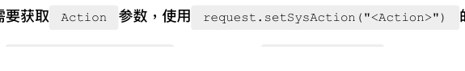

阿里云  
专有云  
阿里云弹性文件存储 EFS-NAS 开  
发指南  
产品版本：V3.18.6  
文档版本：20251205

**目录**

- [1.准备工作](#section-1)
    - [1.1. 获取文件存储的Endpoint](#section-1-1)
    - [1.2. 获取AccessKey或STS AccessKey](#section-1-2)
    - [1.3. 获取公共Header参数](#section-1-3)
- [2.Java SDK调用示例](#section-2)
    - [2.1. 快速开始](#section-2-1)
    - [2.2. 使用手册](#section-2-2)
        - [2.2.1. 安装Java SDK](#section-2-2-1)
        - [2.2.2. 设置身份验证凭证](#section-2-2-2)
        - [2.2.3. 请求连接配置](#section-2-2-3)
        - [2.2.4. 发起调用](#section-2-2-4)
        - [2.2.5. 错误处理](#section-2-2-5)
- [3.Python SDK调用示例](#section-3)
    - [3.1. 快速开始](#section-3-1)
    - [3.2. 使用手册](#section-3-2)
        - [3.2.1. 安装Python SDK](#section-3-2-1)
        - [3.2.2. 设置身份验证凭证](#section-3-2-2)
        - [3.2.3. 设置HTTPS请求](#section-3-2-3)
        - [3.2.4. 发起调用](#section-3-2-4)
        - [3.2.5. 错误处理](#section-3-2-5)
- [4.Go SDK调用示例](#section-4)
    - [4.1. 快速开始](#section-4-1)
    - [4.2. 使用手册](#section-4-2)
        - [4.2.1. 安装Go SDK](#section-4-2-1)
        - [4.2.2. 设置身份验证凭证](#section-4-2-2)
        - [4.2.3. 请求连接配置](#section-4-2-3)
        - [4.2.4. 发起调用](#section-4-2-4)
        - [4.2.5. 错误处理](#section-4-2-5)
- [5.API参考](#section-5)
    - [5.1. 调用API](#section-5-1)
        - [5.1.1. 概述](#section-5-1-1)
        - [5.1.2. 请求结构](#section-5-1-2)
        - [5.1.3. 返回结果](#section-5-1-3)
    - [5.2. RAM鉴权](#section-5-2)
    - [5.3. 公共参数](#section-5-3)
    - [5.4. 地域](#section-5-4)
        - [5.4.1. DescribeZones](#section-5-4-1)
    - [5.5. 文件系统](#section-5-5)
        - [5.5.1. CreateFileSystem](#section-5-5-1)
        - [5.5.2. DescribeFileSystems](#section-5-5-2)
        - [5.5.3. ModifyFileSystem](#section-5-5-3)
        - [5.5.4. DeleteFileSystem](#section-5-5-4)
    - [5.6. 用户](#section-5-6)
        - [5.6.1. CreateFsUser](#section-5-6-1)
        - [5.6.2. DescribeFsUsers](#section-5-6-2)
        - [5.6.3. ModifyFsUser](#section-5-6-3)
        - [5.6.4. DeleteFsUser](#section-5-6-4)
    - [5.7. 用户组](#section-5-7)
        - [5.7.1. CreateFsUserGroup](#section-5-7-1)
        - [5.7.2. AddFsUsersToGroup](#section-5-7-2)
        - [5.7.3. RemoveFsUsersFromGroup](#section-5-7-3)
        - [5.7.4. DescribeFsUserGroups](#section-5-7-4)
        - [5.7.5. DeleteFsUserGroup](#section-5-7-5)
    - [5.8. SMB共享](#section-5-8)
        - [5.8.1. CreateSmbShare](#section-5-8-1)
        - [5.8.2. DescribeSmbConnections](#section-5-8-2)
        - [5.8.3. DescribeSmbShares](#section-5-8-3)
        - [5.8.4. ModifySmbShare](#section-5-8-4)
        - [5.8.5. DeleteSmbShare](#section-5-8-5)
    - [5.9. SMB ACL](#section-5-9)
        - [5.9.1. BatchCreateSmbAcl](#section-5-9-1)
        - [5.9.2. DescribeSmbAcls](#section-5-9-2)
        - [5.9.3. BatchUpdateSmbAcl](#section-5-9-3)
        - [5.9.4. BatchDeleteSmbAcl](#section-5-9-4)
    - [5.10. NFS共享](#section-5-10)
        - [5.10.1. CreateNfsShare](#section-5-10-1)
        - [5.10.2. DescribeNfsConnections](#section-5-10-2)
        - [5.10.3. DescribeNfsShares](#section-5-10-3)
        - [5.10.4. ModifyNfsShare](#section-5-10-4)
        - [5.10.5. DeleteNfsShare](#section-5-10-5)
    - [5.11. NFS ACL](#section-5-11)
        - [5.11.1. BatchCreateNfsAcl](#section-5-11-1)
        - [5.11.2. DescribeNfsAcls](#section-5-11-2)
        - [5.11.3. BatchUpdateNfsAcl](#section-5-11-3)
        - [5.11.4. BatchDeleteNfsAcl](#section-5-11-4)

<a id="section-1"></a>

# 1.准备工作

<a id="section-1-1"></a>

## 1.1. 获取文件存储的Endpoint

通过POP网关调用专有云API时需要使用云产品业务域的Endpoint。文件存储EFS-NAS的Endpoint可依照配置格式在飞天基础运维平台中获得对应变量值来自行拼装或在飞天基础运维平台中搜索获取。

**方法一：自行拼装Endpoint**

您可以根据文件存储Endpoint的配置格式，获取对应变量值来自行拼装Endpoint。

文件存储Endpoint的配置格式为 `efs-nas.${global:region}.${global:internet-domain}` **。**

> **说明**
>
> `${global:internet-domain}` 和 `${global:region}` 为变量，请替换为您获取到的实际值。最终Endpoint中， `${global:}` 不保留。

获取变量值的具体步骤如下：

1. 登录Apsara-Uni manager运维控制台。

2. 在顶部菜单栏，选择**平台运维** > **飞天基础运维平台** > **资源管理**，默认进入**产品集群运维**页面。

3. 在**产品集群运维**页面的**产品 | 集群**文本框中输入efs-nas，找到EfsNasControllerCluster-A-xxx集群，单击操作列的**集群详情**。

4. 在**集群详情**页面，选择**终态配置**页签。

5. 在左侧文件列表中，单击**kv.conf**，单击右侧文件内容，按Ctrl+F键分别搜索 `region` 和 `internet-domain` 。

   获取到的 `region` 值将替换 `${global:region}` ， `internet-domain` 值将替换 `${global:internet-domain}` 。

**方法二：通过飞天基础运维平台获取**

1. 在飞天基础运维平台**产品集群运维**页面的**产品 | 集群**文本框中输入 `efs-nas` ，找到EfsNasControllerCluster-A-xxx集群，单击操作列的**集群详情**。

2. 在服务列表页面搜索 `efs-nas-mgr` 服务，单击下方列表中操作列的**详情**。

3. 在服务详情页面单击<strong>EfsNasMgr#</strong>组件，在组件信息中选择**资源列表**页签。

4. 搜索名为 `EFS-NAS` 的资源，单击下方**资源申请参数**列中的信息，查看**domain**值，即EFS -NAS的Endpoint。

<a id="section-1-2"></a>

## 1.2. 获取AccessKey或STS AccessKey

AccessKey支持RAM和STS两种授权模式，在发起调用时选择使用其中一种AccessKey即可。

**背景信息**

AccessKey通过使用AccessKey ID和AccessKey Secret对称加密，实现验证某个请求发送者的身份的功能。其中AccessKey ID用于标识用户，AccessKey Secret是用户用于加密签名的字符串。

AccessKey的两种授权模式如下：

- 通过RAM授权给第三方请求者的AccessKey ID和AccessKey Secret。

- 通过STS授权给第三方请求者的AccessKey ID、AccessKey Secret和Security Token。

**获取AccessKey**

Apsara Uni-manager运营控制台提供了个人AccessKey和组织AccessKey。推荐使用个人账号AccessKey调用Apsara Uni-manager运营控制台及云产品相关接口。

> **说明**
>
> 只有运营管理员和一级组织管理员可以获取组织AccessKey。

**获取个人账号AccessKey**

使用个人账号AccessKey，需要在Header中添加以下限制性参数，否则可能提示权限不足：

| 参数名称 | 描述 |
| --- | --- |
| x-acs-regionid | 实际操作的实例资源所属的地域ID，如：cn-qingdao-\*\*\*\*-\*\*\*\*。 |
| x-acs-organizationid | 实际操作的实例资源所属的组织ID，可参考获取公共Header参数中的<em>获取组织ID</em>获取。 |
| x-acs-resourcegroupid | 实际操作的实例资源所属的资源集ID，可参考获取公共Header参数中的<em>获取资源集ID</em>获取。 |
| x-acs-instanceid | 实际操作的实例资源的实例ID。例如，文件系统的ID可以从文件系统列表中查询到。 |

1. 登录Apsara Uni-manager运营控制台。

2. 在系统界面右上角，单击当前登录用户头像，单击**个人信息**。

3. 在**AccessKey**区域，您可以查看个人账户的AccessKey信息。

   

   > **说明**
   >
   > Accesskey ID和AccessKey Secret是您访问云资源时的密钥，具有该账号完整的权限，请您妥善保管。

**获取组织AccessKey**

> **警告**
>
> 个人账号AccessKey是由Apsara Uni-manager运营控制台权限体系管控的受限AccessKey，组织AccessKey相对权限较大，需要管理员确认操作的安全性。

1. 管理员登录Apsara Uni-manager运营控制台。

2. 在顶部菜单栏，单击**企业**。

3. 在左侧导航栏中，选择**资源管理 > 组织管理**。

4. 在组织结构中，单击目标一级组织名称。

5. 单击**管理Accesskey**。

6. 在弹出的对话框中，查看组织AccessKey信息。

**获取STS Accesskey**

阿里云临时安全令牌STS（Security Token Service）是阿里云提供的一种临时访问权限管理服务。STS AccessKey由AccessKey ID、AccessKey Secret及SecurityToken三元组组成，使用STS方式调用云产品API时，三元组缺一不可。

1. 获取用户角色的RAM Role。

   <ol type="i">

   <li>

   登录Apsara Uni-manager运营控制台。

   </li>

   <li>

   单击页面右上角的用户头像，单击个人信息。

   </li>

   <li>

   单击查看当前角色策略。

   </li>

   <li>

   在当前选择角色策略对话框中查看RAM Role。

   </li>

   </ol>

2. 获取STS的Endpoint。

   <ol type="i">

   <li>

   登录Apsara Uni-manager运维控制台。

   </li>

   <li>

   在顶部菜单栏，选择平台运维**平台运维 > 飞天基础运维平台 > 资源管理**。

   </li>

   <li>

   在飞天基础运维平台左侧导航栏中，单击。

   </li>

   <li>

   在**产品集群运维**页面，设置**产品 | 集群**为**ascm-A**。

   </li>

   <li>

   单击集群**操作**列的**集群详情**。

   </li>

   <li>

   在集群详情页面，单击**终态配置**页签。

   </li>

   <li>

   在终态配置页面左侧文件列表中，单击**kv.conf**，单击右侧区域的**显示内容**。按Ctrl+F键搜索 `internet-domain` 的对应值。

   </li>

   <li>

   获取后按照 `sts-vpc.${global:internet-domain}` 格式进行替换拼接。其中 `internet-domain` 的值替换 `${global:internet-domain}` 。

   > **说明**
   >
   > 最终STS Endpoint中，${global:}不保留。

   </li>

   </ol>

3. 通过调用STS的AssumeRole接口来获取三元组信息，以下为Java的STS SDK调用示例。

   > **说明**
   >
   > 以下代码示例中 `<yourRegionID>` 、 `<yourAccessKeyID>` 、 `<yourAccessKeySecret>` 、 `<yourRoleSessionName>` 、 `<yourRoleArn>` 、 `<sts.aliyuns.com>` 均为可变参数，需要替换为其实际值。尖括号（<>）在最终代码中不保留。

   ```java
   public static void main(String[] args) {
       // 创建DefaultAcsClient实例并初始化。
       // 请替换为您实际的地域ID、AccessKey ID、AccessKey Secret。
       DefaultProfile profile = DefaultProfile.getProfile("<yourRegionID>", "<yourAccessKeyID>", "<yourAccessKeySecret>");
       HttpClientConfig clientConfig = HttpClientConfig.getDefault();
       clientConfig.setIgnoreSSLCerts(true);
       clientConfig.setProtocolType(ProtocolType.HTTPS);
       profile.setHttpClientConfig(clientConfig);
       IAcsClient client = new DefaultAcsClient(profile);
       String assumeRole = callAssumeRole(client);
       if (StringUtils.isEmpty(assumeRole)) return;
       JSONObject assumeRoleJson = JSONObject.parseObject(assumeRole);
       JSONObject credentials = assumeRoleJson.getJSONObject("Credentials");
       // 获取到STS三元组。
       String stsAK = credentials.getString("AccessKeyId");
       String stsSK = credentials.getString("AccessKeySecret");
       String stsToken = credentials.getString("SecurityToken");
   }

   private static String callAssumeRole(IAcsClient client) {
       CommonRequest request = new CommonRequest();
       // "sts.aliyuns.com" 请替换为实际的STS Endpoint，⼀般格式为sts-vpc.${global:region}.${global:internet-domain}。
       request.setSysDomain("<sts.aliyuns.com>");
       request.setSysProduct("Sts");
       request.setSysAction("AssumeRole");
       request.setSysVersion("2015-04-01");
       request.setSysMethod(MethodType.POST);
       request.setHttpContentType(FormatType.FORM);
       // ⾓⾊会话名称。该参数为⽤户⾃定义参数。通常设置为调⽤该API的⽤户⾝份，例如：⽤户名。"<yourRoleSessionName>"请您替换为您⾃定义的值。
       request.putQueryParameter("RoleSessionName", "<yourRoleSessionName>");
       // 扮演的RAM Role的ARN。该⾓⾊是可信实体为ASCM⽤户的RAM⾓⾊。"<yourRoleArn>"请替换为第⼀步获取到的实际RAM Role。
       request.putQueryParameter("RoleArn", "<yourRoleArn>");
       try {
           CommonResponse response = client.getCommonResponse(request);
           return response.getData();
       } catch (ServerException e) {
           System.out.println(e.getErrCode());
           System.out.println(e.getErrMsg());
       } catch (ClientException e) {
           System.out.println(e.getErrCode());
           System.out.println(e.getErrMsg());
       }
       return null;
   }
   ```

4. 获取STS AccessKey三元组后，您就可以使用三元组信息调用云产品API接口。以下Java SDK示例以DescribeZones接口为例，使用STS AccessKey调用文件存储产品接口。

   > **说明**
   >
   > 以下代码示例中 `<efs-`

   `nas.aliyuns.com>` 、 `<yourRegionID>` 、 `<yourStsAccesskeyID>` 、 `<yourStsAccessKeySecret>` 、 `<yourStsToken>` 、 `<yourResourceGroupID>` 、 `<you`

   > 为可变参数，需要替换为其实际值。尖括号（<>）在最终代码中不保留。文件存储的Endpoint需配置为环境变量。

   ```java
   public static void main(String[] args) {
       // "<yourRegionID>"请替换为实际操作的实例资源所属的地域ID。
       // "<yourStsAccessKeyID>", "<yourStsAccessKeySecret>"请替换为前⼀步获取到的STS三元组中AccessKeyID、AccessKeySecret。
       DefaultProfile profile = DefaultProfile.getProfile("<yourRegionID>", "<yourStsAccesskey>", "<yourStsAccessSecret>");
       HttpClientConfig clientConfig = HttpClientConfig.getDefault();
       clientConfig.setIgnoreSSLCerts(true);
       clientConfig.setProtocolType(ProtocolType.HTTPS);
       profile.setHttpClientConfig(clientConfig);
       IAcsClient client = new DefaultAcsClient(profile);
       CommonRequest request = new CommonRequest();
       request.setSysMethod(com.aliyuncs.http.MethodType.POST);
       //⽂件存储的Endpoint，请替换为实际值。
       request.setSysDomain("<efs-nas.aliyuns.com>");
       request.setSysVersion("2017-06-26");
       request.setSysAction("DescribeZones");
       request.setSysProtocol(com.aliyuncs.http.ProtocolType.HTTP);

       //"<yourRegionID>" 请替换为实际操作的实例资源所属的地域ID。
       request.putHeadParameter("x-acs-regionid", "<yourRegionID>");
       // "<yourStsToken>" 请替换为您前⼀步获取到的STS三元组中SecurityToken。
       request.putQueryParameter("SecurityToken", "<yourStsToken>");
       // 非必填,请替换为实际操作的实例资源所属的资源集ID。
       // request.putHeadParameter("x-acs-resourcegroupid", "<yourResourceGroupID>");
       // 必填,请替换为实际操作的实例资源所属的组织ID。
       request.putHeadParameter("x-acs-organizationid", "<yourOrganizationID>");
       try {
           CommonResponse response = client.getCommonResponse(request);
           System.out.println(response.getData());
       } catch (ServerException e) {
           System.out.println(e.getErrCode());
           System.out.println(e.getErrMsg());
       } catch (ClientException e) {
           System.out.println(e.getErrCode());
           System.out.println(e.getErrMsg());
       }
   }
   ```

<a id="section-1-3"></a>

## 1.3. 获取公共Header参数

调用专有云API时需要填写多个公共请求Header参数，在返回结果中也会包含公共返回参数。

**公共请求参数**

在专有云API调用的代码中需要指定这些公共请求参数的参数值。

例如：在Java SDK调用中的 `request.putHeadParameter("x-acs-resourcegroupid", "<yourResourceGroupID>")` ，需要将 `<yourResourceGroupID>` 替换为您获取到的实际的资源集ID。

| 名称 | 描述 |
| --- | --- |
| x-acs-regionid | 实际操作的实例资源所属的地域ID，获取方式请参见获取Region ID。 |
| x-acs-organizationid | 实际操作的实例资源所属的组织ID，获取方式请参见获取组织ID。 |
| x-acs-resourcegroupid | 实际操作的实例资源所属的资源集ID，获取方式请参见获取资源集ID。 |
| x-acs-instanceid | 实际操作的文件系统资源的ID，获取方式请参见获取文件系统ID。 |

> **说明**
>
> - 调用Apsara Uni-manager运营控制台的API时，可以不使用Header参数 `x-acs-organizationid` 、 `x-acs-resourcegroupid` 、 `x-acs-instanceid` 。
>
> - 调用其他云产品的API时，需要在Header参数中增加组织ID `<x-acs-organizationid>` ，否则将返回调用异常，提示无权限。
>
> - 调用其他云产品的API时，建议在Header参数中增加资源集ID `<x-acs-resourcegroupid>` 。指定资源所属的组织和资源集，实现实例资源的隔离查询。若不指定资源集ID `<x-acs-resourcegroupid>` ，则获取当前用户所属组织的默认资源集。

**获取Region ID**

您可以在Apsara Uni-manager运营控制台中查看资源所属的RegionID。

1. 管理员登录Apsara Uni-manager运营控制台。

2. 在顶部菜单栏中，单击**企业**。

3. 在左侧导航栏中，选择**资源管理** > **地域管理**。

4. 单击目标组织名称。

5. 在右侧**Region列表**中查看**Region名称**，即为Region ID。

**获取组织ID**

组织ID需要通过调用API方式获取，您可以在Apsara Uni-manager运营控制台中通过API在线调试功能快速获取组织ID信息。

1. 管理员登录Apsara Uni-manager运营控制台。

2. 在顶部菜单栏，选择**产品** > **开发工具** > **API与工具** > **开发者门户**。

3. 在**开发者门户**页面，选择**API集成** > **API调试**。

4. 单击  按钮，选择**云平台** > **统一云管平台**，**版本**选择**2019-05-10**。

5. 在文本框内输入 `GetOrganizationList` 进行在线调试，在name参数填写目标组织名称后发起调用，调用成功后查看**调用结果**中**id**的信息，即为组织ID。

**获取资源集ID**

资源集ID需要通过调用API方式获取，您可以在Apsara Uni-manager运营控制台中通过API在线调试功能快速获取资源集ID信息。

1. 管理员登录Apsara Uni-manager运营控制台。

2. 在顶部菜单栏，选择**产品** > **开发工具** > **API与工具** > **开发者门户**。

3. 在**开发者门户**页面，选择**API集成** > **API调试**。

4. 单击  按钮，选择**云平台** > **统一云管平台**，**版本**选择**2019-05-10**。

5. 在文本框内输入 `ListResourceGroup` 进行在线调试，调用成功后查看**调用结果**中**id**的信息，即为资源集ID。

**获取文件系统ID**

文件系统ID可以通过Apsara Uni-manager运营控制台中的云产品资源列表进行获取。请在文件存储EFS -NAS产品控制台的文件系统列表中查看文件系统ID信息。

1. 登录Apsara Uni-manager运营控制台。

2. 在顶部的菜单栏，选择**产品** > **存储** > **文件存储EFS-NAS** 。

3. 在左侧导航栏，单击**文件系统管理**。

4. 在文件系统列表中查看**文件系统ID/名称**。

**公共返回参数**

在调用列表类的云产品资源实例接口时，在返回结果中默认包含以下公共返回参数。

| 名称 | 描述 |
| --- | --- |
| ResourceGroupName | 资源集名称。 |
| ResourceGroup | 资源集ID。 |
| DepartmentName | 组织名称。 |
| Department | 组织ID。 |

<a id="section-2"></a>

# 2.Java SDK调用示例

<a id="section-2-1"></a>

## 2.1. 快速开始

本文介绍如何获取EFS-NAS Java SDK并开始调用。

**环境准备**

- 已获取AccessKey或STS AccessKey。

- 已获取文件存储的Endpoint。

- 已安装1.8及以上版本的JDK。

**安装阿里云专有云Java SDK**

阿里云专有云Java SDK可以通过添加Maven依赖或下载阿里云开发工具包（SDK）的方式安装专有云Java SDK核心库。

要使用EFS-NAS功能，必须安装阿里云Java SDK核心库，SDK核心库推荐使用4.5.17及以上版本。 具体操作，请参见安装Java SDK。

**使用Java SDK**

调用阿里云专有云Java SDK的主要操作步骤如下：

1. 创建并初始化DefaultAcsClient实例。

2. 创建API请求并设置参数。

3. 发起请求并处理应答或异常。

   使用EFS-NAS的DescribeFileSystems接口获取文件系统信息的示例代码如下：

   > **说明**
   >
   > - REGION_ID、ALIBABA_CLOUD_ACCESS_KEY_ID和ALIBABA_CLOUD_ACCESS_KEY_SECRET表示地域ID、账号的AccessKey ID、账号的AccessKey Secret，请分别设置为环境变量。
   >
   > - 代码示例中可变参数均需替换为您实际的相关信息，尖括号（<>）在最终代码中不保留。涉及替换的可变参数如下：
   >
   >   - &lt;efs-nas.aliyuns.com>，请替换为您实际的产品访问地址。
   >
   >   - &lt;readTimeout>，请根据实际情况设置读取超时时间，单位为毫秒。
   >
   >   - &lt;connectionTimeout>，请根据实际情况设置连接超时时间，单位为毫秒。
   >
   >   - &lt;http://192.168.XX:33XX>，请替换为实际的代理IP+端口。

   ```java
   import com.aliyuncs.CommonRequest;
   import com.aliyuncs.CommonResponse;
   import com.aliyuncs.DefaultAcsClient;
   import com.aliyuncs.IAcsClient;
   import com.aliyuncs.exceptions.ClientException;
   import com.aliyuncs.exceptions.ServerException;
   import com.aliyuncs.http.HttpClientConfig;
   import com.aliyuncs.http.ProtocolType;
   import com.aliyuncs.profile.DefaultProfile;

   public class DescribeFileSystemsExample {
       
       public static void main(String[] args) throws Exception {
           // 初始化客户端
           DefaultProfile profile = DefaultProfile.getProfile(
               System.getenv("REGION_ID"),
               System.getenv("ALIBABA_CLOUD_ACCESS_KEY_ID"), 
               System.getenv("ALIBABA_CLOUD_ACCESS_KEY_SECRET")
           );
           HttpClientConfig clientConfig = HttpClientConfig.getDefault();
           clientConfig.setProtocolType(ProtocolType.HTTP);
           /**
           请根据实际情况判断是否需要设置HTTP代理，设置⽅法如下。请替换为您实际代理IP+端⼝。
           clientConfig.setHttpProxy("<http://192.168.XX.XX:33XX>");
           */
           // 设置连接超时，单位：ms。
           // clientConfig.setConnectionTimeoutMillis(1000L);
           // 设置读取超时，单位：ms。
           // clientConfig.setReadTimeoutMillis(10000L);
           profile.setHttpClientConfig(clientConfig);
           IAcsClient client = new DefaultAcsClient(profile);
           
           // 创建请求
           CommonRequest request = new CommonRequest();
           // 设置请求⽅式。
           request.setSysMethod(com.aliyuncs.http.MethodType.POST);
           // ⽂件存储的Endpoint地址，请根据实际替换。
           request.setSysDomain("<efs-nas.aliyuns.com>");
           // ⽂件存储的接⼝信息参数。
           request.setSysVersion("2017-06-26");
           request.setSysAction("DescribeFileSystems");
           request.setSysProtocol(com.aliyuncs.http.ProtocolType.HTTP);
           // 设置接⼝业务参数。
           request.putQueryParameter("PageNumber", "1");
           request.putQueryParameter("PageSize", "10");
           
           // 设置Headers。
           // 设置⾝份标识，标识调⽤来源，无实际作⽤，可随意设置，必填项。
           request.putHeadParameter("x-acs-caller-sdk-source","<yourCallerSdkSource>");
           // 调⽤专有云API时，⼀般需要提供多个公共Header参数，包括：x-acs-regionid、x-acs-organizationid、x-acs-resourcegroupid、x-acs-instanceid。详情
   可参照开发指南中的“获取公共Header参数"。
           
           // 发送请求并输出结果
           try {
               CommonResponse response = client.getCommonResponse(request);
               System.out.println("响应状态: " + response.getHttpStatus());
               System.out.println("响应数据: " + response.getData());
           } catch (ServerException e) {
               e.printStackTrace();
           } catch (ClientException e) {
               System.out.println("ErrCode:" + e.getErrCode());
               System.out.println("ErrMsg:" + e.getErrMsg());
               System.out.println("RequestId:" + e.getRequestId());
           }
       }
   }
   ```

<a id="section-2-2"></a>

## 2.2. 使用手册

<a id="section-2-2-1"></a>

### 2.2.1. 安装Java SDK

本文介绍如何安装Java SDK。

阿里云专有云Java SDK支持1.8及以上版本的JDK，可以通过添加Maven依赖或下载阿里云开发工具包（SDK）的方式安装专有云Java SDK。

要使用文件存储功能，只需安装阿里云Java SDK核心库，SDK核心库推荐使用4.5.17及以上版本。

```xml
<!-- Alibaba Cloud SDK for Java -->
<dependency>
    <groupId>com.aliyun</groupId>
    <artifactId>aliyun-java-sdk-core</artifactId>
    <version>4.5.17</version>
</dependency>
```

<a id="section-2-2-2"></a>

### 2.2.2. 设置身份验证凭证

使用阿里云专有云SDK访问阿里云专有云服务时，您需要提供授权的账号进行身份验证。本文介绍了如何设置身份验证凭证。

**配置访问凭证**

获取 AccessKey 或 STS 临时凭证和地域ID后，请按以下方式将其配置为环境变量。此处以AccessKey为例介绍，STS 临时凭证的配置类似。请根据所用平台类型进行配置。

**WIndows**

请按需选择CMD或者PowerShell配置环境变量。

**CMD**

1. 在CMD中运行以下命令设置环境变量。

   ```text
   setx REGION_ID "YOUR_REGION_ID"
   setx ALIBABA_CLOUD_ACCESS_KEY_ID "YOUR_ACCESS_KEY_ID"
   setx ALIBABA_CLOUD_ACCESS_KEY_SECRET "YOUR_ACCESS_KEY_SECRET"
   ```

2. 重启CMD后，运行以下命令，检查环境变量是否生效。

   ```bash
   echo %REGION_ID%
   echo %ALIBABA_CLOUD_ACCESS_KEY_ID%
   echo %ALIBABA_CLOUD_ACCESS_KEY_SECRET%
   ```

**PowerShell**

1. 在PowerShell中运行以下命令。

   ```text
   [Environment]::SetEnvironmentVariable("REGION_ID", "YOUR_REGION_ID", [EnvironmentVariableTarget]::User)
   [Environment]::SetEnvironmentVariable("ALIBABA_CLOUD_ACCESS_KEY_ID", "YOUR_ACCESS_KEY_ID", [EnvironmentVariableTarget]::User)
   [Environment]::SetEnvironmentVariable("ALIBABA_CLOUD_ACCESS_KEY_SECRET", "YOUR_ACCESS_KEY_SECRET", [EnvironmentVariableTarget]::User)
   ```

2. 运行以下命令，检查环境变量是否生效。

   ```text
   [Environment]::GetEnvironmentVariable("REGION_ID", [EnvironmentVariableTarget]::User)
   [Environment]::GetEnvironmentVariable("ALIBABA_CLOUD_ACCESS_KEY_ID", [EnvironmentVariableTarget]::User)
   [Environment]::GetEnvironmentVariable("ALIBABA_CLOUD_ACCESS_KEY_SECRET", [EnvironmentVariableTarget]::User)
   ```

**Linux**

1. 在命令行界面执行以下命令来将环境变量设置追加到  `~/.bashrc`  文件中。

   ```bash
   echo "export REGION_ID='YOUR_REGION_ID'" >> ~/.bashrc
   echo "export ALIBABA_CLOUD_ACCESS_KEY_ID='YOUR_ACCESS_KEY_ID'" >> ~/.bashrc
   echo "export ALIBABA_CLOUD_ACCESS_KEY_SECRET='YOUR_ACCESS_KEY_SECRET'" >> ~/.bashrc
   ```

2. 执行以下命令使变更生效。

   ```text
   source ~/.bashrc
   ```

3. 执行以下命令检查环境变量是否生效。

   ```bash
   echo $REGION_ID
   echo $ALIBABA_CLOUD_ACCESS_KEY_ID
   echo $ALIBABA_CLOUD_ACCESS_KEY_SECRET
   ```

**macOS**

1. 在终端中执行以下命令，查看默认 Shell 类型。

   ```bash
   echo $SHELL
   ```

2. 根据默认 Shell 类型进行操作。

   - Zsh

     <ol type="a">

     <li>

     执行以下命令来将环境变量设置追加到  `~/.zshrc`  文件中。

     ```bash
     echo "export REGION_ID='YOUR_REGION_ID'" >> ~/.zshrc
     echo "export ALIBABA_CLOUD_ACCESS_KEY_ID='YOUR_ACCESS_KEY_ID'" >> ~/.zshrc
     echo "export ALIBABA_CLOUD_ACCESS_KEY_SECRET='YOUR_ACCESS_KEY_SECRET'" >> ~/.zshrc
     ```

     </li>

     <li>

     执行以下命令使变更生效。

     ```text
     source ~/.zshrc
     ```

     </li>

     </ol>

     <ol type="i" start="100">

     <li>

     执行以下命令检查环境变量是否生效。

     ```bash
     echo $REGION_ID
     echo $ALIBABA_CLOUD_ACCESS_KEY_ID
     echo $ALIBABA_CLOUD_ACCESS_KEY_SECRET
     ```

     </li>

     </ol>

   - Bash

     <ol type="a">

     <li>

     执行以下命令来将环境变量设置追加到  `~/.bash_profile`  文件中。

     ```bash
     echo "export REGION_ID='YOUR_REGION_ID'" >> ~/.bash_profile
     echo "export ALIBABA_CLOUD_ACCESS_KEY_ID='YOUR_ACCESS_KEY_ID'" >> ~/.bash_profile
     echo "export ALIBABA_CLOUD_ACCESS_KEY_SECRET='YOUR_ACCESS_KEY_SECRET'" >> ~/.bash_profile
     ```

     </li>

     <li>

     执行以下命令使变更生效。

     ```text
     source ~/.bash_profile
     ```

     </li>

     </ol>

     <ol type="i" start="100">

     <li>

     执行以下命令检查环境变量是否生效。

     ```bash
     echo $REGION_ID
     echo $ALIBABA_CLOUD_ACCESS_KEY_ID
     echo $ALIBABA_CLOUD_ACCESS_KEY_SECRET
     ```

     </li>

     </ol>

**初始化Client**

目前Java SDK支持通过AccessKey或STS AccessKey进行身份验证。

```text
DefaultProfile profile = DefaultProfile.getProfile(
    System.getenv("REGION_ID"), // 获取环境变量中的地域ID。
    // 获取环境变量中的 AccessKey ID 和 AccessKey Secret。 
    System.getenv("ALIBABA_CLOUD_ACCESS_KEY_ID"), 
    System.getenv("ALIBABA_CLOUD_ACCESS_KEY_SECRET"), 
    // 使⽤STS AccessKey进⾏⾝份验证时，请将账号的SecurityToken配置到环境变量ALIBABA_CLOUD_STS_SECURITY_TOKEN.
    //使⽤AccessKey进⾏⾝份验证时，SecurityToken置为null。
    System.getenv("ALIBABA_CLOUD_STS_SECURITY_TOKEN")
);
```

<a id="section-2-2-3"></a>

### 2.2.3. 请求连接配置

本文介绍了如何配置请求连接（HttpClientConfig）。

可通过以下代码配置HttpClientConfig，具体请根据自身服务能力自行选择配置项并做相应配置。

> **说明**
>
> 以下代码示例中可变参数均需替换为实际的相关信息，尖括号（<>）在最终代码中不保留。
>
> 涉及替换的可变参数如下：
>
> - &lt;readTimeout>，请根据自身服务的能力，配置读取超时时间，单位为毫秒（ms）。
>
> - &lt;connectionTimeout>，请根据自身服务的能力，配置连接超时时间，单位为毫秒（ms）。
>
> - &lt;maxRequestsPerHost>，请根据自身服务的能力，配置每台服务器的最大请求数，数据类型为INT。
>
> - &lt;maxRequests>，请根据自身服务的能力，配置最大请求数，数据类型为INT。
>
> - &lt;http://192.168.XX.XX:33XX>，请替换为实际的代理IP+端口。

```text
// 获取HttpClientConfig对象
HttpClientConfig clientConfig = HttpClientConfig.getDefault();
// 设置是否忽略证书
clientConfig.setIgnoreSSLCerts(true);
// (可选)设置读取超时时间，单位毫秒（ms）
clientConfig.setReadTimeoutMillis(<readTimeout>);
// (可选)设置创建连接超时时间，单位毫秒（ms）
clientConfig.setConnectionTimeoutMillis(<connectionTimeout>);
// (可选)设置每个主机的最⼤请求数，数据类型为INT
clientConfig.setMaxRequestsPerHost(<maxRequestsPerHost>);
// (可选)设置最⼤请求数，数据类型为INT
clientConfig.setMaxRequests(<maxRequests>);
// (可选)设置协议类型
clientConfig.setProtocolType(ProtocolType.HTTP);
/** （可选）请根据实际情况判断是否设置代理，设置⽅法如下：
clientConfig.setHttpProxy("<http://192.168.XX.XX:33XX>");
或
clientConfig.setHttpsProxy("<https://192.168.XX.XX:33XX>");
请替换为您实际的代理IP+端⼝
*/
profile.setHttpClientConfig(clientConfig);
```

<a id="section-2-2-4"></a>

### 2.2.4. 发起调用

当您要调用某个API没有提供SDK时，或者提供的SDK中的请求Request参数和返回Response值不符合需求时，可以采用泛用型的API调用方式（CommonRequest）。使用CommonRequest调用方式可实现任意OpenAPI接口的调用。

**CommonRequest介绍**

CommonRequest的特点如下：

- 轻量：只需Core包即可发起调用，无需下载安装各产品的SDK。

- 简便：无需更新SDK即可调用最新发布的API。

- 快速迭代。

发起一次CommonRequest请求，您需要获取以下几个参数的值。您可以在EFS-NAS的API文档中获取以下参数的值。

- 域名(domain)：该产品的服务地址。

- API版本(version)：该API的版本号，格式为YYYY-MM-DD。

  您可以在各产品的API文档的公共参数部分获取API版本。

- 接口信息：要调用的接口名称。

  

  您需要获取 `Action` 参数，使用 `request.setSysAction("<Action>")` 的方式来指定API名称。

  例如 `DescribeFileSystems` 接口，在发起 `CommonRequest` 请求时，需要使用 `request.setSysAction("DescribeFileSystems")` 来指定API名称。

**创建请求CommonRequest**

使用CommonRequest调用方式可实现任意Open API接口的调用。

```text
// 创建API请求并设置参数。
CommonRequest request = new CommonRequest();
// ⽂件存储的接⼝信息参数。
request.setSysProduct("efs-nas");
request.setSysVersion("2017-06-26");
request.setSysAction("DescribeFileSystems");
request.setSysUriPattern("<yourCallUriPattern>");
// ⽂件存储的Endpoint地址。
request.setSysDomain("<efsnasEndpoint>");
// 设置请求⽅式。
request.setSysMethod(MethodType.POST);

// 设置Headers。
// 非必填，请替换为您实际的资源集ID。
request.putHeadParameter("x-acs-resourcegroupid", "<yourResourceGroupID>");
必填，请替换为您实际的组织ID。
request.putHeadParameter("x-acs-organizationid", "<yourOrganizationID>");// 
// 设置⾝份标识，标识调⽤来源，无实际作⽤，可随意设置，必填项。
request.putHeadParameter("x-acs-caller-sdk-source","<yourCallerSdkSource>");
// 接⼝业务参数设置。
...
// 设置Content-Type。
request.setHttpContentType(FormatType.JSON);
```

> **说明**
>
> 以上代码示例中 `<yourCallUriPattern>` 、 `<efsnasEndpoint>` 、 `<yourCallerSdkSource>` 均为可变参数，需要替换为其实际值，尖括号（<>）在最终代码中不保留。

**设置阿里云核心库SDK参数**

在使用阿里云核心库SDK发起API请求时，可以设置四种类型的参数：Path、Query、Body、Header。在调用具体API时，请根据开发文档中标注的参数位置对应设置。

| 参数类型 | 描述 | 代码示例 |
| --- | --- | --- |
| Path | Path参数用于对请求Request中设置的UriPattern进行变量替换。例如：URI<code> "/clusters/[ClusterId]" </code>中的<code> [ClusterId] </code>可以通过设置Path参数<code> "ClusterId=cluster1" </code>进行替换。最终发起HTTP请求的URI则为<code> "/clusters/clusterId01" </code>。 | <code>CommonRequest request = new CommonRequest();</code><br><code>request.setSysUriPattern("/clusters/[ClusterId]");</code><br><code>request.putPathParameter("ClusterId", "clusterId01");</code> |
| Query | Query参数用于对请求Request中的URL参数进行设置（一般用于GET请求）。例如：“http://aliyun.com/api/? ClusterId=clusterId01&amp;ClusterName=cluster Name01”。 | <code>CommonRequest request = new CommonRequest();</code><br><code>request.putQueryParameter("ClusterId", "clusterId01");</code><br><code>request.putQueryParameter("ClusterName", "clusterName01");</code> |
| Body | Body参数用于对请求Request中的HTTP Content进行设置（一般用于POST/PUT请求）。目前支持两种格式：<br>• application/json<br>• application/x-www-form-urlencoded<br>说明在设置Body参数时，需要同时设置HTTP Content-Type。 | • key-value形式设置Body参数，并设置HttpContentType。<br><code>CommonRequest request = new CommonRequest();</code><br><code>request.putBodyParameter("ClusterId", "clusterId01");</code><br><code>request.putBodyParameter("ClusterName", "clusterName01");</code><code>// </code>若<code>Content-Type</code>设置为<code>application/x-www-form-urlencoded</code>，请求到服务器的<code>Content</code>数据格式为<code>"ClusterId=clusterId01&amp;ClusterName=clusterName01"</code>的字符串。<code>request.setHttpContentType(FormatType.FORM);</code><code>// </code>或，若<code>Content-Type</code>设置为<code>application/json</code>，请求到服务器的<code>Content</code>数据格式为<code>"</code> <code>{\"ClusterId\":\"clusterId01\",\"ClusterName\":\"clusterName01\"}"</code>的<code>JSON</code>串。<code>request.setHttpContentType(FormatType.JSON);</code><br>• 自行构造HTTP Content并直接设置HttpContent。<br><code>CommonRequest request = new CommonRequest();</code><code>//</code>设置<code>application/json</code>格式的<code>HTTP Content</code>。<code>String body = "{\"ClusterId\": \"clusterId01\", \"ClusterName\":</code><br><code>\"clusterName01\"}";</code><br><code>request.setHttpContent(body.getBytes(), "utf-8", FormatType.JSON);</code><code>//</code>设置<code>application/x-www-form-urlencoded</code>格式的<code>HTTP Content</code>。<code>String body = "ClusterId=clusterId01&amp;ClusterName=clusterName01";</code><br><code>request.setHttpContent(body.getBytes(), "utf-8", FormatType.FORM);</code> |
| Header | Header参数用于对请求Request中的HTTP Header进行设置。 | <code>CommonRequest request = new CommonRequest();</code><br><code>request.putHeadParameter("x-acs-organizationid", "3");</code><br><code>request.putHeadParameter("x-acs-resourcegroupid", "2");</code> |

**发起调用并处理应答**

可参考以下代码发起请求并处理返回结果。

```java
try {
    // 发起请求，并获取返回。
    CommonResponse response = client.getCommonResponse(request);
    System.out.println("响应状态: " + response.getHttpStatus());
    System.out.println("响应数据: " + response.getData());  
} catch (ServerException e) {
    e.printStackTrace();
} catch (ClientException e) {
    System.out.println("ErrCode:" + e.getErrCode());
    System.out.println("ErrMsg:" + e.getErrMsg());
    System.out.println("RequestId:" + e.getRequestId());
}
```

**完整示例**

以下代码为通过EFS-NAS的 `DescribeFileSystems` 接口查询文件系统列表的调用示例。

```java
import com.aliyuncs.CommonRequest;
import com.aliyuncs.CommonResponse;
import com.aliyuncs.DefaultAcsClient;
import com.aliyuncs.IAcsClient;
import com.aliyuncs.exceptions.ClientException;
import com.aliyuncs.exceptions.ServerException;
import com.aliyuncs.http.HttpClientConfig;
import com.aliyuncs.http.ProtocolType;
import com.aliyuncs.profile.DefaultProfile;

public class DescribeFileSystemsExample {
    
    public static void main(String[] args) throws Exception {
        // 初始化客户端
        DefaultProfile profile = DefaultProfile.getProfile(
            System.getenv("REGION_ID"),
            System.getenv("ALIBABA_CLOUD_ACCESS_KEY_ID"), 
            System.getenv("ALIBABA_CLOUD_ACCESS_KEY_SECRET")
        );
        HttpClientConfig clientConfig = HttpClientConfig.getDefault();
        clientConfig.setProtocolType(ProtocolType.HTTP);
        /**
        请根据实际情况判断是否需要设置HTTP代理，设置⽅法如下。请替换为您实际代理IP+端⼝。
        clientConfig.setHttpProxy("<http://192.168.XX.XX:33XX>");
        */
        // 设置连接超时，单位：ms。
        // clientConfig.setConnectionTimeoutMillis(1000L);
        // 设置读取超时，单位：ms。
        // clientConfig.setReadTimeoutMillis(10000L);
        profile.setHttpClientConfig(clientConfig);
        IAcsClient client = new DefaultAcsClient(profile);
        
        // 创建请求
        CommonRequest request = new CommonRequest();
        // 设置请求⽅式。
        request.setSysMethod(com.aliyuncs.http.MethodType.POST);
        // ⽂件存储的Endpoint地址，请根据实际替换。
        request.setSysDomain("<efs-nas.aliyuns.com>");
        // ⽂件存储的接⼝信息参数。
        request.setSysVersion("2017-06-26");
        request.setSysAction("DescribeFileSystems");
        request.setSysProtocol(com.aliyuncs.http.ProtocolType.HTTP);
        // 设置接⼝业务参数。
        request.putQueryParameter("PageNumber", "1");
        request.putQueryParameter("PageSize", "10");
        
        // 设置Headers。
        // 设置⾝份标识，标识调⽤来源，无实际作⽤，可随意设置，必填项。
        request.putHeadParameter("x-acs-caller-sdk-source","<yourCallerSdkSource>");
        // 调⽤专有云API时，⼀般需要提供多个公共Header参数，包括：x-acs-regionid、x-acs-organizationid、x-acs-resourcegroupid、x-acs-instanceid。详情可参
照开发指南中的“获取公共Header参数"。
        
        // 发送请求并输出结果
        try {
            CommonResponse response = client.getCommonResponse(request);
            System.out.println("响应状态: " + response.getHttpStatus());
            System.out.println("响应数据: " + response.getData());
        } catch (ServerException e) {
            e.printStackTrace();
        } catch (ClientException e) {
            System.out.println("ErrCode:" + e.getErrCode());
            System.out.println("ErrMsg:" + e.getErrMsg());
            System.out.println("RequestId:" + e.getRequestId());
        }
    }
}
```

> **说明**
>
> - REGION_ID、ALIBABA_CLOUD_ACCESS_KEY_ID和ALIBABA_CLOUD_ACCESS_KEY_SECRET表示地域ID、账号的AccessKey ID、账号的AccessKey Secret，请分别设置为环境变量。
>
> - 代码示例中可变参数均需替换为您实际的相关信息，尖括号（<>）在最终代码中不保留。涉及替换的可变参数如下：
>
>   - &lt;efs-nas.aliyuns.com>，请替换为您实际的产品访问地址。
>
>   - &lt;readTimeout>，请根据实际情况设置读取超时时间，单位为毫秒。
>
>   - &lt;connectionTimeout>，请根据实际情况设置连接超时时间，单位为毫秒。
>
>   - &lt;http://192.168.XX:33XX>，请替换为实际的代理IP+端口。

<a id="section-2-2-5"></a>

### 2.2.5. 错误处理

在使用Java SDK时，当服务端或者SDK端出错时，SDK会返回相应的异常信息。这些异常信息中会包含具体的错误信息包括错误码（Error Code）和错误消息（Error Message）。

一般情况下，无需对Java SDK返回的错误进行处理，只需要根据服务端的错误提示处理服务端错误即可。

- `ServerException` 是服务端错误信息。

- `ClientException` 是SDK端错误信息。

例如，当出现如下错误时，您可以根据具体的错误信息，修改AccessKey的ID即可。

```text
com.aliyuncs.exceptions.ClientException: InvalidAccessKeyId.NotFound : Specified access key is not found.
```

如需对SDK的错误进行处理，可以参考如下示例编写代码：

```java
try {
    AcsResponse response = client.getAcsResponse(request);
    // 处理Response。
    // ...
}catch (ServerException e){
    // 此处可以添加您⾃⼰的错误处理逻辑。
    // 例如，打印具体的错误信息。
    System.out.println("ErrorCode=" + e.getErrCode());
    System.out.println("ErrorMessage=" + e.getErrMsg());
    // 如果遇上棘⼿问题，可联系阿⾥云技术⽀持，并提供RequestID。
    System.out.println("ResponseId=" + e.getRequestId());
}catch (ClientException e){
    // 这⾥可以添加您⾃⼰的错误处理逻辑。
    // 例如，打印具体的错误信息。
    System.out.println("ErrorCode=" + e.getErrCode());
    System.out.println("ErrorMessage=" + e.getErrMsg());
}
```

<a id="section-3"></a>

# 3.Python SDK调用示例

<a id="section-3-1"></a>

## 3.1. 快速开始

本文介绍如何获取SDK并开始调用。

**环境准备**

- 已获取AccessKey或STS AccessKey。

- 已获取文件存储的Endpoint。

**安装Python SDK核心库**

要使用文件存储功能，只需安装阿里云Python SDK核心库。具体命令如下：

- 如果您使用的是Python 2.x，执行以下命令安装阿里云SDK核心库。

  ```bash
  pip install aliyun-python-sdk-core
  ```

- 如果您使用的是Python 3.x，执行以下命令安装阿里云SDK核心库。

  ```bash
  pip3 install aliyun-python-sdk-core-v3
  ```

**使用Python SDK**

调用Python SDK的3个主要步骤如下：

1. 创建Client实例。在创建Client实例时，您需要获取Region ID、AccessKey ID和AccessKey Secret。

2. 创建API请求并设置参数。

3. 发起请求并处理应答或异常。

   使用EFS-NAS的DescribeFileSystems接口获取文件系统信息的示例代码如下：

   > **说明**
   >
   > - REGION_ID、ALIBABA_CLOUD_ACCESS_KEY_ID、ALIBABA_CLOUD_ACCESS_KEY_SECRET表示地域ID、账号的AccessKey ID、账号的AccessKey Secret，请分别设置为环境变量。
   >
   > - 代码示例中可变参数均需替换为您实际的相关信息，尖括号（<>）在最终代码中不保留。涉及替换的可变参数如下：
   >
   >   - &lt;efs-nas.aliyuns.com>，请替换为您实际的产品访问地址。
   >
   >   - &lt;http://192.168.XX:33XX>，请替换为实际的代理IP+端口。

   ```python
   import os
   from aliyunsdkcore.client import AcsClient
   from aliyunsdkcore.request import CommonRequest

   def main():
       # 如需使⽤代理，请使⽤以下代码：
       #os.environ['http_proxy'] = "<http://192.168.XX:33XX>"
       # 将AccessKey和地域ID配置为环境变量后再进⾏初始化。
       client = AcsClient(os.environ['ALIBABA_CLOUD_ACCESS_KEY_ID'],
                          os.environ['ALIBABA_CLOUD_ACCESS_KEY_SECRET'],
                          os.environ['REGION_ID'])
       # 创建请求对象。
       request = CommonRequest()
       request.set_domain('<efs-nas.aliyuns.com>')  # API服务地址，当前为示例值，请替换为您实际的产品访问地址。
       request.set_version('2017-06-26')  # API版本号。
       request.set_action_name('DescribeFileSystems')  # API名称，当调⽤RPC⻛格API时，必须配置set_action_name()指定接⼝名称。
       request.set_method('POST')  # API请求⽅式。
       request.set_protocol_type('HTTPS')  # 请求协议HTTPS或HTTP，建议使⽤HTTPS。
       request.add_query_param('PageNum', '1')
       request.add_query_param('PageSize', '30')
       # 发起请求并处理响应。
       response = client.do_action_with_exception(request)
       print(response)


   if __name__ == '__main__':
       main()
   ```

<a id="section-3-2"></a>

## 3.2. 使用手册

<a id="section-3-2-1"></a>

### 3.2.1. 安装Python SDK

本文介绍如何安装及调用EFS-NAS Python SDK。

**背景信息**

阿里云专有云Python SDK支持Python 2.6.x、2.7.x和3.x及以上环境，可通过pip安装专有云Python SDK。

**安装Python SDK**

要使用文件存储功能，只需安装阿里云Python SDK核心库。具体命令如下：

- 如果您使用的是Python 2.x，执行以下命令安装阿里云SDK核心库。

  ```bash
  pip install aliyun-python-sdk-core
  ```

- 如果您使用的是Python 3.x，执行以下命令安装阿里云SDK核心库。

  ```bash
  pip3 install aliyun-python-sdk-core-v3
  ```

<a id="section-3-2-2"></a>

### 3.2.2. 设置身份验证凭证

当使用阿里云专有云SDK访问阿里云专有云服务时，您需要提供授权的账号进行身份验证。本文介绍了如何设置身份验证凭证。

**配置访问凭证**

获取 AccessKey和地域ID后，请根据所用平台类型选择以下方式将其配置为环境变量。

**WIndows**

请按需选择CMD或者PowerShell配置环境变量。

**CMD**

1. 在CMD中运行以下命令设置环境变量。

   ```text
   setx REGION_ID "YOUR_REGION_ID"
   setx ALIBABA_CLOUD_ACCESS_KEY_ID "YOUR_ACCESS_KEY_ID"
   setx ALIBABA_CLOUD_ACCESS_KEY_SECRET "YOUR_ACCESS_KEY_SECRET"
   ```

2. 重启CMD后，运行以下命令，检查环境变量是否生效。

   ```bash
   echo %REGION_ID%
   echo %ALIBABA_CLOUD_ACCESS_KEY_ID%
   echo %ALIBABA_CLOUD_ACCESS_KEY_SECRET%
   ```

**PowerShell**

1. 在PowerShell中运行以下命令。

   ```text
   [Environment]::SetEnvironmentVariable("REGION_ID", "YOUR_REGION_ID", [EnvironmentVariableTarget]::User)
   [Environment]::SetEnvironmentVariable("ALIBABA_CLOUD_ACCESS_KEY_ID", "YOUR_ACCESS_KEY_ID", [EnvironmentVariableTarget]::User)
   [Environment]::SetEnvironmentVariable("ALIBABA_CLOUD_ACCESS_KEY_SECRET", "YOUR_ACCESS_KEY_SECRET", [EnvironmentVariableTarget]::User)
   ```

2. 运行以下命令，检查环境变量是否生效。

   ```text
   [Environment]::GetEnvironmentVariable("REGION_ID", [EnvironmentVariableTarget]::User)
   [Environment]::GetEnvironmentVariable("ALIBABA_CLOUD_ACCESS_KEY_ID", [EnvironmentVariableTarget]::User)
   [Environment]::GetEnvironmentVariable("ALIBABA_CLOUD_ACCESS_KEY_SECRET", [EnvironmentVariableTarget]::User)
   ```

**Linux**

1. 在命令行界面执行以下命令来将环境变量设置追加到  `~/.bashrc`  文件中。

   ```bash
   echo "export REGION_ID='YOUR_REGION_ID'" >> ~/.bashrc
   echo "export ALIBABA_CLOUD_ACCESS_KEY_ID='YOUR_ACCESS_KEY_ID'" >> ~/.bashrc
   echo "export ALIBABA_CLOUD_ACCESS_KEY_SECRET='YOUR_ACCESS_KEY_SECRET'" >> ~/.bashrc
   ```

2. 执行以下命令使变更生效。

   ```text
   source ~/.bashrc
   ```

3. 执行以下命令检查环境变量是否生效。

   ```bash
   echo $REGION_ID
   echo $ALIBABA_CLOUD_ACCESS_KEY_ID
   echo $ALIBABA_CLOUD_ACCESS_KEY_SECRET
   ```

**macOS**

1. 在终端中执行以下命令，查看默认 Shell 类型。

   ```bash
   echo $SHELL
   ```

2. 根据默认 Shell 类型进行操作。

   - Zsh

     <ol type="a">

     <li>

     执行以下命令来将环境变量设置追加到  `~/.zshrc`  文件中。

     ```bash
     echo "export REGION_ID='YOUR_REGION_ID'" >> ~/.zshrc
     echo "export ALIBABA_CLOUD_ACCESS_KEY_ID='YOUR_ACCESS_KEY_ID'" >> ~/.zshrc
     echo "export ALIBABA_CLOUD_ACCESS_KEY_SECRET='YOUR_ACCESS_KEY_SECRET'" >> ~/.zshrc
     ```

     </li>

     <li>

     执行以下命令使变更生效。

     ```text
     source ~/.zshrc
     ```

     </li>

     </ol>

     <ol type="i" start="100">

     <li>

     执行以下命令检查环境变量是否生效。

     ```bash
     echo $REGION_ID
     echo $ALIBABA_CLOUD_ACCESS_KEY_ID
     echo $ALIBABA_CLOUD_ACCESS_KEY_SECRET
     ```

     </li>

     </ol>

   - Bash

     <ol type="a">

     <li>

     执行以下命令来将环境变量设置追加到  `~/.bash_profile`  文件中。

     ```bash
     echo "export REGION_ID='YOUR_REGION_ID'" >> ~/.bash_profile
     echo "export ALIBABA_CLOUD_ACCESS_KEY_ID='YOUR_ACCESS_KEY_ID'" >> ~/.bash_profile
     echo "export ALIBABA_CLOUD_ACCESS_KEY_SECRET='YOUR_ACCESS_KEY_SECRET'" >> ~/.bash_profile
     ```

     </li>

     <li>

     执行以下命令使变更生效。

     ```text
     source ~/.bash_profile
     ```

     </li>

     </ol>

     <ol type="i" start="100">

     <li>

     执行以下命令检查环境变量是否生效。

     ```bash
     echo $REGION_ID
     echo $ALIBABA_CLOUD_ACCESS_KEY_ID
     echo $ALIBABA_CLOUD_ACCESS_KEY_SECRET
     ```

     </li>

     </ol>

**初始化Client**

Python SDK支持通过AccessKey进行身份验证。使用AccessKey作为访问凭据时，需要在初始化Client时设置凭证。

```python
from aliyunsdkcore.client import AcsClient

client = AcsClient(os.environ['ALIBABA_CLOUD_ACCESS_KEY_ID'],
                   os.environ['ALIBABA_CLOUD_ACCESS_KEY_SECRET'],
                   os.environ['REGION_ID'])
```

<a id="section-3-2-3"></a>

### 3.2.3. 设置HTTPS请求

Python SDK支持使用HTTP和HTTPS协议发起 API 请求。

使用Python SDK时，您可以为某个请求指定使用HTTP或HTTPS协议，您也可以设置全局默认协议。

> **说明**
>
> 产品的默认协议（HTTP/HTTPS）优先于设置的全局默认协议。

**添加OpenSSL依赖**

Python SDK的HTTPS协议依赖Python的OpenSSL支持。要使用阿里云SDK通过HTTPS协议发送请求，您需要在Python中添加OpenSSL 支持。Open SSL支持TLS1.2及以上版本。

运行 `python -c "import ssl"` 检查Python环境是否支持OpenSSL。运行后，如果没有出现 `ImportError: No module named ssl` 的错误信息，说明已经支持OpenSSL。

如果没有OpenSSL，运行以下命令安装：

```bash
pip install pyopenssl  # Python 2使⽤此命令。
```

> **说明**
>
> 如果本地环境为Python 3，则运行 `pip3 install pyopenssl` 命令。

**设置单个请求的HTTP/HTTPS协议**

参考以下代码示例为一个接口设置HTTPS调用：

```python
import DescribeInstancesRequest
request = DescribeInstancesRequest()
request.set_protocol_type("https")
# 取值："https" 或 "http"
```

**设置全局默认协议**

参考以下代码示例设置全局默认协议：

```python
import aliyunsdkcore.request
aliyunsdkcore.request.set_default_protocol_type("https")
# 创建请求并调⽤ client.do_action_with_exception() 来发送请求
```

<a id="section-3-2-4"></a>

### 3.2.4. 发起调用

当您要调用某个API没有提供SDK时，或者提供的SDK中的请求Request参数和返回Response值不符合需求时，可以采用泛用型的API调用方式（CommonRequest）。使用CommonRequest调用方式可实现任意OpenAPI接口的调用。

**CommonRequest介绍**

CommonRequest的特点如下：

- 轻量：只需Core包即可发起调用，无需下载安装各产品的SDK。

- 简便：无需更新SDK即可调用最新发布的API。

- 快速迭代。

发起一次CommonRequest请求，您需要获取以下几个参数的值。您可以在EFS-NAS的API文档中获取以下参数的值。

- 域名(domain)：该产品的服务地址。

- API版本(version)：该API的版本号，格式为YYYY-MM-DD。

  您可以在各产品的API文档的公共参数部分获取API版本。

- 接口信息：要调用的接口名称。

  您需要获取 `Action` 参数，使用 `request.set_action_name("<Action>")` 的方式来指定API名称。

  例如 `DescribeFileSystems` 接口，在发起 `CommonRequest` 请求时，需要使用 `request.set_action_name('DescribeFileSystems')` 来指定API名称。

**创建请求CommonRequest**

使用CommonRequest调用方式可实现任意Open API接口的调用。

```text
request = CommonRequest()
request.set_domain('<efs-nas.aliyuns.com>')  # API服务地址，当前为示例值，请替换为您实际的产品访问地址
request.set_version('2017-06-26')  # API版本号
request.set_action_name('DescribeFileSystems')  # API名称，当调⽤RPC⻛格API时，必须配置set_action_name()指定接⼝名称
request.set_method('POST')  # API请求⽅式
request.set_protocol_type('HTTPS')  # 请求协议HTTPS或HTTP，建议使⽤HTTPS。
# 接⼝业务参数设置。
request.add_query_param('PageNum', '1')
request.add_query_param('PageSize', '30')
```

> **说明**
>
> 以上代码示例中 `<efs-nas.aliyuns.com>` 为可变参数，请结合自身服务替换为其实际值，尖括号（<>）在最终代码中不保留。

**发起调用并处理应答**

可参考以下代码发起请求并处理返回结果。

```text
# 发起请求，并获取返回。
response = client.do_action_with_exception(request)
# python2:  print(response)
print(str(response, encoding='utf-8'))
```

**完整示例**

以下代码为通过EFS-NAS的 `DescribeFileSystems` 接口查询文件系统列表的调用示例。

```python
import os
from aliyunsdkcore.client import AcsClient
from aliyunsdkcore.request import CommonRequest

def main():
    # 如需使⽤代理，请使⽤以下代码：
    #os.environ['http_proxy'] = "<http://192.168.XX:33XX>"
    # 将AccessKey和地域ID配置为环境变量后再进⾏初始化。
    client = AcsClient(os.environ['ALIBABA_CLOUD_ACCESS_KEY_ID'],
                       os.environ['ALIBABA_CLOUD_ACCESS_KEY_SECRET'],
                       os.environ['REGION_ID'])
    # 创建请求对象
    request = CommonRequest()
    request.set_domain('<efs-nas.aliyuns.com>')  # API服务地址，当前为示例值，请替换为您实际的产品访问地址
    request.set_version('2017-06-26')  # API版本号
    request.set_action_name('DescribeFileSystems')  # API名称，当调⽤RPC⻛格API时，必须配置set_action_name()指定接⼝名称
    request.set_method('POST')  # API请求⽅式
    request.set_protocol_type('HTTPS')  # 请求协议HTTPS或HTTP，建议使⽤HTTPS。
    request.add_query_param('PageNum', '1')
    request.add_query_param('PageSize', '30')
    # 发起请求并处理响应
    response = client.do_action_with_exception(request)
    print(response)


if __name__ == '__main__':
    main()
```

> **说明**
>
> - REGION_ID、ALIBABA_CLOUD_ACCESS_KEY_ID、ALIBABA_CLOUD_ACCESS_KEY_SECRET表示地域ID、账号的AccessKey ID、账号的AccessKey Secret，请分别设置为环境变量。
>
> - 代码示例中可变参数均需替换为您实际的相关信息，尖括号（<>）在最终代码中不保留。涉及替换的可变参数如下：
>
>   - &lt;efs-nas.aliyuns.com>，请替换为您实际的产品访问地址。
>
>   - &lt;http://192.168.XX:33XX>，请替换为实际的代理IP+端口。

<a id="section-3-2-5"></a>

### 3.2.5. 错误处理

在使用Python SDK时，当服务端或者SDK端出错时，SDK会返回相应的异常信息。这些异常信息中会包含具体的错误信息包括错误码（Error Code）和错误消息（Error Message）。

一般情况下，无需对Python SDK返回的错误进行处理，只需要根据服务端的错误提示处理服务端错误即可。

- `ServerException` 是服务端错误信息。

- `ClientException` 是SDK端错误信息。

例如，当出现如下错误时，您可以根据具体的错误信息，修改AccessKey的ID即可。

```text
aliyunsdkcore.acs\_exception.exceptions.ServerException: HTTP Status: 404 Error:InvalidAccessKeyId.NotFound Specified access key is not found.
```

如果您需要对SDK的错误进行处理，可以参考如下示例编写代码：

```text
try:
    response = client.do_action_with_exception(request)
except ServerException as e:
    # 这⾥可以添加您⾃⼰的错误处理逻辑
    # 例如，打印具体的错误信息
    print e.get_http_status()
    print e.get_error_code()
    print e.get_error_msg()
```

<a id="section-4"></a>

# 4.Go SDK调用示例

<a id="section-4-1"></a>

## 4.1. 快速开始

阿里云Go SDK让您不用复杂编程即可访问云产品。本操作介绍如何获取阿里云EFS-NAS Go SDK并开始调用。

**环境准备**

- 已获取AccessKey或STS AccessKey。

- 已获取文件存储的Endpoint。

**安装阿里云Go SDK核心包**

阿里云Go SDK支持Go 1.10.x及更高版本，您可以通过执行以下命令安装Go SDK核心包。

```text
go get -u github.com/aliyun/alibaba-cloud-sdk-go/sdk
```

**使用Go SDK**

使用Go SDK的主要步骤如下：

1. 初始化Client实例。

2. 创建API请求并设置参数。

3. 发起请求并处理应答或异常。

   使用EFS-NAS的DescribeFileSystems接口获取文件系统信息的示例代码如下：

   > **说明**
   >
   > - REGION_ID、ALIBABA_CLOUD_ACCESS_KEY_ID和ALIBABA_CLOUD_ACCESS_KEY_SECRET表示地域ID、账号的AccessKey ID、账号的AccessKey Secret，请分别设置为环境变量。
   >
   > - 代码示例中&lt;efs-nas.aliyuns.com>为可变参数，请替换为您实际的产品访问地址。尖括号（<>）在最终代码中不保留。

   ```go
   package main

   import (
    "fmt"
    "os"

    "github.com/aliyun/alibaba-cloud-sdk-go/sdk"
    "github.com/aliyun/alibaba-cloud-sdk-go/sdk/auth/credentials"
    "github.com/aliyun/alibaba-cloud-sdk-go/sdk/requests"
   )

   func main() {

       // 将AccessKey和地域ID配置为环境变量后再进⾏初始化。
       credential := credentials.NewStsTokenCredential(
           // 获取环境变量中的 AccessKey ID 和 AccessKey Secret。
           os.Getenv("ALIBABA_CLOUD_ACCESS_KEY_ID"),
           os.Getenv("ALIBABA_CLOUD_ACCESS_KEY_SECRET"),
           // 使⽤STS AccessKey进⾏⾝份验证时，请将账号的SecurityToken配置到环境变量ALIBABA_CLOUD_STS_SECURITY_TOKEN。
           //使⽤AccessKey进⾏⾝份验证时，SecurityToken置为""。
           "",
       )
       client, err := sdk.NewClientWithOptions(os.Getenv("REGION_ID"), sdk.NewConfig(), credential)
       if err != nil {
           panic(err)
       }

       // 创建请求。
       request := requests.NewCommonRequest()
       request.Method = "POST"  // API请求⽅式。
       request.Domain = "<efs-nas.aliyuns.com>" // API服务地址，当前为示例值，请替换为您实际的产品访问地址。
       request.Product = "efs-nas"  // 产品名。
       request.Version = "2017-06-26"  // API版本号。
       request.ApiName = "DescribeFileSystems"  // API名称。

       // 接⼝业务参数配置。
       request.QueryParams["PageSize"] = "20"
       request.QueryParams["PageNumber"] = "1"

       // 可选 Header（⼀般不需要，除非企业有组织/资源组要求）。
       request.Headers["x-acs-regionid"] = "<yourRegionID>" // 建议与 client ⼀致
       // request.Headers["x-acs-resourcegroupid"] = "<yourResourceGroupID>" // 非必填
       // request.Headers["x-acs-organizationid"] = "<yourOrganizationID>"   // 必填（如需按组织隔离）

       // 发送请求。
       response, err := client.ProcessCommonRequest(request)
       if err != nil {
           panic(err)
       }

       // 输出响应结果。
       fmt.Println(response.GetHttpContentString())
   }
   ```

<a id="section-4-2"></a>

## 4.2. 使用手册

<a id="section-4-2-1"></a>

### 4.2.1. 安装Go SDK

本文档介绍如何安装 Go SDK核心包。

阿里云Go SDK支持Go 1.10.x及以上版本。在项目目录中执行 `go mod init <DIRNAME>` 命令生成go.mod文件后，执行如下命令安装Go SDK核心包。

> **说明**
>
> `<DIRNAME>` 为项目目录路径，请以实际路径为准。

```text
go get -u github.com/aliyun/alibaba-cloud-sdk-go/sdk
```

如果出现网络报错，可尝试使用以下两种方式下载。

- 使用官方提供的下载方式。

  ```text
  GOPROXY=https://goproxy.cn,direct  go get -u github.com/aliyun/alibaba-cloud-sdk-go/sdk
  ```

- 使用代理服务器下载。

  ```text
  go env -W GOPROXY='https://goproxy.cn,direct'
  ```

<a id="section-4-2-2"></a>

### 4.2.2. 设置身份验证凭证

当使用阿里云专有云SDK访问阿里云专有云服务时，您需要提供授权的账号进行身份验证。本文介绍了如何设置身份验证凭证。

**配置访问凭证**

获取 AccessKey 或 STS 临时凭证和地域ID后，请按以下方式将其配置为环境变量。此处以AccessKey为例介绍，STS 临时凭证的配置类似。请根据所用平台类型进行配置。

**WIndows**

请按需选择CMD或者PowerShell配置环境变量。

**CMD**

1. 在CMD中运行以下命令设置环境变量。

   ```text
   setx REGION_ID "YOUR_REGION_ID"
   setx ALIBABA_CLOUD_ACCESS_KEY_ID "YOUR_ACCESS_KEY_ID"
   setx ALIBABA_CLOUD_ACCESS_KEY_SECRET "YOUR_ACCESS_KEY_SECRET"
   ```

2. 重启CMD后，运行以下命令，检查环境变量是否生效。

   ```bash
   echo %REGION_ID%
   echo %ALIBABA_CLOUD_ACCESS_KEY_ID%
   echo %ALIBABA_CLOUD_ACCESS_KEY_SECRET%
   ```

**PowerShell**

1. 在PowerShell中运行以下命令。

   ```text
   [Environment]::SetEnvironmentVariable("REGION_ID", "YOUR_REGION_ID", [EnvironmentVariableTarget]::User)
   [Environment]::SetEnvironmentVariable("ALIBABA_CLOUD_ACCESS_KEY_ID", "YOUR_ACCESS_KEY_ID", [EnvironmentVariableTarget]::User)
   [Environment]::SetEnvironmentVariable("ALIBABA_CLOUD_ACCESS_KEY_SECRET", "YOUR_ACCESS_KEY_SECRET", [EnvironmentVariableTarget]::User)
   ```

2. 运行以下命令，检查环境变量是否生效。

   ```text
   [Environment]::GetEnvironmentVariable("REGION_ID", [EnvironmentVariableTarget]::User)
   [Environment]::GetEnvironmentVariable("ALIBABA_CLOUD_ACCESS_KEY_ID", [EnvironmentVariableTarget]::User)
   [Environment]::GetEnvironmentVariable("ALIBABA_CLOUD_ACCESS_KEY_SECRET", [EnvironmentVariableTarget]::User)
   ```

**Linux**

1. 在命令行界面执行以下命令来将环境变量设置追加到  `~/.bashrc`  文件中。

   ```bash
   echo "export REGION_ID='YOUR_REGION_ID'" >> ~/.bashrc
   echo "export ALIBABA_CLOUD_ACCESS_KEY_ID='YOUR_ACCESS_KEY_ID'" >> ~/.bashrc
   echo "export ALIBABA_CLOUD_ACCESS_KEY_SECRET='YOUR_ACCESS_KEY_SECRET'" >> ~/.bashrc
   ```

2. 执行以下命令使变更生效。

   ```text
   source ~/.bashrc
   ```

3. 执行以下命令检查环境变量是否生效。

   ```bash
   echo $REGION_ID
   echo $ALIBABA_CLOUD_ACCESS_KEY_ID
   echo $ALIBABA_CLOUD_ACCESS_KEY_SECRET
   ```

**macOS**

1. 在终端中执行以下命令，查看默认 Shell 类型。

   ```bash
   echo $SHELL
   ```

2. 根据默认 Shell 类型进行操作。

   - Zsh

     <ol type="a">

     <li>

     执行以下命令来将环境变量设置追加到  `~/.zshrc`  文件中。

     ```bash
     echo "export REGION_ID='YOUR_REGION_ID'" >> ~/.zshrc
     echo "export ALIBABA_CLOUD_ACCESS_KEY_ID='YOUR_ACCESS_KEY_ID'" >> ~/.zshrc
     echo "export ALIBABA_CLOUD_ACCESS_KEY_SECRET='YOUR_ACCESS_KEY_SECRET'" >> ~/.zshrc
     ```

     </li>

     <li>

     执行以下命令使变更生效。

     ```text
     source ~/.zshrc
     ```

     </li>

     </ol>

     <ol type="i" start="100">

     <li>

     执行以下命令检查环境变量是否生效。

     ```bash
     echo $REGION_ID
     echo $ALIBABA_CLOUD_ACCESS_KEY_ID
     echo $ALIBABA_CLOUD_ACCESS_KEY_SECRET
     ```

     </li>

     </ol>

   - Bash

     <ol type="a">

     <li>

     执行以下命令来将环境变量设置追加到  `~/.bash_profile`  文件中。

     ```bash
     echo "export REGION_ID='YOUR_REGION_ID'" >> ~/.bash_profile
     echo "export ALIBABA_CLOUD_ACCESS_KEY_ID='YOUR_ACCESS_KEY_ID'" >> ~/.bash_profile
     echo "export ALIBABA_CLOUD_ACCESS_KEY_SECRET='YOUR_ACCESS_KEY_SECRET'" >> ~/.bash_profile
     ```

     </li>

     <li>

     执行以下命令使变更生效。

     ```text
     source ~/.bash_profile
     ```

     </li>

     </ol>

     <ol type="i" start="100">

     <li>

     执行以下命令检查环境变量是否生效。

     ```bash
     echo $REGION_ID
     echo $ALIBABA_CLOUD_ACCESS_KEY_ID
     echo $ALIBABA_CLOUD_ACCESS_KEY_SECRET
     ```

     </li>

     </ol>

**初始化Client**

Go SDK支持通过AccessKey或STS AccessKey进行身份验证。

```text
credential := credentials.NewStsTokenCredential(
        // 获取环境变量中的 AccessKey ID 和 AccessKey Secret。    
    os.Getenv("ALIBABA_CLOUD_ACCESS_KEY_ID"),   
    os.Getenv("ALIBABA_CLOUD_ACCESS_KEY_SECRET"),
    // 使⽤STS AccessKey进⾏⾝份验证时，请将账号的SecurityToken配置到环境变量ALIBABA_CLOUD_STS_SECURITY_TOKEN。
    //使⽤AccessKey进⾏⾝份验证时，SecurityToken置为""。
    os.Getenv("ALIBABA_CLOUD_STS_SECURITY_TOKEN"),
)
client, err := sdk.NewClientWithOptions(os.Getenv("REGION_ID"), sdk.NewConfig(), credential)
if err != nil {
    panic(err)
}
```

<a id="section-4-2-3"></a>

### 4.2.3. 请求连接配置

本文介绍了如何配置请求连接（HttpClientConfig）。

可通过以下代码配置HttpClientConfig，具体请根据自身服务能力自行选择配置项并做相应配置。

```text
client, err := sdk.NewClientWithOptions(os.Getenv("REGION_ID"), sdk.NewConfig(), credential)
if err != nil {
    panic(err)
}
// 设置是否忽略证书。true：忽略；false：不忽略。
client.SetHTTPSInsecure(true)
//（可选）设置创建连接超时时间，单位纳秒。计算公式为：X秒*time.Second=X*1000000000纳秒
client.SetConnectTimeout(1 * time.Second)
// （可选）设置读取超时时间，单位纳秒。计算公式为：X秒*time.Second=X*1000000000纳秒
client.SetReadTimeout(10 * time.Second)
/** （可选）请根据实际情况判断是否设置代理，设置⽅法如下。请替换为您实际的代理IP+端⼝。
client.SetHttpProxy("<http://192.168.XX.XX:33XX>")
client.SetHttpsProxy("<https://192.168.XX.XX:33XX>")
*/
```

> **说明**
>
> 以上代码示例中 `<connectionTimeout>` 、 `<readTimeout>` 、 `<http://192.168.XX.XX:33XX>` 均为可变参数，请结合自身服务替换为其实际值，尖括号（<>）在最终代码中不保留。

<a id="section-4-2-4"></a>

### 4.2.4. 发起调用

当您要调用某个API没有提供SDK时，或者提供的SDK中的请求Request参数和返回Response值不符合需求时，可以采用泛用型的API调用方式（CommonRequest）。使用CommonRequest调用方式可实现任意OpenAPI接口的调用。

**CommonRequest介绍**

CommonRequest的特点如下：

- 轻量：只需Core包即可发起调用，无需下载安装各产品的SDK。

- 简便：无需更新SDK即可调用最新发布的API。

- 快速迭代。

发起一次CommonRequest请求，您需要获取以下几个参数的值。您可以在EFS-NAS的API文档中获取以下参数的值。

- 域名(domain)：该产品的服务地址。

- API版本(version)：该API的版本号，格式为YYYY-MM-DD。

  您可以在各产品的API文档的公共参数部分获取API版本。

- 接口信息：要调用的接口名称。

  您需要获取 `Action` 参数，使用 `request.ApiName = "<Action>"` 的方式来指定API名称。

  例如 `DescribeFileSystems` 接口，在发起 `CommonRequest` 请求时，需要使用 `request.ApiName = "DescribeFileSystems"` 来指定API名称。

**创建请求CommonRequest**

使用CommonRequest调用方式可实现任意Open API接口的调用。

```text
request := requests.NewCommonRequest()
request.Method = "POST"
request.Domain = "<efs-nas.aliyuns.com>" // EFS-NAS服务域名。
request.Product = "efs-nas"   // 产品名。
request.Version = "2017-06-26"   // 指定API版本。
request.ApiName = "DescribeFileSystems"  // API名称。

// 接⼝业务参数配置
request.QueryParams["PageSize"] = "20"
request.QueryParams["PageNumber"] = "1"

// 可选 Header（⼀般不需要，除非企业有组织/资源组要求）
request.Headers["x-acs-regionid"] = "<yourRegionID>" // 建议与 client ⼀致
// request.Headers["x-acs-resourcegroupid"] = "<yourResourceGroupID>" // 非必填
// request.Headers["x-acs-organizationid"] = "<yourOrganizationID>"   // 必填（如需按组织隔离）
```

> **说明**
>
> 以上代码示例中 `<efs-nas.aliyuns.com>` 为可变参数，请结合自身服务替换为其实际值，尖括号（<>）在最终代码中不保留。

**发起调用并处理返回**

可参考以下代码发起请求并处理返回结果。

```text
response, err := client.ProcessCommonRequest(request)
if err != nil {
    panic(err)
}
fmt.Println(response.GetHttpContentString())
```

**完整示例**

以下代码为通过EFS-NAS的 `DescribeFileSystems` 接口查询文件系统列表的调用示例。

```go
package main

import (
 "fmt"
 "os"

 "github.com/aliyun/alibaba-cloud-sdk-go/sdk"
 "github.com/aliyun/alibaba-cloud-sdk-go/sdk/auth/credentials"
 "github.com/aliyun/alibaba-cloud-sdk-go/sdk/requests"
)

func main() {

    // 将AccessKey和地域ID配置为环境变量后再进⾏初始化。
    credential := credentials.NewStsTokenCredential(
        // 获取环境变量中的 AccessKey ID 和 AccessKey Secret。
        os.Getenv("ALIBABA_CLOUD_ACCESS_KEY_ID"),
        os.Getenv("ALIBABA_CLOUD_ACCESS_KEY_SECRET"),
        // 使⽤STS AccessKey进⾏⾝份验证时，请将账号的SecurityToken配置到环境变量ALIBABA_CLOUD_STS_SECURITY_TOKEN。
        //使⽤AccessKey进⾏⾝份验证时，SecurityToken置为""。
        "",
    )
    client, err := sdk.NewClientWithOptions(os.Getenv("REGION_ID"), sdk.NewConfig(), credential)
    if err != nil {
        panic(err)
    }

    // 创建请求。
    request := requests.NewCommonRequest()
    request.Method = "POST"  // API请求⽅式。
    request.Domain = "<efs-nas.aliyuns.com>" // API服务地址，当前为示例值，请替换为您实际的产品访问地址。
    request.Product = "efs-nas"  // 产品名。
    request.Version = "2017-06-26"  // API版本号。
    request.ApiName = "DescribeFileSystems"  // API名称。

    // 接⼝业务参数配置。
    request.QueryParams["PageSize"] = "20"
    request.QueryParams["PageNumber"] = "1"

    // 可选 Header（⼀般不需要，除非企业有组织/资源组要求）。
    request.Headers["x-acs-regionid"] = "<yourRegionID>" // 建议与 client ⼀致
    // request.Headers["x-acs-resourcegroupid"] = "<yourResourceGroupID>" // 非必填
    // request.Headers["x-acs-organizationid"] = "<yourOrganizationID>"   // 必填（如需按组织隔离）

    // 发送请求。
    response, err := client.ProcessCommonRequest(request)
    if err != nil {
        panic(err)
    }

    // 输出响应结果。
    fmt.Println(response.GetHttpContentString())
}
```

> **说明**
>
> - REGION_ID、ALIBABA_CLOUD_ACCESS_KEY_ID和ALIBABA_CLOUD_ACCESS_KEY_SECRET表示地域ID、账号的AccessKey ID、账号的AccessKey Secret，请分别设置为环境变量。
>
> - 代码示例中&lt;efs-nas.aliyuns.com>为可变参数，请替换为您实际的产品访问地址。尖括号（<>）在最终代码中不保留。

<a id="section-4-2-5"></a>

### 4.2.5. 错误处理

阿里云Go SDK在服务端或者SDK端出错时，会返回相应的错误信息，即sdk.errors包下的ClientError和ServerError。这些错误是基于Go的标准Error接口实现的，您可以像处理Go标准错误一样来处理阿里云Go SDK返回的错误。

**简单处理异常**

您可以通过以下代码来简单处理错误。

```text
response,err  := ecsClient.DescribeInstances(request)
if err != nil {
    //获取异常信息
   err.Error()
}
```

**ClientError**

当SDK内部的任意调用出现error，并无法自动化处理时，SDK会返回一个ClientError<strong>，</strong>您可以通过以下代码来判断并获取ClientError中的错误信息。

> **重要**
>
> 使用具体异常结构时需要引入异常结构包 `github.com/aliyun/alibaba-cloud-sdk-go/sdk/errors` ，引入方法可参考以下代码。
>
> ```go
> package main
> import (
>     "github.com/aliyun/alibaba-cloud-sdk-go/sdk/requests"
>     // 新增的错误包。
>     "github.com/aliyun/alibaba-cloud-sdk-go/sdk/errors"
>     "fmt"
> )
> ```

```text
response, err := client.ProcessCommonRequest(request)
if clientError, ok := err.(*errors.ClientError); ok{
    // 获取错误码。
    clientError.ErrorCode()
    // 获取错误描述。
    clientError.Message()
    // 获取原始错误（可能为nil）。
    clientError.OriginError()
}
```

**ServerError**

当服务端返回错误的应答时，SDK会将该应答封装成ServerError返回。在这种情况下，您依然可以从Response中获得原始的HTTP应答，，您可以通过以下代码来判断并获取ServerError以及Response中的错误信息。

> **重要**
>
> 使用具体异常结构时需要引入异常结构包 `github.com/aliyun/alibaba-cloud-sdk-go/sdk/errors` ，引入方法可参考以下代码。
>
> ```go
> package main
> import (
>     "github.com/aliyun/alibaba-cloud-sdk-go/sdk/requests"
>     // 新增的错误包。
>     "github.com/aliyun/alibaba-cloud-sdk-go/sdk/errors"
>     "fmt"
> )
> ```

```text
response, err := client.ProcessCommonRequest(request) 
if serverError, ok := err.(*errors.ServerError); ok{
    // 获取错误码。
    serverError.ErrorCode()
    // 获取错误描述。
    serverError.Message()
    // 获取原始HTTP应答。
    response.GetOriginHttpResponse()
}
```

<a id="section-5"></a>

# 5.API参考

<a id="section-5-1"></a>

## 5.1. 调用API

<a id="section-5-1-1"></a>

### 5.1.1. 概述

API接口调用是向产品的服务端地址发送HTTP GET请求。您需要按照接口描述在请求中加入相应请求参数。调用后系统会返回处理结果。请求及返回结果都使用UTF-8字符集编码。

<a id="section-5-1-2"></a>

### 5.1.2. 请求结构

**服务地址**

如何获取产品的endpoint，请参见获取文件存储的Endpoint。

**请求方法**

支持HTTP GET方法发送请求，这种方式下请求参数需要包含在请求的URL中。

**通信协议**

支持通过HTTP或HTTPS通道进行请求通信。为了获得更高的安全性，推荐您使用HTTPS通道发送请求。

**请求参数**

每个请求都需要指定要执行的操作，即Action参数（例如CreateFileSystem），以及每个操作都需要包含的公共请求参数和指定操作所特有的请求参数。

**字符编码**

请求及返回结果都使用UTF-8字符集进行编码。

<a id="section-5-1-3"></a>

### 5.1.3. 返回结果

调用API服务后返回数据采用统一格式，返回的HTTP状态码为2xx，代表调用成功；返回4xx或5xx的HTTP状态码代表调用失败。调用成功返回的数据格式仅支持JSON。

> **说明**
>
> 本文档中的返回示例为了便于用户查看，做了格式化处理，实际返回结果是没有进行换行、缩进等处理的。

**成功结果**

```json
{
    "RequestId": "4C467B38-3910-447D-87BC-AC049166F216",
    /* 返回结果数据 */
}
```

**错误结果**

调用接口出错后，将不会返回结果数据。调用方可根据每个接口对应的错误码来定位错误原因。当调用出错时，HTTP请求返回一个4xx或5xx的HTTP状态码。返回的消息体中是具体的错误代码及错误信息。另外还包含一个全局唯一的请求ID：RequestId和一个您本次请求访问的站点ID：HostId。

```json
{
    "RequestId": "8906582E-6722-409A-A6C4-0E7863B733A5",
    "HostId": "efs-nas.example.com",
    "Code": "InvalidOwnerId",
    "Message": "The specified OwnerId is not valid."
}
```

<a id="section-5-2"></a>

## 5.2. RAM鉴权

当RAM用户通过OpenAPI对阿里云账号的资源进行访问时，系统会向RAM进行权限检查，以确保资源拥有者的确将相关资源的相关权限授予了调用者。

**背景信息**

默认情况下，阿里云账号或者RAM用户均能使用EFS-NAS控制台或EFS-NAS API操作自己创建的资源。在以下场景中，会涉及到操作授权问题：

- RAM用户刚创建时没有权限操作阿里云账号的资源时。

- 从其他阿里云服务访问EFS-NAS资源，或者EFS-NAS访问其他阿里云服务时。

- 操作具有权限控制的EFS-NAS资源前，需要资源拥有者授权目标资源和目标API行为权限。

当其他账号通过EFS-NAS API访问阿里云账号资源时，阿里云EFS-NAS首先向RAM发起权限检查，以确保资源拥有者已经将相关权限授予调用者。不同的EFS-NAS API会根据涉及的资源以及API语义确定需要检查哪些资源的权限。

**规则详情**

每个不同的EFS-NAS API会根据涉及到的资源以及API的语义，确定需要检查的资源的权限。

<a id="section-5-3"></a>

## 5.3. 公共参数

公共参数分为公共请求参数、公共Header参数和公共返回参数。

**公共请求参数**

公共请求参数是指每个接口都需要使用到的请求参数。

| 名称 | 类型 | 是否必须 | 描述 |
| --- | --- | --- | --- |
| Format | String | 否 | 返回值的类型，仅支持JSON。 |
| Version | String | 是 | API版本号，以日期形式YYYY-MM-DD输入。取值为<strong>2017-06-26</strong>。 |
| AccessKeyId | String | 是 | 访问服务使用的密钥ID。 |
| AccessKeySecret | String | 是 | 访问服务使用的密钥值。 |
| RegionId | String | 是 | 访问服务所使用的地域ID。 |
| Product | String | 是 | 接口对应的产品名称，产品名称取值为efs-nas。 |

**公共Header参数**

具体操作，请参见获取公共Header参数。

| 名称 | 描述 |
| --- | --- |
| x-acs-regionid | 实际操作的实例资源所属的地域ID。 |
| x-acs-organizationid | 实际操作的实例资源所属的组织ID。 |
| x-acs-resourcegroupid | 实际操作的实例资源所属的资源集ID。 |
| x-acs-instanceid | 实际操作的实例资源的实例ID。 |

> **说明**
>
> - 调用Apsara Uni-manager运营控制台的API时，可以不使用Header参数 `x-acs-organizationid` 、 `x-acs-resourcegroupid` 、 `x-acs-instanceid` 。
>
> - 调用其他云产品的API时，需要在Header参数中增加组织ID `<x-acs-organizationid>` ，否则将返回调用异常，提示无权限。
>
> - 调用其他云产品的API时，建议在Header参数中增加资源集ID `<x-acs-resourcegroupid>` 。指定资源所属的组织和资源集，实现实例资源的隔离查询。若不指定资源集ID `<x-acs-resourcegroupid>` ，则获取当前用户所属组织的默认资源集。

**公共返回参数**

API返回结果采用统一格式，通过返回HTTP状态码来表示状态。

- 返回2xx HTTP状态码代表调用成功。

- 返回4xx或5xx HTTP状态码代表调用失败。

调用成功返回的数据格式为JSON，每次接口调用，无论成功与否，系统都会返回一个唯一识别码RequestId。

<a id="section-5-4"></a>

## 5.4. 地域

<a id="section-5-4-1"></a>

### 5.4.1. DescribeZones

查询地域下支持指定文件系统类型的可用区信息。

**请求头**

该接口使用公共请求头，无特殊请求头。请参见公共请求参数文档。

**请求参数**

| 参数名称 | 类型 | 位置 | 是否必选 | 示例 | 说明 |
| --- | --- | --- | --- | --- | --- |
| FsType | String | Query | 否 | Performance | 文件系统类型。取值范围如下：<br>• Performance：性能型，全闪介质。<br>• Capacity：容量型，混闪介质。未指定文件系统类型时，将会返回所有文件系统类型支持的地域信息。 |

**返回数据**

| 参数名称 | 类型 | 示例 | 说明 |
| --- | --- | --- | --- |
| Zones | Array | \[{}\] | 可用区信息列表。 |
| -ZoneId | String | cn-hangzhou-\*\* | 可用区ID。 |
| RequestId | String | F0A8A039-930D-5EC1-97C8-\*\*\*\*\*\*\*\*\*\*\*\* | 请求ID。 |

**示例**

请求示例

```text
http(s)://[Endpoint]/?Action=DescribeZones
&公共请求参数
```

正常返回示例

`JSON`  格式

```json
{
 "RequestId":"F0A8A039-930D-5EC1-97C8-************",
 "Zones":[
  {
   "ZoneId":"cn-hangzhou-**"
  }
 ]
}
```

<a id="section-5-5"></a>

## 5.5. 文件系统

<a id="section-5-5-1"></a>

### 5.5.1. CreateFileSystem

创建文件系统。

**请求头**

该接口使用公共请求头，无特殊请求头。请参见公共请求参数文档。

**请求参数**

| 参数名称 | 类型 | 位置 | 是否必选 | 示例 | 说明 |
| --- | --- | --- | --- | --- | --- |
| ClusterId | String | Query | 否 | c\*\*\*\*\*\* | 集群ID。 |
| FsName | String | Query | 是 | myfs | 文件系统名称。 |
| Capacity | Long | Query | 是 | 1024 | 容量大小，单位为GiB。取值范围为1~5242880。 |
| FsType | String | Query | 是 | Capacity | 文件系统类型。取值范围如下：<br>• Performance：性能型，全闪介质。<br>• Capacity：容量型，混闪介质。 |
| ZoneId | String | Query | 否 | cn-hangzhou-\*\* | 可用区ID。 |
| Description | String | Query | 否 | 测试使用 | 文件系统描述信息。 |
| NfsVersion | String | Query | 否 | v3,v4 | 使用的NFS协议版本。 |

**返回数据**

| 参数名称 | 类型 | 示例 | 说明 |
| --- | --- | --- | --- |
| RequestId | String | F0A8A039-930D-5EC1-97C8-\*\*\*\*\*\*\*\*\*\*\*\* | 请求ID。 |
| FsId | String | efs-nas-0\*\*\*\*\* | 文件系统ID。 |

**示例**

请求示例

```text
http(s)://[Endpoint]/?Action=CreateFileSystem
&FsName=myfs
&Capacity=1024
&FsType=Capacity
&公共请求参数
```

正常返回示例

`JSON`  格式

```json
{
 "RequestId":"F0A8A039-930D-5EC1-97C8-************",
 "FsId":"efs-nas-0*****"
}
```

<a id="section-5-5-2"></a>

### 5.5.2. DescribeFileSystems

查询文件系统列表，支持分页。

**请求头**

该接口使用公共请求头，无特殊请求头。请参见公共请求参数文档。

**请求参数**

| 参数名称 | 类型 | 位置 | 是否必选 | 示例 | 说明 |
| --- | --- | --- | --- | --- | --- |
| ClusterId | String | Query | 否 | c\*\*\*\*\*\* | 集群ID。该配置暂不生效。 |
| FsId | String | Query | 否 | efs-nas-0\*\*\*\*\* | 文件系统ID。 |
| ZoneId | String | Query | 否 | cn-hangzhou-\*\* | 可用区ID。该配置暂不生效。 |
| Status | String | Query | 否 | RUNNING | 文件系统状态。取值包括INITIAL（初始化中）、RUNNING（运行中）、MODIFYING（修改中）和DELETING（删除中）。 |
| PageSize | Integer | Query | 否 | 10 | 分页查询时每页返回的资源数量。默认值为20。 |
| PageNum | Integer | Query | 否 | 1 | 分页页数。默认值为1。 |

**返回数据**

| 参数名称 | 类型 | 示例 | 说明 |
| --- | --- | --- | --- |
| FileSystems | Array | \[{}\] | 文件系统列表。 |
| -ZoneId | String | cn-hangzhou-\*\* | 可用区ID。 |
| -RegionId | String | cn-hangzhou | 地域ID。 |
| -ClusterId | String | c\*\*\*\*\*\* | 集群ID。 |
| -FsId | String | efs-nas-0\*\*\*\*\* | 文件系统ID。 |
| -FsName | String | myfs | 文件系统名称。 |
| -UserId | String | 15577\*\*\*\*\*\*8921 | 用户ID。 |
| -FsType | String | Performance | 文件系统类型。取值包含Performance（性能型，全闪）和Capacity（容量型，混闪）。 |
| -Capacity | Long | 100 | 总容量。单位为GiB。 |
| -Status | String | Running | 文件系统状态。取值包括INITIAL（初始化中）、RUNNING（运行中）、MODIFYING（修改中）和DELETING（删除中）。 |
| -Description | String | 测试使用 | 文件系统描述信息。 |
| -CreateRequestId | String | F0A8B189-930D-5EC1-97C8-\*\*\*\*\*\*\*\*\*\*\*\* | 文件系统的创建请求ID。 |
| -CreateTime | String | 2025-10-15T05:55:20Z | 文件系统的创建时间。 |
| -ModifyTime | String | 2025-10-16T09:55:41Z | 文件系统的最近一次修改时间。 |
| -UsedCapacity | Long | 1024 | 已使用容量。单位为字节。 |
| -NfsVersion | String | v3,v4 | 使用的NFS协议版本。 |
| RequestId | String | F0A8A039-930D-5EC1-97C8-\*\*\*\*\*\*\*\*\*\*\*\* | 请求ID。 |
| TotalCount | Long | 5 | 查询到的文件系统总数量。 |
| PageSize | Integer | 10 | 每页资源个数。 |
| PageNum | Integer | 1 | 分页页数。 |

**示例**

请求示例

```text
http(s)://[Endpoint]/?Action=DescribeFileSystems
&公共请求参数
```

正常返回示例

`JSON`  格式

```json
{
 "FileSystems":[
  {
   "Status":"Running",
   "ModifyTime":"2025-10-16T09:55:41Z",
   "Description":"测试使⽤",
   "ZoneId":"cn-hangzhou-**",
   "NfsVersion":"v3,v4",
   "ClusterId":"c******",
   "CreateTime":"2025-10-15T05:55:20Z",
   "FsType":"Performance",
   "FsId":"efs-nas-0*****",
   "UsedCapacity":1024,
   "FsName":"myfs",
   "Capacity":100,
   "CreateRequestId":"F0A8B189-930D-5EC1-97C8-************",
   "UserId":"15577******8921",
   "RegionId":"cn-hangzhou"
  }
 ],
 "TotalCount":5,
 "RequestId":"F0A8A039-930D-5EC1-97C8-************",
 "PageSize":10,
 "PageNum":1
}
```

<a id="section-5-5-3"></a>

### 5.5.3. ModifyFileSystem

修改文件系统的容量、描述等信息。

**请求头**

该接口使用公共请求头，无特殊请求头。请参见公共请求参数文档。

**请求参数**

| 参数名称 | 类型 | 位置 | 是否必选 | 示例 | 说明 |
| --- | --- | --- | --- | --- | --- |
| ClusterId | String | Query | 否 | c\*\*\*\* | 集群ID。 |
| FsId | String | Query | 是 | efs-nas-0\*\*\*\*\* | 文件系统ID。 |
| Capacity | Long | Query | 否 | 100 | 文件系统容量。单位为GiB。取值范围为1～5242880。修改后的文件系统容量不能小于当前容量且不能超过剩余配额。 |
| Description | String | Query | 否 | 测试使用 | 文件系统描述信息。 |

**返回数据**

| 参数名称 | 类型 | 示例 | 说明 |
| --- | --- | --- | --- |
| RequestId | String | F0A8A039-930D-5EC1-97C8-\*\*\*\*\*\*\*\*\*\*\*\* | 请求ID。 |

**示例**

请求示例

```text
http(s)://[Endpoint]/?Action=ModifyFileSystem
&FsId=efs-nas-0*****
&公共请求参数
```

正常返回示例

`JSON`  格式

```json
{
 "RequestId":"F0A8A039-930D-5EC1-97C8-************"
}
```

<a id="section-5-5-4"></a>

### 5.5.4. DeleteFileSystem

删除文件系统。

**注意事项**

文件系统删除后不可恢复，请谨慎操作。

**请求头**

该接口使用公共请求头，无特殊请求头。请参见公共请求参数文档。

**请求参数**

| 参数名称 | 类型 | 位置 | 是否必选 | 示例 | 说明 |
| --- | --- | --- | --- | --- | --- |
| ClusterId | String | Query | 否 | c\*\*\*\*\*\* | 集群ID。 |
| FsId | String | Query | 是 | efs-nas-8\*\*\*\*\* | 文件系统ID。 |

**返回数据**

| 参数名称 | 类型 | 示例 | 说明 |
| --- | --- | --- | --- |
| RequestId | String | F0A8A039-930D-5EC1-97C8-\*\*\*\*\*\*\*\*\*\*\*\* | 请求ID。 |

**示例**

请求示例

```text
http(s)://[Endpoint]/?Action=DeleteFileSystem
&FsId=efs-nas-8*****
&公共请求参数
```

正常返回示例

`JSON`  格式

```json
{
 "RequestId":"F0A8A039-930D-5EC1-97C8-************"
}
```

<a id="section-5-6"></a>

## 5.6. 用户

<a id="section-5-6-1"></a>

### 5.6.1. CreateFsUser

创建文件系统用户。

**请求头**

该接口使用公共请求头，无特殊请求头。请参见公共请求参数文档。

**请求参数**

| 参数名称 | 类型 | 位置 | 是否必选 | 示例 | 说明 |
| --- | --- | --- | --- | --- | --- |
| Name | String | Query | 是 | myuser | 文件系统用户名。 |
| Password | String | Query | 是 | ab\*\*\*\*\*\* | 文件系统用户密码。密码长度为8位，由大小写字母、特殊字符、数字组成。 |
| Uid | Long | Query | 是 | 10000 | 用户ID。 |
| PrimaryGroupId | Long | Query | 否 | 10000 | 主用户组ID。不填写则为空。 |
| UserGroupIds | String | Query | 否 | \[10001,10002\] | 附属用户组ID列表。不填写则为空。 |

**返回数据**

| 参数名称 | 类型 | 示例 | 说明 |
| --- | --- | --- | --- |
| RequestId | String | F0A8A039-930D-5EC1-97C8-\*\*\*\*\*\*\*\*\*\*\*\* | 请求ID。 |
| FsUserId | Long | 100000 | 文件系统用户ID。 |

**示例**

请求示例

```text
http(s)://[Endpoint]/?Action=CreateFsUser
&Name=myuser
&Password=ab******
&Uid=10000
&公共请求参数
```

正常返回示例

`JSON`  格式

```json
{
 "RequestId":"F0A8A039-930D-5EC1-97C8-************",
 "FsUserId":100000
}
```

<a id="section-5-6-2"></a>

### 5.6.2. DescribeFsUsers

查询文件系统用户列表，支持分页和按文件系统用户ID查询。

**请求头**

该接口使用公共请求头，无特殊请求头。请参见公共请求参数文档。

**请求参数**

| 参数名称 | 类型 | 位置 | 是否必选 | 示例 | 说明 |
| --- | --- | --- | --- | --- | --- |
| FsUserId | Long | Query | 否 | 100000 | 文件系统用户ID。 |
| PageSize | Integer | Query | 否 | 10 | 分页查询时每页返回的资源数量。默认值为20。 |
| PageNum | Integer | Query | 否 | 1 | 分页页数。默认值为1。 |

**返回数据**

| 参数名称 | 类型 | 示例 | 说明 |
| --- | --- | --- | --- |
| FsUsers | Array | \[{}\] | 文件系统用户列表。 |
| -FsUserId | Long | 100000 | 文件系统用户ID。 |
| -Uid | Long | 10000 | 用户ID。 |
| -Name | String | myuser | 文件系统用户名。 |
| -PrimaryGroupId | Long | 10000 | 主用户组ID,。 |
| -SecondaryGroupIds | String | \[10001,10002\] | 附属用户组ID列表。 |
| -CreateTime | String | 2025-10-15T09:55:41Z | 文件系统用户的创建时间。 |
| RequestId | String | F0A8A039-930D-5EC1-97C8-\*\*\*\*\*\*\*\*\*\*\*\* | 请求ID。 |
| TotalCount | Integer | 5 | 文件系统用户的总数。 |
| PageNum | Integer | 1 | 分页页数。 |
| PageSize | Integer | 10 | 每页个数。 |
| TotalCount | Integer | 5 | 文件系统用户的总数。 |

**示例**

请求示例

```text
http(s)://[Endpoint]/?Action=DescribeFsUsers
&公共请求参数
```

正常返回示例

`JSON`  格式

```json
{
 "TotalCount":5,
 "RequestId":"F0A8A039-930D-5EC1-97C8-************",
 "PageNum":1,
 "PageSize":10,
 "FsUsers":[
  {
   "Uid":10000,
   "CreateTime":"2025-10-15T09:55:41Z",
   "FsUserId":100000,
   "PrimaryGroupId":10000,
   "Name":"myuser",
   "SecondaryGroupIds":"[10001,10002]"
  }
 ]
}
```

<a id="section-5-6-3"></a>

### 5.6.3. ModifyFsUser

修改文件系统用户。

**请求头**

该接口使用公共请求头，无特殊请求头。请参见公共请求参数文档。

**请求参数**

| 参数名称 | 类型 | 位置 | 是否必选 | 示例 | 说明 |
| --- | --- | --- | --- | --- | --- |
| FsUserId | Long | Query | 是 | 100000 | 文件系统用户ID， |
| Password | String | Query | 否 | bc\*\*\*\*\*\* | 文件系统用户密码。密码长度为8位，由大小写字母、特殊字符、数字组成。 |
| PrimaryGroupId | Long | Query | 否 | 10000 | 主用户组ID。不填写会将用户的主用户组置为空。 |
| UserGroupIds | String | Query | 否 | \[10001,10002\] | 附属用户组ID列表。不填写会将用户的附属用户组置为空。 |

**返回数据**

| 参数名称 | 类型 | 示例 | 说明 |
| --- | --- | --- | --- |
| RequestId | String | F0A8A039-930D-5EC1-97C8-\*\*\*\*\*\*\*\*\*\*\*\* | 请求ID。 |
| FsUserId | Long | 100000 | 文件系统用户ID。 |
| Name | String | myuser | 用户名称。 |
| Uid | Long | 10000 | 用户ID。 |

**示例**

请求示例

```text
http(s)://[Endpoint]/?Action=ModifyFsUser
&FsUserId=100000
&公共请求参数
```

正常返回示例

`JSON`  格式

```json
{
 "Uid":1000000000000000,
 "RequestId":"F0A8A039-930D-5EC1-97C8-************",
 "FsUserId":100000,
 "Name":"myuser"
}
```

<a id="section-5-6-4"></a>

### 5.6.4. DeleteFsUser

删除文件系统用户。

**注意事项**

文件系统用户删除后不可恢复，请谨慎操作。

**请求头**

该接口使用公共请求头，无特殊请求头。请参见公共请求参数文档。

**请求参数**

| 参数名称 | 类型 | 位置 | 是否必选 | 示例 | 说明 |
| --- | --- | --- | --- | --- | --- |
| FsUserId | Long | Query | 是 | 100000 | 文件系统用户ID。 |

**返回数据**

| 参数名称 | 类型 | 示例 | 说明 |
| --- | --- | --- | --- |
| RequestId | String | F0A8A039-930D-5EC1-97C8-\*\*\*\*\*\*\*\*\*\*\*\* | 请求ID。 |
| Success | Boolean | true | 操作是否成功。返回值为true时表示成功。 |

**示例**

请求示例

```text
http(s)://[Endpoint]/?Action=DeleteFsUser
&FsUserId=100000
&公共请求参数
```

正常返回示例

`JSON`  格式

```json
{
 "RequestId":"F0A8A039-930D-5EC1-97C8-************",
 "Success":true
}
```

<a id="section-5-7"></a>

## 5.7. 用户组

<a id="section-5-7-1"></a>

### 5.7.1. CreateFsUserGroup

创建文件系统用户组。

**请求头**

该接口使用公共请求头，无特殊请求头。请参见公共请求参数文档。

**请求参数**

| 参数名称 | 类型 | 位置 | 是否必选 | 示例 | 说明 |
| --- | --- | --- | --- | --- | --- |
| Name | String | Query | 是 | myusergroup | 用户组名称。 |
| GroupId | Long | Query | 是 | 10000 | 用户组ID。 |
| FsUserIds | String | Query | 是 | \[100000,100001\] | 文件系统用户ID列表，最多100个。 |

**返回数据**

| 参数名称 | 类型 | 示例 | 说明 |
| --- | --- | --- | --- |
| RequestId | String | F0A8A039-930D-5EC1-97C8-\*\*\*\*\*\*\*\*\*\*\*\* | 请求ID。 |
| FsUserGroupId | Long | 10000 | 文件系统用户组ID。 |

**示例**

请求示例

```text
http(s)://[Endpoint]/?Action=CreateFsUserGroup
&Name=myusergroup
&GroupId=10000
&FsUserIds=[100000,100001]
&公共请求参数
```

正常返回示例

`JSON`  格式

```json
{
 "RequestId":"F0A8A039-930D-5EC1-97C8-************",
 "FsUserGroupId":10000
}
```

<a id="section-5-7-2"></a>

### 5.7.2. AddFsUsersToGroup

将文件系统用户添加到指定用户组。

**请求头**

该接口使用公共请求头，无特殊请求头。请参见公共请求参数文档。

**请求参数**

| 参数名称 | 类型 | 位置 | 是否必选 | 示例 | 说明 |
| --- | --- | --- | --- | --- | --- |
| FsUserGroupId | Long | Query | 是 | 10000 | 文件系统用户组ID。 |
| FsUserIds | String | Query | 是 | \[100000,100001\] | 文件系统用户ID列表，最多100个。 |

**返回数据**

| 参数名称 | 类型 | 示例 | 说明 |
| --- | --- | --- | --- |
| RequestId | String | F0A8A039-930D-5EC1-97C8-\*\*\*\*\*\*\*\*\*\*\*\* | 请求ID。 |
| Success | Boolean | true | 操作是否成功。返回值为true时表示成功。 |

**示例**

请求示例

```text
http(s)://[Endpoint]/?Action=AddFsUsersToGroup
&FsUserGroupId=10000
&FsUserIds=[100000,100001]
&公共请求参数
```

正常返回示例

`JSON`  格式

```json
{
 "RequestId":"F0A8A039-930D-5EC1-97C8-************",
 "Success":true
}
```

<a id="section-5-7-3"></a>

### 5.7.3. RemoveFsUsersFromGroup

从指定用户组中移除文件系统用户。

**请求头**

该接口使用公共请求头，无特殊请求头。请参见公共请求参数文档。

**请求参数**

| 参数名称 | 类型 | 位置 | 是否必选 | 示例 | 说明 |
| --- | --- | --- | --- | --- | --- |
| FsUserGroupId | Long | Query | 是 | 10000 | 文件系统用户组ID。 |
| FsUserIds | String | Query | 是 | \[100000,100001\] | 文件系统用户ID列表，最多100个。 |

**返回数据**

| 参数名称 | 类型 | 示例 | 说明 |
| --- | --- | --- | --- |
| RequestId | String | F0A8A039-930D-5EC1-97C8-\*\*\*\*\*\*\*\*\*\*\*\* | 请求ID。 |
| Success | Boolean | true | 操作是否成功。返回值为true时表示成功。 |

**示例**

请求示例

```text
http(s)://[Endpoint]/?Action=RemoveFsUsersFromGroup
&FsUserGroupId=10000
&FsUserIds=[100000,100001]
&公共请求参数
```

正常返回示例

`JSON`  格式

```json
{
 "RequestId":"F0A8A039-930D-5EC1-97C8-************",
 "Success":true
}
```

<a id="section-5-7-4"></a>

### 5.7.4. DescribeFsUserGroups

查询文件系统用户组列表，支持分页和按文件系统用户组ID查询。

**请求头**

该接口使用公共请求头，无特殊请求头。请参见公共请求参数文档。

**请求参数**

| 参数名称 | 类型 | 位置 | 是否必选 | 示例 | 说明 |
| --- | --- | --- | --- | --- | --- |
| FsUserGroupId | Long | Query | 否 | 10000 | 文件系统用户组ID，用于查询指定用户组详情。 |
| PageSize | Integer | Query | 否 | 10 | 分页查询时每页返回的资源数量。默认值为20。 |
| PageNum | Integer | Query | 否 | 1 | 分页页数。默认值为1。 |

**返回数据**

| 参数名称 | 类型 | 示例 | 说明 |
| --- | --- | --- | --- |
| FsUserGroups | Array | \[{}\] | 文件系统用户组列表。 |
| -FsUserGroupId | Long | 10000 | 文件系统用户组ID。 |
| -Gid | Long | 10000 | 组ID。 |
| -Name | String | myusergroup | 用户组名称。 |
| -FsUserIds | String | \[100000,100001\] | 用户ID列表。 |
| -CreateTime | String | 2025-10-15T09:55:41Z | 文件系统用户组的创建时间。 |
| RequestId | String | F0A8A039-930D-5EC1-97C8-\*\*\*\*\*\*\*\*\*\*\*\* | 请求ID。 |
| TotalCount | Integer | 5 | 文件系统用户组的总数。 |
| PageNum | Integer | 1 | 分页页数。 |
| PageSize | Integer | 10 | 每页资源个数。 |

**示例**

请求示例

```text
http(s)://[Endpoint]/?Action=DescribeFsUserGroups
&公共请求参数
```

正常返回示例

`JSON`  格式

```json
{
 "TotalCount":5,
 "FsUserGroups":[
  {
   "FsUserIds":"[100000,100001]",
   "Gid":10000,
   "CreateTime":"2025-10-15T09:55:41Z",
   "FsUserGroupId":10000,
   "Name":"myusergroup"
  }
 ],
 "RequestId":"F0A8A039-930D-5EC1-97C8-************",
 "PageNum":1,
 "PageSize":10
}
```

<a id="section-5-7-5"></a>

### 5.7.5. DeleteFsUserGroup

删除文件系统用户组。

**请求头**

该接口使用公共请求头，无特殊请求头。请参见公共请求参数文档。

**请求参数**

| 参数名称 | 类型 | 位置 | 是否必选 | 示例 | 说明 |
| --- | --- | --- | --- | --- | --- |
| FsUserGroupId | Long | Query | 是 | 10000 | 文件系统用户组ID。 |

**返回数据**

| 参数名称 | 类型 | 示例 | 说明 |
| --- | --- | --- | --- |
| RequestId | String | F0A8A039-930D-5EC1-97C8-\*\*\*\*\*\*\*\*\*\*\*\* | 请求ID。 |
| Success | Boolean | TRUE | 请求是否成功。返回值为TRUE表示成功。 |

**示例**

请求示例

```text
http(s)://[Endpoint]/?Action=DeleteFsUserGroup
&FsUserGroupId=10000
&公共请求参数
```

正常返回示例

`JSON`  格式

```json
{
 "RequestId":"F0A8A039-930D-5EC1-97C8-************",
 "Success":true
}
```

<a id="section-5-8"></a>

## 5.8. SMB共享

<a id="section-5-8-1"></a>

### 5.8.1. CreateSmbShare

创建SMB共享。

**请求头**

该接口使用公共请求头，无特殊请求头。请参见公共请求参数文档。

**请求参数**

| 参数名称 | 类型 | 位置 | 是否必选 | 示例 | 说明 |
| --- | --- | --- | --- | --- | --- |
| ClusterId | String | Query | 否 | c\*\*\*\*\*\* | 集群ID。 |
| FileSystemId | String | Query | 是 | efs-nas-c\*\*\*\*\* | 文件系统ID。 |
| ShareName | String | Query | 是 | myshare | 共享名称。 |
| MountTargetInfo | String | Query | 否 | /efs-nas-73\*\*\*\* | 挂载点信息。创建时无需配置。 |
| CaseSensitive | Boolean | Query | 否 | false | 文件和目录名称的匹配是否大小写敏感。<br>• true：大小写敏感。<br>• false（默认值）：大小写不敏感。 |
| AbeEnabled | Boolean | Query | 否 | false | 是否启用ABE（Access-Based Enumeration，基于访问权限的枚举）。默认值false表示未启用，启用后，用户在浏览共享目录时，只能看到自己有权限访问的共享文件和目录，无法查看无权访问的项。 |
| OpportunisticLockE nabled | Boolean | Query | 否 | false | 是否启用机会锁，适用于读多写少、用户间不频繁共享同一文件的环境。默认值false表示未启用。启用后，允许客户端在一段时间内独占性地访问共享文件，以减少对文件服务器的频繁访问和网络传输。但也可能导致某些问题，如文件并发访问冲突等，请谨慎配置和使用。 |
| ContactIpList | String | Query | 否 | \[192.168.10.1,192.168.10.2\] | 联系人IP地址列表，包含多个IPv4地址，用于标识可通信的设备或服务节点。 |
| VSwitchId | String | Query | 否 | vsw-bp1s5fnvk4gn2tws0\*\*\*\* | 虚拟交换机ID。 |
| VpcId | String | Query | 否 | vpc-bp1b1xjllp3ve5yze\*\*\*\* | VPC ID。 |
| Acls | String | Query | 否 | \[{"AccessType":"local","UserType":"user", "Permission":"RO","UserId":10000000000 00000,"userName":"JL-USER-02"}, {"AccessType":"local","UserType":"user"," Permission":"RO","UserId":100000000000 0001,"userName":"JL-USER-01"}\] | 访问控制策略组列表，格式为JSON格式的数组。单个ACL包括如下配置：<br>• UserId（Long，可选）：用户ID。<br>• GroupId（Long，可选）：用户组ID。<br>• UserType（String,，必选）：用户类型，取值为user（用户）、user_group（用户组）、everyone（所有人）。<br>• Permission（String，必选）：权限类型。取值为RO（只读）、RW（读写）、forbid_delete（读写但禁止删除）、full_control（完全控制）、forbid_access（禁止访问）。当用户类型为everyone时只支持RW和RO。<br>• AccessType（String，可选）：访问类型，取值为local（本地访问）。 |

**返回数据**

| 参数名称 | 类型 | 示例 | 说明 |
| --- | --- | --- | --- |
| RequestId | String | F0A8A039-930D-5EC1-97C8-\*\*\*\*\*\*\*\*\*\*\*\* | 请求ID。 |
| ShareId | String | 3e47da\*\*\*\* | 共享ID。 |

**示例**

请求示例

```text
http(s)://[Endpoint]/?Action=CreateSmbShare
&FileSystemId=efs-nas-c*****
&ShareName=myshare
&Acls=[{"AccessType":"local","UserType":"user","Permission":"RO","UserId":1000000000000000,"userName":"JL-USER-02"},
{"AccessType":"local","UserType":"user","Permission":"RO","UserId":1000000000000001,"userName":"JL-USER-01"}]
&公共请求参数
```

正常返回示例

`JSON`  格式

```json
{
 "ShareId":"3e47da****",
 "RequestId":"F0A8A039-930D-5EC1-97C8-************"
}
```

<a id="section-5-8-2"></a>

### 5.8.2. DescribeSmbConnections

查询SMB共享连接详情和连接数。

**请求头**

该接口使用公共请求头，无特殊请求头。请参见公共请求参数文档。

**请求参数**

| 参数名称 | 类型 | 位置 | 是否必选 | 示例 | 说明 |
| --- | --- | --- | --- | --- | --- |
| ShareId | String | Query | 是 | 3e47\*\*\*\*\*\* | SMB共享ID。 |
| PageNum | Integer | Query | 否 | 1 | 分页页数。默认值为1。 |
| PageSize | Integer | Query | 否 | 10 | 分页查询时每页返回的资源数量。默认值为20。 |

**返回数据**

| 参数名称 | 类型 | 示例 | 说明 |
| --- | --- | --- | --- |
| SmbConnections | Array | \[{}\] | SMB共享连接列表。 |
| -ShareId | String | 3e47\*\*\*\*\*\* | SMB共享ID。 |
| -ClientIp | String | 10.10.10.\*\* | 客户端IP。 |
| -AccessUser | String | myusertest | 用户名。 |
| -ProtocolVersion | String | 3.0 | 协议版本。 |
| -ConnectTime | String | 1500 | 客户端与服务器建立连接的持续时间。单位为秒。 |
| RequestId | String | F0A8A039-930D-5EC1-97C8-\*\*\*\*\*\*\*\*\*\*\*\* | 请求ID。 |
| TotalCount | Integer | 5 | SMB共享连接的总数。 |
| PageNum | Integer | 1 | 分页页数。 |
| PageSize | Integer | 10 | 每页资源个数。 |

**示例**

请求示例

```text
http(s)://[Endpoint]/?Action=DescribeSmbConnections
&ShareId=3e47******
&公共请求参数
```

正常返回示例

`JSON`  格式

```json
{
 "TotalCount":5,
 "RequestId":"F0A8A039-930D-5EC1-97C8-************",
 "PageNum":1,
 "PageSize":10,
 "SmbConnections":[
  {
   "ShareId":"3e47******",
   "ProtocolVersion":"3.0",
   "ConnectTime":"1500",
   "ClientIp":"10.10.10.**",
   "AccessUser":"myusertest"
  }
 ]
}
```

<a id="section-5-8-3"></a>

### 5.8.3. DescribeSmbShares

查询SMB共享列表，支持分页。

**请求头**

该接口使用公共请求头，无特殊请求头。请参见公共请求参数文档。

**请求参数**

| 参数名称 | 类型 | 位置 | 是否必选 | 示例 | 说明 |
| --- | --- | --- | --- | --- | --- |
| ClusterId | String | Query | 否 | c\*\*\*\*\*\* | 集群ID。 |
| FileSystemId | String | Query | 否 | efs-nas-0\*\*\*\*\* | 文件系统ID。 |
| ShareId | String | Query | 否 | 3e47\*\*\*\*\*\* | 共享ID。 |
| PageNum | Integer | Query | 否 | 1 | 分页页数。默认值为1。 |
| PageSize | Integer | Query | 否 | 10 | 分页查询时每页返回的资源数量。默认值为20。 |

**返回数据**

| 参数名称 | 类型 | 示例 | 说明 |
| --- | --- | --- | --- |
| SmbShares | Array | \[{}\] | SMB共享列表。 |
| -ShareId | String | 3e47\*\*\*\*\*\* | SMB共享ID。 |
| -ShareName | String | myshare | SMB共享名称。 |
| -FileSystemId | String | efs-nas-0\*\*\*\*\* | 共享所属文件系统ID。 |
| -Status | String | ACTIVE | SMB共享当前状态。取值为ACTIVE（运行中）、PENDING（初始化中或修改中） 、DELETING（删除中）。 |
| -CreateTime | String | 2025-10-16T09:55:41Z | SMB共享的创建时间。 |
| -VpcId | String | vpc-bp1gsk7h12ew7oegk\*\*\*\* | VPC ID。 |
| -Azone | String | cn-hangzhou-\*\* | 可用区。 |
| -MountTargetDomain | String | 04f314\*\*\*\*-at\*\*\*.cn-hangzhou.\*\*.\*\*\*.com | 挂载点域名。 |
| -MountTargetInfo | String | /efs-nas-73\*\*\*\* | 挂载点信息。 |
| -VswitchId | String | vsw-bp1e7clcw529l773d\*\*\*\* | 虚拟交换机ID。 |
| -CaseSensitive | Boolean | false | 文件和目录名称是否大小写敏感。 |
| -AbeEnabled | Boolean | false | 是否已启用ABE。启用后，用户在浏览共享目录时，只能看到自己有权限访问的共享文件和目录，无法查看无权访问的项。 |
| -OpportunisticLockEnabled | Boolean | false | 是否已启用机会锁。启用后，允许客户端在一段时间内独占性地访问共享文件，以减少对文件服务器的频繁访问和网络传输。但也可能导致某些问题，如文件并发访问冲突等，请谨慎配置和使用。 |
| -ContactIpList | String | \[192.168.10.1,192.168.10.2\] | 联系人IP地址列表，包含多个IPv4地址，用于标识可通信的设备或服务节点。 |
| RequestId | String | F0A8A039-930D-5EC1-97C8-\*\*\*\*\*\*\*\*\*\*\*\* | 请求ID。 |
| TotalCount | Integer | 5 | SMB共享的总数。 |
| PageNum | Integer | 1 | 分页页数。 |
| PageSize | Integer | 10 | 每页资源个数。 |

**示例**

请求示例

```text
http(s)://[Endpoint]/?Action=DescribeSmbShares
&公共请求参数
```

正常返回示例

`JSON`  格式

```json
{
 "SmbShares":[
  {
   "Status":"ACTIVE",
   "Azone":"cn-hangzhou-**",
   "CreateTime":"2025-10-16T09:55:41Z",
   "ShareName":"myshare",
   "AbeEnabled":false,
   "VswitchId":"vsw-bp1e7clcw529l773d****",
   "OpportunisticLockEnabled":false,
   "ShareId":"3e47******",
   "VpcId":"vpc-bp1gsk7h12ew7oegk****",
   "MountTargetDomain":"04f314****-at***.cn-hangzhou.**.***.com",
   "MountTargetInfo":"/efs-nas-73****",
   "ContactIpList":"[192.168.10.1,192.168.10.2]",
   "FileSystemId":"efs-nas-0*****",
   "CaseSensitive":false
  }
 ],
 "TotalCount":5,
 "RequestId":"F0A8A039-930D-5EC1-97C8-************",
 "PageNum":1,
 "PageSize":10
}
```

<a id="section-5-8-4"></a>

### 5.8.4. ModifySmbShare

修改SMB共享配置。

**请求头**

该接口使用公共请求头，无特殊请求头。请参见公共请求参数文档。

**请求参数**

| 参数名称 | 类型 | 位置 | 是否必选 | 示例 | 说明 |
| --- | --- | --- | --- | --- | --- |
| ShareId | String | Query | 是 | 3e47\*\*\*\*\*\* | SMB共享ID。 |
| ShareName | String | Query | 否 | myshare | SMB共享名称。 |
| CaseSensitive | Boolean | Query | 否 | false | 文件和目录名称的匹配是否大小写敏感。<br>• true：大小写敏感。<br>• false（默认值）：大小写不敏感。 |
| AbeEnabled | Boolean | Query | 否 | false | 是否启用ABE（Access-Based Enumeration，基于访问权限的枚举）。默认值false表示未启用，启用后，用户在浏览共享目录时，只能看到自己有权限访问的共享文件和目录，无法查看无权访问的项。 |
| OpportunisticLockE nabled | Boolean | Query | 否 | false | 是否启用机会锁，适用于读多写少、用户间不频繁共享同一文件的环境。默认值false表示未启用。启用后，允许客户端在一段时间内独占性地访问共享文件，以减少对文件服务器的频繁访问和网络传输。但也可能导致某些问题，如文件并发访问冲突等，请谨慎配置和使用。 |
| ContactIpList | String | Query | 否 | \[192.168.10.1,192.168.10.2\] | 联系人IP地址列表，包含多个IPv4地址，用于标识可通信的设备或服务节点。 |

**返回数据**

| 参数名称 | 类型 | 示例 | 说明 |
| --- | --- | --- | --- |
| RequestId | String | F0A8A039-930D-5EC1-97C8-\*\*\*\*\*\*\*\*\*\*\*\* | 请求ID。 |

**示例**

请求示例

```text
http(s)://[Endpoint]/?Action=ModifySmbShare
&ShareId=3e47******
&ContactIpList=[192.168.10.1,192.168.10.2]
&公共请求参数
```

正常返回示例

`JSON`  格式

```json
{
 "RequestId":"F0A8A039-930D-5EC1-97C8-************"
}
```

<a id="section-5-8-5"></a>

### 5.8.5. DeleteSmbShare

删除SMB共享。

**注意事项**

- 删除SMB共享将导致所有用户无法再通过此共享访问资源，请确认无业务依赖后再操作。

- SMB共享删除后无法恢复，请谨慎操作。

**请求头**

该接口使用公共请求头，无特殊请求头。请参见公共请求参数文档。

**请求参数**

| 参数名称 | 类型 | 位置 | 是否必选 | 示例 | 说明 |
| --- | --- | --- | --- | --- | --- |
| ShareId | String | Query | 是 | 3e47\*\*\*\*\*\* | SMB共享ID。 |
| Force | Boolean | Query | 否 | false | 是否强制删除。默认值为false。当 SMB 共享存在活跃连接或文件被打开时，默认删除操作将失败。此时可启用强制删除选项，以忽略活动会话并移除共享配置，但可能导致客户端连接中断，请谨慎使用。 |

**返回数据**

| 参数名称 | 类型 | 示例 | 说明 |
| --- | --- | --- | --- |
| RequestId | String | F0A8A039-930D-5EC1-97C8-\*\*\*\*\*\*\*\*\*\*\*\* | 请求ID。 |

**示例**

请求示例

```text
http(s)://[Endpoint]/?Action=DeleteSmbShare
&ShareId=3e47******
&公共请求参数
```

正常返回示例

`JSON`  格式

```json
{
 "RequestId":"F0A8A039-930D-5EC1-97C8-************"
}
```

<a id="section-5-9"></a>

## 5.9. SMB ACL

<a id="section-5-9-1"></a>

### 5.9.1. BatchCreateSmbAcl

批量创建SMB访问控制列表。

**请求头**

该接口使用公共请求头，无特殊请求头。请参见公共请求参数文档。

**请求参数**

| 参数名称 | 类型 | 位置 | 是否必选 | 示例 | 说明 |
| --- | --- | --- | --- | --- | --- |
| ClusterId | String | Query | 否 | c\*\*\*\*\*\* | 集群ID。 |
| ShareId | String | Query | 是 | 3e47\*\*\*\*\*\* | SMB共享ID。 |
| Acls | String | Query | 是 | \[{"AccessType":"local","UserType":"user", "Permission":"RO","UserId":10000000000 00000,"userName":"JL-USER-02"}, {"AccessType":"local","UserType":"user"," Permission":"RO","UserId":100000000000 0001,"userName":"JL-USER-01"}\] | 访问控制策略组列表，格式为JSON格式的数组。单个ACL包括如下配置：<br>• UserId（Long，可选）：用户ID。<br>• GroupId（Long，可选）：用户组ID。<br>• UserType（String,，必选）：用户类型，取值为user（用户）、user_group（用户组）、everyone（所有人）。<br>• Permission（String，必选）：权限类型。取值为RO（只读）、RW（读写）、forbid_delete（读写但禁止删除）、full_control（完全控制）、forbid_access（禁止访问）。当用户类型为everyone时只支持RW和RO。<br>• AccessType（String，可选）：访问类型，取值为local（本地访问）。 |

**返回数据**

| 参数名称 | 类型 | 示例 | 说明 |
| --- | --- | --- | --- |
| RequestId | String | F0A8A039-930D-5EC1-97C8-\*\*\*\*\*\*\*\*\*\*\*\* | 请求ID。 |

**示例**

请求示例

```text
http(s)://[Endpoint]/?Action=BatchCreateSmbAcl
&ShareId=3e47******
&Acls=[{"AccessType":"local","UserType":"user","Permission":"RO","UserId":1000000000000000,"userName":"JL-USER-02"},
{"AccessType":"local","UserType":"user","Permission":"RO","UserId":1000000000000001,"userName":"JL-USER-01"}]
&公共请求参数
```

正常返回示例

`JSON`  格式

```json
{
 "RequestId":"F0A8A039-930D-5EC1-97C8-************"
}
```

<a id="section-5-9-2"></a>

### 5.9.2. DescribeSmbAcls

查询SMB ACL列表，支持分页。

**请求头**

该接口使用公共请求头，无特殊请求头。请参见公共请求参数文档。

**请求参数**

| 参数名称 | 类型 | 位置 | 是否必选 | 示例 | 说明 |
| --- | --- | --- | --- | --- | --- |
| ClusterId | String | Query | 否 | c\*\*\*\*\*\* | 集群ID。 |
| ShareId | String | Query | 是 | 3e47\*\*\*\*\*\* | SMB共享ID。 |
| PageNum | Integer | Query | 否 | 1 | 分页页数。默认值为1。 |
| PageSize | Integer | Query | 否 | 10 | 分页查询时每页返回的资源数量。默认值为20。 |

**返回数据**

| 参数名称 | 类型 | 示例 | 说明 |
| --- | --- | --- | --- |
| AclEntries | Array | \[{}\] | SMB访问控制列表信息。 |
| -AclId | Long | 1000000000 | ACL规则ID。 |
| -UserId | Long | 1000000000000000 | 文件系统用户ID。 |
| -GroupId | Long | 10000 | 文件系统用户组ID。 |
| -UserType | String | everyone | 用户类型。取值为user（用户）、user_group（用户组）、everyone（所有人）。 |
| -UserName | String | myuser | 用户名。 |
| -UserGroupName | String | myusergroup | 用户组名称。 |
| -Permission | String | RO | 权限类型。取值为RO（只读）、RW（读写）、forbid_delete（读写但禁止删除）、full_control（完全控制）、forbid_access（禁止访问）。当用户类型为everyone时只支持RW和RO。 |
| -AccessType | String | local | 访问类型。取值为local（本地访问）。 |
| -CreateTime | String | 2025-10-16T09:55:41Z | SMB ACL的创建时间。 |
| -ModifyTime | String | 2025-10-17T09:55:41Z | SMB ACL最近一次的修改时间。如果未修改过则与创建时间相同。 |
| RequestId | String | F0A8A039-930D-5EC1-97C8-\*\*\*\*\*\*\*\*\*\*\*\* | 请求ID。 |
| TotalCount | Integer | 5 | SMB ACL的总数。 |
| PageNum | Integer | 1 | 分页页数。 |
| PageSize | Integer | 10 | 每页资源个数。 |

**示例**

请求示例

```text
http(s)://[Endpoint]/?Action=DescribeSmbAcls
&ShareId=3e47******
&公共请求参数
```

正常返回示例

`JSON`  格式

```json
{
 "AclEntries":[
  {
   "ModifyTime":"2025-10-17T09:55:41Z",
   "UserName":"myuser",
   "UserId":1000000000000000,
   "AclId":1000000000,
   "UserGroupName":"myusergroup",
   "CreateTime":"2025-10-16T09:55:41Z",
   "Permission":"RO",
   "UserType":"everyone",
   "AccessType":"local",
   "GroupId":10000
  }
 ],
 "TotalCount":5,
 "RequestId":"F0A8A039-930D-5EC1-97C8-************",
 "PageNum":1,
 "PageSize":10
}
```

<a id="section-5-9-3"></a>

### 5.9.3. BatchUpdateSmbAcl

批量更新SMB访问控制列表。

**请求头**

该接口使用公共请求头，无特殊请求头。请参见公共请求参数文档。

**请求参数**

| 参数名称 | 类型 | 位置 | 是否必选 | 示例 | 说明 |
| --- | --- | --- | --- | --- | --- |
| ClusterId | String | Query | 否 | c\*\*\*\*\*\* | 集群ID。 |
| ShareId | String | Query | 是 | 3e47\*\*\*\*\*\* | SMB共享ID。 |
| Acls | String | Query | 是 | \[{"AclId": 1000000000,"Permission":"RO"},{"AclId": 1000000001,"Permission":"RO"}\] | 访问控制策略组列表，格式为JSON格式的数组。单个ACL包括如下配置：<br>• AclId（Long，必选）: ACL ID，请通过DescribeSmbAcls接口获取。<br>• Permission（String，必选）：权限类型。取值为"RO"（只读）、"RW"（读写）、"forbid_delete"（读写但禁止删除）、"full_control"（完全控制）、"forbid_access"（禁止访问）。 |

**返回数据**

| 参数名称 | 类型 | 示例 | 说明 |
| --- | --- | --- | --- |
| RequestId | String | F0A8A039-930D-5EC1-97C8-\*\*\*\*\*\*\*\*\*\*\*\* | 请求ID。 |

**示例**

请求示例

```text
http(s)://[Endpoint]/?Action=BatchUpdateSmbAcl
&ShareId=3e47******
&Acls=[{"AclId": 1000000000,"Permission":"RO"},{"AclId": 1000000001,"Permission":"RO"}]
&公共请求参数
```

正常返回示例

`JSON`  格式

```json
{
 "RequestId":"F0A8A039-930D-5EC1-97C8-************"
}
```

<a id="section-5-9-4"></a>

### 5.9.4. BatchDeleteSmbAcl

批量删除SMB访问控制列表。

**注意事项**

- 删除 SMB ACL 将直接影响用户或组对共享资源的访问权限，可能导致访问中断，请确认无业务依赖后再执行删除操作。

- SMB ACL删除后不可恢复，请谨慎操作。

**请求头**

该接口使用公共请求头，无特殊请求头。请参见公共请求参数文档。

**请求参数**

| 参数名称 | 类型 | 位置 | 是否必选 | 示例 | 说明 |
| --- | --- | --- | --- | --- | --- |
| ClusterId | String | Query | 否 | c\*\*\*\*\*\* | 集群ID。 |
| ShareId | String | Query | 是 | 3e47\*\*\*\*\*\* | SMB共享ID。请通过DescribeSmbShares接口获取。 |
| AclIds | String | Query | 是 | \[1000000000,1000000001\] | ACL ID列表，最多100个。请通过DescribeSmbAcls接口获取。 |

**返回数据**

| 参数名称 | 类型 | 示例 | 说明 |
| --- | --- | --- | --- |
| RequestId | String | F0A8A039-930D-5EC1-97C8-\*\*\*\*\*\*\*\*\*\*\*\* | 请求ID。 |

**示例**

请求示例

```text
http(s)://[Endpoint]/?Action=BatchDeleteSmbAcl
&ShareId=3e47******
&AclIds=[1000000000,1000000001]
&公共请求参数
```

正常返回示例

<a id="section-5-10"></a>

## 5.10. NFS共享

<a id="section-5-10-1"></a>

### 5.10.1. CreateNfsShare

创建NFS共享。

**请求头**

该接口使用公共请求头，无特殊请求头。请参见公共请求参数文档。

**请求参数**

| 参数名称 | 类型 | 位置 | 是否必选 | 示例 | 说明 |
| --- | --- | --- | --- | --- | --- |
| ClusterId | String | Query | 否 | c\*\*\*\*\*\* | 集群ID。 |
| FileSystemId | String | Query | 是 | efs-nas-c\*\*\*\*\* | 文件系统ID。 |
| ShareName | String | Query | 是 | mynfsshare | NFS共享名称。长度为2～128个字符，必须以字母或中文开头，可包含数字、半角句号（.）、下划线（_）和短划线（-）。 |
| MountTargetDomai n | String | Query | 否 | 1ca404a666-x\*\*\*\*.cn-hangzhou.\*\*\*\*\*.\*\*\*\*\*.com | 挂载点域名。废弃参数，无需配置。 |
| MountTargetInfo | String | Query | 否 | /efs-nas-73\*\*\*\* | 挂载点信息。废弃参数，无需配置。 |
| Networks | String | Query | 否 | - | 网络配置。废弃参数，无需配置。 |
| NfsVersion | String | Query | 否 | - | NFS版本字符串。废弃参数，无需配置。 |
| VSwitchId | String | Query | 否 | vsw-bp1s5fnvk4gn2tws0\*\*\*\* | 虚拟交换机ID。 |
| VpcId | String | Query | 否 | vpc-bp1b1xjllp3ve5yze\*\*\*\* | VPC ID。 |
| DfsNfsShareAcls | String | Query | 否 | - | NFS客户端访问控制列表。废弃参数，无需配置。 |

**返回数据**

| 参数名称 | 类型 | 示例 | 说明 |
| --- | --- | --- | --- |
| RequestId | String | F0A8A039-930D-5EC1-97C8-\*\*\*\*\*\*\*\*\*\*\*\* | 请求ID。 |
| ShareId | String | 3e47\*\*\*\*\*\* | 共享ID。 |

**示例**

请求示例

```text
http(s)://[Endpoint]/?Action=CreateNfsShare
&FileSystemId=efs-nas-c*****
&ShareName=mynfsshare
&公共请求参数
```

正常返回示例

`JSON`  格式

```json
{
 "ShareId":"3e47******",
 "RequestId":"F0A8A039-930D-5EC1-97C8-************"
}
```

<a id="section-5-10-2"></a>

### 5.10.2. DescribeNfsConnections

查询NFS共享连接详情及连接数。

**请求头**

该接口使用公共请求头，无特殊请求头。请参见公共请求参数文档。

**请求参数**

| 参数名称 | 类型 | 位置 | 是否必选 | 示例 | 说明 |
| --- | --- | --- | --- | --- | --- |
| ShareId | String | Query | 否 | 3e47\*\*\*\*\*\* | NFS共享ID。 |
| PageNum | Integer | Query | 否 | 1 | 分页页数。默认值为1。 |
| PageSize | Integer | Query | 否 | 10 | 分页查询时每页返回的资源数量。默认值为20。 |
| FileSystemId | String | Query | 是 | efs-nas-c\*\*\*\*\* | 文件系统ID。 |

**返回数据**

| 参数名称 | 类型 | 示例 | 说明 |
| --- | --- | --- | --- |
| NfsConnections | Array | \[{}\] | NFS共享连接列表。 |
| -ShareId | String | 3e47\*\*\*\*\*\* | NFS共享ID。 |
| -ClientIp | String | 10.10.10.\*\* | 客户端IP。 |
| -NfsVersion | String | v3 | 协议版本。 |
| RequestId | String | F0A8A039-930D-5EC1-97C8-\*\*\*\*\*\*\*\*\*\*\*\* | 请求ID。 |
| TotalCount | Integer | 5 | NFS共享连接的总数。 |
| PageNum | Integer | 1 | 分页页数。 |
| PageSize | Integer | 10 | 每页资源个数。 |

**示例**

请求示例

```text
http(s)://[Endpoint]/?Action=DescribeNfsConnections
&FileSystemId=efs-nas-c*****
&公共请求参数
```

正常返回示例

`JSON`  格式

```json
{
 "NfsConnections":[
  {
   "ShareId":"3e47******",
   "NfsVersion":"v3",
   "ClientIp":"10.10.10.**"
  }
 ],
 "TotalCount":5,
 "RequestId":"F0A8A039-930D-5EC1-97C8-************",
 "PageNum":1,
 "PageSize":10
}
```

<a id="section-5-10-3"></a>

### 5.10.3. DescribeNfsShares

查询NFS共享列表，支持分页。

**请求头**

该接口使用公共请求头，无特殊请求头。请参见公共请求参数文档。

**请求参数**

| 参数名称 | 类型 | 位置 | 是否必选 | 示例 | 说明 |
| --- | --- | --- | --- | --- | --- |
| ClusterId | String | Query | 否 | c\*\*\*\*\*\* | 集群ID。 |
| FileSystemId | String | Query | 否 | efs-nas-0\*\*\*\*\* | 文件系统ID。 |
| ShareId | String | Query | 否 | 3e47\*\*\*\*\*\* | NFS共享ID， |
| PageNum | Integer | Query | 否 | 1 | 分页页数。默认值为1。 |
| PageSize | Integer | Query | 否 | 10 | 分页查询时每页返回的资源数量。默认值为20。 |

**返回数据**

| 参数名称 | 类型 | 示例 | 说明 |
| --- | --- | --- | --- |
| NfsShares | Array | \[{}\] | NFS共享列表。 |
| -ShareId | String | 3e47\*\*\*\*\*\* | NFS共享ID。 |
| -ShareName | String | mynfsshare | NFS共享名称。 |
| -FileSystemId | String | efs-nas-0\*\*\*\*\* | 共享所属文件系统ID。 |
| -Status | String | ACTIVE | NFS共享当前状态。取值为ACTIVE（运行中）、PENDING（初始化中或修改中） 、DELETING（删除中）。 |
| -CreateTime | String | 2025-10-17T09:55:41Z | NFS共享的创建时间。 |
| -VpcId | String | vpc-bp15zckdt37pq72zv\*\*\*\* | VPC ID。 |
| -Azone | String | cn-hangzhou-\*\* | 可用区。 |
| -MountTargetDomain | String | 04f314\*\*\*\*-at\*\*\*.cn-hangzhou.\*\*.\*\*\*.com | 挂载点域名。 |
| -MountTargetInfo | String | /efs-nas-73\*\*\*\* | 挂载点信息。 |
| -VswitchId | String | vsw-bp1e7clcw529l773d\*\*\*\* | 虚拟交换机ID。 |
| RequestId | String | F0A8A039-930D-5EC1-97C8-\*\*\*\*\*\*\*\*\*\*\*\* | 请求ID。 |
| TotalCount | Integer | 5 | NFS共享的总数。 |
| PageNum | Integer | 1 | 分页页数。 |
| PageSize | Integer | 10 | 每页资源个数。 |

**示例**

请求示例

```text
http(s)://[Endpoint]/?Action=DescribeNfsShares
&公共请求参数
```

正常返回示例

`JSON`  格式

```json
{
 "TotalCount":5,
 "RequestId":"F0A8A039-930D-5EC1-97C8-************",
 "PageNum":1,
 "PageSize":10,
 "NfsShares":[
  {
   "Status":"ACTIVE",
   "Azone":"cn-hangzhou-**",
   "ShareId":"3e47******",
   "VpcId":"vpc-bp15zckdt37pq72zv****",
   "MountTargetDomain":"04f314****-at***.cn-hangzhou.**.***.com",
   "CreateTime":"2025-10-17T09:55:41Z",
   "MountTargetInfo":"/efs-nas-73****",
   "ShareName":"mynfsshare",
   "FileSystemId":"efs-nas-0*****",
   "VswitchId":"vsw-bp1e7clcw529l773d****"
  }
 ]
}
```

<a id="section-5-10-4"></a>

### 5.10.4. ModifyNfsShare

修改NFS共享配置。

**请求头**

该接口使用公共请求头，无特殊请求头。请参见公共请求参数文档。

**请求参数**

| 参数名称 | 类型 | 位置 | 是否必选 | 示例 | 说明 |
| --- | --- | --- | --- | --- | --- |
| ShareId | String | Query | 是 | 3e47\*\*\*\*\*\* | NFS共享ID。 |
| ShareName | String | Query | 否 | mynfssharenew | NFS共享名称。长度为2～128个字符，必须以字母或中文开头，可包含数字、半角句号（.）、下划线（_）和短划线（-）。 |
| NfsVersion | String | Query | 否 | - | NFS版本字符串。废弃参数，无需配置。 |

**返回数据**

| 参数名称 | 类型 | 示例 | 说明 |
| --- | --- | --- | --- |
| RequestId | String | F0A8A039-930D-5EC1-97C8-\*\*\*\*\*\*\*\*\*\*\*\* | 请求ID。 |

**示例**

请求示例

```text
http(s)://[Endpoint]/?Action=ModifyNfsShare
&ShareId=3e47******
&ShareName=mynfssharenew
&公共请求参数
```

正常返回示例

`JSON`  格式

```json
{
 "RequestId":"F0A8A039-930D-5EC1-97C8-************"
}
```

<a id="section-5-10-5"></a>

### 5.10.5. DeleteNfsShare

删除NFS共享。

**注意事项**

- 删除NFS共享将导致所有用户无法再通过此共享访问资源，请确认无业务依赖后再操作。

- NFS共享删除后无法恢复，请谨慎操作。

**请求头**

该接口使用公共请求头，无特殊请求头。请参见公共请求参数文档。

**请求参数**

| 参数名称 | 类型 | 位置 | 是否必选 | 示例 | 说明 |
| --- | --- | --- | --- | --- | --- |
| ShareId | String | Query | 是 | 3e47\*\*\*\*\*\* | NFS共享ID。 |
| Force | Boolean | Query | 否 | false | 当NFS共享存在活跃连接或文件被打开时，默认删除操作将失败。此时可启用强制删除选项，以忽略活动会话并移除共享配置，但可能导致客户端连接中断，请谨慎使用。 |

**返回数据**

| 参数名称 | 类型 | 示例 | 说明 |
| --- | --- | --- | --- |
| RequestId | String | F0A8A039-930D-5EC1-97C8-\*\*\*\*\*\*\*\*\*\*\*\* | 请求ID。 |

**示例**

请求示例

```text
http(s)://[Endpoint]/?Action=DeleteNfsShare
&ShareId=3e47******
&公共请求参数
```

正常返回示例

`JSON`  格式

```json
{
 "RequestId":"F0A8A039-930D-5EC1-97C8-************"
}
```

<a id="section-5-11"></a>

## 5.11. NFS ACL

<a id="section-5-11-1"></a>

### 5.11.1. BatchCreateNfsAcl

批量创建NFS访问控制列表。

**请求头**

该接口使用公共请求头，无特殊请求头。请参见公共请求参数文档。

**请求参数**

| 参数名称 | 类型 | 位置 | 是否必选 | 示例 | 说明 |
| --- | --- | --- | --- | --- | --- |
| ClusterId | String | Query | 否 | c\*\*\*\*\*\* | 集群ID。 |
| ShareId | String | Query | 否 | 3e47\*\*\*\*\*\* | NFS共享ID。 |
| Acls | String | Query | 是 | \[{"Type":"every-client","Permission":"RO","RootSquash":tr ue,"AllSquash":false}\] | NFS客户端访问控制列表。每个客户端ACL包含如下配置：<br>• ClientIp（String，必选）：客户端IP或网段。当Type为client时才需要指定此项。<br>• Permission（String，必选）：访问权限。取值为RO（只读）、RW（读写）。<br>• RootSquash（Boolean，可选）：是否启用Root压缩。默认值为true表示启用Root压缩。启用后，远程客户端的root用户将自动映射为匿名用户，从而禁止其在服务器端的超级用户权限。当客户端以 root 身份写入文件时，服务器上该文件所有者变为 nobody，而非 root。<br>• AllSquash（Boolean，可选）：是否启用全部压缩。默认值为false表示未启用全部压缩。启用后，所有客户端用户将均映射为匿名用户，所有文件操作都以匿名用户身份执行，无法保留原始用户信息。<br>• Type（String，可选）：类型，取值为every-client（所有客户端，默认值）和client（指定客户端）。 |
| FileSystemId | String | Query | 是 | efs-nas-c\*\*\*\*\* | 文件系统ID。 |

**返回数据**

| 参数名称 | 类型 | 示例 | 说明 |
| --- | --- | --- | --- |
| RequestId | String | F0A8A039-930D-5EC1-97C8-\*\*\*\*\*\*\*\*\*\*\*\* | 请求ID。 |

**示例**

请求示例

```text
http(s)://[Endpoint]/?Action=BatchCreateNfsAcl
&Acls=[{"Type":"every-client","Permission":"RO","RootSquash":true,"AllSquash":false}]
&FileSystemId=efs-nas-c*****
&公共请求参数
```

正常返回示例

`JSON`  格式

```json
{
 "RequestId":"F0A8A039-930D-5EC1-97C8-************"
}
```

<a id="section-5-11-2"></a>

### 5.11.2. DescribeNfsAcls

查询NFS ACL列表，支持分页。

**请求头**

该接口使用公共请求头，无特殊请求头。请参见公共请求参数文档。

**请求参数**

| 参数名称 | 类型 | 位置 | 是否必选 | 示例 | 说明 |
| --- | --- | --- | --- | --- | --- |
| ClusterId | String | Query | 否 | c\*\*\*\*\*\* | 集群ID。 |
| ShareId | String | Query | 否 | 3e47\*\*\*\*\*\* | NFS共享ID。 |
| PageNum | Integer | Query | 否 | 1 | 分页页数。默认值为1。 |
| PageSize | Integer | Query | 否 | 10 | 分页查询时每页返回的资源数量。默认值为20。 |
| FileSystemId | String | Query | 是 | efs-nas-c\*\*\*\*\* | 文件系统ID。 |

**返回数据**

| 参数名称 | 类型 | 示例 | 说明 |
| --- | --- | --- | --- |
| AclEntries | Array | \[{}\] | NFS访问控制列表信息。 |
| -AclId | Long | 2000000000 | ACL规则ID。 |
| -ClientIp | String | 10.10.10.\*\* | 客户端IP。 |
| -Permission | String | RO | 访问权限。取值为RO（只读）、RW（读写）。 |
| -RootSquash | Boolean | true | 是否启用Root压缩。默认值为true表示启用Root压缩。启用后，远程客户端的root用户将自动映射为匿名用户，从而禁止其在服务器端的超级用户权限。当客户端以 root 身份写入文件时，服务器上该文件所有者变为nobody，而非 root。 |
| -AllSquash | Boolean | false | 是否启用全部压缩。默认值为false表示未启用全部压缩。启用后，所有客户端用户将均映射为匿名用户，所有文件操作都以匿名用户身份执行，无法保留原始用户信息。 |
| -Type | String | client | 类型，取值为every-client（所有客户端，默认值）和client（指定客户端）。 |
| RequestId | String | F0A8A039-930D-5EC1-97C8-\*\*\*\*\*\*\*\*\*\*\*\* | 请求ID。 |
| TotalCount | Integer | 5 | NFS ACL的总数。 |
| PageNum | Integer | 1 | 分页页数。 |
| PageSize | Integer | 10 | 每页资源个数。 |

**示例**

请求示例

```text
http(s)://[Endpoint]/?Action=DescribeNfsAcls
&FileSystemId=efs-nas-c*****
&公共请求参数
```

正常返回示例

`JSON`  格式

```json
{
 "AclEntries":[
  {
   "AllSquash":false,
   "Type":"client",
   "AclId":2000000000,
   "Permission":"RO",
   "RootSquash":true,
   "ClientIp":"10.10.10.**"
  }
 ],
 "TotalCount":5,
 "RequestId":"F0A8A039-930D-5EC1-97C8-************",
 "PageNum":1,
 "PageSize":10
}
```

<a id="section-5-11-3"></a>

### 5.11.3. BatchUpdateNfsAcl

批量更新NFS访问控制列表。

**请求头**

该接口使用公共请求头，无特殊请求头。请参见公共请求参数文档。

**请求参数**

| 参数名称 | 类型 | 位置 | 是否必选 | 示例 | 说明 |
| --- | --- | --- | --- | --- | --- |
| ClusterId | String | Query | 否 | c\*\*\*\*\*\* | 集群ID。 |
| ShareId | String | Query | 否 | 3e47\*\*\*\*\*\* | NFS共享ID。 |
| Acls | String | Query | 是 | \[{"AclId": 2000000000,"Permission":"RO"},{"AclId": 2000000001,"Permission":"RO"}\] | 访问控制策略组列表，格式为JSON格式的数组。单个ACL包括如下配置：<br>• AclId（Long，必选）: ACL ID，请通过DescribeNfsAcls接口获取。<br>• Permission（String，必选）：权限类型。取值为RO（只读）、RW（读写）。 |
| FileSystemId | String | Query | 是 | efs-nas-c\*\*\*\*\* | 文件系统ID。 |

**返回数据**

| 参数名称 | 类型 | 示例 | 说明 |
| --- | --- | --- | --- |
| RequestId | String | F0A8A039-930D-5EC1-97C8-\*\*\*\*\*\*\*\*\*\*\*\* | 请求ID。 |

**示例**

请求示例

```text
http(s)://[Endpoint]/?Action=BatchUpdateNfsAcl
&Acls=[{"AclId": 2000000000,"Permission":"RO"},{"AclId": 2000000001,"Permission":"RO"}]
&FileSystemId=efs-nas-c*****
&公共请求参数
```

正常返回示例

`JSON`  格式

```json
{
 "RequestId":"F0A8A039-930D-5EC1-97C8-************"
}
```

<a id="section-5-11-4"></a>

### 5.11.4. BatchDeleteNfsAcl

批量删除NFS访问控制列表。

**注意事项**

- 删除NFS ACL将直接影响用户或组对共享资源的访问权限，可能导致访问中断，请确认无业务依赖后再执行删除操作。

- NFS ACL删除后不可恢复，请谨慎操作。

**请求头**

该接口使用公共请求头，无特殊请求头。请参见公共请求参数文档。

**请求参数**

| 参数名称 | 类型 | 位置 | 是否必选 | 示例 | 说明 |
| --- | --- | --- | --- | --- | --- |
| ClusterId | String | Query | 否 | c\*\*\*\*\*\* | 集群ID。 |
| ShareId | String | Query | 否 | 3e47\*\*\*\*\*\* | NFS共享ID。 |
| AclIds | String | Query | 是 | \[2000000000,2000000001\] | ACL ID列表，最多100个。请通过DescribeNfsAcls接口获取。 |
| FileSystemId | String | Query | 是 | efs-nas-c\*\*\*\*\* | 文件系统ID。 |

**返回数据**

| 参数名称 | 类型 | 示例 | 说明 |
| --- | --- | --- | --- |
| RequestId | String | F0A8A039-930D-5EC1-97C8-\*\*\*\*\*\*\*\*\*\*\*\* | 请求ID。 |

**示例**

请求示例

```text
http(s)://[Endpoint]/?Action=BatchDeleteNfsAcl
&AclIds=[2000000000,2000000001]
&FileSystemId=efs-nas-c*****
&公共请求参数
```

正常返回示例

`JSON`  格式

```json
{
 "RequestId":"F0A8A039-930D-5EC1-97C8-************"
}
```
