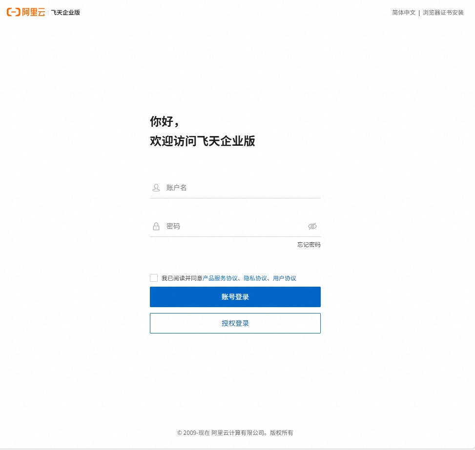
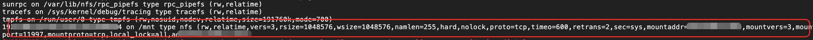
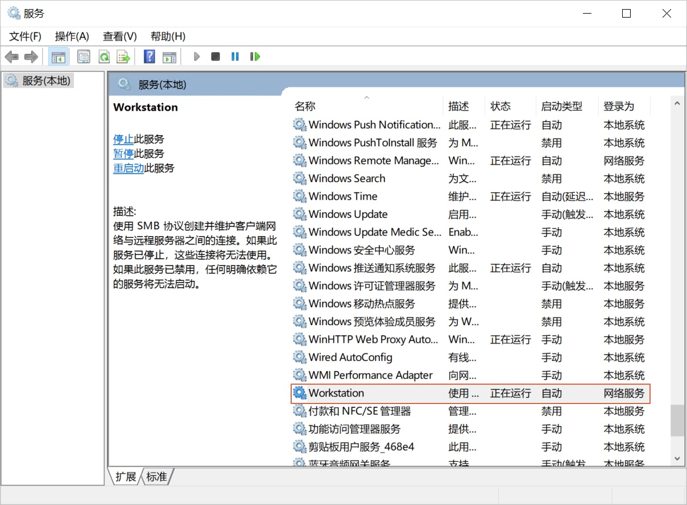
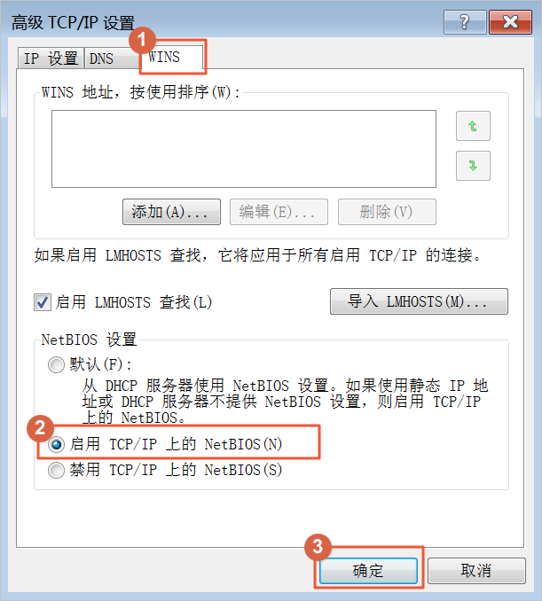
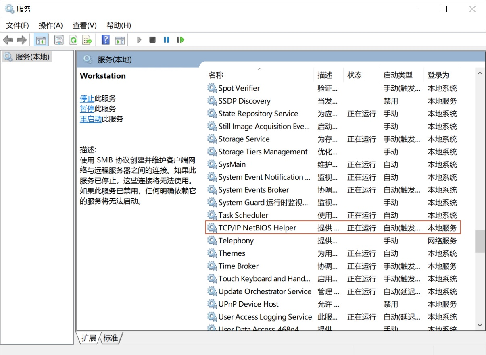

阿里云  
专有云  
阿里云弹性文件存储 EFS-NAS 用  
户指南  
产品版本：V3.18.6  
文档版本：20251205

**目录**

- [1.什么是EFS-NAS文件存储](#section-1)
- [2.使用须知](#section-2)
- [3.快速入门](#section-3)
    - [3.1. 登录EFS-NAS控制台](#section-3-1)
    - [3.2. 创建文件系统](#section-3-2)
    - [3.3. 创建用户](#section-3-3)
    - [3.4. 创建共享](#section-3-4)
    - [3.5. 挂载NFS文件系统](#section-3-5)
    - [3.6. 挂载SMB文件系统](#section-3-6)
- [4.文件系统管理](#section-4)
    - [4.1. 查看文件系统详情](#section-4-1)
    - [4.2. 修改文件系统容量](#section-4-2)
    - [4.3. 删除文件系统](#section-4-3)
    - [4.4. 共享管理](#section-4-4)
        - [4.4.1. NFS共享](#section-4-4-1)
        - [4.4.2. SMB共享](#section-4-4-2)
- [5.用户及用户组管理](#section-5)
    - [5.1. 用户管理](#section-5-1)
    - [5.2. 用户组管理](#section-5-2)

<a id="section-1"></a>

# 1.什么是EFS-NAS文件存储

**产品概述**

阿里云弹性文件存储 EFS-NAS（File Storage NAS） 是面向阿里云ECS实例、E-HPC、容器服务等计算节点的文件存储服务。它是一种可共享访问、弹性扩展、高可靠以及高性能的分布式文件系统。EFS-NAS文件存储提供标准的文件访问协议，您无需对现有应用做任何修改，即可使用可共享访问、弹性扩展、高可靠以及高性能的分布式文件系统。

**产品类型**

EFS-NAS支持容量型和性能型两种实例类型，以满足不同的业务场景。

- 容量型实例

  - 基于SSD + HDD混合闪存服务器。

  - 提供大容量、成本优化的共享文件存储方案。

  - 适合档案管理、数据归档、视频监控回放等成本敏感场景。

- 性能型实例

  - 基于SSD全闪存服务器。

  - 提供高吞吐、低延迟的文件访问能力。

  - 适合高性能计算、媒体剪辑、数据库文件存储等性能敏感场景。

**核心功能**

- 文件系统挂载：支持多计算节点挂载文件系统。

- 弹性扩容：可对文件系统进行在线扩容，随业务增长动态调整容量。

- 挂载点：支持通过NFS/SMB协议共享生成挂载点。

- 配额管理：支持按照组织设置容量配额，实现资源的合理分配、成本控制和性能优化。

- 单一命名空间容量：最大支持 5 PiB容量，实现海量数据统一管理。

- 单集群最大规模：支持最多 2000 块磁盘，按需横向扩展。

- 3 台起步部署：满足小规模业务起步与平滑扩容的需求。

- 存储池灵活部署：支持文件存储集群底层的资源独占与灵活规划，降低初期设备投入数量。

<a id="section-2"></a>

# 2.使用须知

在使用EFS-NAS文件存储之前，您需要了解以下限制。

**文件系统限制**

- 单个文件系统最大文件数：100 亿。

- 单个文件的最大大小：512 TiB，推荐不超过 4 TiB。

- 最大目录深度：无限制，推荐不超过 20 级。

- 最大目录宽度：10 万。

- 单个文件系统容量范围：1 GiB～5 PiB。

- 单个文件系统最多能够被 2000 个计算节点同时挂载访问。

**其他限制**

- 删除文件系统时，您需要先卸载计算节点（ECS实例）中通过挂载点挂载的文件系统，再删除共享，最后删除创建的文件系统。

- 删除用户组时，需要先将用户组从SMB共享中移除；删除用户时，需要先将用户从用户组和SMB共享中移除。

<a id="section-3"></a>

# 3.快速入门

<a id="section-3-1"></a>

## 3.1. 登录EFS-NAS控制台

本文介绍如何登录EFS-NAS文件存储控制台。

**前提条件**

- 登录Apsara Uni-manager运营控制台前，确认您已从部署人员处获取Apsara Uni-manager运营控制台的服务域名地址。

- 推荐使用Chrome浏览器。

**操作步骤**

1. 在浏览器地址栏中，输入Apsara Uni-manager运营控制台的服务域名地址，按回车键。

   

   > **说明**
   >
   > - 单击页面右上角的当前语言可以切换其它语言。

2. 输入正确的用户名及密码。

   > **说明**
   >
   > - 请向运营管理员获取登录控制台的用户名和密码。
   >
   > - 首次登录Apsara Uni-manager运营控制台时，需要修改登录用户名的密码，请按照提示完成密码修改。为提高安全性，密码长度必须为10~32位，且包含英文字母大小写、阿拉伯数字和特殊符号（感叹号（!）、at（@）、井号（#）、美元符号（$）、百分号（%）等）。

3. 勾选**我已阅读并同意产品服务协议、隐私协议、用户协议**。

   > **说明**
   >
   > - 登录页展示的链接文字为文档标题，单击链接文字，可查看协议的详细内容。
   >
   > - **产品服务协议**、**隐私协议**和**用户协议**仅在已发布时才会显示。如果三种类型协议都没有发布，则不需要执行该操作。

4. 单击**账号登录**/**授权登录**。

   > **说明**
   >
   > “授权登录”仅第三方认证的全局IdP设置启用时才会显示，且该显示名称可自定义，默认显示名称为“授权登录”。

5. 如果账号已激活MFA多因素认证，请根据以下两种情况进行操作：

   > **说明**
   >
   > 公网场景下，登录入口默认强制开启多因素认证。

   - **开启MFA后的首次登录**

     <ol type="a">

     <li>

     输入账号密码登录后，展示绑定虚拟MFA设备页面。

     </li>

     <li>

     在绑定虚拟MFA设备页面中，按页面提示步骤绑定虚拟MFA设备。

     </li>

     </ol>

     <ol type="i" start="100">

     <li>

     登录成功，进入控制台。

     </li>

     </ol>

   - **已开启并绑定MFA**

     输入6位MFA码后单击**认证**。

6. 在页面上方的导航栏中，选择**产品**，在**存储**区域，单击**EFS-NAS文件存储**。

<a id="section-3-2"></a>

## 3.2. 创建文件系统

本文介绍如何在文件系统EFS-NAS控制台创建文件系统。

**操作步骤**

1. 登录EFS-NAS控制台。

2. 选择**文件系统管理**，单击**创建文件系统**。

3. 在**创建文件系统**页面，配置文件系统的参数。

   <table>
     <tr>
       <th width="136">参数项</th>
       <th>参数说明</th>
     </tr>
     <tr>
       <td>组织</td>
       <td>选择文件系统所属的组织。</td>
     </tr>
     <tr>
       <td>资源集</td>
       <td>选择文件系统所属的组织。</td>
     </tr>
     <tr>
       <td>地域</td>
       <td>选择文件系统所属的地域。</td>
     </tr>
     <tr>
       <td>可用区</td>
       <td>选择文件系统所属的可用区。</td>
     </tr>
     <tr>
       <td>文件系统名称</td>
       <td>输入文件系统名称。</td>
     </tr>
     <tr>
       <td>NFS版本</td>
       <td>选择NFS协议版本，支持 v3 和 v4 版本协议。</td>
     </tr>
     <tr>
       <td>描述</td>
       <td>输入该文件系统的描述。</td>
     </tr>
     <tr>
       <td>存储类型</td>
       <td>支持<strong>容量型</strong>和<strong>性能型</strong>。<br>• <strong>容量型</strong>：基于SSD + HDD混合闪存服务器。提供大容量、成本优化的共享文件存储方案。适合档案管理、数据归档、视频监控回放等成本敏感场景。<br>• <strong>性能型</strong>：基于SSD全闪存服务器。提供高吞吐、低延迟的文件访问能力。适合高性能计算、媒体剪辑、数据库文件存储等性能敏感场景。</td>
     </tr>
     <tr>
       <td>总容量（GiB）</td>
       <td>输入文件系统的总容量。取值范围为 1～5242880 GiB。</td>
     </tr>
   </table>

4. 单击**提交**完成创建。

<a id="section-3-3"></a>

## 3.3. 创建用户

本文介绍如何创建用户。

**操作步骤**

1. 登录EFS-NAS控制台。

2. 在左侧导航栏单击**用户组**。

3. 在用户界面左上角，单击**创建用户**，配置如下参数。

   <table>
     <tr>
       <th width="89">参数项</th>
       <th>说明</th>
     </tr>
     <tr>
       <td>组织</td>
       <td>选择组织。</td>
     </tr>
     <tr>
       <td>资源集</td>
       <td>选择资源集。</td>
     </tr>
     <tr>
       <td>地域</td>
       <td>选择地域。</td>
     </tr>
     <tr>
       <td>uid</td>
       <td>填写用户uid信息，取值范围：10000～999999999。<br>说明uid值全局唯一，不可重复。</td>
     </tr>
     <tr>
       <td>用户名</td>
       <td>填写用户名。</td>
     </tr>
     <tr>
       <td>密码</td>
       <td>填写用户密码。</td>
     </tr>
     <tr>
       <td>确认密码</td>
       <td>二次确认密码。</td>
     </tr>
   </table>

4. 单击**提交**完成创建。

<a id="section-3-4"></a>

## 3.4. 创建共享

在文件系统EFS-NAS中，需要通过共享将文件系统挂载至计算节点，本文介绍如何创建共享。

**前提条件**

- 已创建文件系统。

- 已创建VPC和VSwitch，具体操作，请参见<strong>《专有网络VPC 用户指南》</strong>的**专有网络**和**交换机**章节。

**创建NFS共享**

1. 登录EFS-NAS控制台。

2. 选择文件系统管理，单击目标文件系统操作列**创建共享**，选择**NFS共享**。

3. 在**创建NFS共享**界面，配置参数。

   <table>
     <tr>
       <th width="99">参数项</th>
       <th>参数说明</th>
     </tr>
     <tr>
       <td>共享名称</td>
       <td>填写共享名称，长度为3～32个字符，支持大小写字母、中文、数字、下划线（_）、短划线（-）、半角句号（.）字符，不能为纯数字，不能以短划线（-）开头。<br>说明NFS共享创建后，名称不可更改，请谨慎操作。</td>
     </tr>
     <tr>
       <td>VPC</td>
       <td>选择授权的VPC。</td>
     </tr>
     <tr>
       <td>VSwitch</td>
       <td>选择授权VPC下的VSwitch，仅该VSwitch内的客户端可通过该共享访问文件系统。</td>
     </tr>
   </table>

4. 单击**提交**。

5. 设置客户端访问权限。

   <ol type="i">

   <li>

   单击文件系统ID/名称或操作列的**详情**进入文件系统详情页。

   </li>

   <li>

   在**NFS共享**页面左上角，单击**客户端ip详情**。

   </li>

   <li>

   在**客户端ip详情**对话框，单击**新增一条**，配置如下参数：

   - **类型**：可选IP/网段或所有。

   - **客户端IP**：当类型为IP/网段时，可配置该参数。填写允许访问的客户端IP或网段地址。

   - **权限**：可选只读或读写。

   - **启用root压缩**：启用后，远程客户端的 root 用户将自动映射为匿名用户，从而禁止其在服务器端的超级用户权限。当客户端以 root 身份写入文件时，服务器上该文件所有者变为 nobody，而非root。

   - **全部压缩**：启用后，所有客户端用户将均映射为匿名用户，所有文件操作都以匿名用户身份执行，无法保留原始用户信息。

   - **操作**：删除该条规则。

   </li>

   <li>

   单击**确定**，保存设置。

   </li>

   </ol>

**SMB共享**

1. 登录EFS-NAS控制台。

2. 选择文件系统管理，单击目标文件系统操作列**创建共享**，选择**SMB共享**。

3. 在**创建SMB共享**界面，配置参数。

   <table>
     <tr>
       <th width="99">参数项</th>
       <th>参数说明</th>
     </tr>
     <tr>
       <td>共享名称</td>
       <td>填写共享名称，长度为3～32个字符，支持大小写字母、中文、数字、下划线（_）、短划线（-）、半角句号（.）字符，不能为纯数字，不能以短划线（-）开头。<br>说明SMB共享创建后，名称不可更改，请谨慎操作。</td>
     </tr>
     <tr>
       <td>VPC</td>
       <td>选择授权的VPC，仅该VPC内的客户端可通过该共享访问文件系统。</td>
     </tr>
     <tr>
       <td>VSwitch</td>
       <td>选择授权的VSswitch，仅该VSswitch内的客户端可通过该共享访问文件系统。</td>
     </tr>
   </table>

   <table>
     <tr>
       <td>用户（组）</td>
       <td>配置通过该共享访问文件系统的授权用户。单击<strong>新增</strong>，配置如下参数：<br>• <strong>用户组</strong>：支持按照用户、用户组或所有用户配置授权。<br>• <strong>用户</strong>：当授权方式为用户时，需配置该选项。单击复选框，下拉选择授权的用户。<br>• <strong>用户组</strong>：当授权方式为用户组时，需配置该选项。单击复选框，下拉选择授权的用户组。<br>• <strong>权限</strong>：<br>• 读写：可以读取和写入对象，包括查看内容、修改数据、更改属性，不包含删除、执行、重命名或权限管理操作。<br>• 只读：可以查看对象内容、读取属性和权限，但不能进行任何修改、写入、删除或执行操作。<br>• 读写（禁止删除）：可以读取和写入对象内容，允许修改文件数据和属性，但无法删除该对象，也不能更改其权限或所有权。<br>• 完全控制：可对对象进行任何操作，包括读、写、执行、删除、重命名、移动，还能修改权限（ACL）和获得所有权。<br>• 禁止：禁止任何操作。</td>
     </tr>
     <tr>
       <td>是否区分大小写</td>
       <td>业务系统通常不区分大小写，无需开启。若涉及多操作系统间共享互通，请按需开启，开启后可以提升性能。</td>
     </tr>
     <tr>
       <td>是否启用ABE</td>
       <td>ABE指的是一种基于访问的枚举（Access-Based Enumeration） 技术，启用ABE后，用户在浏览共享文件夹时，仅展示用户有访问权限的共享文件和目录，确保数据访问的安全性。</td>
     </tr>
     <tr>
       <td>是否启用机会锁</td>
       <td>机会锁是一种由服务器授予客户端的临时锁定机制，旨在显著提升文件访问性能，尤其是在网络延迟较高的环境中。启用机会锁后，允许客户端在一段时间内独占性地访问共享文件，以减少对文件服务器的频繁访问和网络传输。但也可能导致某些问题，如文件并发访问冲突等，请谨慎配置和使用。</td>
     </tr>
   </table>

4. 单击**提交**。

<a id="section-3-5"></a>

## 3.5. 挂载NFS文件系统

创建NFS共享后，您可以通过挂载点将文件系统挂载到计算节点。本文介绍如何挂载NFS文件系统。

**前提条件**

- 已创建文件系统。

- 已创建NFS共享。

**操作步骤**

**步骤一：安装NFS客户端**

将NFS文件系统挂载至云服务器ECS（Linux系统），您需要先安装NFS客户端。如果已安装NFS客户端，请跳过此步骤。

1. 登录云服务器（Linux系统）。具体操作，请参见<strong>《ECS用户指南》</strong>中的**快速入门 > 连接实例**章节。

2. 安装NFS客户端。

   - 如果您使用CentOS、Redhat、Aliyun Linux操作系统，请执行以下命令。

     ```bash
     sudo yum install nfs-utils
     ```

   - 如果您使用Ubuntu或Debian操作系统，请执行以下命令。

     ```bash
     sudo apt-get update
     ```

     ```bash
     sudo apt-get install nfs-common
     ```

**步骤二：挂载NFS文件系统**

1. 登录云服务器ECS（Linux系统）。具体操作，请参见<strong>《ECS用户指南》</strong>中的**快速入门 > 连接实例**章节。

2. 挂载NFS文件系统。

   执行以下命令挂载NFS文件系统，其中 `192.0.2.1:/efs-nas-xxxxx /mount_point` 要根据实际情况替换。挂载命令登录EFS-NAS控制台查看，具体步骤，请参照查看NFS共享信息。

   - 使用NFS v4协议挂载文件系统：

     ```bash
     sudo mount -t nfs -o 
     vers=4.0,minorversion=0,rsize=1048576,wsize=1048576,hard,timeo=600,retrans=2,noresvpo
     192.0.2.1:/efs-nas-xxxxx /mount_point                             
     ```

   - 使用NFS v3协议挂载文件系统：

     ```text
     mount -t nfs -o vers=3,tcp,nolock,async,mountproto=tcp,rsize=1048576,wsize=1048576 
     192.0.2.1:/efs-nas-xxxxx /mount_point
     ```

     表 1. 挂载命令说明表

     | 参数 | 说明 |
     | --- | --- |
     | vers | 文件系统版本，目前只支持NFS v3和NFS v4。<br>• <strong>vers=3</strong>：使用NFS v3协议挂载文件系统。<br>• <strong>vers=4.0</strong>：使用NFS v4协议挂载文件系统。 |

     <table>
       <tr>
         <td>挂载选项</td>
         <td>挂载文件系统时，可选择多种挂载选项，挂载选项使用半角逗号（,）分隔，说明如下：<br>• <em>rsize</em>：定义数据块的大小，单位为字节。用于客户端与文件系统之间读取数据。建议值为1048576。<br>• <em>wsize</em>：定义数据块的大小，单位为字节。用于客户端与文件系统之间写入数据。建议值为1048576。<br>说明如果您需要更改IO大小参数（rsize和wsize），建议您尽可能使用最大值<br>（1048576），以避免性能下降。<br>• <em>hard</em>：在文件存储NAS暂时不可用的情况下，使用文件系统上某个文件的本地应用程序时会停止并等待至该文件系统恢复在线状态。建议启用该参数。<br>• <em>timeo</em>：指定时长，单位为0.1秒，即NFS客户端在重试向文件系统发送请求之前等待响应的时间。建议值为600（60秒）。<br>说明如果您必须更改超时参数（timeo），建议您使用150或更大的值。该timeo参数的单位为0.1秒，因此150表示的时间为15秒。<br>• <em>retrans</em>：NFS客户端重试请求的次数。建议值为2。<br>• <em>noresvport</em>：在网络重连时使用新的TCP端口，保障在网络发生故障恢复时不会中断连接。建议启用该参数。<br>说明配置参数时，应注意以下内容：<br>• 不建议使用<em>soft</em>选项，有数据一致性风险。如果您要使用soft选项，相关风险需由您自行承担。<br>• 避免设置不同于默认值的任何其他挂载选项。如果更改读或写缓冲区大小或禁用属性缓存，会导致性能下降。</td>
       </tr>
     </table>

3. 执行 `mount -l` 命令，查看挂载结果。

   如果回显包含如下类似信息，说明挂载成功。

   

   挂载成功后，您还可以通过 `df -h` 命令，查看文件系统的当前容量信息。

4. 挂载成功后，您可以在ECS上访问NAS文件系统，执行读取或写入操作。

<a id="section-3-6"></a>

## 3.6. 挂载SMB文件系统

创建共享后，您可以通过挂载点将文件系统挂载到计算节点。本文介绍如何挂载SMB文件系统。

**前提条件**

- 已创建文件系统。

- 已SMB共享。

**操作步骤**

1. 登录云服务器ECS（Windows系统）。具体操作，请参见<strong>《ECS用户指南》</strong>中的**快速入门 > 连接实例**章节。

2. 确保Windows系统服务中的以下两项服务均已启动。

   - Workstation

     <ol type="a">

     <li>

     选择**所有程序 > 附件 > 运行**或使用快捷键 `Win+R` ，输入 `services.msc` ，按回车键，进入本地服务。

     </li>

     <li>

     在服务中找到Workstation，确认运行状态为**已启动**，启动类型为**自动**。

     正常情况下，Workstation服务默认为启动状态。

     

     </li>

     </ol>

   - TCP/IP NetBIOS Helper

     开启TCP/IP NetBIOS Helper服务步骤如下所示：

     <ol type="a">

     <li>

     打开**网络与共享中心**，单击主机所连网络。

     </li>

     <li>

     单击**属性**，双击 **Internet 协议版本 4** 进入属性框，单击**高级**。

     </li>

     </ol>

     <ol type="i" start="100">

     <li>

     在**高级TCP/IP设置**对话框中，选择 **WINS > 启用TCP/IP上的NetBIOS**。

     

     </li>

     <li value="500">

     选择**所有程序 > 附件 > 运行**或使用快捷键 `Win+R` ，输入 `services.msc` ，按回车键，进入本地服务。

     </li>

     </ol>

     <ol type="a" start="5">

     <li>

     在服务中找到TCP/IP NetBIOS Helper，确认运行状态为**已启动**，启动类型为**自动**。

     正常情况下，TCP/IP NetBIOS Helper服务默认为启动状态。

     

     </li>

     </ol>

3. 打开命令行窗口，执行以下命令挂载文件系统。

   挂载命令格式： `net use <`挂载目标盘符`> <`挂载命令`> /user:[`用户名`]` ，挂载命令示例：

   ```text
   net use D: \\192.0.2.1\smb-share /user:test-user
   ```

   - 挂载目标盘符：指当前Windows系统上要挂载的目标盘符，请根据实际值替换。

     > **说明**
     >
     > 目标盘符需配置为当前不存在的盘符。

   - 挂载命令：指在创建文件系统挂载点时，自动生成的挂载点地址，请根据实际情况替换。您可以在EFS-NAS控制台，找到目标文件系统，单击**详情**，进入文件系统详情页，单击**SMB**共享，查看目标共享的**挂载命令**。

   - 用户名：指在创建SMB共享时，授权可访问文件系统的用户。您可以在EFS-NAS控制台，找到目标文件系统，单击**详情**，进入文件系统详情页，单击**SMB**共享，找到目标共享，单击操作列的**编辑 > 添加用户（组）**，查看或编辑授权的用户或用户组。

4. 执行 `net use` 命令，检查挂载结果。

5. 挂载成功后，您可以在ECS上访问EFS-NAS文件系统，执行读取或写入操作。

<a id="section-4"></a>

# 4.文件系统管理

<a id="section-4-1"></a>

## 4.1. 查看文件系统详情

本文介绍如何查看文件系统详细信息。

**操作步骤**

1. 登录EFS-NAS控制台。

2. 在文件系统列表中，可查看文件系统的状态、使用量/总容量、集群、存储类型、标签、nfs版本、组织/资源集、创建人、创建时间等信息。

3. 单击文件系统的ID或详情，进入文件系统详情页，可查看该文件系统的NFS共享和SMB共享信息，具体信息，可参考共享管理。

<a id="section-4-2"></a>

## 4.2. 修改文件系统容量

本文介绍如何修改文件系统总容量。

**操作步骤**

1. 登录EFS-NAS控制台。

2. 在文件系统列表中，单击目标文件系统操作列的  图标，单击**修改总容量**。

3. 在**修改总容量**页面，可查看当前总容量信息，输入**新的总容量（GiB）**。

   > **说明**
   >
   > 新的总容量应大于当前总容量。

4. 单击**提交**。

<a id="section-4-3"></a>

## 4.3. 删除文件系统

本文介绍如何删除文件系统。

**前提条件**

- 已卸载计算节点（ECS实例）中通过挂载点挂载的文件系统。

- 已删除所有的共享配置。

**操作步骤**

> **警告**
>
> 文件系统删除后不可恢复，请确认已完成数据备份，谨慎操作。

1. 登录EFS-NAS控制台。

2. 在文件系统列表中，单击目标文件系统操作列的  图标，单击**删除**。

3. 单击**确定**。

<a id="section-4-4"></a>

## 4.4. 共享管理

EFS-NAS文件存储提供标准的NFS、SMB文件访问协议，您无需对现有应用做任何修改，即可通过共享使用可共享访问、弹性扩展、高可靠以及高性能的分布式文件系统。

<a id="section-4-4-1"></a>

### 4.4.1. NFS共享

本文介绍NFS共享相关的操作。

**创建NFS共享**

1. 登录EFS-NAS控制台。

2. 选择文件系统管理，单击目标文件系统操作列**创建共享**，选择**NFS共享**。

3. 在**创建NFS共享**界面，配置参数。

   <table>
     <tr>
       <th width="99">参数项</th>
       <th>参数说明</th>
     </tr>
     <tr>
       <td>共享名称</td>
       <td>填写共享名称，长度为3～32个字符，支持大小写字母、中文、数字、下划线（_）、短划线（-）、半角句号（.）字符，不能为纯数字，不能以短划线（-）开头。<br>说明NFS共享创建后，名称不可更改，请谨慎操作。</td>
     </tr>
     <tr>
       <td>VPC</td>
       <td>选择授权的VPC。</td>
     </tr>
     <tr>
       <td>VSwitch</td>
       <td>选择授权VPC下的VSwitch，仅该VSwitch内的客户端可通过该共享访问文件系统。</td>
     </tr>
   </table>

4. 单击**提交**。

5. 设置客户端访问权限。

   <ol type="i">

   <li>

   单击文件系统ID/名称或操作列的**详情**进入文件系统详情页。

   </li>

   <li>

   在**NFS共享**页面左上角，单击**客户端ip详情**。

   </li>

   <li>

   在**客户端ip详情**对话框，单击**新增一条**，配置如下参数：

   - **类型**：可选IP/网段或所有。

   - **客户端IP**：当类型为IP/网段时，可配置该参数。填写允许访问的客户端IP或网段地址。

   - **权限**：可选只读或读写。

   - **启用root压缩**：启用后，远程客户端的 root 用户将自动映射为匿名用户，从而禁止其在服务器端的超级用户权限。当客户端以 root 身份写入文件时，服务器上该文件所有者变为 nobody，而非root。

   - **全部压缩**：启用后，所有客户端用户将均映射为匿名用户，所有文件操作都以匿名用户身份执行，无法保留原始用户信息。

   - **操作**：删除该条规则。

   </li>

   <li>

   单击**确定**，保存设置。

   </li>

   </ol>

**查看NFS共享信息**

1. 登录EFS-NAS控制台。

2. 单击文件系统ID或操作列的**详情**，进入文件系统详情页。

3. 在**NFS共享**页面，可查看NFS共享的名称、状态、网络、挂载点信息、挂载命令等信息。

4. 单击页面左上方的**客户端ip详情**，可查看或修改授权访问文件系统的客户端IP信息。

5. 单击页面左上方的**链接数详情**，可查看当前连接到文件系统的客户端IP信息及NFS协议版本信息。

**删除NFS共享**

> **重要**
>
> 删除共享前，请确保无客户端通过该共享访问文件系统。

1. 登录EFS-NAS控制台。

2. 单击文件系统ID或操作列的**详情**，进入文件系统详情页。

3. 在**NFS共享**页面，找到目标共享配置，单击操作列的**删除**。

4. 单击**确定**。

<a id="section-4-4-2"></a>

### 4.4.2. SMB共享

本文介绍SMB共享相关的操作。

**SMB共享**

1. 登录EFS-NAS控制台。

2. 选择文件系统管理，单击目标文件系统操作列**创建共享**，选择**SMB共享**。

3. 在**创建SMB共享**界面，配置参数。

   <table>
     <tr>
       <th width="137">参数项</th>
       <th>参数说明</th>
     </tr>
     <tr>
       <td>共享名称</td>
       <td>填写共享名称，长度为3～32个字符，支持大小写字母、中文、数字、下划线（_）、短划线（-）、半角句号（.）字符，不能为纯数字，不能以短划线（-）开头。<br>说明SMB共享创建后，名称不可更改，请谨慎操作。</td>
     </tr>
     <tr>
       <td>VPC</td>
       <td>选择授权的VPC，仅该VPC内的客户端可通过该共享访问文件系统。</td>
     </tr>
     <tr>
       <td>VSwitch</td>
       <td>选择授权的VSswitch，仅该VSswitch内的客户端可通过该共享访问文件系统。</td>
     </tr>
     <tr>
       <td>用户（组）</td>
       <td>配置通过该共享访问文件系统的授权用户。单击<strong>新增</strong>，配置如下参数：<br>• <strong>用户组</strong>：支持按照用户、用户组或所有用户配置授权。<br>• <strong>用户</strong>：当授权方式为用户时，需配置该选项。单击复选框，下拉选择授权的用户。<br>• <strong>用户组</strong>：当授权方式为用户组时，需配置该选项。单击复选框，下拉选择授权的用户组。<br>• <strong>权限</strong>：<br>• 读写：可以读取和写入对象，包括查看内容、修改数据、更改属性，不包含删除、执行、重命名或权限管理操作。<br>• 只读：可以查看对象内容、读取属性和权限，但不能进行任何修改、写入、删除或执行操作。<br>• 读写（禁止删除）：可以读取和写入对象内容，允许修改文件数据和属性，但无法删除该对象，也不能更改其权限或所有权。<br>• 完全控制：可对对象进行任何操作，包括读、写、执行、删除、重命名、移动，还能修改权限（ACL）和获得所有权。<br>• 禁止：禁止任何操作。</td>
     </tr>
     <tr>
       <td>是否区分大小写</td>
       <td>业务系统通常不区分大小写，无需开启。若涉及多操作系统间共享互通，请按需开启，开启后可以提升性能。</td>
     </tr>
     <tr>
       <td>是否启用ABE</td>
       <td>ABE指的是一种基于访问的枚举（Access-Based Enumeration） 技术，启用ABE后，用户在浏览共享文件夹时，仅展示用户有访问权限的共享文件和目录，确保数据访问的安全性。</td>
     </tr>
     <tr>
       <td>是否启用机会锁</td>
       <td>机会锁是一种由服务器授予客户端的临时锁定机制，旨在显著提升文件访问性能，尤其是在网络延迟较高的环境中。启用机会锁后，允许客户端在一段时间内独占性地访问共享文件，以减少对文件服务器的频繁访问和网络传输。但也可能导致某些问题，如文件并发访问冲突等，请谨慎配置和使用。</td>
     </tr>
   </table>

4. 单击**提交**。

**查看SMB共享信息**

1. 登录EFS-NAS控制台。

2. 单击文件系统ID或操作列的**详情**，进入文件系统详情页。

3. 单击**SMB共享**，可查看SMB共享的名称、状态、可用区、网络、挂载点信息、挂载命令、创建时间等信息。

**编辑SMB共享信息**

1. 登录EFS-NAS控制台。

2. 单击文件系统ID或操作列的**详情**，进入文件系统详情页。

3. 单击**SMB共享**，进入SMB共享详情页。

4. 找到目标SMB共享配置，单击操作列的**编辑 > 添加用户（组）**，可新增、编辑或删除用户访问权限。

5. 单击操作列的**编辑 > 设置高级选项**，可开启或关闭**大小写敏感**、**ABE**、**机会锁**配置项。

**删除SMB共享**

> **重要**
>
> 删除共享前，请确保无客户端通过该共享访问文件系统。

1. 登录EFS-NAS控制台。

2. 单击文件系统ID或操作列的**详情**，进入文件系统详情页。

3. 在**SMB共享**页面，找到目标共享配置，单击操作列的**删除**。

4. 单击**确定**。

<a id="section-5"></a>

# 5.用户及用户组管理

<a id="section-5-1"></a>

## 5.1. 用户管理

本文介绍EFS-NAS文件系统的用户管理及相关操作。

**背景信息**

EFS-NAS文件存储的SMB协议共享，支持按照用户进行权限管理，可以为不同用户分配不同的权限级别（如“读写”、“只读”、“完全控制”等），保障数据的访问安全。

**创建用户**

1. 登录EFS-NAS控制台。

2. 在左侧导航栏单击**用户组**。

3. 在**用户**界面左上角，单击**创建用户**，配置如下参数。

   <table>
     <tr>
       <th width="89">参数项</th>
       <th>说明</th>
     </tr>
     <tr>
       <td>组织</td>
       <td>选择组织。</td>
     </tr>
     <tr>
       <td>资源集</td>
       <td>选择资源集。</td>
     </tr>
     <tr>
       <td>地域</td>
       <td>选择地域。</td>
     </tr>
     <tr>
       <td>uid</td>
       <td>填写用户uid信息，取值范围：10000～999999999。<br>说明uid值全局唯一，不可重复。</td>
     </tr>
     <tr>
       <td>用户名</td>
       <td>填写用户名。</td>
     </tr>
     <tr>
       <td>密码</td>
       <td>填写用户密码。</td>
     </tr>
     <tr>
       <td>确认密码</td>
       <td>二次确认密码。</td>
     </tr>
   </table>

4. 单击**提交**完成创建。

**更新密码**

1. 登录EFS-NAS控制台。

2. 在左侧导航栏单击**用户组**。

3. 在**用户**页面，找到目标用户，单击操作列的**更新密码**。

4. 输入新密码及二次确认密码，单击**确定**。

**删除用户**

> **重要**
>
> 删除用户前，需要先将用户从SMB共享和用户组中移除。

1. 登录EFS-NAS控制台。

2. 在左侧导航栏单击**用户组**。

3. 在**用户**页面，找到目标用户，单击操作列的**删除**。

4. 单击**确定**。

<a id="section-5-2"></a>

## 5.2. 用户组管理

本文介绍EFS-NAS文件系统的用户组管理及相关操作。

**背景信息**

EFS-NAS文件存储的SMB协议共享，支持对用户进行分组管理，在授权管理中通过对用户组授权，简化用户权限管理。

**创建用户组**

1. 登录EFS-NAS控制台。

2. 在左侧导航栏单击**用户组**，进入用户管理页面。

3. 在**用户组**页签，单击页面左上方**创建用户组**。

4. 配置如下参数。

   <table>
     <tr>
       <th width="105">参数项</th>
       <th>说明</th>
     </tr>
     <tr>
       <td>组织</td>
       <td>选择组织。</td>
     </tr>
     <tr>
       <td>资源集</td>
       <td>选择资源集。</td>
     </tr>
     <tr>
       <td>地域</td>
       <td>选择地域。</td>
     </tr>
     <tr>
       <td>用户组id</td>
       <td>填写用户组ID信息，取值范围：10000～999999999。<br>说明用户组id值全局唯一，不可重复。</td>
     </tr>
     <tr>
       <td>用户组名称</td>
       <td>填写用户组名称，不能以数字开头。</td>
     </tr>
     <tr>
       <td>用户组成员</td>
       <td>选择用户组的成员。<br>说明用户组的成员建议不超过4096个。</td>
     </tr>
   </table>

5. 单击**提交**完成创建。

**查看用户组详情**

1. 登录EFS-NAS控制台。

2. 在左侧导航栏单击**用户组**，进入用户管理页面。

3. 单击**用户组**页签，在用户组列表单击用户组名称或操作列的**详情**，可查看该用户组的成员名称、所属地域信息。

**更新成员**

1. 登录EFS-NAS控制台。

2. 在左侧导航栏单击**用户组**，进入用户管理页面。

3. 单击**用户组**tab页，找到目标用户组，单击操作列的**更新成员**。

4. 选择或删除成员，单击**确定**。

**删除用户组**

> **重要**
>
> 删除用户组前，需要先将用户组从SMB共享中移除。

1. 登录EFS-NAS控制台。

2. 在左侧导航栏单击**用户组**，进入用户管理页面。

3. 单击**用户组**tab页，找到目标用户组，单击操作列的**删除**。

4. 单击**确定**。
