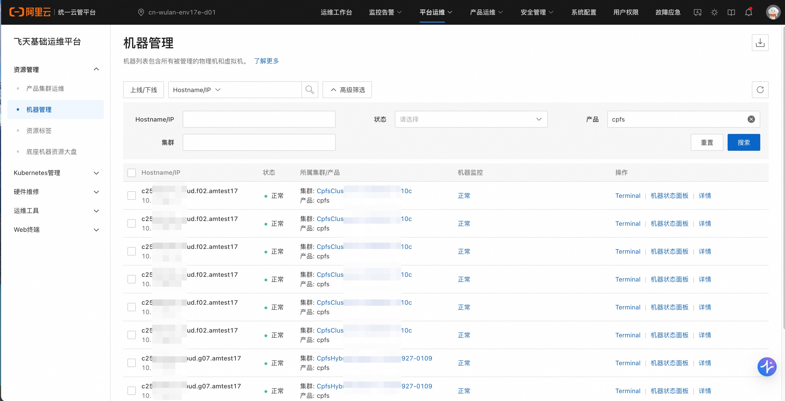
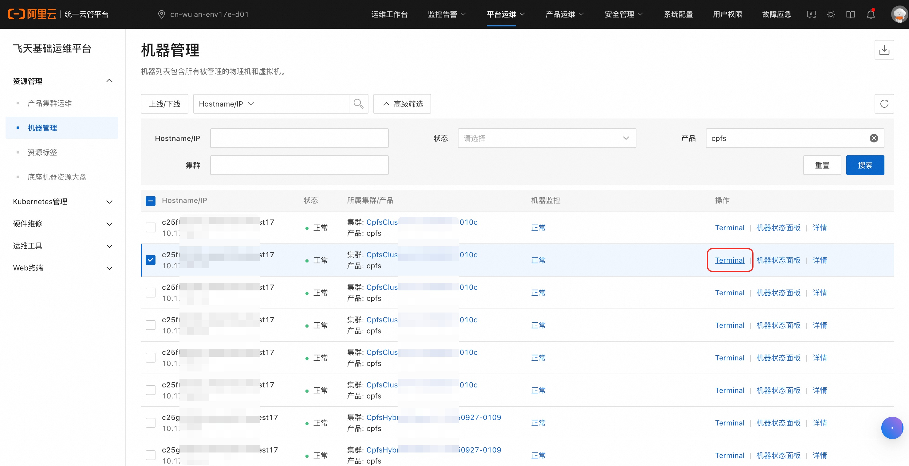
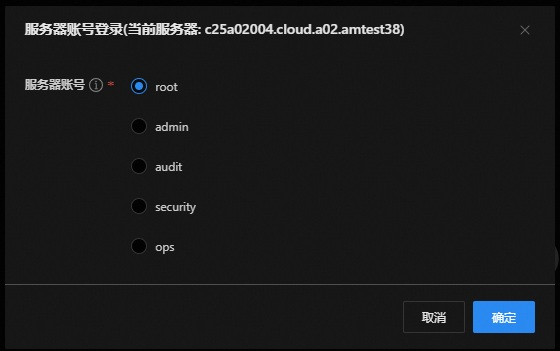
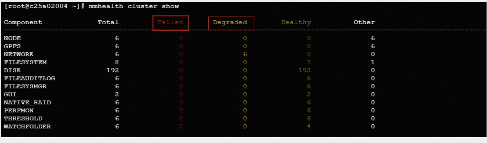
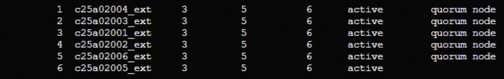
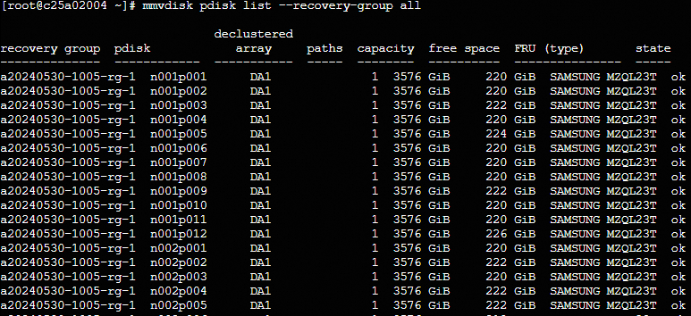

阿里云  
专有云  
文件存储CPFS 运维指南  
产品版本：V3.18.6  
文档版本：20251205

**目录**

- [1.概述](#section-1)
- [2.登录Apsara Uni-manager运维控制台](#section-2)
- [3.CPFS运维指标查询](#section-3)
    - [3.1. CPFS整体状态监控指标查询](#section-3-1)
    - [3.2. CPFS整体性能指标](#section-3-2)
    - [3.3. CPFS pdisk 指标](#section-3-3)
- [4.CPFS常见问题处理](#section-4)
    - [4.1. 停机维护流程](#section-4-1)

# 1.概述

本文介绍文件存储CPFS运维的目的、要求、注意事项、以及寻求帮助的方式。

**目的**

本手册指导维护人员对CPFS进行预防性地维护，确保系统长期稳定运行。维护人员可以根据本手册的指导，处理维护过程中发现的系统问题。如果根据本手册无法解决系统问题，请寻求阿里云CPFS工程师的技术支持。

**要求**

- 维护人员必须拥有IT行业技能，包括计算机网络知识、分布式存储操作知识、问题分析排查能力。

- 维护人员必须经过阿里云系统岗前培训，学习必要的阿里云CPFS知识，包括但不限于系统原理、组网、特性使用和维护工具的使用。

> **重要**
>
> 在维护操作过程中，维护人员务必遵守操作规章，确保人身安全和系统安全。对用户数据严格保密，未经用户书面许可，禁止复制、传播用户数据。

**注意事项**

为了系统的稳定运行，避免意外事故的发生，维护人员需遵循以下事项：

- 分层分权管理：

  对网络、设备、系统、数据实行分层分权管理，相应业务的维护人员仅拥有完成自身角色任务相对应的权限，防止越权操作而引起系统故障。

- 系统安全：

  - 在对系统进行任何操作前，需清楚地了解操作的结果，避免危险操作影响系统运行。

  - 在操作过程中遇到的问题，需清楚记录以便问题排查和故障处理。

- 人身和数据安全：

  - 操作电气设备时，必须根据设备要求做好安全措施。

  - 需使用安全的设备接入业务网络。

  - 未经授权，严禁对数据进行复制和传播。

**寻求帮助**

维护人员在系统维护过程中，需要相关帮助，可以联系阿里云CPFS技术支持获取帮助。

# 2.登录Apsara Uni-manager运维控制台

本文介绍运维工程师等相关用户如何登录到Apsara Uni-manager运维控制台。

**前提条件**

- 已从部署人员或管理员处获取Apsara Uni-manager运维控制台的访问地址、用户名和密码。

  Apsara Uni-manager运维控制台访问地址格式为*region-id*.ops.console.*intranet-domain-id*。

- 推荐使用Chrome浏览器。

**操作步骤**

1. 打开浏览器。

2. 在地址栏中，输入Apsara Uni-manager运维控制台的访问地址，按回车键。

   

   > **说明**
   >
   > 您可以单击右上角的当前语言切换其它语言。当前支持简体中文、English语言切换。

3. 输入正确的用户名及密码。

   > **说明**
   >
   > - 登录Apsara Uni-manager运维控制台的用户名和密码请从部署人员或管理员处获取。
   >
   > - 若连续输入密码错误三次，系统将启动图片验证码登录功能；若连续输入错误五次，账户将被锁定，请联系管理员进行激活。
   >
   > - 首次登录Apsara Uni-manager运维控制台时，需要修改登录用户名的密码，请按照提示完成密码修改。
   >
   >   为提高安全性，密码必须满足以下要求：
   >
   >   - 必须包含英文大小写字母。
   >
   >   - 必须包含阿拉伯数字（0~9）。
   >
   >   - 必须包含特殊符号，包括感叹号（!）、at（@）、井号（#）、美元符号（$）、百分号（%）等。
   >
   >   - 密码长度为10~20个字符。

4. 单击**同意协议并登录**。

# 3.CPFS运维指标查询

CPFS运维指标详情，监控CPFS 的整体状态，综合性能延迟率，重要的pdisk状态。

## 3.1. CPFS整体状态监控指标查询

本文介绍如何查询CPFS整体状态监控指标。

**操作步骤**

1. 登录Apsara Uni-manager运维控制台。

2. 在顶部菜单栏选择**平台运维 > 飞天基础运维平台 > 资源管理**。

3. 在**飞天基础运维平台**左侧导航栏中，选择**资源管理 > 机器管理**。

   

4. 选中目标的主机，单击右侧操作列的**Terminal** 。

   

5. 选择需要登录用户名，单击**确定**则进入CPFS 存储主机所在的操作系统。

   

6. 在操作系统中通过 `mmhealth cluster show` 命令查看cluster整体状态。

   > **说明**
   >
   > 当Failed列和Degraded列显示为0则为正常状态。

   

7. 通过 `mmgetstate -Lsa` 查看CPFS状态。

   

   > **说明**
   >
   > CPFS Status状态说明：
   >
   > - UNKNOWN：CPFS所在的操作系统重启过程中/操作系统关机/操作系统网络异常。
   >
   > - ACTIVE：CPFS服务正常状态。
   >
   > - ARBITRATING：CPFS启动过程中或者遇到故障诊断中，参考 `tail -f /var/mmfs/gen/mmfslog` 中是否有Error或Warning的相关信息。如果无法解决，请联系阿里云技术支持。
   >
   > - DOWN：CPFS关闭。

## 3.2. CPFS整体性能指标

本文介绍如何查看CPFS的性能状态，是否存在long waiters。

**背景信息**

Waiters是一个分析CPFS整体性能的一个重要指标，由于CPFS依赖RDMA来通讯，则对于整个CPFS ECE的性能异常重要。使用mmdiag --waiters 可以对于当前分区的操作进行性能监控，使用 `mmlsnode -N waiters -L` 可以看到整个cpfs所有节点的性能,都使用sec (秒来计算单位)。

**操作步骤**

1. 登录Apsara Uni-manager运维控制台。

2. 在顶部菜单栏选择**平台运维 > 飞天基础运维平台 > 资源管理**。

3. 在**飞天基础运维平台**左侧导航栏中，选择**资源管理 > 机器管理**。

   

4. 选中主机，单击右侧操作列的**Terminal** 。

   

5. 选择需要登录用户名，单击**确定**则进入CPFS 存储主机所在的操作系统。

   

6. 执行 `mmlsnode -N waiters -L` 命令，查看返回值。

   <ol type="i">

   <li>

   正常返回值：

   c25a02005_ext.cloud.a02.amtest38: Waiting 0.0034 sec since

   2024-06-26_11:43:09, monitored, thread 329701 ReadmitWorkThread: onThCond

   0x7FAD24025A98 (IOBundleNSPDCondvar), reason 'wait for NSPD I/O'

   c25a02005_ext.cloud.a02.amtest38: Waiting 0.0021 sec since

   2024-06-26_11:43:09, monitored, thread 276130 ReadmitWorkThread: onThCond

   0x7FAD24027D78 (IOBundleNSPDCondvar), reason 'wait for NSPD I/O'

   c25a02005_ext.cloud.a02.amtest38: Waiting 0.0019 sec since

   2024-06-26_11:43:09, monitored, thread 2275926 ReadmitWorkThread: on ThCond

   0x7FAD24026C50 (IOBundleNSPDCondvar), reason 'wait for NSPD I/O'

   </li>

   <li>

   延迟中级异常返回值：

   Waiting 95.0805 sec since 2024-06-26_11:43:01, monitored,

   thread 3932937 ReadmitWorkThread: on ThCond 0x557F293C9130

   (PdiskAvailabilityCondvar), reason 'Until disk availability stabilizes'

   Waiting

   95.0777 sec since 2024-06-26_11:43:01, monitored, thread 2711607

   ReadmitWorkThread: on ThCond 0x7F24041146A8 (VLogIOCondvar), reason 'wait for

   another thread to do log write'

   Waiting

   95.0777 sec since 2024-06-26_11:43:01, monitored, thread 3782474

   ReadmitWorkThread: on ThCond 0x7F2404114628 (VLogIOCondvar), reason 'wait for

   another thread to do log write'

   > **说明**
   >
   > - 一般在没有业务的情况下，0.00XX sec是正常的返回值。对于不持续的2秒以下的延迟，是初级延迟，会出现不规则的间隔比较大的小于2秒的延迟，对于对IO读写不是太敏感的业务，可以忽略；对于持续的大于2秒小于10秒的waiters 延迟，fs打开会出现缓慢，比如ls文件系统打开缓慢，如果不是长期持续的，整个CPFS 层面还是能够在冗余错误的情况下工作；对于持续的15秒钟以上的大IO延迟，会导致CPFS文件出现系统卡顿, 并持续很久，对于一般业务系统，通过重新启CPFS来解决系统卡顿的问题，对于关键业务节点，特别是CPFS对于损失磁盘和损失节点很重要，一般实时分析dump, 排除问题。有些场景也会导致出现deadlock，CPFS会自动的收集异常时间段dump和trace等。
   >
   > - 对于应急问题，可以通过reboot long waiters所在的节点来解决。

   </li>

   </ol>

## 3.3. CPFS pdisk 指标

硬盘状态监控

**操作步骤**

1. 登录Apsara Uni-manager运维控制台。

2. 在顶部菜单栏选择**平台运维 > 飞天基础运维平台 > 资源管理**。

3. 在**飞天基础运维平台**左侧导航栏中，选择**资源管理 > 机器管理**。

   

4. 选中主机，单击右侧操作列的**Terminal** 。

   

5. 选择需要登录用户名，单击**确定**则进入CPFS 存储主机所在的操作系统。

   

6. 执行 `mmvdisk pdisk list --recovery-group all` 查询CPFS的pdisk指标，返回值（State）正常如下图所示。

   

   | pdisk 状态 | 状态说明 | 处置办法 |
   | --- | --- | --- |
   | OK | pdisk 状态正常 | 无 |
   | Readonly | pdisk 只读模式 | 更换新的pdisk |
   | slow | pdisk 变慢 | pdisk进入亚健康状态，建议更换新的pdisk |
   | Missing | pdisk 丢失 | 更换新的pdisk |
   | PTOW | pdisk IO超时 | 更换新的pdisk |

# 4.CPFS常见问题处理

本文介绍CPFS常见问题之CPFS停机维护处理操作步骤。

## 4.1. 停机维护流程

本文介绍CPFS的停机维护流程。

> **重要**
>
> - 以下步骤是通用步骤，具体以实际场景为准。
>
> - 停机维护前需要停止上层业务，停止对共享文件存储的读写操作。
>
> - 下文中 ${fs_id} 为：前端展示的文件系统ID，去除 bmcpfs 前缀，例如 019bebd3。

**CPFS 集群停机维护步骤**

<table>
  <tr>
    <th>序号</th>
    <th>操作步骤</th>
    <th>操作所在节点</th>
    <th>执行命令</th>
    <th>期望结果</th>
  </tr>
  <tr>
    <td colspan="5">从客户端节点（BMCP 实例）卸载文件系统并停止服务</td>
  </tr>
  <tr>
    <td>1</td>
    <td>计算侧卸载文件系统</td>
    <td>BMCP实例(CPFS客户端)</td>
    <td>在任一BMCP节点执行 <em>mmumount ${fs_id} -a</em></td>
    <td>df-h |grep ${fs_id}</td>
  </tr>
  <tr>
    <td>2</td>
    <td>检查文件系统是否卸载完成</td>
    <td>BMCP实例(CPFS客户端)</td>
    <td>在任一BMCP节点执行 <em>mmlsmount ${fs_id} -L</em></td>
    <td>期望输出结果为 File system ${fs_id} is mounted on 0 nodes</td>
  </tr>
  <tr>
    <td>3</td>
    <td>CPFS停止服务自动启动</td>
    <td>BMCP实例(CPFS客户端)</td>
    <td>在任一客户端节点执行 <em>mmlsconfig | grep autoload</em></td>
    <td>如果不是no则执行 mmchconfig autoload=no</td>
  </tr>
  <tr>
    <td>4</td>
    <td>关闭CPFS客户端服务</td>
    <td>BMCP实例(CPFS客户端)</td>
    <td>在任一客户端节点执行 <em>mmshutdown -a</em></td>
    <td>返回值down则正常</td>
  </tr>
  <tr>
    <td>5</td>
    <td>检查CPFS客户端服务是否关闭</td>
    <td>BMCP实例(CPFS客户端)</td>
    <td>在任一客户端节点执行 <em>mmgetstate -Lsa</em></td>
    <td>CPFS state为down则正常</td>
  </tr>
  <tr>
    <td colspan="5">从 CPFS 存储节点卸载文件系统并停止服务</td>
  </tr>
  <tr>
    <td>1</td>
    <td>存储侧卸载文件系统</td>
    <td>CPFS存储节点</td>
    <td>需要依次登录到每个CPFS存储节点执行 <em>mmumount ${fs_id} -a</em></td>
    <td>df -h |grep ${fs_id}</td>
  </tr>
  <tr>
    <td>2</td>
    <td>检查文件系统是否卸载完成</td>
    <td>CPFS存储节点</td>
    <td>需要依次登录到每个CPFS存储节点执行 <em>mmlsmount ${fs_id} -L</em></td>
    <td>期望输出结果为 File system ${fs_id} is mounted on 0 nodes</td>
  </tr>
  <tr>
    <td>3</td>
    <td>CPFS停止服务自动启动</td>
    <td>CPFS存储节点</td>
    <td>需登录到任一CPFS存储节点执行 <em>mmlsconfig | grep autoload</em></td>
    <td>如果不是no则执行 mmchconfig autoload=no</td>
  </tr>
  <tr>
    <td>4</td>
    <td>关闭CPFS存储服务</td>
    <td>CPFS存储节点</td>
    <td>在任一客户端节点执行 <em>mmshutdown -a</em></td>
    <td>返回值down则正常</td>
  </tr>
  <tr>
    <td>5</td>
    <td>检查CPFS客户端服务是否关闭</td>
    <td>CPFS存储节点</td>
    <td>在任一客户端节点执行 <em>mmgetstate -Lsa</em></td>
    <td>CPFS state为down则正常</td>
  </tr>
  <tr>
    <td colspan="5"></td>
  </tr>
</table>

**集群上线流程**

<table>
  <tr>
    <th>序号</th>
    <th>操作步骤</th>
    <th>操作所在节点</th>
    <th>执行命令</th>
    <th>期望结果</th>
  </tr>
  <tr>
    <td colspan="5">从 CPFS 存储节点启动服务，挂载文件系统</td>
  </tr>
  <tr>
    <td>1</td>
    <td>系统配置打开服务自动启动</td>
    <td>CPFS存储节点</td>
    <td>在任一存储节点执行 <em>mmchconfig</em> <em>autoload=yes</em></td>
    <td>mmchconfig | grep autoload 为 yes</td>
  </tr>
  <tr>
    <td>1</td>
    <td>启动 CPFS 存储服务</td>
    <td>CPFS存储节点</td>
    <td>在任一存储节点执行 <em>mmstartup -a</em></td>
    <td>返回值active则正常</td>
  </tr>
  <tr>
    <td>2</td>
    <td>检查文件系统是否挂载</td>
    <td>CPFS存储节点</td>
    <td>在任一存储节点执行 <em>mmlsmount ${fs_id} -L</em></td>
    <td>期望输出结果为 File system ${fs_id} is mounted on 6 nodes 说明具体挂载节点数以实际为准。</td>
  </tr>
  <tr>
    <td colspan="5">从客户端节点（BMCP 实例）启动服务，挂载存储节点文件系统</td>
  </tr>
  <tr>
    <td>1</td>
    <td>系统配置打开服务自动启动</td>
    <td>BMCP 实例(CPFS客户端)</td>
    <td>在任一客户端点执行 <em>mmchconfig</em> <em>autoload=yes</em></td>
    <td>mmchconfig | grep autoload 为 yes</td>
  </tr>
  <tr>
    <td>1</td>
    <td>启动CPFS客户节点存储服务</td>
    <td>BMCP 实例(CPFS客户端)</td>
    <td>在任一客户端节点执行 <em>mmstartup -a</em></td>
    <td>返回值active则正常</td>
  </tr>
  <tr>
    <td>2</td>
    <td>挂载文件系统</td>
    <td>BMCP 实例(CPFS客户端)</td>
    <td>在任一BMCP实例执行 <em>mmmount ${fs_id} -a</em> 需要依次登录到每个BMCP实例执行 <em>mount --bind</em><em>/cpfs/${fs_id}/${cluster_i</em> <em>d}/${src_dir} /${tgt_dir}</em> 说明该命令仅供参考，具体请以实际为准。</td>
    <td>挂载成功</td>
  </tr>
  <tr>
    <td>3</td>
    <td>检查文件系统是否挂载</td>
    <td>BMCP 实例(CPFS客户端)</td>
    <td>需要依次登录到每个(CPFS客户端)点执行 <em>mmlsmount ${fs_id} -L</em></td>
    <td>期望输出结果为 File system ${fs_id} is mounted on 9 nodes 说明具体挂载节点数以实际为准。</td>
  </tr>
  <tr>
    <td colspan="5"></td>
  </tr>
</table>

**集群状态检查（可选）**

<table>
  <tr>
    <th>序号</th>
    <th>操作步骤</th>
    <th>操作所在节点</th>
    <th>执行命令</th>
    <th>期望结果</th>
  </tr>
  <tr>
    <td colspan="5">从 CPFS 存储节点启动服务，挂载文件系统</td>
  </tr>
  <tr>
    <td>3</td>
    <td>检查网络连接</td>
    <td>CPFS 存储节点</td>
    <td>需要依次登录到每个 CPFS 存储节点执行 <em>sudo mmnetverify all</em></td>
    <td>返回值为Success 则正常</td>
  </tr>
  <tr>
    <td>4</td>
    <td>检查磁盘状态</td>
    <td>CPFS 存储节点</td>
    <td>需要依次登录到每个 CPFS 存储节点执行 <em>mmvdisk pdisk list --rg all</em> <em>--not-ok</em></td>
    <td>返回值为All pdisks are ok 则正常</td>
  </tr>
  <tr>
    <td>5</td>
    <td>延迟检查</td>
    <td>CPFS 存储节点</td>
    <td>在任一存储节点执行 <em>mmlsnode -N waiters -L</em></td>
    <td>返回值无持续10s以上的延迟则正常。 说明该数据仅供参考，具体请以实际为准。</td>
  </tr>
  <tr>
    <td>6</td>
    <td>基本日志检查</td>
    <td>CPFS 存储节点</td>
    <td>在任一存储节点执行 <em>tail -f</em><em>/var/mmfs/gen/mmfslog</em></td>
    <td>返回值无error则正常。</td>
  </tr>
  <tr>
    <td>7</td>
    <td>节点状态检查</td>
    <td>CPFS 存储节点</td>
    <td>在任一存储节点执行 <em>mmhealth cluster show</em></td>
    <td>返回值 Failed和Degraded 为0 则正常</td>
  </tr>
  <tr>
    <td colspan="5">从客户端节点（BMCP 实例）启动服务，挂载存储节点文件系统</td>
  </tr>
  <tr>
    <td>1</td>
    <td>检查网络连接</td>
    <td>BMCP 实例(CPFS客户端)</td>
    <td>需要依次登录到每个(CPFS客户端)点执行 <em>mmnetverify all</em></td>
    <td>返回值为Success则正常</td>
  </tr>
  <tr>
    <td>2</td>
    <td>检查 FS 磁盘状态</td>
    <td>BMCP 实例(CPFS客户端)</td>
    <td>在任一客户端节点执行 <em>mmlsdisk /dev/fsname -m</em></td>
    <td>返回值为Availability状态为up则正常</td>
  </tr>
  <tr>
    <td>3</td>
    <td>延迟检查</td>
    <td>BMCP 实例(CPFS客户端)</td>
    <td>在任一客户端节点执行 <em>mmlsnode -N waiters -L</em></td>
    <td>返回值无持续10s以上的延迟则正常。</td>
  </tr>
  <tr>
    <td>4</td>
    <td>基本日志检查</td>
    <td>BMCP 实例(CPFS客户端)</td>
    <td>在任一客户端节点执行 <em>tail -f</em><em>/var/mmfs/gen/mmfslog</em></td>
    <td>返回值无error 则正常。</td>
  </tr>
  <tr>
    <td>5</td>
    <td>节点状态检查</td>
    <td>BMCP 实例(CPFS客户端)</td>
    <td>在任一客户端节点执行 <em>mmhealth cluster show</em></td>
    <td>返回值 Failed 和Degraded 为0 则正常</td>
  </tr>
  <tr>
    <td colspan="5"></td>
  </tr>
</table>
