阿里云  
专有云  
文件存储NAS  
运维指南  
产品版本：V3.18.6  
文档版本：20250530

**目录**

- [1.产品架构](#section-1)
- [2.Apsara Uni-manager运维系统使用指南](#section-2)
    - [2.1. 登录Apsara Uni-manager运维控制台](#section-2-1)
    - [2.2. 用户数据](#section-2-2)
    - [2.3. 集群管理](#section-2-3)
    - [2.4. 网络管理](#section-2-4)
        - [2.4.1. 挂载点管理](#section-2-4-1)
    - [2.5. 监控中心](#section-2-5)
        - [2.5.1. 巡检配置](#section-2-5-1)
        - [2.5.2. 巡检历史](#section-2-5-2)
    - [2.6. 运维支持](#section-2-6)
        - [2.6.1. 工作流管理](#section-2-6-1)
            - [2.6.1.1. 工作流发布单](#section-2-6-1-1)
                - [2.6.1.1.1. 服务扩容](#section-2-6-1-1-1)
                - [2.6.1.1.2. 服务缩容](#section-2-6-1-1-2)
                - [2.6.1.1.3. 下线机器](#section-2-6-1-1-3)
            - [2.6.1.2. 工作流实例](#section-2-6-1-2)
            - [2.6.1.3. 工作流定义](#section-2-6-1-3)
        - [2.6.2. 白屏命令](#section-2-6-2)
    - [2.7. NAS大盘](#section-2-7)
    - [2.8. 后台审计](#section-2-8)
- [3.例行维护](#section-3)
    - [3.1. 查看KV服务状态](#section-3-1)
    - [3.2. 查看文件系统和用户信息](#section-3-2)
    - [3.3. 查询集群回收任务信息](#section-3-3)
    - [3.4. 查看集群模块服务日志](#section-3-4)
    - [3.5. 停写设置](#section-3-5)

<a id="section-1"></a>

# 1.产品架构

阿里云文件存储（File Storage NAS，简称NAS）是面向阿里云ECS实例、容器服务的文件存储服务，提供标准的文件访问协议。

NAS文件系统后端基于阿里云盘古分布式存储，3个数据副本分布存储于多台盘古节点上。前端访问节点接受NFS客户端的连接请求和提供Cache功能，自身是无状态和分布式部署，保证前端的高可用。单TB数据恢复时间小于30分钟（单集群6节点规模），随着集群规模越大，恢复速度越快。详细信息可参考<strong>《NAS技术白皮书》</strong>。

<a id="section-2"></a>

# 2.Apsara Uni-manager运维系统使用指南

<a id="section-2-1"></a>

## 2.1. 登录Apsara Uni-manager运维控制台

本节主要向您介绍如何登录Apsara Uni-manager运维控制台。

**前提条件**

- 已从部署人员或管理员处获取Apsara Uni-manager运维控制台的访问地址、用户名和密码。

  Apsara Uni-manager运维控制台访问地址格式为*ops*.asconsole.*intranet-domain-id*.com。

- 推荐使用Chrome浏览器。

**操作步骤**

1. 打开浏览器。

2. 在地址栏中，输入Apsara Uni-manager运维控制台的访问地址，按回车键。

   

   > **说明**
   >
   > 您可以单击右上角的当前语言切换其它语言。当前支持简体中文、英文、繁体中文三种语言切换。

3. 输入正确的用户名及密码。

   > **说明**
   >
   > - 登录Apsara Uni-manager运维控制台的用户名和密码请从部署人员或管理员处获取。
   >
   > - 若连续输入密码错误三次，系统将启动图片验证码登录功能；若连续输入错误五次，账户将被锁定，请联系管理员进行激活。

   首次登录Apsara Uni-manager运维控制台时，需要修改登录用户名的密码，请按照提示完成密码修改。

   为提高安全性，密码必须满足以下要求：

   - 必须包含英文大小写字母。

   - 必须包含阿拉伯数字（0~9）。

   - 必须包含特殊符号，包括感叹号（!）、at（@）、井号（#）、美元符号（$）、百分号（%）等。

   - 密码长度为10~20个字符。

4. 单击**账号登录**。

<a id="section-2-2"></a>

## 2.2. 用户数据

在用户数据页面，您可以查看用户数据及文件系统的详细信息。

**基础信息管理**

该功能可以查看用户列表和文件系统列表，操作如下：

- 查看用户列表

  <ol type="i">

  <li>

  登录Apsara Uni-manager运维控制台。

  </li>

  <li>

  在顶部菜单栏，选择**产品运维 > 存储运维 > NAS运维·NAS赤骥**。

  </li>

  <li>

  在数据魔方控制台左侧导航栏，选择**用户数据 > 基础信息管理 > 用户列表**。

  如需查看列表中某一用户的数据，单击该条用户数据右侧的**概览**。

  </li>

  </ol>

- 查看文件系统列表

  <ol type="i">

  <li>

  登录Apsara Uni-manager运维控制台。

  </li>

  <li>

  在顶部菜单栏，选择**产品运维 > 存储运维 > NAS运维·NAS赤骥**。

  </li>

  <li>

  在数据魔方控制台左侧导航栏，选择**用户数据 > 基础信息管理 > 文件系统列表**。

  如需查看列表中某一文件系统的详情，单击该文件系统的文件系统Id。

  </li>

  </ol>

**用户数据概览**

该功能可以按**用户UID**和**日期**查询用户数据，操作步骤如下：

1. 登录Apsara Uni-manager运维控制台。

2. 在顶部菜单栏，选择**产品运维 > 存储运维 > NAS运维·NAS赤骥**。

3. 在数据魔方控制台左侧导航栏，选择**用户数据 > 用户数据概览**，然后输入**用户UID**，选择**日期**，并单击**查看**，即可查看符合条件的用户数据。如下图所示：

   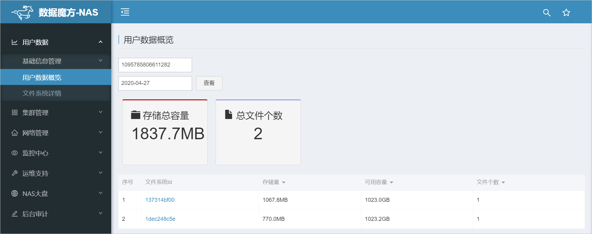

<a id="section-2-3"></a>

## 2.3. 集群管理

在集群管理功能选项中，您可以查看地域信息和集群信息。

**地域信息管理**

您可以查看地域相关信息，操作如下：

1. 登录Apsara Uni-manager运维控制台。

2. 在顶部菜单栏，选择**产品运维 > 存储运维 > NAS运维·NAS赤骥**。

3. 在数据魔方左侧导航栏，选择**集群管理 > 地域信息管理**。

4. 在**地域信息管理**页面，查看地域相关的信息。

   > **说明**
   >
   > 您可以单击右侧的**刷新**按钮刷新地域信息。

**集群信息管理**

您可以查看集群的详细信息，包括地域、集群、集群环境、nuwa地址、AG地址等，操作如下：

1. 登录Apsara Uni-manager运维控制台。

2. 在顶部菜单栏，选择**产品运维 > 存储运维 > NAS运维·NAS赤骥**。

3. 在数据魔方左侧导航栏，选择**集群管理 > 集群信息管理**。

4. 在**集群信息**页面，单击集群名称，在**集群详情**页面中查看集群的详细信息。

   > **说明**
   >
   > 您可以在**集群信息**页面单击右侧的**刷新**按钮刷新集群信息。

<a id="section-2-4"></a>

## 2.4. 网络管理

<a id="section-2-4-1"></a>

### 2.4.1. 挂载点管理

在数据魔方挂载点管理页面，您可以查看挂载点详情并刷新挂载点健康信息。

1. 登录Apsara Uni-manager运维控制台。

2. 在顶部菜单栏，选择**产品运维 > 存储运维 > NAS运维·NAS赤骥**。

3. 在数据魔方左侧导航栏，选择**网络管理 > 挂载点管理**。

4. 在**挂载点管理**页面的**搜索条件**列表，选择**按VIP搜索**，并输入VIP，单击**搜索**。

   - 选择过滤条件，包括**地域**、**网络类型**、**种类**、**网络**和**端口**。

   - 在**端口**列中，单击挂载点，可以查看其具体信息。

   - 单击**刷新健康状态**，可以刷新挂载点的健康状态。

   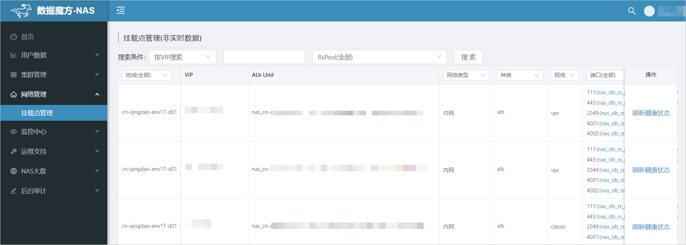

<a id="section-2-5"></a>

## 2.5. 监控中心

> **重要**
>
> 当前版本不支持**报警历史**和**报警配置**功能，仅支持**巡检配置**和**巡检历史**功能。

<a id="section-2-5-1"></a>

### 2.5.1. 巡检配置

系统默认已内置了巡检任务，您可以对已有任务进行切换状态、查询详情、编辑配置、删除以及立即执行等操作，以便您更好地了解巡检情况，保障运行安全。

1. 登录Apsara Uni-manager运维控制台。

2. 在顶部菜单栏，选择**产品运维 > 存储运维 > NAS运维·NAS赤骥**。

3. 在数据魔方左侧导航栏，选择**监控中心 > 巡检配置**。

4. 在**巡检任务列表**页面，选择搜索类型后输入对应内容和任务分类，并选择任务的**类型**和**状态**，然后单击**搜索**。

   配置完成后，您可以根据需求执行以下操作：

   > **说明**
   >
   > 当前版本暂不支持添加监控任务功能。

   - 查询任务巡检历史

     在任务列表中，单击**任务名字**列目标任务的名字，在**巡检结果列表**页面查看其巡检历史。

   - 切换任务状态

     在**任务状态**列，单击目标任务的状态开关，切换巡检任务的状态。

   - 查询任务详情

     在**操作**列，单击**详情**，在**监控任务详情**对话框中查看任务的详细信息。

   - 编辑监控任务

     当任务处于**停用**状态时，在**操作**列单击**编辑**，在**编辑监控任务**对话框中按系统提示配置任务的各项参数，然后单击**确定**。

   - 删除任务

     当任务处于**停用**状态时，在**操作**列单击**删除**，然后在弹出的对话框中单击**Yes**。

   - 立即执行一次任务

     当任务处于**启用**状态时，在**操作**列单击**立即执行一次**，然后在弹出的对话框中单击**Yes**，完成巡检任务的一次执行。巡检任务执行成功后，可在**巡检历史**页查看其详情。

<a id="section-2-5-2"></a>

### 2.5.2. 巡检历史

您可以在数据魔方控制台查询任务的巡检结果，包括巡检任务的类型、开始和结束时间、状态、日志等信息，以便您更好地了解巡检情况，保障业务的正常运行。

1. 登录Apsara Uni-manager运维控制台。

2. 在顶部菜单栏，选择**产品运维 > 存储运维 > NAS运维·NAS赤骥**。

3. 在数据魔方左侧导航栏，选择**监控中心 > 巡检历史**。

4. 在**巡检结果列表**页面，选择任务类型、搜索方式和时间范围，然后单击**搜索**。您还可以关闭**显示全部任务**开关，即打开**显示异常任务**开关，只查看异常任务。

   配置完成后，您可以查看目标巡检任务类型的历史结果，包括任务的名字、类型、开始和结束时间、状态等信息。您还可以根据需求进行以下操作。

   - 查看全部任务结果

     单击目标任务**操作**列的**查看全部**，查看全部任务的结果详情，包括任务结果、告警信息等。

   - 查看异常任务结果

     单击目标异常任务**操作**列的**查看异常**，查看异常任务的结果详情，包括任务结果、告警信息等。

   - 查看任务日志

     单击目标任务**操作**列的**查看全部**或**查看异常**，然后单击目标机器**日志**列的**日志**，查看目标任务的日志信息。

<a id="section-2-6"></a>

## 2.6. 运维支持

<a id="section-2-6-1"></a>

### 2.6.1. 工作流管理

<a id="section-2-6-1-1"></a>

#### 2.6.1.1. 工作流发布单

您可以在数据魔方控制台查询所有工作流的任务详情，包括已发布、未完成、已完成和指定任务的详情，还可以创建新任务，查看任务统计，以便您更好地了解任务流程，优化任务编排。

1. 登录Apsara Uni-manager运维控制台。

2. 在顶部菜单栏，选择**产品运维 > 存储运维 > NAS运维·NAS赤骥**。

3. 在数据魔方左侧导航栏，选择**运维支持 > 工作流管理 > 工作流发布单**。

   **所有工作流**页面有多个页签，您可以根据需求进行操作。

   - 我发布的任务

     单击**我发布的任务**页签，配置查询条件并单击  图标进行筛选。搜索条件配置完成后，您可以查询所

     有已发布任务的完成状态、任务类型等信息，还可以在此页签进行以下操作。

     - 查询指定任务详情

       在**发布单号**列，单击目标任务的发布单号，查询目标任务详情，执行查看工作流、查看参数等操作。

     - 查看任务参数

       在**操作**列，单击目标任务的**查看参数**，在弹出的面板中查看任务的详细参数。

     - 重新发起任务

       对于**任务完成状态**为**失败**的任务，单击**操作**列的**重新发起**，可以重新提交发起任务。

   - 未完成的任务

     单击**未完成的任务**页签，配置查询条件并单击  图标进行筛选。搜索条件配置完成后，您可以查询所

     有未完成任务的完成状态、任务类型等信息，还可以在此页签进行以下操作。

     - 查询指定任务详情

       在**发布单号**列，单击目标任务的发布单号，查询目标任务详情，执行查看工作流、查看参数、强制跳过等操作。

     - 查看任务参数

       在**操作**列，单击目标任务的**查看参数**，在弹出的面板中查看任务的详细参数。

     - 重新发起任务

       对于**任务完成状态**为**失败**的任务，单击**操作**列的**重新发起**，可以重新提交发起任务。

   - 已完成的任务

     单击**已完成的任务**页签，配置查询条件并单击  图标进行筛选。搜索条件配置完成后，您可以查询所

     有已完成任务的完成状态、任务类型等信息，还可以在此页签进行以下操作。

     - 查询指定任务详情

       在**发布单号**列，单击目标任务的发布单号，查询目标任务详情，执行查看工作流、查看参数等操作。

     - 查看任务参数

       在**操作**列，单击目标任务的**查看参数**，在弹出的面板中查看任务的详细参数。

   - 任务详情

     单击**任务详情**页签，选择**发布单号**或**目标对象（IP）**，输入相应内容，然后单击**查询**。

     - 如果选择按**发布单号**查询，您可以查询目标任务的相关信息，包括任务类型、所属集群、相关参数等信息，还可以执行查看参数、更改失败任务的暂停策略等操作。

     - 如果选择按<strong>目标对象（IP）</strong>查询，您可以单击  图标进一步进行筛选，查询该目标对象下所有任务

       的执行状态、任务类型等信息。

   - 创建任务

     单击**创建任务**页签，您可以在**工作流名称**的下拉列表中直接选择工作流类型，也可以单击**查看工作流列表**，在**我发布的任务**页面查看已有任务类型，然后在**工作流名称**的下拉列表中进行选择。

     选择工作流类型后，选择集群、定时执行类型、执行优先级、执行类型并输入备注信息，单击**提交**，然后在弹出的对话框中单击**Yes**，完成任务创建。创建成功后，您可在**我发布的任务**页面查看任务状态和信息。关于创建任务的更多信息，请参见服务扩容、服务缩容和下线机器。

     您也可以单击下方的**生成提交链接**，获取任务链接并粘贴到剪贴板。

   - 任务统计

     单击**任务统计**页签，您可以查看不同任务类型中待执行和执行中的任务个数，以及其成功和失败次数。

     您还可以单击**执行中**列的网格图标，例如  ，查看任务状态、所处步骤名称等信息。单击**数目**列目标

     步骤对应的数字，您可以查看工作流实例详情。关于工作流实例的更多信息，请参见工作流实例。

<a id="section-2-6-1-1-1"></a>

##### 2.6.1.1.1. 服务扩容

本文介绍如何对集群中服务角色里的机器进行扩容管理。

**操作步骤**

1. 登录Apsara Uni-manager运维控制台。

2. 在顶部菜单栏，选择**产品运维 > 存储运维 > NAS运维·NAS赤骥**。

3. 在数据魔方左侧导航栏，选择**运维支持 > 工作流管理 > 工作流发布单**。

4. 在**创建任务**页签，从**工作流名称**列表，选择扩容工作流名称。

   扩容工作流包括：ocm server扩容、kv server扩容、quota master扩容、quota server扩容、tiering master扩容、tiering server扩容。

   

5. 从**集群**列表，选择集群。并保持与**飞天基础运维平台**中的集群统一。

   

6. 在**要添加机器**列表，选择机器名称。

   工作流以kv server扩容为例，其他替换流也是一样的操作方式。要扩容的机器以 `a34a13014.cloud.a13.amtest66(10.66.xx.xx)` 为例。

   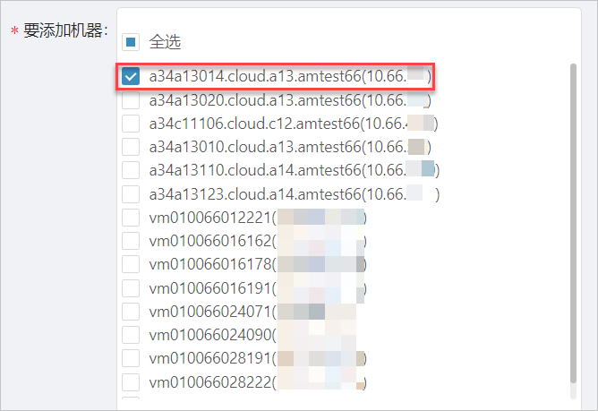

   > **说明**
   >
   > 扩容工作流不需要添加其他机器，只需要对角色本身拥有的机器做操作即可。

   在**飞天基础运维平台**上，可以查找机器名称和机器IP。

   登录飞天基础运维平台的方式如下所示：

   <ol type="i">

   <li>

   登录Apsara Uni-manager运维控制台。

   </li>

   <li>

   在顶部菜单栏，选择**平台运维 > 飞天基础运维平台 > 资源管理**。

   </li>

   <li>

   在左侧导航栏，选择**机器管理**。

   </li>

   <li>

   在**Hostname/IP**下拉列表中选择**Hostname/IP**、**状态**、**产品**或**集群**，在文本框中输入机器对应的信息，或者通过高级筛选快速过滤出所需的机器。

   </li>

   </ol>

7. 配置其他参数。

   - 定时执行：在列表中，选择定时执行工作流的方式。

   - 执行优先级：设置任务执行的优先级。

   - 执行类型：在列表中，选择执行工作流的类型。

   - 备注：添加任务说明。

8. 单击**提交**，创建新的工作流。

9. 在**我发布的任务**页签中，查看所有发布的工作流。

   在**任务完成状态**一列，会出现三种任务状态：**执行中**、 **失败**、**成功**。

   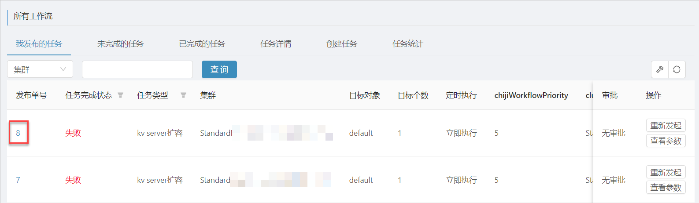

0. <strong>可选：</strong>查看失败任务的原因。

   单击失败任务对应的发布单号，进入**任务详情**页签。

   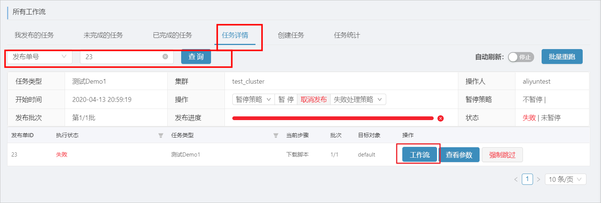

   单击**工作流**，查看详细信息。

   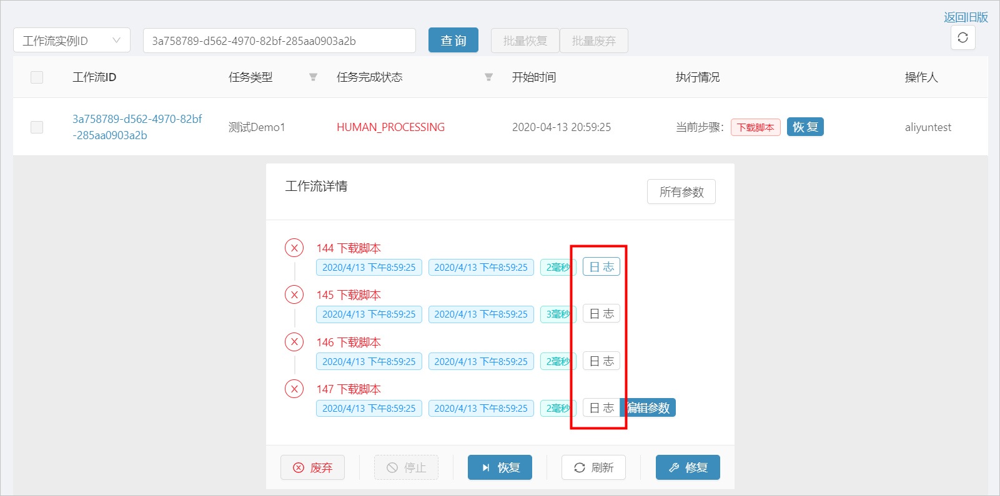

   单击**日志**，查看工作流运行日志。

   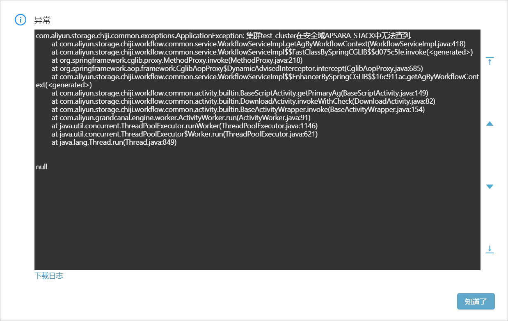

> **说明**
>
> - 其他替换流验证步骤与kv server一致。
>
> - 在飞天基础运维平台nfs服务中可以对照查看全量机器IP。

**预期结果**

扩容工作流验证成功。

<a id="section-2-6-1-1-2"></a>

##### 2.6.1.1.2. 服务缩容

本文介绍如何对集群中服务角色里的机器进行缩容管理。

**操作步骤**

1. 登录Apsara Uni-manager运维控制台。

2. 在顶部菜单栏，选择**产品运维 > 存储运维 > NAS运维·NAS赤骥**。

3. 在数据魔方左侧导航栏，选择**运维支持 > 工作流管理 > 工作流发布单**。

4. 在**创建任务**页签，从**工作流名称**列表，选择缩容工作流名称。

   缩容工作流包括：nfs server缩容、smb server缩容、kv server缩容、ocm server缩容、quota master缩容、quota server缩容、tiering master缩容、tiering server缩容。

   > **重要**
   >
   > 缩容过程中，可能会影响到业务访问，出现时延。建议您在业务低谷时进行缩容。

   

5. 从**集群**列表，选择集群。并保持与**飞天基础运维平台**中的集群统一。

   

6. 在**要下线机器**列表，选择机器名称。

   工作流以quota_server为例，其它替换流也是一样的操作方式。要缩容的机器以 `10.66.x.x` 为例。

   

   > **说明**
   >
   > 缩容工作流不需要添加别的机器，只需要对角色本身拥有的机器做操作即可。

   在**飞天基础运维平台**上，可以查找机器名称和机器IP。

   登录飞天基础运维平台的方式如下所示：

   <ol type="i">

   <li>

   登录Apsara Uni-manager运维控制台。

   </li>

   <li>

   在顶部菜单栏，选择**平台运维 > 飞天基础运维平台 > 资源管理**。

   </li>

   <li>

   在左侧导航栏，选择**机器管理**。

   </li>

   <li>

   在**Hostname/IP**下拉列表中选择**Hostname/IP**、**状态**、**产品**或**集群**，在文本框中输入机器对应的信息，或者通过高级筛选快速过滤出所需的机器。

   </li>

   </ol>

7. 配置其他参数。

   - 定时执行：在列表中，选择定时执行工作流的方式。

   - 执行优先级：设置任务执行的优先级。

   - 执行类型：在列表中，选择执行工作流的类型。

   - 备注：添加任务说明。

8. 单击**提交**，创建新的工作流。

9. 在**我发布的任务**页签中，查看所有发布的工作流。

   在**任务完成状态**一列，会出现三种任务状态：**执行中**、 **失败**、**成功**。

   

0. <strong>可选：</strong>查看失败任务的原因。

   单击失败任务对应的发布单号，进入**任务详情**页签。

   

   单击**工作流**，查看详细信息。

   

   单击**日志**，查看工作流运行日志。

   

**预期结果**

缩容工作流验证成功。

<a id="section-2-6-1-1-3"></a>

##### 2.6.1.1.3. 下线机器

本文介绍如何对集群中服务角色里的服务异常的机器进行整机下线。

**操作步骤**

1. 登录Apsara Uni-manager运维控制台。

2. 在顶部菜单栏，选择**产品运维 > 存储运维 > NAS运维·NAS赤骥**。

3. 在数据魔方左侧导航栏，选择**运维支持 > 工作流管理 > 工作流发布单**。

4. 在**创建任务**页签，从**工作流名称**列表，选择**整机下线**工作流名称。

   > **重要**
   >
   > 整机下线可能会影响到业务访问出现时延，建议您在业务低谷时进行整机下线流程。

   

5. 从**集群**列表，选择集群。并保持与**飞天基础运维平台**中的集群统一。

   

6. 在**要下线机器**列表，选择一台要下线的机器名称。

   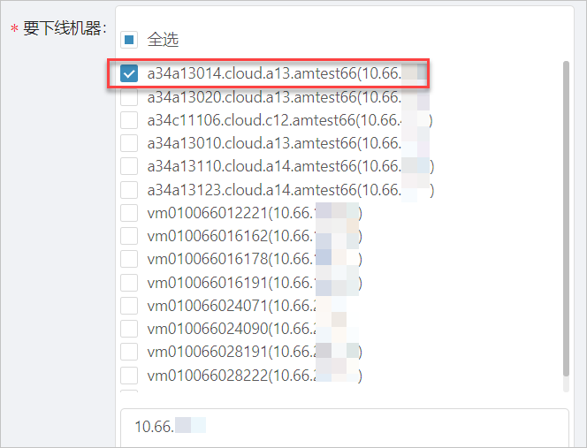

   > **说明**
   >
   > 在飞天基础运维平台nfs服务中可以对照查看全量机器IP。

7. 配置其他参数。

   - 定时执行：在列表中，选择定时执行工作流的方式。

   - 执行优先级：设置任务执行的优先级。

   - 执行类型：在列表中，选择执行工作流的类型。

   - 备注：添加任务说明。

8. 单击**提交**，创建新的工作流。

9. 在**我发布的任务**页签中，查看所有发布的工作流。

   在**任务完成状态**一列，会出现三种任务状态：**执行中**、 **失败**、**成功**。

   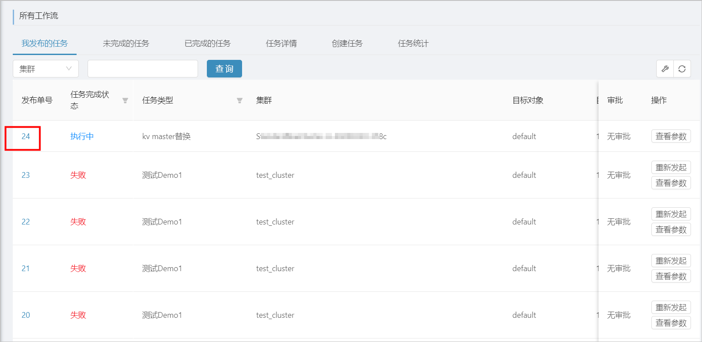

0. 查看失败任务的原因。

   单击失败任务对应的发布单号，进入**任务详情**页签。

   

   单击**工作流**，查看详细信息。

   

   单击**日志**，查看工作流运行日志。

   

**预期结果**

整机下线工作流验证成功。

<a id="section-2-6-1-2"></a>

#### 2.6.1.2. 工作流实例

您可以在数据魔方控制台查看工作流实例列表，根据业务需求管理工作流实例，例如修复失败实例、清除废弃实例等，以便您合理调配资源，提高业务的自动化水平。

1. 登录Apsara Uni-manager运维控制台。

2. 在顶部菜单栏，选择**产品运维 > 存储运维 > NAS运维·NAS赤骥**。

3. 在数据魔方左侧导航栏，选择**运维支持 > 工作流管理 > 工作流实例**。

4. 选择按**工作流实例ID**或**操作人**进行查询，输入对应的内容，然后单击**查询**。单击  图标可以进一步进行

   筛选。

   查找范围配置完成后，您可以在当前页面查询工作流实例的ID、任务类型、完成状态、开始时间、执行情况等信息。

   在**工作流ID**列，您还可以单击目标工作流ID，查询其工作流详情，以及对该实例进行停止、恢复、刷新、修复等操作。

<a id="section-2-6-1-3"></a>

#### 2.6.1.3. 工作流定义

您可以在数据魔方控制台查看工作流的定义，即各个工作流大类的活动步骤，以便您更好地管理工作流。

1. 登录Apsara Uni-manager运维控制台。

2. 在顶部菜单栏，选择**产品运维 > 存储运维 > NAS运维·NAS赤骥**。

3. 在数据魔方左侧导航栏，选择**运维支持 > 工作流管理 > 工作流定义**。

   在<strong>工作流列表【定义】</strong>页面，您可以查看工作流大类的活动步骤，为您管理工作流提供参照。

<a id="section-2-6-2"></a>

### 2.6.2. 白屏命令

数据魔方控制台提供简易的、可视化的白屏命令功能。您可以自定义命令，查看命令执行历史，以便您快速解决困难问题，高效定位疑难问题，提高自动化运维效率。

1. 登录Apsara Uni-manager运维控制台。

2. 在顶部菜单栏，选择**产品运维 > 存储运维 > NAS运维·NAS赤骥**。

3. 在数据魔方左侧导航栏，选择**运维支持 > 白屏命令 > 自定义命令**。

   在**自定义命令**页面，您可以根据需求进行以下操作。

   - 调用命令模板执行命令

     单击**我的命令**页签，在**最近使用命令**和**收藏的命令**区域找到目标命令并单击其名称。

     您也可以单击页面右上方的**选择命令模板**，在面板中单击目标命令名称。

     在目标命令详情页，您可以调用该命令模板，并选择**执行机器**、**执行超时时间**，配置命令模板内容。配置完成后，单击**点击执行**按钮，即可执行该命令。

   - 查看命令执行历史

     单击**执行历史**页签，输入关键字搜索命令，或选择执行状态筛选命令。配置完成后，您可以在该页签下查看命令的执行历史，包括执行机器、执行状态、时间等。

     在**操作**列，您可以单击目标命令的**执行结果**，查看其执行结果详情。

<a id="section-2-7"></a>

## 2.7. NAS大盘

在业务概览页面，您可以按地域和时间查看业务数据；在库存管理页面，您可以按时间查看集群的盘古数据、KV数据及数据变化趋势等，以便您快速了解业务数据和进行库存管理。

**业务概览**

该功能可以按地域和时间段查看各种业务数据，包括存储量、分类型存储量、分协议存储量和文件系统个数，操作如下：

1. 登录Apsara Uni-manager运维控制台。

2. 在顶部菜单栏，选择**产品运维 > 存储运维 > NAS运维·NAS赤骥**。

3. 在数据魔方左侧导航栏，选择**NAS大盘 > 业务概览**。

4. 在**业务数据概览**页面，选择地域和日期区间，单击**查看**。

   > **说明**
   >
   > 您也可以在页面右侧快速选择日期区间。

5. 在页面中查看**存储量**、**分类型存储量**、**分协议存储量**和**文件系统数目**，如下图所示。

   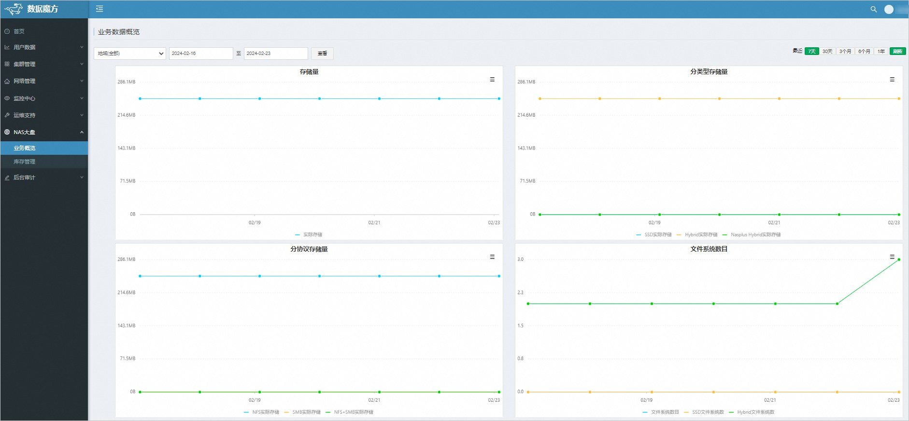

**库存管理**

该功能可以按时间查看集群的盘古数据、KV数据及数据变化趋势，操作如下：

1. 登录Apsara Uni-manager运维控制台。

2. 在顶部菜单栏，选择**产品运维 > 存储运维 > NAS运维·NAS赤骥**。

3. 在数据魔方左侧导航栏，选择**NAS大盘 > 库存管理**，进入**库存水位**页面。

4. 在**库存水位**页面，选择**数据维度**和**统计时间**，单击**查看**。

   > **说明**
   >
   > 数据维度可以选择**盘古数据**和**KV数据**来查看数据存储容量。

5. 在显示的数据列表中，您可以进行以下操作：

   - 单击各项数据后的图表图标（图示中①），可以查看该项数据的变化趋势图表。

   - 单击某条数据右侧的**查看详情**（图示中②），可以查看该条数据的详情。

   如下图所示。

   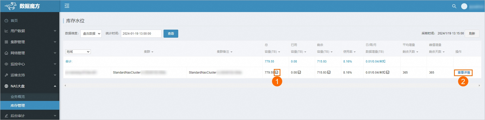

<a id="section-2-8"></a>

## 2.8. 后台审计

在后台审计页面，您可以查看管控平台的操作日志以及平台访问的报表，以便您更好地管控和追踪平台的操作日志，提高运维效率。

**管控平台操作日志**

系统会将用户对系统有修改影响的访问记录在日志中。在进行安全维护时，您可以根据关键字快速检索不同维度的审计日志，便于快速定位和及时处理故障问题，保证系统安全。

1. 登录Apsara Uni-manager运维控制台。

2. 在顶部菜单栏，选择**产品运维 > 存储运维 > NAS运维·NAS赤骥**。

3. 在数据魔方左侧导航栏，选择**后台审计 > 管控平台操作日志**。

4. 在**管控平台操作日志**页面中，选择时间范围后，单击**查询**。

   您也可以单击**添加过滤条件**后的复选框，然后在下拉框中选择**操作人**、**IP**、**操作日志**或**操作名称**进行查询。

   将鼠标置于目标操作日志上，即可查看操作日志的完整信息。

**平台访问报表**

在平台访问报表页面，主要包括**用户访问详情**、**所有操作占比**、**操作详情**、**赤骥历史日访问PV**和**赤骥历史日访问UV**等的信息。您可以根据时间范围进行查询，操作如下：

1. 登录Apsara Uni-manager运维控制台。

2. 在顶部菜单栏，选择**产品运维 > 存储运维 > NAS运维·NAS赤骥**。

3. 在数据魔方左侧导航栏，选择**后台审计 > 平台访问报表**。

4. 在**平台访问报表**页面中，选择时间范围后，单击**查询**。

   此时，可查看到选择时间段的**用户访问详情**、**所有操作占比**、**操作详情**、**赤骥历史日访问PV**和**赤骥历史日访问UV**的信息。

<a id="section-3"></a>

# 3.例行维护

<a id="section-3-1"></a>

## 3.1. 查看KV服务状态

本文介绍如何查看NAS集群KV服务是否正常。

**操作步骤**

1. 找到集群的nas-recycle服务下的RecycleJob角色，登录目标机器。

2. 使用kuadmin工具，查看KV服务中添加的NAS app服务。

   - 执行命令

     ```text
     /apsara/deploy/kuadmin
     listapp
                         
     ```

   - 返回示例

     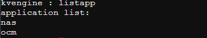

     如果listapp出现error，说明kvmaster服务有问题，需要针对解决。

3. 使用ku工具查看KV服务是否正常。

   - 执行命令

     ```text
     /apsara/deploy/ku
     checkready nas
     checkready ocm
                         
     ```

   - 返回示例

     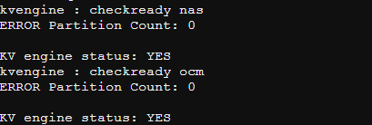

   如果checkready结果不能正常显示，或者status为NO。表示KV服务本身存在问题，需要针对解决。

4. 使用mcu查看kvmaster状态和信息。

   <ol type="i">

   <li>

   查询kvmaster，一般为3master。

   - 执行命令

     ```text
     /apsara/deploy/mcu gas
     ```

   - 返回示例

     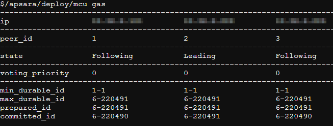

   </li>

   <li>

   查询kvmaster config。

   - 执行命令

     ```text
     /apsara/deploy/mcu gac
     ```

   - 返回示例

     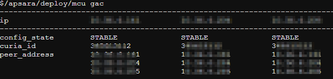

   </li>

   </ol>

<a id="section-3-2"></a>

## 3.2. 查看文件系统和用户信息

**操作步骤**

1. 找到集群的nas-recycle服务下的RecycleJob角色，登录目标机器。

2. 使用ocm_cmd和Ku工具查看文件系统fsid（file system ID）以及对应的partition。

   <ol type="i">

   <li>

   通过user查询volume以及对应fsid。

   - 执行命令

     ```text
     /apsara/deploy/ocm_cmd list_volume -u <user>
     ```

   - 返回示例

     

   </li>

   <li>

   通过fsid查询文件系统对应的partition。

   - 执行命令

     ```text
     /apsara/deploy/ku
     querypart nas <fsid>
                                 
     ```

   - 返回示例

     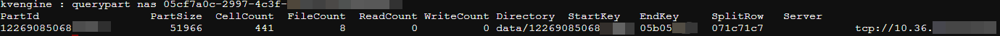

   </li>

   </ol>

3. 在RecycleJob角色，使用ocm_cmd工具查看NAS集群和用户权限组信息。

   通过user查询volume以及对应fsid。

   - 执行命令

     ```text
     /apsara/deploy/ocm_cmd list_volume -u <user>
     ```

   - 返回示例

     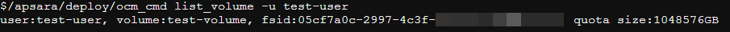

4. 查询文件系统volume删除信息。

   - 执行命令

     ```text
     /apsara/deploy/ocm_cmd list_deleted_volume
     ```

   - 返回示例

     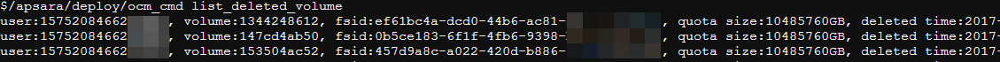

5. 通过user和volume查询挂载信息。

   - 执行命令

     ```text
     /apsara/deploy/ocm_cmd get_volume_mount_info -u <user> -v <volume>
     ```

   - 返回示例

     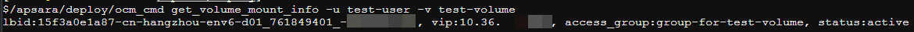

6. 通过user和volume查询文件系统协议类型。

   - 执行命令

     ```text
     /apsara/deploy/ocm_cmd get_volume_protocoltype -u <user> -v <volume>
     ```

   - 返回示例

     

     其中结果1代表只有nfs协议，2代表只有smb协议，3代表混合协议。

7. 通过user查询用户权限组。

   - 执行命令

     ```text
     /apsara/deploy/ocm_cmd list_access_group -u <user>
     ```

   - 返回示例

     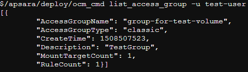

8. 通过user和权限组（group）查询权限规则。

   - 执行命令

     ```text
     /apsara/deploy/ocm_cmd list_access_rule -u <user> -g <group>
     ```

   - 返回示例

     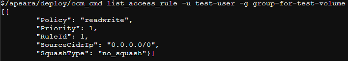

9. 通过user和volume修改文件系统协议。

   ```text
   /apsara/deploy/ocm_cmd update_volume_protocoltype -u <user> -v <volume> --protocolType <1/2/3>
   ```

0. 查询partiton和distance信息。

   <ol type="i">

   <li>

   查询集群kvserver信息。

   - 执行命令

     ```text
     /apsara/deploy/ku --interactive=false --command=getallserver --appname=nas |grep 
     10280|grep tcp|awk '{print $2}'
     ```

   - 返回示例

     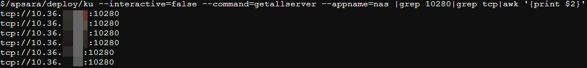

   </li>

   <li>

   根据kvserver信息查询partition以及distance信息。

   - 执行命令

     ```text
     /apsara/deploy/ofsu --interactive=false --command=getpartdist --param1=<kvserver>--param2=nas | grep -v PID
     ```

   - 返回示例

     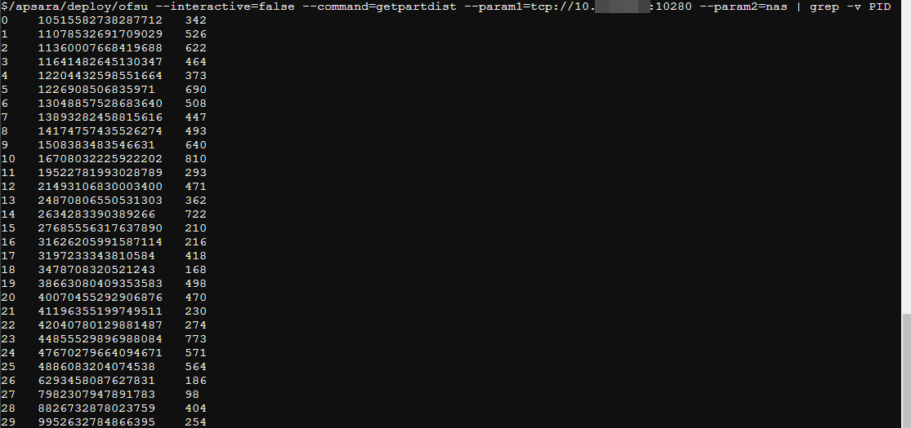

   </li>

   </ol>

1. 查询文件系统详细信息。

   <ol type="i">

   <li>

   查询所有partition。

   - 执行命令

     ```text
     /apsara/deploy/ku --interactive=false --command=getallpart --param1=nas | grep tcp | awk '{print $3}'
     ```

   - 返回示例

     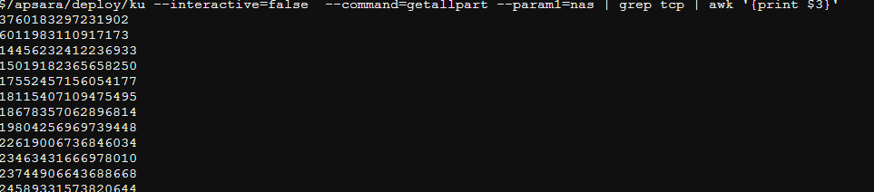

   </li>

   <li>

   根据partition查询文件系统。

   - 执行命令

     ```text
     /apsara/deploy/ofsu --interactive=false --command=getfilesystem --appname=nas --param1=<partition>
     ```

   - 返回示例

     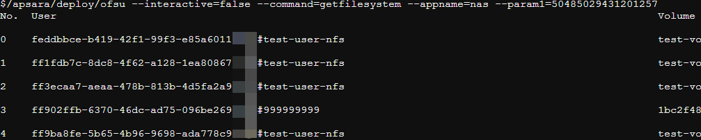

   </li>

   <li>

   根据user和volume查询文件系统详细信息。

   - 执行命令

     ```text
     /apsara/deploy/ofsu --interactive=false --command=getfsinfo --appname=nas --param1=<user> --param2=<volume>
     ```

   - 返回示例

     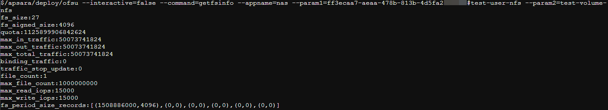

   </li>

   </ol>

2. 查询NAS集群azone和location信息。

   <ol type="i">

   <li>

   获取ocm_tool需要ocm的access_id和access_key。

   ```text
   vim /cloud/app/nas-
   nfs/NFSSupervisor#/nfs_supervisor/current/conf.merge/ocm_cmd.json
   ```

   </li>

   <li>

   记录ocm_host，access_id和access_key信息，利用ocm_tool查询location信息。

   - 执行命令

     ```text
     /apsara/deploy/ocm_tool lli --ocm_host=<ocm_host> --access_id=<access_id> --access_key=<access_key>
     ```

   - 返回示例

     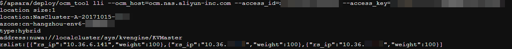

   </li>

   </ol>

<a id="section-3-3"></a>

## 3.3. 查询集群回收任务信息

**操作步骤**

1. 找到集群的nas-recycle服务下的RecycleJob角色，通过nas_ju工具查看集群当前的回收任务。

   - 执行命令

     ```text
     /apsara/deploy/nas_ju list
     ```

   - 返回示例

     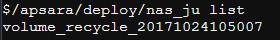

2. 通过job_name查看回收任务的详细信息。

   - 执行命令

     ```text
     /apsara/deploy/nas_ju info <job_name>
     ```

     示例

     ```text
     /apsara/deploy/nas_ju info volume_recycle_20171024105007
     ```

   - 返回示例

     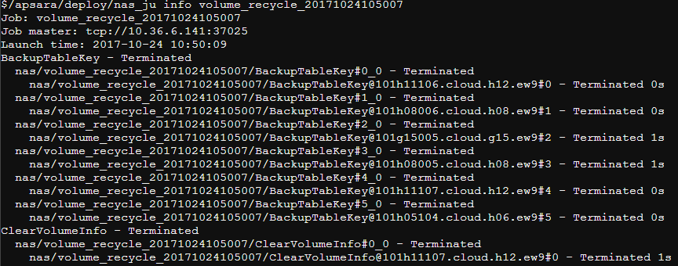

<a id="section-3-4"></a>

## 3.4. 查看集群模块服务日志

**操作步骤**

1. 找到集群的nas-recycle服务下的RecycleJob角色，查看kv服务日志。

   通过ku和kuadmin工具判断kv服务异常后，可到/apsara/deploy/log下查看对应的ku.LOG和kuadmin.LOG获取错误信息。

2. 登录OcmServer机器查看ocm日志信息。

   ocm机器一般有3台负载均衡，特定请求日志可能需要在3台中查找。

   ```text
   vim /cloud/log/nas-ocm/OcmServer#/ocm_server/ocm_server.LOG
   ```

3. 登录nas-ocm服务下的Tengine机器查看nginx日志信息。

   ```bash
   cd /cloud/log/nas-ocm/Tengine#/tengine
   ```

   启动日志为tengine_starter.log；最新的access_log和error_log分别为成功和失败的信息日志。

4. 登录NFSServer机器查看ganesha日志。

   ```text
   vim /cloud/log/nas-kvengine/KVServer#/kv_server/ganesha.LOG
   ```

<a id="section-3-5"></a>

## 3.5. 停写设置

通过设置停写设置，可以控制写入存储的总容量。当写入容量过高时，将禁止写入；容量降低后将恢复写入。

**配置**

配置停写步骤如下：

1. 登录Apsara Uni-manager运维控制台。

2. 在顶部导航栏，选择**平台运维 > 飞天基础运维平台 > 资源管理**。

3. 在左侧导航栏，选择**产品集群运维**，并在**产品|集群**搜索框中输入**nas**。

4. 在目标集群的操作列，单击**集群详情**，进入该集群的详情页面。

5. 选择**终态配置**页签，然后在文件列表框中选择**services > nas-nfs > user > nfs_supervisor**，配置nfs_supervisor.json文件。

   ```json
   {
       "nas_disk_usage_limit":90
   }
   ```

   **nas_disk_usage_limit**参数值为百分数，表示写入存储量达到总容量的多少就停止写入。建议设置为**90**。

   如果该集群未创建nfs_supervisor.json文件，请执行以下操作：

   <ol type="i">

   <li>

   单击**services > nas-nfs > user**文件夹右侧的  **图标 > 新增文件**。创建nfs_supervisor文件

   夹。

   </li>

   <li>

   在**新增文件**对话框中，配置**新增类型**为**文件夹**、**文件/文件夹名称**为nfs_supervisor.json，然后单击**确定**。

   </li>

   <li>

   单击刚创建的nfs_supervisor文件夹右侧的  **图标 > 新增文件**，创建nfs_supervisor.json文件。

   </li>

   <li>

   在**新增文件**对话框中，配置**新增类型**为**文件**、**文件/文件夹名称**为nfs_supervisor.json。

   </li>

   <li>

   配置nfs_supervisor.json文件。

   ```json
   {
       "nas_disk_usage_limit":90
   }
   ```

   **nas_disk_usage_limit**参数值为百分数，表示写入存储量达到总容量的多少就停止写入。建议设置为**90**。

   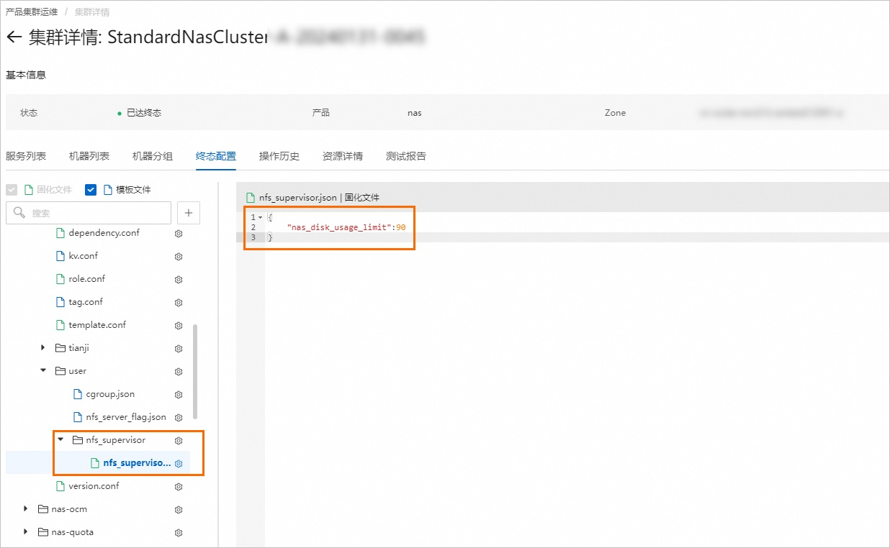

   </li>

   </ol>

6. 配置更改后，集群重新rolling，配置生效。

> **说明**
>
> 禁写后，重写方法如下：
>
> - 删除文件系统或文件内容，系统的回收周期为7天左右，7天后可以进行重写操作。
>
> - 更改limit值，也可以进行重写操作。

**验证**

验证过程如下：

1. 创建文件系统，并进行正确挂载。

2. 向文件系统写入并达到limit标准。此时将禁止写入，不影响其他命令的使用，例如ACL等。

   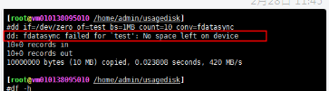

3. 查看日志。

   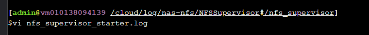

   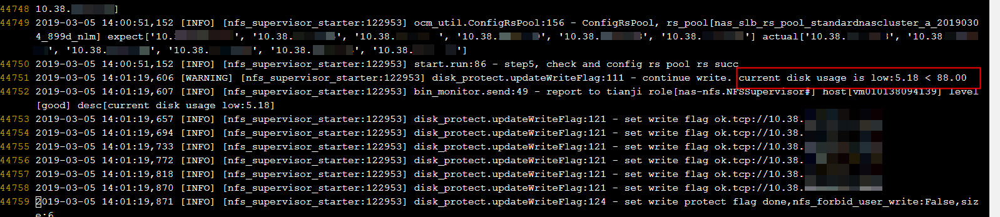
